# 吉林大学c++课件（liay）


- 1-1 培养目标
- 理解和掌握c++语言的基本语义和语法，初步理解面向对象的思想，初步掌握面向对象的程序设计方法。
- 提高编程能力和调试程序的能力，为后面的学习打好基础。


1972年 bell实验室研制


- 高度灵活性、实现上的高效性（比FORTRAN）
- 简捷和高效 （比Pascal）


程序达到一定规模时，模块之间的协调性存在问题，程序的重用性也存在问题，程序员难以控制程序的复杂性。


- 1980年 贝尔实验室 Bjarne Stroustrup 对C 改进与扩充
- 最初称为“带类的C”， （c with classes）.
- 1983年正式命名为C++
- 3次修订后
- 1994 年制定了 ANSI c++草案
- 1998年11月，ISO标准被批准。

- C++是C的改进与扩充
- C++包括C的全部属性、特征、优点，是在C的基础上的改进与扩充
- C++是C语言改进的基础上，添加了对面向对象程序设计部分的支持
- C++包括过程性语言和类部分
- C++是C的超集，C是C++的子集
- C++是混合型语言，即是过程型的，又是面向对象型的


“面向过程”是一种以事件为中心的编程思想。

就是分析出解决问题所需要的步骤，然后用函数把这些步骤一步一步实现，使用的时候一个一个依次调用就可以了。


- 1. 对象

一个对象是客观世界的一个实体

数据与数据处理过程作为一个整体——对象

C++采用“类”来支持对象，同类对象抽象出其共性，形成类，类封装了数据与处理数据的过程（函数）


- 例如五子棋，
- 面向过程的设计思路就是首先分析问题的步骤：

1、开始游戏，
2、黑子先走，
3、绘制画面，
4、判断输赢，
5、轮到白子，
6、绘制画面，
7、判断输赢，
8、返回步骤2，
9、输出最后结果。

而面向对象的设计则是从另外的思路来解决问题。整个五子棋可以分为：

1、黑白双方，这两方的行为是一模一样的，
2、棋盘系统，负责绘制画面，
3、规则系统，负责判定诸如犯规、输赢等。

第一类对象（玩家对象）负责接受用户输入，并告知第二类对象（棋盘对象）棋子布局的变化，同时利用第三类对象（规则系统）来对棋局进行判定。

- 把上面每个步骤用分别的函数来实现，问题就解决了


从程序机构上，c++的单一程序体本质上是基于过程的，因为运行程序时，总是启动过程。


```
/* this is
a simple c++ program*/
#include <iostream>
using namespace std;
// #include <iostream.h>
int main()
{
    int a,b,result;
    cout <<"please input two numbers:\n";
    cin>>a>>b;
    result=3*a-2*b+1;
    cout<<"result is "<<result<<endl;
    return 0;
}
```

- 1. 预处理命令：
  宏定义命令、文件包含命令和条件编译命令
- 2. 输入和输出：
- 3. 函数：
- 4. 语句： 是组成程序的基本单元。以分号结束。
- 5. 变量：
- 6. 其他： 如符号常量和注释信息。
  C++中尽量把常量定义为符号常量
  #define PI 3.1415
  const double PI=3.1415;

### 1-7 C++程序的实现

编辑、编译、运行

- 1. 编辑：将编写好的C++源程序输入到计算机中，生成磁盘文件的过程。磁盘文件的文件名要用扩展名.cpp。

- 2. 编译：C++程序的实现必须使用某种C++语言的编译器对程序进行编译。功能是：将程序的源代码转换成为机器代码的形式，称为目标代码（.obj），然后，再使目标代码进行连接，生成可执行文件（.exe）。

编译过程可分为三个子过程：预处理过程、编译过程、连接过程

（1）预处理过程：执行预处理命令

（2）编译过程：
进行词法分析和语法分析的过程，又称源程序分析的过程。

符号表：又称字典。映射程序中的各种符号以及其他们的属性。是在进行词法分析和语法分析是生成的，在生成中间代码和可执行的机器代码时使用。

错误处理程序：

生成目标代码：.OBJ为扩展名的磁盘文件，机器可识别文件内容，却不能执行。

（3）连接过程：编译器对每个源文件单独进行编译，多个源程序的目标代码以及库文件(.Lib)连接在一起，才能形成可执行文件(.exe)。由连接器完成。

3.运行：

- 上机环境：
  Visual c++ 6.0
  Visual studio 2010

## 第二章 函数

- 一个C++程序有一个主函数，主函数是程序执行的开始点。
- C++ 不允许函数定义嵌套。
- 函数有两种：标准库函数和用户自定义函数。

### 2-1 内联函数

内联函数也称内嵌或内置函数，它的语法格式与普通函数一样，只是在函数原型或函数定义标题头之前加上关键字 inline。

```
inline int isnumber(char);
inline int isnumber(char ch)
{
    return(ch>='0' && ch<='9')?1:0;
}
```

编译器为内联函数创建一段源代码，每遇到一次该函数的调用都用相应的一段代码来代替。

内联函数主要是解决运行效率的问题。使用内联函数可以省去函数调用所需的建立栈内存环境，进行参数传递，产生程序转移的时间开销

内联函数应是使用频率高，代码却很短的函数。

内联函数必须在调用之前声明或定义。

```
#include <iostream>
using namespace std;
inline int isnumber(char);  // int isnumber(char);(则正常函数调用)
int main(){
    char c;
    while (cin>>c && c!='\n')
    {
        if (isnumber(c ))
            cout<<"you entered a digit\n";
        else
            cout<<"you entered a non-digit\n";
    }
    return 0;
}
int isnumber(char ch) //inline int isnumber(char ch)
{    return(ch>='0' && ch<='9')?1:0;    }
```

此处inline可省略

- 内联函数的函数体限制：
  内联函数中，不能含有switch和while。
  递归函数不能用来做内联函数。
  内联函数中不能说明数组。
  否则，按普通函数调用那样产生调用代码。
  （内联函数是建议性，不是指令性）
- 内联函数只适合于1-5行的小函数
- 类结构中所有在类内部定义的函数，都是内联函数。

### 2-2 重载函数

```cpp
int abs(int);
long l_abs(long);
double d_abs(double);
```

**重载函数：**

```cpp
int abs(int);
long abs(long);
double abs(double);
```

C++用一种函数名技术可准确的判断出应使用那一个函数。

```cpp
abs(-10);       //调用int abs(int);
abs(-1000000);  //调用long abs(long);
abs(12.3);      //调用double abs(double);
```


### 匹配重载函数的顺序：

- （1）严格匹配
- （2）内部转换（相容类型匹配）
- （3）通过用户定义的转换寻找求一个匹配。

```cpp
void print(int);        void print(long);
void print(double);      void print(double);
void function()          void function()
{
    print(3);             int a;
    print(5.0);           print(a);//有二义性
    print('a');           }
    print(3.1415f);       print(long(a));
                          或者print(double(a));
```

### 重载的内部实现：

C++用名字粉碎（name mangling）（名字细分、名字压轧）的方法来改变变函数名。

用v,c,i,f,l,d,r 分别表示 void,char,int,float,long,double,longdouble.

```cpp
int f (char a);  // f_c
```

```cpp
int f (char a,int b,double c); //f_cid
```

### 返回值类型不能够作为重载依据（区分、细分重载）

```cpp
void func(int);
int func ( int);
fucn(10); //error
```

这样规定保证对重载的解析与环境无关

```cpp
float sqrt(float);
double sqrt(double);
void f(double da,float fla)
{
float fl=sqrt(da);  //调用sqrt(double)
double d=sqrt(da);  //调用sqrt(double)
fl=sqrt(fla);   //调用sqrt(float)
d=sqrt(fla);  //调用sqrt(float)
}
```

### 2-3 默认参数的函数

默认参数也称为缺省参量。

例： void delay(int loops);
    void delay(int loops)
{
    if (loops==0)
        return;
    for (int i=0;i<loops;i++);
}

将loops 定义成默认值为1000

```cpp
void delay(int =1000);
```

调用时： delay();
            delay(2000);

允许函数默认参数值，是为了让编程简单，让编译器做更多的检查错误工作。

### 默认参数函数的声明

当又有声明又有定义时，定义中不允许默认参数。

若只有定义，则默认参数才可出现在函数定义中

### 默认参数的顺序规定：

一个函数中可以有多个默认参数，默认参数应从右至左逐渐定义，当调用函数时，从左向右匹配参数。

例： void foo(int a, int b, bool c);

```cpp
void foo(int a, int b, bool c = false); //ok,c是最后一个参数
```

```cpp
void foo(int a, int b = 0, bool c);   //fail,b不是最后一参数
```

### 当调用有默认参数的函数时，从左向右匹配参数。

```cpp
#include <iostream>
using namespace std;
void fun(int a=1,int b=3,int c=5)
{
    cout<<"a="<<a<<", " <<"b="<<b<<", "
    <<"c="<<c<<","<<endl;
}
int main()
{
    fun();
    fun(7);
    fun(7,9);
    fun(7,9,11);
    cout<<"OK";
    return 0;
}
```

### 默认值的规定：

默认值可以是全局变量、全局常量、函数。不可以是局部变量。因为默认值是在编译时确定的，必须是静态确定的。

### 函数重载与函数默认参数：

(1)默认参数不能用于细分重载函数。

例1：

```cpp
void func(int,int);
void func(int=3,int=4);
func(22,32);
```

例2： void func(int);
void func(int,int);是重载函数
而void func(int);
void func(int,int=4);
在 func(3)调用时有二义性

### 应该避免重载过程中的涉及参数个数的默认设置

### （2）函数重载与函数默认参数：

默认函数可将一系列简单的重载函数合成一个。

```cpp
int month,int day,int year;
void Tdate()
{ month=4; day=15; year=1995;}
void Tdate(int m)
{ month=m; day=15; year=1995;}
void Tdate(int m,int d)
{ month=m; day=d; year=1995;}
void Tdate(int m,int d,int y)
{ month=m; day=d; year=y;}

void Tdate(int m=4,int d=15,int y=1995)
{
month=m; day=d; year=y;
}
```

```cpp
int main()
{
Tdate();
Tdate(1);
Tdate(1,2);
Tdate(1,2,3);
return 0;
}
```

如果参数值用来确定不同的操作，则用函数重载比较好

```cpp
#include <iostream>
using namespace std;
void print();
void print(int *);
int main()
{
    int arr[10];
    int sum=0;
    for (int i=0;i<10;i++){
        cin>>arr[i];
        sum=sum+arr[i];
    }
    if (sum>100)
        print(arr);
    else
        print();
    return 0;
}

void print(int * pa){
    cout<<"the array can be used"<<endl;
    for (int i=0;i<10;i++){
        cout<<pa[i]<<" ";
    }
    cout<<endl;
}

void print(){
    cout<<"the array can not be used<<endl";
}
```

### 无名参数

函数的定义和声明中，都可以省略形参名。

```cpp
void print (int ,int);
```

```cpp
void print(int a,int){
    cout<<a<<endl;
}
```

```cpp
void func(){
    print(1,2);
}
```

### 2-4： 程序运行时的内存布局

- (1) 代码区(code area)：存放程序的代码（各个函数的代码块）
- (2) 全局变量区(data area)：存放程序的全局数据和静态数据
- (3) 堆区(heap area)：存放程序的动态数据
  - 可以用malloc()与free()以及new和delete 来申请与释放堆内存，也称动态内存、动态数据区。
- (4) 栈区(stack area)：存放程序的局部数据（各个函数中的数据）

## 第三章： 指针和引用

### 3-1： 指针

#### 1. 指针变量的定义与赋值

指针是一种数据类型，用于存放内存单元的地址。

```cpp
int * ip;
```

定义同时赋值： int a; int *p=&a;

定义之后，单独使用赋值语句： int a,*p;

```cpp
p=&a;
```

int a[10],*p; p=a; p=&a[0];

#### 3.与地址相关的运算 * 和 &

“ * ” 称为指针运算符（间接访问运算符），表示指针所指向的变量的值。一元运算符

```cpp
int a;    int *p=&a;  *p=5;
```

“ & ” 称为取地址运算符，用来得到一个对象的地址。一元运算符。

* 和 &是两个互逆的操作，当这两个操作符碰到一起时，其作用相互抵消，例如

```cpp
*&k=3    与
k=3
```

效果完全相同

#### 4.用指针处理数组元素

例：

```cpp
int *p,i,a[6]={0,1,2,3,4,5};
p=a;
for(i=0;i<6;i++)
    printf("%d",_____);
```

a[i] *(a+i) p[i] *(p+i) *p++ *a++

考虑： []的作用 []和*的比较；越界访问 数组名和指针

- (1)数组名的内涵在于其指代实体是一种数据结构，这种数据结构就是数组；
- (2)数组名的外延在于其能够转换为指向其指代实体的指针，而且是个指针常量；
- (3)数组名作为函数形参时，在函数体内，其失去了本身的内涵，仅仅只是个指针；

```cpp
#include <iostream>
using namespace std;
void arrayTest(char str[])
//char *str, char str[10]
{cout << sizeof(str) << endl;
cout<<++str<<endl;
}
int main()
{
char str1[10] = "Y and me";
arrayTest(str1);
return 0;}
```


#### 5. void 指针与 NULL 指针值

(1) void 指针（void *p）空类型指针

不指向任何类型，仅仅是一个地址。
不能进行指针运算，也不能进行间接引用。*p
其他类型指针可以赋值给空类型指针
空类型指针经显示转换后方可赋给其他指针。

```c
int a=30; int *ip=&a;
void *vp=ip; //ok 从int*到void*的隐式转换
*vp=10;//error
vp++;      //error
int a;  void *p=&a;  char *q=(char *)p;
```

#### 练习题

```c
char a[]="abcdefghij";
char *q=a;
int *p=(int *)a;
while(*q)
    *q++=*q+1;
    p+=2;
printf("%s",p);
//sizeof(char)=1
//sizeof(int)=4
```

#### 6. 指针和常量

#### const 说明符

const 为指定说明符（也称为常类型说明符），使用指定时，程序执行的过程中指定的内容不能被改变（冻结）。即一次初始化后，指定的内容始终不变。

+ (1) 定义一般常量

使用const 说明常量： int const x=2; 或const int x=2;

定义或说明一个常数组可采用如下格式：

```
<类型说明符> const <数组名>[<大小>]...
```

或者

```
const <类型说明符> <数组名>[<大小>]...
```

```
double const a[2]={1.0,2.0}
```

常量定义时，应被初始化。

```
const int i=5; i++; (错误) ; const int i; 必须初始化;
```

C 中常量定义用#define PI 3.14159

```
c++中使用const double PI=3.1415;
```

积极使用const, 避免使用宏,可以用const、enum定义常量。

#### （2）指针常量和常量指针（指向常量的指针）

指针常量：在指针定义语句的指针名前加const，表示指针本身是常量。

```
int a; int* const p=&a;      定义时必须初始化
```

指针值p不可以修改，指针指向的内容可以修改。

即p是常量，不可以作为左值进行运算，*p可以修改

左值：是对应内存数据的一个表达式，左值对应的内存空间的内容允许刷新。可以出现在赋值运算符的左侧。

右值：右值指的是引用了一个存储在某个内存地址里的数据。出现在赋值运算符的右侧。

要求左值运算：++，--，+=等

#### 常量指针：

在指针的定义类型前加const，表示指向的对象是常量。

如const int *pi 或 int const *pi; 均可。

以上定义表明,*pi是常量，不能将*pi作为左值进行操作。

定义指向常量的指针时，定义时不必须先初始化。

#### 例:指针常量

```cpp
int a[10];
int * const p=a;
int b[6];
p=b; // 错误
*p=6; // 正确
*(p+6)=6; // 正确
*p++ = 7; // 错误
const int c=0;
int *const q=&c; // 错误
```

#### 例:常量指针

```cpp
const int a=78;
const int b=28;
int c=18;
const int *pi=&a;
pi=&b; //ok
*pi=68; //error
pi=&c; //ok
*pi=88; //error
c=98; //ok
```

错误 (a本身不能被修改就不允许外界提供修改的漏洞)

#### （3）指向常量的指针常量(常量指针常量)

形式： const int *const p=&a; 定义时必须初始化
p与*p都是常量。他们都不能作为左值进行操作

```
int b[10];
const static int a[10]={0};
int * const p=a;          错误
const int *const p=a;    正确
const int *const q=b;    正确
p++;                     错误
*p=1;                    错误
*(a+2)=2;                错误
*q=5;                    错误
q++;                     错误
b[0]=5;                  正确
```

#### （4）常量的特殊用法： int f(int b) const;

#### 7. 堆内存的分配

+ 1. 堆内存(heap): 堆是一块内存区域，堆允许程序在运行时(而不是编译时)，申请某个大小的内存空间。堆内存又称为动态内存。

+ 2. 获得堆内存
+ c中用函数malloc()(在头文件malloc.h中)来获得堆内存；
+ c++中用操作符new来获得堆内存。

+ 3. 释放堆内存
+ c中用函数free()(在头文件malloc.h中)来释放堆内存；
+ c++中用操作符delete来释放堆内存。

#### 使用malloc申请空间

`void *malloc(unsigned long size);`

例：

```c
#include "stdio.h"

#include "malloc.h"

int main()
{
    int *p,i;

    p=(int *)malloc(10*sizeof(int));
    for(i=0;i<10;i++) scanf("%d",p++);
    p=10;
    for(i=0;i<10;i++) printf("%d",p[i]);
    free(p);              //只能释放malloc申请的空间
    return 0;
}
```

#### 使用new和delete进行动态内存分配和释放

运算符new和delete是C++新增的运算符，提供了存储的动态分配和释放功能它的作用相当于C语言的函数malloc（）和free（），但是性能更为优越。使用new和delete：

（1） new 类型（初始化值）；
int *p;   p=new int（100）； //动态分配一个整数并初始化
delete p;

（2） new 类型[数组大小]
int *p;  p=new int[10];  //分配一个含有10个整数的整形数组
delete[] p;   //删除这个数组

使用new较之使用malloc（）有以下的几个优点：

+ （1） new自动计算要分配类型的大小，不使用sizeof运算符，比较省事，可以避免错误。
+ （2） 自动地返回正确的指针类型，不用进行强制指针类型转换。
+ （3） 可以用new对分配的对象进行初始化。
+ （4） 不用使用头文件声明（malloc.h）,更简洁。

```c
include "stdio.h"
int main()
{
int *p,i;
p=new int[10];
for(i=0;i<10;i++) scanf( "%d" ,p++);
p-=10;
for(i=0;i<10;i++) printf( "%d" ,p[i]);
delete [] p; //只能释放new申请的空间
return 0;
}
```

new操作符若申请成功，返回首单元地址；否则返回NULL值。
int *p=new int[10];
if (p==NULL) //if (!p) 或者 if (p==0)
{
cout<< "can't allocate more memory!\n" ;
exit(1);
}
//exit是在调用处强行退出程序
//exit(1)表示异常退出. exit(0)表示正常退出

#### 动态空间 ： 动态申请二维数组

```c
#include "stdio.h"
int main()
{ int **p,i,j;
p=new int *[3];
for(i=0;i<3;i++)
p[i]=new int[3];
for(i=0;i<3;i++)
for(j=0;j<3;j++)
scanf("%d",*(p+i)+j);
for(i=0;i<3;i++)
for(j=0;j<3;j++)
printf("%d",p[i][j]);
for(i=0;i<3;i++)
delete [] p[i];
delete[] p;
return 0;
}
```

#### (3)通过函数指针来调用函数

例：
int add(int a,int b){return a+b;}
int main()
{
    int (*p)(int,int);
    p=add; //p是与add等价的函数指针
    cout<<add(3,5);
    cout<<(*p)(3,5);        //四种调用形式效果等价
    cout<<p(3,5);
    cout<<(*add)(3,5);
    return 0;
}

结果：8888


#### 4. 函数指针作函数形参

例：计算以0.10为步长，特定范围内的三角函数之和。

```
#include<iostream.h>
#include<math.h>
double sigma(double(*func)(double),double dl,double du)
{
    double dt=0.0;
    for(double d=dl;d<du;d+=0.1)  dt+=func(d);
    return dt;
}
int main()
{
double dsum;
    dsum=sigma(sin,0.1,1.0);
    cout<<"the sum of sin from 0.1 to 1.0 is"<<dsum<<endl;
    dsum=sigma(cos,0.5,3.0);
    cout<<"the sum of cos from 0.5 to 3.0 is"<<dsum<<endl;
    return0;
}
```

#### 5.用typedef 来简化函数指针

```
(1)typedef int (*FUN)(int a,int b);
```

```
int f(int,int);
```

```
FUN funp=f;
```

FUN 不是指针变量，是指针类型名。

```
(2)typedef int FUNC(int,int); //先定义函数类型
```

```
FUNC* funp=f;
```

#### 6.函数的返回类型可以是函数指针

```
typedef int (*SIG) ();
```

```
typedef void (*SIGARG) ();
```

```
SIG signal (int,SIGARG);
```

### 3-2 引用

#### 1.引用(reference)的概念

> 对象：存储器中一片连续的区域；
> *(a+10)=7
> 左值：就是引用某个对象的表达式

为一个变量、函数等对象规定一个别名，该别名称为引用。此后，对别名的操作即是对别名所代表的对象的操作。

#### 2. 声明引用：声明引用格式如下：

格式：类型标识符& 别名；

例1：

```
int i=0;
int& ir=i;    //定义引用ir作为对象的别名
ir=2;
int* p=&ir;    //等同于int* p=&i;
```

如果： int j; int &i=j; 则i=j; &i==&j;

声明引用，不为之分配内存空间。

例2：

```
int a[10], *p=a;
int& ra1=a[6];    //ra1代表数组元素a[6]
int* & rp1=p;    //rp1代表指针变量p
int& rp2=*p;    //rp2代表p所指向的那个对象,
                //即数组元素a[0]
```

#### 3. 引用必须初始化。引用一旦被声明则不能再修改。

```
Int j,k;
int &s=j;  int &s=k;(错误)
int & i;    错误
extern int& r3 //ok， r3在别处初始化
```

```
int *i;
int k;
int * &j=i;
j=&k;
k=5;
int * &l=j;
cout<<*j<<*i<<*l;
```

注意：为提高可读性，引用与变量、指针定义尽量不在同一行。尽量避免这样的语句int a,&ra=a,*p=&a;

```
void &a=3;//error
```

void 本质不是一个类型，只是在语法上相当于一个类型，
没有该类型的对象。

#### 4、引用的使用一参数传递

```
void swap(int&, int&);
void swap1(int *,int *);
void swap2(int ,int );
int main()
{
int a=1,b=2;
swap2(a,b);cout<<a<<b;
swap1(&a,&b);cout<<a<<b;
swap(a,b); cout<<a<<b;
return 0;
}
```

```
void swap(int &a1,int &b1)
{ int c;
c=a1; a1=b1; b1=c;}
```

```
void swap1(int *a1,int *b1)
{ int c;
c=*a1; *a1=*b1; *b1=c;}
```

```
void swap2(int a1,int b1)
{ int c;
c=a1; a1=b1; b1=c;}
```

形参和实参结合规则：
形参为引用时，形参(引用)接收实参(对象)的地址。
或表述为：
形参为引用时，凡遇到形参(引用)的地方，全部用实参(对象)来代替。

传递引用给函数与传递指针的效果相同。

可读性比指针传递好（传值方式的调用与可读性，性能却强于传值方式）

参数结合符合初始化标准

可使用引用传递从函数返回多个值
（指针和引用都可以）

#### 5.引用和指针的关系

指针是个变量，可再赋值； 而引用建立时必须进行初始化并且决不会再关联其它不同的变量。

指针操纵两个实体（指针值、指向的值）；引用只能操纵一个实体。

引用在内部用指针实现，被看成是指针常量，不能操作自身的地址值，只能访问所指向的实体。

在语言层面，引用的用法和对象一样；在二进制制层面，引用一般都是通过指针来实现的，只不过编译器帮我们完成了转换。

实际上“引用”可以做的任何事情“指针”也都能够做，为什么还要“引用”？

答案是“用适当的工具做恰如其分的工作” 。

> ——指针能够毫无约束地操作内存中的东西，尽管指针功能强大。但是非常危险。引用是指针出于安全考虑的替代品。

在以下情况下你应该使用指针：
一是你考虑到存在不指向任何对象的可能（在这种情况下，你能够设置指针为空）
二是你需要能够在不同的时刻指向不同的对象（在这种情况下，你能改变指针的指向）。
如果总是指向一个对象并且一旦指向一个对象后就不会改变指向，那么你应该使用引用。

#### 6.用const 限定引用

用const 限定引用声明方式：

```
Int i;  const int& p=i;
```

用这种方式声明的引用不能通过引用对目标变量的值进行修改，保证了引用的安全性。

作为参数可以保证在函数执行时不被修改

```
int i;
const int * p = &i;
const int& p=i;
```

效率相同

```
```cpp
double &dr=1;    //error
const double &cdr=1;  //ok
```
```

解释是：

```
```cpp
double temp =double(1);
const double& cdr=temp;
```
```

注意：c++不分变量的const引用，和const变量的引用，因为引用本身就不能重新赋值，使它指向另一个变量。即没有const int const &a=1，只有const double &a=1

#### 7.引用的使用—用引用返回值

```
float t;
float f1(float r)
{ float k; k=3.14*r*r;
    cout<<"f1::k is"<<&k<<endl;
    return(k);}

float& f2(float r)
{ t=3.14*r*r;
    cout<<"f2::t is"<<&t<<endl;
    return(t);
}
float &f3(float r)
{ float f; f=3.14*r*r;
    cout<<"f3::f is"<<&f
    <<endl;
    return(f);
}
```

```
int main()
{ float a=f1(5);
    const float &b=f1(5);
    cout<<"b:"<<&b<<endl;
    cout<<"a="<<a<<","<<"b="
    <<b<<endl;
    float c=f2(5);
    float & d=f2(5);
    cout<<"d:"<<&d<<endl;
    cout<<"c="<<c<<","<<"d="
    <<d<<endl;
    float e=f3(5);
    float & f=f3(5);
    cout<<"e="<<e<<","<<"f="<
    <f<<endl;}
```

f1::k is0x0013FF08
f1::k is0x0013FF08
b:0x0013FF74
a=78.5,b=78.5

f2::t is0x0042DD68
f2::t is0x0042DD68
d:0x0042DD68
c=78.5,d=78.5

f3::f is0x0013FF08
f3::f is0x0013FF08
e=5.88384e-039,f=5.88384e-039

用普通的返回值的方法返回一个函数的函数值时,需在内存中先创建 一个临时变量,
在被调函数返回时，将函数值复制到该临时变量中，
主调函数再以该临时变量的值进行运算。这种方法产生了函数值的副本。

用引用返回一个函数值 的最大好处是： 在内存中不产生被返回值的副本。

别返回一个局部对象的引用。


#### 8. 引用的使用—函数调用作为左值

```cpp
int a=0,b=0,c=0;
int & count(int k)
{
    if(k>60) return(a);
    if(k<=60&&k>30) return(b);
    if(k<=30) return(c);
}
int main()
{int i,j;
    for(i=0;i<15;i++)
    {
        cin>>j;
        count(j)++;
    }
    cout<<a<<b<<c;
    return 0;
}
```

#### 分析程序，写出结果：

```cpp
#include <iostream.h>

void main()
{
    int* p;       int*& rp=p;
    int x=100;    int &rx=x;
    p=&x;
    cout<<"*p="<<*p<<endl;
    cout<<"x="<<x<<endl;
    cout<<"rx="<<rx<<endl;
    cout<<"*rp="<<*rp<<endl;
    x++;    (*p)++;
    rx++;   (*rp)++;
    cout<<"*p="<<*p<<endl;
    cout<<"x="<<x<<endl;
    cout<<"rx="<<rx<<endl;
    cout<<"*rp="<<*rp<<endl;
}
```

## 第四章： 类

### 1.从结构到类

结构：相关联的数据元素组成一个单独的统一体

```cpp
struct Savings
{
    unsigned accountnumber; //账号
    float balance;//结算额
};
```

‘；’是必需的

struct Savings a,b;
或者 Savings a,b; 常用形式

结构分量称为成员，使用“.”操作符访问成员

```cpp
void fn()
{
Savings a;
Savings b;
a.accountnumber=1;
b.accountnumber=2;
}
```

粗糙的数据类型，没有涉及复合数据的操作。C的结构中不含有成员函数。

C++的类中既能包含数据成员，又包含函数成员或称成员函数。

```cpp
class Savings
{
    public:
        float deposit(float amount) //成员函数
        {
            balance+=amount;
            return balance;
        }
        unsigned accountnumber; //数据成员
        float balance;//结算额
};  //类的声明时不分配内存空间
```

```cpp
void fn()
{Savings a,b;    //对象                (对象和变量)
    Savings *pa=&a,*pb=&b;  //对象指针
    a.accountnumber=123;   pb->accountnumber=456;
    pa->balance=1000;      b.balance=2000;
    a.deposit(100);        pa->deposit(200);
    (*pb).deposit(100);    (&b)->deposit(200);
}
```

注意：'.'的前面是对象，'->'的前面是地址，成员函数的调用一定是和某个对象捆绑在一起。

#### C++中类与结构的区别

```cpp
struct Savings
{
public :    //可省略
    float deposit(float amount)
    {
        balance+=amount;
        return balance;
    }

private:
    int accountnumber;
    float balance;
};
```

```cpp
class Savings
{
private: //可省略
    int accountnumber;
    float balance;

public:
    float deposit(float amount)
    {
        balance+=amount;
        return balance;
    }
};
```

#### C++中类与结构的区别：

默认情况下，class定义的成员是private的，而struct定义的成员是public的。

### 2.对象的引用以及返回对象的函数

```cpp
class Student
{
public:
    int age;
    char name[9];
    float score;
};
```

```cpp
int main()
{
    void add(Student&);
    Student get();
    Student a[30];
    for(i=0;i<30;i++)
        add(a[i]=get());
    return 0;
}
```

```cpp
void add (Student &b)
{
    if(b.age<20)
        b.age++;
}
```

```cpp
Student get()
{ Student temp;
    cin>>temp.age;
    cin>>temp.name;
    cin>>temp.score;
    return(temp);
}
```

### 3. 公有&保护&私有成员

```cpp
class Student{
    public:
        float score;
        void p(){ age=20;}
        void q() {add();}
        void r(int a){cout<<a;}
    private: //和protected只有继承区别
        int age;
        void add(){score=0;p();age++;}
};
```

```cpp
int main()
{Student a;
a.p();
a.q();
a.score=80;
a.age=20;    //错误
a.add();     //错误
a.r(5);
a.r((int)(a.score));
a.r(a.age);  //错误
return 0;
}
```

### 4.成员函数&非成员函数

```cpp
class Student{
    public:
        void p(){
            age=20;
            cout<<age;
        }
        int q(){return(age);}
        float score;
    private:
        char name[9];
        int age;
};
```

```cpp
void p(int a)
{
    cout<<a;
}
int main()
{Student a;
    a.p();
    p(a.q());
    return 0;
}
```

#### 成员函数与普通函数的区别：

- 成员函数属于类，成员函数定义是类设计的一部分，其作用域是类作用域。而普通函数一般为全局函数
- 成员函数的操作主体是对象，使用时通过捆绑对象来行使其职责，而普通函数被调用时没有操作主体

### 5. 重载成员函数

```cpp
class Student
{
public:
float grade(){//...}
float grade(float newgpa){//...}
protected:
//....
};
class Slope{
public:
float grade(){//...}
protected:
//....
};
char grade(float value){//...}

void main()
{
Student s;
Slope t;
s.grade(3.2);
float v=s.grade();
char c=grade(v);
float m=t.grade();
}
```

### 6.定义成员函数

（1）在类的内部定义成员函数

```cpp
#include <iostream>
using namespace std;
class Tdate{
public:
void set (int m,int d,int y)
{month=m;day=d;year=y;}
int isleapyear()
{return (year%4==0&&year%100!=0)||(year%400==0);}
void print()
{cout <<month<<"/"<<day<<"/"<<year<<endl;}
private:
int month;
int day;
int year;
};

int main(){
Tdate a;
a.set(2,4,1998);
a.print();
if (a.isleapyear())
cout<<"is leapyear!";
else
cout<<"is not leapyear!";
return 0;}
```

set 与 month 全名

::作用域区分符、作用域运算符、名字空间引导符


例：用::表示全局变量和函数
int month;
int day;
int year;
void set (int month,int day,int year)
{::month=month;
  ::day=day;
  ::year=year;}
class Tdate
{public:
  void set (int m,int d,int y)
{
      ::set(m,d,y);}
private:
      int month;
      int day;
      int year;
};

类内部提供的成员函数定义默认为内联函数。

类中定义的成员函数一般规模较小(1-5句)

不能使用结构化语句

类定义一般在头文件中,便于多个程序使用。

```
//例子
文件名Student.h
class Student{
public:
    void p() {
    age = 19;
    cout<<age;
    }
    float score;
protected:
    char name;
    int age;
};
```

```
a.cpp
#include "Student.h"
main ()
{Student a;  a.p();}

b.cpp
#include "Student.h"
void hh ()
{Student a;  a.p();}
//类定义和使用的分离
```

#### (2)在类之后定义成员函数

```
class Tdate
{public:
void set (int m,int d,int y);
int isleapyear();
void print();
private:
    int month;
    int day;
    int year;
};
void Tdate::set (int m,int d,int y)
{month=m;day=d;year=y;}
int Tdate::isleapyear()
{return (year%4==0&&year%100!=0)||(year%400==0);}
void Tdate::print()
{cout <<month<< " /" <<day<< " /" <<year<<endl;}
```

从上图中观察可以得知：

- 1， 整个源程序由3个单独的文件构成。
- 2， 两个.cpp文件分别编译生成各自目标文件。
- 3， 两个目标文件和库文件连接生成可执行程序。

注意：

<>：用于c++提供的头文件,一般存放在c++系统目录中的include 子目录下

“ ”：首先在当前文件所在的目录中进行搜索,找不到,再按标准方式进行搜索。

#### 成员函数的实现和类定义 一起放在头文件中

```
文件名Student.h
class Student{
public:
void p(void);
float score;
protected:
char name;
int age;
};
void Student::p(){
cout<<age
}//直接放在了h文件中
```

C++的名称有

外部链接: 函数定义, 可以在其余文件中使用。不能重复定义。

内部链接: 只能在自己的程序中使用, 可以跨文件重复定义。如: 类型定义、

全局变量、inline函数、模板定义等。

```
文件名aa.cpp
#include "student.h"
void main()
{ void f();
Student a;
a.score=80;
cout<<a.score;
a.p();
f();
}
```

```
文件名bb.cpp
#include "student.h "
void f()
{
Student a;
a.score=90;
a.p();
}
//提示void Student::p()被重复定义
```

//头文件在一个文件中多次被包含

#### 文件名Student.h

```
class Student{
public:
    void p(){
    cout<<score;
}
    float score;
protected:
    char name;
    int age;
};
```

#### 文件名ss.h

```
#include "student.h"
class ss{
public:
    Student *a;
    float f;
};
```

#### 文件名bb.cpp

```
#include <iostream.h>
#include "student.h"
#include "ss.h"
void main()
{
    Student a;
    ss s;
    a.score=80;
    ss.f=50;
}
```

//提示 Student类被重复定义

#### 头文件卫士

#### 文件名Student.h

```
#ifndef STUDENT
#define STUDENT
class Student{
public:
    void p(){
    cout<<score;
}
    float score;
protected:
    char name;
    int age;
};
#endif
```

```
#ifndef _INC_IOSTREAM
#define _INC_IOSTREAM
```

#### 文件名ss.h

```
#include "student.h"
class ss{
public:
    Student *a;
    float f;
};
```

#### 文件名bb.cpp

```
#include <iostream.h>
#include "student.h"
#include "ss.h"
int main()
{ Student a;
ss s;
a.score=80;
ss.f=50;
return 0;
}
```

//头文件卫士保证头文件在一个程序文件中只被定义一次

### 6.程序的文件机制

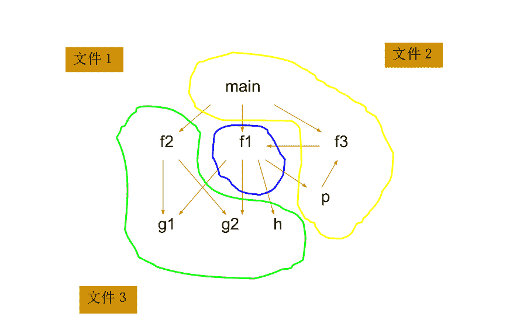

#### 界面头文件（上）

```
// a1.h  a1.cpp提供的资源
void f1();

// a2.h  a2.cpp提供的资源
void p();

// a3.h  a3.cpp提供的资源
void g1();
void g2();
void f2();
void h();
```

#### 界面头文件（下）

```
// s.cpp
#include"a2.h"
#include"a3.h"
void s()
{
    if(...) {
        p();
        g1();
    }else{
        g2();
        h();
    }
}
```

#### C++程序结构

#### C++程序工程文件

#### main.cpp程序文件

```
//包含主函数的程序文件
main.cpp
//用户自定义类库的实现文件
class.cpp
//用户自定义函数库的实现文件
function.cpp
```

头文件包括：
class.h
//用户自定义类型的定义
fuction.h
//用户自定义函数的函数原型

```
#include<标准类库头文件>
#include<标准函数头文件>
#include"自定义类库头文件"
#include"自定义函数头文件"

函数原型
全局数据定义

void main()
{
    //...
}

函数定义
```

### 7.成员函数的显式内联

```
class Date {
    int year, month, day;
    void set ( int y, int m, int d ) {    // 默认内联
        year=y; month=m; day=d;
    }
    bool isLeapYear ( );
};
inline bool Date::isLeapYear ( ) // 显式内联
{   return !( year%400 ) || !(year%4) &&( year%100);
}
```

//类体外定义一目了然 增强可读性

//必须将类定义和成员函数的定义都放在同一个头文件或者同一个源文件中，否则编译时无法置换。

### 8.this 指针

#### Student.h

```
class Student{
public:
    void p(int);
    float score;
protected:
    char name;
    int age;
};
```

成员函数不属于对象

#### Student.cpp

```
#include "student.h"
void Student::p(int a){
    int age; //this的必要性
    age=a;
    //this->age=a;(*this).age=a;等价
    cout<<this->age;
    this = new Student;//错误
}//this是个指针常量
```

#### a.cpp

```
#include "Student.h"
int main()
{
    Student a,b;
    a.p(5);b.p(7);
    this->score = 5; //错误
    return 0;
}
```


```cpp
//程序中显式使用this指针
//Student.cpp
//Student.h
#include "student.h"

class Student{
    public:
        Student *p(void);
        Student &q(void);
        void s(int a)
            {age = a;}
        float score;
    private:
        char name;
        int age;
};

Student *Student::p()
{ age=age+2; return(this);}
Student &Student::q()
{ age=age+5; return(*this);}

//a.cpp
#include "student.h"
int main()
{ Student a;
    a.s(20); a.score = 70;
    (a.p())->score++;
    (a.q()).score++;
    return 0;}
```

### 9.类的封装

#### 类的封装的概念

首先是数据与算法（操作）结合，构成一个不可分割的整体。

其次是在这个整体中一些成员是保护的，它们被有效地屏蔽，以防外界的干扰和误操作。

另一些成员是公共的，它们作为接口提供给外界使用。

#### 保护（私有）成员

类的成员可以声明为被保护的（protected、private），从类的外部（指在普通函数或其它类的成员函数中）不能对它们访问。

一般将所有的数据成员指定为保护。

1. 保护类的内部数据不被肆意侵犯
2. 是类对它本身内部实现的维护负责，因为只有类自己才能访问该类的保护数据，所以对一切保护数据的维护只有靠类自己。
3. 限制类与外部世界的接口。
   保护成员对使用者不可见。
4. 减少类与其它代码的关联程度。类的功能是独立的，不依赖于应用程序的运行环境。

#### 公共成员（公共接口、对外接口）

需要让外界调用的成员函数指定为公共的，外界通过公共的函数来实现对数据的操作。

外界与类的唯一联系就是调用公共的成员函数。

在类外不能访问私有数据成员，但是可以通过公共成员函数来修改私有数据成员的值。

```cpp
//point.h
class point{
public:  //外部接口
    void Set(double ix,double iy);
    double xOffset();
    double yOffset();
    double angle();
    double radius();
protected:  //内部数据
    double x;
    double y;
    // double a;
    // double r;
};
```

```cpp
//point.cpp（类的内部实现）
#include "point.h"
#include <math.h>
void point::Set(double ix,double iy)
{ x=ix;y=iy; }
double point::xOffset()
{ return x; }
double point::yOffset()
{ return y; }
double point::angle() //计算极坐标
{ return
(180/3.14159)*atan2(y,x); }
double point::radius()
//取极坐标半径
{ return sqrt(x*x+y*y); }
```

保护成员不是外部接口部分，但为了类定义的整体描述，只好把它放在头文件中。对于面向对象程序设计之严格的内外界面描述来说，是C++类机制中尴尬奈何的一面。但它不妨碍类的外部接口的有效性。

#### class point

- xOffset
- yOffset
- Set
- angle
- radius

外部成员函数


内部数据成员

#### 屏蔽类的内部实现

```cpp
//Point.h （公用接口）
class Point{
public:
    void Set(double ix,double iy);
    double xOffset();
    double yOffset();
    double angle();
    double radius();
protected:
    double x;
    double y;
    // double a;
    // double r;
};
```

```cpp
//Point.cpp
#include "Point.h"
#include <math.h>

void Point::Set(double ix,double iy)
{ x=ix;y=iy; }

double Point::xOffset()
{ return x; }

double Point::yOffset()
{ return y; }

double Point::angle() //计算极坐标
{ return (180/3.14159)*atan2(y,x); }

double Point::radius() //取极坐标半径
{ return sqrt(x*x+y*y); }
```

```cpp
//main.cpp
#include "Point.h"
#include <iostream>
using namespace std;
int main()
{Point p;
    double x,y;
    for(;;)
    { cout<<"Enter x and y:\n";
        cin>>x>>y;
        if(x<0) break;
        p.Set(x,y);
        cout<<"angle="<<p.angle()<<" "
            <<"radius="<<p.radius()<<" "
            <<"xOffset="<<p.xOffset()<<" "
            <<"yOffset="<<p.yOffset()<<" "
            <<endl;
    } }
```

```cpp
//Point.h
class Point{
public:
void Set(double ix,double iy);
double xOffset();
double yOffset();
double angle();
double radius();
protected:
//double x;
//double y;
double a;
double r;
};
```

```cpp
//Point.cpp (私有实现)
#include "Point.h"
#include <math.h>
void Point::Set(double ix,double iy)
{ a=atan2(ix,iy);
 r=sqrt(ix*ix+iy*iy); }
double Point::xOffset()
{ return r*cos(a); }
double Point::yOffset()
{ return r*sin(a); }
double Point::angle()
{ return (180/3.14159)*a; }
double Point::radius()
{ return r; }
```

结论：类很好地屏蔽了内部数据表示，所以由类负责的内部实现上的维护不影响程序的开发，这大大减轻了开发应用程序的强度。

### 10.作用域

#### (1) 变量的作用域——{} 内或其后的全部内容

```cpp
int a = 1;
main(){
void f();
cout<<a;
int a = 2;
cout<<a;
{int a =3;cout<<a;}
cout<<a;
f();
cout<<a;
}
void f(){cout<<a;int a = 4;cout<<a;}
```

#### (2) 类的作用域

类作用域包括类定义作用域和类实现作用域。

类的定义作用域是指类定义和相应的成员函数定义范围。在该范围内，一个类的成员函数对同一类的数据成员具有无限制的访问权。

私有成员和受保护成员只能被类内部的成员函数访问；

公有成员是类提供给外部的接口，可以在类外部被访问。这种技术实现了信息的隐藏和封装。

类的实现作用域通过类的对象体现，对象有全局对象、局部对象等作用范围。

#### (3) 可见性

可见性与作用域是一致的。可见性从另一角度表现标识符的有效性，标识符在某个位置可见，表示该标识符可以被引用。

可见性在分析两个同名标识符作用域嵌套的特殊情况时非常有用。当内层的变量和外层的变量同名时，在内层里，外层的变量暂时地失去了可见性。

//例子

```cpp
int a = 0; // <-- 全局变量,并且初始化为0
void func()
{ int a; a = 100;
  cout << a << endl;
  cout<<::a<<endl;
}
void main()
{ cout << a << endl; }
```

> “不能在同一作用范围内有同名变量”。

上面的代码中，定义了两个a，但并不违反这一规则。因为二者处于不同的作用范围内。


#### 类名与其它变量名或函数名相同的情况

类名允许与其它变量名或函数名相同，通过如下方法来正确访问：

+   1) 如果一个非类名隐藏了类名，则类名通过加前缀即可。

```
class Sample
{/.....};
void fun(int Sample)
{
class Sample s; //定义一个对象要加前缀
Sample++;
//...
}
```

+   2) 如果一个类名隐藏了非类名，则用一般作用域规则即可。

```
int s=0;
void func()
{
class s{...};
s a;
::s=3;} // class作用域到此结束
int g=s;
```

在函数中定义的类称为局部类，不多见。
作用域在定义该类的函数内。

局部类的成员函数必须在类定义内部定义。

#### （3）生命期（生存期）

指一个对象产生后，存活时间的度量。

在生存期内，对象保持它的状态。

整个程序的生命期：全局（静态）数据

静态生命期：静态局部数据

局部生命期：

动态生命期：由new申请到内存空间之后，该空间实体开始有效，直到delete释放该内存空间。

```
//动态生命周期
#include <iostream.h>
int * fn(){
    int* ap=new int;//ap指向的内存空间开始有效
    return ap;
}
int main()
{
    int* bp=fn();
    *bp=15;
    cout<<*bp<<"\n";
    delete bp;//bp 即ap所指，空间释放。
    return 0;}
```

#### 二
名字空间

名字空间的作用是建立一些互相分隔的作用域，把一些全局实体分隔开来，避免产生名字冲突。

```
namespace zhs{
class aa {
public:
void aa1(int a=1){id=a;}
int id;
};
int age;
double score;
}
namespace ls{
class aa {
public:
int age;
};
}
```

```
void main(){
ls::aa a;
zhs::score=90.1;
zhs::aa b;
b.aa1(8);
a.age=5;
zhs::age=6;
cout<<a.age<<b.id<<endl;
}
```

#### 名字空间

不同人编写的程序组合时会遇到名字冲突的危险

可以包含：变量&对象；常量；函数定义；
类型（结构）定义；名字空间的定义

不能包含：预处理命令；

可以开放定义；可以 {} 外定义

#### 名字空间

```
namespace zhs{
class aa;
}
class zhs:: aa {
public:
void aa1(int a=1){id=a;}
int id;
};
namespace zhs{
int age;//仍然是全局变量，隐藏在指定的名字空间而已
double score;
}
int main()
{
zhs::aa a;zhs::age=4;
zhs::score=90.5; a.id=3;
cout<<a.id<<zhs::score<<zhs::age<<endl;
return 0;}
```

{} 外定义

合并定义

#### 名字空间

```
namespace zhs{
class aa {
public:
    void aa1(int a=1){id=a;}
    int id;
};
int age;
double score;
}
namespace ls{
void a(){cout<<"Computer"<<endl;};
}
Int main()
{zhs::score=90.1;
cout<<zhs::score<<endl;
ls::a();
return 0;}
```

包含函数

#### 名字空间

```
```cpp
namespace zhs{
class aa {
public:
    void aa1(int a=1){id=a;}
    int id;
};
int age;
double score;
void f(){age=1;score=80.5;}
}
namespace ls{
    void a();
}
void ls::a(){cout<<zhs::age<<endl;}
int main()
{ zhs::f();  ls::a();
    return 0;}
```
```

> 替换为：age如何？

#### 名字空间

```
namespace zhs{
class aa {
public:
void aa1(int a=1){id=a;}
int id;
};
int age;
double score;
}
namespace ls{
using zhs::age;
void a();
}
void ls::a(){cout<<age<<endl;}

int main()
{ ls::a(); return 0;}
```

#### 名字空间

```
namespace zhs{
class aa {
public:
void aa1(int a=1){id=a;}
int id;
};
int age;
double score;
}
namespace ls{
using namespace zhs;
void a(){age=3; score=80.5; cout<<age<<endl;}
}
int age = 2;
int main()
{ ls::a(); cout<<zhs::age<<::age;
return 0;}
```

#### 标准名字空间std

标准c++库的所有标识符都是在一个名为std的名字空间定义的。

```
std::cout<<"ok"<<"\n";
```

```
using namespace std;
```

在std中定义和声明所有标识符都可以作为全局量来使用。

```
using std::cout;  using std::string;
```

经常会用到的std成员的using声明组成一个头文件。

#### 在c++中使用包含函数库的头文件的两种方法：

+   （1）用c语言的传统方法。
+   #include <math.h>
+   不必用名字空间

+   （2）用c++的新方法。c++标准要求系统提供的文件不包括后缀.h。

在c语言相应的头文件名之前加了一个字母c

```
#include <cmath>
#include<cstdio>
#include<cstring>
using namespace std;
```

#### 名字空间

名字空间是一个作用域；

是人为定义的

类就是一个特殊的命名空间

#### 一、基本概念

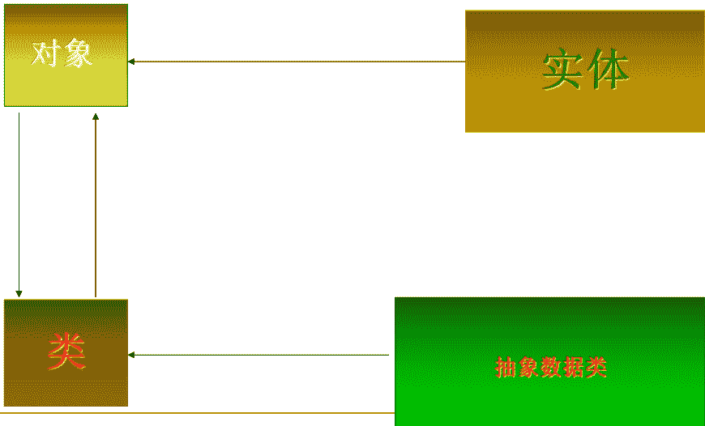

#### 对象的特征

状态：静态属性
由其相关联的属性值的集合表示

行为：对象的操作

标志：对象唯一的描述ID

#### 类的特征

类是相同对象集合的抽象与描述

类由封装的相关联的属性和操作表示

类有唯一的标识名

对象是类的实例，一个类可以有多个实例

#### 二、面向对象的求解

就是力图从实际问题中抽象出封装了数据和操作的对象，通过定义对象的各种属性来描述他们的特征和功能，通过接口的定义描述他们的地位及与其它对象的关系，最终形成一个广泛联系的可理解、可扩充、可维护、更接近于问题本来面目的动态对象模型系统。

#### 三、面向对象软件开发

OOA: 面向对象分析(干什么)

OOD: 面向对象设计 (怎样干)

OOP: 面向对象编程 (实现)

注: 面向对象 object-oriented

#### 面向对象的演化

数据结构＋算法 不能得到算法的丰富性

（数据结构＋算法） 吻合实际情况

对象＋对象…＋对象＝程序

定义（数据&操作）一>调用

-   课堂练习 书P288 第一题、第二题
-   作业： 钱能P290 第四题

#### 创天中文VC++

+   文件
+   编辑
+   查看
+   插入
+   工程
+   编译
+   工具
+   窗口
+   帮助

+   打开... Ctrl+O
+   打开 工作区
+   保存 工作区
+   保存 Ctrl+S
+   另存为
+   全部保存
+   页码设置...
+   打印 Ctrl+P
+   新的文件 >
+   新的工作区 >
+   退出

编译 [试试] 查找文件 1 查找文件 2 结果 SQL Debugging


#### 新建

- 文件
- 工程
- 工作区
- 其它文档

- ATL COM AppWizard
- Cluster Resource Type Wizard
- Custom AppWizard
- Database Project
- DevStudio Add-in Wizard
- Extended Stored Proc Wizard
- ISAPI Extension Wizard
- Makefile
- MFC ActiveX ControlWizard
- MFC AppWizard [dll]
- MFC AppWizard [exe]
- New Database Wizard
- Utility Project
- Win32 Application
- Win32 Console Application
- Win32 Dynamic-Link Library
- Win32 Static Library

工程
test
C 位置:
D:\Program Files\Microsoft Visu...
○ 创建新工作区
○ <|start|>添加全局工作区
□ 从模板的:
P 平台:
☑ Win32

确定
结束

#### Win32 Console Application - Step 1 of 1

你想要创建哪种控制台应用程序？

- 一个空项目。
- 一个简单的应用程序。
- 一个“Hello, World!”应用程序。
- 一个支持 MFC 的应用程序。

< 上一个

下一步 >

完成

取消

#### 新建工程向导

Win32 Console Application 将创建一个具有以下规格的新骨架项目：

- 空控制台应用程序。
- 不会创建或添加到项目中的文件。

工程目录:

D:\Program Files\Microsoft Visual Studio\MyProjects\test

确定

取消

#### test - 创天中文VC++

- 文件
- 编辑
- 查看
- 插入
- 工程
- 构建
- 工具
- 窗口
- 帮助

- 添加到工程
- 从属性...
- 设置...
- Alt+F7
- 输出制作文件...
- 插入工程到工作区...

- 新建...
- Key Folder...
- Files...
- Data Connection...
- Components and Controls...

[Globals]

test classes

- ClassV...
- FileView

编译 / 调试 / 查找文件 1 / 查找文件 2 / 结果 / SQL Debugging /

#### 新建

文件 | 工程 | 其它文档

- Active Server Page
- Binary File
- Bitmap File
- C/C++ Header File
- C++ Source File
- Cursor File
- HTML Page
- Icon File
- Macro File
- Resource Script
- Resource Template
- SQL Script File
- Text File

添加工程:
test
文件
main
目录
D:\Program Files\Microsoft Visu...

确定  取消

test classes

#### test  创天中文VC++

文件 编辑 查看 插入 工程 编译 工具 窗口 帮助

[Globals] [All global members] [No members - Create New Class...]

test classes

#### main.cpp

ClassV... FileView

编译 调试 搜索文件 1 搜索文件 2 链接 SQL Debugging

#### test - 创天中文VC++

文件 编辑 查看 插入 工程 编译 工具 窗口 帮助

[Globals] [All global members] [No members - Create New Class...]

test classes

#### main.cpp

#### time.h

ClassV... FileView

#### 新建

文件 | 工程 | 其它文档 |

- Active Server Page
- Binary File
- Bitmap File
- C/C++ Header File
- C++ Source File
- Cursor File
- HTML Page
- Icon File
- Macro File
- Resource Script
- Resource Template
- SQL Script File
- Text File

添加工程:

test

文件

time

目录:

D:\Program Files\Microsoft Visu...

确定

结束

test classes

ClassV...
FileView

#### test - 创天中文VC++

- 文件 编辑 查看 工具 插入 工程 编译 工具 窗口 帮助

[Globals] [All global members] [No members - Create New Class...]

#### Workspace 'test': 1 prj

- test files
- Source Files
- main.cpp
- time.cpp
- Header Files
- time.h
- Resource Files

#### main.cpp

#### time.h

#### time.cpp

ClassV... FileView

编译 / 调试 / 查找文件 1 / 查找文件 2 / 结果 / SQL Debugging /

## 第五章：构造、析构函数

```
class Student{
    public:
        void p(void);
        float score;
    protected:
        char *name;
        int age;
};
Student a;
Student a={5.5,"abcds",6};
a.age=6;(相当于)
```

```
class Student{
    public:
        void p(void);
        float score=5.5;
    protected:
        char *name="abcds";
        int age=6;
};
```

//非public; 复杂

### 构造、析构函数

```
class Student{
    public:
        void begin();      构造函数最初设想
        float score;
    protected:
        char *name;
        int age;
};
void student::begin()
{ age=25; socre=80.5; name="zhang";
}

Student a;
a.begin();
```

### 构造、析构函数

```
class Student{
public:
    Student();    //构造函数的实现;系统约定与类同名; 自动调用
    int p();
protected:
    char *name;
    int age;
};

Student::Student()    //没有返回类型; 特殊的成员函数
{
    age=5;    name="zhang"; //可以有参数,可以重载
}

Int student::p()
{
    return(age);
}
Student a;  cout<<a.p();
```


```
class Student{
public:
    Student();  // 构造函数的声明
    ~Student(); // 析构函数的声明；没有参数；不可以重载
protected:
    char *name;
    int age;
};
Student::Student()
{ age=5; }
Student::~Student()
{ cout<< "对象结束了"; }
int main(){
    Student a;
    Student b;
    return 0;
}//析构函数的调用顺序和对象构造的顺序相反
```

//对象生命周期结束时由系统自动调用

析构函数不是删除对象，而是在撤销对象占用的内存之前完成一些清理工作。还可以用来执行用户希望在对象生命周期结束时所执行的任何操作。

### 构造、析构函数

```
class Student{
public:
    void Student(); //错误
    void ~Student();//错误
protected:
    char *name;
    int age;
};
void Student::Student()//错误
{ age=5;
}
void Student::~Student()//错误
{ cout<< "对象结束了" ;
}
Student a;
```

```
class Student{
public:
    Student();
    ~Student();
protected:
    char *name;
    int age;
};
Student::Student(){ age=5;}
Student::~Student()
{ cout<<"对象结束了";}

Student a;
a.Student(); //错误
a.~Student(); //不提倡
```

### C++标准程序库中的string类

string name;

自动处理空间的占用问题。C++字符串并不以’ \0’ 结尾。

可以用 = 进行赋值操作， == 进行比较， + 做串联。

使用时#include <string> //注意这里不是string.h

```
string str1,str2= “abcd” ;
```

```
str1=str2;
```

```
str2=str1+” 123” ;
```

```
cout<<str2<<" "<<str2.length()<<" "<<str2.insert(0,"8");
```

由C++字符串得到对应的C_string的方法是使用data()、c_str()

data()以字符数组的形式返回字符串内容，但并不添加’ \0’ 。

```
char s[20];strcpy(s,str1.data());
```

c_str()返回一个以 ‘\0’ 结尾的字符数组， strcpy(s,str2.c_str())

### //带参数的构造函数

```
#include <iostream>
#include<string>
using namespace std;
class Student{
    public:
    Student(string pName, int i,float j)
    { cout <<"构造学生" <<pName <<endl;
    name = pName;
    semesHours=i;
    gpa=j;
    }
    ~Student()
    {  cout <<"析构 " <<name <<endl; }
    //其它公共成员
    private:
    string name;  int semesHours;  float gpa;
};

void f()
{Student t("Tom", 17, 90);}
int main()
{ Student ss("Jenny", 20, 80.5);
 f();
 return 0; }
```

### 构造、析构函数

```
class A {
public:
    int s;
};
A a1;
```

对于没有显性构造函数的类系统都自动提供一个默认构造函数

```
A() { }
```

用户没有定义析构函数，编译器自动生成一个析构函数。

```
~A() { }
```

### //构造函数重载

```
class Student{
public:
    Student(string pName)
    { cout <<"姓名" <<pName <<endl;
        name = pName;
    }
    Student(string pName,int i)
    { cout<< "姓名学时"<<endl;
        name = pName;
        semesHours=i;
    }
private:
    string name; int semesHours;
};
int main()
{ Student tt("Tom",60); Student ss("Jenny");
    Student f;    //错误  ?
    return 0;
}
```

如果手工定义了任何的构造函数，系统不再提供默认的无参构造函数。

### 构造、析构函数

```
//构造函数重载
class Student{
public:
Student(string pName) {
    cout <<"姓名" <<pName <<endl;
    name = pName; }
Student(string pName,int i) {
    cout<<"姓名学时"<<endl;
    name = pName;   semesHours=i; }
Student(){}
protected:
string name; int semesHours;
};
void main(){
Student tt("Tom",60); Student ss("Jenny");
Student f;   } //不错
```

自定义无参构造函数将替代缺省构造函数的存在

### 构造、析构函数

//默认值构造函数 改写重载构造函数

```
class Student{
public:
Student(string pName="",int i=0)
{ cout<<"姓名学时"<<endl;
name = pName;
semesHours=i;
}
protected:
string name; int semesHours;
};
int main()
{ Student tt("Tom",60); Student ss("Jenny");
Student f; //不错
return 0; }
```

Student f();
Student g(int);声明函数

无名对象（一次性对象）：Student("Jane");
一般作为实参，用在创建后不需要反复使用的场合。

- 构造函数是特殊的类成员函数。
- C++规定与类同名的成员函数是构造函数，在该类的对象创建时，自动被调用。
- 构造函数负责对象的初始化
- 可拥有多个参数。可以重载。
- 构造函数不返回具体的值，不指定函数的返回类型。
- 可内置定义，也可以在类外定义。
- 通常是Public的

- 析构函数也是一个特殊的成员函数；
- 作用与构造函数相反；在对象的生命周期结束时自动被调用。
- 名字是类名前加一个~；
- 不返回任何值；没有函数类型，没有函数参数，因此不能被重载。
- 一个类可以由多个构造函数，只能有一个析构函数。
- 可内置定义，也可以在类外定义。
- 用于清理和释放资源的工作。
- 通常是Public的

### 构造、析构函数

```
class A{
public:
    int s;
private:
    A(){cout<<"A is constructing\n";};
    ~A(){cout<<"~A\n";}
};
int main(){
    A s;  //出错
    return 0;}
//构造函数&析构函数的属性影响
```

### 判断对错，错误写出原因：

- 1、 使用 **struct** 定义的类中默认的访问权限是 **private** 的
- 2、 **this** 不能被非成员函数访问
- 3、 任何情况下 **private** 权限的内容不能被类外访问
- 4、 引用破坏了函数的封装性
- 5、 内联函数的作用是提高系统的效率
- 6、 不同类的成员函数也可以重载
- 7、 参数类型、函数返回类型可以作为函数重载的依据

组合：是指结构和类的声明嵌入结构变量和对象作为其成员的现象。
嵌入的对象成员称为成员对象(类成员)。
包容这个成员对象的类称为组合类或包容类。


### //组合类对象的创建

```cpp
//组合类对象的创建
class Student{
public:
Student() {
cout <<"constructing student.\n";
semesHours=100;
gpa=3.5;    }
~Student(){cout<< "~Student\n" ;}
protected:
int semesHours;
float gpa;    };
```

```cpp
//构造函数执行顺序
class TutorPair{
public:
TutorPair()
{  cout <<"constructing tutorpair.\n";
noMeetings=0;  }
//不可以访问Student和Teacher成员
~TutorPair(){cout<< "~TutorPair\n" ;}
protected:
Student student;
Teacher teacher;
int noMeetings;
};
```

```cpp
class Teacher{
public:
Teacher()
{  cout <<"constructing teacher.\n";    }
~Teacher(){cout<< "~Teacher\n" ;}
private:  char name[20]; };
```

```cpp
int main()
{ TutorPair tp;
cout <<"back in main.\n";
return 0;}//类的构造过程中，分工十分明确，每个类只负责初始化它自己的对象。
```

### //组合类对象的初始化困惑

```cpp
class StudentID{
public:
    StudentID(int id=0)
    {  value=id;}
    ~StudentID() {}
protected:
    int value;
};
class Student{
public:
    Student(string pName="noName",int ssID=0)
    {  name = pName;
    }
private:
    string name;
    StudentID id (ssID); //错误
};
```

```cpp
int main()
{
    Student s("Randy",9818);
    return 0;}
```

> 类成员定义时不允许初始化，因为类仅仅是一个类型，而没有空间分配

## //组合类的构造函数如何工作

```cpp
class StudentID{
public:
    StudentID(int id=0)
    { value=id;}
    ~StudentID() {}
protected:
    int value;
};
class Student{
    string name;
    StudentID id;
public:
    Student(string pName="noName",int ssID=0)
    { name = pName;
      StudentID id(ssID);    //达不到效果
    }
};
int main()
{
    Student s("Randy",9818);
    return 0;
}
```

只是产生了临时变量

## //组合类的构造函数如何工作

```cpp
class StudentID{
public:
    StudentID(int id=0)
    { value=id;}
    ~StudentID() {}
protected:
    int value;
};
```

```cpp
int main()
{
    Student s("Randy",9818);
    return 0;}
```

```cpp
class Student{
string name;
StudentID id;
public:
    Student(string pName= "noName" ,int ssID=0):id(ssID)
    {
        name = pName;
    }
};
```

冒号语法
用冒号引出构造函数的调用表（初始化列表）
用构造参数列表中说明的参数去调用构造函数

```cpp
class Student{
    int semesHours;
    float gpa;
    public:
        Student(int i)
        { cout <<"constructing student.\n";
            semesHours=i;
            gpa=3.5;
        }
        ~Student(){cout<< "~Student\n" ;}
};
class Teacher{
    string name;
    public:
        Teacher(string p)
        { name = p;
        cout <<"constructing teacher.\n"; }
        ~Teacher(){cout<< "~Teacher\n"; }
};
```

### 构造、析构函数

//构造函数初始化常数据成员和引用成员

引用应依附于另一个独立的变量，等待初始化。

常量数据成员是仅仅初始化一次，其值便不再改变的数据成员。

二者只能借助冒号语法初始化。

```cpp
class Student{
public:
Student(int s,int &k):i(s),j(k)
{}
//不可以直接赋值
void p(){cout<<j<<endl;}
protected:
const int i;
int &j;
};
```

```cpp
int main()
{
int c=123;
Student s(9818,c);
s.p();
return 0;
}
```

### 对象构造顺序

- 局部和静态局部对象（文件作用域）以文本定义顺序为顺序，（类成员属于此种情况）
- 静态对象在首次定义时构造一次；程序结束析构
- 全局对象在main之前构造；程序结束时析构
- 全局对象如果分布在不同文件中，则构造顺序随机

### 构造、析构函数

```cpp
class A{
public:
    A(int k){s=k; cout<<k<<"A is constructing\n";};
    ~A(){cout<<s<<"~A\n";}
    int s;
};
int main(){
cout<<"main is running\n";
A s(1);
void f();
f();
f();
return 0;
}
void f(){
cout<<"f is running\n";
A s(2);
static A t(3);
}
```

- 局部对象的构造：控制线程每次通过对象的定义时，执行其构造函数。
- 所有函数之外定义的对象，在main()函数被激活之前初始化。

### //全局对象的构造

```cpp
A.h
class A{
public:
    A(int r=0){s = r;}
private:
    int s;
};
B.h
class B{
public:
    B(A t){x = t;}
private:
    A x;
};
```

```cpp
l.cpp
#include "A.h"
A h(6);
void f(){
    ... ...;
}
z.cpp
#include "A.h"
#include "B.h"
extern A h;
B k(h);//?
int main(){ ... ...;}
```

### 为对象申请动态空间：

Malloc 和对应的free函数不能调用构造函数和析构函数，这破坏了空间分配、初始化的功能。所以引入了new和delete。

因为空间不确定才使用堆空间；这是大多数情况。

函数内部的申请空间要及时释放，否则容易造成内存重复申请和内存迷失。

### 构造函数

```cpp
class aa {
public:
    aa(int a=1){id=a;}
    int id;
    ~aa(){cout<<"aa is completed ";}
};
int main()
{
    aa *p=new aa(9);
    cout<<p->id;
    aa *q=(aa *)malloc(sizeof(aa));
    cout<<q->id;//随机数 表明构造函数未调用
    delete p;
    free(q);//析构函数未调用
    return 0;}
```

### 构造、析构函数

```cpp
class aa {
public:
    aa(int a=1){id=a;}
    int id;
};
aa & m()
{ aa *p=new aa(9);
    return(*p);
}
int main()
{ aa & s = m();
cout<<s.id;//结果为9 表明没有释放
return 0;}
```


#### 构造
析构函数

```
class aa {
public:
    aa(int a=1){id=a;}
    int id;
    ~aa(){cout<<"aa is completed.";}
};
void p()
{ aa *s=new aa[9999];
}
int main()
{ for(;;)
    p();
return 0;}
//内存将被耗尽
```

#### 构造
析构函数

```
class aa {
    public:
        aa(int a=9){age =new int[a];}
        int* age;
};
```

```
~aa(){delete [] age;}
```

```
int main()
{
    aa * s = new aa;    //析构函数的需要性
    s->age[0] = 20;
    int * t = s->age;
    delete s;
    cout<<t[0];
    return 0;
}
```

### //对象数组

```
class Student{
public:
    Student()
    { cin>>value;}
    ~Student()
    { cout<<value<<endl;}
protected:
    int value;
};
int main()
{
    Student *p=new Student[5];
    cout<<"Delete Begin"<<endl;
    delete [] p;
    return 0;
}
```


对象数组不能通过参数传递初始化。要么默认构造函数，要么构造函数有默认参数。

```
Student a[10](20);
```

//错误

```
//建立动态数组
int nextStudentID=1;
class StudentID{
public:
    StudentID()
    { value= nextStudentID ++;}
    ~StudentID()
    { --nextStudentID;}
protected:
    int value;
};
class Student{
public:
    Student(string pName="noName")
    {name = pName;}
protected:
    string name;
    StudentID id;
};
int main()
{
    int i, j;
    string temp;
    cin>>i;
    Student **p=new Student *[ i ];
    for(j=0;j<i;j++){
        cin>>temp;
        p[j]=new Student(temp);
        cout<<nextStudentID;
    }
    for(j=i-1;j>=0;j--)
        delete p[j];
    delete[ ] p;
    cout<<nextStudentID;
    return 0;
}
```

```
int i;int a[i];//error
int i;
cin>>i;
int* p=new int [i];
delete[]p;
```

### 对象的赋值：

```
class Student{
string name; int semesHours;
public:
    Student(string pName= "" ,int i=0){
        name=pName; semesHours=i;
    }
};
```

Student a("jenny",50);
Student b;
b=a;

一个已知对象赋值给另一个已知对象。

通过对赋值运算符的重载实现的。

对象的复制(拷贝)：用一个已知对象构造（初始化）一个新对象。

例：一个对象构造（初始化）另一对象

```
Student s1("Jenny"); Student s2=s1;即Student s2(s1);
```

```
Student fn(Student s){Student k;//...... ;return k}
```

```
void main()
{Student m,n; n=fn(m);}
```

使用Student (char* )不再合适，引入新的构造函数——拷贝构造函数：

```
Student (Student& s);或者是Student ( const Student& s);
```

### 构造、析构函数

```
//默认拷贝构造函数
//默认赋值运算符（函数）
class Student{
public:
    Student(int k):i(k){}
    Student (){}
    void p(){cout<<i<<endl;}
protected:
    int i;
}; //一旦显性给出 默认不再提供
```

```
int main()
{
    Student s(9818);
    s.p();
    Student t(s);
    t.p();
    Student m;
    m=t;//赋值
    m.p();
    return 0;
}
```

### 构造、析构函数

```
//拷贝构造函数
class Student{
public:
    Student(int k):i(k){}
    Student (){}
    Student(Student const &m)
    {i = m.i*(-1);}
    void p(){cout<<i<<endl;}
protected:
    int i;
};
```

```
int main()
{
    Student s(9818);
    s.p();
    Student t(s);
    t.p();
    Student k=s;
    k.p();
    Student *p=new Student(s);
    //也调用拷贝构造
    p->p();
    Student m;
    m=s;
    //调用赋值运算
    m.p();
    return 0;
}
```

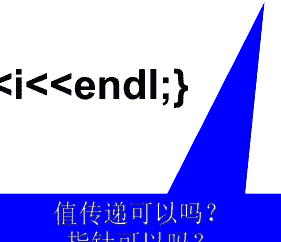

#### 构造

#### 析构函数

```
class aa {
public:
    aa(){f=new char[10];}
    ~aa(){delete []f;}
    char * f;
};
int main()
{aa p;
strcpy(p.f,"Computer");
cout<<p.f<<endl;
aa q(p);    // aa q=p;
cout<<q.f<<endl;
strcpy(p.f, "Software");
cout<<q.f<<p.f<<endl;
return 0;}
```

创建q时，
对象p被复制给了q，
但资源未复制，
使得p和q指向
同一个资源，
这称为浅拷贝。

同一个指针执行
两遍delete操作，
会发生什么？
灾难，可能会破坏该堆及自由内存表

构造
析构函数

```
class aa {
public:
    aa(){f=new char[10];}
    aa(aa const & s){
    f=new char[10]; strcpy(f,s.f);}
    ~aa(){delete []f;}
    char * f;
};
int main()
{aa p;
strcpy(p.f,"Computer");
cout<<p.f<<endl;
aa q(p);
cout<<q.f<<endl;
strcpy(p.f," Software");
cout<<p.f<<q.f<<endl;
return 0;}
```

### 构造、析构函数

```
#include <iostream>
using namespace std;
class Student{
public:
    Student(int i)
    { value=i; cout<<"Student"<<value<<endl; }
    ~Student(){cout<<"~Student"<<value<<endl;}
protected:
    int value;
};
int main()
{
    Student(9);// 无名对象，正确
    Student *p=&Student(8);//错误
    Student &q=Student(7);//正确，无名对象将在它的引用离开作用域时销毁
    Student i(6);
    i = Student(5);//正确
    return 0;
}
```

+   Student9
+   ~Student9
+   Student8
+   ~Student8
+   Student7
+   Student6
+   Student5
+   ~Student5
+   ~Student5
+   ~Student7


#### 构造
析构函数

```
class aa {
public:
    aa(int a=1){id=a;cout<< "构造" <<endl;}
    aa (aa & s){id = s.id;cout<< "拷贝" ;}
    int & Getid(){return(id);}
private:
    int id;
};
int main()
{ aa m;      // "构造"
    aa n(m);  // "拷贝"
    aa o = m; // "拷贝"  和aa o(m)等价
    aa s = 9; // "构造"  和aa s(9)等价
    aa t;     // "构造"
    t = 9;    // "构造"、 赋值运算
    return 0; }
```

#### 类型转换

#### 构造
析构函数

```
class aa {
    public:
        aa(int a=1){id=a;}
        char * p;
        int id;
};

void m(aa a)
{cout<<a.id<<endl;}

int main()
{
    m(9); //相当于m(aa(9));
    return 0;
}//如果存在m(int)的函数则优先匹配
```

#### 类型转换

#### 构造
析构函数

```
class aa {
    public:
        aa(int a=1){id=a;}
        int id;
};
class bb {
    public:
        bb(int a=2){id=a;}
        int id;
};
void m(aa a)
{cout<<a.id<<endl;}
void m(bb a)
{cout<<a.id<<endl;}
int main()
{  m(9); //存在二义性;
    return 0;
}//转换不能太复杂，不允许多参数，不允许间接转换
```

#### 构造

#### 析构函数

```
class HighWorker {
  float income;
  public:
    HighWorker(float a = 2000.0){income = a;}
    float Getincome(){return(income);}
};
class Worker {
  float income;
  public:
    Worker(float a = 1200.0){income = a;}
    Worker(HighWorker b){income = 0.75*b.Getincome();}
    float Getincome(){return(income);}
};
void m(Worker a){cout<<a.Getincome()<<endl;}
int main(){ Worker a; m(a);
    HighWorker b; m(b);
    return 0;}
```

常对象：数据成员值在对象的整个生存期内不能被改变。

即常对象定义是必须进行初始化，而且不能被更改。

声明的语法形式：

const 类名 对象名 或者 类名 const 对象名

```
Class A
{public:
A(int i, int j) {x=i;y=j;}
reset(){x++;y++;}
private:
int x,y;
};
A const a(3,4);
a.reset();//error
```

```
常成员函数：
class R
{public :
R(int r1,int r2){R1=r1;R2=r2;}
add(){R2++;}
void print();
void print() const;//有效重载
void p() const;
private:
int R1,R2; };
void R::print()
{cout<<R1;p();//ok}
void R::print() const
{R1++; //error
add();//error
cout<<R1;p();//ok}
void p() const {cout<<R2<<endl;}
void main()
{
R a(5,4);
a.p();
a.print();//优先调用普通的成员函数
const R b(20,52);
b.print();
b.add();//error
b.p();
}
没有常构造函数和常析构函数，常对象和普通对象都调用同一构造函数和析构函数。
```

友元

引入

```
class aa{
    float a;  float b;
public:
    float &aaa(){return(a);}
    float &bbb(){return(b);}
};
aa sum(aa a,aa b)
{ aa c;
 c.aaa()=a.aaa()+b.aaa(); c.bbb()=a.bbb()+b.bbb();
    return(c);
}
void main()
{ aa a,b;
    a.aaa()=1; a.bbb()=2;  b.aaa()=3; b.bbb()=4;
    aa c=sum(a,b);
    cout<<c.aaa()<<endl<<c.bbb();
    for(long i=0;i<100000;i++) cout<<a.aaa()<<endl;
```

#### 友元
希望

```
class aa{
    float a;  float b;
public:
    float &aaa(){return(a);}
    float &bbb(){return(b);}
};
aa sum(aa s,aa t)
{ aa c; c.a=s.a+t.a; c.b=s.b+t.b;
    return(c);
}
void main()
{ aa a,b;
    a.a=1; a.b=2;
    b.a=3; b.b=4;
    aa c=sum(a,b);
    cout<<c.a<<endl<<c.b;
    for(long i=0;i<100000;i++) cout<<a.a<<endl;
}
```

#### 友元

#### 实现

```
class aa{
    float a;  float b;
    public:
        friend aa sum(aa,aa);
        friend void main();//友元函数，具有类的成员函数的访问权限
        float &aaa(){return(a);}
        float &bbb(){return(b);}
};
aa sum(aa s,aa t)
{  aa c; c.a=s.a+t.a; c.b=s.b+t.b;
    return(c); }
void main()
{ aa a,b;
    a.a=1; a.b=2;
    b.a=3; b.b=4;
    aa c=sum(a,b);
    cout<<c.a<<endl<<c.b;
    for(long i=0;i<100000;i++) cout<<a.a<<endl; }
```

#### //友元类

```
class Teacher; //前置说明——类名说明，解决交叉声明的方法
class Student{
    friend void Teacher::p(int);
    friend void Teacher::q(float);
    friend class Teacher;
    int age; float score;
};
class Teacher{
public:
    void p(int a){Sooc.age = a;}
    void q(float a){Sooc.score = a;}
    Student Sooc;
private:
    char name[9];
};
void main()
{ Teacher a; a.p(20); a.q(80.9);}
```

友元类的所有成员函数都可视为该类的友元函数，能存取该类的私有成员和保护成员。

注意：
友元关系不具有对称性。
友元关系不具有传递性.如果类B是类A的友元类，类C是类B的友元类，这并不隐含类C是类A的友元类。

#### 对手使用友元：

- 1. 说明的位置既可在public区，也可在protected区。友元函数虽然是在类内进行声明，但它不是该类的成员函数，不属于任何类。
- 2. 在类外定义友元函数，与普通函数的定义一样，一般与类的成员函数放在一起，以便类重用时，一起提供其友元函数。
- 3. 友元函数是能访问类的所有成员的普通函数，一个函数可以是多个类的友元函数，只需在各个类中分别声明。
- 4. 友元能使程序精炼，提高程序的效率。
- 5. 友元破坏了类的封装，使用时，要权衡利弊，在数据共享与信息隐藏之间选择一个平衡点。


### 静态成员

```cpp
//静态成员的需要性
// StudentID.h
class StudentID {
    int value;
public:
    StudentID();
    ~StudentID();
};
```

```cpp
// StudentID.cpp
int ID = 0;
StudentID::StudentID()
{ value = ++ID; }
StudentID::~StudentID()
{ --ID; }
```

```cpp
// aa.cpp
#include "StudentID.h"
extern int ID;
void main()
{ void xx();
    StudentID s, t;
    cout << ID;
    xx();
    cout << ID;
}
```

```cpp
// bb.cpp
#include "StudentID.h"
extern int ID;
void xx()
{ ID++; }
```

### 静态成员

```cpp
//静态数据成员的初始化及使用
// StudentID.h
class StudentID {
    int value;
public:
    static int ID;
    StudentID();
    ~StudentID();
};
```

```cpp
// aa.cpp
#include "StudentID.h"
void main()
{ void xx();
    StudentID s, t; // s的对象空间不包括ID
    //类的静态数据成员只有一个拷贝
    cout << StudentID::ID;
    xx();
    cout << StudentID::ID;
} //公共静态成员，可以被类的外部访问。
```

```cpp
// StudentID.cpp
#include "StudentID.h"
int StudentID::ID = 0;
//前面没有static，类外初始化
StudentID::StudentID()
{ value = ++ID; }
StudentID::~StudentID()
{ --ID; }
```

```cpp
// bb.cpp
#include "StudentID.h"
void xx()
{ StudentID::ID++; }
//初始化位置；初始化列表为静态数据成员初始化可不可以？
```

### 静态成员

```cpp
//静态数据成员的使用
// StudentID.h
class StudentID {
public:
    static int ID;
    StudentID();
    ~StudentID();
protected:
    int value;
};
```

```cpp
// StudentID.cpp
#include "StudentID.h"
int StudentID::ID = 0;
StudentID::StudentID()
{ value = ++ID; }
StudentID::~StudentID()
{ --ID; }
```

```cpp
// aa.cpp
#include "StudentID.h"
void main()
{ void xx();
    StudentID s, t;
    cout << s.ID;
    cout << t.ID;
    cout << StudentID::ID;
    xx();  //再次执行上三条的效果如何
}
//静态数据成员由这些对象所共享，可被任何一个对象所访问。
```

```cpp
// bb.cpp
#include "StudentID.h"
void xx()
{ StudentID::ID++; }
```

```cpp
//静态成员的属性
class Student {
public:
    Student& nextStudent()
    {
        noOfStudents++;
        return *this;
    }
private:
    static int noOfStudents;
};
int Student::noOfStudents = 0;
void fn(Student& s)
{ cout << Student::noOfStudents << endl;
}
void main()
{ Student ss;
    fn(ss);
}
```

可以

可以

不可以

```cpp
class A {
public:
    A() : s(9) { cout << "A is Constructing!" << endl; }
    int R_s() { return (s); }
private:
    int s;
};
class Student {
public:
    static A noOfStudents;
private:
    int x;
};
A Student::noOfStudents; //不允许省略
void main()
{ cout << "Main Function is running!" << endl;
    cout << Student::noOfStudents.R_s() << endl;
}
```

静态成员在main之前构造
生命周期等同于全局对象

### 静态成员

静态数据用得较多的场合：

- (1) 用来保存流动变化的对象个数
- (2) 作为一个标志，表明一个特定的动作是否发生（如某一文件状态）。
- (争夺标记，类似令牌)
- (3) 一个指向一个链表第一成员或最后一个成员的指针。

```cpp
class Student {
public:
    Student(char* pName);
    ~Student();
    static Student* pFirst;
    Student* pNext;
    char name[40];
};

Student* Student::pFirst = NULL;
Student::Student(char* pName)
{
    strcpy(name, pName);
    pNext = pFirst; pFirst = this;
}
Student::~Student()
{
    if (pFirst == this)
    {
        pFirst = pNext; return;
    }
    for (Student* pS = pFirst; pS; pS = pS->pNext)
        if (pS->pNext == this)
        {
            pS->pNext = pNext; return;
        }
}
```

```cpp
void print()
{
    for (Student* pS = Student::pFirst; pS; pS = pS->pNext)
        cout << pS->name << endl;
}
void fn()
{ Student s5("S5");
    print(); }
void main()
{ Student s1("S1");
    Student *s2 = new Student("S2");
    Student s3("S3");
    print();      fn();
    delete s2;
    print();
}
```

### 关于静态数据成员：

- (1) 不管一个类的对象有多少个，其静态数据成员也只有一个，由这些对象所共享，可被任何一个对象所访问。
- (2) 在一个类的对象空间内，不包含静态成员的空间，所以静态成员所占空间不会随着对象的产生而分配，或随着对象的消失而回收。
- (3) 静态数据成员的存储空间的分配是在程序一开始运行时就被分配。并不是在程序运行过程中在某一函数内分配空间和初始化。
- (4) 静态数据成员的初始化语句，既不属于任何类，也不属于包括主函数在内的任何函数，静态数据成员初始化语句最好在类的实现部分定义
- (5) 对于在类的public部分说明的静态数据成员，可以不使用成员函数而直接访问，即使未定义类的对象，同样也可以直接访问，但在使用时也必须用类名指明所属的类。而private和protected部分的静态成员只能通过类的成员函数访问。

### 静态成员

```cpp
class Student {
    static int noOfStudents;
    int x;
public:
    int Get() { return (noOfStudents); }
};
int Student::noOfStudents = 0;
void main()
{
    cout << Student::noOfStudents << endl; //错误
    cout << Student::Get() << endl; //错误
    Student ss;
    cout << ss.Get() << endl; //普通成员函数别扭
}
```

### 静态成员

```cpp
class Student {
public:
    static int Get();
private:
    static int noOfStudents;
    int x;
};
int Student::Get()
{ return (noOfStudents); }
int Student::noOfStudents = 0;
void main()
{
    cout << Student::Get() << endl; //正确
    Student ss;
    cout << ss.Get() << endl; //不再需要
}
```

与静态数据成员一样，静态成员函数与类相关系，不与类的对象相关系，所以访问静态成员函数时，不需要对象。

静态成员函数的作用是为了处理静态数据成员。


### 静态成员函数

```cpp
class aa{
    int b;
    int GetB(){return b;}
public:
    static int a;
    void o(){cout<<a;cout<<this->a;cout<<b;}
    static void p(){cout<<a; cout<<this->a;}
    static void q(){cout<<b<<GetB();}
    static void r(aa &t){t.b=6;cout<<t.GetB();}
};
int aa::a=0;
void main()
{
    aa a; aa::p(); aa::q(); aa::r(a); a.o(); }
```

//不允许不指明对象访问非静态数据成员；不允许使用this

### 静态成员函数

| 调用→ | 普通数据成员 | 静态数据成员 | 普通成员函数 | 静态成员函数 |
|---|---|---|---|---|
| 普通成员函数 | √ | √ | √ | √ |
| 静态成员函数 | × | √ | × | √ |

### 静态成员函数

```cpp
class aa{
    static aa * a;
    aa(){};
public:
    static aa *get(){
        if(a == 0) a = new aa;
        return(a);}
};
aa * aa::a = 0; //表明指针没有指向任何对象
void main()
{ aa *s = aa::get();
    aa *t = aa::get();
    aa u;//错误
    delete s;
}
```

只能有一个对象的类

### 判断对错，错误写出原因：

+ 1. 使用struct定义的类中默认的访问权限是private的
+ 2. this不能被非成员函数访问
+ 3. 任何情况下private权限的内容不能被类外访问
+ 4. 引用破坏了函数的封装性
+ 5. 内联函数的作用是提高系统的效率
+ 6. 不同类的成员函数也可以重载
+ 7. 参数类型、函数返回类型可以作为函数重载的依据

### 作业

举办歌手大奖赛。
设计歌手类，包括：编号、姓名、各评委打分等属性。
要求功能：
可以打印当前最高、最低分选手属性；
打印已出场人数；
可以按照平均分由高到低打印已出场选手属性；
写出main函数中模拟n个选手出场的过程。

### 读程序，写结果：

```cpp
#include <iostream>
using namespace std;
class B{
public:
    int i;
    B(int i=0):i(i){
        cout<<i<<"B is constructing\n";}
    B(B& b){i=b.i;
        cout<<i<< " copying B\n";}
    ~B(){ cout<<i<<" destructuring B\n";}
class A{
    int s; static B b;
    B bb;
public:
    A(int k=0,int j=0):s(k),bb(j){
        cout<<s<<"A is constructing\n";};
    ~A(){cout<<s<<" destructuring A\n";}
};
B A::b;
int main()
{
cout<<"main is running\n";
void f(B);
A s1(1,1);
B b1(8);
f(b1);
return 0;
}
void f(B b1){
cout<<"f is running\n";
b1=B(9);
}
A s3(3,3);
```

## 第六章：运算符重载

```cpp
class aa{
public:
    friend aa sum(aa,aa);
    friend void main();
    float &aaa(){return(a);}
    float &bbb(){return(b);}
private:
    float a;  float b;
};
aa sum(aa s,aa t)
{ aa c; c.a=s.a+t.a; c.b=s.b+t.b; return(c);}
void main()
{ aa a,b;
    a.a=1; a.b=2;
    b.a=3; b.b=4;
    aa c=sum(a,b);
    cout<<c.a<<endl<<c.b;
    aa d=sum(b,a);
    cout<<d.a<<endl<<d.b; }
```

### 运算符重载

```cpp
class aa{
public:
    float &&aaa(){return(a);}
    float &&bbb(){return(b);}
private:
    float a;  float b;
};

void main()
{ aa a,b;
  a.a=1; a.b=2;
  b.a=3; b.b=4;
  aa c=a+b;
  cout<<c.a<<endl<<c.b;
  aa d=sum(b,a);
  cout<<d.a<<endl<<d.b;
}//用例子引出运算符重载
```

### 运算符重载的格式

```cpp
class aa{
public:
    float &&aaa(){return(a);}
    float &&bbb(){return(b);}
private:
    float a;  float b; };
aa operator +(aa & a,aa& b)
{aa c;
c.aaa()=a.aaa()+b.aaa();
c.bbb()=a.bbb()+b.bbb();
return(c); }
void main()
{ aa a,b;
a.aaa()=1; a.bbb()=2;
b.aaa()=3; b.bbb()=4;
aa c=a+b; //等价aa c=operator +(a,b);
cout<<c.aaa()<<endl<<c.bbb();}
```

使用运算符重载的一般格式为：
类型名 operator 运算符
（形参表）
{函数体}
其中operator是关键字，类型名为重载运算符的返回类型，即运算结果类型。

重载:用户根据自己的需要对C++已提供的运算符进行重载，赋予新的含义。

实现时，首先把指定的运算表达式转化为对运算符函数的调用，这个过程是在编译中完成的。

运算符重载不是必需的，为了编程的人性化描述。

### 运算符重载

```cpp
class aa{ //运算符重载的友元形式
float a; float b;
public:
float &aaa(){return(a);}
float &bbb(){return(b);}
friend aa operator +(aa&,aa&);
};
aa operator +(aa & a,aa& b)
{aa c;
c.a=a.a+b.a;
c.b=a.b+b.b;
return(c); }
void main()
{
aa a,b;
a.aaa()=1; a.bbb()=2;
b.aaa()=3; b.bbb()=4;
aa c=a+b;//等价aa c=operator +(a,b);
cout<<c.aaa()<<endl<<c.bbb();
}
```

```cpp
class aa{
    float a;  float b;
public:
    float &&aaa(){return(a);}
    float &&bbb(){return(b);}
    friend aa operator +(aa&,aa&);
    friend aa operator +(aa&,int&);
};
aa operator +(aa & a,aa & b)
{aa c; c.a=a.a+b.a; c.b=a.b+b.b; return(c);}
aa operator +(aa & a,int & b)
{aa c; c.a=a.a+b; c.b=a.b+b; return(c);}
void main()
{ aa a,b; int i=6;
    a.aaa()=1; a.bbb()=2; b.aaa()=3; b.bbb()=4;
    aa d=a+b;
    aa c=operator +(a,i);    //c=a+i;也可
cout<<c.aaa()<<endl<<c.bbb();
}
```

### 运算符重载

```cpp
class aa{
    float a;  float b;
    public:
    float &aaa(){return(a);}
    float &bbb(){return(b);}
    friend aa operator +(aa&,aa&);
};
aa operator +(aa& a,aa& b)//不提倡改变运算符的含义
{aa c;
    c.a=a.a-b.a;
    c.b=a.b-b.b;
    return(c);  }
void main()
{  aa a,b;
    a.aaa()=1; a.bbb()=2;
    b.aaa()=3; b.bbb()=4;
    aa c=a+b;        //c=operator +(a,b);
cout<<c.aaa()<<endl<<c.bbb();}
```


### 运算符重载

```cpp
class aa{
    float a;  float b;
public:
    float &aaa(){return(a);}
    float &bbb(){return(b);}
    friend aa operator +(aa&,aa&,aa&);
};
```

```cpp
aa operator +(aa & a,aa & b,aa & c)
{aa d;
    d.a=a.a+b.a+c.a;
    d.b=a.b+b.b+c.b;
    return(c);}
```

```cpp
void main()
{ aa a,b;
    a.aaa()=1; a.bbb()=2;
    b.aaa()=3; b.bbb()=4;
    aa c=operator +(a,b,a);
    cout<<c.aaa()<<endl<<c.bbb();}
```

运算符重载时参数个数不可以超过原来数目

```cpp
class aa{
    float a;
    float b;
public:
    float &aaa(){return(a);}
    float &bbb(){return(b);}
    friend aa operator +(int&,int&);
};
aa operator +(int a,int & b)
{
    aa c;
    c.a=a+b;
    c.b=a+b;
    return(c);
}
void main()
{
    int i=6,j=7;
    aa c=i+j;
    cout<<c.aaa()<<endl<<c.bbb();
}
```

> 运算符重载时参数类型不能全为基本类型，至少有一个操作对象是自定义类型

#### 使用运算符重载,需注意：

- (1) 在C++中几乎所有的运算符（除“.”（成员选择符）、“.*”（成员对象选择符）、“->*（成员指针选择符）”、“::”、“?:”、“sizeof”外）都可以被重载。
- 只能重载C++中已有的运算符,不允许创建新的运算符.
- (2) 运算符的重载既不会改变原运算符的优先级和结合性。
- (3) 至少有一个操作对象是自定义类型,参数都是基本类型时不能重载。
- (4) 不提倡改变参数个数、运算符含义。
- (5) 重载运算符的函数不能有默认的参数。

```cpp
class aa{
    float a;  float b;
    public:
        float &aaa(){return(a);}
        float &bbb(){return(b);}
        aa operator +(aa& b)
        {aa c;
        c.a=this->a+b.a;  c.b=this->b+b.b;
        return(c);
        }
};
void main()
{  aa a,b;
    a.aaa()=1; a.bbb()=2;
    b.aaa()=3; b.bbb()=4;
    aa c=a+b;    //c=a.operator+(b)
    cout<<c.aaa()<<endl<<c.bbb();
}
```

运算符重载函数为成员函数

#### 赋值运算符重载

拷贝构造函数和赋值操作符都是用来拷贝一个类的对象给另一个同类型的对象。

```cpp
void fn(A a)
{ A na=a;  //拷贝构造函数：将一个对象拷贝到另一个新对象
  A b;
  b=a;} //赋值运算符：将一个对象为另一个已经存在的对象赋值
```

编译器提供默认的拷贝构造函数和赋值运算符的运作机制。就是将对象中的每个数据成员拷贝到目标对象相应的数据成员中。

若类的数据成员中有指向动态分配空间的指针，通常定义拷贝构造函数，此时，应重载赋值运算符。

```cpp
class Name{
public:
Name(){pname=0;}
Name(char *pn){copyname(pn);}
Name(Name&s ){copyname(s.pname);}
~ Name(){deleteName();}
Name& operator =(Name& s)
//引用返回,无返回值，值返回可不可以?
{if (this ==&s) return *this ;
deleteName();
copyname(s.pname);
return *this; }
void display()
{cout<<pname<<endl;}
protected:
void copyname(char *pn);
void deleteName();
char *pname;};

void Name::copyname(char *p)
{pname=new char[strlen(p)+1];
if (pname)
{strcpy(pname,p);}
}

void Name::deleteName()
{if (pname)
{delete[] pname;
pname=0;}}

void main()
{Name s("Jenny");
Name t("kite");
Name n(t); n.display();
t=s; t.display();
t=s=Name("jacky");
t.display();
(t=n)=s; t.display(); }
```

```cpp
//重载单目运算符（前自增量）
class aa{
    float a;  float b;
public:
    float &aaa(){return(a);}
    float &bbb(){return(b);}
    aa & operator ++();
};
aa & aa::operator ++()
{ a=a+1; b=b+1; return(*this);}
void main()
{ aa a;
    a.aaa()=1; a.bbb()=2;
    cout<<(++a).aaa()<<endl;
    ++(++a);
    cout<<a.aaa()<<endl;}
```

前自增量运算符应该返回引用

//重载单目运算符（后自增量）

```cpp
class aa{
    float a;  float b;
public:
    float &aaa(){return(a);}
    float &bbb(){return(b);}
    aa operator ++(int);
};
aa aa::operator ++(int){
    aa m(*this); a=a+1; b=b+1; return(m);
}
void main()
{ aa a;
  a.aaa()=1; a.bbb()=2;
  cout << a++ .aaa() << endl;
  cout<<a.aaa()<<endl; }
```

int形参只是为了区别与前自增量运算符重载函数，除此之外没有任何作用。后自增量运算符必须返回值

```cpp
class aa{
    float a;  float b;
    public:
        float &aaa(){return(a);}
        float &bbb(){return(b);}
        friend aa & operator ++(aa &);
        friend aa operator ++(aa &,int);
};
aa & operator ++(aa & a)
{
    a.a=a.a+1; a.b=a.b+1; return(a);
}
aa operator ++(aa & a,int)
{aa b(a);
    a.a=a.a+1;
    a.b=a.b+1;
    return(b);
}
```

自增量操作运算符的友元形式

```cpp
class aa{
    float a;  float b;
    public:
        float &aaa(){return(a);}
        float &bbb(){return(b);}
        operator float();
};
aa::operator float() { return(a);}
void main()
{
    aa a,b;
    a.aaa()=1; a.bbb()=2;
    b.aaa()=3; b.bbb()=4;
    cout<<float(a)<<endl;
    cout<<10+a<<endl;
    cout<<a+b<<endl;
    cout<<a<<endl;}
```

类型转换运算符声明的形式：
operator 类型名 ();

没有参数，没有返回类型，（其返回类型由函数名字指定）但是函数体中必须包含return语句。

只能作为成员函数。


### 类型转换运算符

### 运算符重载

```cpp
class HighWorker {
public:
    HighWorker(float a = 2000.0){income = a;}
    operator Worker() //类型转换函数
    {Worker s; s.Getincome()=0.75*income; return(s);}
    float & Getincome(){return(income);}
private:
    float income;
};

class Worker {
public:
    Worker(float a = 1200.0){income = a;}
    Worker(HighWorker b){income = 0.75*b.Getincome();}
    //转换构造函数
    float & Getincome(){return(income);}
private:
    float income;
};

void m(Worker a){cout<<a.Getincome()<<endl;}
void main(){Worker a; m(a); HighWorker b; m(b);}
```

### 防止转换的二义性：

同一个类中定义了多个转换运算符重载函数.

```cpp
class RMB{
RMB(double value=0.0);
public:
operator double();
operator float();
//....
};
int main()
{RMB d1(2.0),d2(1.5),d3;
d3=d1+d2; //error
d3=double(d1)+double(d2);
return 0;
}
```

### 运算符重载

只能是成员的运算符: (系统为类提供的)
=、 ( )、 []、 ->

只能是友元的运算符: (cout是其它类的对象)
cout<<、 cin>>

既可以友元也可以成员的: (定义者提供)
+、 - 等

## 第七章 继承

```cpp
class Student{
int move_tel;
public:
int id;
string name;
protected:
int tel;
};
```

class 派生类名：继承方式 基类名 { 派生类中的新成员 }

```cpp
class Master :public Student{
string topic;
public:
string dept;
protected:
string major;
};
```

```cpp
void main() { Master a; }
```

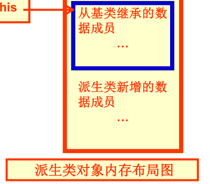

派生类继承了基类的除了构造函数、析构函数、拷贝构造函数和赋值运算符重载函数之外的所有成员，因此派生类对象由两部分组成：一部分是由基类继承的成员，另一部分是派生类新增加的自己特有的成员。

当类的继承方式为公有继承时，基类的公有和保护成员的访问属性在派生类中不变，而基类的私有成员不可访问。

访问：函数访问数据成员&函数访问函数。直接和间接

### 父类

### 继承

### 派生类


### 继承

```cpp
class Student{
    int m3;
    public:
        int m1; void x(){m1=1;m2=2;m3=3;}
    protected:
        int m2;
};
class Master :public Student{
    int n3;
    public:
        void y(){m1=1;m2=2;m3=3;n1=1;n2=2;n3=3;}  //对内
        void z(){x();}  //间接访问了父类的private成员
        int n1;
    protected:
        int n2;
};
void main()
{ Master a;
    a.m1=1;a.m2=2;a.m3=3;a.n1=1;a.n2=2;a.n3=3;  //对外
    a.x();
    a.z();
}
```

### 继承

继承的本质实际上就是由上到下完全的复制；但是在对内可见性上做了手脚，对外可见性则没有改变。

C++提供了类的继承机制，解决了软件的复用问题。

自动的、滚动式的重用代码，增强代码，使得编程方式根本转变，分析问题、解决问题的模式从功能模式转向面向对象的结构模式

### 继承

类的继承和派生的层次结构是人们对自然界中的事物进行分类、分析和认识的过程在程序设计中的体现。

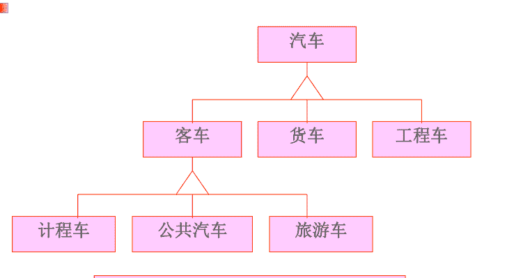

- 继承的方式使得新事物的描述更简单
- 例如：已知鸟的属性，鸭子是什么的描述便可以在鸟的基础上进行：
  - 除了是鸟之外，还会一种区别于其他鸟的特殊的嘎嘎叫。
  - 因为鸭子不会飞，于是就在继承鸟的属性中去掉会飞的属性。

```
//多级派生
class Student{
public:
    int m1;
protected:
    int m2;
private:
    int m3;
};
class Master :public Student
{
public:
    int n1;
protected:
    int n2;
private:
    int n3;
};
```

```cpp
class MasterEnginee :public Master{
public:
    int p1;
protected:
    int p2;
private:
    int p3;
};
```

```cpp
void main()
{ MasterEnginee a;
}
```

直接基类：直接参与派生出某类的基类。
间接基类：基类的基类，甚至更高层的基类。
直接派生类
间接派生类

赋值兼容规则是指需要基类对象的任何地方都可以**使用公有派生类的对象来替代**。替代之后，派生类对象就可以作为基类的对象使用，但**只能使用从基类继承的成员**。

里氏代换原则：
(LSP-Liskov Substitution Principle)
在软件里面，把基类都替换成它的子类，程序的行为没有变化。

### 允许将派生类的对象赋值给基类的对象。

拷贝派生类的基类子对象

从基类继承的数据成员

派生类新增的数据成员

派生类对象的其余部分

派生类对象内存映射

```cpp
class Student{
public:  int m1;
void x(){m1=1;m2=2;m3=3;}
protected:  int m2;
private:  int m3;};
class Master :public Student{
public:
void y(){m1=1;m2=2;n1=1;n2=2;n3=3;}
int n1;
protected: int n2;
private: int n3;
};
void f(Student a){a.m1=5;a.n1=6;a.x();a.y();}
void main()
{ Master a;
f(a); //派生类的对象可以赋值给基类对象
Student *p=&a;p->m1=1;p->n1=2;p->x();p->y();
//基类的指针可以指向派生类的对象
Student &q=a;q.m1=1;q.n1=2;q.x();q.y(); }
//派生类的对象初始化基类的引用
```

使用时还应注意：当派生类对象赋值给基类对象或基类指针后，只能通过基类名或基类指针访问派生类中从基类继承来的成员，不能访问派生类中的其它成员。

说明派生类对象包含父类对象全部内容凡是父类对象可以出现的地方可以用子类对象代替，反之不可

### 不允许将基类的对象赋值给派生类的对象。

基类对象内存映像

派生类对象内存映像

从基类对象拷贝的继承的数据成员

与基类对象无关的不确定信息

```cpp
class Student{
    int m3;
    public: int m1; void x(){m1=1;m2=2;m3=3;}
    protected: int m2;
};
class Master :public Student{
    int n3;
    public: int n1; void y(){m1=1;m2=2;n1=1;n2=2;n3=3;}
    protected: int n2;
};
void f(Master &a){... ...;}
void main()
{ Student a; Master b;
    f(a);
    Master *p=&a;
    b = a;
}
```

继承

子类对象不可以
用父类对象代替


### 继承

```cpp
class Student{
    int move_tel;
public:
    int id;
    string name;
protected:
    int tel;
};

class Master : protected Student{
    string topic;
public:
    string dept;
protected:
    string major;
};

void main()
{
    Master a;
}
```

当类的继承方式为保护继承时，基类的公有和保护成员都以保护成员身份出现在派生类中，而基类的私有成员不可访问。

- public: dept
- protected: id, name, tel, major
- private: topic
- 不可访问：move_tel

和public继承相比：
- 收缩了对外权限；
- 没有影响对内权限。

### 继承

```cpp
class Student{
int move_tel;
public:
int id;
string name;
protected:
int tel;
};
class Master :private Student{
string topic;
public:
string dept;
protected:
string major;
};
void main()
{ Master a;
}
```

和public继承相比，收缩了对外权限；影响后代对内权限。

当类的继承方式为私有继承时，基类的公有和保护成员都以私有成员身份出现在派生类中，而基类的私有成员不可访问。

- Public: dept
- protected: major
- private: id, name, tel, topic
- 不可访问：move_tel

### 继承

| 继承方式 | 基类公有成员 | 基类保护成员 | 基类私有成员 |
| :--- | :--- | :--- | :--- |
| public继承 | 派生公有 | 派生保护 | 不可访问 |
| protected继承 | 派生保护 | 派生保护 | 不可访问 |
| private继承 | 派生私有 | 派生私有 | 不可访问 |

### 从继承的访问规则，看类中保护成员的特征：

类A含有保护成员，对于建立A类对象的函数而言，保护和私有成员一样不可访问。

若A类派生出子类，则对该子类而言（在该子类内部），基类的保护和公有成员具有相同的访问特性。

C++通过protected访问权限提供了一种有条件地打破封装的机制，即只向自己的后代开放数据成员的访问权限。

由于封装的目的是修改的局部化，即只要类的接口不变，类可以对内部的数据成员类型及函数实现代码作任意修改。

封装打破后，类就不能再作这种随意的修改，否则，派生类成员函数继续以修改前的方式工作必然会发生错误。

为此，基类可以将让派生类修改的数据成员说明为保护的，是为了提醒基类自己这些成员要么不修改，要么连同所有的派生类一起修改。

### 继承

```cpp
class Student{
    int m3;
public:
    int m1; void x(){m1=1,m2=2,m3=m3;}
protected:  int m2;
};
class Master : protected Student{
    int n3;
public: int n1;
void y(){m1=1,m2=2,n1=1,n2=2,n3=3;}
protected:  int n2;
};
void f(Student &a){}
void main()
{
    Master a;
    a.x();
    f(a);
    Student *p=&a;
}
```

protected继承和private继承得到的类都不是子类。

“凡是父类对象可以出现的地方，可以用子类对象代替”，不再适用。

### 继承

继承类型省略时默认为私有继承。

public继承使用最多、最重要。

### 继承

```cpp
class Student{
    int move_tel;
    public:
        int id;  string name;
    protected:
        int tel;
};
class Master :public Student{
    string topic;
    using Student::id;
    public:
        string dept;
        using Student::tel;
    protected:
        string major;
};
void main()
{ Master a;
    a.id = 1;//错误
    a.tel = 2;//正确
}
```

Using Student::move_tel;//错误

调整成员的访问控制属性。

### 继承和组合关系

```cpp
class Student{
    int move_tel;
    public:
        int id;
    protected:
        int tel;
};
class Master :public Student{
    string topic;
    void x(){id=1;tel=2;
    move_tel=3;}
    public:
        string dept;
    protected:
        string major;
};
void main()
{ Master a;
    Student *p=&a;}
```

```cpp
class Student{
    int move_tel;
    public:
        int id;
    protected:
        int tel;
};
class Master {
    string topic;
    void x(){s.id=1;s.tel=2;
    s.move_tel=3;}
    public:
        Student s;
        string dept;
    protected:
        string major;
};
void main(){ Master a;
    Student *p=&a;}
```

### 继承和组合的关系

组合是 “has a” 关系的模型。

继承是"is a"关系模型。是为了产生子类型。让开发人员设计 “kind of” 关系的模型。

组合和继承不是绝对的。组合可以用继承来实现，继承也可以由组合来实现。

### 继承和组合的关系

去掉继承关系，对象接口不变。

```cpp
class B{
public:
    void f() const{}
};
```

```cpp
class D : public B{
public:
    void func() const{ f();}
};
```

```cpp
void F(const B aB) {
    aB.f();
}
```

```cpp
void main() {
    D d;
    d.func();
    F(d); }
```

```cpp
class D {
public:
    void func() const{pb.f();}
    operator B(){return pb;}
private:
    B pb;
};
```

如果两个类设计的操作有很多共同点，用继承会好一些。

组合职责分明，调试方便。

派生类构造函数执行的一般顺序是：
（1）基类构造函数，
（2）派生类对象成员类的构造函数（如果有的话）。
（3）派生类构造函数体中的内容。

释放派生类对象时，析构函数的执行顺序是：
先执行派生类的析构函数，
再执行对象成员类的析构函数（如果派生类有对象成员的话），
最后执行基类的析构函数，其顺序与执行构造函数时的顺序正好相反。

### 多级派生构造

```cpp
class Student{
public:
	Student(int i){tel=i;}
protected:
	int tel;};
class Master :public Student{
public:
	Master(string p,int k,int j):Student(j),age(k){major = p;}
protected:
	string major;
	int age;};
class Phd:public Master{
public:
	Phd(string p,int k,int j):Master(p,k,j){}
};
void main()
{
	Phd a("Computer",29,1331234567);}
```

只能是直接基类 Master。

```cpp
class Student{
    int move_tel;
public:
    Student(int i){tel=i;}
    int id;
    void O(){cout<<tel<<endl;}
protected:
    int tel;
};
class Master : public Student{
    string topic;
public:
    Master(int j,int k):Student(k){tel = j;}
    string dept;
    void O(){
        cout<<tel<<endl;
        Student::O();
        cout<<Student::tel<<endl;
    }
protected:
    int tel;
};
void main()
{
    Master a(13312345,13012345); a.O(); a.Student::O();
}
```

如果父类中出现Master::tel形式的访问，错误！！！


### 多重继承和虚基类

### 多重继承的概念

若一个派生类具有两个或两个以上基类，这种继承称为多重继承。

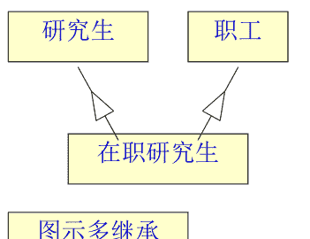

正如生活中一个人可以同时继承其父母双方的特点一样。信息系统中的某些对象也可能具有双重或多重身份。

### 多 重 继 承

```
class Master {
public:
Master(string p){practice = p;}
int id; string practice;};
class Phd{
public:
Phd(string p){paper = p;}
int id; string paper;};
class M_p:public Master,public Phd {
public :
M_p(string p,string q):Phd(q),Master(p){}
float avg; };
void main()
{M_p a ("c++","KDD"); a.avg=85.9;
cout<<a.practice<<a.paper;//a.Master::practice
}
```

### 多继承派生类构造函数执行顺序是：

- (1) 所有基类的构造函数；多个基类构造函数的执行顺序取决于定义派生类时所指定的顺序，与派生类构造函数中所定义的成员初始化列表的参数顺序无关。
- (2) 对象成员（如果有的话）的构造函数；
- (3) 派生类本身构造函数的函数代码。

### 多重继承

```
class Master {
public:
    Master(string p){practice = p;}
    int id;  string practice;
};
class Phd{
public:
    Phd(string p){paper = p;}
    int id;
    string paper;
};
class M_p:public Master,public Phd {
public :
    M_p(string p,string q):Phd(q),Master(p){}
    float avg;
};
void main()
{M_p a("c++","KDD"); a.avg=85.9;
cout<<a.practice<<a.paper;  a.id=1; //a.PhD::id=1;}
```

### 多重继承

```
class Student {public: int id;};
class Master :public Student{
public:
Master(string p){practice = p;}  string practice;
};
class Phd:public Student{
public:
Phd(string p){paper = p;}   string paper;
};
class M_p:public Master,public Phd {
public :
M_p(string p,string q):Master(p),Phd(q){}
float avg;
};
void main()
{M_p a("c++","KDD");  a.avg=85.9;
cout<<a.practice<<a.paper;  a.id=1;  a.PhD::id=1;
Student * p=&a;   a.Student::id=1;}
```

多重继承下，可能会产生一个类是通过多条路径从一个给定的类中派生出来的，如图所示。

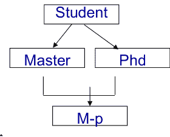

C++为此提供了虚基类，以解决这种二义性。

格式如下：

```
class 派生类名: virtual public 基类名
{ //声明派生类成员 };
```

这时，从不同的路径继承过来的同名数据成员在内存中就只有一个拷贝，同一个函数名也只有一个映射。

当基类通过多条派生路径被一个派生类继承时，该派生类只继承该基类一次，即基类成员只保留一次。

```
```cpp
class Student {public: int id;};
class Master : virtual public Student {
public:
    Master(string p){pratice = p;}  string pratice;
};
class Phd: virtual public Student{
public:
    Phd(string p){paper = p;}  string paper;
};
class M_p: public Master, public Phd {
public:
    M_p(string p,string q):Master(p),Phd(q) { }
    float avg;
};
void main()
{
    M_p a("c++","KDD"); a.avg=85.9;
    a.id=1;  a.Phd::id=1;
    a.Student::id=1; a.Master::id=2; Student * p=&a;
}
```
```


### 多重继承

```
class Student {
public:
    Student(){cout<<"Student 构造！"<<endl;}
    int id; };
class Master :virtual public Student {
public:
    Master(string p){pratice = p;cout<<"Master 构造！"<<endl;}
    string pratice; };
class Phd:virtual public Student{
public:
    Phd(string p){paper =p;cout<<"Phd 构造！"<<endl;}
    string paper;
};
class M_p:public Master,public Phd {
public :
    M_p(string p,string q):Phd(q),Master(p)
    {cout<<"M_p 构造！"<<endl;}
    float avg;
};
void main()
{M_p a("c++","KDD");
```

Student 构造！
Master 构造！
Phd 构造！
M_p 构造！

### 多重继承

```
class Student {
public:
    Student(){cout<<"Student 构造！"<<endl;}
    int id; };
class Master :public Student {
public:
    Master(string p){pratice = p;cout<<"Master 构造！"<<endl;}
    string pratice; };
class Phd:public Student{
public:
    Phd(string p){paper =p;cout<<"Phd 构造！"<<endl;}
    string paper;
};
class M_p:public Master,public Phd {
public :
    M_p(string p,string q):Phd(q),Master(p)
    {cout<<"M_p 构造！"<<endl;}
    float avg;
};
void main()
{M_p a("c++","KDD");
}
```

```
Student 构造！
Master 构造！
Student 构造！
Phd 构造！
M_p 构造！
```

C++规定，虚基类子对象是由最后派生类的构造函数通过调用虚基类的构造函数进行初始化的。

如果一个派生类有一个直接或间接的虚基类，那么派生类的构造函数的成员初始化列表中必须列出虚基类构造函数的调用。

如果没有列出，则表示使用该虚基类的缺省构造函数来初始化派生类对象中的虚基类子对象。

```
class Student {
public:
    Student(int i):id(i){cout<<"Student 构造！ "<<endl;}
    int id; };
class Master :virtual public Student {
public:Master(string p,int i):Student(i){
        pratice = p;cout<<"Master 构造！ "<<endl;}
        string pratice; };
class Phd:virtual public Student{
public:
Phd(string p,int i): Student(i){ paper =p;cout<<"Phd 构造！ "<<endl; }
string paper;
};
class M_p:public Master, public Phd {
public :
    M_p(string p,string q,int i):Phd(q,i), Master(p,i), Student(i)
    {cout<<"M_p 构造！ "<<endl;}
    float avg;};
void main()
{M_p a("c++","KDD",1);}
```


### 多继承的构造顺序：

- （1）任何虚拟基类的构造函数按照他们被继承的顺序构造
- （2）任何非虚拟基类的构造函数按照他们被继承的顺序构造
- （3）任何成员对象的构造函数按照他们被声明的顺序构造
- （4）类自己的构造函数

### 多重继承

虚拟继承和虚函数(多态、抽象类)没有关系

多重继承使用起来困难

实际问题基本可以避免多重继承

### 多态(Polymorphism)

| 对象 a 的操作 | 改为操作对象 b |
|---------------|---------------|
| Student a, b; | Student a, b; |
| FuncA(a); | FuncA( b ); |
| FuncB(a); | FuncB( b ); |
| ……； | ……； |
| ……； | ……； |
| FuncAX(a); | FuncAX( b ); |

### 1. 对象的管理者（2）

| 对象 a 的操作 | 改为操作对象 b |
|---|---|
| Student a, b; | Student a, b; |
| Student * p; <br> p = &a; | Student * p; <br> p = &b; |
| FuncA(*p); <br> FuncB(*p); <br> ... ...; <br> ... ...; <br> FuncAX(*p); | FuncA(*p); <br> FuncB(*p); <br> ... ...; <br> ... ...; <br> FuncAX(*p); |

### 2. 类树对象的管理者

| 类树 | 指针树 |
|---|---|
| Automobile <br> Car <br> Jetta   Audi <br> Truck | Automobile * <br> Car * <br> Jetta *   Audi * <br> Truck * |

### 3. 类树对象的通用管理者（1）

| 类树 | 祖先类指针 |
| --- | --- |
| Automobile <br>   Car <br>     Jetta   Audi <br>   Truck | Automobile * |

### 3. 类树对象的通用管理者（2）

| 类树 | 指针的使用 |
|---|---|
| Automobile <br> Car <br> Jetta   Audi <br> Truck | Automobile *p; <br> <br> Automobile a; <br> Car b; <br> Truck c; <br> Audi d; <br> <br> p = &a; <br> p = &b; <br> p = &c; <br> p = &d; |

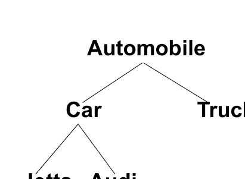

```
Automobile *p;

Automobile a;
Car b;
Truck c;
Audi d;

p = &a;
p = &b;
p = &c;
p = &d;
```

### 4. 继承与指针（1）

| 数据关系 |
|---|
| 父类定义，子类继承 |
| 父类定义，子类变异 |
| 父类没有，子类派生 |


| 访问方式 |
|---|
| 对象方式 |
| 各自指针 |
| 祖先指针 |

### 4. 继承与指针（2）

```
class Automobile{
public:
//...
void Turn(){
    cout<< "助力转向" <<endl;
}
};

class Car:public Automobile{
public:
//...
};
```

```
void main(){
    Automobile ObjA;
    Car ObjB;
    ObjA.Turn();
    ObjB.Turn();
}
```

助力转向
助力转向

### 4. 继承与指针（3）

```
class Automobile{
public:
//...
void Turn(){
    cout<< "助力转向" <<endl;
}
};

class Car:public Automobile{
public:
//...
};
```

```
void main(){
    Automobile ObjA;
    Car ObjB;
    Automobile *pA = &ObjA;
    Car *pB = &ObjB;
    pA->Turn();
    pB->Turn();
}
```

助力转向

助力转向

### 4. 继承与指针（4）

```
class Automobile{
public:
//...
void Turn(){
    cout<< "助力转向" <<endl;
}
};

class Car:public Automobile{
public:
//...
};

void Fn(Automobile *p){
    p->Turn ();
    delete p;
}

void main(){
    Fn(new Automobile);
    Fn(new Car);
}

助力转向
助力转向
```

### 5.重定义（1）

```
class Automobile{
public:
//...
void Run(){
    cout<< "机械变速" <<endl;
}
};
```

```
class Car:public Automobile{
public:
//...
void Run(){
    cout<< "自动变速" <<endl;
}
};
```

```
void main(){
    Automobile ObjA;
    Car ObjB;
    ObjA.Run();
    ObjB.Run();
}
```

机械变速
自动变速

### 5. 重定义（2）

```
class Automobile{
public:
//...
void Run(){
    cout<< "机械变速" <<endl;
}
};

class Car:public Automobile{
public:
//...
void Run(){
    cout<< "自动变速 " <<endl;
}
};
```

```
void main(){
    Automobile ObjA;
    Car ObjB;
    Automobile *pA = &ObjA;
    Car *pB = &ObjB;
    pA->Run();
    pB->Run();
}
```

机械变速
自动变速

### 6. 同化效应

```
class Automobile{
public:
//...
void Run(){
    cout<< "机械变速" <<endl;
}
};

class Car:public Automobile{
public:
//...
void Run(){
    cout<< "自动变速 "<<endl;
}
};
```

```
void Fn(Automobile *p){
    p->Run();
    delete p;
}

void main(){
    Fn(new Automobile);
    Fn(new Car);
}
```

机械变速
机械变速

### 7. 多态希望

```
class Automobile{
public:
    //...
    void Run(){
        cout<< "机械变速" <<endl;
    }
};

class Car:public Automobile{
public:
    //...
    void Run(){
        cout<< "自动变速" <<endl;
    }
};
```

```
void Fn(Automobile *p){
    p->Run();
}

void main(){
    Fn(new Automobile);
    Fn(new Car);
}
```

机械变速
自动变速

### 8. 困惑的解决方案

```
class Automobile{
public:
// ...
int flag;
Automobile(int k):flag(k){}
void Run(){
    cout<< "机械变速" <<endl;
}
};

class Car:public Automobile{
public:
// ...
Car(int k):Automobile(k){}
void Run(){
    cout<< "自动变速 " <<endl;
}
};
```

```
void Fn(Automobile *p){
    switch(p->flag){
        case 1: p->Run();break;
        case 2: //p->Car::Run();
            static_cast<Car*>(p)->Run();
            break; }
    delete p;
}

void main(){
    Fn(new Automobile(1));
    Fn(new Car(2));
}
```

最大的问题在于如果继承体系变动，则需要影响到程序的所有的部分，相互依赖度高，代价太大；


### 9. 引入虚函数支持多态

```
class Automobile{
public:
//...
virtual void Run(){
    cout<< "机械变速" <<endl;
}
};

class Car:public Automobile{
public:
//...
virtual void Run(){
    cout<< "自动变速" <<endl;
}
};
```

```
void Fn(Automobile *p){
    p->Run();
}

void main(){
    Fn(new Automobile);
    Fn(new Car);
}
```

机械变速
自动变速

派生类中的函数只要原型相同，则自动具有虚函数性质，其virtual关键字可省略

### 虚函数的使用方法：

- （1） 在基类用virtual声明成员函数为虚函数
- （2） 在派生类中重新定义此函数，要求函数名、函数的参数个数和类型全部与基类的虚函数相同，并根据派生类的需要重新定义函数体。
- （3） 定义一个指向基类对象的指针变量，并使它指向同一类族中的某一对象。
- （4） 通过该指针变量调用此虚函数，此时调用的就是指针变量指向的对象的同名函数。

C++规定，当一个成员函数被声明为虚函数后，其派生类中原型相同的函数都自动成为虚函数 派生类没有对基类的虚函数重新定义，则派生类继承其直接基类的虚函数

### 类型转换：

static_cast:静态转型，必须是相关类型，非多态类层次的祖孙互易，void*转换任何类型，

dynamic_cast: 动态转型，专门针对有虚函数的继承结构，将基类指针转换成想要的子类指针

const_cast: 常量转型，去掉常量性的转换。

```
使用： dynamic_cast<Derived*>(p);
    static_cast<Car*>(p);
    const char* max(const char*,const char*);
char*
    p=const_cast<char*>(max("hello","good"));
```

### vector是C++STL(标准模板类库)的重要一员。可以容纳许多其它类型的相同实体，称为容器。

使用时：`#include<vector>`

四种定义方式：

- (1) `vector<int>a(10);`
- (2) `vector<int>b(10,1);`
- (3) `vector<int>c(b);`
- (4) `vector<int>d(b.begin(),b.begin()+3);`

输出向量中的所有元素：

```
for(int i=0; i<a.size(); ++i)
    cout<<a[i];

for (vector<int>::iterator it=a.begin();it!=a.end();++it)
    cout<<*it;
```

`vector<int>::iterator` //遍历器，迭代器（指向容器元素的指针）

向量中的操作都是通过使用成员函数来完成的：

```
a.clear();
a.assign(4,2);//a有0-3个元素，值为2
a.push_back(5);
a.resize(10,2)//元素的个数调整至10个，值为2
```

### 10. 多态编程体验

```
class Shape{
    public:
    // ...
    virtual double area(){}
};
class Circle:public Shape{
    public:
    double area(){...}
    // ...
};
class Triangle:public Shape{
    public:
    double area(){...}
    // ...
};
// ...
//类定义由程序员A完成
```

```
vector<Shape*> a (100);
void Fn(){
    a[0] = new Circle;
    a[1] = new Triangle;
    a[2] = new X;
    // ...
}//本函数由程序员B完成
```

```
double Sum(){
    double s = 0;
    for(int i=0; i<a.size(); ++i)
        s = s+a[i]->area();
    return(s);
} //本函数由程序员C完成
```

### 11. 虚函数的实用意义：

从基类继承来的某些成员函数不完全适应派生类的需要，允许其派生类中对该函数重新定义，赋予它新的功能，当基类的这些成员函数声明为虚函数后，可以通过指向其基类的指针指向同一类族中不同类的对象，从而调用其同名的函数。由虚函数实现的多态性是：同一类族中不同类的对象，对同一函数调用作出不同的响应。

是追求用指针管理继承体系对象的结果。
多态性使得应用程序使用类体系中的不同层次对象,并使这些对象共存的复杂局面达到了一种可管理的境界。
程序员从使用孤立的类，到使用分层的类，并且让各种对象“同场竞技”，充分展现其个性。

### 12. 多态应用的三种场景

```
class X{
public:
    virtual void f1(){cout<<"Running X::f1()"<<endl;f4();}
    virtual void f2(){cout<<"Running X::f2()"<<endl;f3();}
    virtual void f3(){cout<<"Running X::f3()"<<endl;f4();}
    virtual void f4(){cout<<"Running X::f4()"<<endl;}
};
class Y:public X{
public:
    void f1(){cout<<"Running Y::f1()"<<endl;f2();}
    void f3(){cout<<"Running Y::f3()"<<endl;f4();}
};
void main(){
    X &p = *(new Y);
    p.f1();
}
（指针、引用、成员函数）
```

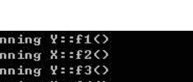

### 13. 多态的实现

联编（编联、束定、绑定）(binding)：就是把一个标识符名称和一个存储地址联系在一起的过程。将一个函数调用链接上相应于函数体的代码，这一过程就是函数联编。应将其理解为：在调用同名函数时，确定用其中的哪一个函数来执行的过程。

静态联编：出现在运行前的联编（在编译时完成），也称为早期联编。

动态联编：联编工作在程序运行阶段完成的情况。在编译、连接过程中无法解决的联编问题，要等到程序开始运行之后再来确定。也称为滞后联编。

### 虚函数的工作机理

Virtual出现则每个类增加一个虚函数表保存类的虚函数

凡有虚函数的类均维护一个虚函数表

实例化每个对象中会增加一个指针指向虚函数表（对象大小会有变化）。

虚函数调用时不需要确定对象类型，通过该指针即可找到所要链接函数

```
class A{
    public:
        virtual void f();
        virtual void g(int);
        virtual void h(double);
    private:
        int a;
};
class B:public A{
    public:
        virtual void g(int);
    private:
        int b;};
class C:public B{
    public:
        virtual void h(double);
    private:
        int c;
};
```

### 虚函数的工作机理

#### A的虚拟表

#### C的虚拟表

Vptr a

&A::f[0]
&A::g[1]
&A::h[2]

Vptr a b c

&A::f[0]
&B::g[1]
&C::h[2]

#### A类对象的存储布局

#### C类对象的存储布局

#### B的虚拟表

Vptr a b

&A::f[0]
&B::g[1]
&A::h[2]

#### B类对象的存储布局

Vptr指向vtbl的开始地址，所有vtbl有相同的顺序。

### 虚函数的工作机理

对虚函数的调用C++编译器转换为一个间接调用。

例如，
A* pa;
pa->h(5);

转换为：
对pa->vptr[2]的调用

如果pa指向一个A类对象，则调用A::h()。
如果pa指向一个C类对象，则调用C::h()。

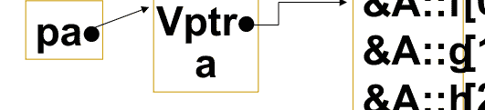

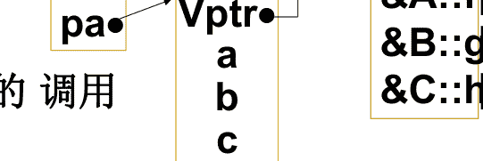


### 14. 避免虚函数误用

```cpp
class Base {
public:
    virtual void fn(int x) {
        cout << "in base class,int x=" << x << "\n";
    }
};

class Sub : public Base {
public:
    virtual void fn(double x) {
        cout << "in sub class,int x=" << x << "\n";
    }
};

void test(Base &b) {
    b.fn(2);
    b.fn(3.5);
}

void main() {
    test(Base());
    test(Sub());
    Sub f;
    f.fn(2);
    f.Base::fn(2.5);
}
```

```text
in base class,int x=2
in base class,int x=3
in base class,int x=2
in base class,int x=3
in sub class,int x=2
in base class,int x=2
```

### 多态注意事项

- 非成员、静态成员、内联函数不能是虚函数
- 构造函数、赋值运算符函数不能是虚函数
- 析构函数经常定义成虚函数 `delete p;`

### 15. 关于析构函数

```cpp
class A {
    char *p;

public:
    A() {
        p = new char[5];
    }
    virtual ~A() {
        delete[] p;
    }
};

class B : public A {
    char *q;

public:
    B() {
        q = new char[500];
    }
    ~B() {
        delete[] q;
    }
};

void f() {
    A *p;
    p = new B;
    delete p;
}

void main() {
    f();
    f();
    ... ...
}
```

析构函数为虚函数时，编译器进行运行绑定。析构函数的调用沿着继承树自下而上。

### 16. 一个拷贝的例子

```cpp
class Shape {
public:
    //...
    virtual double area() {}
};

class Circle : public Shape {
public:
    double area() {...}
    //...
};

class Triangle : public Shape {
public:
    double area() {...}
    //...
};

//...
```

```cpp
class Manage {
    Shape *a[100];

public:
    //...
};
```

要求完成 `Manage` 类的拷贝构造函数，实现深度拷贝；可以改动所有的类。

```cpp
class Student {
    int move_tel;

public:
    int id;
};

class Master : public Student {
    string topic;

public: //方法略
};

class Phd : public Student {
    string professor;

public: //方法略
};

class DoubleMaster : public Student {
    string SecondMajor;

public: //方法略
};

class Member {
    Student *m[128];

public:
    Student *&f(int k) {
        return (m[k]);
    }
};

void main() {
    Member s;
    s.f(0) = new Student;
    s.f(1) = new Master;
    s.f(2) = new Phd;
    s.f(3) = new DoubleMaster;
    s.f(4) = new Phd;
    //。。。 。。
}
//希望定义一个t，并完全拷贝s内容
```

```cpp
class Student {
    int move_tel;

public:
    int id;
    virtual Student *n() {
        return (new Student(*this));
    }
};

class Master : public Student {
    string topic;

public: //方法略
    Student *n() {
        return (new Master(*this));
    }
};

class Phd : public Student {
    string professor;

public: //方法略
    Student *n() {
        return (new Phd(*this));
    }
};

class DoubleMaster : public Student {
    string SecondMajor;

public: //方法略
    Student *n() {
        return (new DoubleMaster(*this));
    }
};

class Member {
    Student *m[128];

public:
    Member() {}
    Member(Member &s) {
        for (int i = 0; i < 128; i++)
            this->m[i] = s.m[i]->n();
    }
    Student *&f(int k) {
        return (m[k]);
    }
};

void main() {
    Member s;
    s.f(0) = new Student;
    s.f(1) = new Master;
    s.f(2) = new Phd;
    s.f(3) = new DoubleMaster;
    s.f(4) = new Phd;
    Member t(s);
}
```

### 抽象类

纯虚函数：在基类中只声明虚函数而不给出具体的函数定义体，称此虚函数为纯虚函数。

纯虚函数的声明如下（注：要放在基类的定义体中）：

```cpp
virtual 函数原型 = 0;
```

声明了纯虚函数的类，称为抽象类（抽象基类）。

通过该基类的指针或引用就可以调用所有派生类的虚函数，基类的纯虚函数只是用于继承，仅作为一个接口，具体功能在派生类中实现。

### 继承 · 抽象类

```cpp
class Student {
public:
    Student(int i) {
        id = i;
    }
    virtual void p() = 0;
    int id;
};

class Master : public Student {
public:
    Master(char *p, int k) : Student(k) {
        dept = p;
    }
    virtual void p() {
        cout << "Master";
    }
    string dept;
};

class Mba : public Student {
public:
    Mba(char *p, int k) : Student(k) {
        position = p;
    }
    virtual void p() {
        cout << "Mba";
    }
    string position;
};

void main() {
    Master a("Software", 123);
    Mba b("商学院", 456);
    Student *m = &a;
    m->p();
    m = &b;
    m->p();
}
```

#### 纯虚函数

如果没有纯虚函数则错误。因为 C++ 必须确认该类拥有该同名函数，才可以访问对应对象。

```cpp
class Student {
public:
    Student(int i) {
        id = i;
    }
    virtual int p() = 0;
    int id;
};

class Master : public Student {
public:
    Master(char *p, int k) : Student(k) {
        dept = p;
    }
    virtual int p() {
        cout << "Master";
    }
    string dept;
};

class Mba : public Student {
public:
    Mba(char *p, int k) : Student(k) {
        position = p;
    }
    virtual int p() {
        cout << "Mba";
    }
    string position;
};

void main() {
    Student t(9);                             //错误
    Student *p = new Master("Software", 9);   //正确
    Student &q = *p;                           //正确
}
//抽象类不可以实例化对象，但是可以定义指针和引用
//无意义的基类对象；基类设下纯虚函数，是为子类的多态行为留了一条口子。


### 继承 抽象类

```cpp
class Student{
public:
    Student(int i){id=i;}  virtual int p()=0;  int id;
};
class Master :public Student{
public:
    Master(char * p,int k):Student(k){dept =p;}
    string dept;
};
class MasterEnginee :public Master{
public:
    MasterEnginee(char * p,int k):Master(p,k){
    virtual int p(){cout<< "MasterEnginee" ;}
};
void main()
{Student t(9);//错误
Student * p = new Master( "Master" ,9);//错误
Student * p1 = new MasterEnginee( "Master" ,9);//正确
Student & q = *p1;//正确
Master * r = new MasterEnginee( "Master" ,9);//正确
Master & s = *p1;//正确
}//纯虚函数直到被覆盖前所派生的类均为抽象类
```

### 使用纯虚函数时应注意：

- （1）抽象类中可以有多个纯虚函数。
- （2）抽象类也可以定义其他非纯虚函数。
- （3）从抽象类可以派生出具体或抽象类，但不能从具体类派生出抽象类。

问题：抽象类需要有构造函数和析构函数吗？

在一个复杂的类继承结构中，越上层的类抽象程度越高，有时甚至无法给出某些成员函数的实现，显然，抽象类是一种特殊的类，它一般处于类继承结构的较外层。

引入抽象类的目的，主要是为了能将相关类组织在一个类继承结构中，并通过抽象类来为这些相关类提供统一的操作接口，更好的发挥多态性。

抽象类使得数据结构更加清晰，更加贴近自然

## 第八章：模板

### 8-1 函数模板

```cpp
void swap1(int &a,int &b)
{
int temp=a;
a=b;
b=temp;
}
void swap1(float &a,float &b)
{
float temp=a;
a=b;
b=temp;
}//重载的代码完全一样 仅仅是被操作类型不同
```

```cpp
void swap1(X &a,X &b)
{
    X temp=a;
    a=b;
    b=temp;
}

X =
```

```cpp
#define T float
//typedef float T;
void swap1(T &a,T &b)
{
    T temp=a;
    a=b;
    b=temp;
}
```

//固化的过死

//不能在调用时再给出类型

//宏替换仅能简化设计，而不能解决代码重用的问题。

//C++属于强类型语言，并不鼓励使用宏替换，

#### 定义函数模板使用保留字template，定义格式如下：

```text
template < 模板参数表 >
返回类型 函数名（ 函数形式参数表 ） {
...
}
```

模板参数表中的参数可以有多个，可以是类型形参，也可以是表达式形参。多个参数间用逗号间隔。

模板参数若是代表一个类型，模板类型参数形式如下：

```text
class 类型参数名 （或 typename 类型参数名）
```

函数模板的定义可以看作由两部分组成，一是模板类型的定义，`template<class 模板形参表>`，二是函数定义，它与普通函数的定义类似。

函数模板只是对函数的描述，编译系统不为其产生任何执行代码。

```cpp
template <class T>  //class可以用typename代替
void swap1(T& a,T& b)
{ T temp=a;
a=b;
b=temp;
}//函数模板
void main()
{  int a=1,b=2;
swap1(a,b);
swap1(a,b);
cout<<a<<b<<endl;
float i=5.1,j=5.2;
swap1(i,j);      //T = float;
cout<<i<<j<<endl;
int *p=&a,*q=&b;
swap1(p,q);      //T = int *;
cout<<*p<<*q<<endl;
}
```

生成函数 `swap1<int>(int & a,int& b){ int temp=a;a=b;b=temp;}` //模板函数

//编译器从函数调用的实参的类型推导出T = int;

C++ 编译器在遇到调用用模板方式定义的函数时，会根据调用函数的参数类型构造出一个个具体的函数。这个过程称为函数模板的实例化（instantiation）。

同一个模板生成的不同的模板函数是不同名字的函数，不是重载函数。函数模板反映的是不同函数的函数族。使用模板实现了代码重用。

```cpp
template <typename T>
void swap1(T& a,T& b)
{
    T temp=a;
    a=b;
    b=temp;
}
void main()
{
    int a=1,b=2;
    swap1(a,b);
    cout<<a<<b<<endl;
    float i=5.1,j=5.2;
    swap1(a,j);    //错误　必须严格匹配
    cout<<i<<j<<endl;
}
```

```cpp
template <typename T>
void swap1(T& a,T& b)
{
T temp=a;
a=b;
b=temp;
}
void main()
{
int a=1; int b=2;
swap1<int>(a,b);//显式
swap1(a,b);//隐式
cout<<a<<b<<endl;
}
```

```cpp
template <typename T>
T add(T&a,T& b)
{
T temp=a+b;
return(temp);
}
void main()
{
int a=1,b=2;
cout<<add(a,b);
float i=5.1,j=5.2;
cout<<add<int>(a,j);
}
//红色部分正确，int类型已经显式确定，float类型被强制转换
```

模板参数表中的参数可以有多个，多个参数间用逗号间隔。参数值可默认

```cpp
template <typename S, typename T=int>
S add(T a,T b)
{
    S temp=a+b;
    return(temp);
}
void main()
{
    int a=1,b=2;
    float i=5.1,j=5.2;
    cout<<add<int,int>(i,j);
    cout<<add<float>(a,b);
}
```

```cpp
template<typename T,typename U>
void add(T a,U b)
{ cout<<a+b<<endl;}
void main(){
    int x=1,y=2;
    float s=3.0,t=4.0;
    add(x,y);
    add(s,t);
    add(x,t);
    add(s,y);//以上四条语句均正确；因为T和U
    //可以相同也可以不相同
    add<float,int>(s,y);
    add<float>(s,y);
    add<,int>(s,y);//错误。程序员可以仅提供部分模板实参，其余的模板实参仍由编译器自动推导。且省略掉的实参必须是模板参数表尾部的参数对应的实参。
}
```

```cpp
template<typename T,typename U>
void add(T a,U b)
{ cout<<a+b<<endl;}
void swap(T a,T b)//错误
{ T temp = a; a = b; b = temp;}
void main(){
int x=1,y=2;
float s=3.0,t=4.0;
add(x,y);
swap(s,t);
}//模板类型声明不能共享; typename不能节省
```

```cpp
template <typename T>
void swap1(T& a,T& b)
{ T temp=a;
a=b;
b=temp;}
```

```cpp
void main()
{
    int a=1,b=2,c=3;
    swap1(a,b);
    cout<<a<<b<<endl;
    swap1(a,b,c);
    cout<<a<<b<<c<<endl;
    float i=5.1,j=5.2;
    swap1(i,j);
    cout<<i<<j<<endl;
    int *p=&a,*q=&b;
    swap1(p,q);
    cout<<*p<<*q<<endl;
}
```

```cpp
template <typename T>
void swap1(T& a,T& b,T& c)
{ T temp=a;
a=b;
b=c;
c=temp;}
```

```cpp
void swap1(int* a,int* b)
{ int temp=*a;
*a=*b;
*b=temp;}
```

优先匹配非模板函数


#### 模板的参数是非类型参数（表达式形参）

```cpp
template <class T, int i>
int find(T a[], T k)
{
    for (int j = 0; j < i; j++)
        if (a[j] == k)
            return j;
    return -1;
}

void main()
{
    int a[10] = {0};
    cout << find<int, 10>(a, 1);
}
```

#### 非类型参数

模板非类型参数：则形参的类型是某种具体的数据类型。

模板非类型参数表示该参数名代表了一个潜在的值，而该值代表了模板定义中的一个常量。

模板非类型参数被用作一个常量值出现在模板定义的余下部分。它可以用在要求常量的地方，如数组声明中指定数组的大小或作为枚举常量的初始值。

### 第一次上机：

写程序验证如下内容：

- 浅拷贝仅能简单复制指针的值；
- 全局对象、静态成员的构造函数在 main 函数之前执行；
- 构造函数可以实现类型转换；
- 堆空间生命周期与申请函数不同步；

### 第二次上机：

1. 编写运算符重载函数程序。
2. 编写程序验证继承的权限变化。
3. 编写程序验证多态，分别通过指针、引用和成员函数的方式。

### 第三次上机：

1. 编写程序定制类模板，并写出测试程序。
2. 写程序，实现文件 I/O 以及字符串 I/O 的操作。
3. 写程序验证使用 C++ 异常机制，当异常被捕获时，对已经使用到的资源回收。

### 8-2：类模板

```cpp
// 栈类
class NODE {
public:
    int age;
    NODE* next;
};

class Stack {
public:
    Stack() { head = 0; }
    void push(NODE&);
    NODE pop();
private:
    NODE* head;
};

void Stack::push(NODE& i) {
    NODE* p = new NODE;
    *p = i;
    p->next = head;
    head = p;
}

NODE Stack::pop() {
    NODE p = *head;
    NODE* q = head;
    head = head->next;
    delete q;
    return p;
}

void main() {
    Stack i;
    NODE s, t;
    s.age = 20; t.age = 22;
    i.push(s);
    i.push(t);
    cout << (i.pop()).age;
    cout << (i.pop()).age;
}
```

### 模板&类

```cpp
template <typename T>
class Stack {
public:
    void push(T);
    T pop();
private:
    T* head;
};

template <typename T>
void Stack<T>::push(T i) {
    T* p = new T;
    *p = i;
    p->next = head;
    head = p;
}

template <typename T>
T Stack<T>::pop() {
    T p = *head;
    T* q = head;
    head = head->next;
    delete q;
    return p;
}
```

// 与普通类一样，类模板的成员函数也可以在类模板定义中定义具体实现，这时，该函数是内联的（inline）。

### 模板&类

```cpp
class NODE {...};
class Student {...};

void main() {
    Stack<NODE> i;    // 实例化；(只实例化模板的定义部分)
    // 隐式类型实例化可以吗？ // 类模板&模板类?
    NODE s, k;
    s.age = 20; k.age = 21;
    i.push(s);    // 第一次调用函数模板时，对其实例化
    i.push(k);    // 成员函数的模板参数由其调用对象确定
    cout << (i.pop()).age;
    Stack<Student> m;
}
```

这个类的类型是 Stack<T>，其中 T 是模板参数。因此，当在声明中需要使用该类的类型时，你必须使用 Stack<T>。例如，如果你要声明自己实现的拷贝构造函数和赋值运算符，那么应该这样编写：

```cpp
template <typename T>
class Stack {
// ....
};

Stack<T>::Stack(Stack<T> const&);    // 拷贝构造函数
Stack<T>& Stack<T>::operator=(Stack<T> const&); // 赋值运算符
// ...
```

当使用类名而不是类的类型时，就应该只用 Stack；譬如，当你指定类的名称、类的构造函数、析构函数时，就应该使用 Stack。

### 类模板中的 static 成员

类模板可以像任意其他类一样声明 static 成员。

因为每个类模板的实例化表示截然不同的类，所以每个类都有自己的 static 成员。

给定实例化的类所有对象都共享同一个 static 成员。

与任意其他成员函数一样，static 成员函数只有在程序中使用时才进行实例化。

```cpp
template <typename T>
class Stack {
    static Stack* phead;
};

template <typename T>
Stack<T>* Stack<T>::phead = 0;
```

标准 vector 是定义在名字空间 std 的一个类模板。向量对象的定义和初始化方式，就是模板的实例化的过程。

- vector<int> a(10);
- vector<int> b(10, 1);
- vector<int> c(b);
- vector<int> d(b.begin(), b.begin() + 3);

// 类模板可以有多个类型参数，如：

```cpp
template <typename T, typename U>
class List {... ...};

List<NODE, Student> k;
```

### 模板&类

```cpp
template <typename T, int Num>
class List {
public:
    void Set(T);
    T Get();
    T a[Num];
private:
    T i;
};

template <typename U, int Count>
void List<U, Count>::Set(U k) { i = k; }

template <typename T, int Count>
T List<T, Count>::Get() { return i; }

void main() {
    int x = 1, y = 2;
    List<int, 9> i;
    i.Set(1); // i.List<int, 9>::Set(1);
    cout << i.Get() << endl;
}
```

> Num 应当给出确定的参数值
> 注意 U 和 Count

### 模板&类

```cpp
// 栈
template <typename T = NODE>
class Stack {
public:
    void push(T);
    T pop();
private:
    T* head;
};

template <typename T>
void Stack<T>::push(T i) { .... .... }

template <typename T>
T Stack<T>::pop() { .... .... }

Stack<> object;
stack<Student> object2;
```

// 类模板也允许默认参数

### 模板&类

// 定做（Specialization）定制、特化、专门化
// 例子（上）

```cpp
template <typename T>
class List {
public:
    void Set(T);
    T Get();
private:
    T i;
};

template <typename T>
void List<T>::Set(T k) { i = k; }

template <typename T>
T List<T>::Get() { return i; }
```

```cpp
template <>
class List<double> {
public:
    void Set(double);
    double Get();
    void print();
private:
    double i;
    int m;
}; // 一个普通类
```

```cpp
void List<double>::Set(double k) { i = k + 1; }

double List<double>::Get() { return -1 * i; }

void List<double>::print() {
    cout << i << endl;
}
```

// 普通的函数


### 模板&类

通过特化类模板，你可以优化基于某种特定类型的实现，或者克服某种特定类型在实例化类模板时所出现的不足。

进行类模板的特化时，每个成员函数都必须重新定义为普通函数，原来模板函数中的每个 `T` 也相应地被进行特化的类型取代：

// 特化

// 例子（下）

```cpp
void main(){
    List<int> i;
    i.Set(1);
    cout << i.Get() << endl;
    List<double> k;
    k.Set(1);
    cout << k.Get() << endl;
    k.print();
}
```

// 注意多个类型参数情况

// 特化其中一部分类型参数为确定的类型，称为局部特化

```cpp
template <typename T1, typename T2>
class A
{......};
```

```cpp
template <typename T>
class A<T,T>{....};  // 仍为类模板
```

```cpp
template <typename T>
class A<T,Cat>
{......};
```

使用时：

```cpp
A<int,Cat> aa1;
```

```cpp
A<int,int> aa2;
```

```cpp
A<Cat,Cat> aa3; // error
```

包含：
一般的办法是将（函数、类）模板的整个定义都放在头文件中。

```cpp
// List.h
template<typename T>
class List {
public:
    void Set(T);
    T Get();
private:
    T i;
};

template<typename T>
void List<T>::Set(T k){ i = k; }

template<typename T>
T List<T>::Get(){ return(i); }
```

```cpp
// main.cpp
#include "List.h"
void main(){
    List<double> k;
    k.Set(1);
    cout << k.Get() << endl;
}
```

### 模板&类

// 分离（多文件机制）

// 例子

List.h:

```cpp
template<typename T>
class List {
public:
    void Set(T);
    T Get();
private:
    T i;
};
```

List.cpp:

```cpp
#include "List.h"
template<typename U>
void List<U>::Set(U k){ i = k; }
template<typename T>
T List<T>::Get(){ return(i); }
```

main.cpp:

```cpp
#include "List.h"
void main(){
    List<double> k;
    k.Set(1);
    cout << k.Get() << endl;
}
```

// template 前加上 export

- 模板可以有层次，一个模板可以作为基类，派生出派生模板类。

《C++ Templates》

```c
float a = 5;
printf("%d", a);
```

`%d` 格式不能正常处理数据输出；

```cpp
class aa {
public:
    int a;
    int b;
};

aa a;
a.a = 1;
a.b = 2;
printf("%?", a);
```

不能直接输出类的对象内容。


### I/O 流

“流”就是“流动”，是物质从一处向另一处流动的过程。

C++ 流是指信息从外部输入设备（如键盘和磁盘）向计算机内部（即内存）输入和从内存向外部输出设备（如显示器和磁盘）输出的过程，这种输入输出过程被形象地比喻为“流”。

为了实现信息的内外流动，C++ 系统定义了 I/O（流）类库（带有面向对象的输入/输出软件包），其中的每一个类都称作相应的流或流类，用以完成某一方面的功能。

根据一个流类定义的对象也时常被称为流，每一个流类对象称为一个数据流，在内存中为每一个数据流开辟一个内存缓冲区，用来存放流中的数据。

凡是数据从一个地方传输到另一个地方的操作都是流的操作。因此一般意义下的读操作（输入）在流数据抽象中被称为（从流中）提取，写操作（输出）被称为（向流中）插入。

C++ 语言系统为实现数据的输入和输出定义了一个庞大的类库，它包括的类主要有：

- `ios`：抽象基类
- `iostream`：输入流类 `istream`，输出流类 `ostream`，输入输出流类 `iostream`
- `fstream`：输入文件流类 `ifstream`，输出文件流类 `ofstream`，输入输出文件流类 `fstream`
- `strstream`：输入字符串流类 `istrstream`，输出字符串流类 `ostrstream`，输入输出字符串流类 `strstream`

### ios 类的派生关系

```text
ios
istream
fstreambase
strstreambase
ostream
ifstream
istrstream
ofstream
ostrstream
iostream
fstream
strstream
istream_withassign
iostream_withassign
ostream_withassign
```

### 标准 I/O

C++ 不仅定义有现成的 I/O 类库供用户使用，而且还为了用户进行标准 I/O 操作，在 `iostream`（输入、输出类的头文件）中定义了四个全局对象，它们分别是 `cin`、`cout`、`cerr` 和 `clog`。

```cpp
ostream cout;  // 标准输出流，默认屏幕，可以重定向
istream cin;   // 标准输入流，默认键盘
ostream cerr;  // 标准错误流，默认屏幕，不能重定向，不经过缓冲区
ostream clog;  // 标准错误流，默认屏幕（与 cerr 唯一区别就是经过缓冲区）
```

C++ 为 `cout` 流对象开辟一个缓冲区：

```cpp
cout << "c++" << 10 << 2.5 << endl;
ostream &operator<<(ostream &out, char *p);
ostream &operator<<(ostream &out, int p);
ostream &operator<<(ostream &out, char p);
ostream &operator<<(ostream &out, float p);
```

### I/O 类

```cpp
#include <iostream>
using namespace std;

class aa {
    float a;  float b;
public:
    float &aaa() { return(a); }
    float &bbb() { return(b); }
};

ostream &operator<<(ostream &out, aa &a) {
    out << a.aaa() << a.bbb() << endl;
    return(out);
}

void main() {
    aa a;
    a.aaa() = 1; a.bbb() = 2;
    cout << a;
}
```

### 输出输入

```cpp
// 格式输出
#include <iostream>
#include <iomanip>
using namespace std;

void main() {
    double a = 0.12345;
    cout.precision(2);
    cout << a << endl;

    cout << a << setprecision(3) << a << endl;
    cout << a << endl;
}
```

成员函数　　控制符号

### 输出输入

```cpp
#include <iostream>
using namespace std;

void main() {
    char a[20];
    cin >> a;
    cout << a << endl;

    cin.getline(a, 11, 'a');
    cout << endl << a;
}
```

运行程序结果：

He told me a news
He

told me

输入数据按回车键后，数据才被送入键盘缓冲区，形成输入流。`istream` 流类成员函数的使用可以更加精细地控制输入。

#### 文件流类

文件的概念：存储在外部介质上的数据集合。

两类：程序文件和数据文件。

程序中输入输出的对象是数据文件。

数据文件的组织形式分为：ASCII 文件和二进制文件。

ASCII 文件（文本文件或字符文件）：每一个字节放一个 ASCII 代码，代表一个字符。可直接显示或打印。

二进制文件（内部文件或字节文件）：把内存中的数据按其在内存中的存储形式原样输出到磁盘上保存。

对于字符信息二者是一样的，数值数据二者是不同的。


#### 文件流类

在fstream里面定义
ofstream 文件输出类  ifstream 文件输入类  fstream是多继承子类

没有cout和cin这样的标准全局对象。

```
ofstream::ofstream(char * pFilename,
                     int mode=ios::out);
```

| Mode:打开方式 |  |
|---|---|
| ios::app | 如果文件存在末尾追加 |
| ios::trunc | 如果文件存在清除内容（默认） |
| ios::in | 以输入的方式打开文件（ifstream默认） |
| ios::out | 以输出的方式打开文件（ofstream默认） |
| ios::ate | 打开一个已有的文件，指针指向末尾 |
| ios::binary | 二进制方式 |

（可以以位或的方式组合ios::in|ios::binary）

#### 文件流类

```
#include <iostream>
#include<fstream>
using namespace std;
void fn()
{
  ofstream myf("e:\\myname"); //ios::out|ios::trunc(存在，清除)
  myf<<"Department\n"<<"of Computer Science\n";
  myf.close(); }

void fi()
{ char ch;
ifstream myf("e:\\myname",ios::in);
//如果文件不存在，则返回错误
if(myf.fail()) {cerr<<"文件打开错误";return;}
while(myf.eof()==0){ //文件结束返回值为1;
myf>>ch;   //从myf流中提取一个字符
cout<<ch;}
myf.close();
}
void main() { fn(); fi();}
```

#### 字符串流

- 字符串流是以内存中用户自定义的字符数组（字符串）为输入输出对象的，即将数据输出到内存的字符数组，或者从字符数组（字符串）将数据读入。
- 输出：将不同类型的信息转换为字符串格式
- 输入：字符串信息转换为变量所需要的内存格式。
- 字符串流也称为内存流。
- 字符串流也有相应的缓冲区。

#### 字符串流

字符串流类包括输入字符串流类iststream,输出字符串流类 ostringstream和输入输出字符串流类strstream三种。

```
char ch[50];
ostrstream sout(ch,sizeof(ch));
```

```
char ch[50];
iststream sin(ch);
```

```
char ch[50];
strstream s(ch,sizeof(ch),ios::in|ios::out);
```

```
ostrstream::ostrstream(char* buffer, int n);
```

```
strstream::strstream(char* buffer, int n, int mode);
```

buffer:字符数组的首地址。
n:流缓冲区的大小

#### 串流类

```
#include <iostream>
#include <strstream>
using namespace std;
void main(){
char a[128];
char c,d;
ostrstream oo(a,128);//关联的是内存的字符数组不需要打开和关闭
oo<<"Computer";
oo.put('\0');//向指定的输出流中插入一个结束字符。
cout<<a;
istrstream ii(a);
ii>>c;
ii.get(d);//从指定的输入流中提取一个字符。
cout<<endl<<c<<d;
}
```

I/O流类的函数基本是通用的

# 第九章. 异常处理

```
void f()
{ sock a;
    a=sock("10.100.21.61",5670);
    send(a,"Hello!");
}
```

```
int f()
{ sock a;
    a=sock("10.100.21.61",5670);
    if(a<0){
        cout<<"不能获得网络连接"<<endl;
        return(-1);
    }
    send(a,"Hello!");
}
```

```
main()
{if(f() == -1) cout<<"失败！";}
```

### 传统的错误处理方式：

- 1 遇到错误，终止运行，低级粗暴
- 2 遇到错误，返回给上层函数一个错误值，程序规模加倍，同时将正常逻辑与错误处理的逻辑混在一起，错误处理程序将子程序的正常逻辑淹没。
- 3 遇到错误，改变全局错误变量的值，并函数返回，破坏了程序结构
- 4 遇到错误，调用事先设计好的下层错误处理函数，可惜错误往往不是自己所能解决的了的！

```
class StudentDept{
public:
    static int Max;
    StudentDept(string p){
        Name=new char[Max];
        strcpy(Name,p);
    }
    char p(int i){return(Name[i]);}
private:
    char * Name;
};
int StudentDept::Max=2000;
class Student{
    int id;  StudentDept Dept;
public:
    Student(int i,string j):Dept(j){id=i;}
    StudentDept & q(){return(Dept);}
};
void main()
{
    Student a(1,"Computer");
    cout<<a.q().p(5);
}
```

如果构造函数出错，返回途径不好处理

return(i>=0&&i<Max?Name[i]:'0');
需要在正确结果中区分出错误

### 异常处理

### 希望的错误处理示意：

放弃一棵子树，递归调用链跳到祖先函数

发现错误处

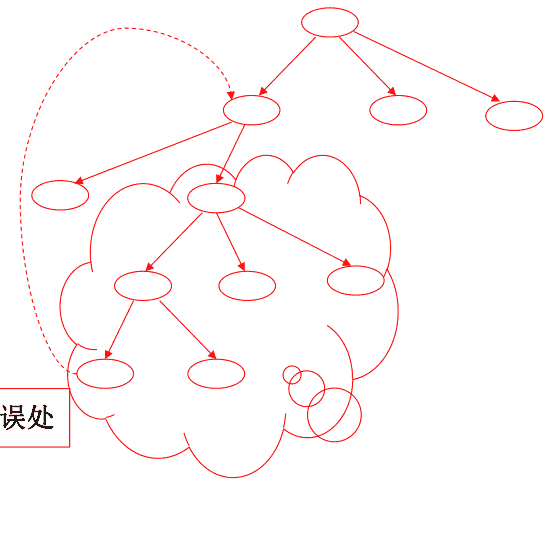

### 异常处理

```
#define MAX 10
int f(int * a,int j)
{
    if(j>=0&&j<MAX)
        return(a[j]);
    else
        throw "aaaa";
}
void main()
{ int j;
int a[MAX]={0};
    try{
    cout<<f(a,15)<<endl;}
    catch(string s){
        cout<<s<<endl;
    }
}
```

（1）定义异常（try语句块）
将那些有可能会产生错误的语句放在try块中

（2）抛掷异常（throw语句）
检测是否产生异常，若是，则抛掷异常。

（3）捕捉异常,定义异常处理（catch语句块）
将异常处理语句放在catch块中,以便异常被传递过来时就处理它。

C++只理会受监控的异常。
Try块之后必须紧跟一个或多个catch语句。
Catch括号中只能容纳一个形参，与throw抛掷的异常类型匹配时，便捕获了异常。
避免把正常逻辑淹没在错误处理代码中，从而使程序更易于阅读。

### 异常处理

```
class StudentDept{
public:
static int Max;
StudentDept(string p){
Name=new char[Max];
strcpy(Name,p);
}
char p(int i){if(i>=0&&i<Max)
return(Name[i])
else throw "cccc";}
private: char * Name;
};
int StudentDept::Max=2000;
class Student{
int id; StudentDept Dept;
public:
Student(int i,string j):Dept(j){id=i;}
StudentDept & q(){return(Dept);};
}
```

```
void main(){
try{
Student a(1,"Computer"); }
catch(exception s){....;}
try{cout<<a.q().p(5);}
catch(string m){
cout<<m<<endl;
}
}
```

exception:为系统异常的类型

### 异常处理

```
double Div(double, double);
void main()
{
    try{
        cout <<"7.3/2.0=" <<Div(7.3, 2.0) <<endl;
        cout <<"7.3/0.0=" <<Div(7.3, 0.0) <<endl;
        cout <<"7.3/1.0=" <<Div(7.3, 1.0) <<endl;
    }
    catch(double)
    {
        cout <<"exception of deviding zero.\n";
    }
    cout <<"That is ok. \n";
}
double Div(double a, double b)
{
    if(b==0.0)
        throw b;
    return a/b;
}
```

如果发生异常则只中断try里面块

try和catch必须相邻；顺序不能颠倒

参数可以省略但是类型不能省略；

类型匹配必须严格类型相同；

Throw和catch可以跨函数放置


### 异常处理

```
double Div(double, double);
void f(){
try{cout <<"7.3/0.0=" <<Div(7.3, 0.0) <<endl;}
catch(double){cout<<"double"<<endl;throw 'a';}
}
void g(){try {f();} catch(char){cout<<"gg"<<endl;}}
void main()
{ try{ g(); cout <<"正确执行完毕.\n";}
catch(int){ cout <<"零做除数错误\n";}
catch(...) { cout<<"缺省异常"<<endl;}
cout<<"异常处理完毕"<<endl;
}
double Div(double a, double b)
{ if(b==0.0)
throw b;
return a/b;
}
```

通用异常

添加空throw; 表示当前处理的异常，再次被抛出，此时，抛掉的是源异常对象，而不是拷贝

### 异常处理

#### 类型匹配

异常捕捉的类型匹配之苛刻程度可以和模板的类型匹配媲美，它不允许相容类型的隐式转换。

对于没有捕捉到的异常，Abort（）进程被调用，从而无条件的中止程序的执行。

```
void main() {
    try{
        throw 'H';
    }catch(int){
        cout<<"int exception.\n";
    }
    cout<<"That's ok.\n";
}
```

### 异常处理

```
class A{
    char net[20];
    public: A(char * net){strcpy(this->net,net);}
};
class B:public A{
    long card;
    public: B(long card,char * net):A(net){this->card=card;}
};
class C:public B{
    int port;
    public: C(int port,long card,char * net):B(card,net)
    {this->port=port;}
};
void net()
{
    throw B(1, "202.198.22.26");
}
void main()
{
    try{net();}
    catch(C){cout<<"端口错误";}
    catch(B){cout<<"网卡错误";}
    catch(A){cout<< "网络错误" ;} //放到最前面如何？
```

### 异常处理

Catch(基类类型)能够捕获throw 派生类对象

Catch(基类指针类型)能够捕获throw 派生类指针

反之不可以：所以catch(基类)总放在catch(派生类)后面

### 异常处理

```
class A{
    char net[20];
    public:
        virtual void x(){cout<<"网络错误";}
};
class B:public A{
    long card;
    public:
        void x(){cout<<"网卡错误";}
};
class C:public B{
    int port;
    public:
        void x(){cout<<"端口错误";}
};
void net()
{
    throw B();
}
void main()
{
    try{ net(); }
    catch(A & s){s.x();}
}//异常处理的多态
```

### 异常处理

```
class A{
    char net[20];
public:
    virtual void x(){cout<<"网络错误";}
};
class B:public A{
    long card;
public:
void x(){cout<<"网卡错误";}
};
class C:public B{
    int port;
public:
void x(){cout<<"端口错误";}
};
void net()
{ throw B();}
--------------------------------
void net() throw(A,B,C); //异常申述(异常说明)
void main()
{
    try{net();}
    catch(A & s){s.x();} }
```

如果在函数的声明中没有包括异常接口声明，则此函数可以抛掷任何类型的异常，例如：

```
void net();
```

一个不抛掷任何类型异常的函数可以进行如下形式的声明：

```
void net() throw();
```

### 异常处理

```
//非异常处理
class A{};
void f3(){
    if(...) throw A; // 退出for循环
}
void f2(){
    f3();
};
void f1(){
    f2();
}
int main(){
    try{
        for(...; ...; ...){
            f1();
        }catch(A){
            //输出循环结果
        }
    }
```

### 双向关联

#### 例

```cpp
class Female;
class Male{
public:
Female* &getWife() {return pWife;}
//其它方法及实现，略。
private:
Female* pWife;
};
```

#### 题

```cpp
class Female {
public:
Male* &getHusband() { return pHusband; }
//其它方法及实现，略。
private:
Male* pHusband;
};
```

```cpp
Female a,c, Male b,d; a.getHusband()=&b; b.getWife()=&a;
```

### 单向关联

#### 例题

```
class Female;
class Male
{
public:
    Male() {m_buffer[m_sum++] = this;}
    Female* &getWife() {return pWife;}
    static Male* m_buffer[100]; //存放当前产生的所有Male类对象。
    static int m_sum;
    //其它方法及实现，略。
private:
    Female* pWife;
};
int Male::m_sum = 0;
Male* Male::m_buffer[100]={0};
```

### 单向关联

```
class Female
{
public:
Male * getHusband();
};
// 其它定义不变
//无，去掉Male* pHusband;
};
```

```
Male* Female::getHusband() {
for (int i = 0; i<Male::m_sum;i++)
if (Male::m_buffer[i]-> getWife() == this)
return Male::m_buffer[i];
return 0;
}
```

```
Male a,b; Female c,d; a.getWife()=&c; b.getWife()=&d;
d.getHusband()=?
```

### 嵌套类

```
```cpp
class A{
    int a;
public:
    class B{
        int b;
    public:
        B(int i);
    };
    void f(){ pb->b=5;//error
    }
    B* pb;
};
A::B::B(int i):b(i){}//成员可以在体外定义
int main(){
    A a;
    A::B b(10);
}
```
```

在一个类中定义的类称为嵌套类，定义嵌套类的类称为外围类。

定义嵌套类的目的在于隐藏类名，减少全局的标识符，从而限制用户能否使用该类建立对象。这样可以提高类的抽象能力，并且强调了两个类(外围类和嵌套类)之间的主从关系。

嵌套类中说明的成员不是外围类中对象的成员，反之亦然。嵌套类的成员函数对外围类的成员没有访问权，反之亦然。因此，在分析嵌套类与外围类的成员访问关系时，往往把嵌套类看作非嵌套类来处理。这样，上述的嵌套类可写成如下格式：

```
class A{
  int a;
  public:
      void f(){}
  B* pb;
};
class B{
    int b;
  public:
      B(int i);
};
```

由引可见，嵌套类仅仅是语法上的嵌入。在嵌套类中说明的友元对外围类的成员没有访问权。


### 关于上机考试
- 1. 时间：2011.6.8下午1：00
- 2. 地点：实验课教室
- 3. 请带学生卡或者学生证备查
- 4. 可以带任何资料，勿带U盘
- 5. 程序正确即请老师查看后速离开
- 6. 严格按照考试处理，违纪者取消成绩
- 7. 成绩记入最后成绩，占20%

### 关于理论考试
- 1. 成绩占最后成绩的80%
- 2. 题型：简答、判断对错（或单选）、读程序、改程序、写程序
- 3. 范围：讲的全部内容
- 4. 难度：适中
- 5. 联系我：liay@jlu.edu.cn
- 6. 最后答疑

### 谢谢！

