# 吉林大学图形学课件（康宝生）


从古到今，图形图像既是一门艺术，又是一项技术。它是艺术和技术的结合。
从结绳记事到象形文字，从绘画艺术到计算机图形图像，每一次发展，都标志着人类文明的进步。
随着互联网的发展，图形图像已走进千家万户。“互联网的精髓便是图形图像！”

## 第一章　计算机图形学综述

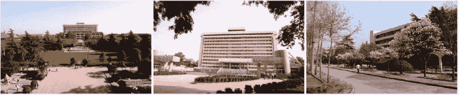

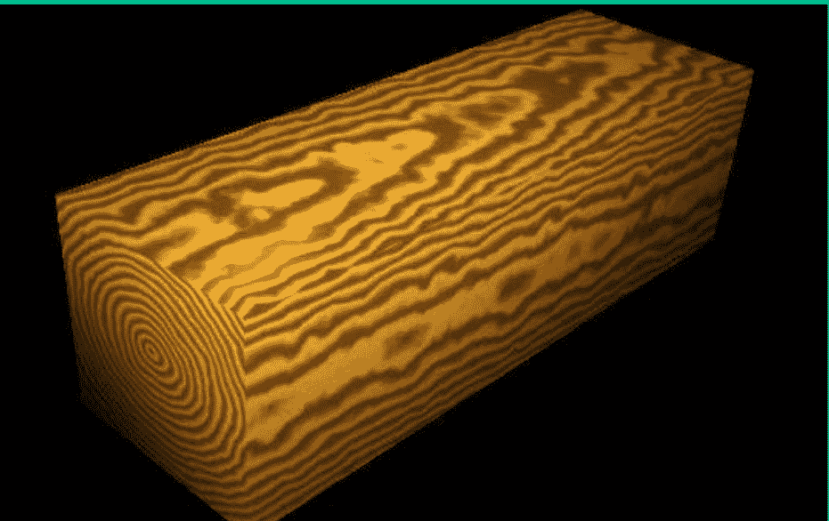


计算机已经成为快速、廉价生成图形的强有力的工具，没有哪个领域不从使用图形显示中获益。基于计算机图形学，工程设计人员在设计图纸时就可以浏览产品的形状和结构；考古工作者可以跨越时间隧道，在古代的宫殿中漫游；探险家无须乘坐宇宙飞船即可领略太空的瑰丽景色。随着计算机技术和数学技术的不断进步，计算机图形学已不再是一个陌生的名词。现在，我们可以看到计算机图形学已经广泛地用于多种领域，如科学、工程、医学、商业、工业、政府部门、艺术、娱乐业、广告业、教育和培训等。

### 1.1 图形信息的计算机处理

与其他形态的信息相比，图形具有直观明了、含义丰富、信息量大等种种优点，因此它有着广泛的应用。所谓“一目了然”、“百闻不如一见”都说明了图形信息的优越性。当然图形的表示、生成、处理、存储、检索、传输和管理等远比文本复杂。用计算机处理图形信息比传统的手工或机械方式前进了一大步，它使图形的用途更加广泛、使用更加有效、而图形的生成成本也越来越低。

图形信息的计算机处理涉及以下三个学科：

- 1. **图像处理（Image Processing）**
- 2. **模式识别（Pattern Recognition）**
- 3. **计算机图形学（Computer Graphics）**

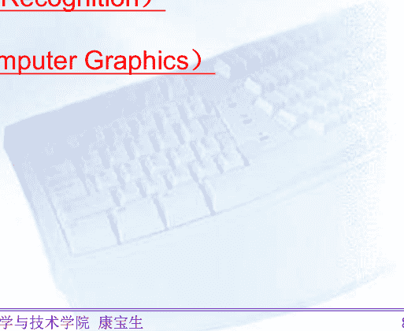

#### 1. 图像处理

图形（图像）经过数字化后输入计算机，由计算机按应用的需要进行图像增强、复原、分解、重构、编码、存储、传输等各种各样的处理，需要时把加工处理后的图形（图像）重新输出，这个过程称为“图像处理”。卫星遥感图片的处理、CT图片、MRC图片处理、金相图谱分析、卫星云图、海图处理等等都是图像处理的典型应用。图像处理所研究的问题是如何滤去噪声、压缩图像以便传输和存储，用对比增强技术突出图像中的某些特征，用复原技术使图像清晰，从MRC、CT信息重建二维和三维图像等。

#### 2. 模式识别

图形信息输入计算机后，先对它进行特征提取等预处理，然后用统计判定方法或语法分析法对图形作出识别，最后由计算机按照使用需求给出图形的分类或描述，这就是模式识别。邮政自动分拣、中西文字字符和工程图纸自动阅读等等都是模式识别技术的应用实例。模式识别研究怎样分析和识别输入的图形，以便找出其中蕴涵的内在联系或抽象模型。

#### 3. 计算机图形学

使用计算机建立、存储、处理某个对象的模型，并根据模型生成该对象图形的有关理论、方法与技术，称为“计算机图形学”。这里所说的对象，可以是各种具体的、实在的物体，如汽车、飞机、船舶、机械零件、山川、河流等，也可以是抽象的或假象的物体，如天气形势、人口分布、经济发展增长速度等等。无论何种对象，从基本的处理技术来看只有两类，一类是线条图，如工程图、地图、曲线图表等；另一类则是明暗图，与照片相似，亦称作真实感图。

对象的描述

对象的图像

计算机图形学

模式识别

计算几何

图像处理

图 1. 计算机图形学与相关学科之间的关系

### 1.2 交互图形系统的组成

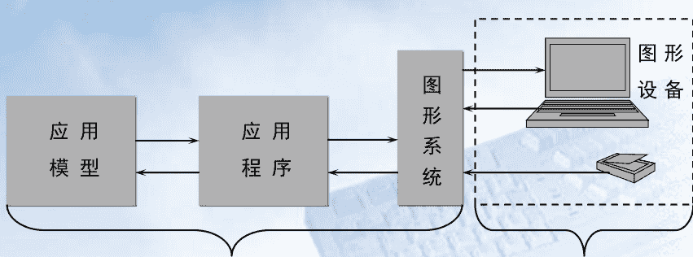

图 2. 交互式图形系统的组成

#### 1. 应用模型（Application model）

应用模型（应用数据结构）实质上是一些数据文件，其中保存着要生成其图形的那个（些）对象的全部描述信息。这些信息包括：定义对象所有组成部分形状和大小的几何信息以及有关的拓扑信息；用于说明与该对象图形有关的属性信息，如色彩、纹理、表面性质，以及实际问题还需要涉及的其它非几何数据，如材料、单价、加工要求等。它们通常存放在数据库中。

能够正确表达一个对象的性质、结构和行为的所有描述信息，称为对象的模型。计算机图形学感兴趣的主要是对象的几何性质（形状、大小、位置、结构等），用于刻画被处理对象几何性质的描述信息就构成了它们的几何模型。常用的几何模型有线框模型(Wireframe Model)、面模型(Surface Model)、体模型(Solid Model)和分形模型(Fractal Model)，它们用来表示三维空间中的物体。

#### 2. 图形应用软件

图形应用软件是图形系统中的核心部分，它是图形技术在各种不同应用中的抽象，其主要功能如下：

- 根据从图形输入设备经由图形支撑软件送来的命令和数据，构造或修改被处理对象的模型。
- 从应用数据结构中取出该对象的几何数据及有关属性数据，按照应用的要求进行种种处理，然后使用图形支撑软件所提供的各种功能，生成该对象的图形并在图形输出设备上输出。
- 与图形显示无直接关系的其它处理功能，如性能模拟、

分析计算、后处理、用户接口、系统维护等。

#### 3. 图形支撑软件

图形支撑软件通常由一组公用的图形子程序所组成，它扩展了系统中原有高级语言和操作系统的图形处理功能。特别是采用标准图形软件如 PHIGS+、GKS、CGI、Open GL 等后，图形应用软件的开发具有以下三方面的优点：

- 与设备无关 在标准图形软件基础上开发的各种图形应用软件，不必关心具体设备的物理性能和参数，可在不同的硬件系统之间方便地进行移植和运行。

- **与应用无关** 标准图形软件的各种图形输入、输出处理功能，综合考虑了多种应用的不同要求，因此具有很好的适用性。
- **开发起点** 标准图形软件提供了多种图形输出原语（Graphics Output Primitives），如线段、圆弧、曲线、折线、填充区域、图像、文本等，能够处理各种类型图形输入设备的操作，可允许对图形分段、进行变换，因此图形应用软件的开发起点高。

#### 4. 图形设备

图形系统中的外围设备，除大容量存储器、通信控制器等常规设备外，还有图形输入输出设备。

输出设备 分为图形显示器和图形硬拷贝设备，如绘图机、打印机以及其它设备等。

输入设备 国际标准中，输入设备按照逻辑功能分为定位设备、定值设备、选择设备、拾取设备、字符输入设备、笔划设备六类。通常，一种物理设备往往兼具几种逻辑功能。在交互式系统中，图形的生成、修改、标注等人机交互操作，都是由用户通过图形输入设备进行控制的。

### 1.3 计算机图形学的研究内容

计算机图形学是一门交叉性学科，它的主要核心技术是如何建立所处理对象的模型并生成该对象的图形。其主要研究内容大体上可以概括为以下几个方面：

**几何模型构造技术（Geometric Modeling）** 例如各种不同类型几何模型（二缝、三维、分缝）的构造方法及性能分析，曲线曲面的表示与处理，专用与通用模型构造系统的研究等等。

**图形生成技术（Image Synthesis）** 例如线段、圆弧、字符、区域填充的生成算法；隐藏线/隐藏面消除、光照明模型、

浓淡处理（Shading）、纹理（Texture）、阴影、灰度与色彩等各种真实感图形生成技术。

**图形编辑与处理技术**　例如图形的平移、旋转、缩放、投影、裁剪等各种几何变换操作的方法及其软件或硬件实现技术。

**图形信息的存储、检索与交换技术**　例如图形信息的各种机内外表示方法、组织形式、存取技术、图形数据库的管理、图形信息的通信等。

**人机交互与用户接口技术**　例如新型定位设备、选择设备等的研发；各种交互技术如构造技术、命令技术、选择技术、

响应技术等的研究，以及用户模型、命令语言、反馈方法、窗口系统等用户接口技术的研究等。

#### 动画技术

研究实现高速动画的各种软、硬件方法，开发工具，动画语言等。

#### 图形标准与图形软件包的研究开发

如制订一系列图形国际标准，使其能满足多方面图形应用软件开发工作的需要，并使图形应用软件摆脱对硬件的依赖性，允许在不同系统之间方便地进行移植。

#### 图形输出设备与输出技术

如各种图形显示器逻辑结构的研究，实现高速图形功能的专用芯片、图形硬拷贝设备的研发.


### 1.4 计算机图形学的发展历史回顾

最早的计算机仅仅是用来进行科学计算，利用计算机进行图形处理的工程应用，应归功于美国的战术防空系统 SAGE (Semi Automatic Ground Environment)。二次世界大战刚结束，美国国防部就开始筹划如何预防远程轰炸机携带核弹头突然袭击美国本土的问题，最后决定建立一个实时信息控制系统，以便监视北美的整个空域和地域，使空军总部的指挥员能清晰地看到空中的目标和地面机场的动态，及时准确地指挥作战。具体的部署是研制计算机通信网和在全国部署一百多个图形工作站，利用19英寸阴极射线管（CRT）显示各个军区的地理边界、雷达搜索目标的位置和航迹、拦截点的位置以及计算机生成的其他信息。指挥员可以用光笔（当时称为光枪）指点屏幕上的某一目标，询问进一步的细节或向计算机发送其他指令。许多公司参与研制了 SAGE 系统，整个技术方案由麻省理工学院（MIT）林肯实验室负责。SAGE 系统 1957 年投入使用，二十世纪 60 年代中期逐渐淘汰，整个计划并未最终完成。但这一尝试为交互式计算机图形显示技术的发展无疑起到了巨大的带头作用。

计算机图形学的发展经历了以下五个阶段：

#### 准备和酝酿时期(1950~1960)

在 SAGE 计划的推动下，1950 年，MIT 研制了“旋风 I 号”图形设备（Whirlwind I ），类似于示波器，可显示简单图形。
1952 年，世界上第一台数控铣床的原型在 MIT 的伺服机构实验室诞生。1957 年，美国空军将第一批数控铣床装备到飞机工厂。1958 年，美国的 Calcomp 公司和 Gerber 公司分别研制出滚筒式绘图仪和平板式绘图仪。其后，MIT 发展了 APT（Automatically Programmed Tools）数控加工自动编程语言，这是目前国际上最为通用的加工编程工具。整个五十年代大多采用电子管计算机，用机器语言编程。计算机仍以科学计算为主，为之配置的图形设备仅具有输出功能，计算机图形学处于被动式的图形处理阶段。

#### 蓬勃发展和进入应用时期(1960～1970)

1962 年，第一台光笔交互式图形显示器在 MIT 林肯实验室研制成功，I. E. Sutherland 在这里发表了划时代的博士论文 “Sketchpad：一个人机通讯的图形系统”，首次提出了计算机图形学、交互技术、分层存储符号的数据结构等新思想，为计算机图形学的发展和应用奠定了理论基础。1964 年，Coons 在 MIT 提出了用小块曲面片组合表示自由型曲面时使曲面片在边界上达到任意高次连续阶的理论方法；法国Renault汽车公司的 P. Bézier 提出了自由型曲线、曲面设计的理论方法。这些方法得到了工业界和学术界的极大推崇，分别称之为Coons 曲面和 Bézier 方法。Coons 和 Bézier 并列被称为现代计算机辅助几何设计技术的奠基人。

在美国工业界，研制交互式图形显示器的工作亦在平行开展。1964 年，IBM 推出自主设计的图形显示设备 IBM2250 显示器。这是 IBM 计算机上正式提供工业界使用的第一代刷新式随机扫描图形终端，它使用光笔作为交互输入手段，并配有一组32个功能键，以便调用程序中的相应模块。通用汽车公司研制了多路分时图形控制台，实现了各阶段的汽车设计。

作为IBM2250最早用户的波音、麦克唐纳、洛克希德等飞机公司也先后开发了一系列CAD/CAM系统软件，其中洛克希德公司的CADAM绘图加工系统，自1974年进入市场以来，已成为IBM主机上目前应用最广的CAD/CAM软件之一。到60年代末，美国安装的CAD工作站已达200多台，可供几百人使用。

#### 广泛应用的时期(1970～1980)

1970 年，美国 Applicon 公司第一个推出完整的 CAD 系统。此间出现了廉价的固体电路随机存储器、产生逼真图形的光栅扫描显示器、光笔、图形输入板等多种形式的图形输入设备，如美国 Tektronix 公司发展的基于存储管技术的 4006、4010、4012、4016等图形终端，其分辨率可达4096×3072，而价格还不到 IBM2250 的一半。因此，出现了面向中小企业的商品化 CAD/CAM 系统。整个 70 年代，CAD/CAM 技术的应用已相当广泛，许多功能强大的大型系统软件相继面世，如英国飞机公司的 CONSURF 系统、Renault 公司的 UNISURF 系统 Rochester 大学的 PADL 系统、Cambridge 大学的BUILD 系统、北海道大学的 TIPS 系统等。到 70 年代末，美国 CAD 工作站的安装数量已超过12000 台，使用人数超过 2.5万。

#### 飞速发展时期(1980～1990)

图形系统和 CAD/CAM 工作站的销售量与日俱增。1981年美国实际安装 CAD 系统 5000 套，1983 年超过 12000套，1988 年发展到 63000 套。这一时期的显著特点是： ① 个人机出现； ② 新的几何造型方法 NURBS 的研究有了长足的发展； ③ 几何造型方法的研究由曲线曲面的表示方法转向几何特性分析、几何处理和设计方法； ④ 基于个人计算机的CAD/CAM 系统开始商品化并广为流行； ⑤ CAD/CAM 技术从大中型企业向小企业扩展，从发达国家向发展中国家扩展，从用于产品设计发展到用于工程设计及其他非加工工业领域； ⑥ CAD/CAM 系统软件的功能日趋完善，大型软件不断涌现，如法国达索公司的 CATIA 系统、美国 SDRC 公司的 I-DEAS 系统、 PTC 公司的 Pro/Engineer 系统、 EDI 公司的 UG II 等。

产品数据交换标准 STEP (Standard for The Exchange of Product model data)、开放式图库 Open GL、数据交换接口 DXF 等。

这些标准有些是面向图形设备的驱动程序包，有些是面向用户的图形程序包，有些是面向不同 CAD 系统的文档规范。这些标准的制订和采用为 CAD 技术的推广和移植，为资源信息共享起到了重要作用。

#### 图形应用系统的集成化

图形应用系统的集成化主要体现在以下几个方面： ① 系统结构由过去的单一功能变成综合功能； ② 有关的软件和算法不断固化；③ 多处理器机、并行处理技术用于图形应用系统中，使工作速度成倍增加；④ 网络技术在图形应用系统中被普遍采用，使近程和远程的资源即时共享；⑤ 多媒体技术广泛应用。

#### 图形应用系统的智能化

人工智能、专家系统和知识工程技术在图形应用系统中的应用，大大提高了图形应用系统的自动化程度。


### 1.5 计算机图形学的应用

计算机已经成为快速、廉价生成图形的强有力的工具，没有哪个领域不从使用图形显示中获益。虽然在工程和科学上的应用必须依赖昂贵而笨重的设备，但是计算机技术的发展已将计算机图形学变成了实用的工具。计算机图形学已经在诸如科学、工程、医学、商业、工业、政府部门、艺术、娱乐业、广告业、教育和培训等多种领域得到广泛应用。下面简要说明一些典型的图形学应用实例。

#### 1. 计算机辅助设计与制造(CAD/CAM)

这是计算机图形学在工业界应用的最重要领域，现在几乎所有的产品都是用计算机来设计。CAD 系统已迅速取代绘图板加丁字尺的传统设计方法，频繁地应用于汽车、飞机、轮船、宇宙飞船、集成电路、大楼、纺织品和许许多多其他产品的设计中，担负起繁重的日常绘图任务以及总体方案的优化和细节设计工作。

#### 2. 计算机模拟和动画

由计算机产生的动画片，已日益普及,它可以表现真实对象或被模拟对象随时间变化的行为和动作。通过以图形方式观察变化的效果，我们不仅可以研究数学图形，而且可以研究科学现象的数学模型，例如，液体流动、相对论、核反应、化学反应、生理系统与器官以及有负载时结构的变形等。计算机动画的另一种复杂的应用是飞行模拟器。模拟器不仅产生固定环境的景色(飞行器在这一环境中运动)，而且可以产生诸如云、雾、烟、灯光以及不同大小和形状的其他飞行器等特殊的景物。飞行员可在模拟器上演练空战。为练习月球登陆，宇航员在模拟器上演习驾驶登月轮及使母船进入船坞。

#### 3. 过程控制

在过程控制中，图形显示器用来显示被控对象(核电厂、炼油厂等)有关环节在操作过程中的状态，操作人员通过图形交互技术进行各种调节或处理所发生的意外事故。军事指挥员在指挥和控制显示器上观察战场的数据(车辆的数目和位置、投入的武器、军队的移动、伤亡人员)，并根据需要，修订其战略战术。飞行控制人员从雷达显示器上观察计算机产生的标志及状态信号和飞机信号，进行空中交通指挥。

#### 4. 人体造型

用计算机构造人体模型， 有着非常广泛的应用前景。人体工程学中需要考虑人和机器以及周围环境的关系。工业设计中要使生活用具适应人的生理、心理特征。服装设计中要将人体作为效果分析的对象。舞蹈工作者需要方便地编写舞谱和形象地表达舞蹈动作细节的工具等等。针对应用场合的不同，人体模型的构造方法也不同。最简单的是杆系模型，应用最多的是多面体模型，最复杂的是曲面模型。模型的活动关节数也取决于应用需要。例如，为了设计战斗机驾驶舱，需要计算飞行员的视野。

景角度，用人体模型检查各部分的允许活动范围，考查各种手把、开关能否操纵自如，等等。这时，使用人体模型应该详细到包含手掌和手指。

#### 5. 计算机辅助教学与培训

利用计算机生成的物理模型、财政模型、经济系统模型等作为辅助教学工具，可以帮助学员掌握和理解理论知识。有些方面的教学与培训需要设计专门的系统，如船长、飞行员、宇航员、大型设备操作员和航空控制人员的实习和培训模拟系统就是这样的一种专门系统。

将基于计算机图形学的虚拟现实技术（Virtual Reality）应用于教学，可以使学员能够游览海底、遨游太空、观摩历史城堡，甚至深入原子内部观察电子的运动和体验爱因斯坦的相对论世界，从而更形象地获取知识、激发思维。通过构造基于虚拟教室的协同教学环境，能够使教师和学生在虚拟的教学环境中自然地进行面对面的交流，营造真实、自然的教学氛围。

#### 6. 可视化

科学家、工程师、药剂师、商业分析员和其他一些人员常要分析大量的信息或研究特定处理的行为。在巨型机上进行的数值模拟不断生成包含成千上万数据项的数据文件。同样，卫星摄像机等也以比解释速度更快的速度积聚大量的数据文件。扫描这众多数据以确定趋势及相互关系是一件乏味和低效的过程。但是，如果这些数据被转换成可视形式，则趋势和相互关系就立即显现。为科学计算、工程和医药的数据集或过程生成图形表示称为科学计算可视化 (Scientific Visualization)，而商用可视化 (Business Visualization) 则用在与商贸、工业和其他非科学计算领域的数据可视化上。

#### 7. 图像处理

尽管在计算机图形学和图像处理中所使用的技术有重叠，但两者有不同的基本操作。在计算机图形学中使用计算机来生成图形，图像处理则使用有关技术修改或解释现有图片，比如照片和电视扫描片。图像处理的两个主要应用是：（1）改善图片质量；（2）对视觉信息的机器感觉，如应用机器人。

图像处理和计算机图形学在许多应用中都结合在一起。例如在医学上使用这些技术建模和研究生理功能、设计人造肢体、计划和练习手术等。Computer-Aided Surgery 是目前发展最为快速的一个应用领域，通过使用图像技术获得身体的二维剖面，然后使用图形方法模拟实际手术过程、观察并操纵每一剖面，以及试验不同的手术位置。

#### 8. 图形用户接口

图形比文字、统计报表更直观、逼真。Macintosh 微机首先在商品化产品上使用形象的图形表示操作命令，使得普通用户也会用计算机画图、做日常计算，打破了人们对操作计算机所持的神秘感。图文形式相结合的用户接口大大改善了计算机交互操作的用户界面，开辟了计算机应用的许多新领域。

## 第二章 图形系统

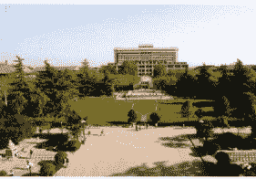

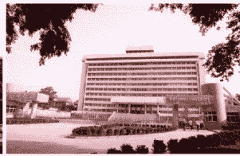

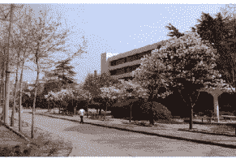

### 2.1 视频显示设备

图形系统一般使用视频显示器作为基本的输出设备。大部分视频显示器的操作是基于标准的阴极射线管（CRT: Cathode Ray Tube）设计的，但是也存在一些基于其他技术设计的视频显示器，如液晶显示器、等离子显示器等。

#### 1. CRT 显示器

CRT 显示器由阴极射线管和有关的附加电路如偏转电路、视频放大器等组成，其结构图如下图所示。

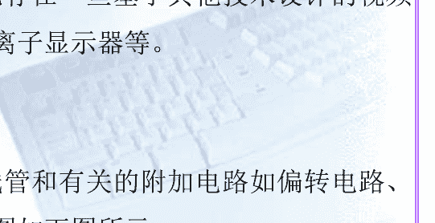

**CRT 显示器的结构图**

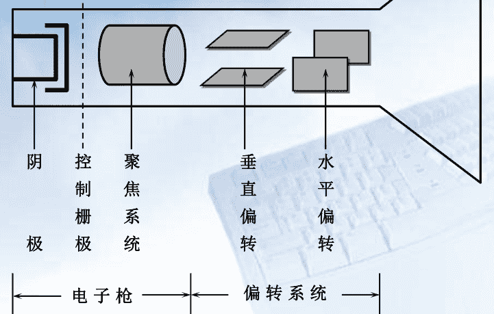

由灯丝、阴极和控制栅极所组成的电子枪发射出电子束(阴极射线)，通过聚焦系统和偏转系统，射向涂有荧光层的屏幕上的指定位置。在电子束轰击的每个位置，荧光层发出可见光。由于荧光层发出的光亮度随着时间按指数级衰减，因而必须采用某种方法来保持屏幕图像。CRT 显示器依据其原理可分为存储式显示器和刷新式显示器两大类，而刷新式显示器又可分为随机扫描显示器和光栅扫描显示器两类。

- 存储式 CRT 显示器
- 刷新式 CRT 显示器

##### 存储式 CRT 显示器

保持屏幕图像的一种方法是把图形信息存储在 CRT 内，基于此的显示器称为存储式 CRT 显示器，亦称作直视存储管（DVST）。直视存储管通过紧贴屏幕荧光层后的电荷分布来存储图形信息，因此使用两支电子枪，一支是基本枪，用来存储图形，另一支是泛流枪，保持图形显示。

DVST 显示器的优点是显示图形的质量高，即使很复杂的图形都可在极高分辨率下无闪烁显示。DVST 系统的缺点是不能显示彩色图形，而且图形不能部分擦除。要擦除图形的一部分必须擦除整个屏幕，然后重画修改后的图形。擦除和重画过程对于复杂图形来讲，可能需要数秒钟。基于上述理由，DVST系统多数已被光栅系统所代替。

##### 刷新式 CRT 显示器

保持屏幕图形的另一种方法是快速控制电子束反复重画图形，这就是刷新式 CRT 显示器。根据人类眼睛的生理特征，每秒钟重复 30 ～ 60 次，就可感觉不到画面的闪烁。因此，要想观察到一幅稳定发光的画面，刷新式 CRT 显示器必须每秒重复执行显示文件 30 次或更多次。

采用刷新式显示器可迅速改变画面的内容。通过主机改变显示文件中的某些显示命令，在下一个刷新周期执行后，就可得到修改后的画面。因此，刷新式 CRT 显示器是实现交互计算机图形显示和动画显示的重要设备。

刷新式 CRT 显示器分为三类：

- 光栅扫描显示器
- 随机扫描显示器
- 彩色 CRT 显示器

##### 光栅扫描显示器的工作原理

在光栅扫描显示器中，电子束依照固定的扫描线和规定的扫描顺序自上而下、从左到右顺次进行。电子束先从屏幕左上角开始，向右扫描一条水平线(称为行)，然后迅速回扫到左边偏下一点的位置，再扫描第二行。照此固定的路径及顺序扫描下去，直到最后一行，即完成整个屏幕的扫描。这个扫描过程所产生的图像称为一帧，然后电子束迅速回扫到左上角，开始下一帧的扫描。光栅扫描显示器的刷新周期是按每秒 60～80 帧的速率进行的，每帧由固定数目的行(扫描线)，每行由固定数目的独立点(像素点)组成，屏幕上呈现出由固定数目扫描线组成的光栅。

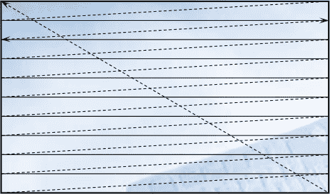

显然，光栅扫描显示器的扫描线越多，每条扫描线上的像素点越多，则显示的图形质量越高。衡量光栅扫描显示器质量高低的一个技术指标就是分辨率，它通常用屏幕上扫描线数和每一扫描线上的像素点数来定义，一般采用 256×300 到 1280×1024 不等。高质量的显示器用到更高的分辨率，高分辨率系统常常称为高清晰度系统（HDS）。

电子束在每一像素点的强度范围依赖于光栅系统的功能。在简单的黑白系统中，每个像素点或亮或暗，因此每个像素点只需一位（bit）来控制其亮度。作为二值系统，值 1 表示该像素点处的电子束开通，而值 0 表明电子束关闭。要显示彩色并且强度可变，就需附加位。在高质量系统中，每个像素可多达 24 位。

有些光栅扫描显示器采用了电视系统的隔行扫描方式。这种方式的好处在于用逐行扫描所需时间的一半，就可看到整个画面。隔行扫描技术主要用于较慢的刷新速率。

##### 随机扫描显示器的工作原理

在随机扫描显示器中，电子束像一支快速移动的画笔，实际勾画出要显示的图形。电子束根据需要可在屏幕任意方向上连续扫描，没有固定的扫描线和规定的扫描顺序的限制，故称为随机扫描。由于随机扫描显示器绘制的图形只能是单线条图形，不能显示逼真的有阴影的场景，因此随机扫描显示器也称为向量显示器或笔迹显示器。

随机扫描显示器的刷新率取决于被显示的线数，一般设计成每秒 30～60 次画出图形的所有线条。高性能的随机扫描系统以这样的刷新率能处理大约 100,000 条短线条。

##### 彩色 CRT 显示器的工作原理

刷新式 CRT 利用能发射不同颜色光的荧光层的组合来显示彩色图形。组合不同荧光层的发射光，便能生成一定范围的颜色。用 CRT 产生彩色显示的两种基本技术是电子束穿透法和荫罩法。

随机扫描显示器采用电子束穿透法显示彩色图形。将两层荧光层（通常一红一绿）涂在 CRT 屏幕内层。显示的颜色取决于电子束穿透荧光层的深度，慢的电子束只激活外层的红色层。非常快的电子束穿透红色层并激活里面的绿色层，中速的电子束通过红、绿发光的组合，生成另外两种颜色：橙色和黄色。电子束穿透法是随机扫描显示器生成彩色的廉价途径，但只有四种颜色且图形的质量较低。

光栅扫描显示器利用荫罩法显示彩色。因为它能生成的彩色范围比电子束穿透法宽广得多，所以被广泛采用。在每个像素位置，荫罩 CRT 有三个荧光彩色点(点三角形)：一个荧光点发射红光(R)，另一个发射绿光(G)，第三个发射蓝光(B)。这种 CRT 有三支电子枪，与每个彩色点一一对应，而紧靠荧光涂层的荫罩上分布着一系列孔，与荧光点对齐。当三支电子束通过荫罩激活一个点三角时，便在屏幕上显示一个小的彩色亮点。这个彩色系统称为 P 显示器。

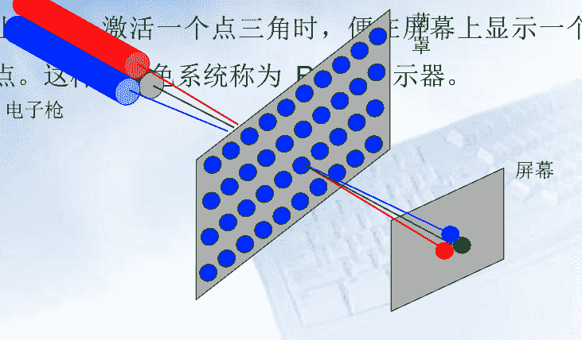


由于荫罩式显示器的固有缺点：如荧光屏是球面的，几何失真大，而且三角形的荧光点排列即是很密也不会特别清晰；所以近几年荫栅式显示器逐渐流行起来，它的工作原理如图所示。

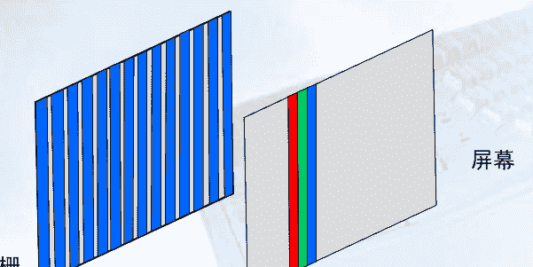

从原理来说，荫罩式和荫栅式显像管的区别只是射线的选择方式和荧光点的排列不同而已，但是两者的显示效果区别是很明显的，荫栅式显像管的亮度更高、色彩更艳丽。常用的荫栅式显像管有索尼公司的特丽珑管（Trinitron）和三菱公司的钻石珑管（Diamondtron），两者稍有不同。采用荫栅式显像管的显示器有柱面显示器和平面显示器，柱面显示器的表面在水平方向仍然略微凸起，但垂直方向上却是笔直的，呈圆柱状，故称之为“柱面管”。柱面管由于在垂直方向上平坦，因此与球面管相比几何失真更小，而且能够将屏幕上方的光线反射到下方而不是直接射入人眼，因而大大减少了眩光。平面显示器的

荧光屏为完全平面，大大提高了图形显示质量。当然，由于玻璃的折射，屏幕会产生内凹的现象，但是通过一定的补偿技术，就能产生真正平面的感觉。由于平面显示器的高清晰度、低失真以及对人眼的低伤害，因此越来越得到人们的喜爱。

荫栅式与荫罩式荧光屏的点排列如下图所示，其中距离 d 就是人们常说的的点距。

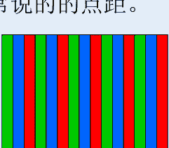

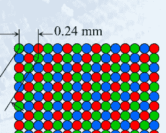

#### 2. 平板显示器

虽然多数图形显示器采用 CRT 构造，但另外一些技术已显露出将要替代 CRT 显示器的趋势，这就是平板显示器（Flat Panel Display）。它是一类比 CRT 轻、薄并节省能耗的视频设备。平板显示器的应用包括小型 TV 监视器、手提电脑、航空座椅扶手上的电影屏幕、电子广告牌等。

平板显示器可分为两类：发射显示器和非发射显示器。发射显示器是将电能转换为光的设备，像等离子显示板（气体放电显示器）、薄片光电显示器以及发光二极管等都是发射显示器的

实例。非发射显示器利用光学效应，将太阳能或来自其他光源的光转换为图形，液晶显示器是非发射显示器的重要的例子。

液晶显示器虽然在显示效果上和传统的 CRT 显示器相比有一定的差距，但是由于它众多的的优点。第一，它的外观轻巧精致，当前生产的 LCD 厚度只有1~5cm，比 CRT 那个庞然大物实在是不可同日而语；第二，由于液晶像素总是发光，只有加上不发光的电压时该像素点才变黑，所以不会产生 CRT 那样的因为刷新频率低而出现的是闪烁现象；第三，它的工作电压低、功耗小、节约能源；第四，它没有电磁辐射，对人体健康没有任何影响。

液晶是一种介于液体和固体之间的特殊物质，它具有液体的流态性质和固体的光学性质。当液晶受到电压的影响时，会改变它的物理性质而发生形变，此时通过它的光的折射角度就会发生变化，而产生色彩。

液晶屏幕背后有一个背光源，该光源发出的光先穿过第一层偏光板，再射到液晶上。而当光线透过液晶体时，就会产生光线的色泽改变。从液晶体射出的光线，还必须经过一块彩色滤光片以及第二块偏光板。由于两块偏光板的偏振方向成90角，因此再加上电压的变化和一些其他装置，液晶显示器就能显示需要的颜色了。

液晶显示有主动式和被动式两种，其实这两种的成像原理大同小异，只是背光源和偏光板的设计和方向有所不同。主动式液晶显示器使用了场效晶体管（field effect transistor, FET）以及共通电极，这样可以让液晶体在下一次的电压改变前一直保持电位状态，而不会产生在被动式液晶显示器中常见的鬼影或是画面延迟的残像等。现在最流行的主动式液晶显示器使用了薄膜晶体管（thin film transistor, TFT）。被动式液晶显示器有超扭曲向列（super TN, STN）和双层超扭曲向列（double layer super TN, DSTN）液晶显示器等。

液晶显示器的技术指标有以下两个：

① 可视角度。由于液晶的成像原理是通过光的折射而不是像 CRT 那样由荧光点直接发光，所以在不同的角度看液晶显示屏必然会有不同的效果。当视线与屏幕中心法向成一定角度时，人们就不能清晰地看到屏幕图像，可以看到清晰图像的最大角被称为可视角度。一般所说的可是角度是指将左右两边的最大角度相加。工业界有 CR（contrast ratio）10 和 CR5 两种标准来判断液晶显示器的可视角度。

② 点距和分辨率。液晶屏幕的点距就是两液晶颗粒之间的距离。点距一般为 0.28~0.32mm 就能达到较好的显示效果。分辨率在液晶显示器中的含义和在 CRT 中的不完全一样.通常所说

的液晶显示器的分辨率是指其真实分辨率，比如 1024×768 的含义就是指该液晶显示器含有 1024×768 个液晶颗粒。只有在真实分辨率下液晶显示器才能得到最佳的显示效果，其他较低的分辨率只能通过缩放来显示，效果并不好。而 CRT 显示器如果在 1024×768 的分辨率下能清晰显示，那么在其他分辨率下都能很好地显示。


#### 3. 三维观察设备

显示三维场景的图形监视器的设计，采用了从震动着的柔性镜面反射 CRT 图像的技术。当变焦距镜震动时改变焦距长度，这些震动是同 CRT 上的对象的显示同步的。因此，该对象上的每一点从镜面反射成距离为该点到给定观察位置的距离的空间位置。这就允许我们围绕一对象或场景行走，并从不同的角度来观察之。

#### 4. 立体感和虚拟现实系统

表示三维对象的另一种技术是显示具有立体感的视图，这种方法并不生成真实的三维图像，而是为观察者的每只眼睛给出不同的视图来提供三维效果，致使场景带有深度。

为得到立体感的投影，首先需要得到从对应每只眼睛观察方向产生的对应场景的两个视图。这可通过指定不同观察位置并由计算机生成的场景来获得这两个视图，或者用一对立体照相机拍摄某些对象或场景来获得这两个视图。当我们同时用左眼观察左视图，右眼观察右视图，则两个视图合成为单个视图，

并感觉到场景带有深度。

产生立体感效果的途径之一是使用光栅系统，在不同刷新周期交替显示两种视图。通过眼镜观察屏幕，每个透镜设计成高速交替的快门，它能同步地封锁另一视图。立体感视图也是虚拟现实系统的一个组成部分，在此，用户可步入场景，并同环境进行交互。虚拟现实系统包含生成立体感视图的光学系统的头盔，通常用来连接交互输入设备，定位并操纵场景中的对象。头盔内的传感系统跟踪观察者的位置，以便在观察者“走进”，并同显示交互时能看对象的正面和背面。

### 2.2 光栅扫描系统

光栅扫描系统以其显示的图形色彩丰富、真实感强，已成为主流的显示设备，因此有必要就光栅扫描系统的组成、工作原理进行详细的讨论。

#### 1. 结构与原理

光栅扫描显示器的图形是由像素 (Pixel) 组成的，每个像素可呈现不同的灰度或颜色，通常用数值表示之。因此，在显示一幅图形时，必须计算出每个像素的亮度值。为了使显示的图形不断刷新，这些亮度值必须存储，用来存储每个像素亮度值的

存储器称为帧缓冲器。帧缓冲器的单元个数和显示器的像素总数相同，每一单元的位数决定了一帧图形中能够允许显示的不同灰度等级的数目或颜色的种类。例如，每个单元是 8 位，则可在 一帧图中出现 2⁸ = 256 种灰度或颜色。光栅扫描系统通常由图像生成器、帧缓冲器、彩色表、视频控制器和监视器五部分组成，更复杂的光栅扫描系统还有其他的协处理器和加速器。其结构如下图所示。

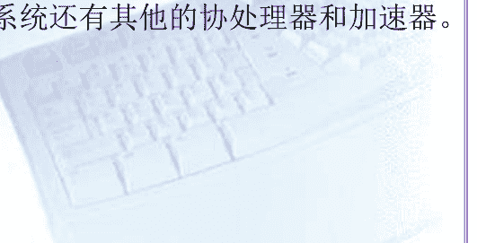

在这五部分中，帧缓冲器是整个光栅扫描系统的核心，它存放着需要在屏幕上显示的图形的影像。准确地说，帧缓冲器中存放了与屏幕画面上的每一像素一一对应的一矩阵，矩阵中每一个元素的值就是像素值，该矩阵称为位图(Bitmap)。因此,帧缓冲器也叫影像存储器(Video RAM)、位图存储器或显示

存储器。彩色表用来定义像素的颜色，它根据像素值(称为颜色号)从表中查出颜色的定义，然后对 CRT 三原色 RGB 的亮度进行控制，从而生成各种不同的颜色。

光栅扫描系统的工作原理如下：

- ① 图像生成器根据主机发送的画图命令把图画在帧缓冲器中，即在帧缓冲器中生成要显示的图形的位图。
- ② 视频控制器一方面产生水平(X-地址)和垂直(Y-地址)同步信号送到监视器，使 CRT 的电子束不断地自上而下、从左到右进行扫描，形成光栅(Raster)。另一方面又根据电子束在屏幕
上的行、列位置，自动计算并生成帧缓冲器的相应地址，不断地读出帧缓冲器中的位图数据。
- ③ 从帧缓冲器中读出的数据(像素值)经过查找彩色表后，转换成 RGB 三原色的亮度值。对于无彩色表的光栅扫描系统，则像素值直接就是三原色的亮度值。
- ④ 颜色亮度也称为位图信号或视频信号，它控制 CRT 电子束的通、断、强、弱，从而在屏幕上形成一帧与帧缓冲器中所存储映像相对应的可见画面。


#### 2. 视频控制器

视频控制器的基本操作流程如下图所示，其两个寄存器用来

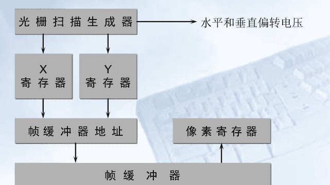

存放屏幕像素的坐标。开始时，X 寄存器置为 0，Y 寄存器置为 ymax。存储在帧缓冲器中该像素对应位置的值被取出，并用来设置 CRT 电子束的强度值，然后，X 寄存器加 1。该过程对最高行扫描线中的下一个像素重复执行，并沿该扫描线对每个像素重复执行。在最高行扫描线最后一个像素处理之后，X 寄存器复位为 0，Y 寄存器减 1。然后，依次处理沿该扫描线的各像素，而且这样的过程对每条后继的扫描线重复执行。当最底行扫描线 (y = 0) 的所有像素被处理后，视频控制器复位寄存器为最高行扫描线上的第一个像素位置，刷新过程重复开始。

除了基本刷新操作外，视频控制器还能执行一些其他操作。

对于多类应用，视频控制器在不同刷新周期内可从不同存储区取出像素值。例如，在高性能系统中，常常提供两个帧缓冲器，一个缓冲器用来刷新，另一个以强度值填充。同样，视频控制器可完成某些变换。在一个刷新周期内，屏幕区域可以放大、缩小、或从一个位置移向另一处。

#### 3. 帧缓冲器

帧缓冲器存放着被显示图形的位图，可见显示分辨率越高，所需要的存储容量就越大。此外，由于视频控制器需要不断地访问帧缓冲器，读出其中的内容，使 CRT 屏幕上的画面以

一定的频率进行刷新，所以帧缓冲器的工作速度比较高，且随着屏幕分辨率和帧频率而变化。又因为 CRT 刷新的同时，图像生成器随时可能向帧缓冲器写入新的显示内容或读出帧缓冲器的内容。因此，从原理上说，帧缓冲器是一个大容量、高速度的双端口的随机读写存储器。为了符合多种实际应用的要求，帧缓冲器的逻辑结构有各种不同的形式和变化，通常有以下几种：

- 图形模式与文本模式的显示存储器
- 单色与彩色的显示存储器
- 显示存储器的分页

##### • 图形模式与文本模式的显示存储器

图形显示器显示字符信息有两种方式：一种是图形模式，此时，每个字符的点阵表示(位图)均直接存放在显示存储器中，因而字符的显示位置可以以像素为单位在屏幕上任意定位，也可以随意改变单个字符的大小、方向或字符串的走向，但编辑修改操作比较麻烦；另一种是文本模式，此时显示存储器中存放的是字符的编码(ASCII码或汉字码)及其属性(加亮、闪烁、下横线等)，其字形的点阵信息一般存放在只读存储器中(称为字符发生器或字库)。显示器工作时，通过从显存读出字符

代码和视频控制器提供的扫描线号码，从字符发生器中读出字符信息送 CRT 显示。在这种方式下显示存储器中的信息比较紧凑整齐，编辑修改操作能高速进行，但格式死板，字符属性太少。

##### 单色与彩色的显示存储器

单色显示时，每个像素一般只用一位来表示，屏幕上整个画面的位图信息集中存放在显示存储器的一体(Bank)中。彩色显示或单色多灰度显示时，每个像素需要使用多个二进制表示。此时, 显存有两种组织方法(见图)：一种称为组合像素结构,

即画面上每个像素的所有位均集中存放在单个存储体中；另一种称为位平面（Bit Plane）结构，即像素的每一位各自存放在不同的存储体（位平面）中。由于使用了多个存储体，它们可以一次读出更多的像素信息，降低了对显存工作速度的要求。故位平面方式的显存结构在中、高性能的图形显示器中得到了广泛的采用。

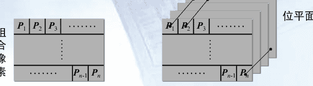

##### 显示存储器的分页

显示存储器的容量往往设计得比屏幕画面的位图大得多，也就是说，显存中可以同时存放多幅画面的位图。这时，显存区域将划分成若干页面，每个页面存放一幅位图。由于物理屏幕只有一个，因此一次只能显示其中某一个页面。正在显示的页面称为工作页面或活动页面，其他页面为非工作页面。通过视频控制器的控制，工作页面与非工作页面可以进行快速的切换。另外，页面的大小可以划分得比屏幕位图大得多，甚至是整个显示存储器。这样，从程序员的角度看来，可输出显示的画面将远大于实际的物理屏幕，此时物理屏幕仅仅是一个窗口，

它显示出来的不过是全部画面的一部分。通过视频控制器的滚动和移屏功能，用户可以看到显示存储器中的整个画面。

#### 4. 彩色表的结构与使用

如果要增加显示器的颜色(或灰度等级)数目，显示存储器的容量就要增加。而在实际应用中往往是这样的，对于一幅图画而言，其不同彩色的种类并不多。但不同应用场合的不同图形，其颜色的变化数目可能相当大。为了满足这一要求，一般均采用彩色表来解决。

彩色表是一个大容量的高速存储器,一般用双极性电路做成.

采用彩色表时，显示存储器中的像素值不再是直接送到监视器去的颜色信号，而是颜色编号。此时，显存中读出的颜色号作为彩色表的地址从彩色表中读出 RGB 三个分量的值(该颜色号的定义值)，然后送到监视器上去，其原理图如下：

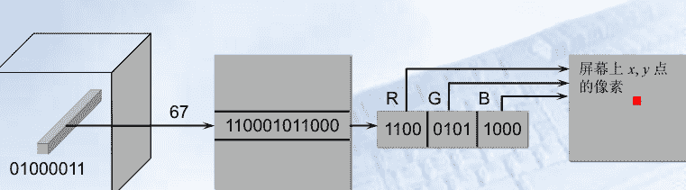

这里，像素用 8 位表示，彩色表共有 2⁸ = 256 个地址，彩色表的字长为 12 位，RGB 各用 4 位来定义。因此，该显示器总共

可显示 2¹² = 4096 = 4KB 种不同的颜色，但每屏画面中不同颜色的种类仅允许 256 种。实际的高性能图形显示器中，像素由 12～24 位组成，即 12～24 个位面，彩色表中 RGB 各用 8 位来定义，因此可显示的颜色数目高达 2²⁴ = 16MB 之多。

彩色表是一个高速随机读写存储器，其内容可以由软件装入、保存及修改。这不仅方便了颜色的使用，而且使彩色表有许多附加的控制功能，比如为了快速清屏，只要把彩色表内容全部置成背景色即可。彩色表的用途很多，例如它可以用来实现高速动画等。

#### 5. 图像生成器

图像生成器的主要功能是把画线、画多边形、填充区域、画曲线、写字符串等基本命令——称为图形输出原语——转换成相应的点阵(位图)，存放在显示存储器中，这个过程称之为扫描转换(Scan Conversion)。图形输出原语的一般形式是：

##### 原语名 参数(几何参数；属性参数；其他参数)

光栅扫描图形显示器常用的图形输出原语有：

画点(点的坐标；颜色)；画直线(起点坐标；终点坐标；颜色；线型；线宽)；画矩形(左下角坐标；右上角坐标；颜色；

类型)； 填充区域(一组顶点坐标；颜色；填充方式；图案)； 写字符串(输出字符串；起点坐标；字符大小；字符间距；字符方向；字体；… )； 圆/圆弧（圆心坐标；半径；起始角；终止角；颜色）。

除了完成几何图形的扫描转换外，图像生成器还必须能把图像输入设备输入的数字图像从主存写入显存，或者把显存中产生的图像保存到主存，进而保存到外存，甚至直接在显存中对图像进行移动，并进行一些逻辑处理，所有这些称之为光栅操作，也称为成组像素传输操作(Bit Block Transfer)，它的主要功能是：

- 写光栅操作 把一组像素数据从主存储器写入到显示存储器中指定的位置和大小的一个矩形区域中。
- 光栅复制操作 把显存中一个矩形区域内的全部像素数据复制到另一个位置的矩形区域中。
- 读光栅操作 把显存中指定位置和大小的一个矩形区域中的全部像素数据读出存放到主存储器中。

上述光栅操作均涉及到显存内容的修改，修改的方式有多种，如替换（新像素数据替换老像素数据）、异或（新老像素数据按位加）、与、或、置常量等。使用这些光栅操作，可使显存中

组成。如果再加上运行系统程序和应用程序的 CPU 及主存储器，则图形系统概念上就由二个处理器和三个存储器组成。主存储器和图形显示器之间有一个接口，用以交换各种信息。实际上，不同的计算机系统对图形显示的要求各不相同，因此图形显示器的结构也有差别。根据系统中处理器和存储器数目及接口方式，可将图形显示器分成四类：低成本结合式图形显示器、总线添加式图形加速器、图形终端和高性能图形工作站。

#### 6. 光栅扫描系统的性能参数

决定光栅扫描系统质量的性能参数主要有以下几个：

- ① 显示分辨率：指水平方向可以显示多少像素，垂直方向可显示多少条扫描线。
- ② 颜色或亮度等级数目：彩色显示器的颜色数目为两个指标，其一是显示器可以显示的所有不同颜色的总数，它取决于彩色表的字长；另一个指标是指同一帧画面中允许显示的不同颜色的最大数目，它由帧缓冲器中单元的位数所决定。亮度等级数目指的是单色显示器像素的亮度可以允许的变化种类。
- ③ 画图速度。指的是图像生成器把基本画图命令变成帧缓冲器中位图的转换速度，一般用每秒可画多少 2D 向量、3D 向量、2D/3D 多边形、有明暗的 3D 多边形来衡量。此外，像素图形的传输率也是一个极为重要的指标，用每秒可传输多少像素来度量。
- ④ 其他参数。屏幕尺寸、刷新率、纵横比、颜色、余辉长短以及其他一些人机工程方面的考虑。

### 2.3 图形软件

图形系统的另外一个重要组成部分是图形软件。图形软件分为两类：通用图形编程软件包和专用应用软件包。通用图形编程软件包提供一个可用于高级程序语言如 C 或 FORTRAN 的图形功能扩展集，一个典型的例子便是 SGI 设备上的 Open GL 系统。通用图形软件包的基本功能包括生成基本图元(直线、多边形、圆和其他图形)、设置色彩和强度值、选择观察和实施变换。专用应用图形软件包是为非程序员设计的，因此用户可生成显示而毋须担心图形操作是如何进行的。在这些软件包中，与

图形子程序的接口容许用户以他们自己熟悉的术语同程序通信，此类应用软件包的例子有美术家绘画系统和各种商业、医学和 CAD 系统等。

#### 1. 坐标表示

一般情况下，通用图形软件包是用笛卡尔坐标系描述设计的。如果一个图形的坐标值在其他坐标系(极坐标系、球面坐标系)中给出，那么可在输入图形软件包之前，须转换为笛卡尔坐标。专用图形软件包容许采用对该应用合适的其他坐标系。

图形软件中涉及到以下几个坐标系：

- 建模坐标系 (modeling coordinate) 或局部坐标系，用于构造一场景中的单个对象。
- 世界坐标系 (world coordinate) 或用户坐标系，用来构造场景。允许设置任何方便的浮点坐标或整数坐标，不受特定输出设备的约束所牵制。
- 设备坐标系 (device coordinate) 或屏幕坐标系，显示或输出场景的坐标系，它为非负整数坐标，坐标的单位和特定的设备有关。
- 规格化设备坐标系 (normalized device coordinate)，它的坐标值范围从 0 到 1，是独立于可能使用的特定的各种输出设备。

因此，对于一个具体的应用而言，从建模坐标系到设备坐标系的坐标变换的顺序如下：

(x_mc, y_mc) → (x_wc, y_wc) → (x_nc, y_nc) → (x_dc, y_dc)

#### 2. 图形功能

通用图形软件包为用户提供了建立和管理图形的各种功能，这些子程序按照它们是否处理输出、输入、属性、变换、观察或通用控制而分类。

- 图形输出功能 图形的基本构造模块，包括字符串和几何两种，如直线、曲线、填充区域、由彩色矩阵定义的形状，为构造图形提供基本工具。
- 属性功能 属性是输出图元的特性，即描述一个特定图元是怎样被显示的。它们包括强度和彩色设定、线型、文本类型以及区域填充模式等。
- 几何变换功能 包括模型变换和视图变换。
- 观察变换功能 用来指定一种观察和视图在输出显示区域上出现的位置和范围。

- 图形段功能 定义图形的逻辑部件，并对其进行操作。

- 输入功能 控制和处理来自交互输入设备的数据流。

- 通用控制功能 事务任务的处理，如清屏、初始化等。

#### 3. 图形软件包的性质

- （1）简单性 图形软件包的概念、使用方法均要求简单，以便程序员的理解和应用。

- （2）一致性 坐标系的取法、子程序的名字、错误的处理方式等方面均要一致。

（3）完整性 用户通过图形软件包可以充分利用计算机的各种资源进行绘图，最好能提供某些用户自己实现起来较困难的图形功能。

（4）友善性 对用户发生在调用软件包时的错误，只要不影响其他程序的执行，则要求能自动纠正。对于只影响局部工作的错误，可以指明存在的错误，程序跳过这个局部，继续执行其余部分。

#### 4. 图形软件标准

标准化图形软件的最初目标是可移植性。当软件包在标准图形功能之上设计时，可以方便地从一个硬件系统移植到另一个，并且用于不同的实现和应用。如果没有标准，为一个硬件系统设计的程序，不经过大量的重写，常常不能移植到另一系统。

国际和许多国家的标准化组织进行了合作，努力开发能被大家接受的计算机图形标准。在进行了相当艰苦地努力之后，推出了GKS (Graphics Kernel System)。这个系统成为国际标准化组织 ISO 和许多国家标准化组织包括中国标准化组织所接受的第一个图形软件标准。虽然 GKS 最初的设计是一个二维图形软件包，但三维 GKS 扩充随后就开发出来。已开发出来并得到标准化组织批准的第二个图形软件标准是 PHIGS (Programmer’s Hierarchical Interactive Graphics System)，这是 GKS 的扩充。PHIGS 增加的功能有对象建模、彩色设定、表面绘制和图形管理。此后，PHIGS 的扩充称为 PHIGS⁺ 被开发出来提供 PHIGS 所没有的三维表面明暗处理能力。

标准图形函数定义为独立于任何程序设计语言的一组规范，语言联编 (Language binding) 则是为特定的高级程序语言而给出的从该语言去访问各种标准图形函数的语法。

例如，为指定 n−1 条相连的二维直线段序列，PHIGS 和 GKS 函数的一般形式为：

```
polyline (n, x, y)
```

在 FORTRAN 中，该过程用名为 GPL 的子程序来实现。使用 FORTRAN 的用户，以子程序调用语句 CALL GPL(N, X, Y)来调用该过程。在 C 中，该过程以 ppolyline(n, pts) 形式调用。每个语言联编定义为对相应语言能力做最好的利用，并处理各种语法问题，如数据类型、参数传递和错误。

虽然 PHIGS 和 GKS 作为基本图形规范出现，它并不提供对输出设备图形接口的一套标准方法学，也不规定存储和发送图形的方法。这些领域的各自标准已经开发出来。设备接口方法的标准在 CGI (Computer Graphics Interface) 系统中给出，而 CGM (Computer Graphics Metafile) 系统规定了图形存档和传输标准。

图形软件标准按其应用分为数据接口标准和子程序接口标准两大类。数据接口标准用来确定各界面之间数据传递和通讯的标准；而子程序接口标准则规定应用程序调用子程序的功能及格式的标准。

## 作业 1

- 1. 简述图形和图像的主要区别。
- 2. 叙述光栅扫描图形系统的结构及工作原理。
- 3. 考虑分辨率依次为 640×480，1280×1024，2560×2048 的三个光栅系统，欲存储每个像素 12 位，这些系统各需要多大的帧缓冲器（字节数）？
- 4. 若某全彩色（每像素 24 位）RGB 光栅系统有 512×512 的帧缓冲器，彩色表字长 30 位，则每帧画面中可显示多少种不同颜色？系统可用的颜色总数是多少？

## 第三章 二维图元
的基本光栅图形学算法（1）


图形的描述方法有多种，对于光栅图形系统而言，图形则完全由显示器上的像素位置的亮度指定。与此相反，也可将图形描述成诸如树木、地形、家具、墙壁等位于场景内指定坐标位置上的一组复杂物体。本质上，物体的形状和颜色可用像素矩阵或直线和多边形填色区域等基本几何结构来描述。场景既可以通过将像素矩阵装入帧缓冲器，也可以通过将基本几何结构说明转换为像素图案来显示。光栅扫描图形设备需要采用专门算法来显示直线、圆、多边形填充区域、字符串等基本几何结构，本章讨论这些基本几何结构的设备级算法。对此，假定物体的位置直接以整数坐标给出，像素位置按照扫描线行数和

列数指定，编址方案如图所示。扫描线从屏幕底部从零开始编号，像素列则沿每条扫描线从左至右从零开始编号，每个像素区域由左下角的整数网格坐标来指定。

此外，我们将假设有以下形式的底层函数：

```
DrawPixel (x, y, value),  GetPixel (x, y)
```

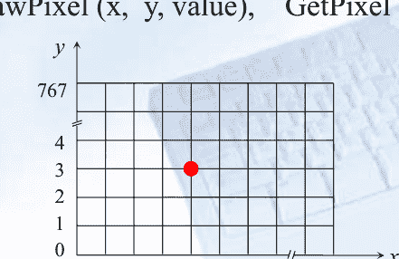

### 3.1 图形程序

计算机图形的生成有两种方法：程序绘图和交互绘图。所谓程序绘图，就是先用程序设计语言（如 C 语言）编写好绘图程序，然后运行该程序并绘出图形。交互绘图则是应用交互图形软件，通过交互命令（键盘命令、菜单命令等）由计算机生成图形。程序绘图是交互式绘图的基础，所有的交互式图形软件均是基于程序绘图算法或函数而开发的。我们这里结合一些典型的算例，介绍图形绘图程序的设计方法。

#### 1. 图案程序

- • 金刚石图案

将半径为 R 的圆周分成 n 等分，然后用直线将各等分点两两相连，这样生成的图案称之为“金刚石”，如图所示。绘制该图形的 C 程序如程序 3.1.1。

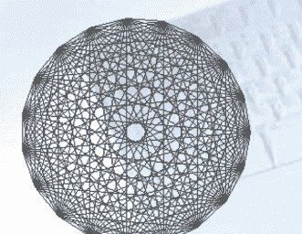

##### 程序 3.1.1 绘制“金刚石”图案

```
#include <graphics.h>
#include <math.h>

main()
{
float t;
int x0 = 320, y0 = 240;
int x0 = 320, y0 = 240;
int n, i, j, r, x[50], y[50];
int gdriver = DETECT,gmode;
printf("input n(20-30) and r(100-200)\n");
scanf("%d, %d", &n, &r);
initgraph(&gdriver, &gmode, "c:\\tc");
cleardevice();

setbkcolor(MAGENTA);
setcolor(WHITE);
t = 6.28318/n;
for(i = 0; i < n; i++)
{
x[i] = r*cos(i*t) + x0;
y[i] = r*sin(i*t) + y0;
}
for(i = 0; i <= n-2;i++)
for(j = i+1; j <= n-1;j++)
line(x[i], y[i], x[j], y[j]);
getch();
closegraph();
}
```


用程序 3.1.1 绘制金刚石图案时，只是简单地调用了直线绘制函数 line，通过两点连线绘成。这里的绘直线函数 line 是由 Turbo C 提供的。对于计算机图形学而言，所做的工作之一就是建立绘制直线等基本图形的算法，以便开发绘制复杂图形的软件系统。该例程同时也给出了利用 Turbo C 编写绘图程序的一般程序框架。

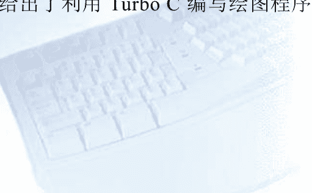

```
#include <graphics.h>
main ()
{
    int gdriver=DETECT, gmode;
    initgraph(&gdriver, &gmode, "c:\\tc");
    cleardevice();
    setbkcolor (背景色代码); /* 代码数字或大写的颜色英文名称 */
    setcolor(图形颜色代码);
    /* 用户编写的绘制图形的源代码 */
    closegraph();
}
```

##### 肾形图案

“肾形图案”是由按某种规律变化的圆形成的：将一个半径为 R 的圆周等分成 2n 等份，然后以等分点为圆心，以等分点到该圆的垂直直径的距离为半径画圆，则形成如图所示的肾形图案。绘制该图形的 C 程序见程序 3.1.2。

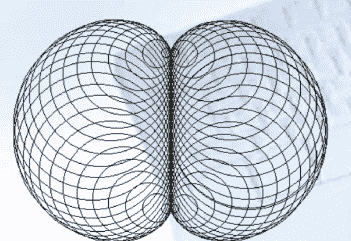

##### 海绵图案

下图所示的图案称为“海绵图案”，整个图案由大小不同的许多三角形组成。在该图案中，除了最外面的大三角形外，其余三角形都是由连接包含它的三角形的三条边的中点构成。但是，这种连接三角形的三条边的中点是有选择的。

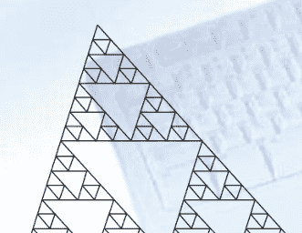

在三角形 ABC 中，连接三条边的中点形成三角形 PQR，这样就最终产生四个小三角形：△PQR，△APR，△PBQ 和 △RQC。在这四个小三角形中，只在其中三个位于顶点处的小三角形（即 △APR，△PBQ 和 △RQC）中再次连接其三条边的中点形成新的三角形。以后每次分割连线均按这个规则进行，直至达到一定深度。从程序设计的角度来看，可以利用递归调用来编程绘图，这样程序工作量小，且程序清晰。绘制海绵图案的程序如程序 3.1.3 所示。

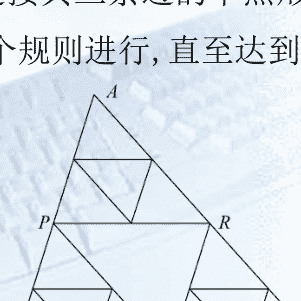

##### 程序 3.1.3 绘制海绵图案

```
#include<graphics.h>
#include<stdio.h>
void tria(xa,ya,xb,yb,xc,yc,n)
int xa,ya,xb,yb,xc,yc,n;
{int xp,yp,xq,yq,xr,yr;
if(n>0){
xp=(xa+xb)/2;yp=(ya+yb)/2;
xq=(xb+xc)/2;yq=(yb+yc)/2;
xr=(xc+xa)/2;yr=(yc+ya)/2;
moveto(xp,yp);lineto(xq,yq);
lineto(xr,yr);lineto(xp,yp);
tria(xa,ya,xp,yp,xr,yr,n-1);
tria(xb,yb,xq,yq,xp,yp,n-1);
tria(xc,yc,xr,yr,xq,yq,n-1);
}
}
main(){
int n,xa,ya,xb,yb,xc,yc;
int gdriver=DETECT,gmode;
printf("input three vertex coordinate:\n");
printf("xa="); scanf("%d",&xa);
printf("ya="); scanf("%d",&ya);
printf("xb="); scanf("%d",&xb);
printf("yb="); scanf("%d",&yb);
printf("xc="); scanf("%d",&xc);
printf("yc="); scanf("%d",&yc);
printf("input recursion depth:");
scanf("%d",&n);
initgraph(&gdriver,&gmode,"c:\\tc");
cleardevice();
setbkcolor(MAGENTA);
setcolor(YELLOW);
moveto(xa,ya);lineto(xb,yb);
lineto(xc,yc);lineto(xa,ya);
tria(xa,ya,xb,yb,xc,yc,n);
getch();
closegraph();
}
```

#### 2. 通用程序

在设计和绘图工作中，各专门领域都有自己常用的图形符号和一些通用图形。为了减少重复工作以减轻绘图工作量和方便绘图，一般把这些图形的绘制设计成独立的功能模块，也就是图形子程序或图形函数，供用户在绘图时选择调用。下面我们通过一个简单的例子，即正多边形，来说明通用图形程序的设计过程。

##### 构造功能模块的基本原则

功能模块是结构化程序的主要组成部分，所以按照什么样的原则来构造功能模块是一个十分重要的问题。一般来说，这些原则有以下四条：

- （1）独立性 模块的独立性指的是每个模块都要具有其自身独立的含义，模块与模块之间的关系要明确简单，尽量避免隐含的关系。这不仅是为了保证模块的正确与安全，也是为了便于模块之间的组合。

- （2）抽象性 要求模块具有一定的抽象性。最常见的抽象性是参数化。由于模块为一个独立的对象进行构造，可以在多种场合使用，并可与多种其他模块相组合，所以这种抽象性能扩大模块的适应能力，从而发挥更大的作用。

- （3）开放性 模块还应具备开放性，即模块在建立之后，应该能方便地对它的部分属性和功能进行修改、扩充和删除，从而使得模块是可维护的。这种可维护性是延长模块生命周期的重要手段。

- （4）继承性 考虑到软件的兼容性，模块必须具有继承性。即当模块在维护中部分属性发生变化时，不会影响到原模块在软件中的作用。

上述四条原则是在设计一个功能模块时需要加以注意的，这样有利于保证模块的质量和提高模块的可复用性能。

##### 图形程序

- 选择绘图参数

  要绘制一个图形，首先要明确绘制这样一个图形需要哪些参数。一般来说，绘制一个惟一确定的图形，需要两种参数：一种是确定图形几何形状的参数，称之为定形参数；另一种是确定图形画在什么地方的数据，称之为定位参数。对于一个任意的正多边形来说，它需要的定形参数为：

  - 边数 n (n≥3);
  - 边长 a。

- 定位参数为：

  - 定位顶点 $P_0(x_0, y_0)$;
  - 起始倾角 $\alpha$

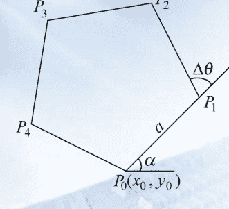

  给定了这两组参数，就可惟一确定一个任意位置、形状、大小的正多边形。但在绘图程序中，必须把这两组参数转化为具体的绘图用数据。对于正多边形来说，具体的绘图数据就是多边形各顶点的坐标。因为只要确定了各顶点，就可以连点成边绘出多边形图形。根据图形中的几何关系，计算正多边形各顶点坐标的公式如下：

```
P_i: { x_i = x_{i-1} + a cos(α + (i-1)Δθ) 
      y_i = y_{i-1} + a sin(α + (i-1)Δθ) }, i = 1,2,...,n-1
```

  其中： P_0 = (x_0, y_0), Δθ = 2π / n

- 编写绘图程序

  根据上述分析和数据准备，便可着手编写绘制任意正多边形的通用程序。函数 polygon 为绘制任意正多边形的通用绘图程序，函数中含有 5 个形参：

  - $x_0$, $y_0$：定位顶点坐标；
  - $a$：正多边形边长；
  - $af$：起始边与 $x$ 轴正向的夹角；
  - 正多边形边数 $n$。

  具体源程序代码如程序 3.1.4 所示。

##### 程序 3.1.4 绘制任意正多边形

```
#include<graphics.h>
#include<math.h>
void polygon();
main(){
int n = 10, i, a, x, y;
float af;
int gdriver = DETECT, gmode;
printf("input length of polygon: a=");
scanf("%d", &a);
printf("input position point: \nx=");
scanf("%d",&x);
printf("y=");
scanf("%d",&y);
printf("input angle of polygon:af=");
scanf("%f",&af);
initgraph(&gdriver,&gmode,"c:\\tc");
cleardevice();
setbkcolor(9);setcolor(4);
for(i=3; i<=n; i++)
    polygon(x,y,a,i,af);
getch();
closegraph();
}
void polygon(int x0, int y0, int a, int n,
    float af) {
int x,y,i;
float dtheta,theta;
if(n<3) return;
dtheta=6.28314/n;
theta=af*0.0174533;
moveto(x0,y0);
x=x0;y=y0;
for(i=1;i<n;i++) {
x=x+a*cos(theta); y=y+a*sin(theta);
lineto(x,y); theta+=dtheta;
}
lineto(x0,y0);
}
```


##### 以外接圆圆心定位的正多边形

除了上述构造正多边形的方法外，还可以用另外一种方法，即利用正多边形的外接圆来构造正多边形，这在有些应用场合比上面所讲的构造方法使用起来更方便，如图所示。

在这种构造方法中，定形参数为：

- 边数 n（n ≥ 3）；
- 外接圆半径 R。

定位参数为：

- 外接圆圆心坐标 P₀(x₀, y₀)
- 起始倾角 α

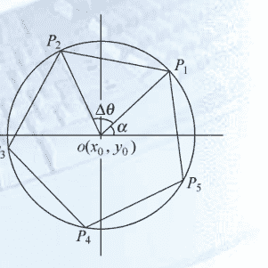

根据以上给定的参数，同样可以得到计算正多边形各顶点坐标的公式如下：

$$P_i:\begin{cases}x_i = x_0 + R\cos(\alpha + (i-1)\Delta\theta)\\y_i = y_0 + R\sin(\alpha + (i-1)\Delta\theta)\end{cases},\ i=1,2,\cdots,n$$

其中：$\Delta\theta = 2\pi / n$

##### 螺旋图案的绘制

下面是螺旋图案的例子，看起来似乎很复杂，但它却是由一种图形（正方形）构成的，只是图案中所包含的正方形的大小和位置各不相同。

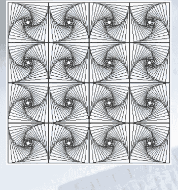

###### 图形分析

分析螺旋图案可以得知，图案由 16 个相似的方块拼接而成，每一个方块是由正方形构成的螺旋图案，而每个相邻方块的螺旋方向相反。组成整个图案的每个方块是由正方形旋转和缩小形成的，且经过旋转和缩小的正方形的 4 个顶点刚好在前一个正方形的 4 条边上。

下面我们讨论两个相邻正方形之间的几何关系。设两个正方形的外接圆半径分别为 R₁ 和 R₂，相应的边长为 a₁ 和 a₂，旋转角度为 θ。则两个正方形之间的缩小系数为：

```
f = a₂ / a₁
```

因为经过旋转和缩小的正方形的 4 个顶点刚好位于前一正方形的 4 条边上，所以，这个缩小系数 f 和转角 θ 密切相关。从图可以看出，在直角三角形 PQS 中：

```
QS = a₂ sin θ, PS = a₂ cos θ, QS + PS = a₂ (sin θ + cos θ) = a₁
```

所以

f = a₂ / a₁ = 1 / (sin θ + cos θ)

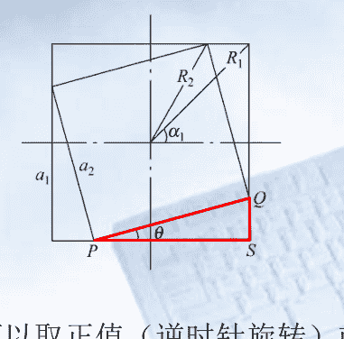

考虑到转角 θ 可以取正值（逆时针旋转）或负值（顺时针旋转），但缩小系数 f 总为正值，所以在求缩小系数 f 时，取转角 θ 的绝对值用于计算。

在求得了两个正方形之间的缩小系数之后，则可以得到两个正方形外接圆半径之间的关系：R₂ = f R₁，转角之间的关系为：α₂ = α₁ + θ。

###### 程序设计

根据上面对图案的分析，可以着手设计绘制图案的程序。

功能上，绘制图案的程序大致可以分为三部分：绘制任意位置和大小的正方形；由正方形及变换构成方块；把方块按规则拼成图案。

###### （1）绘制正多边形函数 polygonc

直接将绘制正方形的程序设计成通用的绘制正多边形的程序。在这种不断地旋转和缩小的变化过程中绘制正方形，且正方形的 4 个顶点要位于前一个正方形的边上。显然，这些正方形的外接圆是同心圆，所以，以正方形的外接圆圆心定位较为方便。因此，绘制正多边形的程序以正多边形外接圆圆心定位的方式设计，其中的参数如下：

- x₀，y₀：外接圆圆心坐标；
- R：外接圆半径；
- n：正多边形的边数（n≥3）；
- *af*：起始点半径与 x 轴正向的夹角。

###### （2）绘制方块函数 block

绘制方块的程序要完成的工作是：绘制正向和反向的正方形螺旋图案。它根据相邻两个正方形之间的旋转角度和缩小比例系数，以不同的实参调用绘制正方形函数 polygonc。其中的参数如下：

- *x, y*：方块的左下角定位点坐标；
- *a*：方块的边长；
- *n*：组成方块的正方形数量；
- *theta*：两个相邻正方形之间的转角，其值可取正值（正向旋转）或负值（反向旋转）。

###### （3）把方块拼成要求的图案

最后的拼图工作由主函数 `main` 完成。它所要做的工作是：计算确定每个方块的定位点坐标，然后相间调用不同螺旋方向的方块。

##### 程序 3.1.5 螺旋图案程序

```c
#include<graphics.h>
#include<math.h>
void polygonc();
void block();
main()
{
int i,j,a,length, n, theta, x=150,y=350;
int gdriver=DETECT, gmode;
printf("input length, n, theta: ");
scanf("%d, %d", &length, &n);
scanf("%d", &theta);
initgraph(&gdriver,&gmode,"c:\\tc");
cleardevice();
setbkcolor(9);setcolor(4);
a=length/4;
for(i=1;i<=4;i++) {
for(j=1;j<=4;j++) {
block(x,y,a,n,theta);
theta=-theta;x=x+a;}
x=150; y=y-a;
theta=-theta; }
getch();
closegraph();
}

void polygonc(int x0, int y0, int r,
int n, float af) {
int x, y, xs, ys, i;
float dtheta, theta;
if(n<3) return;
dtheta = 6.28314/n;
theta=af*0.0174533;
xs = x0 + r*cos(theta);
ys = y0 + r*sin(theta);
moveto(xs,ys);
for(i=1; i<n; i++) {
theta+=dtheta; x=x0+r*cos(theta);
y=y0+r*sin(theta); lineto(x,y); }
lineto(xs,ys);
}

void block (int x,int y,int a,int n, int theta){
int x0, y0, i, r; float t, f, af=45.0;
t = fabs(theta*0.0174533);
f=1.0/(cos(t)+sin(t));
r=a/1.414;
x0=x+0.5*a; y0=y-0.5*a;
for(i=1;i<=n;i++) {
polygonc(x0, y0, r, 4, af);
r=r*f; af=af+theta;
} }
```

#### 3. 动画程序设计

动画以其生动活泼和富有想象力的表现形式而为人们所喜闻乐见。

动画的原理是用一组相关的图片连续更替，当这种更替达到一定速度时，就能产生画面动起来的效果，即“动画”。

动画的制作过程是，把一个运动过程按时间的先后分解成多步，把每一步绘成一张图片。当把这些相关的图片按顺序快速替换时，人们的视觉感受是：整个运动过程是连续的。

计算机动画制作中，要用到专门的动画制作软件，如常见的动画制作软件 3DMAX、MAYA 等。用 C 语言当然不能制作高质量的动画，但用 C 语言中的一些图形函数，可以编写一些简单程序，以模拟和说明动画的原理。

##### 用重画技术设计动画程序

##### 程序设计思路

依照动画制作的原理，可以编程实现在屏幕上不断清除掉原有图形，又在新的位置上画出新的后续图形。快速重复上述过程，就能使整个屏幕上的画面产生动起来的效果。

在屏幕上清除原有的图形，可以使用清屏函数：

```
cleardevice()
```

- 程序实例 3.1.1

##### 利用多图形页功能设计动画程序

在用重画技术产生动画时，程序每次要把整个屏幕画面实时重新更新，亦即当场作画。如果画面比较复杂，那么这种实时更新费时，且必然破坏整个动画过程的连续感。许多图形卡，如 VGA 均支持多个图形页。所谓“图形页”是硬件的一个功能，即图形硬件可以提供独立的图形存储区，这些页可分别用于作图和显示。

##### 程序设计思路

对于支持多个图形页功能的图形卡来说，可以用函数：

`setactivepage`

把指定的图形页设置为活动页，用函数：

`setvisualpage`

把指定的图形页设置成显示页。活动页可以是当前的显示页，也可以是非显示页。但是当前的运行程序只能在活动页上绘图。

所以，当用函数 setactivepage 选定某一页为活动页后，其后所有的图形函数的输出都是针对该页的。

因为存在多个图形页，所以在程序中，可以把一个页设置成显示页，显示这一页上的图形；而同时把另一页设置成活动页，但是非显示的，程序在该活动页上绘图。当活动页上绘完图后，再互换这两个页的设置。这就相当于在“后台”绘图，整个绘图过程在后台完成，然后拿到“前台”显示。在前台显示的已经是完整的画面，如此重复。这样，画面的连续性就会有所改善。

函数 setactivepage 和函数 setvisualpage 的调用格式如下：

```
setactivepage(int pagenum);
setvisualpage(int pagenum);
```

形参 pagenum 为页号。对支持两个图形页的图形卡而言，页号为 0 和 1，系统默认值为 0。


##### 程序实例 3.1.2
##### 用位图函数设计动画程序

前两种方法的共同不足是，动画中连续相邻的两个画面中的后续画面，都是重新绘制整个图形的。事实上，在运动过程中，连续相邻的两个画面之间，变化是比较小的，发生运动的只是其中的部分内容，而其他部分是不变的，这就是相邻画面之间的“空间相关性”。当然，运动画面之间还存在“时间相关性”。充分利用“空间相关性”和“时间相关性”，便可以实现高速动画。

##### 程序设计思路

Turbo C 提供了两个函数： getimage 和 putimage，是用于存取和输出屏幕上的位图。其中 getimage 的功能是将屏幕上指定区域中的位图信息取出并存到内存中； putimage 的功能则是将内存中的位图信息按指定方式输出到屏幕上的指定位置。这两个函数的调用格式如下：

getimage 的调用格式

```
getimage(int xl,int yt,int xr,int yb, (int *)bitmap)
```

其中： xl, yt, xr, yb 是指定位图所在的矩形区域的对角点坐标；

*bitmap 是内存中存放位图信息的地址。

putimage 的调用格式

```
putimage (int x, int y, (int *)bitmap)
```

其中： x, y 是指定位图在屏幕上输出位置的定位坐标； *bitmap 是内存中存放位图信息的地址。

- 程序实例 3.1.3

#### 4. 复杂动画实例

- 自由变形
- 复杂变形

水平线较 45°线亮。为了使不同长度和方向的直线具有同等亮度，需要进行开方运算，这又使得运算速度变慢。一般采用折中方法，即只计算线段长度的近似值，利用整数运算减少计算量以及用硬件实现运算等等。

- 直线的生成速度要快。

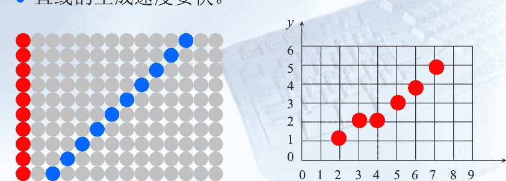

这里(x_i, y_i)是直线上一点的坐标值。式（3.2.1）和（3.2.2）表示所求直线 y 值和 x 值关于相应增量的逐次递归关系，递归初值为直线的起点。

DDA (Digital Differential Analyzer) 算法即数字微分分析算法就是基于式（3.2.1）或（3.2.2）对直线进行光栅化的算法。

在一个坐标轴上以单位间隔对直线采样，以决定另一个坐标轴上最靠近直线的对应整数值。

- 当直线斜率 0 ≤ m ≤ 1 时，则按单位 x 间隔（Δx = 1）取样并计算每个连续的 y 值：

y_{i+1} = y_i + m
（3.2.3）

注：由于 $m$ 可以是 0 与 1 之间的任意实数，所以计算出的 $y$ 值必须取整。

- 当 $-1 \le m \le 0$ 时，则仍按单位 $x$ 间隔 $(\Delta x = -1)$ 取样并计算每个连续的 $y$ 值：

$$y_{i+1} = y_i - m$$  （3.2.4）

- 当 $m > 1$ 时，则将 $x$ 和 $y$ 交换，这就是说，按单位 $y$ 间隔 $(\Delta y = 1)$ 取样并计算每个连续的 $x$ 值：

$$x_{i+1} = x_i + m^{-1}$$  （3.2.5）

- 当 $m < -1$ 时，则同样交换 $x$ 和 $y$ 交换，并按 $\Delta y = -1$ 间隔

##### 取样计算每个连续的 x 值：

$x_{i+1} = x_i - m^{-1}$
（3.2.6）

应用式（3.2.3）～（3.2.6），可以设计绘制任意斜率的直线光栅扫描算法。程序 3.2.1 是斜率在 0 和 1 之间的直线绘制算法，而程序 3.2.2 则是绘制任意斜率的直线的算法。

##### 程序 3.2.1 DDA 扫描转换算法

```
void Line_DDA(int x0, int y0, int x1, int y1, int Color)
{
    /*设 0 ≤ m ≤ 1*/
    int x, dy, dx;
    float y, m;

    dy = y1 - y0;
    dx = x1 - x0;
    m = (float)dy / dx;
    y = y0;
    for (x = x0; x <= x1; x++){
        DrawPixel(x, (int)(y + 0.5), Color); /*置像素值为 Color*/
        y += m;
    }
}
```

##### 程序 3.2.2 DDA 扫描转换算法

```
void Line_DDA (int x0, int y0, int x1, int y1, int Color)
{
    int dy = y1 - y0, dx = x1 - x0, i, steps;
    float x = x0, y = y0, xIncrement, yincrement;
    steps = abs(dx);
    if (abs(dy) > abs(dx)) steps = abs(dy);
    xIncrement = dx /(float) steps; yIncrement = dy / (float)steps;
    DrawPixel((int)(x +0.5), (int)(y +0.5), Color);
    for (i = 1; x <= steps; i++) {
        x += xIncrement; y += yIncrement;
        DrawPixel((int)(x +0.5), (int)(y +0.5), Color);
    }
}
```

##### 例 3-2-1. 用 DDA 算法画连接 P₀(0, 0) 和 P₁(5, 2) 两点的直线段。

| x | (int)(y + 0.5) | y + 0.5 |
|---|---|---|
| 0 | 0 | 0.5 |
| 1 | 0 | 0.4 + 0.5 |
| 2 | 1 | 0.8 + 0.5 |
| 3 | 1 | 1.2 + 0.5 |
| 4 | 2 | 1.6 + 0.5 |
| 5 | 2 | 2.0 + 0.5 |

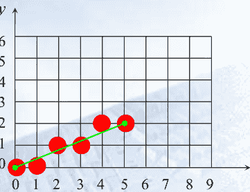

算法 3.2.2 将直线两个端点的像素位置作为输入，其过程可概括为：端点位置的水平和垂直增量赋给参数 dx 和 dy，其绝对值大者决定参数 steps 的值。从像素位置开始，确定沿直线

生成下一个像素位置每步的所需偏移量，并循环上述过程 steps 次。如果 dx 的绝对值大于 dy 的绝对值，那么 x 方向和 y 方向的增量分别为 ±1 和 ±m。如果 dy 的绝对值大于 dx 的绝对值，那么 y 向和 x 方向的增量分别为 ±1 和 ±m-1。

利用 DDA 算法，生成一条直线只做两次除法，画线中每一
点做两次加法，因此，用 DDA 算法生成直线的速度是相当快的。

DDA 算法原理简单、且有效，利用显示器的光栅特性，消除了直线方程中求点的乘法运算，在 x, y 两个方向使用合理的增量沿直线逐步求出各像素的位置。然而, 浮点增量的连续迭加

中取整误差的累积会使长线段所计算的像素位置偏离实线段，且程序中的取整操作和浮点运算仍然十分耗时。为此，我们下面讨论生成直线的 Bresenham 算法。

##### 3.2.3 Bresenham 算法

1965 年，Bresenham 提出了一个只使用整数运算的经典算法（通常称为 Bresenham 算法），它根据前一个已计算的像素点 $(x_i, y_i)$ 进行增量运算得到下一个像素点 $(x_{i+1}, y_{i+1})$，而不必进行取整操作。该算法也可扩充其浮点数功能以处理端点坐标是任意实数的直线。

为了说明算法原理，我们首先考虑斜率非负且不超过1的直线的光栅化过程。设直线的起点坐标为(x_s, y_s)，终点坐标为(x_e, y_e)，则直线的方程为：

y = dy/dx x + B

因此，其隐函数表示为：

F(x, y) = dy·x - dx·y + B·dx = ax + by + c = 0

其中

a = dy, b = -dx, c = B·dx

显然，对于直线上的点，F(x , y) 等于零；对于直线下方的点，F(x , y) 大于零；而对直线上方的点，F(x,y) 小于零。

假设当前选择的像素点是 (x_i , y_i)，那么下一步要选择的像素点可能是 NE (x_i+1 , y_i+1)，也可能是 E (x_i+1 , y_i)。选择的原则是看哪一个离直线与 x = x_i+1 的交点最近。

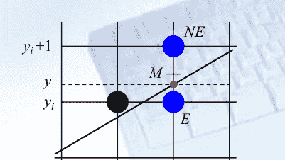


运用中点法则，我们只需考察中点 M 在直线的哪一侧，即计算：

$$F(M) = F(x_i + 1, y_i + 1/2) = a(x_i + 1) + b(y_i + 0.5) + c$$

并确定其正负号。

由于根据函数值 $F(x_i + 1, y_i + 1/2)$ 进行判定，所以我们定义一个判定函数如下：

$$d_i = 2F(x_i + 1, y_i + 1/2)$$

根据定义

$$d_i = 2a(x_i + 1) + 2b y_i + b + 2c$$

当 $d_i < 0$ 时，$M$ 在直线的上方，取 $E$ 为下一个像素点；当 $d > 0$ 时，$M$ 在直线的下方，取 $NE$ 为下一个像素点；当 $d = 0$ 时，两者都可以选，我们约定选 $E$。

$d_i$ 的计算需要做 4 次加法和两次乘法。因此，为了有效地计算判定函数，我们需要建立关于 $d_i$ 的递推公式。显然，$d_i$ 的变化依赖于下一个像素点选的是 $NE$ 还是 $E$。

- 当 $d_i < 0$ 时，下一个像素点是 $E$，那么 $d_{i+1} = 2F(x_i + 2, y_i + 1/2) = 2a(x_i + 2) + 2b y_i + b + 2c = d_i + 2a$。

- 当 $d_i > 0$ 时，下一个像素点是 $NE$，则 $d_{i+1}=2F(x_i+2,y_i+1+1/2)=2a(x_i+2)+2b(y_i+1)+b+2c = d_i+2a+2b$。

由此，得到计算判定函数 $d_i$ 的递推公式：

$$d_{i+1}=\begin{cases} d_i+2dy, & d_i\leq 0 \\ d_i+2dy-2dx, & d_i>0 \end{cases}$$

因为直线上的第一个像素点就是直线的起点 $(x_s,y_s)$，所以判定函数 $d_i$ 的初值为：

$$d_0=2a(x_s+1)+2by_s+b+2c=2dy-dx$$

综上所述，满足条件的直线的 Bresenham 算法的步骤如下：

- Step 1. 初始化
    dx = xe - xs, dy = ye - ys, x = xs, y = ys, d = 2dy - dx;
- Step 2. 当 x < xe 时，执行下述操作：
    - 2.1 绘制像素点 (x, y);
    - 2.2 求下一个像素点：
        - x = x + 1;
        - if (d > 0) then y = y + 1;
    - 2.3 计算判定函数 d：
        - if (d > 0) then d = d + 2dy - 2dx;
        - else d = d + 2dy;
- Step 3. 算法结束。

##### 程序 3.2.3 Bresenham 扫描转换算法

```c
void line_BRES (int xs, int ys, int xe, int ye, int Color)
{ /* 设 0 ≤ m ≤ 1 */
    int dx = xe - xs, dy = ye - ys, x = xs, y = ys;
    int twoDX = 2*dx, twoDY = 2*dy, d = 2*dy - dx;
    DrawPixel(x, y, Color);
    while(x < xe) {
        if (d > 0) {y++; d -= twoDX;}
        x++;  d += twoDY;
        DrawPixel(x, y, Color);
    }
}
```

##### 例 3-2-2. 用 Bresenham 算法画连接 P₀(0, 0) 和 P₁(5, 2) 两点的直线段。

| x | y | d |
|---|---|---|
| 0 | 0 | -1 |
| 1 | 0 | 3 |
| 2 | 1 | -3 |
| 3 | 1 | 1 |
| 4 | 2 | -5 |
| 5 | 2 | -1 |

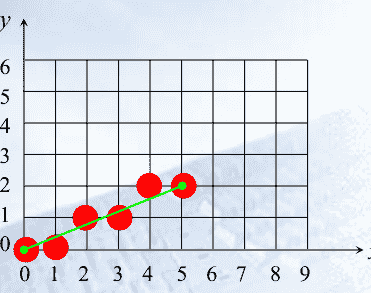

我们这里采用中点法则建立了直线绘制的 Bresenham 算法，所以，有时该算法也叫做中点算法。中点法则是由 Pitteway 于 1967 年提出的，而后 Van Aken 于 1984 年和另外的一些研究人员对其进行了一些改进。需要说明的是，Bresenham 在建立判定函数时所采用的是另外一种方法，即采用下图中的误差。

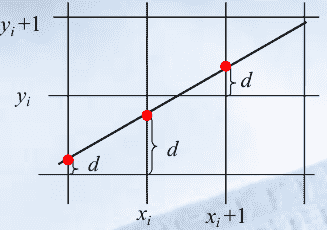

算法 3.2.3 只讨论了斜率 $0\le m\le1$ 的情形，通过考虑 $xy$ 平面各种八分和四分区域间的对称性，Bresenham 算法对于任意斜率的直线具有通用性。对于斜率为正且大于 1 的直线，即 $dy>dx>0$，只要变换 $x$ 和 $y$ 的地位，即沿 $y$ 方向以单位步长步进，并计算最接近直线的 x 值。若 dy < 0 或 dx < 0，那么程序中的操作 y++ 或 x++ 则变成 y-- 或 x--。

##### Bresenham 算法的优点有：

- 不计算直线的斜率，因此不做除法运算；
- 不用浮点数，只用整数；
- 只做整数的加法和减法运算，而乘 2 运算可以用移位操作实现；
- 运算速度快，便于硬件实现。

通过对 Bresenham 算法进一步优化，减少算法中确定像素点的判定次数，即可得到增强的 Bresenham 算法 — 双步算法。

Bresenham 算法采用整数运算由点 $(x_i, y_i)$ 计算出 $(x_{i+1}, y_{i+1})$，算法首先确定线段的斜率，再继续在每一步中，通过判定函数在两个可选像素点中选一。双步算法则在每一步，通过判定函数求得一对像素点而非只是一个像素点，如此继续直至到达线段的终点。对当前求得的像素点来说，随后可能出现的一对像素点只有下面四种情况：

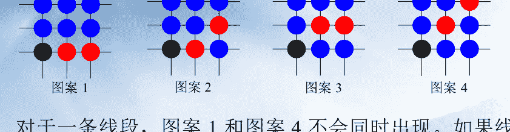

对于一条线段，图案 1 和图案 4 不会同时出现。如果线段斜率大于 1/2，图案 1 不会出现；当斜率小于 1/2 时，图案 4 不会出现。因此，通过测试斜率，选择将限定于三种图案之一：1，2，3 或 2，3，4。

下面我们考察当斜率在 0 到 1/2 之间的情形，此时可能出现的图案是 1，2，3。为了确定像素点对，我们需要在图案 1、图案 2、图案 3 中做出决定。为此，我们定义判定函数如下：

$$d_i = 2F(x_i + 2, y_i + 1/2) = 2dy(x_i + 2) - 2dx(y_i + 1/2) + 2Bdx$$

当 $d_i < 0$ 时，选择图案 1，即选择像素点：

$$(x_i + 1, y_i), (x_i + 2, y_i)$$

当 $d_i \ge 0$ 时，则需在图案 2 和图案 3 之间做出选择。这是一个简单的测试：当 $d_i < 2dy$ 时选取图案 2，即选择像素点：

$$(x_i + 1, y_i), (x_i + 2, y_i + 1)$$

否则，选取像素点：

$$(x_i + 1, y_i + 1),\ (x_i + 2, y_i + 1)$$。

为了有效地计算判定函数，我们同样需要建立关于 $d_i$ 的递推公式：

$$d_{i+1}=\begin{cases}d_i+4dy, & d_i<0\\ d_i+4dy-2dx, & d_i\ge0\end{cases}$$

因为直线上的第一个像素点就是直线的起点 $(x_s, y_s)$，所以判定函数 $d_i$ 的初值为：

$$
\begin{aligned}
d_0 &= 2F(x_s + 2, y_s + 1/2) \\
&= 2dy(x_s + 2) - 2dx(y_s + 1/2) + 2Bdx \\
&= 2F(x_s, y_s) + 4dy - dx \\
&= 4dy - dx
\end{aligned}
$$

利用这一改进，Bresenham 算法可修改成双步算法。该改进是由 Wu 和 Rokne 于 1987 给出的，其结果发表在 [CVGIP (37)] 上。双步算法的代码如下：

##### 程序 3.2.4 绘制直线的双步扫描转换算法

```c
void line_DoubleStep(int xs, int ys, int xe, int ye, int Color)
{ /* 设置 0 ≤ m ≤ 1/2 */
int dx = xe - xs, dy = ye - ys, current_x = xs, y = ys;
int incr_1 = 4*dy, incr_2 = 4*dy - 2*dx, d = 4*dy - dx, cond = 2*dy;
DrawPixel(current_x, y, Color);
while(current_x < xe) {
    if (d < 0) {
        DrawPixel(current_x +1, y, Color);
        DrawPixel(current_x +2, y, Color);
        d += incr_1;
    }
    else if (d < cond) {
```


```
DrawPixel(current_x +1, y, Color);
DrawPixel(current_x +2, y+1, Color);
d += incr_2; y++;
}
else{
    DrawPixel(current_x +1, y+1, Color);
    DrawPixel(current_x +2, y+1, Color);
    d += incr_2; y++;
}
    current_x += 2;
}
}
```

### 3.3 圆的生成算法

圆是最为基本的图形之一，多种场合都用到它。因此，图形软件包都包含有生成圆和圆弧的程序，故生成圆的算法也很多。

圆心在 $(x_c, y_c)$，半径为 $R$ 圆的方程是：

$$(x - x_c)^2 + (y - y_c)^2 = R^2$$

显然，利用该方程沿 $x$ 轴从 $x_c - R$ 到 $x_c + R$ 以单位步长步进计算出对应的 $y$ 值，即可得到圆周上每点的 $y$ 值：

$$y = y_c \pm \sqrt{R^2 - (x - x_c)^2}$$

这并非是最好的算法。

该算法的不足之一是每步包含大量的计算，且所画像素位置的间距是不一致的。另外，$|x - x_c|$ 越大，对应生成圆周上的点之间的圆周距离也就越大。我们可以在圆的斜率绝对值大于 1 后，交换 $x$ 和 $y$ 来调整间距。这样一来增加了所需的计算量和处理过程。另一种消除不等间距的方法是使用圆的极坐标方程：

$$x = x_c + R \cos\theta, \quad y = y_c + R \sin\theta$$

计算圆周上的点，但这又涉及到三角运算，同样增加了计算量。

最为常用的生成圆的有效算法有以下三种：以判定函数的增量计算为基础的 Bresenham 算法、中点法和正负法，以及以画直线为基础的多边形逼近算法。

#### 3.3.1 圆的八方向对称性

由于圆关于坐标轴和对角线对称，因此，在对圆进行扫描转换时，我们只需计算 $0°$ 到 $45°$ 之间的一段圆弧就能得到整个圆。对于圆心为 $(x_c, y_c)$ 的圆，我们用程序 CirclePoints 显示 8 个相对称的点：

```
void CirclePoints (int xc, int yc, int x, int y, int Color)
{
    DrawPixel (xc + x, yc + y, Color);
    DrawPixel (xc + x, yc - y, Color);
    DrawPixel (xc - x, yc + y, Color);
    DrawPixel (xc - x, yc - y, Color);
    DrawPixel (xc + y, yc + x, Color);
    DrawPixel (xc + y, yc - x, Color);
    DrawPixel (xc - y, yc + x, Color);
    DrawPixel (xc - y, yc - x, Color);
}
```

#### 3.3.2 生成圆的 Bresenham 算法

Bresenham 算法是画圆的最有效的算法之一。不失一般性，设要画的圆的圆心在坐标原点 $(0, 0)$，半径为 $R$。我们这里考虑第一象限的上半部的八分之一圆弧的生成过程，即下图中的圆弧 $AB$。现在，从点 $(0, R)$ 开始顺时针生成八分之一圆周 $AB$。在这种情况下，$x$ 每步增加 1，相应的 $y_{i+1}$ 则有两种选择：$y_{i+1}=y_i$ 或 $y_i-1$。选择的原则是考察精确值 $y$ 是靠近 $y_i$ 还是靠近 $y_i-1$。

设 $R_s$ 满足方程：

$$(x_{i+1}^2 + y_i^2 - R_s^2) + (x_{i+1}^2 + (y_i -1)^2 - R_s^2) = 0$$

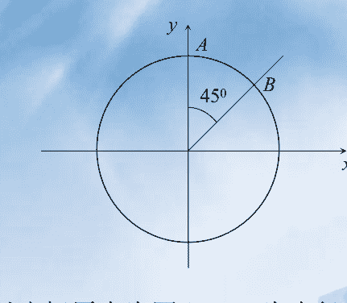

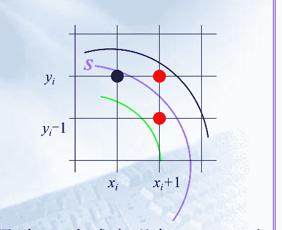

以坐标原点为圆心，$R_s$ 为半径做圆弧 $S$，上式表明点 $(x_{i+1}, y_i)$ 和 $(x_{i+1}, y_{i-1})$ 到圆弧 $S$ 的距离可认为是相等的。因此，$S$ 可作为一条分界线。当圆在 $S$ 上方时，应选 $y_{i+1}=y_i$；当圆在 $S$ 下方时，应选 $y_{i+1}=y_i-1$。下面建立判断圆是在 $S$ 上方或下方的判定函数。

令：

$$d_i = (x_{i+1}^2 + y_i^2 - R^2) + (x_{i+1}^2 + (y_i - 1)^2 - R^2)$$

显然，$d_i$ 是 $R$ 的递减函数。当 $R = R_s$ 时，$d_i = 0$；当 $R > R_s$ 时，圆在 $S$ 的上方，此时 $d_i < 0$；当 $R < R_s$ 时，圆在 $S$ 的下方，此时 $d_i > 0$。由此，我们有判定函数 $d_i$。若 $d_i < 0$，则 $y_{i+1} = y_i$；否则，$y_{i+1} = y_i - 1$。余下的问题是如何快速地计算判定函数 $d_i$？

已知 $x_0 = 0$，$y_0 = R$，所以

$$d_0 = (1 + R^2 - R^2) + (1 + (R - 1)^2 - R^2) = 3 - 2R$$

因为

$$d_i = (x_{i+1}^2 + y_i^2 - R^2) + (x_{i+1}^2 + (y_i - 1)^2 - R^2)$$

$$= ((x_i + 1)^2 + y_i^2 - R^2) + ((x_i + 1)^2 + (y_i - 1)^2 - R^2)$$

所以

$$d_{i+1} = ((x_{i+1}+1)^2 + y_{i+1}^2 - R^2) + ((x_{i+1}+1)^2 + (y_{i+1}-1)^2 - R^2)$$

$$= 2(x_{i+1}+1)^2 + y_{i+1}^2 + (y_{i+1}-1)^2 - 2R^2$$

$$= 2(x_i+1)^2 + y_{i+1}^2 + (y_{i+1}-1)^2 - 2R^2 + 4x_i +6$$

$$= \begin{cases}
2(x_i+1)^2 + y_i^2 + (y_i-1)^2 -2R^2 +4x_i +6, & d_i <0 \\
2(x_i+1)^2 + (y_i-1)^2 + (y_i-2)^2 -2R^2 +4x_i +6, & d_i \ge 0
\end{cases}$$

$$= \begin{cases}
d_i +4x_i +6, & d_i <0 \\
d_i +4(x_i - y_i)+10, & d_i \ge 0
\end{cases}$$

**基于上述推导，生成圆的 Bresenham 算法之步骤如下：**

- Step 1. 初始化：x = 0, y = R, d = 3 − 2R;
- Step 2. 当 x < y 时，执行以下操作：
    - 2.1 画像素点 (x, y);
    - 2.2 求下一个像素点：
        - x = x + 1, y = { y, d < 0; y − 1, d ≥ 0 }
    - 2.3 计算下一个判定函数：
        - d = { d + 4x + 6, d < 0; d + 4(x − y) + 10, d ≥ 0 }
- Step 3. 若 x = y，画像素点 (x, y);
- Step 4. 算法结束。

**例 3-3-1. 用 Bresenham 算法画圆心为 O(0, 0)，半径为 R = 10 的八分之一圆弧。**

| d | x | y |
|---|---|---|
| -17 | 0 | 10 |
| -11 | 1 | 10 |
| -1 | 2 | 10 |
| 13 | 3 | 10 |
| -5 | 4 | 9 |
| 17 | 5 | 9 |
| 11 | 6 | 8 |
|  | 7 | 7 |

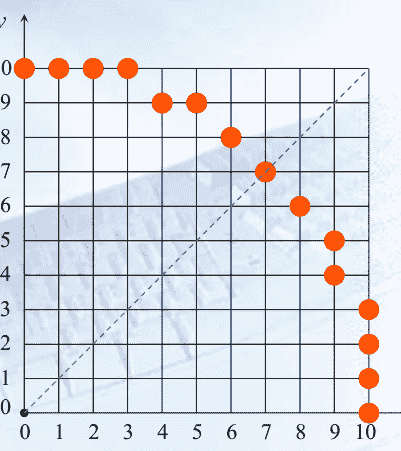

**程序 3.3.1 圆 Bresenham 扫描转换算法**

```
void Circle_BRES ( int xc, int yc, int Radius, int Color )
{
    int x = 0, y = Radius, d = 3 - 2*Radius;
    while (x < y) {
        CirclePoints (xc, yc, x, y, Color);
        if (d >= 0) {
            d += 4 - 4*y; y--;
        }
        d += 4*x + 6; x++;
    }
    if (x == y)
        CirclePoints (xc, yc, x, y, Color);
}
```


#### 3.3.3 生成圆的中点算法

Bresenham 算法是画圆的最有效的算法之一，其效率要高于基于圆的隐式方程和极坐标方程的算法。对于圆心坐标和半径为整数的情况，运用中点准则可建立一个类似的算法，它能产生同样的一组优化的像素。

我们这里仍然考虑第一象限的上半部的八分之一圆弧的生成过程，并调用 CirclePoints 画出圆上其余的所有点。与画直线的中点算法相似，这里所用的方法是：在 2 个像素之间的中点处给出—判定函数，并据此在 2 个像素中选择最靠近圆的那个像素。

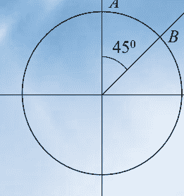

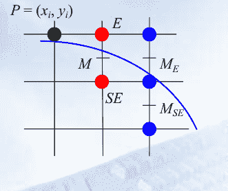

设函数 F(x, y) = x² + y² + R²。对于圆上的点，此函数的值为 0；对于圆内的点，函数值为负；对于圆外的点，函数值则是正的。这样，如果像素 E 和 SE 的中点 M 在圆外，则 SE 更靠近圆。相反，如果中点在圆内，则 E 更靠近圆。

与画直线类似，我们选择像素的依据是判定函数 d 的值，即函数 F(x, y) 在中点处的值：

d_i = F(x_i + 1, y_i - 1/2) = (x_i + 1)^2 + (y_i - 1/2)^2 - R^2

- 如果 d_i < 0，就选择像素 E，并将当前中点的 x 坐标增加一个单位，以得到下一个中点，从而得到：
  d_{i+1} = F(x_i + 2, y_i - 1/2) = (x_i + 2)^2 + (y_i - 1/2)^2 - R^2

显然，d_{i+1} = d_i + (2x_p + 3)，可得增量：Δ_E = 2x_i + 3。

- 如果 d_i ≥ 0，就选择像素 SE，而下一个中点是将当前中点的 x 坐标增加一个单位，y 坐标减少一个单位，从而得

到：

$d_{i+1}=F(x_i+2, y_i-3/2)=(x_i+2)^2+(y_i-3/2)^2-R^2$

同样有：$d_{i+1}=d_i+(2x_i-2y_i+5)$，得到增量：

$D_{SE}=2x_i-2y_i+5$

我们知道，在画直线的中点算法中，增量 $D_E$ 和 $D_{SE}$ 都是常量，但在处理圆这样的二次函数时，$D_E$ 和 $D_{SE}$ 在每一步都要变化，且依赖于上一步所选像素点 $P$ 的坐标 $x_i$ 和 $y_i$。称 $P$ 为估计点。在每一步，我们直接将上一步所选像素的 $x$ 和 $y$ 坐标值代入增量计算公式，就得到了新的增量。由于计算公式是线性的，所以其直接计算的开销不大。

下面，我们还需要确定判定函数 $d$ 的初值。由于限定该算法处理的圆的半径为整数，并只画八分之一圆弧，因此，圆的起始像素是 $(0, R)$，而下一个中点的位置是 $(1, R - 1/2)$，因此

$d_{start} = F(1, R - 1/2) = 1 + (R - 1/2)^2 - R^2 = 5/4 - R$

该算法的实现程序如程序 3.3.2 所示，其结构与画直线的算法很相似。

##### 程序 3.3.2 中点圆扫描转换算法

```
void MidpointCircle(int radius, int Color)
{
    int x, y;
    float d;
    x = 0; y = radius; d = 5.0/4 - radius;
    CirclePoints (0, 0, x, y, Color);
    while(x < y) {
        if (d < 0) {d += x*2.0 + 3;}
        else {d += (x - y)*2.0 + 5; y-- ;}
        x++;
        CirclePoints (0, 0, x, y, Color);
    }
}
```

算法 3.3.2 的不是由于判定函数 $d$ 的初值是浮点数，因此算法必须做浮点数的算术运算。我们希望有一个效率更高的只进行整数运算的算法。为此，我们定义一个新的判定函数：

$$h=d-1/4$$

这样在初始化时，$h=1-R$，而条件 $d<0$ 变成了 $h<-1/4$。由于 $h$ 的初值是整数，且其相应的增量也是整数，因此我们可将条件 $h<-1/4$ 改为 $h<0$。这样算法就变成了关于 $h$ 的只进行整数运算的形式。为了与画直线算法保持一致性，我们仍然用 $d$ 表示决策函数。改进后的算法如程序 3.3.3 所示。

##### 程序 3.3.3 扫描转换圆的整数型中点算法

```
void MidpointCircle(int radius, int Color)
{
    int x, y, d;
    x = 0; y = radius; d = 1 - radius;
    CirclePoints (0, 0, x, y, Color);
    while(x < y){
        if (d < 0) { d += x*2 + 3; }
        else { d += (x - y)*2 + 5; y--; }
        x++;
        CirclePoints (0, 0, x, y, Color);
    }
}
```

##### 例 3-3-2. 用中点算法画圆心为 O(0, 0)，半径为 R = 10 的八分之一圆弧。

| d | x | y |
|---|---|---|
| -9 | 0 | 10 |
| -6 | 1 | 10 |
| -1 | 2 | 10 |
| 6 | 3 | 10 |
| -3 | 4 | 9 |
| 8 | 5 | 9 |
| 5 | 6 | 8 |
| 7 | 7 |  |

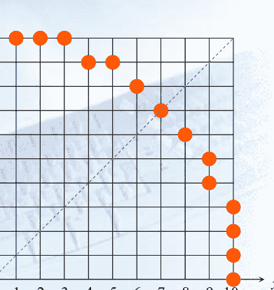

我们也可以对增量计算方法进一步拓展，由此改善画圆的中点算法效率。我们知道任一个多项式都可以按增量方式进行计算，这就是差分。差分的基本思想是计算函数在其相邻两个点上的值以及这两个值的差。

对于中点画圆算法来说，在当前的迭代中，如果选择了E，则估计点从 (x_i, y_i) 变化到 (x_i + 1, y_i)。显然，在点 (x_i, y_i) 处的一阶差分为 Δ_Eold = 2x_i + 3。因此在点 (x_i + 1, y_i) 处的一阶差分为 Δ_Enew = 2(x_i + 1) + 3，其二阶差分为 Δ_Enew - Δ_Eold = 2。

类似地，在点(x_i, y_i) 处，Δ_SEold = 2x_i - 2y_i + 5；点 (x_i +1, y_i) 处，

Δ_SEnew = 2(x_i +1) - 2y_i + 5，因此二阶差分为 Δ_Enew - Δ_Eold = 2。

如果在当前的循环中选择了 SE，则估计点从 (x_i , y_i) 变化到 (x_i + 1, y_i - 1)。因此，在点 (x_i + 1, y_i - 1) 处的一阶差分为 Δ_Enew = 2(x_i + 1) + 3，而二阶差分为 Δ_Enew - Δ_Eold = 2。

同样，在点(x_i + 1, y_i - 1)处，Δ_SEnew = 2(x_i + 1) - 2(y_i - 1) + 5，而相应的阶差分 Δ_Enew - Δ_Eold = 4。

于是，改进后的算法包括以下几个步骤：（1）根据上次循环所计算的判定函数 d 的值的符号选择一个像素；（2）运用上次循环所计算的相关 Δ_E 或 Δ_SE 对判定函数 d 的值进行修改；
（3）根据像素的移动情况，用前面计算的差分常量修改 D_E 或 D_SE；（4）移动像素。D_E 或 D_SE 使用起始像素进行初始化。改进后的程序如程序 3.3.4 所示。

##### 程序 3.3.4 基于二阶差分的中点圆扫描转换算法

```
void MidpointCircle (int radius, int Color)
{
    int x, y, d, deltaE, deltaSE;
    x = 0; y = radius; d = 1 - radius; deltaE = 3; deltaSE = 5 - radius*2;
    CirclePoints (0, 0, x, y, Color);
    while( x < y ) {
        if (d < 0) {
```

```
d += deltaE; deltaE +=2; deltaSE += 2;
}
else {
    d += deltaSE; deltaE +=2; deltaSE += 4; y--;
}
 x ++;
 CirclePoints(0, 0, x, y, Color);
}
}
```


#### 3.3.4 生成圆的正负法

设要绘制的圆的圆心在 $(x_c, y_c)$ 半径为 $R$，令：

$$
F_{circle}(x,\ y) = (x - x_c)^2 + (y - y_c)^2 - R^2
$$

则圆将平面分为三个区域：

$$
F_{circle}(x,y) = \begin{cases} <0 ,\ (x,y)\ 位于圆周内 \\ =0 ,\ (x,y)\ 位于圆周上 \\ >0 ,\ (x,y)\ 位于圆周外 \end{cases}
$$

我们以第一象限的四分之一圆弧为例，说明正负法的原理。取 $P_0(x_0, y_0) = (x_c, y_c + R)$，求得点 $P_i(x_i, y_i)$ 后，寻找 $P_{i+1}(x_{i+1}, y_{i+1})$ 的原则是：

当 $F_{circle}(x_i, y_i) \le 0$ 时， $x_{i+1}=x_i+1$, $y_{i+1}=y_i$；

当 $F_{circle}(x_i, y_i) > 0$ 时， $x_{i+1}=x_i$, $y_{i+1}=y_i-1$。

即，当点 $P_i$ 在圆周内或圆周上时，向右走一步，而当点 $P_i$ 在圆周外时，向下走一步。这样用于逼近圆弧的像素点均在圆周的附近，且使判定函数时正时负，这就是正负法名称的由来。

显然，每找一点都要计算一次判定函数 $F_{circle}(x, y)$。如果直接计算，由于要进行乘法，不仅耗时，而且也不易硬件实现。因此，应建立计算判定函数 $F_{circle}(x, y)$ 的高效算法以避免乘法。

显然，$F_{circle}(x_0, y_0)=0$。若 $F_{circle}(x_i, y_i)$ 已经求出，那么 $F_{circle}(x_{i+1}, y_{i+1})$ 的计算分两种情形：

情形1. $F_{circle}(x_i, y_i) \le 0$。此时，$x_{i+1}=x_i+1$，$y_{i+1}=y_i$，那么

$$
F_{circle}(x_{i+1}, y_{i+1}) = (x_{i+1}-x_c)^2 + (y_{i+1}-y_c)^2 - R^2 
= (x_i+1-x_c)^2 + (y_i-y_c)^2 - R^2 
= F_{circle}(x_i, y_i) + 2(x_i - x_c) + 1
$$

情形2. $F_{circle}(x_i, y_i) > 0$。此时，$x_{i+1}=x_i$，$y_{i+1}=y_i-1$，那么

$$
F_{circle}(x_{i+1}, y_{i+1}) = (x_{i+1} - x_c)^2 + (y_{i+1} - y_c)^2 - R^2 
= (x_i - x_c)^2 + (y_i - 1 - y_c)^2 - R^2 
= F_{circle}(x_i, y_i) - 2(y_i - y_c) + 1
$$

因此，由 $(x_i, y_i)$ 求下一点判定函数的递推公式为：

$$
F_{circle}(x_{i+1}, y_{i+1}) = 
\begin{cases} 
F_{circle}(x_i, y_i) + 2(x_i - x_c) + 1, & F_{circle}(x_i, y_i) \le 0 \\
F_{circle}(x_i, y_i) - 2(y_i - y_c) + 1, & F_{circle}(x_i, y_i) > 0
\end{cases}
$$

##### 程序 3.3.5 圆的扫描转换算法

```c
void circle_PNM(int xCenter, int yCenter, int Radius, int Color)
{
    int x = xCenter, y = yCenter + Radius;
    int f = 0;
    while (y > yCenter) {
        DrawPixel(x, y, Color);
        if (f > 0) { f += 2*(yCenter - y) + 1; y--; }
        else { f += 2*(x - xCenter) + 1; x++; }
    }
    if (y == yCenter) DrawPixel(x, y, Color)
}
```

设要绘制的圆的圆心为 $C(x_c, y_c)$，半径为 $R$。求圆的内接多边形的常用方法有以下两种。

###### 方法 1（基于圆的极坐标表示）

设圆的内接多边形的第 $i$ 个顶点是 $P_i(x_i, y_i)$，$CP_i$ 的幅角是 $\theta_i$，则：

$$
x_i = x_c + R \cos \theta_i, \quad y_i = y_c + R \sin \theta_i
$$

设多边形每条边所对应的圆心角为 $\alpha$，那么下一个顶点 $P_{i+1}(x_{i+1}, y_{i+1})$ 的坐标是：

$$
x_{i+1} = x_c + R \cos(\theta_i + \alpha) = x_c + (x_i - x_c) \cos \alpha - (y_i - y_c) \sin \alpha
$$

$$
y_{i+1} = y_c + R \sin(\theta_i + \alpha) = y_c + (x_i - x_c) \sin \alpha + (y_i - y_c) \cos \alpha
$$

采用矩阵表示，则有：

$$
\begin{bmatrix} x_{i+1} \\ y_{i+1} \end{bmatrix} = \begin{bmatrix} \cos\alpha & -\sin\alpha \\ \sin\alpha & \cos\alpha \end{bmatrix} \begin{bmatrix} x_i - x_c \\ y_i - y_c \end{bmatrix} + \begin{bmatrix} x_c \\ y_c \end{bmatrix} = A \begin{bmatrix} x_i - x_c \\ y_i - y_c \end{bmatrix} + \begin{bmatrix} x_c \\ y_c \end{bmatrix}
$$

上式是计算圆的内接正多边形的递推公式。因为 $\sin\alpha$、$\cos\alpha$ 只要在开始时计算一次。这样求一个顶点只需要做 4 次乘法。

上式可用于高速绘图机绘图。用两个微处理器作管道式处理，前一个计算正多边形的顶点，后一个只生成直线。如果不考虑绘图机笔架运动的加速度的限制，绘制半径为 $R$ 的圆几乎和绘一条长为 $2\pi R$ 的直线花同样的时间。该方法亦可用于椭圆内接多边形的计算。设椭圆的长短半轴分别为 $a$ 和 $b$，中心点坐标为 $C(x_c, y_c)$，对称轴平行坐标轴，则该椭圆的参数方程是：

$$
x - x_c = a \cos\theta, \quad y - y_c = b \sin\theta
$$

设椭圆的内接多边形的第 $i$ 个顶点为 $P_i(x_i, y_i)$，$CP_i$ 的幅角是 $\theta_i$，其中：

$$
x_i - x_c = a \cos\theta_i, \quad y_i - y_c = b \sin\theta_i
$$

那么，第 $i+1$ 个顶点 $P_{i+1}(x_{i+1}, y_{i+1})$ 的坐标满足：

$$
x_{i+1} - x_c = a \cos(\theta_i + \alpha), \quad y_{i+1} - y_c = b \sin(\theta_i + \alpha)
$$

由此，可得：

$$
\begin{bmatrix} x_{i+1} - x_c \\ y_{i+1} - y_c \end{bmatrix} = \mathbf{M} \begin{bmatrix} x_i - x_c \\ y_i - y_c \end{bmatrix}
$$

$$
\mathbf{M} = \begin{bmatrix} \cos \alpha & -\dfrac{a}{b}\sin \alpha \\ \dfrac{b}{a}\sin \alpha & \cos \alpha \end{bmatrix}
$$

上式便是计算椭圆的内接多边形顶点的递推公式。如果对由此生成的椭圆作旋转 $\beta$ 角度或缩放变换，则要分别用变换矩阵：

$$
T_R = \begin{bmatrix} \cos\beta & -\sin\beta \\ \sin\beta & \cos\beta \end{bmatrix}
$$

或

$$
T_S = \begin{bmatrix} S_x & 0 \\ 0 & S_y \end{bmatrix}
$$

如果两个变换都做，则变换矩阵为这两个矩阵的乘积 $T = T_R \cdot T_S$。这时，只要用 $TMT^{-1}$ 代替上式中的 $M$，便可得到变换后的椭圆的内接多边形的顶点坐标。事实上，上式可由圆的递推公式经过缩放变换求得。

###### 方法 2

设圆的内接多边形的三个相邻顶点是 $P_{i-1}(x_{i-1}, y_{i-1})$、$P_i(x_i, y_i)$ 和 $P_{i+1}(x_{i+1}, y_{i+1})$，由于下图中的 $P_{i-1}B$ 平行 $CP_{i+1}$，$P_{i+1}B$ 平行 $CP_{i-1}$，所以：

$$
\overrightarrow{CB} = \overrightarrow{CP}_{i-1} + \overrightarrow{CP}_{i+1} = 2 \cos\alpha \overrightarrow{CP}_i
$$

即

$$
\overrightarrow{CP}_{i+1} = 2 \cos\alpha \overrightarrow{CP}_i - \overrightarrow{CP}_{i-1}
$$

表示成坐标分量形式，则有：

$$
\begin{bmatrix} x_{i+1} - x_c \\ y_{i+1} - y_c \end{bmatrix} = 2 \cos\alpha \begin{bmatrix} x_i - x_c \\ y_i - y_c \end{bmatrix} - \begin{bmatrix} x_{i-1} - x_c \\ y_{i-1} - y_c \end{bmatrix}
$$

显然，这比方法 1 节省计算量，求一个顶点只要做二次乘法，但开始需要知道圆上相邻的两个内接多边形顶点。

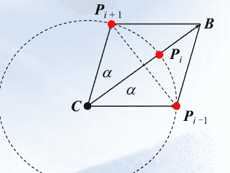

若在上式中取 \(\cos \alpha = 1 - 2^{-k}\)，\(k\) 为正整数，那么，可用移位和加减法代替乘法。更有用处的是，该式在齐次仿射坐标变换下形式不变。设以变换矩阵为 \(T\) 的仿射变换作用在由其求出的点 \((x_i, y_i)\) 上，得到点 \((\bar{x}_i, \bar{y}_i)\)，即

\[
\begin{bmatrix} \bar{x}_i \\ \bar{y}_i \end{bmatrix} = T \begin{bmatrix} x_i \\ y_i \end{bmatrix}
\]

则 \((\bar{x}_i, \bar{y}_i)\) 仍满足该式。这说明用此式不仅可以求圆的内接多边形的顶点，而且还可以求椭圆的内接多边形的顶点。不同之处是看初始两点是取在圆上，还是取在椭圆上。

上式还可以写成更一般的形式：

\[
\begin{bmatrix} x_{i+1}-x_c \\ y_{i+1}-y_c \end{bmatrix}
= 2k \begin{bmatrix} x_i-x_c \\ y_i-y_c \end{bmatrix}
- \begin{bmatrix} x_{i-1}-x_c \\ y_{i-1}-y_c \end{bmatrix}
\]

其中 \(k\) 为常数。当 \(k > 1\) 时，由其求出的点列 \(\{(x_i, y_i)\}\) 位于一支双曲线上，因而可用于双曲线的绘制。

###### 3.3.6 多边形逼近算法稳定性分析

绘制圆的多边形逼近算法是以递推公式为基础的。用递推公式计算时，要特别注意误差的累积问题。递推公式的每一步结果和以前各步计算结果相关，因而也和以前各步结果的误差有关。用不好的递推公式计算时，累积误差可能掩盖了真解，这种递推公式便无实用价值了。所以，对递推公式要做误差分析。这种分析又可转化为对初始误差的累积的估计，称为对初始误差的稳定性分析。

现对递推公式作关于初始误差的稳定性分析。设在初始真值 \((x_0, y_0)\) 上附加了误差 \(E_0 = (e_x, e_y)\)，此真值则成为有误差的初值 \((\bar{x}_0, \bar{y}_0)\)，即

\[
(\bar{x}_0, \bar{y}_0) = (x_0, y_0) + (e_x, e_y)
\]

以 \((\bar{x}_0, \bar{y}_0)\) 为初值代入求圆内接多边形顶点的递推公式，求出解 \((\bar{x}_i, \bar{y}_i)\)。在求解过程中，假设计算是精确的，因而满足递推公式，即

\[
\begin{bmatrix} \bar{x}_{i+1} \\ \bar{y}_{i+1} \end{bmatrix}
= A \begin{bmatrix} \bar{x}_i-x_c \\ \bar{y}_i-y_c \end{bmatrix}
+ \begin{bmatrix} x_c \\ y_c \end{bmatrix}
\]

令 \(E_i = (\bar{x}_i, \bar{y}_i) - (x_i, y_i)\)，则有

\[
E_i^T = A E_{i-1}^T, \quad i=1,2,\ldots
\]

矩阵

\[
A = \begin{bmatrix} \cos\alpha & -\sin\alpha \\ \sin\alpha & \cos\alpha \end{bmatrix}
\]

的特征值为 \(\lambda_1 = \cos\alpha + i\sin\alpha\)，\(\lambda_2 = \cos\alpha - i\sin\alpha\)，所以存在二阶方阵 \(U\)，使得

\[
U^{-1} A U = B = \begin{bmatrix} \lambda_1 & 0 \\ 0 & \lambda_2 \end{bmatrix}
\]

\[
E_{i+1}^T = A^{i+1}E_0^T = (UBU^{-1})^{i+1}E_0^T = UB^{i+1}U^{-1}E_0^T
= U\begin{bmatrix} \lambda_1^{i+1} & 0 \\ 0 & \lambda_2^{i+1} \end{bmatrix}U^{-1}E_0^T
\]

由于 \(\lvert\lambda_1\rvert = \lvert\lambda_2\rvert = 1\)，所以存在一个和 \(i\) 无关的常数 \(C\) 作为各元素模的上界。因而，由上式可得：

\[
\|E_{i+1}\| \le C\|E_0\|
\]

其中，\(\|\cdot\|\) 是任何一种向量范数，如 \(\|E_0\| = \max(\lvert e_{0x}\rvert, \lvert e_{0y}\rvert)\)，或

\[
\|E_0\| = \sqrt{e_{0x}^2 + e_{0y}^2}
\]

这说明只要初值误差 \(E_0 = (e_x, e_y)\) 足够小，可使 \(E_{i+1}\) 足够小。

这就证明了求圆内接多边形顶点的递推公式对初始值的误差是稳定的。类似地，可以证明其它两个递推公式对初始值的误差也是稳定的。利用递推公式求圆的内接多边形的顶点时，为减少计算工作量，可以用近似方式计算三角函数。例如，用

\[
\sin\alpha \approx \alpha, \quad \cos\alpha \approx 1 - \frac{\alpha^2}{2}
\]

来代替 \(\sin\alpha\) 和 \(\cos\alpha\)。这样一来，递推公式则成为：

\[
\begin{bmatrix} x_{i+1} \\ y_{i+1} \end{bmatrix}
=
\begin{bmatrix} 1 - \dfrac{\alpha^2}{2} & -\alpha \\ \alpha & 1 - \dfrac{\alpha^2}{2} \end{bmatrix}
\begin{bmatrix} x_i-x_c \\ y_i-y_c \end{bmatrix}
+ \begin{bmatrix} x_c \\ y_c \end{bmatrix}
\]

当然，这种方法不能精确地求出圆内接多边形的顶点，\(\alpha\) 取得越小，误差就越小。

## 本章作业（1）

- 比较画圆的 Bresenham 算法、中点算法以及多边形逼近算法的优缺点。
- 分析绘制直线的双步算法的优缺点。

## 本章上机实习作业（1）

- 用 Turbo C 编写绘制直线段的双步算法。
- 用 Turbo C 编写绘制圆的中点算法。

## 第三章 二维图元的基本光栅图形学算法（2）


### 3.4 多边形的扫描转换与区域填充

在通用图形软件包中，有一种称为实心或图案填充的多边形区域的标准输出图元。也有其他种类的填充区域图元，但由于多边形有线性边界，所以它更容易处理。

光栅图形系统中有两种基本区域填充方法：一种是通过确定横穿区域的扫描线的覆盖间隔来填充；另一种是从给定的位置开始填充直到指定的边界为止。扫描线方法一般主要用来填充多边形、圆以及其他简单曲线所围的区域。从内点开始的填充方法用在具有复杂形状边界的区域以及交互式填充系统中。

#### 3.4.1 多边形的扫描转换

##### 1. 什么是多边形的扫描转换

在计算机图形学中，多边形的表示有两种方法：顶点表示和点阵表示。顶点表示是用多边形的顶点序列来表示多边形。这种方法直观、几何意义强、占用内存少、易于进行几何变换。但由于它没有明确指出哪些像素点在多边形内，故不能直接用于面着色。

点阵表示是用位于多边形内的像素点的集合来刻画多边形。这种表示方法虽然失去了许多重要的几何信息，但便于运算。

用帧缓冲器表示图形，是面着色所需要的图形表示形式。

光栅图形系统的基本问题之一就是把多边形的顶点表示转换为点阵表示，也就是从多边形的给定边界出发，求出位于其内部的各像素点，并给帧缓冲器内的各个对应元素设置相应的灰度和颜色，这一转换称为多边形的扫描转换。

常用的多边形扫描转换算法有逐点判断算法、扫描线算法、边缘填充算法和边界标志算法。

##### 2. 逐点判断算法

实现多边形扫描转换最简单的方法就是逐点判断，即逐个像素判断以确定它们是否在多边形内，从而给出位于多边形内的像素之集合。如何确定一个点是否在多边形内呢？一般用累计交点的方法。若从一点发出的射线与多边形边界的交点数目为奇数，则该点位于多边形内，否则该点位于多边形外。

设 \(P = P_0 P_1 \cdots P_n P_0\) 为一给定的多边形，序列 \(P_0 P_1 \cdots P_n P_0\) 是多边形的顶点表示。设 \(\mathrm{inside}(P, x, y)\) 是验证点 \((x, y)\) 是否在多边形 \(P\) 内的布尔函数。当从 \((x, y)\) 到 \((+\infty, y)\) 的射线与 \(P\) 的交点个数是奇数时，该函数取值 1，否则取值 0。设 PolyColor 是多边形 \(P\) 的颜色值，BkColor 为屏幕的背景色。

运用以上的概念，逐点判断算法的程序框架如下：

```
for (y = Screen_ymin; y <= Screen_ymax; y++)
    for (x = Screen_xmin; x <= Screen_xmax; x++)
        if (inside(P, x, y))
            DrawPixel(x, y, PolyColor);
        else
            DrawPixel(x, y, BkColor);
```

逐点判断算法程序简单，但不可取，原因是速度太慢。这主要是由于该算法割断了各像素点之间的联系，孤立地考察各个像素与多边形 \(P\) 的内外关系，每次判断又要多次求交点。这样就需要做大量的乘法运算，因此花费很多时间。


##### 3. 扫描线算法

扫描线算法是多边形扫描转换的最常用的算法。与逐点判断算法相比，扫描线算法充分利用了相邻像素之间的连贯性，避免了对像素的逐点判断和反复求交的运算，达到了减少计算量和提高速度的目的。

相邻像素之间的连贯性有三种形式：区域的连贯性、扫描线的连贯性和边的连贯性。

###### ① 区域的连贯性

设多边形 P 的顶点 P_i = (x_i, y_i)，i = 0, 1, …, n，其纵坐标 y 的递减序列如下：

y_{i_0}, y_{i_1}, ..., y_{i_n}　(3.4.1)

即：

y_{i_k} ≥ y_{i_{k+1}}, 0 ≤ k ≤ n-1　(3.4.2)

这样，当 y_{i_k} > y_{i_{k+1}}（0 ≤ k ≤ n-1）时，屏幕上位于扫描线 y = y_{i_k} 和 y = y_{i_{k+1}} 之间的长方形区域（简记为 {y_{i_k}, y_{i_{k+1}}}）被多边形 P 的边分割成若干个梯形（三角形看作一底边长为 0 的梯形），它们具有以下性质：

- 梯形的两底边分别在 y = y_{i_k} 和 y = y_{i_{k+1}} 两条扫描线上，腰在多边形 P 的边上或在屏幕的边界上。
- 这些梯形可分为两类：一类位于多边形 P 的内部，另一类位于多边形 P 的外部。
- 两类梯形在长方形区域 {y_{i_k}, y_{i_{k+1}}} 内相间排列，即相邻的两个梯形必有一个在 P 内，另一个在 P 外。

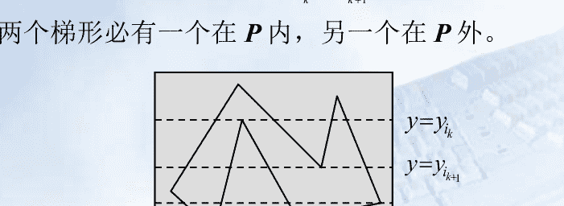

根据这些性质，实际上只要知道该长方形区域内任一梯形内一点和多边形 P 的内外关系，即可确定长方形区域内所有梯形和 P 的内外关系。

###### ② 扫描线的连贯性

设 e 为整数，且 y_{i_0} ≥ e ≥ y_{i_n}，若扫描线 y = e 与多边形 P 的边 P_{i-1}P_i 相交，其交点横坐标记为 x_{e i}。现设

x_{e i_1}, x_{e i_2}, …, x_{e i_l}　(3.4.3)

是扫描线 y = e 与 P 的边界各交点横坐标的递增序列，称为交点序列。那么，由区域的连贯性可知，交点序列具有下列性质：

- l 是偶数；
- 在该扫描线上，只有区间 (x_{e i_k}, x_{e i_{k+1}})，k = 1, 3, ⋯, l - 1，位于多边形 P 内，而其余区间在多边形 P 外。

上述性质称为扫描线的连贯性，它是多边形区域连贯性在一条扫描线上的反映。

###### ③ 边的连贯性

设 d = e - 1 满足条件 y_{i_0} ≥ d ≥ y_{i_n}，且位于扫描线 y = d 上的交点序列为：

x_{d i_1}, x_{d i_2}, ⋯, x_{d i_h}　(3.4.4)

现考察交点序列 (3.4.4) 和 (3.4.3) 之间的关系。若多边形 P 的边 P_{r-1}P_r 与扫描线 y = e、y = d 都相交，那么序列 (3.4.3) 和 (3.4.4) 中对应元素 x_{e r}、x_{d r} 满足下列关系：

x_{e r} = x_{d r} + 1/m_r　(3.4.5)

其中，m_r 为边 P_{r-1}P_r 之斜率。

于是，可利用序列 (3.4.4) 计算序列 (3.4.3)，即先运用关系式 (3.4.5) 求得同扫描线 y = e 和 y = d 都相交的所有边上的交点，再求与扫描线 y = d 不相交但与下一条扫描线 y = e 相交的所有边 P_{q-1}P_q 上的交点 x_{e q}。

于是

x_{e i_r} = x_{d j_r} + 1/m_r　(3.4.7)

这样，运用公式 (3.4.7) 可直接由序列 (3.4.4) 求得序列 (3.4.3)。

以上性质称为边的连贯性，它是区域连贯性在相邻两扫描线上的反映。

###### ④ 奇点处理

当扫描线与多边形 P 的边界的交点是 P 的顶点时，则称该交点为奇点。上述多边形的三种形式的连贯性都是基于这样的几何事实：每一条扫描线与多边形 P 的边界的交点个数是偶数（包括零）。但是，如果把每一奇点简单地记为一个交点，则交点个数可能出现奇数；同样，若将每一奇点都简单地记为两个交点，亦会导致反常的结果。因此，奇点必须按不同的情况区别对待。

多边形 P 的顶点可分为两类：极值点和非极值点。如果

(y_{i-1} - y_i)(y_{i+1} - y_i) < 0

则称顶点 P_i(x_i, y_i) 为 P 的非极值点，否则称为 P 的极值点。

为了在算法中统一处理多边形三种形式的连贯性，使每一条扫描线与 P 的边界的交点个数保持为偶数，规定当奇点为 P 的极值点时，该点按两个交点计算，否则按一个交点计算。

###### ⑤ 扫描线算法的数据结构

为了实现多边形 P 的扫描转换，首先对多边形 P 的顶点的纵坐标由大到小排序，得到一递减序列：

y_{i_0}, y_{i_1}, …, y_{i_n}

取 d = y_{i_n}，容易求得扫描线 y = d 上的交点序列：

x_{d j_1}, x_{d j_2}, …, x_{d j_h}

这一序列由位于扫描线 y = d 上的多边形 P 的顶点组成。

由上述序列开始即可根据多边形的边的连贯性和扫描线的连贯性，按从下到上的顺序求得各扫描线的交点序列，并确定各扫描线上位于多边形 P 内的区段，最后将多边形 P 表示成点阵形式。此算法就是对多边形作扫描转换的扫描线算法。

为实现上述思想，算法中采用较灵活的数据结构。它由边的分类表 ET(Edge Table) 和边的活化链表 AEL(Active Edge List) 两部分组成，这是为了利用区域、扫描线和边的三种形式的连贯性而将多边形的有关信息联系组织在一起的一种特定的数据结构。

边的分类表 ET 和边的活化链表 AEL 中的基本元素为多边形的边。边结点的结构如下：

| x | Δx | ymax | next |
|---|---|---|---|

其中：

- ymax：边的上端点 y 坐标；
- x：边的下端点 x 坐标。在 AEL 中表示边与扫描线的交点 x 坐标；
- Δx：边的斜率的倒数；
- next：指向下一条边的指针。

边的分类表 ET 是按边的下端点纵坐标 y 对非水平边进行分类的指针数组（Y 桶分类）。下端点的纵坐标 y 值等于 i 的边归入第 i 类，有多少条扫描线，就设多少类。同一类中，各边按 x 值（x 值相等时，按 Δx 值）递增的顺序排列成行。

例如，对于多边形 P = [P_1...P_6P_1] = [(2, 2), (5, 1), (11, 3), (11, 8), (5, 5), (2, 7), (2, 2)]，其对应的边的分类表 ET 如下图所示。这里已对非极值点 P_1、P_3 做了预处理，即对边 P_6P_1、P_3P_4 而言，下顶点的 y 坐标分别为 3 和 4。

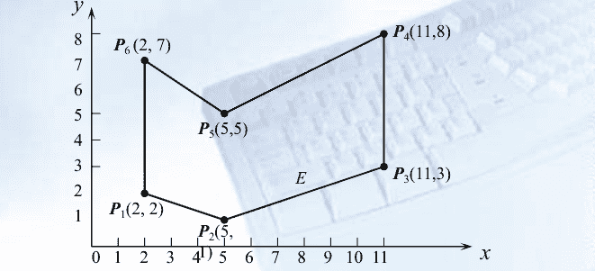

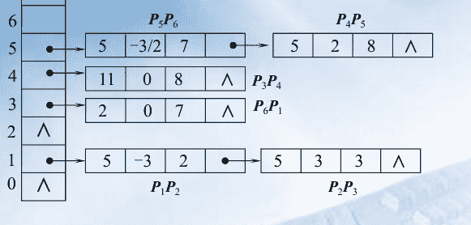

边的活化链表 AEL 是由与当前扫描线相交的所有多边形的边组成的一个链表。它记录了多边形沿扫描线的交点序列，并且根据边的连贯性（式 (3.4.5)）不断地刷新交点序列。例如，对所给的多边形，对应于不同扫描线，其 AEL 分别如下：

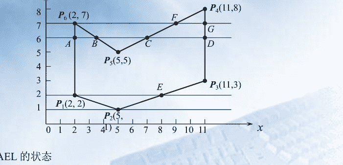

扫描线 y = 6 时 AEL 的状态：

AEL：P6P1 P5P6 P4P5 P3P4

扫描线 y = 7 时 AEL 的状态：

AEL：P6P1 P5P6 P4P5 P3P4

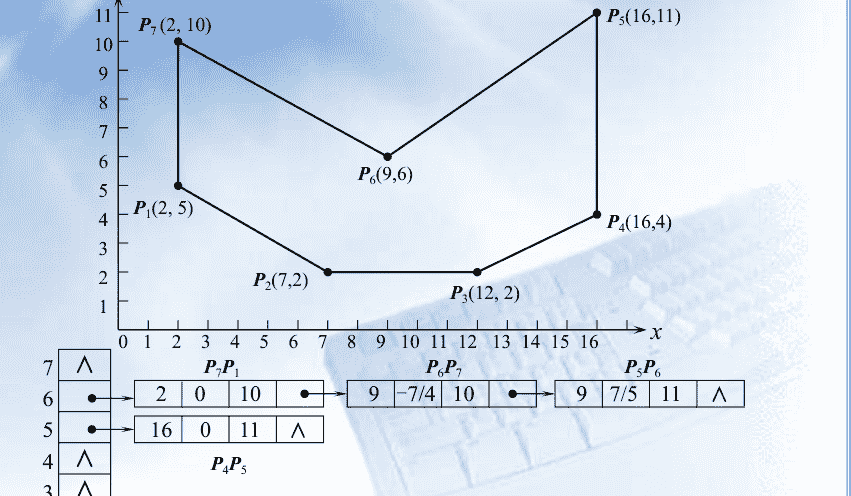

###### ⑥ 算法步骤

一旦建立了多边形的分类表 ET，扫描线算法的实现步骤如下：

- Step 1.（扫描线初始化）取扫描线纵坐标 y 的初始值为 ET 中非空元素的最小序号（对上述的多边形，y = 1）；
- Step 2.（AEL 初始化）将边的活化链表 AEL 置为空表；
- Step 3. 按从下到上的顺序对纵坐标值为 y 的扫描线执行以下操作，直到边的分类表 ET 和边的活化链表 AEL 为空表为止。
  - 3.1 若边的分类表 ET 中第 y 类元素非空，则将属于该类的所有边从 ET 中取出并插入到边的活化链表 AEL 中。AEL 中的各边按照 x 值（当 x 值相等时，按 Δx 值）递增的顺序排序；
  - 3.2 若相对于当前扫描线，边的活化链表 AEL 非空，则将 AEL 中的边两两配对，即第 1、2 边为一对，第 3、4 边为一对，依次类推。每一对边与当前扫描线的交点所构成的区间位于多边形内。依次对这些区间上的像素点按多边形颜色着色；
  - 3.3 将边的活化链表 AEL 中满足条件 y = ymax 的边删去；
  - 3.4 将边的活化链表 AEL 中剩余的每一条边的 x 域累加 Δx。


Δx，即 x = x + Δx;

3.5 将当前扫描线的纵坐标值 y 累加 1，即 y = y + 1。

##### 4. 边缘填充算法

在扫描线算法中，虽然避免了反复求交点的运算，然而建立 AEL 和 ET 时，需要对多边形的边进行排序。若采用求余运算的方法，就可免去对边排序的工作量而改用求余运算代替。

假定 A 为一给定的正数，所谓数 M 的余是指数 A − M，记作 M̅。易知 M̅̅ = M。即对 M 作偶数次求余运算，其结果仍是 M，而对 M 作奇数次求余运算的结果是 M̅。

在光栅图形中，如果某区域已着上值为 M 的颜色，则上述求余运算的性质反映出的现象是：对 M 作偶数次求余运算后，该区域的颜色不变；而作奇数次求余运算后，该区域的颜色则变成值 M̅ 为的颜色，这一现象可用于多边形的扫描转换。

设 framebuffer 是存放图形的帧缓冲器，framebuffer(x, y) 为与像素点 (x, y) 对应的帧缓冲器中的元素，用以存放屏幕上对应像素的颜色值。令 P_color 为多边形的颜色值，B_color 为屏幕背景颜色值，A = P_color + B_Color。又设：

x₁, x₂, …, xₘ

是扫描线 y = e 与多边形 P 的边界交点的 x 坐标序列（不要求是递增序列）。那么，该扫描线上位于多边形 P 内的像素点可按以下步骤求得：

###### Step 1. 将位于扫描线 y = e 上的所有像素都着上值为 B_color 的颜色：

```
for (x = Screen_xmin; x <= Screen_xmax; x++)
    framebuffer (x, e) = B_color;
```

###### Step 2. 对于扫描线 y = e 上的横坐标大于 x_i 的像素求余——称为向右求余：

```
for (i = 1; i <= m; i++)
    for (x = xᵢ; x <= Screen_max; x++)
        framebuffer (x, y) = A - framebuffer (x, y);
```

完成以上两步后，即完成了扫描线 y=e 上的位于多边形 P 内的像素点的奇数次求余运算，并着上了值为 P_color 的颜色。而对多边形外的像素点都做了偶数次求余运算，并着上了值为 B_color 的颜色（下图所示）。

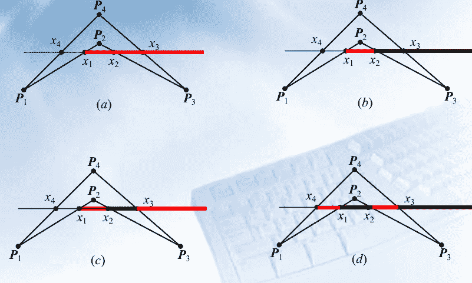

这样，当对每一条扫描线都实施了以上两步后，则只有着上值为 P_color 的颜色的像素点才在多边形 P 内，其余像素点均在多边形 P 之外。从而完成了多边形的扫描转换。

实际上，Step 2 中的向右求余运算也可以逐边进行，即对多边形 P 的每一条非水平边 P_i P_{i+1} (i = 0, 1, ..., n) 上的各像素点做向右求余。这种多边形的扫描转换方法称为边缘填充算法。

利用多边形的边的连贯性和奇点处理方法，边缘填充算法有以下形式：

Step 1. 初始化。将帧缓冲器的各元素的颜色值一律置为 B_color:

```
for ( y = ymin + 1; y <= ymax; y++ ) {
    xleft = xleft + dx;
    for ( x = (int)(x + 0.5); x <= Screen_xmax; x++ )
        framebuffer (x, y) = A - framebuffer (x, y);
}
}
```

该算法之所以称为边缘填充算法，是因为它一边画多边形的边界，一边做向右求余运算。当边界画完后，多边形的扫描转换也随之完成。

和扫描线算法相比, 边缘填充算法的数据结构和程序结构都简单的多，其原因是它用求余运算代替了排序。该算法执行时需对帧缓冲器中的大批元素反复赋值，故其速度并不比扫描线算法快。

##### 5. 边界标志算法

虽然边缘填充算法的程序和数据结构都较简单，但由于涉及到对帧缓冲器中大量元素的多次赋值而影响了算法的运行效率。为了使这部分的工作量得以减轻，可先画边界后填色。这样可使对帧缓冲器中的每个元素的赋值次数不超过二次。实现这一思想的算法称为边界标志算法。边界标志算法的基本思想是：先用一种特殊的颜色在帧缓冲器中将多边形的边界(水平边边界除外)勾画出来，然后再采用类似扫描线算法的方法将位于多边形内的各区段着上所需颜色，具体步骤如下：

###### Step 1. 以值为 B_color 的特殊颜色画多边形的边界。设多边形 P 的顶点为 P_i = (x_i, y_i), i = 0, 1, ..., n +1，其中，x_i, y_i 均为整数。令 P_{n+1} = P_0，由于着上这种特殊颜色的点是扫描线与多边形 P 的边界的交点，故每一条扫描线上着这种特殊颜色的点的数目必定为偶数。程序结构如下：

```
for ( i = 0; i <= n; i++ ) { dy = y_{i+1} - y_i;
    if (dy != 0) { dx = (x_{i+1} - x_i)/dy;
    if (dy > 0) {x = x_i; }
```

```
else { x = x_i +1; }

ymin = min(y_i, y_{i+1}); ymax = max(y_i, y_{i+1});
for (y = ymin + 1; y <= ymax; y++) {
    x = x + dx; DrawPixel(x, y, B_color);}
}
```

Step 2. 逐条对多边形着色。为此，先将位于当前扫描线上的值为特殊颜色 B_color 的像素点依 x 坐标递增的顺序两两依次配对，再将每一对像素点构成的扫描线段内的所有像素点置上值为 P_color 的颜色。为了确定当前扫描线上像素点 (x, y) 原有的颜色值，需调用底层函数：

###### GetPixel(x, y)

又设 interior_Point 为布尔变量，在搜索过程中，如果当前像素点位于多边形 P 内，则 interior_Point = 1，需着上值为 P_color 的颜色。否则，该像素点在多边形 P 外，需着上值为 B_color 的颜色。这一步的程序框架如下：

```
for (y = Screen_ymin; y <= Screen_ymax; y++) {
    interior_Point =0;
    for (x = Screen_xmin; x <= Screen_xmax; x++) {
        if (GetPixel (x, y) === B_color) interior_Point = ! interior_Point;
        if (interior_Point) DrawPixel (x, y, P_color);
    }
}
```

```
else DrawPixel (x, y, B_color);
}
}
```

当以上两步执行完毕后，多边形 P 内的像素点都着上了值为 P_color 的颜色，其余像素点则无一着上这种颜色，扫描转换即完成。

较之边缘填充算法，本算法避免了对帧缓冲器中大量元素的多次赋值。但需逐条扫描线对帧缓冲器中的元素进行搜索和比较。用软件实现本算法，其速度与扫描线算法相当。本算法适合于固化，固化后的速度则有很大的提高。

#### 3.4.2 区域填充

前述的多边形扫描转换问题，其实质是一种区域填充方法，它是通过确定横越区域的扫描线的覆盖区间来填充。由于其工作原理是基于扫描线和区域边界的相交性计算，因此主要用来填充多边形区域和圆、椭圆及其他简单曲线围成的区域。区域填充的另一种方法是从区域的一个内点开始，由内向外绘点直到区域边界。这种填充方法主要用于具有复杂形状边界的区域填充以及交互式涂描系统中。

##### 1. 区域的表示和类型

基于内点扩展的区域填充算法，对待填充的区域有一定的要求，即区域为已表示成点阵形式的像素集合。在光栅图形中，区域有两种表示形式：

内点表示 所给区域的所有像素点具有单一颜色(称为原色)，而边界上的像素点则不具有该种颜色。

边界表示 所给区域的边界上的所有像素点具有单一颜色(称为边界色)，而区域内部的所有像素点不具有该种颜色。

此外，区域填充算法中的区域要具备一定的连通性：4-连通和 8-连通。4-连通区域是指从区域内一点出发，通过上、下左、右四种运动可到达区域内的每一像素点。而 8-连通区域则是指从区域内一点出发，通过上、下、左、右以及对角线方向的 8 种运动可到达区域内的每一像素点。需要值得指出的是，4-连通区域可看作是 8-连通区域，但是两者的边界不尽相同。原因是4-连通区域的边界是 8-连通区域，而 8-连通区域的边界则为 4-连通区域。

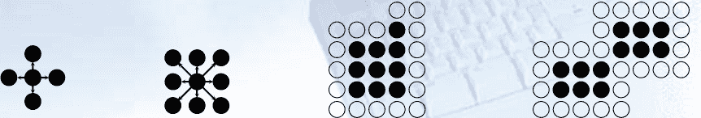

用于 8-连通区域的填充算法可以用于 4-连通区域，但用于 4-连通区域的填充算法则不能用于 8-连通区域。

常用的区域填充算法有：边界填充算法、泛填充算法和扫描线填充算法。

##### 2. 边界填充算法

设 G 为边界表示的区域, (x, y) 是 G 内一点，称为种子点。 B_Color 是 G 的边界色，填充色为 F_Color。那么，边界填充算法的原理是，先将种子点 (x, y) 的颜色置为 F_Color，然后，使用 4-连通方法或 8-连通方法检测相邻位置的像素点颜色以确定它们是否为边界色或填充色。若不是边界色和填充色，就置以填

充色，并检测其相邻位置的像素点。重复此过程，直至区域边界颜色范围内的所有像素点均置为填充色为止。

###### 程序 3.4.1 区域填充的边界算法

```c
void boundaryFill4 (int x, int y, int F_Color, int B_Color)
{
    int current_color;
    current_color = GetPixel (x, y);
    if ((current_color != B_Color) && (current_color != F_Color)){
        DrawPixel (x, y, F_Color);
        boundaryFill4 (x + 1, y, F_Color, B_Color);
        boundaryFill4 (x - 1, y, F_Color, B_Color);
        boundaryFill4 (x, y + 1, F_Color, B_Color);
        boundaryFill4 (x, y - 1, F_Color, B_Color);
    }
}
```

将上述算法中递归地给相邻 4 个像素点填充扩展为给周围 8 个像素点填充，即可得到边界表示的 8-连通区域的填充算法。假如有些内部像素点已经以填充色显示，那么上述的边界填充算法也许不能正确地填充区域。这是因为算法按照边界色和填充色来检测下一个像素点，凡遇到一个具有填充色的像素点，就导致该递归分支终止，从而留下一些尚未填充的内部像素点。为了避免这种情况出现，在应用边界填充算法之前，先改变那些初始颜色为填充色的内部像素点的颜色。

##### 3. 泛填充算法

设 G 是内点表示的区域，(x,y) 是 G 内的种子点。G 的原色是 Old_Color，填充色为 F_Color。泛填充算法的原理是：从种子点 (x,y) 开始，置 (x,y) 的颜色为填充色 F_Color，而后使用4-连通方法或 8-连通方法，逐步连通各像素点，直到所有内部像素点均已被涂上填充色为止。

###### 程序 3.4.2 区域填充的边界算法

```c
void floodFill4 (int x, int y, int F_Color, int Old_Color)
{
    if (GetPixel (x, y) == Old_Color) {
        DrawPixel (x, y, F_Color);
        floodFill4 (x + 1, y, F_Color, Old_Color);
        floodFill4 (x - 1, y, F_Color, Old_Color);
        floodFill4 (x, y + 1, F_Color, Old_Color);
        floodFill4 (x, y - 1, F_Color, Old_Color);
    }
}
```

将上述算法中递归地给相邻4个像素点填充扩展为给周围8个像素点填充，即可将泛填充算法扩展到8-连通区域的填充。

##### 4. 区域填充的扫描线算法

区域填充的边界算法和泛填充算法均为递归算法，程序简单、表达清晰。但由于多层递归，系统堆栈反复进出，费时费空间。因此许多改进的更有效的算法相继出现，其中以扫描线算法最具代表性。下面以内点表示的 4-连通区域填充为例，讨论区域填充的扫描线。

算法基本思想是，首先填充种子点所在扫描线上位于区域内的区段，然后确定与该区段相邻的上下两条扫描线上位于区域内的区段，并依次将各区段的起始位置保存，这些区段分别被用区域边界色显示的像素点所包围。随后，逐步取出一个开始点并重复上述过程，直到所保存各区段都填充完毕为止。

借助于栈结构，区域填充的扫描线算法之步骤如下：

- Step 1. 初始化种子点栈 置种子点栈为空栈，并将给定的种子点入栈；
- Step 2. 出栈 若种子点栈为空，算法结束；否则，取栈顶元素(x, y)为种子点；
- Step 3. 区段填充 从种子点 (x, y) 开始沿纵坐标为 y 的当前扫描线向左右两个方向逐像素进行填色，其颜色值置为：*F_Color* 直至到达区域边界。分别以 xl 和 xr 表示该填充区段两端点的横坐标；
- Step 4. 新种子点入栈 分别确定当前扫描线上、下相邻的两条扫描线上位于区间 [xl, xr] 内的区域内的区段。若这些区段内的像素点颜色值为 F_Color 或 B_Color，则转至 Step 2；否则以区段的右端点为种子点入种子点栈，再转至 Step 2。

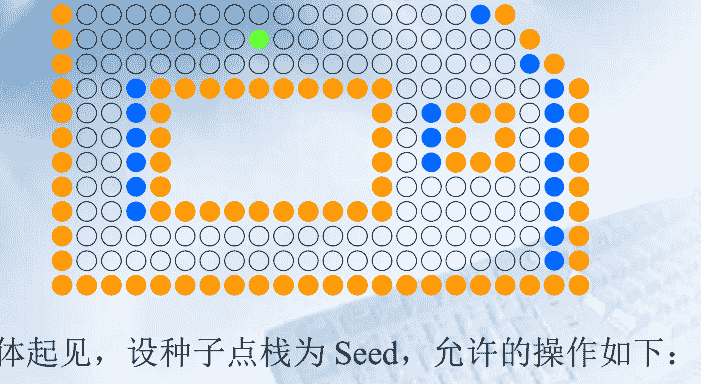

为具体起见，设种子点栈为 Seed，允许的操作如下：

- stackpop (): 取栈顶元素；
- stackpush (): 种子点入栈；
- setstackempty (): 种子点栈置空；
- isstackempty(): 种子点栈状态检测函数。

利用这些函数，下面给出区域填充的扫描线算法的程序框架。在此基础上，不难给出区域填充的扫描线算法的完整程序。

###### 程序 3.4.3 区域填充的边界算法

```c
typedef struct { // 记录种子点
  int x;
  int y;
} Seed;

void ScanLineFill4 ( int x, int y, int oldcolor, int newcolor)
{
    int xl, xr, i;
    bool spanNeedFill;
    Seed pt;
    setstackempty();
    pt.x = x; pt.y = y;
    stackpush (pt); // 种子点(x, y)入栈
    while (! isstackempty ()){
        pt = stackpop (); // 取种子点
        y = pt.y; x = pt.x;
        while (GetPixel (x,y) == oldcolor) // 从种子点开始向右填充
        {
            DrawPixel (x, y, newcolor);
            x ++;
        }
        xr = x - 1; x = pt.x - 1;
        while (GetPixel (x,y) == oldcolor) { // 从种子点开始向左填充
            DrawPixel (x, y, newcolor); x --;
        }
        xl = x + 1;
        x = xl; y = y + 1; // 处理上面一条扫描线
        while (x < xr) {
            spanNeedFill = FALSE;
            while (GetPixel (x, y) == oldcolor) {
                spanNeedFill = TRUE; x++;
            } // 待填充区段搜索完毕
            if (spanNeedFill) { // 将右端点作为种子点入栈
                pt.x = x - 1; pt.y = y;
                stackpush (pt);
                spanNeedFill = FALSE;
            } // 继续向右检查以防遗漏
            while ((GetPixel (x, y) != oldcolor) && x < xr) x++;
        } // 上一条扫描线上检查完毕
        x = xl; y = y - 1; // 处理下面一条扫描线
        while (x < xr) {
            spanNeedFill = FALSE;
            while (GetPixel (x, y) == oldcolor) {
                spanNeedFill = TRUE; x ++;
            }
            if (spanNeedFill) {
                pt.x = x - 1; pt.y = y;
                stackpush (pt); spanNeedFill = FALSE;
            }
            while ((GetPixel (x, y) != oldcolor) && x < xr) x ++;
        }
    }
}
```

在上述算法中，对于每一个待填充的区域，只需向种子点栈中压入一个种子点即可。而每取走一个栈顶元素，则填充一个区段。这与采用递归算法时区域内全部像素递归式地入栈、出栈并逐一填充的做法相比，种子像素进出栈的次数大为减少，内存节省多，速度也相应提高。

#### 3.4.3 区域的图案填充

前面讨论区域填充时，只用一种颜色，其实现是将该颜色赋给 DrawPixel 函数的参数 Color。本节我们讨论用图案进行填充，其实现方法是在扫描转换算法中最终写像素时增加一些控制即可。

##### 1. 填充模式

区域显示有三种模式：具有颜色边界的空心区域、用颜色填充的实心区域和用指定图案或设计填充的区域。在 PHIGS 中用下列函数设置基本填充模式：

###### setInteriorStyle (fs)

填充模式参数 fs 的取值包括空心、实心和图案。填充模式的另一值是影线 (hatch)，它用选定的影线图案——平行线或交叉线来填充区域。一旦选定填充模式，其值将记录在系统属性表中，并用来顺序地填充指定的区域，直至选择新的填充模式为止。

空心区域通过仅显示边界轮廓并保留其内部颜色与背景颜色相同来实现。实区域填充以单一颜色将区域内部填充，亦可包含其边界。

##### 2. 图案填充

对于图案填充模式，首先必须定义图案类型表。图案是一个二维颜色码数组，创建图案类型表的函数一般形式如下：

```
setPatternRepresentation (pi, nx, ny, cp)
```

其中，pi 为图案索引码，cp 为具有 nx 列，ny 行的二维颜色码数组。

例如，令：

```
cp[1,1] = YELLOW; cp[1, 2] = BLUE ; cp[2,1] = BLUE ;
cp[2,2] = YELLOW; cp[3, 1] = YELLOW; cp[3, 2] = BLUE;
```

则函数

###### setPatternRepresentation (1, 2, 3, cp)

创建了一个图案索引码为 pi = 1，蓝黄相间的对角线图案。

cp = [[Yellow, Blue], [Blue, Yellow], [Yellow, Blue]]

(a) 颜色码数组


(b) 对应图案

当颜色码数组 cp 用来填充一个区域时，需要指定由数组中每个元素覆盖的区域大小。这需借助设置图案的长方形坐标范围来完成：

###### setPatternize (dx, dy)

其中，参数 dx 和 dy 给出了数组映射的坐标宽度和高度。

例如，dx = 8, dy = 6，那么颜色数组的每个元素将应用于包含八个像素的 4×2 屏幕网格。

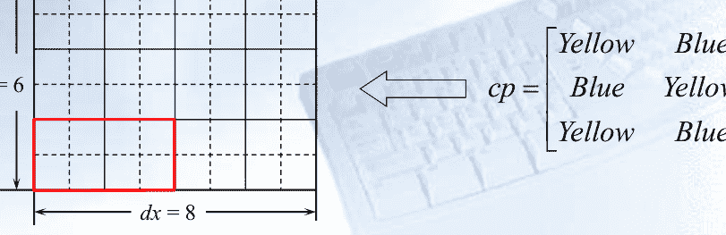

具有 4 列 3 行的图案数组映射成一个 8×6 坐标长方形

开始图案填充的参照位置用下列函数设置：

```
setPatternReferencePoint (position)
```

参数 position 是指向长方形图案左下角坐标 (xp, yp) 的指针。

从这个起始位置开始，图案被重复地在 x 和 y 方向复制，直到所定义的区域全被不重迭的图案数组拷贝所覆盖。用长方形图案填充的过程称为“铺瓦”，而长方形图案有时也称为“铺瓦图案”。


图案填充可通过修改前面讨论过的扫描线算法，来使所选择的图案附加到扫描线上而实现。从图案填充指定的起始位置开始，将长方形图案垂直地在填充区域的顶部和底部间的扫描线之间，沿水平方向映射到内部像素位置上。在水平方向上，图案数组按参数 dx 指定的间隔重复，而在垂直方向上按参数 dy 设置的区间来重复。这样的扫描线图案程序既可用于多边形，也可用于由曲线包围的区域。

影线填充用来在区域内显示一组平行线。其填充程序实现单一影线或交叉影线的绘制。影线间的间距和斜率在影线表中以参数形式设定。

也可以按多种方法将填充图案和背景颜色组合。对于仅包含数字 1 和 0 的位图图案，0 值可用作让背景透过显示的透明指示，也可将 1 和 0 表示为用两种颜色图案填充内部。通常，颜色填充图案可以用几种方法与背景色混合。图案和背景可用布尔操作混合，或者简单地用图案颜色替代背景色。

### 3.5 字符

字符指数字、字母、汉字等符号。计算机中的字符由数字编码惟一标识。国际上最流行的字符集是“美国信息交换用标准代码集”，简称 ASCII 码。它是用 7 位二进制数的编码表示 128 个字符，包括字母、标点、运算符以及一些特殊符号。我国除采用 ASCII 码外，还制定了汉字编码的国家标准字符集 GB2312-80。该字符集分为 94 个区、94 个位，每个符号由一个区码和一个位码共同标识，区码和位码各用一个字节表示。为

了能够区分 ASCII 码与汉字编码，采用字节的最高位来表示：最高位为 0 表示 ASCII 码；最高位为 1 表示汉字编码。

为了在显示器等输出设备上上述出字符，系统中必须装备有相应的字库。字库中存储了每个字符的形状信息，分为点阵型和矢量型两种，见下图。

#### 3.5.1 点阵字符

在点阵字符库中，每个字符由一个位图表示：字位为 1 表示字符的笔画经过此位，对应此位的像素应置为字符颜色；字位为 0 表示字符的笔画不经过此位，对应于此位的像素应置为背景


##### 点阵字符


##### 点阵字库中字符的位图表示


##### 矢量轮廓字符

颜色。在实际应用中，有多种字体（如宋体、楷体等），每种字体又有多种大小型号，因此字库的存储空间是很庞大的。一般采用压缩技术解决这个问题，如黑白段压缩、部件压缩、轮廓字形压缩等。其中轮廓字形法的压缩比较大，且能保证字符质量，是当今国际上最流行的一种方法。轮廓字形法采用直线或二次、三次 Bézier 曲线的集合来描述一个字符的轮廓线，轮廓线构成一个或若干个封闭的平面区域；轮廓线定义加上一些指示横宽、竖宽、基点、基线等控制信息就构成了字符的压缩数据。

点阵字符的显示分为两步：首先从字库中将它的位图检索出来，然后将检索到的位图写到帧缓存中。

#### 3.5.2 矢量字符

矢量字符记录字符的笔画信息而不是整个位图，具有存储空间小、美观、变换方便等优点。对于字符的旋转、缩放等变换，点阵字符的变换需要对表示字符位图中的每一象素进行；而矢量字符的变换只要对其笔画进行变换就可以了。矢量字符的显示也分为两步：首先从字库中将它的字符信息检索出来，然后取出端点坐标，对其进行适当的几何变换，再根据各端点的坐标显示出字符。

## 本章作业（2）

- 1. 给定多边形 $P = [P_1 \cdots P_6 P_7] = [(2, 2), (5, 1), (11, 3), (11, 8), (5, 5), (2, 7), (16, 2)]$，建立其边的 Y 桶分类表 ET。
- 2. 为了在显示器等输出设备上输出字符，系统中必须装备相应的字库。字库中存储了每个字符的形状信息。字库分为哪两种类型？各有什么特点？

## 本章上机实习作业（2）

- 1. 编写区域填充的泛填充算法。
- 2. 编写区域填充的扫描线算法。

## 第三章 二维图元
的基本光栅图形学算法（3）


### 3.6 光栅图形的裁剪操作

识别图形在指定区域内或区域外的部分的过程称为裁剪，用于裁剪对象的区域称为裁剪窗口。

裁剪的应用包括：从定义的场景中抽取出用于观察的部分；在三维视图中标识可见面；防止线段或对象的边界混淆；用实体造型来创建对象；显示多窗口的环境；允许选择图形的部分进行拷贝、移动或删除等图形编辑操作。对于不同的应用，裁剪窗口可以是多边形或包含曲线边界的多边形，但以矩形窗口最为常见。

当裁剪操作在世界坐标系中进行时，只有窗口内的部分映射到输出设备坐标系中。若裁剪操作在设备坐标系或规范化设备坐标系中进行时，首先将世界坐标系中的图形映射到设备坐标系或规范化设备坐标系中，然后用视区边界裁剪。世界坐标系下的裁剪将落在窗口外的图形部分删除，从而不必将这些图形变换到设备坐标系中去。视区裁剪可通过合并观察和几何变换矩阵来减少计算量，但需要将所有的对象（包括在窗口之外的部分）变换到设备坐标系。

基本的图形裁剪算法有：

- 点的裁剪；
- 直线段的裁剪；
- 多边形的裁剪；
- 曲线的裁剪；
- 字符的裁剪。

直线和多边形的裁剪是图形软件包中的标准部分。许多软件包中亦有曲线、拟合曲线、圆锥曲线的裁剪。另外，处理曲线物体的方法是把它们近似为直线段，然后用直线或多边形的裁剪算法进行裁剪。

#### 3.6.1 点的裁剪

设裁剪窗口是一个由参数 x_L，x_R，y_B 和 y_T 所确定的矩形。

如果点满足下列不等式：

x_L ≤ x ≤ x_R, y_B ≤ y ≤ y_T

则保存该点用于显示。如果这四个不等式中有任何一个不满足，则该点被裁剪。

虽然点的裁剪不如直线和多边形的裁剪用的多，但是某些应用中还是需要点的裁剪。例如，点的裁剪可以用于粒子爆炸或海面泡沫的显示，它们是通过场景中分散的粒子建模。


#### 3.6.2 直线段的裁剪

直线段的裁剪过程包括几个部分：首先测试一个给定的线段，判断它是否完全落在裁剪窗口内。如果没有完全落在窗口内，再判断是否完全落在窗口外。最后，对既不能确定完全落在窗口内又不能确定完全落在窗口外的线段，计算它与一个或多个裁剪边界的交点。图1给出了线段和标准矩形裁剪窗口之间的各种关系。


图1. 直线段与裁剪窗口的关系

我们通过对线段的端点进行“内部→外部”测试来处理线段。对于两个端点都在窗口内的线段（如图1中的 $P_1P_2$）予以保存，两个端点都在同一条裁剪边界外的线段（如图1中的 $P_3P_4$）判断为落在窗口外，而其他贯穿一个或多个裁剪边界的线段需要计算多个交点。为了使计算量最小，需设计一个能有效地识别外部线段并减少求交运算的裁剪算法。

对于端点为 $P_i = (x_i, y_i), i = 0, 1$ 的线段，其参数方程为：

\[
\begin{cases}
x = x_0 + (x_1 - x_0)u \\
y = y_0 + (y_1 - y_0)u
\end{cases},\quad 0 \le u \le 1
\]

在该线段与裁剪边界求交时，可求得参数 $u$ 值。若 $u \notin [0,1]$，则该线段不在该边界处进入窗口内。否则，线段穿过了裁剪区。该方法可用于各个裁剪边界，以便确定是否该线段的所有部分都显示。平行于窗口边界的线段作为特殊情况处理。

使用参数测试的线段裁剪方法要进行大量的计算。目前已研究出了许多有效的线段裁剪算法，下面我们讨论几种主要的算法。一些算法是针对二维图形的，一些算法很容易移植到三维应用中。

##### 1. Sutherland—Cohen 算法

这是最早流行的直线段裁剪算法。该算法基于区域编码，通过初始测试来减少求交次数以加快线段裁剪的速度。

以裁剪窗口的四条边界将平面区域分为九个子区域，为每个子区域赋以相应的编码，称为区域码（region code），每个子区域中的点采用同一编码。区域码的各位指出点关于裁剪窗口的四个相对坐标位置：左、右、下、上。将区域码各位从右到左编号，则坐标区域与各位的关系如下（图 2）：


这里：位 1：左；位 2：右；位 3：下；位 4：上。任何位置赋值为 1，代表点落在相应的位置上，否则为 0。

对于要裁剪的线段的两个端点，根据所在区域确定其相应的编码。各位的值按以下两步确定：① 计算端点坐标和裁剪边界之间的差值；② 用各差值的符号位来设置区域码中相应的值。第一位为 $x - x_L$ 的符号位，第二位为 $x_R - x$ 的符号位，第三位为 $y - y_B$ 的符号位，第四位为 $y_T - y$ 的符号位。

一旦确定了线段两端点的区域码，便可快速判断完全可见和完全不可见的线段。如果线段两端点的编码均为 0000，则该线段完全可见；如果线段两端点的编码中同一位都为 1，则该线段完全不可见。如果上述判断不能定论，则需要进行线段与窗口边界的求交计算。按照左、右、下、上的顺序用裁剪边界检查线段的端点，以确定应裁剪掉的线段部分。我们以图3中的线段为例说明 Sutherland—Cohen 算法的处理过程。


对于线段 $P_0P_1$，由下端点 $P_0$ 开始，依次按左、右、下、上边界对 $P_0$ 检查。发现 $P_0$ 位于下边界的下方，然后求线段 $P_0P_1$ 与下边界的交点 $P_0'$，并舍弃线段 $P_0P_0'$。对于端点 $P_1$ 进行同样的检查，发现 $P_1$ 位于左边界的左侧，求线段 $P_0P_1$ 与左边界的交点 $P_1'$。但 $P_1'$ 位于上边界之上，因此再求一次交点，计算得到 $P_1''$，并舍弃线段 $P_1P_1''$，该线段的裁剪处理完毕。

在与裁剪边界的求交计算中，直线段采用斜截式方程。对于端点坐标为 $P_i = (x_i, y_i), i = 0, 1$ 的直线，与垂直边界交点 $y$ 坐标由下述公式计算：

\[
y = y_0 + (y_1 - y_0) \cdot \frac{x - x_0}{x_1 - x_0}
\]

其中，$x$ 值为 $x_L$ 或 $x_R$。

寻找与水平边界交点的 $x$ 坐标的计算公式是：

\[
x = x_0 + (y - y_0) \cdot \frac{x_1 - x_0}{y_1 - y_0}
\]

其中，$y$ 值为 $y_B$ 或 $y_T$。

下面给出 Sutherland—Cohen 直线段裁剪算法的程序实现，各端点的编码以字节存储，并按位操作处理。

**算法 3.6.1 Sutherland-Cohen 裁剪算法**

```c
#define LEFT    1
#define RIGHT   2
#define BOTTOM  4
#define TOP     8

int encode(float x, float y)
{
    int c = 0;
    if (x < XL) c |= LEFT;
    if (x > XR) c |= RIGHT;
    if (y < YB) c |= BOTTOM;
    if (y > YT) c |= TOP;
    return c;
}

void SC_LineClip(x1, y1, x2, y2, XL, XR, YB, YT)
float x1, y1, x2, y2, XL, XR, YB, YT; // (x1, y1)、(x2, y2) 为线段端点坐标，其他四个参数定义窗口边界
{
    int code1, code2, code;
    float x, y;
    code1 = encode(x1, y1);
    code2 = encode(x2, y2);

    while (code1 != 0 || code2 != 0)
    {
        if ((code1 & code2) != 0) return;
        if (code1 != 0) code = code1;
        else code = code2;
        if ((LEFT & code) != 0) { // 点在窗口左边界左侧
            x = XL;
            y = y1 + (y2 - y1) * (XL - x1) / (x2 - x1);
        }
        else if ((RIGHT & code) != 0) { // 点在窗口右边界右侧
            x = XR;
            y = y1 + (y2 - y1) * (XR - x1) / (x2 - x1);
        }
        else if ((BOTTOM & code) != 0) { // 点在窗口下边界下方
            y = YB;
            x = x1 + (x2 - x1) * (YB - y1) / (y2 - y1);
        }
        else if ((TOP & code) != 0) { // 点在窗口上边界上方
            y = YT;
            x = x1 + (x2 - x1) * (YT - y1) / (y2 - y1);
        }
        if (code == code1)
        { x1 = x; y1 = y; code1 = encode(x, y); }
        else
        { x2 = x; y2 = y; code2 = encode(x, y); }
    }
    displaylist(x1, y1, x2, y2);
}
```

##### 2. 中点分割裁剪算法

与 Sutherland-Cohen 算法一样，中点分割裁剪算法首先对线段端点进行编码，并据此把线段与窗口的关系分为三种情况：全在窗口内、完全不在窗口内、线段与窗口相交。对前两种情况作同样处理。对于第三种情况，用中点分割的方法求出线段与窗口的交点，即从点 $P_0$ 出发找出距 $P_0$ 最近的可见点 $A$，并从点 $P_1$ 出发找出距 $P_1$ 最近的可见点 $B$，两个可见点之间的连线即为线段 $P_0P_1$ 的可见部分，如图所示。


采用中点分割方法从 $P_0$ 出发找最近可见点：先求出 $P_0P_1$ 的中点 $P_m$。若 $P_0P_m$ 不是显然不可见的，并且 $P_0P_1$ 在窗口中有可见部分，则距 $P_0$ 最近的可见点一定落在 $P_0P_m$ 上，故用 $P_0P_m$ 代替 $P_0P_1$；否则用 $P_mP_1$ 代替 $P_0P_1$；再对新的 $P_0P_1$ 求中点 $P_m$。重复上述过程，直到 $P_mP_1$ 的长度小于给定的控制常数为止。求距 $P_1$ 最近的可见点过程一样，只要把 $P_0$ 和 $P_1$ 交换即可。由于该算法的主要计算过程只用到加法和除 2 运算，所以特别适合硬件实现，同时也适合于并行计算。求距 $P_0$ 最近的可见点的框图如下。

##### 3. 梁友栋—Barsky 算法

该算法基于线段的参数方程的分析，通过减少计算交点的次数，使其速度较之 Sutherland—Cohen 算法更快。

端点为 $P_i = (x_i, y_i), i = 0, 1$ 的线段，其参数方程为：

\[
\begin{cases}
x = x_0 + \Delta x \cdot u \\
y = y_0 + \Delta y \cdot u
\end{cases},\quad 0 \le u \le 1
\]

其中 $\Delta x = (x_1 - x_0)$，$\Delta y = (y_1 - y_0)$。直线段 $P_0P_1$ 上点的裁剪条件是：

\[
\begin{cases}
x_L \le x_0 + \Delta x \cdot u \le x_R \\
y_B \le y_0 + \Delta y \cdot u \le y_T
\end{cases}
\]

这四个不等式可以表示为

$$uP_i \le Q_i,\quad i = L,\ R,\ B,\ T$$

其中，$P_i, Q_i$定义如下：

$$
\begin{cases}
P_L = -\Delta x, & Q_L = x_0 - x_L \\
P_R = \Delta x, & Q_R = x_R - x_0 \\
P_B = -\Delta y, & Q_B = y_0 - y_B \\
P_T = \Delta y, & Q_T = y_T - y_0
\end{cases}
$$

任何平行裁剪边界之一的直线满足条件$P_i = 0$，若还满足$Q_i < 0$，则线段完全在边界外，舍弃该线段。若$Q_i \ge 0$，则线段平行于裁剪边界并在窗口内，需用另外一组边界进行检查。

当 $P_i < 0$ 时，线段从裁剪边界延长线外部延伸到内部；当 $P_i > 0$ 时，线段从裁剪边界延长线内部延伸到外部。当 $P_i \neq 0$ 时，线段与边界 $i$ 的延长线的交点参数为：

$$u = \frac{Q_i}{P_i}, \quad i = L,\ R,\ B,\ T$$

对于每条线段，可计算出参数 $u_1$、$u_2$，它们定义了在窗口内部的线段部分。$u_1$ 的值由线段从外到内遇到的边界 ($P_i < 0$) 所决定。对于这些边界，计算：

$$r_i = Q_i / P_i$$

则：

$$u_1 = \max\{0,\ r_i\}$$

u₂ 的值由线段从内到外遇到的边界 (Pᵢ > 0) 所决定。计算：

rᵢ = Qᵢ / Pᵢ

则：

u₂ = min{1, rᵢ}

若 u₁ > u₂，则线段完全落在裁剪窗口之外，舍弃；若 u₁ ≤ u₂，则线段可见部分的两端点由参数 u₁、u₂ 计算而得。

梁友栋-Barsky 算法程序描述如下。线段与边界交点的参数初始化为 u₁ = 0，u₂ = 1。计算出各个裁剪边界的 P、Q 值，函数 ClipTest 用 P、Q 来判断是否舍弃线段还是改变交点的参数。当 P < 0 时，参数 r 用于更新 u₁，当 P > 0 时，参数 r 用于

```
else if (p > 0.0){
    r = q/p;
    if (r < *u1) return FALSE;
    else if (r < *u2)
        *u2 = r;
        return TRUE;
    }
    else if (q < 0.0) return FALSE;
}

void LB_LineClip ( x1, y1, x2, y2, XL, XR, YB, YT)
float x1, y1, x2, y2, XL, XR, YB, YT;
{
    float u1 = 0.0, u2 = 1.0, dx = x2 - x1, dy = y2 - y1;
    if (ClipTest ( - dx, x1 - XL, &u1, &u2))
```

```
if(ClipTest(dx, XR − x1, &u1, &u2))
    if(ClipTest(− dy, y1 − YB, &u1, &u2))
        if(clipTest(dy, YT − y1, &u1, &u2)){
            if(u2 < 1.0){
                x2 = x1 + u2*dx; y2 = y1 + u2*dy;
            }
            if(u1 > 0.0){
                x1= x1 + u1*dx; y1 = y1 + u1*dy;
            }
            displayline(x1, y1, x2, y2)
            return;
        }
    }
```

梁友栋-Barsky 算法比 Sutherland-Cohen 算法更有效，因为需要计算的交点数目交少了。更新参数 u₁、u₂ 仅仅需要一次除法；线段与窗口的交点仅计算一次，就计算出 u₁、u₂ 的最后值。相比之下，即使一条完全落在裁剪窗口之外，Sutherland-Cohen 算法也要对它反复求交点，而且每次求交都需要进行乘除法运算。Sutherland-Cohen 算法和梁友栋-Barsky 算法都可以扩展为三维裁剪算法。

##### 4. Nicholl-Lee-Nicholl 算法

简称 NLN 算法，通过在裁剪窗口周围创建多个区域的途径

来避免对一条直线段的多次裁剪。在 Sutherland-Cohen 算法中，在找到与裁剪边界的交点之前或完全舍弃该线段之前，必须对一条线段进行多次求交计算；而 NLN 算法在求交计算前进行更多的区域测试来减少求交计算。与梁友栋-Barsky 算法和 Sutherland-Cohen 算法相比，NLN 算法的比较次数和除法次数减少了，但该算法仅适用于二维直线段的裁剪，而梁友栋-Barsky 算法和 Sutherland-Cohen 算法可以很方便地推广到三维裁剪。

NLN 算法的执行分为两步：

（1）对于端点为 P₁、P₂ 的线段，首先决定 P₁ 相对于裁剪窗口的九个区域的位置，我们这里仅考虑三个区域，如下图所示。对于其他六个区域，可利用对称变换将其变为这三个区域中的任何一个区域。


NLN 裁剪算法中线段端点 P₁ 的三种位置

（2）判断端点 P₂ 相对于 P₁ 的位置，根据 P₁ 的位置在平面上建立新的区域，新区域的边界是由 P₁ 发出的穿过窗口角点的射线，如下图所示。


P₁ 在窗口内


P₁ 在窗口左侧

如果 P₁ 位于窗口内，P₂ 位于窗口外，我们设置四个裁剪区域：L、T、R 和 B。根据点 P₂ 所在区域，决定直线段和窗口边界的求交计算。如果 P₂ 在窗口内，则为可见线段。

如果 P₁ 位于窗口左边区域，则设定四个区域：L、LT、LR 和 LB。这四个区域决定了裁剪线段的惟一窗口边界。若 P₂ 在 L 区域，则用左边界裁剪线段，且保存从交点到 P₂ 之间的线段；若在 LT 区域，则保存左边界到上边界之间的线段；若不在这四个区域的任何一个中，则舍弃整个线段。

对于第三种情况，当 P₁ 在窗口的左上方时, 按照 P₁ 相对于窗口左上角的位置，有两种可能（见下图）。


###### P₁ 在窗口左上方时的裁剪区域

若 P₂ 在区域 L、T、TR、TB、LR 或 LB 中，则决定了求交计算的惟一裁剪窗口边界，否则整个线段被舍弃。

为了确定 P₂ 在何区域，要比较该线段的斜率和裁剪区域边界的斜率。例如，如果在裁剪边界的左边，那么，P₂ ∈ LT 的条件

是

斜率 $p_{1P_T} < $ 斜率 $p_{P_2} < $ 斜率 $p_{2P_T}$

或者

$\frac{y_T-y_1}{x_R-x_1}<\frac{y_2-y_1}{x_2-x_1}<\frac{y_T-y_1}{x_L-x_1}$

若满足下列条件：

$(y_T-y_1)(x_2-x_1)<(x_L-x_1)(y_2-y_1)$

则整个直线段不可见。

#### 3.6.3 多边形的裁剪

用线段裁剪方法处理多边形时，其裁剪后的多边形边界为一系列不连接的直线段，而真正想显示的则是裁剪后有封闭边界的区域。对于多边形裁剪，需要能产生一个或多个封闭区域，以便能够进行扫描转换实现区域填充。多边形裁剪后的输出应是定义裁剪后多边形边界的顶点序列。

- 1. Sutherland-Hodgeman 多边形裁剪算法

Sutherland-Hodgeman 算法将多边形边界作为一个整体用窗口的每一条边界裁剪. 这通过依次按照裁剪窗口的各边界处理

所有的多边形顶点来实现。在对多边形顶点集初始化后，首先用窗口左边界裁剪多边形，产生一新的顶点序列。新的顶点集依次传给窗口的右边界、下边界和上边界处理。每一步产生的新的顶点序列作为下一个窗口边界的输入顶点序列。

沿着多边形依次处理顶点时会遇到四种情况。当相邻的一对多边形顶点被传到窗口的边界裁剪程序时，做以下测试：

- ① 若第一点在窗口边界外而第二点在窗口边界内，则多边形的该边与窗口边界的交点和第二点都加入到输出顶点表中；
- ② 如果两点都在窗口边界内，则只将第二点加入到输出顶点表中；

③ 如果第一点在窗口边界内，而第二点在窗口边界外，则只有该边与窗口边界的交点加入到输出顶点表中；

④ 如果两点都在窗口边界外，输出顶点表中不增加任何顶点。下图给出了多边形相邻两顶点的这四种情况。


由此，我们可以将 Sutherland-Hodgeman 多边形裁剪算法总结如下：

将裁剪窗口的四条边界分别设置为裁剪器，按照左、下、右、上的顺序用这些裁剪器依次处理多边形顶点序列。每一裁剪器产生的新的顶点序列作为下一裁剪器的输入顶点序列，最后得到的顶点序列即为裁剪后的多边形顶点序列。这一裁剪过程可图示如下：


Sutherland-Hodgeman 算法如程序 3.6.3 所示，其中函数 SutherlandHodgemanClip() 的输入为多边形顶点数组 InVertexArray，输出为裁剪后的顶点数组 OutVertexArray。为了简化程序，我们没有对数组进行越界检测，同时用函数 Output() 将一个顶点放入数组 OutVertexArray 之中。函数 Intersect() 计算由顶点 S 和 P 确定的多边形的边与一条裁剪边界的交点，裁剪边界由裁剪窗口的两个顶点定义。如果顶点在裁剪边界的内侧，函数 Inside() 返回值 TRUE。

##### 算法 3.6.3 Sutherland-Hodgeman 多边形裁剪算法

```
typedef struct {
    float x, y
} Vertex;

typedef Vertex Edge[2];

typedef Vertex VertexArray[MAX];

void Intersect (Vertex S, Vertex P, Edge clipBoundary, Vertex &IntersectPt) {
    if( clipBoundary[0].y == clipBoundary[1].y ) { //水平裁剪边界
        IntersectPt.y = clipBoundary[0].y;
        IntersectPt.x = S.x + (clipBoundary[0].y - S.y)*(P.x - S.x)/(P.y - S.y);
    }
}
```

```
else { //垂直裁剪边界

    IntersectPt.x = clipBoundary[0].x;

    IntersectPt.y = S.y + (clipBoundary[0].x - S.x)*(P.y - S.y)/(P.x - S.x);

}

}

boolean Inside(Vertex TestPt, Edge ClipBoundary) {

    if(ClipBoundary[1].x > ClipBoundary[0].x) // 裁剪边界为窗口下边界

        if(TestPt.y >= ClipBoundary[0].y) return TRUE;

    if(ClipBoundary[1].x < ClipBoundary[0].x) // 裁剪边界为窗口上边界

        if(TestPt.y <= ClipBoundary[0].y) return TRUE;

    if(ClipBoundary[1].y > ClipBoundary[0].y) // 裁剪边界为窗口右边界
```

```
if(TestPt.x <= ClipBoundary[0].x) return TRUE;
if(ClipBoundary[1].y < ClipBoundary[0].y) // 裁剪边界为窗口左边界
    if(TestPt.x >= ClipBoundary[0].x) return TRUE;
    return FALSE;
}
void Output(Vertex newVertex, int *outLength, Vertex *OutVertexArray)
{
    (*outLength) ++;
    OutVertexArray[*outLength - 1].x = newVertex.x;
    OutVertexArray[*outLength - 1].y = newVertex.y;
}
```

```
void SutherlandHodgemanClip(VertexArray InVertexArray, VertexArray OutVertexArray, Edge ClipBoundary, int inLength, int *outLength )
{
    Vertex S, P, ip;
    int j;
    *outLength = 0;
    S = InVertexArray[inLength - 1]; // 从最后一个顶点开始
    for(j = 0; j < inLength; j ++){
        P = InVertexArray[j];
        if(Inside(P, ClipBoundary)){
            if(Inside(S, ClipBoundary)) // S， P 在窗口内
            Output(P, outLength, OutVertexArray);
```

利用 Sutherland-Hodgeman 算法对凸多边形进行裁剪时可获得正确的裁剪结果，但是对凹多边形的裁剪将不能得到正确的结果，如下图所示，显示出一条多余的线段。这种情况在裁剪后的多边形有两个以上的分离部分时出现，因为只有一个输出顶点表，所以表中最后一个顶点总是与第一个顶点相连。


多余的线段

##### 凹多边形的裁剪

为了正确地裁剪凹多边形，有以下几种方法，其一是将凹多边形分割成若干个凸多边形，然后分别处理各个凸多边形；其二是修改 Sutherland—Hodgeman 算法，沿着任何一个裁剪窗口边界检查顶点表，正确地连接顶点对；第三种方法就是随后介绍的 Weiler—Atherton 算法。

##### 凹多边形的判定与分解

在 xy 平面上判定和分解凹多边形的方法有两种。

- （1）向量法。沿多边形的边界计算相邻边向量的叉乘可判定凹多边形。如果一些叉乘的 z 分量为正，另一些叉乘的 z 分量

为负，则该多边形必为凹多边形，否则为凸多边形。

###### 例 分解凹多边形的向量法

给定一多边形，其边向量如下：

E₁ = (1, 0),    E₂ = (1, 1),    E₃ = (1, −1)
E₄ = (0, 2),    E₅ = (−3, 1),    E₆ = (0, −2)


因 (E₂×E₃)z = -2 < 0，我们沿 E₂ 的延长线分解多边形，求其和多边形的交点，这样一个多边形分为两个。由于这两个子多边形边向量的叉乘的 z 分量均为正，所以它们都是凸多边形。


（2）旋转法。沿多边形逆时针前进，将多边形顶点 Vₖ 平移到坐标原点，然后顺时针旋转多边形，使下一顶点 Vₖ₊₁ 在 x 轴上。

如果下一顶点 $V_{k+2}$ 位于 $x$ 轴下方，即 $V_{k+2,y} < 0$，则该多边形为凹多边形，沿 $x$ 轴将多边形分解为两个子多边形。对两个子多边形重复进行凹多边形测试；否则，继续旋转在 $x$ 轴上方的顶点，测试顶点的 $y$ 坐标是否 为负。下图说明了分解凹多边形的旋转法。


##### 2. Weiler—Atherton 多边形裁剪算法

Weiler—Atherton 算法基于修改多边形边界顶点的处理过程来获得凹多边形的正确裁剪。该算法开始是作为识别可见面的方法而提出的，因此可用于任意多边形窗口的裁剪。

算法的基本思想是：有时沿着多边形边的方向来处理顶点，有时沿着窗口的边界方向处理顶点。采用哪一条路径，要根据多边形处理方向（顺时针或逆时针）和当前处理的多边形顶点是对是由内向外还是是由外到内来决定。若顺时针处理顶点，则采用的规则是：

- - 对由外到内的顶点对，沿多边形边界的方向；
- - 对由内向外的顶点对，按顺时针沿窗口边界的方向。

下图给出了Weiler—Atherton算法的处理方向和被裁剪的多边形。Weiler—Atherton 算法的进一步发展就是 Weiler 算法，用于窗口为任意多边形的多边形裁剪。


#### 3.6.4 字符的裁剪

字符的裁剪技术取决于字符的生成方法和具体应用，一般地，图形软件中包含了几种裁剪技术。

最简单的裁剪字符串的方法是全部保留和全部舍弃字符串，称为串精度裁剪。如果字符串的所有字符都在裁剪窗口内，就全部保留，否则舍弃整个字符串。

另一种处理方法是，与窗口边界有重叠的字符串是取舍整个字符，既全部保留或全部舍弃一个字符，称为字符精度裁剪。在这种方法中，每一个字符的边界要与窗口比较，凡与窗口

边界有重叠或落在窗口之外的字符均舍弃。
最后一种方法是对各个字符本身裁剪，称为笔画或像素精度裁剪。当字符为轮廓字时，用线段裁剪方法进行；对位图（点阵）定义的字符而言，则通过比较字符网络中各个像素对裁剪边界的相对位置来裁剪。

##### STRING1

STRING2

待裁剪字符串

STRING2

串精度裁剪

RING1

STRING2

字符精度裁剪

RING1

STRING2

笔画精度裁剪

#### 3.6.5 外部裁剪

前面讨论的仅仅是舍弃窗口外的图形部分，保留窗口内的图形部分的过程。然而，在许多应用中需要保留窗口外部的图形部分，而舍弃窗口内的图形部分，既外部裁剪。

外部裁剪的典型应用之一是多窗口系统。要正确地显示屏幕窗口，我们既需要内部裁剪又需要外部裁减。窗口内部的对象用内部裁剪，若有优先级更高的窗口覆盖在这些对象上，则对象用覆盖窗口进行外部裁剪。

外部裁剪也常用于有覆盖图形的情况。例如，在广告或出版
应用中的页面布局设计或者为图形加上标签和设计图模。外部裁剪技术还可以将图形、图象、简图合成起来。这些应用通过外部裁剪为将它们插入一幅较大的图中提供空间。

凹多边形窗口的内部裁剪可通过外部裁剪来实现。下面以图图示的方式说明用凹多边形 V₁V₂V₃V₄V₅ 裁剪线段 P₁P₂，分为两步实现：
- ① 用凸多边形窗口 V₁V₂V₃V₄ 对 P₁P₂ 做内部裁剪，得到裁剪后的线段 P₁'P₂'；
- ② 用凸多边形 V₁V₅V₄ 对 P₁'P₂' 做外部裁剪，得到线段 P₁''P₂'。


内部裁剪

外部裁剪

### 3.7 光栅图形的反走样

由于我们将物体的坐标点数字化为离散的整数像素位置，因而光栅算法生成的图形显示具有锯齿形或台阶状的外观。这种由于低频采样不充分而造成的信息失真称为走样(aliasing)。对此，可使用校正不充分采样过程的反走样(antialiasing)方法来改善所显示的光栅图形外观。

增加光栅系统采样率的方法之一是简单地以较高分辨率显示对象。但即使使用当前技术能达到的最高分辨率，锯齿形仍会在一定范围内出现。由于能将帧缓冲器做成多大并仍保持刷新率
在每秒 30～60 帧方面存在限制，而且要用连续参数精确地表示对象需要任意小的采样间隔。因此，除非硬件技术能发展到做成任意大的帧缓冲器，增加屏幕分辨率还不能完全解决走样问题。

对于能显示两级以上光亮度的光栅扫描系统，可以用反走样方法来修改像素亮度。通过适当改变沿图元边界的像素亮度，可光顺边界以减少锯齿现象。

一种直接的反走样方法是把屏幕看成比实际所具有的更细的网格来增加采样率，而后沿这种更细的网格使用采样点来确定每个屏幕像素的合适亮度等级。这种高分辨率计算，低分辨率
显示的反走样技术称为过采样（Supersampling 或后滤波，因为像素亮度是子像素亮度的组合）。

代替过采样的另一种反走样方法是通过计算待显示像素在对象上的覆盖区域来确定像素亮度。计算覆盖区域的反走样方法称为区域采样（Area Sampling 或前滤波，因为像素亮度作为一个整体来确定，而不要计算子像素亮度）。像素覆盖区域通过确定对象边界与单个像素边界的相交处而得到。

光栅对象也可将像素区域显示位置移动而实现反走样，这种技术称为像素移相。它通过与对象几何形状相关的电子束的“微定位”而作用。

#### 3.7.1 直线段的过采样

直线段的过采样可以多种方法完成。对于直线段的灰度显示，可以把每个像素分成一定数目的子像素并统计沿线路径的子像素数目，而后将每个像素的亮度等级设置为正比于该子像素数目的值。例如，对下图的线段，每个像素区域被分割成九个子像素。

因为任何像素中可供选择的子像素最大数目为 3，这种方法提供了零以上三种亮度设置。对于这个具体的例子，像素


(10, 20) 设置为最高亮度（级别 3）；像素 (11, 21) 和 (12, 21) 被设置为次亮度(级别 2)；(11, 20) 和 (12, 22) 被设置为零以上最低级别（级别 1）。这样，线亮度分布在较大数目像素上，并且通过在阶梯状台阶附近显示有些模糊的线路径使阶梯形状得到光顺。如果要用更多的亮度等级来反走样，就需要增加每个像素的采样位置数：n² 个子像素提供零以上 n 个亮度等级。

在前面的过采样例子中，我们考虑了有限尺寸的像素区域，但把线处理成具有零宽度的数学实体。实际上，显示的线具有约与像素等宽的宽度。如果考虑到线的有限宽度，则可通过将每个像素亮度设置成正比于在表示线区域的多边形内的子
像素数目来完成过采样。若子像素的左下角在多边形内，那么可把此子像素当作在线内。这种过采样的一个好处是，每个像素可能的亮度等级数等于像素区域内子像素的总数。对上图的线段，可以通过对平行于线段路径的多边形边界定位，来以有限宽度表示这样的线，如图所示，并且每个像素现在可设置成零以上九个亮度级别之一。


用有限宽线过采样的另一个优点是：总的线亮度分布在更多的像素上。同样，如果是彩色显示，我们也可将此方法扩充来将背景色考虑进去。一特定的线可能穿过许多不同的颜色区域，我们可对子像素亮度进行平均来得到像素颜色设置。例如，一特定像素区域内的五个子像素被确定在红线的边界内，而其余四个像素落在蓝色背景区域内，则可将该像素的颜色计算为：

Pixel_Color = (5*RED+4*BLUE)/9

由过采样有限宽线得知，鉴别内部子像素比简单地确定沿线
路径的子像素需要更多的计算。参照线路径定位线边界的计算也是复杂的，这种定位取决于线的斜率。对于 45° 线，线路径在多边形区域的中央；但无论是对水平线还是垂直线，都要求线路径是多边形的边界之一。对斜率 |m|<1 的线，数学线路径被适当地定位在最接近于下面多边形边界；而对于斜率 |m|>1 的线，数学线路径被定位在最接近于上面多边形边界。

#### 3.7.2 像素加权掩模

过采样算法在实现时，经常给接近像素区域中心的子像素赋以更大的权值，因为我们希望这些子像素在确定像素的整体亮
度中起更重要的作用。例如，对 3×3 的像素分割，采用的加权方案如下图所示。其中，中心子像素的权值是角子像素权值的 4 倍，是其他子像素权值的 2 倍，而后对九个子像素的每个网格所计算的亮度进行平均。

指定子像素的相对重要性的值数组称为子像素权的“掩模”。也可为较大的子像素网格建立类似的掩模。

| 1 | 2 | 1 |
|---|---|---|
| 2 | 4 | 2 |
| 1 | 2 | 1 |

3×3 子像素网格相对权值

#### 3.7.3 直线段的区域采样

通过将每个像素亮度设置为正比于像素与有限宽线的重迭区域，可实现对直线的区域采样。将线看成长方形，而在两相邻垂直（或两相邻水平）屏幕网格线间的线区域为四边形，像素的重迭区域就可通过确定在垂直列（或水平行）中每个像素覆盖多少个四边形而计算出。在线边界内子像素的总数近似等于覆盖区域，并且这种判断通过采用更细子像素网格而得到提高。对于彩色显示，则计算被不同颜色区域覆盖的像素区域，最后的像素颜色看作为各覆盖区域的平均颜色。

#### 3.7.4 过滤技术

直线反走样更精确的方法是过滤技术。这种方法类似于应用像素加权掩模，只是现在假想一个连续的加权曲面（或过滤函数）覆盖像素。常用的过滤函数有立方体、圆锥和高斯曲面。应用过滤函数的方法类似于应用加权掩模，但现在是在将曲面积分来得到加权的平均亮度。为减少计算量，通常用查表法来求整数值。

#### 3.7.5 多边形区域边界的反走样

直线段的反走样概念也可用于多边形区域的边界以消除其锯齿形外观。多边形区域边界的反走样方法，是以像素区域覆盖率为基础来确定每个边界位置处的像素亮度。具体说，当某像素与多边形区域相交时，求出两者相交区域的面积，然后以此面积值来决定该像素的颜色值或灰度值。

计算一个像素与多边形区域相交区域的面积是很费时间的事。为了提高多边形反走样算法的速度，Pitteway 和 Watkinson 将画直线的 Bresenham 算法发展成多边形的反走样
算法。为了简单起见，假定多边形一边的方程是：

$y = mx,\ 0 \le m \le 1$

且多边形位于该边的右面（见图）。用 Bresenham 算法画直线时，每一步要计算判定函数 $P_i$ 以确定表示直线的像素点 $(x_i, y_i)$，由 $P_i$ 的几何意义可知，$P_i$ 越大，像素和多边形相交区域的面积越大，反之亦然。因而可用 $P_i$ 确定像素点 $(x_i, y_i)$ 灰度值。


不难证明

2*(dy - dx) ≤ P_i < 2*dy, i = 1, 2, 3, …

令

d_i = (P_i + 2*(dx - dy)) / (2*dx)

则易知 0 ≤ d_i < 1。 由于反映了 P_i 的大小，故可直接用于确定像素点(x_i, y_i)的灰度值。那么，用

d_i = (P_i + 2*(dx - dy)) / (2*dx)

代替画直线的 Bresenham 算法中的判定函数 P，即可得到多边形反走样算法的程序。


```c
#include <stdio.h>
#include <graphics.h>
void AntialiasingPolygon(int xs, int ys, int xe, int ye, int c)
{
    int dx = xe - xs, dy = ye - ys, i, x = xs, y = ys;
    float m = dy/dx, a =1- m, d = 0.5;
    for(i = 0;i <= dx;i++) {
        Drawpixel(x, y, d*c); /*用于设定像素的亮度等级*/
        if (d >= a) {
            y++; d -= a;
        }
        else
            d += m; x++;
    }
}
```

### 3.8 基本图元的输出属性

任何影响图元显示方式的参数均称为属性参数（Attribute Parameter），如颜色和大小等属性参数确定图元的基本特性，其他则指出在特定条件下怎样显示图元。本节仅讨论控制图元基本显示特性的属性而不考虑特定条件。例如，线段可以是点线、虚线、粗线或细线；区域可用一种颜色或多色图案填充；文本可以从左到右的阅读方式显示、沿屏幕对角线方向显示或按垂直列向显示；也可在对象的边界上应用光亮度变化来光顺台阶效果等等。

将属性选择加入到图形软件包的一种方式是为每个输出图元功能扩充相关的属性表来包含合适的属性。例如，画线功能除包含端点坐标和颜色外，还可包含宽度和其他特性的参数。另一种方法是提供一张系统当前属性值表。用包含在图形软件包中独立的函数来为属性表设置当前值。有些软件包在输出图元命令中为用户提供属性功能参数的组合，而 GKS 和 PHIGS 标准中，属性的设置用更新系统属性表的独立函数来完成。

#### 3.8.1 直线的属性

直线段的基本属性有线型、线宽和颜色。下面我们讨论怎样修改画线程序来实现各种指定的属性。

- **1. 线型**

  线型属性包括实线、虚线、点线、点划线等。通过设置沿线路径显示的实线段的长度和间距来修改画线算法，以生成各类型的线段。虚线可通过在实线之间插入与实线段等长的空白段来显示；划线的长度和空白段长度作为用户的选项来指定；点线可通过生成很短的划线和等于或大于划线长度的空白段来显示。其他线型变化可用类似的方法来生成。

  在 PHIGS 标准中，设置线型属性的函数是：`setLineType(lt)`

  其中，参数 lt 取值为 1、2、3 或 4 来分别生成实线、虚线、点线和点划线。一旦设置了线型参数，其随后的所有画线命令都生成这种类型的线。

  光栅画线算法通过画像素段来显示线型属性。对于各种划线、点线和点划线样式，画线程序沿线路路径输出一些连续像素段。在每两个实心段之间有一个定长度的空白中间段，划段长度和中间空白段的像素数目可用像素掩模（Pixelmask）指定。像素掩模是 0 和 1 的串，用来指出沿线路路径哪些位置要画。例如，掩模 1111000 用来显示划线长度为 4 个像素中间空白段为 3 个像素的虚线。

  用固定数目的像素来画线会产生在不同方向生成不等长的划线的现象。要精确地绘制，对任何线方向的划线长度应保持近似地相等。为此，一种方法是按照线的斜率来调整实心段和中间空白段的像素数目。另一种方法是将划线看作是单独的线段，确定每条划线的端点坐标，调用沿划线路径计算像素位置的画线程序。

- **2. 线宽**

  线宽选择的实现取决于输出设备的能力。在显示器上的粗线可以用相邻的平行线来显示；而在笔式绘图机上则可能需要换笔。

  使用线宽命令设置属性表中的线宽值之后，该值被画线算法用来控制随后的输出图元命令所生成的线的粗细。

  在 PHIGS 标准中，设置线宽属性的命令是：

  `setLineWidthScaleFactor(lw)`

  线宽参数 lw 是一个用来指定显示线段的相对线宽的正数，值 1 指标准宽度的线段。

  在光栅实现中，标准线宽是在每个放样位置处用一个像素来生成。其他线宽是作为标准线宽的正整数倍沿相邻平行线路径画额外的像素点而显示的。对于斜率绝对值小于 1 的线段，可修改画线程序，通过在沿线的每个 x 位置画像素的垂直段来显示粗线，每段的像素数目等于参数 lw 的整数值。例如，我们通过在原线段路径之上生成一条平行线来画双倍线宽的线段。即在每个放样位置 x 处，计算对应的 y 坐标，并用屏幕坐标 (x, y) 和 (x, y+1) 画像素。通过交替地在单线宽的上下像素可生成三倍以上的线宽的线段。

  对于斜率绝对值大于 1 的线段，可以在沿线的每个 x 位置画像素的水平段来显示各种线宽的线段。

  尽管通过绘制水平或垂直段能快速地生成粗线，但线的宽度仍取决于线的斜率。45° 线的线宽只有同样长的像素段的水平或垂直线的 1/√2。

  用水平或垂直像素段实现宽度选择的另一个问题是，不管斜率多少，所生成的线段的端点是水平的或垂直的，这对于较粗的线影响更突出。为此，可通过添加“线帽”（Line Cap）来调整线端点的形状以给出更好的外观（见图）。

  

  线帽的一种形式是方帽，它通过调整所构成平行线的端点位置，使粗线的显示具有垂直线段路径的正方形端点。例如，指定线的斜率为 m，那么粗线的方端的线斜率为 −1/m。另一种线帽是圆帽，它通过对每个方帽添加一个填充的半圆而得到。

  圆的圆心在线的端点，其直径与线宽相等。第三种线帽是突方帽，这里我们简单地将线向两端延伸一半线宽并添加方帽即可。

  生成粗线的其他方法还有将显示线段看作填充长方形，或用选定的笔或刷样式来生成线段。为了得到线边界的长方形表示，可沿垂直于线段路径方向计算长方形顶点的位置，以使顶点坐标与线段端点间距离为线宽的一半。而后可以给填充的长方形添加圆帽或延伸其长度来显示突方帽。

  生成粗折线则需要一些额外的考虑。通常，显示单根线段所用方法不能生成光滑连接的折线段。例如，用水平或垂直段显示粗线会在不同斜率的线段的连接处，水平段变成垂直段或垂直段变成水平段时留下间隙。解决的办法是在线端点进行额外的处理来生成光滑连接的粗折线。下图给出了两线段光滑连接的三种方法。斜角连接 通过延伸两条线的外边界直到它们相交；圆角连接 通过用直径等于线宽的圆弧边界将两线段的外边界连接而成；斜切连接 通过用方帽和在两线段处的三角形间隙中填充来完成。

  1   1   1
  1   1   1
  1   1   1

  

  通过改变模板的尺寸，用笔或刷形状可以生成多种线宽。例如，上图中的长方形笔线可以收缩成 2×2 长方形模板或放大成 4×4 模板。通过将式样值加到笔或刷标记上，也可以按选定的式样显示线段。

- **4. 线颜色**

  当系统提供颜色（或亮度）选择时，给出当前颜色索引的参数包括在系统属性值表中。画线程序以当前颜色显示线段，是通过调用函数 `setColor` 将这种颜色设置在帧缓冲器中沿线段路径的像素位置处来实现。颜色选择的数目取决于帧缓冲器中每个像素有效值的数目。

#### 3.8.2 字符属性

字符属性包括字体、大小、颜色、方向等。属性既可对整个字符串设置，也可对定义为标记符号的单个字符设置。

- **1. 文本属性**

  字体是首选的字符属性，用一组预先定义的网格图案或用多边形和样条曲线设计的字符集来确定。设置字体的函数是：`setTextFont(tf)`

  其中，字体参数 tf 为一整数值，用来选择指定的字体和相应的风格。

  显示文本的颜色设置存储在系统属性表中，并由字符定义装入帧缓冲器中的程序使用。要显示字符串时，按对应的字符形状和位置使用当前颜色来设置帧缓冲器中的像素值。文本颜色由下列函数来控制和管理：`setTextColorIndex(tc)`

  其中，文本颜色参数 tc 指定一个允许的颜色码。

  文本大小通过缩放字符的整体尺寸（高度和宽度）或仅缩放字符的宽度来实现。字符大小按磅 (points) 为单位或字号来指定，其中一磅是 1/72 英寸。但是，具有相同磅数的不同字体按其字体设计的不同而有不同的字符大小。在指定大小的一种字体中的所有字符的底线和顶线间的距离是相同的，但字体的宽度可能不同。字符高度定义为字符基线和帽线间的距离。

  用下列函数可以在不改变字符的宽高比的情况下调整文本大小：`setCharacterHeight(ch)`

  参数 ch 被赋予一个大于零的实数值，以设置大写字母的坐标高度，即用户坐标中基线和帽线间的距离。这些设置也影响字符字体大小，其结果是调整字符的宽度和间隔以保持相同的文本比例。

  字符的宽度可用下列函数设置：`setCharacterExpansionFactor(cw)`

  其中，字符宽度参数 cw 是缩放字符宽度的正实数。文本的高度不受这个属性设置的影响。

  字符间间隔用下列函数单独控制：`setCharacterSpacing(cs)`

  其中，字符间隔参数 cs 可设置成任何实数，实际的字符间隔值由 cs 乘以字符高度来得到。


字符串的显示方向由字符向上向量来设置：

```
setCharacterUpVector (Upvector)
```

参数 Upvector 是以包含 x 和 y 两个分量的向量，文本则以字符基线到帽线的向上矢量的方向显示。

文本路径确定字符串的排列方向，由函数：

```
setTextPath (tp)
```

来设置。其中，文本路径参数 tp 可设置成下述值之一：向左、向右、向上、向下。

对齐方式属性指定文本如何按起始坐标定位。对齐属性用下列函数设置：

##### setTextAlignment (h, v)

其中，参数 h 和 v 分别控制水平和垂直位置。水平对齐通过将 h 设置为左、中、右三种而确定；垂直对齐通过将 v 设置为顶、帽、半、基、底而确定。这些对齐值的结果取决于对文本路径的当前设置。

对文本的显示精度指定用下列函数：

##### setTextPrecision (tpr)

给出。其中，文本精度参数 tpr 用下列之一值设置：string、char 或 stroke。当精度参数设置 stroke 值时，将显示最高质量的文本。对于这种精度设置，在定义字符形状时要用到的更多的细节，

且属性选择的处理和其他字符串管理程序要以尽可能高的精度执行。最低质量的精度设置 string 则用于快速显示字符串。对这种精度，许多象文本路径这样的属性选择被忽略，并且字符串管理程序被简化来减少处理时间。

##### 2. 标记属性

标记符号是一种单一字符，它能以不同的颜色和大小显示。标记属性由一个函数在所定义的位置用指定的颜色和大小将所选择的字符装入光栅来实现。

用下列函数选择特定的字符作为标记符号：

```
setMarkerType (mt)
```

其中，标记类型参数 mt 设置为一整数码。标记类型的类型码是1到5的整数分别指点（•）、垂直交叉（+）、星号（*）、圆（○）和对角交叉（×）。所显示的标记类型以标记坐标为中心。

标记大小用下列函数设置：

```
setMarkerSizeScaleFactor (ms)
```

标记大小参数 ms 设置为一正整数. 这个比例参数作用于所选择的特定标记符号的正常大小上，值大于 1 产生放大的字符，值小于 1 则缩小标记的大小。

标记颜色的指定用函数：

##### setPolymarkerColorIndex (mc)

参数 mc 所选择的颜色码存储在当前属性表中并用来顺序地显示指定的标记元素。

#### 3.8.3 区域填充属性

填充一个定义的区域的属性选择，包括实心区域颜色或图案填充方式和选择某种颜色和图案。这些填充选择可用于多边形区域或曲线边界定义的区域。此外，区域也可用多种画笔、颜色和透明度参数来绘制。

+   1. 填充模式

区域显示有三种模式：具有颜色边界的空心区域，用颜色填充的实心区域和用指定图案或设计填充的区域。

在 PHIGS 中用下列函数设置基本填充模式：

```
setInteriorStyle (fs)
```

填充模式参数 fs 的取值包括空心、实心和图案。

空心区域通过仅显示边界轮廓并保留其内部颜色与背景颜色相同来实现。实区域填充以单一颜色将区域内部填充，也可包含其边界。

##### 2. 图案填充

对于图案填充模式，首先必须定义图案类型表。图案是一个

二维颜色码数组，创建图案类型表的函数一般形式如下：

```
setPatternRepresentation (pi, nx, ny, cp)
```

其中，pi 为图案索引码，cp 为具有 nx 列，ny 行的二维颜色码数组。

当颜色码数组 cp 用来填充一个区域时，需要指定由数组中每个元素覆盖的区域大小.这需借助复制图案的长方形坐标范围来完成：

```
setPatternSize (dx, dy)
```

其中，参数 dx 和 dy 给出了数组映射的坐标宽度和高度。

开始图案填充的参照位置用下列函数设置：

##### setPatternReferencePoint (position)

参数 position 是指向长方形图案左下角坐标 (xp, yp) 的指针。从这个起始位置开始，图案被重复地在 x 和 y 方向复制，直到所定义的区域全被不重迭的图案数组拷贝所覆盖。用长方形图案填充的过程称为“铺瓦”，而长方形图案有时也称为“铺瓦图案”。


## 本章上机实习作业（3）

编写裁剪直线段的梁友栋-Barsky 算法。

## 第四章 参数曲线


### 4.1 绘制曲线的基本方法

在设计和绘图中，不可能没有曲线。这些曲线一般分为两类：一类是标准曲线，可以用标准的数学方程来描述，如圆、椭圆、抛物线等；另一类是拟合曲线，它们不能用标准的数学方程来描述，只有先给出一些数据点，然后用相应的数学方法来拟合这些数据点生成曲线。例如有实验曲线、等值线等等，它们都是通过做实验得到一些实验数据、或经测量得到一系列离散数据点。依据这些实际数据，我们希望能构造出一条曲线，使其完全通过或者比较贴近这些数据点。所以，拟合曲线

问题就是讨论由离散的数据点如何构成曲线的方法。

在计算机图形学这个领域里谈起的曲线，一般都是指的后一种曲线。我们要讨论的问题是：已知一组数据点（也称型值点），选用哪种数学方法来加以拟合，相应的数学表达方式以及如何绘制曲线。

为了说清这些问题，还须先从标准曲线开始。

在手工操作绘制曲线时，除了圆弧类曲线可以直接借助于工具（圆规）来画出外，其他的曲线一般都是先确定几个点，然后借用曲线板分段绘出。其实这也是用计算机来绘制曲线的基本原理。由于计算机图形输出设备的工作特点，曲线一般是离

散成直线画出的（见图）。


另一个问题是参数法表示，这对于多值曲线尤为重要。例如看一个圆，它的标准方程是： $x^2 + y^2 = r^2$。可写成：

$y = \pm\sqrt{r^2 - x^2}$

#### 圆的参数方程表示为：

x = r·cos(t), y = r·sin(t)

这两种表示方法，在绘图的时候是存在明显的差别的。


标准方程

取等量的变量但得不到均匀曲线


参数方程

取等量的变量得到均匀曲线

从以上的分析可得出绘制曲线的基本方法有两种：

+   - 离散化 这是由于硬件的条件决定的，理想化的曲线是绘不出来的。
+   - 参数法 这是由于曲线的质量要求决定的。

### 4.2 参数曲线

曲线、曲面可以用显式、隐式和参数表示。由于参数表示的曲线、曲面具有几何不变性等优点，计算机图形学中常用参数形式描述曲线、曲面。本节讨论有关参数曲线表示的基础知识。

#### 4.2.1 曲线的表示

曲线和曲面的表示方程有参数表示和非参数表示之分，非参数表示又分为显式表示和隐式表示。

平面曲线的显式表示一般形式为：

y = f(x)

##### 显式表示的缺点：

+   - 不能表示封闭或多值曲线：
+   - 与坐标系的选取相关；
+   - 会出现斜率为无穷大的情形，不便于编程。

平面曲线的隐式表示一般形式为：

F(x, y) = 0

##### 隐式表示的优点：

+   - 可表示封闭或多值曲线：
+   - 便于点和曲线的位置判断。

##### 隐式表示的缺点：

+   - 求值困难；
+   - 与坐标系的选取相关；
+   - 会出现斜率为无穷大的情形，不便于编程。

平面曲线的参数表示。假定用 $t$ 表示参数，则平面曲线上任一点 $P$ 可表示为：

```
$P(t) = [x(t), y(t)]$
```

空间曲线上任一点 $P$ 可表示为：

```
$P(t) = [x(t), y(t), z(t)]$
```

在曲线、曲面的表示上，参数表示比显式、隐式表示有更

多的优越性，主要表现在以下七个方面：

+   1. 可以满足几何不变性的要求。
+   2. 有更大的自由度来控制曲线曲面的形状，例如一条平面三次曲线的显示表示为：

$y=ax^3+bx^2+cx+d$

只有4个系数控制此曲线的形状；而平面三次曲线的参数表达式则为：

$P(t)=\begin{bmatrix}a_1t^3+a_2t^2+a_3t+a_4\\b_1t^3+b_2t^2+b_3t+b_4\end{bmatrix},\ t\in[0,1]$

有8个系数控制此曲线的形状。

（3）对非参数方程表示的曲线、曲面进行变换，必须对曲线、曲面上的每个型值点进行几何变换，而对参数表示的曲线、曲面可对其参数方程直接进行几何变换。

（4）便于处理斜率为无穷大的情形，不会因此而中断计算。

（5）参数方程中，代数、几何相关和无关的变量是完全分离的，而且对变量个数不限，从而便于用户把低维空间中的曲线、曲面扩展到高维空间。这种变量分离的特点使得可以用数学公式处理几何分量。

+   (6) 规格化的参数变量 t∈[0, 1]，使其相应的几何分量是有界的，而不必用另外的参数去定义边界。
+   (7) 易于用矢量和矩阵表示几何分量，简化了计算。

#### 4.2.2 曲线基本概念

一条用参数表示的三维曲线是一个有界点集，可写成一个带参数的、连续的、单值的数学函数，其形式为：

```
\[ \left\{ \begin{array}{c} x = x(t) \\ y = y(t), t \in [0, 1] \\ z = z(t) \end{array} \right. \]
```

##### 1. 位置矢量

曲线上任一点的位置矢量可表示为：

**P**(t) = [x(t), y(t), z(t)]

其一阶、二阶和 k 阶导数矢量（如果存在的话）分别表示为：

**P'**(t) = d**P**/dt ,  **P''**(t) = d²**P**/dt² ,  **P**^k(t) = d^k**P**/dt^k

##### 2. 切矢量

曲线上任一点的切矢量，如果存在的话则为：

**T** = **P'**(t) / |**P'**(t)|

如果选择弧长 s 作为参数，那么根据弧长微分公式，有：

$(ds)^2 = (dx)^2 + (dy)^2 + (dz)^2$

引入参数 t，上式可改写为：

$\left(\frac{ds}{dt}\right)^2 = \left(\frac{dx}{dt}\right)^2 + \left(\frac{dy}{dt}\right)^2 + \left(\frac{dz}{dt}\right)^2 = |P'(t)|^2$

为了方便，t 增加的方向数学上一般取为 s 增加的方向。考虑到向量的模非负，所以有：

$\frac{ds}{dt} = |P'(t)| \ge 0$

即弧长 s 是 t 的单调增函数，故其反函数 t(s) 存在，且一一对应。

由此得：

**P**(t) = **P**(t(s)) = **P**(s)

于是

d**P**/ds = d**P**/dt · dt/ds = **P**'(t) / |**P**'(t)|

即 **P**(t) 关于弧长 s 的导矢是单位向量。

##### 3. 法矢量

对于空间参数曲线上任一点，所有垂直切矢 T 的矢量构成一平面，该平面成为曲线在该点的法平面。

若曲线上任一点的单位切矢为 T，因为 [T(s)]² = 1，两边对 s 求导矢，得：

2T(s)·T'(s) = 0

可见，dT/ds 是一与 T 垂直的向量。与 dT/ds 平行的法矢量称为曲线在该点的主法矢，主法矢的单位矢量称为主法矢量，记为 N。矢量积 B = T×N 是第三个单位矢量，它垂直于 T 和 N。平行于矢量 B 的法矢称为曲线的副法矢，B 则叫做单位副法矢。

对于一般参数 $t$，有：

$$\mathbf{B} = \frac{\mathbf{P}'(t) \times \mathbf{P}''(t)}{|\mathbf{P}'(t) \times \mathbf{P}''(t)|},\quad \mathbf{N} = \mathbf{B} \times \mathbf{T} = \frac{(\mathbf{P}'(t) \times \mathbf{P}''(t)) \times \mathbf{P}'(t)}{|\mathbf{P}'(t) \times \mathbf{P}''(t)|\cdot |\mathbf{P}'(t)|}$$

$\mathbf{T}$（切矢），$\mathbf{N}$（主法矢）和 $\mathbf{B}$（副法矢）构成了曲线上的活动标架。$\mathbf{N}$和 $\mathbf{B}$构成的平面称为法平面；$\mathbf{N}$和 $\mathbf{T}$构成的平面称为密切平面；$\mathbf{B}$和 $\mathbf{T}$构成的平面称为从切平面（见图）。

##### 4. 曲率和挠率

由于 dT/ds 与 N 平行，若令 T' = kN，则：

k = |T'| = lim_{Δs→0} |ΔT|/|Δs| = lim_{Δs→0} (|ΔT|/|Δθ| · |Δθ|/|Δs|) = lim_{Δs→0} |Δθ|/|Δs|

其中，θ 为相邻两切线的夹角。称 k 为曲线的曲率，其几何意义是曲线的单位切矢对弧长的转动率，与主法矢同向。曲率的倒数 ρ = 1/k 称为曲率半径。

又 B(s)·T(s) = 0，两边对 s 求导，得：

B'(s)·T(s) + B(s)·T'(s) = 0

将 T' = kN 代入上式，并注意到 B(s)·N(s) = 0，得到：

B'(s)·N(s) = 0

因为[B(s)]² = 1，所以两边对 s 求导，得到 B'(s)·B(s) = 0，可见 B'(s) 既垂直于 T(s)，有垂直于 B(s)，故：

B'(s) // N(s)

再令 B'(s) = -τ N(s)，τ 称为挠率。因为

|τ| = |dB/ds| = lim |ΔB/Δs| = lim ( |ΔB/Δφ| · |Δφ/Δs| ) = lim |Δφ/Δs|

所以，挠率的绝对值的概念与副法线方向（或密切平面）对于弧长的转动率。τ 挠率大于0、等于0和小于0分别表示曲线为右旋空间曲线、平面曲线和左旋空间曲线。

同样，对 N(s)=B(s) × T(s) 两边求导，可以得到：

N'(s)=−kT(s)+τB(s)

将 T', N', B' 和 T, N, B 的关系写成矩阵形式，为

⎡T'⎤   ⎡ 0   k   0 ⎤ ⎡T⎤
⎢N'⎥ = ⎢−k   0   τ ⎥ ⎢N⎥
⎣B'⎦   ⎣ 0  −τ   0 ⎦ ⎣B⎦

对于一般参数 t，曲率 k 和挠率 τ 的计算公式如下：

```
k(s) = |P'(t) × P''(t)| / |P'(t)|³ ,   τ(s) = (P'(t) × P''(t)) · P'''(t) / |P'(t) × P''(t)|²
```

#### 4.2.3 插值、拟合和光顺

+   1. 插值、拟合和逼近

给定一组有序数据点 P_i, i=0,1,…,n, 构造一条曲线顺序通过这些数据点，称为对这些数据点的插值，所构造的曲线称为插值曲线。

+   （1）线性插值

假设给定函数 f(x) 在两个不同点 x₁ 和 x₂ 的值，用一个线性

函数：y = φ(x) = ax + b，近似代替 f(x)，称 φ(x) 为 f(x) 的线性插值函数。其中线性函数的系数 a, b，通过条件

f(x₁) = y₁， f(x₂) = y₂

确定。

##### （2）抛物线插值

抛物线插值又称为二次插值。设已知 f(x) 在三个互异点 x₁, x₂, x₃ 的函数值为 y₁, y₂, y₃，要求构造一函数： y = φ(x) = ax² + bx + c，使 φ(x) 在节点 xᵢ(i = 1,2,3) 处与 f(x) 在 xᵢ 处的值相等。由此可构造 φ(xᵢ) = f(xᵢ) = yᵢ(i = 1, 2, 3) 的线性方程组，求得 a, b, c，即构造了 f(x) 的二次插值函数 φ(x)。

构造一条曲线使之在某种意义下最接近给定的数据点（但未必通过这些点），称为对这些数据点进行拟合，所构造的曲线称为拟合曲线。在计算数学中，逼近通常指用一些性质较好的函数近似表示一些性质不好的函数。在计算机图形学中，逼近继承了这方面的含义，因此插值和拟合都可以视为逼近。

##### 2. 光顺（fairing）

光顺通俗的含义是指曲线的拐点不能太多，曲线拐来拐去就会不顺眼。对平面曲线而言，相对光顺的条件是：

+   (1) 具有二阶几何连续（G²）；
+   (2) 不存在多余拐点和奇异点；

（3）曲率变化较小。

#### 4.2.4 参数化

过三个点 $P_0$, $P_1$ 和 $P_2$ 构造参数表示的插值多项式曲线可以有无数条，这是因为参数 $t$ 在[0, 1]区间的分割可以有无数种，即 $P_0$, $P_1$ 和 $P_2$ 可对应不同的参数，比如：

$t_0 = 0$, $t_1 = 1/2$, $t_2 = 1$

或

$t_0 = 0$, $t_1 = 1/3$, $t_2 = 1$

其中，每个参数值称为节点（knot）。

对于一条插值曲线，型值点 P₀, P₁, …, Pₙ 与其参数域 [t₀, tₙ] 内的节点之间有一种对应关系。对于一组有序的型值点所确定的一种参数分割，称之为这组型值点的参数化。参数化常用的方法有以下四种：

+   1. 均匀参数化（等距参数化）
+   使每个节点区间长度 Δᵢ = tᵢ₊₁ − tᵢ, i = 0, 1, …, n−1 为正常数 d，节点在参数轴上呈等距分布： tᵢ₊₁ = tᵢ + d。

+   2. 累加弦长参数化
+   t₀ = 0, tᵢ = tᵢ₋₁ + |ΔPᵢ₋₁|, i = 1, 2, …, n
+   其中，ΔPᵢ = Pᵢ₊₁ − Pᵢ 为向前差分矢量，即弦边矢量。这种参数

化如实反映了型值点按弦长的分布情况，能够克服在型值点按弦长分布的情况下采用均匀参数化所出现的问题。

##### 3. 向心参数化

$$egin{cases} t_0 = 0 \\ t_i = t_{i-1} + |\Delta P_{i-1}|^{\frac{1}{2}},\ i=1,2,\dots,n \end{cases}$$

累加弦长参数化没有考虑相邻弦边的拐折情况，而向心参数化法假设在一段曲线弧上的向心力与曲线切是从该弧段始端指末端的转角成正比，加上一些简化假设，得到向心参数化法。该参数化特别适用于非均匀型值点分布的情况。

##### 4. 修正弦长参数化

\begin{cases}
t_0 = 0\\
t_i = t_{i-1} + K_i |\Delta P_{i-1}|,\ i=1,2,\cdots,n
\end{cases}

其中：

K_i = 1 + \frac{3}{2}\left(\frac{|\Delta P_{i-2}|\theta_{i-1}}{|\Delta P_{i-2}|+|\Delta P_{i-1}|} + \frac{|\Delta P_i|\theta_{i-1}}{|\Delta P_{i-1}|+|\Delta P_i|}\right)

\theta_i = \min\left(\pi - \angle P_{i-1}P_iP_{i+1}, \frac{\pi}{2}\right),\ |\Delta P_{-1}| = |\Delta P_n| = 0

弦长修正系数 K_i ≥1。从上述公式可知，与前后相邻弦长 |ΔP_{i-2}| 和 |ΔP_i| 相比，若 |ΔP_{i-1}| 越小，且与前后相邻弦边的夹角的外角

θ_{i-1} 和 θ_i（不超过 π/2）越大，则修正系数 K_i 就越大。

由上述参数化方法得到的参数区间一般是 [t₀, tₙ] ≠ [0, 1]。通常将参数区间 [t₀, tₙ] 规格化为 [0, 1]，这只需对参数区间作如下处理即可：

t₀ = 0, t_i = t_i / t_n, i = 0, 1, …, n

#### 4.2.5 参数曲线的代数和几何形式

本节以三次参数曲线为例，讨论参数曲线的代数和几何形式。

##### 1. 代数形式

三次参数曲线的代数形式是：

```
x(t) = a3x t³ + a2x t² + a1x t + a0x
y(t) = a3y t³ + a2y t² + a1y t + a0y, t ∈ [0, 1]
z(t) = a3z t³ + a2z t² + a1z t + a0z
```

方程组中的 12 个系数惟一地确定了三次参数曲线的空间位置和形状，上述代数形式写成矢量式是：

```
P(t) = a₃t³ + a₂t² + a₁t + a₀, t ∈ [0, 1]    (4.1)
```

其中，a₀, a₁, a₂, a₃ 是代数系数矢量，P(t) 是三次参数曲线上任一点的位置矢量。

##### 2. 几何形式

描述参数曲线的条件有：端点位矢、端点切矢、曲率等。

对三次参数曲线，若用其端点位矢 P(0), P(1) 和切矢 P′(0), P′(1) 描述，并将 P(0), P(1), P′(0) 和 P′(1) 简记为 P₀, P₁, P′₀ 和 P′₁，代

入式（4.1），得：

\begin{cases}
\boldsymbol{a}_0 = \boldsymbol{P}_0 \\
\boldsymbol{a}_1 = \boldsymbol{P}_0' \\
\boldsymbol{a}_2 = -3\boldsymbol{P}_0 + 3\boldsymbol{P}_1 - 2\boldsymbol{P}_0' - \boldsymbol{P}_1' \\
\boldsymbol{a}_3 = 2\boldsymbol{P}_0 - 2\boldsymbol{P}_1 + \boldsymbol{P}_0' + \boldsymbol{P}_1'
\end{cases}

(4.2)

将（4.2）代入式（4.1），整理得：

\boldsymbol{P}(t) = (2t^3 - 3t^2 + 1)\boldsymbol{P}_0 + (-2t^3 + 3t^2)\boldsymbol{P}_1 + (t^3 - 2t^2 + t)\boldsymbol{P}_0' \\
+ (t^3 - t^2)\boldsymbol{P}_1',\ t \in [0,1]

(4.3)

令：

F₀(t) = 2t³ − 3t² + 1
F₁(t) = −2t³ + 3t²
G₀(t) = t³ − 2t² + t
G₁(t) = t³ − t²

将 F₀, F₁, G₀, G₁ 代入式（3.3），得到：

P(t) = F₀(t)P₀ + F₁(t)P₁ + G₀(t)P'₀ + G₁(t)P'₁, t ∈ [0,1]  (4.4)

式（4.4）是三次 Hermite（Ferguson）曲线的几何形式，几何系数是 P₀, P₁, P'₀ 和 P'₁。F₀, F₁, G₀, G₁ 称为调合函数（或混合函数），即该形式下的三次 Hermite 基，具有如下性质：

```
\begin{bmatrix} F_i(j) & F_i'(j) \\ G_i(j) & G_i'(j) \end{bmatrix} = \begin{bmatrix} \delta_{ij} & 0 \\ 0 & \delta_{ij} \end{bmatrix}, \quad i,j=0,1 \qquad (4.5)
```

F₀ 和 F₁ 专门控制端点的函数值对曲线的影响，而同端点的导数值无关；G₀ 和 G₁ 则专门控制端点的一阶导数值对曲线形状的影响，同端点的函数值无关。或者说，F₀ 和 G₀ 控制左端点的影响，F₁ 和 G₁ 控制右端点的影响。

#### 4.2.6 连续性

设计一条复杂曲线时，处于设计和制造上的考虑，常常通过多段曲线组合而成，这需要解决曲线段之间如何实现光滑连接的问题。

曲线间连接的光滑度量准则有两种：一种是函数的可微性，使得组合曲线在连接处具有直到 n 阶连续导矢，即 n 阶连续可微，这类光滑度量称之为 C^n 或 n 阶参数连续性；另一种称之为几何连续性，组合曲线在连接处满足不同于 C^n 的某一组约束条件，称为具有 n 阶几何连续性，简记为 G^n。曲线光滑性的这两种度量方法并不矛盾，C^n 连续包含在 G^n 连续之中。

下面详细介绍两条曲线拼接的连续性问题。首先举例说明引进几何连续的重要性。

##### 例 令

Φ(t) = { V₀ + (V₁−V₀)/3 t , 0 ≤ t ≤ 1
V₀ + (V₁−V₀)/3 + (t−1) 2(V₁−V₀)/3 , 1 ≤ t ≤ 2 }

Φ(t) 在 [0, 2] 上表示一条连接 V₀, V₁ 的直线段，但是

Φ'(1−) = (V₁−V₀)/3 , Φ'(1+) = 2(V₁−V₀)/3

Φ(t) 明明是一条直线，却非 C¹ 连续，说明用参数连续描述光滑

### 4.3 抛物样条曲线

用抛物线作为基本曲线，通过一定的数学方法，把一组离散的数据点用一条复合的曲线光滑地连接起来。

#### 4.3.1 过三点定义一条抛物线

设有不在一直线上的任意三点： P₁，P₂，P₃。如何定义一条抛物线使其通过该三点。

抛物线参数表达式的一般形式为：

```
P(t) = A₁ + A₂ t + A₃ t², 0 ≤ t ≤ 1
```

表达式中的三个系数 A₁、A₂ 和 A₃ 是未知的，所以只要确定该

三个系数的值，则抛物线就能惟一确定。

要求三个未知数，必须设三个独立的条件。因抛物线过该三点，所以，设：

- (1) 抛物线以 P₁ 为始点，即 t = 0 时，P(0) = P₁;
- (2) 抛物线以 P₃ 为终点，即 t = 1 时，P(1) = P₃;
- (3) 当 t = 0.5 时，曲线过 P₂ 点，即 P(0.5) = P₂。


于是，可列出三个独立的方程为：

```
A₁ = P₁ (t = 0)
```

```
A₁ + A₂ + A₃ = P₃ (t = 1)
```

```
A₁ + 0.5A₂ + 0.25A₃ = P₂ (t = 0.5)
```

解以上的联立方程组，可得：

```
A₁ = P₁
```

```
A₂ = 4P₂ - P₃ - 3P₁
```

```
A₃ = 2P₁ + 2P₃ - 4P₂
```

故，抛物线的参数表达式就可以唯一确定为：

若将上述方程改写为：

$P(t) = (2t^2 - 3t + 1)P_1 + (4t - 4t^2)P_2 + (2t^2 - t)P_3$

$= (1 - t)^2 P_1 + 2t(1 - t)(2P_2 - (P_1 + P_3)/2) + t^2 P_3$

则抛物线可由三点：$P_1$、$Q = 2P_2 - (P_1 + P_3)/2$ 和 $P_3$ 来定义。

此时，当 $t = 0$ 时，抛物线过点 $P_1$，在点 $P_1$ 处与 $P_1 Q$ 相切，当 $t = 1$ 时，抛物线过点 $P_3$，在点 $P_3$ 处与 $Q P_3$ 相切，在点 $P_2$ 处的切向量为 $P_1 P_3$。构造的抛物线如下图所示。


#### 4.3.2 抛物样条曲线的表达式

设有一离散点列 $P_i (i = 1, 2, \cdots, n)$，我们可以上述方法每经相邻的三点作一条抛物线，则由 $n$ 个点最多总共可以作出 $(n - 2)$ 条抛物线（见图）。

##### 第一种连接法

##### 第二种连接法

在第二种连接方式的(n−2)条抛物线中，第 i 条抛物线的方程应为：


S_i(t_i) = (2t_i^2 - 3t_i + 1)P_i + (4t_i - 4t_i^2)P_{i+1} + (2t_i^2 - t_i)P_{i+2}

第 i+1 条抛物线的方程应为：

S_{i+1}(t_{i+1}) = (2t_{i+1}^2 - 3t_{i+1} + 1)P_{i+1} + (4t_{i+1} - 4t_{i+1}^2)P_{i+2} + (2t_{i+1}^2 - t_{i+1})P_{i+3}

(0 ≤ t_i, t_{i+1} ≤ 1)

一般来说，两段曲线 S_i 和 S_{i+1} 在其重叠区间是不可能完全自然重合的（见图）。


但是，整个点列必须是只能用一条曲线连接起来的。为了做到这一点，在两条曲线的共同区间内，必须想法让它们按照一定的规则结合组成一条曲线。有效的办法就是加权合成。

所谓的加权合成，就是用权函数来分配原曲线在形成的合成曲线中各自所占的比例。

设两个权函数分别为：

$$f_1(T)=1-T,\quad f_2(T)=T\qquad (0\leq T\leq 1)$$

则加权合成后的曲线为：

$$P_{i+1}(t)=f_1(T)S_i(t_i)+f_2(T)S_{i+1}(t_{i+1})$$

在同一个参数方程中，出现了三个参变量：T、t_i 和 t_{i+1}。所以，为了使下面的工作得以进行，首先要统一参变量。对于

f(T): 0 ≤ T ≤ 1
S_i(t_i): 0.5 ≤ t_i ≤ 1
S_{i+1}(t_{i+1}): 0 ≤ t_{i+1} ≤ 0.5

我们设统一后的参变量为 t，并且使其定义域为：0 ≤ t ≤ 0.5，则有：

T = 2t,  t_i = 0.5 + t,  t_{i+1} = t

于是，合成曲线的表达式：

$P_{i+1}(t)=f_1(T)S_i(t_i)+f_2(T)S_{i+1}(t_{i+1})$

可以改写成以下形式：

$P_{i+1}(t)=(1-2t)S_i(t+0.5)+2tS_{i+1}(t)$

其中：

$S_i(t+0.5)=(2t^2-t)P_i+(1-4t^2)P_{i+1}+(2t^2+t)P_{i+2}$

$S_{i+1}(t)=(2t^2-3t+1)P_{i+1}+(4t-4t^2)P_{i+2}+(2t^2-t)P_{i+3}$

$(0\leq t\leq 0.5)$

把新的 $S_i$ 和 $S_{i+1}$ 代入 $P_{i+1}(t)$，得到：

$P_{i+1}(t)=(-4t^3+4t^2-t)P_i+(12t^3-10t^2+1)P_{i+1}$

$\quad\quad\quad\quad\quad\quad+(-12t^3+8t^2+t)P_{i+2}+(4t^3-2t^2)P_{i+3}$

0 ≤ t ≤ 0.5,  i = 1, 2, 3, ⋯, n−3

上式的实质是：每四个相邻的数据点可以确定中间一段抛物样条曲线。


假如给定 n 个型值点 Pᵢ, i = 1, 2, 3, ⋯, n, 那么根据上式可以加权合成后生成 (n − 3) 段分段曲线。

#### 4.3.3 抛物样条曲线的端点条件

根据以上得到的结果，每相邻四个点可以确定一段样条曲线。以此类推，我们可以得到后续的各段曲线。但全部 n 个数据点，总共只能产生 n - 3 个曲线段。还有首、尾两端 P₁、P₂ 和 Pₙ₋₁、Pₙ 之间的曲线无法确定。

首、尾两端曲线无法确定的原因在于缺乏连续的相邻四点。所以解决问题的办法也就是要想办法补足四点。即在 P₁ 前补一点 P₀，在 Pₙ 后补一点 Pₙ₊₁，以使首、尾两端具备有相邻四点的条件：P₀、P₁、P₂、P₃ 和 Pₙ₋₂、Pₙ₋₁、Pₙ、Pₙ₊₁。从而可产

生 $P_1P_2$ 曲线段和 $P_{n-1}P_n$ 曲线段(见图)。


如何添加这 $P_0$ 和 $P_{n+1}$ 两个点，就是要讨论的端点条件。

##### 1. 已知曲线两端的切矢（$P_1'$ 和 $P_n'$）

这种条件称为夹持端。适用于新生成的曲线要和已经存在的曲线或者直线相连接，这样已有曲线或直线在连接端的切矢就决定了新曲线在该点的切矢。

根据抛物线的性质： $P_2' = P_3 - P_1$，即可得
$P_1 = P_3 - P_2'$

由此可推出，如果 $P_1'$ 和 $P_n'$ 已知，则

$P_1' = P_2 - P_0$, $P_0 = P_2 - P_1'$

$P_n' = P_{n+1} - P_{n-1}$, $P_{n+1} = P_{n-1} - P_n'$


的二阶导数相等，则我们称曲线为二阶连续（C²连续），以此类推。

下面，我们来看抛物样条曲线的情况。设相邻两段曲线为：

P_{i+1}(t)=(-4t³+4t²-t)P_i+(12t³-10t²+1)P_{i+1}+(-12t³+8t²+t)P_{i+2}+(4t³-2t²)P_{i+3}

P_{i+2}(t)=(-4t³+4t²-t)P_{i+1}+(12t³-10t²+1)P_{i+2}+(-12t³+8t²+t)P_{i+3}+(4t³-2t²)P_{i+4}

分别对 P_{i+1}(t) 和 P_{i+2}(t) 求导，得：

P_{i+1}'(t)=(-12t^2+8t-1)P_i+(36t^2-20t)P_{i+1}+(-36t^2+16t+1)P_{i+2}+(12t^2-4t)P_{i+3}=P_{i+3}-P_{i+1}（当 t=0.5 时）

同理，可求得：

P_{i+2}'(t)=P_{i+3}-P_{i+1}（当 t=0 时）

可见，抛物样条曲线达成一阶连续。


### 4.4 参数三次样条曲线

#### 4.4.1 曲线生成原理

- 1. 背景

工程中最常见的数据处理问题是：在平面上给定一组离散的有限点列，要画一条光滑曲线把这些点按次序连接起来。长期以来，绘图员常常常用一根富有弹性的均匀细木条或有机玻璃条，让它依次经过这些点，并在每一点处用“压铁”压住，最后沿着这根称为（样条）的细木条画出一条光滑曲线，如图所示。


若把木样条看成弹性细梁，压铁看成作用在梁上的集中载荷，那么按上述方法画出的光滑曲线，在为学上可以模拟为求弹性细梁在外加集中载荷作用下的弯曲变形曲线。在建立平面直角坐标系后，由材料力学知道梁的变形曲线微分方程是：

$M(x) = EI k(x)$

其中，$E$ 是杨氏弹性模数，$I$ 是惯性矩，$EI$ 代表梁的刚度系数

对于均匀木样条来说是一个常数，$M(x)$ 是弯矩，$k(x)$ 是变形曲线 $y = y(x)$ 的曲率。由于梁在两个压铁之间再无外力作用，弯矩 $M(x)$ 是 $x$ 的线性函数，可设为

$M(x) = a x + b$

根据微分几何，变形曲线 $y = y(x)$ 的曲率 $k(x)$ 为：

$k(x) = \frac{y''}{(1 + y'^2)^{3/2}}$

因此，$M(x) = E I k(x)$ 是一非线性常微分方程，其解不能用初等函数表示。在细梁的弯曲不大，即

$|y'| << 1$

通常称为“小挠度”情况下，可以忽略 y’ 的影响，得到线性近似方程：

M(x) = E I y''

即

y^(4) = 0

这时，变形曲线 y = y(x) 为分段三次多项式，且在压铁处的函数值（位移）、一阶导数（转角）和二阶导数（弯矩）都是连续的，而三阶导数（剪力）则有间断。这就是三次样条函数的力学背景。下面我们着手从数学上来表示和研究它。

##### 2. 数学表达式和连续性方程

定义 2.1 设在区间 [a, b] 给定一个划分：

Δ: a = t_0 < t_1 < ⋯ < t_{m-1} < t_m = b

[a, b] 上的向量函数 S(t) 称为参数三次样条曲线，如果它满足下列条件：

- (1) 在每个子区间 [t_i, t_{i+1}] 上，S(t) 是三次多项式；
- (2) 在区间 [a, b] 上，S(t) 为二阶连续可导函数，即在点 t_i (i = 1, 2, ..., m-1) 处成立：

```
S^{(k)}(t_i - 0) = S^{(k)}(t_i + 0), k=0,1,2
```


S(t) = P'_{i-1} \frac{(t_i - t)^2 (t - t_{i-1})}{\Delta_i^2} - P'_i \frac{(t - t_{i-1})^2 (t_i - t)}{\Delta_i^2} + P_{i-1} \frac{(t_i - t)^2 [2(t - t_{i-1}) + \Delta_i]}{\Delta_i^3} + P_i \frac{(t - t_{i-1})^2 [2(t_i - t) + \Delta_i]}{\Delta_i^3}

S'(t) = P'_{i-1} \frac{(t_i - t)(2t_{i-1} + t_i - 3t)}{\Delta_i^2} - P'_i \frac{(t - t_{i-1})(2t_i + t_{i-1} - 3t)}{\Delta_i^2} + 6 \frac{P_i - P_{i-1}}{\Delta_i^3} (t_i - t)(t - t_{i-1})

S''(t) = 2 P'_{i-1} \frac{3t - 2t_i - t_{i-1}}{\Delta_i^2} + 2 P'_i \frac{3t - t_i - 2t_{i-1}}{\Delta_i^2} + 6 \frac{P_i - P_{i-1}}{h_i^3} (t_i + t_{i-1} - 2t)

λᵢ = Δᵢ₊₁ / (Δᵢ + Δᵢ₊₁), μᵢ = Δᵢ / (Δᵢ + Δᵢ₊₁), Cᵢ = 3( λᵢ (Pᵢ - Pᵢ₋₁)/Δᵢ + μᵢ (Pᵢ₊₁ - Pᵢ)/Δᵢ₊₁ )

上述方程组称为插值参数三次样条曲线 S(t) 的 m 连续性方程，可以验算，Cᵢ / 3 是过三点 Pᵢ₋₁, Pᵢ, Pᵢ₊₁ 所作抛物线在 t = tᵢ 处的一阶导数。m 连续性方程表明它等于插值曲线的一阶导数在该三点处的加权平均，权因子依次是：

λᵢ/3, 2/3, μᵢ/3

m 连续性方程在力学上反映了 “三转角关系”。

#### 4.4.2 参数二次样条曲线的确定

$m$ 连续性方程是 $m+1$ 个未知数、$m-1$ 个方程的线性代数方程组，要惟一定解，必须再附加两个。一般按具体问题的物理要求在区间的两端给出约束条件，称为边界条件。常见的边界条件如下：

- 1. **夹持端** 给定首、末端的一阶导数，即：
  
      $P'_0=S'(t_0),\quad P'_m=S'(t_m)$

- 2. **自由端** 首、末端的二阶导数为 0，即：

S''(t₀) = 0, S''(tₘ) = 0

这相当于给定关系式：

2P₀' + P₁' = 3(P₁ - P₀)/Δ₁, Pₘ₋₁' + 2Pₘ' = 3(Pₘ - Pₘ₋₁)/Δₘ

把附加的两个边界条件与连续性方程和在一起，就得到完整的连续性方程，写成矩阵形式如下：

[ 2   μ₀          
  λ₁  2   μ₁      
     λ₂  2   μ₂  ⋱
            ⋱  ⋱   
          λₘ₋₂ 2 μₘ₋₂
             λₘ₋₁ 2 μₘ₋₁
                λₘ 2 ] [ P₀' 
                                   P₁' 
                                   P₂' 
                                   ⋮   
                                   Pₘ₋₂'
                                   Pₘ₋₁'
                                   Pₘ' ] = [ C₀ 
                                           C₁ 
                                           C₂ 
                                           ⋮ 
                                           Cₘ₋₂
                                           Cₘ₋₁
                                           Cₘ ]

这个系数矩阵除了主对角元素外，其余元素都为零。

#### 4.4.3 求解算法

为了求出插值参数三次样条曲线，关键是求解连 $m$ 连续性方程组，在三对角系数矩阵中，由于

$$0 \leq \lambda_0,\ \mu_0,\ \lambda_m,\ \mu_m \leq 1，\quad |\lambda_i|+|\mu_i|=1,\ i=1,2,\cdots,m$$

主对角线元素都等于 2，对角严格占优。因此，这些方程组的解存在且惟一。

求解三对角方程组不必用一般的消元法，利用“追赶法”能够大大节省计算时间和存储空间。

引进递推表示的中间参量：

$q_i = \frac{-\mu_i}{2 + \lambda_i q_{i-1}},\quad u_i = \frac{C_i - \lambda_i u_{i-1}}{2 + \lambda_i q_{i-1}},\ i = 0,\ 1,\ \cdots,\ m$

并约定 $q_{-1}=0$, $u_{-1}=0$, 则方程组解的递推表示是：

$egin{cases} P'_m = u_m \ P'_i = q_i P'_{i+1} + u_i,\ i = m-1,\ m-2,\ \cdots,1,0 \end{cases}$

求解插值三次参数样条曲线的步骤，可归纳如下：

- （1）根据具体问题的要求，确定适当的边界条件；
- （2）用“追赶法”解方程组，求出节点 $t_i$ 处的一阶导数：
  
  $P'_i,\ i = 0,1,\cdots,m$

（3）将一阶导数回代到 S(t) 的分段表示式中，由此求出区间 [a, b] 上任一点处的函数值。

为了计算方便，可以把 S(t) 的分段表示式写成矩阵形式：

S(t) = [1  (t - t_i)  (t - t_i)^2  (t - t_i)^3] A_i [P_{i-1}  P_i  P'_{i-1}  P'_i]^T , t_{i-1} ≤ t ≤ t_i, i = 1, 2, …, m

其中：

A_i = [ [1, 0, 0, 0], [0, 0, 1, 0], [-3/Δ_i^2, 3/Δ_i^2, -2/Δ_i, -1/Δ_i], [2/Δ_i^3, -2/Δ_i^3, 1/Δ_i^2, 1/Δ_i^2] ]

功能的要求，所以为了美观而宁可放弃个别数据点。因此，不须最终生成的曲线都通过这些数据点。另一方面，考虑到在进行外形设计时 应易于实时局部修改，反映直观，以便于设计者交互操作。第一类曲线在这方面就不能适应。

法国的 Bézier 为此提出了一种新的参数曲线表示方法，因此称为 Bézier 曲线。后来又经过 Gordon、Forrest 和 Riesenfeld 等人的拓广、发展，提出了 B 样条曲线。这两种曲线都因能较好地适用于 外形设计的特殊要求而获得了广泛的 应用。

#### 4.5.1 Bézier 曲线的数学表达式

Bézier 曲线的形状是通过一组多边折线（特征多边形）的各顶点惟一地定义出来的。在这组顶点中：

- （1）只有第一个顶点和最后一个顶点在曲线上；
- （2）其余的顶点则用于定义曲线的导数、阶次和形状；
- （3）第一条边和最后一条边则表示了曲线在两端点处的切线方向。

下面是一些 Bézier 多边形折线和相应的 Bézier 曲线。


Bézier 曲线是由多项式混合函数推导出来的，通常 $n + 1$ 个顶点定义一个 $n$ 次多项式。其数学表达式为：

$P(t) = \sum_{i=0}^{n} P_i B_{i,n}(t),\ 0 \le t \le 1$

##### Bézier 曲线只通过多边折线的起点和终点。

下面我们通过对基函数求导，来分析两端切矢的情况。由于

```
B'_{i,n}(t) = n[ B_{i-1,n-1}(t) - B_{i,n-1}(t) ]
```

得

```
P'(t) = n \sum_{i=0}^{n-1} P_i [ B_{i-1,n-1}(t) - B_{i,n-1}(t) ]
```

```
= n \sum_{i=0}^{n-1} (P_{i+1} - P_i) B_{i,n-1}(t)
```

从而，有：

```
P'(0) = n(P_1 - P_0),  P'(1) = n(P_n - P_{n-1})
```


这说明：Bézier 曲线在两端点处的切矢方向与控制多边形的第一条边和最后一条边相一致。

Bézier 曲线 \(P(t)\) 与它的控制多边形的关系如图所示。其中，控制多边形 \(P_0P_1\cdots P_n\) 是 \(P(t)\) 的大致形状的勾画，\(P(t)\) 是对 \(P_0P_1\cdots P_n\) 的逼近。


#### 4.5.2 二次和三次 Bézier 曲线

##### 1. 二次 Bézier 曲线

三个顶点：\(P_0, P_1, P_2\) 可定义一条二次（\(n=2\)）Bézier 曲线，其相应的 Bernstein 基函数为

\[
B_{0,2}(t)=\frac{2!}{0!2!}t^0(1-t)^{2-0}=(1-t)^2
\]

\[
B_{1,2}(t)=\frac{2!}{1!1!}t^1(1-t)^{2-1}=2t(1-t)
\]

\[
B_{2,2}(t)=\frac{2!}{2!0!}t^2(1-t)^{2-2}=t^2
\]

所以，根据

\[
P(t)=\sum_{i=0}^n P_i B_{i,n}(t)
\]

二次 Bézier 曲线的表达形式为：

\[
P(t)=(1-t)^2P_0+2t(1-t)P_1+t^2P_2,\quad 0\le t\le 1
\]

写成矩阵形式，则为

\[
P(t)=
\begin{bmatrix}
t^2 & t & 1
\end{bmatrix}
\begin{bmatrix}
1 & -2 & 1 \\
-2 & 2 & 0 \\
1 & 0 & 0
\end{bmatrix}
\begin{bmatrix}
P_0 \\
P_1 \\
P_2
\end{bmatrix}
\]

当 \(t=1/2\) 时，二次 Bézier 曲线上的点为

\[
P(1/2)=\frac14P_0+\frac12P_1+\frac14P_2=\frac12\left[P_1+\frac12(P_0+P_2)\right]
\]

这说明曲线经过其控制三边形中线的中点，综合两端点切矢的性质，可知二次 Bézier 曲线是一条抛物线。


##### 2. 三次 Bézier 曲线

四个顶点 \(P_0, P_1, P_2, P_3\) 可定义一条三次 Bézier 曲线：

\[
P(t)=(1-t)^3P_0+3t(1-t)^2P_1+3t^2(1-t)P_2+t^3P_3
\]

即

\[
P(t)=
\begin{bmatrix}
t^3 & t^2 & t & 1
\end{bmatrix}
\begin{bmatrix}
-1 & 3 & -3 & 1 \\
3 & -6 & 3 & 0 \\
-3 & 3 & 0 & 0 \\
1 & 0 & 0 & 0
\end{bmatrix}
\begin{bmatrix}
P_0 \\
P_1 \\
P_2 \\
P_3
\end{bmatrix}
\]

#### 4.5.3 Bézier 曲线的性质

- **仿射不变性**：Bézier 曲线在仿射变换下不变。这表明下述两种操作产生相同的结果：a) 计算 \(P(t)\)，然后作仿射变换；b) 对控制多边形作仿射变换，然后求参数为 \(t\) 的点。
- **映射不变性（参数变换下的不变性）**：在图形的生成与变换中非常有用。
- **凸包性**：Bézier 曲线 \(P(t)\) 位于控制多边形的凸包之中。凸包性的结果之一是：平面控制多边形生成的 Bézier 曲线是平面曲线；另一个重要性在于干涉检查。
- **端点性质**：
  \[
  P(0)=P_0,\quad P(1)=P_n
  \]
  \[
  P'(0)=n(P_1-P_0),\quad P'(1)=n(P_n-P_{n-1})
  \]
- **对称性**：保持曲线诸控制顶点位置不变，只是把次序完全颠倒所得的新顶点记为 \(\hat{P}_i=P_{n-i}\)，那么得到一条与原曲线一样的 Bézier 曲线，唯一的不同是具有相反的定向，即
  \[
  \hat{P}(t)=\sum_{i=0}^{n}\hat{P}_iB_{i,n}(t)=\sum_{i=0}^{n}P_{n-i}B_{i,n}(t)=P(1-t)
  \]
- **变差缩减性（VD性质）**：任一平面与 Bézier 曲线的交点数目不多于平面与控制多边形的交点数目。
- **保形性**：Bézier 曲线的形状酷似控制多边形的形状，特别，若控制多边形为一平面凸多边形，则定义的 Bézier 曲线是一条凸曲线。
- **线性精度**：假设控制顶点 \(P_i\)（\(i=0,1,\ldots,n\)）均匀分布在连接 \(\mathbf{p}\) 和 \(\mathbf{q}\) 的直线段上，即
  \[
  P_i=(1-i/n)\mathbf{p}+i/n\mathbf{q},\quad i=0,1,\ldots,n
  \]
  那么
  \[
  P(t)=\sum_{i=0}^{n}P_iB_{i,n}(t)=(1-t)\mathbf{p}+t\mathbf{q}
  \]

#### 4.5.4 Bézier 曲线的求值

Bézier 曲线是最为广泛采用的参数曲线之一。因此，关于它的快速生成也是研究最多的，广泛采用的生成算法是 de Casteljau 算法。记：

\[
P_i^0(t)=P_i,\quad i=0,1,\ldots,n
\]

\[
P_i^r(t)=(1-t)P_i^{r-1}(t)+tP_{i+1}^{r-1}(t),\quad i=0,1,\ldots,n-r,\ r=1,2,\ldots,n
\]

那么

\[
P(t)=P_0^n
\]

*de Casteljau* 算法的几何意义是：按照 \(t:1-t\) 的比例递归分割控制多边形的每一条边，直至一个点，即为曲线上参数为 \(t\) 的点。

通常，我们将中间点 \(P_i^r\) 写成三角点阵的形式——de Casteljau 格式：

|  |  |  |  |
|---|---|---|---|
| \(P_0\leftarrow P_0^1\) | \(P_0^2\) | \(\cdots\) | \(P_0^n\) |
| \(P_1\leftarrow P_1^1\) | \(\vdots\) | \(\vdots\) |  |
| \(\vdots\) | \(\vdots\) | \(P_{n-2}^2\) |  |
| \(P_{n-1}\leftarrow P_{n-1}^1\) |  |  |  |
| \(P_n\) |  |  |  |

这一形式提示我们，在对 de Casteljau 算法编程时，应采用二维数组的数据结构。然而采用二维数组将造成空间的浪费。实际上，只需采用一维数组对其进行改写就足够了。

### 4.6 B 样条曲线

#### 4.6.1 从 Bézier 曲线到 B 样条曲线

Bézier 曲线在应用中的不足有以下几点：

- **缺乏灵活性**：一旦确定了特征多边形的顶点数（\(m\) 个），也就决定了曲线的阶次（\(m-1\) 次），无法更改；
- **控制性差**：当顶点数较多时，曲线的阶次将较高，此时，特征多边形对曲线形状的控制将明显减弱；
- **不易修改**：由曲线的混合函数可看出，其值在开区间 \((0,1)\) 内均不为零。因此，所定义之曲线在 \(0<t<1\) 的区间内的任何一点均要受到全部顶点的影响，这使得对曲线进行局部修改成为不可能。（而在外形设计中，局部修改是随时要进行的）

为了克服 Bézier 曲线存在的问题，Gordon 等人对 Bézier 曲线做了拓展。就外形设计的需求而言，希望新的曲线：

- 易于进行局部修改；
- 更逼近特征多边形；
- 是低阶次曲线。

于是，用 \(n\) 次 B 样条基函数替换了 Bernstein 基函数，构造了称之为 B 样条曲线的新型曲线。

#### 4.6.2 B 样条基函数

给定参数 \(u\) 轴上的一个分割（节点向量）

\[
U=\{u_i\}_{i=-\infty}^{+\infty},\quad (u_i\le u_{i+1},\ i=0,\pm1,\pm2,\cdots)
\]

由下列递推公式定义的函数 \(N_{ik}(u)\) 称为节点向量 \(U\) 上的 \(k\) 阶（\(k-1\) 次）B 样条基函数：

\[
N_{i1}(u)=
\begin{cases}
1, & u\in[u_i,\ u_{i+1}) \\
0, & u\notin[u_i,\ u_{i+1})
\end{cases}
\]

\[
N_{ik}(u)=\frac{u-u_i}{u_{i+k-1}-u_i}N_{i,k-1}(u)+\frac{u_{i+k}-u}{u_{i+k}-u_{i+1}}N_{i+1,k-1}(u)
\]

在节点向量 \(U\) 中，如果有 \(u_j=u_{j+1}=\cdots=u_{j+r-1}\)，则称节点 \(u_j\) 为 \(U\) 中的 \(r\) 重节点。

B 样条基函数的定义有多种等价定义，如差分定义、卷积定义等。上述的递推定义由 Cox-de Boor 给出。下面举例说明 B 样条基函数的递归定义。

##### 一阶 B 样条基函数

##### 二阶 B 样条基函数


##### 三阶 B 样条基函数


#### 4.6.3 B 样条基函数的性质

- **局部支撑性**
  \[
  N_{ik}(u)
  \begin{cases}
  >0, & u_i<u<u_{i+k} \\
  =0, & u\notin(u_i,\ u_{i+k})
  \end{cases}
  \]
  区间 \([u_i,\ u_{i+k}]\) 称为 \(N_{ik}(u)\) 的支撑区间。

- **归一性（权性）**
  \[
  \sum_{i=-\infty}^{+\infty}N_{ik}(u)\equiv1,\quad u\in(-\infty,+\infty)
  \]
  或者
  \[
  \sum_{i=j-k+1}^{j}N_{ik}(u)\equiv1,\quad u\in[u_j,\ u_{j+1})
  \]

- **分段多项式**：\(N_{ik}(u)\) 在每一长度非零的区间 \([u_j,\ u_{j+1})\) 上都是次数不超过 \(k-1\) 的多项式。

- **连续性**：\(N_{ik}(u)\) 在区间 \((u_j,\ u_{j+1})\) 上 \(C^\infty\) 连续，在节点 \(u_j\) 处

C^{k - r - 1} 次连续，其中 r 为节点 u_j 的重数。

##### 导数计算公式

N'_{ik}(u) = (k - 1) [ N_{i k - 1}(u) / (u_{i + k - 1} - u_i) - N_{i + 1 k - 1}(u) / (u_{i + k} - u_{i + 1}) ]

#### 4.6.4 B 样条曲线的数学表达式

给定 n + 1 (n ≥ k) 个空间点 d_i, i = 0, 1, …, n, 下列分段参数多项式曲线：

P(u) = Σ_{i=0}^{n} d_i N_{i k}(u), u ∈ [u_{k - 1}, u_{n + 1}]

之内。

分段参数多项式 在区间(u_j, u_{j+1})(j = k - 1, …, n)内，P(u) 是 k - 1 次参数多项式曲线，在[u_{k - 1}, u_n]上，P(u) 是分段 k - 1 次参数多项式曲线。

几何不变性 B 样条曲线的形状和位置与坐标系的选取无关。

保凸性 当定义 B 样条曲线的控制顶点 d_0, …, d_n 形成一平面凸多边形时，P(u) 便是一平面凸曲线。

变差缩减性（VD性质） 任意平面与曲线 P(u) 的交点数

且不多于该平面上定义 $P(u)$ 的控制多边形 $d_0\ d_1\ \cdots\ d_n$ 的交点数目。

- **局部性** $P(u)$ 的每一段仅受到 $k$ 个控制顶点的影响，任一控制顶点最多影响 $k$ 段曲线。
- **对 Bézier 曲线的包含性** Bézier 曲线是 B 样条曲线的特例，即 $k$ 次 Bézier 曲线是仅由两个 $k+1$ 重节点：
  $$0,0,\cdots,0 \quad 1,1,\cdots,1$$
  而无内节点的节点矢量定义的次 B 样条曲线。
- **光滑性** $k$ 次 B 样条曲线在定义域 $[u_{k-1},u_{n+1}]$ 内 $C^{k-r}$ 阶

阶连续，这里 $r = \max_{k<j<k+l} \{r_j\}$，$r_j$ 为节点 $u_j$ 的重数。

磨光性 同一组控制顶点定义的 B 样条曲线随着次数的升高越来越光滑。

#### 4.6.5 均匀 B 样条曲线

若 $u_j = j - k + 1$，则称相应的 B 样条基函数为均匀 B 样条基函数，由其定义的 B 样条曲线为均匀 B 样条曲线。由于

$N_{ik}(u) = N_{0k}(u - i)$

基于这一性质，我们只需建立一个节点区间上 B 样条基函数的

数学表示。$k$ 阶 B 样条基函数在节点区间 $[u_k,u_{k+1}]$ 上的显式表示为：

$$N_{ik}(u)=\frac{1}{(k-1)!}\sum_{j=0}^{i}(-1)^jC_{k}^{j}(i-j+1-t)^{k-1},\quad 0\leq t\leq 1,\quad i=0,1,\cdots,k-1$$

##### 1. 三阶均匀 B 样条曲线

三阶均匀 B 样条基函数的显式表示如下：

$$N_{03}(t)=\frac{1}{2}(1-2t+t^2),\quad N_{13}(t)=\frac{1}{2}(1+2t-2t^2),\quad N_{23}(t)=\frac{1}{2}t^2$$

给定 $n+1$ 个空间点 $d_i$，$i=0,1,\cdots,n$，定义的一条三阶均匀 B 样条曲线，由 $n-1$ 段构成。其每一段的显式表示为：

P(t) = P_j(t) = [N_03(t)  N_13(t)  N_23(t)] [d_j; d_{j+1}; d_{j+2}]

= [t^2  t  1] 1/2 [1  -2  1; -2  2  0; 1  1  0] [d_j; d_{j+1}; d_{j+2}], 0 ≤ t ≤ 1, j = 0,1,…,n-2

曲线 P_j(t) 的端点性质如下：

P_j(0) = 1/2 (d_j + d_{j+1}),   P_j(1) = 1/2 (d_{j+1} + d_{j+2})

P_j'(0) = (d_{j+1} - d_j),   P_j'(1) = (d_{j+2} - d_{j+1})

且

\[P_j(1/2) = \frac{1}{8}d_j + \frac{1}{4}d_{j+1} + \frac{1}{8}d_{j+2} + \frac{1}{2}\left[\frac{1}{2}(P_j(0) + P_j(1)) + d_{j+1}\right]\]

\[P'_j(1/2) = \frac{1}{2}(d_{j+1} - d_0) = P(1) - P(0)\]

与上述诸式所表达的性质相符的曲线如下图所示：


由可知，三阶均匀 B 样条曲线的每一段为顺序三个控制顶点定义的抛物线，为一平面曲线，整条曲线相邻两段在连接点处 C¹ 连续。由于顺序四个控制顶点可以不共面，相邻两段曲线可以在不同的平面内，因而整条曲线可以为空间曲线。这就突破了二次 Bézier 曲线为平面曲线的限制。

利用每一段曲线的端点性质及抛物线的特点，可以由控制多边形给出三阶均匀 B 样条曲线的大致图形。


我们也可以将三阶均匀 B 样条曲线的每一
段表示成 Bézier 形式。设 P_j(t) 的 Bézier 表示为：

```
P_j(t) = \sum_{i=0}^{2} b_{2j+i} B_{i,2}(t)
```

```
= \left[ t^2 \ t \ 1 \right] \left[ \begin{matrix} 1 & -2 & 1 \\ -2 & 2 & 0 \\ 1 & 0 & 0 \end{matrix} \right] \left[ \begin{matrix} b_{2j} \\ b_{2j+1} \\ b_{2j+2} \end{matrix} \right], \ 0 \leq t \leq 1, \ j=0,1,\cdots,n-2
```

因同一曲线段的两种不同表示形式可以相互转换，所以有以下关系：

```
\left[ t^2 \ t \ 1 \right] \frac{1}{2} \left[ \begin{matrix} 1 & -2 & 1 \\ -2 & 2 & 0 \\ 1 & 1 & 0 \end{matrix} \right] \left[ \begin{matrix} d_j \\ d_{j+1} \\ d_{j+2} \end{matrix} \right] = \left[ t^2 \ t \ 1 \right] \left[ \begin{matrix} 1 & -2 & 1 \\ -2 & 2 & 0 \\ 1 & 0 & 0 \end{matrix} \right] \left[ \begin{matrix} b_{2j} \\ b_{2j+1} \\ b_{2j+2} \end{matrix} \right]
```

因而

\begin{bmatrix} b_{2j} \\ b_{2j+1} \\ b_{2j+2} \end{bmatrix} = \frac{1}{2} \begin{bmatrix} 1 & -2 & 1 \\ -2 & 2 & 0 \\ 1 & 0 & 0 \end{bmatrix}^{-1} \begin{bmatrix} 1 & -2 & 1 \\ -2 & 2 & 0 \\ 1 & 1 & 0 \end{bmatrix} \begin{bmatrix} d_j \\ d_{j+1} \\ d_{j+2} \end{bmatrix}

即

\begin{cases} b_{2j} = \frac{1}{2}(d_j + d_{j+1}) \\ b_{2j+1} = d_{j+1} \\ b_{2j+2} = \frac{1}{2}(d_{j+1} + d_{j+2}) \end{cases}, \quad j = 0,1,\dots,n-2

##### 2. 四阶均匀 B 样条曲线

四阶均匀 B 样条基函数的显式表示如下：

$N_{04}(t) = \frac{1}{6}(1 - 3t + 3t^{2} - t^{3})$

$N_{14}(t) = \frac{1}{6}(4 - 6t^{2} + 3t^{3})$

$N_{24}(t) = \frac{1}{6}(1 + 3t + 3t^{2} - 3t^{3})$

$N_{34}(t) = \frac{1}{6}t^{3}$

给定 $n+1$ 个空间点 $\boldsymbol{d}_i$, $i=0,1,\cdots,n$, 定义的一条四阶均匀 B 样条曲线，由 $n-2$ 段构成。其每一节的显式表示为：

$\boldsymbol{P}(t)=\boldsymbol{P}_j(t)=\begin{bmatrix}N_{04}(t)&N_{14}(t)&N_{24}(t)&N_{34}(t)\end{bmatrix}\begin{bmatrix}\boldsymbol{d}_j\\\boldsymbol{d}_{j+1}\\\boldsymbol{d}_{j+2}\\\boldsymbol{d}_{j+3}\end{bmatrix}$

$=\begin{bmatrix}t^3&t^2&t&1\end{bmatrix}\frac{1}{6}\begin{bmatrix}1&3&-3&1\\3&-6&3&0\\-3&0&3&0\\-1&4&-1&0\end{bmatrix}\begin{bmatrix}\boldsymbol{d}_j\\\boldsymbol{d}_{j+1}\\\boldsymbol{d}_{j+2}\\\boldsymbol{d}_{j+3}\end{bmatrix},\quad 0\le t\le1,\ j=0,1,\cdots,n-3$


##### 曲线 \(P_j(t)\) 具有以下的端点性质：

\[
P_j(0) = \frac{1}{6}(\boldsymbol{d}_j + 4\boldsymbol{d}_{j+1} + \boldsymbol{d}_{j+2}) = \frac{1}{3}\cdot\frac{\boldsymbol{d}_j + \boldsymbol{d}_{j+2}}{2} + \frac{2}{3}\boldsymbol{d}_{j+1}
\]

\[
P_j(1) = \frac{1}{6}(\boldsymbol{d}_{j+1} + 4\boldsymbol{d}_{j+2} + \boldsymbol{d}_{j+3}) = \frac{1}{3}\cdot\frac{\boldsymbol{d}_{j+1} + \boldsymbol{d}_{j+3}}{2} + \frac{2}{3}\boldsymbol{d}_{j+2}
\]

\[
P'_j(0) = \frac{1}{2}(\boldsymbol{d}_{j+2} - \boldsymbol{d}_j),\quad P'_j(1) = \frac{1}{2}(\boldsymbol{d}_{j+3} - \boldsymbol{d}_{j+1})
\]

\[
P''_j(0) = (\boldsymbol{d}_j - 2\boldsymbol{d}_{j+1} + \boldsymbol{d}_{j+2}) = 2\left[\frac{\boldsymbol{d}_j + \boldsymbol{d}_{j+2}}{2} - \boldsymbol{d}_{j+1}\right]
\]

\[
P''_j(1) = (\boldsymbol{d}_{j+1} - 2\boldsymbol{d}_{j+2} + \boldsymbol{d}_{j+3}) = 2\left[\frac{\boldsymbol{d}_{j+1} + \boldsymbol{d}_{j+3}}{2} - \boldsymbol{d}_{j+2}\right]
\]

因此，四阶均匀 B 样条曲线段 \(P_j(t)\) 的起点 \(P_j(0)\) 位于三角形 \(\triangle d_j d_{j+1} d_{j+2}\) 的中线 \(\overrightarrow{d_{j+1}m}\) 上离点 \(d_{j+1}\) 的 1/3 处。起点的切矢 \(P'_j(0)\) 平行于三角形 \(\triangle d_j d_{j+1} d_{j+2}\) 的底边 \(\overrightarrow{d_j d_{j+2}}\)，长度为其一半。起点的二阶导矢 \(P''_j(0)\) 等于中线 \(\overrightarrow{d_{j+1}m}\) 的两倍。终点的情况与起点对称。根据以上几何性质，可以大致确定出该曲线段的图形。


四阶均匀 B 样条曲线的每一段由顺序的四个控制顶点所确定，相邻两段曲线在连接点处 \(C^2\) 连续。其图示如下：


##### 四阶 B 样条曲线

B 样条曲线是一种非常灵活的曲线，曲线的局部形状受相应顶点的控制很直观。这些顶点控制技术如果运用得好，可以使整个 B 样条曲线在某些部位满足一些特殊的技术要求。如：可以在曲线中构造一段直线；使曲线与特征多边形相切；使曲线通过指定点；指定曲线的端点；指定曲线端点的约束条件。

#### 4.6.6 de Boor - Cox 算法

现讨论 B 样条曲线的计算问题。对于给定的参数 \(u^*\)：

\[
u^* \in [u_j, u_{j+1}),\quad k - 1 \leq j \leq n
\]

由 B 样条基函数 \(N_{i,k}(u)\) 的递推公式：

\[
N_{i,k}(u) = \frac{u - u_i}{u_{i+k-1} - u_i} N_{i,k-1}(u) + \frac{u_{i+k} - u}{u_{i+k} - u_{i+1}} N_{i+1,k-1}(u)
\]

将 \(P(u^*)\) 化简如下：

\[
\begin{aligned}
P(u^*) &= \sum_{i=0}^{n} d_i N_{i,k}(u^*) = \sum_{i=j-k+1}^{j} d_i N_{i,k}(u^*) \\
&= \sum_{i=j-k+1}^{j} d_i \left[ \frac{u^* - u_i}{u_{i+k-1} - u_i} N_{i,k-1}(u^*) + \frac{u_{i+k} - u^*}{u_{i+k} - u_{i+1}} N_{i+1,k-1}(u^*) \right] \\
&= \sum_{i=j-k+2}^{j} \left[ \frac{u^* - u_i}{u_{i+k-1} - u_i} d_i + \frac{u_{i+k-1} - u^*}{u_{i+k-1} - u_i} d_{i-1} \right] N_{i,k-1}(u^*)
\end{aligned}
\]

令：

\[
d_i^{[r]}(u^*) = 
\begin{cases}
d_i, & r=0; \\
\dfrac{u^* - u_i}{u_{i+k-r} - u_i} d_i^{[r-1]} + \dfrac{u_{i+k-r} - u^*}{u_{i+k-r} - u_i} d_{i-1}^{[r-1]}, & r \neq 0
\end{cases}
\]

\[
i = j - k + r + 1, \ldots, j,\quad r = 1, 2, \ldots, k - 1
\]

则有：

\[
P(u^*) = \sum_{i=j-k+1}^{j} d_i N_{i,k}(u^*) = \sum_{i=j-k+2}^{j} d_i^{[1]} N_{i,k-1}(u^*)
\]

上式是同一条曲线 \(P(u)\) 从 \(k\) 阶 B 样条表示到 \(k-1\) 阶 B 样条表示的递推公式。反复运用此公式，得到：

\[
P(u^*) = d_j^{[k-1]}(u^*)
\]

于是，值 \(P(u^*)\) 可通过递推公式求得，这就是著名的 de Boor - Cox 算法。

运用 de Boor - Cox 算法，由控制顶点 \(d_0, d_1, \ldots, d_n\) 求值 \(P(u^*)\) 的递推过程，可列表如下：

|  |  |  |  |  |
|---|---|---|---|---|
| \(d_{j-k+1}\) |  |  |  |  |
| \(d_{j-k+2}\) | \(d^{[1]}_{j-k+2}\) |  |  |  |
| \(d_{j-k+3}\) | \(d^{[1]}_{j-k+3}\) | \(d^{[2]}_{j-k+3}\) |  |  |
| \(\vdots\) | \(\vdots\) | \(\vdots\) | \(\ddots\) |  |
| \(d_{j-1}\) | \(d^{[1]}_{j-1}\) | \(d^{[2]}_{j-1}\) | \(\ldots\) | \(d^{[k-2]}_{j-1}\) |
| \(d_j\) | \(d^{[1]}_{j}\) | \(d^{[2]}_{j}\) | \(\ldots\) | \(d^{[k-1]}_{j}\) |

##### 均匀 B 样条曲线（Uniform B-spline Curve）

节点序列中节点沿参数轴均匀分布，所有节点区间的长度为 \(\Delta_i = u_{i+1} - u_i = \mathrm{const} > 0,\ i = 0, 1, \cdots, L + 2k - 1\)。这样的节点矢量定义了均匀 B 样条基函数，对应的 B 样条曲线称为均匀 B 样条曲线。

##### 准均匀 B 样条曲线（Quasi-Uniform B-spline Curve）

节点序列中两端节点为 \(k + 1\) 重，即 \(u_0 = u_1 = \cdots = u_k,\ u_{L+k} = u_{L+k+1} = \cdots = u_{L+2k}\)，所有内节点为单节点且均匀分布。曲线定义域 \([u_k, u_{L+k}]\) 内所有节点区间的长度 \(\Delta_i = u_{i+1} - u_i = \mathrm{const} > 0,\ i = k, k + 1, \cdots, L + k - 1\)。这与均匀 B 样条曲线定义域内节点的分布相同，差别仅在于两端节点。这样的节点矢量定义了准均匀 B 样条基函数，对应的 B 样条曲线称为准均匀 B 样条曲线。

##### 分段 Bézier 曲线（Piecewise Bézier Curve）

节点序列中两端节点为 \(k+1\) 重，所有内节点均为 \(k\) 重节点，即 \(u_0 = u_1 = \cdots = u_k\)，\(u_{L+k} = u_{L+k+1} = \cdots = u_{L+2k}\)，且

\[
\Delta_i = u_{i+1} - u_i = 
\begin{cases}
>0, & i=\lambda k, \\
=0, & i=\lambda k+j,\ j=1,\cdots,k-1
\end{cases},\quad \lambda=1,2,\cdots,\frac{L+k-1}{k}
\]

这样的节点矢量定义了分段 Bernstein 基函数，对应的 B 样条曲线称为 Bézier 曲线。选择该类型 B 样条曲线有一个限制：控制顶点个数减 1 必须等于曲线次数的整数倍，即：

\[
\frac{L+k-1}{k} = \text{正整数}
\]

##### 一般非均匀 B 样条曲线（General Non-Uniform B-spline Curve）

对于这种类型，任意分布的节点序列 \(U:u_0 \leq u_1 \leq \cdots \leq u_{L+2k-1} \leq u_{L+2k}\)，只要在数学上成立（节点序列非递减、

每一内节点的权重≤k），都可选。这样的节点矢量定义了一般非均匀 B 样条基函数，对应的 B 样条曲线称为一般非均匀B样条曲线。由此可见，前三种类型的 B 样条曲线都可作为特例包括在一般非均匀 B 样条曲线之中。

关于 B 样条曲线类型的划分是由 ISO STEP 标准规定的。STEP 标准之所以把 B 样条曲线依照上述四种类型处理，而不仅支持统一的一种类型，其原因在于对特殊的类型算法会更简单一些。

#### 4.6.8 B 样条曲线与 Bézier 曲线的比较

B 样条曲线与 Bézier 曲线相比较，其差别如下：

- 对于 Bézier 曲线，基函数的次数等于控制顶点数减 1；对于 B 样条曲线，基函数的次数与控制顶点数无关。
- Bézier 曲线的基函数即 Bernstein 基函数是多项式函数，B 样条曲线的基函数即 B 样条基函数则是多项式样条。
- Bézier 曲线是一种特殊表示形式的参数多项式曲线，B 样条曲线则是一种特殊表示形式的参数样条曲线。
- Bézier 曲线缺少局部性质，B 样条曲线具有局部性质。

### 4.7 NURBS 曲线

B 样条技术在表示和设计自由型曲线形状时显示了强大的威力，然而在表示与设计初等二次曲线时却遇到了麻烦。因为 B 样条曲线不能精确地表示除抛物线外的二次曲线，只能给出近似表示。近似表示将带来处理上的麻烦，使本来简单的问题复杂化，还带来原来不存在的设计误差问题。为了精确表示二次曲线，就不得不采用另外一套数学描述方法，比如用隐式方程表示。这不仅又重新带来隐式方程表示所存在的问题，而且将导致一个几何设计系统采用并存的两种不同数学方法。

两种不同数学方法的共存，将使系统变得十分庞杂，是系统研制人员最为忌讳的。解决这个问题的途径显然应该是改造现有的 B 样条技术，在保留它描述自由型曲线的长处的同时，扩充其精确表示二次曲线的能力。人们所寻求的这种数学方法就是有理 B 样条技术，由于在形状描述实践中，它经常以非均匀类出现，所以习惯上称之为 NURBS 技术。1991 年，国际标准委员会 (ISO) 颁布的关于工业产品数据交换的 STEP 国际标准，将 NURBS 作为定义工业产品几何形状的唯一数学方法。

#### 4.7.1 NURBS 曲线的定义

给定 n+1 (n ≥ k) 个空间点 d_i 和非负实数 ω_i , i = 0,1,…,n,
其中 ω_0 > 0, ω_n > 0, 下列分段有理参数多项式曲线：

\[ R(u) = \frac{\sum_{i=0}^n \omega_i d_i N_{ik}(u)}{\sum_{i=0}^n \omega_i N_{ik}(u)}, u \in [u_{k-1}, u_{n+1}] \]

称为 k 阶 NURBS 曲线。 d_i 叫做控制顶点， ω_i 称为与控制顶点相关的权因子，折线 d_0 d_1 ⋯ d_n 称为 R(u) 的控制多边形， N_{ik}(u) 为节点向量 U = {u_0, u_1, ⋯, u_{n+k}} 的 k 阶 B 样条基函数。

#### 4.7.2 NURBS 曲线的性质

定义域 NURBS 曲线 R(u) 的定义域为区间 [u_{k-1}, u_{n+1}]；

强凸包性 R(u) 在区间 [u_j, u_{j+1}], k-1 ≤ j ≤ n, 上的部分位于定义它的控制顶点 d_{j-k+1}, …, d_j 的凸包 C_j 内。整条曲线 R(u) 则位于各个凸包 C_j 的并集 ∪_{j=k-1}^{n} C_j 之内。

变差缩减性（VD 性质） 任意平面与曲线 R(u) 的交点数

数目不多于该平面与定义 $R(u)$ 的控制多边形 $d_0 d_1 \cdots d_n$ 的交点数目。

- 几何不变性 NURBS 曲线的形状和位置与坐标系的选取无关。
- 保凸性 当定义 NURBS 样条曲线的控制顶点 $d_0, \cdots, d_n$ 形成一平面凸多边形时，$R(u)$ 便是一平面凸曲线。
- 局部性 $R(u)$ 的每一段仅受到 $k$ 个控制顶点的影响，任一控制顶点最多影响 $k$ 段曲线。
- 对B样条曲线的包含性 当所有的权因子相等时，即：

ω₀ = ω₁ = ... = ωₙ = const

NURBS曲线蜕化为B样条曲线。

- 在仿射变换下的不变性 NURBS 曲线在比例、旋转、平移、错切及投影变换下仍是 NURBS 曲线。
- 权因子的引入增强了形状设计的灵活性 利用权因子可对曲线曲面形状进行微调。

#### 4.7.3 圆锥曲线的 NURBS 表示

二次 NURBS 曲线

$$R_2(u)=\frac{(1-u)^2\omega_0\boldsymbol{d}_0+2u(1-u)\omega_1\boldsymbol{d}_1+u^2\omega_2\boldsymbol{d}_2}{(1-u)^2\omega_0+2u(1-u)\omega_1+u^2\omega_2},\quad 0\le u\le 1$$

是一条圆锥曲线，其形状分类如下：

$$\frac{\omega_0\omega_2}{\omega_1^2}\begin{cases}=0, & \text{一对直线段 }\overrightarrow{d_0d_1}\text{ 与 }\overrightarrow{d_1d_2}\\\in(0,1), & \text{双曲线}\\=1, & \text{抛物线}\\\in(1,+\infty), & \text{椭圆}\\\to+\infty, & \text{连接 }d_0\text{ 与 }d_2\text{ 的直线段}\end{cases}$$

#### 4.7.4 NURBS 曲线的计算

现讨论 NURBS 曲线的计算问题。基于齐次坐标的观点，NURBS 曲线可看作是四维空间的 B 样条曲线在三维空间的中投


影变换下的像。因此，一条 k 阶的 NURBS 曲线的计算可按以下步骤进行：

##### Step1. 由控制顶点 d_i 和权因子 ω_i， i = 0, 1, ⋯ , n, 确定带权控制顶点：

D_i = (ω_i d_i, ω_i), i = 0, 1, ..., n

##### Step2. 用带权控制顶点 D_i， i = 0, 1, ⋯ , n， 定义 k 阶 B 样条曲线：

D(u) = Σ_{i=0}^{n} D_i N_{i k}(u)

Step3. 用 B 样条曲线计算的 deBoor-Cox 递推公式计算曲线 D(u)。

Step4. 以坐标原点为投影中心、超平面 ω = 1 为投影平面，对 D(u) 做投影变换，即得 NURBS 曲线 R(u)：

R(u) = \frac{\sum_{i=0}^{n} \omega_i d_i N_{i,k}(u)}{\sum_{i=0}^{n} \omega_i N_{i,k}(u)}

## 本章作业

- 1. 设一条二次 Bézier曲线的控制顶点为 P₀， P₁， P₂， 另一条 Bézier 曲线的控制顶点为 Q₀， Q₁， Q₂。 建立两条曲线可以精确合并为一条二次 Bézier 曲线的条件。
- 2. 设一条三次 Bézier曲线的控制顶点为 P₀， P₁， P₂， P₃。 对曲线上一点 P(0.5)， 及一个给定的目标点 T， 设计一种调整 Bézier 曲线形状的方法， 使得 P(0.5) 精确通过点 T。
- 3. 用 de Boor-Cox 算法求以(30,0)， (60,10)， (80,30)， (90,60)， (90,90) 为控制顶点， 以 T = (0,0,0,0,0.5,1,1,1,1) 节点向量的三次 B 样条曲线在 t = 0.25 处的值。

## 本章上机实习作业

- 1、 编写绘制 Bézier 曲线的 de Casteljau 算法。
- 2、 编写绘制 B 样条曲线的 de Boor-Cox 算法。

## 第五章　几何变换


几何变换是计算机图形学中的一个重要内容。通过对简单图形进行多种变换和组合，可以形成一个复杂图形。

一般来说，图形从输入到输出贯串着各种变换。被描述的对象所处的环境和显示屏幕或图纸的环境是很不相同的，不仅位置不同，大多数情况下尺寸也很不同。这就要协调二者的关系。此外，三维的图形要在二维的屏幕或图纸上显示出来要通过投影变换。为了从不同的方向去观察对象，要求能对对象作旋转变换，放大缩小和平移变换更是经常要用的。绘图过程中还需要用窗口来规定要显示的内容，用视区来规定在屏幕或图纸上显示的位置。利用图形变换可实现改变或管理显示，例如，

通过调整图形组件的方向和大小可实现设计和设施布局；通过移动“照相机”或场景中的对象产生图形动画。而在图形的方向、尺寸和形状方面的变化可通过改变对象坐标描述的几何信息变换来完成。基本几何变换有平移、旋转和缩放，常用的其他变换还有反射和错切。

本章主要介绍二维图形几何变换的原理和方法，以及三维图形的几何变换。


### 5.1 几何变换的基本原理

下面这张示意图，举例说明了图形的几种常见变换。


几种常见的几何变换：放大、压缩、旋转、错切

#### 总结以上这些变化后的图形结果，可以得到这样的结论：

- (1) 图形变化了，但原图形的构成规则（拓扑关系）没有改变；
- (2) 图形发生的变化，是因为其顶点位置（几何关系）的改变决定的。这种通过维持图形的拓扑关系不变，而仅改变图形的几何关系来实现改变图形的方法，我们称之为图形的几何变换。

既然图形的几何变换仅和点的位置变化有关，所以我们首先要讨论一个点在空间的位置及其变化。

由于点可以用一个列向量来表示，那么要改变一个点的位置，就意味着要改变这个向量（大小及方向）。

对向量的运算通常用矩阵运算来实现。假如原顶点坐标为：

```
[x]
[y]
```

经变换后的坐标为：

```
[x*]
[y*]
```

那么用矩阵表示的变换过程为：

$$ \begin{bmatrix} x^* \\ y^* \end{bmatrix} = T \cdot \begin{bmatrix} x \\ y \end{bmatrix}$$

这是一个线性变换，其中的 **T** 为线性变换矩阵，它是一二阶方阵。一个二维线性变换的一般形式也可以写成如下的代数式：

$$x^* = a_1 \cdot x + b_1 \cdot y + c_1$$

$$y^* = a_2 \cdot x + b_2 \cdot y + c_2$$

转换为矩阵形式，就是：

$$ \begin{bmatrix} x^* \\ y^* \end{bmatrix} = \begin{bmatrix} a_1 & b_1 & c_1 \\ a_2 & b_2 & c_2 \end{bmatrix} \cdot \begin{bmatrix} x \\ y \\ 1 \end{bmatrix}$$

上面所说一个线性变形的矩阵形式和代数形式的统一，必须对点向量的表示法稍作修改，即：


变换的矩阵形式和代数形式是完全可以统一的，只是原来用二维向量表示的点变成了用三维向量来表示。但其第三维是常数 1。

其几何意义为：


两种表示方法，仅从图形上来看是没有实质性差别的。我们可以看下面的图例：


在不同高度水平面上绘的图

这种用三维的形式来表示一个二维向量，进一步推广来说，用一个 n+1 维的形式来表示 n 维向量的方法，叫做齐次坐标表示法。这一小小的改变，给图形变换的矩阵实现创造了条件。

采用了齐次坐标表示法以后，我们可以把二维的线性变换表示成如下规格化的形式：

```
[x*]
[y*]
[1] = T · [x]
[y]
[1] = [a1 b1 c1]
[a2 b2 c2]
[0 0 1] · [x]
[y]
[1]
```

三阶方阵 T 称为二维线性变换矩阵。于是，对于任何二维图形的顶点进行几何变换，均可以写成如下形式：

**P*** = T · *P*

其中：*P** 为变换后的新顶点表； *P* 为变换前的顶点表。

矩阵 T 中元素的取值不同，可以形成对顶点的不同变换。
连接新的顶点，从而构成新的图形（几何变换过程）。

### 5.2 二维图形变换

#### 5.2.1 二维基本变换

二维图形变换的一般形式是：

```
\begin{bmatrix} r_{11} & r_{12} & t_x \\ r_{21} & r_{22} & t_y \\ 0 & 0 & 1 \end{bmatrix}
```

对于二维变换矩阵中各元素的不同取值，可以获得对二维图形的不同变换效果，这些变换称为二维图形的基本变换。这些基本变换有以下五种：

##### 1. 比例变换

比例变换的变换矩阵为：

[r11 0 0]
[0 r22 0]
[0 0 1]

变换结果为：

[x*]
[y*]
[1] = [r11 0 0; 0 r22 0; 0 0 1] · [x; y; 1] = [r11 x; r22 y; 1]

即：

x* = r₁₁·x,  y* = r₂₂·y

可以看到，r₁₁为x方向上的缩放因子，r₂₂为y方向上的缩放因子，它们分别影响两个方向上的缩放效果。这些效果包括：

- - r₁₁ = r₂₂ > 1：图形沿 x、y 两个方向等比例放大；
- - 0 < r₁₁ = r₂₂ < 1：图形沿两个方向等比例缩小；
- - r₁₁ ≠ r₂₂：由于图形在两个方向上的缩放系数不相等，所以经过变换后的图形将产生畸变。也能够对图形产生拉伸和压缩的效果。（缩放中心为坐标系原点）

##### 2. 镜像（对称）变换

对称变换的结果取决于对称轴的设置。

###### （1）关于 x 轴的对称变换

对于 x 轴的对称变换矩阵为：

```
[ [1 0 0] [0 -1 0] [0 0 1] ]
```

变换结果为：

```
[x* y* 1]^T = [1 0 0; 0 -1 0; 0 0 1] · [x y 1]^T = [x -y 1]^T
```

###### (2) 关于 y 轴的对称变换

对于 y 轴的对称变换矩阵为：

```
[[-1 0 0]
 [0 1 0]
 [0 0 1]]
```

变换结果为：

```
[x*]
[y*]   [-1 0 0] [x]   [-x]
[1 ] = [0 1 0]·[y] = [ y ]
        [0 0 1] [1]   [ 1 ]
```

##### （3）关于 45° 线的对称变换

变换矩阵为：

```
[0 1 0]
[1 0 0]
[0 0 1]
```

变换结果为：

```
[x*]
[y*]
[1] = [0 1 0; 1 0 0; 0 0 1] · [x; y; 1] = [y; x; 1]
```

##### （4）关于 −45° 线的对称变换

变换矩阵为：

$$\begin{bmatrix}0 & -1 & 0\\-1 & 0 & 0\\0 & 0 & 1\end{bmatrix}$$

变换结果为：

$$\begin{bmatrix}x^*\\y^*\\1\end{bmatrix}=\begin{bmatrix}0 & -1 & 0\\-1 & 0 & 0\\0 & 0 & 1\end{bmatrix}\begin{bmatrix}x\\y\\1\end{bmatrix}=\begin{bmatrix}-y\\-x\\1\end{bmatrix}$$

以上四种变换的效果如下图所示。


关于两坐标轴的对称变换


关于 -45° 线的对称变换

##### （5） 关于坐标系原点的对称变换

变换矩阵为：

$$\begin{bmatrix} -1 & 0 & 0 \\ 0 & -1 & 0 \\ 0 & 0 & 1 \end{bmatrix}$$

变换结果为：

$$\begin{bmatrix} x^* \\ y^* \\ 1 \end{bmatrix} = \begin{bmatrix} -1 & 0 & 0 \\ 0 & -1 & 0 \\ 0 & 0 & 1 \end{bmatrix} \cdot \begin{bmatrix} x \\ y \\ 1 \end{bmatrix} = \begin{bmatrix} -x \\ -y \\ 1 \end{bmatrix}$$

##### 3. 错切变换

沿 x 轴方向的错切变换矩阵为：

| 1 | r_{12} | 0 |
| 0 | 1 | 0 |
| 0 | 0 | 1 |

其变换结果为：

```
\begin{bmatrix}
\begin{bmatrix} x^* \\
 y^* \\
 1 \\
\end{bmatrix}
\end{bmatrix} = \begin{bmatrix}
1 & r_{12} & 0 \\
0 & 1 & 0 \\
0 & 0 & 1 \\
\end{bmatrix} \begin{bmatrix}
 x \\
 y \\
 1 \\
\end{bmatrix} = \begin{bmatrix}
 x + r_{12} y \\
 y \\
 1 \\
\end{bmatrix}
```

即： $x^* = x + r_{12}·y$； $y^* = y$。

从以上结果可以看到：新图形各顶点的 $y$ 坐标没有变，而 $x$ 坐标是在原有的值上加一个有关 $y$ 正比例函数值的增量。所以使得整个图形在等高的前提下发生了倾斜。并且，当： $r_{12}>0$ 时，图形沿 $x$ 正向错切。 $r_{12}<0$ 时，图形沿 $x$ 负向错切。


##### (2) 沿 y 轴方向的错切变换

沿 y 轴方向的错切变换矩阵为：

⎡ 1  0  0 ⎤
⎢ r₂₁ 1  0 ⎥
⎣ 0  0  1 ⎦

其变换结果为：

⎡ x* ⎤   ⎡ 1  0  0 ⎤ ⎡ x ⎤   ⎡   x   ⎤
⎢ y* ⎥ = ⎢ r₂₁ 1  0 ⎥ · ⎢ y ⎥ = ⎢ y + r₂₁ x ⎥
⎣ 1  ⎦   ⎣ 0  0  1 ⎦ ⎣ 1 ⎦   ⎣   1   ⎦

即： x* = x； y* = y + r₂₁ x。

##### 4. 旋转变换

在二维平面内，如不加说明，则所说旋转变换是指图形绕坐标系原点旋转。且逆时针旋转，角度 θ 取正值；顺时针旋转，角度 θ 取负值。旋转变换矩阵为：

```
\begin{bmatrix} \cos\theta & -\sin\theta & 0 \\ \sin\theta & \cos\theta & 0 \\ 0 & 0 & 1 \end{bmatrix}
```

其变换结果为：

```
\begin{bmatrix} x^* \\ y^* \\ 1 \end{bmatrix} = \begin{bmatrix} \cos\theta & -\sin\theta & 0 \\ \sin\theta & \cos\theta & 0 \\ 0 & 0 & 1 \end{bmatrix} \cdot \begin{bmatrix} x \\ y \\ 1 \end{bmatrix} = \begin{bmatrix} x \cdot \cos\theta - y \cdot \sin\theta \\ x \cdot \sin\theta + y \cdot \cos\theta \\ 1 \end{bmatrix}
```

如图所示，由于：

x* = r·cos(α + θ) = r·cos α cos θ − r·sin α sin θ = x cos θ − y sin θ

y* = r·sin(α + θ) = r·sin α cos θ + r·cos α sin θ = x sin θ + y cos θ

由此得到旋转变换矩阵。


##### 5. 平移变换

平移变换矩阵为：

```
[ 1 0 t_x ]
[ 0 1 t_y ]
[ 0 0 1 ]
```


其变换结果为：

```
[ x* ]   [ 1 0 t_x ] [ x ]   [ x + t_x ]
[ y* ] = [ 0 1 t_y ]·[ y ] = [ y + t_y ]
[ 1  ]   [ 0 0 1   ] [ 1 ]   [ 1      ]
```

#### 5.2.2 二维组合变换

在前面介绍的五种变换都属于基本变换。但实际应用中，大部分图形的变换是不能仅靠单独的基本变换来实现的，而是需要经多次变换才能实现。这种由多个基本变换组合（级联）而成的复杂变换过程称为组合变换。

##### 1. 对任意直线的对称变换

前面介绍过五种对称变换，但对称轴都是特殊位置直线。对于对称轴是任意位置直线的对称变换，以上的对称变换矩阵都不能直接应用。

例如，设任意直线的方程为：

$$Ax+By+C=0$$

该直线在 $x$、$y$ 两轴上的截距分别为 $-C/A$ 和 $-C/B$；直线的斜率为 $\tan\alpha=-A/B$。


那么，如何实现关于该直线的对称变换呢？

（2）让直线绕坐标系原点旋转 -α 角，使与 x 轴重合。变换矩阵为：

$$T_2=\begin{bmatrix}\cos\alpha&\sin\alpha&0\\-\sin\alpha&\cos\alpha&0\\0&0&1\end{bmatrix}$$


（3）由于原直线已与 $x$ 轴重合，于是对于直线的对称变换即为对于 $x$ 轴的对称变换。变换矩阵为：

$$T_3=\begin{bmatrix}1&0&0\\0&-1&0\\0&0&1\end{bmatrix}$$

（4）绕原点旋转 $\alpha$ 角，使直线恢复到原倾斜位置。变换矩阵为：

$$T_4=\begin{bmatrix}\cos\alpha&-\sin\alpha&0\\\sin\alpha&\cos\alpha&0\\0&0&1\end{bmatrix}$$


关于 x 轴的对称变换

旋转

（5）让直线沿 x 轴方向平移 - C/A，使其回到原来位置。

变换矩阵为：

```
T₅ = [[1, 0, -C/A], [0, 1, 0], [0, 0, 1]]
```

综合以上的五步，对任意直线的对称变换过程为：

```
\begin{bmatrix} x^* \\ y^* \\ 1 \end{bmatrix} = T_5 \cdot T_4 \cdot T_3 \cdot T_2 \cdot T_1 \cdot \begin{bmatrix} x \\ y \\ 1 \end{bmatrix} = T \cdot \begin{bmatrix} x \\ y \\ 1 \end{bmatrix}
```


其组合变换矩阵：

```
T = T_5 \cdot T_4 \cdot T_3 \cdot T_2 \cdot T_1 = \begin{bmatrix} \cos 2\alpha & \sin 2\alpha & C / A (\cos 2\alpha -1) \\ \sin 2\alpha & -\cos 2\alpha & C / A \sin 2\alpha \\ 0 & 0 & 1 \end{bmatrix}
```

##### 2. 绕任意点的旋转变换

绕坐标原点以外的任意点 P(x, y) 的旋转如图所示。


前面介绍的旋转是以坐标系原点为旋转中心的，现在的旋转中心 P 不在原点，所以不能简单地套用上面的旋转变换矩阵，我们可以通过以下几个基本变换来完成。

（3）复原。使旋转中心从坐标系原点平移到原来的位置 (x, y)，变换矩阵为：

T₃ = ⎡1 0 x⎤
    ⎢0 1 y⎥
    ⎣0 0 1⎦

所以，绕任意点 P(x, y) 的旋转过程为：

⎡x*⎤   ⎡x⎤
⎢y*⎥ = T₃ · T₂ · T₁ · ⎢y⎥ = T · ⎢y⎥
⎣1 ⎦   ⎣1⎦           ⎣1⎦

即组合变换矩阵为：

T = T₃ · T₂ · T₁ = \begin{bmatrix} \cos \theta & -\sin \theta & x(1-\cos \theta)+y\sin \theta \\ \sin \theta & \cos \theta & -x\sin \theta + y(1-\cos \theta) \\ 0 & 0 & 1 \end{bmatrix}

从上述两个例子的解题过程可以看到，对于一般条件下的图形变换，解决问题的思路可以分为三步：

- Step1. 分析变换的性质；
- Step2. 分解改变成可用基本变换实现；
- Step3. 恢复原状态。

##### 3. 级联顺序对组合变换的影响

由于矩阵的乘法运算不适用交换律，即两个矩阵的左乘和右乘，其结果是不相等的。所以在矩阵的乘法中，由于先后次序不同，得到的结果是不同的。这就是说，用基本变换的级联来实现图形的组合变换时，矩阵级联的顺序不同，则所得到的最终结果图形也不同。下面我们举例说明矩阵级联的顺序对变换结果图形的影响。

给定以平移变换和一旋转变换：

T₁ = [[1, 0, c₁], [0, 1, c₂], [0, 0, 1]],  T₂ = [[cos α, -sin α, 0], [sin α, cos α, 0], [0, 0, 1]]

先进行平移变换，然后再进行旋转变换，则最后的结果为：

T = T₂ · T₁ = [[cos α, -sin α, c₁ cos α - c₂ sin α], [sin α, cos α, c₁ sin α + c₂ cos α], [0, 0, 1]]

反过来，若先进行旋转变换，然后再进行平移变换，则最后的结果为：

\[
T = T_1 \cdot T_2 =
\begin{bmatrix}
\cos\alpha & -\sin\alpha & c_1 \\
\sin\alpha & \cos\alpha & c_2 \\
0 & 0 & 1
\end{bmatrix}
\]

从以上两个过程可以看出，两个结果矩阵是明显不同的。因此，在进行组合变换时，要特别注意基本变换的次序不能搞错。这其实引出了图形学中图形变换的变换模式问题。事实上，图形学中的图形变换分为空间模式和图形模式两种变换模式。

#### 5.2.3 窗口到视区的变换

设在世界坐标系中给定一个称为窗口的矩形区域，其左下角（\(x_{\min}\)，\(y_{\min}\)）和右上角（\(x_{\max}\)，\(y_{\max}\)）确定，另外，在屏幕坐标系中指定一个矩形区域，称为视区，它的左下角和右上角坐标分别为（\(u_{\min}\)，\(v_{\min}\)）和（\(u_{\max}\)，\(v_{\max}\)）。所谓窗口到视区的变换就是将给定窗口中的图形显示在屏幕上的视区中。因此，我们需要进行坐标变换。这一变换可通过三步来完成：

- （1）做平移变换，使窗口左下角位于坐标原点。相应的坐标变换矩阵是：

  \[
  T_1 = \begin{bmatrix}
  1 & 0 & -x_{\min} \\
  0 & 1 & -y_{\min} \\
  0 & 0 & 1
  \end{bmatrix}
  \]

  

- （2）做缩放变换，使窗口的尺寸与视区一致。相应的变换如下：

  \[
  T_2 = \begin{bmatrix}
  \frac{u_{\max}-u_{\min}}{x_{\max}-x_{\min}} & 0 & 0 \\
  0 & \frac{v_{\max}-v_{\min}}{y_{\max}-y_{\min}} & 0 \\
  0 & 0 & 1
  \end{bmatrix}
  \]

  

  

- （3）做平移变换，设置视区的位置。对应的变换矩阵为：

  \[
  T_3 = \begin{bmatrix}
  1 & 0 & u_{\min} \\
  0 & 1 & v_{\min} \\
  0 & 0 & 1
  \end{bmatrix}
  \]

  

经过上述三步，可得到窗口到视区的变换矩阵：

\[
T = T_3 \cdot T_2 \cdot T_1
\]

#### 5.2.4 组合变换的效率

由上面的讨论可以看出，二维图形的几何变换都是由平移、旋转、错切、缩放、镜像等基本变换组合而成，其组合变换矩阵形式如下：

\[
T = \begin{bmatrix}
r_{11} & r_{12} & t_x \\
r_{21} & r_{22} & t_y \\
0 & 0 & 1
\end{bmatrix}
\]

显然，用 3×3 矩阵乘以向量来计算 \(T\cdot P\) 需要九次乘法和六次加法，然而，矩阵最后一行的固定结构将实际运算简化为：

\[
x^* = r_{11}x + r_{12}y + t_x, \qquad y^* = r_{21}x + r_{22}y + t_y
\]

将这一过程简化为四次乘法和四次加法。这是意义重大的加速，特别是当这个运算被应用到每张图形上数以千计甚至数以万计的点上时。所以，尽管 3×3 矩阵对组合二维变换很方便也很有用，但是通过利用最终矩阵的特殊结构我们能够在程序中最有效地利用它。一些硬件矩阵乘法器具有并行的加法器和乘法器，从而减少或消除了这个问题。

### 5.3 三维图形变换

三维图形变换是在二维变换的基础上增加了对 \(z\) 坐标的考虑而得到的。我们可以通过指定一个表示物体在三个坐标方向移动距离的三维向量来对物体进行平移，也可以用三个坐标轴上的缩放因子来缩放物体。然而，三维旋转变换的扩展则不那么简单，当我们讨论 \(xy\) 平面上的二维旋转时，只需考虑沿着垂直 \(xy\) 平面的坐标轴进行旋转，而在三维空间，我们可能选择空间的任意方向作为旋转轴方向。

在二维图形变换中，由于采用了齐次坐标表示方法，二维变换矩阵是一个 3×3 的方阵。故我们可以联想到，在三维变换中，其变换矩阵是一个 4×4 的方阵。

三维变换矩阵的一般形式为：

\[
\begin{bmatrix}
a_{11} & a_{12} & a_{13} & t_x \\
a_{21} & a_{22} & a_{23} & t_y \\
a_{31} & a_{32} & a_{33} & t_z \\
p & q & r & s
\end{bmatrix}
\]

我们可以把该三维变换矩阵中的各元素按功能分为四部分，该四部分的功能分别为：

- （1）\(\begin{bmatrix} a_{11} & a_{12} & a_{13} \\ a_{21} & a_{22} & a_{23} \\ a_{31} & a_{32} & a_{33} \end{bmatrix}\)：实现比例、对称、错切和旋转等基本变换。
- （2）\([t_x, t_y, t_z]^T\)：实现三个坐标轴向的平移变换；
- （3）\([p, q, r]\)：可以实现透视变换；
- （4）\([s]\)：可以实现全比例变换。

#### 5.3.1 三维图形的基本变换

**1. 比例变换**

三维比例变换的变换矩阵为：

\[
T = \begin{bmatrix}
a_{11} & 0 & 0 & 0 \\
0 & a_{22} & 0 & 0 \\
0 & 0 & a_{33} & 0 \\
0 & 0 & 0 & s
\end{bmatrix}
\]

- （1）当 \(s=1\) 时，\(a_{11}\)、\(a_{22}\)、\(a_{33}\) 三个元素的值分别表示图形沿 \(x, y, z\) 三个坐标轴方向上的比例因子。其中：
  - 若 \(a_{11}=a_{22}=a_{33}\)，三个方向上的缩放比例因子相等，图形产生等比例的缩放。
  - 若 \(a_{11}\neq a_{22}\neq a_{33}\)，三个方向上的缩放比例因子不等，结果图形产生畸变，三维图形产生拉伸和压缩的效果。

- （2）当 \(s\neq1\) 时，设变换矩阵为：

  \[
  T = \begin{bmatrix}
  1 & 0 & 0 & 0 \\
  0 & 1 & 0 & 0 \\
  0 & 0 & 1 & 0 \\
  0 & 0 & 0 & s
  \end{bmatrix}
  \]

  则三维变换结果为：

  \[
  \begin{bmatrix}
  \bar{x} \\
  \bar{y} \\
  \bar{z} \\
  q
  \end{bmatrix}
  = T \cdot \begin{bmatrix}
  x \\
  y \\
  z \\
  1
  \end{bmatrix}
  = \begin{bmatrix}
  x \\
  y \\
  z \\
  s
  \end{bmatrix}
  \]

  根据齐次化，使向量中的第四项元素变为常量 1。则上式变为：

  \[
  \begin{bmatrix}
  x^* \\
  y^* \\
  z^* \\
  1
  \end{bmatrix}
  = \begin{bmatrix}
  \bar{x}/q \\
  \bar{y}/q \\
  \bar{z}/q \\
  1
  \end{bmatrix}
  = \begin{bmatrix}
  x/s \\
  y/s \\
  z/s \\
  1
  \end{bmatrix}
  \]

  若 \(s>1\)，则三维图形沿三个方向等比例缩小；若 \(s<1\)，则产生等比例放大的变换。因此，\(s\) 也称为全比例变换系数。

**2. 镜像（对称）变换**

三维图形的对称变换主要是以三个坐标面作为对称平面的对称变换。

- （1）关于 \(xoy\) 坐标平面的对称变换

  变换矩阵为：

  \[
  T = \begin{bmatrix}
  1 & 0 & 0 & 0 \\
  0 & 1 & 0 & 0 \\
  0 & 0 & -1 & 0 \\
  0 & 0 & 0 & 1
  \end{bmatrix}
  \]

  变换结果为：

  \[
  \begin{bmatrix}
  \bar{x} \\
  \bar{y} \\
  \bar{z} \\
  q
  \end{bmatrix}
  = T \cdot \begin{bmatrix}
  x \\
  y \\
  z \\
  1
  \end{bmatrix}
  = \begin{bmatrix}
  x \\
  y \\
  -z \\
  1
  \end{bmatrix}
  \]

- （2）关于 \(xoz\) 坐标平面的对称变换

  变换矩阵为：

  \[
  T = \begin{bmatrix}
  1 & 0 & 0 & 0 \\
  0 & -1 & 0 & 0 \\
  0 & 0 & 1 & 0 \\
  0 & 0 & 0 & 1
  \end{bmatrix}
  \]

  变换结果为：

  \[
  \begin{bmatrix}
  \bar{x} \\
  \bar{y} \\
  \bar{z} \\
  q
  \end{bmatrix}
  = T \cdot \begin{bmatrix}
  x \\
  y \\
  z \\
  1
  \end{bmatrix}
  = \begin{bmatrix}
  x \\
  -y \\
  z \\
  1
  \end{bmatrix}
  \]

- （3）关于 \(yoz\) 坐标平面的对称变换

  变换矩阵为：

  \[
  T = \begin{bmatrix}
  -1 & 0 & 0 & 0 \\
  0 & 1 & 0 & 0 \\
  0 & 0 & 1 & 0 \\
  0 & 0 & 0 & 1
  \end{bmatrix}
  \]

  变换结果为：

  \[
  \begin{bmatrix}
  \bar{x} \\
  \bar{y} \\
  \bar{z} \\
  q
  \end{bmatrix}
  = T \cdot \begin{bmatrix}
  x \\
  y \\
  z \\
  1
  \end{bmatrix}
  = \begin{bmatrix}
  -x \\
  y \\
  z \\
  1
  \end{bmatrix}
  \]

  


##### 3. 平移变换

变换矩阵为：

```
T = [[1, 0, 0, t_x], [0, 1, 0, t_y], [0, 0, 1, t_z], [0, 0, 0, 1]]
```

变换结果为：

```
[x', y', z', q]^T = T · [x, y, z, 1]^T = [x + t_x, y + t_y, z + t_z, 1]^T
```

##### 4. 错切变换

三维图形的错切变换，是沿空间三个坐标轴方向发生错切形成的，按错切方向不同，共分为六种基本情况。

- (1) 沿 x 轴方向含 y 的错切

所谓沿 x 轴方向含 y 的错切，是指错切平面沿 x 轴方向错移并且离开 y 轴。变换矩阵为：

```
T_xy = [[1, a_{12}, 0, 0], [0, 1, 0, 0], [0, 0, 1, 0], [0, 0, 0, 1]]
```

变换结果为：

```
[x', y', z', q]^T = [x, y, z, 1]^T · T_xy^T = [x + a_{12} y, y, z, 1]^T
```

- (2) 沿 x 轴方向含 z 的错切

错切平面沿 x 轴方向错移并且离开 z 轴。变换矩阵为：

```
T_xz = [[1, 0, a_{13}, 0], [0, 1, 0, 0], [0, 0, 1, 0], [0, 0, 0, 1]]
```

变换结果为：

```
[x', y', z', q]^T = [x, y, z, 1]^T · T_xz^T = [x + a_{13} z, y, z, 1]^T
```


沿 x 轴含 y 的错切


沿 x 轴含 z 的错切

- (3) 沿 y 轴方向含 x 的错切

错切平面沿 y 轴方向错移并且离开 x 轴。变换矩阵为：

```
T_yx = [[1, 0, 0, 0], [a_{21}, 1, 0, 0], [0, 0, 1, 0], [0, 0, 0, 1]]
```

变换结果为：

```
[x', y', z', q]^T = T_yx · [x, y, z, 1]^T = [x, y + a_{21} x, z, 1]^T
```

- (4) 沿 y 轴方向含 z 的错切

指错切平面沿 y 轴方向错移并且离开 z 轴。变换矩阵为：

```
T_yz = [[1, 0, 0, 0], [0, 1, a_{23}, 0], [0, 0, 1, 0], [0, 0, 0, 1]]
```

变换结果为：

```
[x', y', z', q]^T = T_yz · [x, y, z, 1]^T = [x, y + a_{23} z, z, 1]^T
```

- (5) 沿 z 轴方向含 x 的错切

错切平面沿 z 轴方向错移并且离开 x 轴。变换矩阵为：

```
T_zx = [[1, 0, 0, 0], [0, 1, 0, 0], [a_{31}, 0, 1, 0], [0, 0, 0, 1]]
```

变换结果为：

```
[x', y', z', q]^T = T_zx · [x, y, z, 1]^T = [x, y, z + a_{31} x, 1]^T
```

- (6) 沿 z 轴方向含 y 的错切

错切平面沿 z 轴方向错移并且离开 y 轴。变换矩阵为：

```
T_zy = [[1, 0, 0, 0], [0, 1, 0, 0], [0, a_{32}, 1, 0], [0, 0, 0, 1]]
```

变换结果为：

```
[x', y', z', q]^T = T_zy · [x, y, z, 1]^T = [x, y, z + a_{32} y, 1]^T
```

##### 5. 旋转变换

三维图形的旋转变换，是指绕三个坐标轴旋转，转角 θ 的正负按右手法则，如图所示。

- (1) 绕 x 轴旋转

绕 x 轴旋转 θ 角的变换矩阵为：

Tₓ =

| 1 | 0 | 0 | 0 |
|---|---|---|---|
| 0 | cosθ | -sinθ | 0 |
| 0 | sinθ | cosθ | 0 |
| 0 | 0 | 0 | 1 |


- (2) 绕 z 轴旋转

绕 z 轴旋转 θ 角的变换矩阵为：

```
T_z = [[cos θ, -sin θ, 0, 0], [sin θ, cos θ, 0, 0], [0, 0, 1, 0], [0, 0, 0, 1]]
```

- (3) 绕 y 轴旋转

绕 y 轴旋转 θ 角的变换矩阵为：

```
T_y = [[cos θ, 0, sin θ, 0], [0, 1, 0, 0], [-sin θ, 0, cos θ, 0], [0, 0, 0, 1]]
```

#### 5.3.2 三维组合变换

对于较为复杂的三维变换，同二维一样，必须通过若干次三维基本变换的级联才能实现。以下我们以绕通过坐标系原点的任意空间直线的旋转变换为例，来说明复杂变换的确定。

##### 1. 任意轴的方向余弦与旋转变换的关系

如图所示，设有空间任意轴 ON，其方向余弦分别为：

n₁ = cosα, n₂ = cosβ, n₃ = cosγ

为实现空间点绕任意轴 ON 的旋转变换，


首先要把 ON 轴绕 z 轴旋转一角度 -θ₂，再绕 y 轴旋转一角度 -θ₁，以便使 ON 轴与 z 轴相重合，如图所示。此时，空间点绕 ON 轴的旋转就和绕 z 轴的旋转一样。然后，再把 ON 轴反旋转回原来的位置。其中转角 θ₁ 和 θ₂ 的确定是关键，它们可通过方向余弦来求得。

已知任意轴线 ON 的方向余弦 n₁、n₂、n₃，求 oz 轴的变换转角 θ₁ 和 θ₂ 如下：

设在 oz 轴上取一单位向量 [0 0 1]^T，

将该单位向量先绕 y 轴旋转 θ₁ 角，然后再绕


z 轴旋转 θ₂ 角，使之与 ON 轴线重合。这样，便可以列出 ON 轴线的方向余弦与转角 θ₁ 和转角 θ₂ 之间的关系：

\begin{bmatrix} n_1 \\ n_2 \\ n_3 \\ 1 \end{bmatrix} = \begin{bmatrix} \cos\theta_2 & -\sin\theta_2 & 0 & 0 \\ \sin\theta_2 & \cos\theta_2 & 0 & 0 \\ 0 & 0 & 1 & 0 \\ 0 & 0 & 0 & 1 \end{bmatrix} \begin{bmatrix} \cos\theta_1 & 0 & \sin\theta_1 & 0 \\ 0 & 1 & 0 & 0 \\ -\sin\theta_1 & 0 & \cos\theta_1 & 0 \\ 0 & 0 & 0 & 1 \end{bmatrix} \begin{bmatrix} 0 \\ 0 \\ 1 \\ 1 \end{bmatrix} = \begin{bmatrix} \sin\theta_1 \cos\theta_2 \\ \sin\theta_1 \sin\theta_2 \\ \cos\theta_1 \\ 1 \end{bmatrix}

即：

n₁ = sinθ₁cosθ₂， n₂ = sinθ₁sinθ₂， n₃ = cosθ₁

##### 2. 绕任意轴的旋转变换步骤

空间一点绕任意轴 $ON$ 的旋转变换分为三步进行：

- （1）通过两次旋转变换，使 $ON$ 轴与坐标系 $z$ 轴重合；
- （2）绕 $z$ 轴旋转 $\theta$ 角；
- （3）通过两次逆旋转变换，使 $ON$ 轴转回到原来的位置。

因此，整个变换过程是 5 次简单基本变换的级联。

绕 $z$ 轴旋转 $-\theta_2$ 角，其变换矩阵为：

$$T_1=\begin{bmatrix}
\cos\theta_2 & \sin\theta_2 & 0 & 0\\
-\sin\theta_2 & \cos\theta_2 & 0 & 0\\
0 & 0 & 1 & 0\\
0 & 0 & 0 & 1
\end{bmatrix}$$

绕 $y$ 轴旋转 $-\theta_1$ 角，其变换矩阵为：

$$T_2=\begin{bmatrix}\cos\theta_1&0&-\sin\theta_1&0\\0&1&0&0\\\sin\theta_1&0&\cos\theta_1&0\\0&0&0&1\end{bmatrix}$$

绕 $z$ 轴旋转 $\theta$ 角，其变换矩阵为：

$$T_3=\begin{bmatrix}\cos\theta&-\sin\theta&0&0\\\sin\theta&\cos\theta&0&0\\0&0&1&0\\0&0&0&1\end{bmatrix}$$


绕 y 轴旋转 θ₁ 角，其变换矩阵为：
T₄ = [ cos θ₁  0  sin θ₁  0 ; 0  1  0  0 ; -sin θ₁  0  cos θ₁  0 ; 0  0  0  1 ]

绕 z 轴旋转 θ₂ 角，其变换矩阵为：
T₅ = [ cos θ₂  -sin θ₂  0  0 ; sin θ₂  cos θ₂  0  0 ; 0  0  1  0 ; 0  0  0  1 ]

故，绕任意轴 ON 旋转 θ 角的总变换矩阵为： T = T₅ · T₄ · T₃ · T₂ · T₁

## 第六章 三维观察变换


三维空间中的物体要在二维屏幕或图纸上表示出来，必须通过投影，这是一种三维空间到二维空间的变换。本章就三维观察变换进行详细地讨论。

### 6.1 三维观察步骤

建立三维景像可以比喻为使用一种人造照相机的概念，我们能够移动照相机到任意位置，用我们希望的任意方法来定向它，而且可以用快门对三维物体获取二维图像的快照。

虽然人造照相机是一个有用的概念，但从产生一幅图像来看，它比只按一下快门要多点麻烦。事实上，创建我们的“照片”需实现下面的一系列步骤：

- 确定投影类型；
- 定义观察坐标系；
- 在三维空间中裁剪图形；
- 投影和显示。

上述观察过程的概念模型可图示如下：


### 6.2 三维投影变换

三维空间中直线的投影仍是直线，因此只要找到直线段端点的投影，再把两投影点连接起来，所得之直线即为原直线段的投影。

#### 6.2.1 透视投影及其分类

透视投影变换由投影平面和投影中心所确定。物体投影的大小和投影中心到物体的距离成反比。任何一束不平行于投影平面的平行线，其透视投影后将会聚到一点，该点称之为灭点 (Vanishing Point)。在三维空间中平行线只会在无穷远点处相交，所以灭点也可看作是无穷远点的透视投影。


在所有灭点中，平行于三个坐标轴之一的直线束的灭点称为主灭点 (Principal Vanishing Point)，主灭点最多有三个。按主灭点数目的多少，透视投影分为一点透视、两点透视和三点透视。

- 一点透视 投影平面只和一个坐标轴相交，即投影平面与坐标面平行。所生成的物体投影图真实感较差。
- 两点透视 投影平面和二个坐标轴相交，即投影平面与一个坐标轴平行。所生成的物体投影图具有较好的真实性，比较容易构造。常用于建筑工程、工业设计和广告等领域。
- 三点透视 投影平面和三个坐标轴相交，这类透视投影的构造较之两点透视难一些，用的较少。

#### 6.2.2 透视投影的确定

我们在坐标系 oxyz 中讨论透视投影的确定，假设投影平面为 z = 0 坐标面，投影中心为 C(xc, yc, zc)。

对于空间中任一点 Q(x, y, z)，连接 C Q 直线方程为：

```
\begin{cases}
x' = \bar{x}_c + t(\bar{x} - \bar{x}_c) \\
y' = \bar{y}_c + t(\bar{y} - \bar{y}_c) \\
z' = \bar{z}_c + t(\bar{z} - \bar{z}_c)
\end{cases}, 0 \leq t < +\infty
```

令 z' = 0，得: t = -z_c/(z - z_c)

```
\bar{x}_p = \bar{x}_c + (\bar{x} - \bar{x}_c) \frac{\bar{z}_c}{\bar{z}_c - \bar{z}} = \frac{\bar{z}_c \bar{x} - \bar{x}_c \bar{z}}{\bar{z}_c - \bar{z}}
\bar{y}_p = \bar{y}_c + (\bar{y} - \bar{y}_c) \frac{\bar{z}_c}{\bar{z}_c - \bar{z}} = \frac{\bar{z}_c \bar{y} - \bar{y}_c \bar{z}}{\bar{z}_c - \bar{z}}
```

写成矩阵形式，则透视投影变换为：

⎡ x̄_q ⎤   ⎡ z̄_c   0   -x̄_c   0 ⎤ ⎡ x̄ ⎤   ⎡ x̄ ⎤
⎢ ȳ_q ⎥ = ⎢  0   z̄_c   -ȳ_c   0 ⎥ ⎢ ȳ ⎥ = M_per ⎢ ȳ ⎥
⎢ z̄_q ⎥   ⎢  0    0     0    0 ⎥ ⎢ z̄ ⎥       ⎢ z̄ ⎥
⎣  q  ⎦   ⎣  0    0    -1   z̄_c ⎦ ⎣  1 ⎦       ⎣  1 ⎦

投影平面上投影点的非齐次坐标为：

x̄_p = x̄_q / q, ȳ_p = ȳ_q / q

#### 6.2.3 平行投影及其分类

平行投影由通过物体上各点的与投影方向平行的一束平行线（投影线）和投影平面的交点来实现。如果投影方向和投影平面

体的许多三维信息，即使使用所有六种正视图，有时也难以重构该物体的三维结构。

- 正轴侧投影 (axonometric orthographic projection) 投影平面与任一坐标轴不垂直，因而它所描述的不仪是物体的一个面，有时是两个面或多个面，所以，具有一定的立体感。在正轴侧投影中，线的平行性保持不变，平行于同一坐标轴的线段均以相同的比例缩放，其缩放系数与投影方向有关，但正轴侧投影中的角度经投影后将发生变化。


- 等轴侧投影 (isometric projection) 最常用的正投影之一，投影平面和三个坐标轴的截距相同，或者说投影方向与三个坐标轴的夹角相等。若投影平面的法向量为 (a, b, c)，则：

所以，有八种等轴侧投影|它们组成四对，每对中的两个投影平面法向相反，得到的投影图互相对称（未消隐）。在等轴侧投影中，沿三个坐标轴方向物体有相同的变形系数，即沿着轴向的量度具有相同的比例系数，三个坐标轴的投影之间的夹角为 120⁰。

#### 2. 斜平行投影

在斜平行投影中，投影方向和投影平面不垂直，有两种最常用最重要的斜平行投影：斜等侧投影 (avalier projection) 和斜二侧投影 (cabinet)。

- 斜等侧投影的投影平面和一坐标轴垂直，投影方向和投影平面成 45⁰ 角。因此，与投影平面垂直的直线段的投影与该直线段本身等长。
- 斜二侧投影的投影平面和一坐标轴垂直，投影方向和投影平面成 arctg(1/2) 度角，因此，与投影平面垂直的直线段之投影长度为实际长度的 1/2。因而，该轴向的变形系数为 1/2，这使物体的立体感更好一些，与人的视觉经验较一致。

#### 6.2.4 平行投影的确定

我们在坐标系 中讨论平行投影的确定，假设投影平面为 坐标面，投影方向为 。

空间中任一点 Q(x̄,ȳ,z̄) 过 Q 的方向为 D(x̄_d,ȳ_d,z̄_d) 的直线方程为

```
x' = x̄ + t x̄_d
ȳ' = ȳ + t ȳ_d,  -∞ < t < +∞
z̄' = z̄ + t z̄_d
```

令 z̄' = 0，得： t = -z̄ / z̄_d

代入上式的一、二式，可求得点 Q̄ 的平行投影：

⎧ x̄_p = x̄ - (x̄_d / z̄_d) z̄ = (z̄_d x̄ - x̄_d z̄) / z̄_d
⎨
⎩ ȳ_p = ȳ - (ȳ_d / z̄_d) z̄ = (z̄_d ȳ - ȳ_d z̄) / z̄_d

写成矩阵形式，则平行投影变换为：

投影平面上投影点的非齐次坐标为：

$\bar{x}_p=\bar{x}_q/q,\ \bar{y}_p=\bar{y}_q/q$

#### 6.2.5 一般投影变换

实际应用中，投影平面的位置应允许改变。如果规定 $z=0$ 为投影面，那么对一个棱和坐标轴平行的长方体做透视时，无论怎样改投影中心，只能得到一点透视，因而其透视图缺乏立体感。


上节讨论了简单情况下的投影计算问题，本节以此为基础讨论一般情况下的投影计算问题。所谓一般情况，是指投影平面为任意确定的平面，投影中心或投影方向也是任意指定的。

##### 1. 观察坐标系

当我们在用户坐标系中讨论投影问题时，我们必须指定投影平面、投影中心或投影方向，即建立一个观察坐标系。

为了在世界坐标系 oxyz 中确定投影平面，给定一参考点 R(x_r, y_r, z_r)，投影平面法向量 N(x_n, y_n, z_n) 和常数 d。过点 R 以方

向 N 作射线，在射线上取一点 O̅ 使 |R O̅| = d，那么投影平面便是过点 O̅ 并和 N 垂直的平面。这里 N、R 和 d 的调整可方便地改变投影平面的位置和方向。

为了在投影平面上确定一坐标系 O̅xyz，还需指定坐标轴 O̅y 之方向。为此给定一个称之为观察向上向量的向量 U(x_u, y_u, z_u)。

向量 U 在投影平面上的垂直投影所指方向便是 O̅y 轴的方向。过点 O̅ 沿 N 方向的射线为 Z 轴，由此构成一坐标系 O̅xyz 即观察坐标系。这种确定观察坐标系的方法是图形系统 PHIGS 和 GKS 定义投影平面的方法，而图形系统 OpenGL 则通过选择一观察参考点和一观测点来确定投影平面，投影平面的法向量

为从观测点到观察参考点之向量，且通过观察参考点。

对于观察坐标系 O̅xyz 而言，其投影平面为 z = 0。因此可直接利用前面的计算两种投影的公式确定投影变换。


###### 观察坐标系

##### 2. 坐标系的变换公式

然而前述公式中用到的坐标均...所以要建立两个坐标系之间的变换关系。

设观察坐标系 \overline{xyz} 之原点 \overline{O} 在用户坐标系 oxyz 中的坐标为 (x_0, y_0, z_0)。坐标轴 \overline{x}、\overline{y} 和 \overline{z} 的单位方向向量的用户坐标系坐标分别为：

(a_{11}, a_{12}, a_{13}), (a_{21}, a_{22}, a_{23}), (a_{31}, a_{32}, a_{33})

那么，由观察坐标系的定义可知：

$$
\begin{cases}
x_0 = x_r + d \cdot x_n / \sqrt{x_n^2 + y_n^2 + z_n^2} \\
y_0 = y_r + d \cdot y_n / \sqrt{x_n^2 + y_n^2 + z_n^2} \\
z_0 = z_r + d \cdot z_n / \sqrt{x_n^2 + y_n^2 + z_n^2}
\end{cases}
$$

\overline{z} 轴的单位方向向量为：

$$
(a_{31}, a_{32}, a_{33}) = (x_n, y_n, z_n) / \sqrt{x_n^2 + y_n^2 + z_n^2}
$$

而 \overline{x} 轴的方向和向量 $U \times N$ 一致，所以：

$$
(a_{11}, a_{12}, a_{13}) = \frac{\left( \begin{vmatrix} y_u & z_u \\ y_n & z_n \end{vmatrix}, \begin{vmatrix} z_u & x_u \\ z_n & x_n \end{vmatrix}, \begin{vmatrix} x_u & y_u \\ x_n & y_n \end{vmatrix} \right)}{\sqrt{\begin{vmatrix} x_u & y_u \\ x_n & y_n \end{vmatrix}^2 + \begin{vmatrix} y_u & z_u \\ y_n & z_n \end{vmatrix}^2 + \begin{vmatrix} z_u & x_u \\ z_n & x_n \end{vmatrix}^2}}
$$

根据右手规则，\overline{y} 轴的单位方向向量为：

$$
(a_{21}, a_{22}, a_{23}) = \left( \begin{vmatrix} a_{32} & a_{33} \\ a_{12} & a_{13} \end{vmatrix}, \begin{vmatrix} a_{33} & a_{31} \\ a_{13} & a_{11} \end{vmatrix}, \begin{vmatrix} a_{31} & a_{32} \\ a_{11} & a_{12} \end{vmatrix} \right)
$$

从而，由用户坐标系到观察坐标系的坐标变换公式是：

$$
\begin{bmatrix} \bar{x} \\ \bar{y} \\ \bar{z} \end{bmatrix}
=
\begin{bmatrix}
a_{11} & a_{12} & a_{13} \\
a_{21} & a_{22} & a_{23} \\
a_{31} & a_{32} & a_{33}
\end{bmatrix}
\begin{bmatrix} x - x_0 \\ y - y_0 \\ z - z_0 \end{bmatrix}
$$

写成齐次坐标形式，则有：

$$
\begin{bmatrix} \bar{x} \\ \bar{y} \\ \bar{z} \\ 1 \end{bmatrix}
=
\begin{bmatrix}
a_{11} & a_{12} & a_{13} & a_{14} \\
a_{21} & a_{22} & a_{23} & a_{24} \\
a_{31} & a_{32} & a_{33} & a_{34} \\
0 & 0 & 0 & 1
\end{bmatrix}
\begin{bmatrix} x \\ y \\ z \\ 1 \end{bmatrix}
$$

其中：

$$
a_{i4} = -(a_{i1} x_0 + a_{i2} y_0 + a_{i3} z_0), \quad i = 1, 2, 3
$$

##### 3. 透视变换公式

设透视中心 C 在用户坐标系 oxyz 中的坐标为 (x_c, y_c, z_c)，那么，C 在观察坐标系 \overline{xyz} 中的坐标 (\bar{x}_c, \bar{y}_c, \bar{z}_c) 由下式确定：

$$
\begin{bmatrix} \bar{x}_c \\ \bar{y}_c \\ \bar{z}_c \\ 1 \end{bmatrix}
=
\begin{bmatrix}
a_{11} & a_{12} & a_{13} & a_{14} \\
a_{21} & a_{22} & a_{23} & a_{24} \\
a_{31} & a_{32} & a_{33} & a_{34} \\
0 & 0 & 0 & 1
\end{bmatrix}
\begin{bmatrix} x_c \\ y_c \\ z_c \\ 1 \end{bmatrix}
$$

由透视变换公式和坐标变换公式可知，一般透视变换过程如下：

$$
\begin{bmatrix} \bar{x}_q \\ \bar{y}_q \\ \bar{z}_q \\ 1 \end{bmatrix}
=
\begin{bmatrix}
\bar{z}_c & 0 & -\bar{x}_c & 0 \\
0 & \bar{z}_c & -\bar{y}_c & 0 \\
0 & 0 & 0 & 0 \\
0 & 0 & -1 & \bar{z}_c
\end{bmatrix}
\begin{bmatrix}
a_{11} & a_{12} & a_{13} & a_{14} \\
a_{21} & a_{22} & a_{23} & a_{24} \\
a_{31} & a_{32} & a_{33} & a_{34} \\
0 & 0 & 0 & 1
\end{bmatrix}
\begin{bmatrix} x \\ y \\ z \\ 1 \end{bmatrix}
$$

写成非齐次坐标表示，则为：

$$
\bar{x}_p = \bar{x}_q / q, \quad \bar{y}_p = \bar{y}_q / q
$$

##### 4. 平行投影变换公式

在用户坐标系 oxyz 中给定投影方向 D(x_d, y_d, z_d)，为了求得其在观察坐标系 \overline{xyz} 中的坐标，需将坐标变换公式中的 a_{14}, a_{24}, a_{34} 均取为零。这是因为 D 是向量，其坐标变换与平移无关。

因此，D 的观察坐标系坐标 (\bar{x}_d, \bar{y}_d, \bar{z}_d) 确定如下：

$$
\begin{bmatrix} \bar{x}_d \\ \bar{y}_d \\ \bar{z}_d \\ 1 \end{bmatrix}
=
\begin{bmatrix}
a_{11} & a_{12} & a_{13} & 0 \\
a_{21} & a_{22} & a_{23} & 0 \\
a_{31} & a_{32} & a_{33} & 0 \\
0 & 0 & 0 & 1
\end{bmatrix}
\begin{bmatrix} x_d \\ y_d \\ z_d \\ 1 \end{bmatrix}
$$

根据平行投影变换公式和坐标变换公式，可得一般平行投影变换公式如下：

### 6.3 三维图形裁剪

#### 6.3.1 三维观察体

在摄影中，照相机所使用的镜头类型是决定多少景物进入胶片的一个因素，广角镜头比一般镜头所摄入的景物更多。同样，在三维观察中，观察平面中的矩形观察窗口或投影窗口的使用具有相同的效果。投影平面中观察窗口的边平行于 x 轴、y 轴，观察边界位置由观察坐标给出，如下图所示。观察窗口可以位于观察平面的任何位置。


给出观察窗口描述后，我们可以利用窗口边界来设置观察体。只有在观察体中的那些物体才能在输出设备中显示或绘制，所有其它物体均被裁剪掉。观察体的大小依赖于窗口的大小，而观察体的形状则取决于生成显示的投影类型。不管何种情况，观察体的四侧面是过窗口边界的平面。对平行投影而言，观察体的四侧面形成无限长的管道，如图 A 所示。对透视投影来说，观察体是顶点在投影中心的四棱锥（图 B）。


图 A. 平行投影观察体


图 B. 透视投影观察体

在 z 轴方向限制观察体容量，可得到一有限的观察体，这可通过给定一到二个边界平面来实现。这些 z 边界平面称为观察体的前平面和后平面或者近平面与远平面，类似于摄影中的景深平面。

前平面和后平面在指定位置 z_f 和 z_b 处平行于观察平面。两个平面都必须在投影中心的同一侧，后平面与投影中心的距离远于前平面的距离，所产生的观察体包括前后平面共 6 个平面，如图所示。

前后平面允许我们在基于深度的观察操作中删除部分景物，然后挑出想要观察的景物部分，丢掉在所要观察部分之前及

之后的部分。


#### 6.3.2 三维裁剪

三维图形的裁剪指的是相对于三维观察体的裁剪。由于三维观察体的大小和形状与生成显示的投影类型密切相关，不同类型的投影确定了不同形状和大小的观察体，这将使三维图形的裁剪较之二维图形的裁剪更加复杂费时。为了简化三维裁剪，我们引入规范化观察体。

三维的规范化观察体分为两种：对于平行投影，规范化观察体为一单位立方体，由

\[
x=0,\ x=1,\ y=0,\ y=1,\ z=0,\ z=1
\]

六个平面围成；透视投影时，其规范化观察体由平面

\[
x=\pm z,\ y=\pm z,\ z=z_{\min},\ z=1
\]

所围成。


规范化观察体

##### 1. Sutherland–Cohen 算法

三维图形裁剪的 Sutherland–Cohen 算法和二维一样，对窗口的六个面所分的 27 个区域进行编码。每个区域的点采用同一编码，编码由六位组成。编码规则如下：

- 第一位：
  \[
  \begin{cases}
  1: y>1\ (y>z)，即点在观察体的上面之上；\\
  0: y\le1\ (y\le z)，即点在观察体的上面之下。
  \end{cases}
  \]

- 第二位：
  \[
  \begin{cases}
  1: y<0\ (y<-z)，即点在观察体的下面之下；\\
  0: y\ge0\ (y\ge -z)，即点在观察体的下面之上。
  \end{cases}
  \]

- 第三位：
  \[
  \begin{cases}
  1: x>1\ (x>z)，即点在观察体的右面之右；\\
  0: x\le1\ (x\le z)，即点在观察体的右面之左。
  \end{cases}
  \]

- 第四位：
  \[
  \begin{cases}
  1: x<0\ (x<-z)，即点在观察体的左面之左；\\
  0: x\ge0\ (x\ge -z)，即点在观察体的左面之右。
  \end{cases}
  \]

- 第五位：
  \[
  \begin{cases}
  1: z>1\ (z>1)，即点在观察体的前面之前；\\
  0: z\le1\ (z\le1)，即点在观察体的前面之后。
  \end{cases}
  \]

- 第六位：
  \[
  \begin{cases}
  1: z<0\ (z<z_{\min})，即点在观察体的后面之后；\\
  0: z\ge0\ (z\ge z_{\min})，即点在观察体的后面之前。
  \end{cases}
  \]

注：括号中的条件适用于透视投影，而平行投影使用括号外的条件。

直线段与观察体的边界面求交计算采用参数方程。例如，对于起点和终点分别为 \(P_0=(x_0,y_0,z_0)\) 和 \(P_1=(x_1,y_1,z_1)\) 的直线段，其参数方程为：

\[
\begin{cases}
x=x_0+(x_1-x_0)t,\\
y=y_0+(y_1-y_0)t,\\
z=z_0+(z_1-z_0)t,
\end{cases}
\quad 0\le t\le1.
\]

与规范化观察体的边界面求交，例如与平面 \(y=1\) 求交时，可由

\[
y_0+(y_1-y_0)t'=1
\]

求得交点参数

\[
t'=\frac{1-y_0}{y_1-y_0}.
\]

代入直线段参数方程，即可求出交点坐标。与平面 \(x=z\) 求交时，其交点参数则为

\[
t''=\frac{z_0-x_0}{(x_1-x_0)-(z_1-z_0)}.
\]

代入直线段参数方程即可求得交点坐标。

##### 2. 梁友栋–Barsky 算法

三维图形裁剪的梁友栋–Barsky 算法亦是二维的推广。当规范化观察体为立方体时，这种推广是直接的，即

\[
\begin{aligned}
Q_L &= -\Delta x, & D_L &= x_0,\\
Q_R &= \Delta x, & D_R &= 1-x_0,\\
Q_B &= -\Delta y, & D_B &= y_0,\\
Q_T &= \Delta y, & D_T &= 1-y_0,\\
Q_F &= -\Delta z, & D_F &= z_0,\\
Q_{FB} &= \Delta z, & D_{FB} &= 1-z_0.
\end{aligned}
\]

当规范化观察体为棱台时，则：

\[
\begin{aligned}
Q_L &= -(\Delta x+\Delta z), & D_L &= x_0+z_0,\\
Q_T &= \Delta y-\Delta z, & D_T &= z_0-y_0,\\
Q_R &= \Delta x-\Delta z, & D_R &= z_0-x_0,\\
Q_F &= -\Delta z, & D_F &= z_0-z_{\min},\\
Q_B &= -(\Delta y+\Delta z), & D_B &= y_0+z_0,\\
Q_{FB} &= \Delta z, & D_{FB} &= 1-z_0.
\end{aligned}
\]

其中：

\[
\Delta x=x_1-x_0,\quad \Delta y=y_1-y_0,\quad \Delta z=z_1-z_0.
\]

那么，规范化观察体相应边界面与直线段交点的参数为：

\[
t_i=\frac{D_i}{Q_i},\quad i=L,R,B,T,F,FB.
\]

### 6.4 三维观察体的规范化变换

为了三维裁剪方便，我们引入了规范化观察体，而三维的观察体是用户在观察坐标系中定义的、依赖于投影类型和观察窗口的平行六面体或者四棱台。因此，在实现图形的裁剪前，必须将用户定义的观察体变换成规范化三维观察体，为此需要在观察坐标系中进行相应的坐标变换。本节将讨论这类坐标变换的实现。

#### 6.4.1 平行投影情况下的变换

设平行投影下三维观察体由点

\[
P_i=(x'_i,y'_i,z'_i),\quad Q_i=(x''_i,y''_i,z''_i),\quad i=1,2,3,4
\]

所确定，如图所示。


为了求得这种变换，执行以下操作：

**Step1.** 将点 \(P_1\) 移至坐标原点，这个变换的矩阵为：

\[
TR=\begin{bmatrix}
1&0&0&-x'_1\\
0&1&0&-y'_1\\
0&0&1&-z'_1\\
0&0&0&1
\end{bmatrix}
\]

经过变换 \(TR\) 后，平行六面体在平面 \(oxz\) 和 \(oyz\) 上的投影如下图所示，易知：

\[
b_x=x''_2-x'_1,\quad b_y=y''_2-y'_1.
\]


**Step2.** 对平行六面体沿 \(x\) 方向和 \(y\) 方向做错切变换，使其变为长方体，其错切变换矩阵为：

\[
SH=\begin{bmatrix}
1&0&-\dfrac{b_x}{z''_1-z'_1}&0\\
0&1&-\dfrac{b_y}{z''_1-z'_1}&0\\
0&0&1&0\\
0&0&0&1
\end{bmatrix}
\]

**Step3.** 将第二步得到的长方体变为单位立方体，这个变换的变换矩阵为：

\[
S=\begin{bmatrix}
(x'_3-x'_2)^{-1}&0&0&0\\
0&(y'_2-y'_1)^{-1}&0&0\\
0&0&(z''_1-z'_1)^{-1}&0\\
0&0&0&1
\end{bmatrix}
\]

这样，由观察坐标系 \(oxyz\) 到规范化坐标系 \(o_vx_vy_vz_v\) 的变换为：

\[
(x_v,y_v,z_v,1)^T=S\cdot SH\cdot TR\cdot(x,y,z,1)^T
\]

如果三维观察体在世界坐标系中指定，只需把上式和前面的坐标变换公式合并，便可得到从世界坐标系到规范化坐标系 \(o_vx_vy_vz_v\) 的变换公式。

#### 6.4.2 透视投影情况下的变换

设透视投影下三维观察体由点

\[
P_i=(x'_i,y'_i,z_f),\quad Q_i=(x''_i,y''_i,z_b),\quad i=1,2,3,4
\]

及透视投影中心

\[
\bar{C}=(\bar{x}_c,\bar{y}_c,\bar{z}_c)
\]

所确定，如图所示。


为了求得对应的变换，执行以下操作：

**Step1.** 将投影中心移至坐标原点，其变换矩阵为：

\[
\overline{TR}=\begin{bmatrix}
1&0&0&-\bar{x}_c\\
0&1&0&-\bar{y}_c\\
0&0&1&-\bar{z}_c\\
0&0&0&1
\end{bmatrix}
\]

经变换后，棱台在平面 \(\bar{o}\bar{x}\bar{z}\) 和 \(\bar{o}\bar{y}\bar{z}\) 上的投影如图所示。


Step2. 沿 x̄ 方向和 ȳ 方向做错切变换，把经过 TR 变换后的棱台变成正棱台，该变换矩阵为：

\[
\overline{SH} = \begin{bmatrix}
1 & 0 & -(\bar{x}_1'' + \bar{x}_3'' - 2\bar{x}_c)/(2(\bar{z}_b - \bar{z}_c)) & 0 \\
0 & 1 & -(\bar{y}_1'' + \bar{y}_2'' - 2\bar{y}_c)/(2(\bar{z}_b - \bar{z}_c)) & 0 \\
0 & 0 & 1 & 0 \\
0 & 0 & 0 & 1
\end{bmatrix}
\]

Step3. 做缩放变换，使正棱台变为规范化观察体，其变换矩阵是：

\[
\bar{S} = \begin{bmatrix}
(\bar{x}_3'' - \bar{x}_2'')^{-1} & 0 & 0 & 0 \\
0 & (\bar{y}_2'' - \bar{y}_1'')^{-1} & 0 & 0 \\
0 & 0 & (\bar{z}_b - \bar{z}_c)^{-1} & 0 \\
0 & 0 & 0 & 1
\end{bmatrix}
\]

那么，从观察坐标系 oxyz 到规范化坐标系 oᵥxᵥyᵥzᵥ 的变换为

\[
(x_v, y_v, z_v, 1)^T = \bar{S} \cdot \overline{SH} \cdot \overline{TR} \cdot (\bar{x}, \bar{y}, \bar{z}, 1)^T
\]

同样，当透视投影的三维观察体在世界坐标系中指定时，将上式和前面的坐标变换公式合并，亦可得到从世界坐标系到规范化坐标系 oᵥxᵥyᵥzᵥ 的变换公式。

## 本章作业

- 1. 建立图形绕点 (x_c, y_c) 旋转 θ 角度的旋转变换公式。
- 2. 设投影中心为 (0, 0, 8), 投影平面为 z = 1, 求在该投影变换下, 点的变换公式。
- 3. 证明三维几何变换矩阵的乘积对以下运算顺序是可交换的：
  - (a) 任意两个连续平移变换；
  - (b) 任意两个连续的缩放变换。
- 4. 投影变换可分为几类？

## 第七章 参数曲面


### 7.1 参数曲面的基本概念

和曲线一样，曲面也有显式表示、隐式表示和参数表示，计算机图形学中最常用的是参数表示。通常采用矩形域作为曲面的参数域。

一张定义在矩形参数域上的参数曲面可以表示为：

\[
\begin{aligned}
x &= x(u, v) \\
y &= y(u, v), \quad (u, v) \in [0, 1] \times [0, 1] \\
z &= z(u, v)
\end{aligned}
\]

记为 \(P(u, v) = (x(u, v), y(u, v), z(u, v))\)，\((u, v)\) 称为参数。

参数曲面中常见的基本概念如下：

- 1. 曲面上的点 将参数 \(u_0, v_0\) 代入参数方程，可得曲面上的点 \(P(u_0, v_0)\)。

- 2. 曲面上一点的切向量（切矢） 对给定的参数 \(u_0, v_0\)，曲面上的点 \(P(u_0, v_0)\) 处的 u 向切矢和 v 向切矢分别为：

\[
\left.\frac{\partial P(u,v)}{\partial u}\right|_{u=u_0, v=v_0}
\qquad
\left.\frac{\partial P(u,v)}{\partial v}\right|_{u=u_0, v=v_0}
\]


- 3. 曲面上一点的法向量（法矢） 对给定的参数 \(u_0, v_0\)，曲面上的点 \(P(u_0, v_0)\) 处的法向量为：

\[
N(u_0, v_0) = \left.\frac{\partial P(u,v)}{\partial u}\right|_{u=u_0, v=v_0} \times \left.\frac{\partial P(u,v)}{\partial v}\right|_{u=u_0, v=v_0}
\]

- 4. 角点 将参数 \(u, v = 0\) 或 1 代入曲面上的参数方程 \(P(u, v)\)，得到曲面的 4 个角点为：\(P(0, 0), P(0, 1), P(1, 0)\) 和 \(P(1, 1)\)，简记为 \(P_{00}, P_{01}, P_{10}, P_{11}\)。

- 5. 边界线 将参数 \(u = 0, 1\) 或 \(v = 0, 1\) 代入曲面上的参数方程 \(P(u, v)\)，得到曲面的 4 条边界线为：\(P(u, 0), P(u, 1), P(0, v)\) 和 \(P(1, v)\)，简记为 \(P_{u0}, P_{u1}, P_{0v}, P_{1v}\)。

### 7.2 二次曲面和超二次曲面

二次曲面是一类常用的物体，由二次方程描述，包括球面、椭球面、环面、抛物面和双曲面。二次曲面，尤其是球面和椭球面，是最基本的图形物体，经常作为图元用在图形包中，由此可以构造更复杂的物体。

#### 7.2.1 球面

在笛卡儿坐标系中，球心在原点，半径为 r 的球面定义为满足下列方程的点集 (x, y, z)：

\[
x^2 + y^2 + z^2 = r^2
\]

我们也可以用参数形式来描述球面，使用球面坐标可得球面的参数方程：

\[
\begin{cases}
x = r \cos\varphi \cos\theta \\
y = r \cos\varphi \sin\theta, \quad 0 \le \varphi \le \pi, \ 0 \le \theta \le 2\pi \\
z = r \sin\varphi
\end{cases}
\]

#### 7.2.2 椭球面

椭球面可以看成是球面的扩展，它的三条相互垂直的主半轴有不同的长度。椭球面中心在原点的笛卡儿表示式为：

\[
\left(\frac{x}{r_x}\right)^2 + \left(\frac{y}{r_y}\right)^2 + \left(\frac{z}{r_z}\right)^2 = 1
\]

相应地，椭球面的参数方程为：

\[
\begin{cases}
x = r_x \cos\varphi \cos\theta \\
y = r_y \cos\varphi \sin\theta, \quad 0 \le \varphi \le \pi, \ 0 \le \theta \le 2\pi \\
z = r_z \sin\varphi
\end{cases}
\]

#### 7.2.3 环面

环面是轮胎形状物体，将圆或其他二次曲线绕指定轴旋转而成。在笛卡儿坐标系中，环面的方程是：

\[
\left[ r - \sqrt{\left(\frac{x}{r_x}\right)^2 + \left(\frac{y}{r_y}\right)^2} \right]^2 + \left(\frac{z}{r_z}\right)^2 = 1
\]

其中，r 是给定的偏移量。环面的参数方程类似于椭球面，其表示式如下：

\[
\begin{cases}
x = r_x (r + \cos\varphi) \cos\theta \\
y = r_y (r + \cos\varphi) \sin\theta, \quad -\pi \le \varphi \le \pi, \ -\pi \le \theta \le \pi \\
z = r_z \sin\varphi
\end{cases}
\]

#### 7.2.4 超二次曲面

超二次曲面（super quadrics）由二次方程添加参数而成，对调整物体形状增加了方便。增加的参数数目等同于物体的维数：曲线一个参数，曲面二个参数。

##### 超椭圆

在椭圆相应的方程中，允许 x 和 y 的指数是变量，这样可以得到超椭圆的笛卡儿表示式。笛卡儿坐标系下，超椭圆方程的表示形式之一是：

\[
\left(\frac{x}{r_x}\right)^{2/s} + \left(\frac{y}{r_y}\right)^{2/s} = 1
\]

其中，参数 s 是任何实数。当 s=1 时，为一般椭圆的表示式。超椭圆的参数方程是：

\[
\begin{cases}
x = r_x \cos^s\theta \\
y = r_y \sin^s\theta
\end{cases}, \quad 0 \le \theta \le 2\pi
\]

##### 超椭球面

超椭球面的表示式是由椭球面方程增加二个指数参数而得：

\[
\left[\left(\frac{x}{r_x}\right)^{2/s_2} + \left(\frac{y}{r_y}\right)^{2/s_2}\right]^{s_2/s_1} + \left(\frac{z}{r_z}\right)^{2/s_1} = 1
\]

当 \(s_1 = s_2 = 1\) 时，得到一般的椭球面。超椭球面的参数方程是：

\[
\begin{cases}
x = r_x \cos^{s_1}\varphi \cos^{s_2}\theta \\
y = r_y \cos^{s_1}\varphi \sin^{s_2}\theta, \quad -\frac{\pi}{2} \le \varphi \le \frac{\pi}{2}, \ -\pi \le \theta \le \pi \\
z = r_z \sin^{s_1}\varphi
\end{cases}
\]

### 7.3 柔性物体

有些物体不具有固定形状，当处于运动状态或接近其他物体时其表面特征会发生变化，如分子结构、水珠、带状物体、人体肌肉等。这些物体具有“柔性”，称之为柔性物体 (blobby objects)，因为这些物体具有一定程度的流动性。

例如，分子形状在独立存在时可用球面描述，但当分子接近其他分子时，其形状发生改变。电子云形状的变形便是由于两个分子间发生“结合”而产生延伸、分裂和收缩效果。这些特性不能简单地用球面或椭球面来描述。

目前已开发了几种用分布函数来表示柔性物体的建模方法，其一是用 Gauss 密度函数的组合来对物体建模，表面函数定义如下：

\[
f(x,y,z)=\sum_k b_k e^{-a_k r_k^2}-T=0
\]

其中，\(r_k=\sqrt{x_k^2+y_k^2+z_k^2}\)，\(T\) 是某个特定临界值，参数 \(a_k\)、\(b_k\) 用来调整单个柔性物体。

另一些用来生成柔性物体的方法是使用在几个区间取 0 值而不是指数形式的密度函数。元球（metaball）模型将柔性物体看成几个二次密度函数的集合：

$$f(r)=\begin{cases}b\left(1-3r^2/d^2\right),&0<r\le d/3\\[2pt]\frac{3}{2}b\left(1-r/d\right)^2,&d/3<r\le d\\[2pt]0,&r>d\end{cases}$$

其中：$r=\sqrt{x^2+y^2+z^2}$

#### 软物体（soft object）模型使用函数：

$$f(r)=\begin{cases}1-\frac{22r^2}{9d^2}+\frac{17r^4}{9d^4}-\frac{4r^6}{9d^6},&0<r\le d\\[2pt]0,&r>d\end{cases}$$

### 7.4 Bézier 曲面

#### 7.4.1 Bézier 曲面的定义

Bézier 曲面是 Bézier 曲线向曲面的直接推广。给定三维空间 $(m+1)\times(n+1)$ 个点 $P_{ij}(x_{ij}, y_{ij}, z_{ij})$, $i=0,1,\cdots,m$; $j=0,1,\cdots,n$，张量积形式的参数多项式曲面：

$P(u,v)=\sum_{i=0}^{m}\sum_{j=0}^{n}P_{ij}B_{i,m}(u)B_{j,n}(v),\;0\le u,\;v\le1$

称为 $m\times n$ 次 Bézier 曲面。$P_{ij}$ 称为 $P(u,v)$ 的控制顶点，由两组多边形 $P_{i0},P_{i1},\cdots,P_{in}$ $(i=0,1,\cdots,m)$ $P_{0j},P_{1j},\cdots,P_{mj}$ $(j=0,1,\cdots,n)$ 组成的网格叫做 $P(u,v)$ 的控制网格，$B_{i,m}(u)$ 和 $B_{j,n}(v)$ 分别为

##### n 次和 m 次 Bernstein 多项式：

B_{i,m}(u) = \binom{m}{i} u^i (1-u)^{m-i}, B_{j,n}(v) = \binom{n}{j} v^j (1-v)^{n-j}

其矩阵表示为：

P(u,v) = [B_{0,m}(u) B_{1,m}(u) \cdots B_{m,m}(u)] \begin{bmatrix} P_{00} & P_{01} & \cdots & P_{0n} \\ P_{10} & P_{11} & \cdots & P_{1n} \\ \vdots & \vdots & \ddots & \vdots \\ P_{m0} & P_{m1} & \cdots & P_{mn} \end{bmatrix} \begin{bmatrix} B_{0,n}(v) \\ B_{1,n}(v) \\ \vdots \\ B_{n,n}(v) \end{bmatrix}

#### 1. Bézier 曲面的性质

- (1) 角点位置 P(u, v) 的四个角点是 P00, P0n, Pm0, Pmn;
- (2) 边界线位置 P(u, v) 的四条边界线 P(0, v)、P(1, v)、P(u, 0) 和 P(u, 1) 分别是以 P00, …, P0n；Pm0, …, Pmn；P00, …, P0n 和 P0n, …, Pmn 为控制多边形的 Bézier 曲线；
- (3) 角点切平面 三角形 ΔP00P10P01；ΔP0nP1nP0n-1；ΔPm0Pm-10Pm1 和 ΔPmnPm-1nPmn-1 所在平面分别在角点 P00, P0n, Pm0 和 Pmn 与曲面 P(u,v) 相切；
- (4) 角点法向量 由切平面可知，向量 P00P10 × P00P01 是曲

面 $P(u,v)$ 在 $P_{00}$ 处的法向量，其余各角点的法向量类似。
- (5) 凸包性 曲面 $P(u,v)$ 位于控制顶点 $P_{ij}, i=0,1,\cdots,m;$ $j=0,1,\cdots,n,$ 的凸包内;
- (6) 几何不变性 曲面 $P(u,v)$ 的形状和位置与坐标系的选取无关;
- (7) 对称性 由控制顶点 $\{P_{ij}^* = P_{m-i,n-j}\}$ 构造出的新 Bézier 曲面 $P^*(u,v)$:
  
  $P^*(u,v) = \sum_{i=0}^{m} \sum_{j=0}^{n} P_{ij}^* B_{i,m}(u) B_{j,n}(v),\ 0 \le u,\ v \le 1$
  
  与原 Bézier 曲面 $P(u,v)$ 形状相同，但走向相反。

#### 2. Bézier 曲面的拼接

设两张 $m\times n$ 次 Bézier 曲面如图所示，分别由控制顶点 $P_{ij}$ $(0 \le i \le m\ ;\ 0 \le j \le n)$ 和 $Q_{ij}$ $(0 \le i \le m\ ;\ 0 \le j \le n)$ 定义：

$$P(u,v)=\sum_{i=0}^{m}\sum_{j=0}^{n}P_{ij}B_{i,m}(u)B_{j,n}(v),\ 0\le u,v\le 1$$

$$Q(u,v)=\sum_{i=0}^{m}\sum_{j=0}^{n}Q_{ij}B_{i,m}(u)B_{j,n}(v),\ 0\le u,v\le 1$$

如果要求两曲面片达到 $G^0$ 连续，则它们有公共的边界，即

$$P(1,v)=Q(0,v)\qquad(1)$$

于是，有：$P_{mj}=Q_{0j},\ j=0,1,\cdots,n_0$。


如果又要求沿公共边界达到 $G^1$ 连续，则两曲面片在该公共边界上有公共的切平面，因此曲面的法向应当是跨界连续的，即：

Q_u(0, v) × Q_v(0, v) = α(v) P_u(1, v) × P_v(1, v)  (2)

其中，α(v) 为任意非负连续函数。下面讨论满足上式的两种方法。

（1）鉴于 G⁰ 连续，式（2）最简单的解是：

Q_u(0, v) = α(v) P_u(1, v)  (3)

这相当于要求合成曲面上 v 为常数的所有曲线，在跨界时有切向的连续性。为了保证式（3）两边关于 v 的多项式次数相同，必须取 α(v) = α (正常数)。于是有：

Q⃗_{1j} Q_{0j} = α P⃗_{m,j} P_{m-1,j}  (α > 0, j = 0,1,⋯,n)

即 Q_{1j} - Q_{0j} = a (P_{m,j} - P_{m-1,j})，(a > 0, j = 0, 1, ..., n)。

（2）式（3）使得两张去面片在公共边界达到 G¹ 连续时，只涉及曲面 P(u,v) 和 Q(u,v) 的两列控制顶点，比较容易控制。用这种方法匹配合成曲面的边界，u 向和 v 向是光滑的连续的。但实际上，式（3）的限制是苛刻的。

为了构造合成曲面时有更大的灵活性，Bézier 在 1972 年放弃把式（3）作为 G¹ 连续的条件，而以式（4）

Q_u(0,v) = α(v) P_u(1,v) + β(v) P_v(1,v)    (4)

来满足式（2），这只要求 Q_u(0,v) 位于 P_u(1,v) 和 P_v(1,v) 所在

的平面内，也就是曲面片 $P(u, v)$ 边界上相应点处的切平面，这样就有了大得多的余地，但跨界切矢在跨越曲面片的边界时就不再连续了。

同样，为了保证式（4）两边关于 $v$ 的多项式次数相同，必须取 $\alpha(v)$ 为任意正常数，$\beta$ 为 $v$ 的任意线性函数。

#### 3. de Casteljau 算法

Bézier 曲线的 de Casteljau 算法，可以推广到 Bézier 曲面的情形。若给定 Bézier 曲面控制网格的控制顶点 $P_{ij} (i = 0,\ 1, \cdots, m;\ j = 0, 1, \cdots, n)$ 和一对参数 $(u, v)$，则：

P(u,v)=∑_{i=0}^{m}∑_{j=0}^{n} P_{ij} B_{i,m}(u) B_{j,n}(v)
=⋯
=∑_{i=0}^{m-k}∑_{j=0}^{n-l} P_{i,j}^{k,l} B_{i,m-k}(u) B_{j,n-l}(v)=⋯=P_{0,0}^{m,n}

其中，上式中各控制顶点由下列递推关系式：

P_{i,j}^{k,l}= { P_{i,j}, k=l=0; (1-u)P_{i,j}^{k-1,0}+uP_{i+1,j}^{k-1,0}, k=1,2,⋯,m; l=0; (1-v)P_{0,j}^{m,l-1}+vP_{0,j+1}^{m,l-1}, k=m; l=1,2,⋯,n } (5)

或

P_{i,j}^{k,l} = { P_{i,j} , k = l = 0 ; (1 - v) P_{i,j}^{0,l-1} + v P_{i,j+1}^{0,l-1} , k = 0; l = 1, 2, ⋯, n ; (1 - u) P_{i,0}^{k-1,n} + u P_{i+1,0}^{k-1,n} , k = 1, 2, ⋯, m; l = n } (6)

决定， i = 0, 1, ⋯, m; j = 0, 1, ⋯, n。

式（5）和式（6）给出了确定曲面上一点的两种方案。当按式（5）方案执行时，先以 u 参数值对控制网格 u 向的 n + 1 个多边形执行曲线的 de Casteljau 算法，m 级递推后，得到沿 v 向的 n + 1 个顶点 P_{0,j}^{m,0} (j = 0,1,⋯,n) 构成的中间多边形。再以 v 参

数值对它执行曲线的 de Casteljau 算法，n 级递推以后，得到一个点 P_{0,0}^{m,n} ，即所求曲面上的点 P(u,v)。也可以按式 (6) 方案执行，先以 v 参数值对控制网格 v 向的 m+1 个多边形执行曲线的 de Casteljau 算法，n 级递推后，得到沿 u 向的 m+1 个顶点 P_{i,0}^{0,n}(i=0,1,…,m)构成的中间多边形。再以 u 参数支对它执行曲线的 de Casteljau 算法，m 级递推以后，即得所求点 P_{0,0}^{m,n} 。

#### 4. Bézier 曲面的分割

Bézier 曲面 $P(u, v)$ 可按下列方法分成四块小的 Bézier 曲面片：

$P(u,\ v)=\begin{cases}\sum\limits_{i=0}^{n}\sum\limits_{j=0}^{m}P_{ij}^{[i][j]}B_{in}(2u)B_{jm}(2v),\ 0\le u,\ v\le\dfrac{1}{2}\\\sum\limits_{i=0}^{n}\sum\limits_{j=0}^{m}P_{im}^{[i][m-j]}B_{in}(2u)B_{jm}(2v-1),\ 0\le u\le\dfrac{1}{2},\ \dfrac{1}{2}\le v\le1\\\sum\limits_{i=0}^{n}\sum\limits_{j=0}^{m}P_{nj}^{[n-i][j]}B_{in}(2u-1)B_{jm}(2v),\ \dfrac{1}{2}\le u\le1,\ 0\le v\le\dfrac{1}{2}\\\sum\limits_{i=0}^{n}\sum\limits_{j=0}^{m}P_{nm}^{[n-i][m-j]}B_{in}(2u-1)B_{jm}(2v-1),\ \dfrac{1}{2}\le u,\ v\le1\end{cases}$

其中，上式中各控制顶点由下列递推关系式决定：

P_{ij}^{[r]} = \begin{cases} P_{ij},\ r=0 \\ (P_{ij}^{[r-1]} + P_{i-1j}^{[r-1]})/2,\ r=1,2\cdots,n \end{cases}, i=r,r+1,\cdots,n;\ j=0,1,\cdots,m

P_{ij}^{[l]} = \begin{cases} P_{ij}^{[l]},\ l=0 \\ (P_{ij}^{[l-1]} + P_{i,j-1}^{[l-1]})/2,\ l=1,2\cdots,m \end{cases}, j=l,l+1,\cdots,m;\ i=0,1,\cdots,n

P_{nj}^{[n-l]} = \begin{cases} P_{nj}^{[n-l]},\ l=0 \\ (P_{nj}^{[n-l-1]} + P_{n,j-1}^{[n-l-1]})/2,\ l=1,2\cdots,m \end{cases}, j=l,l+1,\cdots,m;\ i=0,1,\cdots,n

根据上述递推关系可设计实现 Bézier 曲面的离散算法。递归对Bézier曲面进行离散，可得到一个收敛于原曲面的控制多体序列，用此可实现 Bézier 曲面的多面体逼近。

#### 7.4.2 三边 Bézier 曲面

与上一节定义在矩形域上的 Bézier 曲面片不同，本节介绍的三边 Bézier 曲面片式定义在三边形域上的，如图所示。为便于区分，把定义在矩形域上的 Bézier 曲面片称为四边 Bézier 曲面片。三边曲面片能较好地适应不规则与散乱数据的几何造型及适合有限元分析中三边元素的需要。

##### 1. 三角域内点的表示

三角域内一点可以用面积坐标（或重心坐标）来表示，如下图所示。G 是三角形 ABC 内的任意一点。令三角形 ABC 的面积为 s，三角形 GBC 的面积为 s_u，三角形 GCA 的面积为 s_v，三角形 GAB 的面积为 s_w，则：

u = s_u / s, v = s_v / s, w = s_w / s

这里所指的三角形面积是有向面积，按顶点字母顺序，逆时针为正，顺时针为负。若 A = [a_x, a_y],


三角形内一点的面积坐标

B = [b_x, b_y], C = [c_x, c_y]，则：

s = 1/2 | a_x  b_x  c_x |
          | a_y  b_y  c_y |
          | 1    1    1 |

(u, v, w) 即为 G 关于三角形 ABC 的面积坐标，三个坐标分量 u, v, w 中只有两个是独立的，因为 u + v + w = 1。ABC 称为域三角形，或称为三角域。

##### 2. 三角域上的 Bernstein 基

单变量的 n 次 Bernstein 基 B_{i n}(t)(i = 0, 1, ⋯ , n) 由

[t + (1−t)]ⁿ

的二项式展开各项组成。双变量张量积的 Bernstein 基由两个单变量的 Bernstein 基各取其一的乘积组成。而定义在三角域上的双变量 n 次 Bernstein 基由 (u + v + w)ⁿ 的展开式的各项组成。由于

(u + v + w)ⁿ = Σ Bᵢ,ⱼ,ₖⁿ (u, v, w)
 i+j+k=n
 i,j,k≥0

所以，定义在三角域上的双变量 n 次 Bernstein 基函数为：

Bᵢ,ⱼ,ₖⁿ (u, v, w) = n! / (i! j! k!) uⁱ vʲ wᵏ , u, v, w ∈ [0,1]

可见，三角域上 $n$ 次 Bernstein 基共包含了 $(n+1)(n+2)/2$ 个基函数，可以用一个三角阵来排列这些基函数。例如 $n=2$ 时如左图所示，其位于同一条线上的那些基函数实际上是单变量的。


三角域按 Bernstein 基的三角阵列相应划分成子三角域，其

中诸直线交点同样地称为节点。节点与基函数一一对应。每个节点也由三个下标确定，如下图所示，它们分别与三参数 u, v, w 相联系。


三角域上 Bernstein 基同样具有权性、非负性与递推性。

其递推关系为：

B_{i,j,k}^n(u,v,w)=uB_{i-1,j,k}^{n-1}(u,v,w)+vB_{i,j-1,k}^{n-1}(u,v,w)+wB_{i,j,k-1}^{n-1}(u,v,w)

##### 3. 三边 Bézier 曲面片的方程

要是一个基函数联系一个控制顶点，一张 n 次三边 Bézier 曲面片必须由构成三角阵列的 (n + 1)(n + 2)/2 控制顶点 T_{i,j,k} (i + j + k = n, i, j, k ≥ 0) 定义。由此，可以写出曲面片的方程：

P(u,v,w)= Σ_{i+j+k=n \ i,j,k≥0} T_{i,j,k} B_{i,j,k}^n(u,v,w),  u,v,w∈[0,1]

按下标顺序用直线连接控制顶点，就形成了曲面的控制网格，

它由三角形组成，网格顶点与三角域的节点一一对应。下图给出了三次三边 Bézier 曲面的实例。


uv 平面

三边 Bézier 曲面

当固定三参数之一时，将得到曲面片上一条等参数线。例如，当 w 固定，让 u 独立地变化，则得到一条 u 线；若让 v 独立地变化，则得到 v 线，两者实际上是同一条曲线。因此，曲面片上有三族等参数线。

当三参数之一为零时，则得到曲面片的一条边界线，它由相应那排边界顶点定义，就是一般所指的一条 n 次 Bézier 曲线。当三参数之一为 1 时，则得到三边曲面片的一个角点，就是控制网格三角顶点之一。可见，三边 Bézier 曲面与四边 Bézier 曲面片具有类似的性质，差别在于：

- （1）定义域不同；
- （2）控制网格不同，后者由呈矩形震裂的控制顶点构成；
- （3）同样是两个独立参数，但最高次数不同。后者两个参数的最高次数是互相独立的，可以不同。而三边 Bézier 曲面片的三个参数的最高次数都是相同的；
- （4）四边 Bézier 曲面片是张量积的，三边 Bézier 曲面片是非张量积的，这是本质差别。

##### 4. 三边 Bézier 曲面片与四边 Bézier 曲面片的转换

由于三边 Bézier 曲面与四边 Bézier 曲面有不同的基函数和定义方法，当在同一个系统中使用这两种类型的曲面片时，会带来不相容的问题。下面我们给出这两种曲面片的转换方法。


该方法是将一张三边 Bézier 曲面片转换为三张相同次数的四边 Bézier 曲面片，且各曲面片之间能够很好地匹配。如图所示。

三角定义域分成三个四边形

参数表示

三角定义域的分解

假定三边 Bézier 曲面片的定域为 D，在 D 的三条边上各取一点（不包括三个顶点） P₁, P₂ 和 P₃，再在三角形 P₁P₂P₃ 内取一点 P，则线段 PP₁, PP₂ 和 PP₃ 将 D 分成三个四边形 D₁, D₂ 和 D₃，与三线段对应的曲线将该三边 Bézier 曲面片分成三张四边 Bézier 曲面片。下面给出 D₁ 上的的四边 Bézier 曲面的表示，D₂ 和 D₃ 上曲面片的表示与在 D₁ 上类似。

选取 D = {(u, v): u, v ≥ 0; u + v ≤ 1}，如上图所示。为了方便起见，将 Tᵢ,ⱼ,ₖ(k = n − i − j) 写成 Tᵢ,ⱼ， Bⁿᵢ,ⱼ,ₖ(u, v, w)(k = n − i − j; w = 1 − u − v) 写成 Bⁿᵢ,ⱼ(u, v) 则三边 Bézier 曲面方程可以写为：

T(u,v)=∑_{i=0}^{n}∑_{j=0}^{n-i}T_{i,j}B_{i,j}^{n}(u,v),  u,v≥0, u+v≤1

如果引入下列运算符：

+   （1）不变运算符 I： I T_{ij}=T_{ij}；
+   （2）移位运算符 E_i： E_1 T_{ij}=T_{i+1j},  E_2 T_{ij}=T_{i,j+1}；
+   （3）差分运算符 Δ_i： Δ_1 T_{ij}=T_{i+1j}-T_{ij},  Δ_2 T_{ij}=T_{i,j+1}-T_{ij}

则三边 Bézier 曲面片方程可进一步表示为：

T(u,v)=(uE_1+vE_2+(1-u-v)I)^n T_{00}=(Δ_1 u+Δ_2 v+I)^n T_{00}

而定义在 D_1 上的 T(u,v) 的裁剪曲面可由 n×n 次四边 Bézier 曲面片表示，且其控制顶点为：

P_{ij} = \sum_{k=0}^{i} \sum_{l=0}^{n-i} C_i^k \frac{C_{n-i}^l}{C_n^j} Q_{kl}^{(i)}, \ (0 \leq i, j \leq n, k + l = j)

其中

Q_{kl}^{(i)} = (aE_1 + cE_2 + (1-a-c)I)^k (bE_1 + (1-b)I)^{i-k} (dE_2 + (1-d)I)^l T_{00}

(0 \leq i \leq n; 0 \leq k \leq i, 0 \leq l \leq n-i)

(a, c), (0, d), (b, 0) 分别是 P, P_1 和 P_3 的坐标。于是，定义在 D_1 上的四边曲面片可表示为：

P(s,t) = \sum_{i=0}^{n} \sum_{j=0}^{n} P_{ij} B_{i,n}(s) B_{j,n}(t), \ 0 \leq s,t \leq 1

### 7.5 B 样条曲面

Bézier 曲面能够方便地用于设计一片曲面，但是当需要用多片曲面设计形体时，采用 Bézier 曲面，就必须处理曲面的拼接，这有时是很不方便的。此外，Bézier 曲面在实际造型中还有下述缺陷：① Bézier曲面的次数与控制顶点的数目相关联；② 形状的控制是整体的。

正象 Bézier 曲面是 Bézier 曲线的推广一样，B 样条曲面亦是 B 样条曲线的推广。给定 (m+1)×(n+1) (m ≥ k, n ≥ l) 个空间点 d_ij, i = 0, 1, ⋯, m, j = 0, 1, ⋯, n，张量积参数曲面：

P(u,v) = \sum_{i=0}^m \sum_{j=0}^n d_{ij} N_{ik}(u) N_{jl}(v), \ u \in [u_{k-1},u_{m+1}], \ v \in [v_{l-1},v_{n+1}]

称为 k×l 阶的 B 样条曲面。 d_{ij} 叫做曲面的控制顶点，它们顺序构成的空间四边形网格叫做曲面的控制网格。 N_{ik}(u)、N_{jl}(v) 分别由节点矢量 U = {u_0,u_1, \cdots, u_{m+k}} 和 V = {v_0,v_1, \cdots, v_{n+l}} 定义的 B 样条基函数。

-   (1) 定义域 B 样条曲面 P(u, v) 的定义域为参数区域：
-   
-   [u_{k-1}, u_{m+1}] × [v_{l-1}, v_{n+1}]
-   (2) 强凸包性 P(u, v) 在区域 [u_i, u_{i+1}] × [v_j, v_{j+1}]

（4）几何不变性 B 样条曲面的形状和位置与坐标系的选取无关。

（5）局部性 P(u, v) 的每一片都受到 k×l 个控制顶点的影响，任一控制顶点最多影响 k×l 片曲面。

（6）对 Bézier 曲面的包含性

下图是一张双三次 B 样条曲面片的实例。


#### 7.5.2 de Boor-Cox 算法

B 样条曲线的 de Boor-Cox 算法，可以推广到 B 样条曲面的情形。若给定 B 样条曲面控制网格的控制顶点 $\boldsymbol{d}_{ij} (i = 0, 1, \cdots, m;$ $j = 0, 1, ..., n)$ 和一对参数 $(u, v)$ $(u \in [u_I, u_{I+1})$, $u \in [v_J, v_{J+1})$, $k$ $-1 \le I \le m; l-1 \le I \le n)$，则：

$\boldsymbol{P}(u,v) = \sum_{i=0}^{m} \sum_{j=0}^{n} \boldsymbol{d}_{ij} N_{i,k}(u) N_{j,l}(v)$

$= \sum_{i=I-k+1}^{I} \sum_{j=J-l+1}^{J} \boldsymbol{d}_{ij} N_{i,k}(u) N_{j,l}(v)$

$= \cdots = \sum_{i=I-k+r+1}^{I} \sum_{j=J-l+s+1}^{J} \boldsymbol{d}_{i,j}^{r,s} N_{i,k-r}(u) N_{j,l-s}(v) = \cdots = \boldsymbol{d}_{I,J}^{k-1,l-1}$

其中上式中 $d_{i,j}^{0,0}=d_{i,j}$，其他各控制顶点由下列递推关系式：

$d_{i,j}^{r,s}=\begin{cases}
\displaystyle\frac{u-u_i}{u_{i+k-r}-u_i}d_{i,j}^{r-1,0}+\frac{u_{i+k-r}-u}{u_{i+k-r}-u_i}d_{i-1,j}^{r-1,0},\quad r=1,\cdots,k-1;s=0\\
\displaystyle\frac{v-v_j}{v_{j+l-s}-v_j}d_{i,j}^{k-1,s-1}+\frac{v_{j+l-s}-v}{v_{j+l-s}-v_j}d_{i,j-1}^{k-1,l-1},\quad r=k-1;s=1,\cdots,l-1
\end{cases}\quad(1)$

或

$d_{i,j}^{r,s}=\begin{cases}
\displaystyle\frac{v-v_j}{v_{j+l-s}-v_j}d_{i,j}^{0,s-1}+\frac{v_{j+l-s}-v}{v_{j+l-s}-v_j}d_{i,j-1}^{0,l-1},\quad r=0;s=1,\cdots,l-1\\
\displaystyle\frac{u-u_i}{u_{i+k-r}-u_i}d_{i,j}^{0,s-1}+\frac{u_{i+k-r}-u}{u_{i+k-r}-u_i}d_{i-1,j}^{0,s-1},\quad r=1,\cdots,k-1;s=l-1
\end{cases}\quad(2)$

决定，$i=I-k+r+1,\cdots,k-1$；$j=J-l+s+1,\cdots,l-1$。

式（1）和式（2）给出了确定曲面上一点的两种方案。当按式（1）方案执行时，先以u参数值对控制网格u向的n+1个多边形执行曲线的de Boor - Cox算法，k-1级递推后，得到沿v向的l个顶点d_{I,j}^{k-1,0}(j=J-l+1,…,J)构成的中间多边形。再以v参数值对它执行曲线的de Boor-Cox算法，l-1级递推以后，得到一个点d_{I,J}^{k-1,l-1}，即所求曲面上的点P(u,v)。也可以按式（2）方案执行，先以v参数值对控制网格v向的m+1个多边形执行曲线的de Boor-Cox算法，l-1级递推后，得到沿u向的k个顶点d_{i,J}^{0,l-1}(i=I-k+1,…,I)构成的中间多边形。再以u参数值对它执行曲线的de Boor-Cox算法，k-1级递推以后，即得所求点。


### 7.6 NURBS 曲面

#### 7.6.1 NURBS 曲面的定义

给定 $(n+1)\times(m+1)\,(n\ge k,\ m\ge l)$ 个空间点 $d_{ij}$ 和权因子 $\omega_{ij}$, $i=0,1,\cdots,n;\ j=0,1,\cdots,m$, 张量积参数曲面：

$R(u,v)=\frac{\sum_{i=0}^{n}\sum_{j=0}^{m}\omega_{ij}d_{ij}N_{ik}(u)N_{jl}(v)}{\sum_{i=0}^{n}\sum_{j=0}^{m}\omega_{ij}N_{ik}(u)N_{jl}(v)},\ u\in[u_{k-1},u_{n+1}],v\in[v_{l-1},v_{m+1}]$

称为 $k\times l$ 阶的 NURBS 曲面。 $d_{ij}$ 叫做曲面的控制顶点，它们顺序构成的空间四边网格叫做曲面的控制网格。 $N_{ik}(u)$、$N_{jl}(v)$

分别为节点向量 $U = \{u0, u1, ..., un+k\}$ 和 $V = \{v0, v1, ..., vm+l\}$ 定义。权因子 $\omega_{ij}$ 满足条件： $\omega_{00}, \ \omega_{0n}, \ \omega_{m0}, \ \omega_{mn} > 0$。

$$R_{i,k,j,l}(u,v)=\frac{\omega_{ij}N_{ik}(u)N_{jl}(v)}{\sum_{i=0}^{m}\sum_{j=0}^{n}\omega_{ij}N_{ik}(u)N_{jl}(v)}$$

称为双变量有理基函数。

#### 7.6.2 NURBS 曲面的性质

NURBS 曲面除具有 B 样条曲面的类似性质之外，还具有下述的重要性质：

#### 7.6.3 NURBS 曲面的求值算法

基于齐次坐标的观点，NURBS 曲面可看作是四维空间的 B 样条曲面在三维空间的中心投影变换下的像。因此，一张 k×l 阶的 NURBS 曲面的求值可按以下步骤进行：

- Step1. 由控制顶点 d_ij 和权因子 ω_ij 确定带权控制顶点：
- D_ij = [ω_ij d_ij, ω_ij], i = 0, 1, …, m; j = 0, 1, …, n

- Step2. 用带权控制顶点 D_ij 定义 k×l 阶 B 样条曲面：
- D(u, v) = Σ_{i=0}^{m} Σ_{j=0}^{n} D_ij N_i^k(u) N_j^l(v)

Step3. 用 B 样条曲面的 de Boor-Cox 算法计算曲面 D(u, v).

Step4. 以坐标原点为投影中心、超平面 ω = 1 为投影平面，对 D(u, v) 做投影变换，即得 NURBS 曲面 R(u, v)。

### 7.7 Coons 曲面

Coons 曲面造型方法是由 MIT 的 S. A. Coons 于1964 年提出的。Bézier 曲面、B 样条曲面以及 NURBS 曲面的特点是曲面逼近控制网格，而 Coons 曲面的特点是插值，即构造出的曲面满足给定的边界条件，如通过给定边界，具有给定的跨边界导矢等等，所以有时 Coons 曲面亦称作超限插值曲面。常用的 Coons 曲面有三种。

#### 7.7.1 双线性混合 Coons 曲面片

给定由四条参数曲线围成的空间封闭曲边四边形，使两对边

分别定义在 $u\in[0,1]$ 与 $v\in[0,1]$，要求构造一张以这四条曲线为边界曲线的曲面：

$$P(u,v),\quad 0\leq u,v\leq 1$$

即，已知曲面 $P(u,v)$ 的四条边界曲线 $P(u,0)$、$P(u,1)$、$P(0,v)$、$P(1,v)$，求该曲面。


这个问题有无穷多解，其中的一种就是双线性混合 Coons 曲面。在每一对边界曲线间由线性插值构造直纹面，如图所示：

```
\left\{ \begin{array}{l} q(u, v) = (1-u)P(0,v) + uP(1,v) \\ r(u, v) = (1-v)P(u,0) + vP(u,1) \end{array} \right. , \ 0 \leq u, v \leq 1
```


两张曲面 q(u, v) 与 r(u, v) 简单叠加并减去曲面片四个角点决定的一张双线性张量积曲面：

s(u, v) = [1−u  u] [ P(0,0)  P(0,1) ; P(1,0)  P(1,1) ] [ 1−v ; v ], 0 ≤ u, v ≤ 1

即得到所求的双线性混合 Coons 曲面：

P(u, v) = q(u, v) + r(u, v) − s(u, v)

P(u, v) 可进一步改写成矩阵形式：

P(u, v) = −[−1  1−u  u] [ 0  P(u,0)  P(u,1) ; P(0,v)  P(0,0)  P(0,1) ; P(1,v)  P(1,0)  P(1,1) ] [ −1 ; 1−v ; v ], 0 ≤ u, v ≤ 1

上式右端的三阶方阵包含了曲面的全部边界信息，称之为边界信息矩阵。其右下角二阶子块的4个矢量是曲面边界的端点，称之为曲面的角点。

上面已经构造了双线性 Coons 曲面片，可以看出，用它来进行曲面拼合时，可以自动保证整张曲面在边界上的位置连续。

#### 7.7.2 局部双三次混合 Coons 曲面片

双线性混合 Coons 曲面片利用了两对线性混合函数。有许多其他的混合函数也能用来满足插值曲面四条边界的要求，惟

一的限制是每对混合函数之和恒等于 1。

采用两对三次混合函数：

F₀(u) = 1 − 3u² + 2u³, F₁(u) = 3u² − 2u³

G₀(v) = 1 − 3v² + 2v³, G₁(v) = 3v² − 2v³

则得到局部双三次混合 Coons 曲面片：

P(u, v) = −[−1  F₀(u)  F₁(u)] [ 0  P(u,0)  P(u,1) ] [−1]  0 ≤ u, v ≤ 1
                                      [ P(0,v)  P(0,0)  P(0,1) ] [ G₀(v) ]
                                      [ P(1,v)  P(1,0)  P(1,1) ] [ G₁(v) ]

尽管 Coons 曲面片仍然由两个直纹面相加减去一个张量积

由面，张量积曲面没有任何改变，两个直交面的形状也没有改变，但沿着直母线的点的分布发生了改变即参数化变了。因此导致最后叠加得到的 Coons 曲面片的形状发生了变化。

局部双三次混合 Coons 曲面片较之双线性混合 Coons 曲面片的优点在于实现了 C¹ 光滑连接，即当两相邻 Coons 曲面片在公共边界两端点处 C¹ 连续时，沿公共边界处两跨边界切矢也 C¹ 连续。

#### 7.7.3  双三次混合 Coons 曲面片

虽然局部双三次混合 Coons 曲面片解决了 C¹ 连接问题，但

新的问题又出现了。采用双三次混合函数的结果，导致了曲面片在角点处的扭矢（混合偏导）为零矢量，从而引起曲面角点处出现“伪平点”。出现这种不良性能的原因在于我们仅仅用了四个一组的三次 Hermite 基函数中的两个。在区间端点处这两个函数的导数都为零，而传递到曲面角点处引起。为了避免这个问题，必须修改局部双三次混合 Coons 曲面片。

三次 Hermite 插值不仅要求端点位置信息，而且还要求端点切矢信息。由于这里的位置信息是整条曲线，而不是点，相应的切矢信息也应沿整条曲线提供。因此，生成双三次混合 Coons 曲面片的输入数据应包括：

- - 四条边界曲线： **P(u, 0)**, **P(u, 1)**, **P(0, v)**, **P(1, v)**；
- - 四条跨边界切矢： **Pᵥ(u, 0)**, **Pᵥ(u, 1)**, **Pᵤ(0, v)**, **Pᵤ(1, v)**。

利用三次 Hermite 基函数：

H₀(u) = 1 − 3u² + 2u³

H₁(u) = 3u² − 2u³

H₂(u) = u − 2u² + u³

H₃(u) = −u² + u³

构造 u 向插值曲面：

**q(u, v)** = H₀(u)**P(0, v)** + H₁(u)**P(1, v)** + H₂(u)**Pᵤ(0, v)** + H₃(u)**Pᵤ(1, v)**

类似地，构造 $v$ 向插值曲面：

$$r(u,v)=H_0(v)P(v,0)+H_1(v)P(v,1)+H_2(v)P_v(v,0)+H_3(v)P_v(v,1)$$

如在双线性混合中那样，定义对角点数据的插值曲面：

$$s(u,v)=\begin{bmatrix}H_0(u)&H_1(u)&H_2(u)&H_3(u)\end{bmatrix}
\begin{bmatrix}
P(0,0)&P(0,1)&P_v(0,0)&P_v(0,1)\\
P(1,0)&P(1,1)&P_v(1,0)&P_v(1,1)\\
P_u(0,0)&P_u(0,1)&P_{uv}(0,0)&P_{uv}(0,1)\\
P_u(1,0)&P_u(1,1)&P_{uv}(1,0)&P_{uv}(1,1)
\end{bmatrix}
\begin{bmatrix}H_0(v)\\H_1(v)\\H_2(v)\\H_3(v)\end{bmatrix}$$

$$0\leq u,v\leq 1$$

则双三次混合 Coons 曲面为：

$$P(u, v) = q(u, v) + r(u, v) - s(u, v)$$

或者以矩阵形式表示为：

$$P(u, v) = -\begin{bmatrix} -1 & H_0(u) & H_1(u) & H_2(u) & H_3(u) \end{bmatrix} \cdot \begin{bmatrix} 0 & P(u,0) & P(u,1) & P_v(u,0) & P_v(u,1) \\ P(0,v) & P(0,0) & P(0,1) & P_v(0,0) & P_v(0,1) \\ P(1,v) & P(1,0) & P(1,1) & P_v(1,0) & P_v(1,1) \\ P_u(0,v) & P_u(0,0) & P_u(0,1) & P_{uv}(0,0) & P_{uv}(0,1) \\ P_u(1,v) & P_u(1,0) & P_u(1,1) & P_{uv}(1,0) & P_{uv}(1,1) \end{bmatrix} \begin{bmatrix} -1 \\ H_0(v) \\ H_1(v) \\ H_2(v) \\ H_3(v) \end{bmatrix}$$

$$0 \le u,\ v \le 1$$

由此可以看出，双三次混合 Coons 曲面片除四条边界曲线、四条边界跨界切矢外，还要求提供四角点扭矢。一般来说，提供四条边界跨界切矢和四角点扭矢并非易事。

## 本章作业 2

- 1. 常见的参数曲面有几种表示形式？
- 2. 什么是三维物体的层次结构？
- 3. 三维形体表示有哪些常见的方法？

## 第八章 实体的表示


### 8.1 三维实体的表示

#### 8.1.1 三维实体的定义

实体造型的核心问题是如何在计算机内定义、表示一个三维物体。我们知道任何一个三维物体都具有完全封闭的边界表面，而物体的封闭的边界表面由一组面所构成，各个面均有方向，明确地划分出物体的内部和外部。每个面均有单独的数学定义，每个面又由封闭的环确定其边界。每个环由一组边构成，每条边也有单独的数学定义，且由两个端点所界定，一个为边的起点，另一个为边的终点。每个顶点由空间三个坐标值来确定。三维物体的这种内在的层次结构便给出了在计算机内定义实体的拓扑结构，即实体在计算机内通常采用六层拓扑结构来定义。


为了保证所描述三维物体的合法性，各层次的元素均有严格的定义，现简要说明如下：

- (1) 体 体是由封闭表面围成的维数一致的有限空间。通常把具有良好边界的实体称为正则实体。

- (2) 壳 壳是方向一致的一组面的集合，形成封闭的单一连通空间。一个三维物体可以有多个壳，其中仅有一个外壳，其余为内壳。外壳就是在观察方向上所能看到的物体的最大外边界，内壳的内部则为空腔。

- (3) 面 面是形体表面的一部分，是有界、不自交的连续面，且有方向性。面的有效范围由一个外环和若干个内环界定。面可以无内环，但必须有外环。一张面只能属于一个壳。与面对应的几何表面可以是平面、二次曲面、参数曲面。

- (4) 环 环是由有序、有向边组成的面的封闭边界。环中各边不能自交，即组成环的各条边除了共享端点外不能再有其他交点。环有内环和外环之分，确定面的最大外边界的环是外环。外环按逆时针定向，根据外环的走向按右手法则确定面的外法向量。确定面的内孔或凸台边界的环称为内环，内环按顺时针定向。基于环的这种定向，在面上沿一个环的定向前进时，左侧总是面内，右侧总是面外。

- (5) 边 边是体两个相邻面的交界。一条边只能为两个相邻面共享。边由一对端点界定，其一是起点，另一是终点。边的定向从起点指向终点。与边相应的几何线段可以是直线、圆弧、二次曲线、参数曲线。

- (6) 顶点 顶点是边的端点，不允许出现在边的内部，也不能孤立地存在于物体的内部或面内。顶点所对应的几何点在 E³ 中用坐标 (x, y, z) 表示。

现在，我们考察体和面、边、顶点之间的层次关系。设 Q 是一无空腔的三维物体，F(Q) = {f₁, f₂, … fₘ} 是实体 Q 的所有面的集合，E(Q) 是实体 Q 的边的集合，V(Q) 是实体 Q 顶点的集合，∂Q 表示 Q 的外壳，则：

$$\partial Q = \bigcup_{i=1}^{m} f_i, \quad \bigcup_{i=1}^{m} E(f_i) = E(Q), \quad \bigcup_{i=1}^{m} V(f_i) = V(Q)$$

#### 8.1.2 三维实体建模

三维实体在计算机中建模时，常采用三种模型：线框模型、表面模型、实体模型。

##### 1. 线框模型（wireframe model）

线框模型是用顶点和棱边来表示实体的模型。为了确切地表示清楚形体的形状和位置，必须给出顶点集的位置和它们之间的连边规则。

线框模型结构简单，它是表面模型和实体模型的基础。但用线框模型表示曲面体比较困难，也不能形成明暗和色彩，不能进行立体的物性计算等，而且也会产生二义性，如下图所示。

实体的线框表示

##### 2. 表面模型（surface model）

表面模型是用有向棱边围成的部分来定义形体的表面，再用面的集合来定义形体。

表面模型是在线框模型的基础上，通过增加面边信息，可以满足面面求交计算和工程分析等需要。但它在特性、棱边的连接线、形成明暗色彩方面仍有困难（如有限元分析）。


##### 3. 实体模型（solid model）

实体模型即是指实心的立体模型，其主要的几何特征表现为体，它可以更完整准确地表达模型的几何特征，包含的信息也更多。利用实体模型可以计算、分析物体的质量、体积、重心和惯性矩等物理特性，因此它是计算机辅助设计的重要基础。

实体模型是在表面模型的基础上，再进一步定义实体存在于面的哪一侧而建立的。一般可用三种方法来定义：

- （1）给出实体存在侧的一点；

- （2）用表面的外法矢直接指明；

- （3）用面环方向表示（隐含了法矢）。实体即定义为各面负方向一侧的交集。

尽管实体模型与前面所说的线框模型、表面模型截然不同，但是在图形显示时，实体模型也是以线框图来表示的，除非对它进行了消隐（Hide）、阴影（Shade）或渲染（Render）处理。

##### 4. 三种不同模型的简单比较

| 线框模型 | 表面模型 | 实体模型 |
| --- | --- | --- |
| 结构简单<br>处理容易<br>存储量小<br>图形有二义性 | 可生成彩色图像<br>计算面积、体积<br>进行数控加工<br>不能生成实体 | 可进行物性计算<br>工程分析<br>数控加工<br>布尔运算造型 |
| 存储量比：1 | 10 | 100 |
| 市场占有比：5 | 3 | 2 |

#### 8.1.3 实体的表示方法

实体的生成和表示方法很多，目前常用的实体表示方法有以下七种：

- ① 参数化实体及其调用；
- ② 单元分解法；
- ③ 扫描变换法（把一维、二维实体经过平移或旋转等变换生成二维、三维实体）；
- ④ 构造实体几何（CSG法）；
- ⑤ 边界表示法（B-rep法）；
- ⑥ 半空间法；
- ⑦ 线框表示法。

实体的任何一种表示法都需要回答以下问题：

- 实体的边界是否提供了足够的信息，能否自动地计算实体的几何性质，包括显示、绘图等所需要的信息。
- 一个系统或算法如何确定它们操作的数据的有效性。
- 对一个实体是否有一种以上的表示方法？
- 相同的实体是否有不同的表示形式？如有，又如何表示之？
- 实体的某些几何性质是否只能从一种表示形式中求得，而不能从其他的表示形式中求得？
- 实体是否有最佳表示形式？

就当代几何造型系统实际应用而言，实体的上述七种表示方法中以 CSG、B-rep 和单元分解法最为重要，我们这里重点就这三种实体表示方法予以讨论。

##### 1. 实体的 CSG 表示

CSG 表示法也称为体素构造法，它是用称之为体素的基本实体经集合运算构造复杂实体的一种实体表示法。

例如，下图所给出的三维实体可以看作是由两个长方体和一个圆柱体经集合运算而构成，其几何定义为：

```
Part = Cube1 + Cube2 - Cylinder1
```


###### 物体间的正则集合运算

物体间的并、交、差运算是 CSG 表示法构造物体的最基本手段之一。由于三维实体的一个最显著的特征是：它们可以用

一个具有边界子集和内部子集的封闭点集来描述。执行物体间的并、交、差操作的结果也应该是具有边界子集和内部子集的封闭点集，并保持初始物体的维数，而传统的点集之间的并、交、差运算可能会改变点集的正则性。

例如，下图中 A、B 两个物体都具有边界子集 bA、bB 和内部子集 iA、iB。交运算在数学上是正确的，但在几何上是不正确的，因为此时 C = A ∩ B 不像 A、B 那样具有内部子集，不再是二维物体。为此，我们必须对传统的点的集合运算施加一些限制，引入正则集合和正则集合运算。


- 正则集合：三维空间 $E^3$ 中的集合 $S$ 称为正则集合，如果 $S = kiS$。
- 正则算子：对于三维空间 $E^3$ 中的集合 $A$、$B$，正则算子

定义如下：

$A \cup^* B = ki(A \cup B) \quad A \cap^* B = ki(A \cap B) \quad A -^* B = ki(A - B)$

正则算子∪*，∩* 和 −* 具有以下重要性质：若三维空间 $E^3$ 中的集合 X、Y 是正则集合，则：

$X \cup^* Y = X \cup Y, \; X \cap^* Y = X \cap Y, \; X -^* Y = X - Y$

- 正则运算：对于三维物体进行正则运算的关键是算法，其最基本的算法步骤有求交、包含性测试、跟踪边界、形成回路和重新参数化回路等。

##### （1）边界表示法表示物体的方式

用边界表示法定义物体有两种方式，其一是把面组成 CSG 表示中的体素，再通过装配体素形成更复杂的物体；另一种是直接通过连接表面的缝合和相交廓生复杂的物体。

##### （2）边界表示法的翼边结构


在边界表示法中，表示面、边和顶点相互邻接关系的信息，属于拓扑信息，表示这些邻接关系的拓扑信息在建立边界模型以及对边界模型进行处理和交互操作中非常重要。
描述面、边、顶点三种拓扑元素的邻接关系可分为三组共九种表示方式，如图所示：


在边界表示法中，没有必要包含所有九种邻接拓扑信息，一方面是由于这些邻接关系不全是彼此独立的，而是相互相关的。一些邻接关系可由其他邻接关系演变而来；另一方面是存储量太大，过于累赘和烦琐。经验表明，以边为核心的一组邻接关系是最实用的，这组邻接信息的数据结构通常称之为翼边结构（Winged-edge Structure）。

翼边结构是描述与一条边相邻的两个顶点、四条邻边和两个邻面这些拓扑信息的数据结构，当我们从外面观察多面体的这条边时，可以看到这条边的上、下两个顶点 P₁, P₂，左右两个邻面 Loop_L, Loop_R，以及上、下、左、右四条邻边 E_rc, E_rcw, E_rcw, E_rcw。

E_lcc，E_lew。这四条边好像是伸展的翅膀，因此命名为翼边（下图）。


通过这种结构，可以方便地查找各元素之间的邻接关系。例如可以迅速列出一面上所有的边，从一个面出发遍历所有的面等等。在多面体的运算中往往以边作为最基本的运算单元，边与边求交，边与面求交，删除旧边，增加新边，生成新的面环等。因此将边作为建立邻接关系的中心环节在应用上最方便。

翼边结构的结点结构如下：

| 边的起点 P₁ | 边的终点 P₂ |
| --- | --- |
| 左下邻边 E_lcw | 右上邻边 E_rcw |
| 左上邻边 E_lcc | 右下邻边 E_rcc |
| 左面 Loop_L | 右面 Loop_R |

翼边结构的结点结构

有时为进一步减少邻接拓扑信息的存储量，可对四条邻边信息在实用中只保留左、右逆时针方向的两条邻边 $E_{lcc}$ 和 $E_{rcc}$，称为简化的翼边结构。

##### （3） 边界表示法中的数据结构

综合物体的层次结构和边界表示的翼边结构，边界表示中的数据结构如下图所示。用此数据结构，物体的几何模型兼有 CSG 和 B-rep 两种表示形式。此外，该数据结构还引入了空间（Space）概念，它类似于二维绘图系统中层（Layer）的应用。物体分属不同的空间，每个空间可以设定不同的显示色彩，也可以设定为不可见。


##### (4) Euler 操作

对于任意的简单多面体，其面 (F)、边 (E)、顶点 (V) 的数目之间满足公式：

V - E + F = 2

这就是著名的 Euler 公式。对于任意的正则形体，引入形体的其他几个参数：形体所有面上的内环总数 (R)、贯穿形体的通孔数 (H) 和形体非连通部分的总数 (S)，则形体满足公式：

V - E + F = 2(S - H) + R

称之为扩展 Euler 公式。

Euler 公式给出了形体的点、边、面、体、环、通孔数目之间的关系，在对形体的结构进行修改时，必须要保证扩展 Euler 公式成立，才能保证形体的有效性。由此而构造出一套操作，完成对形体局部几何元素的修改。修改过程中保证各几何元素的数目保持扩展 Euler 公式成立。这一套操作就是 Euler 操作。

最为常用的 Euler 操作如下：

- MEV(v₁, v₂, e)：生成一个新的顶点 v₂，连接到已有的点 v₂，构成一条新边 e；
- MEF(v₁, v₂, f₁, f₂, e)：连接面 f₁ 上的两个点 v₁, v₂，生成一条新边 e，并产生一个新面 f₂；
- MV SF(v, f)：生成一个含有点 v 的面 f，并构成一个新体。

- MEKR(v₁,v₂,e)：连接两个点 v₁,v₂，生成一条新边 e，并删除掉 v₁和 v₂所在面上的一个内环；
- MFKRH(f₁,f₂)：删除面 f₁上的一个内环，生成一个新的面 f₂，删除体上的一个通孔。

上述五种 Euler 操作所对应的补操作是：

- KEV(e,v)：删除一条边 e 和该边一个端点 v；
- KEF(e,f)：删除一条边 e 和该边一个邻面 f；
- KVSF(v,f)：删除一个体，该体仅含有一个点 v 的面；
- KEMR(e)：删除一条边 e，生成该边某一邻面上的一个内环；

##### Northwest University

##### 计算机图形学

KFM RH(f1, f2): 删除与面 f1 相邻接的一个面 f2，生成面 f1 上的一个内环，并形成体上的一个通孔。

为了方便对形体的修改，还定义了两个辅助操作：

- ◇ SEMV(e1, v, e2): 将边 e1 分割成两端，生成一个新的点 v 和一条新的边 e2；
- ◇ JEKV(e1, e2): 合并两条相邻的边 e1, e2，删除它们的公共端点。

可以证明，Euler 操作是有效的，即用 Euler 操作对形体操作的结果在物理上 是可实现的；Euler 操作是完备的，即任何形体都可用有限步骤的 Euler 操作构造出来。


以上的 Euler 操作仅适用于正则形体，非正则形体已不再满足 Euler 公式，但是，Euler 操作中对形体点、边、面、体几何元素作局部修改的原理仍然使用。Weiler 定义了扩展的 Euler 操作来构造非正则形体，我们仍然把那一套操作性提拓扑结构的方法叫做 Euler 操作。

##### 3. 实体的八叉树表示

物体的八叉树表示是一种层次数据结构。首先对三维物体定义一个外接立方体，立方体的三组棱边分别与 x、y、z 轴平行，边长为 2^N。如果所表示的物体本身就是该立方体，则物体可用该立方体予以表示。否则将立方体等分为 8 个子立方体，其边长为原立方体边长的一半。将八个子立方体依次编号为 0，1，…，7，编号规则如下图所示。


若某一个小立方体完全在物体内部，则将此小立方体标识为“满”；若它完全在物体外部，则将其标识为“空”；否则，将其标识为“部分占有”，并继续等分为八块。依次方式，物体在计算机内可表示为一棵八叉树，凡标识为“满”或“空”的立方体均为终端结点，而标识为“部分占有”的立方体为非终端结点。

最后，当分割生成的每一个小立方体的边长为单位长时，分割结束。此时，应该将每一个标识为“部分占有”的小立方体重 新标识为“满”或“空”。这就是物体的八叉树表示。

采用八叉树表示物体的优点有：

- （1） 物体间的集合运算十分简单，此时只需同时遍历表示物体的两棵八叉树，对相应的小立方体结点进行运算即可。
- （2） 计算物体的体积简便，只要从八叉树的根结点开始逐个累加标识为“满”的结点的立方体的体积。计算精度取决于八叉树的分割层数，当最下一层的“部分占有”叶结点都算作

“满”时，算得的体积最大；反之，如果将这些叶结点都算作“空”时，所求得的体积最小。当然，更合理的算法是引入 Monte Carlo 法，即产生随机数，根据随机数来取一部分“部分占有”的叶结点作为“满”结点。

（3）八叉树的数据结构简化了隐藏线隐藏面的消除算法。由于消隐算法的核心是排序，即将待显示物体上的点、线、面按它们离观察点的远近排序，离观察点近的元素遮挡远的元素，而物体的八叉树表示中，物体的各元素已按空间位置排列成一定的顺序。同一层次的八叉树结点组成三维空间中可线性分离的丛，因此很容易建立丛的优先级树。例如，在我们所给

八叉树的缺点有以下几点：

- 占用存储空间大。
- 物体的坐标变换代价高。当物体旋转一角度后，整个八叉树需要重新生成。对于平移而言，物体的八叉树结点分割保持不变，但沿平移方向的所有结点都需要重新编码。
- 与 B-rep 表示或 CSG 表示难以统一，而 B-rep 表示或 CSG 表示可以转化成八叉树表示。这种单向转换导致八叉树的表示形式难以集成到已有的基于 B-rep 表示或 CSG 表示的系统中。

减少八叉树表示所需空间存储量的一种有效措施是线性八叉树。

线性八叉树表示与八叉树表示类似，惟一的区别是存储方式。线性八叉树是用一可变长度的一维数组存储一棵八叉树，数组中仅存储八叉树的终端结点——即描述一个物体的大小相同的小立方体。对于 2^N×2^N×2^N 的空间分割，每个结点在八叉树中位置可用一八进制数表示为：

Q = q_{n-1} 8^{n-1} + q_{n-2} 8^{n-2} + … + q_1 8 + q_0

式中 q_i， i = 0, 1, …, n - 1 为八进制数，即 q_i ∈ {0, 1, …, 7}。q_0 表示该结点在其兄弟结点中的序号, q_1 是它的父结点在同辈中的序号，依次类推。这样一来，从 q₀ 到 qₙ₋₁ 完整地表示了每个叶结点从叶到根的路径。整个八叉树的结构可以紧凑地用一维数组或链表描述，每个结点只占一个存储单元，存放其相应的八进制编码 {qₙ₋₁qₙ₋₂⋯q₀}。空结点和半满结点不占存储空间，这就大大提高了存储效率，节省了存储空间。

值得指出的是，八叉树结点编码方式具有十分有趣的性质。为方便起见，我们将立方体垂直 x 轴、y 轴和 z 轴的三个中分面分别称为 x 中分面、y 中分面、z 中分面，那么位于 x 中分面右侧的子结点的编码均比左侧的相邻结点的编码增加 1，位于 y 中分面后侧的子结点的编码均比前侧的相邻结点的编码增加 2，而位于 z 中分面上侧的子节点的编码均比下侧的相邻节点的编码增加 4。若将子节点的编码以三位二进制数表示，则子节点的编码会更明显地反映出其相应子立方体在空间的位置。以编码6的节点为例，其编码的二进制数表示为(110)₂，那么最末一位0表示该节点在x中分面的左侧，中间一位1表示该节点在y中分面的后侧，首位1表示该立方体在z中分面的上侧，故编码为6的子立方体位于立方体后面的左上角。实际上，若取子立方体的边长为1，则(0,1,1)正是6号子立方体左前下角点的坐标。由此容易建立空间任一点和线性八叉树节点的对应关系。

这种编码具有以下非常重要的性质：

**性质 1.** 设 P(x, y, z) 为空间任一点，其 x, y, z 的 n 位二进制表示如下：

x = c_{n-1} 2^{n-1} + c_{n-2} 2^{n-2} + ⋯ + c_1 2 + c_0

y = d_{n-1} 2^{n-1} + d_{n-2} 2^{n-2} + ⋯ + d_1 2 + d_0

z = e_{n-1} 2^{n-1} + e_{n-2} 2^{n-2} + ⋯ + e_1 2 + e_0

则点 P 对应的线性八叉树结点的编码为 {q_{n-1} q_{n-2} ⋯ q_0}，其中：

q_l = e_l 2^2 + d_l 2^1 + c_l 2^0 = c_l + 2 d_l + 4 e_l,  l = 0,1,⋯,n-1

例如，对于空间一点 P(3, 0, 2)，由于

x = 1·2 + 1·2^0,  y = 0·2 + 0·2^0,  z = 1·2 + 0·2^0

所以

q_1 = 1 + 2 × 0 + 4 × 1 = 5,  q_0 = 1 + 2 × 0 + 4 × 0 = 1

因此，该结点对应的线性八叉树结点之编码为 51。实际上，点 P(3,0,2) 恰好为单元 51 的左下角的坐标。

**性质 2.** 给定线性八叉树结点的编码 {q_{n-1}q_{n-2}⋯q_0}, 则对应的子立方体的前下角的坐标为:

\begin{cases}
 x = i_{n-1} i_{n-2} \cdots i_0 \\
 y = j_{n-1} j_{n-2} \cdots j_0 \\
 z = k_{n-1} k_{n-2} \cdots k_0
\end{cases}

这里， i_l, j_l, k_l 为 q_l 的二进制表示，即：

q_l = k_l j_l i_l, l = 0,1,…,n-1

例如，对 Q = 51，有 q0 = 1 = (001)_2, q1 = 5 = (101)_2，则：

x = 1×2^0 + 1×2^1 = 3, y = 0×2^0 + 0×2^1 = 0, z = 0×2^0 + 1×2^1 = 2

**性质 3.** 若八叉树的结点编码为 {q_{n-1} q_{n-2} ⋯ q0}，其中，q0 = q1 = … = q_{i-1} = 0， q_i ≠ 0，则该子立方体单元的边长为 2^i。

### 8.2 分形

分形是最近二十多年来发展起来的新学科。分形的原文是 Fractals，是由著名数学家 B. Mandelbrot 于 1975 年用拉丁词根构造的单词，他创立了独立于欧几里德几何学之外的数学方法：分形几何。

自然界中存在着数不胜数的不规则形体。多少年来，人们都是用传统的几何方法对它们进行描述，采用的主要手段是用规则形体逼近。这种用规则形体描述不规则形体所得到的结果，与现实是有很大差距的，并且这种方法需要大量的数据，所以有时甚至是不可能的。

其实，当用计算机模拟自然景物时，最主要的是所生成的对象确实使人感受到是预期的那一类，而不必非是某个具体的个体。因此，为此目的不必使用大量的数据，是很自然的。

分形几何学的创立，为自然景物的描述和计算机模拟提供了强有力的数学工具。正因为如此，所以人们说，分形是大自然的几何学。

#### 8.2.1 分形的定义

满足下述性质的集合称之为分形：

- （1）分形集都具有任意小尺度下的比例细节，或者说它具有精细的结构。
- （2）分形集不能用传统的几何语言来描述，它既不是满足于某些条件的点的轨迹，也不是某些简单方程的解集。
- （3）分形集具有某种自相似的形式，能是近似的或统计的自相似。
- （4）一般说来，分形集的维数是一个分数，所以分形也称为分数维。
- （5）在大多数令人感兴趣的情形下，分形集由非常简单的方法定义，可以用变换的迭代产生。

#### 8.2.2 分形的四种构成方法

- （1）基于 L 系统的分形模型；
- （2）迭代函数系统（IFS）模型；
- （3）粒子系统模型；
- （4）随机插值模型。

#### 8.2.3 典型的分形模型

- **Koch 曲线**


Koch 曲线是 Von Koch 于1904 年第一次描述的。它的构造规则是：迭代初始把原线段去掉中间的三分之一，代之以底边在被去线段上的等边三角形的两腰。以后每一步的迭代都是这样的重复。


在 Koch 曲线中，S = 3（缩小系数是1/3）；N = 4。所以 Koch 曲线的维数为：

D = ln(4) / ln(3)

依据 Koch 曲线的生成原理，设计不同的生成元，便可以构画出多种多样的分形曲线。

- **Dragon 曲线**

Dragon 曲线的生成规则：变换的起始是一条原始直线段。第一步是将该直线段由中点隆起，使其变成一个等腰直角三角形的两腰。接下来再分别对两腰作与前面同样的变换，如此不断进行。


不难看出，Dragon 曲线完全是由长度相等的线段组成，且两两在相交处都成直角。另外，每次变换后，曲线的长度是原来曲线长度的√2 倍。因此，经过无数次变换，Dragon 曲线也将变成无限长。这一点正符合分形曲线的特点。

下面我们来分析 Dragon 曲线的生成规则：假如我们从线段 1 开始，顺着曲线前进，那么在这个过程中，每到一个线段末端拐角处，就必须向左或向右转 90°。于是待解决的关键问题就是如何确定是向左转还是向右转。


T(1)= 90°; T(2)= 90°
T(3)= -90°; T(4)= 90°
T(5)= 90°; T(6)= -90°
T(7)= -90°

如果用代码 1 表示向左转 90°，用 3 表示向右转 90°。并且对于第 i 段线段，以 T(i) 来表示其转向代码。则对于上图有：

T(1) = 1; T(2) = 1; T(3) = 3; T(4) = 1
T(5) = 1; T(6) = 3; T(7) = 3

##### Mandelbrot 集和 Julia 集

Julia 集和 Mandelbrot 集是复动力系统：

```
z_{n+1} = z_n^2 + c
```

生成的典型的分形图形。

固定迭代初值 z_0 = 0，对于不同的复数 c，上述迭代可能收敛也可能发散。根据迭代次数对复数 c 代表的平面点着不同的颜色，即可得到 Mandelbrot 集。


如果固定复数 $c$，那么对于不同的迭代初值 $z_0$，迭代过程

$z_{n+1}=z_n^2 + c$

也可能收敛也可能发散。根据迭代次数对迭代初值 $z_0$ 代表的平面点着不同的颜色，即可得到 Julia 集。


c = 0.6+0.5i


c =0.37+0.27i

##### 其他分形实例

用分形可以构造很多自然界的形体，下面是几种常见的例子：

- (1) 分枝

Koch 曲线和 Dragon 曲线都是连续的，分枝结构是不连续的，它的生成单元类似于图例所示。


###### （2）岩石

这种分形由平面多边形（三角形、四边形等）用随机插值法迭代生成，可模拟山峦。如图所示：


以四边形为例：分割原始四边形为四个小四边形，此时时要求出每条边上的中点和四边形的中点共 5 个点。设每条边上的两端点为 P_{0i} (i = 1, 2)，中点为 P_u，四边形的中心点为 P_v。则可给出计算方法为：

```
$$P_u^n = \frac{P_{01}^{n-1} + P_{02}^{n-1}}{2} + t_r^n$$
```

```
$$P_v^n = \frac{1}{4} \sum_{i=1}^{4} P_{ui}^{n-1} + t_r^n$$
```

式中：n 为递归深度。t 为变位系数。r 为呈正态分布的随机数。P_{ui} 为前四条边的中点。
