# 吉林大学微机原理课件（黄永平）


## 自我介绍

姓名：黄永平
单位：吉林大学计算机科学与技术学院
电话：13844051511
Email: hyp@jlu.edu.cn
Homepage: http://hi.baidu.com/hyper99
QQ: 790516


## 为什么要学习本课程？

### 课程简介：

这门课主要涉及Intel系列微处理器的程序设计以及微型计算机技术，是进一步学习和掌握基于Intel系列微处理器的电子、通信和控制系统的程序设计和接口技术以及芯片开发的入门课程。

## 为什么要学习本课程？

主要内容：

- 汇编语言： 80X86宏汇编语言的程序设计方法及应用。
- 微机原理： 微处理器结构，存储器原理，中断系统在微机系统中的实现等等。
- 接口技术： 基本的I/O接口芯片（8253，8255A，8251A，8237A等），常用总线及接口（ISA，EISA，VESA，PCI，USB，AGP）。

## 为什么要学习本课程？

Q:这门课的地位？

A:专业基础课，软硬件的交汇点

Q:这门课的作用？

A:从宏观上把握了计算机的脉络

Q:学好这门课有什么作用？

A:高手必由之路，90%的病毒（除宏病毒外）都是用汇编写的。例如：CIH病毒；操作系统底层；进行硬件设计必须学的课程。

## 本课程与其它课程的关系

计算机网络

计算机系统结构

计算机接口技术

微机原理&汇编语言

计算机组成原理

模拟电路&数字逻辑

高级语言级

操作系统级

汇编语言级

一般机器级

微程序设计级

其它软件技术

高级程序语言
(C++、Java…)

操作系统
数据结构
编译原理

## 我们要学到什么？

### 目标：

通过本课程的学习，使大家掌握在Intel系列微处理器环境下工作和解决问题的能力。同时具备一定的新型接口芯片的设计和开发能力。

- 1. CPU内存结构及引脚特性。
- 2. 指令系统（寻址方式）
- 3. 硬件连接（CPU—M； CPU—I/O）（时序）

## 我们要学到什么？

HYPer

### 宗旨：

以8086/8088为基础，以Pentium为核心。

（为掌握其它CPU的学习及设计打下了良好的基础）

## 学习本课程的要求

### 注意学习方式的变化

- 要培养对本课程的兴趣，带着问题学习本课程。（...）
- 教师只指出要点
  要通过自学、研读参考书掌握内容。
- 善于发现问题、提出问题
  要努力寻求问题的答案。

## 学习本课程的要求

- 每节课随机点名，对缺课的学生进行记录。
- 按时交作业，作业成绩记录。
- 平时的记录作为期末成绩的参考。

## 参考资料

- 1. 《微型计算机技术及应用》 李继灿 主编 清华大学出版社
- 2. 罗云彬 《 Windows环境下32位汇编语言程序设计》 第2版
- 3. 冯博琴、吴宁《微型计算机原理与接口技术（第3版）》

## 微处理器发展历史简介

### 机械时代：

- 中国和古巴比伦的abacus，使用至今。
- 1642年，法国Blaise Pascal，机械式计算器
- 1823年，英国Charles Babbage，
  “Analytical engine”，(分析机)，为海军绘制导航表，采用卡片输入方式。

## 微处理器发展历史简介

### 电子时代：

- 1889，Hollerith，存储数据的穿孔卡片，及电动机驱动的机械式计算器。
- 1896，Hollerith，Tabulating Machine Company，
  -> International Business Machines Corporation
- 1942，德国Konrad Zuse，第一台电子计算机，Z3
- 1943，Alan Turing，第一台真正电子计算机，“巨人”，破译密码，不可编程。专用计算机。
- 1946，ENIAC，宾夕法尼亚大学，第一台通用可编程计算机。
- 1948，贝尔实验室，晶体管
- 1958，TI，Jack Kilby，集成电路

## 微处理器发展历史简介

### ■ 微处理器时代：

- 1971，Intel，Marcian E. Hoff，4004 微处理器
- Intel 4004，8008，8080，8085，80x86，Pentium，Pentium pro，Pentium 2,3,4
- Zilog Z8，Z8000，Z80000...
- Motorola MC6800，68000，68010，68020，68040...
- AMD 133，150，K6，K6-II，K6-III，Duron，Athlon

## 微型计算机的发展

▶第一阶段（1971-1973）：4位微处理器和低档8位微处理器的时期。典型的微型机以Intel 4004和Intel 8008为基础。微处理器和存储器采用PMOS工艺，工作速度很慢。微处理器的指令系统不完整；存储器的容量很小，只有几百字节；没有操作系统，只有汇编语言。主要用于工业仪表、过程控制或计算器中。

## 微型计算机的发展

▶ 第二阶段（1974-1977）：8位微处理器的时期。典型的微处理器有Intel 8080/8085、Zilog公司的Z80及Motorola公司的6800。微处理器采用高密度MOS（HMOS）工艺，具有较完整的指令系统和较强的功能。存储器容量达64KB，配有荧光屏显示器、键盘、软盘驱动器等设备，构成了独立的台式计算机。配有简单的操作系统（如CP/M）和高级语言。

## 微型计算机的发展

▶ 第三阶段（1978-1981）：以16位和准32位微处理器的时期。如Intel公司的8086、Motorola的68000和Zilog的Z8000。微处理器采用短沟道高性能NMOS工艺。在体系结构方面吸纳了传统小型机甚至大型机的设计思想，如虚拟存储和存储保护。

## 微型计算机的发展

▶ 第四阶段（20世纪80年代）：32位微处理器的时期。80年代初，IBM公司推出开放式的IBM PC，这是微型机发展史上的一个重要里程碑。IBM PC采用Intel 80x86（当时为8086/8088、80286、80386）微处理器和Microsoft公司的MS DOS操作系统并公布了IBM PC的总线设计。

## 微型计算机的发展

第五阶段（20世纪90年代开始）：

RISC（精简指令集计算机）技术的问世使微型机的体系结构发生了重大变革。

Intel Pentium, Pentium Pro, Pentium MMX, Pentium I, Pentium II, Pentium III.

## 微型机特点

- 体积小，功耗低（发热量低，稳定性高，成本低）
- 可靠性高
- 外部芯片配套，配置灵活
- 性能高，价格低

## 微型机的应用

96年统计结果，微机装机量超过2.6亿台，98年统计数据，96%以上的微机安装Windows操作系统。

- 科学计算
- 信息处理
- 计算机控制
- 智能仪器
- 计算机通信
- 家用电器
- CAD/CAM/CAI
- 娱乐

## 微型机的分类

- 单片机
- 单板机
- 个人计算机
- 多用户系统
- 微型计算机网络

## 设计过程

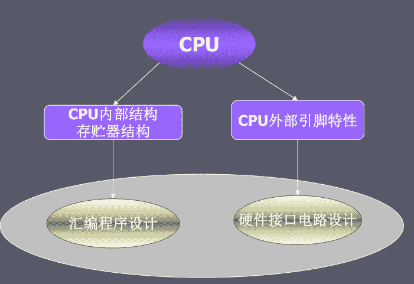

## 第一章绪论


### 一.计算机基本结构

#### 什么是计算机？

定义：一种存储事先已经编制好的程序和数据并能连续而自动地取出这些程序来执行，只能对事先已数字化的信息进行算术或逻辑运算的快速工具。

A computer is a programmable machine that receives input, stores and manipulates data//information, and provides output in a useful format.
（ http://en.wikipedia.org ）


### 一.计算机基本结构

#### 计算机定义的概略解释

- 1. 算术、逻辑运算（我们在中国就已学完的加减乘除四则运算）
- 2. 信息的数字化（一架冰冷的机器所能听懂的唯一语言）
- 3. 存贮程序的工作方式（现代化的流水线）

符合以上特征的即被称之为冯·诺依曼体系结构的计算机

#### 冯·诺依曼体系结构的计算机（1）

一到目前为止，几乎生产的所有计算机都是冯·诺依曼体系结构的计算机，这也是我们正在使用的诸如奔2奔3之类的微机的体系结构。（但是现在的计算机科学家认为只有打破冯·诺依曼体系，计算机的效率才能得到突破）

#### 冯·诺依曼体系结构的计算机（2）

- 采用二进制表示数据和指令。
- 采用存储程序工作方式，即：
  - 事先编制程序。
  - 实现存储程序。
  - 自动、连续地执行程序。

#### 冯·诺依曼体系结构的计算机（3）

由以下五大部件组成计算机硬件系统：

- 运算器（进行简单四则运算逻辑运算）
- 控制器（命令自己或外部设备做这做那）
- 存储器（存储程序和数据）
- 输入设备（外部的触角，眼，耳...）
- 输出设备（执行机构，手，脚...）

CPU { 运算器, 控制器 } 脑

HYPer

#### 基本结构

微处理器
(CPU)

存储器

输入/输出
接口电路

外部设备

地址总线

数据总线

控制总线

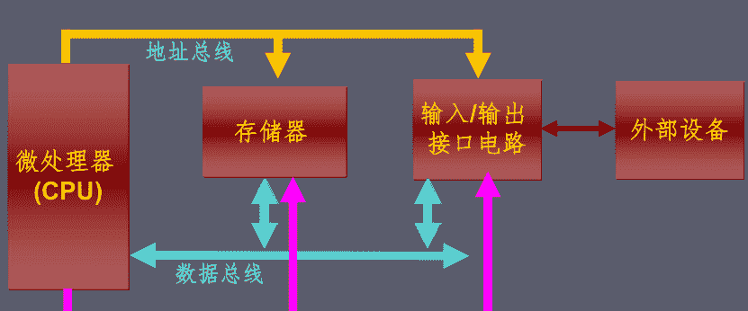

#### 微机基本组成

HYPer

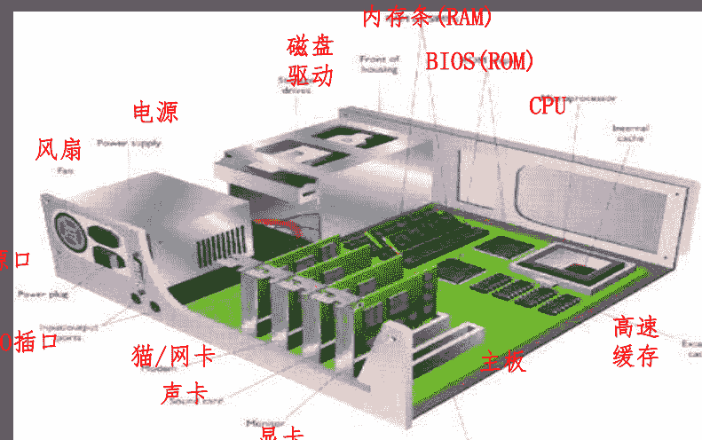

内存条(RAM)

磁盘驱动

BIOS(ROM)

CPU

电源

风扇

电源口

I/O插口

猫/网卡

声卡

显卡

主板

高速缓存

外设扩展槽 SLOT

#### 1. CPU (中央处理器)


- 包括运算器和控制器
- 计算机硬件的核心
- 型号
  - Intel: 486、586（奔腾）、PII、PIII、赛扬系列
  - AMD: K6-2、K6-III、K7系列
- 主频: 66MHz、100MHz、133MHz

HYPer

##### CPU基本结构

###### 控制器

- 程序计数器 PC
- 指令寄存器 IR
- 指令译码器 ID
- 堆栈指示器 SP
- 处理器状态字PSW


###### 工作寄存器

- 地址寄存器
- 数据寄存器

I/O
控制逻辑

微处理器包括运算器、控制器、寄存器组三大部分，一般被集成在一个大规模集成芯片上，如8088、80x86等等，它是计算机的核心部件，具有计算、控制、数据传送、指令译码及执行等重要功能，它直接决定了计算机的主要性能。

- ALU —— 运算器的核心部件是算逻辑单元ALU，所有的算术运算，逻辑运算和移位操作都是由ALU完成的。
- 控制器 —— CPU的指挥机关，完成指令的读入、寄存、译码和执行。
- 程序计数器 PC—— 用于保存下一条要执行的指令的地址。
- 指令寄存器 IR —— 保存从存储器中读入的当前要执行的指令。
- 指令译码器 ID —— 对指令寄存器 IR中保存的指令进行译码分析。
- 堆栈指示器 SP —— 对堆栈进行操作时提供地址。

#### 2. 存储器 用于存放程序代码及有关数据。

- 计算机存取数据的部件，常用半导体做成，存储器中存放二进制单元，每个存储单元有一个编号，称为地址，计算机是根据地址来访问存储器的。
- 存储器的主要技术指标有存储容量和速度。速度可用存取时间和存储周期来衡量。
- 存取时间TA是指从启动一次存储器操作（读/写）到完成该操作所需的时间。
- 存储周期Tm是指连续两次访问存储器所需的最小时间间隔。通常Tm比TA稍大，这是由于存储器的积压部分都必须有一段稳定恢复的时间，所以读出后不能立即进行访问。

HYPer

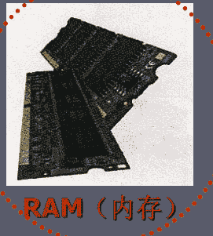

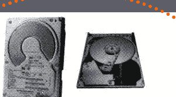


外存储器

HYPer

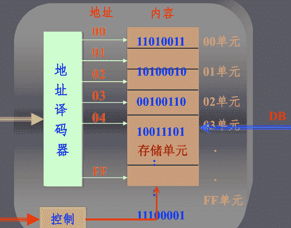

存储器基本原理

存储器由若干存储单元、地址译码器及相应的控制电路组成。

存储单元的内容：存储器由若干个单元组成，每个单元可存放8 位二进制信息（通常也用两位十六进制数表示），这就是它们的内容。

存储单元的地址：为区分不同的单元，对这些单元分别编了号，这些编号即它们的地址。

存储器的读写操作：存储器中的不同存储单元，是由地址总线上送来的地址，经过存储器中的地址译码器译码，选中该单元，然后根据控制总线上的控制命令（或读或写），进行相应的读写操作。

##### 容量单位

- 1Byte = 8 bit
- 1 KB = 2¹⁰ Byte
- 1 MB = 2¹⁰ KB
- 1 GB = 2¹⁰ MB
- 1 TB = 2¹⁰ GB
- 1 PB = 2¹⁰ TB

2¹⁰ = 1024≈1000

1个汉字 = 2字节

#### 3. 输入输出接口电路

由于外部设备如键盘、显示器、软盘、硬盘、打印机等，
在数据格式、运行速度等方面与 CPU 不匹配，故在连接时，
需通过 输入输出接口电路使外部设备与之相连。

HYPer

输入设备——输入设备是给计算机输入信息的设备。输入住处通过输入设备转换成计算机能识别的二进制代码，送入存储器中保存。常用的输入设备有键盘、鼠标器和光笔。


扫描仪


键盘


鼠标


手写笔


数码相机


摄像头

输出设备—输出设备是输出计算结果的设备。常见的输出设备有显示器、打印机、绘图机等。

显示器

投影仪

音箱

打印机

#### 4. 总线

总线是微型计算机中模块到模块之间传输信息的通道，是各种公共信息线的集合，采用总线结构便于部件和设备的扩充。对微机而言，总线可以

##### 分为以下四类：

片内总线——这种总线是微处理器的内总线，在微处理器内用来连接ALU、CU和寄存器组等逻辑功能单元。这种总线没有具体标准，由芯片生产厂家自己确定。

片间总线——微处理器、存储器芯片、I/O接口芯片等之间的连接总线。片间总线通常包括数据总线、地址总线和控制总线。

内总线 —— 内总线是微型计算机系统内连接各插件板的总线。内总线有不同的总线标准，如 S-100总线(IEEE-696标), STD总线, IBM-PC总线标准等，采用不同总线标准的功能板无法连接在一起。

外总线 —— 用于微型计算机系统之间或者微型计算机与外部设备之间的通信。

外总线技术已经很成熟，各种应用要求皆有标准可遵循。

如并行总线IEEE-488标准，串行总线RS-232标准等。

四类总线之间的关系如图所示。

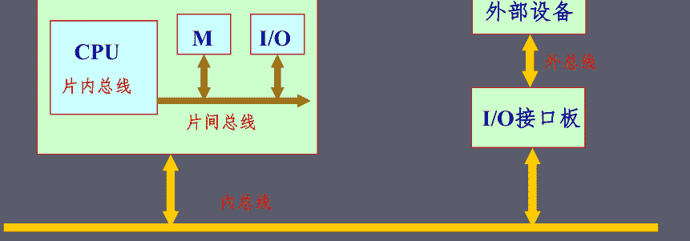


### 一.计算机基本结构

地址、控制、数据总线：

- 地址总线： 用于传送 CPU 要访问的存储单元的地址或 I/O 端口地址，地址总线的位数决定了 CPU 可以直接寻址的地址范围。
- 控制总线： 用来传送控制信号。
- 数据总线： 用于 CPU 与存储器、 CPU 与外设之间传送信息。

### 二.指令系统

上面我们所讲的是计算机的硬件。光有硬件，只是有了计算的可能，计算机要真正能够进行计算，还必须要有软件的配合。例如： 4 + 5 这种简单运算，需要以下几个步骤：

- ① 把第一个数从它所在的存储单元中取出来,送至运算器；
- ② 把第二个数从它所在的存储单元中取出来,送至运算器；
- ③ 相加；
- ④ 把加完的结果送至存储器中指定的存储单元.

所有这些取数、送数、相加、存数等等都是一种操作.

指令--我们把要求计算机执行的各种操作用命令的形式写下来，就是指令。 通常一条指令对应着一种基本操作,但是计算机怎么能够辨别和执行这些操作呢?这是由设计时设计人员赋予它的指令系统决定的.一个计算机能执行什么样的操作,能做多少种操作,是由设计计算机时所规定的指令系统决定的。

### 二.指令系统

指令系统 ------ 一条指令对应着一种基本操作, 计算机所能执行的全部指令, 就是计算机的指令系统．这是计算机所固有的。

程序 ----- 我们在使用计算机时, 必须把我们要解决的问题编成一条条指令, 这些指令的集合就称为程序. (这些指令必须是 我们所用的计算机能识别和执行的指令, 也即每一条指令必须 是一台特定的计算机的指令系统中具有的指令.)

源程序 --- 用户为解决自己的问题所编的程序, 称为源程序.

指令形式 ----- 指令通常分成操作码 (Opcode) 和操作数 (Operand). 操作码表示计算机执行什么操作, 操作数指明参加 操作的数本身或操作数所在的内存中的位置.

因为计算机只认得二进制数码, 所以计算机指令系统中的 所有指令, 都必须以二进制编码的形式来表示. 如前面例子.

### 二.指令系统

因为计算机只认得二进制数码,所以计算机指令系统中的所有指令,都必须以二进制编码的形式来表示.如前面例子。

- ① 把第一个数从它所在的存储单元中取出,送至运算器;
- ② 把第二个数从它所在的存储单元中取出,送至运算器;
- ③ 相加;
- ④ 把加完的结果送至存储器中指定的存储单元.

```
A0  00  20          MOV AL, [2000H]
A8  1E  01  20      MOV BL, [2001H]
00  D8              ADD AL, BL
A2  00  30          MOV [3000H], AL
```

### 二.指令系统

机器语言 ---- 计算机发展的初期，就是用指令的机器码直接来编制用户的源程序，这就是机器语言阶段。

汇编语言 ---- 由于机器码是由一连串的 0 和 1 组成的，不好记忆，容易出错，因而后来人们用一些助记符(Mnemonic)来代替操作码，如上所示。这样，每条指令有明显的特征，易于理解记忆，这便是汇编语言阶段。

程序的存放 ---- 要求机器能自动执行这些程序，就必须把这些程序存放到存储器的某个区域。计算机在执行时把这些指令一条条取出来加以执行。

### 三. CPU执行过程

操作： 将两个数 7 和 10 相加。

指令：

```
MOV AL, 07
ADD AL, 10
MOV [20h], AL
HLT
```

机器指令：

```
1011 0000  B0h  (MOV AL, 07)
0000 0111
07h
0000 0100  (ADD AL, 10)
04h
0000 1010  (MOV [20h], AL)
0Ah
(HLT)
1010 0010
```

### 三. CPU执行过程

CPU

PC
00H
AR

ALU
O
I
L

AL

IR

控制逻辑部件 PLA

指令译码器 ID

IR

内部数据总线

DR

地址总线 AB

数据总线 DB

地址译码器

存储器 20h

|  |  |
|---|---|
| 00h | B0H |
| 01h | 07H |
| 02h | 04H |
| 03h | 0AH |
| 04h | A2H |
| 05h | 20H |

B0h(MOV AL, 07 )
07h
04h (ADD AL, 10 )
0Ah
A2h (MOV [20h], AL )
20h
F4h (HLT )

5 6
3 4
1 2
停止
播放

### 四. 微型计算机系统

微型计算机系统

微处理器

微型计算机

运算器 控制器

寄存器组

内存储器

总线

输入输出

接口电路

外部设备

软件

## 8086微处理器[内部结构]


### 一、8086/8088内部组成结构

通用寄存器

数据寄存器

指针&变址寄存器

AH AL AX
BH BL BX
CH CL CX
DH DL DX

SP
BP
SI
DI

暂存寄存器

ALU

标志寄存器F

执行部分控制电路

执行部件(EU)

ALU数据总线 16位

地址加法器

CS
DS
SS
ES
IP
内部寄存器

指令队列缓冲器
1 2 3 4 5 6

8位

总线接口部件(BIU)

输入/输出控制电路

AB 20位
DB 16位

外部总线

### 一、8086/8088内部组成结构

CPU

总线接口单元(BIU)

执行单元(EU)

指令队列缓冲器

地址加法器

段寄存器(CS DS SS ES)

指令指针(IP)

输入/输出控制电路

16位算术逻辑单元(ALU)

16位标志寄存器(F)

通用寄存器组

数据寄存器(AX BX CX DX)

指针&变址寄存器(SP BP SI DI)

EU控制电路

#### 状态标志寄存器

|  | O | D | I | T | S | Z |  | A |  | P |  | C |

状态标志

进位标志C（Carry Flag）——当结果的最高位产生一个进位或借位，则C=1，否则C=0。

溢出标志O（Overflow Flag）——在算术运算中，带符号数的运算结果超出了8位或16位带符号数能表达的范围，则O=1，否则O=0。

8位（字节）运算  -128 —— +127

16位（字）运算  -32768 —— +32767

符号标志S（Sign Flag）——结果的最高位（D15或D7）为1，则S=1，否则S=0。

零标志Z（Zero Flag）——若运算的结果为0，则Z=1，否则Z=1。

奇偶标志P（Parity Flag）——若结果中‘1’的个数为偶数，则P=1，否则，P=0。

辅助进位标志A（Auxiliary Flag）——在字节操作时，由低半字节(第3位)向高半字节，字操作时低字节向高字节有进位或借位，则A=1，否则A=0。

控制标志

方向标志（Direction Flag）——D=1，串操作时地址自动减量，D=0，串操作时地址自动增量。

中断允许标志（Interrupt-enable Flag）——I=1，则允许CPU接收外部的中断请求，I=0，则屏蔽外部中断请求。

追踪标志（Trace Flag）——T=1，使处理机进入单步方式，以便于调试。

例：两个带符号数 64 h , 64 h 相加。

0 1 1 0 0 1 0 0
+ 0 1 1 0 0 1 0 0
----------------
1 1 0 0 1 0 0 0

- O=1（运算结果超过127）；
- C=0；
- Z=0；
- S=1；
- P=0；
- A=0。

地址加法器：将左移 4 位的段寄存器的内容与偏移地址相加，形成 20 位的物理地址，以便对 1 兆空间的存储器寻址。

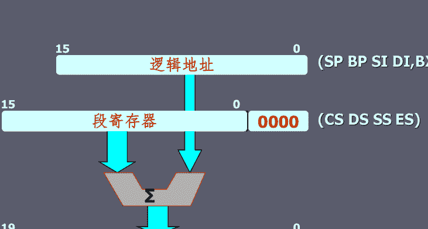

- ■ 算术逻辑单元ALU：负责各种算术和逻辑运算。
- ■ 指令队列：指令队列中包含若干个（8086—6个，8088—4个）8位寄存器，用于顺序存放从存储器中取出的指令，供执行单元执行。
- ■ 输入/输出控制电路：提供系统总线的控制信号，实现数据、地址和状态信息的分时传送。
- ■ 执行单元控制电路：是控制、定时与状态逻辑电路。用于控制执行单元中各部件按制定的要求协调工作。

#### 8086/8088寄存器结构

8位寄存器

16位寄存器

AX

BX

CX

DX

AH AL 累加器 基址 计数 数据

数据R

通用Rc

DH DL 堆栈指针 基址指针 BP 源变址 SI 目的变址

指针&变址R

DI IP FLAG (PC)指令指针 (PSW)状态标志

控制R

CS DS SS ES 代码段 数据段 堆栈段 附加段

段Rs

CPU寄存器按功能分三类


### 二、功能结构

8088从功能上来说分成两大部分，总线接口单元 BIU (Bus Interface Unit) 和执行单元 EU (Execution Unit).

- BIU:负责与存储器接口,即8088与存储器之间的信息传送,都是由BIU负责进行的,
即:
  1. BIU从内存的指定部分取出指令，送至指令队列排队。
  2. 从内存的指定部分取出执行指令时所需的操作数，送至EU部分。
- EU: 负责指令的执行。

特点：将CPU分为两个单元，可以使取指令和执行指令同时进行，减少了CPU为取指令而等待的时间，从而提高了CPU的利用率，提高了系统的运行速度。

### 三、存储器组织

8088有20条地址线，它的直接寻址能力为 2^20=1M，所以在一个8088组成的系统中，可以有多达1M字节的存储器，这1M字节在逻辑上可以组成一个线性矩阵，地址从00000到FFFFF。给定一个20位的地址，就 可以从中取出所需的指令和数据。

在8088内部，ALU 能进行16位的运算，有关地址寄存器如：IP、SP、BX、BP、SI、DI等都是16位的，因而对地址的运算也只能是16位。其寻址的范围最多是2^16=64K。

在8088中怎样形成这20位的地址呢？——分段！

将内存的1M字节以64K为范围，分成若干段；在8088中设置4个段寄存器CS、DS、SS、ES，在寻址一个具体的内存单元（物理地址）时，由一个段寄存器中保存的16位基地址，加上由IP（或SP，或BP，或BX，或SI，或DI）中保存的、

16

2¹⁶=FFFF h+1

0FFFF h

0FFFE h

0FFFD h

00001 h

00000 h

20

2²⁰=FFFFF h+1

FFFFF h

FFFFE h

FFFFD h

FFFFC h

0FFFF h

00001 h

00000 h

#### 段&内存

- CS
- IP
- DS
- SI, BX
- SS
- SP, BP
- ES
- DI

20位物理地址

- 内存
- FFFFFh
- 10000h 代码段 64K
- 30000h 数据段 64K
- 90000h 堆栈段 64K
- B0000h 附加段 64K
- 1M

- 播放
- 停止

### 四、指令运行

操作： 将内存中2000h单元内容加2，结果在AL中。 CS=1000h, DS=3000h.

指令： MOV AL, [2000] ; 把内存32000h的数据取出，送到AL。

ADD AL, 02 ; 把AL加2。

HLT

机器指令： 1010 0000 A0h
0000 0000 00h
0010 0000 20h
0000 0100 04h
0000 1010 02h
1111 0100 F4h

MOV AL, [2000]

ADD AL, 02

HLT

#### 通用寄存器

AH AL AX
BH BL BX
CH CL CX
DH DL DX
SP
BP
SI
DI

#### 地址加法器

CS
DS
SS
ES
IP
内部寄存器

20位

16位 10 10 3

#### 输入/输出控制电路

总线

10100 A0
10101 00
10102 20
04
02
F4

代码段 CS

30000
32000 10
32001 20

数据段 DS

堆栈段 SS

#### ALU

#### 执行部分 地址控制

#### 标志寄存器

16位 10

8位 1 2 3 4 5 6

## 指令队列缓冲器

执行部分（EU）

总线接口部分（BIU）

内存

A0h 00h 20h MOV AL,[2000]
04h 02h ADD AL,02
F4h HLT

## 五、指令执行时间

- 指令周期 ——执行一条指令所需的时间称为指令周期。

在8088/8086中，由于它的并行处理的特点，一条指令的执行时间为：

取操作数+执行指令+传送结果

进一步说：

基本时间+计算有效地址的时间+为了读取操作数和存放操作结果而访问内存的时间

> （但是，在8086/8088中不同的指令的指令周期是不同的，因此我们再将其细化，把一个指令周期划分为一个个总线周期。）

- 总线周期——CPU从存储器或输入输出端口，存（或取）一个字节所需的时间，即为总线周期。

- T状态——每个总线周期通常包含4个T状态。T状态是8088中处理动作的最小时间单位，它就是时钟周期。（8088的时钟频率为5MHz，故时钟周期，也即一个T状态为200ns。）

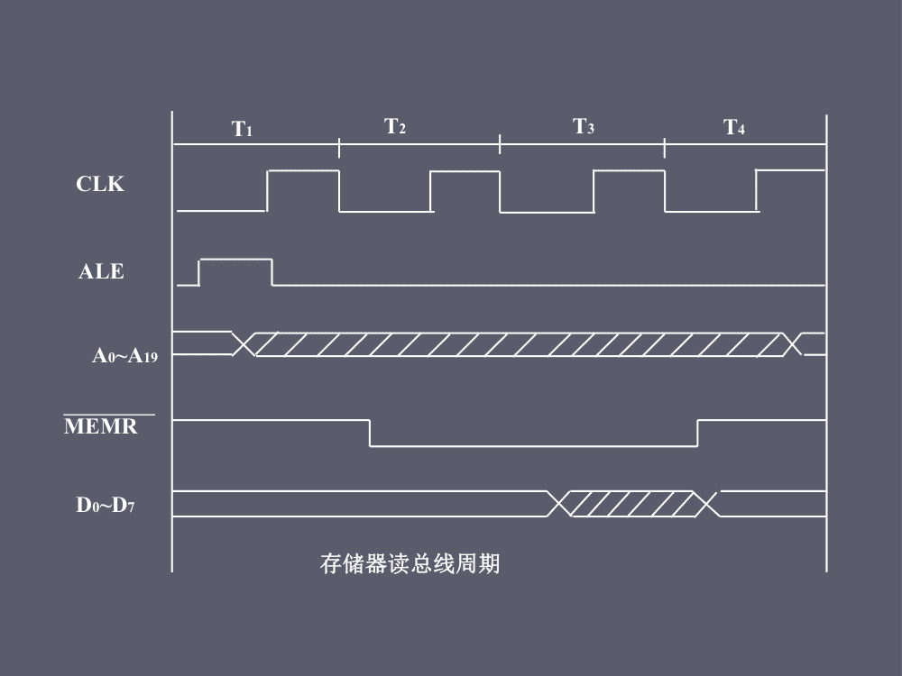

## 一个基本的总线周期

T₁

T₂

T₃

T₄

地址/数据总线

地址

数据输入

读周期

地址/数据总线

地址

数据输出

写周期

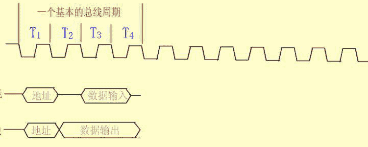

- 计算机基本结构由哪五部分组成？
- 一般CPU由哪两部分组成？
- 8086的通用寄存器有哪些，都叫什么？
- 8086的20位地址是怎么生成的？
  可以寻址多大的空间？
- 8086CPU内部由哪两部分组成？
  每部分都包括什么？
- 画出8086CPU的内部结构，说明各部分的作用？

## 8086微处理器[外部结构]

---引脚特性,总线操作与时序

主讲：黄永平

辅导：


## 一、IBM PC/XT机主板结构

HYPER

时钟信号发生器 8284

中央处理器 8088

协处理器 8087

总线驱动器

总线控制器 8288

RAM 存储器

ROM 存储器

8级中断电路

4 通道 DMA

8 通道定时/计数器

喇叭电路

键盘接口

8个扩展插座

DB

AB

CB

## 二、IBM PC/XT的控制核心

HYPer

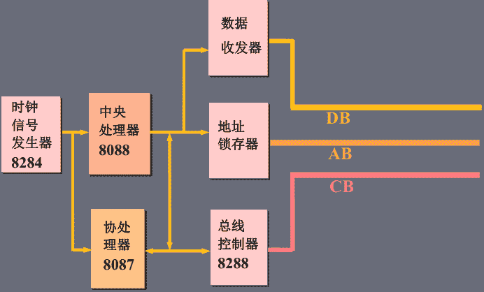

## 四、8086/8088的总线周期

IBM PC/XT 共有七种总线周期：

1. 存储器读总线周期
2. 存储器写总线周期
3. I / O读总线周期
4. I / O写总线周期
5. 中断响应周期
6. 存储器读和 I/O 写总线周期
7. 存储器写和 I/O 读总线周期

8088/8086启动的的总线周期

DMA(直接存储器存取)启动的的总线周期

## 五、8088/8086总线形成

当8088CPU与存储器和外设构成一个计算机系统时，根据所连接的存储器和外设的规模，8088可以有两种不同的组态。

### 1. 最小模式

当所连的存储器容量不大，I/O端口不多时。
系统的地址总线——CPU的AD₀~AD₇，A₈~A₁₅，A₁₅~A₁₉ 通过地址锁存器8282(3片)构成。
系统的数据总线——直接由AD₀~AD₇提供，或通过数据收发器8286(1片)供给。
系统的控制总线——直接由CPU的控制线供给。

### 2. 最大模式

当要构成的系统较大，要求较强的驱动能力时。
系统的地址总线——CPU的AD₀~AD₇，A₈~A₁₅，A₁₅~A₁₉ 通过地址锁存器8282 (3片)构成。
系统的数据总线——通过数据收发器8286供给。
系统的控制总线——通过总线控制器8288供给(***)。

最大模式配置和最小模式配置有一个主要的差别：最大模式下多了一个8288总线控制器。

两种组态通过8088引脚信号MN/MX决定

- 在8086的最小模式中，硬件连接上有如下几个特点：
- （1）MN/MX引脚接+5V，决定了8086工作在最小模式。
- （2）有一片8234A，作为时钟发生器。
- （3）有三片8282或74LS373，用来作为地址锁存器。
- （4）当系统中所连接的存储器和外设比较多时，需要增加系统数据总线的驱动能力，这时，可选用两片8286或74LS245作为总线收发器。

## 8086CPU的引脚信号

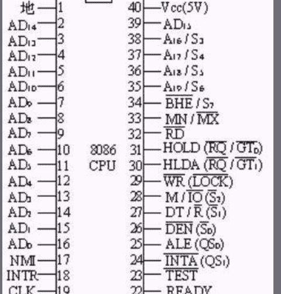

8086CPU采用双列直插式的封装形式，具有40条引脚，见图2-5。它采用分时复用的地址/数据总线，所以有一部分引脚具有双重功能，即在不同时钟周期内，引脚的作用不同。

## 8086 最小模式

+5V

8284A

READY

8086 CPU

READY CLK RESET TEST HOLD HLDA NMI INTR INTA M/IO WR RD

ALE BHE A19—A16 AD15—AD0 DT/R DEN

STB 8282 OE

8286 T OE

控制总线 CB

系统总线

地址总线 A19～A0 AB

数据总线 D15～D0 DB

ALE：地址锁存允许信号。
BHE：数据总线高位允许信号；与A0合起来选择存储体。
DT/R：数据发送/接收，数据方向控制。
DEN：数据有效。

BHE


# 最大模式总线形成

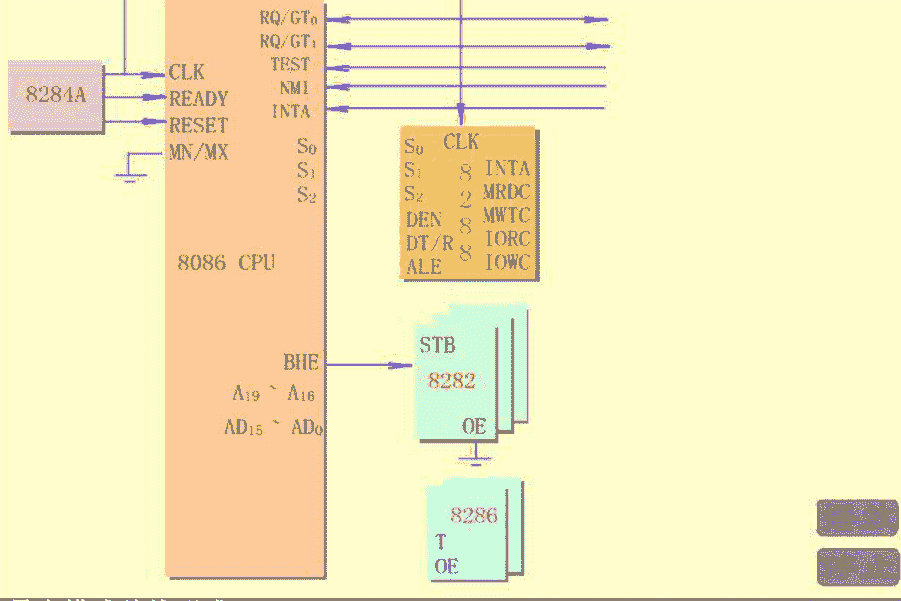

# 六、总线周期的概念

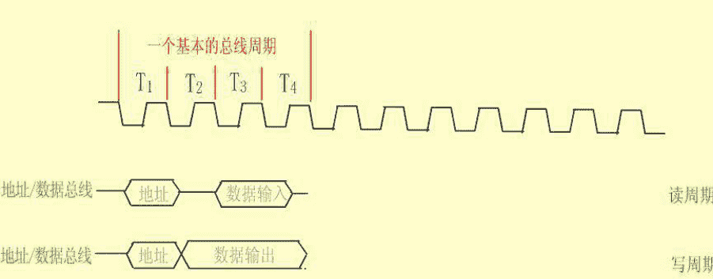

# 七、最大组态下的8088时序

# 1.存储器读周期

# 2. 存储器写周期

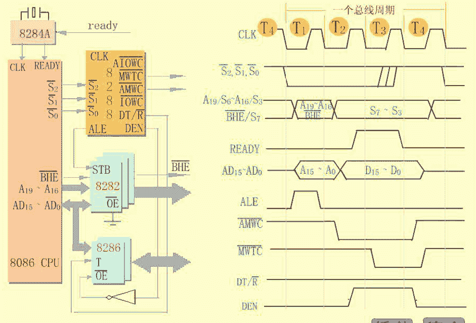

# 3. I/O读周期

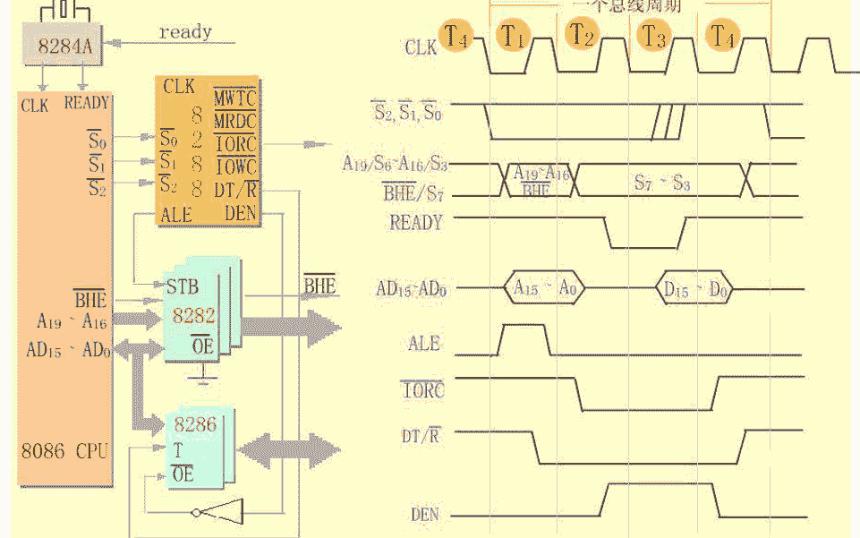

# 4. I/O写周期

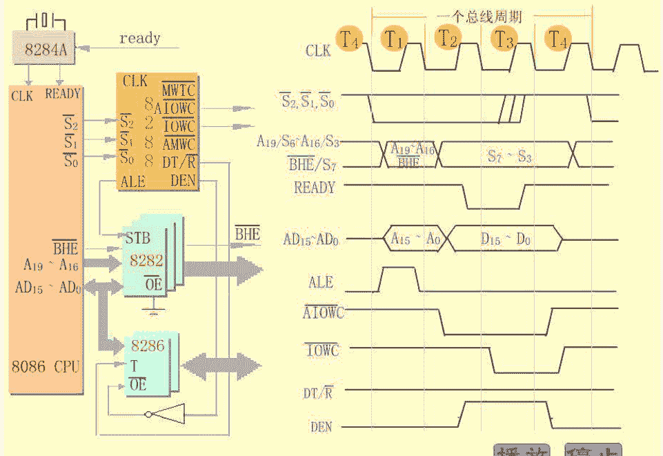

# 八、系统总线上的信号时序

8284A

READY

CLK RQ/GT0 RQ/GT1 TEST NMI INTA S0 S1 S2 BHE A19-A16 AD15-AD0 DT/R DEN RESET MN/MX READY 8086 CPU

控制总线

CLK MROC MWTC IORC IOWC INTA DEN DTR ALE

地址总线 A19~A0

数据总线 D15~D0

8282 STB OE

8286 T OE

T1 T2 T3 T4 CLK A0-A19 有效地址 MEMR D0-D15 数据 存储器读总线周期

T1 T2 T3 Tw T4 CLK A0-A19 有效地址 IOW D0-D15 数据 I/O写总线周期 19

# 九、IBM PC/XT的CPU系统

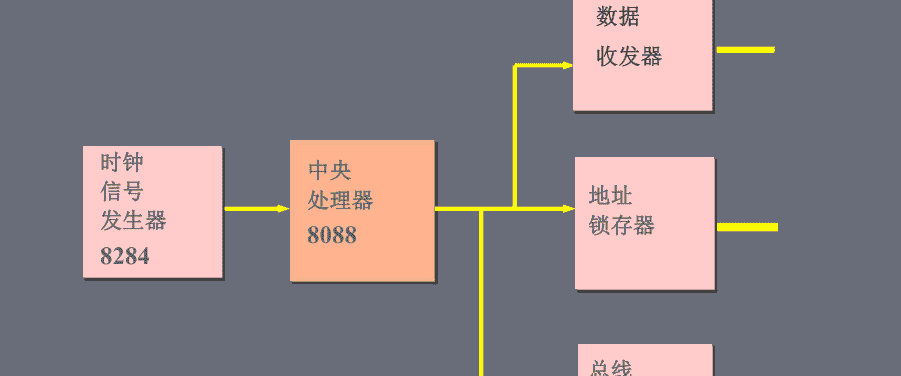

IBM PC/XT 的控制核心

# 1. 8088/ 8086 CPU

通用寄存器
AH AL
BH BL
CH CL
DH DL
SP
BP
SI
DI
地址加法器
Σ
20位
16位
CS
DS
SS
ES
IP
内部暂存器
输入/输出控制电路
16位
执行部分控制电路
ALU
标志寄存器
8位
指令队列缓冲器
1 2 3 4 5 6
执行部件（EU）
总线接口部件（BIU）

# 8086/8088引脚信号

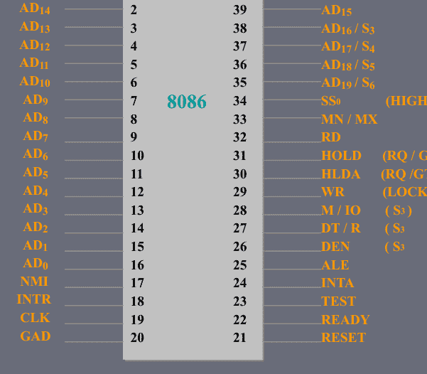

# 2. 总线控制器 8288

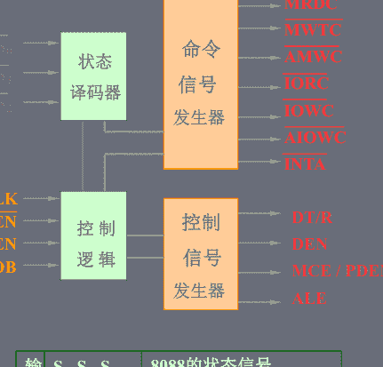

| S0 S1 S2 | 8088 的总线周期 | 8288 的命令输出 |
|---|---|---|
| 0 0 0 | 中断响应 | INTA |
| 0 0 1 | 读 I/O 口 | IORC |
| 0 1 0 | 写 I/O 口 | IOWC, AIOWC |
| 0 1 1 | 暂停 | — |
| 1 0 0 | 取指令代码 | MRDC |
| 1 0 1 | 读存储器 | MRDC |
| 1 1 0 | 写存储器 | MWTC, AMWC |
| 1 1 1 | 过渡状态 | — |

| 输入信号 | S0 S1 S2 | 8088的状态信号 |
|---|---|---|
|  | CLK | 时钟信号 |
|  | AEN | 地址输入允许信号 |
|  | CEN | 命令允许输出信号 |
|  | IOB | I/O总线方式控制信号 |

| 8288的控制输出 | |
|---|---|
| ALE | 地址锁存允许信号 |
| DT/R | 数据发送/接收信号 |
| DEN | 数据输出允许信号 |
| MCE/PDEN | 双功能引脚 |

# 8288时序

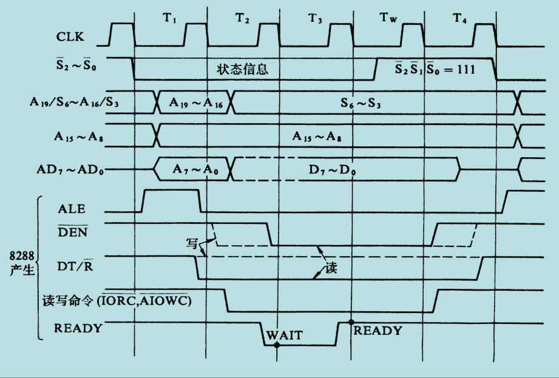

# 8288引脚信号

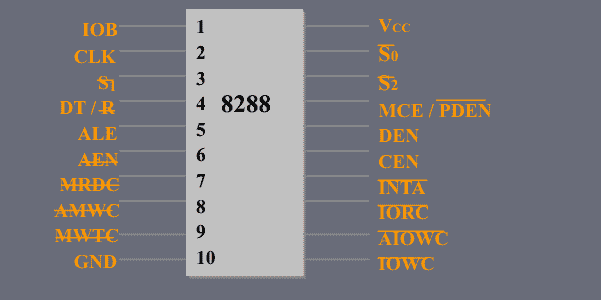

# 表 2-2 S0、S1、S2 的组合和对应总线操作

| S0 | S1 | S2 | 操作 |
|---|---|---|---|
| 0 | 0 | 0 | 发中断响应信号 |
| 0 | 0 | 1 | 读 I/O 端口 |
| 0 | 1 | 0 | 写 I/O 端口 |
| 0 | 1 | 1 | 暂停 |
| 1 | 0 | 0 | 取指令 |
| 1 | 0 | 1 | 读存储器 |
| 1 | 1 | 0 | 写存储器 |
| 1 | 1 | 1 | 无源状态 |

# 3. 8284时钟信号发生器

8284的结构框图：

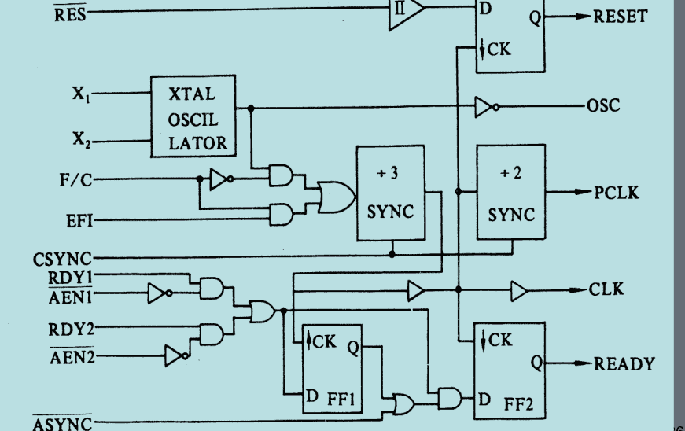

# 8284的输出信号：

RESET——复位信号

READY——准备好信号

CLK——8088系统时钟，将晶振体三分频，产生4.77MHz的频率。

PCLK——外围设备用时钟信号，将CLK二分频，频率为2.387MHz。

OSC——14.318MHz的频率。

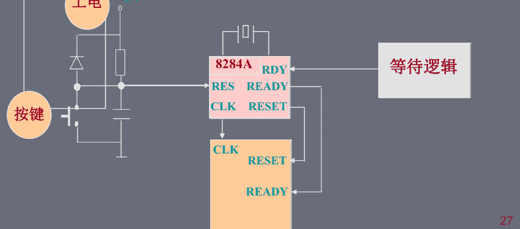

# 8284的输入信号：

RES—— 外部复位输入；

X₁,X₂——外接晶振体输入；

F/ C——输入控制信号, F/ C=0时, byX₁,X₂外接晶振体形成8088时钟；
 F/ C=1时, byEFI输入外部方波信号形成8088时钟；

OSYNC——同步工作控制信号，当多个8284同时工作时使用；

ASYNC——准备好信号的同步控制信号；

RDY1——总线准备好信号；

AEN1——地址允许信号；

8284A在IBM PC/XT中的应用——见IBM PC/XT控制核心

RDY2——总线准备好信号；

AEN2——地址允许信号；

# 8284时序

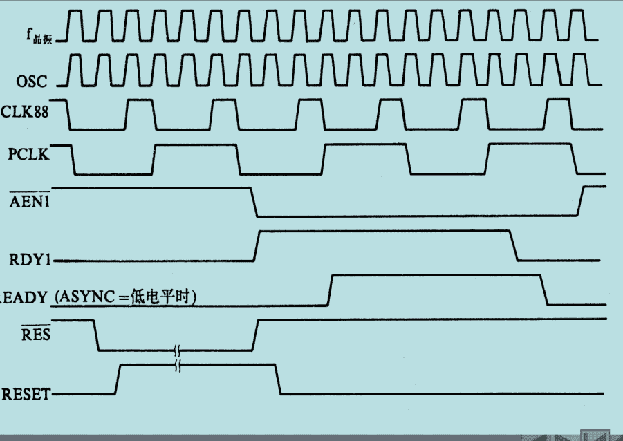

# 8284引脚信号

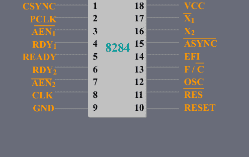

# 4. IBM PC/XT 的控制核心

来自电源
PWR GOOD

DMA WAIT
RDY/WAIT
AEN1

来自DMA控制器
来自存储控制器

当DMAWAIT为高，RDY/WAIT为低时，Ready输出为高电平；反之，输出低电平。

U₇、U₅、U₆的存取受AENBRD的控制
在DMA操作期间，地址只能锁存，不能送至总线。

AENBRD
AEN

来自系统
AENBRD低，AEN高时，CPU控制总线，8288工作；反之，进行DMA操作。

系统地址总线

系统数据总线

系统控制总线

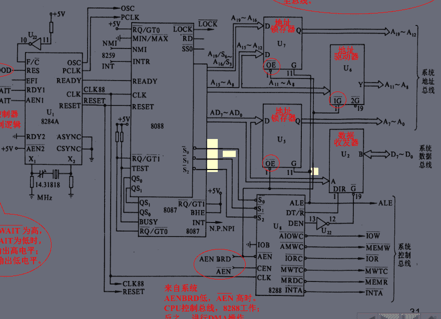

# 5. 等待电路

IBM PC/XT规定存储器访问周期不插入等待状态；而在I/O访问周期需插入一个等待状态。DMA操作（非动态RAM刷新）时需插入一个等待状态。

I/O CH RDY信号，送至U70的直接置位端，当其为0时，U70输出保持为0，产生连续请求插入等待状态的控制信号。该信号用于I/O设备在插入一个T_w仍不能完成传输的情况，传输完成后，由I/O设备使其复位。

I/O CH RDY

非动态RAM刷新的DMA操作信号

DACK0 BRD
AEN BRD
MEMR

当上述三个信号中任一个为0时，将U70置1。

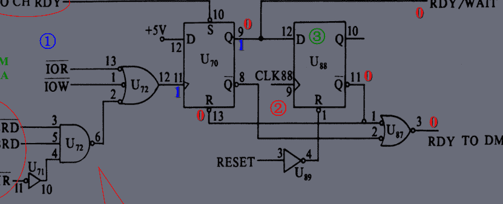

# 硬件开发过程 《----》 软件开发过程

Protel工具软件
OrCAD工具软件

原理设计（VHDL）
原理模拟仿真
PCB设计
电磁兼容设计

单板调试（调试程序）
系统调试

# # 复习题

1. 微型计算机系统的组成；微型计算机的结构特点。

2. 8086的内部逻辑结构——BIU和EU的组成与功能；8086
微处理器的寄存器及功能；8086逻辑地址、物理地址及转换；8086两种工作方式、配置、特点。

3. 8086中断向量表（以后再讲）。

4. 章节习题：P16—全部习题

# 80x86程序设计模型

# 目录

+   - 程序设计模型
+   - 实模式存储器寻址
+   - 保护模式存储器寻址
+   - 页式寻址
+   - 段页式寻址

# # 一、程序设计模型

程序设计模型: 程序员所需要的计算机模型。

只需要知道：

+   (1) CPU内部寄存器的设置及功能；

+   (2) CPU与存储器的逻辑地址和物理地址关系。

# # 8086/8088寄存器结构(16位)

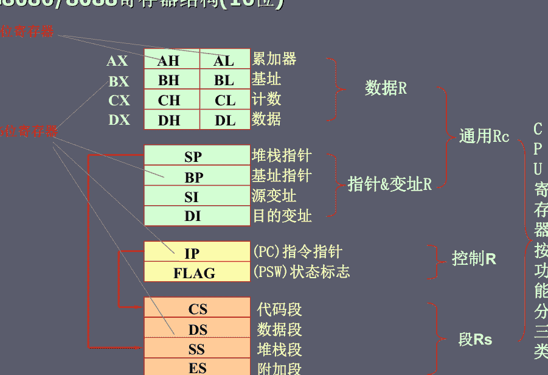


## 80386~Pentium II寄存器结构(32位)

EAX AH AX AL 累加器
EBX BH BX BL 基址
ECX CH CX CL 计数
EDX DH DX DL 数据
数据R

ESP SP 堆栈指针
EBP BP 基址指针
ESI SI 源变址
EDI DI 目的变址
指针&变址R

EIP IP (PC) 指令指针
EFLAGS FLAG (PSW) 状态标志
控制R

CS 代码段
DS 数据段
SS 堆栈段
ES 附加段
FS 数据段
GS 数据段
段Rs

通用Rc
CPU寄存器按功能分三类

## 80386~Pentium II ---系统地址寄存器（保护模式）

段寄存器

CS 选择符(16位)

DS 选择符(16位)

SS 选择符(16位)

ES 选择符(16位)

FS 选择符(16位)

GS 选择符(16位)

高速缓存描述符

基地址(32位) 段限(20位) 属性(12位)

程序不可见区域

TR 选择符(16位)

LDTR 选择符(16位)

基地址(32位) 段限(20位) 属性(12位)

GDTR 基地址(32位) 段限（16位）

IDTR 基地址(32位) 段限（16位）

系统地址R(保护方式R)

## 80386~Pentium II ---其它寄存器（保护模式）

- 控制寄存器： CR0~CR3
- 调试寄存器： DR0~DR7
- 模型专用寄存器MSR
- 浮点部件寄存器

## 二、实模式存储器寻址

地址加法器：将左移 4 位的段寄存器的内容与偏移地址相加，形成 20 位的物理地址，以便对 1 兆空间的存储器寻址。

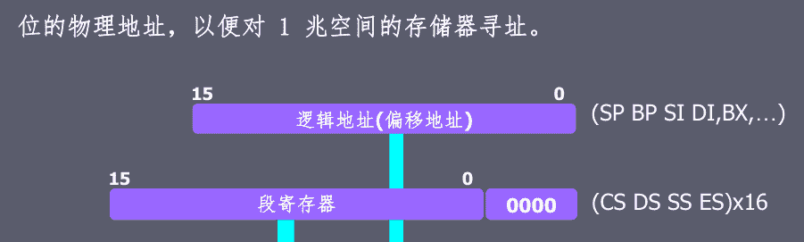

> 段x16+偏移

## 段+偏移的实模式存储器寻址机制

实模式存储器(1MB)

段基址

段寄存器

1000H

x16

偏移地址=F000H

00000H

10000H

1F000H

1FFFFH

FFFFFH

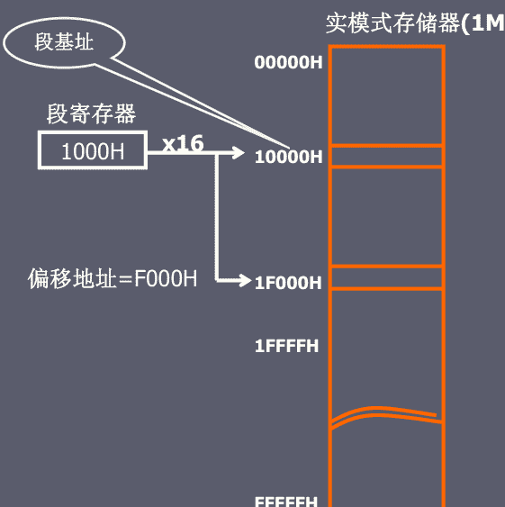

## 默认段寄存器和偏移寄存器

### 16位段+偏移寻址组合

| 段 | 偏移 | 主要用途 |
|---|---|---|
| CS | IP | 指令地址 |
| DS | BX, SI, DI, Disp8, Disp16 | 数据地址 |
| SS | SP, BP | 堆栈地址 |
| ES | DI | 串操作目标地址 |

### 32位段+偏移寻址组合

| 段 | 偏移 | 主要用途 |
|---|---|---|
| CS | EIP | 指令地址 |
| DS | EAX, EBX, ECX, EDX, ESI, EDI, Disp8, Disp32 | 数据地址 |
| SS | ESP, EBP | 堆栈地址 |
| ES | EDI | 串操作目标地址 |
| FS | 无默认 | 一般地址 |
| GS | 无默认 | 一般地址 |

## 三、保护模式存储器寻址

80286以上CPU有实模式和保护模式两种寻址方式。

保护模式时，用选择符和描述符来寻址存储器。段寄存器放的是选择符，通过选择符到描述符表找到段基地址，段基地址+偏移量为内存中的物理地址。

选择符 ——> 描述符表(描述符) ——> 存储器

最大4GB空间的地址是如何生成的？

80286以上CPU有实模式和保护模式两种寻址方式。

保护模式时，用选择符和描述符来寻址存储器。段寄存器放的是选择符，通过选择符到描述符找到段基地址，段基地址+偏移量为内存中的物理地址。


> 内存分成很多的段，用段的选择符找到段的描述符，之后找到要访问的内存段开始位置。偏移量是段内的偏移量。

## 程序不可见寄存器（保存段描述符）

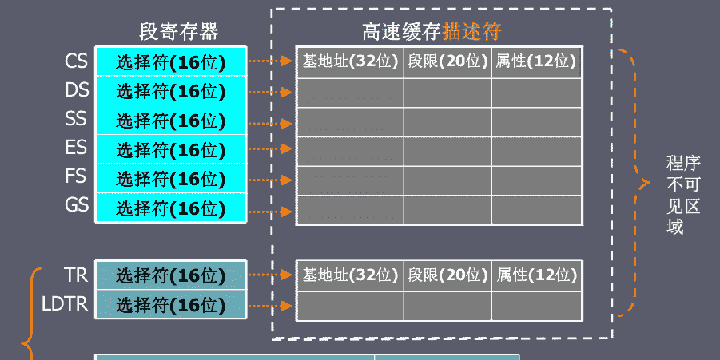

## 选择符(段选择符)

CS
DS
SS
ES
FS
GS

15
3 2 1 0

描述符索引(13位)

TI

RPL

16位段选择符

请求优先级：00最高 11最低

局部/全局 描述符表指针

TI=0
TI=1
x8

(1)

GDTR基址

TI=0

LDTR-Cache 基址

TI=1

段首址

(2)

段界限

8个字节的段描述符

GDT

全局描述符表

8个字节的段描述符

LDT1

LDT2

段首址

段界限

存储器

局部描述符表

## 选择符(段选择符)--- GDT与LDT关系

CS
DS
SS
ES
FS
GS

15
3 2 1 0

描述符索引(13位)
TI
RPL
16位段选择符

请求优先级：00最高 11最低

局部/全局 描述符表指针

TI=1 x8

GDTR基址

TI=0

LDTR-Cache 基址

TI=1

LDTR选择符 x8 (1)

(2)

GDT
全局描述符表

8个字节的 LDT描述符

8个字节的 段描述符

(3)

LDT1
LDT2

段首址
段界限

(4)

存储器

局部描述符表

## 描述符(段描述符)—基址+界限+属性

### 80286描述符

|  |  | 0 |
|1|段限(15~0)| |
|3|段基址(15~0)|2|
|5|访问权限|段基址(23~16)|4|
|7|00000000|00000000|6|

### 80386~Pentium II描述符

|  |  | 0 |
|1|段限(15~0)| |
|3|段基址(15~0)|2|
|5|访问权限|段基址(23~16)|4|
|7|段基址(31~24)|G D 0 AV 段限(19~16)|6|

G=1，界限x4KB(尾部添000H)。允许段长为4KB~4GB

G=0，段长为0B~1MB

D=32位指令/16位指令

AV=段有效/段无效

## 实例

段选择符 DS

0008H

00000000000001 000B

x8 TI=0

请求权限

GDTR

FF

00

00

00

10

92

00

00

全局描述符表GDT

访问权限

边界0000FFH

偏移量 32 位

段基地址 00100000H

001000FFH

存储器

请求权限>=访问权限才可访问

选择符

描述符表

描述符

描述符

- (1)段基地址
- (2)段界限
- (3)段属性

M

(1)段基地址

(2)段界限

段选择符--->段描述符->线性地址

## 从逻辑地址到线性地址

逻辑地址 (48位)

索引 (13) TI (1) RPL (2) 偏移量 (32位)

GDTR基址

GDT

基址 (32)

LDTR-Cache 基址

LDT

基址 (32)

TI=0 TI=1

TI=0 TI=1

基址 (32位)

线性地址 (32位)

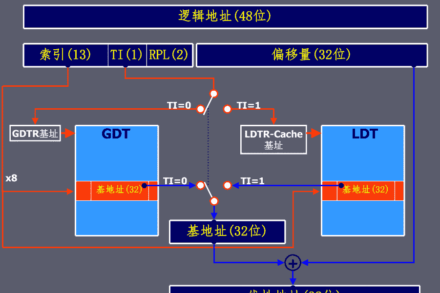

## 四、页式寻址

内存分页是80386微处理器开始引入的一种重要技术。

CPU内有分页部件。可以只采用段式寻址，也可以只采用页式寻址，也可以采用段页式寻址。


Linux中，逻辑地址=线性地址

## 从线性地址到物理地址

- • 页目录表4kB(1K页，每项4字节);
- • 每个页表4kB(1K页，每项4字节)，共有1k个页表;
- • 每页4KB；共1M页

CR3(32位)
页目录表基址R

页目录表
页目录描述符
1个书柜

页表0
页描述符

页表1
页描述符

页表1023
页描述符
书的目录

存储器
页基址
4KB/页
页，行

页目录(10)
页表(10)
偏移(12)
线性地址

x4
x4

页表基址

## 页目录描述符&页描述符

页目录描述符(4字节)

页描述符(4字节)

- AVL=可使用位
- D=出错/未出错
- A=该页(页表) 已访问/未访问
- V=用户/监控 使用
- W=该页(页表) 允许/不允许写
- P=该页(页表) 存在/不存在

## 五、段页式寻址

既有段式寻址，也有页式寻址。80386以上CPU采用。

逻辑地址

分段部件

线性地址

分页部件

物理地址

64TB

段式寻址

4GB

页式寻址

4GB

## 五、段页式寻址

HYPer

64TB=8K.8K.1M

表基址R

段描述符表

段描述符(8)

CR3

页目录表基址R

页目录表

页目录描述符(4)

页表n

页描述符(4)

存储器

4KB/页

x8

描述符索引(13位)

TI

偏移地址(32)

逻辑地址 64TB

页目录(10)

页表(10)

偏移(12)

线性地址

物理地址 4GB

x4

x4


# 六、保护规则

HYPer

保护：

+   ◆ 用户程序——用户程序
+   ◆ 用户程序——操作系统

+   □ 0级（最高）——操作系统
+   □ 1, 2级——系统服务与接口
+   □ 3级（最低）——用户程序

• CPU只能访问同一级或低级的数据段和代码，
• 而低级的代码要使用高级的代码，这是通过CALL指令或中断方式进入

规则：

+   ◆ P级的数据只能由不低于P级的程序访问；
+   ◆ P级的程序只能由不高于P级的程序访问——通过CALL指令或中断方式进入。

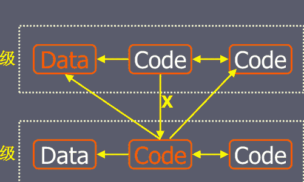

# 七、虚拟86模式（V86）

在保护方式下，创建的虚拟的1MB空间，映射到保护方式的4GB空间。

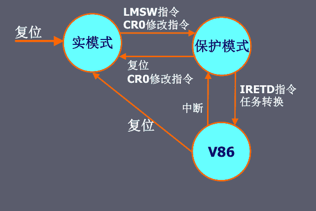

# 复习题

+   1. 段描述符、段描述符表含义； GDTR、 LDTR、 IDTR、 TR含义及保存内容。
+   2. 章节习题： P71—全部习题

# Pentium系列微处理器的基本结构

# 目录

+   1. Pentium微处理器的基本结构

+   2. Pentium Pro微处理器

+   3. Pentium MMX微处理器

+   4. Pentium II微处理器

+   5. Pentium III微处理器

+   6. Pentium IV简介

+   7. Pentium微处理器编程结构

+   8. Pentium微处理器引脚信号和功能

+   9. Pentium微处理器操作模式

# 一、Pentium微处理器的基本结构

1993.3推出， 80586， 100万晶体管/片。

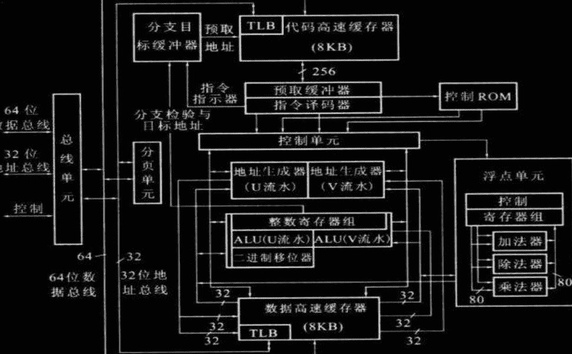

# 一、Pentium微处理器的基本结构

+   1. 总线接口部件: p16
+   2. 预取缓冲部件: 指令→代码Cache
+   3. 整数流水线V: 超标量执行，转移预测判断。
+   4. 浮点流水线U:
+   5. Cache部件: 指令Cache,数据Cache
+   6. 指令译码部件:
+   7. ROM控制部件: 微程序
+   8. 分段部件: 逻辑地址→线性地址
+   9. 分页部件: 线性地址→物理地址

# 二、Pentium Pro微处理器

1995.11推出，550万晶体管/片，1559万晶体管/片。

+   - 二级Cache结构
+   - RISC
+   - 乱序执行，超级流水线技术

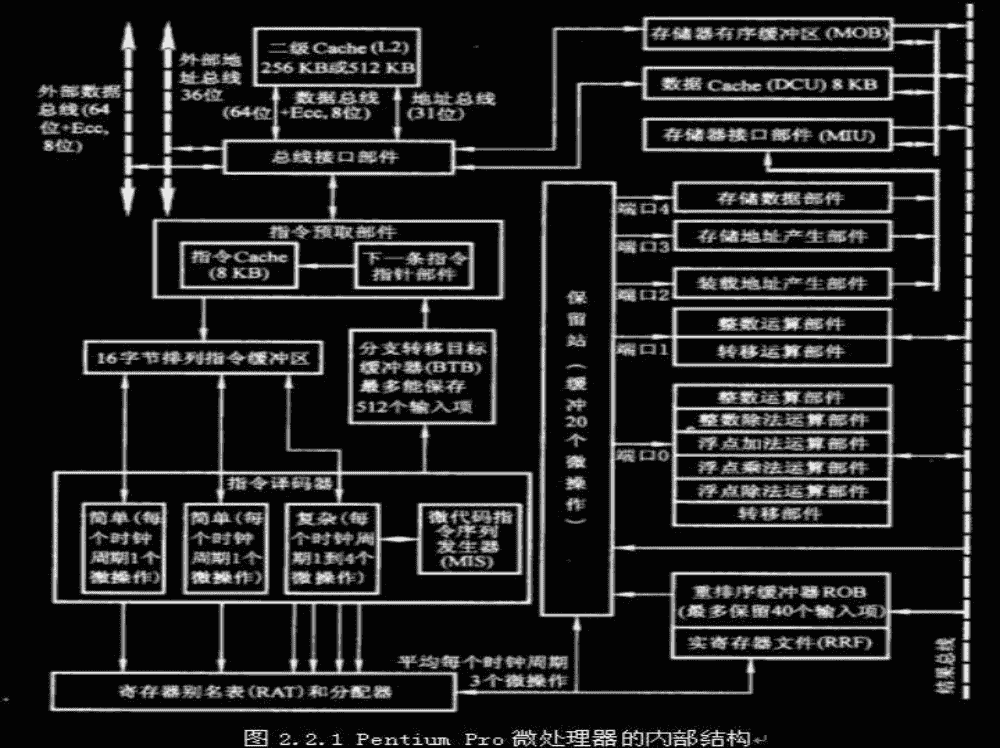

# 图 2.2.1 Pentium Pro 微处理器的内部结构

14级的超流水线结构，3路超标量结构，提高了CPU的并行处理能力。

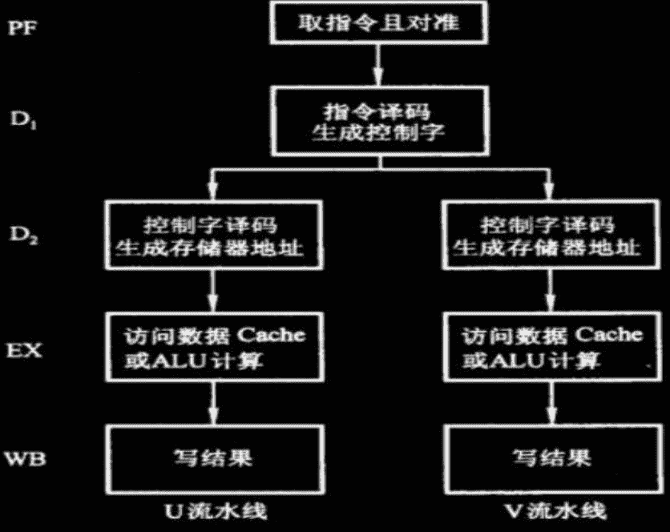

图 2.1.2　超标量执行

# 复习题

+   1. CISC和RISC技术的主要特点。
+   2. Pentium处理器内部结构特点；BTB、TLB含义；Pentium处理器保护方式下物理地址形成方法；Pentium处理器中寄存器及其主要功能。
+   3. 标志寄存器中，CF, PF, AF, ZF, SF, TF, IF, DF, OF的功能定义。
+   4. 段描述符、段描述符表含义；GDTR、LDTR、IDTR、TR含义及保存内容。
+   5. Pentium引脚：A31～A3、#BE7～#BE0、D63～D0、D/#C、M/#IO、W/#R、#BRDY、#NA、#Cache、#KEN、INTR、NMI、HOLD、HLDA功能。
+   6. A20引脚的意义？（学生自己上网查，关键词“A20引脚”）
+   7. Pentium处理器总线周期：6种总线状态，3种主要传送方式。
+   8. Pentium处理器的3种操作模式。
+   9. 章节习题：P71—全部习题

# 微处理器的寻址方式

主讲人：黄永平


# 目录

+   - 8086/8088指令格式
+   - 8086/8088寻址方式
+   - 其它寻址方式

# 8086/8088指令格式

计算机是通过执行指令来管理计算机并完成一系列给定功能的。因此，每种计算机都有一组指令集提供给用户使用，这组指令集叫做计算机的指令系统。不同的计算机指令不同，指令集中指令的数量也不间，大体上在几十种到百余种。指令系统的功能决定了CPU的综合处理能力。8086/8088是可变长指令。

# 指令的一般格式为：

| 操作码 | 操作数 | … | 操作数 |
|---|---|---|---|

**操作码 (OPCode, OP)** —— 告诉计算机要执行的操作是什么，如：加、减、逻辑与等。

**操作数 (OPData)** —— 执行操作过程所要操作的数，如加运算的两个加数。

# 一、8086/8088指令格式

HYPer

# CPU

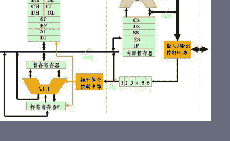


R, M

OP

OPData1

OPData2

What to do?

To or From Which?

# 一、8086/8088指令格式

HYPer

+   - 无操作数指令，只有操作码
+   - 单操作数指令(操作数在R中、M中)
+   - 双操作数指令(操作数在R中、M中、指令中)


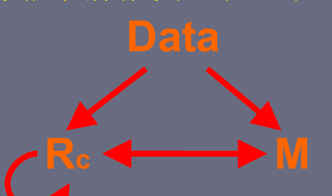

# 一、8086/8088指令格式

# 1. 无操作数指令，只有操作码


例： HLT指令为F8H（11111000B）

# 一、8086/8088指令格式

# 2. 单操作数指令(操作数在M中)

15
0
OP(7) W(1) MOD(2) OP(3) R/M(3)
◆ MOD=00

23
0
OP(7) W(1) MOD(2) OP(3) R/M(3) DISP8 (8)
◆ MOD=01

31
0
OP(7) W(1) MOD(2) OP(3) R/M(3) DISP16 (16)
◆ MOD=10

◆ MOD与R/M的3x8种组合，对应不同的M寻址方式。

# 一、8086/8088指令格式

# 3. 双操作数指令

一个操作数在R、M中，另一个在R中、M中、立即数。 不可以都在M中。

+   - R-R
+   - R-M
+   - R-Data(指令)
+   - M-Data(指令)
+   - M-M

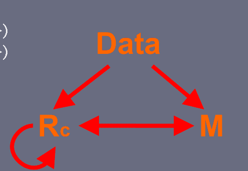

# 一、8086/8088指令格式

# 3. 双操作数指令（R-R）

| 15 | 0 |
| OP(6) | D(1) | W(1) | MOD(2) | REG(3) | R/M(3) |
| MOD=11 |

D = REG为目标(R/M为源)/REG为源(R/M为目标)。指出目标、源寄存器的位置。

D=1时，REG中为目标操作数R，R/M为源操作数据R； D=0 相反。

REG，R/M都有8种组合， AL/AX,CL/CX,DL/DX,BL/BX,AH/SP,CH/BP,DH/SI,BH/DI.

W=字/字节选择(16位/8位)

# 一、8086/8088指令格式

# 3. 双操作数指令（R-M）


D= REG为目标(R/M为源)/REG为源(R/M为目标)。指出目标、源寄存器的位置。

D=1时，REG中为目标操作数R，R/M为源操作数据R； D=0 相反。

REG，W有8种组合，选AL/AX,CL/CX,DL/DX,BL/BX,AH/SP,CH/BP,DH/SI,BH/DI。

R/M,MOD=00、01、10：对M不同寻址。


# 一、8086/8088指令格式

# 3. 双操作数指令（R←Data）

23
OP(4) W(1) REG(3) Data-L Data-H
0

+   REG，W组合，选AL/AX,CL/CX,DL/DX,BL/BX,AH/SP,CH/BP,DH/SI,BH/DI。

31
OP(7) W(1) MOD(2) OP(3) R/M(3) Data-L Data-H
0

+   MOD=11

+   R/M，W组合，选AL/AX,CL/CX,DL/DX,BL/BX,AH/SP,CH/BP,DH/SI,BH/DI。

# 一、8086/8088指令格式

# 3. 双操作数指令（M←Data）


◆R/M, W组合，选对M的寻址

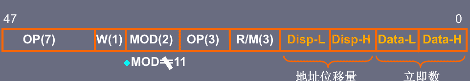

# 一、8086/8088指令格式

HYPer

# 双操作数指令

操作码
寻址方式
OP(6) D(1) W(1) MOD(2) REG(3) R/M(3) Disp-L 或 Data-L Disp-H 或 Data-H Data-L Data-H

| REG | W=0 | W=1 | R/M | MOD=00 | MOD=01 | MOD=10 | MOD=11 |
|---|---|---|---|---|---|---|---|
|  |  |  |  |  |  |  | W=0 | W=1 |
| 000 | AL | AX | 000 | BX+SI | BX+SI+Disp8 | BX+SI+Disp16 | AL | AX |
| 001 | CL | CX | 001 | BX+DI | BX+DI+Disp8 | BX+DI+Disp16 | CL | CX |
| 010 | DL | DX | 010 |  |  |  | DL | DX |
| 011 | BL | BX | 011 | BP+SI | BP+SI+Disp8 | BP+SI+Disp16 | BL | BX |
| 100 | AH | SP | 100 | BP+DI | BP+DI+Disp8 | BP+DI+Disp16 |  |  |
| 101 | CH | BP | 101 | SI | SI+Disp8 | SI+Disp16 | AH | SP |
| 110 | DH | SI | 110 | DI | DI+Disp8 | DI+Disp16 | CH | BP |
| 111 | BH | DI | 111 |  |  |  | DH | SI |
| D=1 | 目标操作数 |  |  | 源操作数 |  |  |  |  |
| D=0 | 源操作数 |  |  | 目标操作数 |  |  |  |  |

# 一、8086/8088指令格式

HYPer

Data

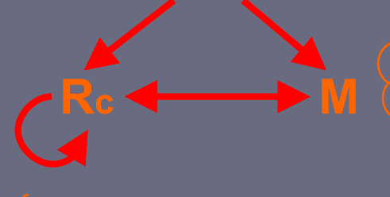

无论怎样 操作数位于： 指令中 R中 M中

Rc: { AX, BX, CX, DX, SP, BP, SI, DI
AH, BH, CH, DH, AL, BL, CL, DL }

M: Mea= { BP
BX } + { SI
DI } + { Disp8
Disp16 }

基址 变址 偏移量

*Note: BP, Disp8不可一个出现，组合状态26-2=24

C₆¹+3C₂¹+C₂¹C₂¹C₂¹-2=24

# 80386指令格式

# 80386指令格式：

指令前缀 OP ...

Rc：

+   - AX, BX, CX, DX, SP, BP, SI, DI
+   - AH, BH, CH, DH
+   - AL, BL, CL, DL
+   - EAX, EBX, ECX, EDX, ESP, EBP, ESI, EDI

M： EA = {EAX EBX ECX EDX ESP EBP ESI EDI} + {EAX EBX ECX EDX ... EBP ESI EDI} {1 2 4 8} + Disp8,Disp32

*Note: 45种组合。P77

无论怎样 操作数位于： 指令中 R中 M中

# 一、8086/8088指令格式

HYPer

# 汇编语言指令与机器指令一一对应

如： 43 INC BX

89 08 MOV AX, BX

B8 00 10 MOV AX, 1000

02 85 00 20 ADD AL, [DI+2000]

C6 06 00 30 12 MOV BYTE PTR[3000], 12 操作码场 操作数场

C7 06 00 30 34 12 MOV WORD PTR[3000], 1234

汇编语言是一种符号语言,它用：

# 二、8086/8088寻址方式

HYPer

+   0. 隐含寻址 --操作数据隐含在某个R中
+   1. 立即寻址方式 — 操作数据在指令中，data
+   2. 寄存器寻址 — 操作数据在R中
+   3. 直接寻址方式
+   4. 寄存器间接寻址
+   5. 寄存器相对寻址
+   6. 基址加变址寻址
+   7. 相对基址加变址寻址

-- 操作数在M中

都是M寻址

## 二、8086/8088寻址方式

0. 隐含寻址 --操作数据隐含在某个R中

例: XLAT

隐含使用AL, BX。

```
操作AL ←-- [BX+AL]
```

# 1．立即寻址方式

这种寻址方式所提供的操作数直接放在指令中，紧跟在操作码的后面，与操作码一起放在码段区域中。立即数可以是8位的，也可以是16位。立即寻址主要是用来给寄存器赋初值。

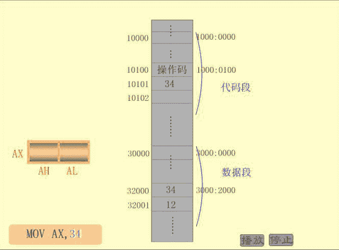

```
MOV AX,34
```

+   - 例如： MOV AX, 1234H ； 十六进制数 1234H送入AX。

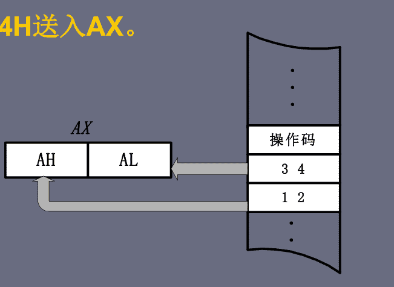

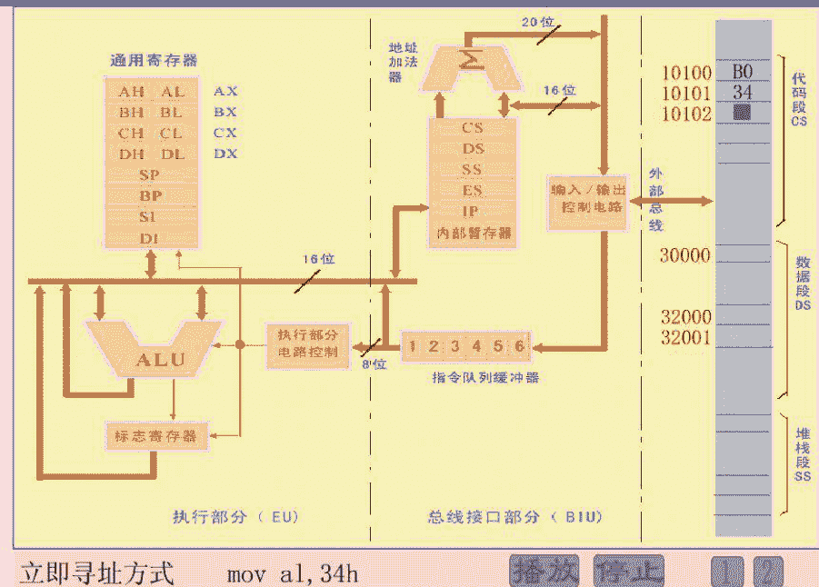

# 2. 寄存器寻址

操作数包含在 CPU的内部寄存器中。例如寄存器AX、BX、SI、DI等，虽然操作数可在CPU的内部通用寄存器的任一个中，且它们都能参与算术运算和逻辑运算并存放运算结果。但是AX是累加器，若结果是存放在AX中，则通常指令要更短些，更紧凑些。

例如： MOV AX, BX；将寄存器BX的内容送入 AX中。

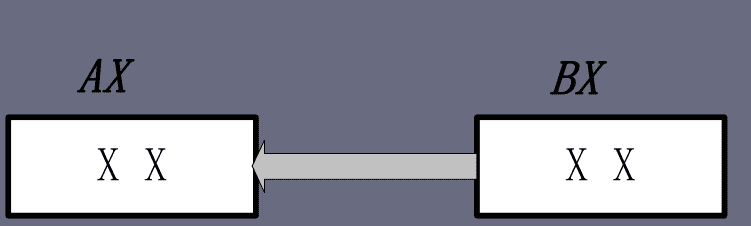

# 3. 直接寻址方式

操作数的地址的16位偏移量直接包含在指令中，它与操作码一起在码段区域中，但操作数一般在数据段区域中，它的地址为数据段寄存器DS加上它的16位地址偏移量。

指令中的16位地址偏移量是低位字节在前，高位字节在后。

EA=指令中直接给出地址 如 MOV AX, [3000H]

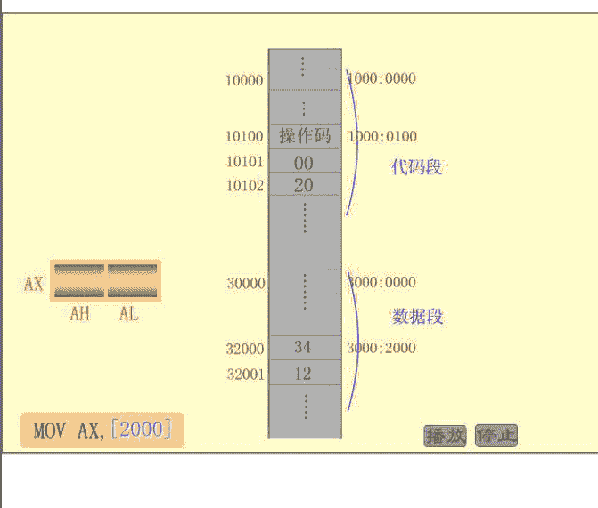

•例如： MOV AL, DS:[2000H]；将逻辑地址为DS:2000单元内的字节送入AL。
•若段基址DS=4000H，则段起始物理地址为4000H左移4位，即40000H，此指令将数据段中物理地址为42000H单元的内容56H传至AL寄存器。

# MOV AL, DS:[2000H]

4000H DS
+ 2000H
AX 56H
42000H
操作码
操作码
00H
20H
56H 42000H

#### 通用寄存器

AH AL AX
BH BL BX
CH CL CX
DH DL DX
SP
BP
SI
DI

地址加法器

CS
DS
SS
ES
IP
内部寄存器

输入/输出控制电路

外部总线

10100 A1
10101 00
10102 20
代码段 CS

30000
数据段 DS

32000 34
32001 12
堆栈段 SS

ALU

标志寄存器

执行部分电路控制

1 2 3 4 5 6
指令队列缓冲器

执行部分（EU）

总线接口部分（BIU）

直接寻址方式 mov ax, [2000h]

播放 停止 1 2 3

# 4. 寄存器间接寻址(间接寻址)

在这种寻址方式中，操作数是在存储器中，但是，操作数的地址的16位偏移量包含在以下四个寄存器SI、DI、BP、BX之一中。这又可分成两种情况：

+   1、 BX、SI、DI间址时以 DS为默认段地址；
+   例： MOV AX, [SI]

+   2、 BP间址时以SS为默认段地址。
+   例： MOV AX, [BP]

EA = { BP
BX
SI
DI } 基址寻址 变址寻址 直接寻址与间接寻址的例子 想一想！

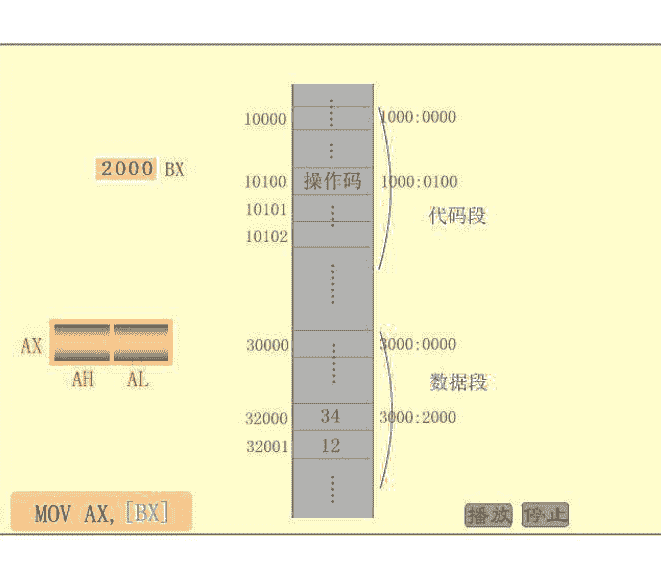


•例如： MOV AX, [BX] ; BX内容有效地址 EA（偏移量）。若DS=4000H, BX=100H, 此指令将物理地址40100H 单元的内容传至AL寄存器（段基地址同样为40000H）。

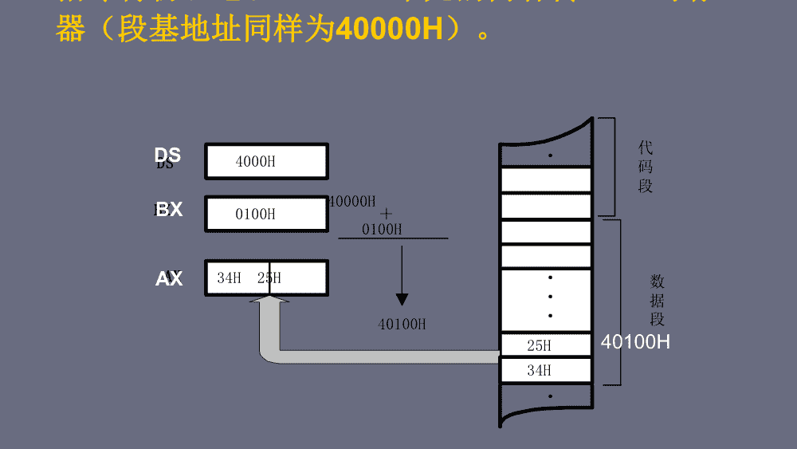


## 5. 寄存器相对寻址

所谓变址寻址即以基准寄存器BX、BP、SI、DI加上给定的8位或16位偏移量作为操作数的有效地址。段地址规则同上。

例：

```
MOV AX, MASK[SI]
```

```
MOV AX, [SI+MASK]
```

EA = { BP
BX
SI
DI } + Disp8(Disp16)


## MOV AL, [BX+5]

例如： MOV AL, [BX+5];
DS=6000H， BX=2000H，
BX的内容加上8位位移量05H作为操作数的有效地址。
传送数据段中的一个字节到AL中。如果使用BP，则隐含地表示操作数存放在堆栈段中。

DS 6000H DS
BX 2000H BX
EA=2000H+05H=2005H
AX AL 9AH
代码段
操作码
操作码
05H
数据段
62005
9AH
62005

## 寄存器相对寻址 mov AX, 1000[SI]

#### 通用寄存器

#### 地址加法器

## 内部暂存器

## 执行部分 : EU

## 总线接口部分 : BIU

## 代码段 CS

## 数据段 DS

## 堆栈段 SS

## 6. 基址加变址寻址

基址加变址寻址
即以某一基地址寄存器（通常为BX、BP）的内容，加上某一变址寄存器（通常为SI、DI）的内容，形成操作数的有效地址。
段地址规则同上。

例：

```
MOV AX, [BX + SI]
```

```
EA = { BP \\ BX } + { SI \\ DI }
```


## MOV AX, [BX+SI]

- 例如： MOV AX, [BX+SI]； BX的内容与SI的内容之和作为操作数的有效地址。传送数据段中的一个字。

DS 5000H DS

BX 2000H BX

SI 0006H SI

EA=2000H+06H=2006H

AX ABH 78H

50000H + EA

52000H

78H 52006H

代码段

数据段


## 7. 相对基址加变址寻址

相对基址加变址寻址 即以某一基地址寄存器（通常为BX、BP）的内容，加上某一变址寄存器（通常为SI，DI）的内容，再加上给定的8位或16位偏移量，形成了操作数的有效地址。

段地址规则同上。 例：

```
MOV AX, MASK[BX][SI]
```

```
MOV AX, [BX+SI+MASK]
```

EA= { BP BX } + { SI DI } + Disp8(Disp16)


## MOV AH, [BX+DI+1234H]

- 例如： MOV AH, [BX+DI+1234H]；
- BX的内容加上DI的内容再加上位移量1234H作为操作数的有效地址。

DS 4000H DS

BX 0200H BX

DI 0010H DI

EA=0200H+0010+1234H=1444H

AH
AX 50H AL

EA

4000H + 41444H

代码段

数据段

操作码
操作码
34H
12H
•

50H
41444H

## 三、其它寻址方式

- 1. 串操作指令寻址方式
- 2. I/O端口寻址方式
- 3. 转移指令寻址方式
- 4. 堆栈寻址方式

(1)段内相对寻址： JMP short addr8/16/32
(2)段内间接寻址： JMP BX
JMP WORD PTR[BX+disp]
(3)段间直接寻址： JMP FAR PTR addr
addr = CS:disp
(4)段间间接寻址： JMP DWORD PTR[SI+disp]

## 指令系统

- 一、 IBM PC(8086/8088) 指令系统
- 二、 数据传送指令
- 三、 算术运算指令
- 四、 逻辑运算指令
- 五、 串操作指令
- 六、 控制转移指令
- 七、 处理机控制指令

## 一、 IBM PC(8086/8088) 指令系统

8086/8088 指令系统可分为六组：

- - 数据传送指令
- - 算术指令
- - 逻辑指令
- - 串处理指令
- - 控制转移指令
- - 处理机控制指令

隐喻：
物流部门
职能部门
决策部门

## 1. 通用数据传送指令

HYPer

## (1) 基本传送指令 MOV d, s ;d←s

源操作数s——寄存器、存储器、立即数

目的操作数d——寄存器、存储器

执行的操作： d ← s

Move
Copy from d to s

# Data

Rc

M

Rs (cs不可变)

Mea= [BP
BX] + [SI
DI] + [Disp8
Disp16]

等宽传送原则

## 实例：

- - R-R: CPU内部寄存器之间的数据传送
  MOV AL, BL        MOV DX, DI
  MOV SI, BP        MOV DS, BX
  MOV AX, DX

- - R←Data: 立即数传送到CPU内部通用寄存器组（AX, BX, CX, DX, BP, SP, DI, SI）
  MOV CL, 4
  MOV DX, 03FFH
  MOV DI, 04BFH

- - R-M: CPU内部寄存器(除CS, IP外)与存储器（所有寻址方式）之间的数据传送
  MOV BX, BUFFER        MOV [DI], CX
  MOV AL, [2000]        MOV SI, BLOCK[BP]
  MOV AX, [SI]          MOV DS, DAT[SI+BX]

- - M←Data: 立即数给存储单元赋值
  MOV WORD PTR[2000], 10
  MOV BYTE PTR[BX+DI], 30

## 注意事项：

- 1. Rs←X-Data: 立即数不能直接送段寄存器, MOV DS, 3000H
- 2. Data←X-.. : 目标操作数不允许用立即数方式, MOV 2000H, AL
- 3. M-X-M: 不允许在两个存储单元间传送数据, MOV [2000H], [3000H]
- 4. Rs-X-Rs: 不允许在两个段寄存器之间传送数据, MOV DS, ES
- 5. MOV 指令不影响标志位Flags。
- 6. CS不可变: MOV CS, AX

例1：把地址为AREA1（段内偏移量）的存储单元的内容，传送至同一段内的地址为AREA2的存储单元中。

```
Mov AREA2, AREA1
```

```
Mov AL, AREA1
Mov AREA2, AL
```

|  |  |
|---|---|
|  | 65 | AREA1 |
|  | F3 | AREA2 |
|  | 02 |  |
|  | 00 |  |
|  | 24 |  |
|  | E0 |  |
|  | 05 |  |
|  | 00 |  |

例2：若要传送的不是一个字节，而是一个数据块，（例如内有100个字节），如何实现？


## (2)堆栈操作指令 PUSH s ;stack←s
POP d ;d←stack
d,s = Rc16; Rs; M16

堆栈——按照先进后出的原则组织的一段内存区域。8086中规定堆栈设置在堆栈段（SS段）内，堆栈指针SP的初值决定了堆栈的大小。

SP始终指向堆栈的顶部，即始终指向最后推入堆栈的信息所在的单元。

Rc16 ——— M16
Rs (CS不可变)


## PUSH AX

指令分两步执行：

- 1. 先SP-1→SP,将AH内容送至SP所指单元；
- 2. 再SP-1→SP,将AL内容送至SP所指单元；

例： MOV AX,1234H
PUSH AX


## POP AX

指令分两步执行：

- 1. 先将SP所指单元内容送至AL,然后
  SP+1→SP；
- 2. 再SP所指单元内容送至AH,然后
  SP+1→SP

例： MOV AX,5678H
POP AX


## (3)交换指令
XCHG d, s ; d<->s
XCHG s ; AX<->s


在寄存器间或寄存器与存储器间交换信息（不允许使用段寄存器）。

- 源操作数： 寄存器、存储器
- 目的操作数： 寄存器、存储器
- 执行的操作： d <-> s

```
XCHG BX, [BP+SI]
```

- (BX)=6F30H
- (BP)=0200H
- (SI)=0046H
- (SS)=2F00H
- (2F246H)=1234H

## （4）换码指令

```
XLAT    ; AL ← [BX+AL]
XLATB
```


```
AL ← [BX+AL]
```

**功能：**　将AL指向的换码表中的一个字节的内容送到AL中。

**操作数：** 隐含的寄存器 BX, AL

**操作：**　 AL ← [BX+AL]

```
MOV AL, 01H
MOV BX, 2000H
XLAT
```


## 2. 地址传送指令（LEA, LDS, LES）

HYPer

目的：把地址传送到指定寄存器。

```
(1)有效地址送寄存器

LEA d, s ; d← s有效地址

Rc16 ← M有效地址
```

Load Effective Address

- 该地址常用用来设置一个16位的寄存器作为地址指针；
- 该指令的执行效果与mov reg , offset src相同。

```
LEA bx, [bx][si]
```

| 执行前 | 执行后 |
|--------|--------|
| (bx)=1000h<br>(si)=2000h | bx=1000h+2000h=3000h |

## (2)指针送寄存器及DS指令

```
LDS d, s    ; d←[s] ,  DS←[s+2]
```

Rc16 ← M[s]
DS ← M[s+2]

Load memory double word into word register and DS

把源操作数指定的内存的4个相继字节的内容送至指定寄存器及DS中

- (1) 该指令完成一个32位地址指针的传送；
- (2) 该指令通常指定 SI 作寄存器 REG。

```
例： LDS SI, [0100h]
```

DS=1000h

10100h

00
02
00
20

0200h SI

2000h DS

## (3)指针送寄存器及ES指令

```
LES d, s   ; d←[s],  ES←[s+2]
```

Rc16 ← M[s]
ES   ← M[s+2]

Load memory double word into word register and ES

把源操作数指定的内存的4个相继字节的内容送至指定寄存器及ES中。

- (1) 该指令完成一个32位地址指针的传送；
- (2) 该指令通常指定 DI 作寄存器 REG。

例： LES DI, [100h]


## 3. I/O传送指令

HYPer

PC机中，所有I/O端口与CPU之间的通信都有IN, OUT指令完成。

## (1)I/O输入指令

```
IN AL, port8
IN AL, DX
AL ← port8, DX
```

```
IN AX, port8
IN AX, DX
AX ← port8, DX
```

Input from port into AL or AX

## (2)I/O输出指令

```
OUT port8, AL
OUT DX, AL
port8, DX ← AL
```

```
OUT port8, AX
OUT DX, AX
port8, DX ← AX
```

Output from AL or AX To port

## 4.标志寄存器传送指令

(1) 读取标志指令 LAHF ;AH← Flags 的低字节


Load AH from 8 low bits of Flags register

(2) 设置标志指令 SAHF ;Flags 的低位字节← AH


Store AH register in low 8 bits of Flags register

注：该指令影响标志位 Z、A、P、C

## (3)标志寄存器入栈指令 PUSHF ;stack ← Flags

将标志寄存器 Flags 的内容压入堆栈保存。16位Flags入栈。

Store flags register in the stack

## (4)标志寄存器出栈指令 POPF ;Flags ← stack

把栈中内容弹出至标志寄存器 Flags。出栈到Flags 16位。
注：该指令影响标志位 O、S、Z、A、P、C、D、I、T。

Get flags register from the stack

## 80186 以后的CPU有：

> Push all general purpose registers AX, CX, DX, BX, SP, BP, SI, DI in the stack.\nOriginal value of SP register (before PUSHA) is used.

## (3)所有 Rc16 入栈指令  **PUSHA** ；stack ← all Rc16

- PUSH AX
- PUSH CX
- PUSH DX
- PUSH BX
- PUSH SP
- PUSH BP
- PUSH SI
- PUSH DI

## (4)所有 Rc16 出栈指令  **POPA** ；all Rc16 ← stack

- POP DI
- POP SI
- POP BP
- POP xx（SP value ignored）
- POP BX
- POP DX
- POP CX
- POP AX

> Pop all general purpose registers DI, SI, BP, SP, BX, DX, CX, AX from the stack.\nSP value is ignored, it is Popped but not set to SP register).

## # 三、算术运算指令

| 分类 | 名称 | 格式 | 功能 | OSZ APC |
|------|------|------|------|--------|
| 加法指令 | 加法指令 | ADD d,s | 加法(字、字节) | OSZ APC |
|  | 带进位加法指令 | ADC d,s | 带进位加法(字、字节) | OSZ APC |
|  | 加 1 指令 | INC d | 加 1 (字、字节) | OSZ AP |
| 减法指令 | 减法指令 | SUB d,s | 减法(字、字节) | OSZ APC |
|  | 带借位减法指令 | SBB d,s | 带借位减法(字、字节) | OSZ APC |
|  | 减 1 指令 | DEC d | 减 1 (字、字节) | OSZ AP |
|  | 比较指令 | CMP d,s | 比较(字、字节) | OSZ APC |
|  | 求补指令 | NEG d | 求补码 | OSZ APC |
| 乘法指令 | 无符号数乘法 | MUL s | 不带符号数乘法(字、字节) | O C |
|  | 带符号数乘法 | IMUL s | 带符号数乘法(字、字节) | O C |
| 除法指令 | 无符号数除法 | DIV s | 不带符号数除法(字、字节) |  |
|  | 带符号数乘法 | IDIV s | 带符号数除法(字、字节) |  |
|  | 符号扩展指令 | CBW | 扩展AL的符号 | 不影响 |
|  | 符号扩展指令 | CWD | 扩展AX的符号 | 不影响 |
| 十进制调整指令 |  |  |  |  |


## 1.加法指令

(1)加法 ADD d, s ;d←d + s

Data

Rc

M

ADD

注：

- 该指令影响标志位
- 该指令适合有符号数和无符号数的运算。


例1：MOV DX, 4652H
ADD DX, 0F0F0h

无符号数的溢出用进位标志 C 判断。

```
  4652
+ f0f0
------
  3742
1
```

```
  0100011001101010
+ 1111000011110000
------------------
  0011011101000011
1
```

执行后：(DX) = 3742H

|  | Z=0 | S=0 | C=1 | O=0 |
|---|---|---|---|---|
| 对无符号数 |  | 溢出 | 结果错 |  |
| 对有符号数 |  | 不溢出 | 结果正确 |  |

问：对带符号数和无符号数怎样判断是否溢出？

## (2)带进位加 ADC d, s ;d←d+s+C

Add with Carry

Data

Rc

M

功能： 主要用于多字节运算

注：

- 该指令影响标志位
- 该指令适合有符号数和无符号数的运算。


## 多字节运算

例：在内存的First和Second开始的区域中分别存放着2F365H和5E024 H两个数，要求求其和，并存入Third中。
2F365
+ 5E024
--------
8D389


2F365
+ 5E024
--------
8D389
→
1 F365
+ E024
--------
D389
2 1
0002
+ 0005
--------
0008

```
MOV AX, First
ADD AX, Second
MOV Third, AX
MOV AX, First+2
ADC AX, Second+2
MOV Third+2, AX
```

|  |  |
|---|---|
| 65 | First |
| F3 |  |
| 02 |  |
| 00 |  |
| 24 | Second |
| E0 |  |
| 05 |  |
| 00 |  |
| 89 | Third |
| D3 |  |
| 08 |  |
| 00 |  |

## (3)加1  INC d  ;d←d+1

R c - - - M

Increment

用于在循环中修改地址指针及循环次数等。

注：该指令影响标志位

例： INC BX
INC [SI]

注意：
(1) 该指令将操作数视为无符号数；
(2) 该指令不影响进位标志 C


## 2. 减法指令

HYPer

**(1)减法**　`SUB d,s`；`d←d-s`


注：

- 该指令影响标志位
- 该指令适合有符号数和无符号数的运算。

## (2)带借位减法 SBB d, s ;d←d - s- C

Data

Subtract with Borrow

Rc

M

功能： 主要用于多字节运算

注：

- 该指令影响标志位
- 该指令适合有符号数和无符号数的运算。

d+s+C

0 0 1 0 0 1 0 0 0
O S Z A P C

注意： 同加法指令 有符号数的溢出用溢出标志 O 判断；
无符号数的溢出用进位标志 C 判断。

例： SUB DH, [BP+4]      (DH)=41H      (SS)= 0000H      (BP)=00E0H      (00E4H)= 4AH

41
- 4A
1 E7

01000001
- 01011010
1 11100111

结果： (DH)=0E7H

S=1    Z=0    C=1    O=0

如果为有符号数则结果正确（无溢出）

如果为无符号数则结果错误（有溢出）

例3： 双精度数运算    W=X+Y+24-Z


## (3)减1  DEC d  ;d←d-1

Rc --- M

Decrement

用于在循环中修改地址指针及循环次数等。

注：该指令影响标志位

例： DEC BX
DEC [SI]

注意：
(1) 该指令将操作数视为无符号数；
(2) 该指令不影响进位标志 C


## (4)取反加1    NEG d    ;d←/d+1

Rc -- -- M

Negate

注意： 该指令影响标志位


## (5)比较 CMP d, s ; d − s


该指令影响标志位

- (1) 该指令同SUB ，但其不保存运算结果；
- (2) 该指令后面通常跟一条转移指令，根据标志位产生不同的程序分支。


## 比较指令主要用于两个数之间的关系：大、小、相等。

如：A，B

1. **比较相等**。只要看 Z 标志。Z=1——相等；Z=0——不相等。

2. **比小大小**。

分两种情况。

- **无符号数**　看进（借）位 C 标志。C=1，有借位，则 A<B；C=0，无借位，则 A>B

```
A=A0H          1 0 1 0 0 0 0 0
B=53H      − 0 1 0 1 0 0 1 1
              ─────────────
                0 1 0 0 1 1 0 1
                  A>B
```

```
A=53H          0 1 0 1 0 0 1 1
B=A0H      − 1 0 1 0 0 0 0 0
              ─────────────
                0 0 1 1 0 0 1 1
                  A<B
```

- 带符号数

* 同号： A=24H
B=44H
00100100
−01000100
11100000
不会溢出O=0，用符号位 S 判断 O=0  S=0  A>B
S=1  A<B

* 异号： A=7FH
B=F0H
01111111
−11110000
10001111
用符号位S和溢出位O判断 O=1  S=1  A>B
S=0  A<B
O=0  S=0  A>B
S=1  A<B

结论： O⊕ S =0  A>B
O⊕ S =1  A<B

## 8088中有几条用于判断有符号数大小的转移指令，如：

| JG / JNLE | 大于则转移 | 条件为： O^ S = 0 且 Z=0 |
| JL / JNGE | 小于则转移 | 条件为： O^ S = 1 |

## 同样有几条用于判断无符号数大小的转移指令，如：

| JA / JNBE | 高于则转移 | 条件为： C=0 且 Z=0 |
| JBE / JNA | 低于或等于则转移 | 条件为： C=1 或 Z=1 |


## 3.乘法指令

HYPer

(1)无符号乘法  MUL s ;AX ← AL * s
;DX AX ← AX * s

s = Rc --- M

Unsigned multiply

注：

- 该指令影响标志位
- 若结果的高半部分（字节 相乘为AH, 字 相乘为DX）

为0 则 C=0, O=0
为1 则 C=1, O=1


## (2)带符号乘法 IMUL s ;AX ← AL * s
;DX AX ← AX * s

s = Rc -- - M

Signed multiply

注：

- 该指令影响标志位
- 若结果的高半部分不是低半部分的符号扩展的话，

则 C=1, O=1
否则 C=0, O=0


## 符号扩展：

从8位扩展到16位  ±20H

+20H      0010,0000  →  0000,0000,0010,0000

-20H      1111,1110  →  1111,1111,1111,1110

符号位

例：  MOV AL, 0B4H

MOV BL, 11H

MUL BL

## 4.除法指令

HYPer

### (1)无符号除法 DIV s
;AH(余),AL(商) ← AX/s ,s为字节(8位)
;DX(余),AX(商) ← DX AX / s ,s为字(16位)

s = Rc --- -- - M


注：

- 该指令不影响标志位
- s的类型决定是字或字节相除

## (2)有符号除法 IDIV s

;AH(余),AL(商) ← AX/s ,s为字节(8位)

;DX(余),AX(商) ← DX AX / s ,s为字(16位)

s = Rc --- -M


注：

- 该指令不影响标志位

- s的类型决定是字或字节相除

- 有符号除之前要进行符号位扩展,用CBW, CWD

## (3)字节到字符号位扩展 CBW

;AH ← AL符号位，即AL₇=0时，AH=0； AL₇=1， AH=0FFH


## (4)字到双字符号位扩展 CWD

;DX ← AX符号位，即AX₁₅=0时，DX=0； AX₁₅=1， DX=0FFFFH

该指令不影响标志位


## 5. 十进制调整指令

### (1). 十进制数的表示

BCD码——用4位二进制编码的十进制数。

| 类型 | 编码 | 数值 |
|---|---|---|
| 压缩BCD | 0000　0001　0010　0011　0100　0101　0110　0111　1000　1001 | 0　1　2　3　4　5　6　7　8　9 |
| 非压缩BCD | UUUU0000　UUUU0001　UUUU0010　……　UUUU1001 | 0　1　2　9 |

### (2). 调整原理

以加法调整为例。

7
+ 6
13

0111
+ 0110
1101
D

1101
+ 0110
1 0011
0001 0011
13 (H)

不同的运算指令的调整方法不同，但道理是一样的。

### (3). 调整指令

加法： DAA 压缩的BCD码加法十进制调整指令。

AAA 非压缩的BCD码加法十进制调整指令。

减法： DAS 压缩的BCD码减法十进制调整指令。

AAS 非压缩的BCD码减法十进制调整指令。

乘法： AAM 非压缩的BCD码乘法十进制调整指令。

除法： AAD 非压缩的BCD码除法十进制调整指令。

### (3). 调整指令

### Decimal Adjust after Addition

#### (a)压缩BCD码加法调整指令 DAA

; AL7 AL6 AL5 AL4 AL3 AL2 AL1 AL0

高 nibble：>9 或 CF = 1 → +6
低 nibble：>9 或 AF = 1 → +6

压缩BCD码 + 压缩BCD码 → BCD码
DAA调整

### (3). 调整指令

#### (b)压缩BCD码减法调整指令 DAS

; AL7 AL6 AL5 AL4 AL3 AL2 AL1 AL0

> 9 或 CF = 1 - 6

> 9 或 AF = 1 - 6

压缩BCD码 - 压缩BCD码 → BCD码

DAS调整

Decimal Adjust After Subtraction

### (3). 调整指令

### ASCII Adjust after Addition

#### (c)非压缩BCD码加法调整指令 AAA

; AL₇ AL₆ AL₅ AL₄ AL₃ AL₂ AL₁ AL₀

清0

>9 或 AF = 1

+ 6 并且 AH ← AH+1 并且 CF ← 1

非压缩BCD码 + 非压缩BCD码 → 非压缩BCD码

AAA调整

结果在AH AL中，以非压缩BCD码形式存贮

### （3）调整指令

#### （d）非压缩BCD码减法调整指令 AAS

; AL₇ AL₆ AL₅ AL₄ AL₃ AL₂ AL₁ AL₀

清0

{ >9 或 AF = 1 }

− 6
并且
AH ← AH − 1
并且
CF ← 1

非压缩BCD码  −  非压缩BCD码  →  非压缩BCD码（AH AL）

AAS调整

结果在AH AL中，以非压缩BCD码形式存储


### (3). 调整指令

#### (e)非压缩BCD码乘法调整指令 AAM

; AH ← AL/10 的商, AL ← AL/10 的余数

ASCII Adjust after Multiplication

非压缩BCD码 * 非压缩BCD码

非压缩BCD码 (AH AL)

AAM调整

高4位清0

例：
AND AL, 0FH
AND BL, 0FH
MUL BL
AAM

结果在AH AL中，以非压缩BCD码形式存贮

### （3）调整指令

#### （f）非压缩BCD码除法调整指令  AAD

```
`; AL ← AH * 10 + AL`
```

AH中放非压缩BCD码，AL中放非压缩BCD码，先进行AAD，把它变为二进制数据在AL中，之后进行DIV运算。


## 四、逻辑运算指令


| 分类 | 名称 | 格式 | 功能 | O S Z A P C |
|---|---|---|---|---|
| 逻辑运算指令 | 逻辑与指令 | AND d, s | 与（字、字节） | O S Z   P C |
| 逻辑运算指令 | 逻辑或指令 | OR d, s | 或（字、字节） | O S Z   P C |
| 逻辑运算指令 | 逻辑非指令 | NOT d | 非（字、字节） | 不影响 |
| 逻辑运算指令 | 逻辑异或指令 | XOR d, s | 异或（字、字节） | O S Z   P C |
| 逻辑运算指令 | 测试指令 | TEST d, s | 测试（字、字节） | O S Z   P C |
| 移位指令 | 逻辑左移指令 | SHL d, count | 逻辑左移（字、字节） | O S Z   P C |
| 移位指令 | 算术左移指令 | SAL d, count | 算术左移（字、字节） | O S Z   P C |
| 移位指令 | 逻辑右移指令 | SHR d, count | 逻辑右移（字、字节） | O S Z   P C |
| 移位指令 | 算术右移指令 | SAR d, count | 算术右移（字、字节） | O S Z   P C |
| 循环移位指令 | 循环左移指令 | ROL d, count | 循环左移(字,字节) | O       C |
| 循环移位指令 | 循环右移指令 | ROR d, count | 循环右移(字,字节) | O       C |
| 循环移位指令 | 带进位循环左移指令 | RCL d, count | 带来循环左移(字,字节) | O       C |
| 循环移位指令 | 带进位循环右移指令 | RCR d, count | 带来循环右移(字,字节) | O       C |

## # 1.逻辑运算指令

注: 该指令影响标志位 使 0=0,C=0, P,S,Z反映操作的结果。


> Logical AND

## 例1：屏蔽AL寄存器的低四位。

```
MOV AL, 0FFh
AND AL, 0F0h
```

11111111
∧ 11110000
---------
11110000

使一立即数的该位为0即可

## 例2：屏蔽AL寄存器的高两位。

```
MOV AL, 0FFh
AND AL, 3Fh
```

11111111
∧ 00111111
---------
00111111

使一立即数的该位为0即可

AND通常用于使某些位置0，其它位不变的情况。


## (2)逻辑或指令

**OR** d, s；d ← d ∨ s


注：该指令影响标志位
使 O=0，C=0，
P、S、Z 反映操作的结果。


## 例3：使某数的第5、6位置1。

```
MOV AL, 03H
OR AL, 30H
```


> 使一位即数的该位为1即可

> OR指令通常适用于将某些位置1

## (3)逻辑异或指令 XOR d, s ; d ← d ⊕ s

Data

Rc

M

Logical XOR

注：该指令影响标志位
使 O=0, C=0,
P, S, Z反映操作的结果。


## 例6: 使某数的D1、D0位取反，其它位不变。

```
MOV AL, 11H
```

```
XOR AL, 03H
```


## 例7: 测试AX中的的数与42H是否相同，相同则转移。

```
XOR AX, 0042H
```

```
JZ Next
```

Next: MOV BX, 30H

## 例8: 给某寄存器清0。

```
XOR AX, AX
```

AX=0

> 使一立即数的相应位为1即可

> 给寄存器清0

> 测试两操作数是否相等

> 使一操作数若干位维持不变，若干位取反

## (4)测试指令 TEST d, s ; d & s

Logical AND
But Result is not stored anywhere

Data

R_c

M

注：该指令影响标志位，结果不保存
使 O=0, C=0,
P, S, Z反映操作的结果。


## 例4：检测AL中的最低位是否为1，若为1则转移。

```
```asm
MOV AL, 41H
TEST AL, 01H
JNZ  Next
    ⋮
Next: MOV BL, 0
    ⋮
```
```


> TEST 通常用于检测一些条件是否满足，但又不希望改变原来操作数的情况，该指令后通常带有条件转移指令。

## 例5：检测CX内容是否位 0，为 0 则转移。

```
①  TEST CX, 0FFFFH
JZ Next
:
Next: MOV AX, 1
:
```

```
②  CMP CX, 0
JZ Next
:
Next: MOV AX,1
:
```

## (5)逻辑非指令 NOT d ; d ← /d

Rc -- -- M

Invert each bit of the operand

注：该指令不影响标志位

例如： NOT AL

NOT BYTE PTR[BX]

## 2.移位指令

移位指令 d, count
循环指令 d, count

d = Rc -- M
count = { 1
CL }

## 2.移位指令

HYPer

- (1)逻辑左移指令 SHL d, count
- (2)逻辑右移指令 SHR d, count
- (3)算术左移指令 SAL d, count
- (4)算术右移指令 SAR d, count

A-arithmetic
S,SH-shift
L-left
R-right

OF=0 if first operand keeps original sign

注：该指令影响标志位 CF, OF, SF, PF, ZF 视结果而定；最后一次移位后当最高有效位发生变化时(如1变0) OF=1，否则 OF=0。


## 例1: 某数X × 10

```
MOV AL, X
MOV BL, 10
MUL BL
```

> 移位前 000000100 = 4H
> 移位后 000001000 = 8H

```
MOV AL, X
SHL AL, 1 ; X*2
MOV BL, AL ; BL=X*2
SHL AL, 1 ; X*4
SHL AL, 1 ; X*8
ADD AL, BL ; X*8+X*2=X*10
```

| 时钟数 |
|--------|
| 4 |
| 4 |
| 70 |
| 78 |

| 时钟数 |
|--------|
| 4 |
| 2 |
| 2 |
| 2 |
| 2 |
| 3 |
| 15 |

时间更少！

## 例2: 将0F0H除以2。

带符号:

```
MOV AL, 0F0H
SAR AL, 1
```

无符号:

```
MOV AL, 0F0H
SHR AL, 1
```

OF=0
正确!

1111,0000    F0H=(-10H)=-16D
1111,1000    F8H=(-8H)=-8D

1111,0000    F0H= 240 D
0111,1000    78H = 120 D

无符号数不看OF
看CF, CF=0正确

# 移位指令的作用:

移位指令通常用来做乘2或除2的操作:

- 左移一位    操作数×2;
- 右移一位    操作数÷2

- • 算术移位指令适用于带符号数的运算。
- • 逻辑移位指令适用于无符号数的运算。

## 例3： 将 带符号数 89H 乘以2。

带符号：

```
MOV AL, 89H
SHL AL, 1
```

1 0 0 0,1 0 0 1      89H=(-77H)=-119D
0 0 0 1,0 0 1 0      12H= (12H)= 18D

OF=1
错！

## 例4： 将 带符号数 0F0H 乘以2。

带符号：

```
MOV AL, 0F0H
SHL AL, 1
```

1 1 1 1,0 0 0 0      F0H=(-10H)= -16D
1 1 1 0,0 0 0 0      E0H=(-20H)= -32D

OF=0
正确！

带符号数的运算结果的正确与否看溢出位：
OF=1 溢出，结果错； OF=0 没溢出，结果正确。
无符号数的运算结果的正确与否看进位位：
CF=1 有进位，结果错； CF=0 无进位，结果正确。

## 例5：请求出AL中“1”的个数，存在AH中。

```
①
MOV AH, 0
Again: SHL AL, 1
ADC AH, 0
CMP AL, 0
JNZ AGAIN
HLT
```

```
②
MOV AH, 0
MOV CL, 8
Again: SHL AL, 1
JNC Next
INC AH
Next: DEC CL
JNZ Again
HLT
```


## 3.循环指令

HYPer

- (1) 循环左移指令 ROL d, count
- (2) 循环右移指令 ROR d, count
- (3) 带C循环左移指令 RCL d, count
- (4) 带C循环右移指令 RCR d, count

注：该指令影响标志位 CF, OF, SF, PF, ZF 视结果而定；最后一次移位后当最高有效位发生变化时(如1变0) OF=1, 否则 OF=0。

R,RO-rotate
C-through Carry L-left
R-right

OF=0 if first operand keeps original sign


## 例4：实现32位数的移位，要求左移4位。

方法1

```
Org 100
MOV DX,1234H
MOV AX,5678H
MOV CL,4
SHL DX,CL
MOV BL,AH
MOV CL,4
SHL AX,CL
MOV CL,4
SHR BL,CL
OR DL,BL
ret
```

DX DH DL AX AH AL ① DX xxxxxxxxxxxx 0000 ② BL xxxxxxxx ③ AX xxxxxxxxxxxx 0000 ④ BL 0000 xxxx ⑤ DL xxxx 0000 BL 0000 xxxx ⑥ DL xxxxxxxx


## 方法2

C
AX

C
DX

```
org
MOV DX,1234H
MOV AX,5678H
MOV CL,4
loop1:SHL AX,1
RCL DX,1
DEC CL
JNZ loop1
ret
```

循环移位指令的作用：
循环移位指令可以改变操作数
中所有位的位置

## 综合例题

## 流程图

## 例5:

在内存某一缓冲区中，存放着若干用BCD码表示的十进制数，每一个单元中存放两位，要求将它们转换成ASCII码，存放在缓冲区，高4位的BCD码转换的ASCII码放在地址较高的单元。


|  |  |
|---|---|
| 65 | BCDBUF |
| 23 |  |
| 02 |  |
| 00 |  |
| 24 |  |
| 35 | ASCII BUF |
| 36 |  |
| 33 |  |
| 32 |  |
| 32 |  |
| 30 |  |
| 30 |  |
| 30 |  |
| 34 |  |
| 32 |  |

```
COUNT EQU 5
org 100h
MOV SI, offset bcdbuf
MOV DI, offset asciibuf
MOV CH, COUNT
Again:
MOV AL, [SI]
INC SI
MOV BL, AL
AND AL, 0FH
OR AL, 30H
MOV [DI], AL
INC DI
MOV AL, BL ;0110,0101
MOV CL, 4
SHR AL, CL ;0000,0110
OR AL, 30H ;0011,0110
MOV [DI], AL
INC DI
DEC CH
JNZ Again
ret
bcdbuf db 65h,23h,02h,00h,24h
asciibuf db 20 dup(?)
```


## 五、串操作指令

| 分类 | 名称 | 功能 | 控制标志D |
|---|---|---|---|
| 串传送指令 | MOVSB<br>MOVSW | 字节传送<br>字传送 | 设置D |
| 串比较指令 | CMPSB<br>CMPSW | 字节串比较<br>字串比较 | 设置D |
| 串扫描指令 | SCASB<br>SCASW | 字节串扫描<br>字串扫描 | 设置D |
| 写串指令<br>(串存入指令) | STOSB<br>STOSW | 字节串存入<br>字串存入 | 设置D |
| 读串指令<br>(串装入指令) | LODSB<br>LOD SW | 取字节串<br>取字串 | 设置D |
| 重复前缀 | REP<br>REPE/REPZ<br>REPN E/REPNZ | 无条件重复<br>当相等/为零重复<br>当不相等/不为零重复 |  |

## 1.串传送指令

| 名称 | 格式 | 功能 | 状态标志 | 控制标志 |
| --- | --- | --- | O S Z A P C | D I T |
| 字节串传送指令 | MOVSB | 字节串传送 | 不影响 | 设置D |
| 字串传送指令 | MOVSW | 字串传送 | 不影响 | 设置D |
| 重复前缀 | REP | 无条件重复 | 不影响 |  |

D为方向标志（Direction Flag）：
D=1，串操作时地址自动减量，指令 STD
D=0，串操作时地址自动增量。指令 CLD

## (1)字节串传送指令 MOVSB

```
; ES:[DI] ← DS:[SI]
SI ← SI ± 1
DI ← DI ± 1
```

Copy byte at DS:[SI] to ES:[DI]
Update SI and DI

# M to M ?

## (2)字串传送指令 MOVSW

```
; ES:[DI] ← DS:[SI]
SI ← SI ± 2
DI ← DI ± 2
```

Copy word at DS:[SI] to ES:[DI]
Update SI and DI

*MOVS = MOVSB 或 MOVSW

常用于把某一内存缓冲区中内容复制到另一个缓冲区中

## (3)重复前缀指令    REP MOVSB
REP MOVSW
; 重复执行MOVS，直至CX = 0，每执行一次 MOVS时，CX ← CX - 1，


- CX≠0(计数没结束)时循环
- MOVS = MOVSB或MOVSW

## 例1： 将数据段中起始地址为Souce的100个字节的数据传送到附加段的Dest指向的单元中。

```
COUNT EQU 5
org 100h
LEA SI,source  ;与MOV SI,offset source一样
LEA DI,dest    ;与MOV DI,offset dest一样
MOV CX,COUNT
CLD
Again:
MOVSB
DEC CX
JNZ Again
ret
source db 65h,23h,02h,00h,24h
dest db 20 dup(?)
```

增址传送

[SI] → [DI]
SI+1 → SI
DI+1 → DI


## 例1-1: 字传送

```
LEA SI, Source+99
LEA DI, Dest+99
MOV CX, 50
STD
```

```
Again: MOVSW
DEC CX
JNZ Again
HLT
```


> 减址传送
> 
> [SI] → [DI]
> SI - 2 → SI
> DI - 2 → DI

## MOVSW执行过程

souce=1000

SI=1099

dest=2000

DI=2099


## 例2：与 REP 指令配合传送100个数。

```
LEA SI, Souce
LEA DI, Dest
MOV CX, 100
CLD
Again: MOVSW
DEC CX
JNZ Again
HLT
```

```
LEA SI, Souce
LEA DI, Dest
MOV CX, 100
CLD
REP MOVSW

HLT
```

- CX不为0时重复执行
- ① 判断CX=0？是，传送完毕；否，进行②
- ② CX-1 → CX
- ③ 执行REP后的串操作。
- ④ 重复①～③


SI → 23 Souce
D0
05
AB
92
...
DI → 23 Dest
D0
05
AB

## REP MOVSB执行过程

CX=5

SI=1000

source=1000

DI=2000

dest=2000


## 2.串比较指令

| 名称 | 格式 | 功能 | 状态标志 | 控制标志 |
| --- | --- | --- | O S Z A P C | D I T |
| 字节串比较指令 | CMPSB | 字节串比较 | O S Z A P C | 设置D |
| 字串比较指令 | CMPSW | 字串比较 | O S Z A P C | 设置D |
|  | REPE/REPZ | 当相等/为零重复 | 不影响 |  |
|  | REPN E/REPNZ | 当不相等/不为零重复 | 不影响 |  |

- D为方向标志（Direction Flag）：
- D=1，串操作时地址自动减量，指令 STD； D=0，串操作时地址自动增量。指令 CLD
- REPE和REPZ是同一条指令的两种不同表示形式。
- REPN E和REPNZ是同一条指令的两种不同表示形式。

## (1)字节串比较指令 CMPSB

```
; DS:[SI] - ES:[DI] （→Flag）
SI ← SI ± 1
DI ← DI ± 1
```

Compare bytes: ES:[DI] from DS:[SI].

## (2)字串比较指令 CMPSW

```
; DS:[SI] - ES:[DI] （→Flag）
SI ← SI ± 2
DI ← DI ± 2
```

Compare words: ES:[DI] from DS:[SI].

*CMPS = CMPSB或CMPSW

常用于在比较两个内存缓冲区中的数据


## (3)当相等/为零重复前缀指令

REPE/REPZ  CMPSB
REPE/REPZ  CMPSW

; 重复 CMPSB 或 CMPSW 的操作，直到 CX =0 或 Z=0，每执行一次 CMPS时，CX ← CX -1。

CX=0 or Z=0
(计数结束,或比较不相等)时

CX≠0 and Z=1 ?

结束

CX-1→CX

CMPS

循环CX次或Z=0(不相等)时退出循环

-   • CX≠0(计数没结束)且 Z=1(两数相等)时循环,
-   • CMPS = CMPSB或CMPSW

## (4)当不相等/不为零重复前缀指令

REPNE/REPNZ CMPSB
REPNE/REPNZ CMPSW

; 重复 CMPSB 或 CMPSW 的操作，直到 CX =0 或 Z=1，每执行一次 CMPS时，CX ← CX − 1。

CX≠0 and Z=0 ?

CX=0 or Z=1
(计数结束,或比较相等)时

CX-1→CX

CMPS

结束

-   • CX≠0(计数没结束) 且 Z=0(两数不相等)时循环,
-   • CMPS = CMPSB或CMPSW

循环CX次或Z=1(相等)时退出循环

## 例3-1：字比较。

```
LEA SI, source
LEA DI, dest
MOV CX, 25
CLD
Again: CMPSW
JNZ Found
DEC CX
JNZ Again
MOV AX, 0
JMP exit
Found : DEC SI
DEC SI
MOV AX,SI
Exit: HLT
```


## 例3-2：在内存的DS和ES段中，各有长度为50字节的字符串，试比较它们是否相同。(与 Repe / Repz 配合使用)

```
LEA SI, source
LEA DI, dest
MOV CX, 50
CLD
REPE CMPSB
JNZ Found
MOV AX, 0
JMP exit
Found: DEC SI
MOV AX, SI
Exit: HLT
```

CX≠0(计数没结束) 且 Z=1(两数相等) 时重复


## 例3-2: 在内存的DS和ES段中，各有长度为50字节的字符串，试比较它们是否相同。（与 Repne / Repnz配合使用）

```
LEA SI, source
LEA DI, dest
MOV CX, 50
CLD
REPNE CMPSB
JZ Found
MOV AX, 0
JMP exit
Found : DEC SI
MOV AX, SI
Exit: HLT
```

CX≠0(计数没结束) 且 Z=0(两数不相等) 时循环


## 3.串扫描指令


| 名称 | 格式 | 功能 | 状态标志 | 控制标志 |
| --- | --- | --- | O S Z A P C | D I T |
| 字节串扫描指令 | SCASB | 字节串扫描 | O S Z A P C | 设置D |
| 字串扫描指令 | SCASW | 字串扫描 | O S Z A P C | 设置D |
|  | REPE/REPZ | 当相等/为零重复 | 不影响 |  |
|  | REPNE/REPNZ | 当不相等/不为零重复 | 不影响 |  |

-   - D为方向标志（Direction Flag）：
-     D=1，串操作时地址自动减量，指令 STD； D=0，串操作时地址自动增量。指令 CLD
-   - REPE和REPZ是同一条指令的两种不同表示形式。
-   - REPNE和REPNZ是同一条指令的两种不同表示形式。

## (1)字节串扫描指令 SCASB

```
; AL - ES:[DI] （→Flag）
DI ← DI ±1
```

Compare bytes: AL from ES:[DI].

## (2)字串扫描指令 SCASW

```
; AX - ES:[DI] （→Flag）
DI ← DI ±2
```

Compare words: AL from ES:[DI].

* SCAS = SCASB或SCASW

常用于在某一内存缓冲区中找指定字符

## (4)当不相等/不为零重复前缀指令

REPNE/REPNZ SCASB
REPNE/REPNZ SCASW

; 重复 SCASB 或 SCASW 的操作，直到 CX=0 或 Z=1，每执行一次 SCAS 时，CX ← CX -1。

CX=0 or Z=1
(计数结束,或比较相等)时

CX≠0 and Z=0 ?

N

Y

CX-1→CX

SCAS

结束

循环CX次或Z=1(相等)时退出循环

-   • CX≠0(计数没结束)且 Z=0(两数不相等)时循环,
-   • SCAS = SCASB或SCASW

## 例4：寻找字符串中是否有字符 ‘A’。

```
LEA DI, source
MOV CX, 30
MOV AL, ‘A’
again: SCASB
JZ find
DEC CX
JNZ again
MOV BX,0
JMP exit
find: DEC DI
MOV BX, DI
exit: HLT
```


## 例4-1：寻找字符串中是否有字符‘A’。

```
LEA DI, source
MOV CX, 30
MOV AX, ‘A’
again: SCASW
JZ find
DEC CX
JNZ again
MOV BX,0
JMP exit
find: DEC DI
DEC DI
MOV BX, DI
exit: HLT
```


DI→ 53 00 71 00 41 00 49 00 68 00 Souce

## 例4-2：寻找字符串中是否有字符 ‘A’。与 Repe / Repz ， Repne / Repnz 配合使用。

```
LEA DI, source
MOV CX, 30
MOV AL, ‘A’
REPNE SCASB
JZ find
MOV BX,0
JMP exit
find: DEC DI
MOV BX, DI
exit: HLT
```

CX≠0(计数没结束) 且 Z=0(两数不相等) 时重复


## 4.写串指令(串存入指令)

| 名称 | 格式 | 功能 | 状态标志 | 控制标志 |
| --- | --- | --- | --- | --- |
|  |  |  | O S Z A P C | D I T |
| 写字节串指令 | STOSB | 字节串存入 | 不影响 | 设置D |
| 写字串指令 | STOSW | 字串存入 | 不影响 | 设置D |
| 重复前缀 | REP | 无条件重复 | 不影响 |  |

-   - D为方向标志（Direction Flag）：
-     D=1，串操作时地址自动减量，指令 STD； D=0，串操作时地址自动增量。指令 CLD

```
(1)写字节串指令 STOSB
; ES:[DI] ← AL
DI ← DI ±1
```

Store byte in AL into ES:[DI].
Update DI

```
(2)写字串指令 STOSW
; ES:[DI] ← AX
DI ← DI ±2
```

Store word in AX into ES:[DI].
Update DI

常用初始化
某一内存缓冲区

* STOS = STOSB或STOSW

## 例5：初始化内存，使其内容全部位0。

```
LEA DI, dest
MOV AL, 0
MOV CX, 30
CLD
again: STOSB
DEC CX
JNZ again
HLT
```

ES:[DI] ← AL
DI ← DI + 1


## 例5-1：初始化内存，使其内容全部为0。

```
LEA DI, dest
MOV AX, 0
MOV CX, 15
CLD
again: STOSW
DEC CX
JNZ again
HLT
```

ES:[DI] ← AX
DI ← DI + 2


## 例5-2：初始化内存，使其内容全部为0。与 Rep 指令配合使用。

```
LEA DI, dest
MOV AL, 0
MOV CX, 30
CLD
REP STOSB
HLT
```


## 5.读串指令(串装入指令)

| 名称 | 格式 | 功能 | 状态标志 | 控制标志 |
| --- | --- | --- | --- | --- |
|  |  |  | O S Z A P C | D I T |
| 读字节串指令 | LODSB | 取字节串 | 不影响 | 设置D |
| 读字串指令 | LODSW | 取字串 | 不影响 | 设置D |

本指令一般不与 REP 联用。

- D为方向标志（Direction Flag）： D=1，串操作时地址自动减量，指令 STD； D=0，串操作时地址自动增量。指令 CLD

## (1)读字节串指令 LODSB

; AL ← DS:[SI]
SI ← SI ± 1

Load byte at DS:[SI] into AL. Update SI.

## (2)读字串指令 LODSW

; AX ← DS:[SI]
SI ← SI ± 2

Load word at DS:[SI] into AX. Update SI.

适用于将内存中的一串字符逐一取出测试用。

* LODS = LODSB或LODSW

## 例6：在数据段DS中有一字符串，试将其每一个字符加 1 后送入附加段ES中。

```
LEA SI, source
LEA DI, dest
MOV CX, 30
CLD
again: LODSB
INC AL
MOV ES:[DI], AL
INC DI
DEC CX
JNZ again
HLT
```

AL ← DS:[SI]
SI ← SI +1


## 例6-1：在数据段DS中有一字符串，试将其每一个字加一后送入附加段ES中。

```
LEA SI, source
LEA DI, dest
MOV CX, 20
CLD
again: LODSW
INC AX
MOV ES:[DI], AX
INC DI
INC DI
DEC CX
JNZ again
HLT
```

AX ← DS:[SI]
SI ← SI +2

Lods 指令一般不与 Rep指令配合使用


## 例7：在数据段DS中有一字符串，试将其每一个字符加一后送入附加段ES中。

```
LEA  SI, source
LEA  DI, dest
MOV  CX, 30
CLD
again: LODSB
INC  AL
STOSB
DEC  CX
JNZ  again
HLT
```

AL ← DS:[SI]
SI ← SI +1

ES:[DI] ← AL
DI ← DI +1


## 例8：在起始地址为Block的内存中有一数据块，其中有正数，也有负数，要求将正负数分开，分别送至同一段的两个区域 p_data和M_data中

```
LEA SI, block
LEA DI, P_data
LEA BX, M_data
MOV AX, seg block
MOV DS, AX
MOV ES, AX
MOV CX, n
goon: LODSB
TEST AL, 80h
JNZ minus
STOSB
JMP again
minus: XCHG BX, DI
```

```
STOSB
XCHG BX, DI
again: DEC CX
JNZ goon
HLT
```


## 六.控制转移指令

| 名称 | 格式 | 功能 |
|---|---|---|
| 无条件转移指令 | JMP d | 无条件转移 |
| 条件转移指令 | JNZ disp8（等） | 根据上一条指令设置的标志位的情况转移 |
| 循环控制指令 | LOOP disp8 | CX≠0循环 |
|  | LOOPE/LOOPZ disp8 | 相等/结果等于0时循环 |
|  | LOOPNE/LOOPNZ disp8 | 不相等/结果不等于0循环 |
|  | JCXZ disp8 | CX=0 则转移 |
| 子程序调用及返回指令 | CALL d | 调用子程序 |
|  | RET | 从子程序返回 |
| 中断指令 | INT n | 软中断 |
|  | INTO | 溢出时中断 |
|  | IRET | 中断返回 |

## 1)段内相对短转移指令

```
JMP SHORT disp8
; IP ← IP + disp8
disp8 = -128~127
```

## 2)段内相对近转移指令

```
JMP NEAR PTR disp16
; IP ← IP + disp16
disp8 = -32768~32767
```

## 3)段内间接转移指令

JMP d1
; IP ← d1
d1 = Rc16 , M1,2 ， 16位通用寄存器或存储器中连接2个单元内容

BX = 0120h
JMP BX

JMP 0120h ; CS:120h

BX=100h, DS= 1000h
JMP WORD PTR [BX]

JMP 1500h ; cs:1500h


## 4)段间直接转移

```
JMP FAR PTR addr32
```

; CS ← addr32分段部分

IP ← addr32偏移部分

例：当前CS=2100h, IP=1500h, addr32为目标地址标号，目标地址在另一个代码段，其段地址为6500h, 偏移地址为020Ch, 执行指令后，转移到6520Ch目标地址去执行后续指令。

Addr32=6500h:020Ch 或addr32=6520Ch


## 5)段间间接转移

```
JMP DWORD PTR d2
; d2 = M1,2,3,4
IP ← M1,2
CS ← M3,4
```

例： JMP DWORD PTR[BX+100h]
DS = 2000h, BX=1000h

22500 JMP ...

21100 00
01
00
30

31000 MOV

## (2)条件转移指令

JX disp8
; IP ← IP + disp8 , disp8 = -128~127

X为转移条件 — {标志(C,Z,S,O,P)
无符号数比较
有符号数比较}

根据上一条指令影响的状态位来判断是否转移。

特点：

- 1. 条件转移指令全部为段内转移
- 2. 目标地址在当前指令的 -128~127 范围内。
- 3. 目标地址由操作数disp8确定。
- 4. 条件转移指令不影响标志位。


## 例1：计算Y= |X|

```
MOV AX, 0FB00h
TEST AX, 8000h
JNS lable
NEG AX
lable: MOV Y, AX
HLT
```


## 2) 无符号数大小的比较转移(A-B)

JX disp8
; X 为标志条件, 可能是两个条件的组合，A，B，E，N
IP ← IP + disp8 , disp8 = -128~127

根据组合条件标志的设置情况转移 —— 主要用来比较两个数的大小

| 指令 | 功能 | 转移条件 |
|---|---|---|
| JA / JNBE disp8 | (>) 高于/不低于也不等于则转移 | CVZ=0 |
| JAE / JNB / JNC disp8 | (≥) 高于或等于/不低于/无借位则转移 | C=0 |
| JB / JNAE / JC disp8 | (<) 低于/不高于也不等于/有借位则转移 | C=1 |
| JBE / JNA disp8 | (≤) 低于或等于/不高于则转移 | CVZ=1 |

A—Above, B—Below, E—Equal, N--Not


## 3) 有符号数大小的比较转移(A-B)

JX disp8

; X 为标志条件, 可能是两个条件的组合， G， L， E， N

IP ← IP + disp8 , disp8 = -128~127

根据组合条件标志的设置情况转移 —— 主要用来比较两个数的大小

| 指令 | 功能 | 转移条件 |
|---|---|---|
| JG / JNLE disp8 | (>) 大于/不小于也不等于则转移 | S⊕ O=0 且 Z=0 |
| JGE / JNL disp8 | (≥) 大于或等于/不小于则转移 | S⊕ O=0 或 Z=1 |
| JL / JNGE disp8 | (<) 小于/不大于也不等于则转移 | S⊕ O=1 且 Z=0 |
| JLE / JNG disp8 | (≤) 小于或等于/不大于则转移 | S⊕ O=1 或 Z=1 |

G—Great, L—Less, E—Equal, N--Not

## 例2：两无符号数相加，结果正确则Ax 中存入1，若溢出则AX中存入0。

```
MOV AX, x
MOV BX, y
ADD  BX, AX
JC error
MOV AX, 1
JMP exit
error : MOV AX, 0
exit: HLT
```


## 例3：有一组无符号数，与50比较，大于50 的存入另一存储区，小于或等于50的放弃。

```
LEA SI, array1
LEA DI, array2
MOV CX, n
Again: MOV AL,[SI]
INC SI
CMP AL, 50
JBE next
MOV [DI], AL
INC DI
next: DEC CX
JNZ again
Hlt
```

array1

05
A2
00
10
85

array2

A2
85


例4: 数组 ARRAY 为N字数组，要求将其中正数、0、负数的个数统计出来，分别存入寄存器 DI、SI、AX 中。

```
N EQU 6
ORG 100H
XOR BX, BX
XOR AX, AX
XOR SI, SI
XOR DI, DI
MOV CX, N
AGAIN:
    CMP ARRAY[BX], 0
    JL LESS
    JE EQUAL
    INC DI ;正
    JMP NEXT
LESS:
    INC AX ;负
    JMP NEXT
EQUAL:
    INC SI ;零
    JMP NEXT;可删除本指令
NEXT:
    ADD BX, 2
    DEC CX
    JNZ AGAIN
    RET
ARRAY DW 0A205H,1000H,2385H, 0290H,0000H,8000H
```

## 例4：用条件转移指令实现长字节转移。

如: jz next ; next地址大于 -128~+127范围。

```
ADD AX, BX
JNZ temp
JMP next
temp: MOV AX, 0
...
next: MOV AX, 1
...
```


## (3)循环控制指令

## 循环控制指令 disp8

| 指令 | 功能 | 循环条件 |
|---|---|---|
| LOOP disp8 | 计数器不为零循环 | CX≠0 |
| LOOPE / LOOPZ disp8 | 计数器不为零且相等时循环 | CX ≠0 且 Z=1 |
| LOOPNE / LOOPNZ disp8 | 计数器不为零且不相等时循环 | CX ≠0 且 Z=0 |
| JCXZ disp8 | CX=0 则转移 | CX=0 |

与REP， REPE, REPNE的区别？

## 2)相等循环指令

## LOOPE / LOOPZ      disp8

;CX←CX-1;

若CX≠0 且Z=1 则IP←IP+disp8 , disp8 = -128~127

CX←循环次数

循环体

LOOPE/LOOPZ
disp8

CX←CX-1
CX≠0 and Z=1?

最多
CX次

CX = CX - 1
if (CX <> 0) and (ZF = 1) then
jump
else
no jump, continue

Y

N

## 3)不等循环指令

LOOPNE / LOOPNZ      disp8

;CX←CX-1;

若CX≠0 且Z=0 则IP←IP+disp8 , disp8 = -128~127

CX←循环次数

循环体

LOOPNE/LOOPNZ
disp8

最多
CX次

CX←CX-1
CX≠0 and Z=0?

CX = CX - 1
if (CX <> 0) and (ZF = 0) then
    jump
else
    no jump, continue

## 4)CX=0循环指令

J CXZ    disp8
; * CX不减1
若CX = 0 则IP ← IP + disp8 , disp8 = -128~127


## 例6-1：数出长度为10的，以STRING为首地址的字符串中空格的个数。

```
N EQU 10
ORG 100H
LEA SI, string
MOV CX, N
MOV AL, 20H ;空格的ASCII码为20H
MOV AH, 0H ;结果在AH中
again:
CMP AL, [SI]
JNZ next
INC AH
next:
INC SI
LOOP again
RET
string DB 41h,42h,43h,20h,45h,46h,20h,48h,20h,49h
```


转向的地址范围在 -128 ～ +127 之间

## 例7：有一串n个字符的字符串（ABCDEFGH IJK）存储于首地址为ASC的存储区，要求查找空格的位置。

```
N EQU 10
ORG 100H
MOV CX, N
LEA SI, ASC -1
MOV AL, 20H
AGAIN:
    INC SI
    CMP AL, [SI]
    LOOPNZ AGAIN
    JZ EXIT
    MOV SI, 0;没找到
EXIT:
    RET
ASC DB 41h,42h,43h,44h,45h,46h,47h,48h,20h,49h
```

结果：若SI=0 表示没找到空格；SI ≠0，表示找到了，SI指向空格的单元。


## 例7：有一串n个字符的字符串（ABCDEFGH IJK）存储于首地址为ASC的存储区，要求查找空格的位置。

```
N EQU 10
ORG 100H
MOV CX, N
LEA SI, ASC
MOV AL, 20H
AGAIN:
CMP AL, [SI]
PUSHF
INC SI
POPF
LOOPNZ AGAIN
JZ EXIT
MOV SI, 0 ;没找到
RET
EXIT:
DEC SI ;找到
RET
ASC DB 41h,42h,43h,44h,45h,46h,47h,48h,20h,49h
```

结果：若SI=0 表示没找到空格； SI ≠0，表示找到了，SI指向空格的单元。


## (4)子程序调用及返回指令

CALL <调用地址>
RET

| 分类 | 名称 | 指令 | 寻址方式 |
| --- | --- | --- | --- |
| 段内调用 | 相对调用 | CALL NEAR PTR disp16 | near-标号 |
|  | 间接转移 | CALL WORD PTR d1 | R_C16,M(16位) |
| 段间调用 | 直接调用 | CALL FAR PTR addr32 | far-标号 |
|  | 间接调用 | CALL DWORD PTR d2 | M(32位) |
| 返回 | 返回 | RET, RETF |  |
|  | 带参数返回 | RET n, RETF n |  |

```
CALL disp16,
CALL BX,
CALL far ptr addr32,
CALL DWORD PTR[BX]
```


## 1)段内相对调用指令(近过程)

```
CALL NEAR PTR disp16
```

;SP ← SP − 2 , Stack ← IP (IP入栈)

IP ← IP + disp16

disp16=16位的地址或一个近过程名


保存断点
之后跳转

CALL N_PROC; N_PROC为近过程名

CALL 1000h

- •与段内相对近转移指令 JMP NEAR disp16的区别？

## 2)段内间接调用指令(近过程)

```
CALL WORD PTR d1
;SP ← SP - 2 , Stack ← IP (IP入栈)
IP ← d1
d1=RC16, M1,2 寻址
```


```
CALL BX;
CALL WORD PTR[BX]
```

- • 与段内间接转移指令 JMP WORD PTR d1的区别？

## 3)段间直接调用指令(远过程)

```
CALL FAR PTR addr32
```

; SP ← SP − 2, Stack ← CS (CS入栈)

SP ← SP − 2 , Stack ← IP (IP入栈)

IP ← addr32偏移地址

CS← addr32段地址


CALL F_PROC; F_PROC为远过程名

CALL 2000h:1000h

- • 与段间直接转移 JMP FAR PTR addr32的区别？

## 4)段间间接调用指令(远过程)

# CALL DWORD PTR d2

; SP ← SP − 2, Stack ← CS (CS入栈)

SP ← SP − 2 , Stack ← IP (IP入栈)

IP ← M[d2]

CS← M[d2+2]

d2=M1,2,3,4寻址， M中的连续4个单元中的内容送IP， CS


CALL DWORD PTR[BX]

- • 段间间接转移 JMP DWORD PTR d2的区别？

## 操作：

段内调用： CALL 标号

SP ← SP-2

[SP+1], [SP] ← IP断点

IP ← 调用地址

段内返回： RET

IP ← [SP+1], [SP]

SP ← SP+2


## 5)段内返回指令 RET
; IP ← Stack , SP ← SP +2 (IP出栈)

## 6)段内带参数返回指令 RET n
; IP ← Stack , SP ← SP +2 (IP出栈)
; SP ← SP + n

## 7)段间返回指令 RETF
; IP ← Stack , SP ← SP +2 (IP出栈)
; CS ← Stack , SP ← SP +2 (CS出栈)

## 8)段间带参数返回指令 RETF n
; IP ← Stack , SP ← SP +2 (IP出栈)
; CS ← Stack , SP ← SP +2 (CS出栈)
; SP ← SP + n

## RET n

在调用子程序时，有时需要传递参数，一种方式是主程序将参数压栈，以便子程序调用。

而子程序返回后，该参数即无用，若留在堆栈中则占用堆栈空间，故用 RET n 指令将其释放。

例如： RET 4

- 不用RET n的方法:
- • 进入子程序后首先弹出断点并保存到寄存器中;
- • 弹出参数并使用;
- • 压入保存的断点.


## 堆栈传参数
用BP取参数例子。
用CALL, RET 4

主程序

1. 子程序需要参数入栈
MOV AX, 参数1
PUSH AX
MOV AX, 参数2
PUSH AX

2. CALL 子程序(段内调用)

断点CS:IP

结束

子程序

取参数:
MOV BP, SP
MOV AX, [BP+2];取参数2
MOV BX, [BP+4];取参数1

使用参数

RET 4

SS:SP
初始

SS:SP
参数2
参数1
两参数入栈

SS:SP
HP
参数2
参数1
CALL之后

SS:SP
HP
参数2
参数1
RET 4之后

## 堆栈传参数
用出栈取参数例
子。
用CALL, RET

# 主程序

...

- 1. 子程序需要的参数入栈
- MOV AX, 参数1
- PUSH AX
- MOV AX, 参数2
- PUSH AX

- 2. CALL 子程序(段内调用)

断点CS:IP

...

...

# 结束

# 子程序

- 取参数:
- POP DX ;断点IP保存到DX
- POP AX ;取参数2
- POP BX ;取参数1
- PUSH DX ;断点放到栈顶

使用参数

# RET

初始
SS:SP

两参数入栈
SS:SP
参数2
参数1

CALL之后
SS:SP
IP
参数2
参数1

POP DX
SS:SP
IP
参数2
参数1
SS:SP

POP AX
POP BX
SS:SP
IP
参数2
参数1

PUSH DX
SS:SP
IP
参数2
IP

## (5)中断及中断返回指令

| 名称 | 格式 | 功能 | 控制标志位 |
|---|---|---|---|
| 软中断指令 | INT n | 软中断 | I=0 (禁止中断)<br>T=0(禁止单步) |
| 溢出中断指令等 | INTO (n=4) | 溢出时中断 | I=0 (禁止中断)<br>T=0(禁止单步) |
| 中断返回 | IRET | 从中断返回 | 对所有的标志位都有影响 |

## 中断向量表
（实模式）

中断类型码n
→地址4n
→中断服务程序开始地址


## 1) 软中断

## INT n

机器码
CD n

;SP ← SP − 2 ; Stack ← FR (Flag入栈);

IF← 0; TF←0 (清I---关中断，清T);

1.处理Flag

SP ← SP − 2 ; Stack ← CS (CS入栈);

SP ← SP − 2 ; Stack ← IP (IP入栈);

2.断点入栈

IP← [n x 4];

CS← [n x 4 + 2]

3.跳转到中断服务子程序

中断向量表(中断服务子程序入口地址表)
中断类型码n(上表中每项的编号0~255)

PC机:
n=0~4 系统专用
08H ~ 0FH ——硬件中断
10h~1Fh BIOS用
20H ~ 3FH —— DOS 用
40H ~ FFH ——用户用

- - Push to stack:
- flags register
- CS
- IP
- - IF = 0 TF=0
- - Transfer control to interrupt procedure

## 2) 分类

除零错误(中断类型码n=0)---异常
INT 0 ;若 除零 执行 INT 0功能
机器码 CD 00

单步中断(中断类型码n=1)---单步调试
INT 1 ;若 TF=1 执行 INT 1功能
机器码 CD 01

NMI中断(中断类型码n=2)---不可屏蔽硬件中断
INT 2 ;若 有/NMI 执行 INT 2功能
机器码 CD 02

断点中断(中断类型码n=3)---设置断点调试程序
INT 3 ;插入代码中,执行 INT 3功能
机器码 CC

溢出中断(中断类型码n=4)---异常
INTO ;若 OF=1 执行 INT 4功能
机器码 CE

INTR中断(中断类型码n)--可屏蔽硬件中断
INT n ;若 /INTR&IF=1 执行 INT n
机器码 CD n

指令中断(中断类型码n)--指行一条INT n
INT n ;程序中调用相应中断处理程序
机器码 CD n

## 3) 中断返回

## IRET

; IP ← Stack , SP ← SP +2 (IP出栈)
CS ← Stack , SP ← SP +2 (CS出栈)
FR ← Stack , SP ← SP +2 (FR出栈)
从中断服务子程序返回

- Pop from stack:
- - IP
- - CS
- - flags register

## # 中断过程 IRET过程


## 常用的软中断

> ** 系统功能调用指令
> 
> INT 21h
> 
> ; DOS操作系统所具有的功能，用于系统功能调用。DOS引导后才有。

AH←功能号
Rc←输入参数

INT 21h

输出

DOS引导后在内存中！

## *1) 输入字符(AH = 1, 7)

```
MOV AH, 1
INT 21h
```

AH=7 无回显

输出： AL = 键盘上输入的字符的ASCII码

; 等待敲击键盘,AL中得到ASCII码

## *2) 显示字符(AH = 2)

输入： DL = 要显示字符的ASCII码

```
MOV AH, 2
INT 21h
```

; 显示DL中的ASCII码

## *3)显示字符串(AH = 9)

输入： DS:DX = 串地址，指向’ $’结束字符串

```
MOV AH, 9
INT 21h
; 显示以$字符结束的字符串。
```

```
org 100h
MOV DX, offset msg
MOV AH, 9
INT 21h
RET
msg db "hello world$"
```

|  |
|---|---|
| ‘h’ |
| ‘e’ |
| ‘l’ |
| ‘l’ |
| ‘o’ |
| ‘,’ |
| ‘w’ |
| ‘o’ |
| ‘r’ |
| ‘l’ |
| ‘d’ |
| ‘$’ |

DS:DX

## *4)输入字符串(AH = 0Ah)

输入： DS:DX = 缓冲区首地址

(第1字节=缓冲区尺寸N，第2字节=实际输入字符数)

MOV AH, 0Ah

INT 21h

```
N EQU 10;缓冲区可容纳最大字符数
ORG 100H
;--1-- 输入字符串
MOV DX, OFFSET BUFFER
MOV AH, 0AH
INT 21H
;--2--显示字符串
XOR BX, BX
MOV BL, BUFFER[1] ;取实际字符数n
MOV BUFFER[BX+2], '$' ;最后加个 '$'
MOV DX, OFFSET BUFFER + 2
MOV AH, 9
INT 21H
RET
BUFFER DB N,?, N DUP(' ')
```


## *5)终止程序并返回DOS(AH = 4Ch)

```
MOV AH, 4Ch
INT  21h
```

Return control to the operating system (stop program).

## *6)终止程序并返回DOS

```
INT  20h  ;也属于DOS专用
```

Exit to operating system.

## *7)其它系统功能调用

```
MOV AH, XXh
INT  21h
```

其中XXh=见emu8086 Help,包括文件操作。

## ** BIOS中断

# INT xxh

; 在BIOS中，在主板上。

- XXh=10h ---设置显示方式等
- 13h ---磁盘读写
- 14h ---串行通信
- 16H ----取键盘缓冲区
- 19h ---引导(0面0道1扇512字节送到0000:7C00,执行.)
- 1AH ---取系统时间
- ...

在主板的ROM中---ROM BIOS!

应用程序既可以用ROM BIOS中的中断,也可以用系统功能调用INT 21H.

## *1)BIOS中断---从键盘缓冲区取键盘ASCII码

```
MOV AH , 00h
INT 16h
AL=得到的ASCII码
; 等待敲击键盘,AL中得到ASCII码
```

其它AH=01,02,03,05…

## *1)BIOS中断---显示字符

```
MOV AL , ASCII码
MOV AH , 0Eh
INT 10h
; 显示AL中的ASCII码
```

## DOS引导过程

有丙类软件中断：

- 1. 在主板ROM芯片中；
- 2. 引导到DOS后,在内存中（系统功能调用INT 21H）.


## 七、处理器控制指令

1. 标志处理指令

| 名称 | 格式 | 功能（对标志位的影响） |
|---|---|---|
| 进位标志清 0 指令 | CLC | C = 0 |
| 进位标志置 1 指令 | STC | C = 1 |
| 进位标志取反 | CMC | C=/C |
| 方向标志清 0 指令 | CLD | D = 0 |
| 方向标志置 1 指令 | STD | D = 1 |
| 中断标志清 0 指令 | CLI | I = 0 |
| 中断标志置 1 指令 | STI | I = 1 |

如何修改标志寄存器中的TF?

## 如何修改标志寄存器中的TF?

Flags
15 14 13 12 11 10 9 8 7 6 5 4 3 2 1 0
O D I T S Z A P C

```
PUSHF
POP AX
AND AX,0FEFFh ;清TF=0
PUSH AX
POPF
```

```
PUSHF
POP AX
OR AX,0100h ;置TF=1
PUSH AX
POPF
```

## 2. 其它处理指令

| 名称 | 格式 | 功能 | 状态标志位 |
|---|---|---|---|
| 处理器等待指令 | WAIT | 处理器等待 | 不影响 |
| 处理器交权指令 | ESC | 处理器交权 | 不影响 |
| 总线封锁前缀 | LOCK | 封锁总线 | 不影响 |
| 处理器暂停指令 | HLT | 使处理器暂时处于停机状态 | 不影响 |
| 空操作指令 | NOP | 使CPU不进行任何操作 | 不影响 |

## 八、80286指令

```
PUSH  d
POP   s
d,s = Rc16, M16, Rs(/CS),  data16
PUSH增加data16
```

```
PUSHA
POPA
把Rc16入栈出栈， Rc16=AX,CX,DX,BX,SP,BP,SI,DI
```

## 八、80286指令

```
INSB ;ES:[DI] ← DX,  DI ← DI ± 1
INSW ;ES:[DI] ← DX,  DI ← DI ± 2
前可加REP
```

```
OUTSB ;DX← DS:[SI],  SI ← SI ± 1
OUTSW ;DX ← DS:[SI],  SI ← SI ± 2
前可加REP
```

## 八、80286指令

- SAL SAR
- SHL SHR
- ROL ROR
- RCL RCL

count由1变为data8

286开始有保护模式，是16位机

## 九、80386指令—保护模式

HYPer

386开始32位机

R寻址：
{ AH,AL  BH,BL  CH,CL  DH,DL
AX,    BX,   CX,   DX,   SP,   BP,   SI,   DI
EAX,   EBX,  ECX,  EDX,  ESP,  EBP,  ESI,  EDI }

M寻址： EA= { EAX
EBX
ECX
EDX
ESP
EBP
ESI
EDI } + { EAX
EBX
ECX
EDX
---
EBP
ESI
EDI } { 1
2
4
8 } + Disp8(Disp32)

## 80386~Pentium II --- 系统地址寄存器（保护模式）

段寄存器

高速缓存描述符

| | 选择符(16位) |  |  |  |
| CS | 选择符(16位) | 基地址(32位) | 段限(20位) | 属性(12位) |
| DS | 选择符(16位) |  |  |  |
| SS | 选择符(16位) |  |  |  |
| ES | 选择符(16位) |  |  |  |
| FS | 选择符(16位) |  |  |  |
| GS | 选择符(16位) |  |  |  |

程序不可见区域

TR 选择符(16位) 基地址(32位) 段限(20位) 属性(12位)

LDTR 选择符(16位)

GDTR 基地址(32位) 段限（16位）

IDTR 基地址(32位) 段限（16位）

系统地址R(保护方式R)

控制寄存器： CR0~CR3
调试寄存器： DR0~DR7
模型专用寄存器 MSR
浮点部件寄存器

## 九、80386指令—保护模式

## GDTR

```
(1) 装全局描述符表基址 LGDT s ;GDTR←s
s = M123456
```

```
(2) 存全局描述符表基址 SGDT s ;GDTR→s
s = M123456
```

## 九、80386指令—保护模式

## IDTR

```
(3) 装中断描述符表基址 LIDT s ;IDTR←s

s = M123456
```

```
(4) 存中断描述符表基址 SIDT s ;IDTR→s

s = M123456
```


# 九、80386指令—保护模式

# LDTR

```
(5) 装局部描述符表选择符 LLDT s ;LDTR←s
s = Rc16, M12
```

```
(6) 存局部描述符表选择符 SLDT s ;LDTR→s
s = Rc16, M12
```

# TR

(7) 装当前任务选择符 LTR s ;TR←s
s = Rc16, M12

(8) 存当前任务选择符 STR s ;TR→s
s = Rc16, M12

MSW---CR0低16位

用于模式切换P46

```
(9) 装机器状态字 LMSW s ;CR0低16位←s
s = Rc16, M12
```

```
(10) 存机器状态字 SMSW s ;CR0低16位→s
s = Rc16, M12
```

```
(11) MOV d, s ;d←s
```

CR0~CR3
DR0~DR7
TRi ↔ Rc32

# 习题：

- 1. 解释PUSH [DI]指令是怎样工作的？画图说明。
- 2. 解释JMP WORD PTR[BX], JMP BX指令，画图说明这两个指令的操作过程。
- 3. 从0100h开始的50个内存单元中找出‘$’的字符，并把‘$’之前数据相加，结果放在AL中。
- 4. P123 3.4
- 5. 解释 INT n的过程

# 汇编语言程序格式

主讲人：黄永平

# 目录

- 一、汇编语言概述
- 二、汇编语言格式
- 三、伪指令
- 四、操作数字段
- 五、汇编语言源程序的结构

# 一、汇编语言概述

# 机器语言

计算机能够直接识别的数据是由二进制数0和1组成的代码。机器指令就是用二进制代码组成的指令，一条机器指令控制计算机完成一个基本操作。

用机器语言编写的程序是计算机唯一能够直接识别并执行的程序，而用其他语言编写的程序必须经过翻译才能变换成机器语言程序，所以，机器语言程序被称为目标程序。

# 一、汇编语言概述

# 汇编语言

为了克服机器语言的缺点，人们采用助记符表示机器指令的操作码,用变量代替操作数的存放地址等，这样就形成了汇编语言。所以汇编语言是一种用符号书写的、基本操作与机器指令相对应的、并遵循一定语法规则的计算机语言。

用汇编语言编写的程序称为汇编源程序。

汇编语言是一种符号语言，比机器语言容易理解和掌握，也容易调试和维护。但是，汇编语言源程序要翻译成机器语言程序才可以由计算机执行。这个翻译的过程称为“汇编”，这种把汇编源程序翻译成目标程序的语言加工程序称为汇编程序（汇编器，编译器）。

# 一、汇编语言概述

- 高级语言

汇编语言虽然较机器语言直观，但仍然烦琐难懂。于是人们研制出了高级程序设计语言。高级程序设计语言接近于人类自然语言的语法习惯，与计算机硬件无关，易被用户掌握和使用。目前广泛应用的高级语言有多种，如BASIC、FORTRAN、PASCAL、C、C++、Java，C#等等。

例出你所知道的计算机语言有哪些？

# 一、汇编语言概述

# HYPer

# 汇编语言的特点

- (1) 汇编语言与处理器密切相关,可移植性差。
- (2) 汇编语言程序效率高。
- (3) 编写汇编语言源程序比编写高级语言源程序烦琐。
- (4) 调试汇编语言程序比调试高级语言程序困难。

# 一、汇编语言概述

# 汇编语言的主要应用场合

- (1) 程序执行占用较短的时间，或者占用较小存储容量的场合。
- (2) 程序与计算机硬件密切相关，程序直接控制硬件的场合，实时控制。
- (3) 需提高大型软件性能的场合(选一个好的C编译器可解决)。
- (4) 没有合适的高级语言的场合。（OS中上下文保存等,如linux）

# 一、汇编语言概述

HYPer

汇编语言程序的建立及处理过程

编程序
NotePad
UtraEdit
Notepad++

汇编源程序
xxx.ASM

汇编程序
MASM5.0
TASM
MASM32

浮动目标文件
xxx.OBJ

连接程序
LINK

系统库lib
系统.obj

可执行文件
xxx.EXE
xxx.com

Emu8086 ---IDE仿真环境

# 二、汇编语言格式

汇编语言中有三种基本语句：

- 指令语句——汇编时，产生对应的机器目标代码。
- 伪指令——汇编时，无目标代码，用于定义符号、分配内存、初始化存储器。
- 宏指令——用宏名称来定义的一段指令序列。(如C中#define)

# 二、汇编语言格式

指令语句格式(→机器指令)

```
[标号：] 机器指令助记符 [操作数] [; 注释]
```

标号是机器指令语句存放地址的符号表示，代表该指令目标代码的第一个字节地址，后面必须紧跟冒号“：”。

汇编指令→机器指令
指令助记符为语句的核心成分，表示了该语句的操作类型。

操作数表示指令助记符的操作对象。

注释均以分号开始，它可占一行或多行，一般放在一条语句的后面。

```
next: MOV AX, BX ; 把BX内容送到AX
```

# 二、汇编语言格式

HYPer

# 伪指令语句格式(→汇编程序解释)

```
[符号名] 伪指令助记符 [操作数] [; 注释]
```

- 常量名
- 变量名
- 过程名
- 段名
- 结构名
- 记录名

伪指令符指定汇编程序要完成的具体操作，如数据定义伪指令DB、DW、DD，段定义伪指令SEGMENT，假设伪指令ASSUME等。

伪指令后面的操作数可以是常数、字符串、变量、表达式等，其个数由具体的汇编伪指令决定，各个操作数之间必须以“逗号”分隔。

伪指令的注释必须以“；”开始，其作用同指令语句中的注释部分。

```
var1 DW 100 ; 定义一个字变量var1,其值为100
C中 unsigned integer var1=100;
```

# 三、伪指令

| 伪指令分类 | 伪指令助记符 |
|---|---|
| 符号定义 | EQU , = , LABEL |
| 数据定义(变量定义) | DB, DW, DD, DT, RECORD, STRUC |
| 段定义 | SEGMENT, ENDS, GROUP, ASSUME ORG |
| 模块定义 | EXTRN, PUBLIC, NAME, END |
| 过程定义 | PROC , ENDP |
| 宏处理 | MACRO, ENDM, LOCAL, REPT, IRPC, IRP, PURGE |
| 条件汇编 | IF, ENDIF, IF1, IF2, IFB, IFN B, IFE, IFDIF, IFDEF, IFNDEF, IFIDN, ELSE |
| 列表 | PAGE, TITLE, SUBTTL, LIST XLIST, %OUT |
| 其它 | COMMENT, RADIX, INCLUDE, EVEN |

# 三、伪指令

HYPer

# 段定义伪指令(SEGMENT/ENDS)

```
段名 SEGMENT [定位类型||组合类型||字长类型||‘类别’ ]

[段名] ENDS
```

为了汇编程序把不同的段与模块连接

```
ASSUME 段寄存器: 段名, 段寄存器: 段名, ...
```

指出哪个段用哪个段寄存器

# 三、伪指令

# 1. 段名

该段名字，用来指出汇编程序为该段分配的存储区起始位置。

# 2. 定位类型(指定该段起始地址边界值的类型)

- （1）BYTE：表示本段起始地址可以从任一地址处开始存放。
- （2）WORD：表示本段要从一个偶数地址处开始存放，即段起始地址的最低一位必须是0。
- （3）DWORD：表示本段要从4倍地址处开始存放，即段起始地址的最低二位必须是0。
- （4）PARA：表示本段必须从能被16倍地址处开始存放，即段起始地址最低四位必须是0。
- （5）PAGE：表示本段要从能被256倍地址处开始存放，即起始地址的最低八位必须是0。

# 三、伪指令

# 3.组合类型(用来告诉连接程序link.exe,本段与其它模块中同名段的组合连接关系)

有六种类型可供选择。

- (1) “不选择”
- (2) PUBLIC:连接时，把与该段名相同的段连接在一起。
- (3) STACK: 指定该段为堆栈段的一部分
- (4) COMMON: 指定该段与其它同名的段有相同的段起始地址。
- (5) MEMORY: 指定该段将分配在所有其它段的前面(高地址)。
- (6) PRIVATE: 该段为独立段，不与其它同名段合并。
- (7) AT 表达式: 用于指定由表达式值所确定的段所在的起始地址。不能用于代码段。


## 三、伪指令

### 4.字长类型(用于386以上，用来说明使用16位寻址方式或32位寻址方式)

- （1） USE16:使用16位寻址方式。
- （2） USE32： 使用32位寻址方式。

### 5.类别(连接时，连接程序会把类别相同的所有段放在连续的内存区域中)

- `DATA`：段类别是数据段。——DS
- `CODE`：段类别是代码段。——CS
- `STACK`：段类别是堆栈段。——SS
- `EXTRA`：段类别是附加数据段。——ES

对连接程序进行连接后存储区各段相对位置分布。

```
DATA1      SEGMENT  'DATA'
CODE       SEGMENT  'CODE'
STACK1     SEGMENT  'STACK'
DATA2      SEGMENT  'DATA'
STACK2     SEGMENT  'STACK'
```

经连接程序连接后，各段的相对位置如下：

```
DATA1      SEGMENT  'DATA'
DATA2      SEGMENT  'DATA'
STACK1     SEGMENT  'STACK'
STACK2     SEGMENT  'STACK'
CODE       SEGMENT  'CODE'
```

【例】有两个模块，各模块段定义如下：

```
模块1：
DATA1    SEGMENT PARA PUBLIC ‘DATA1’
M1       DB 45H DUP (0)
DATA1    ENDS

DATA2    SEGMENT PARA COMMON ‘DATA2’
N1       DB 102H DUP (0)
DATA2    ENDS
END
```

模块2:

```
DATA1      SEGMENT PARA PUBLIC ‘DATA1’
M2         DB 104H DUP (11H)
DATA1      ENDS
```

```
DATA2      SEGMENT PARA COMMON ‘DATA2’
N2         DB 105H DUP (0)
DATA2      ENDS
```

```
DATA3      SEGMENT
T1         DB 50 DUP (20H)
DATA3      ENDS
END
```

模块1、模块2连接后段的定位组合方式示意图

|  |  |  |  |
|---|---|---|---|
| DATA1 段 | 0000H : 0000H | 0 | M1 |
|  |  | ↓ |  |
|  | 0000H : 0044H | 0 |  |
|  |  | 空 11 个字节 |  |
|  | 0000H : 0050H | 11H | M2 |
|  |  | ↓ |  |
|  | 0000H : 0153H | 11H |  |
|  |  | 空 12 个字节 |  |
| DATA2 段 | 0016H : 0000H | 0 | N1 和 N2 |
|  |  | ↓ |  |
|  | 0016H : 0104H | 0 |  |
|  |  | 空 11 个字节 |  |
| DATA3 段 | 0027H : 0000H | 20H | T1 |
|  |  | ↓ |  |
|  | 0027H : 004FH | 20H |  |

- 假定伪指令（ASSUME）
- --段分配伪指令

```
ASSUME 段寄存器: 段名, 段寄存器: 段名, ...
```

功能：建立段寄存器与段之间的对应关系。该伪指令一般出现在代码段中。

```
ASSUME CS:CODE, DS:DATA1, ES:DATA3, SS:DATA2
```

### 段组定义伪指令（GROUP）

```
段组名 GROUP 段名，段名，...
```

功能：将GROUP后段名所指定的段分配在同一个物理存储器段中，分给该段一个段组名。

```
DATA1      SEGMENT 'DATA'
... 
DATA1      ENDS
DATA2      SEGMENT 'DATA'
... 
DATA2      ENDS
AA5        GROUP DATA1, DATA2
CODE       SEGMENT 'CODE'
ASSUME CS:CODE, DS:AA5
START:     MOV AX, AA5
           MOV DS, AX
... 
CODE       ENDS
END START
```

定义了二个数据段，一个代码段

### 地址计数器伪指令 (ORG,EVEN,ALIGN)

地址计数器(偏移计数器)

- $ :本指令地址 ——MASM5.0, emu8086支持
- ORG 表达式
  --设置地址计数器IP
- EVEN
  --使下一变量或指令开始于偶数地址。
- ALIGN n
  --使下一变量或指令开始于n的整数倍地址。
  N=2,4,8,16,...

### 数据定义伪指令 (DB,DW,DD,DF,DQ,DT)

```
[变量名] 操作符 操作数, 操作数, ... [; 注释]
```

功能：为操作数分配存储单元，并用变量名与存储单元相联系。

- DB --1 字节(字节), 定义字节变量
- DW --2 字节(字), 定义字 变量
- DD --4 字节(双字), 定义双字变量
- DF --6 字节(三字), 定义三字变量
- DQ --8 字节(四字), 定义四字变量
- DT --10字节(五字), 定义五字变量

常数
表达式
字符串

- 常数、表达式

```
ORG 200H
```

```
DATA1  DB 12H, 2+6,34H
```

```
EVEN ;下一个从偶数地址开始
```

```
DATA2  DW 789AH
```

```
ALIGN 4 ;下一个从4倍地址开始
```

```
DATA3  DD 12345678H
```

```
DATA4  DW $,6699H
```

|  |  |  |
|---|---|---|
| DATA1→ | 200H | 12H |
|  | 201H | 08H |
|  | 202H | 34H |
|  | 203H |  |
| DATA2→ | 204H | 9AH |
|  | 205H | 78H |
|  | 206H |  |
|  | 207H |  |
| DATA3→ | 208H | 78H |
|  | 209H | 56H |
|  | 20AH | 34H |
|  | 20BH | 12H |
| DATA4→ | 20CH | 0CH |
|  | 20DH | 02H |
|  | 20EH | 99 |
|  | 20FH | 66 |

- 字符串

```
ORG 100H
```

```
DATA1  DB 'abcd'
```

```
DATA2  DB 'AB'
```

```
DATA3  DW 'AB'
```

|  |  |  |  |
|---|---|---|---|
| DATA1→ | 100H | 61H | a |
|  | 101H | 62H | b |
|  | 102H | 63H | c |
|  | 103H | 64H | d |
| DATA2→ | 104H | 41H | A |
|  | 105H | 42H | B |
| DATA3→ | 106H | 42H | B |
|  | 107H | 41H | A |

- ?

```
ORG 400H

DATA1  DB 1, 2, ?, 4

DATA2  DW 5, ?, 6

DATA3  DF ?

DATA4  DB 8
```

|  |  |  |
|---|---|---|
| DATA1→ | 400H | 01H |
|  | 401H | 02H |
|  | 402H | 原值 |
|  | 403H | 04H |
| DATA2→ | 404H | 05H |
|  | 405H | 00H |
|  | 406H | 原值 |
|  | 407H | 原值 |
|  | 408H | 06H |
|  | 409H | 00H |
| DATA3→ | 40AH | 原值 |
|  | 40BH | 原值 |
|  | 40CH | 原值 |
|  | 40DH | 原值 |
|  | 40EH | 原值 |
|  | 40FH | 原值 |
| DATA4→ | 410H | 08H |


## 三、伪指令

+   n DUP()

ORG 300H

DATA1 DB 2 DUP(12H,34H,56H)

| DATA1→ | 300H | 12H |
| --- | --- | --- |
|  | 301H | 34H |
|  | 302H | 56H |
|  | 303H | 12H |
|  | 304H | 34H |
|  | 305H | 56H |

如何定义一个数组？


## 三、伪指令

HYPer

+   过程定义伪指令( PROC/ENDP )

```
过程名 PROC  [属性]
  .
  .
  .
过程名 ENDP
```

NEAR—近调用(段内)
FAR—远调用(段间)

用 CALL 过程名 调用此过程

## 三、伪指令

HYPer

### 模块连接伪指令(PUBLIC,EXTRN)

### 1.PUBLIC全局符说明伪指令

```
PUBLIC 符号1 [, 符号2, ...]
```

功能：全局符号定义，其它模块可使用。

### 2.EXTRN外部符说明伪指令

```
EXTRN 符号1:类型 [, 符号2: 类型, ...]
```

功能：其它模块用PUBLIC定义的，本模块要引用的符号。

符号可以是：常量、变量、标号、过程名。

BYTE WORD
DWORD FWORD
QWORD TBYTE
ABS (用EQU定义的常量)
NEAR FAR(标号, 过程名)

## 四、操作数字段

+   常数

+   1.数值常量

+   2.字符串常量

+   3.符号常量

+   (1)符号常量名 EQU 表达式

+   (2)符号常量名 = 表达式

```
12ABH
2376Q
01011100B
4567D , 4567
```

```
'A'
'AbCd'
```

```
DATA1 EQU 88
NEW-CX EQU CX
DATA2 EQU DATA1+2
DATA1 = 88
DATA1 = DATA1+99
```

## 四、操作数字段

HYPer

### 表达式

把常数、寄存器、标号、变量与运算符组合。

数字表达式、地址表达式

### 1.运算符

+   (1) 算术运算符：+  -  *  /  MOD
+   2+5 , 17/7 , 17 MOD 7

+   (2) 逻辑运算符：AND  OR  XOR  NOT

+   (3) 移位运算符：SHL  SHR
+   MOV AL, BL SHR 3
+   MOV CL, BL SHL 6

## 四、操作数字段

HYPer

（4）关系运算符：(true=0FFFH, false=0)

> >= < <= = ≠
GT GE LT LE EQ NE

（5）返回值运算符：

+   1) SEG 变量/标号
+   2) OFFSET 变量/标号
+   3) TYPE 变量/标号

对变量：返回变量的字节数，DB为1，DW为2，DD为4，DF为6，DQ为8，DT为10。

对标号：返回地址的类型，NEAR为-1，FAR为-2。

+   4) LENGTH 变量
+   变量中无DUP时，返回1;有DUP时返回由类型所定的单元数。

+   5) SIZE 变量
+   返回变量的字节数(LENGTH*TYPE)


## 四、操作数字段

HYPer

（6）属性运算符：

+   1) 类型 PTR 变量/标号

对变量： 类型为BYTE, WORD,DWORD, FWORD,QWORD,TBYTE.

对标号： 类型为 NEAR , FAR.

```
DATA1 DW 1234H,5678H
```

```
DATA2 DB 99H,88H,77H,66H
```

```
DATA3 EQU BYTE PTR DATA1
```

```
MOV AX, WORD PTR DATA2    ;8899H
```

```
MOV BL, BYTE PTR DATA1    ;34H
```

```
MOV DX, DATA1+2           ;5678H
```

```
MOV [BX], 8  ;X错误
```

```
MOV BYTE PTR [BX], 8  ; 08H
```

```
MOV WORD PTR [BX], 8  ; 0008H
```


## 四、操作数字段

HYPer

（6）属性运算符：

2) 变量/标号 EQU THIS 类型

对变量：指定变量类型为BYTE, WORD,DWORD, FWORD,QWORD,TBYTE.

对标号：指定标号类型为 NEAR ， FAR.

为声明一个变量/标号，但不分配存储区。

```
DATA1 EQU THIS BYTE
```

```
DATA2 DW 1234H,5678H
```

```
MOV AX, DATA2    ;1234H
```

```
MOV BL, DATA1    ;34H
```

```
MOV BH, DATA1+1  ;12H
```

```
AA1 EQU THIS FAR
```

```
AA2: MOV AX,100H
```

DATA1 DATA2地址相同，类型不同

AA1 AA2地址相同，类型不同

## 四、操作数字段

HYPer

（6）属性运算符：

### 3) 变量/标号 LABEL 类型

对变量：定义变量类型为BYTE, WORD,DWORD, FWORD,QWORD,TBYTE.

对标号：定义标号类型为 NEAR， FAR。与PTR相同。

```
AA1        LABEL FAR        ;远调用入口
AA2:       MOV AX, 00H      ;近调用入口
```

AA1 AA2地址相同

```
AA3        LABEL BYTE
AA4        DW 1234H, 5678H
MOV AX, AA4        ;1234H
MOV BH, AA3+1      ;12H
```

AA3 AA4地址相同

## 四、操作数字段

（7）运算符的优先级p150

## 四、操作数字段

### 2. 数字表达式

把常数、标号、变量与运算符组合。运算符可以是算术运算符、逻辑运算符、移位运算符、关系运算符、返回值运算符，但结果必须是常数。

```
AAA1    EQU X
DATA1   DB 12H, 34H, 56H, 78H
AAA2:   MOV AX, LENGTH DATA1
        MOV BX, TYPE AAA2
        MOV DX, (AAA1 LT 3 AND 10H OR AAA1 GE 3 AND 0AFH) SHL 2
        ;40H,0BCH
```

mov ax,1 无DUP返回1

-1, near

## 四、操作数字段

HYPer

### 3. 标号

指令存放单元的符号地址。在代码段中定义，标号后一定要有：。

标号属性：段、偏移、类型。

## 四、操作数字段

4. 变量

数据存放单元的符号地址。数据段或附加段中定义。

变量属性：段、偏移、类型、单元数、字节数。

## 四、操作数字段

+   5. 地址表达式

+   (1)变量/标号 +/- 数据表达式 ,只改变地址偏移量

+   (2)变量-变量
+   标号-标号
+   结果为相对位移

+   (3)[寄存器 +/- 数据表达式]可以
+   [寄存器 +/- 变量/标号]不可以

```
(4)MOV AX, [BX+SI+8]
MOV AX, [BX+SI]8
MOV AX, 8[BX+SI]
MOV AX, [BX][SI]8
```

## 五、汇编语言源程序的结构

Windows中可执行文件有：.COM, .EXE, .DLL, .bat, .ocx...

+   1) COM —可执行二进制代码文件：
+   程序只占一个段，64KB。PSP+代码 占一个段中。
+   磁盘文件开始直接就是执行代码。无独立的堆栈段。加载后PSP头长度256字节，
+   CS=DS=SS,IP=100h,SP=0FFFEh,范围0000~0FFFFH。 PSP最开始有一个INT 20H指令。

+   2) EXE —可执行的浮动代码文件：
+   程序占有多个段，DS数据段、CS代码段、ES数据段、SS堆栈段占独立段，程序加载时再定位各段。磁盘中EXE文件有512字节头信息(控制信息块)。加载后PSP头长度256字节，256字节， DS=ES指向PSP头; CS、SS指向程序中的段，需要重置DS、ES指向自己的数据段。 PSP最开始有一个INT 20H指令。

+   3) DLL—动态链接库：
+   一个EXE可以运行中加载、卸载其它的DLL。(360与TX大战，程序升级...)

+   4) Bat --批处理文件：
+   成批运行DOS命令脚本。


## 五、汇编语言源程序的结构

HYPer

### 1.COM源程序结构

MASM.exe
Link.exe
EXE2BIN.EXE---把EXE变成COM文件

Emu8086环境

MASM5.0、Emu8086环境

```
;-----0主程序开始----------
    org 100h
    ;主程序代码
    RET ;返回DOS
;-----1 子过程开始----------
P_Name PROC    NEAR
    ;子过程代码
    RET
P_Name ENDP
;-----2 定义变量----------
X DB ...
Y DW ...
```

```
CODE    SEGMENT
;-----0主程序开始----------
        ORG 100H
        ASSUME CS:CODE,DS:CODE
START:
        ;!主程序代码
        RET ; 返回DOS
;-----1 子过程开始----------
P_Name PROC    NEAR
        ;!子过程代码
        RET
P_Name ENDP
;----- 2定义变量----------
        X DB ...
        Y DW ...
CODE    ENDS
END START
```

HYPer

COM程序例子：
在CRT上显示
ABCDE的程序

Emu8086环境

MASM 5.0、Emu8086环境

```
;-----0主程序开始----------
org 100h
LEA BX, BUF
MOV CX, 7
CALL display
RET ;返回DOS
;-----1 子过程开始----------
display PROC NEAR
next1: MOV DL,[BX]
MOV AH, 2
INT 21H
INC BX
LOOP next1
RET
display ENDP
;-----2 定义变量----------
BUF DB 0AH, 0DH, 'ABCDE'
```

```
CODE SEGMENT
;-----0主程序开始----------
ORG 100H
ASSUME CS:CODE,DS:CODE
START: MOV AX,CS
MOV DS, AX
LEA BX, BUF
MOV CX, 7
CALL display
RET ; 返回DOS
;-----1 子过程开始----------
display PROC NEAR
next1: MOV DL,[BX]
MOV AH, 2
INT 21H
INC BX
LOOP next1
RET
display ENDP
;----- 2定义变量----------
BUF DB 0AH, 0DH, 'ABCDE'
CODE ENDS
END START
```

HYPer

### 2.EXE源程序结构1

MASM 5.0, Emu8086环境

DS原指向PSP,PSP第1字节位置压栈

指向自己的数据段 DSEG。

```
或者
MOV AH, 4Ch
INT 21h
```

若用上边的代码结束，主过程开始3个指令可以不用。

```
;*****1.开始定义数据段**************************
DSEG SEGMENT 'DATA'
    X DB ...
    Y DW ...
DSEG ENDS
;*****2.开始定义堆栈段**************************
SSEG SEGMENT STACK 'STACK'
    DW 100h DUP(?) ;自己的堆栈,够用就行.
SSEG ENDS
;*****3.开始定义代码段**************************

CSEG SEGMENT 'CODE'
    ASSUME CS:CSEG,DS:DSEG,SS:SSEG
;------3.0主过程开始----------------------------
Main PROC FAR
    PUSH DS ;返回地址入栈，与RET对应
    MOV AX, 0
    PUSH AX
    MOV AX, DSEG ;指向自己的数据段DSEG
    MOV DS, AX
    ;!主过程代码
    RETF ;执行PSP头首位置的int 20H,返回DOS.
Main ENDP
;------3.1子过程开始----------------------------
P_Name PROC NEAR
    ;!子过程代码
    RET
P_Name ENDP
CSEG ENDS
END Main ;开始进程是Main
```

HYPer

### 2.EXE源程序结构2

MASM 5.0, Emu8086环境

```
或者
MOV AH, 4Ch
INT 21h
```

```
********1.开始定义数据段**************************
DSEG SEGMENT 'DATA'
X DB ...
Y DW ...
DSEG ENDS
*****2.开始定义堆栈段***************************
SSEG SEGMENT STACK 'STACK'
DW 100h DUP(?) ;自己的堆栈,够用就行.
SSEG ENDS
;*****3.开始定义代码段***************************
CSEG SEGMENT 'CODE'
ASSUME CS:CSEG,DS:DSEG,SS:SSEG

;------3.0 主程序开始-----------------------------
Main: PUSH DS ;返回地址入栈, 与RET对应
MOV AX, 0
PUSH AX
MOV AX, DSEG ;指向自己的数据段DSEG
MOV DS, AX
;主程序代码
RETF ;执行PSP头首位置的int 20H,返回DOS.
;------3.1 子过程开始-----------------------------
P_Name PROC NEAR
;子过程代码
RET
P_Name ENDP
CSEG ENDS
END Main ;开始进程是Main
```

HYPer

### 3.源程序结构3

MASM 32环境, com

```
; COM文件格式
;Author: hyp@jlu.edu.cn , QQ:hyper/790516 , http://www.cnblogs.com/hyper99
;---模式设置--------------------------------------------------------
.MODEL TINY ;TINY为COM文件格式
.8086
;---数据段----------------------------------------------------------
.data
    msg db "Hello World!$"
;---代码段----------------------------------------------------------
.code
.startup
    MOV DX, offset msg
    MOV AH, 9
    INT 21H

loc_end: JMP loc_end
end
```

### 4.源程序结构4

MASM 32环境, exe

```
;显示字符
;Author: hyp@jlu.edu.cn , QQ:hyper/790516, http://www.cnblogs.com/hyper99
;---模式设置----------------------------------------
.MODEL SMALL ;SMALL为EXE文件格式
.8086
;---堆栈段------------------------------------------
.stack
;---数据段------------------------------------------
.data
    msg db "Hello World!$"
;---代码段------------------------------------------
.code
.startup
    mov dl, 'A'
    mov ah, 2
    INT 21H
    call disp

loc_end: JMP loc_end

disp proc near
    mov dl, 'B'
    mov ah, 2
```

在不同编译器下，
要求源程序的结构不同！

编译器： MASM5.0, MASM32, emu8086

## 六、关于makefile

### MASM5.0下的makefile.bat

;by hyper, http://www.cnblogs.com/hyper99

```
echo 设置文件名,不用扩展名
set file=my_source_file
```

```
set CC=masm.exe
set LD=link.exe
```

```
echo 编译
%CC% %file%.asm
```

```
echo 链接
%LD% %file%.obj
```

```
echo 运行
%file%.exe
pause
```


## 六、关于makefile

## MASM32下的makefile.bat

```
@ECHO OFF
: %1为输入的文件名
: 使用: makeit helloworld
: by hyper, http://www.cnblogs.com/hyper99

: 设置MASM32目录
if "%MASM32%"=="" set MASM32=E:\MASM32
path %MASM32%\bin
set AS=ML.exe
set LD=LINK16.exe

: 清除上次编译结果
if exist "%1.obj" del "%1.obj"
if exist "%1.map" del "%1.map"
if exist "%1.lst" del "%1.lst"
if exist "%1.dbg" del "%1.dbg"
if exist "%1.com" del "%1.com"
if exist "%1.exe" del "%1.exe"

: 编译和链接
%AS% /c /Fl /Zd /Zi %1.asm
%LD% /CODEVIEW %1.obj, %1.exe,,,nul.def
pause
```

## 几点注意（变量名，地址标号名，过程名，段名）

HYPer

- 1. 变量名，地址标号名，过程名 都是地址（相对所在段和偏移）

如用X_Name表示时：

```
! 取X_Name段地址
MOV BX, seg X_Name
取X_Name所在段的段值
```

```
! 取X_Name偏移地址
MOV BX, offset X_Name
LEA BX, X_Name
LEA BX, [X_Name]
三者等效
```

变量直接寻址

```
! 取X_Name变量值(DB类型时)
MOV AL, X_Name
MOV AL, [X_Name]
二者等效
```

## 几点注意（变量名，地址标号名，过程名，段名）
HYPer

2.段名，其值为段值（加载时重定位）
如用XSEG表示DSEG、CSEG、SSEG时：

```
;*****1.开始定义数据段**********
DSEG    SEGMENT 'DATA'
DSEG    ENDS

;*****2.开始定义堆栈段**********
SSEG    SEGMENT STACK 'STACK'
SSEG    ENDS

;*****3.开始定义代码段**********
CSEG    SEGMENT 'CODE'
CSEG    ENDS
END     Main ;开始进程是Main
```

! 取XSEG段地址
MOV BX, XSEG

参见MASM5.0生成的LST文件

## 几点注意（常量、变量名）

HYPer

## 3. 常量名 与 变量名

```
! 常量N
N EQU 200h
...
MOV AL, N    ;立即寻址
MOV AL, [N]  ;直接寻址
二者不同
```

```
! 取X变量值(DB类型时)
X DB 20h, 30h, 40h, 50h

MOV AL, X        ;直接寻址
MOV AL, [X]      ;直接寻址
二者等效

MOV AL, X+1      ;直接寻址
MOV AL, [X+1]    ;直接寻址
二者等效
```


X DB 20h, 30h, 40h, 50h
X只代表20h

## 几点注意（数据传送等宽原则）

HYPer

## 4. 数据传送等宽原则

数据传送等宽原则，也就是类型要正确

! 取X变量值(DB类型时)
X DB 20h, 30h, 40h, 50h


```
MOV AL, X      ;正确
MOV AL, [X]     ;正确
二者等效
```

```
MOV AX, X       ;! 错误
MOV AX, [X]     ;! 错误
```

```
MOV AX, WORD PTR X      ;正确
MOV AX, WORD PTR [X]    ;正确
```

## 几点注意 ($符)

## 5. $

# 指令中的$

| 段：偏移 | 机器指令 | 汇编指令 |
|---|---|---|
| 1671: 0215 | BB | MOV BX, $  ; $本指令开始位置地址偏移 |
| 1671: 0216 | 15 | |
| 1671: 0217 | 02 | |
|  | 等价于 MOV BX, 0215h | |

# 数据中的$

|  |  |  |
|---|---|---|
| X DW 1234h, $, 5678h |  |  |
| 1671: 0215 | 34 |  |
| 1671: 0216 | 12 |  |
| 1671: 0217 | 17 | ; $所在位置的地址偏移 |
| 1671: 0218 | 02 |  |
| 1671: 0219 | 78 |  |
| 1671: 021A | 56 |  |

## 程序设计方法

主讲人：黄永平

## 目录

- - 概述
- - 顺序程序设计
- - 分支程序设计
- - 循环程序设计
- - 子程序设计
- - 模块化程序设计
- - 高级汇编语言技术

## 一.概述

- - 汇编语言程序设计的一般步骤
- - 流程图

## 汇编语言程序设计的一般步骤

- 1. 分析问题，确定算法
- 2. 绘制流程图
- 3. 分配存储空间和工作单元
- 4. 根据流程图编制程序
- 5. 调试程序

## 流程图

## 1. 流程图的概念

流程图是由特定的几何图形、指向线、文字说明来表示数据处理的步骤，形象描述逻辑控制结构以及数据流程的示意图。流程图具有简洁、明了、直观的特点。

## 2. 流程图符号表示

（1）起止框：表示程序的开始和结束。


• 起止框

（2）判断框


（3）处理框


（4）调用框


（5）指向线

（6）连接框


## 二.顺序程序设计

下面举例说明顺序程序的设计。

【例4.1】试编写一程序计算以下表达式的值。

w = (v - ( x * y + z -540 )) / x

式中x、y、z、v均为有符号字数据。

设x、y、z、v的值存放在字变量X、Y、Z、V中，结果存放在双字变量W之中，程序的流程图如下图所示。

开始

X*Y→(BX:CX)

将z扩展为双字→(DX:AX)

(BX:CX)+(DX:AX)→(BX:CX)

(BX:CX)-540→(BX:CX)

将V扩展成双字→(DX:AX)

(BX:AX)-(BX:CX)→(DX:AX)

(DX:AX)/X，其商→W，余数→W+2

结束

```
源程序如下：
DATA  SEGMENT
X  DW  200
Y  DW  100
Z  DW  3000
V  DW  10000
W  DW  2 DUP ( ? )
DATA  ENDS
STACK SEGMENT STACK
    DB  200 DUP (0)
STACK ENDS
CODE  SEGMENT
    ASSUME DS: DATA, CS: CODE, SS: STACK
```

```
START:      MOV  AX, DATA
MOV DS, AX; DATA→AX
MOV AX, X
IMULY       ; (X) * (Y) →DX: AX
MOV CX, AX
MOV BX, DX; (DX: AX) → (BX: CX)
MOV AX, Z
CWD; (Z) 符号扩展
ADD CX, AX
ADC BX, DX; (BX: CX) + (DX: AX) → (BX: CX)
SUB CX, 540
SBB BX, 0  ; (BX: CX) -540→ (BX: CX)
MOV AX, V
```

```
CWD   ; （V）符号扩展
    SUB AX, CX
    SBB DX, BX      ; （DX: AX）-（BX: CX）→（DX: AX）
    IDIV X          ; （DX: AX）/X
    MOV      W, AX ; 商→W
    MOV      W+2, DX     ; 余数DX→W+2
    MOV      AH, 4CH
    INT  21H
CODE ENDS ; 退出DOS 状态
    END START
```


STACK SEGMENT STACK
DB          200 DUP (0)
STACK ENDS

DATA  SEGMENT
TAB   DB 80, 85, 86, 71, 79, 96
      DB 83, 56, 32, 66, 78,84
NO    DB 10
ENGLISH DB?
DATA  ENDS
CODE  SEGMENT

ASSUME DS: DATA, SS: STACK, CS: CODE
BEGIN:
    MOV AX, DATA
    MOV DS , AX
    LEA BX, TAB
    MOV AL, NO
    DEC AL
    XLATB            ; al←[bx+al]
    MOV ENGLISH, AL
    MOV AH, 4CH
    INT  21H
CODE  ENDS
    END BEGIN

## 4.3 分支程序设计

### 4.3.1 用条件转移指令实现程序分支

### 4.3.2 用跳转表实现多路分支

返回本章首页

### 4.3.1 用条件转移指令实现程序分支

【例4.3】编写计算下面函数值的程序：

Y = { 1   X>0
      0   X=0
     -1   X

设输入数据为X、输出数据Y，且皆为字节变量。程序流程图如图4.2所示。

程序如下：

DATA SEGMENT
X DB -10
Y DB ?
DATA ENDS
STACK SEGMENT STACK
DB 200 DUP (0)
STACK ENDS
CODE SEGMENT
ASSUME DS: DATA, SS: STACK, CS: CODE
START: MOV AX, DATA

MOV DS, AX
CMP X, 0    ; 与0进行比较
JGE A1      ; X≥0转A1
MOV Y, -1   ; X<0时，-1→Y
JMP EXIT
A1: JG A2   ; X>0转A2
MOV Y, 0    ; X=0时，0→Y
JMP EXIT
A2: MOV Y, 1    ; X>0，1→Y
EXIT: MOV AH, 4CH
INT 21H
CODE ENDS
END START

MOV DS, AX
CMP X, 0 ; 与0进行比较
JGE A1 ; X≥0转A1
MOV Y, -1 ; X <0时, -1→Y
JMP EXIT
A1: JG A2 ; X>0转A2
MOV Y, 0 ; X=0时, 0→Y
JMP EXIT
A2: MOV Y, 1 ; X>0, 1→Y
EXIT: MOV AH, 4CH
INT 21H
CODE ENDS
END START


•图4.2 分支运算程序流程图

## 【例4.4】

【例4.4】试编一程序，求三个带符号字数据中的最大值，并将最大值存入MAX单元中。

设三个带符号数分别在三个字变量X、Y、Z中存储。程序流程图如图4.3所示


图4.3 [例4.4]程序流程图

程序如下：
STACK  SEGMENT STACK
    DB  200 DUP (0)
STACK ENDS

DATA  SEGMENT
X       DW  00ABH
Y       DW  -5
Z       DW  200
MAX     DW  ?
DATA  ENDS

CODE  SEGMENT

ASSUME DS: DATA, SS: STACK, CS: CODE
START:  MOV AX, DATA
        MOV DS, AX
        MOV AX, X
        CMP AX, Y  ; X>Y?
        JG  L1
        MOV AX, Y  ; Y>Z?
        CMP AX, Z
        JG  EXIT
L2:     MOV AX, Z
        JMP EXIT

L1:    CMP   AX, Z ; X>Z?
        JLE L2
EXIT:  MOV   MAX, AX
        MOV     AH, 4CH
        INT 21H
CODE ENDS
        END START

### 4.3.2 用跳转表实现多路分支

【例4.5】设某程序有8路分支，试根据给定的N值（1~8），将程序的执行转移到其中的一路分支。

程序流程如图4.4所示。


程序如下：

DATA SEGMENT
TAB DW P1, P2, P3, P4, P5, P6, P7, P8
N DB 5
DATA ENDS
STACK SEGMENT
    DB 200 DUP (0)
STACK ENDS
CODE SEGMENT
    ASSUME DS: DATA, SS: STACK, CS: CODE

START:    MOV AX, DATA
MOV DS, AX
:
MOV AL, N
DEC AL
ADD AL, AL
MOV BX, AL
MOV BH, 0
JMP TAB[BX]

P1:  ......
  |
JMP EXIT

P2:  ......
  |
JMP EXIT

P2:  ......
  |
JMP EXIT

P3:  ......
  |

JMP EXIT
|
P8: ......
|
EXIT: MOV AH, 4CH
    INT 21H
CODE ENDS

END START

上述程序中的无条件转移指令的转移地址采用的是变址寻址。同理，转移地址也可以用寄存器间接寻址或基址加变址寻址，读者可自行考虑。


## 4.4 循环程序设计

### 4.4.1 循环程序的结构

### 4.4.2 单重循环程序设计

### 4.4.3 多重循环程序设计

返回本章首页

### 4.4.1 循环程序的结构

- 1. 初始化部分
- 2. 循环体部分
- 3. 循环控制部分

循环程序的常见结构形式如图4.5（a）、（b）所示。


图 4.5 循环程序的结构形式

返回本节

### 4.4.2 单重循环程序设计

- 1. 计数控制
- 2. 条件控制

# 1. 计数控制

【例4.7】已知有几个元素存放在以BUF为首址的字节存储区中，试统计其中正元素的个数。

显然，每个元素为一个8位有符号二进制数，统计其中正元素的个数可用循环程序实现。其程序流程图如图4.6所示。


## 【例4.8】

【例4.8】试编写一程序，要求比较两个字符串 STR1和STR所含字符是否相同，若相同则显示‘MATCH！’，若不相同则显示‘NO MATCH！’。(程序略)

其流程图如图4.7所示。

# 图4.7 程序流程图


# 2. 条件控制

【例4.9】试编一个程序将字单元BUF中所含1的个数存入COUNT单元中。要测出BUF字单元所含1的个数，首先将BUF中的数送给寄存器AX，然后将AX寄存器逻辑左移一次，如果CF=1，则表明AX中的最高位为1，则计数器CL计数1次，如果CF=0，表明AX最高位为0，这样依次将最高位移入CF中去测试。移位之后，判断AX的值是否为0，如果为0则结束循环，不为0，则继续循环。

其流程图如图4.8所示。

# 图 4.8 程序流程图


# 程序如下：

STACK SEGMENT STACK
DB 200 DUP (0)
STACK ENDS
DATA SEGMENT
BUF DW 0011110010101011B
COUNT DB ?
DATA ENDS
CODE SEGMENT
ASSUME DS: DATA, CS: CODE, SS: STACK


```
START:    MOV  AX, DATA
          MOV  DS, AX
          MOV  AX, BUF
          MOV  CL, 0  ; 计数器为0
COPA:     AND  AX, AX
          JE   EXIT   ; (AX) =0, 结束循环
          SHL  AX, 1  ; AX 左移一位
          JNC  LOPA
          INC  CL      ; 产生进位， (CL) +1→CL
          JMP  LOPA
EXIT:     MOV  COUNT, CL
          MOV  AH, 4CH
          INT  21H
CODE      ENDS
          END  START
```

## 4.4.3 多重循环程序设计

【例4.10】在以BUF为首址的字存储区中存放有N个有符号数，现需将它们按大到小的顺序排列在BUF存储区中，试编写其程序。

我们采用冒泡排序算法从第一个数开始依次对相邻两个数进行比较，如次序对，则不交换两数位置；如次序不对则使这两个数交换位置。可以看出，第一遍需比较（N-1）次，此时，最小的数已经放到了最后；第二遍比较只需考虑剩下的（N-1）个数，即只需比较（N-2）次；第三遍只需比较（N-3）次，……整个排序过程最多需（N-1）遍。如下面的4个数即是采用冒泡排序比较的例子。

数 10 8 16 90 32
第一遍 10 16 90 32 8
第二遍 16 90 32 10 8
第三遍 90 32 16 10 8
程序流程图如图4.9所示。


图4.9 排序流程图

程序如下：

```
DATA        SEGMENT
BUF         DW 3, -4, 6, 7, 9, 2, 0, -8, -9, -10, 20
            N= ($-BUF)/2
DATA        ENDS
STACK       SEGMENT STACK
            DB 200 DUP (0)
STACK       ENDS
CODE        SEGMENT
            ASSUME CS: CODE, DS: DATA, SS: STACK
```

```
START:      MOV AX, DATA
            MOV DS, AX
            MOV CX, N
            DEC CX
LOOP1:      MOV DX, CX
            MOV BX, 0
LOOP2:      MOV AX, BUF[BX]
            CMP AX, BUF[BX+2]
            JGE L
            XCHG AX, BUF[BX+2]
            MOV BUF[BX], AX
```

```
L:
    ADD BX, 2
    DEC CX
    JNE LOOP2
    MOV CX, DX
    LOOP LOOP1
    MOV AH, 4CH
    INT 21H
CODE    ENDS
        END START
```

程序运行后，BUF区中的内容如下：

20, 9, 7, 6, 3, 2, 0, -4, -8, -9, -10

若要对N个无符号数按由大到小的顺序排列，只需将指令“JGE L”改为“JAE L”即可。

返回本节

## 4.5 子程序设计

### 4.5.1 子程序的概念

### 4.5.2 子程序的定义

### 4.5.3 子程序设计方法

### 4.5.4 子程序应用举例

### 4.5.5 子程序的嵌套与递归调用


### 4.5.1 子程序的概念

在程序设计中，我们会发现一些多次无规律重复的程序段或语句序列。解决此类问题一个行之有效的方法就是将它们设计成可供反复调用的独立的子程序结构，以便在需要时调用。在汇编语言中，子程序又称过程。

调用子程序的程序称为主调程序或主程序。


### 4.5.2 子程序的定义

子程序的定义是由过程定义伪指令PROC和ENDP来完成的。其格式如下：

```
过程名  PROC [NEAR/FAR]
  :
过程名  ENDP
```

其中PROC表示过程定义开始，ENDP表示过程定义结束。过程名是过程入口地址的符号表示。

一般过程名同标号一样，具有三种属性，即段属性、偏移地址属性以及类型属性。

### 4.5.3 子程序设计方法

- 1. 信息的保护与恢复
- 2. 主程序与子程序参数传递方式

# 1. 信息的保护与恢复

例如：若子程序PROG中改变了寄存器AX, BX, CX, DX的值，则可采用如下方法保护和恢复现场。

```
PROG      PROC
          PUSH AX
          PUSH BX
          PUSH CX      ; 保护现场
          PUSH DX
          :
```

```
POP DX
POP CX
POP BX  ; 恢复现场
POP AX
RET  ; 返回断点处
PROC      ENDP
```

# 2. 主程序与子程序参数传递方式

- - （1）寄存器法
- - （2）约定单元法
- - （3）堆栈法

### 4.5.4 子程序应用举例

【例4.12】将一个给定的二进制数按位转换成相应的ASCII码字符串，送到指定的存储单元并显示。如二进制数10010011转换成字符串为‘10010011’。要求将转换过程写成子程序，且子程序应具有较好的通用性，而必须能实现对8倍和16倍二进制数的转换。

入口参数：DX存放待转换的二进制数

CX存放待转换数的位数（8位或16位）

DI存放ASCII码首地址

出口参数：转换后的字符串存放在以DI作指针的字节存贮区中

程序如下：

```
DATA SEGMENT
NUM8 DB 93H
NUM16 DW 0ABCDH
ASCBUF DB 20 DUP (0)
DATA ENDS
```

```
MOV[DI+2], BYTE PTR '$'
LEA DX, ASCBUF
MOV AH, 9
INT 21H
MOV DX, NUM16
MOV CX, 16 ; 置位数16
LEA DI, ASCBUF
CALL BTASC
MOV [DL], BYTE PTR 0DH
MOV [DL+1], BYTE PTR 0AH
MOV [DL+2], BYTE PTR '$' ;
LEA DX, ASCBUF
MOV AH, 9
INT 21H
```

显示转换后的字符串

```
BTASC          PROC
                 PUSH  AX      ; 保存AX
                 MOV   AL, 0
                 CMP   CX, 8   ; 比较8位数
                 JNE   L1      ; 直接转换16位数
                 MOV   DH, DL  ; 8位数转换送DH
L1:              ROL   DX, 1   ; DX最高位移入CF
                 RCL   AL, 1   ; CF移入AL最低位
                 ADD   AL, 30H
                 MOV   [DI], AL
```

```
INC        DI
           LOOP L1
           POP  AX
           RET

BTASC      ENDP
CODE       ENDS
           END  START
```

返回本节

### 4.5.5 子程序的嵌套与递归调用

- 1. 子程序的嵌套

子程序不但可以被主程序调用，而且也可以被其他子程序调用。我们把一个子程序调用另一个子程序称为子程序的嵌套调用。

- 2. 子程序的递归调用

子程序的递归调用是指一个子程序直接或间接地调用自己。递归子程序一般对应于数学上对函数的递归定义，它往往能设计出效率较高的程序，完成相当复杂的计算，因而是很有用的。

# 【例4.15】

【例4.15】试编制计算N！（N≥0）的程序。N!=N*（N-1）*（N-2）*......*1

其递归定义如下：

0!=1
N!=N*（N-1）！  （N>1）

计算N！的子程序FACT的流程图如图4.10所示。


【例4.16】计算5！的程序示例，RESULT是保存阶乘的存储单元。
程序如下：

```
STACK        SEGMENT STACK
             DB 200 DUP (0)
STACK        ENDS
DATA         SEGMENT
N            DW 5
RESULT       DW ?
DATA         ENDS
CODE         SEGMENT
             ASSUME CS: CODE, SS: STACK, DS: DATA
```

```
START:    MOV AX, DATA
          MOV DS, AX
          MOV AX, N
          CALL FACT
          MOV AX, RESULT
          MOV AH, 4CH
          INT 21H
FACT PROC
CMP AX, 0
JNE L1
```

```
```assembly
MOV RESULT, 1
JMP EXIT
L1:
PUSH AX
DEC AX
CALL FACT
POP AX
MOV AX, RESULT
MOV RESULT, AX
EXIT:
RET
FACT ENDP
CODE ENDS
END START
```
```

## 4.6 模块化程序设计

1. PUBLIC伪指令

格式: PUBLIC 符号 [, 符号]

功能: 说明其后的符号是全局符号。全局符号能被其他模块引用。

2. EXTRN伪指令

格式: EXTRN 符号: 类型 [, 符号: 类型]

功能: 说明在本模块中需要引用的、由其他模块定义的符号，即外部符号。

## 【例4.17】

【例4.17】用模块化程序设计方法建立两个模块MOD1 ASM和MOD2 ASM的数据通信。

```
NAME        MOD1
EXTRN       DISP: FAR
PUBLIC      STR1, N , BUF
DATA1       SEGMENT
STR1        DB 'HOW DO YOU DO?'
N           =$ - STR1
BUF         DB 'THIS IS AN EXAMPLE OF MODULES PROGRAM $'
DATA1       ENDS
```

```
STACK        SEGMENT STACK
            DB 200 DUP (0)
STACK        ENDS
CODE1        SEGMENT
            ASSUME CS: CODE1, DS: DATA1, SS: STACK
START:       MOV  AX, DATA1
            MOV  DS, AX
            CALL DISP
            MOV  AH, 4CH
            INT  21H
CODE1        ENDS
```

```
END      START
NAME     MOD2
EXTRN    STR1: BYTE, STR2: BYTE, N: ABS
PUBLIC   DISP
DATA2    SEGMENT
STR2     DB 81 DUP (0)
DATA2    ENDS
CODE2    SEGMENT
         ASSUME CS: CODE2, ES: DATA2
DISP     PROC FAR
         MOV  AX, DATA2
         MOV  ES, AX
```

```
```assembly
LEA BX, STR1
MOV CX, N
LEA SI, STR2
NEXT:
MOV AL, [BX]
MOV ES: [SI], AL
INC BX
INC SI
LOOP NEXT
LEA DX, BUF
MOV AH, 9
INT 21H
RET
DISP ENDP
CODE2 ENDS
END
```
```

## 4.7.1 宏指令

在汇编语言程序设计过程中，可以将具有一定功能，需多次重复使用，且比较短的程序段定义成一条宏指令。

使用宏指令语句可以减少程序书写错误，缩短源程序长度，使源程序编写像高级语言一样清晰、简洁。特别是使用宏库后，可以提高编程效率。

## 4.7.2 宏指令的使用过程

- 1. 宏定义
- 2. 宏调用
- 3. 宏扩展

## 1. 宏定义

（1）带参宏定义

宏指令名 MACRO 形参1，形参2，......

宏体

```
ENDM
```

（2）无参宏定义

宏指令 MACRO

宏体

```
ENDM
```

## 2. 宏调用

格式：

宏指令名 [实参1, 实参2, ……]

例如：对上面的宏定义的三种调用形式为：

```
PRINT BUF1
```

```
PRINT BUF2
```

```
PRINT BUF3
```

## 3. 宏扩展

例如：上面三次宏调用，其展开的形式为：

```
+ LEA  DX, BUF1
+ MOV  AH, 9
+ INT  21H
```

```
+ LEA  DX, BUF2
+ MOV  AH, 9
+ INT  21H
```

```
+ LEA  DX, BUF3
+ MOV  AH, 9
+ INT  21H
```

## 4.7.3 宏操作符

- 1. 文本操作符

【例4.19】在程序中定义大小及初值不同的堆栈段。

可用如下宏定义：

```
DSTACK    MACRO A
STACK     SEGMENT STACK
          DB      A
STACK     ENDS
ENDM
```

## 【例4.20】表达符操作%示例。

```
DATA1      MACRO      A, B, C, D
            DW   A, B, C
            DB   D DUP (0)
            ENDM
```

如果宏调用为：

```
X=10
Y=20
DATA1      %X+2, 5,%X+Y,  %Y-5
DATA1      X+2, 5, X+Y, Y-5
```

则相应的宏扩展为：
- DW      12, 5, 30
- DB 15 DUP (0)
- DW      X+2, 5, X+Y
- DB Y-5 DUP (0)


## 4.7.4 局部符号伪指令LOCAL

【例4.21】局部符号伪指令LOCAL应用。

```
SUM          MACRO X, Y
             LOCAL L
             MOV   CX, X
             MOV   BX, Y
             MOV   AX, 0
L:           ADD   AX, BX
             INC   BX
             LOOP  L
             ENDM
```

如果两次调用宏指令如下：

SUM      100, 1

SUM      50, 1

则宏扩展形式为：

MOV  CX, 100
MOV  BX, 1
MOV  AX, 0

```
? ? 0000;	ADD	AX, BX
	INC	BX
	LOOP ? ? 0000
	:
	MOV	CX, 50
	MOV	BX, 10
	MOV	AX, 0
? ? 0001;	ADD	AX, BX
	INC	BX
	LOOP ? ? 0001
	:
```

返回本节

## 4.7.5 宏库的使用

语句格式: INCLUDE 库文件名
假设已建立一名为MACRO.LIB的宏库，其内容如下：

```
INPUT      MACRO A
           LEA     DX, A
           MOV     AH, 10 ; 10号系统功能调用
           INT     21H
           ENDM

PRINT      MACRO A
           LEA     DX, A
           MOV     AH, 9  ; 9号系统功能调用
           INT     21H
           ENDM
```

```
RETURN      MACRO
    MOV   AH, 2
    MOV   DL, 0AH
    INT   21H
    MOV   DL, 0DH      ; 回车换行
    INT   21H
    ENDM

OUT2        MACRO A
    MOV   DL, A
    MOV   AH, 2   ; 2号系统功能调用
    INT   21H
    ENDM
```


```
STACKO      MACRO A
```

```
STACK        SEGMENT      STACK
```

```
    DB      A
```

```
STACK        ENDS
```

```
    ENDM
```

现要从键盘输入一串字符到系统缓冲区，然后将字符按相反顺序打印，采用调用宏库的办法，其程序如下：

```
INCLUDE           MACRO.LIB
STACK0 <200        DUP (0) >        ; 定义堆栈段
DATA               SEGMENT
INFO1              DB  ‘INPUT STRING: $’
INFO2              DB  ‘OUTPUT STRING: $’
BUFA               DB  81
                   DB  ?
                   DB  80 DUP (0)
```

```
BUFB          DB 81 DUP (0)
DATA          ENDS
CODE          SEGMENT
              ASSUME DS: DATA, SS: STACK, CS: CODE
START:        MOV   AX, DATA
              MOV   DS, AX
              RETURN      ; 输出回车换行
              PRINT INFO1 ; 输出字符变量INFO1 代表的字符
字符串
              INPUT BUFA  ; 键盘输入字符中到缓冲区；
              LEA   SI, BUFA+1
              MOV   CH, 0
              MOV   CL, [SI]
              ADD   SI, CX
              LEA   DI, BUFB
```

```
NEXT:
MOV AL, [SI]
MOV [DI], AL
DEC SI
INC DI
LOOP NEXT
MOV BYTE PTR [DI], '$'
RETURN ; 输出回车换行
PRINT INFO2 ; 输出的字符串变量INFO2代表
PRINT BUFB ; 反向输出输入字符串
MOV AH, 4CH
INT 21H
CODE ENDS
END START
```

## 4.7.6 重复汇编

- 1. 给定次数的重复汇编伪指令
  
  语句格式：`REPT` 表达式
  
  重复块
  
  `ENDM`
  
  功能：宏汇编程序将重复块连续地汇编表达式给定的次数。

- 2. 不定次数的重复汇编伪指令，有 IRP 和 IRPC 两种伪指令。

## 【例4.22】

某一源程序需要多次将AX, BX, CX, DX寄存器的内容压入堆栈，则可定义如下宏指令。

```
PUSHR      MACRO
           IRP  REG,  <AX, BX, CX, DX>
           PUSH REG
           ENDM
           ENDM
```

调用上述宏定义后，将展开成下列语句：

```
+ PUSH  AX
+ PUSH  BX
```

+ PUSH CX
+ PUSH DX
又如：
IRP W, 〈1122H, 3344H, 5566H, 7788H〉
DW W
ENDM
汇编程序在汇编时将产生语句：
+ DW 1122H, 3344H, 5566H, 7788H。
（2）IRPC
语句格式：IRPC 形参, 字符串
重复块
ENDM

## 4.7.7 条件汇编

条件汇编指在汇编期间，宏汇编程序根据条件是否成立决定具体汇编哪一程序段。条件汇编用条件汇编伪指令来定义。如表4.1所示。

语句格式： IF ×× 表达式

```
条件块1
[ELSE
条件块2]
ENDIF
```

| 伪指令 | 汇编条件 |
|---|---|
| IF 表达式 | 表达式≠0，则条件为真 |
| IFE 表达式 | 表达式=0，则条件为真 |
| IF 1 | 是第一次扫描则为真 |
| IF 2 |  |
| IFDEF 符号 | 符号已定义或被说明为外部符号，条件为真 |
| IFNDEF 符号 | 符号未定义或没被说明为外部符号，条件为真 |
| IFB 变量 | 变量为空格，则条件为真 |
| IFNB 变量 | 变量不为空格，则条件为真 |
| IFIDN 变量1, 变量2 | 字符串变量1与字符串变量2相等，则条件为真 |
| IFNIDN 变量1, 变量2 | 字符串变量1与字符串变量2不相等，则条件为真 |

•表4.1 条件汇编伪指令

## 【例4.25】试用条件汇编编写一宏定义，能完成多种DOS系统功能调用。

源程序如下：

```
DOSYS        MACRO N, BUF
             IFE     N
             EXITM
             ENDIF
             IFDEF  BUF
             LEA     DX, BUF
             MOV     AH, N
             INT     21H
             ELSE
```

```
MOV AH, N
INT 21H
ENDIF
ENDM

; .......................
DATA SEGMENT
MSG DB 'INPUT STRING: $'
BUF DB 81, 0, 80 DUP (0)
DATA ENDS

STACK SEGMENT STACK
DB 200 DUP (0)
```

```
STACK      ENDS
CODE       SEGMENT
           ASSUME DS: DATA, CS: CODE, SS: STACK
BEGIN:     MOV   AX, DATA
           MOV   DS, AX
           DOSYS 9, MSG
           DOSYS 10 , BUF
           DOSYS 4CH
CODE ENDS
END  START
```

则以上三条宏指令展开后的语句为：

```
+ LEA    DX, MSG
+ MOV    AH, 9
+ INT    21H
+ LEA    DX, BUF
+ MOV    AH, 10
+ INT    21H
+ MOV    AH, 4CH
+ INT    21H
```

## 存储器及接口

主讲人：黄永平

## 目录


## 本章学习目标

- ■ 掌握半导体存储器的分类、组成及组成部件的作用及工作原理、读/写操作的基本过程。

- ■ 掌握SRAM、DRAM芯片的组成特点、工作过程、典型芯片的引脚信号、了解DRAM刷新的基本概念。

- ■ 掌握半导体存储器的主要技术指标、芯片的扩充、CPU与半导体存储器间的连接。

- ■ 了解Cache的基本概念、特点、在系统中的位置。

## 一、存储器的分类

存储器就是用来存储程序和数据的，程序和数据都是信息的表现形式。按照存取速度和用途可把存储器分为两大类：**内存存储器**（简称内存，又称主存储器）和**外存储器**。存储器的容量越大，记忆的信息也就越多，计算机的功能也就就越强。

### 1、存储器的分类


### 2、半导体存储器性能

- ■ 存储容量：
  存储容量=存储单元个数x存储字长(每单元位数)

- ■ 存储速度：用存取时间和存取周期表示。

  - ● 存取时间(访问时间)---包括读出时间，和写入时间。

  - ● 存取周期---连续两次读操作或写操作的时间。

### 2、半导体存储器结构


存储器基本原理

### 2、半导体存储器结构


### 3、静态RAM ----一位存储单元


## 3、静态RAM ---2114结构


(a)

(b)

## 3、静态RAM ---2114结构


## Read Mode Timing Diagram, Note 1

ADDRESS

ADDRESS A

ADDRESS B

tCYC

CHIP SELECT

tCO

tCSX

tODH

tACC

tOFF

DATA OUTPUT

OUTPUT A VALID

OUTPUT B VALID

## Write Mode Timing Diagram

ADDRESS

VALID ADDRESS

tCYC

CS

NOTE 2

tAW

tWP

WE

tOFF

tWR

OUTPUT DATA

HIGH Z

INPUT DATA

HIGH Z

VALID INPUT DATA

tDS

tDH

DON'T CARE INPUT CONDITION

## 3、静态RAM ---其它芯片


SRAM 6116


SRAM 6264

## 4、动态RAM ----一位存储单元


## 4. 动态RAM --- 2164

| NC | 1 | 16 | Vcc |
| D_IN | 2 | 15 | CAS |
| WE | 3 | 14 | D_OUT |
| RAS | 4 | 13 | A6 |
| A0 | 5 | 12 | A3 |
| A2 | 6 | 11 | A4 |
| A1 | 7 | 10 | A5 |
| GND | 8 | 9 | A7 |

64K × 1 的存储体由 4 个 128 × 128 的存储阵列构成

## 4、动态RAM --- 2164

64K × 1 的存储体由 4 个 128 × 128 的存储阵列构成

## 4、动态RAM --- 时序


## 5、 CPU—M连接

CPU与存储器的连接时应注意的问题：

- 总线驱动能力
- 时序配合
CPU的时序与存储器的存取速度之间的配合.
- 数据线的连接
- 地址线的连接

全译码法
部分译码法
线选法

- 读写控制线的连接
CPU—M
- ROM与RAM地址分配

## 5、CPU—M连接--地址译码器

## 74LS138译码器


## 5、 CPU—M连接---地址译码器

## 74LS138的真值表

| /G2A /G2B G1 | C B A | /Y7~/Y0 | 有效输出 |
|---|---|---|---|
| 0 0 1 | 0 0 0 | 1 1 1 1 1 1 1 0 | /Y0 |
| 0 0 1 | 0 0 1 | 1 1 1 1 1 1 0 1 | /Y1 |
| 0 0 1 | 0 1 0 | 1 1 1 1 1 0 1 1 | /Y2 |
| 0 0 1 | 0 1 1 | 1 1 1 1 0 1 1 1 | /Y3 |
| 0 0 1 | 1 0 0 | 1 1 1 0 1 1 1 1 | /Y4 |
| 0 0 1 | 1 0 1 | 1 1 0 1 1 1 1 1 | /Y5 |
| 0 0 1 | 1 1 0 | 1 0 1 1 1 1 1 1 | /Y6 |
| 0 0 1 | 1 1 1 | 0 1 1 1 1 1 1 1 | /Y7 |
| 其他值 | × × × | 1 1 1 1 1 1 1 1 | 无效 |

## 5、CPU—M连接---数据宽度扩展

(1) 数据宽度扩展(无译码器)

用1024×1位的芯片组成1024x8


## 5、CPU—M连接---单元数扩展

(2)单元数扩展(用地址线高位进行译码,用于选择芯片)
用8K×8位的芯片组成64Kx8


## 5、CPU—M连接---宽度单元扩展

## (3) 数据位宽度扩展, 单元数扩展

用256×4位的芯片组成1024x8


## 5、CPU—M连接——线选法

(4) 1Kx4 RAM芯片组成4Kx8存储器(线选法)


## 5、CPU—M连接——部分译码法

(5) 1Kx4 RAM芯片组成4Kx8存储器(部分译码法)


## 5、CPU—M连接 ——全译码法

(6) 1Kx4 RAM芯片组成4Kx8存储器(全译码法)


## 5、CPU—M连接——其它译码法

PROM地址译码器

PLD可编程译码器

## 5、CPU—M连接——其它

16位微机系统中的内存储器接口

/BHE，A0 组合来选择2个存储体：偶存储体、奇存储体。

32位微机系统中的内存储器接口

/BE0，/BE1，/BE2，/BE3，/MWTC组合选择4个存储体以决定进行8位，16位，32位操作。

64位微机系统中的内存储器接口

/BE0，/BE1，/BE2，。。。/BE7，/MWTC组合选择8个存储体。

## 6、存储器层次

存储器系统可以是容量大而慢，或者容量小而快。

是否存在突破这种困境的体系结构？


## 6、存储器层次

## 存储器层次结构

我们想要的是：一个又大又快的存储器！

我们想要这样一个存储器系统：

- 性能类似于1GB的静态随机存储器；但是，
- 成本类似于1GB的慢速存储器。

！惊奇：我们几乎能够实现我们的愿望！

关键：利用存储器的层次结构


## 6、存储器层次

## 关键思想

- ● 将最常使用的数据保存在既小又快的静态随机存储器中。
- ● 对于剩下的数据来说，几乎很少访问主存储器。
- ● 这种策略之所以行得通是因为：程序与数据的局部性。

访问局部性：
在时间 t 时，对存储单元 X 的访问意味着：在时间 t+Δt 时对存储单元 X+ΔX 的访问很可能会再次被访问，前提是 ΔX 和 Δt 接近于零。

## 7、 Cache

## Cache---Mem结构


## 7、Cache工作过程


## 7.1、Cache基本算法


## 7.2、全相联映射---地址

## Cache及主存地址组成

Cache有p=c+r条地址线, Cache容量为2^p; 把Cache划分为大小相等的2^c项; 每项有2^r个单元:

主存有n=m+r条地址线, 主存容量为2^n; 把主存划分为大小相等的2^m块; 每块有2^r个单元。

## Cache地址(c+r位)

## CPU地址(m+r位)


## 7.2、全相联映射---映射
Mem中任何数据块可以放到Cache中任何项中。
Mem块号可以记录到Cache中的标记中。
Cache
项号(c位) 标记(m位) 数据块(r位)
0
1
2  A  Mem[A]
3
4  B  Mem[B]
...  
2^c - 1

Mem
块号(m位) 数据块(r位)
0
1
2
3
4
A  Mem[A]
...
B  Mem[B]
2^m-1
2^m - 1

## 7.2、全相联映射---访问
读命中： Cache中的标记中的某一个与CPU地址相符将把与该标记相关的数据返回给CPU。
没命中： 没有任何 Cache中的标记与之相符，所以开始访问主存储器，并暂停CPU，直到完成为止。使用LRU数据来更新高速缓存项。
CPU地址(m+r位)
m位 r位
标记(m位) 数据块(r位)
块号#
=?
标记
数据
块号#
=?
...
标记
数据
块号#
=?
Vcc
R
I=没命中
到CPU数据
源于存储器的數據

## 7.3、直接映射 ---地址
CPU地址(g+c+r位)
g位
组号(g位)
c位
块号(c位)
r位
数据块(r位)
Mem
Cache地址(c+r位)
c位
r位
Cache
项号(c位) 标记(g位) 数据块(r位)
0 1 2 3 4 ... 2^c -1

## 7.3、直接映射---映射
Mem中数据块只能放到Cache中指定项中。
Mem中任何组的x块只能放到Cache中相应的x项中，并在Cache标记中记录组号。
CPU地址(g+c+r位)
g位 c位 r位 Mem
组号(g位) 块号(c位) 数据块(r位)
Cache地址(c+r位)
c位 r位
Cache
项号(c位) 标记(g位) 数据块(r位)
0 组号#
1 组号#
2
3
4
...
2^c -1 组号#
c位
0 1 2 ... 2^c -1
0 1 2 ... 2^c -1
0 1 2 ... 2^c -1
0 1
2^g -1


## 7.3、直接映射---访问
CPU地址(g+c+r位)
g位
c位
r位
Cache
项号(c位)
标记(g位)
数据块(r位)
0
1
2
3
4
2^c - 1
组号#
组号#
组号#
组号#
组号#
组号#
c位
g位
=?
到CPU数据
1=命中


## 7.4、N路组相联映射---地址
HYPer
Cache地址(c+r位)
c位
r位
Cache
项号(c位) 标记(g位) 数据块(r位)
0路
1路
N-1路
CPU地址(g+c+r位)
g位 c位 r位
组号(g位) 块号(c位) 数据块(r位)
Mem

## 7.4、N路组相联映射---映射
HYPer
Cache地址(c+r位)
c位 r位
Cache
CPU地址(g+c+r位)
g位 c位 r位
Mem
项号(c位) 标记(g位) 数据块(r位)
组号(g位) 块号(c位) 数据块(r位)
0路 1路 N-1路

## 7.4、N路组相联映射--访问
HYPE
CPU地址(g+c+r位)
Cache
g位    c位    r位
0路
1路
N-1路
项号(c位)标记(g位)数据块(r位)
项号(c位)标记(g位)数据块(r位)
项号(c位)标记(g位)数据块(r位)
| 组号# |  |
|---|---|
| 组号# |  |
|  |  |
|  |  |
|  |  |
| 组号# |  |
|---|---|
| 组号# |  |
|  |  |
|  |  |
|  |  |
| 组号# |  |
|---|---|
| 组号# |  |
|  |  |
|  |  |
|  |  |
2^c - 1
2^c - 1
2^c - 1
| 组号# |  |
|---|---|
| 组号# |  |
|---|---|
| 组号# |  |
|---|---|
源于存储器的数据
到CPU数据
1=没命中
=?
=?
=?
1
0
Vcc


## 8、替换策略
问题：替换策略
### 直接映射

- 只用一个标记来比较地址
- 存储单元A可以精确地存储在某个高速缓存行中
### N路组相联

- 同时用N个标记来比较地址
- 存储单元A可以精确地存储在某个组中，但N个高速缓存行中的任何一个都属于该组
### 全相联

- 同时用每个标记来比较地址
- 存储单元A可以存储在任何高速缓存行中

## 8、替换策略
LRU最近最少使用算法：
- 将最经常使用的存储单元保存在高速缓存中；
Cache每块一个计数器，命中计数器清0，其它计数器增1，最大值换出。
LFU最不经常使用算法：
- 廉价的选择方案：替换最旧的条目（按访问时间来确定日期）；
- 在每个组中：保持某个计数器来指向被替换的行。
Cache每块一个计数器，新块建立后，计数器为0,每访问一个，计数器增1，最小的换出。
随机算法（使用随机的统一分配法来选择替换行）：
- 从特定的块位置随机选取一个块换出。

## 9、写操作的处理
大多数（90%以上）存储器访问都是读操作。我们应该怎样处理写操作呢？
- 1. 写回法：写Cache时，只修改Cache中内容，而不立即写入主存，在块替换时写回主存。需要一个标志记录曾经写过。
- 2. 写直达：利用CPU与主存的直达通路，在向Cache写数据时，把数据也写入主存中。这样，在进行块替换时，Cache就不必写主存。存储器总是最新数据。
- 3. 记入式写：带缓存的写直达。把要写Cache中的数进行缓存中，之后写入主存。

## 10、其它
- 1. 指令Cache, 数据Cache

## 保护模式存储管理
主讲人：黄永平

## 目录
- 一、虚拟存储器及工作原理
- 二、分段存储管理
- 三、段选择符
- 四、段描述符
- 五、保护模式相关表
- 六、保护模式下访问操作与保护机制
- 七、向保护模式的转换
- 八、页式存储管理
- 九、段页式存储管理
- 十、虚拟8086模式

## 一、虚拟存储器及工作原理
HYPer
虚存空间
主存空间
Cache
R...
CPU
分段部件
分页部件
OS软件
硬件
实现
### 分层的存储器结构

## 虚拟存储器管理
虚存空间
（编程空间）
主存空间
逻辑地址
（虚地址）
段式寻址
线性地址
页式寻址
物理地址
段式寻址
页式寻址

## 虚拟存储器工作过程


## 二、分段存储管理

| 基址 | 界限 | 访问控制 |
|---|---|---|
| Base-Addr3 | 3KB | 属性 |
| Base-Addr2 | 0.5KB | 属性 |
| Base-Addr1 | 2KB | 属性 |
| Base-Addr0 | 1KB | 属性 |
段描述符表
虚存空间
(程序空间)
(逻辑空间)
主存空间
(物理空间)
模块3
模块2
模块1
模块0
模块2
模块3
模块2
模块0
Base-Addr1
Base-Addr3
Base-Addr2
Base-Addr0

## 虚拟地址和虚拟地址空间
虚存地址
段选择符(16位)
偏移量(32位)
Index(13)
TI(1)
RPL(2)
虚存空间：64T=2^{14+1+32}=2^{46}

## 虚实地址变换（64T→4G）
HYPer
段选择符(16位) 偏移量(32位) 虚存地址
段选择符
描述符表
描述符
(1)段基地址(32)
(2)段界限
(3)段属性
M
(1)段基地址
(2)段界限
段选择符→段描述符
物理地址＝段基地址(32)+偏移量(32)
主存空间
(物理空间)


## 程序不可见寄存器（保存段描述符）

## 段寄存器

|  | 选择符(16位) |
| CS | 选择符(16位) |
| DS | 选择符(16位) |
| SS | 选择符(16位) |
| ES | 选择符(16位) |
| FS | 选择符(16位) |
| GS | 选择符(16位) |

## 高速缓存描述符

| 基地址 | 界限 | 属性 |
|  |  |  |
|  |  |  |
|  |  |  |
|  |  |  |
|  |  |  |

程序不可见区域

| TR | 选择符(16位) |
| LDTR | 选择符(16位) |

| 基地址 | 界限 | 属性 |
|  |  |  |

| GDTR | 基地址(32位) | 界限（20位） |
| IDTR | 基地址(32位) | 界限（20位） |

系统地址R(保护方式R)

控制寄存器：CR0~CR3
调试寄存器：DR0~DR7
模型专用寄存器MSR
浮点部件寄存器

## 三、段选择符

## 段选择符→段描述符

段选择符：

- CS
- DS
- ES
- SS
- GF
- FS
- TR
- LDTR

段选择符： Index(13位) TI(1位) RPL(2位) 15 ... 0

TI=0

TI=1

请求特权级：0-3

(CPU内) GDTR

GDT(全局描述符表)

X8

(CPU内LDTR对应 高速缓存描述符) LDTR-Cache

LDT(局部描述符表)

X8


## 四、段描述符


段描述符
  程序段描述符
    代码段描述符
    数据段描述符
    堆栈段描述符
  系统段描述符
    LDT描述符
    TSS 描述符
    门描述符
      调用门描述符
      任务门描述符
      中断门描述符
      陷阱门描述符

## 描述符 和 描述符表

HYPer

段描述符

- (1) LDT 描述符
- (2) TSS 描述符
- (3) 代码段描述符
- (4) 数据段描述符
- (5) 堆栈段描述符
- (6) 调用门描述符
- (7) 任务门描述符
- (8) 中断门描述符
- (9) 陷阱门描述符

GDT(1个)

LDT(多个)

IDT(1个)

## 程序段描述符(代码、数据、堆栈)

HYPer

## 程序段描述符：

| 段基址(32位) | 段限(20位) | 段属性(12位) |

P段存在位(段在内存/不在)

DPL(2位)特权级：0~3

S分类位(非系统段/系统段描述符)：1

段属性(12位)
(程序段)

Type(4位)类型：

数据段
堆栈段

E可执行位(代码/数据、堆栈)
ED地址扩展方向位(向上增址/向下减址)
W可写位(可写/不可)
A访问位(曾被访问过/没有)

代码段

E可执行位(代码/数据、堆栈)
C一致性代码位(可共享/不共享)
R可读位(代码可当数据读入/不可)
A访问位(曾被访问过/没有)

G段限单位位(4KB/1B)

D/B位：
(32/16长度位)

数据段(32位操作数据/16位操作数)
堆栈段(使用ESP/SP)
代码段(32位操作数、32位有效地址/16位...)

兼容位：0, 扩展用

AVL系统可以位(系统软件可用本段/不可)

## 系统段描述符(LDT,TSS)

LDT、TSS描述符

| 段基址(32位) | 段限(20位) | 段属性(12位) |

段属性(12位)
(LDT, SST)

- P段存在位(段在内存/不在)
- DPL(2位)特权级：0~3
- S分类位(非系统段/系统段描述符)：0
- Type(4位)类型：
  - LDT描述符
  - TSS 描述符(忙)
  - TSS 描述符(闲)
- G段限单位位(4KB/1B)
- D/B位(32/16长度位)：0
- 兼容位：0, 扩展用
- AVL系统可以位(系统软件可用本段/不可)：0

## 系统段描述符(门描述符)

门描述符：

| 段选择符(16位) | 偏移地址(32位) | 段属性(8位) | 字计数(5位) |

段属性(8位)
(门)

- P段存在位(段在内存/不在)
- DPL(2位)特权级：0~3
- S分类位(非系统段/系统段描述符)：0

- Type(4位)类型：
  - 调用门描述符
  - 任务门描述符
  - 中断门描述符
  - 陷阱门描述符

字计数(5位)：调用者堆栈复制到被调用子程序堆栈参数字节数。

## 门描述符

任务门描述符——任务门描述符中的选择符指向GDT中一个TSS描述符，门中的偏移无意义。任务的入口点保存在TSS中。利用段间转移指令JMP和段间调用指令CALL，通过任务门可实现任务切换。

调用门描述符——调用门描述某个子程序的入口。JMP，CALL指令。

中断门描述符——描述ISR的入口。

陷阱门描述符——中断门和陷阱门描述中断/异常处理程序的人口点。中断门和陷阱门内的选择子必须指向代码段描述符，门内的偏移就是对应代码段的人口点的偏移。中断门和陷阱门只有在中断描述符表IDT中才有效。

## 五、保护模式相关表

GDT---全局描述符表

LDT ---局部描述符表

IDT---中断描述符表

TSS---任务状态段

## 全局描述符表GDT

HYPer

GDTR (在CPU内)

基址(32位)

界限(16位)

主存

GDT(全局描述符表)

空

代码段描述符

数据段描述符

堆栈段描述符

LDT描述符

TSS描述符

调用门描述符

任务门描述符

2^16字节 = 8192个描述符
* 8字节/描述符

简图

GDT

描述符

## 局部描述符表LDT

HYPer

主存

GDTR (CPU内)

基址 (32位) 界限 (16位)

GDT(全局描述符表)

- 空
- •••
- 代码段描述符
- 数据段描述符
- 堆栈段描述符
- LDT描述符
- TSS描述符
- 调用门描述符
- 任务门描述符
- •••

X8
TI=0

不可见描述符
缓冲部分(CPU内)

段选择符 (16位)
LDTR(CPU内)

段基址(32位) 段限(20位) 段属性(12位)

自动装入

LDT(局部描述符表)

- •••
- 代码段描述符
- 数据段描述符
- 堆栈段描述符
- 调用描述符
- 任务门描述符
- 
- •••

8192个描述符* 8字节/描述符

简图

LDT

描述符

## 中断描述符表IDT

IDTR (在CPU内)

基址 (32位)

界限 (16位)

主存

IDT(中断描述符表) 中断号

0

1

中断门描述符

2

任务门描述符

4

陷阱门描述符

255

256个描述符 * 8字节/描述符

简图
IDT
门描述符

## 中断过程

## HYPer

## 保护模式中断过程

IDTR (CPU内)

基址(32位)  界限(20位)

主存

IDT(中断描述符表)

#0中断门描述符

#1中断门描述符

#2中断门描述符

…

#n中断门描述符

…

#255中断门描述符

中断类型码n

8n

选择符

GDTR/LDTR (CPU内)

基址(32位)  界限(20位)

主存

GDT/LDT

描述符

描述符

描述符

…

代码段描述符

…

#255中断门描述符

基址(32位)  界限(20位)  属性

ISR

主存

偏移

# 简图

IDT

中断门描述符

中断类型码n

8n

选择符

GDT/LDT

代码段描述符

偏移

基址

主存

ISR

## 任务状态段TSS

HYPer

| 31 ... 16 15 ... 2 1 0 |
|---|
| 返回链 |
| ESP0 |  |
| SS0 |  |
| ESP1 |  |
| SS1 |  |
| ESP2 |  |
| SS2 |  |
| CR3 |  |
| EIP |  |
| EFLAGS |  |
| EAX |  |
| ECX |  |
| EDX |  |
| EBX |  |
| ESP |  |
| EBP |  |
| ESI |  |
| EDI |  |
| ES |  |
| CS |  |
| SS |  |
| DS |  |
| FS |  |
| GS |  |
| LDT选择符 |  |
| I/O位图偏移地址 | T |
| 系统状态缓冲区(OS用) |  |
| I/O许可位图 |  |

前一个任务选择符

CPL0,1,2 的堆栈

前一个状态页目录寄存器

寄存器 的基地址

当前任务状态

简图

TSS
LDT选择符

GDT
LDT描述符
基址

LDT
描述符

GDT
LDT描述符
基址
LDT
描述符

调试用


# 从TR到TSS

HYPer

TR→TSS描述符→TSS关系

GDTR (CPU内)

基址(32位) 界限(16位)

主存

GDT(全局描述符表)

空
...
代码段描述符
数据段描述符
堆栈段描述符
TSS描述符
LDT描述符
调用门描述符
任务门描述符
...

X8
TI=0

不可缺描述符
缓冲部分(CPU内)

段选择符(16位)
TR(CPU内)

段基址(32位) 段限(20位) 段属性(12位)

自动装入

TSS(任务状态段)

简图

TR 段选择符 → GDT TSS描述符 基址 TSS

## 六、保护模式下访问操作与保护机制


### 3类保护机制：

- - 任务间存储空间的保护；
- - 段属性和界限的保护；
- - 特权级保护。

### 3种形式特权管理：

- - 当前任务特权级CPL (CS中最低两位)；
- - 请求特权级RPL (请求操作的特权级)；
- - 描述符特权级DPL (目标段的特权级)。

### 保护机制：

- - 特权级为P段中的数据，可以由特权级高于或等于P的段中运行的程序使用 (简:高级可访问低级数据)；
- - 特权级为P代码段，可以由特权级低于或等于P下的任务调用 (用特殊的方式:CALL, INT) (简:低级程序可调用高级程序)；

## 六、保护模式下访问操作与保护机制


保护机制：

- - 特权级为P段中的数据，可以由特权级高于或等于P的段中运行的程序使用（简：高级可访问低级数据）；
- - 特权级为P代码段，可以由特权级低于或等于P下的任务调用（用特殊的方式：JMP，CALL，INT）（简：低级程序可调用高级一致代码段）；

■数据访问规则：

- - 高→低 O（高级者必须能够监视低级者的运行）
- - 低→高 X （低级者绝不允许窥探高级者的秘密）

■代码转移规则：

- - 高→低 X （高级者不应“发起”低级者的运行）
- - 低→高 O（低级者可以使用高级者提供的服务，但能够提供服务的高级者必须位于一致代码段）

### 1.数据段访问---过程

HYPer

当前运行程序特权级CPL

```
MOV EAX, DS:[20000000H]
```

请求的逻辑地址：段选择符(16位) 偏移地址(32位)

装入

32位线性地址

目标数据段

DS: Index(13) TI(1) RPL(2) 段基址(32位) 段限(20位) 段属性(12位)

(CPU内DS对应高速缓存描述符)

请求特权级

TI=0

TI=1

GDT(全局描述符表)

LDT(局部描述符表)

(CPU内) GDTR

(CPU内LDTR对应高速缓存描述符) LDTR-Cache

数据段描述符

数据段描述符

DPL

DPL

简图

CS 选择符 DPL

逻辑地址 选择符 偏移

DS 选择符

数据段描述符 DPL

主存 目标数据段

### 1.数据段访问---合法检查


- 1. 段是否存在(属性中P位)；
- 2. 段界限是否正确；
- 3. 段选择符引用的段是否正确(数据段或可读代码段)；
- 4. 特权级检查(高级代码可访问低级数据段)：

高级代码段可访问低级数据段

级别：

级(CPL ≥DPL) & (RPL≥DPL)

值(CPL ≤DPL) & (RPL≤DPL)

即值max(CPL, RPL) ≤ DPL

时可以访问；

以CPL和RPL较小的级进行访问。

*堆栈段规则：


### 2.任务内段间转移


- 1. 转移指令 JMP/CALL/INT/RET/IRET，Near类型段内转移，Far类型段间转移；指令格式如下：

- - JMP 选择符:偏移

- - CALL 选择符:偏移

- - INT n
- 2. 同一任务内的段内转移，只检查段限就行，不检查特权级；
- 3. 同一任务内的段间转移，要检查段限，还要检查特权级。
- 4. 任务内段间转移包括：

- - 段间直接转移(选择符→代码段描述符→目标代码段)；
- - 段间间接转移(选择符→门描述符→代码段描述符→目标代码段)。

### 段间直接转移

段选择符→代码段描述符→目标代码段

当前运行程序特权级 CPL(CS.RPL)

**CS:** `Index(13)` `TI(1)` `RPL(2)`

请求的逻辑地址：段选择符(16位) | 偏移地址(32位)

装入

转移目标 32位线性地址

主存
目标代码段

**CS:** `Index(13)` `TI(1)` `RPL(2)` | 段基址(32位) | 段限(20位) | 段属性(12位)
（CPU内CS对应高速缓存描述符）

请求特权级

GDT(全局描述符表)

(CPU内)
GDTR

T=0

T=1

|  |
|---|
| 空 |
| … |
| 描述符 |
| **代码段描述符** |
| 描述符 |
|  |
|  |
| … |

DPL
目标段特权级

(CPU内LDTR对应高速缓存描述符)

LDTR-Cache

LDT(局部描述符表)

|  |
|---|
| 空 |
| … |
| 描述符 |
| **代码段描述符** |
| 描述符 |
|  |
|  |
| … |

DPL
目标段特权级

### 段间直接转移

段选择符→代码段描述符→目标代码段

当前运行程序特权级CPL(CS.RPL)

CS: Index(13) TI(1) RPL(2)

JMP 选择符:偏移
CALL 选择符:偏移

请求的逻辑地址：

段选择符(16位) 偏移地址(32位)

RPL

Index X8

描述符表(GDT/LDT)

代码段描述符

DPL

基址(32位)

转移目标 32位 线性地址

主存

目标代码段

简图

### 段间直接转移

HYPer

什么是一致代码段和非一致代码段？

### 特权级检查：

(1) 目标是一致代码段 (C=1, 共享)：

级CPL ≤ DPL时，可转移，否则异常；转移后CPL不变。 RPL不检查。用户可使用内核服务代码。

(2) 目标是非一致代码段 (C=0, 不共享)：

级 (CPL=DPL) & (RPL ≥ CPL) 时，可转移，否则异常。转移后CPL不变。用户不可使用内核代码，只是内核内部代码间的转移。


### 段间间接转移

HYPer

选择符→门描述符→代码段描述符→目标代码段

当前运行程序特权级CPL(CS.RPL)

CS: Index(13) TI(1) RPL(2)

JMP 选择符:偏移
CALL 选择符:偏移

请求的逻辑地址: 段选择符(16位) 偏移地址(32位) RPL1

Index X8

描述符表 (GDT/LDT)
DPL1
调用门描述符

RPL2
选择符(16位)

描述符表 (GDT/LDT)
DPL
代码段描述符

偏移32位

基址32位

转移目标 32位 线性地址

主存
目标代码段

### 段间间接转移

选择符→门描述符→代码段描述符→目标代码段

### 特权级检查：

- (1) 访问调用门按访问数据段规则检查特权：
- 级 (CPL ≥ DPL1) & (RPL1 ≥ DPL1) 时，可继续，否则异常；
- (2) RPL2清0，最高级；
- (3) 访问代码段按代码段规则检查特权：

■目标是一致代码 (C=1, 共享)：
级 CPL ≤ DPL 时，可转移，否则异常；转移后 CPL 不变。RPL2 不检查。适用于 JMP 和 CALL。
用户可使用内核服务代码。

■目标是非一致代码 (C=0, 不共享)：
●JMP 指令：
CPL = DPL 时，可转移，否则异常。转移后 CPL 不变。
●CALL 指令：
级 CPL ≤ DPL 时，可转移，否则异常；转移后 CPL = DPL。

*CALL 指令，只有 级 CPL < DPL，非一致代码时，CPL 特权级变高了!!!。


### 堆栈

同一任务内，特权级变化的转移，会引起堆栈的变化；
特权级0、1，2的堆栈指针在本任务的TSS中；
用CALL指令发生转移时，新堆栈指针从TSS中取出，原堆栈指针压入新堆栈栈。

RET指令只返回到小于等于级别CPL的代码段；
从堆栈中恢复断点CS：EIP；
返回后的代码段选择符的RPL就是当前CPL，若CPL变化了，则旧的堆栈指针从TSS中弹出。


## 3.任务切换

任务切换：从执行一个任务转移到执行另一个任务。

- 1. 每个任务有一个TSS和LDT；
- 2. TSS描述符在GDT中；
- 3. 任务门是门的一种，用于定位TSS描述符；
- 4. 选择不同的TSS描述符就可以实现任务的切换；
- 5. 可以用JMP/CALL/INT/IRET实现任务切换；
- 6. 任务的切换有两种：
  - 直接任务切换；
  - 间接任务切换。

## 直接任务切换

过程：
(1) 保存当前任务1运行环境：
当前任务1的所有R→当前TSS1。
(2) 切换：
置TSS2描述符.type.D2=1(忙)；
CR0.D3=1(切换发生标志)；
Eflags.D14(NT)=1(嵌套任务内层标志)；
TSS1选择符保存于TSS2返回链中
(CALL, INT指令时, JMP不用保存)；
IRET 弹出TSS1中返回链中的选择符, 进行任务切换。
(3) 设置新任务2运行环境
(4) 特权检查
级(CPL ≥ DPL2) & (RPL ≥ DPL2)
时, 可切换, 否则异常。
(5) 运行任务2代码。

CS:
CPL
TR: TSS1选择符
GDT
TSS1描述符
基址
任务1 TSS1
LDT1选择符
LDT1描述符
基址
任务1 LDT1
JMP 选择符:偏移
CALL 选择符:偏移
IRET (NT=1, 中断嵌套)
TSS描述符的选择符
RPL
GDT
TSS2描述符
基址
任务2 TSS2
TR: TSS2选择符
DPL2
LDT2选择符
LDT2描述符
基址
任务2 LDT2
代码段描
CS:EIP
CS EIP
选择符
GDT
代码段描
基址
GDT
代码段描
基址
偏移
主存
任务2 代码段

## 间接任务切换

(4)特权检查
级 (CPL ≥ DPL) & (RPL ≥ DPL) 时，可切换，否则异常。

CS: CPL
TR: TSS1选择符
JMP 选择符 偏移
CALL 选择符 偏移
IRET (NT=1, 中断嵌套)
INT n

任务门选择符 RPL
GDT/IDT/LDT1
任务门描述符 DPL
TR: TSS2选择符


## 七.向保护模式的转换过程

复位
(CR0. PE=0, 实模式)

初始化IDT
(至少有前32个有效的中断门)

初始化GDT
(第1项为空描述符；至少1个代码段、1个数据段、1个堆栈段描述符)

进入到保护模式
(CR0. PE=1)

真正进入保护模式
(段内JMP指令，跳到代码段)

复位
(CR0. PE=0, 实模式)

初始化IDT
(至少有前32个有效的中断门)

初始化GDT
(第1项为空描述符；至少1个代码段、1个数据段描述符；两个TSS描述符)

初始化TR
(指向1个TSS)

进入到保护模式
(CR0. PE=1)

真正进入保护模式
(段内JMP指令，跳到代码段，执行把TSS选择符装入TR中)

## 八、页式存储管理

内存分页是80386微处理器开始引入的一种重要技术。

CPU内有分页部件。可以只采用段式寻址，也可以只采用

页式寻址，也可以采用段页式寻址。

逻辑地址
64TB

分段部件
段式寻址
CR0.PE=1

线性地址

分页部件
页式寻址
CR0.PG=1

物理地址
4GB

Linux中，逻辑地址=线性地址

## 从线性地址到物理地址

- 页目录表4kB(1K页，每页4字节);
- 每个页表4kB(1K页，每页4字节)，共有1k个页表;
- 每页4KB; 共1M页

CR3
页目录表基址R

页目录表
页目录描述符

页表0
页描述符

页表1
页描述符

页表1023
页描述符

存储器

页目录(10)
页表(10)
偏移(12)
线性地址

x4
x4
4KB/页

页表基地址
页基地址

## 页目录描述符&页描述符

32
页表基址(20)
AVL 00 D A 00 V W P
0

页目录描述符(4字节)

32
页基地址(20)
AVL 00 D A 00 V W P
0

页描述符(4字节)

- AVL=可使用位
- D=出错/未出错
- A=该页(页表) 已访问/未访问
- V=用户/监控 使用
- W=该页(页表) 允许/不允许写
- P=该页(页表) 存在/不存在

## 九段页式存储管理

既有段式寻址，也有页式寻址。80386以上CPU采用。


## HYPer

## 段描述符表
GDT/LDT

表
基址R

段
描述符(8)

CR3

页目录表
基址R

## 页目录表

页目录
描述符(4)

## 页表n

页
描述符(4)

## 存储器

4KB/页

Index x 8

段选择符
(16)

偏移地址
(32)

## 逻辑地址

页目录
(10)

页表
(10)

偏移
(12)

## 线性地址

## 物理地址

x4

x4

## 九、虚拟8086模式

在保护方式下，创建的虚拟的1MB空间，映射到保护模式的4GB空间。
EFLAGS. VM=1
虚拟8086模式是从保护模式进入的。

LINUX内核源代码情景分析(上)--毛德操.浙江大学.pdf 第一章内容

《保护方式下的80386及其编程清华大学出版社周明德主编

## 输入输出接口

## 目录


- 一、接口概述
- 二、
- 三、
- 四、

## 一.接口概述

定义：

- 计算机接口(简称接口，Interface)：两个系统或部件之间的交接部分，包括硬件接口和软件接口。
- 端口(Port)：一个接口电路中，可寻址的寄存器。一个接口中可以有多个端口。

接口作用：

- 外设种类；
- 外设速度；
- 外设信号类型；
- 外设信息格式。

接口的四个功能：

- 地址译码或设备选择；
- 数据缓冲和锁存；
- 信息格式和电平转换；
- 数据传送协调(握手)。

## 接口分类


## 二.I/O端口地址选择

## 接口中端口的编址方式：

- 存贮器映像方式
- I/O映像方式

## 接口中端口的编址方式：

- 存贮器映像方式
- I/O映像方式(独立I/O寻址)


## ● I/O映射方式(独立I/O寻址)

I/O指令： IN AL, Port8  :/RD=0, M/IO=0
OUT Port8, AL  :/WR=0, M/IO=0
MEM指令： MOV AL, [2000H]  :/RD=0, M/IO=1
MOV [2000H], AL  :/WR=0, M/IO=1


## 端口地址选择方法：

- 基于门电路的译码
- 基于译码器的译码
- 基于比较器的译码
- 基于PLD的译码

## 基于门电路的地址译码

CPU

外设接口

00E0H
00E2H

74AC74
74AC2574

74ALS138

74AC11021

74AC11032

74AC125 U18A

U17A

## 基于比较器

图 2.2.3 采用 74LS688 比较器的端口地址译码

## 基于比较器74ALS688的地址译码

## 基于GAL地址译码

CPU

外设输入设备

DI7..0

A15..0

M/IO

nRD

U2

GAL22V10
Decoder

00E2H

U1
74AC574

D0 D1 D2 D3 D4 D5 D6 D7
Q1 Q2 Q3 Q4 Q5 Q6 Q7 Q8
D1 D2 D3 D4 D5 D6 D7 D8
DI0 DI1 DI2 DI3 DI4 DI5 DI6 DI7

STB

74AC125 U31A

00E0H

74AC74 U30A

nACK

5V

VCC GND

nCS1
nCS0


## GAL译码ABEL代码

```
module decoder flag '-t3','-s','-v','-q222'
    title `Address Decoder
        Decoder ,by hyp@jlu.edu.cn 2009.11.23'
    U2 device `P22V10';
A15,A14,A13,A12,A11,A10,A9,A8,A7,A6,A5,A4,A3,A2,A1,A0
    PIN 17,16,15,14,2,3,4,5,6,7,8,9,10,11,13,1;
MnIO,nRD PIN 23,22;
nCS0,nCS1 PIN 20,21;
H,L,X,C = 1,0,X,.,C.;
ADDR=[A15,A14,A13,A12,A11,A10,A9,A8,A7,A6,A5,A4,A3,A2,A1,A0];

EQUATIONS
    !nCS0 =(ADDR==^H0E0)&(!nRD)&(!MnIO);
    !nCS1 =(ADDR==^H0E2)&(!nRD)&(!MnIO);
end decoder
```

## I/O控制方式

## 程序控制方式

- > 无条件传送方式
- > 查询传送方式

## 中断传送方式

## 直接存储器访问（DMA）方式

## I/O处理机方式

## 程序控制传送方式——无条件传送


## 程序控制传送方式——查询输入传送


```
next:IN AL, 0E2h
TEST AL,01h
JZ next
IN AL, 0E0h
...
```

## 程序控制传送方式——查询输出传送

HYPer

CPU

D7~0

A15~0

M/\nIO

nWR

nRD

接口

输出锁存器

Data

外设

nACK

OBF

器码

Y0

D0

CP

nOE

nCLR

D nSet

5V

开始

(Y0)<-输出数据

AL<-读状态(Y0)

外设接收完？

准备送下一个数

…

开始

```
MOV AL, 41H
OUT 0E4H, AL
next:IN AL, 0E4H
TEST AL, 01H
JNZ next
MOV AL, 42H
...
```


## 中断传送方式

优点: CPU效率高。
缺点: 电路复杂。


## DMA传送方式

- - 为什么用DMA方式？
- - 与中断方式的区别？
- - DMA操作的三种方法：
  - CPU停机方式(成批传送，简单常用方法)
  - 周期扩展(单字节传送，扩展CPU周期)
  - 周期挪用(成批、单字节传送，不影响CPU工作)

## DMA传送方式——传送路径

系统总线

CPU

主存储器

控制

DMAC

I/O接口

I/O设备

程序控制数据传送路径

DMAC控制数据传送路径

同一时刻，CPU与DMAC只能一个占用系统总线


## DMA传送方式——基本过程


- (1) I/O接口向DMAC发出DMA传送请求信号(DREQ)。
- (2) DMAC向CPU中的总线仲裁机构请求占用总线(HRQ)。
- (3) DMAC接到HLDA信号后成为总线的主控者。
- (4) DMAC向I/O接口发请求应答(DACK)
- (5) 向存储器和进行DMA传送的外设发出读写命令，开始DMA传送。
- (6) DMAC撤消对CPU的总线请求，交回系统总线的管理和控制权。

## DMA传送方式——M到I/O设备传送过程

DMA请求过程：CPU←(总线请求)←DMAC←(DMA请求)←I/O接口

DMA应答过程：CPU→(总线响应)→DMAC→(DMA响应)→I/O接口

DMA传送过程：(1)DMAC→(R/W控制信号)→I/O接口

(2)DMAC→(存储器地址、R/W控制信号)→M

DMA结束：CPU←(总线请求撤消)←DMAC→( DMA请求撤消)→I/O接口

CPU→(总线响应撤消)→DMAC←( DMA响应撤消)← I/O接口


## DMAC 8237A芯片 ——功能

- 总线控制功能。
- 具有用于提供交换数据地址的地址寄存器。
- 具有数据块长度计数器。
- 具有编程寄存器和状态寄存器。
- 4个通道可编程DMAC。
- 4种工作方式：
  - (1) 单字节传送； (2) 数据块传送； (3) 请求传送； (4) 级联传送。
- 优先级：
  - (1) 固定优先级； (2) 循环优先级。

## DMAC 8237A芯片 ---引脚


## DMAC 8237A芯片 ——内部结构框图

HYPer


## DMAC 8237A芯片 ---内部寄存器

| 名称 | 位数 | 数量 | CPU访问方式 |
| --- | --- | --- | --- |
| 基地址R | 16 | 4 | 只写 |
| 基字节计数R | 16 | 4 | 只写 |
| 当前地址R | 16 | 4 | 可读可写 |
| 当前字节计数R | 16 | 4 | 可读可写 |
| 地址暂存R | 16 | 1 | 不能访问 |
| 字节计数暂存R | 16 | 1 | 不能访问 |
| 命令寄存器 | 8 | 1 | 只写 |
| 工作方式寄存器 | 6 | 4 | 只写 |
| 屏蔽寄存器 | 4 | 1 | 只写 |
| 请求寄存器 | 4 | 1 | 只写 |
| 状态R | 8 | 1 | 只读 |
| 数据暂存R | 8 | 1 | 只读 |

## DMAC 8237A芯片 ---地址分配


| A3~A0 | 寄存器 |
| --- | --- |
| 0H | 通道0 写： 基地址R(16)<br>通道0 读： 当前地址R(16) |
| 1H | 通道0 写： 基字节数计数器(16)<br>通道0 读： 当前字节数计数器(16) |
| 2H | 通道1 写： 基地址R(16)<br>通道1 读： 当前地址R(16) |
| 3H | 通道1 写： 基字节数计数器(16)<br>通道1 读： 当前字节数计数器(16) |
| 4H | 通道2 写： 基地址R(16)<br>通道2 读： 当前地址R(16) |
| 5H | 通道2 写： 基字节数计数器(16)<br>通道2 读： 当前字节数计数器(16) |
| 6H | 通道3 写： 基地址R(16)<br>通道3 读： 当前地址R(16) |
| 7H | 通道3 写： 基字节数计数器(16)<br>通道3 读： 当前字节数计数器(16) |

| A3~A0 | 寄存器 |
| --- | --- |
| 8H | 写： 命令R； 读： 状态R |
| 9H | 写： 请求R |
| 0AH | 写： 一位屏蔽字R |
| 0BH | 写： 工作方式R |
| 0CH | 写： 清先/后触发器命令 |
| 0DH | 写： 复位命令； 读： 暂存R |
| 0EH | 写： 清屏蔽R命令 |
| 0FH | 写： 四位屏蔽字R |

## DMAC 8237A芯片 ——设置

HYPer

## DMAC 8237A芯片 ——时序


## DMAC 8237A芯片——应用


# U34
74LS148

# U33
74LS670

# U35
74LS373

# U36
74LS244

# U32
8237A

## I/O处理机(IOP)传送方式

为什么要用IOP方式，与DMA方式的区别？
DMA只是实现M←→I/O之间的快速数据传送，没有数据格式的转换。
IOP有独立的指令系统。
如0S81950
