# 吉林大学操作系统课件


## 操作系统
(Operating Systems, OS)

http://ccst.jlu.edu.cn/dbwi/os

## 参考文献

- A. Silberschatz, P. Galvin, *Operating System Concepts*, 6th edition, Wiley, 高等教育出版社, 2002.
  - 系统，完善，国外大学多选用
- A. Silberschatz, P. Galvin, Greg Gagne. *Applied Operating System Concepts*, John Wiley&Sons Inc. 高等教育出版社, 2001.
  - 面向应用，比较浅显，算法不够完整
  - 算法用Java语言描述
- A. S. Tanenbaum. *Modern Operating Systems*, 3rd edition, Prentice Hall, 机械工业出版社, 2009.
  - 国内用的比较多
- William Stallings, *Operating Systems, Internals and Design Principles*, 7th Edition, Prentice Hall, 2011.
  - 另一本比较权威的教材
- H.M. Deitel, P.J.Deitel, D.R. Choffnes. *Operating Systems*, 3rd edition, 施平安等译, 清华大学出版社, 2007.
  - 很完整，篇幅很长（1331页）
- 孙钟秀等，*操作系统教程*，第4版，高等教育出版社，2008.4
  - 国内代表性教材
- 莱昂氏 UNIX 源代码分析, 6th edition, 机械工业出版社, 2001.
  - UNIX 源代码 10000 行
    - C 语言 9000 行，汇编语言 1000 行
    - PDP11-45，要求了解硬件体系结构，指令系统
  - 注释
- 尤晋元, 史美林, 陈向群等. Windows 操作系统原理, 机械工业出版社, 2001.

## 第一章 操作系统概述

- 操作系统的概念
- 操作系统的历史
- 操作系统的特性
- 操作系统的类型
- 操作系统的运行环境
- 操作系统的界面形式
- 操作系统的运行机理
- 研究操作系统的几种观点

### 1.1 操作系统概念

- 操作系统地位
- 操作系统作用
- 操作系统定义


#### 1.1.1 操作系统地位

- 硬件抽象层（HAL）之上
- 所有其它软件层之下


#### 运行视图

- 系统库(lib)可调用操作系统，执行硬件指令
- 应用程序可以调用lib和操作系统，执行硬件指令

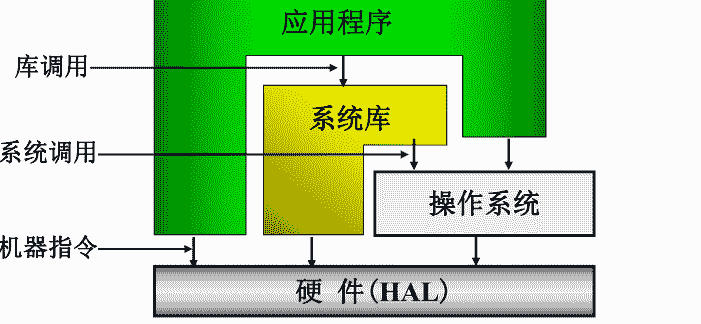

#### 1.1.2 操作系统的作用

- 管理系统中软件硬件资源
  - CPU：一个CPU, 多个可运行的程序
  - 内存：进程空间相对独立, 支持共享
  - 设备：分配, 驱动
  - 文件：实现文件系统, 支持文件操作
- 为用户(应用程序)提供良好的服务(界面)
  - API
  - GUI, 行式命令(ls, cd, cat, vi, rm, mount, ...)
  - JCL (Job Control Language)

#### 1.1.3 操作系统定义

- 操作系统是位于硬件层(HAL)之上，所有其它软件层之下的一个系统软件，是管理系统中各种软硬件资源，方便用户使用计算机系统的程序集合。


### 1.2 操作系统的历史

- 操作系统的产生
  - 手工操作阶段
  - 成批处理阶段
  - 执行系统阶段
- 操作系统的完善
  - 多道批处理系统
  - 分时系统
  - 实时处理系统
  - 通用操作系统
- 网络操作系统
- 分布式操作系统
- 多处理器操作系统
- 单用户操作系统
- 面向对象操作系统
- 嵌入式操作系统
- 智能卡操作系统

Evolution

#### 1.2.1 操作系统的产生

#### 一、手工操作阶段（20世纪40年代，无操作系统）

作业处理步骤：

- (1) (程序、数据)→穿孔机→纸带；
- (2) 穿孔纸带→光电机→机器内存；
- (3) 控制台开关启动第一条指令
  （出错时显示地址，修改指令）；
  （如有输入需要安装数据纸带）
- (4) 运行结果在电传打字机上输出。

缺点：

- (1)资源独占；(2)手工费时。


#### 例子

- 一个作业在1000次/s的机器上运行需要 1 hour，手动操作时间4min，手动时间与程序运行时间之比为1:15；
- 如果计算机速度提高到600,000次/s，同样程序运行只需6s，而手动操作时间不变，手动操作与程序运行时间之比为40:1

#### 2、批处理阶段（20世纪50年代，操作系统雏形）

##### (1) 联机批处理：

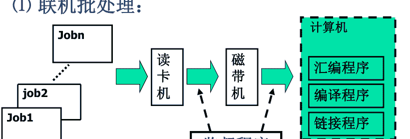

- 优点：摆脱了人工干预（作业过渡没有人的干预，一个作业处理过程没有人的干预）
- 缺点：I/O操作慢，主机等待时间长

##### (2) 脱机批处理：

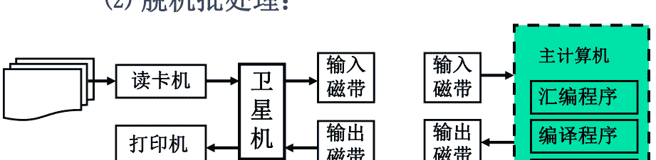

- 优点：减少了主机等待I/O操作时间
- 缺点：(1)人工搬动磁带；(2)额外的卫星机

#### 3、执行系统阶段（20世纪60年代初期）

通道：专门用于控制I/O设备的处理机，即I/O处理机。

- 有自己的指令系统和运控部件；
- 与主机共享内存；
- 接受主CPU委托执行通道程序，完成I/O；
- 通道I/O操作与主CPU并行；
- 通道完成I/O时，向主机发中断请求。

操作系统的初级阶段，通道和中断技术的出现。

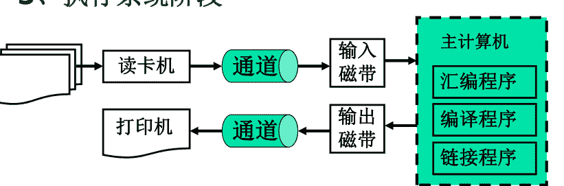

非联机，非脱机，假脱机（SPOOLing, Simultaneous Peripheral Operation On-Line）

### 1.2.2 操作系统的完善

1. 多道批处理系统（60年代初期）
   - 执行系统：单道作业，资源利用不充分；
   - 多道批处理：主机中同时放多个作业，最大限度提高资源利用率；
     - 单道到多道：不是量的变化，是质的飞跃
     - 带来问题：互斥、同步、通讯、死锁、饥饿、饿死
     - 多道批处理出现，标志操作系统走向成熟
2. 分时系统（60年代初、中期）
   - 程序员提出：联机操作的要求；
   - 一台主机，多个终端，交互式工作。
3. 实时系统（60年代中期）
   - 背景：计算机应用领域扩大：（工业控制、医疗控制、航班订票等）。
   - 要求：满足时间约束条件
4. 通用操作系统（60年代后期）
   - 上述三类系统的结合，标志操作系统完善。

### 1.2.3 操作系统的发展

1. 计算机体系结构由集中向分散的发展，出现了计算机网络，由此产生网络操作系统和分布式操作系统；
2. 随着家用和商用微型计算机的普及，出现了单用户多任务的操作系统；
3. 大型计算任务要求计算机系统具有极强的计算和处理能力，产生了支持多处理器的并行操作系统；
4. 随着各种处理器芯片和存储介质在控制领域的广泛应用，出现了微内核(micro kernel)操作系统体系结构，产生了嵌入式和智能卡操作系统；
5. 随着后摩尔时代的到来，提高单处理器速度已近极限，多核技术应运而生。新一代操作系统遇到的问题：多核的并发控制；多核下的进程调度。


### 1.3 操作系统特性

- 并发性
  - 多个程序在宏观上同时向前推进
  - 并发(concurrent) vs. 并行 (parallel)
    - 用户程序与用户程序并发
    - 用户程序与OS并发
    - OS与OS并发
- 共享性
  - 多个程序共用系统中的各种软硬件资源
  - 在操作系统的协调和控制下
- 异步性（随机性）
  - 多个程序以不可预知的速度向前推进
- 虚拟性
  - 把一个实的CPU改造为多个虚的CPU
  - 内存+外存→虚存
  - 独占设备+共享设备→虚拟设备(数量多,速度快)

### 1.4 操作系统类型

- 多道批处理操作系统(batch processing system)
- 分时操作系统(time-sharing system)
- 实时操作系统(real time system)
- 通用操作系统(multi-purpose system)
- 单用户操作系统(single user system)
- 网络操作系统(network operating system)
- 分布式操作系统(distributed operating system)
- 多处理机操作系统(multi-processor system)
- 嵌入式操作系统(embedded operating system)
- 多媒体操作系统(multi-media operating system)
- 智能卡操作系统(smart-card operating system)

#### 1.4.1 多道批处理系统(off-line)

作业 (Job): 程序 + 数据 + 说明书 (JCL编号)

结果: 程序运行结果 + 记账信息

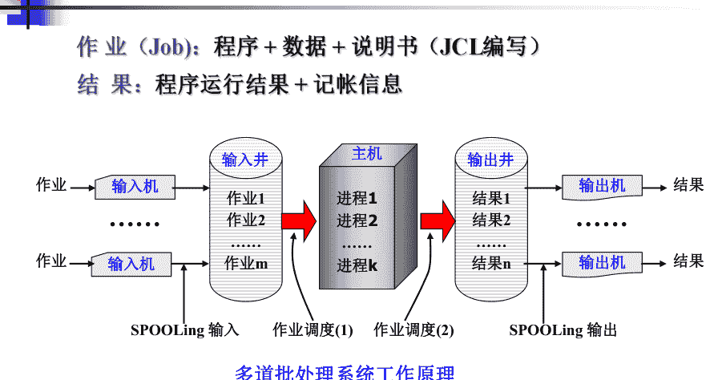

- 输入井作用
  - 缓冲(速度匹配作用)
  - 实现作业调度(job scheduling)
- 输出井作用
  - 缓冲(速度匹配作用)


- 主机中作业合理搭配
  - 目标1: 提高资源利用率(eg. 计算型+IO型)
  - 目标2: 提高吞吐量(throughput)
- 特点
  - 多道: 系统中同时容纳多个作业
  - 成批: 作业分批进入系统

#### 1.4.2 分时操作系统（On-line）

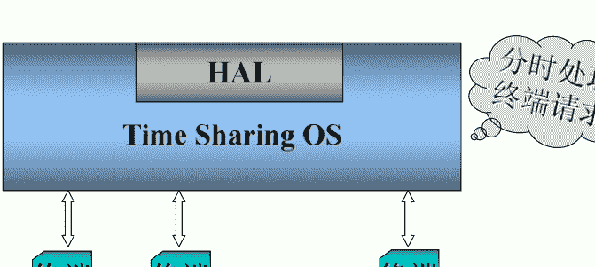

界面1：交互式命令语言(eg. shell, command)

界面2：图形用户界面(GUI)

- 特点:
  - 多路性：一个主机与多个终端相连；
  - 交互性：以对话的方式为用户服务；
  - 独占性：每个终端用户仿佛拥有一台虚拟机。
- 典型系统:
  - CTSS(MIT)
  - Multics (MIT)
  - UNIX

#### 1.4.3 实时操作系统

##### 实时控制

- 工业控制，军事控制，医疗控制，……

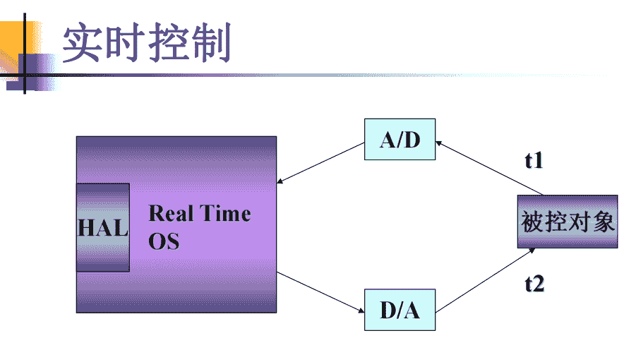

t2-t1: response time

##### 实时信息处理

- 航班订票，联机情报检索，……


通常为远程终端

- 特点:
  - (1) 响应及时 (prompt response)
  - (2) 可靠性高 (high reliability)

#### 1.4.4 通用操作系统(multi-purpose OS)

- 同时具有：分时、实时、批处理功能。
- 目标:
  - 提高处理能力;
  - 扩展应用领域。
- 常见模式:
  - 分时(前台)+批处理(后台)（eg. DPS/8上的GCOS-8）
  - 实时(前台)+批处理(后台）


#### 1.4.5 单用户操作系统

- 同一时刻仅有一个用户使用的系统
- 应用领域:
  - 台式机，笔记本，……
- 特点:
  - 单用户，多进程，多线程

不同的程序，不同的进程；
相同的程序，不同的线程

#### 1.4.6 网络操作系统(Network OS)

建立在宿主操作系统之上，提供网络通讯、网络资源共享、网络服务的软件包。

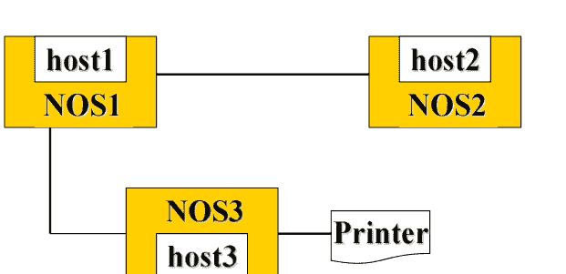

##### 网络操作系统的目标

- 相互通讯
- 资源共享（信息，设备）
- 提供网络服务
  - database server
  - ftp server
  - e-mail server
  - telnet server
  - etc.


#### 1.4.7 分布式操作系统(Distributed OS)

- 紧耦合：(tightly coupled)
  - 由多机系统发展而来（多CPU）
  - 有公共内存
  - 多处理机操作系统

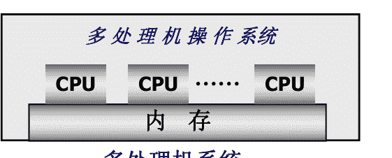

- 松散耦合：(loosely coupled)
  - 由计算机网络发展而来（多Host）
  - 无公共内存，无公共时钟

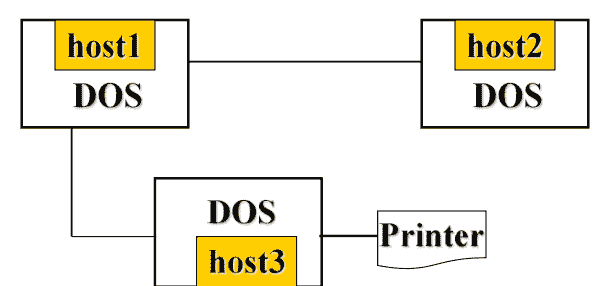

- 分布式操作系统特征:
  - 统一的操作系统
  - 资源的进一步共享
    - 内存, CPU
  - 可靠性
  - 透明性

- 目标：进一步共享资源，使负载均衡，计算加速。
  - CPU
  - 内存
- 途径：迁移（migration）
  - 作业迁移
  - 进程迁移（线程一般随同进程迁移）
- 例子：
  - Solaris MC

#### 1.4.8 多处理机操作系统

- 多处理机系统
  - 具有公共内存的多CPU系统
- 对称多处理机系统(SMP-symmetric multi-processor)
  - 没有主从关系的多处理机系统
- 多处理机操作系统
  - 有效管理和使用多个CPU的操作系统
  - 特点: 进程与CPU多对多
  - 新问题:
    - (1) 调度问题； (2) 并发控制问题
- 例子:
  - UNIX, Linux, Windows

#### 1.4.9 嵌入式操作系统

- 嵌入在掌上电脑、通讯设备、车载系统、信息家电等非计算机类设施上的操作系统。
- 特点：微内核结构（Micro-kernel），许多操作系统功能(文件系统,设备驱动)以应用程序模式运行。
  - 核心小(基本内存管理,CPU管理,通讯程序), 适应范围广, 可靠性高
  - 效率低
- 例子：
  - Win CE .NET（维纳斯, 美国微软）
  - PalmOS
  - HOPEN（女娲, 中科院钟锡昌）


#### 1.4.10 多媒体操作系统

##### 定义(百度百科)

- 具有一般操作系统功能;
- 还具有多媒体底层扩充模块，支持多媒体信息的采集、编辑、播放和传输。

##### Remarks

- 不是一种独立的操作系统类型
- 是现代操作系统的一种特性
- 目前许多操作系统开始支持多媒体


#### 1.4.11 智能卡操作系统

- 智能卡
  - CPU芯片
  - ROM
- 面向Java的智能卡
  - JVM解释程序
  - 下载Java applet并执行
- SC-OS
  - 支持多个applet并发执行
  - 必要的资源管理

### 1.5 操作系统运行环境

- 定时装置
- 系统栈
- 特权指令与非特权指令
- 处理机状态及状态转换
- 地址映射机构
- 存储保护设施
- 中断装置
- 通道与DMA控制器
- I/O保护

#### 1.5.1 定时装置

- 绝对时钟：记载实际时间，不发中断。
  - 系统操作员可以修改
  - 一般用户使用
- 间隔时钟：定时发生中断，一般间隔单位为“毫秒”。
  - 间隔时钟是实现多道程序的基础—保证操作系统获得控制权。
  - 其它中断也进入操作系统，但是是否发生，何时发生没有保障。

#### 1.5.2 系统栈(system stack)

- 作用
  - 保存中断现场
  - 保存函数调用返回点、参数、局部变量、返回值
- 数量
  - 每个进程一个
- 位置
  - 操作系统区域
  - UNIX: ppda(user, 系统栈)
    - 操作系统最高页(第7页,共8页)是运行进程的ppda


#### 1.5.3 特权指令与非特权指令

- 特权指令（privileged instruction）
  - 只有在管态才能执行的指令(影响系统状态)
    - 关中断，置程序状态字，停机，I/O， ……
- 非特权指令（non-privileged instruction）所有程序可用(不影响系统状态)
  - 取数，四则运算， ……

#### 1.5.4 处理机状态及状态转换

- 处理机状态
  - 系统态（system mode）(管态，核态)
  - 用户态（user mode）(目态，常态)
- 状态转换
  - 管态 ⇒ 目态(置程序状态字,特权指令)
  - 目态 ⇒ 管态(中断， trap)

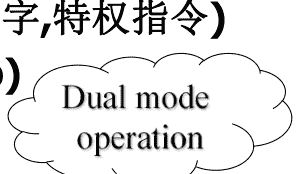

#### 例子：

- IBM 360/370 PSW 状态位(第15位)
  - 0:系统态
  - 1:用户态
- Modern PC now support 4 modes:
  - R0（权限最强）
  - R1
  - R2
  - R3（权限最弱）


#### 1.5.5 地址映射机构

- 逻辑地址⇒ 物理地址
  - 逻辑地址(虚地址)：程序中产生的地址
  - 物理地址(实地址)：存储器地址


#### 1.5.7 中断装置

- 发现并响应中断的硬件机构
  - 当前（PSW，PC）⇒系统栈
  - 中断向量（PSW，PC）⇒寄存器

#### 1.5.8 通道与DMA

- 通道：负责I/O操作的处理机
  - 通道指令系统
    - 读写操作
    - 控制操作
    - 转移操作
  - 通道运控部件
    - 通道地址字CAW
    - 通道命令字CCW
    - 通道状态字CSW
    - 通道数据字CDW
- DMA?
  - 没有独立指令系统
  - 简单块传输


#### 1.5.9 I/O保护

- 定义所有I/O指令为特权指令。
  - 方便使用
  - 防止发生冲突

### 1.6 操作系统界面形式

#### 交互终端命令（Command Language）

- Eg. UNIX shell
- $命令名 -选项 参数

#### 图形界面（GUI—Graphic User Interface）

##### UNIX shell interface

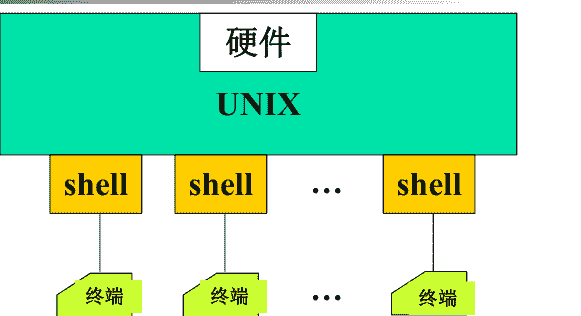

优点：
- 缩小核心
- 不同用户可以选择不同界面

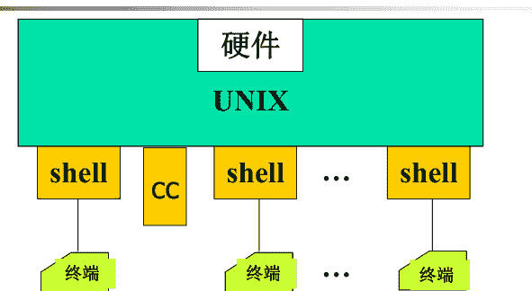

```
$cc f.c
```

- cc与shell都属于目态进程
- 二者具有父子关系

#### 作业控制语言（Job Control Language）

- 作业标识语句
  - 用户标识，作业标识，帐号
- 作业步语句(编译、连接装配、执行)
  - 一般对应子进程
- 资源描述语句
  - 内存需求，计算时间，其它资源
- Goto语句（正向转移）
  - 作业控制无循环

#### 系统调用命令（OS API）

- 高级语言形式
  - fd = open(file_name,mode)
- 汇编语言形式
  - 准备参数
  - trap n
  - 取返回值


### 1.7 操作系统的运行机理

操作系统运行机理：

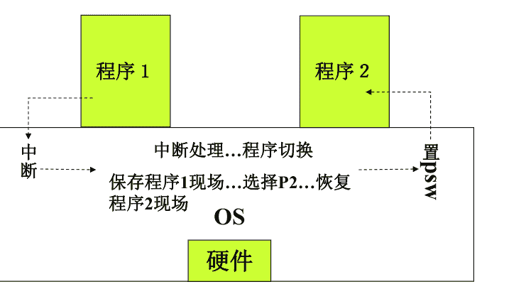

### 1.8 研究操作系统的几种观点

- 进程观点
  - 支持进程
  - 支持进程之间的协同(互斥、同步、通讯)
- 资源管理观点
  - 操作系统是资源管理者
    - 方便使用
    - 防止冲突
- 虚拟机观点
  - 对硬件的第一次扩充
  - 提供虚拟资源
    - 单个实的CPU→多个虚拟CPU
    - 内存+外存→虚拟存储
    - 独占设备+共享→虚拟设备

### 1.9 系统举例

- Linux系统
- Windows系统

#### 1.9.1 Linux系统

**历史**

- **1991, 0.01版**
  - 运行于Intel 80386，仅支持Minix文件系统，支持有限的设备驱动程序，无网络支持。
- **1994, 1.0版**
  - 支持UNIX标准TCP/IP协议，BSD兼容的socket网络通讯协议，增强的文件系统，SCSI控制器对文件的高效访问，以及其它设备驱动程序。
- **1995, 1.2版**
  - 最后一个仅在PC平台上运行的Linux。
- **1996, 2.0版**
  - 运行于多种平台，支持对称多处理，同时增强了存储管理功能，支持核心级线程，模块动态连接等。可运行于Sun Sparc, PowerMac等硬件平台。

**Linux特点：**

- 源代码开放、免费
- 系统稳定可靠；
- 速度快，效率高；
- 内核模块化好，允许第三方配置文件系统及设备管理程序；
- 功能完善；
- 具有网络支持优势；
- 标准化好.

#### 1.9.2 Windows2000/XP 系统

基于NT技术构建的面向个人计算机平台的操作系统，本质上属于单用户系统，但可以组网并提供网络服务。

- 具有多任务(包括多进程、多线程)管理功能，支持对称多处理
- 支持客户/服务器计算模式
- 在设计上大量采用了面向对象思想，提供友好的图形操作界面
- 不是“纯”的微内核结构，许多系统服务功能已被放入核心

# 第二章 进程、线程与作业

- 2.1 多道程序设计
  - Multi-programming
- 2.2 进程的引入
  - Process
- 2.3 线程与轻进程
  - Thread and light-weighted process
- 2.4 作业
  - Job


### 2.1 多道程序设计

- 2.1.1 单道程序设计的缺点
- 2.1.2 多道程序设计的提出
- 2.1.3 多道程序设计的问题


#### 多道程序设计目标

- ■ 提高系统效率(吞吐量)

吞吐量 = 作业道数
全部处理时间

#### 2.1.1 单道程序设计的缺点

- 处理机利用率低
- 设备利用率低
- 内存利用率低

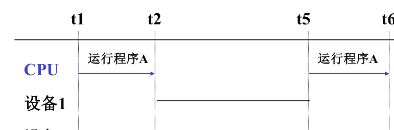

#### 2.1.2 多道程序设计的提出

- 提高处理机、设备、内存等各种资源的利用率，从而提高系统效率。

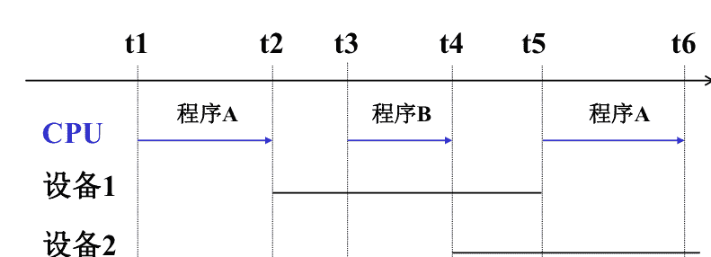

#### 2.1.2 多道程序设计的提出(Cont.)

- 增加同时运行程序的道数可以提高资源利用率，从而提高系统效率，但道数应与系统资源数量相当。
- 道数过少，系统资源利用率低。
- 道数过多，系统开销(system overhead)增大，程序响应速度下降。

#### 2.1.3 多道程序设计的问题

- 处理机资源的管理
  - 程序个数>处理机个数(如何分配?)
- 存储资源的管理
  - 地址空间的相对独立性、共享性
  - 内存、外存(swap space)的分配与去配
- 设备资源管理
  - 分配策略
  - IO控制

### 2.2 进程的引入

- 2.2.1 进程的概念
- 2.2.2 进程状态及状态转换
- 2.2.3 进程控制块
- 2.2.4 进程的组成与上下文
- 2.2.5 进程的队列
- 2.2.6 进程的类型与特征
- 2.2.7 进程间相互联系与相互作用
- 2.2.8 进程的创建与撤销
- 2.2.9 进程与程序间的联系与差别

#### 2.2 进程的引入(Cont.)

多道系统中的程序：

推进，暂停，推进，暂停，……

暂停：保存现场(PSW+PC，寄存器)

推进：恢复现场(寄存器，PSW+PC)

暂停原因：(1)自身原因：等待资源，启动IO

(2)剥夺CPU—给其它程序运行机会

#### 2.2.1 进程的概念

定义：
- 可参与并发执行的程序称为进程。
- 进程是具有一定独立功能的程序关于一个数据集合的一次运行活动。

定义强调两个方面：
- 动态：执行中的程序；
- 并发：可与其他进程同时执行。

#### 并发 vs. 并行

- 并发： **concurrent**
  - 宏观同时，“交替执行”，不要求多个CPU
- 并行： **parallel**
  - 微观同时，要求多个CPU
  - “并行算法”

#### 2.2.2 进程状态及状态转换

- 2.2.2.1 进程状态(基本状态)
  - 运行态(RUN): 占有CPU正在向前推进
  - 就绪态(READY): 可以运行，但未得到CPU
  - 等待态(WAIT): 等待某一事件发生
- 2.2.2.2 状态转换
  - 就绪⇒运行：获得处理机
  - 运行⇒就绪：剥夺处理机
  - 运行⇒等待：申请资源未得到，启动IO
  - 等待⇒就绪：得到资源，IO中断

##### 2.2.2.2 进程状态转换图

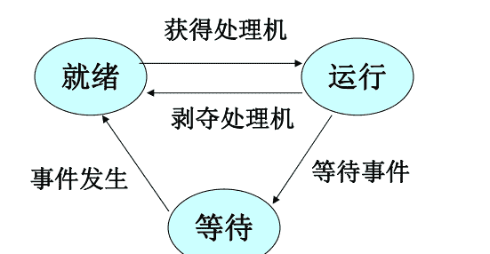

- 进程状态转换由操作系统完成，对用户是透明的；
- 进程在其生存期内经过多次状态转换，体现了进程的动态性和并发性。

#### 2.2.3 进程控制块(PCB)

- 标志进程存在的数据结构，其中保存系统管理进程所需的全部信息

- **PCB内容:** (不同系统不尽相同)
  - 进程标识(pid)          家族联系
  - 进程状态              地址信息
  - 现场信息              打开文件
  - 调度参数              消息指针
  - 所属用户(uid)         队列指针


#### 2.2.4 进程的组成与上下文

- 进程的组成
  - 进程控制块(process control block)
    - 建立进程⇒建立PCB
    - 撤销PCB⇒撤销进程
  - 程序
  - 代码(code)
  - 数据(data)
  - 堆栈(stack+heap)
    - 栈：保存返回点、参数、返回值、局部变量
    - 堆：动态变量

#### 2.2.4 进程的组成与上下文

- 进程的表记

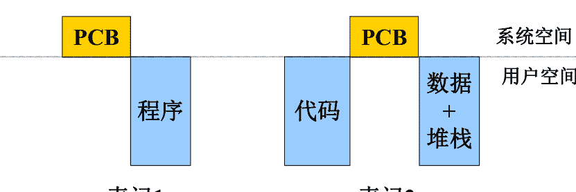

定义：进程的程序(代码和数据)称为进程映像(Process Image)。

#### 2.2.4 进程的组成与上下文

- 进程上下文（process context）
  - 进程的物理实体与支持进程运行的物理环境统称为进程上下文
    - PCB+程序
    - 系统环境：地址空间，系统栈，打开文件表，...
- 上下文切换（context switch）
  - 由一个进程的上下文转到另外一个进程的上下文
- 系统开销（system overhead）
  - 运行操作系统程序完成系统管理工作所花费的时间和空间

#### 2.2.5 进程的队列

PCB构成的队列：（不一定FIFO，单向或双向）

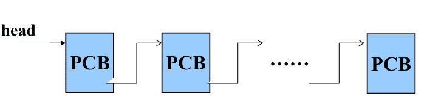

- 1. 就绪队列：系统一个或若干个（根据调度算法确定）
- 2. 等待队列：每个等待事件一个
- 3. 运行指示字：每个处理机一个

#### 进程队列模型

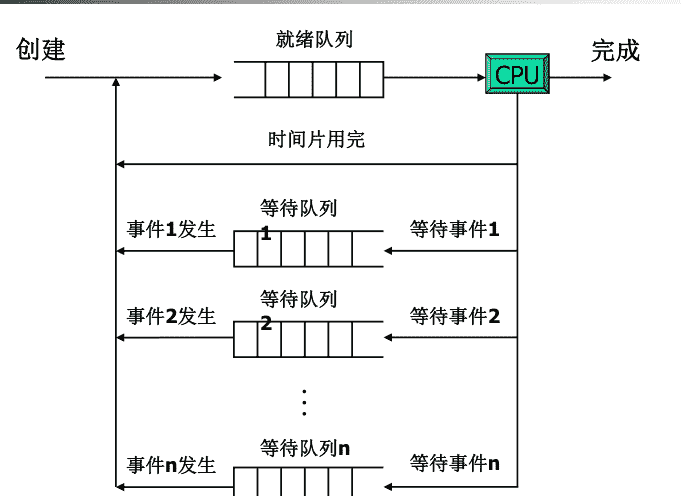

#### 2.2.6 进程的类型与特征

- 进程类型
  - 系统进程
    - 运行操作系统程序，完成系统管理(服务)功能。
    - 例如： UNIX #0 -- sched, #1 -- init
  - 用户进程
    - 运行用户(应用)程序，为用户服务。
    - 例如： UNIX vi, shell, cc

#### 2.2.6 进程的类型与特征(Cont.)

#### 进程的特征

- 并发性：可以与其它进程一道向前推进；
- 动态性：动态产生、消亡，生存期内状态动态变化；
- 独立性：一个进程是可以调度的基本单位；
- 交往性：同时运行的进程可能发生相互作用；
- 异步性：进程以各自独立，不可预知的速度向前推进；
- 结构性：每个进程有一个PCB。

#### 2.7 进程间相互联系与相互作用

- 相互联系
  - 相关进程
    - 同一家族的进程
    - 可以共享文件，需要相互通讯，协调推进速度...
    - 父进程可以监视子进程，子进程完成父进程交给的任务。
  - 无关进程
    - 没有逻辑关系、同时执行的进程。
    - 有资源竞争关系，互斥、死锁、饿死。

#### 2.2.7 进程间相互联系与相互作用

相互作用

1. 直接相互作用：发生在相关进程之间

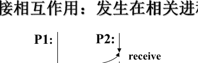

2. 间接相互作用：发生在任何进程之间

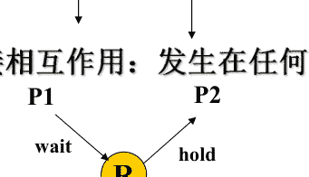

#### 2.2.8 进程的创建与撤销

- 进程的创建
  - 建立PCB，分配内存，加载程序，入就绪链
  - UNIX: pid=fork(), execl(prog,args)
- 进程的撤销
  - 去配资源，撤销PCB，通知父进程
  - UNIX: exit() vs. kill
- 除初始进程外，其它进程由(父)进程创建，并形成进程家族。


#### UNIX有关进程的系统调用命令

- 相关系统调用
  - 创建子进程
    - Pid = fork()
      - 子进程是父进程的复制品
      - 返回值: 父进程为子进程编号, 子进程为0
  - 加载并执行新程序
    - execl(prog, arg0,...,argn-1,0)
    - 以arg0,...,argn-1为参数执行prog
    - 覆盖原来程序, 从第一条指令开始执行

#### UNIX有关进程的系统调用命令

- 进程自我结束
  - **exit(status)**
    - **Status**为终止状态
    - 唤醒父进程
- 等待子进程终止
  - **pid=wait(&status)**
    - 返回终止子进程编号
    - 参数为子进程的终止状态

#### 2.2.8 进程的创建与撤销

```
# include <stdio.h>
void main ( int argc, char * argv[] )
{ int pid;
pid=fork ( );
if ( pid < 0 ) { printf ( stderr, " fork failed" );
exit (-1 ); }
else if ( pid ==0 ) { execl ("/ bin /1s" , " 1s" , null );}
else { wait (null);
print ("child complete");
exit (0 );}
```

#### fork() 创建子进程

proc结构
p_pid=9
p_ppid=5
user结构

proc结构
p_pid=12
p_ppid=9
user结构

联系

恒为0

```
pid = fork();
if(pid == 0) /*不成立*/
{
    /*子进程代码*/
}else{
    /*父进程代码*/
}
...
```

```
pid = fork();
if(pid == 0) /*成立*/
{
    /*子进程代码*/
}else{
    /*父进程代码*/
}
...
```

子进程号
(>0整数)

复制

父进程

子进程

#### exec() 加载并执行新程序

proc结构
p_pid=9
p_ppid=5
user结构

proc结构
p_pid=12
p_ppid=9
user结构

```
pid=fork();
if(pid ==0) /*不成立*/
{
 exec("P",0);
}
}else{
 /*父进程代码*/
}
...
```

```
pid=fork();
if(pid ==0) /*成立*/
{
 exec("P",0);
}
}else{
 /*父进程代码*/
}
...
```

父进程

子进程

#### execl() 加载并执行新程序

proc结构
p_pid=9
p_ppid=5
user结构

proc结构
p_pid=12
p_ppid=9
user结构

```
pid=fork();
if(pid==0) /*不成立*/
{
    execl("P",0);
}else{
    /*父进程代码*/
}
...
```

程序P（覆盖原来程序）

父进程

子进程

#### exit() 进程自我终止

proc结构
p__pid=9
p__ppid=5
user结构

proc结构
p__pid=12
p__ppid=9
user结构

```
pid=fork();
if(pid==0) /*不成立*/
{
    execl("P",0);
}else{
    /*父进程代码*/
    id=wait(&s)
}
...
```

程序P（覆盖原来程序）
exit(2)

父进程

子进程

#### 2.2.8 进程的创建与撤销

- 在 UNIX 系统中通过系统调用 fork 可创建新进程。
  - 新进程由原来进程的地址空间的复制组成, 这种机制利于父进程与子进程方便进行通信。
  - 两个进程都继续执行位于系统调用 fork 之后的指令
    - 新进程返回值为 0
    - 父进程返回值为子进程的进程标识符（一个非 0 正整数）。

#### 2.2.8 进程的创建与撤销

- 在**UNIX**系统中通常在系统调用**fork**之后，新进程会使用系统调用**exec1**，来加载新程序。
- **windows NT**操作系统支持两种方式
  - 父进程地址空间可以被复制
  - 或者父进程可以在创建进程时就提供程序名让操作系统把新程序直接装入新进程的地址空间。

例子：设有8个程序，执行次序如下图所示，试用 fork,execl,wait,exit系统调用描述之。

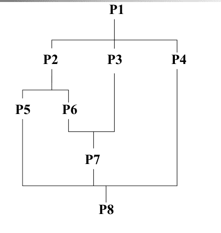

```
main()
{
    int pid1,pid2,pid3,pid4,pid5,pid6,pid7,pid8;
    int end_p1=end_p2=end_p3=end_p4=end_p5=...=end_p8=0;
    int pid, status;

    if((pid1=fork())==0) execl("P1",0);
    wait(&status);
    if((pid2=fork())==0) execl("P2",0);
    if((pid3=fork())==0) execl("P3",0);
    if((pid4=fork())==0) execl("P4",0);
    do{    //等待P2结束
        pid=wait(&status);
        if(pid==pid2) end_p2=1;
        if(pid==pid3) end_p3=1;
        if(pid==pid4) end_p4=1;
    }while(end_p2==0);
```

```
if((pid5=fork())==0) execl("P5",0);
if((pid6=fork())==0) execl("P6",0);
do{    //等待P3和P6结束
    pid=wait(&status);
    if(pid==pid3) end_p3=1;
    if(pid==pid4) end_p4=1;
    if(pid==pid5) end_p5=1;
    if(pid==pid6) end_p6=1;
}while(end_p3==0||end_p6==0);
if((pid7=fork())==0) execl("P7",0);
do{    //等待P4,P5,P7结束
    pid=wait(&status);
    if(pid==pid4) end_p4=1;
    if(pid==pid5) end_p5=1;
    if(pid==pid7) end_p7=1;
}while(end_p4==0||end_p5==0||end_p7==0);
if((pid8=fork())==0) execl("P8",0);
wait(&status);
exit(0);
}
```

#### vfork 与 fork

fork 功能

- 复制地址空间(code+data+stack)
- 复制控制结构(proc,user)

- 特点
  - 父子进程之间有两个各自独立的数据拷贝

- 问题
  - 不加载新程序
    - 不能实现数据共享，不能描述诸如 “有界缓冲区” 问题
  - 若加载新程序
    - 复制没有意义，浪费时间和空间

#### vfork与fork

- **vfork**
  - 只复制控制结构(proc+user);
  - 不复制地址空间(code+data)
    - 父子进程共享地址空间
- **使用**
  - 父进程使用 **vfork** 创建子进程;
    - 子进程与父进程共享地址空间;
    - 子进程使用 **execve** 改变其虚拟地址空间.

#### 考虑生灭的进程状态转换图

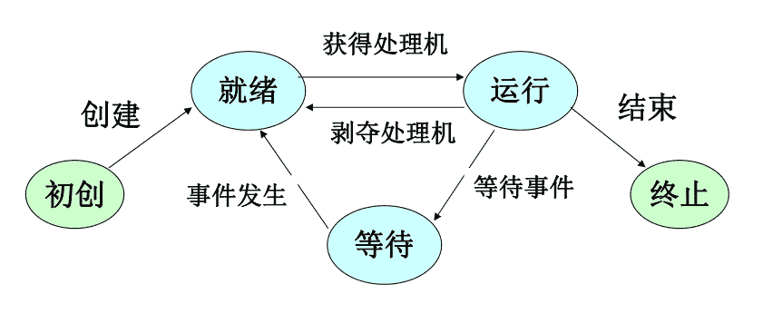

#### 2.2.9 进程与程序的联系与差别

- 进程与程序的联系
  - 进程包括一个程序
  - 进程存在的目的就是执行这个程序
- 进程与程序的差别
  - 程序静态，进程动态
  - 程序可长期保存，进程有生存期
  - 一个程序可对应多个进程，一个进程只能执行一个程序


### 2.3 线程与轻进程

- 2.3.1 线程的引入
- 2.3.2 线程的概念
- 2.3.3 线程的结构
- 2.3.4 线程控制块
- 2.3.5 线程的实现
- 2.3.6 线程的应用
- 2.3.7 Java线程

#### 2.3.1 线程的引入

- 进程切换
  - 上下文涉及内容多，开销大，“笨重”
    - PCB+程序
    - 系统环境：地址空间，系统栈，打开文件表，
  - 相关进程之间耦合关系差
- 解决方案
  - **Multi-threading**
  - 同一进程中包含多个线程
  - 上下文只涉及寄存器和用户栈，切换速度快
  - 相关线程之间通讯方便、快捷

#### 2.3.2 线程的概念

- 进程中一个相对独立的执行流。
- 进程 vs.线程
  - 进程是资源分配单位
  - 线程是执行单位
- 多线程优点
  - 切换速度快（地址空间不变） (light weighted)
  - 系统开销小
  - 通讯容易（共享数据空间）

#### 2.3.3 线程结构

多进程结构（用户视图）

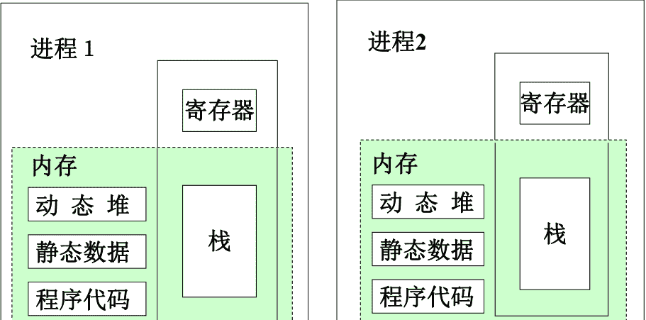

#### 2.3.3 线程结构

多线程结构（用户视图）

进程

内存

动态堆

静态数据

程序代码

线程1:

寄存器

栈

线程2:

寄存器

栈

#### 2.3.3 线程结构（另一种表示）

Task:

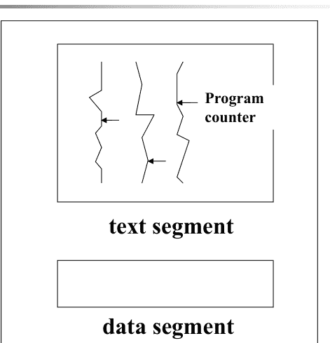

Program counter

text segment

data segment

#### 2.3.4 线程控制块

- **TCB（Thread control block）**
  - 标志线程存在的数据结构，其中包含对线程管理需要的全部信息。
- **内容**
  - 线程标识
  - 线程状态
  - 调度参数
  - 现场(通用寄存器,PC,SP)
  - 链接指针
- **存放位置**
  - 用户级线程：目态空间（运行时系统）
  - 核心级线程：系统空间

#### 2.3.5 线程的实现

- 2.3.1 用户级别线程
  - User-level thread
- 2.3.2 核心级别线程
  - Kernel-level thread
- 2.3.3 混合线程
  - Hybrid approach

##### 2.3.5.1 用户级别线程

- 实现方法:
  - 基于library函数，系统不可见
  - 线程创建、撤销、状态转换在目态完成
  - TCB在用户空间，每个进程一个系统栈
- 优点:
  - 不依赖于操作系统，调度灵活
  - 同一进程中多线程切换速度快(不需进入操作系统)
- 缺点:
  - 同一进程中多个线程不能真正并行
  - 一个线程进入系统受阻，进程中其它线程不能执行

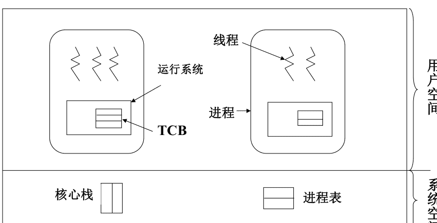

##### 2.3.5.2 核心级别线程

- 实现方法:
  - 基于系统调用
  - 创建、撤消、状态转换由操作系统完成
- 优点:
  - 同一进程内多线程可以并行执行
  - 一线程进入核心等待，其它线程仍可执行
- 缺点:
  - 系统开销大，同一进程内多线程切换速度慢
  - 调度算法不能灵活控制

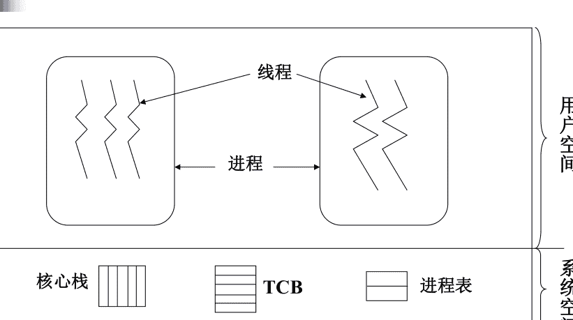

##### 2.3.5.3 混合线程

- Solaris例子
- User level thread:
  - 由Lib程序支持（创建,调度）
- Light weighted process(LWP):
  - 由Lib程序支持
  - 每个task至少一个LWP
  - 用户级别线程与LWP可以多对多
  - LWP对操作系统可见
  - 只有与LWP相联系的用户线程向前推进
- Kernel level thread:
  - 由kernel 支持
  - 每个LWP与唯一一个核心线程对应
  - 核心线程可与CPU多对多，可多对一

##### 2.3.5.3 混合线程(Solaris)

task1

task2

task3

User level thread

Kernel thread

Lightweight process

kernel

CPU

#### 2.3.6 线程的应用

- 内在的多控制流,需要共享数据
  - 生产—消费问题
- 多线程优于多进程
  - 快100倍!
- 提高处理机与设备的并行性
- 多处理机环境
  - 提高处理机利用率，加快进程推进速度

#### 2.3.6 线程的应用

- 例子：
  - **Word字处理（不同代码）**
    - 交互编辑(T1)
    - 语法检查(T2)
    - 定时保存(T3)
  - **HTTP server（相同代码）**
    - 对每个http请求，pop up一个线程

### 2.4 作业（Job）

- 作业概念
  - 用户要求计算机系统为其完成的计算任务集合。
- 作业步（job step）
  - 作业处理过程中一个相对独立的步骤
  - 一般一个作业步可由一个进程完成
  - 某些作业步之间可以并行
- 作业分类
  - 批处理作业
  - 交互式作业
- 作业控制块JCB
  - 作业名称、作业状态、调度参数、资源需求、相关进程、作业长度、在输入井或输出井的位置、记账信息

#### 2.4.1 批处理作业

- 作业控制语言(JCL)
  - 描述批处理作业控制意图的语言
- 作业说明书(JCL语句的序列)
  - 一般以特殊符号起始
    - $JOB J1
    - $FORTN ...
    - $LINK ...
    - $EXEC ...
    - $ENDJOB
- 作业控制程序
  - 解释并处理作业说明书的程序
- 作业控制进程
  - 执行作业控制程序的进程

作业控制进程

读入作业内容

释放输入井空间

顺取作业控制语句

是结束语句

F

T

执行该作业步
(可能创建子进程)

申请输出井空间

输出作业结果

进程自我终止

#### 2.4.2 交互式作业

- 帐户管理
  - /etc/passwd文件
  - (用户名,口令,用户根目录,同组用户,余额...)
- 创建与撤销
  - 创建：
    - 用户提供（用户名,口令,资金）
    - 系统操作员建立（根目录/usr/zhang, 填写passwd文件）
  - 撤销：
    - 删除该用户目录及所有文件
    - 在passwd文件中清除对应entry

#### 2.4.2 交互式作业

- 注册与注销
  - 注册：
    - logon: 用户名
    - password: ********
  - （使用）
  - 注销：
    - 显式注销：
      - logoff
    - 隐式注销：
      - （如5分钟无输入命令）

命令解释程序

提示符$

读入终端命令

分析

Logout

内部命令

记帐

处理

建立子进程

后台命令

等子进程结束

输出子进程号

小结：作业、进程、线程

- 作业与进程
  - 作业进入内存后变为进程
  - 一个作业通常与多个进程相对应
- 进程与线程
  - 一个进程一般包含多个线程，至少包含一个线程
  - 不支持多线程的系统，可视为单线程进程


#### 2.5.1 Java线程

- Java线程四种基本状态
  - New: 新建的线程
  - Runnable: 可运行状态
  - Blocked: 封锁状态
  - Dead: 终止状态

Java线程状态之间的转换关系图

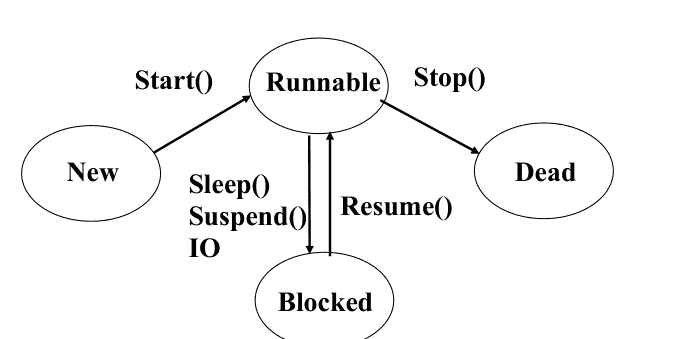

#### JAVA线程与JVM

- **Java线程是由Java虚拟机JVM支持的**
- **JVM位于操作系统之上**
- **Java线程与操作系统线程之间的对应关系由JVM确定**
  - 对于**Windows NT**的JVM，Java线程与操作系统线程具有一对一关系；
  - 对于**Solaris**的JVM，其对应关系为多对多

#### 2.5.2 Linux进程与线程

- 进程与线程在系统内部具有统一的表示
- 进程与线程的差别通过与fork不同的另外一个系统调用clone体现出来
- Clone系统调用的形式
  - pid = clone(function, stack_ptr, sharing_flag, arg)
  - Sharing-flag:
    - CLONE_VM, CLONE_FILES, CLONE_SIGHAND, CLONE_PID

#### 2.5.3 Windows2000/XP 进程、线程与纤程

- 进程
  - 在Win32环境中创建进程的过程
    - 当Win32应用执行CreateProcess调用，消息被发给Win32子系统，后者调用进程管理器创建进程，进程管理器调用OM创建进程对象，然后返回对象句柄给Win32。Win32子系统再次调用进程管理器为该进程创建线程，最后Win32将句柄返给新进程和线程

#### 进程对象描述图

| 类别 | 内容 |
|---|---|
| 对象头部属性 | Type: Process |
| 对象体属性 | 进程标识（Process id）<br>访问令牌（Access token）<br>基础优先级（Base priority）<br>缺省亲和处理机（Default processor affinity）<br>配额限制（Quota limits）<br>执行时间（Execution time）<br>输入输出计数（I/O counters）<br>异常/调试端口（Exception/debugging ports）<br>退出状态（exit status） |
| 服务 | 创建进程（Create process）<br>打开进程（Open process）<br>查询进程信息（Query process information）<br>设置进程信息（Set process information）<br>当前进程（Current process）<br>终止进程（Terminate process）<br>分配释放虚拟存储（Allocate/free virtual memory）<br>读/写虚拟存储（Read/write virtual memory）<br>保护虚拟存储（Protect virtual memory）<br>加锁/开锁虚存（Lock/unlock virtual memory）<br>查询虚拟存储（Query virtual memory）<br>刷新虚拟存储（Flush virtual memory） |

#### 线程对象描述图

| 类别 | 内容 |
|---|---|
| 对象头部属性 | 类型：线程（Type: thread） |
| 属性 | 客户标识（client id）<br>线程上下文（thread context）<br>动态优先级（dynamic priority）<br>处理机亲和掩码（thread processor affinity）<br>已执行时间（thread execution time）<br>警觉状态（alert status）<br>挂起计数（suspension count）<br>模拟令牌（impersonation token）<br>终止端口（termination port）<br>终止状态（exit status） |
| 服务 | 创建线程（Create thread）<br>打开线程（Open thread）<br>查询线程状态（Query thread information）<br>设置线程状态（Set thread information）<br>当前线程（Current thread）<br>终止线程（Terminate thread）<br>取上下文（Get context）<br>置上下文（Set context）<br>挂起（Suspend）<br>恢复（Resume）<br>警示线程（Alert thread）<br>测试线程警示（Test thread alert）<br>注册终止端口（Register termination port） |

#### Windows线程状态转换图

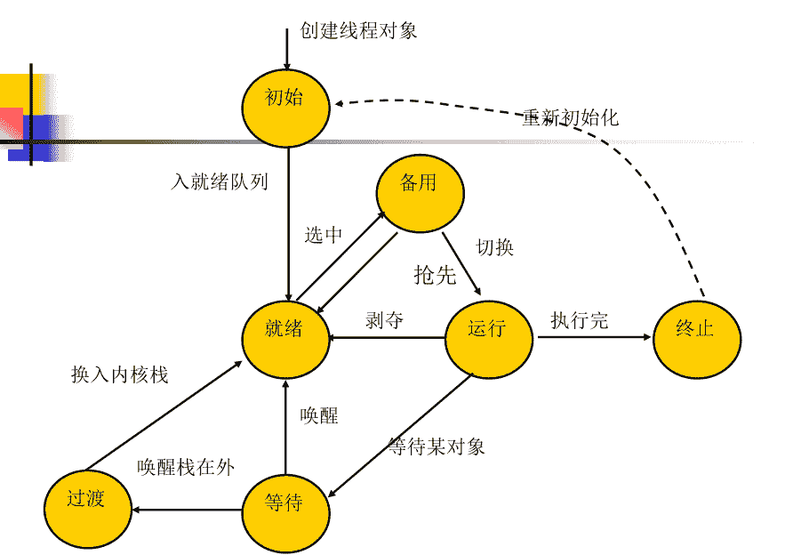

# 第三章 中断与处理机调度

- 3.1 中断与中断系统
- 3.2 处理机调度
- 3.3 调度级别与多级调度
- 3.4 实时调度
- 3.5 多处理机调度
- 3.6 系统举例

> 操作系统是中断驱动的！
> Interrupt driven

### 3.1 中断与中断系统

- 3.1.1 中断的概念
- 3.1.2 中断装置
- 3.1.3 中断处理程序

#### 3.1.2 中断装置

- 发现并响应中断的硬件机构
  - 识别中断源，当有多个中断源时，按紧迫程度排队；
  - 保存现场；
  - 引出中断处理程序。

#### 中断响应和处理的过程

PSW, PC

PSW', PC'

psw, pc

......

系统栈

OS

HAL

正运行程序

PC': 处理程序

处理程序

##### 3.1.2.1 中断源与中断字

- 中断源
  - 引起中断的事件。
- 中断寄存器
  - 保存与中断事件相关信息的寄存器。
- 中断字
  - 中断寄存器的内容。
- 例：I/O中断：设备状态寄存器。

##### 3.1.2.2 中断类型与中断向量

- 强迫性中断
  - 运行程序不期望的
    - 时钟中断
    - I/O中断
    - 控制台中断
    - 硬件故障中断
      - power failure
      - 内存校验错
  - 程序性中断
    - 越界，越权
    - 缺页
    - 溢出，除0
    - 非法指令
- 自愿性中断
  - 运行程序期望的
    - 系统调用
    - 访管指令
  - 系统调用
    - fd=open(fname,mode)
  - 访管指令
    - 准备参数
    - svc n
    - 取返回值

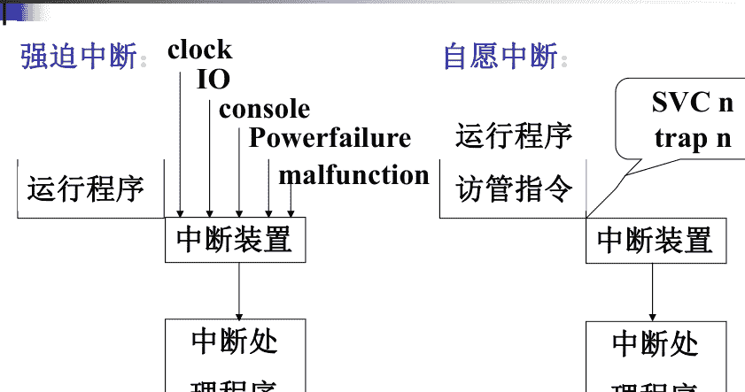

中断向量：中断处理程序的运行环境与入口地址（PSW，PC）

- 每类中断事件有一个中断向量，
- 中断向量的存放位置是由硬件规定的，
- 中断向量的内容是OS在系统初始化时设置好的。


| 地址 | 向量 | 描述 |
|---|---|---|
| 0000 | PSW1, PC1 | 时钟中断向量 |
| 0008 | PSW2, PC2 | I/O中断向量 |
| 0016 | PSW3, PC3 | console中断向量 |
| 0024 | PSW4, PC4 | 硬件故障 |
| 0030 | PSW5, PC5 | 程序错误 |
| ... | ... | ... |
| 0090 | PSWn, PCn | 访管中断向量 |

PC1: 时钟中断处理程序

PC2: I/O中断处理程序

PCn: 访管中断处理程序

系统空间

##### 3.1.2.3 中断嵌套与系统栈

一般原则：

- 高优先级中断可以嵌入低优先级中断

实现方法：

- 中断响应后立即屏蔽不高于当前中断优先级的中断源。

中断响应后一般需要进一步保存现场

- 关中断（屏蔽所有中断）
- 进一步保存现场（通用寄存器等）
- 开中断（或开放高优先级中断）
- ……
- 中断处理
- ……
- 关中断（屏蔽所有中断）
- 恢复现场
- 开中断（或开放高优先级中断）
- 中断返回


#### 3.1.2.3 中断嵌套与系统栈(Cont.)

中断嵌套：

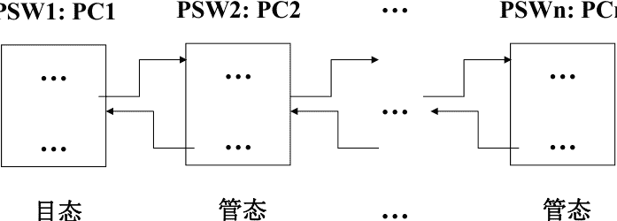

#### 3.1.2.3 中断嵌套与系统栈(Cont.)

系统栈：

栈顶指针:

......
PSWn-1 PCn-1
......
PSW2 PC2
PSW1 PC1

#### 3.1.2.4 中断优先级与中断屏蔽

- 中断优先级：
  - 硬件规定的中断响应次序，依据：
    - 紧迫程度；
    - 处理时间。
- 中断屏蔽：
  - 高优先级中断事件处理不受低优先级中断打扰；
  - 程序调整中断响应次序。

#### 3.1.3 中断处理程序

- 保存现场信息
- 取中断字
- 分析中断原因

- 保存现场信息
- 取调用号
- 分析何种系统调用

中断处理

F
需要切换进程
系统栈恢复现场
返回上层中断
或 目态程序

T
转dispatcher
保存下降进程现场到PCB
选择上升进程
由PCB恢复上升进程现场

#### 3.1.3 中断处理程序

强迫性中断
关中断
进一步保存现场到系统栈
取中断字
分析中断原因

自愿性中断
关中断
保存现场到系统栈
取调用号
分析何种系统调用

开放高优先级中断
中断处理
关中断
需要切换进程

F
由系统栈恢复现场
返回上层中断或目态程序

T
转dispatcher
保存下降进程现场到PCB
选择上升进程
由PCB恢复上升进程现场

#### 考虑系统状态的进程状态转换图

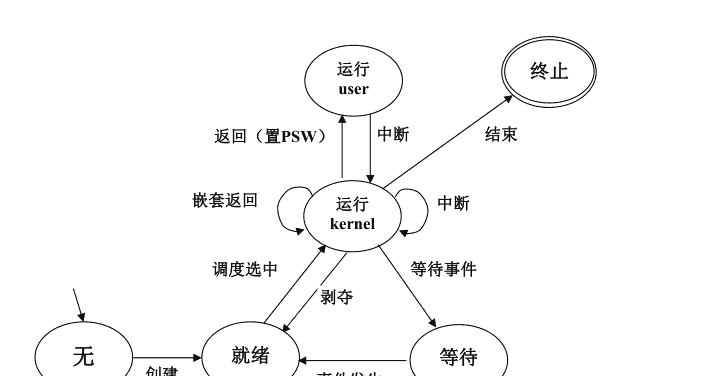

##### 3.1.3.1 IO中断处理

- 正常结束
  - 继续传输；
  - 唤醒相关进程。
- 传输错误
  - 复执（eg. 3次）；
  - 报告系统操作员。

##### 3.1.3.2 时钟中断处理

- Housekeeping
  - 进程管理
    - 重新计算进程调度参数(eg. 动态优先数)
  - 作业管理：记录作业在输入井中等待的时间，以及当前的优先级别，以便作业调度
  - 资源管理：动态统计运行进程占有和使用处理器等资源的时间
  - 事件处理：在实时系统中定时向被控对象发送控制信号
  - 系统维护：定时运行死锁检测程序和记账程序
  - 实现软时钟：运用硬件间隔时钟和一个存储单元
    - 硬时钟5ms发生一次中断，实现软时钟50ms，存储单元初值10，发生一次中断寄存器减1，知道寄存器为0

##### 3.1.3.3 控制台中断处理

- 一个控制按钮，一个中断向量，一个中断处理程序。

##### 3.1.3.4 硬件故障处理

- 电源故障处理
  - 掉电:
    - 内存，寄存器⇒外存
    - 停止设备
    - 停止处理机
  - 恢复:
    - 启动处理机
    - 启动设备
    - 外存⇒内存，寄存器


##### 3.1.3.4 硬件故障处理(cont.)

- 内存故障处理
  - 海明校验，奇偶校验错误
    - 下雨检查
    - 划出系统
    - 报告操作员

##### 3.1.3.5 程序性中断的处理

- 只能由操作系统处理的中断
  - 影响系统或其它进程
    - 越界，非法指令，（处理：终止进程、调试）
  - 需要系统管理或协助
    - 页故障，缺段，（处理：动态调入）
- 可以由用户自己处理的中断
  - 不影响系统和其它进程
    - 除0，溢出，（处理：用户处理，或OS处理）

#### 应用程序自己处理中断

调试语句： on <中断条件> <中断续元入口>

例如： on <divide_zero> goto LA;

除0中断时转LA处理

LA: 除0中断续元

on <divide_zero> goto LB

除0中断时转LB处理

LB: 除0中断续元

相同中断发生在不同位置
可采用不同处理方法

#### 应用程序自行处理中断(Cont.)

编译时：生成中断元素表：

| 中断事件 | 中断元素入口 |
|----------|---------------|
| 中断事件0 | 中断元素入口0 |
| 中断事件1 | 中断元素入口1 |
| ...... | ...... |
| 中断事件n | 中断元素入口n |

初始时均为0

运行时：执行调试语句，填写中断元素表。

中断时：根据中断原因查中断元素表，

- 为0，用户未规定中断元素，由OS标准处理；
- 非0，用户已规定中断元素，由用户处理。

#### 图3-9（P47）

步骤：

- （1）发生溢出中断
- （2）保存旧PSW和PC
- （3）取中断向量
- （4）转到中断处理程序
- （5）访问中断续元表（假定非0）
- （6）系统栈中现场转移到用户栈
- （7）中断续元入口送寄存器（OS中断处理完成）
- （8）执行中断续元
- （9）完成后执行RET指令由用户栈PSW和PC送寄存器
- （10）返回中断断点

#### 用户处理中断的过程

PSW,PC

用户栈

中断续元素表

PSW',LA

中断续元素

LA:

iret

用户程序

①溢出中断

PSW,PC

寄存器

②

③

PSW1, PC1

操作系统

硬件

PSW,PC

系统栈

④

PC1 中断处理程序

⑤

⑥

⑨

⑦

⑧

##### 3.1.3.6 自愿性中断的处理

- 准备参数
- SVC n
- 取返回值

> 参数和返回值和存放位置是由OS规定的。

```
返回值=系统调用名称 (实参1,...,实参n)
```

##### 3.1.3.6 自愿性中断的处理

不同的系统提供的服务在数量和种类上各有差别，通常分为：

- 与文件有关的：建立文件、撤销文件、打开文件、关闭文件、读写文件、文件指针定位
- 与进程有关的：创建进程、撤销进程、创建线程、监督进程运行状况
- 与通信有关的：发送消息、接收消息
- 与同步有关的：P操作、V操作

##### 3.1.3.6 自愿性中断的处理

系统调用驱动表： (table driven)

| 访管号 | 服务程序入口 |
| --- | --- |
| 0 | addr₀ |
| ........ | ............ |
| m-1 | addrₘ₋₁ |

Eg. UNIX

### 3.2 处理机调度

- 3.2.1 处理机调度算法
  - 按什么原则分配
- 3.2.2 处理机调度时机
  - 何时重新分配
- 3.2.3 处理机调度过程
  - 如何完成分配

Scheduling

#### 3.2.1 处理机调度算法

- 考虑因素（scheduling criteria）
  - CPU利用率；(max)
  - 吞吐量；(max)
  - 周转时间；(min)
  - 响应时间；(min)
  - 系统开销；(min)

#### 调度参数

周转时间：完成时间-进入时间

$T = t_f - t_s$

平均周转时间：周转时间的平均值

$\overline{T} = \frac{1}{n}\left(\sum_{i=1}^{n} T_i\right)$

带权周转时间：周转时间/运行时间

$W = \frac{T}{R}$

平均带权周转时间：带权周转时间的平均值

$\overline{W} = \frac{1}{n}\left(\sum_{i=1}^{n} W_i\right) = \frac{1}{n}\left(\sum_{i=1}^{n} \frac{T_i}{R_i}\right)$

#### CPU burst vs. I/O burst

- 阵发期：
  - CPU burst cycle: 进程(线程)使用CPU计算；
  - I/O burst cycle: 进程(线程)使用设备I/O。
- 进程运行行为:
  - CPU burst, I/O burst, CPU burst, I/O burst, ......
- CPU调度：考虑处于CPU burst进程集合
  - CPU burst时间根据以前行为推定。


#### CPU burst vs. I/O burst

- 下一个CPU burst的长度估算
- 令Tₙ是估计的第n个CPU阵发期的长度，tₙ的值是进程最近一次CPU阵发期长度，则有如下估算公式：
- Tₙ₊₁ = α tₙ + (1-α) Tₙ
- 参数α(0≤α≤1)控制tₙ和Tₙ在公式中起的作用：当α=0时，Tₙ₊₁=Tₙ；当α=1时，Tₙ₊₁=tₙ。通常α取0.5。

#### 剥夺式调度与非剥夺式调度

- 剥夺式(preemptive)
  - 就绪进程可以从运行进程手中抢占CPU。
    - 进程运行,直到结束、等待或被抢先
- 非剥夺式(non-preemptive)
  - 就绪进程不可从运行进程手中抢占CPU。
    - 进程运行,直到结束或等待

##### 3.2.1.1 先到先服务算法

- **FCFS（First Come First Serve）**
  - 按进程申请CPU（就绪）的次序。
  - Process Arrival time Burst time
    - P1 0 27
    - P2 1 3
    - P3 2 5
- **CPU调度状况可用Gantt 图表示。**

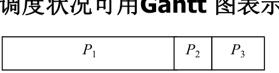

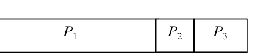

| 进程 | 到达时间 | 运行时间 | 开始时间 | 完成时间 | 周转时间 | 带权周转时间 |
|---|---|---|---|---|---|---|
| P₁ | 0 | 27 | 0 | 27 | 27 | 1 |
| P₂ | 1 | 3 | 27 | 30 | 29 | 9.67 |
| P₃ | 2 | 5 | 30 | 35 | 33 | 6.6 |

平均周转时间 T̄=(27+29+33)/3=29.67
平均带权周转时间 W̄=(1+9.67+6.6)/3=5.76

- 优点：
  - “公平”；
- 缺点：
  - 短作业或进程、线程等待时间长。

##### 3.2.1.2 最短作业优先

- SJF（Shortest Job First）
  - 按CPU burst长度

| Process | Arrival time | Burst time |
|---|---|---|
| P1 | 0 | 12 |
| P2 | 0 | 5 |
| P3 | 0 | 7 |
| P4 | 0 | 3 |

- Gantt Chart

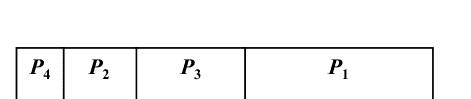

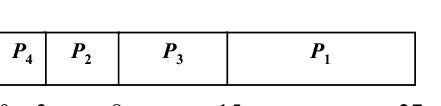

| 进程 | 到达时间 | 运行时间 | 开始时间 | 完成时间 | 周转时间 | 带权周转时间 |
|---|---|---|---|---|---|---|
| P1 | 0 | 12 | 15 | 27 | 27 | 2.25 |
| P2 | 0 | 5 | 3 | 8 | 8 | 1.6 |
| P3 | 0 | 7 | 8 | 15 | 15 | 2.14 |
| P4 | 0 | 3 | 0 | 3 | 3 | 1 |

平均周转时间 T̄ = (27+8+15+3)/4 = 13.25
平均带权周转时间 W̄ = (2.25+1.6+2.14+1)/4 = 1.75

- 特点：
  - 假设所有任务同时到达，平均等待时间最短。
  - 长作业可能被饿死。

##### 3.2.1.3 最短剩余时间优先算法(SRTN)

- Shortest Remaining Time Next
- 可剥夺SJF

| Process | Arrival time | Burst time |
|---|---:|---:|
| P1 | 0 | 12 |
| P2 | 1 | 9 |
| P3 | 3 | 6 |
| P4 | 5 | 3 |

Gantt图

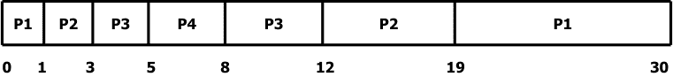

| 进程 | 到达时间 | 运行时间 | 开始时间 | 完成时间 | 周转时间 | 带权周转时间 |
|---|---|---|---|---|---|---|
| P₁ | 0 | 12 | 0 | 30 | 30 | 2.5 |
| P₂ | 1 | 9 | 1 | 19 | 18 | 2 |
| P₃ | 3 | 6 | 3 | 12 | 9 | 1.5 |
| P₄ | 5 | 3 | 5 | 8 | 3 | 1 |

P1 P2 P3 P4 P3 P2 P1
0 1 3 5 8 12 19 30

平均周转时间=(30+18+9+3)/4=15
平均带权周转时间=(2.5+2+1.5+1)/4=1.75
平均等待时间=(18+9+3+0)/4 =7.5(ms)

##### 3.2.1.4 最高响应比优先(HRN)

Highest Response Ratio Next

RR=(BT+WT)/BT=1+WT/BT

其中：

- BT=burst time
- WT=wait time

优点：

- 同时到达任务, 短者优先
- 长作业随等待时间增加响应比增加

##### 3.2.1.5 最高优先数算法(Cont.)

- 非剥夺式静态优先数
  - 获得处理机的进程运行，直至
    - 终止
    - 等待
  - 系统开销小，但不能保证正在运行的进程是可运行进程中优先数最高的
- 剥夺式动(静)态优先数
  - 获得处理机的进程运行，直至
    - 终止
    - 等待
    - 出现高优先级的进程
  - 进程切换频繁，系统开销大；能保证正在运行的进程是当前可运行进程中优先数最高的

- 可抢占CPU
  - Process  Arrival time  Priority  Burst time
  - P1  0  0  8
  - P2  3  1  5
  - P3  4  3  7
  - P4  0  2  3
  - P5  5  7  2

- Gantt Chart

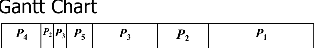

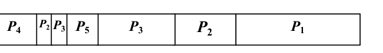

| 进程 | 到达时间 | 运行时间 | 优先级 | 开始时间 | 完成时间 | 周转时间 | 带权周转时间 |
|---|---|---|---|---|---|---|---|
| P1 | 0 | 8 | 0 | 17 | 25 | 25 | 3.13 |
| P2 | 2 | 5 | 1 | 3 | 17 | 15 | 3 |
| P3 | 4 | 7 | 3 | 4 | 13 | 9 | 1.29 |
| P4 | 0 | 3 | 2 | 0 | 3 | 3 | 1 |
| P5 | 5 | 2 | 7 | 5 | 7 | 2 | 1 |

平均周转时间 T̄ = (25+15+9+3+2)/5 = 38.8
平均带权周转时间 W̄ = (3.13+3+1.29+1+1)/5 = 1.88

- 例子UNIX： preemptive+dynamic priority（可抢占CPU动态优先数）。
  - 计算公式： p_pri=min{127, USER+p_cpu/16+p_nice}
  - 定义USER=100;
  - p_cpu: 运行进程每20ms加1（优先级降低），其它进程每1200ms减10（优先级提高）;
  - p_nice: 可以通过系统调用nice(...)修改的量：规定用户进程0~20之间（低），系统进程-20~+20之间（高）。
  - 调度时取p_pri最小的。


##### 3.2.1.6 循环轮转算法(RR)

- Round Robin(RR)
- 基本轮转
  - 时间片(quantum, time slice)长度固定，不变；
  - 所有进程等速向前推进。
- 改进轮转
  - 时间片长度不定，可变。

适用于分时系统。

- 时间片长度：
  - 几十毫秒～几百毫秒（eg. 50ms）
  - 过长：响应速度慢；
  - 过短：系统开销（overhead）大。

- 适应系统：
  - 分时

RR可抢占CPU调度：time slice = 4ms。

| Process | Arrival time | Burst time |
|---|---|---|
| P1 | 0 | 17 |
| P2 | 0 | 10 |
| P3 | 0 | 3 |

Gantt Chart

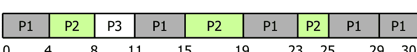


| 进程 | 到达时间 | 运行时间 | 开始时间 | 完成时间 | 周转时间 | 带权周转时间 |
|---|---|---|---|---|---|---|
| P₁ | 0 | 17 | 0 | 30 | 30 | 1.76 |
| P₂ | 0 | 10 | 4 | 25 | 25 | 2.5 |
| P₃ | 0 | 3 | 8 | 11 | 11 | 3.67 |

平均周转时间 = (30+25+11)/3 = 22

平均带权周转时间 = (1.76+2.5+3.67)/3 = 2.64

平均等待时间 = (13+15+8)/3 = 12(ms)

##### 3.2.1.7 多级队列算法(MLQ)

- 多级队列
  - 多个就绪队列，进程所属的队列固定。
- 例如：通用系统中：
  - 队列1：实时进程就绪队列（HPF）
  - 队列2：分时进程就绪队列（RR）
  - 队列3：批处理进程就绪队列（HPF）

##### 3.2.1.8 反馈排队算法(FB)

###### Feed-Back

- 多个就绪队列，进程所属队列可变。

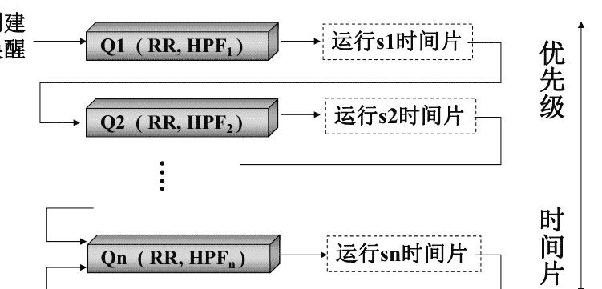

调度效果：

- 短进程优先处理
  - 运行时间短的进程在前面几个队列之后就可以执行完，而前面队列优先级高是被优先调度的。
- 设备资源利用率高
  - 交互式进程经常进入等待状态（等待用户输入），一旦被唤醒（输入完成），进入最高级队列，可尽快被调度选中，投入运行，可以尽快使用设备；
- 系统开销小
  - 计算量大的进程用完前面n-1级时间片，没有处理完，落入底层队列，调度频率下降，但每次获得较长的时间片。

#### 3.2.2 处理机调度时机

- 运行进程结束；
- 运行进程等待；
- 处理机被剥夺。
- 进程切换。
- 中断是进程切换的前提，但不是充分条件。

- 必然引起进程切换的中断
  - 进程自愿结束，exit()
  - 进程被强行终止；
    - 非法指令，越界，kill
  - 进程等待
- 可能引起进程切换的中断
  - 时钟
  - 系统调用

#### 3.2.3 处理机调度过程

- dispatcher
  - 保存下降进程的现场
    - 寄存器（PSW, PC, SP, 通用寄存器, 地址寄存器）=> PCB
  - 选择上升进程
    - 按处理机调度算法
  - 恢复上升进程的现场
    - PCB => 寄存器
    - 先恢复通用寄存器和地址寄存器，最后恢复PSW, PC
    - PSW和PC必须用一条指令恢复

### 3.3 调度级别与多级调度

- 3.3.1 交换与中级调度（Swapping and mid-level scheduling）
- 3.3.2 作业与高级调度（Job and high-level scheduling）

处理机调度为低级调度（CPU scheduling = low level scheduling）。

#### 3.3.1 交换与中级调度

- 术语
  - 交换（swapping）
  - 中级调度（mid-level scheduling）
  - 并发度（degree of multi-programming）
- 目标：控制并发度
  - 并发度过高
    - 系统开销大
    - 响应速度慢
    - 内存等资源紧张
    - 进程（线程）频繁进入等待状态
    - More deadlocks

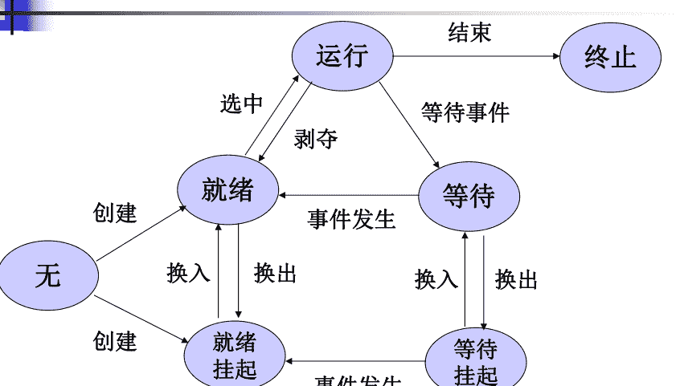

#### UNIX的中级调度（sched #0）

- 移入SRUN状态进程
- 如内存不够，
  - 移出SWAIT和SSTOP状态进程；
  - 如还不够，移出SSLEEP和SRUN状态进程；
    - 条件：
      - 待移入进程在外存时间≥3秒；
      - 待移出进程在内存时间≥2秒。

#### 3.3.2 作业与高级调度

作业状态：

- 提交：输入机向输入井传送
- 后备：在输入井，尚未进入内存
- 执行：分解为进程，在内存处理
- 完成：处理完毕，结果在输出井
- 退出：由输出井向打印机传送

状态转换：

- 提交→后备：由SPOOLing输入进程完成（Simultaneous Peripheral Operations On-Line）
- 后备→执行：由作业调度(1)（高级调度）完成
- 高级调度：系统进程
- 执行→完成：由作业调度(2)完成
- 完成→退出：由SPOOLing输出进程完成

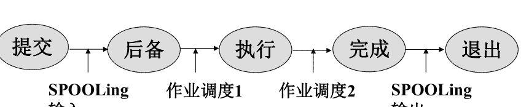

- 1. 批处理作业调度程序(1)：在后备作业集合中选择作业，并为其建立作业控制进程来处理该作业。

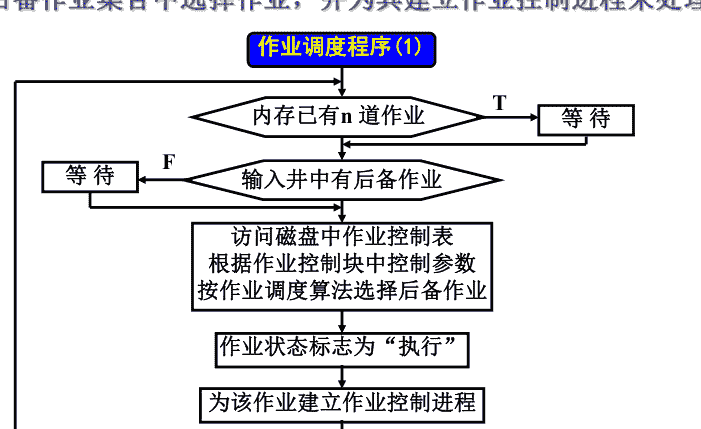

- 2. 批处理作业调度程序(2)：对终止的作业控制进程进行善后处理。

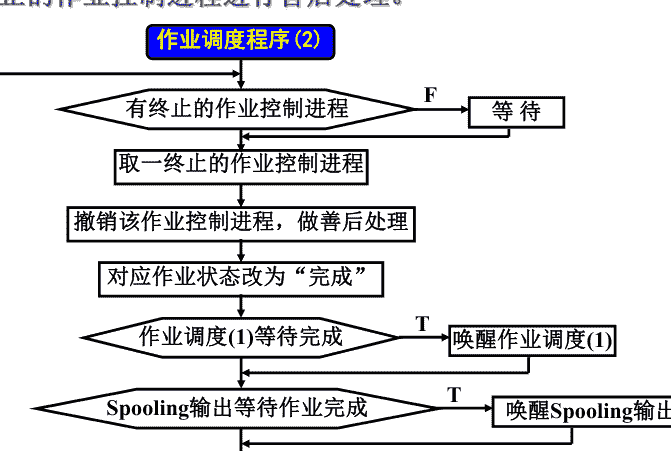

#### 作业调度算法

- 适合批作业调度的算法
  - 先到先服务算法（FCFS）
  - 优先数调度算法（HPF）
  - 短作业优先调度算法（SJF）
  - 最高响应比优先调度算法（HRN）
- 不适合批作业调度的算法
  - 时间片轮转算法（RR）
  - 最短剩余时间优先（SRTN）
  - 反馈排队算法（FB）

### 3.4 实时调度（real-time scheduling）

- 实时任务：
  - 具有明确时间约束的计算任务。
  - e.g.
    - 某时刻前必须开始处理
    - 某时刻前必须处理完毕
- 实时调度：
  - 合理安排就绪实时任务的执行次序，满足每个实时任务时间约束条件的调度。

#### 实时任务分类

- 硬实时 vs. 软实时
  - 硬实时（hard real-time）：必须满足任务截止期要求。
  - 软实时（soft real-time）：期望满足截止期要求。
- 周期性 vs. 随机性
  - 周期性：每隔固定时间发生一次
  - 随机性：由随机事件触发，其发生时刻不确定

#### 术语解释

- Ready time：就绪时间
- Starting deadline：开始截止期
- Processing time：处理时间
- Completion deadline：完成截止期
- Occurring frequency：发生频率


#### 周期性实时事务

- 周期性实时事务：
  - 令 $C_i$ 为任务 $P_i$ 处理时间， $T_i$ 为任务 $P_i$ 的发生周期，则任务 $P_1, ..., P_m$ 可调度的必要条件为：
    $$\sum_{i=1}^{m} \frac{C_i}{T_i} \le 1$$

#### 周期性实时事务

- 例:
  - T1=100, T2=200, T3=500 (ms)
  - C1=50, C2=30, C3=100 (ms)
  - C1/T1+C2/T2+C3/T3=0.5+0.15+0.2=0.85<1
  - 满足可调度的必要条件

#### 周期性实时事务

| 进程 | 就绪时间 | 处理时间 | 完成截止期 | 发生周期 |
| --- | --- | --- | --- | --- |
| A | 0 | 10 | 20 | 20 |
| B | 0 | 25 | 50 | 50 |

10/20 + 25/50 = 1, 可调度(不考虑开销)

#### 例子

| Process | Arrival time | Execution time | completion deadline |
|---|---|---|---|
| A(1) | 0 | 10 | 20 |
| A(2) | 20 | 10 | 40 |
| A(3) | 40 | 10 | 60 |
| A(4) | 60 | 10 | 80 |
| A(5) | 80 | 10 | 100 |
| ...... | ...... | ...... | ...... |
| B(1) | 0 | 25 | 50 |
| B(2) | 50 | 25 | 100 |

#### 例子: Earliest Deadline First

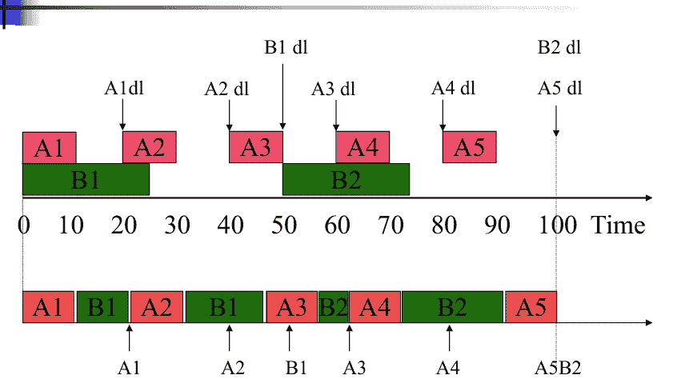

#### 3.4.2 速率单调调度

- RMS (Rate Monotonic Scheduling)
- 提出于1973年
- 面向周期性实时事务，非剥夺式
- 优先调度发生周期最短（频度最高）的实时任务
- 可调度条件：
\sum_{i=1}^n \frac{C_i}{T_i} \leq n(2^{1/n} - 1)

#### RMS的上限值

| n | n(2^{1/n} -1) |
|---|---|
| 1 | 1.0 |
| 2 | 0.828 |
| 3 | 0.779 |
| 4 | 0.756 |
| 5 | 0.743 |
| 6 | 0.734 |
| ⋮ | ⋮ |
| ∞ | ln2≈0.693 |

#### RMS vs. EDF

- 1) RMS可调度条件强于 EDF
- 2) RMS调度较EDF实现简单

#### RMS例子：

| 进程 | $T_i$ | $C_i$ |
|---|---|---|
| A | 100 | 20 |
| B | 150 | 40 |
| C | 350 | 100 |

$\frac{C1}{T1} + \frac{C2}{T2} + \frac{C3}{T3} = 0.2 + 0.267 + 0.286 = 0.753 \le 3(2^{1/3} - 1) = 0.779$

可调度，具体调度结果：

| A1 | B1 | C1 | A2 | B2 | A3 |  | A4 | B3 | C2 |
|---|---|---|---|---|---|---|---|---|---|
| 0 | 20 | 60 | 160 | 180 | 220 | 240 | 300 | 320 | 360 | 460 |

#### 3.5.1 自调度(self scheduling)

- 均衡调度(balanced scheduling)
- 一个就绪队列(多处理机访问互斥)
  - 优点
    - 不需要专门的处理机从事任务分派工作
    - 任务分配均衡
  - 缺点
    - 当CPU较多时,就绪队列成为瓶颈
    - 线程两次调度可能处于不同处理机
    - 不能保证同组线程同时调度

#### 自调度(self scheduling)

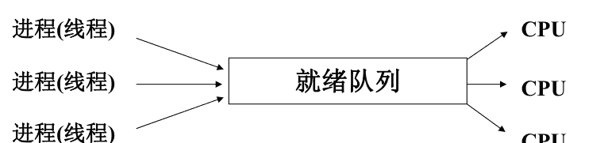

#### 自调度(self scheduling)

- 例子:
  - Mach, 改进的自调度
    - 全局队列:系统一个
    - 局部队列:每个CPU一个
  - 调度时
    - 首先考虑局部队列
    - 然后考虑全局队列

#### 3.5.2 组调度(gang scheduling)

- 将一组相关(合作)的线程同时分派到多个处理机上运行
  - 避免合作线程之间的相互等待
  - 降低开销,提高运行效率
- 例子:
  - Cm*
    - Task force (一组相关的计算)

### 3.6 系统举例

- Linux进程调度
- Windows2000/XP线程调度
- UNIX进程调度（见第12章）

#### 3.6.1 Linux 进程调度

- 在调度级别上考虑三种特征进程
  - Real-time FIFO
  - Real-time Round Robin
  - Timesharing
- Goodness-based scheduling
  - priority
    - 1-40, (缺省值20), 可通过nice系统调用调整, nice(value)中value的取值范围为(-20,20)之间, 以与经典UNIX保持兼容, 但在内部对value值进行反向处理, 取priority=20-value.
  - counter
    - 进程尚可运行的剩余时间

#### Linux 进程调度

#### counter

- 对于运行进程来说，每个时钟间隔（10ms，称为一个jiffy），将counter减1
- 当所有就绪进程的counter配额下降到0时，重新计算所有进程（包括等待进程）的counter值
  - counter= (counter/2) + priority

#### goodness

- if(Real-time)goodness=1000+priority
- if(Timesharing && counter=0)goodness=0
- if(Timesharing && counter>0)goodness=counter+priority

#### Linux 进程调度

- **调度发生时刻：**
  - 运行进程的counter减至0；
  - 运行进程执行系统调用exit；
  - 运行进程因等待I/O、信号灯而被封锁；
  - 原来具有高goodness的进程被解除封锁。
- **调度效果：**
  - 实时优先于分时
  - 交互和I/O进程优先于CPU进程

#### Linux 对称多处理

- **Linux2.0是支持对称多处理硬件的第一个Linux核心；**
  - 进程或线程可以同时运行在多个处理机上。
- **为保持核心非剥夺同步要求，SMP通过一个唯一的内核自旋锁(spin-lock)来保证任何时刻最多只有一个处理机执行核心代码，**
  - 支持真正意义上的SMP：将一个自旋锁分解为若干个相互独立的自旋锁，分别用于保护核心代码不相交的子集。

#### 3.6.2 Windows 2000/XP线程调度

- Main Features:
  - Thread level scheduling;
  - Real time + foreground + background;
    - real time: no deadline scheduling;
    - foreground: GUI window
    - background: non-interactive
  - Preemptive + dynamic priority + RR + Feedback;
  - Symmetric Multi-Processor(SMP) support;

#### 优先级别

- **16个实时优先级（16-31）**
  - 一些内核线程
  - 应用程序提升为实时优先级需要有权限
  - 不是真正意义上的实时调度
- **15个可变线程优先级（1-15）**
  - 基本优先级 vs. 当前优先级
    - 线程基本优先级继承进程基本优先级，可上下浮动2
      - 如: 进程基本优先级4，其线程基本优先级2—6,
    - 当前优先级在2—15范围内变动.
    - 可动态提升
    - 运行完一个quantum之后自动下降，不低于基本优先级
- **1个系统线程优先级（0）**


#### 优先级提升

- 优先级提升
  - **I/O**操作完成
  - 事件等待结束
  - 前台进程中的线程完成一个等待操作
  - 由于窗口活动而唤醒**GUI**线程
  - 就绪超过一定时限，未获得处理机
- 优先级提升不会超过15

#### 抢占CPU

- 抢占情形
  - 被唤醒线程优先级高于运行线程优先级；
  - 某线程的优先级动态变化
- 被抢占线程
  - 回到相应就绪队列
  - 时间配额
    - 实时线程：重新分配完整时间配额
    - 其它线程：保持剩余配额

#### 时间配额（quantum）

- 配额长度：6～36
- 时钟中断（15ms发生一次）减3，2～12次时钟中断（30ms～180ms）配额用完
- 配额用完后进入就绪队列，优先级下降

#### SMP上的线程调度

- 线程与CPU的亲合关系
  - 每个进程有一个处理器亲合掩码，缺省为所有处理器的集合
  - 线程继承其进程的亲合掩码
  - 亲合掩码可以修改
    - SetProcessAffinityMask,
    - SetThreadAffinityMask;
- 线程的理想处理器（Ideal processor）
  - 首选处理器：
  - 第二处理器：（在内核线程控制块中）
- 理想处理器确定
  - 线程创建时随机确定，
  - 分散各个线程与处理机的对应关系。
  - 线程可修改SetThreadIdealProcessor

#### 就绪线程对处理器的选择

- 有空闲处理器
  - 首选处理器
  - 第二处理器
  - 当前执行处理器（正执行调度代码）
  - 由高到低顺序找空闲的处理器
- 无空闲处理器，考虑抢占
  - 首选处理器
  - 第二处理器
  - 可运行编号最大处理器
- 不能抢占，进入相应的就绪队列

#### 处理器对就绪线程的选择

- 空闲处理器调度
  - 线程上次在此CPU上运行（二级缓存利用）
  - 线程的理想处理器是该CPU
  - 处于就绪状态时间超过2个quantum
  - 优先级大于等于24

#### 作业 #1

1. 进程切换时需要保存哪些现场信息？请尽量考虑完全。
2. 由核心返回目态程序时，进程的PSW和PC为何必须用一条机器指令同时恢复？
3. 对如下三个实时任务：
   T1=100, C1=50;
   T2=200, C2=30;
   T3=500, C3=100.
   采用EDF算法和RMS算法是否可调度？如是画出对应的Gantt图，否则说明原因。

## 第四章 互斥、同步与通讯

- 并发进程（concurrent processes）
- 进程互斥（mutual exclusion）
- 进程同步（synchronization）
- 进程高级通讯（communication）

### 4.1 并发进程

#### 4.1.1 前趋图的定义

- 前趋图（precedence graph）
  - 有向无环图，图中每个结点表示一个语句、一个计算步骤、或一个进程。
  - 结点间的有向边表示偏序或前趋（precedence relation）关系 “→”。
  - → = { (Pi, Pj) | Pj 启动之前 Pi 必须已经完成 }。
  - (Pi, Pj) ∈ → 可记作 Pi→Pj, 称 Pi 是 Pj 的前趋，Pj 是 Pi 的后继。
  - 在前趋图中，没有前趋的结点称为初始结点，没有后继的结点称为终止结点。
  - 每个结点可以有一个权重（weight），它可以表示该结点所包含的程序量或计算时间。

- 前趋图的例子

  P1→P2, P1→P3, P1→P4, P2→P5, P3→P5, P4→P5, P4→P6, P5→P7, P6→P7

  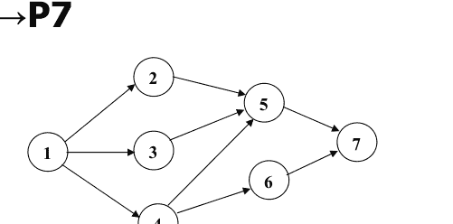

#### 4.1.2 顺序程序及其特性

##### 4.1.2.1 程序的顺序执行

- （1）内部顺序性：对于一个进程来说，它的所有指令是按序执行的。
  - S1: a:=x+y
  - S2: b:=a-z
  - S3: c:=a+b
  - S4: d:=c+5


- （2）外部顺序性：对于多个进程来说，所有进程的活动是依次执行的。

- 例：输入(I)、计算(C)、打印(P)三个活动构成的进程，每个进程的内部活动是顺序的，即 Iᵢ→Cᵢ→Pᵢ，多个进程的活动也是顺序的。

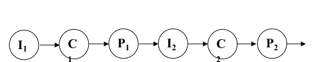

##### 4.1.2.2 顺序程序特性

- （1）连续性：指令逐条执行
- （2）封闭性：不受其它程序及外界因素影响
- （3）可再现性：结果与推进速度无关

#### 4.1.3 并发程序及其特性

##### 4.1.3.1 程序的并发执行

- （1）内部并发性：指一个程序内部的并发性。例：

  S1: a:=x+2;

  S2: b:=y+4;

  S3: c:=a+b;

  S4: d:=c+6;

  S5: e:=c-d;


- （2）外部并发性：指多个程序之间的并发性。


- 不可再现性的例子
  - 进程P:
    - A1: N:=0;
    - A2: N:=N+1;
    - A3: GOTO A2;
  - 进程Q:
    - B1: PRINT(N);
    - B2: N:=0;
    - B3: GOTO B1;

此例中进程P累计计数，进程Q将累计的结果打印出来。希望打印出的数是累计数的和。

- 两个进程并发执行时有许多可能的交叉:
  - 如进程P循环5次进程Q循环1次，然后进程P又循环3次进程Q循环1次，则输出结果是5，3；
  - 如进程P循环2次进程Q循环1次，然后进程P又循环6次进程Q循环1次，则输出结果是2，6。两次执行结果完全不同。
  - 进程Q执行完B1后被中断，进程P对N执行加1操作，然后进程Q执行B2，在这种情况下进程P的累计数将被丢失。

##### 4.1.3.2 并发程序的特性

- （1）间断性：程序交叉执行。
- （2）非封闭性：一个进程的运行环境可能被其它进程所改变，从而相互影响。
- （3）不可再现性：由于交叉的随机性，并发程序的多次执行可能对应不同的交叉，因而不能期望重新运行的程序能够再现上次运行的结果。

#### 4.1.4 程序并发执行的条件

- 在失去封闭性的条件下，保持可再现性。
  - **R(pi)={a1,a2,...,am}** 表示程序 pi 在执行期间所需读取的所有变量的集合，称为“读集”；
  - **W(pi)={b1,b2,...,bn}** 表示程序 pi 在执行期间所需改变的所有变量的集合，称为“写集”。
  - 若有两条语句 **c=a+b** 和 **v=c-1**，则它们的“读集”和“写集”分别为：
    - **R(c:=a+b)={a,b}, R(v:=c-1)={c}**
    - **W(c:=a+b)={c}, W(v:=c-1)={v}**

- 若两个程序p1，p2满足如下条件，则能够保持可再现性，因而可以并发执行。该条件是1966年首先由Bernstein提出的，称为Bernstein条件。
  - R(p1)∩W(p2) ∪ R(p2)∩W(p1) ∪ W(p1)∩W(p2)=∅


## 4.1.4 程序并发执行的条件

- 例如，有如下四条语句：
  - S1: a:=x+y
  - S2: b:=z+1
  - S3: c:=a-b
  - S4: w:=c+1
- R(S1)={x,y}，R(S2)={z}，R(S3)={a,b}，R(S4)={c}
- W(S1)={a}，W(S2)={b}，W(S3)={c}，W(S4)={w}

可见，R(S1)∩W(S2)∪R(S2)∩W(S1)∪W(S1)∩W(S2)=Φ，因而S1和S2可以并发执行；而S1和S3不能并发执行，因为W(S1)∩R(S3)={a}；S2和S3也不能并发执行，因为W(S2)∩R(S3)={b}；同样，S3和S4不能并发执行，因为W(S3)∩R(S4)={c}。

## 4.1.5 与时间有关的错误

例：图书借阅系统（x：某种书册数，设当前 x=1）

```
终端1:
CYCLE
  等待借书者;
  IF x>=1 Then
    Begin
      x:=x-1;
      借书
    End
  Else  无书
End
```

```
终端2:
CYCLE
  等待借书者;
  IF x>=1 Then
    Begin
      x:=x-1;
      借书
    End
  Else  无书
End
```


### 关于就绪队列的整队问题

设有 A、B、C、D 四个就绪进程，优先级依次为 2、10、30、35，分析插队过程中出现的情况。


分析：

- (1) 若有进程 E，优先级为 25，处于就绪状态，则要求加入就绪队列，调整队列子程序执行。该程序判断 E 应加入 B、C 之间，则执行 `R:=C; ① B:=E; E:=R`。
- (2) 若在①时进程 F 因完成 I/O 由等待状态变为就绪，其优先级为 15，调整队列子程序被中断，转入执行中断服务程序，则出现丢失一个进程：`R:=C; B:=F; F:=R`。

结论：该错误因共享就绪队列引起，对就绪队列操作不当，也是与时间相关的错误，导致结果不唯一。

### 两进程申请两个独占性资源

设有两个进程 P1、P2，系统中两类独占性资源如打印机和输入机，两进程的活动为：

| P1 | P2 |
| --- | --- |
| 申请打印机 | 申请输入机 |
| ① | ② |
| 申请输入机 | 申请打印机 |
| 执行 | 执行 |
| 退出 | 退出 |

分析：若 P1 推进到①、P2 推进到②，则 P1、P2 均等待对方释放资源，形成永久等待。该错误也与推进速度有关，是与时间相关的错误。

- 错误原因之1：进程执行交叉（interleave）；
- 错误原因之2：涉及公共变量（x）。

Remarks：

- 某些交叉结果不正确；
- 必须去掉导致不正确结果的交叉。

## 4.2 进程互斥（mutual exclusion）

- 4.2.1 共享变量与临界区
- 4.2.2 临界区域与进程互斥
- 4.2.3 进程互斥的实现
- 4.2.4 多处理机环境下的互斥

### 4.2.1 共享变量与临界区域

- 共享变量（shared variable）：多个进程都需要访问的变量。
- 临界区域（critical region）：访问共享变量的程序段。


### 表示

```
共享变量：shared <一组变量>
临界区域：region <一组变量> do <语句>
```

例子：`shared B: array[0..n-1] of integer;`

```
region B do
  begin
    ..... (访问B)
  end;
```

```
region B do
  begin
    ..... (访问B).
  end;
```

### 4.2.2 临界区域与进程互斥

定义：多个进程不能同时进入关于同一组共享变量的临界区域，否则可能发生与时间有关的错误，这种现象称为进程互斥。

两层含义：

- (1) 任何时刻最多只能有一个进程处于同一组共享变量的相同的临界区域；
- (2) 任何时刻最多只能有一个进程处于同一组共享变量的不同的临界区域。

Remarks：互斥是相对于公共变量而言的。

### 嵌套临界区域

```
shared x1,x2;

region x1,x2 do
begin
.....
region y1,y2 do
begin
......
end
end;
```

```
shared y1,y2;

region y1,y2 do
begin
......
region x1,x2 do
begin
......
end
end;
```

### 4.2.3 进程互斥的实现

**Framework**

```
Repeat
    entry section
    critical section
    exit section
    remainder section
Until false
```

**Requirements：**

- mutual exclusion（互斥进入）：一次只允许一个进程进入关于同一组公共变量的临界区；
- Progress（空闲让进）：临界区空闲时，放行一个进入者；
- bounded waiting（有限等待）：一个想要进入临界区的进程在等待有限个进程进入并离开临界区后获得进入临界区的机会。

### 4.2.3.1 进程互斥的软件实现

- 完全用程序实现，不需特殊硬件指令支持。
- 可用于单 CPU 和多 CPU 环境中。
- 有忙式等待问题。


### 尝试1

```
int turn;

P0:
do{
    while (turn==1);
    临界区代码
    turn=1;
    其余代码
}while(1);

P1:
do{
    while(turn==0);
    临界区代码
    turn=0;
    其余代码
}while(1);
```

不满足进展性：P0 和 P1 必须交替进入临界区。

### 尝试2

```
boolean flag[2];

P0:
do{
    while (flag[1]);
    flag[0]=true;
    临界区
    flag[0]=false;
    其余代码
}while(1);

P1:
do{
    while (flag[0]);
    flag[1]=true;
    临界区
    flag[1]=false;
    其余代码
}while(1);
```

不满足互斥性：flag[0]=flag[1]=false。

### 尝试3

```
boolean flag[2]; (false, false)
do{
    flag[0]=true;
    while (flag[1]);
    临界区代码
    flag[0]=false;
    其余代码
}while(1);

do{
    flag[1]=true;
    while(flag[0]);
    临界区
    flag[1]=false;
    其余代码
}while(1);
```

不满足进展性：flag[0]=flag[1]=true 时，进程 P0 和进程 P1 都不能进入临界区。

### Dekker算法

```
int flag[2]; (init 0)
int turn; (0 or 1)

P0: do{
    flag[0]=1;
    while(flag[1])
        if(turn==1){
            flag[0]=0;
            while (turn==1)
                skip;
            flag[0]=1;
        }
    临界区
    turn=1;
    flag[0]=0;
    其余代码
}while(1);

P1: do{
    flag[1]=1;
    while(flag[0])
        if(turn==0){
            flag[1]=0;
            while (turn==0)
                skip;
            flag[1]=1;
        }
    临界区
    turn=0;
    flag[1]=0;
    其余代码
}while(1);
```

## Peterson算法

```
boolean flag[2];
int turn;

P0:
do {
    flag[0] = true;
    turn = 1;
    while (flag[1] && turn == 1);
    临界区
    flag[0] = false;
    其余代码
} while (1);

P1:
do {
    flag[1] = true;
    turn = 0;
    while (flag[0] && turn == 0);
    临界区
    flag[1] = false;
    其余代码
} while (1);
```

## Lamport面包店算法

算法思想：设置一个发号者，按 0,1,2,... 发号。想进入临界区的进程抓号，抓到号之后按由小到大的次序依次进入。

- Problem: 两个进程可能抓到相同的号。
- Why? 为保证抓到不同的号，需要互斥机制。
- Resolution: 若抓到相同的号，按进程编号依次进入。
- Definition: `(a,b)<(c,d)` iff `(a<c) or (a==c and b<d)`。

```
Boolean choosing[0,...,n-1]; // false
int number[0,...,n-1]; // 0

Pi 进入:
1. choosing[i] = true;
2. number[i] = max{number[0],...,number[n-1]} + 1;
3. choosing[i] = false;
4. for (j = 0; j < n; j++) {
5.     while (choosing[j]) skip;
6.     while (number[j] != 0 &&
7.            (number[j], j) < (number[i], i)) skip;
8. }
```

```
Boolean choosing[0,...,n-1]; // false
int number[0,...,n-1]; // 0

Pi 进入:
1.
2. number[i] = max{number[0],...,number[n-1]} + 1;
3.
4. for (j = 0; j < n; j++) {
5.
6.     while (number[j] != 0 &&
7.            (number[j], j) < (number[i], i)) skip;
8. }
```

(1) P1抓到1未赋值
(2) P2抓到1进入临界区
(3) P1抓到1进入临界区

### Lamport面包店算法（续）

Pi 离开：

```
number[i] = 0;
```

变量 `choosing` 的作用：

- P1：抓到1；
- P2：抓到1；
- P2 进入后、离开前，P1 进入，不满足互斥性。

### 满足临界区管理原则

- 互斥性（mutual exclusion）
    - 多个进程竞争进入临界区时，下述条件之一成立：（1）一个进程抓到最小号；（2）若干进程抓到最小号。情形（1）抓到最小号的进程获准进入临界区；情形（2）编号最小的抓到最小号的进程获准进入临界区，其它进程将在第一个 `while` 循环或第二个 `while` 循环处等待，因而满足互斥性。
- 进展性（progress）
    - 当仅有一个进程想进入临界区时，该进程可以立即进入；当有多个进程想进入临界区时，其二元组 `(number[i], i)` 最小的进程获准进入，因而确定进入临界区进程的决策将在有限时间内确定。
- 有限等待性（bounded waiting）
    - 对任意一个想要进入临界区的进程 Pi，设其抓到号码为 `number[i]`，按二元组 `(number[i], i)` 次序排在 Pi 之前的竞争进程数量是有限的，在最坏情况下 Pi 将等待 n-1 个排在其前面的进程进入并离开临界区后获得进入临界区的资格，因而满足有限等待性。

## Eisenberg/McGuire算法

```
enum flag[0,...,n-1] { idle, want_in, in_cs };
int turn; // 0..n-1，初始化任意
```

- `flag[i] == idle`：进程 Pi 不想进入临界区
- `flag[i] == want_in`：进程 Pi 想进入临界区
- `flag[i] == in_cs`：进程 Pi 想进入或已进入临界区


Pi 进入：

```
do {
    flag[i] = want_in;
    j = turn;
    while (j != i)
        if (flag[j] != idle) j = turn;
        else j = (j + 1) % n;
    flag[i] = in_cs;
    j = 0;
    while (j < n && (j == i || flag[j] != in_cs))
        j++;
} while (j != n);
turn = i;
```

CS

Pi 离开：

```
j = (turn + 1) % n;
while (flag[j] == idle)
    j = (j + 1) % n;
turn = j;
flag[i] = idle;
```

### 满足临界区管理原则

- 互斥性
    - 仅当 `flag[i] == in_cs`，且对所有 `j != i`，`flag[j] != in_cs` 时，进程 Pi 才进入临界区，因而满足互斥性。
- 进展性
    - 临界区空闲时，排在序列 `turn, turn+1, ..., n-1, 0, 1, 2, ..., turn-1` 最前面的申请进入临界区的进程获准进入临界区，因而满足进展性。
- 有限等待性
    - 进程离开临界区时，按循环次序 `turn+1, ..., n-1, 0, 1, 2, ..., turn-1` 确定唯一一个竞争进程为其后继，所以一个进程最多等待 n-1 个进程进入并离开临界区后一定能进入临界区，因而满足有限等待性。

## 4.2.3.2 进程互斥的硬件实现

1. 硬件提供“测试并建立”指令

```
int test_and_set(int *target) {
    int temp = *target;
    *target = 1;
    return temp;
}
```

对一组公共变量，`int lock;`（初始 = 0）；

Pi 进入：

```
while (test_and_set(&lock));
```

Pi 离开：

```
lock = 0;
```

满足互斥性、进展性，不满足有限等待性。

### 满足有限等待性

全局变量：

```
int waiting[n];
int lock;
```

局部变量：

```
int j;
int key;
```

```
waiting[i] = 1;
key = 1;
while (waiting[i] && key)
    key = test_and_set(&lock);
waiting[i] = 0;
```

临界区

```
j = (i + 1) % n;
while ((j != i) && (!waiting[j]))
    j = (j + 1) % n;
if (j == i) lock = 0;
else waiting[j] = 0;
```

其余部分

2. 硬件提供“交换”指令

```
void swap(int *a, int *b) {
    int temp = *a;
    *a = *b;
    *b = temp;
}
```

对一组公共变量：`int lock`（初始 = 0）；

对一个进程空间：`int key`；

Pi 进入：

```
key = 1;
do {
    swap(&lock, &key);
} while (key == 1);
```

Pi 离开：

```
lock = 0;
```

**Remarks：**

- (1) `test_and_set` 指令和 `swap` 指令是原子的，不可中断的（在单 CPU 情况下）。
- (2) `test_and_set` 实际上是：将内存中一个单元的内容取出，再送一个新值。
- (3) `swap` 实际上是：交换内存两个单元的内容。

3. 硬件提供“关中断”和“开中断”指令

```
关中断
{ Critical Region }
开中断
```

**Remarks：**

- (1) 开关中断只在单 CPU 系统中有效（why?）
- (2) 影响并发性。

## 4.2.4 多处理机环境下互斥

- 单 CPU：指令间交叉，`test_and_set`、`swap` 指令是原子的；
- 多 CPU：指令周期之间交叉，`test_and_set`、`swap` 指令不是原子的；


## 4.2.4 多处理机环境下互斥

TS指令，Swap指令: first lock the bus

bus request protocol:
modern buses have these facilities
earlier ones didn't

```
b=1;
while(b){
    lock(bus);
    b = test_and_set(&lock);
    unlock(bus);
}
```


lock=0;

## 进程互斥

- 经典UNIX系统
  - 机制
    - 关中断互斥(提高处理机优先级)
  - 特点
    - 简单
    - 开销小
    - 影响并发性
      - 关中断后代码很短
- 在SMP系统中采用自旋锁

## 作业 #2

```
Consider the following program:  begin
var blocked: array[0..1] of boolean;  blocked[0]:=false;
turn:0..1;                         blocked[1]:=false;
procedure P(id:integer);          turn:=0;
begin                             parbegin
  repeat                           P(0); P(1)
    blocked[id]:=true;             parend;
    while turn<>id do              end.
    begin
      while blocked[1-id] do
        {nothing}
      turn:=id
    end;
    <Critical section>
    blocked[id]:=false;
    <Remainder>
  until false
end;
```

This is a software solution to the mutual exclusion problem proposed by Hyman. Find a counter example to demonstrate that this solution is incorrect. It is interesting to note that even the Communication of the ACM was fooled on this one.

## 4.3 进程同步

### 4.3.1 进程同步的概念

例：司机-售票员问题

司机活动：

```
do {
启动车辆
正常行驶
到站停车
}while (1)
```

售票员活动：

```
do {
关车门
售 票
开车门
}while (1)
```

定义：一组进程，为协调其推进速度，在某些关键点处需要相互等待与相互唤醒，进程之间这种相互制约的关系称为进程同步。


### 4.3.2 进程同步机制

定义：

- 用于实现进程同步的工具称为同步机制（synchronization mechanism）
- 一组进程，如果它们单独不能正常进行，但并发可以正常进行，称这种现象为进程合作
- 参与合作的进程称作合作进程

同步机制要求：
- 描述能力够用；
- 可实现；
- 高效；
- 使用方便。

## 典型同步机制

- 信号量与PV操作(semaphore and PV operations)
- 管程(monitor)
- 会合(rendezvous)
- 条件临界区(conditional critical region)
- 路径表达式(path expression)
- 事件(event, traditional UNIX)

### 4.3.3 信号量与PV操作

E.W.Dijkstra, 1965.

#### 4.3.3.1 信号量与PV操作的定义

```
Typedef semaphore struct{
    int value;
    PCBpointer queue;
};
semaphore s;
```

Remarks:

- (1) *semaphore* is pre-defined data type,
- (2) s can be declared as needed, eg. semaphore s1,s2;

## 信号灯变量

```
Var S:semaphore;
```


## P操作原语

P操作原语：

```
void P(semaphore*s)
{ s->value--;
If s->value<0
    asleep(s->queue)
}
```


asleep(s->queue):

- (1) 执行此操作进程的PCB入s->queue尾（状态改为等待）；
- (2) 转处理机调度程序。

## V操作原语

V操作原语：

```
void V(semaphore *s)
{ s->value++;
if (s->value <= 0)
wakeup(s->queue);
}
```

Primitive: a piece of code un-interruptible

wakeup(s->queue)

S->queue链头PCB出等待队列，进入就绪队列（状态改为就绪）。

## 规定和结论

- 对于信号量变量的规定：
  - 必须置一次初值，只能置一次初值，初值 >=0;
  - 只能执行P操作和V操作，所有其它操作非法。
- 几个有用的结论：
  - 当s->value >=0时，s->queue为空;
  - 当s->value <0时，|s->value|为队列s->queue的长度;
  - 当s->value初=1时，可以实现进程互斥;
  - 当s->value初=0时，可以实现进程间的简单同步;
  - 当s->value为非1的正整数时，可以用来管理同种组合资源，申请资源执行一次P操作，归还资源执行一次V操作;

## 用开关中断实现P、V操作

```
void P(semaphore *s)
{disable interrupt;
    s->value--;
    if (s->value<0)
    {asleep(s->queue)
    enable interrupt;
    goto CPU dispatcher;
    }else
        enable interrupt;
}
```

```
void V(semaphore *s)
{disable interrupt;
 s->value++;
 if (s->value<=0)
 {wakeup(s->queue)
 enable interrupt;
 }else
 enable interrupt;
 }
```

- asleep(s->queue):set this process status to blocked;place this process in s->queue.
- wakeup(s->queue):remove a process from s->queue;place the process in ready list.

## 用TS、swap指令实现P、V操作

```
void P(semaphore *s)
{while(TS(s->flag));
    s->value--;
    if (s->value<0)
    {asleep(s->queue)
    s->flag=0;
    goto CPU dispatcher;
    }else
    s->flag=0;
}
```


## 用TS、swap指令实现P、V操作

```c
void V(semaphore *s)
{while(TS(s->flag));
 s->value++;
 if (s->value<=0)
 {wakeup(s->queue);
 s->flag=0;
 }else
 s->flag=0;
}
```

## 用信号量和P、V实现进程互斥

```pascal
Var mutex: semaphore; (初值=1)

shared x,y,z:integer;
```


## 用信号灯实现进程互斥

```pascal
Var mutex: semaphore; (初值=1)

shared x,y,z:integer;

P(mutex)
CR1
V(mutex)

P(mutex)
CR2
V(mutex)

......

P(mutex)
CRn
V(mutex)
```

## 互斥例子：借书系统(revisited)

```pascal
Var mutex:semaphore; (initial value is 1)
终端1:                终端2:
CYCLE                CYCLE
等待借书者;          等待借书者;

IF x>=1 Then         IF x>=1 Then
Begin                Begin
x:=x-1;              x:=x-1;

借书                 借书
End                  End
Else 无书;           Else 无书;
End                  End
```

## 互斥例子：借书系统(revisited)

```pascal
Var mutex:semaphore; (initial value is 1)

终端1:                     终端2:
CYCLE                     CYCLE
  等待借书者;              等待借书者;
  P(mutex)                 P(mutex)
  IF x>=1 Then             IF x>=1 Then
    Begin                  Begin
      x:=x-1;               x:=x-1;
      V(mutex)              V(mutex)
      借书                   借书
    End                    End
  Else V(mutex);无书;      Else V(mutex);无书;
End                       End
```

## 用信号量、P、V实现进程同步

P1:

后动作

P2:

先动作

## 用信号灯实现进程同步

General Case:

```pascal
VAR S:semaphore; (initial value 0)
```

P1:
P(S)
后动作

P2:
先动作
V(S)

## 用信号量、P、V实现进程同步

例子：司机-售票员问题：

司机活动：

```pascal
Do{
启动车辆
正常行驶
到站停车
}While(1)
```

售票员活动：

```pascal
Do{
关车门
售票
开车门
}While(1)
```

## 用信号量、P、V实现进程同步

例子：司机-售票员问题：

```pascal
VAR s1,s2: semaphore; (initial value 0)
司机活动：			售票员活动：
Do{				Do{
P(S1)				关车门
启动车辆			V(S1)
正常行驶			售票
到站停车			P(S2)
V(S2)				开车门
}While(1)			}While(1)
```

## Classical synchronization problems

- 1. Producers and consumers problem
- 2. Readers and writers problem
- 3. Dining philosophers problem
- 4. Cigarette smokers problem
- 5. Sleepy barbers problem
- etc.

## 例1. 生产者/消费者问题

预备知识：

组合资源：若干相对独立的资源构成的资源集合，其中每个相对独立的资源称为子资源。

同种组合资源：相同类型子资源构成的组合资源。

管理： Var S:semaphore; (初值=子资源个数)

例子： 2台打印机

```pascal
Var S:semaphore; S.value=2;
```

申请： P (S) ;

释放： V (S) ;

## 自动机描述


P(S): 申请一台打印机, 分配, 空闲打印机减1

P(S): 申请一台打印机, 等待, 等待进程数加1

## 自动机描述


V(S): 释放一台打印机, 唤醒一个等待者, 打印机分给被唤醒进程, 等待进程数减1

V(S): 释放一台打印机, 空闲打印机数量增1

## 例1. 生产者/消费者问题

生产物品
放入B中

B中取物品
消费之

生产者

箱子，容量k

消费者

```pascal
B:Array[0..k-1]Of item
```


## 环形缓冲区


## 问题分析

生产者活动：

```pascal
do{
    加工一件物品
    物品放入箱中
}while(1)
```

消费者活动：

```pascal
do{
    箱中取一物品
    消耗这件物品
}while(1)
```

资源：箱子（同种组合）

```pascal
Var S1:semaphore;
    S1.value=k;
```

放前：P（S1）
放后：V（S2）

资源：物品（同种组合）

```pascal
Var S2:semaphore;
    S2.value=0;
```

取前：P（S2）
取后：V（S1）

## 同步

生产者活动：

```pascal
Do{
    加工一件物品
    P(S1)
    物品放入箱中
    V(S2)
}While(1)
```

消费者活动：

```pascal
Do{
    P(S2)
    箱中取一物品
    V(S1)
    消耗这件物品
}While(1)
```

对B和in,out的互斥：

```pascal
Var mutex:semaphore; (mutex.value=1)
```

## 互斥

生产者活动：

```pascal
Do{
  加工一件物品
  P(S1)
  P(mutex)
  物品放入箱中
  V(mutex)
  V(S2)
}While(1)
```

消费者活动：

```pascal
Do{
  P(S2)
  P(mutex)
  箱中取一物品
  V(mutex)
  V(S1)
  消耗这件物品
}While(1)
```

## 考虑死锁

生产者活动：

```pascal
Do{
加工一件物品
P(mutex)
P(S1)
物品放入箱中
V(S2)
V(mutex)
}While(1)
```

消费者活动：

```pascal
Do{
P(mutex)
P(S2)
箱中取一物品
V(S1)
V(mutex)
消耗这件物品
}While(1)
```

## 程序

```pascal
Program producers_consumers;
Var B:Array[0..k-1] Of item;
    S1,S2,mutex:semaphore;
    in,out:0..k-1;
```

```pascal
Procedure producer
    cycle
        produce a product
        P(S1);
        P(mutex);
        B[in]:=product;
        in:=(in+1)mod k;
        V(mutex);
        V(S2)
end
```

```pascal
Procedure consumer
    cycle
        P(S2);
        P(mutex);
        x:=B[out];
        out:=(out+1)mod k;
        V(mutex);
        V(S1);
        consume x;
end;
```


## 程序

```
Begin
    S1.value:=k; S2.value:=0;
    mutex.value:=1;
    in:=0; out:=0;
    Cobegin
        P1: producer; ...... , Pm: producer;
        C1: consumer; ......, Cn: consumer;
    Coend;
End.
```

## 并发性提高策略

生产者和消费者：不操作B的相同分量

生产者的共享变量： 消费者的共享变量：

B[in], in                 B[out], out

in=out: 满或空,

```
Var mutex1,mutex2:semaphore; (init 1)
```

## 并发性提高策略

生产者活动：

```
Repeat
加工一件物品
P(S1)
P(mutex1)
物品放入箱中
V(mutex1)
V(S2)
Until false
```

消费者活动：

```
Repeat
P(S2)
P(mutex2)
箱中取一物品
V(mutex2)
V(S1)
消耗这件物品
Until false
```

## 例2. 读者/写者问题

P. T. Courtois 1971

Communication of the ACM, Vol.14, 667-669.

ACM: Association for Computing Machinery

- 解法1：写者可能饿死
- 解法2：写者优先

## 例2. 读者/写者问题

Problem Statement:

一组公共数据DB


R1 ..... Rm W1 ..... Wn

- 要求：
- （1）R-R可以同时
- （2）R-W不可同时
- （3）W-W不可同时

## Solution1: 不考虑R-R不互斥

```
Var r_w_w:semaphore; (init value: 1)
```

Reader:

```
P(r_w_w);
{读操作}
V(r_w_w);
```

Writer:

```
P(r_w_w)
{写操作}
V(r_w_w)
```

分析：（1）写者活动正确；（2）R-R不能同时。

改进：最先进入的R执行P；最后离开的R执行V；

## Solution2: 考虑R-R不互斥

Var read_count:integer; (initial value is 0)

Reader:

```
read_count:=read_count+1;
```

```
If read_count=1 Then P(r_w_w);
```

{读操作}

```
read_count:=read_count-1;
```

```
If read_count=0 Then V(r_w_w);
```

问题：对Read_count操作的互斥问题。

## Solution3: 正确解法

```
Var mutex:semaphore; (initial value is 1)
Reader:
  P(mutex);
  read_count:=read_count+1;
  If read_count=1 Then P(r_w_w);
  V(mutex);
  {读操作}
  P(mutex);
  read_count:=read_count-1;
  If read_count=0 Then V(r_w_w);
  V(mutex);
```

读者等待在何处？
读者如何被唤醒？

## 程序

```
Program readers_writers;
Var r_w_w: semaphore;
    mutex:semaphore;
    read_count: integer;

procedure writer;
begin
    P(r_w_w);
    { write ops }
    V(r_w_w)
end;
```

## 程序（Cont.）

```
Procedure reader;
begin
    P(mutex);
    read_count:=read_count+1;
    If read_count=1 Then P(r_w_w);
    V(mutex);
    { read ops }
    P(mutex);
    read_count:=read_count-1;
    If read_count=0 Then V(r_w_w);
    V(mutex);
end;
```

## 程序（Cont.）

```
begin
    read_count:=0;
    r_w_w.value:=1;
    mutex.value:=1;
    cobegin
        r1: reader; .....; rm: reader;
        w1: writer; ,,,,,; wn: writer
    coend
end.
```

## 分析：

问题：读者源源不断， read_count不归0，写者会被饿死。

策略：一旦有写者等待，新到达读者等待，正在读的读者都结束后，写者进入。

Further improvement is left to interested students.

## 例3. 哲学家就餐问题

## Dining Philosophers Problem

Proposed and solved by

E.W. Dijkstra, in 1965

## 例3. 哲学家就餐问题


## 例3. 哲学家就餐问题

哲学家活动：

哲学家活动（包含资源活动）

```
Do{
    思考
    进食
}While(1)
```

```
Do{
    思考
    取左叉，取右叉
    进食
    放左叉，放右叉
}While(1)
```

进食：需要“叉子”

叉子：不同种组合资源

死锁情况：每位哲学家拿到左叉，等待右叉。

## 例3. 哲学家就餐问题


## 死锁预防策略

死锁解决方法：同时申请左、右两把叉子（预先分配）。

哲学家状态描述（增加了hunger状态）：

```
State: Array[0..4]Of (thinking,hungry,eating);
```

等待队列设置（每个哲学家一个队列）：

```
Self: Array[0..4]Of semaphore; (initial value is 0);
```

## 就餐条件测试

测试I号哲学家是否具备进食条件：

```
Procedure test(I:0..4)
    If (state[I]=hungry) and
        (state[(I-1)mod 5]<>eating) and
        (state[(I+1)mod 5]<>eating)
    Then state[I]:=eating; V(self[I])
```

Remark:

自测试不需要state[I]=hungry，但测试左邻右舍需要此条件。

## 未考虑互斥问题

- 1号哲学家活动：
- 
- 1. Repeat
- 2. 思考
- 3. state[I]:=hungry;
- 4. test(I);
- 5. P(self[I]);
- 6. 取左叉，取右叉;
- 7. 进食
- 8. 放左叉，放右叉;
- 9. state[I]:=thinking;
- 10. test((I-1)mod 5);
- 11. test((I+1)mod 5)
- 12. Until false;

- 共享变量: state;
- 临界区域: 3-4, 9-11

- Var
- mutex:semaphore;(1)

## 考虑互斥问题

I号哲学家活动：

- 1. Repeat
- 2. 思考
- 3. P(mutex);
- 4. state[I]:=hungry;
- 5. test(I);
- 6. V(mutex);
- 7. P(self[I]);
- 8. 取左叉，取右叉;
- 9. 进食
- 10. 放左叉，放右叉;
- 11. P(mutex);
- 12. state[I]:=thinking;
- 13. test((I-1)mod 5);
- 14. test((I+1)mod 5);
- 15. V(mutex)
- 16. Until false;


## 程序

```
Program dining_philosophers
var state:array[0..4] of (thinking,hungry,eating);
    self:array[0..4] of semaphore;
    mutex:semaphore;
procedure test(I:0..4)
begin
    if (state[I]=hungry)and
       (state[(I-1)mod 5]<>eating)
       and(state[(I+1)mod 5]<>eating) then
       begin state[I]:=eating; V(self[I]) end
end;

Procedure philosopher(I:0..4)
begin
    cycle
        {thinking}
        P(mutex);
        state[I] := hungry;
        test(I);
        V(mutex);
        P(self[I]);
        pick_up_fork(I); pick_up_fork((I+1)mod 5);
        {Eating};
        put_down_fork(I); put_down_fork((I+1)mod 5);
        P(mutex);
        state[I]:=thinking;
        test((I-1)mod 5);
        test((I+1)mod 5);
        V(mutex);
    end
end

begin
    for I:=0 to 4 do
        begin
            state[I]:=thinking;
            self[I].value:=0
        end;
    mutex.value:=1;
    cobegin
        ph0: philosopher(0);
        ......
        Ph4: philosopher(4);
    coend
end.
```

## 问题

饿死情况：

某哲学家左右邻居至少有一个处于eating状态。


## 解决方法

```
var fork: array [0..4] of semaphore;
    fork[0], fork[1], fork[2], fork[3], fork[4] := 1;
count: semaphore;
    count := 4;
process PH(i)
    begin
        repeat
            think;
            P(count);
            P(fork[i]);
            P(fork[(i+1) mod 5]);
            eat;
            V(fork[i]);
            V(fork[(i+1) mod 5]);
            V(count);
        until false;
    end;
```

## 例4. 吸烟者问题

Cigarette Smokers' Problem

Patil S. S. Limitations and Capabilities of Dijkstra's semaphore primitives for coordination among processes. MIT project MAC Computation Structure Group Memo 57, MIT, Cambridge, Mass, 1977.

## 吸烟者问题-problem statement

3 supplier processes:

- X: supplies tobacco and match;
- Y: supplies match and wrapper;
- Z: supplies wrapper and tobacco.

3 smoker processes:

- A: possess tobacco;
- B: possess match;
- C: possess wrapper.

- (1) only one of X,Y,Z can supply at a time;
- (2) X,Y,Z can proceed only after consumption.

## Traditional semaphore:

```
Var t,m,w,s:semaphore; (0,0,0,1)
```

| Process X | process Y | process Z |
| --- | --- | --- |
| `P(s);` | `P(s);` | `P(s);` |
| `V(t);` | `V(m);` | `V(w);` |
| `V(m);` | `V(w);` | `V(t);` |

| Process A | Process B | process C |
| --- | --- | --- |
| `P(m);` | `P(w);` | `P(t);` |
| `P(w);` | `P(t);` | `P(m);` |
| `smoke;` | `smoke;` | `smoke;` |
| `V(s);` | `V(s);` | `V(s);` |

## Simultaneous P-operation

```
SP(S₁,t₁,d₁;...;Sₙ,tₙ,dₙ);
if S₁>=t₁ and ... and Sₙ>=tₙ then
    for I:=1 to n do Sᵢ:=Sᵢ-dᵢ endfor
else
```

- (1) place the executing process in the waiting queue for the first Sᵢ with Sᵢ<tᵢ,
- (2) and set the program counter to the beginning of the SP operation so that all conditions will be reexamined when the process is reactivated.

## Simultaneous V-operation

```
SV(S1,d1;...;Sn,dn)
{
    for(i=1; i<=n; i++)
        Si = Si+di;
        Remove all processes waiting in the
        queue associated with Si into ready queue;
}
```

其中Si为信号量，ti、di为大于0的整数。当ti、di均为1时，称为AND型信号量，是最常用的一种形式。

## 吸烟者问题-Solution

```
Shared t,w,m:semaphore; (0,0,0)
    s:semaphore; (1)
```

| Process X | Process Y | Process Z |
| --- | --- | --- |
| `loop` | `loop` | `loop` |
| `P(s);` | `P(s);` | `P(s);` |
| `SV(t,1;m,1);` | `SV(m,1;w,1);` | `SV(w,1;t,1);` |
| `endloop` | `endloop` | `endloop` |

| Process A | Process B | Process C |
| --- | --- | --- |
| `loop` | `loop` | `loop` |
| `SP(m,1,1;` | `SP(w,1,1;` | `SP(t,1,1;` |
| `w,1,1);` | `t,1,1);` | `m,1,1);` |
| `smoke;` | `smoke;` | `smoke;` |
| `V(s);` | `V(s);` | `V(s);` |
| `endloop` | `endloop` | `endloop` |

## 例5. 3台打印机管理

```
Var lp:array[1..3] of (free,used); (initial value is free)
S: semaphore; (initial value is 3)
mutex: semaphore; (initial value is 1)
```

| function require:1..3; | procedure return(i:1..3); |
| --- | --- |
| `P(S);` | `P(mutex);` |
| `P(mutex);` | `lp[i]:=free;` |
| `for i:=1 to 3 do` | `V(mutex);` |
| `if lp[i]=free then` | `V(S);` |
| `break;` | |
| `lp[i]:=used;` | |
| `V(mutex);` | |
| `return(i);` |


## 例6. 生产线问题


## 例6. 生产线问题

工人1活动：

```
Do{
    加工一个车架
    车架放入箱中
}while(1)
```

工人2活动：

```
Do{
    加工一个车轮
    车轮放入箱中
}while(1)
```

工人3活动：

```
Do{
    箱中取一车架
    箱中取二车轮
    组装成一台车
}while(1)
```

```
semaphore empty; (空位， k)
semaphore frame; (车架， 0)
Semaphore wheel; (车轮， 0)
```

## 例6. 生产线问题

工人1活动：
Do{
加工一个车架
P(empty)
车架放入箱中
V(frame)
}while(1)

工人2活动：
Do{
加工一个车轮
P(empty)
车轮放入箱中
V(wheel)
}while(1)

工人3活动：
Do{
P(frame)
箱中取一车架
V(empty)
P(wheel)
P(wheel)
箱中取二车轮
V(empty)
V(empty)
组装成一台车
}while(1)

死锁情况：K个车轮，k个或k-1个车架

死锁防止：车架不超过k-2个（S1）

车轮不超过k-1个（S2）

## 例6. 生产线问题

工人1活动:
Do{
    加工一个车架
    P(S1)
    P(empty)
    车架放入箱中
    V(frame)
}while(1)

工人2活动:
Do{
    加工一个车轮
    P(S2)
    P(empty)
    车轮放入箱中
    V(wheel)
}while(1)

工人3活动:
Do{
    P(frame)
    箱中取一车架
    V(empty)
    V(S1)
    P(wheel)
    P(wheel)
    箱中取二车轮
    V(empty)
    V(empty)
    V(S2)
    V(S2)
    组装成一台车
}while(1)

semaphore S1; (初值k-2, 车架)

semaphore S2; (初值k-1, 车轮)

## 例7. 资源调度问题

- 三组进程A、B、C，互斥使用某资源R
- 只有一组申请进程，依次；
- 两组申请进程，组间交替，组内依次；
- 三组申请进程，组间轮流，组内依次。

- 变量定义
- int free; (init 1)
- semaphore mutex; (init 1)
- semaphore qa, qb, qc; (init 0)
- int counta, countb, countc; (init 0)

## 例7. 资源调度问题

A组申请：

```
P(mutex)
if (free==1){
    free=0;
    V(mutex);
}else{
    counta++;
    V(mutex);
    P(qa);
}
```

A组释放：

```
P(mutex)
if (countb>0){
    countb--;
    V(qb);
}else if(countc>0){
    countc--;
    V(qc);
}else if(counta>0){
    counta--;
    V(qa);
}else free=1;

V(mutex)
```

## 例8. 系统与网络打印机问题

- 设有网络打印机和系统打印机各一台。网络打印机由网络用户使用；系统打印机一般由系统用户使用，但当其空闲时也可由网络用户使用。试用信号灯与PV 操作实现对两台打印机的管理。

- 变量定义
- int sys_free, net_free; (1,1)
- int sys_wait, net_wait; (0,0)
- semaphore sys_q, net_q; (0,0)
- semaphore mutex; (1)

## 例8. 系统与网络打印机问题

```
sys_apply
{
    L1: P(mutex);
    If(sys_free){
        sys_free=0;
        V(mutex);
    }else{
        sys_wait++;
        V(mutex);
        P(sys_q);
        goto L1;
    }
}
```

```
user_apply
{
    L2: P(mutex);
    if(net_free){
        net_free=0;
        V(mutex);
        return(net);
    }else if(sys_free){
        sys_free=0;
        V(mutex);
        return(sys);
    }else{
        net_wait++;
        V(mutex);
        P(net_q);
        goto L2;
    }
}
```

## 例8. 系统与网络打印机问题

```
sys_return{
    P(mutex);
    if(sys_wait>0) {
        sys_wait--;
        V(sys_q);
    }else{
        if(net_wait>0){
            net_wait--;
            V(net_q);
        }else
            {sys_free=1;}
    }
    V(mutex);
}
```

```
user_return{
    P(mutex);
    if(net_wait>0){
        net_wait--;
        V(net_q);
    }else{
        net_free=1;}
    V(mutex);
}
```

## 例9. 2009研究生入学考试题

- 三个进程P1、P2、P3互斥使用一个包含N(N>0)个单元的缓冲区。P1每次用produce()生成一个正数并用put()送入缓冲区某一空闲单元中；P2每次用getodd()从该缓冲区中取出一个奇数并用countodd()统计奇数个数；P3每次用geteven()从该缓冲区中取出一个偶数并用countodd()统计偶数个数。请用信号量机制实现三个进程的同步与互斥活动，并说明所定义信号量的含义。

## 例9. 2009研究生入学考试题

- 变量定义
- semaphore empty; (init N)
- semaphore odd, even; (init 0)
- semaphore mutex; (init 1)

## 例9. 2009研究生入学考试题

```
main()
{
    process P1
    do{
        n=produce();
        P(empty);
        P(mutex);
        put();
        V(mutex);
        if(n%2==0)
            V(even);
        else
            V(odd);
    }while(true)

    process P2
    do{
        P(odd);
        P(mutex);
        getodd();
        V(mutex);
        V(empty);
        countodd();
    }while(true)

    process P3
    do{
        P(even);
        P(mutex);
        geteven();
        V(mutex);
        V(empty);
        counteven();
    }while(true)
}
```

## 例10. 寺庙问题

某寺庙有老和尚、小和尚若干。庙内有一水缸，由小和尚提水入缸，供老和尚饮用。水缸可容纳30桶水，每次入水、取水仅为一桶，不可同时进行。水取自同一井中，井口狭窄，每次只能容纳一个水桶取水。设有5只水桶，老和尚与小和尚共用。试用信号灯与PV操作给出老和尚和小和尚的活动。

## 例10. 寺庙问题

- 变量定义
- semaphore empty; (30) //水缸容量
- semaphore full; (0) //当前水量
- semaphore bucket; (5) //水桶数
- semaphore mutex_bigjar;
- semaphore mutex_well;


## 例10. 寺庙问题

```
young_monk()
{
    do{
        P(empty);
        P(bucket);
        走到井边;
        P(mutex_well);
        井中取水;
        V(mutex_well);
        走到寺庙;
        P(mutex_bigjar);
        水入缸中;
        V(mutex_bigjar);
        V(bucket);
        V(full);
    } while(1)
}
```

```
old_monk()
{
    do{
        P(full);
        P(bucket);
        P(mutex_bigjar);
        缸中取水;
        V(mutex_bigjar);
        喝水;
        V(bucket);
        V(empty);
    }
}
```

### 例10. 寺庙问题（死锁分析）

- P操作的顺序不当会引起死锁
- 上述解法是无死锁解法
- 若在上述解法中存在多个小和尚、老和尚时，P操作的不当顺序会引起死锁。假设先P(bucket)然后再P(empty)就会出现死锁
- 死锁一般都是在极限状态的时候判断

## 4.3.4 条件临界区

Conditional Critical Region

- 背景
  - PV操作低级，容易用错
- 条件临界区形式
  - region V when B do S
- 执行S条件
  - 没有其它进程处于与V相关的条件临界区中
  - 进入S时B为true

### 条件临界区

- 实现互斥
  - region v when true do s
- CCR与PV操作的等价性（证明从略）
  - 用CCR可以实现PV操作
  - 用PV操作可以实现CCR
- P.B.Hansen设计的Edison语言提供了CCR同步机制。
- CCR的实现效率比较低

### 例4-6 简单批处理

由作业读入、执行、打印结果三个相对独立的部分组成，显然三者需要同步，用条件临界区实现的程序如下：

```
PROGRAM batch;
TYPE buffer=RECORD
  slots: ARRAY[0..n-1]of T;
  head,tail: 0..n-1 initial (0,0);
  size: 0..n initial (0);
END;
VAR inbuff: buffer(cardimage);
  outbuff: buffer(lineimage);
RESOURCE ib: inbuff; ob: outbuff;

COBEGIN
    PROCESS reader;
        VAR card: cardimage
        LOOP
            Read card from cardreader;
            REGION ib WHEN inbuff.size<n DO
                inbuff.slots[inbuff.tail]:=card;
                inbuff.size := inbuff.size+1;
                inbuff.tail := (inbuff.tail+1) MOD n;
            ENDDO
        ENDLOOP
    ENDPROCESS

    PROCESS executer;
        VAR card:cardimage;
            line:lineimage;
        LOOP
            REGION ib WHEN inbuff.size>0 DO
                card := inbuff.slots[inbuff.head];
                inbuff.size := inbuff.size-1;
                inbuff.head := (inbuff.head+1)MOD n
            ENDDO
            Process card and generate line
            REGION ob WHEN outbuff.size<n DO
                outbuff.slots[outbuff.tail] := line;
                outbuff.size := outbuff.size+1;
                outbuff.tail := (outbuff.tail+1)MOD n;
            ENDDO
        ENDLOOP
    ENDPROCESS

    PROCESS printer;
        VAR line:lineimage;
        LOOP
            REGION ob WHEN outbuff.size>0 DO
                line := outbuff.slots[outbuff.head];
                outbuff.size := outbuff.size-1;
                outbuff.head := (outbuff.head+1)MOD n;
            ENDDO
            Print line on lineprinter;
        ENDLOOP
    ENDPROCESS
COEND.
```

### 条件临界区的实现效率问题

- region r when b do s
- 条件临界区的实现效率是比较低的
  - 这主要是条件表达式b的计算，由于b中可能包含进程局部信息，每个欲进入条件临界区的进程必须自己计算b的值（而不能由调度程序统一计算）。
  - 因为进入条件临界区必须同时满足互斥和b为真两个条件，任何一个条件不满足都将使进程等待，这样在条件临界区的入口处会形成一个等待队列。
  - 当处于条件临界区内的进程执行完s后，全局变量将发生变化，可能使某些条件临界区语句的b变为真，这时需要唤醒等待进程并由被唤醒的进程重新计算其b的值，而计算结果有可能仍为假，进程将重新回到等待状态。本质上来说，这也是一种忙式等待。

## 4.3.5 管程（Monitor）

- **PV操作：**
  - 分散式同步机制：共享变量操作，PV操作，散在整个系统中或各个进程中。
  - **缺点：**
    - 可读性差；
    - 正确性不易保证；
    - 不易修改。
  - **优点：**
    - 高效，灵活。
- **管程：**
  - 集中式同步工具：共享变量及其所有相关操作集中在一个模块中。
  - **优点：**
    - 可读性好；
    - 正确性易于保证；
    - 易于修改。
  - **缺点：**
    - 不甚灵活，效率略低。

### 4.3.5.1 管程的提出

- 70年代初，由
  - E.W.Dijkstra, C.A.R.Hoare, P.B.Hansen.
- 背景：Structured programming
- 基于管程的语言
  - Concurrent Pascal (Hansen)
  - Modula (Wirth)
  - Mesa
  - Mod*
  - Concurrent Euclid
  - XCY


### 4.3.5.1 管程的提出（Cont.）

- 构造操作系统的PCM方法
  - P: process
  - C: class
  - M: monitor
- Example system
  - solo

### 4.3.5.2 管程形式

```
Type monitor_name=MONITOR(形参表)
共享变量说明
define 本管程内定义，本管程外使用的子程序名表；
use 本管程外定义，本管程内使用的子程序名表；
Procedure 过程名（形参表）；
局部变量说明
Begin 语句序列 End;
.........
```

### 4.3.5.2 管程形式（Cont.）

```
Function 函数名（形参表）:返回值类型;
局部变量说明
Begin 语句序列 End;
```

```
Begin 共享变量初始化语句序列 End;
```

语言特点：

- (1) modularized;
- (2) abstract data type;
- (3) information hiding.


## 4.3.5.3 管程语义

- 管程的共享变量在管程外部不可见，外部只能通过调用管程中的外部子程序访问共享变量；
- 为保证对共享变量操作的数据完整性，规定管程互斥进入；
- 管程中有等待/唤醒机制，等待时释放管程的互斥权，唤醒时（P唤醒Q）：
  - P紧急等待，Q继续，直到Q退出或等待；(Hoare)
    - Signal and urgent wait
  - Q等待，P继续，直到P退出或等待；(Java)
    - Signal and continue
    - 被唤醒进程需要重新检查等待条件,可能再次等待.
  - 唤醒是管程中可执行的最后一个操作。(Hansen)
    - Signal and leave

## Hoare管程设施

- 入口等待队列：
  - 每个管程变量一个，用于排队进入；
- 紧急等待队列：
  - 每个管程变量一个，用于唤醒等待；
- 内部等待队列：
  - var c: condition; 可根据需要定义多个，用于设置等待条件。

## 管程队列

入口队列

紧急队列

Monitor

c1

c2


## 管理成分

## 入口队列

## 紧急队列

## 共享变量

## c1

## c2

## 操作

## 初始化代码

## 进入与离开

- 进入管程：
  - 申请管程互斥权。
- 离开管程：
  - 如紧急等待队列非空，唤醒第一个等待者；否则开放管程。

## 条件变量操作

- Var c:condition;
- wait(c):
  - 如紧急队列非空，唤醒第一个等待者，否则释放管程互斥权;
  - 执行此操作的进程（线程）进入c链尾。
- signal(c):
  - 如c链空，相当空操作。
  - 否则唤醒第一个，执行此操作的进程（线程）进入紧急队列。

## 例1.生产消费问题

```
Type producer_consumer = MONITOR
Var B:Array[0..n-1]Of integer;
    count, in, out: integer;
    pq, cq:condition;
define put_in, get_out;
Procedure put_in(item:integer);
    Begin
        If(count==n)Then
            wait(pq);
        B[in]:=item;
        in:=(in+1)%n;
        count++;
        signal(cq);
End;
```

## 例1.生产消费问题

```
Procedure get_out(Var item:integer)
Begin
    If(count==0)Then
        wait(cq);
    item:=B[out];
    out:=(out+1)%n;
    count--;
    signal(pq);
End;

Begin
    in:=0; out:=0; count:=0;
End;
```

## 例1.生产消费问题

生产者进程：
{生产一个item;
producer_consumer.put_in(item);
}while（1）
消费者进程：
{producer_consumer.get_out(item);
消费一个item;
}while（1）

## 例2. 读者/写者问题

写者优先

```
Type readers_writers = Monitor;
Var rq,wq: condition;
    reading_count,write_count:integer;
Define start_read,finish_read,
    start_write,finish_write;
```

## 例2. 读者/写者问题

```
Procedure start_read;
Begin
    If write_count>0 Then
        wait(rq);
    reading_count++;
    signal(rq);
End;
```

```
Procedure finish_read;
Begin
    reading_count--;
    If reading_count=0
    Then signal(wq)
End;
```

## 例2. 读者/写者问题

```
Procedure start_write
Begin
    write_count++;
    If (write_count>1) or
        (reading_count>0)
    Then
        wait(wq)
End;
```

```
Procedure finish_write;
Begin
    write_count--;
    If write_count>0
    Then signal(wq)
    Else signal(rq)
End;
```

## 例2. 读者/写者问题

```
Begin
    reading_count:=0;
    write_count:=0;
End;
Var rw:readers_writers;
```

rw:

reading_count
write_count
rq
wq

读者：

```
rw.start_read;
{reading}
rw.finish_read;
```

写者：

```
rw.start_write;
{writing}
rw.finish_write;
```

## 例3. 哲学家就餐问题

哲学家活动：

```
Repeat
    思考
    L: 取左叉
    If 右叉空闲 Then
        Begin 取右叉，进食，放左叉，放右叉 end;
    Else Begin 放左叉, goto L end;
Until false
```

## 例3. 哲学家就餐问题

```
Type dining-philosophers=MONITOR
    Var fork:Array[0..4]Of(free,used);
        q:Array[0..4]Of condition;
    define pick_up, try_pick_up, put_down;
    Procedure pick_up(I:0..4);
        Begin
            If fork[I]=used Then
                wait(q[I]);
            fork[I]:=used
        End;
```

## 例3. 哲学家就餐问题

```
Function try_pick_up(I:0..4):boolean;

Begin

If fork[I]=used Then

    try_pick_up:=false

Else Begin

    fork[I]:=used;

    try_pick_up:=true

End

End;
```

## 例3. 哲学家就餐问题

```
Procedure put_down(I:0..4);
    Begin
        fork[I]:=free;
        signal(q[I])
    End;
Procedure init;
    Var I:0..4;
    Begin
        For I:=0 to 4 Do fork[I]:=free;
    End;
Begin init End;
```

## 例3. 哲学家就餐问题

```
{Eating}
forks.put_down(I);
forks.put_down((I+1)mod 5)
Until false;
```

## 例4.4. 磁头引臂调度问题


## 调度算法

- **FCFS (first come first serve)**
  - 公平
  - 效率低  (12,190,19,180,11,190...)
- **SSTF (shortest seek time first)**
  - 效率高
  - 磁道歧视
- **SCAN (elevator algorithm)**
  - 效率较高，较公平


## 管程实现SCAN算法

```
Type diskhead=MONITOR

Var busy:boolean;

headpos:0..199;
direction:(up,down);
cylinder:Array[0..199]Of condition;
count:Array[0..199]Of integer;

Define require, release:
```

```
Procedure require(dest:0..199);
Begin
    If busy Then
    Begin
        count[dest]:=count[dest]+1;
        wait(cylinder[dest])
    End;
    busy:=true;
    If dest<headpos Then
        direction:=down
    Else If dest>headpos Then
        direction:=up;
    headpos:=dest
End;
```

```
Procedure upscan;
    Var I:0..200;
    Begin
        I:=headpos;
        While (I<=199)and(count[I]=0) Do
            I:=I+1;
        If I<=199 Then
            Begin
                count[I]:=count[I]-1;
                signal(cylinder[I])
            End
    End;
```

```
Procedure downscan;
Var I:-1..199;
Begin
I:=headpos;
While (I>=0)and(count[I]=0) Do
I:=I-1;
If I>=0 Then
Begin
count[I]:=count[I]-1;
signal(cylinder[I])
End
End;
```

```
Procedure release;
Begin
  busy:=false;
  If direction=up Then
    Begin
      upscan; downscan
    End
  Else
    Begin
      downscan; upscan
    End
End;
```

```
Procedure initialize;
    Var I: 0..199;
    Begin
        busy:=false;
        headpos:=0;
        direction:=up;
        For I:=0 To 199 Do
            count[I]:=0
    End
Begin initialize End;
```

## 例. 单一资源管理

```
Type single_resource=MONITOR;
Var busy:boolean;
q:condition;
Define require,release;
Procedure require;
Begin
If busy Then
wait(q);
busy:=true
End;
```

```
Procedure release;
    Begin
        busy:=false;
        signal(q);
    End;
```

```
Begin busy:=false End;
```

```
Var lp,tape:single_resource;
```

lp: Busy q

Tape: Busy q

申请lp: lp.require

释放lp: lp.release

申请tape: tape.require;

释放tape: tape.release

## 例4.5 嗜眠理发师问题 (Sleepy barber’s problem)


理发室

凳子(n个)

理发椅

## 例5 嗜眠理发师问题

- 一把理发椅, 顾客理发时坐在理发椅上, 由理发师为其理发. 没有顾客时, 理发师在理发椅上睡觉;
- N个凳子, 顾客等待理发时. 凳上坐满顾客时, 新进入的顾客退出理发室.

```
TYPE sleepybarber=MONITOR;
VAR chair:condition;
stool:condition;
count:0..n+1;
Define sleep, enter, leave;
Procedure sleep;
Begin
If count=0 Then
wait(chair)
End;
```

```
Procedure enter(var full:Boolean);
Begin
    If count=n+1 Then
        full:=true;
    Else Begin
        full:= false;
        count:=count+1;
        If count =1 Then
            signal(chair);
        Else wait(stool);
    End;
End;
```

```
Procedure leave;
  Begin
    count:=count-1;
    If count<> 0 Then
      signal(stool)
  End;
  Begin count:=0; End
```

理发师活动：
Repeat
sleepybarber.sleep;
Cuthair;
Until false;

顾客活动：
Repeat
sleepybarber.enter(full);
Until not full;
Cuthair
Sleepybarber.leave

## 4.3.5.5 管程与PV操作的等价性

用PV操作可以构造管程

用管程可以构造PV操作

Implementing PV operations using monitors is trivial

## 用管程构造PV操作

```
TYPE
semaphore=MONITOR(init_value)
    VAR c:condition;
        count: integer;
DEFINE P,V;
PROCEDURE P;
    BEGIN
        count:=count-1;
        IF count<0 THEN
            wait(c);
    END;

PROCEDURE V;
    BEGIN
        count:=count+1;
        IF count <=0 THEN
            signal(c);
        END;
    BEGIN
        count:=init_value;
    END;
```

## 用管理构造PV操作(Cont.)

| 信号灯与PV操作 | 管理 |
| --- | --- |
| VAR s:semaphore; | TYPE s=MONITOR; |
| s.value:=init_value; | Init s(init_value); |
| P(s); | s.P; |
| V(s); | s.V; |

## 用PV操作构造管程

| 管程 | 信号灯与PV操作 |
| --- | --- |
| 一个管程实例 | 一个入口等待队列 mutex:semaphore(1)
一个紧急等待队列 urgent:semaphore (0)
一个紧急等待计数 urgent_count:integer(0) |
| 一个条件变量
c: condition; | 一个信号灯变量 s:semaphore (0)
一个计数变量 count:integer (0) |
| 等待操作
wait(c) | count:=count+1;
IF urgent_count>0 THEN
BEGIN
    urgent_count:=urgent_count-1;
    V(urgent)
ELSE
    V(mutex);
P(s); |


## 4.3.5.6 管程的嵌套调用问题


问题：
- 1. 是否允许嵌套；
- 2. 若允许，如何处理互斥权。

方法：
- 1. 禁止嵌套（Modula）
- 2. 允许嵌套，等待时释放当前管程互斥权（CPASCAL）；
- 3. 允许嵌套，等待时释放所有管程互斥权；
- 4. 允许嵌套，调用时释放路径管程互斥权

## Java语言中的“管程”

- 类似管程的对象 object
  - 每个 object 有一个互斥锁 lock，一般未用；
  - 说明为 synchronized 的 method 启用互斥锁；
  - 每个 object 内部有一个等待队列；
  - wait() method:
    - 释放 lock，状态改为 blocked，进入 wait set.
  - notify() method:
    - 在 wait set 中取任意线程，移到 entry set, 状态改为 runnable. (Signal and continue)
  - notifyAll() method:
    - Wait set 所有线程移到 entry set，状态改为 runnable.

## Entry set and wait set


## Entry set and wait set

- 锁的持有者执行 wait 操作, 状态改为 blocked, 释放所持有的锁, 进入 wait set; 若 entry set 非空, 选择其一进入同步方法。
- 锁的持有者执行 notify 操作, 任选 wait set 上的一个线程, 入 entry set, 状态改为 runnable。
- 锁的持有者执行 notifyAll 操作, wait set 上的所有线程出 wait set, 入 entry set, 状态改为 runnable。

## 例子：生产/消费问题--Java

```
public class Bounded Buffer {
    public BoundedBuffer() {    //缓冲区变量定义
        count=0; in=0; out=0;
        buffer=new Object[BUFFER_SIZE];
    }
}
```

## 例子：生产/消费问题--java

```
public synchronized void enter(Object item) {
    while (count==BUFFER_SIZE) {
        try { wait();    //被唤醒后重新检测等待条件
        } catch (InterruptedException e){ }
    }
    ++count;
    buffer[in]=item;
    in=(in+1)% BUFFER_SIZE;
    notify();
}
```

## 例子：生产/消费问题--java

```
public synchronized Object remove() {
    while (count==0) {
        try { wait();
        } catch (InterruptedException e){ }
    }
    --count;
    item=buffer[out];
    out=(out+1)% BUFFER_SIZE;
    notify();
    return(item);
}
```

## 例子：生产/消费问题--java

```
private static final int NAP_TIME=5;
private static final int BUFFER_SIZE=5;
private int count in,out;
private Object[] buffer;
}
```

## 读者 / 写者问题-Java solution

Multiple notification

notifyAll() -- 唤醒 wait set 集合中所有线程，进入 entry set。

```
public class Database {
    public Database() {
        Readcount=0;
        dbReading=false;
        dbWriting=false;
    }
    public synchronized int startRead() {
    //
    }
}
```

## 读者 / 写者问题-Java solution

```
public synchronized int endRead() {
    //
}
public synchronized startWrite() {
    //
}
public synchronized endWrite() {
    //
}
private int readerCount;
private boolean dbReading;
private boolean dbWriting;
}
```

## 读者 / 写者问题-Java solution

```
public synchronized void startRead() {
    while (dbWriting==true) {
        try {
            wait();
        }catch(InterruptedException e){}
        ++readCount;
        if (readCount==1)
            dbReading=true;
    }
```

## 读者 / 写者问题-Java solution

```
public synchronized void endRead() {
    --readCount;
    if(readCount==0)
        dbReading=false;
    notifyAll();
}
```

## 读者 / 写者问题-Java solution

```
public synchronized void startWrite() {
	while(dbReading==true||dbWriting==true) {
		try{
			wait();
		}catch(InterruptedException e){ }
	}
	dbWriting=true;
}

public synchronized void endWrite(){
	dbWriting=false;
	notifyAll();
}

```

## Java synchronization rules

A thread that owns the lock for an object can enter another synchronized method (or block) for the same object.

- A method can nest synchronized method invocation for different objects. Thus a thread can simultaneously own the lock for several different objects.
- If a method is not declared as synchronized, then it can be invoked regardless of lock ownership, even while another synchronized method for the same object is executing.
- If the wait set for an object is empty, then a call to notify() or notifyAll() has no effect.

## 作业 #4

- 1. P144, #23
- 2. 用 Hoare 管程实现电梯算法。

## Windows2000/XP互斥同步机制

- Mutex (OS API)
  - CreateMutex,    //创建互斥对象，返回句柄
  - OpenMutex,      //打开并返回存在对象句柄
  - ReleaseMutex;   //释放对互斥对象的占用
- semaphore (OS API)
  - CreateSemaphore,   //创建信号量
  - OpenSemaphore,     //返回已存在信号量句柄
  - ReleaseSemaphore;  //释放对信号量的占用


## Windows2000/XP互斥同步机制

- Event (OS API)
  - CreateEvent,
  - OpenEvent,
  - SetEvent,
  - ResetEvent,
  - PulseEvent.

## Windows2000/XP互斥同步机制

- CRITICAL_SECTION类型
  - InitializeCriticalSection: 初始化
  - EnterCriticalSection: 等待进入
  - TryEnterCriticalSection: 非等待，失败返回0
  - LeaveCriticalSection: 离开
  - DeleteCriticalSection: 清除

## 第五章 死锁与饥饿

- 死锁与饥饿
  - 死锁： indefinite wait.
    - 可察觉
  - 饥饿： not necessarily in wait state.
    - ?
- 死锁和饥饿都是由于进程竞争资源而引起的。

## 5.1 死锁的概念

例子： r1 和 r2为可再用资源；

```
P1: apply for r1;
...
apply for r2;
...
return r1;
...
return r2;
```

```
P2: apply for r2;
...
apply for r1;
...
return r1;
...
return r2;
```

## 死锁定义

- 一组进程中的每一个进程，均无限期地等待此组进程中某个其他进程占有的，因而永远无法得到的资源，这种现象称为进程死锁。
- 定义死锁时刻:
  - 无限等待发生时；
  - 等待发生前（已注定死锁）。

## 由定义得到的结论

几个有用的结论：
- 参与死锁的进程至少有两个；
- 每个参与死锁的进程均等待资源；
- 参与死锁的进程中至少有两个进程占有资源；
- 死锁进程是系统中当前进程集合的一个子集。

## 5.2 死锁类型

1. 竞争资源引起的死锁
   （1）不同种资源


## 5.2 死锁类型

1. 竞争资源引起的死锁

（1）不同种资源

W:直行


## 5.2 死锁类型

(1) 不同种资源


## 5.2 死锁类型

（2）同种资源
4台打印机，申请:a, 释放 a̅

P1: a a a a a a a a
P2: a a a a

## 5.3 死锁的条件

- Coffman条件（必要条件）
  - 资源独占（mutual exclusion）
  - 不可抢占（non preemption）
  - 保持申请（hold-while-applying）
  - 循环等待（circular wait）

当每类资源只有一个实例时，充要条件。

破坏上述任意一个条件可以消除死锁。

## 5.4 死锁的处理

- 死锁预防（deadlock prevention）-静态
- 死锁避免（deadlock avoidance）--动态
- 死锁检测（deadlock detection）
- 死锁恢复（deadlock recovery）

## 5.5 资源分配图

定义：$G=(V,E)$，$V=P\cup R$，$P=\{p1,p2,\ldots,pn\}$，
$R=\{r1,r2,\ldots,rm\}$，

$E=\{(p_i,r_j)\}\cup\{(r_j,p_i)\}$，$p_i\in P$，$r_j\in R$。

申请边($p_i,r_j$)：$p_i$申请$r_j$；

分配边($r_j,p_i$)：$r_j$分配给$p_i$；

图示：进程：


资源：


申请边：由进程到资源类；

分配边：由资源实例到进程。

## 5.5 资源分配图

- 申请： pi 申请 rj 中的一个资源实例，由 pi 向 rj 画一条申请边，如可满足，改为分配边。
- 释放： 去掉分配边。

## 例子（无环路，无死锁）

例1. P={p1,p2,p3}, R={r1(1),r2(2),r3(1),r4(3)}

E={(p1,r1),(p2,r3),(r1,p2),(r2,p1),(r2,p2),(r3,p3),(r4,p3)}


## 例子（有环路，有死锁）

增加边（p3,r2）


## 例子（有环路，无死锁）


## 例子（有环路，无死锁）


P2释放占有资源r1，分给P1，(p1,r1)改为(r1,p1)

## 5.5.2 资源分配图的约简

1. 寻找一个非孤立且没有请求边的节点 pi，若无算法结束
2. 去除 pi 的所有分配边使其成为一个孤立节点；
3. 寻找所有请求边都可满足的进程 pj，将 pj 的所有请求边全部改为分配边；
4. 转步骤 1

## 死锁定理

- 若算法结束时,所有节点均为孤点,则称资源分配图是完全可约简的,否则称为不可完全约简的。
- 死锁定理:
  - **S**为死锁状态的充分必要条件是**S**的资源分配图不可完全约简。

## 5.6 死锁预防

- 对进程有关资源的活动加限制，所有进程遵循这种限制，即可保证没有死锁发生。
  - 优点：简单，系统不需要做什么。
  - 缺点：对进程的约束，违反约束仍可能死锁。
- 预防方法：
  - 预先分配法；
  - 有序分配法。

## 5.6.1 预先分配法

- 进程：运行前申请所需全部资源；
- 系统：
  - 能够满足，全部分配，
  - 否则，一个也不分配。
- 破坏 “hold-and-wait”条件
- 缺点：
  - 资源利用效率低；
  - 一次提出申请困难。

## 5.6.2 有序分配法

资源集： R={r1,r2,...,rn}

函数： F: R→N

例如： R={scanner,tape,printer}

F(scanner)=1; F(tape)=2; F(printer)=3;

申请次序


进程pi可以申请资源rj中的实例⇔∀rl,pi当前占有rl, F(rl)<F(rj)

## 5.6.2 有序分配法

证明无死锁（deadlock free）：

反证，假设死锁

时刻t1： p1无限等待r_k1中的资源实例，被p2占有；

t2： p2无限等待r_k2中的资源实例，被p3占有；

...

tn： pn无限等待r_kn中的资源实例，被p1占有；

根据有序申请假设：

F(r_k1)<F(r_k2)<...<F(r_kn)<F(r_k1)

矛盾。

## 5.6.2 有序分配法

- 优点
  - 与预先分配相比,资源利用率提高.
- 缺点
  - 资源编号困难;
  - 为保持按序申请,某些暂时不用的资源也需提前申请,牺牲资源利用率.

#### 例子


死锁的可能性：情形1，情形2

资源编号：F(D)=1; F(B)=2; F(A)=3; F(C)=4;

```
Var S1,S2,S3,S4:semaphore; (1,1,1,1)
```


# 情形1

W:直行

E

S

E: 左转

W

S

S: 左转


# 情形2

E ← E: 左转

W:直行

S: 左转


#### 例子

```
Procedure S:
  P(S1);
  驶入D;
  P(S2);
  驶入B;
  V(S1);
  P(S3);
  驶入A;
  V(S2);
  驶出A;
  V(S3)

Procedure E:
  P(S2);
  驶入B;
  P(S3);
  驶入A;
  V(S2);
  P(S4);
  驶入C;
  V(S3);
  驶出C;
  V(S4);

Procedure W:
  P(S1);
  P(S4);
  驶入C;
  驶入D;
  V(S4);
  驶出D;
  V(S1);
```

#### 例子

```
COBEGIN

    S1:S; ... ; Sm:S;
    E1:E; ... ; En:E;
    W1:W; ... ; Wo:W

COEND;
```

# 5.7 死锁避免


系统处于安全状态：存在安全进程序列<p1,p2,...,pn>

进程序列<p1,p2,...,pn>安全，p1,p2,...,pn可依次进行完。


# 银行家算法(Cont.)

Banker's algorithm, E.W. Dijkstra.

进程：事先申明所需资源最大量（并不分配）

Claim=Max

系统：对每个可满足的资源申请命令进行安全性检查。

安全，分配；不安全：不分配

```
P={p1,p2,...,pn};
```

```
R={r1,r2,...,rm};
```

# 银行家算法(Cont.)

数据结构：

```
Available: array[1..m]of integer;    //系统可用资源
Claim: array[1..n,1..m]of integer;    //进程最大需求
Allocation: array[1..n,1..m]of integer;    //当前分配
Need: array[1..n,1..m]of integer;    //尚需资源
Request: array[1..n,1..m]of integer;    //当前请求
```

临时变量：

```
Work: array[1..m]of integer;
Finish: array[1..n]of boolean;
```

# 银行家算法(Cont.)

设X,Y为下标1..l的一维数组：

X ≤ Y ⇔ ∀j (1≤j≤l), X[j] ≤ Y[j]
X := Y ⇔ ∀j (1≤j≤l), X[j] := Y[j]
X := c ⇔ ∀j (1≤j≤l), X[j] := c
X ± Y ⇔ ∀j (1≤j≤l), X[j] ± Y[j]

# 安全性检测算法

Work:=Available;
Finish:=false;

有满足条件的j:
Finish[j]=false
Need[j]≤Work
T
F
Finish[j]=true;
Work:=Work+Allocation[j]
∀j ,finish[j]=true
安全
不安全

# 银行家算法例子

R={A(10),B(5),C(7)}    P={p0,p1,p2,p3,p4}

|  | Claim |  |  | Allocation |  |  | Need |  |  | Available |  |  | Work |  |  | Finish |
|---|---|---|---|---|---|---|---|---|---|---|---|---|---|---|---|---|
|  | A | B | C | A | B | C | A | B | C | A | B | C | A | B | C |  |
| P0: | 7 | 5 | 3 | 0 | 1 | 1 | 7 | 4 | 2 | 3 | 3 | 3 |  |  |  |  |
| p1: | 3 | 2 | 2 | 2 | 0 | 0 | 1 | 2 | 2 |  |  |  |  |  |  |  |
| p2: | 9 | 0 | 2 | 3 | 0 | 0 | 6 | 0 | 2 |  |  |  |  |  |  |  |
| p3: | 2 | 2 | 2 | 2 | 1 | 1 | 0 | 1 | 1 |  |  |  |  |  |  |  |
| p4: | 4 | 3 | 3 | 0 | 0 | 2 | 4 | 3 | 1 |  |  |  |  |  |  |  |

安全进程序列： <p1,p3,p4,p2,p0>

p2请求： Request[2]=(1,0,2)

# 银行家算法例子

假定分配：

|  | Claim |  |  | Allocation |  |  | Need |  |  | Available |  |  | Work Finish |  |  |
|---|---|---|---|---|---|---|---|---|---|---|---|---|---|---|---|
|  | A | B | C | A | B | C | A | B | C | A | B | C | A | B | C |
| P0: | 7 | 5 | 3 | 0 | 1 | 0 | 7 | 4 | 3 | 2 | 3 | 1 |  |  |  |
| p1: | 3 | 2 | 2 | 2 | 0 | 0 | 1 | 2 | 2 |  |  |  |  |  |  |
| p2: | 9 | 0 | 2 | 4 | 0 | 2 | 5 | 0 | 0 |  |  |  |  |  |  |
| p3: | 2 | 2 | 2 | 2 | 1 | 1 | 0 | 1 | 1 |  |  |  |  |  |  |
| p4: | 4 | 3 | 3 | 0 | 0 | 2 | 4 | 3 | 1 |  |  |  |  |  |  |

安全进程序列：<p3,p1,p4,p0,p2>

p4请求：Request[4]=(3,3,0)，不能满足，等待；

p0请求：Request[0]=(0,2,0)，不安全，取消分配，等待。

# 银行家算法例子

p0请求： Request[0]=(0,2,0): Request[0]< Available(2,3,1),假设分配则：

Available=(2,1,1),

p3满足，则Work= Available+Allocation[3]=(2,1,1)+(2,1,1)=(4,2,2);

p1满足,则Work= Work+Allocation[1]=(4,2,2)+(2,0,0)=(6,2,2);

p2满足,则Work= Work+Allocation[2]=(6,2,2)+(4,0,2)=(10,2,4);

Need[4]=(4,3,1)< Work= )=(10,2,4);所以没有安全序列，系统不安全， p0请求不能满足， p0等待。

# 银行家算法的保守性

例子：R={A,B}，申请 a，b；释放 ā，b̄

P={p1,p2}，p1: a b ā b̄；p2: b b b ā b̄

| Claim | Allocation | Need | Available | Work | Finish |
|---|---|---|---|---|---|
|  | A B | A B | A B | A B |  |
| p1 | 1 1 | 0 0 | 1 1 |  |  |
| p2 | 1 1 | 0 0 | 1 1 |  |  |

Request[1]=(1,0)，安全，分配。

# 银行家算法的保守性

分配后：

| Claim | Allocation | Need | Available | Work Finish |
| --- | --- | --- | --- | --- |
| A B | A B | A B | A B | A B |
| p1: 1 1 | 1 0 | 0 1 | 0 1 |  |
| p2: 1 1 | 0 0 | 1 1 |  |  |

Request[2]=(0,1), 不安全，不分配，（分配不导致死锁）

# 讨论

Remarks1:

银行家算法要求条件：进程所需资源最大量，这个信息对于充要性分析是不够的。

Remarks2:

假设：进程预先给出有关资源的命令序列，则可以给出死锁避免的充要性算法，复杂度（NP Complete）。

Remarks3:

预先给出进程有关资源的命令序列是困难的(程序的分枝和循环)。


## 5.8 死锁的检测

数据结构：

```pascal
Available: array[1..m] of integer;
Allocation: array[1..n, 1..m] of integer;
Request: array[1..n, 1..m] of integer;
```

临时变量：

```pascal
Work: array[1..m] of integer;
Finish: array[1..n] of Boolean;
```

### 5.8.1 死锁检测算法

```text
Work := Available;
Finish := false;
Finish[i] := true，对于 Allocation[i] = 0 的进程 i；

while 存在满足条件的 i（Finish[i] = false 且 Request[i] ≤ Work）:
    Finish[i] := true;
    Work := Work + Allocation[i];

若 ∀i, Finish[i] = true，则无死锁；
否则，死锁。
```

##### Remarks

1. 上述算法可以检测到参与死锁的全部进程，包括占有资源和不占有资源的进程。
2. 如果希望只检测占有资源的进程，初始化时：`Finish[i] = true, for Allocation[i] = 0`。

- 令 **P** 是所有进程的集合，**P′ ⊆ P** 是所有占有资源的进程集合，则：
  - **P** 死锁 ⇔ **P′** 死锁。
- 死锁检测之后是恢复，只考虑 **P′** 中的进程。
- 死锁检测不考虑 **P − P′** 中的进程，缩小了检测范围，降低了系统开销。

### 死锁例子

例子：R = {A(7), B(3), C(6)}; P = {p0, p1, p2, p3, p4}。

初始状态（p2 的 Request = (0,0,0)）：

| 进程 | Allocation (A B C) | Request (A B C) | Available (A B C) | Work (A B C) | Finish |
|---|---|---|---|---|---|
| p0 | 0 1 0 | 0 0 0 | 0 1 0 |  |  |
| p1 | 2 0 0 | 2 0 2 |  |  |  |
| p2 | 3 0 3 | 0 0 0 |  |  |  |
| p3 | 2 1 1 | 1 0 0 |  |  |  |
| p4 | 0 0 2 | 0 0 2 |  |  |  |

此时未死锁。

当 p2 的 Request 变为 (0,0,1) 时：

| 进程 | Allocation (A B C) | Request (A B C) | Available (A B C) | Work (A B C) | Finish |
|---|---|---|---|---|---|
| p0 | 0 1 0 | 0 0 0 | 0 1 0 |  |  |
| p1 | 2 0 0 | 2 0 2 |  |  |  |
| p2 | 3 0 3 | 0 0 1 |  |  |  |
| p3 | 2 1 1 | 1 0 0 |  |  |  |
| p4 | 0 0 2 | 0 0 2 |  |  |  |

此时死锁，参与死锁进程为 {p1, p2, p3, p4}。

### 5.8.2 死锁检测时刻

考虑因素：

- 死锁发生频率；
- 死锁影响进程数。

检测时机：

1. 等待时检测：发现早，恢复代价小，开销大（overhead）。
2. 定时检测。
3. 资源（如 CPU）利用率下降时检测。

## 5.10 鸵鸟算法

- 视而不见
  - Pro：
    - 工程师观点（考虑死锁发生的频率、危害、处理代价）
      - 死锁发生频率 < 其他故障引起的系统瘫痪的频率
      - 死锁处理的 constant overhead > 危害
  - Con：
    - 数学家观点
      - 必须处理，无论代价如何
- 目前系统实际如此
  - 例如 UNIX 的 proc 结构（50 and up）

## 5.11 有关问题的讨论

- 关于充要性算法
  - 已知进程关于资源活动序列
    - 困难：程序中的分支与循环
  - 复杂度高（NP Complete）
- 生死资源问题
  - 消息
  - 消耗性资源与可重用资源并存
- 关于可剥夺资源问题
  - 处理器：可以剥夺，不会引起死锁
  - 存储器：不可剥夺，当占有一部分内存的过程申请新的内存资源时，有可能发生死锁。但实现虚拟存储后，利用外存实现虚拟存储，当占有内存的过程提出新的存储请求而系统无法满足时，不让进程等待，而是为它分配外存，进程之间不会因为竞争内存资源而发生死锁。但是，若外存空间也不足时也有可能发生死锁，但这一般很罕见，因为外存空间很大。
- 关于两阶段封锁
  - 增长阶段有可能死锁

## 5.12 饥饿与活锁

- 饥饿（starvation）：当等待时间给进程推进和响应带来明显影响时，称发生了进程饥饿。饥饿到一定程度的进程所赋予的使命即使完成也不再具有实际意义时，称该进程被饿死（starved to death）。
- 没有时间上界的等待
  - 排队等待
  - 忙式等待
- 忙式等待条件下发生的饥饿，称为活锁（livelock）。

## 死锁与饥饿

- 饥饿 vs 死锁
  - 死锁进程处于等待状态，忙式等待的进程并非处于等待状态，但却可能被饿死；
  - 死锁进程等待永远不会释放的资源，饿死进程等待可能被释放、但却不会分给自己的资源，其等待时间没有上界；
  - 死锁一定发生了循环等待，饿死则不然；
  - 死锁至少涉及两个进程，饿死进程可能只有一个。

## 5.13 死锁的例子

过河问题：


Deadlock prevention: one direction at any time.

### 过河问题

变量定义：

```pascal
var
    west_crossing, east_crossing: integer; {初值 0,0}
    west_wait, east_wait: integer; {初值 0,0}
    wq, eq: semaphore;
    mutex: semaphore;
```

西面过河者活动：

```pascal
P(mutex);
if east_crossing > 0 then
begin
    west_wait := west_wait + 1;
    V(mutex);
    P(wq);
end
else begin
    west_crossing := west_crossing + 1;
    V(mutex);
end;

过河;

P(mutex);
west_crossing := west_crossing - 1;
if west_crossing = 0 then
    while east_wait > 0 do
    begin
        east_wait := east_wait - 1;
        east_crossing := east_crossing + 1;
        V(eq);
    end;
V(mutex);
```

东面过河者活动：

```pascal
P(mutex);
if west_crossing > 0 then
begin
    east_wait := east_wait + 1;
    V(mutex);
    P(eq);
end
else begin
    east_crossing := east_crossing + 1;
    V(mutex);
end;

过河;

P(mutex);
east_crossing := east_crossing - 1;
if east_crossing = 0 then
    while west_wait > 0 do
    begin
        west_wait := west_wait - 1;
        west_crossing := west_crossing + 1;
        V(wq);
    end;
V(mutex);
```

### 思考问题

- 对于过河问题，考虑一个没有饿死情况的解法。

### 例2. 过河问题(2)


要求：

1. 无死锁；
2. 无饥饿；
3. 并行度高。


Var S, s1,s2,s3,s4,s5,s6,s7,s8:semaphore; (5,1,1,1,1,1,1,1,1)

## W→E:

## E→W:

```
P(S);
P(s1);
走到1;
P(s2);
走到2;
V(s1);
P(s3);
走到3;
V(s2);
P(s4);
走到4;
```

```
V(s3);
P(s5);
P(s6);
走到6;
V(s4);
走到5;
V(s6);
走到E;
V(s5);
V(S);
```

```
P(S);
P(s5);
走到5;
P(s6);
走到6;
V(s5);
P(s7);
走到7;
V(s6);
P(s8);
走到8;
```

```
V(s7);
P(s1);
P(s2);
走到2;
V(s8);
走到1;
V(s2);
走到W;
V(s1);
V(S);
```

## 5.14 可复用资源死锁的静态分析

条件： 已知各个进程有关资源的活动序列；
判断，有无死锁可能性。

- 步骤1： 以每个进程占有资源，申请资源作为一个状态，
记作： (pi: aj: ak1,...,akn)=(进程: 请求: 占有);
- 步骤2： 以每个状态为一个节点；
- 步骤3： 如s1所申请资源为s2所占有，则由s1向s2画一有向弧（相同进程间不画）；
- 步骤4： 找出所有环路；
- 步骤5： 判断环路上状态是否能同时到达，如是有死锁可能性，否则无死锁可能性。
  (1)环路中有相同进程，不能到达；
  (2)环路中有相同被占有资源，不能到达。

## 死锁分析例子

R={A, B, C, D, E, F, G}
p1: c d c a b d a b
p2: d e d b f e b f
p3: c e e f a e f a

(p1:d:c)    (p2:e:d)    (p3:e:c)

(p1:a:d)    (p2:b:e)    (p3:f:c)

(p1:b:da)    (p2:f:eb)    (p3:a:cf)

## 死锁分析例子

R={A, B, C, D, E, F, G}

p1: c d c̅ a b d̅ a̅ b̅

p2: d e d̅ b f e̅ b̅ f̅

p3: c e e f a e f a


## 死锁分析例子

p1: c d c̄ a b d̄ ā b̄

p2: d e d̄ b f ē b̄ f̄

p3: c e ē f a ē f̄ ā

2 1

p1:

p2:

pn:

证明：线1不可达；

反证：假设线1可达，则线2可达。

p2先于p1; p3先于p2; p1先于p3, 矛盾。

## 5.15 同种组合资源死锁的必要条件

M: 资源数量

N: 使用该类资源进程的数量

Σ: 所有进程所需要该类资源的总量

假定死锁，n个进程参与了死锁(2≤n≤N)

参与死锁的进程所需资源总量≥M+n

未参与死锁进程所需资源总量≥N-n

所有进程所需资源总量Σ≥M+n+N-n=M+N

当Σ<M+N时，一定没有死锁；

当Σ≥M+N时，至少有一个交叉有死锁。

#### 例子

例1. M=15;

N=4; P1(4); P2(6); P3(1); P4(7)

Σ=4+6+1+7=18<M+N=19

无死锁可能性。

例2. M=15;

N=4; P1(5); P2(6); P3(1); P4(7)

Σ=5+6+1+7=19≥M+N=19

有死锁可能性。死锁情况：

P1: a a a a a a

P2: a a a a a a a

P3: a

P4: a a a a a a a a

## Assignment #5

- 1. P170.8
- 2. P171.11
- 3. P172.18

## 第六章 存储管理

- 存储管理功能
- 内存资源管理
- 存储管理方式
- 外存空间管理
- 虚拟存储系统

## 6.1 存储管理功能

存储分配和去配

- 分配去配对象
  - 内存、外存(相同方法)
- 分配去配时刻
  - 进程创建、撤销、交换、长度变化(栈溢出, execl)
- 存储共享
  - 目的：节省内存、相互通讯
  - 内容：代码、数据
- 存储保护
  - 防止地址越界
  - 防止操作越权

## 6.1 存储管理功能(Cont.)

存储扩充

- 内存、外存结合，虚拟存储体系
- 速度接近内存，容量相当外存

地址映射

- 逻辑地址=>物理地址
- 硬件支持

- 基址寄存器(base)、限长寄存器(limit)、快表;
- 使用上述寄存器完成地址映射过程;
- 不能正常完成地址映射时产生中断。

## 6.2 内存资源管理

### 6.2.1 内存分区

- 分区时刻
  - 静态分区：系统初始化时分；
  - 动态分区：申请时分。

- 分区大小
  - 等长分区：2^i
  - 异长分区：依程序、程序单位、对象大小。

- 通常作法
  - 静态+等长（页式、段页式）
  - 动态+异长（段式、界地址）

### 6.2.2 内存分配

- 静态等长分区的分配
  - 字位映像图
  - 空闲页面表
  - 空闲页面链
- 动态异长分区的分配
  - 最先适应 (First Fit)
  - 最佳适应 (Best Fit)
  - 最坏适应 (Worst Fit)

## 位示图（bit map）

用一个bit代表一页状态，0表空闲，1表占用。（多单元）


分配：自头寻找第一个为0的位，改为1，返回页号；
去配：页号对应的位(bit)置为0。

## 空闲页面表

| 首页号 | 空页数 |
| --- | --- |
| ... | ... |
| 120 | 4 |
| ... | ... |

| ... |
| 占用 |
| 120页 |
| 121页 |
| 122页 |
| 123页 |
| 占用 |
| ... |

特点：可以分配连续页面。

DMA 要求

## 动态异长分区的分配

数据结构：

| 空闲区首址 | 空闲区长度 |
|---|---|
| … | … |
| 2500 | 1500 |
| … | … |

### Criteria:

尽量使空闲区域连续。

初始时一个连续空闲区。

长度=0为表尾。

## 下次适应算法（Next Fit,NF）

- 自上次分配空闲区域的下一个位置开始，选取第一个可满足的空闲区域。
- 实现时，可设置一个循环查找指针，开始时指向表头，每次分配从该指针处开始查找（如找到表尾，则将指针置成表头）第一个遇到的可满足区域。分配后将指针调整为所分配区域的下一个区域。
- 优点：可以减少查找空闲区域所花费的时间开销，并使空闲区域分布更均匀。
- 缺点：可能分割大空闲区域

## 最佳适应算法（Best Fit）

| 空闲区首址 | 空闲区长度 |
| --- | --- |
| 256 | 32 |
| 128 | 64 |
| 1024 | 256 |
|  | 0 |
| ... | ... |

空闲区：按长度递增排列；

申请：取最小可满足区域；

优点：尽量使用小空闲区，保持大空闲区。

缺点：可能形成碎片 (fragment)。

Eg. 申请30将留下长度为2的空闲区。

## 最坏适应算法（Worst Fit）

| 空闲区首址 | 空闲区长度 |
| --- | --- |
| 1024 | 256 |
| 128 | 64 |
| 256 | 32 |
|  | 0 |
| ... | ... |

空闲区：按长度递减排列；
申请：取最大可满足区域；
优点：防止形成碎片。
缺点：分割大空闲区域。

## UNIX存储分配--FF

```
struct map
{ char *m_size;
  char *m_addr;
};

struct map coremap[CMAPSIZ];
struct map swapmap[SMAPSIZ];

define CMAPSIZ 100
define SMAPSIZ 100
```

```
malloc(mp,size)
struct map, *mp;
{
register int a;
register struct map *bp;
for(bp = mp; bp->m_size; bp++){
if (bp->m_size >= size) {
a=bp->m_addr;
bp->m_addr += size;
if ((bp->m_size -= size) == 0)
do {
bp++;
(bp-1)->m_addr = bp->m_addr;
}while((bp-1)->m_size = bp->m_size);
return(a);
}
}
return(0);
}
```

```c
mfree(mp,size,aa)
struct map *map;
{
    register struct map *bp;
    register int t,a;
    a = aa;
    for(bp=mp; bp->m_addr<=a && bp->m_size !=0; bp++);
    if(bp>mp && (bp-1)->m_addr+(bp-1)->m_size == a) { //与前合并
        (bp-1)->m_size += size;
        if (a+size == bp->m_addr){  //前后合并
            (bp-1)->m_size += bp->m_size;
            while (bp->m_size) {
                bp++;
                (bp-1)->m_addr = bp->m_addr;
                (bp-1)->m_size = bp->m_size;
            }
        }
    } else {
        if (a+size == bp->m_addr && bp->m_size) {  //与后合
            bp->m_addr -= size;
            bp->m_size += size;
        } else if (size) do {  //无合并
            t = bp->m_addr;
            bp->m_addr = a;
            a = t;  //a与bp->m_addr交换
            t = bp->m_size;
            bp->m_size = size;
            bp++;  //size与bp->m_size交换
        } while (size = t);
    }
}
```

## 6.3 存储管理方式

- 界地址管理方式（一维地址）
- 页式管理方式（一维地址）
- 段式管理方式（二维地址）
- 段页式管理方式（二维地址）

### 6.3.1 界地址管理方式

#### 6.3.1.1 基本原理

1. 内存空间划分：动态异长；
2. 进程空间划分：一个进程一个区域，逻辑地址0~l-1
3. 进程空间与内存空间对应关系（可以浮动）：


4. 所需表目：
   (1) 内存分配表--在PCB中；
   (2) 空闲区域表： array of (addr,size)。
5. 所需寄存器：
   (1) 基址寄存器b: 保存运行进程起始地址；
   (2) 限长寄存器l: 保存运行进程长度。
6. 地址映射：

#### 6.3.1.2 双对界

代码(I空间)： 一对界  b1  l1

数据(D空间)： 一对界  b2  l2

#### 6.3.1.3 交换技术(swapping)

例： UNIX 交换进程 sched (#0)

交换原则： 外存 SRUN 状态进程→内存

(1) 内存有空间，直接移入；
(2) 内存空间不够，移出SWAIT, SSTOP状态进程；
(3) 如果还不够，移出SSLEEP, SRUN状态进程，

条件：在外时间≥3秒；在内时间≥2秒。

#### 重定位

- 可重定位程序：被换出的进程再次运行之前必须重新装入内存，而再次进入内存时的存放位置与换出之前通常不同，这就要求程序编址与内存存放位置无关，这种程序称为可重定位程序。
- 浮动程序：由0起始编址的程序都满足重定位要求，这样的程序也称为浮动程序。
- 动态重定位：在进程运行时进行
- 静态重定位：在进程运行前编译时或装入时进行

#### 覆盖技术

- 将较大程序装入较小进程空间的技术。
- 只将全局代码和数据静态装入内存，其它部分动态装入。
- 后装入的成分重复使用先装入成分所使用的存储区，即覆盖先装入的成分。

```
符号表
公共例程
覆盖驱动程序
覆盖区50kb
Pass1 30kb
Pass2 50kb
Pass3 40kb
Pass4 25kb
```

### 6.3.2 页式管理方式

#### 3. 进程空间与内存空间对应关系

进程空间

内存空间


#### 4. 所需表目：

- (1) 页表，每个进程一个

| 逻辑页号 | 物理页号 |
|---|---|
| 0 | 15 |
| 1 | 22 |
| 2 | 16 |
| 3 | 32 |

- (2) 总页表：系统一个

#### 5. 所需寄存器

- (1) 页表首址寄存器：b 系统一个
- (2) 页表长度寄存器：l 系统一个
- (3) 快表(TLB)：系统一组：

| 逻辑页号 | 页架号 |
|---|---|
| ... | ... |
| p | f |
| ... | ... |

#### 6. 地址映射 σ: (p,d)→(f,d)∪{Ω}

逻辑地址(p,d)⇒物理地址(f,d)

- (1) 由程序确定逻辑地址(p,d);
- (2) 由p查快表得页架号f;
- 如查不到:
- (3) 由p与l比较，判别是否越界：不满足：0≤p≤l-1，越界；
- (4) 由p和b查页表得f；
- (5) parbegin
  - (p,f)⇒快表，如满淘汰一个；
  - f与d合并得物理地址
  - parend
- (6) f与d合并得物理地址

```
b:
逻辑页号
页架号
物理地址
l
b
f
d
p
f
如查不到

PCB
b
l
逻辑页号
页架号
p
f
逻辑地址
p
d
```

```
b:
逻辑页号
l
b
页架号
物理地址
f d
cp
+
p
f

PCB
b l
p f
逻辑页号 页架号
p f
p d
逻辑地址
```

#### 有效访问时间

- **Effective Access Time**
  - **EAT=快表命中率×(快表访问时间+内存访问时间)+快表不中率×(快表访问时间+2×内存访问时间) ns**
  - **98%×(20+100)+2% ×(20+200)ns =122ns**

#### 6.3.2.2 多级页表

- 提出背景
  - 内存空间成倍增长, 进程虚拟空间成倍增加
    - 单级页表需要很大连续内存空间
  - 例如
    - 32位进程地址空间, 页长占12位（4k）, 页号20位, 页表最多可达2^20个入口！
  - 多线程设计导致进程虚拟空间不连续(空洞hole)
    - 栈的预留空间(没有页架相对应)
    - 页表所占内存空间浪费
  - 解决策略
    - 二级或多级页表

#### Two-Level Page-Table Scheme


外页表对应hole的表项没有对应的内页表

访问hole表项动态建立内页表

#### Address-Translation Scheme

Address-translation scheme for a two-level 32-bit paging architecture


Even though time needed for one memory access is quintupled, caching permits performance to remain reasonable

#### 4级页表有效访问时间

- EAT=快表命中率×(快表访问时间+内存访问时间)+快表不中率×(快表访问时间+5×内存访问时间) ns
- 98%×(20+100)+2%×(20+500)ns
- =128ns


## 6.3.2.3 反置页表(inverted page table)

- 传统页表面向进程空间
  - 每个进程逻辑页面有一表项
  - 当进程空间很大时，页表很大
- 反置页表面向内存空间
  - 每个内存页架一个表项
  - 大小固定

## 反置页表--工作原理


## 6.3.2 页式存储管理(Cont.)

## 采用散列技术的反页表地址映射

| 进程 | 逻辑页号 | 冲突计数 | 空闲 |
|------|----------|----------|------|
| pid  | p        | 2        | 1    |
| ...  | ...      | ...      | ...  |


## 速度问题

- 反置页表查找
  - 由表头起始，平均为表长度的一半
  - 速度慢
- 解决方案
  - 在反置页表前增加一级杂凑表
  - 查找杂凑表与反置页表至少需要两次访问内存
  - 为进一步提高速度，快表缓冲

## 6.3.3 分段式存储管理(segmentation)

- 1. 内存空间划分：动态异长，每区一段。

物理地址= 段首址+段内地址


## 2. 进程空间划分：若干段，每段一个程序单位。

main(段号0)

Y(段号2)

0
...
40k-1

调用x段e

0
...
80k-1

f: 访问d段a

X(段号1)

0
...
60k-1

e: 调用y段f

D(段号3)

0
...
20k-1

a:

逻辑地址= 段号 段内地址 (二维地址)

## 3. 对应关系

main

x

y

d

进程空间

内存空间

100k:

40k

200k:

60k

300k:

20k

320k:

80k


## 4. 所需表目

(1) 段表： 每进程一个

| 段号 | 段首址 | 段长度 |
| --- | --- | --- |
| 0: | 100k | 40k |
| 1: | 200k | 60k |
| 2: | 320k | 80k |
| 3: | 300k | 20k |

(2) 空闲表： 系统一个

array of (addr,size)

## 5. 所需寄存器

(1) 段表首址寄存器：

b
系统一个

(2) 段表长度寄存器：

l
系统一个

(3) 快表(TLB)： 系统一组：

| 段号 | 段首址 | 段长度 |
| --- | --- | --- |
| ... | ... | ... |
| s | b' | l' |
| ... | ... | ... |

## 6. 地址映射 σ: (s,d)→(b′+d)∪{Ω}

逻辑地址(s,d)⇒物理地址(b′+d)

- 1. 由程序确定逻辑地址(s,d);

- 2. 由查快表得b′和l′

如查不到：

- 3. 由s与l比较判断是否越界
  不满足：0≤s≤l-1，越界；

- 4. 由s和b查段表，得b′和l′

- 5. 由d与l′比较，判断是否越界
  不满足：0≤d≤l′-1，越界；

- 6. parbegin
  (s,b′,l′)⇒快表，如快表满淘汰一个；
  由b′+d得物理地址
  parend

- 3. 由d与l′比较，判断是否越界
  不满足：0≤d≤l′-1，越界；

- 4. 由b′+d得物理地址。


## 6.3.3.2 段的共享

P1段表：

| 段号 | 段长 | 段首址 |
|---|---|---|
| ... | ... | ... |
| si | l' | b' |
| ... | ... | ... |

P2段表：

| 段号 | 段长 | 段首址 |
|---|---|---|
| ... | ... | ... |
| sj | l' | b' |
| ... | ... | ... |

如何实现？
共享段表

b'：

共享段

l'

内存空间

共享段表：

| 段名 | 共享计数 | 段长 | 段首址 | 其它 |
| --- | --- | --- | --- | --- |
| ... | ... | ... | ... | ... |
| vi | 3 | 35k | 125k | ?? |
| ... | ... | ... | ... | ... |

进程段表(n)→共享段表(1)→共享段(1)

## 例子: UNIX正文段(text段)

```
struct text
{
	int x_daddr;	/*disk address*/
	int x_caddr;	/*core address, if loaded*/
	int x_size;	/*size(×64)*/
	int *x_iptr;	/*inode pointer*/
	char x_count;	/*reference count*/
	char x_ccount;	/*number of loaded reference;*/
}
text[NTEXT];
```

```
define NTEXT 40
```

```
struct proc
{
    ......
    int *p_textp;  /*pointer to text structure;
}
```

```
struct user
{
    ......
    int u_tsize;
    ......
}
```

## 6.3.3.2 段的保护

(1) 段表的改进：

| 段号 | 段长 | 段首址 | 共享段表入口 | 访问权限 |  |  |
|---|---|---|---|---|---|---|
|  |  |  |  | R | W | E |
| ... | ... | ... | ... | .. | .. | .. |
| s | l' | b' | e | 1 | 0 | 1 |
| ... | ... | ... | ... | .. | .. | .. |

(2) 快表的改进：

| 段号 | 段长 | 段首址 | 访问权限 |  |  |
|---|---|---|---|---|---|
|  |  |  | R | W | E |
| ... | ... | ... | .. | .. | .. |
| s | l' | b' | 1 | 0 | 1 |
| ... | ... | ... | .. | .. | .. |

## 6.3.4 段页式存储管理 (segmentation with paging)

- 段式优于页式
  - 便于共享和保护
- 页式优于段式
  - 消除“碎片”问题
- 段页式: 结合二者优点
  - 每个进程包含若干段
  - 每个段包含若干页

## 6.3.4 段页式存储管理

## 6.3.4.1 基本原理

- 1. 内存空间划分：(同页式)
  静态等长，2^i, 称为一页架。
  物理地址=(页架号,页内地址)=(f,d)

- 2. 进程空间划分：
  一个进程⇔若干个段
  一个段⇔若干个页
  逻辑地址=(段号,逻辑页号,页内地址)=(s,p,d)

## 3. 对应关系：

第0段：

0页
1页
2页

第1段：

0页
1页

第2段：

0页
1页
2页

进程空间

内存空间

…
25页
26页
27页
28页
29页
30页
31页
32页
33页
…

## 4. 所需表目

(1) 段表：每个进程一个

| 段号 | 页表首址 | 页表长度 |
|---|---|---|
| 0 | ... | ... |
| ... |  |  |
| s | b' | l' |
| ... |  |  |
| l-1 | ... | ... |

(2) 页表：每个段一个

| 逻辑页号 | 页架号 |
|---|---|
| 0 |  |
| ... | ... |
| p | f |
| ... |  |
| l'-1 | ... |

(3) 总页表：系统一个


## 5. 所需寄存器

+   (1)段表基址寄存器：保存正运行程序段表首址；

+   (2)段表限长寄存器：保存正运行程序段表长度。

+   (3)快表：一组联想寄存器 (快段表+快页表) (TLB)

| 段号 | 逻辑页号 | 页架号 |
| --- | --- | --- |
| ... | ... | ... |
| s | p | f |
| ... | ... | ... |

## 6. 地址映射 σ: (s,p,d)→(f,d)∪{Ω}

逻辑地址(s,p,d)⇒物理地址(f,d)

+   (1) 由程序确定逻辑地址；
+   (2) 由(s,p)查快表得f；
+   如找不到：
+   (3) 由s与l比较判断是否越界：
+   不满足：0≤s≤l-1，越界
+   (4) 由s和b查段表得页表(b′,l)
+   (5) 由p与l比较判断是否越界：
+   不满足：0≤p≤l-1，越界
+   (6) 由b′与p查页表得f
+   (7) parbegin
+   f与d合并得物理地址
+   (s,p,f)⇒快表，若快表已满，淘汰一个
+   parend

(3) 由f与d合并得物理地址(f,d)

## 物理地址

| 段号 | 页表长 | 首址 |
| 0 |  |  |
| ... | ... | ... |
| s | l' | b' |
| ... | ... | ... |
| l-1 |  |  |

| 页号 | 页架号 |
| 0 |  |
| ... |  |
| p | f |
| ... |  |
| l'-1 |  |

f d

l b

PCB

如查不到

| 段号 | 页号 | 架号 |
| ... | ... | ... |
| s | p | f |
| ... | ... | ... |

s p d

## 逻辑地址


## 进程与外存对应关系

界地址

+   - 每进程占一组外存连续块；
+   - 每进程占二组外存连续块（双对界）。

+   - 页式
+     - 内存一页，外存一块。

+   - 段式
+     - 每段占外存若干连续块。

+   - 段页式
+     - 内存一页，外存一块。

## 6.5 虚拟存储系统

+   - 无虚拟问题
+     - 不能运行比内存大的程序；
+     - 进程全部装入内存，浪费空间（进程活动具有局部性）。
+       - 单控制流的进程需要较少部分在内存；
+       - 多控制流的进程需要较多部分在内存。
+   - 虚拟存储
+     - 进程部分装入内存，部分（或全部）装入外存，运行时访问在外存部分动态调入，内存不够淘汰。

## 6.5.1 虚拟页式存储系统

## 基本原理

+   - 进程运行前：
+     - 全部装入外存，部分装入内存。

+   - 进程运行时：
+     - 访问页不在内存，发生缺页中断，中断处理程序：
+       - 找到访问页在外存的地址；
+       - 在内存找一空闲页面；
+         - 如没有，按淘汰算法淘汰一个；
+         - 如需要，将淘汰页面写回外存，修改页表和总页表；
+       - 读入所需页面（切换进程）；
+       - 重新启动中断指令。

## 对页表的改进：

| 逻辑页号 | 页框号 | 外存块号 | 内外标识 | 访问权限 | 修改标志 |
|---|---|---|---|---|---|
| ... | ... | ... | ... | ... | ... |
| p | f | b' | (0,1) | {r,w,e} | (0,1) |
| ... | ... | ... | ... | ... | ... |

## 对快表的改进：

| 逻辑页号 | 页框号 | 访问权限 | 修改标志 |
|---|---|---|---|
| ... | ... | ... | ... |
| p | f | {r,w,e} | (0,1) |
| ... | ... | ... | ... |

## 6.5.1.2 内存页框分配策略（静态策略）

+   1. 平均分配
+   
+   如内存128页，进程25个，每个进程5个页框

+   2. 按进程长度比例分配
+   
+   pi共si个页面；S=Σsi；内存共m个页框
+   
+   ai=(si/S)×m

+   3. 按进程优先级比例分配

+   4. 按进程长度和优先级比例分配

静态策略没有反映：

(1)程序结构；

(2)程序在不同时刻的行为特性。

## 6.5.1.3 外存块的分配策略

+   1. 静态分配
+      外存保持进程的全部页面：
+      优点：速度快--淘汰时不必写回(未修改情况)
+      缺点：外存浪费

+   2. 动态分配
+      外存仅保持进程不在内存的页面：
+      优点：节省外存
+      缺点：速度慢--淘汰时必须写回

## 6.5.1.4 页面调入时机

+   1. **请调(demand paging)**  
+      **upon page fault**, 发生缺页中断时调入。
+   
+   2. **预调(prepaging)**  
+      **before page fault**, 将要访问时调入(根据程序顺序行为，不一定准)  
+      预调必须辅以请调。

## 6.5.1.5 置换算法(replacement algorithm)

用于：页淘汰、段淘汰、快表淘汰。

Objective: lowest page-fault rate.

+   1. 最佳淘汰算法(OPT--optimal)

淘汰将来最长时间以后才用到的。

效率最高， not feasible。

| 6 0 1 2 0 3 0 4 2 3 0 3 2 1 2 0 1 6 0 1 |
| 6 6 6 2   2   2     2     2       6   |
|   0 0 0   0   4     0     0       0   |
|     1 1   3   3     3     1       1   |
| x x x x   x   x     x     x       x |

## 2. 先进先出(FIFO)

淘汰最先调入的。

依据: 先进入的可能已经使用完毕。

实现: 队列

negative case: 有些代码和数据可能整个程序运行中用到。

# Belady异常:

例子: 1, 2, 3, 4, 1, 2, 5, 1, 2, 3, 4, 5

内存3个物理页面: 页故障率=9/12

内存4个物理页面: 页故障率=10/12

## FIFO淘汰算法(belady异常)

**访问序列：** 1 | 2 | 3 | 4 | 1 | 2 | 5 | 1 | 2 | 3 | 4 | 5

**内存页面：**

|   | 1 | 2 | 3 | 4 | 1 | 2 | 5 | 1 | 2 | 3 | 4 | 5 |
|---|---|---|---|---|---|---|---|---|---|---|---|---|
|   | 1 | 1 | 1 | 4 | 4 | 4 | 5 |   |   | 5 | 5 |   |
|   |   | 2 | 2 | 2 | 1 | 1 | 1 |   |   | 3 | 3 |   |
|   |   |   | 3 | 3 | 3 | 2 | 2 |   |   | 2 | 4 |   |

页故障率=9/12

**访问序列：** 1 | 2 | 3 | 4 | 1 | 2 | 5 | 1 | 2 | 3 | 4 | 5

**内存页面：**

|   | 1 | 2 | 3 | 4 | 1 | 2 | 5 | 1 | 2 | 3 | 4 | 5 |
|---|---|---|---|---|---|---|---|---|---|---|---|---|
|   | 1 | 1 | 1 | 1 |   |   | 5 | 5 | 5 | 5 | 4 | 4 |
|   |   | 2 | 2 | 2 |   |   | 2 | 1 | 1 | 1 | 1 | 5 |
|   |   |   | 3 | 3 |   |   | 3 | 3 | 2 | 2 | 2 | 2 |
|   |   |   |   | 4 |   |   | 4 | 4 | 4 | 3 | 3 | 3 |

页故障率=10/12

## 3. 最近最少使用算法（LRU）

淘汰最近一次访问距当前时间最长的。

Replace page that hasn’t been used for the longest period of time.

实现： stack

当一页面被访问时,从栈中取出压到栈顶,

栈底是: LRU page.

例子： reference string: 4, 7, 0, 7, 1, 0, 1, 2, 1, 2, 7, 1, 2

Stack before a
2
1
0
7
4

Stack before b
7
2
1
0
4
a b

## LRU算法例子

+   - 12/20=60%

| 6 | 0 | 1 | 2 | 0 | 3 | 0 | 4 | 2 | 3 | 0 | 3 | 2 | 1 | 2 | 0 | 1 | 6 | 0 | 1 |
|---|---|---|---|---|---|---|---|---|---|---|---|---|---|---|---|---|---|---|---|
| 6 | 6 | 6 | 2 |   | 2 |   | 4 | 4 | 4 | 0 |   |   | 1 |   | 1 |   | 1 |   |   |
|   | 0 | 0 | 0 |   | 0 |   | 0 | 0 | 3 | 3 |   |   | 3 |   | 0 |   | 0 |   |   |
|   |   | 1 | 1 |   | 3 |   | 3 | 2 | 2 | 2 |   |   | 2 |   | 2 |   | 6 |   |   |
| x | x | x | x |   | x |   | x | x | x | x |   |   | x |   | x |   | x |   |   |

## 4. 最近不用的先淘汰(not used recently)

淘汰最近一段时间未用到的。

实现：每页增加一个访问标志，
访问置1，定时清0，
淘汰时取标志为0的。

## LRU算法的近似：

Reference string: 2, 3, 5, 6, 4, 2,5, 6, 7, 5, 6, 8,

LRU: 3

NUR: 2, 3, 4任意

## 5. 最不经常使用的先淘汰(LFU)

淘汰使用次数最少的。

依据: 活跃访问页面应有较大的访问次数.

Suffer: (1) 前期使用多，但以后不用，难换出;

(2) 刚调入的页面，引用少，被换出可能大。

实现: 计数器，调入清0，访问增1，淘汰选取最小者。

## 6. 最频繁使用算法(MFU)

淘汰使用次数最多的。

依据: 使用多的可能已经用完了。

Suffer: 程序有些成分是在整个程序运行中都使用的。

## 7. 二次机会(second chance)

- 淘汰装入最久且最近未被访问的页面。
- 实现时：采用拉链数据结构。


## 8. 时钟算法(clock algorithm)

- 将页面组织成环形，有一个指针指向当前位置。每次需要淘汰页面时，从指针所指的页面开始检查。如果当前页面的访问位为0，即从上次检测到目前，该页没有访问过，则将该页替换。如果当前页面的访问位为1，则将其清0，并顺时针移动指针到下一个位置。重复上述步骤直至找到一个访问位为0的页面。
- 可以看出，时钟算法与二次机会算法的淘汰效果是基本相同的，差别在于二者所采用的数据结构不同，二次机会使用的是链表，需要额外存储空间，且摘链入链速度很慢。而时钟算法可直接利用页表中的引用位，外加一个指针，速度快且节省空间。

## 时钟算法


访问第18页

## 时钟算法

框5

页1/r=1

页6/r=0

框12

页3/r=1

框23

页4/r=0

框51

页8/r=0

框6

页10/r=1

框81

页9/r=0

框96

页0/r=0

框60

## 时钟算法

访问第18页


## 时钟算法


替换第4页

## 改进的时钟算法


访问第15页

## 改进的时钟算法


访问第15页

## 改进的时钟算法


访问第 **15** 页

## 时钟算法


访问第15页

## 时钟算法


## 2010年考研试题

- 某虚拟页式系统，进程空间和内存空间都是64k，页长1K，某进程6个页，内存分配4个页框，采用局部置换，280时刻页表和Clock数据结构如下：

| 逻辑页号 | 页框号 | 装入时间 | 访问标志 |
|---|---|---|---|
| 0 | 5 | 110 | 1 |
| 1 | - | - | - |
| 2 | 12 | 160 | 1 |
| 3 | 8 | 230 | 1 |
| 4 | - | - | - |
| 5 | 3 | 80 | 1 |


## 2010年考研试题

- (1)280时刻访问13B7H，逻辑页号是多少？
- (2)采用FIFO置换算法，物理页框号是多少？物理地址是多少？
- (3)采用CLOCK置换算法，页框号是多少？物理地址是多少？

## 2010年考研试题

- （1）逻辑地址13B7H化为二进制数为0001001110110111，其中后10位为页内地址，前6位为逻辑页号，即逻辑页号为4。
- （2）4号页不在内存，发生缺页中断，按FIFO置换算法，应置换第5页，所得页框号3，形成物理地址0000111110110111，划成16进制为0FB7H。
- （3）采用CLOCK置换算法，淘汰第0页，得页框5，形成物理地址为0001011110110111，划成16进制为17B7H。

## 6.5.1.6 颠簸(thrashing)

页面在内存与外存之间频繁换入换出。

- 原因: (1) 分给进程物理页架过少；
- (2) 淘汰算法不合理。

- 处理: (1) 增加分给进程物理页架数；
- (2) 改进淘汰算法。

思考题：
在某些虚存页式存储管理系统中，内存中总保持一个空闲的物理页架，这样做有什么好处？

## 6.5.1.7 工作集模型(working set model)

工作集(working set): 进程在一段时间内所访问页面的集合。

...2 6 1 5 7 7 7 7 5 1 6 2 2 1 2 3 ... (page reference)

WS(t,Δ)={5,7,1,6,2}

Δ: 称为窗口尺寸(window size)。

Denning 认为：为使程序有效运行，工作集应能放入内存。

## 工作集与时间有关：

...2615777751622123444343444134...

Δ
t1
WS(t1,Δ)={5,7,1,6,2}    WS(t2,Δ)={2,3,4}


## 工作集与窗口尺寸有关：


WS
程序大小
Δ

## 窗口尺寸确定：

Δ过小：活动页面不能全部装入，页故障率高；

Δ过大：内存浪费。

Madnick, Donovan建议： Δ=1万次访内。

实现：页表中增加访问位：

|  | 访问位 |
|---|---|
| ... |  |
|  |  |

页表：

Δ开始时，全部清0，

访问：置1，

Δ结束时(新Δ开始时)访问标志为1的，为该Δ期间工作集，

τₙ₊₁=αwₙ+(1-α)τₙ

## 6.5.1.8 页故障率反馈模型

PFFB(Page Fault Feed Back)

页故障率高(达到某上界阈值)：内存页面少，增加。

页故障率低(达到某下界阈值)：内存页面多，减少。

## 6.5.2 虚拟段式存储系统

- 进程运行前，全部装入外存，部分装入内存，访问段不在内存时，发生缺段中断。

## 6.5.2 虚拟段式存储系统(Cont.)

虚拟段式存储管理地址映射

指令确定逻辑地址(s,d)

由s查快表得到b'和l'

查到

0≤s≤l'-1

越界中断

0≤d≤l'-1

越界中断

b'+d 得到物理地址

0≤d≤l'-1

越界中断

( s, b',l' ) ⇒ 快表 如快表满，淘汰一表项

b'+d 得物理地址

由b、s查段表

该段在内存

缺段中断

保存现场

找到该段在外存的位置

内存可满足

紧凑够

选一段淘汰

紧凑

该段修改过

写回外存

修改段表

读入该段

修改段表和快表

恢复现场

硬件完成

软件完成


### (1) 段表的改进

| 段号 | 段长 | 内存首址 | 外存首址 | 权限 | 内外标识 | 修改标志 |
| --- | --- | --- | --- | --- | --- | --- |
| ... | ... | ... | ... | ... | ... | ... |
| s | l' | b' | b'' | {rwe} | (0,1) | (0,1) |
| ... | ... | ... | ... | ... | ... | ... |

### (2) 快表的改进

| 段号 | 段长 | 内存首址 | 访问权限 | 修改标志 |
| --- | --- | --- | --- | --- |
| ... | ... | ... | ... | ... |
| s | l' | b' | {rwe} | (0,1) |
| ... | ... | ... | ... | ... |

## 6.5.2.2 段的动态连接（dynamic linking）

- 动态连接 vs. 静态连接
  - 静态连接：运行前连接，由 link 完成；
  - 动态连接：运行时连接，由 OS 完成。
- 静态连接的缺点
  - 连接时间长；
  - 目标代码长；
  - 连接段可能并不执行（未用到）。

### 动态连接的实现（Multics 为例）

段名-段号对照表：每进程一个

| 段名 | 段号 |
| --- | --- |
| ... | ... |
| sname | snum |
| ... | ... |

符号表：每段一个

| 符号名 | 段内位移 |
| --- | --- |
| ... | ... |
| func | 150 |
| ... | ... |

静态连接由 link 使用，连接完不再需要。

段形式：

| 段形式 |
| --- |
| 符号表 |
| 目标代码或者数据 |

### (1) 编译（汇编）时

遇到访问外段指令，采用间接寻址，指向一个间接字：

L   D
1：未连接
0：已连接
符号地址："[X]|<Y>"
逻辑地址：(段号, 段内地址)

### (2) 执行时

遇到间接指令，且 L=1，发生连接中断，处理程序：

- (a) 由 D 取出符号地址；
- (b) 由段名查段名-段号对照表，是否分配段号。
  - 已分配段号：取出该段号，查段表找到该段（内存/外存），由入口名查符号表得段内地址；
    - (段号，段内地址) => D，0 => L
  - 未分配段号：找到该段所在文件，读入内存，读入外存，分配段号，填写段名-段号对照表，填写段表，转 (b)。

例子：汇编前：

[W]段

```
...
Load 1, [X]|<Y>
...
Load 2, [X]|<Z>
...
```

[X]段

```
Y: 1234
...
Z: 5678
...
```

### 汇编后，连接前

段表：

| 段号 | 段首址 |
| --- | --- |
| ... | ... |
| 0 |  |
| 1 |  |
| 2 |  |
| 3 |  |
| ... | ... |

段名-段号对照表：

| 段名 | 段号 |
| --- | --- |
| [Main] | 0 |
| [A] | 1 |
| [W] | 2 |

[W]段（段号=2）：

```
Load 1, *2|100;
Load 2, *2|150;
...
100: | 1 | ... | 2 | 200 |
150: | 1 | ... | 2 | 250 |
200: "[X]|<Y>"
...
250: "[X]|<Z>"
```

[X]段：

```
<Y> 300
<Z> 400
300 1234
400 5678
```

### 第一次连接后

段表：

| 段号 | 段首址 |
| --- | --- |
| ... | ... |
| 0 |  |
| 1 |  |
| 2 |  |
| 3 |  |
| ... | ... |

段名-段号对照表：

| 段名 | 段号 |
| --- | --- |
| [Main] | 0 |
| [A] | 1 |
| [W] | 2 |
| [X] | 3 |

[W]段（段号=2）：

```
Load 1, *2|100;
Load 2, *2|150;
...
100: | 1 | ... | 2 | 200 |
150: | 1 | ... | 2 | 250 |
200: "[X]|<Y>"
...
250: "[X]|<Z>"
```

[X]段：

```
<Y> 300
<Z> 400
300 1234
400 5678
```

### 第一次连接后

段表：

| 段号 | 段首址 |
| --- | --- |
| ... | ... |
| 0 |  |
| 1 |  |
| 2 |  |
| 3 |  |
| ... | ... |

段名-段号对照表：

| 段名 | 段号 |
| --- | --- |
| [Main] | 0 |
| [A] | 1 |
| [W] | 2 |
| [X] | 3 |

[W]段（段号=2）：

```
Load 1, *2|100;
Load 2, *2|150;
...
100: | 0 | ... | 3 | 300 |
150: | 1 | ... | 2 | 250 |
200: "[X]|<Y>"
...
250: "[X]|<Z>"
```

[X]段：

```
<Y> 300
<Z> 400
300 1234
400 5678
```

### 第二次连接后

段表：

| 段号 | 段首址 |
| --- | --- |
| ... | ... |
| 0 |  |
| 1 |  |
| 2 |  |
| 3 |  |
| ... | ... |

段名-段号对照表：

| 段名 | 段号 |
| --- | --- |
| [Main] | 0 |
| [A] | 1 |
| [W] | 2 |
| [X] | 3 |

[W]段（段号=2）：

```
Load 1, *2|100;
Load 2, *2|150;
...
100: | 0 | ... | 3 | 300 |
150: | 0 | ... | 3 | 400 |
200: "[X]|<Y>"
...
250: "[X]|<Z>"
```

[X]段：

```
<Y> 300
<Z> 400
300 1234
400 5678
```

## 6.5.3 虚拟段页式存储系统

考虑：

- 段的动态连接
- 段的共享
- 段长度的动态变化

### 所需表目

**（1）段表：每进程一个**

| 段号 | 页表长度 | 页表首址 | 访问权限 | 扩展标志 | 共享段入口 |
| --- | --- | --- | --- | --- | --- |
| ... | ... | ... | ... | ... | ... |

**（2）页表：每段一个**

| 逻辑页号 | 内存页号 | 外存块号 | 内外标志 | 修改标志 |
| --- | --- | --- | --- | --- |
| ... | ... | ... | ... | ... |

**（3）共享段表：系统一个**

| 段名 | 页表长度 | 页表首址 | 扩充标志 | 共享计数 |
| --- | --- | --- | --- | --- |
| ... | ... | ... | ... | ... |

**（4）段名-段号对照表：每进程一个**

对应关系：

P1段表：私用段

P2段表：共享段表 → 共享段

存储空间：

```
P1段表：si  sj  页表
P2段表：sk  共享段表  页表

15  16  17  18  19  20  21  22  23  24  25
```

### 所需寄存器

- (1) 段表长度寄存器：保存正运行进程段表长度
- (2) 段表首址寄存器：保存正运行进程段表首址
- (3) 快表：

| 段号 | 逻辑页号 | 页架号 | 访问权限 | 修改标志 |
| --- | --- | --- | --- | --- |
| ... | ... | ... | ... | ... |

### 地址映射

σ: (s, p, d) → (f, d) ∪ {Ω}

逻辑地址 (s, p, d) ⇒ 物理地址 (f, d)

```
由 (s,p) 查快表得 f
查到？
T → 形成物理地址 (f,d)
F → 0 ≤ s ≤ l-1？
  T → 由 (s,b) 查段表得 b', l'
  F → 越界中断

访问合法？
F → 越权中断
T → 0 ≤ p ≤ l'-1？
  F → 越界中断
  T → 由 b' 和 p 查页表得 f

该页在内存？
F → 缺页中断
T → (s,p,f) ⇒ 快表
    形成物理地址 (f,d)

是间址？
T → 有连接位？
  T → 连接中断
  F → 继续
F → 继续

l：段表长度
b：段表首地址
l'：页表长度
b'：页表首地址
```

## 中断处理：

+   1. 连接中断

+   (1) 所有进程均未连接(共享段表、段名-段号对照表均无)

建立页表，由文件读入外存swap，部分页读入内存，分配段号，填段名-段号对照表，如是共享段填共享段表，填段表，形成逻辑地址。

+   (2) 其它进程连接过，本进程未连接过(共享段表有，段名-段号对照表无)

分配段号，填段名-段号对照表，填段表(指向共享段表)，共享计数加1,形成逻辑地址。

+   (3) 本进程连接过(段名-段号对照表有，共享段表有或无)

形成逻辑地址。

## 2. 缺页中断

调入所需页面，更新页表和总页表。

## 3. 越界中断

+   (1) 段号越界：错误处理。
+   (2) 页号越界：如可扩展，扩展该段(增加页)，修改页表和段表(页表长度)；
+   如不可扩展，错误处理。

## 4. 越权中断

错误处理。

## 6.5.3 虚拟段页式存储系统(Cont.)

## 各种虚拟存储管理系统特性比较

| 管理方式\特性 | 地址空间 | 存储分配 | 存储碎片 | 存储共享 | 存储保护 | 动态扩充 | 动态连接 |
|---|---|---|---|---|---|---|---|
| 虚拟页式 | 一维 | 简单 | 无 | 不便 | 不便 | 不可 | 不可 |
| 虚拟段式 | 二维 | 复杂 | 有 | 方便 | 方便 | 可以 | 可以 |
| 虚拟段页式 | 二维 | 简单 | 无 | 方便 | 方便 | 可以 | 可以 |

## 6.6 系统举例

+   - Linux存储管理
+   - Windows2000/XP存储管理

## 6.6.1 Linux存储管理

+   - Physical memory-management（物理存储管理）
+     - Three level page table（三级页表）
+     - Buddy heap algorithm for managing memory pages (frames)（伙伴堆算法管理内存）
+   - Virtual Memory management（虚拟存储管理）
+     - Demand paging（请求调页）
+       - no pre-paging,（无预调）
+       - no working set.（无工作集）

## 6.6.1 Linux存储管理

## Page replacement

+   - page daemon: *kswapd*, runs once a second , keep enough free pages in memory.（页守护进程）
+   - flush daemon: *bdflush*, wakes up periodically, “dirty page out”.（刷新守护进程）

## Managing Physical Memory

+   - Allocate ranges of physically-contiguous pages on request. (为进程分配连续存储区)
+   - The allocator uses a *buddy-heap* algorithm to keep track of available physical pages. (Buddy heap算法记载可用存储区)
+     - Each allocatable memory region is paired with an adjacent partner. (每个可用存储区有一个伙伴)

## Managing Physical Memory

+   - Whenever two allocated partner regions are both freed up they are combined to form a larger region.（两个相邻的伙伴被释放时，合并为一个大空闲区）
+   - If a memory request cannot be satisfied by allocating an existing small free region, then a larger free region will be subdivided into two partners to satisfy the request.（小区域不能满足时，分割大区域）

## Buddy heap存储分配

req(8) req(8) req(4) rel(8) rel(8)


## Buddy Heap Implementation

数据结构：

组号（空闲块数）：链头指针

相同长度的空闲块构成一组

|  |
|---|
|10(2^9)|
|9(2^8)|
|8(2^7)|
|...|
|4(2^3)|
|3(2^2)|
|2(2^1)|
|1(2^0)|

## Buddy Heap Implementation

|  |
|---|---|
| 10(2⁹) |
| 9(2⁸) |
| 8(2⁷) |
| ... |
| 4(2³) |
| 3(2²) |
| 2(2¹) |
| 1(2⁰) |

申请长度为128，在第8组中取一块。若第8组已空，在第9组取一块，分配其中的128页，并将剩余的128页记入第8组。若第9组也空，在第10组取一块，进行两次分割，分配128页，剩余的128页和256页分别记入第8组和第9组。

释放是上述操作的逆过程，考虑伙伴的合并。两个块为伙伴的条件是：（1）两个块的大小相同，如b个页面；（2）两个块的物理地址连续；（3）位于后面块的最后页面编号必须是2b的整数倍。

## Buddy Heap Implementation


**Problem:** internal fragmentation

eg: req(17)

**second memory allocation**

carves slabs (small units) and manage them separately

**third memory allocation**

for allocation of no-contiguous memory

## 6.6.1 Linux 存储管理

## 1. 伙伴堆存储分配算法

## (1) Physical memory management

+   - 页框：静态等长，4KB;

+   - 块组：连续的 2^i (i = 0, 1, 2, ..., 9)个页框构成一个块组；
+     共10个块组，长度为2^i 的块组叫作块组 i；

+   - 空闲区表：free_area[i]表示页框数为2^i的块组，其结构为：

| 空闲块组指针 | 块组位图指针 |

+   - 分配/释放：Buddy heap algorithm
+     以2^i个页框(块组)为分配/释放单位( 2^{i-1}<fn≤2^i )，
+     fn为要申请的页框数；

## 6.6.1 Linux 存储管理(Cont.)

+   ■ 块组位图:
+     • 对于块组2^i 按前后顺序两两结合成一对Buddy,
+       如: 2^1块组的0、1页框和2、3页框是一对Buddy;
+     • 块组位图的 1 位表示对应的一对Buddy页框块组的使用情况;
+     • 对于一对buddy:
+       ① 若一个空闲, 另一个全部或部分占用, 则位图相应位置1;
+       ② 当两个都空闲, 或都被全部或部分占用, 则位图相应位置0。

+   ■ 伙伴条件:
+     ① 两个块大小相同, 即具有相同的页框数b;
+     ② 两个块的物理地址相连;
+     ③ 位于后面块组的最后页框编号+1必须是2b的整数倍。

## 6.6.1 Linux 存储管理(Cont.)

空闲区链表
组织结构：
假设6个块组

| free_area[i] |
| 空闲块组指针 | 块组位图指针 | 块组号 |
|  |  | 5 |
|  |  | 4 |
| ^ |  | 3 |
|  |  | 2 |
|  |  | 1 |
|  |  | 0 |


page 8

page 14 page 4

page 12 page 3 page 1

map

## 6.6.1 Linux 存储管理(Cont.)

## (2) Buddy heap algorithm

+   分配：申请 fn个页框
+   ① 找到相应的块组 j；
+   ② 在块组 j 的第一个空闲块分配 2^i个页框( 2^(i-1)<fn≤2^i )；
+   ③ 调整块组 j 的空闲块链表；
+   ④ 若 2^j > 2^i, 则把2^j - 2^i个空闲页框加入到相应块组空闲链中；(若2^j - 2^i不是2的整数次幂, 则将其拆分成不同的整数次幂。)
+   ⑤ 修改位图。

+   释放：释放 2^i个页框
+   ① 释放的2^i个页框与相邻的空闲区按伙伴关系合并, 即两个相邻的伙伴合并为一个大的空闲区；
+   ② 把得到的空闲区加入到不同块组的空闲链中；
+   ③ 修改位图。


## 6.6.1 Linux 存储管理(Cont.)

分配例：申请页框数fn=3

- 2¹<fn<2²
- 在块组2的空闲块中分配2²个页框。

| 空闲块组指针 | 块组位图指针 | 块组号 |
|---|---|---|
|  |  | 5 |
|  |  | 4 |
| ^ |  | 3 |
|  |  | 2 |
|  |  | 1 |
|  |  | 0 |

物理内存 页架号

map


## 6.6.1 Linux 存储管理(Cont.)

块组2分配4个页框
(8,9,10,11)后,空闲链
及位图变化情况如图。


## 6.6.1 Linux 存储管理 (Cont.)

释放例：释放页框13

释放13后：
12,13是伙伴，
14,15是伙伴，
这两个伙伴构成页框数为4的空闲区，
将该空闲区加到块组2。
…


## 6.6.1 Linux 存储管理(Cont.)

### Buddy heap algorithm:

- 问题: internal fragmentation.
  例如: 申请17个页框, 由于2⁴<17≤2⁵, 按Buddy heap algorithm, 要在块组5的空闲区分配32个页框, 造成15个页框的浪费, 即internal fragmentation.

- 解决办法:
  ① second memory allocator
  当实际申请页框数fn<2ⁱ时, 将2ⁱ- fn按2的整数次幂切分(carves slabs), 由second memory allocator单独管理。
  ② third memory allocator
  进程物理空间不要求连续时, 内存分配由third memory allocator完成。

## 6.6.1 Linux 存储管理(Cont.)

2. 虚拟存储管理: 请求式虚拟页式存储管理方法。

- Three level page table:

- page directory;

- page middle directory;

- page table.

- 虚拟地址: [页目录 页中间目录 页表 页内偏移]

- Demand paging: no pre-paging, no working set.

- Page replacement: two daemons

- page daemon: kswapd

runs once a second , keep enough free pages in memory.

- flush daemon: bdflush

wakes up periodically, "dirty page out".

## 6.6.2 Windows Vista 存储管理

- • 虚拟存储管理器(Virtual Memory Manager, VMM) 负责存储管理;
- • Win32提供一组与存储管理相关的调用;
- • 核心中有6个专门负责存储管理的线程。

- • 虚拟地址空间32位地址码，寻址范围4GB;
- • 用户空间：低地址端2GB；
- • 系统空间：高地址端2GB。

## 6.6.2 Windows Vista 存储管理(Cont.)

### Windows Vista虚拟存储空间地址映射

FFFFFFFFH
非交换区
页交换区
系统空间
(2GB)
直接映射区
操作系统驻留代码
80000000H
7FFFFFFFH
用户代码和数据
(2GB)
页交换区
00000000H

## 6.6.2 Windows Vista 存储管理(Cont.)

- 2. 存储管理方式: 虚拟页式

- (1) 页面尺寸: 4KB~64KB;

- (2) 可交换页面:
  用户空间2GB以页为单位均可交换;
  系统空间部分页面(动态链接库)可交换。

- (3) 页表结构: 二级页表

- 页目录(Page Directory: PD)
  每个进程一个,最多2¹⁰个表项,
  每个表项存放指向一个页表入口;

- 页表(Page Table)
  页表最多2¹⁰个表项,
  每个表项存该页号分配的页框号或原型页表表项。

## 6.6.2 Windows Vista 存储管理(Cont.)

(4) 32位虚拟地址


(5) 地址映射


## 6.6.2 Windows Vista 存储管理(Cont.)

### 3. 存储共享及保护

- 原型页表(Prototype Page Table): 对于共享页, 页表表项不指向物理页框, 而是指向原型页表, 原型页表的表项指向实际物理页框号。

- 页为保护单位, 只读、读写、执行、不可操作、写时复制。


各表之间的关系

## 6.6.2 Windows Vista 存储管理(Cont.)

### 4. 内存优先级

内存优先级

空闲页框指针

0
1
2
3
4
5
6
7


待机列表
standbylist

## 6.6.2 Windows Vista 存储管理(Cont.)

### 5. 页面调度

- **闲置(free)状态:**
  未分配内存的页面。
  对闲置状态页面的访问，将导致缺页中断;

- **预定(reserved)状态:**
  已分配内存, 但不可立即使用;
  只有显示地解除预定状态才可使用,
  通常用来存储区的预留;

- **确认(committed)状态:**
  已分配内存并且可访问的页面。

## 第七章 文件系统

- 7.1 文件与文件系统
- 文件
  具有符号名而且在逻辑上具有完整意义的信息项的序列。


- 文件系统
  文件与管理文件的程序集合。

## UNIX文件分类

- 普通文件
  - 内容可以是程序、数据、图象等，保存在磁盘块中
- 目录文件
  - (文件名，文件号)序列，保存在磁盘块中
- 特殊文件
  - 设备
    - 设备作为文件管理的好处
      - 界面统一，使用文件与使用设备命令相同，申请设备 open, 释放 close, 读 read, 写 write
      - 利用文件保护功能可以保护设备

## 7.2 文件的访问方式

- 顺序访问
  - 从文件起始位置开始顺序访问
  - 从文件中间某处开始顺序访问
- 随机访问
  - 按记录编号随机访问
  - 按关键字(key)随机访问

## 7.3 文件的组织

### 逻辑组织

- 用户看到的文件组织形式
  - 记录式文件：记录的序列
    - 等长记录（优点：处理方便，速度快；缺点：空间浪费）
    - 不等长记录（优点：省空间；缺点：处理不便，速度慢）
  - 流式文件：字节的序列(UNIX, Windows, etc)

### 物理组织

- 逻辑组织到磁盘块的映射
  - 文件：记录(字节)序列
  - 磁盘：块(block)序列
  变换关系

## 顺序结构：

一个文件占有若干连续的磁盘块。

优点：速度快，节省空间

缺点：长度变化困难

磁盘空间

首块=18
块数=5
...

FCB

块18
块19
块20
块21
块22


## 链接结构：

一文件可存于不连续块中，块间以指针相连。

优点：节省空间，长度变化容易。

缺点：随机访问速度慢。

磁盘空间


## 索引结构：

一个文件可存于不连续块中，块号记在索引块中。

优点：速度快，长度变化容易。

缺点：索引块占空间。

磁盘空间


FCB

索引块=29
块数=4

索引块29

块18
块19
...
块26
...
块30
...

## Hash结构：

计算地址：

hash(key)=addr (在磁盘或文件中存放位置)

问题：给定key1≠key2

hash(key1)=addr1;

hash(key2)=addr2;

addr1=addr2 (conflict)

### Conflict resolution: 顺序探查法：

如发生冲突，则在冲突位置开始顺序探查第一个空闲的存储位置。

### 保存记录：

```text
Hash(key)=addr

起始位置

保存记录：

计算addr=hash(key)

对应冲突计数加1

本记录空闲

T

F

标记为占用
填记录内容

顺取下一个

空闲标志
冲突计数

记录内容

空闲标志
冲突计数

记录内容

文件空间
```


### 查找记录：

```text
计算addr=hash(key)

取addr对应记录的冲突计数⇒count

count=0

T

F

无此记录

本记录空闲

T

F

顺取下一记录

key相等

T

F

找到

hash(key)相等

T

F

count:=count-1

count=0

T

F

无此记录

顺取下一记录
```

### 删除记录：

```text
调用查找过程(key)

找到

F

T

错误返回

置空闲标志
(找到记录)

冲突计数-1
对应hash(key)
```

### 特点：

按关键字检索速度非常快。

### 用途：

常用于目录检索。

### 注意：

文件可循环使用，满时保存失败。

## UNIX文件物理结构(索引+链接)

最大
=10+256+256²+256³(块)

i_addr[0]
i_addr[9]
i_addr[10]
i_addr[11]
i_addr[12]

inode

## 倒排结构

- 思想
  - 记录中的域称作键，能够区别所有记录的键称为主键，以键值和记录地址构成的索引结构称为倒排结构。
  - 键值为主键的索引称作主索引，键值为次键的索引称为次索引。
  - 以多个键和多个索引为特征
- 特点
  - 倒排文件适合于不同的查找方式，速度很快
  - 其特点是索引会带来较大的系统开销

#### 例子

| 记录地址 | No | Name | Sex | Dept | Age |
|---|---|---|---|---|---|
| 5274 | 9005011 | 张梦兰 | 女 | 计算机 | 19 |
| 2189 | 9005032 | 李敬业 | 男 | 数学 | 20 |
| 3092 | 9005040 | 王笑馨 | 女 | 化学 | 19 |
| 2010 | 9005045 | 刘纯一 | 女 | 计算机 | 19 |
| 1098 | 9005023 | 吴忧 | 男 | 经济 | 18 |

## 主索引

| No | 记录地址 |
| --- | --- |
| 9005011 | 5274 |
| 9005032 | 2189 |
| 9005040 | 3092 |
| 9005045 | 2010 |
| 9005023 | 1098 |

## 次索引

| Dept | 记录地址 |
|------|----------|
| 计算机 | 5274,2010 |
| 化学 | 3092 |
| 数学 | 2189 |
| 经济 | 1098 |

## 各种文件物理结构的主要特征

| 结构 | 长度变化 | 内存开销 | 外存开销 | 顺序访问速度(定长) | 顺序访问速度(变长) | 按号随机访问速度(定长) | 按号随机访问速度(变长) | 按键随机访问速度(定长) | 按键随机访问速度(变长) |
|---|---|---|---|---|---|---|---|---|---|
| 顺序 | 难 | 小 | 小 | 快 | 快 | 快 | 慢 | 慢 | 慢 |
| 连接 | 易 | 小 | 小 | 快 | 快 | 慢 | 慢 | 慢 | 慢 |
| 索引 | 易 | 大 | 大 | 快 | 快 | 快 | 慢 | 慢 | 慢 |
| 散列 | 易 | 小 | 小 | -- | -- | -- | -- | 快 | -- |
| 倒排 | 易 | 大 | 大 | -- | -- | -- | -- | 快 | 快 |

## 7.4 文件目录

### 文件控制块与目录项

- 文件控制块(FCB)
  - 文件存在的标志，其中保存系统管理文件需要的全部信息
- 目录项
  - 目录文件中的一项，内容为FCB

### 文件目录与目录文件

- 文件目录
  - 用于检索文件的目录
- 目录文件
  - 内容为目录项的文件

### 文件控制块FCB（File Control Block）

- 文件名
- 文件号
- 文件主
- 文件类型
- 文件属性
- 共享说明
- 文件长度
- 文件地址
- 建立日期
- 最后修改日期
- 最后访问日期
- 口令
- 其它

FCB创建：建立文件时

FCB撤销：删除文件时

## 单级目录 (Single-Level Directory)

A single directory for all users.


缺点：

1. Naming problem
2. Grouping problem
3. Protection problem

## 两级目录 (Two-Level Directory)

Separate directory for each user.


特点：

1. Path name
2. Can have the same file name for different user
3. Efficient searching
4. No grouping capability

## 多级目录 (Multi-Level Directory as in UNIX)


## 文件目录的改进

### FCB

- 次部：(文件名, 文件号)
  - (UNIX 16 bytes)
  - 保存在目录文件中
- 主部：(其它, 链接计数)
  - (UNIX 32 bytes)
  - 保存在外存inode区域, 打开时读入内存.
- 改进的好处
  - 可以提高查找速度(顺序查找)
  - 可以实现文件链接(link)

## UNIX 文件目录与连接

- 目录项
  - 相当FCB次部
  - 形式为(文件名，文件号)
- Inode
  - 相当于FCB主部
  - 每个inode有一个i_number
  - 多个文件名对应同一个i_number（连接共享）

## 连接实现

link("/users/wang/d1/f1", "/users/li/f2")


## 根目录与当前目录

- 根目录：在树状结构的文件系统中，根节点对应的目录为根目录。
  - 唯一的
  - 由它开始可以查找到所有其他目录文件和普通文件
  - 在实现时根目录保存于外存空间中的固定位置
- 当前目录
  - 目录的层次较深时，如果每次查找文件都从根目录开始，其访问速度会很慢
  - 为了提高文件的查找速度，现代文件系统为用户提供一个目前正在使用的工作目录，称为当前目录。
  - 查找文件可以从根目录开始，也可以从当前目录开始
  - 用户可以随意更改当前目录

## 文件目录的查找

- 查找路径
  - 由根目录开始查找
  - 由当前目录开始查找
- 查找算法
  - 顺序查找（UNIX）
  - hash查找
  - 对分查找（要求文件名排序）


## UNIX文件卷(volume)组织形式：

导引块

特殊块

inode区域

每块16个inode，从0起依次编号

文件存储区域
(普通文件,目录文件)


## 7.5 文件的共享

### 共享目的

- 节省存储空间
  - (cc,vi,yacc)
- 进程相互通讯
  - UNIX pipe()
- 文件共享模式
  - 不同时使用
    - 根据共享说明
  - 同时使用
    - 根据共享说明和(relaxed)R/W规则

## 文件共享

### 文件共享的实现

- 公共目录
- 共享说明
- 连接

```
link("/usr/users/wang/d1/f1",
"/usr/users/li/f2")
```

```
unlink("/usr/users/wang/d1/f1")
```


## 7.6 文件的保护、保密与安全

- 保护
  - 防止用户对文件进行非授权的访问
- 保密
  - 防止文件内容泄露
- 安全
  - 防止文件被破坏
    - 自然因素
    - 人为因素

## 7.6.1文件的保护(Protection)

- File owner/creator should be able to control:
  - what can be done
  - by whom
- Types of access
  - Read
  - Write
  - Execute
  - Append
  - Delete
  - List

## 1. 存取控制矩阵

|  | f1 | …… | fj | …… | fn |
|---|---|---|---|---|---|
| u1 | a11 | …… | a1j | …… | a1n |
| … | … | …… | … | …… | … |
| ui | ai1 | …… | aij | …… | ain |
| … | … | …… | … | …… | … |
| um | am1 | …… | amj | …… | amn |

aij: R W E A M D

特点：

权限规定细，过于繁琐，占较多存储空间

## 2. 访问权限说明 (UNIX) i_mode


文件主类别: 访问进程u_uid==i_uid

同组用户类别: 访问进程u_gid==i_gid

i_mode在创建文件时给出, creat(filename, mode)

其后文件主可以修改: chmod(filename, new_mode)


## 保存时：

- 用一个**key**启动一个随机数发生器，产生一个随机数序列，将其依此加到文件的各个字中。

## 读取时：

- 用同一个**key**启动同一个随机数发生器，产生相同随机数序列，将其依次由文件的各个字中减去。

线性同余法产生伪随机数：

```
Procedure random(Var key:integer);
Begin
    key:=(key*C1+C2)MOD C3
End;
```

## 7.6.3 文件系统的安全

### Backup

- 定期将磁盘上文件复制到磁带上
- 发生故障时由磁带恢复(limited recovery)

### 实现方法

- 海量转储
  - 定期将磁盘上文件全部复制到磁带上
- 增量转储
  - 每次只复制修改部分
  - 节省磁盘空间，缩短备份时间
  - 数据恢复比较麻烦，可靠性差

## 7.6.3 文件系统的安全

- 差分转储
  - 开始时对系统先进行一次完全转储，以后只将当天与开始第一次备份的内容不同的数据备份到磁带上
  - 避免上两种转储的缺点，并综合了他们的优点
- 磁盘整理
  - 利用转储和恢复可以对磁盘进行整理(使文件物理块连续，空闲盘块连续)

## 7.7 文件系统的实现

- 7.7.1 内存所需表目
  - 系统打开文件表(系统一个)

| FCB主部 | 文件号 | 共享计数 | 修改标志 |
|---|---|---|---|
|  |  |  |  |
|  |  |  |  |
|  |  |  |  |

## UNIX文件系统的实现

- 内存所需表目 (UNIX)
  - 用户打开文件表
    - u_ofile (每个进程一个)
    - file (整个系统一个)
  - 系统打开文件表
    - Inode (整个系统一个)

## UNIX内存表目：

1. u_ofile (每进程一个)

```
struct user
{
    ...
    int u_ofile[NOFILE];
    ...
}
```

```
#define NOFILE 15
```

2. file (系统一个)

```
struct file
{
    char f_flag;  //R,W,PIPE
    char f_count;
    int f_inode;
    char *f_offset[2];  //读写指针
}file[NFILE]
```

```
#define NFILE 100
```

## UNIX系统的FCB

```
struct inode(外存)
{
    int  i_mode;
    char i_nlink;
    char i_uid;
    char i_gid;
    char i_size0;
    char *i_size1;
    int  i_addr[8];
    int  i_atime[2];
    int  i_mtime[2];
}
```

```
struct inode (内存)
{
    int  i_flag;
    char i_count;
    char i_dev;
    char i_number;
    char i_mode;
    char i_nlink;
    char i_uid;
    char i_gid;
    char i_size0;
    char *i_size1;
    int  i_addr[8];
    int  i_lastr;
}inode[NINODE];
```

表间联系：

u_ofile → file
(n)      (1)

file → inode
(n)      (1)

## 表间联系

用户空间

系统空间

磁盘空间

read(4,...)

read(4,...)
...
write(2,...)

u_ofile

u_ofile

file

i_node

数据块

i_list

## 外存空间的管理

- 空闲块表
- 空闲块链
- 字位映射图
- UNIX:成组连接

## 空闲块管理(成组连接):

100个空闲块为一组，组之间相互链接，最前面的组缓冲到内存。

s_nfree=66
s_free[0]
s_free[1]
...
s_free[65]
...

Super block

特点：速度快，空间省。


## 空闲块管理：

### 申请时：

- 1. s_nfree>1, 取s_free[--s_nfree];
- 2. s_nfree=1, 将s_free[0]所指连接块读入内存,分配s_free[0].

### 释放时：

- 1. s_nfree<100, s_free[s_nfree++] = 释放块号;
- 2. s_nfree=100, 将s_nfree和s_free拷贝到释放块中,将该块号记录到s_free[0],写回外存, s_nfree=1,


## 7.8 文件系统的界面

### 创建文件
- 命令形式: creat(path_name, fcb_args)
- 参数说明
  - Path_name: 文件路径名
  - Fcb_args: FCB参数
- 执行步骤:
  - (1) 为此文件分配一个FCB主部, 初始化
  - (2) 将文件名和文件号作为FCB次部填到末级目录中
  - (3) 以写方式打开
  - 例如: creat("/usr/li/d1/f1", mode)

### 打开文件
- 命令形式: fd=open(path_name, mode)
- 参数说明
  - path_name: 文件路径名;
  - mode: 打开方式.
- 执行步骤
  - (1) 根据文件路径名查目录找到FCB主部;
  - (2) 合法性检查(根据打开方式、共享说明、用户身份);
  - (3) 根据文件号查系统打开文件表看该文件是否已被打开, 如是共享计数加1; 否则取一个空闲的系统打开文件表项并将外存中 FCB主部等信息填入此表项, 共享计数置为1;
  - (4) 在用户打开文件表中取一空表项, 填写打开方式和读写指针, 并指向系统打开文件表的对应表项.
- 返回信息: fd: 文件描述符(在用户打开文件表中的入口), 它是一个非负整数.

### 关闭文件
- 命令形式: close(fd)
- 参数说明
  - fd: 文件描述符.
- 执行步骤:
  - (1) 由fd查用户打开文件表, 找到系统打开文件表入口;
  - (2) 系统打开文件表中共享计数减1, 如减1后的值为0且修改标志为1, 则将此FCB 由内存写回外存FCB主部;
  - (3) 将fd所对应的用户打开文件表项置为空闲.

### 读文件
- 命令形式: read(fd,nrd,buf)
- 参数说明:
  - fd: 文件描述符;
  - nrd: 读入记录个数;
  - buf: 内存起始位置.
- 步骤:
  - (1) 由fd查用户打开文件表，找到对应的入口;
  - (2) 合法性检查(用户打开文件表中所记录的打开方式、存取方式);
  - (3) 查系统打开文件表，找到文件的地址;
  - (4) 计算欲访问起始记录的位置(offset, 物理结构);
  - (5) 将文件中由当前读指针所确定的nrd个记录读入内存中由buf起始的区域.

### 写文件
- 命令形式: write(fd,nwt,buf)
- 参数含义:
  - fd: 文件描述符;
  - nwt: 写出记录个数;
  - buf: 内存起始位置.
- 执行步骤:
  - (1) 由fd查用户打开文件表, 找到对应的入口;
  - (2) 合法性检查(用户打开文件表中所记录的打开方式、存取方式);
  - (3) 查系统打开文件表, 找到文件的地址;
  - (4) 计算欲访问起始记录的位置(物理结构, offset);
  - (5) 如果需要, 申请存储块;
  - (6) 将内存中由buf起始的nwt个记录写到文件中由当前写指针所确定的区域（可能切换进程）.

### 建立连接
- 命令形式: link(old_name,new_name)
- 参数含义:
  - old_name: 已存在的文件路径名;
  - new_name: 欲连接的文件路径名.
- 执行步骤:
  - (1) 查找目录找到文件old_name的FCB主部, 由此得到文件号;
  - (2) 查找目录找到文件new_name的末级目录;
  - (3) 将文件号与new_name中末级名字合起来构成一个新的目录项, 将其填入new_name的末级目录文件中;
  - (4) 将FCB主部中的连接计数加1.
- 如: link("/usr/Li/f1", "/usr/Zhang/d2/f2")

### 断开连接
- 命令形式: unlink(path_name)
- 参数含义:
  - path_name: 文件路径名.
- 执行步骤:
  - (1) 查找目录找到文件path_name的FCB主部;
  - (2) 将连接计数i_nlink减1;
  - (3) 如减1后的值为0, 则归还该文件所占用的全部存储块, 该文件将被撤销;
  - (4) 将FCB次部由上级目录中清除.
- 如: unlink("/usr/Zhang/d2/f2")

## UNIX文件系统的实现

### 外存空间的管理
- 空闲块表
- 字位映像图(Linux)
- 成组连接 (UNIX approach)

### UNIX外存空间管理
导引块
超级块
inode区域
每块16个inode,
从0起依次编号

文件存储区域
(普通文件,目录文件)

### 超级块(super block)
- (1) 记载文件卷上k+1块到n-1块中所有空闲块,
- (2) inode区中100个空闲inode. (缓存)

文件安装(mount)后超级块读入内存。

注：占用区域已经记载在各个文件的inode中。

```
Struct filesys {
	int s_isize; //size in blocks of i list
	int s_fsize; //size in blocks of entire volume
	int s_nfree; //number of in core free blocks
	int s_free[100]; //in core free blocks
	int s_ninode; //number of in core I list
	int s_inode[100]; //in core free I nodes
	char s_flock; //free list locking
	char s_ilock; //i list locking
	char s_fmod; //super block modified flag
	char s_ronly; //mounted read only flag
	char s_time[2]; //current date of last update
	int pad[50];
}
```

### 空闲块管理
申请时：
- (1) s_nfree>1, 取s_free[--s_nfree];
- (2) s_nfree=1, 将s_free[0]所指连接块读入内存, 分配s_free[0].

释放时：
- (1) s_nfree<100, s_free[n_free++]=释放块号;
- (2) s_nfree=100, 将s_nfree和s_free拷贝到释放的块中, 将该块号记录到s_free[0], 写回外存.

### 空闲inode管理
s_inode最多可以记载100个空闲inode(编号)

申请时:
- 1. s_inode>0, 取s_inode[--s_inode];
- 2. s_inode=0, 由磁盘inode区顺取100个空闲I节点(i_nlink=0)

将其编号填入s_inode表中，修改s_inode，然后分配。

释放时:
- 1. s_inode<100, s_inode[s_inode++] = i_number (释放的);
- 2. s_inode=100, 丢弃。

### 文件系统界面(UNIX系统调用)
- creat
- open
- close
- seek
- read
- write
- link
- unlink
- pipe
- mknode
- smount
- sumount
- chmod
- chowner
- state
- fstate
- chdir

```
fd=creat(pathname,mode)
```

pathname: 路径名；
mode: 共享说明；

- 1. 分配一个inode, 初始化(i_size=0, i_mode=mode, i_nlink=1,i_uid=u_uid, i_gid=u_gid)；
- 2. 填写目录项(name, i_number)；
- 3. 以写方式打开(填写inode表、file 表和u_ofile表)；
- 4. 返回文件描述符。

例子：

```
creat("d1/d2/f1", mode)
```

假设分配i_number=15, (f1,15)=>d2中(???????????????, -1)

```
fd=open(pathname,mode)
```
pathname: 路径名；
mode: 打开方式；
fd: 文件描述符(u_ofile表的入口)

+   1. 查目录找inode(移入内存i_count=1, 如已在内存i_count++)；
+   2. 权限检查(mode打开方式, i_mode共享说明, i_uid, i_gid文件主（组）, u_uid, u_gid用户身份)；
+   3. 在file表中分配一个表项, 指向该内存i_node; 初始化 f_count=1; f_offset=0; f_flag=mode;
+   4. 在u_ofile中取一空闲表目, 指向file表中对应表目；
+   5. 返回文件描述符fd(在u_ofile表中的入口)。

## close(fd)
fd: 文件描述符;

+   1. 由fd查u_ofile找到对应入口;
+   2. 由u_ofile[fd]找到file表对应入口;
+   3. f_count--, 如为0, 由f_inode找到对应inode;
+   4. i_count--, 如为0, i_flag标志有修改, 写回外存inode区;
+   5. u_ofile[fd]=-1(空闲标志)。

seek(fd, whence, offset)
fd: 文件描述符；
whence: 相对位置(0,1,2,3,4,5)=(头， 当前位置， 尾)
offset: 移动量；

+   1. 由u_ofile[fd]找到file表入口；
+   2. 由f_inode找到内存inode；
+   3. 检查参数合法性(i_size0, i_size1, f_offset, offset, whence)；
+   4. 按参数要求调整f_offset指针。

```
nrd=read(fd,buf,count)
```
fd: 文件描述符；
buf: 进程空间接收区地址；
count: 读字节数；

+   1. 由u_ofile[fd]，找到file表对应入口；
+   2. 检查访问权限(f_flag, READ);
+   3. 由f_inode找到内存inode入口；
+   4. 由f_offset, count和i_addr计算访问磁盘块号(可能多个块)(bmap函数);
+   5. 启动IO设备读取盘块到系统缓冲区中(如buffer无,切换进程);
+   6. 缓冲区信息复制到进程空间(iomove);
+   7. 返回实际传输字节数nrd。

```
nwt=write(fd,buf,count)
```
fd: 文件描述符；
buf:进程空间发送地址；
count: 写字节数；

+   1. 由u_ofile[fd]，找到file表对应入口；
+   2. 检查访问权限(f_flag, WRITE)；
+   3. 由f_inode找到内存inode入口；
+   4. 由f_offset, count和i_addr计算磁盘地址块号(可能分盘块)；
+   5. 申请系统缓冲区，将buf起始count数据送到缓冲区(可多次)；
+   6. 缓冲区链到设备IO链上,如设备空闲启动设备；
+   7. 修改inode中文件长度i_size；
+   8. 返回实际传输字节数nwt。

## pipe(fd)
```
int fd[2];
```
+   1. 分配一个inode，(i_count=2);
+   2. 分配2个file表目(f_flag分别为PipeR和PipeW，读/写指针offset为0)
+   3. 分配2个u_ofile表目,分别指向2个file表目；
+   4. 返回2个文件描述符fd[0],fd[1],分别为u_ofile中的2个入口。

### pipe文件的使用
读(read)：读指针追上写指针，读者等待；
写(write)：写指针追上读指针，写者等待；
关闭：无读者，信号通知写者；无写者，唤醒等待读者；

## link(oldpathname, newpathname)
oldpathname: 已存在文件名;
newpathname: 待连接文件名;

+   1. 查目录找到oldpathname(inode);
+   2. 查目录找到newpathname的末级目录;
+   3. 检查操作合法性;
+   4. Inode的i_nlink++;
+   5. (name, i_number)⇒newpathname的末级目录。

例子：
```
link(“d1/d2/f1”,”d1/d3/f2”)
```
d1,d2,f1: 存在;
d1,d3: 存在， f2: 不存在,

## unlink(pathname)
pathname: 文件路径名；

+   1. 查目录找到pathname(inode);
+   2. i_nlink--; 如结果为0, 释放所有磁盘块 (删除文件);
+   3. 清除末级文件名在末级目录中的登记。

例子：
```
unlink("d1/d2/f1")
```
假定： f1文件号i_number=15;
操作后： f1的i_nlink--, d2中原(f1, 15)改为(f1, -1)

mknode(pathname, type and permissions, dev)
pathname: 节点名；
type and permissions: 节点类型和访问权限；
dev: 主次设备号；

+   1. 如非特权用户，失败；
+   2. 建立一个i_node, 初始化(i_addr[0]=dev)；
+   3. 填写目录项。

```
struct mount
{
int m_dev;
struct buf *m_bufp; //超级块
struct inode *m_inodep;
}mount[NMOUNT];

#define NMOUNT 5
```
安装: smount("/dev/rk05", "/usr/Li/d01", 0)
卸下: sumount("/dev/rk01")


## smount(special_pathname, directory_pathname, roflag)
special_pathname: 特殊文件名
directory_pathname: 目录文件名（安装节点）
roflag: 只读标志

+   1. 检查是否超级用户；
+   2. 找到special_pathname文件的inode(用mknode建立)；
+   3. 合法性检查（特殊块型文件）；
+   4. 找到directory_pathname节点的inode；
+   5. 如非目录或引用数大于1，错返；
+   6. 读入super block到buf，按filesys格式解释.
+   7. 安装节点inode的i_addr[0]=设备文件i_addr[0]; (dev)
+   8. 分配一个mount表项，填写（m_dev， m_bufp， m_inodep），
+   9 安装节点inode的i_flag =| IMOUNT.

#### 例子：
```
smount(“/dev/disk1”，“/usr/d1”，0)
```

### 安装之前：
disk1只能作为特殊文件(块序列文件)访问(raw IO);

### 安装之后：
d1成为disk1文件卷的根目录。
disk1的super block读入内存缓冲区中，按filesys格式解释，根目录inode读入内存inode区中；
内存中inode区是所有安装文件卷共用的，因而，在内存inode中有i_dev指定inode对应的卷，用于回写。

## sumount(special_file_name)
special_file_name: 待卸下卷的特殊文件名；

+   1. 查目录找到inode，取dev(i_addr[0]);
+   2. 释放特殊文件的inode;
+   3. 由dev查mount表(m_dev)找到对应super block;
+   4. 系统缓冲区延迟写块写回;
+   5. 该卷所有更新i_node写回;
+   6. super block写回;
+   7. 释放super block所占用的缓冲区;
+   8. 由m_inodep找到安装节点的inode;
+   9. 安装节点i_flag &= ~IMOUNT;
+   10. 释放mount表项。

```
chdir(pathname)
```
pathname: 目录路径名；

+   1. 查目录找到pathname的inode;
      (不在内存读入,i_count=1； 已在内存i_count++);
+   2. 检查权限；
+   3. u_cdir当前所指inode的i_count--,如为0且修改过,写回外存；
+   4. 新inode入口⇒u_cdir


## chown(pathname,owner, group)

pathname: 文件路径名

owner: 新文件主

group: 新文件组

+   1. 查目录找到文件(inode);
+   2. 权限检查(文件主,特权用户);
+   3. 更新owner和group(i_uid, i_gid);
+   4. inode写回。

```
chmod(pathname, newmode)
```

pathname: 路径名；

newmode: 新权限说明；

+   1. 查目录找到文件(inode)；
+   2. 权限检查(文件主,特权用户)；
+   3. 更新i_mode(=newmode)；
+   4. inode回写。

## state(pathname, statbuffer)

pathname: 文件路径名;
statbuffer: 状态缓冲区;

+   1. 查找目录找到内存inode;
+   2. inode信息(所有者、大小、权限、属性、链接数、inode号、访问时间等)⇒statbuffer;

## fstate(fd, statbuffer)

+   1. 由u_o_file[fd]找到file表;
+   2. 由file表找到i_node;
+   3. i_node信息⇒statbuffer;

## 7.9日志结构文件系统

+   背景
+   - CPU速度越来越快
+   - 内存容量以接近指数级速度增长
+   - 磁盘容量, 更大更便宜
+   - 磁盘速度的提高却相对较慢
+     - 成为系统效率的瓶颈
+   - 加州大学伯克利分校的研究人员提出了一种全新的文件系统，日志结构文件系统，并采用该结构重新实现UNIX文件系统

## 7.9日志结构文件系统

+   在UNIX系统中创建一个文件
+   (1) 文件名写入目录中；
+   (2) 新文件inode更新；
+   (3) 目录文件inode更新；
+   (4) 写入文件内容.

+   小量写(small write)
+   - 一次写修改磁盘块上的一小部分数据
+   - 假定一次写需要10ms寻道时间, 4ms旋转延迟, 50μs读写, 磁盘访问效率0.36%.

+   延迟写
+   - 发生故障给一致性带来威胁

## Log Structured File System

+   - 日志结构文件系统
+   - **UC Berkeley**的研究人员提出
+   - 一种全新的文件系统

## 日志结构文件系统

+   - **LSFS**将整个磁盘看做一个日志，周期性地追加新日志。写操作并非直接反映到磁盘上，而是被暂时存到内存缓冲区中，其中包括新写的数据，也包括更新数据。当积累到一定规模时，作为一个 **segment**添加到日志的末尾。

## 日志结构文件系统

+   - 当**segment**的平均长度为**1MB**时，磁盘设备的传输带宽可充分利用，得到较高的效率
+     - 一个**segment**在磁盘上的存放是连续的，节省寻道时间和旋转延迟
+   - **Inode map:**
+     - **Inode**存储位置不能由其编号确定，系统维持一个**Inode map**，以实现i-number到磁盘inode的映射。
+     - 打开文件时由i-number查inode map找到inode，进而找到文件数据块
+   - 清洁线程(**cleaner**)
+     - 循环扫描磁盘并对**segment**进行压缩。**Cleaner**首先读入第一个**segment**，舍弃过时内容，仍有用的inode和数据块与内存当前**segment**合并作为新的**segment**写回磁盘，旧**segment**被标记为空闲，然后顺序处理下个**segment**。

## 7.10 内存映射文件

## 背景

+   - 文件保存于外存，存取速度慢
+     - 访问之前需要打开
+       - 建立文件描述符与内存打开文件表的联系
+     - 每次访问需要经过“打开文件表”
+     - 读写需要经过I/O传输
+       - 缓冲可以提高速度，但首次访问需要I/O
+   - 内存容量增加，利用率不充分
+     - 进程虚拟空间大，只使用较小的一部分
+   - 提示：将文件映射到内存，利用内存加快文件访问速度
+     - 以访问内存的方式访问文件
+       - Open, map, 使用, umap, close

## 7.10 内存映射文件

+   - 内存映射文件（Memory Mapped File,MMF），就是将文件映射到内存空间，然后以内存访问方式存取文件。
+   - 文件管理者将文件的操作转给内存管理者。

## Memory Mapped File

Pi 页表

0
1
2
3
4
5

Block 2

Block 0

Block 3

Block 1

内存空间

map

unmap

文件f1

```
fd=open("f1",'rw');
map(fd,1K);
access
unmap(fd);
close(fd).
```

## 7.11 系统举例

+   - 7.11.1 Linux文件系统

+   - VFS(Virtual File System)文件系统

+   - 并不是一个实际文件系统，而是多种实际文件系统的一个统一界面。

+   - 为多种文件系统（Ext2fs, FAT）提供统一接口，也为各种外部设备提供统一接口。

+   - Linux的核心是扩展的快速文件管理系统。

+   - Ext2fs文件系统

## Ext2fs

一组相邻的柱面

| 引导块 | 块组 | 块组 | ... | 块组 | ... | 块组 |

| 超级块 | 组描述 | 位示图 | inode | 文件块 |


## Ext2fs与VFS差别

+   - 存储块管理
+     - FFS采用大块（large block, up to 8K）+碎块（fragment）
+     - Ext2fs 采用统一长度块（1kb,2kb,4kb）
+   - 空闲块管理
+     - Bit map
+     - 使一个文件物理块尽量连续或临近
+     - 预先分配，以确保同一文件所占磁盘块的连续性，未用完磁盘块在文件关闭时释放

## 7.12 文件系统效率

+   - caching
+     - keep file blocks in core memory, whenever possible
+       - keep read-in block buffers associated with file blocks
+       - keep write-out block buffers associated with file blocks
+   - read ahead
+     - for sequential access
+       - current file block #15, next possible #16(read ahead)
+     - implementation
+       - access bit for each open file, open set to 0(sequential)
+       - seek turn over the flag(non sequential)

## 7.11 文件系统的效率

write is postponed until absolutely necessary

+   - no free buffer
+   - upon file close (all user close, i_count=0)
+   - system flush

allocating contiguous disk blocks to a file

+   - request to access disk are served in scan order

## 第八章 设备与I/O管理

+   - 设备及其分类
+   - 设备的物理特性
+   - IO传输方式（查询、中断、通道、DMA）
+   - 设备分配与去配
+   - 设备驱动
+   - 设备调度
+   - 缓冲技术
+   - 输入输出进程
+   - RAID技术
+   - 虚拟设备

## 8.1 设备及其分类

+   - 用途
+     - 存储型设备
+       - 磁盘，磁带，光盘
+     - IO型设备
+       - 扫描仪，打印机，mouse，keyboard，monitor,
+     - 网络设备
+       - 网卡，交换机，etc.
+   - 数据传输的基本单位
+     - 块型设备
+       - 磁盘，磁带，光盘
+     - 字符型设备
+       - 输入输出设备和通信设备


## 8.1 设备及其分类

- 设备
  - 共享型设备（块型）
    - 多个进程的IO操作以块为单位可以交叉
  - 独占型设备（块型）
    - 多个进程的IO操作以块为单位不宜交叉
    - 磁带机
  - 独占型设备（字符型）
    - 多个进程的IO操作以字符为单位不能交叉
    - 所有的字符型设备

## 8.2 设备的物理特性

### IO设备的物理特性

以字符为数据传输的基本单位，传输一字符发生一次中断

### 存储设备的物理特性

磁带的物理特性：启停设备

间隙

| 头标 | 信息块 | 信息块 | 信息块 | ............... | 尾标 |
| --- | --- | --- | --- | --- | --- |

操作：反绕，正向查找，反向查找，读，写，...

地址：一维

文件：顺序结构（一个文件占若干连续块）

### 磁盘组的物理特性：旋转型设备


柱面号i
盘面号j
扇区号k
（三维地址） ↔ 块号b（一维地址）

编址方法：使相邻块物理上最近

例子： l=2; m=3; n=3

| 柱面号 | 0 | 0 | 0 | 0 | 0 | 0 | 0 | 0 | 0 | 1 | 1 | 1 | 1 | 1 | 1 | 1 | 1 | 1 |
| --- | --- | --- | --- | --- | --- | --- | --- | --- | --- | --- | --- | --- | --- | --- | --- | --- | --- | --- |
| 盘面号 | 0 | 0 | 0 | 1 | 1 | 1 | 2 | 2 | 2 | 0 | 0 | 0 | 1 | 1 | 1 | 2 | 2 | 2 |
| 扇区号 | 0 | 1 | 2 | 0 | 1 | 2 | 0 | 1 | 2 | 0 | 1 | 2 | 0 | 1 | 2 | 0 | 1 | 2 |
| 块号 | 0 | 1 | 2 | 3 | 4 | 5 | 6 | 7 | 8 | 9 | 10 | 11 | 12 | 13 | 14 | 15 | 16 | 17 |

### 三维地址⇒一维地址：

b=i×m×n+j×n+k

### 一维地址⇒三维地址：

i=b÷(m×n)

j=b mod (m×n) ÷ n

k=b mod (m×n) mod n

### 未考虑读写延迟的扇区编号：


- 扇区2
- 扇区1
- 扇区0
- 扇区7
- 扇区6
- 扇区5
- 扇区4
- 扇区3

### 考虑读写延迟的扇区编号(单交错)：

- 扇区1
- 扇区4
- 扇区0
- 扇区7
- 扇区3
- 扇区6
- 扇区2
- 扇区5


### 考虑读写延迟的扇区编号(双交错)：


## 8.3 I/O 传输方式

- IO操作演变历史
- 程序控制查询方式 (programmed IO) (polling)
  - CPU and Device can not work in parallel
- 中断方式 (interrupt)
  - CPU and device can work in parallel, too many interrupts for CPU
- 通道方式 (channel)
  - special processor for dealing with io operations
- 直接内存方式 (DMA)
  - DMA controller in charge of block io

### 8.3.1 程序控制查询方式

- **探询（polling）** 又称程序控制输入输出，是最早的输入输出控制方式
  - 可以采用硬件提供的专用的输入输出指令
  - 可以采用内存操作指令完成
    - 将设备地址映射为内存地址空间的一部分，即内存映射输入输出
    - 是硬件通常提供的输入输出指令形式

处理器代表进程向相应的设备模块发出输入输出请求，然后处理器反复查询设备的状态，直至输入输出完成。


缺点：忙式等待

- 处理机与设备串行工作；
- 消耗大量处理机时间。

### 8.3.2 中断驱动方式

CPU：
- 计算
- 启动设备
- 计算
- …
- 计算
- 中断处理
- 计算

设备：
- 工作

特点：CPU与设备并行工作

- 设备多时对CPU打扰多
- 字符型设备对CPU中断打扰多

### 8.3.3 DMA方式

- 硬件提供DMA控制器，其内部设有若干寄存器，包括操作码寄存器、操作数寄存器、忙碌标志寄存器、状态寄存器等。
- DMA控制器通过总线与设备、内存相连。


### DMA方式的传输步骤

1. CPU将操作数送到DMA控制器的操作数寄存器operands中，包括内存起始地址、传输数量等。
2. CPU将操作码送到DMA控制器的opcode寄存器以启动DMA控制器。DMA控制器将其忙碌寄存器(busy)置位，表明在此期间不再接受新的操作命令。此后，CPU可以执行与该控制器无关的其它操作。
3. DMA控制器与设备交往，将数据由缓冲区传送到设备或者由设备传送到缓冲区。
4. DMA控制器将缓冲区内容复制到内存空间，或由内存空间复制到缓冲区。
5. 计数器值减1。若结果非0（未传送完）则转步骤③继续传输；否则转步骤⑥。
6. 传输结束时，DMA控制器复位其忙碌寄存器，并向CPU发送中断请求。
7. CPU读入并检查其DMA状态寄存器，以确认操作是否成功。

### 8.3.4 通道方式

- 通道
  - 负责IO操作的处理机
    - 指令系统
      - 基本操作：控制、读、写、转移、结束
      - 指令格式：（操作码，传输量，特征位，地址）
    - 运控部件
      - CAW，CCW，CSW，CDW
    - 存储区域（与CPU共用内存，通道内有缓冲区）
      - 通道程序，IO数据（channel does have its buffers）

### 通道程序执行过程：

按CAW取通道命令⇒CCW

(CAW) +1 ⇒CAW

是通道结束命令？

- T：向CPU发中断
- F：执行此命令

一个通道程序可以控制若干设备进行多次IO传输。

### 通道类型

- 字节多路通道(byte multiplexer channel)
  - 多个非分配型子通道，连接低速外围设备
- 数组选择通道(block selector channel)
  - 一个分配型子通道，连接多台高速设备
- 数组多路通道(block multiplexer channel)
  - 多个非分配型子通道，连接多台高速设备

### 设备、通道、内存连接


## 8.4 设备的分配与去配

### 数据结构

### 设备控制块(UCB)

- 设备标识
- 设备状态
- 相连通道
- 占有设备进程

### 通道控制块(CCB)

- 通道标识
- 通道状态
- 通道类型
- 占有通道进程

### 系统设备表(SDT)

| 设备类 | 总数 | 设备等待队列 | UCB表指针 |
| --- | --- | --- | --- |
| ... | ... | ... | ... |
| lp | m | Sm |  |
| ... | ... | ... | ... |

- UCB
- UCB
- ...
- UCB

### 独占型设备的分配与去配

用户使用独占型设备活动：

申请，使用，使用，...，使用，释放

申请：
1. 根据设备类查SDT表
2. P(Sm)
3. 查UCB表找一空闲设备并分配

使用：
1. 分配通道
2. IO传输
3. 去配通道

释放：
1. 找SDT表对应入口
2. 查UCB表，去配
3. V(Sm)

### 共享型设备的分配与去配

- 用户使用共享型设备活动
  - 使用，使用，...，使用
- 特征
  - 来自文件系统；
  - 每次读（写）一块；
  - 通常经过缓冲；
  - 排队优化。
- 使用
  - 分配通道； IO操作； 释放通道


## 8.5 设备驱动
- 通道程序
  - CCW指令序列
  - 静态编制或动态生成
- 设备启动
  - 通道启动
- 中断处理
  - 通道向CPU发的中断

## 8.5 设备驱动
启动

内存

CPU

通道

设备

CAW
CCW
CDW
CSW

CCW1
CCW2
...
CCWi
...
CCWn

数据区

形成通道程序
...
地址⇒CAW
...
启动通道
...
中断处理
...

中断

## 8.5 设备驱动
启动

内存

CPU

通道

设备

CAW

CCW

CDW

CSW

CCW1

CCW2

…

CCWi

…

CCWn

数据区

形成通道程序

…

地址⇒CAW

…

启动通道

…

中断处理

…

中断


## 8.5 设备驱动
启动

内存

CPU

通道

CAW
CCW
CDW
CSW

设备

CCW1
CCW2
...
CCWi
...
CCWn

数据区

形成通道程序
...
地址⇒CAW
...
启动通道
中断处理
...

中断

## 8.6 设备调度
- 优化服务顺序
- 考虑因素
  - 公平性
    - 防止饿死
  - 高效性
    - 减少磁盘引臂移动量

## 磁盘引臂调度(disk head scheduling)
## 先到先服务（FCFS）
- 请求序列：130, 42, 180, 15, 108, 68, 97

0 15 42 53 68 97 108 130 180 199


移动量: (130-53)+(130-42)+(180-42)+(180-15)+(108-15)+(108-68)+(97-68)=630

## 磁盘引臂调度(disk head scheduling)
- 最短寻找时间优先（SSTF）
  - 请求序列: 130, 42, 180, 15, 108, 68, 97

0 15 42 53 68 97 108 130 180 199


移动量: (53-42)+(180-42)+(180-15)=314

## 磁盘引臂调度(disk head scheduling)
## SCAN（LOOK）
请求序列：130，42，180，15，108，68，97

0 15 42 53 68 97 108 130 180 199


SCAN移动量: (53-0)+(180-0)=233

LOOK移动量: (53-15)+(180-15)=203

## 磁盘引臂调度(disk head scheduling)
## C-SCAN（C-LOOK）
- 请求序列：130，42，180，15，108，68，97


特点：所有磁道地位最长等待时间相同

问题：diskhead stickiness（磁头粘性）

## 磁盘引臂调度(disk head scheduling)
- **N-step SCAN（N步扫描）**
  - 将磁盘请求队列分为若干个长度为N的子队列，每个队列内采用SCAN算法
  - 例子：磁道由外向内编号0-99,磁头当前位置20,向内移动,N=4
    - 12, 5, 7, 30, 60, 77, 13, 26, 61, 80, 53, 66
    - 20→30→12→7→5→13→26→60→77→80→66→61→53
  - 当N很大时，接近SCAN算法
  - 当N=1时，蜕化为FCFS算法

## 磁盘引臂调度(disk head scheduling)
- **FSCAN（Freezing SCAN，冻结扫描）
  - 将磁盘请求分为两个子队列,
    - 服务队列
    - 请求队列
  - 用SCAN算法扫描服务队列，并为请求服务，服务期间新到达的请求入请求队列
  - 扫描完成后交换两个队列的地位

## 8.6.1 磁盘I/O参数
- 首先分析一下读/写一个磁盘块需要多少时间。它一般由如下三个因素确定：
  - 寻道时间（seek time）：将磁盘引臂移动到指定柱面所需要的时间；
  - 旋转延迟（rotational delay）：指定扇区旋转到磁头下的时间；
  - 传输时间（transfer time）：读/写一个扇区的时间。

## 8.6.1 磁盘I/O参数
- 寻道时间 Ts计算公式如下：
  - Ts = m × n + s
  - 其中，n为跨越磁道数，m为跨越一个磁道所用时间，s为启动时间。
- 旋转延迟 Tr计算公式如下：
  - Tr = 1 / (2r)
  - 其中，r为磁盘转速。该公式给出的是平均旋转延迟，它是磁盘旋转一周时间的一半，即旋转半周所花费的时间。

## 8.6.1 磁盘I/O参数
传输时间 Tt计算公式如下：

```
Tt=b/(rN)
```

其中，b为读/写字字节数，r为磁盘转速，N 为一条磁道上的字节数。

## 8.6.1 磁盘I/O参数
- 因此，可将访问时间Ta表示为：
  
  $T_a = T_s + T_r + T_t = m \times n + s + \frac{1}{2r} + \frac{b}{rN}$

- 访问磁盘通常是以扇区（块）为单位的，令M为一个磁道上扇区的个数，则一个扇区的访问时间为：
  
  $T_a = T_s + T_r + T_t = m \times n + s + \frac{1}{2r} + \frac{1}{rM}$

## 例题
例8-1. 设有一个只有一个移动磁头的磁盘，磁道由外向内编号0、1、2、...、199，磁头移动一个磁道所需时间为1ms，每个磁道有100个扇区，磁盘转速6000r/m。采用CLOOK引臂调度算法，当前引臂位置处于第100磁道，当前移动方向由外向内，并规定引臂向内扫描时为路经请求服务。对于如下磁道请求120、85、70、30，每个请求访问对应磁道上的一个扇区，问：

- (1)给出引臂移动序列，计算引臂移动量和寻道时间，忽略启动时间；
- (2)计算平均旋转延迟时间；
- (3)计算传输时间；
- (4)计算所有访问处理时间。

## 例题
- 解答：
- (1)磁盘引臂移动序列为: 100→120→30→70→85, 跨越磁道数: 20+90+40+15=165。共需寻道时间 165×1ms=165ms.
- (2) 1次访盘的旋转延迟为:
  Tr=1/(2r)=1/(2×(6000/m))=1/(2×(100/s))
  =5ms, 4次访盘的旋转延迟为4×5ms=20ms.
- (3) 1次访盘的传输时间为:
  Tt=1/(rM)=1/((6000/m)×100)=1/((100/s)×100)=0.1ms, 4次访盘的传输时间为 4×0.1ms=0.4ms.
- (4)所有访问处理时间=165+20+0.4=185.4(ms)。

## 8.7 缓冲技术
- 设备处理数据到达与离开速度不一致所采用的技术。
  - **Buffering vs. Caching**
    - buffering: one data copy
    - caching: multiple data copy (slow多, fast少)
  - 硬缓冲与软缓冲
    - 硬缓冲区通常设在设备中
    - 软缓冲区通常设在内存系统空间中
  - 私用缓冲与公共缓冲
    - 一个缓冲与一个固定设备相联系，不同设备使用不同的缓冲
      - 利用率低
    - 缓冲区由系统统一管理，按需要动态分派给正在进行I/O传输的设备

## 8.7 缓冲技术
- 单缓冲、双缓冲、循环缓冲
  - 根据系统设计的缓冲区的个数，可将缓冲技术分为单缓冲、双缓冲、多缓冲以及缓冲池
  - 单缓冲
    - 在设备与进程之间设置一个缓冲区
    - 数据交换（如输入）时，信息由设备传到缓冲区，再由缓冲区传给进程，重复传送直到传输完成。
    - 设备和处理器对缓冲区的操作是串行的。


## 8.7 缓冲技术

### 双缓冲

- 在设备和进程之间设置两个缓冲区
- 数据交换（如输入）时，信息由设备传到一个缓冲区，第一个缓冲区填满后，后续的信息由设备传到第二个缓冲区，同时处理器将第一个缓冲区的内容复制到进程空间。然后，设备可以重新利用第一个缓冲区，如此往复直到传输完成。
- 提高了处理器与设备之间的并行性

### 循环缓冲

- 在设备与进程之间设置多个缓冲区，缓冲区链成环状，有两个指针 in 和 out，分别指出当前输入位置和当前取出位置。
- 进一步提高设备和处理器之间的并行性。

### 8.7.5 缓冲技术实现：输入设备

缓冲
缓冲
进程空间
输入设备
...
缓冲
io链

### 进程方面：

IO链空
T
F
设备忙
F
申请空缓冲
启动设备
等待
由io链取一缓冲
信息⇒进程空间
释放空缓冲
缓冲入io链
有等待进程
F
T
唤醒
传输完毕
T
F
申请空缓冲
启动设备

### 中断方面：

传输完毕
T
F
申请空缓冲
启动设备

### 8.7.5 缓冲技术实现：输出设备

io链


### 进程方面：

### 中断方面：

申请一空缓冲
释放空缓冲
信息⇒缓冲
F io链空 T
设备忙
取一缓冲
启动设备
缓冲入io链
启动设备
传输完

### 8.7.5 输入输出设备：(磁带、磁盘)

进程空间
IO设备
缓冲
缓冲
缓冲
io链

### 块型缓冲区：

缓冲区头
设备块号
IO标识
等待进程
缓冲区体


### 进程方面(输入):

申请空缓冲
填写头部
设备工作
F
T
启动设备
入io链尾
等待
信息=>进程
释放缓冲

### 进程方面(输出):

申请空缓冲
填写头部
信息=>缓冲
设备工作
启动设备
入io链

### 中断方面:

T
F
输入
唤醒等待者
释放空缓冲
io链空
取一缓冲
启动设备

### UNIX缓冲

### 字符型缓冲

- 100个缓冲区，长度8字节(6字符+2指针)
- 组成公共缓冲池，所有字符型设备公用
- 缓冲区或属于c freelists，或属于某字符设备(eg. tty,lp)

### 块型缓冲

- 15个缓冲区，长度512字节
- 组成公共缓冲池，所有块型设备公用
- 缓冲区可属于bfreelist and/or devtab
  - 预先读入的块(breada)
  - 延迟写出的块(bdwrite)

```c
struct cblock {
    struct cblock *c_next;
    char info[6];
}

struct cblock *cfreelist;  //free c blocks

struct clist  //associated with a character device
{
    int c_cc;  //character count
    int c_cf;  //pointer to first block
    int c_cl;  //pointer to last block
};
```

```c
struct buf  //actually a buffer header, shared by all mounted disks
{
    int      b_flags;          //BUSY, ASYNC, DELWRI, DONE...
    struct buf *b_forw;        //headed by devtab
    struct buf *b_back;
    struct buf *av_forw;       //position on free list
    struct buf *av_back;
    int      b_dev;
    int      b_wcount;         //transfer count
    char     *b_addr;          //low order core (buffer) address
    char     *b_xmem;          //high order core (buffer) address
    char     *b_blkno;         //block # on device
    char     b_error;
    char     *b_resid;         //word not transferred after error
} buf[NBUF];
```

### b_flag:

- B_DELWR
- B_ASYNC
- B_RELOC
- B_WANTED
- B_BUSY
- B_ERROR
- B_DONE
- B_READ/B_WRITE

```c
char buffers[NBUF][512]; //块型缓冲区
struct buf bfreelist; //缓冲区头部的链头

struct devtab  //设备IO队列
{
    char    d_active;      //busy flag
    char    d_errcnt;      //error count
    struct  buf *b_forw;   //first buffer for this dev
    struct  buf *b_back;   //last buffer for this dev
    struct  buf *d_actf;   //head of IO queue
    struct  buf *d_actl;   //tail of IO queue
};
```

```c
struct devtab{
    char d_active;
    char d_errcnt;
    struct buf *b_forw;
    struct buf *b_back;
    struct buf *d_actf;
    struct buf *d_actl;
};
```


### 相关操作：

- getblk(dev,blkno)  //assign a buffer for the given block
- bread(dev,blkno)  //read a block(if necessary), return buf pointer
- breada(dev,blkno,rablkno)  //read in first block, like read; but also start io on second block
- bwrite(bp)  //write the buffer, wait for completion, then release
- bawrite(bp)  //start the io, release buffer, no wait for completion
- bdwrite(bp) //release buffer, mark it so that if it is grabbed for another purpose, it will be written out before being given up
- brelse(bp)  //release the buffer, with no io implied

### getblk(dev,blkno)

参数： dev:设备号， blkno: 设备块号

返回： 缓冲区指针bp

步骤：

- 块在b链中，且当前空闲
  - 由av链摘除，标记BUSY，返回缓冲块指针
- 块在b链中，但BUSY(其它进程在用)
  - sleep(空闲事件发生)，返回缓冲块指针
- 不在b的链中，在av链上取到延迟写的块
  - 写出该块，分配下一个缓冲区
- 不在b的链中，av链已空
  - 等待任意缓冲区变空闲的事件
- 不在b的链中，在av链上得到空缓冲
  - 填写头部，由av链摘除，出旧b链，入新b链，返回缓冲块指针

### brelse(bp)

- 参数： **bp**: 缓冲区头指针
- 返回： 无
- 步骤：
  - If 有等待者(b_flag&B_WANTED!=0),唤醒;
  - Else
    - bfreelist上有等待者,唤醒
    - bp入av链

## bread(dev,blkno)

- 参数： dev:设备号， blkno: 设备块号
- 返回： 载有信息的缓冲区bp
- 步骤：
  - bp=getblk(dev,blkno)
  - if (缓冲区数据有效)
    - return(bp)    //在cache中得到
  - 启动磁盘读(d_actf/d_actl链)
  - sleep(等待读盘完成事件)
- 中断
  - 唤醒
  - return(bp)

## breada(dev,blkno,rablkno)

- 参数： dev:设备号， blkno:读块号， rablkno:预读块号
- 返回： blk缓冲块指针rbp
- 步骤：
  - rbp=getblk(dev,blkno)
  - if(信息无效)
    - 启动设备读入(d_actf/d_actl链)
  - rabp=getblk(dev,rablkno)
  - if (B_DONE) //缓冲区从b链得到
    - brelse(rabp) //入av链
  - else //缓冲区从av链得到
    - 启动设备读入(d_actf/d_actl链) //中断时入av链
  - iowait(rbp)
  - return(rbp)

## bwrite(bp)

- 参数： bp: 缓冲区指针
- 步骤：
  - 入设备d_act队列(若设备不忙启动设备)
  - if(! B_ASYNC)
    - sleep(等待IO完成事件)
  - 中断
    - 唤醒
    - brelse(bp), (bp入av链)

## bdwrite(bp)

- 参数: bp: 缓冲区指针
- 返回: 无
- 步骤:
  - 标记b_flags |= B_DELWRI | B_DONE
  - brelse(bp), (bp入av链)

## bawrite(bp)

- 参数： **bp**: 缓冲区头指针
- 返回： 无
- 步骤:
  - bp->b_flag |= B_ASYNC
  - bwrite(bp)
- 中断
  - 入av队列

## 8.9 RAID技术

- RAID:
  - Redundant Array of Inexpensive Disks
    - compared with SLEDS (Single Large Expensive Disks)
  - Redundant Array of Independent Disks // 独立磁盘冗余阵列
- Proposed by researchers at UC Berkeley
  - David A. Patterson
- Background
  - disk access speed increases slowly compared with CPU
  - solution: multiple parallel component
- Objective
  - enhanced performance
  - high reliability
- RAID
  - RAID is a set of physical disks viewed by the operating system as a single logical drive
  - Data are distributed across an array of physical drives
  - Redundant disk capacity is used to store parity information, which guarantees data recoverability in case of disk failure
- Hardware RAID vs. Software RAID
  - hardware based: special controller
  - Windows NT, 2000, UNIX support software RAID
- SCSI RAID vs. IDE RAID
  - performance: SCSI outperforms IDE
  - price: IDE beats SCSI

### 8.9.1 RAID级别

How to organize data across multiple disks? Industry standards scheme

- RAID级别：行业标准规定的数据在多个磁盘上的存放方法。
- 常见RAID级别: level0, ..., level5;
- RAID分条(striping)数据存储方式
  - 位级分条(bit-level striping)
  - 块级分条(block-level striping)
- RAID衡量指标
  - 速度: 是否支持多个访问同时进行;
  - 可靠性: 是否能够发现和改正错误;
  - 成本: 是否有额外的开销和开销的大小.

#### Level0（数据分条）

数据分条以块为单位，连续的数据条循环存放在多个磁盘上。

- 访问速度快；
- 经济，空间利用率100%；
- 无容错能力，可靠性差。


#### Level1（镜像，mirroring）

数据分条以块为单位,采用分布镜像方式存储,即完全相同的数据重复存放在两个盘上。


- 访问速度快; 读一个盘、写两个盘;
- 可靠性(恢复性)高;
- 费用高,是无镜像磁盘数的2倍,空间利用率50%。

#### Level2（位级汉明纠错码校验与恢复）

- 数据以位(bit)为单位分条，分布存放在多个数据磁盘上，汉明纠错码存放在纠错磁盘上。


- 纠错能力强，可靠性高；
  - 发现2个错误, 纠正1个错误.
- 需要较多纠错盘存放汉明纠错码, 成本较高；
- 不能同时为多个请求服务, 速度较慢:
  - 读操作：所有磁盘同时访问, 数据与错误校验码被送到磁盘阵列控制器；
  - 写操作：必须同时访问所有数据盘和纠错盘。

#### Level3（位级单个奇偶校验）

数据以位(bit)为单位分条，分布存放在多个数据磁盘上；只用一个冗余磁盘存放奇偶校验位。


- 有一定容错能力；
- 存储代价较低；
- 读写需要访问所有盘, 多个读写不能并行。

#### Level4（块级异或校验）

- 数据分条以块为单位, 用异或运算产生校验信息,
- 校验信息保存在单独的磁盘上。


- 读操作不进行异或校验, 可以并行；
- 写操作要更新异或校验信息, 都访问校验盘, 不能并行; 写操作时校验信息更新:
  - P’4~7=(block4 xor block4’)xor p4~7
- 异或校验信息用于磁盘发生故障时数据块的恢复。

例如：若block7所在的Disk4发生故障, 要恢复block7。

block7= p4~7 XOR (block4 XOR block5 XOR block6)

#### Level5（块级分布式异或校验）

数据分条以块为单位, 异或校验信息分散循环保存在各磁盘上。


- 校验码计算：
  - p4~7=block4 XOR block5 XOR block6 XOR block7
- 若block7发生故障，可通过下式恢复
  - block7=p4~7 XOR block4 XOR block5 XOR block6


## 8.9.1 RAID级别(Cont.)
## 表8-1　RAID 级别的比较

| Level | 分条粒度 | 读并发性 | 写并发性 | 冗余(容错/开销) |
|---|---|---|---|---|
| 0 | 块 | 支持 | 支持 | 无 |
| 1 | 块 | 支持 | 不支持 | 镜像 |
| 2 | 位 | 不支持 | 不支持 | 汉明纠错码奇偶校验与恢复 |
| 3 | 位 | 不支持 | 不支持 | 单个奇偶校验 |
| 4 | 块 | 支持 | 不支持 | 块级异或校验 |
| 5 | 块 | 支持 | 支持 | 块级分布式异或校验 |

## Benefit from RAID
- Increased read/write speed
- Improved data reliability
- Enlarged storage capacity
  - multiple disks viewed as a single volume

## 8.10 虚拟设备
- 概念
  - 利用共享型设备实现的数量较多、速度较快的独占型设备
- 引入
  - 用户直接使用独占型设备效率低
- 实现
  - 输入型虚拟设备
  - 输出型虚拟设备
  - 虚拟设备的例子
    - SPOOLing输入
    - SPOOLing输出

## 8.7.1 虚拟设备引入
- 用户使用独占型设备活动:
  - 申请，使用，使用，...，使用，释放
  进程独占此设备
- 缺点:
  - 速度：CPU与设备速度不匹配
  - 设备利用率：占有期间不一定一直使用

## 方法：
- 在进程与独占型设备之间增加共享设备缓冲


## 8.10.2 虚拟设备的实现
- 输入型虚拟设备的实现
  - 申请：
    - 分配一虚设备
    - 分配一实设备
    - 信息由实设备⇒虚设备
    - 去配该实设备
  - 使用：
    - 信息由虚设备⇒进程空间
  - 释放：
    - 去配虚设备

## 8.10.2 虚拟设备的实现
## 输出型虚拟设备的实现
- 申请:
  - 分配一虚设备
- 使用:
  - 信息由进程空间⇒虚设备
- 释放:
  - 分配一实设备
  - 信息由虚设备⇒实设备
  - 去配实设备
  - 去配虚设备

## 8.10.3 虚拟设备的例子
- **SPOOLing输入**
  - 作业预输入（输入机⇒输入井）
- **SPOOLing输出**
  - 作业缓输出（输出井⇒输出机）
- **SPOOLing**
  - **Simultaneous Peripheral Operation On-Line**
  - 由**SPOOLing**程序控制通道完成

## 作业控制块(Job Control Block)
- 作业存在标志，其中保存系统管理作业需要的全部信息。
- **JCB内容：**
  - 作业标识
  - 用户标识
  - 作业状态
  - 调度参数
  - 作业位置
  - 资源需求
  - 进入时间
  - 处理时间
  - 记账信息


## SPOOLing输入程序（1） vs. SPOOLing输入进程（n）

F 有待输入作业 T

等待

F 有空闲作业表 T

等待

取一“空闲”作业表为 JCB

作业状态改为“提交”

申请输入井空间

作业内容⇒输入井

填写JCB

作业状态改为“后备”

T 作业调度1等待 F

“后备”作业

唤醒

SPOOLing 输入程序

## 作业调度程序（1）

内存中已有N道作业

等待

输入井中有后备作业

等待

访问磁盘中的作业表
根据JCB中的调度参数
按照作业调度算法选一后备作业

作业状态标记为“执行”

为该作业建立作业控制进程

## 作业调度程序（2）


## SPOOLing输出程序（1） vs. SPOOLing输出进程（n）

输出井

内存

job₁₁

job₁n

缓输出进程

缓输出进程

通道

通道

输出机

输出机

F 输出井有“完成”作业 T

等待作业

取一“完成”作业

状态改为“退出”

输出作业结果

释放输出井空间

状态改为“空闲”

T 有等空闲JCB的预输入进程 F

唤醒一个

SPOOLing 输出程序

## 8.11 稳定存储器(stable storage)
- 实现
  - 恢复
    - 鉴别两个数据块内容
      - 一对信息完全相同，且无检测到错误，正常
      - 其中一块检测到错误，用另一块取代
      - 两块均未检测到错误，但内容不同，用第二块内容取代第一块内容

## 8.12 系统举例—Linux
- 涉及内容
  - 设备驱动，设备缓冲，文件管理
- 主要特点
  - 允许系统管理员动态添加或删除设备，其相应的驱动程序通常以DLL的形式动态加载，设备驱动程序可以采用高级语言编写，移植性好。
  - 除NTFS外，支持多种可装卸的文件系统，如FAT32、OS/2、HPFS、CDFS等。支持映像文件I/O。
  - 设备管理子系统以I/O请求包(I/O Request Package, IRP)方式驱动，每个I/O请求均以表示为I/O请求包，I/O管理器负责协调所有各组成部分之间的相互作用。
  - 通过系统进程(线程)提供异步I/O，在I/O请求的进程(线程)不需要等待I/O传输结果的情况下，请求者可以立即返回，具体I/O操作由系统线程负责完成。异步I/O是通过异步过程调用(Asynchronous Procedure Call, APC)实现的。

## Windows2000/XP IO子系统


## 作业
- 1. P225:18,25
- 2. 某文件系统为一级目录结构，文件的数据一次性写入磁盘，已写入的文件不可修改，但可多次创建新文件。请回答如下问题：
  - （1）在连续、链式、索引三种文件的数据块组织方式中，哪种更合适？要求说明理由。为定位文件数据块，需要在FCB中设计哪些相关描述字段？
  - （2）为快速找到文件，对于FCB而言，是集中存储好还是与对应的文件数据块连续存储好？说明理由。

## 第十三章 UNIX操作系统
- 历史回顾 (Historical Perspective)
- 系统结构 (System Structure)
- 进程管理 (Process Management)
- 存储管理 (Memory Management)
- 文件系统 (File System)
- 设备管理 (Device Management)
- 系统调用 (System Calls)
- 外壳语言 (Shell)

## 13.1 历史回顾
- 1969年由美国Bell实验室的两名程序员 K.Thompson和 D.M.Ritchie设计；
  - 最初该系统是采用汇编语言编写的。
  - incorporated features of other operating systems, especially MULTICS.
- 后来二人专门为UNIX设计了C语言,并用它重新改写了UNIX中的大部分源代码,形成第三版。

## 13.1 历史回顾

在70年代初期, UNIX在Bell实验室及许多大学中获得了广泛的应用, 这也促进了 UNIX系统的进一步发展。
- 1973年推出第五版
- 1976年推出第六版
- 1978年第七版正式发行。
- 由于 UNIX结构良好,并被迅速地移植到 Interdata 8/32及VAX等机器上


# 发展与版本：

Bell Lab:

第1版（1971）

第3版（1973）

第6版（1975）

第7版

第8版

第9版

第10版

USG:

SystemIII（1982）

SystemV（1983）

SVR2（1984）

SVR3（1987）

SVR4（1989）

IBM AIX

Sun Solaris

Berkeley:

1BSD（1978）

2BSD（1978）

3BSD（1979）

4.0BSD（1980）

4.4BSD（1993）

## 13.2 系统结构


## 内核部分

内核由两类模块构成

- 被动的，即普通模块
- 主动的，即进程模块

## 普通模块

- 进程控制
- 文件管理
- 存储管理
- 设备管理
- 原语管理
- 中断处理
- 处理机管理
- 系统初启

## 内核部分

- 进程模块
  - process #0交换进程(sched)
  - process #1初始进程(init)
- 交换进程及初始进程是两个系统进程，它们运行操作系统核心程序，完成操作系统的某些功能。

## 外壳部分

- 外壳部分运行命令解释程序，读入、解释并处理终端用户键入的命令。
- 将命令解释程序由操作系统核心中分离出来的好处在于：
  - 缩减操作系统内核的规模
  - 不同用户可以使用不同的外壳
  - Shell可以编程

## 13.3 进程管理

- 进程组成
- 进程控制块
- 进程状态与状态转换
- 进程调度
- 进程互斥
- 进程同步
- 进程通讯

### 13.3.1 进程组成(映像)

常驻内存部分

内外存交换部分

系统空间

系统空间

用户空间

Proc 结构

Text结构

User结构

系统栈

进程堆栈

进程数据

进程代码

### 13.3.2 进程控制块

- **Proc结构**
  - 所保存的信息无论当进程在内存时还是在外存时都是需要的。

- **User结构**
  - 所保存的信息仅当进程在内存时才是需要的，因而可以与进程的程序一起被移到外存。

```
struct proc
{
    char p_stat;
    char p_flag;
    char p_pri;
    char p_sig;     //signal received
    char p_uid;     //user id
    char p_time;    //resident time for scheduling
    char p_cpu;     //cpu usage
    char p_nice;    //nice for scheduling
    char p_ttyp;    //controlling tty
    int  p_pid;     //unique process id
    int  p_ppid;    //parent process id
    int  p_addr;    //address of swappable image
    int  p_size;    //size of swappable image (*64bytes)
    int  p_wchan   //event process is waiting
    int *p_textp;   //pointer to text structure
}
```

```
struct user
{
    int     u_rsav[2]
    int     u_fsav[25]
    .....
    char    u_uid;          // effective user id
    char    u_gid;          // effective group id
    char    u_ruid;         // real user id
    char    u_rgid;         // real group id
    int     u_procp;        // pointer to proc structure
    int     *u_base;        // base address for IO
    int     *u_count;       // bytes remaining for IO
    int     *u_offset[2];   // offset in file for IO
    int     *u_cdir;        // pointer to inode of current dir
    int     *u_pdir;        // inode of parent directory
    int     u_uisa[16];     // prototype segmentation address
}
```

```
struct text
{
    int x_daddr;    //disk address of segment
    int x_caddr;    //core address if loaded
    int x_size;     //*64
    int *x_iptr;    //inode of prototype
    char x_count;   //reference count
    char x_ccount;  //number of loaded references
}
```

### 13.3.3 进程状态及其转换

```
p_state
    define null      0
    define SSLEEP    1
    define SWAIT     2
    define SRUN      3
    define SIDL      4
    define SZOMB     5
    define SSTOP     6

p_flag
    define SLOAD     01
    define SSYS      02
    define SLOCK     04
    define SSWAP     010
    define STRC      020
    define SWTED     040
```

Subset of : {p_state}×{p_flag}×{system mode}

## 进程状态及其转换


### 13.3.4 进程调度

- 调度策略
  - Dynamic Priority based（Low number high priority）
  - Preemptive
  - Aging (no starvation)
- 调度算法

p_pri = USER + p_cpu / 16 + p_nice

- USER: 100
- p_cpu: 运行进程，每20ms加1; 其它进程，每1200ms减10
- p_nice: 系统调用nice(n). 用户进程: 0~20, 系统进程: -20~20;

## 进程调度实现

进程P(用户态)

中断

进程P(核心态)

中断处理
调度
上下文切换

进程Q(核心态)

置PC,PSW

进程Q(用户态)

### 13.3.5 进程互斥

- 经典UNIX系统
  - 机制
    - 关中断互斥(提高处理机优先级)
  - 特点
    - 简单
    - 开销小
    - 影响并发性
      - 关中断后代码很短

### 13.3.7 进程通讯

- 信号 (signal)
  - From process to process
  - From event to process
- 管道(pipe)
  - Unnamed file
  - Named pipe
- socket通讯
  - Endpoint communication
  - Suitable for network


## 信号(signal)

- 信号处理程序的定义
  - 系统调用 signal(sig,func) 预置,
    - 其中 sig 为 0~19 的信号值， func 为处理程序的地址.
  - 该系统调用的作用是 u_signal[sig]=func.
    - 当 func 为 0 时接收信号进程终止自己;
    - 当 func 为奇数时忽略信号;
    - func 为偶数时为处理程序入口.
  - 进程初创时自动继承其父进程的信号处理程序.

## 信号(signal)

- 信号的发送与接收
  - 进程实际接收到的信号被记载在 p_sig 中。
  - 由于 p_sig 常驻内存，因而在任何时刻均可接收到信号。
  - 信号可能来自进程，也可能是事件，如键盘中断信号、错误、定时器。
  - 处于等待状态的进程在接收到信号后一般将被唤醒。

## 信号(signal)

- 信号的处理
- 接收到信号的进程在适当时刻(被调度选中由核态转到目态)，发现p_sig中记录有接收到的信号，根据u_signal[p_sig]的值确定对信号的处理。
- 接收信号的进程也可以忽略信号 (u_signal[p_sig]==奇数). 对多数信号的缺省处理动作是终止收到信号的进程。
- 信号很像允许用户程序在目态处理的中断。

## 管道(Pipes)

使用方法：先创建管道，再创建进程—继承

```
int fd[2];
```

...

```
pipe(fd)
```

...

```
p1=fork(); p2=fork();
```

p1: write(fd[1],...);      p2:read(fd[0],...)


## 套接字(socket)

- 端-端通讯机制
  - (endpoint—endpoint)
- 类型
  - *Stream sockets*
  - *Sequenced packet sockets*
  - *Datagram sockets*
  - *Reliably delivered message sockets*
  - *Raw sockets*

## 套接字(socket)

- 地址域
  - 使用中的socket与一地址相联系
    - 地址的形式由通讯域(communication domain)确定.
  - 同一域中的进程使用相同地址格式
    - address format
  - 4.3BSD域
    - UNIX domain (AF_UNIX)
    - the Internet domain (AF_INET)
    - the XEROX Network Service (NS) domain (AF_NS)

## 13.4 存储管理

- 经典UNIX存储管理
  - 一个进程两个对界
    - Text(共享)
    - Data(私有)
  - 内外存不同尺寸，同一管理程序(FF算法)
    - Core: 64bytes
    - swap: 512bytes
  - 交换技术
    - swapping

### 13.4.1 存储管理方式

- 采用界地址存储管理方式
  - 一个进程由两个对界组成, 即占有两个连续的内存区域
    - 一个区域用于保存共享代码
    - 另一个区域用于保存私有数据及用户堆栈
  - 存储分配的基本单位是64个字节, 而不是单个字节

### 13.4.2 存储分配算法

- 内存空间及外存交换区的分配均是动态的, 分配算法为最先适应 (FF).
- 描述内存空间及外存空间分配状况各需有一个数据结构.
- 内存的分配与外存的分配共用同一个程序.

### 13.4.3 进程空间扩充

- 堆栈分配
  - 基本长度，避免浪费
- 堆栈溢出
  - 动态扩展
    - 申请一个新的数据区(原区域大小+增加大小)
    - 复制
    - 释放原有区域
- 内存不够
  - 交换到外存(同时扩展空间)
  - 释放所占内存
  - 再次由sched调入内存时，按新长度

### 13.4.4 交换技术(swapping)

- 交换目标：缓解内存紧张矛盾
- 交换进程：sched(#0)
- 交换算法
  - 移入外存中SRUN状态进程
  - 如内存不够，选择移出
    - 内存中处于SWAIT或SSTOP状态进程
  - 如还不够，选择移出
    - 内存中处于SSLEEP或SRUN状态进程，条件
      - 待移入进程在外时间>=3秒
      - 待移出进程在内时间>=2秒

### 13.4.5 虚拟页式(Paging)

- 4.3BSD UNIX: *demand-paging* + *swapping*
  - 主要依赖(first paging)
  - 其次是交换(secondary swapping).
- 偷页进程(Page stealer process)
  - 动态跟踪并调整进程页架数
  - 基于工作集模型(*working set model*).
- If the *scheduler* decides that the paging system is overloaded, processes will be swapped out *whole* until the overload is relieved.

## 页面置换

### pagedaemon process

- Uses a modified *second-chance* page-replacement algorithm.
- *Second chance*: a variant of NUR.

Set page 3,4 reference bit to 0, replace page 5


## 页面置换

### pagedaemon process

- Uses a modified *second-chance* page-replacement algorithm.
- *Second chance*: a variant of NUR.

Set page 3,4 reference bit to 0, replace page 5


## 页面置换

### pagedaemon process

- Uses a modified *second-chance* page-replacement algorithm.
- *Second chance*: a variant of NUR.

Set page 3,4 reference bit to 0, replace page 5


## 13.5 UNIX文件系统

- 文件类型
- 文件体系
- 文件结构
- 文件目录
- 文件系统映射
- 文件卷安装
- 磁盘空间管理
- Inode区管理
- 快速文件系统
- NFS文件系统

### 13.5.1 文件类型

- 普通文件
  - 内容可以是程序、数据、图象等，保存在磁盘块中
- 目录文件
  - (文件名，文件号)序列，保存在磁盘块中
- 特殊文件
  - 设备
    - 设备作为文件管理的好处
      - 界面统一，使用文件与使用设备命令相同，申请设备open, 释放close, 读read, 写write
      - 利用文件保护功能可以保护设备

### 13.5.2 文件体系

- 基本结构：树型
  - 系统目录，系统文件
  - 用户目录，用户文件
- 连接(link)
  - 不是真正的树，而呈格结构
  - 连接方便文件共享


## 13.5.3 文件结构

- 逻辑结构
  - 流式文件，字节序列
    - 读写命令中包含字节数
    - **read(fd,buf,count)**
      - 其中count为传输字节数
    - 模拟记录式文件
- 物理结构
  - 直接与间接
    - **0级，1级，2级，3级间接寻块**

## 13.5.4 文件目录与连接

- 目录项
  - 相当FCB次部
  - 形式为(文件名，文件号)
- Inode
  - 相当于FCB主部
  - 每个inode有一个i_number
  - 多个文件名对应同一个i_number（连接共享）

## 连接实现


| 文件 | i_number |
|---|---:|
| f2 | 15 |

| 文件 | i_number |
|---|---:|
| f1 | 15 |

```
link("/users/wang/d1/f1", "/users/li/f2")
```

i_number=15

## 13.5.5 文件系统映射

read(4,...)

read(4,...)
...
write(2,...)

用户空间

u_ofile

u_ofile

file

i_node

系统空间

数据块

i_list

磁盘空间


## 相关表目

### 1. u_ofile（每进程一个）

```
struct user
{
    ...
    int u_ofile[NOFILE];
    ...
}

#define NOFILE 15
```

### 2. file（系统一个）

```
struct file
{
    char f_flag;   //R,W,PIPE
    char f_count;
    int f_inode;
    char *f_offset[2];
}file[NFILE]

#define NFILE 100
```

## 相关表目

### 3 inode表(系统一个)

```
struct inode {
    int    i_flag;
    char   i_count;
    char   i_dev;
    char   i_number;
    char   i_mode;
    char   i_nlink;
    char   i_uid;
    char   i_gid;
    char   i_size0;
    char   *i_size1;
    int    i_addr[8];
    int    i_lastr;
} inode[NINODE];
```

表间联系：

u_ofile → file

(n)        (1)

file → inode

(n)        (1)

## 13.5.6 文件卷的安装

- **mount**：用一个文件卷的根目录取代一个已经存在的空目录节点

UNIX文件卷


## 超级块结构（安装后读入内存，卸下时回写磁盘）

```
Struct filesys {
int s_isize;   //size in blocks of i list
int s_fsize;   //size in blocks of entire volume
int s_nfree;   //number of in core free blocks
int s_free[100];   //in core free blocks
int s_ninode;   //number of in core I list
int s_inode[100];   //in core free I nodes
char s_flock;   //free list locking
char s_ilock;   //i list locking
char s_fmod;   //super block modified flag
char s_ronly;   //mounted read only flag
char s_time[2];   //current date of last update
int pad[50];
}
```

## 13.5.7磁盘空间管理：

100个空闲块为一组，组之间相互链接。


Super block
...
s_nfree=100
s_free[0]
s_free[1]
...
s_free[99]
...

特点：速度快，空间省。

## 13.5.8 空闲inode管理：

s_inode最多可以记载100个空闲inode(编号)

申请时：

- (1) s_ninode>0, 取s_inode[--s_ninode];
- (2) s_ninode=0, 由磁盘inode区顺取100个空闲I节点(i_nlink=0) 将其编号填入s_inode表中，修改s_ninode，然后分配。

释放时：

- (1) s_ninode<100, s_inode[s_ninode++]=i_number (释放的);
- (2) s_ninode=100, 丢弃。

## 13.5.9 快速文件系统

- 经典UNIX文件系统
  - Inode区与内容存储区相分离
    - 查找速度慢(引臂在inode区与块存储区之间往复移动，尤其长路径名)
  - 文件长度大于5120字节：间接寻块
  - 文件名长度14字节以内
- Fast File System (FFS)
  - 1984UC Berkeley
  - 被许多现代UNIX采用，包括4.3BSD
  - 效率提高一个数量级

## 13.5.9 快速文件系统

### 快速文件系统

- FFS将磁碟卷划分分为若干个柱面组(cylinder group)，每个柱面组占若干连续的柱面，作为相对独立的文件卷管理
- FFS采用较大的磁碟块以减少I/O间址并提高I/O效率 (达8KB)
- FFS打破了文件名称长度最多为14字节的限制，文件名称长度可达255字节
- FFS支持符号连接(symbolic link)，这种连接可以跨文件卷或主机

## 符号连接(symbolic link)

- 硬连接(hard link)局限性:
  - 只能连接普通文件
  - 不能跨文件卷
- 软连接(soft link)
  - 可以连接目录文件
  - 可以跨文件卷, 或主机

## 符号连接

d1/d2/d4/f1 是一已存在文件

```
link("d1/d2/d4/f1","d1/d2/d3/f2")
```

建立一个硬连接

```
ln -s d1/d2/d4 d5/s
```

建立一个软连接，s 的内容为 d1/d2/d4

d5/s/f1 为 i_number=15 的文件

```
以后执行 unlink("d1/d2/d4/f1")
```

d5/s/f1 自动失效


## 13.5.9 快速文件系统

### UNIX 4.3BSD柱面组

|  |
|---|---|
| 数据块 |
| Super block |
| Cylinder block |
| Inode |
| 数据块 |

## 远程安装

client1

client2

server1

server2


## NFS安装协议

- 建立client与server之间的初始联系
- 安装参数包括
  - 远程待安装目录
  - 服务器名
- 安装请求被映射为对应的RPC调用,并传给远程server
- 服务器端的export list指明可被安装目录列表,以及可对其执行安装操作的clients


## NFS 存取协议

- 提供一套RPC调用，执行如下操作：
  - 查找目录下的文件
  - 读取目录项目
  - 操作link与目录
  - 存取文件属性
  - 读写文件

## NFS 存取协议

- NFS是无状态的(stateless):
  - 文件服务端并不在内存打开文件表中保持文件控制信息
  - 每个文件操作命令必须是自包含的(self contained)，即必须提供完整的参数集合
  - NFS不提供并发控制机制.

## NFS 实现

- 识别本地文件与远程文件
- 对于远程文件，调用NFS协议过程
- 对于本地文件，区分本地文件系统类型，并根据文件类型激活相应文件操作
- VFS保持一个vnode表，记录所有打开文件信息。对于远程打开文件，在NFS中保持一个r_node表，vnode通过把柄与r-node建立联系。

- 实现NFS协议，接受来自客户端的调用并将其传递给本地FS

## NFS 实现

### 对远程文件的操作映射过程

- 客户端通过系统调用发出访问请求
- 操作系统将其映射到对应vnode的一个VFS操作
- VFS层鉴别为远程文件，调用NFS对应的过程
- NFS向远程服务器发出RPC调用
- 远程服务器识别为本地文件，启用对应的文件操作
- 按相同路径将调用结果由服务器反向传给顾客

## NFS实现


客户端核心

服务器端核心

## 13.6 设备管理

- 打开一个设备文件即相当于申请对应的设备，如该设备已处于打开状态则等待
- 关闭一个设备文件即相当于释放对应的设备，如有等待者则唤醒一个
- 读写一个设备文件就相当于对所对应的设备执行 I/O 操作

## 缓冲与缓存

- 块型设备缓冲
- 用于磁盘、磁带等设备的I/O传输
- 每个缓冲区的长度与块型物理设备中一个块的长度相同, 即为512字节
- 缓冲区为所有块型设备公用, 其总数为15个

## 块型设备缓冲

```
struct buf
{
int b_flags;        /* see definition below */
struct buf *b_forw; /* headed by devtab of b_dev */
struct buf *b_back; /* 设备b链向后指针 */
struct buf *av_forw; /* av链向前指针 */
struct buf *av_back; /* av链向后指针 */
int b_dev;          /* 设备名 */
int b_wcount;       /* 传送字数 */
char *b_addr;       /* 内存地址(低位) */
char *b_xmem;       /* 内存地址(高位) */
char *b_blkno;      /* 设备物理块号 */
char b_error;       /* 返回出错信息 */
char *b_resid;      /* 传送剩余字节 */
}buf[NBUF];
```

## 块型设备控制结构

```
struct devtab
{
char d_active;    /* busy flag */
char d_ercnt;    /* error count */
struct buf *b_forw;    /* first buffer for this dev */
struct buf *b_back;    /* last buffer for this dev */
struct buf *d_actf;    /* head of IO queue */
struct buf *d_actl;    /* tail of IO queue */
}
```

## 块缓冲数据读写


## 字符型设备缓冲

- 缓冲池
- 读操作
- 写操作

```
struct cblock
{
struct cblock *c_next;  /* pointer */
char info[6];           /* info container */
}
```

## 预先读与延迟写

- **预先读(read ahead)**
  - 将以后即将使用的块读入缓冲区中
  - 以后进程需要该块时便可在缓冲区中直接得到，不必等待设备I/O传输
  - 基于文件顺序访问的假设
  - 预先读函数 `breada(dev,blkno,rablkno)`
    - `rablkno` 链入 d 链
    - IO完成放入 b 链和 av 链

## 预先读与延迟写

- 延迟写(delayed write)
  - 当一个缓冲块尚未写满时，暂不将其写到外存
  - 以后继续写时，不必将该块由外存读入内存
  - 延迟写函数bdwrite(bp)
    - 将bp对应的缓冲区链入b链和av链，若以后还需 要读写，可在缓冲区中得到。
    - 缓冲区在av链上取到用作其它用途前，由b链换 到d链，写回外存。

## 13.7 系统调用

- 地位
  - 操作 操作系统API
  - One of Programmer Interface
    - The other being System Libs
- 主要包括
  - Process manipulation
  - File manipulation
  - Communication
  - Others

## 13.7.1 有关进程的系统调用命令

### 相关系统调用

- 创建子进程
  - **Pid = fork()**
    - 子进程是父进程的复制品
    - 返回值：父进程为子进程编号，子进程为 **0**
- 加载并执行新程序
  - **execl(prog, arg0,...,argn-1,0)**
  - 以 **arg0,...,argn-1** 为参数执行 **prog**
  - 覆盖原来程序，从第一条指令开始执行

## 13.7.1有关进程的系统调用命令

```
exit(status)
```

- Status为终止状态
- 唤醒父进程

```
pid=wait(&status)
```

- 返回终止子进程编号
- 参数为子进程的终止状态

#### fork() 创建子进程


联系

proc结构
p_pid=9
p_ppid=5
user结构

```
pid = fork();

if(pid == 0) /*不成立*/
{
    /*子进程代码*/
}else{
    /*父进程代码*/
}
...
```

proc结构
p_pid=12
p_ppid=9
user结构

```
pid = fork();

if(pid == 0) /*成立*/
{
    /*子进程代码*/
}else{
    /*父进程代码*/
}
...
```

复制

子进程号
(>0整数)

恒为0

父进程

子进程

#### execl() 加载并执行新程序


proc结构
p_pid=9
p_ppid=5
user结构

```
pid=fork();
if(pid == 0) /*不成立*/
{
    execl("p",0);
}else{
    /*父进程代码*/
}
...
```

父进程

proc结构
p_pid=12
p_ppid=9
user结构

```
pid=fork();
if(pid == 0) /*成立*/
{
    execl("p",0);
}else{
    /*父进程代码*/
}
...
```

子进程

#### exec() 加载并执行新程序

proc结构
p_pid=9
p_ppid=5
user结构

```
pid=fork();
if(pid==0) /*不成立*/
{
	exec("P",0);
}
else{
	/*父进程代码*/
}
...
```

proc结构
p_pid=12
p_ppid=9
user结构

程序P（覆盖原来程序）

父进程

子进程

#### exit() 进程自我终止


```
pid=fork();

if(pid == 0) /*不成立*/
{
    execl("P", 0);
}else{
    /*父进程代码*/
    id=wait(&s)
}
...
```

proc结构
p_pid=9
p_ppid=5
user结构

proc结构
p_pid=12
p_ppid=9
user结构

程序P（覆盖原来程序）

exit(2)

父进程

子进程

## 例子：设有8个程序，执行次序如下图所示，试用 fork,execl,wait,exit系统调用描述之。


```
main()
{
    int pid1,pid2,pid3,pid4,pid5,pid6,pid7,pid8;
    int end_p1=end_p2=end_p3=end_p4=end_p5=...=end_p8=0;
    int pid, status;

    if((pid1=fork())==0) execl("P1",0);
    wait(&status);
    if((pid2=fork())==0) execl("P2",0);
    if((pid3=fork())==0) execl("P3",0);
    if((pid4=fork())==0) execl("P4",0);
    do{    //等待P2结束
        pid=wait(&status);
        if(pid==pid2) end_p2=1;
        if(pid==pid3) end_p3=1;
        if(pid==pid4) end_p4=1;
    }while(end_p2==0);

if((pid5=fork())==0) execl("P5",0);
if((pid6=fork())==0) execl("P6",0);
do{    //等待P3和P6结束
    pid=wait(&status);
    if(pid==pid3) end_p3=1;
    if(pid==pid4) end_p4=1;
    if(pid==pid5) end_p5=1;
    if(pid==pid6) end_p6=1;
}while(end_p3==0||end_p6==0);
if((pid7=fork())==0) execl("P7",0);
do{    //等待P4,P5,P7结束
    pid=wait(&status);
    if(pid==pid4) end_p4=1;
    if(pid==pid5) end_p5=1;
    if(pid==pid7) end_p7=1;
}while(end_p4==0||end_p5==0||end_p7==0);
if((pid8=fork())==0) execl("P8",0);
wait(&status);
exit(0);
}
```

#### vfork 与 fork

fork 功能

- 复制地址空间(code+data+stack)
- 复制控制结构(proc,user)

- 特点
  - 父子进程之间有两个各自独立的数据拷贝

- 问题
  - 不加载新程序
    - 不能实现数据共享，不能描述诸如“有界缓冲区”问题
  - 若加载新程序
    - 复制没有意义，浪费时间和空间

#### vfork与fork

- **vfork**
  - 只复制控制结构(proc+user);
  - 不复制地址空间(code+data)
    - 父子进程共享地址空间
- **使用**
  - 父进程使用 **vfork** 创建子进程;
    - 子进程与父进程共享地址空间;
    - 子进程使用 **execve** 改变其虚拟地址空间.

## 13.7.2 有关文件的系统调用命令

- 创建文件 `fd=creat(path_name,mode)`
  - 分配一个 **inode**
  - 填写目录项
  - 以写方式打开该文件
  - 返回文件描述符
- 打开文件 `fd=open(path_name,mode)`
  - 查目录找到 **inode**
  - 权限检查(`mode, i_mode, i_uid, i_gid, u_uid, u_gid`)
  - 在 **file** 表中分配一个表项，指向该内存 **inode**
  - 在 **u_ofile** 中取一表目，指向 **file** 表中对应表目
  - 返回文件描述符 **fd**

## 有关文件的系统调用命令

- 关闭文件 `close(fd)`
  - 由 `fd` 查 `u_ofile` 找到对应入口
  - 由 `u_ofile[fd]` 找到 `file` 表对应入口
  - `f_count--`
  - 若 `f_count=0`，`i_count--`
  - 若 `i_count=0`，且 `i_node` 修改过，`i_node` 写回外存
  - `u_ofile[fd]=-1`（空闲标志）

## 有关文件的系统调用命令

- 读命令 `n_rd=read(fd, buf, bytes)`
  - 由 `u_ofile[fd]`，找到 `file` 表对应入口
  - 检查访问权限 (`f_flag`, `READ`)
  - 由 `f_inode` 找到内存 `inode` 入口
  - 由 `f_offset`、`count` 和 `i_addr` 计算磁盘块号（可能多个块）（`bmap` 函数）
  - 启动 I/O 设备读取盘块到系统缓冲区中（如 buffer 无，切换进程）
  - 缓冲区信息复制到进程空间（`iomove`）
  - 返回实际传输字节数 `nrd`

## 有关文件的系统调用命令

- 写文件 n_wt=write(fd, buf, bytes)
  - 由u_ofile[fd], 找到file表对应入口
  - 检查访问权限(f_flag, WRITE)
  - 由f_inode找到内存inode入口
  - 由f_offset, count和i_addr计算磁盘地址块号(可能分配盘块)
  - 申请系统缓冲区，将buf起始count数据送到缓冲区中(可多次)
  - 缓冲区链到设备I/O链上,如设备空闲启动设备
  - 修改inode中文件长度i_size
  - 返回实际传输字节数nwt

## 有关文件的系统调用命令

- 文件指针定位 seek(fd, offset, origin)
  - 由u_ofile[fd]找到file表入口
  - 由f_inode找到内存inode
  - 检查参数合法性(i_size0, i_size1, f_offset, offset)
  - 按参数要求调整f_offset指针

## 有关文件的系统调用命令

- 建立文件链接 link(old_name,new_name)
  - 查目录找到oldpathname(inode)
  - 查目录找到newpathname的末级目录
  - 检查操作合法性
  - Inode的i_nlink++
  - (name, i_number) 末级目录
- 断开文件链接 unlink(path_name)
  - 查目录找到pathname(inode)
  - i_nlink--; 如结果为0, 释放所有磁盘块 (删除文件)
  - 清除末级文件名在末级目录中的登记

## 有关文件的系统调用命令

- 建立管道 pipe(fd)
  - 分配一个inode, (i_flag标志为PIPE文件, i_count=2)
  - 分配2个file表目(f_flag分别为R和W, 读/写指针为0)
  - 分配2个u_ofile表目, 分别指向2个file表目
  - 返回2个文件描述符fd[0],fd[1], 分别为u_ofile中的2个入口

## 有关文件的系统调用命令

- 安装文件卷 smount( )
  - 检查是否超级用户
  - 找到 special_pathname 文件的 inode (用 makenode 建立)
  - 合法性检查（特殊块型文件）
  - 找到 directory_pathname 节点的 inode
  - 如非目录或引用数大于 1，错返
  - 读入 super block 到 buf，按 filesys 格式解释
  - 分配一个 mount 表项，填写（m_dev， m_bufp， m_inodep）
  - 安装节点 inode 的 i_addr[0] = 设备文件 i_addr[0]
  - 安装节点 inode 的 i_flag = | IMOUNT


## 有关文件的系统调用命令

- 卸下文件卷 `umount(special_name)`
  - 查目录找到special_pathname的inode, 取 dev(i_addr[0])
  - 释放特殊文件的inode
  - 由dev查mount表(m_dev)找到对应super block
  - 系统缓冲区延迟写块写回
  - 该卷所有更新inode写回
  - super block写回
  - 释放super block所占用的缓冲区
  - 由m_inodp找到安装节点的inode
  - 安装节点i_flag &= ~IMOUNT
  - 释放mount表项

## 13.8 外壳语言

- 一般命令
  - 由命令名和空格分隔的若干个参数所组成
- 后台命令
  - 在一般命令之后加上一个符号 “&”，即成为后台命令
- 输入输出重新定向
  - 用文件来取代标准输入设备或标准输出设备称作I/O重新定向
  - 用符号 “<”，“<<”，“>”，“>>” 分别表示输入重新定向和输出重新定向
- 管道线与过滤器
  - 利用管道文件pipe可以实现管道线和过滤器
  - 符号 “|” 在UNIX系统中被称作管道符
  - 可以将两个或多个shell命令串联在一起
  - 前一个命令的标准输出作为后一个命令的标准输入
  - 实现
    - 为每个管道符创建一个pipe文件
