# 吉林大学数据结构课件版本二


## 第一章：绪论

- 什么是数据结构
- 算法定义
- 算法的性能分析

### 1.1 什么是数据结构

程序=算法+数据结构

数据结构是程序设计的基础。
算法是在数据结构的基础上建立的。


#### 例1 解一元二次方程

- ax²+bx+c=0

#### 例2 学生档案

| 序号 | 学号 | 姓名 | 性别 | 籍贯 | 出生年月 |
| --- | --- | --- | --- | --- | --- |
| 1 | 98131 | 刘激扬 | 男 | 北京 | 1979.12 |
| 2 | 98164 | 衣春生 | 男 | 青岛 | 1979.07 |
| 3 | 98165 | 卢声凯 | 男 | 天津 | 1981.02 |
| 4 | 98182 | 袁秋慧 | 女 | 广州 | 1980.10 |
| 5 | 98224 | 洪伟 | 男 | 太原 | 1981.01 |
| 6 | 98236 | 熊南燕 | 女 | 苏州 | 1980.03 |
| 7 | 98297 | 宫力 | 男 | 北京 | 1981.01 |
| 8 | 98310 | 蔡晓莉 | 女 | 昆明 | 1981.02 |
| 9 | 98318 | 陈健 | 男 | 杭州 | 1979.12 |

#### 例3 运动会时间安排

| 项目 | A | B | C | D | E | F |
| --- | --- | --- | --- | --- | --- | --- |
|  | 跳高 | 跳远 | 标枪 | 铅球 | 100米 | 200米 |

报名表

| 姓名 | 项目1 | 项目2 | 项目3 |
| --- | --- | --- | --- |
| 丁一 | 跳高 | 跳远 | 100米 |
| 马二 | 标枪 | 铅球 |  |
| 张三 | 标枪 | 100米 | 200米 |
| 李四 | 铅球 | 200米 | 跳高 |
| 王五 | 跳远 | 200米 |  |

- A、C
- B、C
- B、D
- D、E
- E
- A
- F

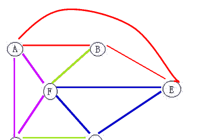

#### 数据结构

- 概括的来说：数据结构描述现实世界实体的数学模型（非数值计算）及其上的操作在计算机上的表示和实现。

### 1.2 基本概念

- 数据：所有能够被输入到计算机中且能被计算机处理的符号的总称，是计算机处理的信息的某种特定的符号表示形式。

- 数据项：数据结构中讨论的最小单位。即数据项是不可分割的最小单位。
- 数据元素是数据项的集合。

| 姓名 | 年龄 | 出生日期 | 职务 |
| --- | --- | --- | --- |
|  |  | 年/月/日 |  |


数据对象：是具有相同性质的数据元素的集合。
整数数据对象
N = { 0, ±1, ±2, ... }
如：学生档案组成一个数据对象

- 数据结构：带结构的数据元素的集合。

- 例如：一个12位的十进制数可以用三个四位的十进制数表示。

123456789123 = a1(1234) a2(5678) a3(9123)

a1 a2 a3 之间存在着次序 <a1,a2> <a2,a3>

- 例如：两行三列的二维数组
- {a1,a2,a3,a4,a5,a6}

| a1 | a2 | a3 |
| --- | --- | --- |
| a4 | a5 | a6 |

行：row={<a1,a2>,<a2,a3>,<a4,a5>,<a5,a6>}
列：col={<a1,a4>,<a2,a5>,<a3,a6>}

#### 数据的逻辑结构可以分为以下四类

- 线性结构：
- 树形结构：
- 图状结构：
- 集合结构：

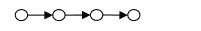

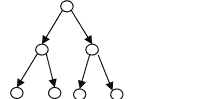

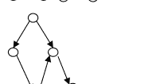

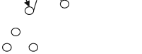

- 数据结构的形式定义为：
- Data_Structure = ( D , S)

D 是数据元素的有限集
S 是D上关系的有限集

- 数据的存储结构：
  - 逻辑结构在计算机中的表示（又称映像）称为数据的物理结构，又称存储结构。
  - 它包括数据元素的表示和关系的表示。

- 数据元素的映像方法：

  用二进制位的位串来表示数据元素
  (321)₁₀ = (501)₈ = (101000001)₂
  A = (101)₈ = (001000001)₂

- 关系的映像方法：

- 数据元素之间的关系在计算机中有两种不同的表示方法：顺序映像和非顺序映像，并由此得到两种不同的数据结构：顺序存储结构和链式存储结构。

- 顺序映射：
  顺序映射的特点是借助元素在存储器中的相对位置来表示数据元素间的逻辑关系。
- 非顺序映射：
  非顺序映射的特点是借助指示元素存储地址的指针表示数据元素之间的逻辑关系。

- 数据类型：
  数据类型是一个值的集合和定义在这个值集上的一组操作的总称。

- 抽象数据类型（ADT）：

  是指一个数学模型以及定义在此模型上的一组操作。

- 两个重要特性：
  - 数据抽象：抽象数据类型的定义取决于它的一组逻辑特性，而与其在计算机内部如何表示和实现无关，即无论其内部结构如何变化，只要它的数学特性不变，都不影响其外部使用。
  - **数据封装：** 将实体的外部特性与其内部实现分离，并且对外部用户隐藏其内部实现细节。

- 抽象数据类型可以用如下三元组来表示
- （D , S , P）
- 其中D是数据对象，S是D上的关系集，P是对D的基本操作。

- 我们采用如下格式定义抽象数据类型

- **ADT 抽象数据类型名 {**
  数据对象：〈数据对象的定义〉
  数据关系：〈数据关系的定义〉
  基本操作：〈基本操作的定义〉
} ADT 抽象数据类型名

- 基本操作的格式定义为：
- 基本操作名（参数表）
  - 初始条件：<初始条件描述>
  - 操作结果：<操作结果描述>

抽象数据类型实例 p9

### 1.4 算法

- 算法：是为了解决某类问题而规定的一个有限长的操作序列。
- 一个算法必须满足以下五个重要特性：
  - 1. 有穷性
  - 2. 确定性
  - 3. 可行性
  - 4. 输入
  - 5. 输出

- 1. 有穷性：一个算法必须总是（对任何合法的输入值）在执行有穷步之后结束，且每一步都可在有穷时间内被完成。
- 2. 确定性：算法中的每条指令必须有确切的含义，不会产生二义性。在任何条件下，算法只有唯一的执行路径，即相同的输入得到相同的结果。
- 3. 可行性：即算法中描述的操作都是可以通过已经实现的基本运算执行有限次来实现的。
- 4. 输入：一个算法有零个或多个输入，

#### 算法设计的要求

- 一个算法在设计的时候要遵循以下原则
  - 1. 正确性
  - 2. 可读性
  - 3. 健壮性
  - 4. 高效率与低存储量需求

- 1. 正确性一般分为以下4个层次：
  - 1. 程序不含语法错误。
  - 2. 程序对于几组输入数据能够得出满足要求的结果。
  - 3. 程序对于精心选择的典型、苛刻而带有刁难性的几组输入数据能够得出满足要求的结果。
  - 4. 程序对于一切合法输入都能得出满足要求的结果。

- 2. 可读性：算法应该是易于理解。另一方面，晦涩难懂的程序也比较容易隐藏错误而且难以调试。
- 3. 健壮性：当输入数据非法的时候，算法应当恰当地做出反应或者进行处理，而不是产生莫名其妙的结果或者中断程序。
- 4. 高效率和低存储量：效率指算法执行的时间，低存储量是指算法执行过程中所需要的最大存储空间。两者都与问题的规模有关。


- 算法效率的度量有以下两种方法：
  - （1）事后统计
    - 缺点：
      - 1. 必须执行程序。
      - 2. 其他因素容易掩盖算法本身的优劣。
  - （2）事前分析估算：一个用高级语言编写的程序在计算机上运行时所消耗的时间取决于下列因素。
    - 1. 算法选用何种策略。
    - 2. 问题规模。
    - 3. 语言级别越高，效率越低。
    - 4. 编译程序产生的机器代码的质量。
    - 5. 机器执行指令的速度。

- 一个特定算法的“运行工作量”的大小，只依赖于问题的规模（通常用整数 n 表示），或者说它是问题规模的函数。
- 算法 = 控制结构 + 原操作（控制结构：顺序、分支、循环）。
- 则算法的时间取决于两者的综合效果。

为了便于比较同一问题的不同算法，通常做法是从算法中选取一种对于所研究的问题来说是基本操作的原操作，以该基本操作的重复执行次数作为算法的时间量度。

一般情况下，算法中基本操作重复执行的次数是问题规模 n 的某个函数 f(n)，算法的时间度量记作：

T(n) = O(f(n))

当 n → ∞ 时，把时间复杂度的数量级（阶）称为算法的渐近时间复杂度。

```c
for (i = 1; i <= n; i++)
    for (j = 1; j <= n; ++j) {
        c[i][j] = 0;
        for (k = 1; k <= n; ++k)
            c[i][j] += a[i][k] * b[k][j];
    }
```

T(n) = O(n³)

```c
void select_sort(int a[], int n) {
    for (i = 0; i < n - 1; ++i) {
        j = i;
        for (k = i + 1; k < n; ++k)
            if (a[k] < a[j]) j = k;
        if (j != i) a[j] <-> a[i];
    }
}
```

基本操作执行次数为 (n² - n)/2

T(n) = O(n²)

输入数据不影响时间复杂度。

```c
void bubble_sort(int a[], int n) {
    for (i = n - 1, change = true; i > 1 && change; --i) {
        change = false;
        for (j = 0; j < i; ++j)
            if (a[j] > a[j + 1]) {
                a[j] <-> a[j + 1];
                change = true;
            }
    }
}
```

输入数据影响时间复杂度：如果 a 是递增序列，那么基本操作执行次数为 0；如果 a 是递减序列，则基本操作的执行次数为 n(n-1)/2。一般我们讨论的时间复杂度均指最坏情况。

#### 1.4.4 算法的存储空间需求

- 算法的空间复杂度
- S(n) = O(g(n))
- 表示随着问题规模 n 的增大，算法所需存储量的增长率与 g(n) 的增长率相同。

- 算法的存储量包括：
  - 1. 输入数据所占空间。
  - 2. 程序本身所占空间。
  - 3. 辅助变量所占空间。

## 第二章：线性表

- 线性表的定义
- 线性表的逻辑结构
- 线性表的存储结构
- 线性表的应用

### 线性结构

- 线性结构是一个数据元素的有序集。
- 基本特点：
  - 集合中必存在唯一的一个“第一个元素”。
  - 集合中必存在唯一的一个“最后元素”。
  - 除最后元素外，均有唯一后继。
  - 除第一个元素外，均有唯一前驱。

### 2.1 线性表的类型定义

例1、26个英文字母组成的字母表（A，B，C，…，Z）

例2、一副扑克的点数（2，3，4，…，J，Q，K，A）

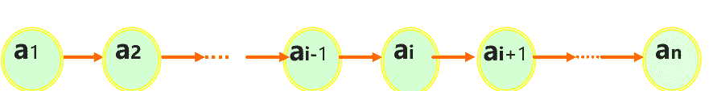

**例3、学生健康情况登记表如下：**

| 姓名 | 学号 | 性别 | 年龄 | 健康情况 |
|---|---|---|---|---|
| 王小林 | 790631 | 男 | 18 | 健康 |
| 陈红 | 790632 | 女 | 20 | 一般 |
| 刘建平 | 790633 | 男 | 21 | 健康 |
| 张立立 | 790634 | 男 | 17 | 神经衰弱 |
| …… | …… | …… | …… | …… |

定义：n（≥0）个数据元素的有限序列，记作：

(a₁, …, a_{i-1}, a_i, a_{i+1}, …, a_n)

其中，a_i 是表中数据元素，n 是表长度。

| 姓 名 | 学 号 | 性 别 | 年龄 | 健康情况 |
| --- | --- | --- | --- | --- |
| 王小林 | 790631 | 男 | 18 | 健康 |
| 陈 红 | 790632 | 女 | 20 | 一般 |
| 刘建平 | 790633 | 男 | 21 | 健康 |
| 张立立 | 790634 | 男 | 17 | 神经衰弱 |
| …… | …… | …… | …… | …… |

特点：

- 同一性：线性表由同类数据元素组成，每一个 a_i 必须属于同一数据对象。
- 有穷性：线性表由有限个数据元素组成，表长度就是表中数据元素的个数。n = 0 时称为空表。
- 有序性：线性表中相邻数据元素之间存在着序偶关系 &lt;a_i, a_{i+1}&gt;。

抽象数据类型定义：P19

#### 算法2.1

例2-1 利用两个线性表 LA 和 LB 分别表示两个集合 A 和 B，现要求一个新的集合 A = A ∪ B。

**算法的基本思想**

分别拿表 LB 中的每一个元素和表 LA 中的所有元素进行比较，如果表 LA 中没有这个元素，则在表 LA 中插入该元素。

```c
void union(List &La, List Lb) {
    La_len = ListLength(La);
    Lb_len = ListLength(Lb);
    for (i = 1; i <= Lb_len; i++) {
        GetElem(Lb, i, &e);
        if (!LocateElem(La, e, equal))
            ListInsert(La, ++La_len, e);
    }
}
```

T(n) = O(ListLength(La) × ListLength(Lb))

#### 算法2.2

例2-2 已知线性表 LA 和线性表 LB 中的数据元素按值非递减有序排列，现要求将 LA 和 LB 归并为一个新的线性表 LC，且 LC 中的元素仍按值非递减有序排列。

**算法的基本思想**

先设 LC 为空表，然后将 LA 或 LB 中的元素逐个插入到 LC 中。为使 LC 中元素按照递增有序排列，可设两个指针 i 和 j 分别指向 LA 和 LB 中的某个元素，设当前 i 所指的元素为 a，当前 j 所指的元素为 b，则当前应插入到 LC 中的元素 c 的值为：

```
c = { a    当 a <= b
      b    当 a > b }
```

```c
void MergeList(List La, List Lb, List &Lc) {
    InitList(&Lc);
    i = j = 1;
    k = 0;
    La_len = ListLength(La);
    Lb_len = ListLength(Lb);
    while ((i <= La_len) && (j <= Lb_len)) {
        GetElem(La, i, &ai);
        GetElem(Lb, j, &bj);
        if (ai <= bj) {
            ListInsert(&Lc, ++k, ai);
            ++i;
        } else {
            ListInsert(&Lc, ++k, bj);
            ++j;
        }
    }
    while (i <= La_len) {
        GetElem(La, i++, &ai);
        ListInsert(&Lc, ++k, ai);
    }
    while (j <= Lb_len) {
        GetElem(Lb, j++, &bj);
        ListInsert(&Lc, ++k, bj);
    }
}
```

T(n) = O(ListLength(La) + ListLength(Lb))

#### 线性表的存储结构

分为两大类：

- 顺序存储
- 链式存储

### 2.2 顺序表

定义：指用一组地址连续的存储单元依次存放线性表的数据元素。

存储结构：数组。

特点：逻辑结构相邻的节点在存储结构中仍相邻。

存取方式：随机存取。

顺序存储结构示意图

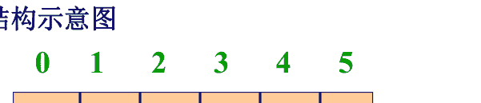


#### 顺序存储

| 存储地址 | 存储内容 |
|---|---|
| L₀ | 元素1 |
| L₀+m | 元素2 |
| ...... | ...... |
| L₀+(i-1)*m | 元素i |
| ...... | ...... |
| L₀+(n-1)*m | 元素n |

Loc(元素i)=L₀+(i-1)*m

Loc(元素i+1)= Loc(元素i)+m

#### 顺序表（SeqList）的类型定义

```
#define List_init_Size 100  //初始分配量
#define Listincrement 10  //分配增量
```

```
typedef struct
{
    ElemType * elem;  //存储空间基址
    int length;       //当前元素个数
    int listsize ;    //当前分配的存储容量
} SqList;
```

#### 顺序表（SeqList）的类型定义

```
#define List_init_Size 100   //初始分配量
#define Listincrement 10   //分配增量
typedef struct
{
    ElemType * elem;    //存储空间基址
    int length;         //当前元素个数
    int listsize ;      //当前分配的存储容量
} SqList;
```

```
L.length = 0;
L.listsize= List_init_Size;
return OK;
}
```

#### 插入:线性表的插入运算是指在表的第i(1≤i≤n+1)个位置上，插入一个新结点x

原位置的值16被覆盖

插入 x 50

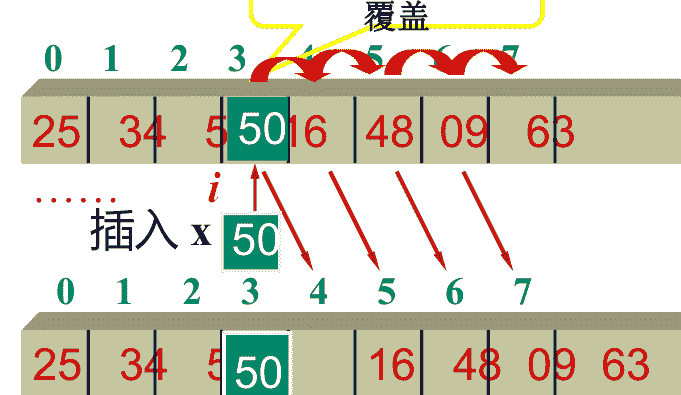

#### 插入算法的基本思想

- 首先判断插入位置是否合法，若合法则
  - 把第i个到第n个之间的所有结点依次向后移动一个为止，空出第i个结点位置
  - 将新结点x插入第i个结点的位置，线性表长度加1；
  - 如插入成功，函数返回值为1；否则，函数返回值为0。

插入:线性表的插入运算是指在表的第i(1≤i≤n+1)个位置上，插入一个新结点x

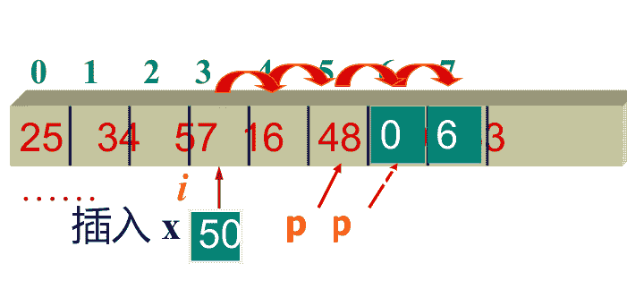

#### 顺序表的插入

```
status ListInsert_sq ( SqList &L, int i , ElemType e)
//在表中第 i 个位置插入新元素 x
{
    if(i<1 || i>L.length+1)  return ERROR;
    if(L.length>=L.listSize)
    {
        newbase=(ElemType*)realloc(L.elem,(L.listsize+L.listincrement)*sizeof(ElemType));
        if(!newbase) exit(overflow);
        L.elem=newbase;
        L.listsize+=Listincrement;
    }
}
```

```
q=&(L.elem[i-1]); //q为插入位置
for(p=&L.elem[L.length-1];p>=q;p--)
    *(p+1)=*p;
*q=e;
++L.length;
return OK;
}
```

#### 插入算法分析

- 当 i=1 时，结点后移语句将循环执行 n 次
- 当 i=n+1 时，结点后移语句将不进行
- 当 i 是一个随机数时：
  需移动元素的平均次数：Eis(n)=∑_{i=1}^{n+1} p_i (n-i+1)
  又 p₁=p₂=p₃=...=p_{n+1}=1/(n+1)

#### 插入算法分析

Eis = \frac{1}{n+1} \sum_{i=0}^{n} (n - i) = \frac{1}{n+1} (n + \cdots + 1 + 0) 

= \frac{1}{(n+1)} \frac{n(n+1)}{2} = \frac{n}{2}

其时间复杂度为 O（n）。

#### 删除

删除 x

0 1 2 3 4 5 6 7

25 34 57 51 16 48 09 63

25 34 57 50 48 09 63

……

……

#### 删除算法的基本思想(第i个位置的元素)

首先判断删除位置是否合法，若合法则
- 将第i+1个到第n个之间的元素依次向前移动一个位置
- 顺序表长度减一
- 若删除成功，函数返回值为1，否则函数返回值为0

#### 删除

25 34 57 5 1 16 48 09 63

...... 删除 p q

#### 顺序表的删除(第i个位置的元素)

```
Status ListDelete_sq (SqList &L, int i, ElemType &e)
{
	if (i<1||i>L.length) return ERROR;
	P=&L.elem[i-1];
	e =*P;
	q= L.elem+ L.length-1 ;
	for(++p;p<=q;++p)
		*(p-1)=*p;
	--L.length;
	return OK;
}
```
//p为被删除元素位置
//被删除元素值赋值给e
//表尾元素位置
//被删除元素之后的元素左移

#### 删除算法分析

- 若 i=n，则由于循环变量的初值大于终值，前移语句将不执行
- 若 i=1，则前移语句将循环执行 n-1 次
- 当 i 是一个随机数时：
  $Edl = \frac{1}{n} \sum_{i=1}^{n} (n - i) = \frac{1}{n} \frac{(n - 1)n}{2} = \frac{n - 1}{2}$
- 其时间复杂度为 O（n）。

按值查找：在顺序表中从头查找结点值等于给定值 e 的结点的位置

```
int LocateElem_Sq ( SeqList &L, ElemType e ,
    Status(*compare)(ElemType,ElemType))
{
    int i = 1;
    p=L.elem;

    while ( i <= L.length && !(*compare)(*p++,e) )
        ++i;

    if ( i <= L.length )  return i;
    else return 0;
}
```

#### 顺序表的应用:集合的“并”运算

```
void MergeList_sq ( SeqList La, SeqList Lb, SqList &Lc )
{
pa=La.elem; pb=Lb.elem;
Lc.listsize=Lc.length=La.length+L b.length;
pc=Lc.elem=( ElemType * ) malloc (Lc.ListSize * sizeof (ElemType ) );
if(! Lc.elem)  exit(OVERFLOW);
pa_last=La.elem+La.length-1;
pb_last=Lb.elem+L b.length-1;
while(pa<=pa_last&&pb<=pb_last)
{
if(*pa<=*pb)  *pc++=*pa++;
else *pc++=  *pb++;
}
While (pa<=pa_last)*pc++=*pa++;
While (pb<=pb_last)*pc++=*pb++;
}
```

#### 顺序存储结构的优点

- 优点
  - 逻辑相邻，物理相邻
  - 可随机存取任一元素
  - 存储空间使用紧凑

#### 顺序存储结构的缺点

- 缺点
  - 插入、删除操作需要移动大量的元素
  - 预先分配空间需按最大空间分配，利用不充分
  - 表容量难以扩充

#### 说明

- 上面列出的操作，只是顺序表的一些常用的基本操作；
- 不同的应用，基本操作可能是不同的；
- 顺序表的复杂操作可通过基本操作实现；

### 链表 (Linked List)

#### 链表是线性表的链接存储表示

- 单链表
- 静态链表
- 循环链表
- 双向链表

#### 单链表(Singly Linked List)

定义：用一组地址任意的存储单元存放线性表中的数据元素(存储单元可以是连续,也可以是不连续的)。

每个元素由结点(Node)构成,它包括两个域:数据域Data和指针域next

Node

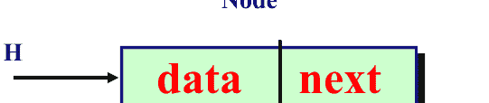


#### 单链表(Singly Linked List)

单链表（A,B,C,D,E,F,G）的示例图：

头指针H

31

| 存储地址 | 数据域 | 指针域 |
|---|---|---|
| 1 | F | 13 |
| 7 | E | 1 |
| 13 | G | null |
| 19 | B | 37 |
| 25 | D | 7 |
| 31 | A | 19 |
| 37 | C | 25 |

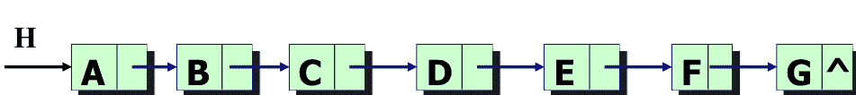

##### 单链表的类型定义

Node

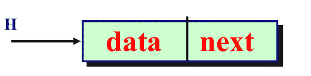

```
typedef struct Lnode {
    elemtype data;          //节点数据域
    struct Lnode * next;    //节点链域
} LNode,* LinkList;
LinkList H;
//链表结点
```

头指针H
31

| 存储地址 | 数据域 | 指针域 |
|---|---|---|
| 1 | F | 13 |
| 7 | E | 1 |
| 13 | G | null |
| 19 | B | 37 |
| 25 | D | 7 |
| 31 | A | 19 |
| 37 | C | 25 |


* 单链表是一种顺序存取的存储结构

##### 单链表的基本运算

插入(不带头结点的链表)位置的考虑

- 第一种情况：在第一个结点前插入
- 第二种情况：在链表中间插入
- 第三种情况：在链表末尾插入

###### 不带头结点单链表的插入运算

第一种情况：在第一个结点前插入

```
s->next= L;

L = s;
```

###### 不带头结点单链表的插入运算

- 第二情况：在链表中间插入

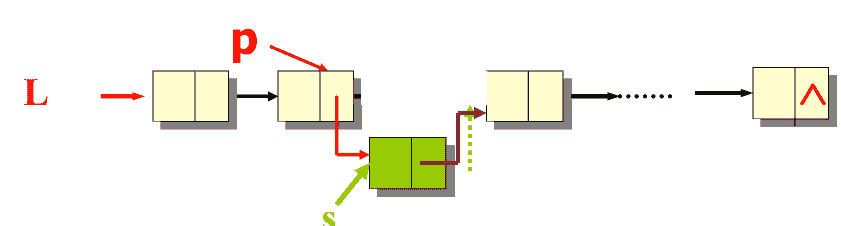

```
s->next = p->next;
 p->next = s;
```

###### 不带头结点单链表的插入运算

第三种情况：在链表末尾插入

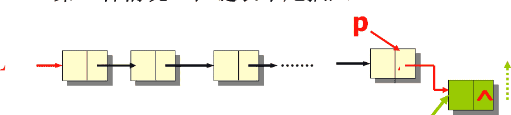

```
s->next = p->next;

p->next = s;
```

```
int Insert ( LinkList& L, int i, ElemType e )
{
    // 在链表第 i 个节点处插入新 e
    LinkList p = L;
    int j = 0;
    while ( p != NULL && j < i - 1 )
    { p = p->next; j++; }    // 找第 i-1 个节点

    if ( p == NULL || j > i - 1 )
        return ERROR;    // 判断插入位置是否有效

    s = (LinkList) malloc ( sizeof (LNode) );
    // 创建新节点
```

```
s->data = e;
if ( L== NULL || i == 1 )
{
    s->next = L;
    L = s;
}
else {
    s->next = p->next;
    p->next = s;
}
return OK;
}
//插在表前
//插在表中或末尾
```

##### 带表头结点的单链表

带头结点的非空链表

带头结点的空链表

###### 表头结点

- 表头结点位于表的最前端，本身不带数据，仅标志表头。
- 设置表头结点的目的:
  - 简化链表操作的实现
  - 空表和非空表的处理统一

###### 带头结点单链表的插入运算

- 第一种情况：在第一个节点前插入

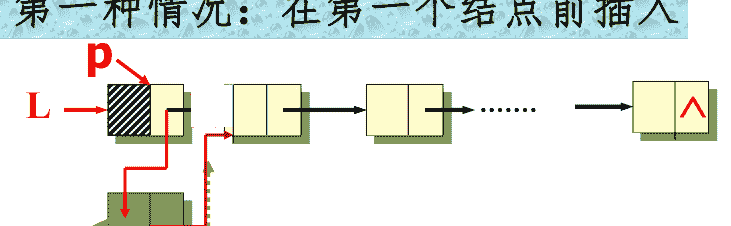

```
s->next = p->next;
 p->next = s;
```

###### 带头结点单链表的插入运算

- 第二情况：在链表中间插入

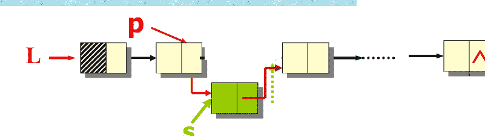

```
s->next = p->next;

p->next = s;
```

###### 带头结点单链表的插入运算

第三种情况：在链表末尾插入

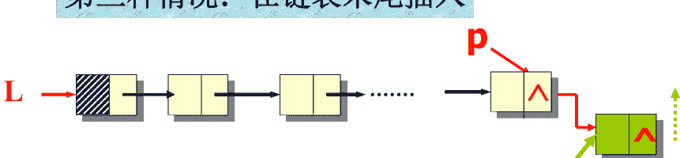

```
s->next = p->next;
 p->next = s;
```

###### 带头结点单链表的插入运算

由以上三种情况得出插入

```
s ->next = p->next;

p->next = s;
```

```
int ListInsert_L (LinkList &L, int i, elemtype e)
{
    //将新元素 x 插入在链表中第 i 号结点位置
    p = LocateElem_Sq ( L, i-1 );

    if ( p == NULL ) return ERROR;

    s =(LinkList) malloc (sizeof (LNode) );
    //创建新结点
    s->data = e;
    s->next = p->next;
    //链入
    p->next = s;
    return ok;
}
```

注：此处书中直接用语句实现

###### 带头结点链表取元素

```
Status GetElem_L(LinkList L, int i, ElemType &e)
{
    P=L->next;
    j=1;    //计数器
    While( p && j<i){ p=p->next; ++j; }
    if(!p||j>i)    return ERROR;
    e=p->data;
    return OK;
}
```

###### 带头结点单链表的删除运算

- 首先找到i-1的存储位置p。
- 把i从链上摘下。
- 最后释放结点i的空间，将其归还给“存储池”
- 考虑三种情况：

###### 带头结点单链表的删除运算

- 第一种情况：删除第一个结点

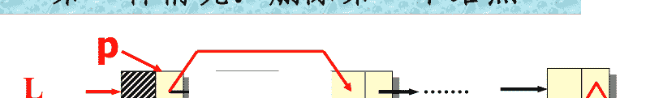

```
q = p->next;

p->next = q->next;

free(q);
```

###### 带头结点单链表的删除运算

- 第二种情况：删除中间结点

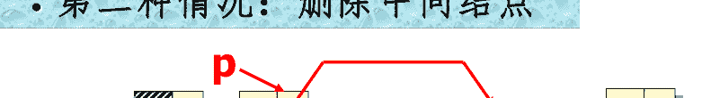

```
q = p->next;

p->next = q->next;

free(q);
```

###### 带头结点单链表的删除运算

- 第三种情况：删除最后一个结点

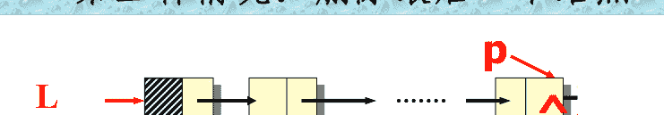

```
q = p->next;
p->next = q->next;
free(q);
```

```
int Listdelete_L( LinkList L, int i ,elemtype &e)
{
    //将链表第 i 号元素删去
    p = LocateElem_Sq( L, i-1 ); //寻找第i-1个结点
    if ( p == NULL || p->next == NULL) return 0;
    q = p->next;
    p->next = q->next;          //删除结点
    e=q->data;      free( q );      //释放
    return OK;
}
```

注：此处书中直接用语句实现

##### 前插法建立单链表(逆序p30)

###### 前插法建立单链表的基本思想

- 从一个空表开始，重复读入数据：
  - 生成新结点
  - 将读入数据存放到新结点的数据域中
  - 将该新结点插入到链表的前端
  - 直到读入n个数据为止。

###### 前插法建立单链表

空表时

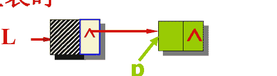

```
p = (LinkList) malloc (sizeof(LNode));

p->next = L->next;

L->next = p;
```


###### 前插法建立单链表

非空表时

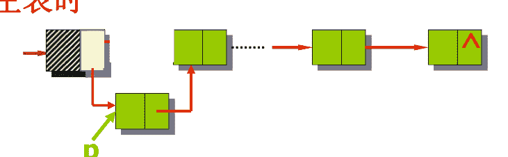

```
p = (LinkList) malloc (sizeof(LNode));
p->next = L->next;
L->next = p;
```

```
Void createList_L (LinkList &L, int n )
{
L = (LinkList) malloc (sizeof (LNode));
L->next = NULL;    //建立表头结点
For(i=n;i>0;--i)
{
p = (LinkList )malloc (sizeof(LNode));
scanf(&p->data);    //建立新结点
p->next = L->next;    //插入到表前端
L->next = p;
}
}
```

##### 后插法建立单链表

###### 后插法建立单链表的基本思想

+   从一个空表开始，重复读入数据：
+   - 生成新结点
+   - 将读入数据存放到新结点的数据域中
+   - 每次将新结点加在链表的表尾；

尾指针 r ，总是指向表中最后一个结点，新结点插在它的后面

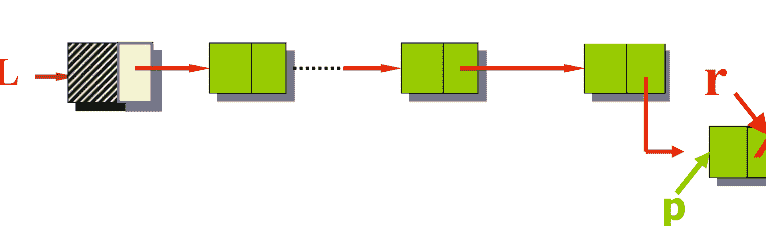

```
p = (LinkList) malloc (sizeof(LNode));
 r->next = p;   r = p;
 r->next = NULL;
```

```
Void createList_L (LinkList &L,int n )
{
    L = (LinkList) malloc (sizeof (LNode));
    L->next = NULL;  r=L;    //建立表头结点
    For(i=n;i>0;--i)
    {
        p = (LinkList) malloc (sizeof(LNode));
        scanf(&p->data );    //建立新结点
        r->next = p;    r =p;    //插入到表末端
    }
    r->next = NULL;
}
```

L->next != NULL

L

循环如下语句：

```
p = L->next;
```

```
L->next = p->next;
```

```
free( p );
```

##### 单链表清空

```
Void make Empty ( LinkList L )
{
    //删除链表中除表头结点外的所有其它结点
    LNode *p;
    while ( L->next != NULL )
    {
        p = L->next;
        L->next = p->next;
        //将表头结点后第一个结点从链中摘下
        free( p );  //释放
    }
}
```

##### 两个有序链表的合并的动态过程

La
Lc
pa
pc

```
如果 pa->data <= pb->data:
{pc->next=pa; pc=pa; pa=pa->next;}
```

```
如果 pa->data > pb->data:
{pc->next=pb; pc=pb; pb=pb->next;}
```

###### 两个有序链表的合并的基本思想

pa与pb分别指向La和Lb的第一个元素，Lc指向La的头结点，pc始终指向表Lc的表尾，pa所指元素与pb所指元素相比较：

+   - 如果pa->data<=pb->data,则将pa所指元素插入到pc后，并且Pa、pc指针下移;
+   - 反之，则将pb所指元素插入到pc后，并且pb、pc指针下移.

+   - 最后，将剩余部分插入到pc;

+   - 释放Lb的头结点。

##### 两个有序链表的合并

```
Void mergelist_L(linklist &La, linklist& Lb, linklist &Lc){
Pa=La->next; Pb=Lb->next;
Lc=pc=La;
While(pa&&pb) {
if(pa->data<=pb->data){
pc->next=pa;pc=pa;pa=pa->next;}
else{pc->next=pb; pc=pb;pb=pb->next;}
}
Pc->next=pa?pa:pb;
Free(Lb);
}mergelist-L
```

##### 单链表相关特点

+   - 存储结构：链式存储结构
+   - 特点：存储单元可以不连续也可以不连续。
+   - 存取方式：顺序存取。

#### 循环链表 (Circular List)存储

带表头

判空条件：
L->next==L

L

L

(非空表)

(空表)

特点:最后一个结点的 next 指针不为NULL,
而是指向头结点。

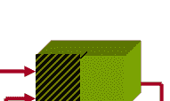

##### 单循环链表的应用

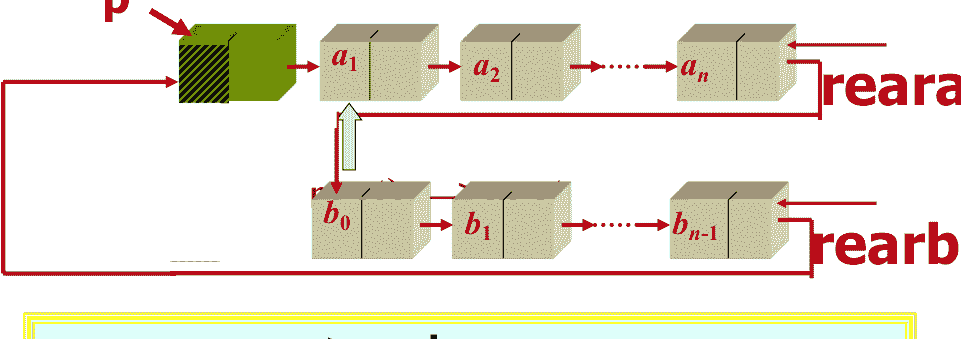

```
p=reara->next;
reara->next=(rearb->next)->next;
free(rearb->next);
rearb->next=p;
```

```
linklist connect(linklist reara,linklist &rearb)
{
    linklist p=reara->next;
    reara->next=(rearb->next)->next;
    free(rearb->next);
    rearb->next=p;
    return(rearb);
}
```

#### 循环链表 (Circular List)

注意：

非循环链表终止条件： p->next=NULL 或p=NULL

循环链表终止条件： p->next=L 或p=L
p->next=rear 或p=rear

#### 双向链表 (Doubly Linked List)

双向链表节点结构：

prior data next

指向直接前驱

指向直接后继

L

非空表

L

空表

##### 双向循环链表的定义


指向直接前驱

指向直接后继

```
typedef struct duLnode
{
    elemtype data;
    struct duLinkList *prior, * next;
} DulNode, * DuLinkList;
```

###### 建立空的双向循环链表的基本思想

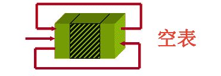

L

空表

```
L = ( DuLinkList ) malloc( sizeof( DulNode ) );
```

```
L->next = L;
```

```
L->prior =L;
```

使用malloc函数取得一个结点作为头结点，并使它的链指针指向自己

###### 建立空的双向循环链表

```
void CreateDuList(DuLinkList & L)
{
    L = (DuLinkList) malloc ( sizeof ( DulNode ) );
    if ( L == NULL )
    { print ( "存储分配错!\n" ); exit ; }
    L->prior = L->next = L;
}
```

> //表头结点的链指针指向自己

###### 计算双向循环链表的长度

```
int Length ( DuLinkList L )
{
    //计算带表头结点的双向循环链表的长度
    DuLinkList p = L->next;
    int count = 0;
    while ( p != L )
    { p = p->next; count++; }
    return count;
}
```

###### 双向循环链表插入 (在i之后)的动态过程

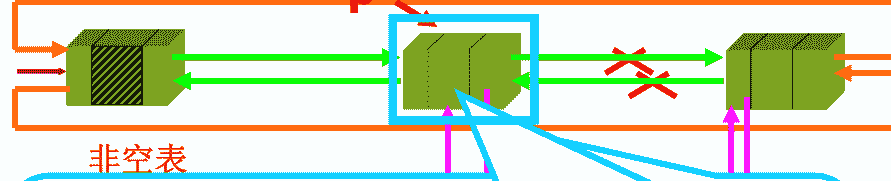

非空表

结论：

```
p->next->prior = p = p->prior->next
```

在后继方向链入新结点：

```
s->next = p->next;
 p->next = s;
```


###### 双向循环链表插入（空表在i之后）的动态过程

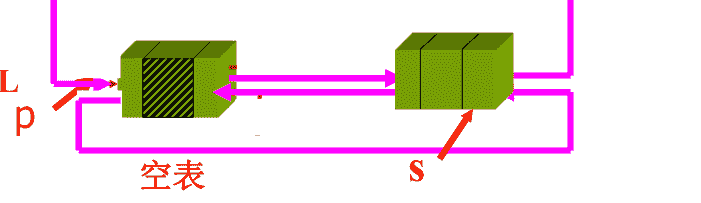

```
在前驱方向链入新结点: s->prior = p;
 p->next->prior = s;

在后继方向链入新结点: s->next = p->next;
 p->next = s;
```

###### 双向循环链表插入 (在i之后)算法

```
Status Insert ( DulinkList &L, int i, ElemType e )
{
    //在第i个位置之后插入元素e
    if ( !(p=GetElemP_Dul(L,i)) )
        return ERROR;    //指针定位于插入位置
    if(!(s = ( DuLinkList ) malloc ( sizeof ( DulNode ) ));
        //分配结点
    s->data = e;
    s->prior = p;    p->next->prior = s;
        //在前驱方向链入新结点
    s->next = p->next;  p->next = s;
        //在后继方向链入新结点
    return OK;
}
```

注: 与书中p36不同

###### 双向循环链表插入 (在i之前)的动态过程

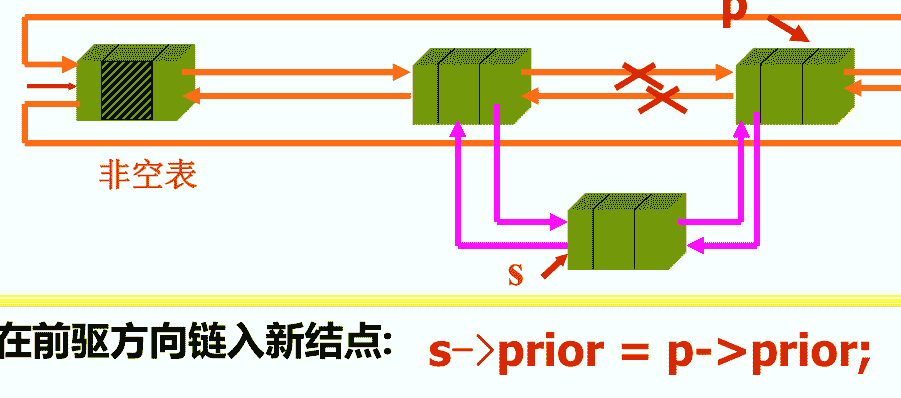

L
非空表
p
s

```
在前驱方向链入新结点: s->prior = p->prior;
 p->prior = s;
```

```
在后继方向链入新结点: s->next = p;
 s->prior ->next = s;
```

###### 双向循环链表插入（在i之前）算法

```
Status ListInsert ( DulinkList &L, int i, ElemType e )
{
    //第1个位置之后插入元素。
    if ( !(p == GetElemP_Dul(L,i)) )
        return error;
    //指针定位于插入位置
    if(! s = ( DuLinkList ) malloc ( sizeof ( DulNode ) ))
        return error;
    //分配结点
    s->data = e;
    s->prior = p->prior;    p->prior = s;
    //在前驱方向链入新结点
    s->next = p;            s->prior->next = s;
    //在后继方向链入新结点
    return OK;
}
```

> 注：与书中p36不同（学生自己做）

###### 双向循环链表删除的动态过程

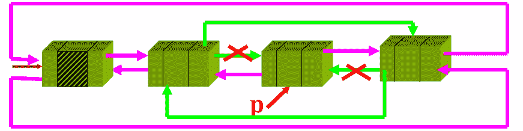

```
p->prior->next = p->next;

p->next->prior = p->prior;

free( p );
```

###### 双向循环链表删除的算法

```
Status ListDelet_Dul ( DulinkList &L, int i ,ElemType &e)
{
    if (!(p = GetElemP_Dul ( L, i )))
        return ERROR;    // 指针位于删除结点位置
    
    e=p->data;
    p->prior->next = p->next;
    p->next->prior = p->prior;
    
    // 删除结点 p
    free ( p );    // 释放
    return OK;
}
```

### 顺序表与链表的比较

#### 基于空间的比较

+   • **存储分配的方式**
+     - 顺序表的存储空间是静态分配的
+     - 链表的存储空间是动态分配的

+   • **存储密度** = 结点数据本身所占的存储量 / 结点结构所占的存储总量
+     - 顺序表的存储密度 = 1
+     - 链表的存储密度 < 1

### 顺序表与链表的比较

#### 基于时间的比较

+   - 存取方式
+     - 顺序表随机存取
+     - 链表是顺序存取

+   - 插入/删除时移动元素个数
+     - 顺序表平均需要移动近一半元素
+     - 链表不需要移动元素，只需要修改指针

### 2.4 线性表的应用举例

#### 一元多项式的表示及相加

假设Qm(x)一元多项式的表示：

Q(x) = Q₀ + Q₁x + Q₂x² + ...... + Qₙxⁿ

它的系数表可表示为：

Q = ( Q₀, Q₁, Q₂, ......, Qₙ )

### 2.4 线性表的应用举例

#### 一元多项式的表示及相加

假设m<n，则这两个多项式相加

Rₙ(x) = Pₙ(x) + Qₘ(x)

Rn(x)的系数可以用线性表表示为：

R = (P0 + Q0 , P1 + Q 1, ......, Pm + Qm , Pm+1...... Pn )

则Rn(x)的系数可以用顺序的存储结构来实现

### 2.4 线性表的应用举例

#### 一元多项式的表示及相加

假设形如：

S(x) = 1 + 3x¹⁰⁰⁰ + 2x²⁰⁰⁰⁰

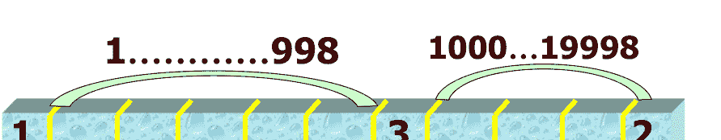

采用顺序存储造成空间浪费

### 2.4 线性表的应用举例

一元多项式的表示及相加

+   - 一元多项式可改写为

```
P_n(x) = P_1 x^{e1} + P_2 x^{e2} + \dots + P_m x^{em}
```

+   - 其中：

0<=e0, e1 , e2 ...... em<=n

# ### 2.4 线性表的应用举例（大连理工2003）
#### 一元多项式的表示及相加

用数据域含两个数据项的线性表表示

$((P_1,e_1),(P_2,e_2),\cdots,(P_m,e_m))$

+   - 其存储结构可以用顺序存储结构，也可以用单链表

##### 单链表的结点定义


```
typedef struct node
{
    int coef,exp;
    struct node *next;
}JD;
```

##### 一元多项式相加的单链表形式

A(x) = 7 + 3x + 9x² + 5x¹⁷

B(x) = 8x -9x² +22x⁷

C(x) = A(x) + B(x) = 7 + 11x + 22x⁷ + 5x¹⁷

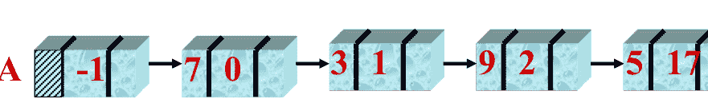

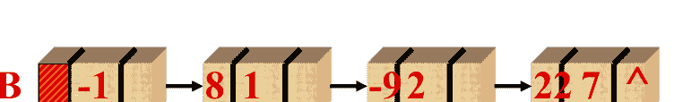

###### 一元多项式相加的单链表形式的动态过程

A(x) = 7 + 3x + 9x² + 5x¹⁷

B(x) = 8x -9x² +22x⁷

C(x) = A(x) + B(x) = 7 + 11x + 22x⁷ + 5x¹⁷

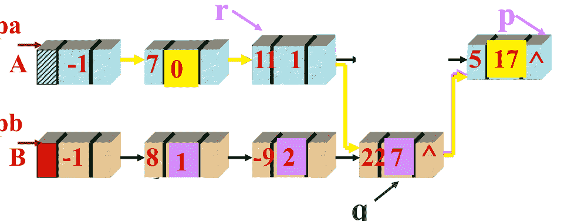

##### 一元多项式相加的基本思想

如果p-> exp = q-> exp :
系数相加（coef）

+   - =0: 从A表中删去结点, 释放p,
+   - ≠0: 修改p系数域, r后移

从B表中删除结点，释放q，p,q后移

###### p-> exp < q-> exp :插入结点的动态过程

```
操作语句:

r=p;

p=p->next;
```

###### p-> exp= q-> exp （和x等于零） :插入结点的动态过程

pa
A
-1
7 0
3 1
9 2
5 17 ^
pb
B
-1
-9 2
22 7 ^
r
p
p
s
q

###### 操作语句:

```
r->next=p->next;
free(p);    p=r->next;
s=q;        q=q->next;
free(s);
```

###### ▪ p-> exp= q-> exp（和x不等于零）：插入结点的动态过程

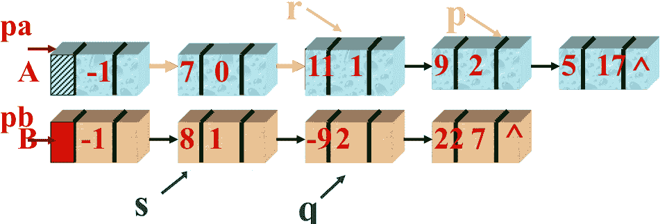

###### 操作语句:

```
p->coef=x;
r=p;    p=r->next;

s=q;    q=q->next;
free(s);
```


###### p-> exp > q-> exp :插入结点的动态过程

pa
A

r

p

操作语句:

```
s=q->next;
q->next=p;
r->next=q;
r=q;  q=s;
```

r

s q

##### 一元多项式相加的基本思想

直到p或q为NULL

若p==NULL 结束

若q==NULL 将B中剩余部分连到A上即可

##### 回顾：一元多项式相加的单链表形式的算法

```
void add_poly(JD *pa,JD *pb)
{ JD *p,*q,*s,*r;
    int x;
    p=pa->next;
    q=pb->next;
    r=pa;
```

##### 一元多项式相加的单链表形式

```
while((p!=NULL) && ((q!=NULL))
```

```
{ if(p->exp<q->exp)
```

```
{ r=p; p=p->next;}
```

```
else if(p->exp==q->exp)
```

```
{ x=p->coef+q->coef;
```

##### 一元多项式相加的单链形式

```
if(x==0){r->next=p->next; free(p);}
else {p->coef=x; r=p; }
p=r->next;
s=q;
q=q->next;
free(s);
}
```

##### 一元多项式相加的单链表形式

p->exp>q->exp

```
else
{
  s=q->next;
  q->next=p;
  r->next=q;
  r=q;  q=s;
}
```

##### 一元多项式相加的单链表形式

```
if(q!=NULL)
    r->next=q;
```

```
free(pb);
```

```
}
```

```
}
```

### 线性表的应用实例

- 在“线切割编程控制软件”中的链表

#### 1、应用背景

电加工技术是机械特种加工的一个重要分支，随着计算机技术的飞速发展，点加工数字控制技术也有了飞跃的提高，这里介绍了一套在windows平台上的线切割编程控制软件。

### 线性表的应用实例

它的工作过程大致如下：

- 首先由通用的CAD平台，（AUTOCAD），生成待加工零件的几何图形，输出标准的dxf文件。
- 有自动编程软件读入该dxf文件，在加工向导的指示下，用鼠标选取工艺参数，选择穿丝点、起切元素、切割方向等参数，计算机按照选择，自动生成加工链表，由加工链表生成NC代码。

### 线性表的应用实例

它的工作过程大致如下：

- 通过仿真模块，读入刚生成的NC代码，输入工艺参数，模拟加工，检查代码错误。
- 计算机自动生成共意图和工艺卡，由打印机打印输出
- 将代码传输给控制机

### 线性表的应用实例

- 在“线切割编程控制软件”中的链表

在这个线切割编程控制软件中，两次使用了链表，第一次时将输入的工艺参数自动生成链表，第二次是把NC代码转换成加工信息，进而生成加工链表。

### 线性表的应用实例

### 思考题

假设已经读入了一系列的加工数据，以数组的形式存放，其中每一组数数据包括穿丝点、起切元素、切割方向。请同学们设计一个算法，用来生成一个单链表，把输入的加工数据转换为一个单链表。

### 线性表的应用实例

二、在“多传感器侦察数据的融合处理”中的双向链表的应用

#### 1、应用背景

未来对战场通信目标的侦察具有数据容量大、来源途径多和相关层次多的特点，在战区情报处理中心，需要对各种各类侦察数据进行有效的融合处理和情报总和，使之形成对通信目标状态清晰、可靠和完备的情报描述。

### 线性表的应用实例

- 它的工作过程大致如下：

对于多传感器的侦察数据，由于数据种类众多，通常采用的技术使同时进行多维链表的操作处理，这样，对目标通信网台信息类数据的融合可以认为是一条链表上的同类源相关的处理，而对目标态势描述类侦察数据的融合则是另一条链表上的同类源相关的处理。

### 线性表的应用实例

- 它的工作过程大致如下：

由于各通信目标所涵盖的情报信息类别多。
同类源相关的运作通常是在多层链表中进行的，具体设计时，按网台位置参数和工作频率为元素构成第一层的两条链表，在按网台调制域特征和个体技术特征构成第一层的另外两条链表。

### 线性表的应用实例

- 在“线切割编程控制软件”中的链表

采用的技术是对于同一类目标在一段时间内
的侦察数据，用双向链表连接起来，进行融合
处理。

而对于多传感器的侦察数据，考虑到数据
种类众多，采用的处理技术是多维链表。多层
次，多维的双向链表技术构成了对目标较为真
实，完备的情报描述。

### 线性表的应用实例

### 思考题

假设得到了如下的多传感器侦察数据，目标通信网台位置参数1-经度、目标通信网台位置参数2-经度和目标通信工作频率，轻微上述传感器数据设计目标通信网台的结点数据结构和生成双向链表的算法。

### 思考题

- 线性表的顺序存储结构和链式存储结构的区别
- 带头结点的单链表和不带头结点的单链表的区别

### 第二章思考题：

- 求约瑟夫问题： n只猴子要选大王，选举方法是所有猴子按照1、2、3...n编号，围坐一圈，从第1号开始按1、2...m报数，凡是报到m号的猴子退出圈外，如此循环报数直到圈内只剩下一只猴子时，它就是大王，编写一个程序实现上述过程，n和m由键盘输入。

## 第三章 栈和队列

- 3.1 栈
- 3.1.1 抽象数据类型栈的定义
- 3.1.2 栈的表示和实现
- 3.2 栈的应用举例
- 3.4 队列

### 栈（Stack）

- **定义：**是限定仅在表尾进行插入或删除操作的线性表。
- 允许插入和删除的一端称为**栈顶**(top)，另一端称为**栈底**(bottom)

### 栈

top

base

a

b

c

#### 特点：

- 栈底固定不变
- 栈顶进行操作
- 后进先出

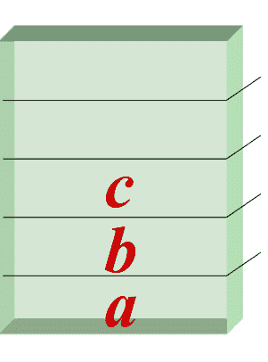

#### 栈的主要操作

- (1) 建栈，初始化一个栈
- (2) 进栈，向栈顶插入一新元素
- (3) 出栈，删除栈顶元素；
- (4) 读栈，取栈顶元素
- (5) 置空栈，将栈置为空
- (6) 判栈空，判断栈是否为空

#### 栈的表示和实现

● 栈的两种存储结构表示方法

- 栈的顺序存储结构简称为顺序栈
- 栈的链式结构称之为链栈

##### 顺序栈的表示和实现

- **顺序栈：**
  - 栈的顺序存储结构简称为顺序栈，即利用一组地址连续的存储单元依次存放自栈底到栈顶的数据元素。
  - 它是运算受限的线性表。

##### 顺序栈的类型表示：

```
#define STACK_INIT_SIZE 100;
#define STACKINCREMENT 10;
typedef struct
{
//顺序栈定义
SElemType *base; //栈底指针
SElemType *top; //栈顶指针
int stacksize; //当前已分配的存储空间
} SqStack;
```

空栈

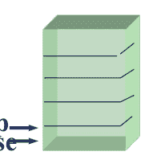

##### 顺序栈的动态实现

假设有线性表（a、b、c、d）

- 特点：
- 后进先出 (LIFO)

出栈后的线性表： d c b a

###### 初始化

```
status InitStack ( SqStack &S ) {  //置空栈
S.base =(SElemType *)malloc(STACK_INIT_SIZE * sizeof(SElemType));
If(!S.base)  exit(overflow);
S.top = S.base ;
S.stacksize= STACK_INIT_SIZE ;
Return ok;
}
```

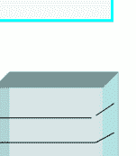

空栈

置空栈

##### 顺序栈的基本运算：

- 判栈空

```
Status StackEmpty (SqStack S)
{
    if( S. top == S.base ) return TRUE
    //判栈空,空则返回TRUE
    else return FALSE; //否则返回FALSE
}
```

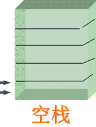

top
base
空栈


##### 顺序栈的基本运算：

```
判栈满
int StackFull (SqStack S)
{
    if( S.top- S.base >= S.StackSize )
        return TRUE; //判栈满,满则返回TRUE
    else return  FALSE; //否则返回FALSE
}
```

###### 取栈顶元素

```
Status Gettop (SqStack S, SElemType &e)
{
    //若栈空返回ERROR, 否则栈顶元素读到e并返回OK
    if( S.top == S.base ) return ERROR;
    e = *(S.top-1);
    return OK;
}
```

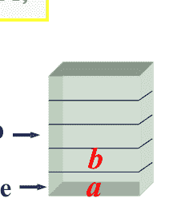

##### 顺序栈的基本运算：

###### 5、进栈算法的基本思想

- ◆ 首先，判断栈是否为空，若满，重新分配空间；
- ◆ 若栈未满，将新的元素e放入到栈顶指针所在的位置
- ◆ 将栈顶指针加一

```
入栈
Status Push (SqStack &S, SElemType &e)
{
    //插入元素x为新的栈顶元素
    if( S. top- S.base >= S. StackSize )
    {
        S.base =(SElemType *)realloc(S. base ,
            (S.stacksize+ STACKINCREMENT) *
            sizeof(SElemType));
        if(! S. base)exit(overflow);
        S. top= S.base + S.stacksize;
        S.stacksize+= STACKINCREMENT; //追加存储空间
    }
    *S. top++=e;
    Return ok
}
```

###### 6、出栈

此时再出栈 产生下溢

设有顺序栈A，待从... b、c、d出栈

e

top
top
top
top
top
base

d
c
b
a

一段连续的空间

出栈操作:
e=*--s.top;

##### 顺序栈的基本运算：

###### 5、 出栈算法的基本思想

- 首先，判断栈是否为空，若空，下溢
- 将栈顶指针减一
- 若栈未空，将栈顶元素赋给一变量

###### 出栈

```
status pop (SqStack &S, SElemType &e)
{
    //若栈空返回0, 否则栈顶元素退出到e并返回1
    if( S.top == S.base ) return error;
    e = *(--S.top);
    return ok;
}
```

##### 顺序栈的另一种表示和实现：数组

设有顺序栈A中有元素为a、b、c

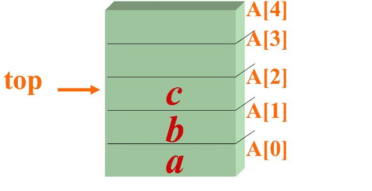

##### 顺序栈的类型表示：

```
###### define MAXQSIZE 100
```

```
typedef struct {
```

```
datatype data[MAXQSIZE];
```

```
int top;
```

```
}sqstack;
```

##### 顺序栈的基本运算:

###### 1、初始化\置空栈

```
void initstack(sqstack *s)
{
    s->top=-1;
}
```

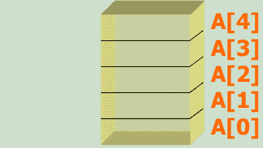

##### 顺序栈的基本运算：

###### 2、判断栈空

```
int stackempty(sqstack *s)
{
    if(s ->top==-1)return(true)
    else return(false);
}
```

top

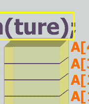

##### 顺序栈的基本运算：

###### 3、判断栈满

```
int stackfull(sqstack *s)
{
    if(s ->top>=MAXQSIZE-1)
        return(true);
    else return(false);
}
```

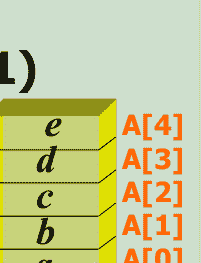

栈满

##### 顺序栈的基本运算：

###### 4、取栈顶元素

```
Datatype gettop(sqstack *s)
{
    if(stackempty(s))
        error("stack is empty");
    return s->data[s->top];
}
```

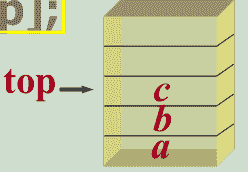

##### 顺序栈的基本运算:

5、进栈

```
void push(sqstack *s, datatype e)
{
    if (stackfull(s))
        error("stack overflow");
    s->data[++s->top]=e;
}
```

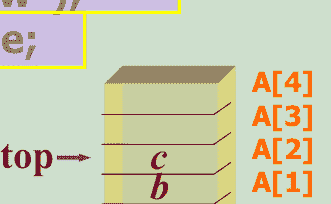

##### 顺序栈的基本运算：

###### 6、出栈

```
status pop (SeqStack *s, StackData &e)
{
    if ( StackEmpty(S) )  return error;
    e=s->data[top];
    s->top--;
    return OK;
}
```

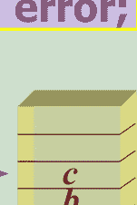

#### 链式栈:栈的链接表示

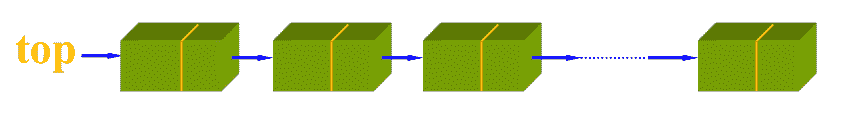

- 链式栈无栈满问题，空间可扩充
- 插入与删除仅在栈顶处执行
- 链式栈的栈顶在链头

##### 链式栈操作实现（带头结点入栈）

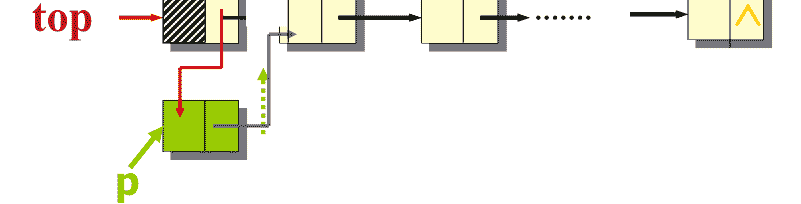

```
status Push ( LinkStack *top, StackData e )
{
StackNode *p = ( StackNode * ) malloc
( sizeof ( StackNode ) );
p->data = e; p->next = top ->next;
top ->next = p; return ok;
}
```

##### 出栈（带头结点）

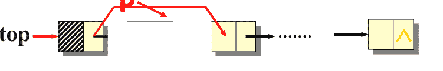

```
Status Pop ( LinkStack *top, StackData &e)
{
    StackNode * p = top->next;
    if (p==null ) return error;
    top ->next= p->next;
    e = p->data;
    free (p);
    return ok;
}
```

##### 出栈（不带头结点）


```c
status Pop（LinkStack *top, StackData &e）
{
    StackNode *b = top;
    if (top == null) return error;
    e = top->data;
    top = top->next;
    free (p);
    return ok;
}
```

### 3.2 栈的应用举例

#### 应用一：数制的转换

- 1、十进制数N和其他d进制数的转换是计算机实现计算的基本问题，它的解决方法很多，其中一个简单算法基于下列原理

```
N=(N div d)*d+N mod d
```

(其中:div为整数运算,mod为求余运算)

### 3.2 栈的应用举例
应用一：数制的转换

例如 (1348)₁₀=(2504)₈，其运算过程如下：

| n | n div 8 | n mod 8 |
|---|---:|---:|
| 1348 | 168 | 4 |
| 168 | 21 | 0 |
| 21 | 2 | 5 |
| 2 | 0 | 2 |

(2504)₈


### 3.2 栈的应用举例

#### 应用一：数制的转换

例如 (1348)₁₀ = (2504)₈，其运算过程如下：

| n | n div 8 | n mod 8 |
| --- | --- | --- |
| 1348 | 168 | 4 |
| 168 | 21 | 0 |
| 21 | 2 | 5 |
| 2 | 0 | 2 |
| 0 | 0 | 0 |


八进制数如下：2 5 0 4

```c
void conversion() {
    InitStack(s);
    scanf("%d", &n);
    while (n) {
        Push(s, n % 8);
        n = n / 8;
    }
    while (!StackEmpty(s)) {
        Pop(s, e);
        printf("%d", e);
    }
}
```

### 应用二：括号匹配的检验

假设表达式中允许括号嵌套，则检验括号是否匹配的方法可用“期望的急迫程度”这个概念来描述。例：

( ( ) ( ) ( ( ) ) )

### 应用二：括号匹配的检验编程思想

- 设置一个栈 st，用 i 扫描表达式 exp
- 遇到 `"("`、`"{"`、`"["` 时，将其入栈
- 遇到 `")"`、`"}"`、`"]"` 时，要判断栈顶元素是不是和它匹配的括号
- 若不是，则退出扫描过程，返回 0
- 否则栈顶元素出栈
- 直到 exp 扫描完毕为止
- 若 top == 0，则匹配成功，返回 1

算法如下：

```c
int match(char *exp)
{
    top = 0; // 注意：与前面 top = -1 相比较
    i = 0;
    nomatch = 0;
    while (exp[i] != '\0' && nomatch == 0) {
        switch (exp[i]) {
            case '(':
                st[top] = exp[i];
                top++;
                break;
            case '[':
                st[top] = exp[i];
                top++;
                break;
            case '{':
                st[top] = exp[i];
                top++;
                break;
            case ')':
                if (st[top - 1] == '(') top--;
                else nomatch = 1;
                break;
            case ']':
                if (st[top - 1] == '[') top--;
                else nomatch = 1;
                break;
            case '}':
                if (st[top - 1] == '{') top--;
                else nomatch = 1;
                break;
        }
        i++;
    }
    if (nomatch == 0 && top == 0) return 1;
    else return 0;
}
```

### 应用三：行编辑程序

- 在编辑程序中，设立一个输入缓冲区，用于接受用户输入的一行字符，然后逐行存入用户数据区。允许用户输入错误，并在发现有误时可以及时更正。

### 应用三：行编辑程序——算法的基本思想

- 首先，初始化一个栈
- 当全文没有结束时，本行的输入也没有结束时
  - 当输入普通字符时，入栈；
  - 当输入字符如果是 `#` 则退栈；
  - 否则如果是 `@` 则清空栈；
- 重复执行直到本行的输入结束
- 如果该行结束但是全文没有结束，则重新清空栈并且重复执行直到全文结束

```c
void lineedit()
{
    InitStack(s);
    ch = getchar();
    while (ch != EOF) {
        while (ch != EOF && ch != '\n') {
            switch (ch) {
                case '#':
                    Pop(s, c);
                    break;
                case '@':
                    ClearStack(s);
                    break;
                default:
                    Push(s, ch);
                    break;
            }
            ch = getchar();
        }
        ClearStack(s);
        if (ch != EOF) ch = getchar();
    }
    DestroyStack(s);
}
```

### 应用四：表达式求值

```c
OperandType EvaluateExpression()
{
    InitStack(OPTR);
    Push(OPTR, '#');
    InitStack(OPND);
    c = getchar();
    while (c != '#' || GetTop(OPTR) != '#') {
        if (!In(c, OP)) { // 不是运算符则进栈
            Push(OPND, c);
            c = getchar();
        } else {
            switch (Precede(GetTop(OPTR), c)) {
                case '<':
                    Push(OPTR, c);
                    c = getchar();
                    break;
                case '=':
                    Pop(OPTR, x);
                    c = getchar();
                    break;
                case '>':
                    Pop(OPTR, theta);
                    Pop(OPND, b);
                    Pop(OPND, a);
                    Push(OPND, Operate(a, theta, b));
                    break;
            } // switch
        }
    } // while
    return GetTop(OPND);
}
```

### 应用五：递归

例如，阶乘函数

n! = { 1, 当 n = 0 时
       n * (n - 1)!, 当 n ≥ 1 时 }

求解阶乘函数的递归算法

```c
long Fac(long n) {
    if (n == 0) return 1;
    else return n * Fac(n - 1);
}
```

Fac(5) = 120

例：求 5!


## 队列

- **定义：**只允许在表的一端进行插入，而在另一端删除元素的线性表。
- 在队列中，允许插入的一端叫**队尾**（rear），允许删除的一端称为**队头**（front）。

有线性表（a₁，a₂，a₃，…，aₙ）采用队列的方式存储。


出队列

入队列

a₁ a₂ a₃ … aₙ

特点：先进先出（FIFO）

## 队列的表示和实现

### 队列的内存存储结构表示方法

- 链式队列
- 循环队列

## 链队列：队列的链式表示

- 链队列中，有两个分别指示队头和队尾的指针。
- 链式队列在进队时无队满问题，但有队空问题。


## 链式队列的定义

```c
typedef struct QNode {
    QElemType data;      // 队列结点数据
    struct QNode *next;  // 结点链指针
} QNode, *QueuePtr;
```

```c
typedef struct {
    QueuePtr rear, front;
} LinkQueue;
```

## 链队列的主要操作

###### 初始化

```c
void InitQueue(LinkQueue &Q)
{
    Q.rear = Q.front = (QueuePtr) malloc(sizeof(QNode));

    if (!Q.front) exit(OVERFLOW);

    Q.front->next = NULL;

    return OK;
}
```


## 链队列的主要操作

### 取队头元素

```c
Status GetFront(LinkQueue Q, QElemType &e)
{
    if (QueueEmpty(Q)) return ERROR;
    e = Q.front->next->data;
    return OK;
}
```


## 链队列的主要操作

## 入队的基本思想

- 生成新结点，分配不成功，退出
- 否则，将读入数据存放到新结点的数据域中
- 将新结点加在链表的表尾；
- 尾指针rear后移 指向表中最后一个结点

## 入队的动态过程


```c
p = (QueuePtr )malloc (sizeof(QNode));
p->next= NULL;
Q. rear->next = p; //入队
Q. rear =p;
```

## 带头结点的出队的动态过程


```
p = Q. front ->next;
Q. front->next = p->next;
free(p);
```

## 带头结点的出队的动态过程（只含有一个结点）


```
p = Q.front->next;
Q.front->next = p->next;
free(p);
Q.rear = Q.front;
```

## 链队列的主要操作

## 带头结点的出队的基本思想

- 首先判断队列是否空，若空，返回0。
- 否则，p指向队头，并保存队头的值。
- 删除队头结点，若删除的是队列中最后一个结点，则重置尾指针
- 释放被删除结点

## 出队

```
Status DeQueue(LinkQueue &Q, Qelemtype &e)
{
    //删除队头结点，并返回队头元素的值
    if (Q.front==Q.rear) return ERROR;    //判队空
    p = Q.front->next;
    e = p->data;                          //保存队头的值
    Q.front->next = p->next;              //新队头
    if (Q.front->next==NULL) Q.rear = Q.front;
    free(p);
    return OK;
}
```

注：与书中p62不同

## 队列的进队和出队


H进队,溢出

## 循环队列 (Circular Queue)

解决办法：将顺序队列臆造为一个环状的空间，形成循环(环形)队列


## 循环队列 (Circular Queue)

- 进队


## 循环队列 (Circular Queue)

- 进队


## 循环队列 (Circular Queue)

- 进队


## 循环队列 (Circular Queue)

- 进队


## 循环队列 (Circular Queue)

- 出队


## 循环队列（Circular Queue）

- 出队


## 循环队列 (Circular Queue)

- 队头、队尾指针加1，可用取模(余数)运算实现。
- 队头指针进1： front=(front+1) %MAXQSIZE;
- 队尾指针进1： rear =(rear+1) % MAXQSIZE;
- 队列初始化： front = rear = 0;

- 思考：
- 如何来判断队空与队满

## 循环队列 (Circular Queue)

- 进队


## 循环队列 (Circular Queue)

- 进队


## 循环队列（Circular Queue）

- **判断队空队满的方法：**
  - 设一个布尔变量以区别队列的空和满；
  - 其二是少用一个元素的空间，约定入队前，测试尾指针在循环移动下加1后是否等于头指针，若相等则认为队满

## 循环队列 (Circular Queue)

- 队空条件： front == rear;
- 队满条件： (rear+1) % MAXQSIZE == front;


## 循环队列的类型定义

```
#define MAXQSIZE 100
```

```
Typedef struct{
QElemType *base;
int front;
int rear;
} SqQueue;
```

## 循环队列操作的实现

- 初始化队列

```
Status InitQueue ( SqQueue &Q )
{
//构造空队列
Q.base = (QElemType *)malloc(MAXQSIZE * sizeof(QElemType));
If(! Q.base) exit(OVERFLOW);
Q.rear = Q.front = 0;
Return OK;
}
```

- 判队空
```c
int QueueEmpty ( SqQueue Q )
{
    return Q.rear == Q.front;
}
```

- 判队满
```c
int QueueFull ( SqQueue Q )
{
    return (Q.rear+1) % MAXQSIZE == Q.front;
}
```

## 求队列的长度

- int Queuelength(SqQueue Q)
- {
- return(Q.rear-Q.front+MAXQSIZE)%
- MAXQSIZE;
- }

## 出队

```
Status DeQueue( SqQueue &Q, QElemType e )
{
    if ( QueueEmpty(Q) ) return ERROR;
    e = Q.base[Q.front];
    Q.front = ( Q.front+1 ) % MAXQSIZE;
    return OK;
}
```

## 队列的实际应用

- 一、打印机软件设计
计算机的打印机输出缓冲区应用了队列结构
- 二、在智能排队系统中的队列
智能排队系统是运用计算机软件构成虚拟队列，代替由真实的人员组成的各种长长短短的队列

## 应用实例：医院病人排队系统

- 设计一个程序，反映病人到医院看病，排队看医生的情景，请考虑一下几种情况：
  - 排队
  - 看医生
  - 察看排队
  - 医生下班
- 要求采用链式队列

## 应用实例：医院病人排队系统

- 首先创建一个空队列
- 利用switch语句判断以下四种情况:
- 医生下班: 提示病人明天看病，停止循环
- 排队: 分配一个新结点，存入患者姓名，入队
- 看医生: 判断队列是否为空，若空，输出没有病人，否则输出轮到看病的患者名，并且出队
- 察看排队: 判断队列是否为空，若空，输出没有病人，否则输出排队的患者名


```
typedef struct node{
char data[10];
struct node *next;
}qtype;

typedef struct qp{
qtype *front,*rear;
}queue;

void seedoctor()
{
flag=1;
q=(queue*)malloc(sizeof(queue));
q->front=(qtype*)malloc(sizeof(qtype));
q->front->next=null;
q->rear=q->front;
```

```
while(flag==1)
{
printf("\n\n\n1:queue 2:seedoctor 3:seequeue 0:stopwork please select:");
scanf("%d",&sel);
switch(sel)
{
case 0:if(q->front!=q->rear)
printf("\nplease see doctor tomorrow!");
flag=0;
break;
```

```
case 1: printf("\nplease input the patient's name:");
    s=(qtype*)malloc(sizeof(qtype));
    s->next=null;
    scanf("%s",s->data);
    q->rear->next=s;
    q->rear=s;
    break;

case 2: if(q->front==q->rear)
    printf("\n no patient!");
else
    { s=q->front->next;
    if(q->rear==s) q->rear=q->front;
    printf("\npatient: '%s' see doctor!",s->data);
    q->front->next=s->next;
    free(s);
    }
    break;
```

```
case 3: if(q->front == q->rear)
printf("\n no patient!");
else{
s=q->front->next;
printf("\n the queue of the patients is:\n");
while(s!=null)
printf(" %s",s->data);
s=s->next;
}
break;
default: printf("\n please input the correct data:");
break;
}
}
```

### 思考题

假设您是一个金融家，在一月、四月和九月分别购入X公司的100股股票，并且在六月和十一月分别卖出100股。这几个月股票的价格分别为：

| 一月 | 四月 | 六月 | 九月 | 十一月 |
| --- | --- | --- | --- | --- |
| ¥10 | ¥30 | ¥20 | ¥50 | ¥30 |

+   - 在如下情况下判断您的投资是盈利还是亏损：
+   - A) FIFO财务处理
+   - B) LIFO财务处理

（也就是说，假设以队列方式或堆栈方式保留您的股票凭证），另外，在年底您仍然拥有的100股不计算在内。

### 思考题

+   - 在火车站的调度中,假设有一列软席和硬席混合的火车箱,现希望将软席车厢都调度到前面,硬席车厢都放在后面,试编写一算法。

## 产生溢出
称为上溢

设有顺序栈A，将元素a、b、c、d、e、f入栈

Top5

有数组A[5]

A[4]
A[3]
A[2]
A[1]
A[0]

e
d
c
b
a

Top=-1表示栈空

Top=0
表示栈中有一个元素

Top=MAXQSIZ
E-1

表示栈满

## 第四章 串

+   - 4.1 串类型的定义
+   - 4.2 串的表示和实现
+     - 4.2.1 定长顺序存储表示
+     - 4.2.2 堆分配存储表示
+     - 4.2.3 串的块链存储表示

## 第四章 串

## 4.1 串类型的定义

一、串的基本概念

定义：字符串是 n（≥0）个字符的有限序列
记作 S = "c₁c₂c₃...cₙ"

+   - 其中：
+     - S 是串名字
+     - "c₁c₂c₃...cₙ"是串值
+     - cᵢ 是串中字符
+     - n 是串的长度

例如，S = "Tsinghua University"

## 4.1 串类型的定义

# 一、串的基本概念

+   通常将仅由一个或多个空格组成的串称为空白串(Blank String)

+   长度为零的串称为空串(Empty String)，它不包含任何字符。

> 注意：空串和空白串的不同，例如 “ ” 和 “” 分别表示长度为1的空白串和长度为0的空串。

## 4.1 字符串的定义

# 一、串的基本概念

串中任意个连续字符组成的子序列称为该串的子串，包含子串的串相应地称为主串。

子串在主串中首次出现时的该子串的首字符对应的主串中的序号，定义为子串在主串中的序号 (或位置)

例如，设A和B分别为

```
A= “This is a string”
B= “is”
```

## 4.1 串类型的定义

# 一、串的基本概念

注意：空串是任意串的子串，任意串是其自身的子串。

# 串相等的判断

当且仅当两个串的值相等。

例如，设A和B分别为

A= “This is a string”      B= “is”

B= “string”      D= “This is

## 4.1 字符串的定义

# 一、串的基本概念

串的抽象数据类型定义

# 例2、串的定位 index(S, T, pos)

在主串 S 中取从第 i (i 的初值为 pos) 个字符起、长度和串 T 相等的子串和 T 比较，若相等，则求得函数值为 i，否则值增 1，直至 S 中不存在和串 T 相等的子串为止。

```
int index(string S,string T,int pos)
{
    if(pos>0){
        n=strlen(s);  m=strlen(t);  i=pos;
        while(i<=n-m+1){
            substr(sub,S,i,m);
            if(strcmp(sub,T)!=0)++i;
            else return(i);
        }
    }
    return(0);
}
```

## 4.2 串的表现和实现

+   - 4.2.1 定长顺序存储表示
+   - 4.2.2 堆分配存储表示
+   - 4.2.3 串的链式存储结构

## 4.2 串的表现和实现

## 4.2.1 定长顺序存储表示

```
#define maxstrlen 255

typedef char sstring[maxstrlen+1];

sstring s; // s是一个可容纳255个字符的顺序串。
```

## 4.2.1 定长顺序存储表示下的相关操作

# 一、串的链接 concat(&T,S1,S2)

例：串 s1 = “beijing ”
s2 = “university”

使用示例 T=s1 + s2;

连接结果 T= “beijing university”

## 4.2.1 定长顺序存储表示下的相关操作

# 1、串的连接 concat(&T,S1,S2) 的基本思想

将串 S1 和串 S2 连接在一起生成一个新串 T，可能有如下三种情况：

+   串 S1 和串 S2 连接在一起的长度小于等于新串 T 的长度，产生正确结果
+   串 S1 和串 S2 连接在一起的长度大于新串 T 的长度，并且 S1 的长度小于 T 的长度，此时，S2 产生截断。
+   串 S1 的长度等于 T 的长度，此时，串 S2 整个被舍弃并设置一个标志 uncut 来标明是否产生截断

## 1、串的联接concat(&T,S1,S2)

Status concat(SSString&T,SSString S1,SSString S2)

```
{
if(S1[0]+S2[0]<=MAXSTRLEN)
{
T[1...S1[0]]=S1[1...S1[0]];
T[S1[0]+1...S1[0]+S2[0]]=S2 [1...S2[0]];
T[0]= S1[0]+S2[0];
uncut=true;
}
}
```

## 1、串的联接concat(&T,S1,S2)

```
else if (S1[0] < MAXSTRLEN)
{
    T[1...S1[0]] = S1[1..S1[0]];
    T[S1[0]+1...MAXSTRLEN] = S2[1.. .MAXSTRLEN-S1[0]]
    T[0] = MAXSTRLEN;
    uncut = false;
}
else{
    T[0... MAXSTRLEN] = S1[0... MAXSTRLEN];
    uncut = false;
}
return uncut;
}
```


## 4.2.1 定长顺序存储表示下的相关操作

2、求子串 substr(string sub,string s,int pos,int len)

- 求子串的过程即为复制字符序列的过程，将串从第 pos 个字符开始长度为 len 的字符序列复制到串 Sub 中。

### 提取子串的算法示例


len ≤ S[0] - pos +1

> 合法参数条件: Pos>=0, Pos<=S[0], Len>=0
> 
> len <=S[0]-pos+1

求子串的过程即为复制字符序列的过程，将串S中的第pos个字符开始长度为len的字符复制到串T中。

```
Status substring(string &sub,string s,int pos,int len)
```

```
{
```

```
if(pos<1 || pos>S[0]|| len<0||len>S[0]-pos+1)
return error;
```

```
sub[ 1...  len]=S[pos...pos+len-1];
```

```
sub[0]=len;  return ok;
```

```
}
```

## 4.2.2 堆分配存储表示

特点：仍以一组地址连续的存储单元存放串值字符序列，但它们的存储空间是在程序执行过程中动态分配而得。所以也称为动态存储分配的顺序表。

类型定义

```
typedef struct{
    char *ch;
    int length;
}hstring;
```

## 4.2.2 堆分配存储表示的相关操作

### 1、串的插入

- 串的插入，就是在字符串**S**中从指定的位置开始插入另外一个串。

### 1、串的插入的动态实现过程


s.length+ t.length

S

A g i r l !

pos

T

l o v e l y

t.length

s.length+ t.length

S

A g i r l !

pos

T

l o v e l y

t.length

s.length+ t.length

S

A

g i r l !

pos

T

l o v e l y

t.length

s.length+ t.length

S

A   g i r l !

pos

T

l o v e l y

t.length


s.length+ t.length

S

A 1 o v e l y g i r l !

pos

t.length

T

1 o v e l y

t.length

s.length+ t.length

S

A g i r l !

pos

T

l o v e l y

t.length


s.length+ t.length

```
S
A g i r [ ] [ ] [ ] [ ] 1 !
```

```
T
l o v e l y
```

pos

t.length

s.length+ t.length

S

A g i r 1 !

pos

T

l o v e l y

t.length

s.length+ t.length

S

A

g

i r 1 !

pos

T

l o v e l y

t.length


### 1、串的插入的基本思想

首先判断插入的位置pos是否合法，如果合法，并且要插入的串t非空，则：

- 重新分配s的存储空间
- 若成功，则将从第pos个位置的字符向后移位，空出t.length个位置
- 将t插入

### 1、串的插入

```
status sinsert(Hstring &S,int pos,Hstring T)
{
    if(pos<1 || pos>S.length+1)    return error;
    if(T.length)
    {
        if(!(S.ch=(char*)realloc(S.ch,(S.length+T.length)*sizeof(char)))    exit(overflow);
        for(i=S.length-1;i>=pos-1;--i)S.ch[i+T.length]=S.ch[i]
        S.ch[pos-1..pos+T.length-2]= T.ch[0..T.length-1];
        S.length+=T.length;
    }
    return OK;
}
```

### 2、生成一个其值等于串常量chars的串T的基本思想

- 首先如果T非空，则释放T原有的空间
- 求串常量chars的长度i，如果i=0，则T为空
- 否则，给T分配i个存储空间，将串常量chars放入

### 3、求串的长度

```
int strlen(Hstring S)
{    return S.length; }
```

### 4、清空串

```
status clearstring(Hstring &S)
{
    if(S.ch){free(S.ch);S.ch=NULL;}
    S.length=0; return OK;
}
```

### 5、串的比较

```
int strcmpare(Hstring S,Hstring T)
{
    for(i=0;i<S.length && i<T.length;++i)
        if(S.ch[i]!=T.ch[i])
            return(S.ch[i]-T.ch[i]);
    return S.length-T.length;
}
```

### 6、串的连接

```
status concat(Hstring &T,Hstring S1,Hstring S2)
{
if(!(T.ch)=(char*)malloc(S1.length+S2.length)*sizeof(char)))
    exit(overflow);

T.ch[0..S1.length-1]=S1.ch[0..s1.length-1];

T.length=S1.length+S2.length;

T.ch[S1.length..T.length-1]=S2.ch[0..S2.length-1];
}
```

## 4.2.3 串的链式存储结构

```
typedef struct node{
char data;
struct node *next;
}lstring;
```


这种结构便于进行插入和删除运算，但存储空间利用率太低。

## 4.2.3 串的块链的存储表示

为了提高存储密度，可使每个结点存放多个字符。通常将结点数据域存放的字符个数定义为结点的大小


### 串的块链的类型定义

```
#define CHUNKSIZE 80
typedef struct Chunk{
    char ch[CHUNKSIZE];
    struct Chunk *next;
}Chunk;
```

```
Typedef struct{
    Chunk *head,*tail;
    int curlen;
}LString;
```


## 串的模式匹配

- 定义 在串中寻找子串（第一个字符）在串中的位置
- 词汇 在模式匹配中，子串称为模式，串称为目标。
- 示例 目标 T : "Beijing"
  模式 P : "jin"
  匹配结果 = 4

## 第1趟

T   a b b a b a
P   a b a

穷举的模式匹配过程

## 第2趟

T   a b b a b a
P   a b a

## 第3趟

T   a b b a b a
P   a b a

## 第4趟

T   a b b a b a
P   a b a
√

## 第1趟

S  a b a b c a b c a c b a b
P  a b c a c
失配位置:i=3
j=3

## 第2趟

S  a b a b c a b c a c b a b
P  a b c a c
失配位置:i=2
j=1

## 第3趟

S  a b a b c a b c a c b a b
P  a b c a c
失配位置:i=7
j=5

## 第4趟

S  a b a b c a b c a c b a b
P  a b c a c
失配位置:i=4
j=1

## 第5趟

S  a b a b c a b c a c b a b
P  a b c a c
失配位置:i=5
j=1

## 第6趟

S  a b a b c a b c a c b a b
P  a b c a c
成功！

"p₁p₂......pₖ₋₁"="Sᵢ₋ₖ₊₁ Sᵢ₋ₖ₊₂......Sᵢ₋₁"

置:i=3

i=3

"Sᵢ₋ₖ₊₁ Sᵢ₋ₖ₊₂......Sᵢ₋₁"="pⱼ₋ₖ₊₁ pⱼ₋ₖ₊₂ ......pⱼ₋₁"

位置:i=3

"p₁p₂......pₖ₋₁"="pⱼ₋ₖ₊₁ pⱼ₋ₖ₊₂ ......pⱼ₋₁"

第3趟

S a b
P

a b c a c

比较位置:i=7

k=2

匹配成功！

## 改进算法

- next[j]=k

则 next[j] = 
{ 0 当 j=1 时
 Max{k | 1 < k < j 且 “p₁p₂...pₖ₋₁” = “pⱼ₋ₖ₊₁ pⱼ₋ₖ₊₂ ... pⱼ₋₁” } 当此集合不空时
 1 其他的情况 }

## 改进算法

- 求下列模式串 “abaabcac”的next函数值

| j | 1 | 2 | 3 | 4 | 5 | 6 | 7 | 8 |
|---|---|---|---|---|---|---|---|---|
| 模式串 | a | b | a | a | b | c | a | c |
| next[j] | 0 | 1 | 1 | 2 | 2 | 3 | 1 | 2 |

## 改进算法的匹配过程

第1趟 S a b a b c a b c a c b a b
p a b c a c
失配位置:i=3
j=3

第2趟 S a b a b c a b c a c b a b
P a b c a c
比较位置:i=3
k=1
失配位置:i=7
j=5

第3趟 S a b a b c a b c a c b a b
P a b c a c
比较位置:i=7
k=2
匹配成功！

## 改进算法:KMP算法

```
Int index_kmp(sstring S, Sstring T,int pos)
{
    i=pos; j=1;
    while(i<=S[0]&&j<=T[0])
    {
        if(j==0 || S[i] =T[j]){i++;j++;}
        else j=next[j];
    }
    if(j>T[0])return  i-T[0];
    else return 0;
}
```

## 改进算法:求next函数的算法

```
Void get_next(sstring S, int &next[])
{
    i=1; j=0; next[1]=0;
    while(i<T[0])
    {
        if(j==0 || T[i] =T[j])
        {
            i++; j++; next[i]=j
        }
        else j=next[j];
    }
} 注: aabaae......aabaad
```

## 串的实际应用

## 一、文本编辑

文本编辑的实质是修改字符数据的形式或格式。瑞然各种文本编辑程序的功能强弱不同，但是其基本操作是一致的一般都包括串的查找、插入和删除等基本操作。

## 串的实际应用

- 二、建立词索引表
- 信息检索是计算机应用的重要领域之一。由于信息检索的主要操作是在大量的存放在磁盘上的信息中查询一个特定的信息，为了提高查询效率，就必须建立一个好的索引系统。

## 串的实际应用

三、软件的汉化

软件汉化是我国软件设计中的一种特殊情况。汉化就是将一个外文版的软件经过一系列本地化技术处理后，操作界面变成了中文，而程序内核和功能保持不变。在用自动化工具进行汉化时，实际上时在进行相应的串的操作。

## 实验一：顺序表的应用（项目）

## 实验目的：

了解顺序表的特点，描述方法及有关概念，掌握顺序表的建立、插入、显示等基本操作算法。

## 实验一：顺序表的应用（项目）

- 实验内容：
- 通过键盘输入一个无序的整数序列，建立一个非递减的顺序表，再通过键盘输入一个数，插入到顺序表中，使得表仍然保持非递减有序。

## 实验二：单链表的应用（项目）

## 实验目的：

了解单链表的特点，描述方法及有关概念，掌握单链表的建立、插入、查找、删除、显示等基本操作算法。

## 实验二：单链表的应用（项目）

## 实验内容：

通过键盘输入一个无序的整数序列，建立一个非递减的链表，再通过键盘输入一个数，插入到链表中，使得链表仍然保持非递减有序，并且再查找某一元素，若找到在表中删除。

## 第五章 数组和广义表

- 5.1 数组的定义
- 5.2 数组的顺序表示和实现
- 5.3 矩阵的压缩存储
  - 5.3.1 特殊矩阵
  - 5.3.2 稀疏矩阵
- 5.4 广义表的定义
- 5.5 广义表的存储结构

## 数组

一维数组

- 定义
  相同类型的数据元素的集合。
- 一维数组的示例


## 5.1 数组的定义

二维数组：

```
A_{m*n} = 
\begin{bmatrix}
a_{00} & a_{01} & \dots & a_{0n-1} \\
a_{10} & a_{11} & \dots & a_{1n-1} \\
\dots & \dots & \dots & \dots \\
a_{m-1 1} & a_{m-1 2} & \dots & a_{m-1 n-1}
\end{bmatrix}
```

## 5.1 数组的定义

Aₘ*n 可以看成是一个线性表：

A=(a₀, a₁, ... aₚ)  (P=m-1,n-1)

其中，每个元素aᵢ也可以看成是个行向量组成的向量。

aᵢ=(aⱼ₀, aⱼ₁, ... aⱼₙ₋₁)    0<=i<= m-1

或者每个元素aⱼ可以看成是由个列向量组成的向量。

aⱼ = (a₀ⱼ, a₁ⱼ, ... aₘ₋₁ⱼ)    0<=j<= n-1

## 5.1 数组的定义

在C语言中，一个二维数组类型可以定义为其分量类型为一维数组类型的一维数组类型，也就是说，

```
typedef elemtype array2[m][n];
```

等价于：

```
typedef elemtype array1[n];
typedef array1 array2[m];
```

## 5.1 数组的定义

注意： 数组一旦被定义，它的维数和维界就不再改变。因此，除了结构的初始化和销毁之外，数组只有存取元素和修改元素值的操作。

## 5.2 数组的顺序表示和实现

- 一维数组存储方式

LOC(i) = { Loc(a₀), i = 0
Loc(a₀) + i*l, i > 0 }

k=i

0 1 2 3 4 5 6 7 8 9

a 35 27 49 18 60 54 77 83 41 02

l l l l l l l l l l

a+i*l

## 按列序为主序存放

A[m][n]中a[i][j]位置：
k= j*m+i

Loc(aij)=Loc(a00)+(j*m+i)*l

a00

a10

......

a m-1 0

a01

a11

......

a m-1 1

......

a0n-1

a1n-1

......

a m-1 n-1

(m-1)*(n-1)


## n 维数组

+   各维元素个数为 b₁, b₂, b₃, ..., bₙ

+   下标为 i₁, i₂, i₃, ..., iₙ 的数组元素的存储地址：

LOC(i₁, i₂, ..., iₙ) = Loc(a₀...₀) + (i₁*b₂*b₃*...*bₙ + i₂*b₃*b₄*...*bₙ + ...... + iₙ₋₁*bₙ + iₙ) * l
= Loc(a₀...₀) + (∑_{j=1}^{n-1} i_j * ∏_{k=j+1}^{n} b_k + i_n) * l

## ■ 5.3 矩阵的压缩存储

+   - 特殊矩阵是指非零元素或零元素的分布有一定规律的矩阵。
+   - 特殊矩阵的压缩存储主要是针对阶数很高的特殊矩阵。为节省存储空间，对可以不存储的元素，如零元素或对称元素，不再存储。

## 对称矩阵的压缩存储

设有一个 n×n 的对称矩阵 A。


在矩阵中, a_ij = a_ji

+   - 数组 B 共有
+   - n + (n-1) + ⋯ + 1 = n*(n+1)/2 个元素。

## 5.3 矩阵的压缩存储

## 对称矩阵


> a_ij 前有 i-1 行为全行，前 i-1 行共有 i(i-1)/2 个元素。

> 在第 i 行到 a_ij 有 j 个元素。

按行序为主序：

| a11 | a21 | a22 | a31 | a32 | ...... | an1 | ...... | ann |
| k=0 | 1 | 2 | 3 | 4 |  |  |  | n(n+1)/2-1 |

```
k = { i(i-1)/2 + j - 1, i ≥ j
      j(j-1)/2 + i - 1, i < j }
```

1≤i,j≤n

## 5.3 矩阵的压缩存储

## 二角矩阵

## 下三角矩阵


按行序为主序：

| a11 | a21 | a22 | a31 | a32 | …… | an1 | …… | ann | c |
|---|---|---|---|---|---|---|---|---|---|
| k=0 | 1 | 2 | 3 | 4 | …… | n(n+1)/2−1 | n(n+1)/2 | | |

```
$$k=\begin{cases}\dfrac{i(i-1)}{2}+(j-1), & i\ge j\\[4pt]\dfrac{n(n+1)}{2}, & i<j\end{cases}$$
```

i≥j

i<j


## # 5.3 矩阵的压缩存储


则前i-1行共有(i-1)*n-(i-1)(i-2)/2 个元素即 (i-1)(2n-i+2)/2 个元素。

在第i行有j-i+1个元素。

按行序为主序：

| k | 0 | 1 | 2 | 3 | 4 | ... | n(n+1)/2-1 | n(n+1)/2 |
| --- | --- | --- | --- | --- | --- | --- | --- | --- |
| 元素 | a11 | a12 | a13 | a14 | a15 | ... | a1n | ... | ann |

```
k = \begin{cases} (i-1)(2n - i + 2)/2 + j - i & i \le j \\ n(n+1)/2 & i > j \end{cases}
```

1≤i,j≤n

## 对角矩阵

三对角矩阵

按行序为主序：

| a11 | a12 | a21 | a22 | a23 | ...... | ...... | a_{n-1} | a_{nn} | c |
| k=0 | 1 | 2 | 3 | 4 | ............ | 3n-3 | 3n-2 |

a_{ij}前有i-1行为满行，前i-1行共有3(i-1)-1个元素。

在第i行到a_{ij}共有j-i+2个元素。

```
k = 2(i-1)+(j-1) |i-j| ≤ 1
3n-2 |i-j| > 1
```

K对角矩阵中 |i-j| > (k-1)/2 元素值为零

## 5.3.2稀疏矩阵 (Sparse Matrix)

假设在m*n的矩阵中有t个元素不为零。令δ=t/m*n,则δ为稀疏因子，通常认为δ≤0.05时，成为稀疏矩阵


M由{(1,2,12), (1,3,9), (3,1,-3), (3,6,14), (4,3,24), (5,2,18), (6,1,15), (6,4,-7)}和矩阵维数（6,7）唯一确定

## 5.3.2稀疏矩阵（Sparse Matrix）

## 一、三元组顺序表

假设以顺序存储结构来表示三元组，则可得到稀疏矩阵的一种压缩存储方法——三元顺序表。

```
```c
#define MAXSIZE 100
typedef struct{
    int i,j;
    ElemType e;
}Triple;
```
```

## 5.3.2稀疏矩阵 (Sparse Matrix)

```
typedef struct{
Triple data[MAXSIZE+1];
int mu,nu,tu;//矩阵的行数、列数和非零元素个数
}TSMatrix;
```

Triple Sparse Matrix

|i|j|v|
|-|-|-|
|2|1|12|
|3|1|9|
|4|3|-3|
|5|3|14|
|6|4|24|
|7|5|18|
|8|6|15|
|6|4|-7|

| |0|1|2|3|4|5|6|
|-|-|-|-|-|-|-|-|
|0|0|12|9|0|0|0|0|
|1|0|0|0|0|0|0|0|
|2|-3|0|0|0|0|14|0|
|3|0|0|24|0|0|0|0|
|4|0|18|0|0|0|0|0|
|5|15|0|0|-7|0|0|0|

行列下标

非零元值

ma

## 转置矩阵

## 稀疏矩阵


|  | 行 (row) | 列 (col) | 值 (value) |
|---|---|---|---|
| [1] | 1 | 4 | 22 |
| [2] | 1 | 7 | 15 |
| [3] | 2 | 2 | 11 |
| [4] | 2 | 6 | 17 |
| [5] | 3 | 4 | -6 |
| [6] | 4 | 6 | 39 |
| [7] | 5 | 1 | 91 |
| [8] | 6 | 3 | 28 |

## 转置矩阵

## 转置矩阵

```
\begin{pmatrix} 0 & 0 & 0 & 0 & 91 & 0 \\ 0 & 11 & 0 & 0 & 0 & 0 \\ 0 & 0 & 0 & 0 & 0 & 28 \\ 22 & 0 & -6 & 0 & 0 & 0 \\ 0 & 0 & 0 & 0 & 0 & 0 \\ 0 & 17 & 0 & 39 & 0 & 0 \\ 15 & 0 & 0 & 0 & 0 & 0 \end{pmatrix}
```

|  | 行 (row) | 列 (col) | 值 (value) |
|[1]|1|5|91|
|[2]|2|2|11|
|[3]|3|6|28|
|[4]|4|1|22|
|[5]|4|3|-6|
|[6]|6|2|17|
|[7]|6|4|39|
|[8]|7|1|15|

## 转置矩阵

## 算法的讨论

|  | 行 (row) | 列 (col) | 值 (value) |
|---|---|---|---|
| [1] | 1 | 4 | 22 |
| [2] | 1 | 7 | 15 |
| [3] | 2 | 2 | 11 |
| [4] | 2 | 6 | 17 |
| [5] | 3 | 4 | -6 |
| [6] | 4 | 6 | 39 |
| [7] | 5 | 1 | 91 |
| [8] | 6 | 3 | 28 |

直接行列值交换


|  | 行 (row) | 列 (col) | 值 (value) |
|---|---|---|---|
| [1] | 4 | 1 | 22 |
| [2] | 7 | 1 | 15 |
| [3] | 2 | 2 | 11 |
| [4] | 6 | 2 | 17 |
| [5] | 4 | 3 | -6 |
| [6] | 6 | 4 | 39 |
| [7] | 1 | 5 | 91 |
| [8] | 3 | 6 | 28 |


# 稀疏矩阵转置算法思想

## 方法一：

- 设矩阵列数为 Col，对矩阵三元组表扫描 Col 次。第 k 次检测列号为 k 的项。
- 第 k 次扫描找寻所有列号为 k 的项，将其行号变列号、列号变行号，顺次存于转置矩阵三元组表。

# 用三元组表表示的稀疏矩阵及其转置

|  | 行 (row) | 列 (col) | 值 (value) |
|---|---|---|---|
| [1] | 1 | 4 | 22 | q→[1] |
| [2] | 1 | 7 | 15 | q→[2] |
| [3] | 2 | 2 | 11 | q→[3] |
| [4] | 2 | 6 | 17 | q→[4] |
| [5] | 3 | 4 | -6 | q→[5] |
| [6] | 4 | 6 | 39 | q→[6] |
| [7] | 5 | 1 | 91 | q→[7] |
| [8] | 6 | 3 | 28 | q→[8] |
|表M| | | |

| 行 (row) | 列 (col) | 值 (value) |
|---|---|---|
| 1 | 5 | 91 |
| 2 | 2 | 11 |
| 3 | 6 | 28 |
| 4 | 1 | 22 |
| 4 | 3 | -6 |
| 6 | 2 | 17 |
| 6 | 4 | 39 |
| 7 | 1 | 15 |
|表T| | |

Col=8

```
Status trans_sparmat(tsmatrix M, tsmatrix &T)
{
T.mu=M.nu; T.nu=M.mu; T.tu=M.tu;
if(T.tu)
{
q=1;
for(col=1;col<=M.nu;col++)
q++;
}
return OK; }
```

算法分析：
T(n)=O(M的列数n×非零元个数t)
若 t 与 m×n 同数量级，则
T(n)=O(m×n²)

# 稀疏矩阵转置算法思想

方法二：快速转置：

即按 M 中三元组次序转置，转置结果放入 T 中恰当位置，此法关键是要预先确定 M 中每一列第一个非零元在 T 中位置，为确定这些位置，转置前应先求得 M 的每一列中非零元个数

# 稀疏矩阵转置方法二

|  | 行 (row) | 列 (col) | 值 (value) |
|---|---|---|---|
| [1] | 1 | 4 | 22 |
| [2] | 1 | 7 | 15 |
| [3] | 2 | 2 | 11 |
| [4] | 2 | 6 | 17 |
| [5] | 3 | 4 | -6 |
| [6] | 4 | 6 | 39 |
| [7] | 5 | 1 | 91 |
| [8] | 6 | 3 | 28 |

问题的转化：

如何求出每列非零元素的个数。

# 稀疏矩阵转置算法思想

```
M = [ 0 12 9 0 0 0 0
0 0 0 0 0 0 0
-3 0 0 0 0 14 0
0 0 24 0 0 0 0
0 18 0 0 0 0 0
15 0 0 -7 0 0 0 ]₆ₓ₇
```

| col | 1 | 2 | 3 | 4 | 5 | 6 | 7 |
|---|---|---|---|---|---|---|---|
| num[col] | 2 | 2 | 2 | 1 | 0 | 1 | 0 |
| cpot[col] | 1 | 3 | 5 | 7 | 8 | 8 | 9 |

Cpot数组存放每列第一个非零元素在新表T中的位置

Num数组存放每列非零元素个数

执行第四个 for循环求转置后的表

| col | 1 | 2 | 3 | 4 | 5 | 6 | 7 |
|---|---|---|---|---|---|---|---|
| num[col] | 2 | 2 | 2 | 1 | 0 | 1 | 0 |
| cpot[col] | 3 | 5 | 7 | 8 | 8 | 9 | 9 |

i j v
0
1 2 12
1 3 9
3 1 -3
3 6 14
4 3 24
5 2 18
6 1 15
6 4 -7
表M

i j v
0
1 3 -3
1 6 15
2 1 12
2 5 18
3 1 9
3 4 24
4 6 -7
6 3 14
表T

```
Status FastTransposeSMatrix(TSMatrix M, TSMatrix&T)
{
    T.mu=M.nu; T.nu=M.mu; T.tu=M.tu;
    if(T.tu)
    {
        for(col=1;col<= M.nu;col++)
            num[col]=0;    //清零
        for(t=1;t<= M.tu;t++)
            ++num[M.data[t].j];    //求每列非零元素个数
        cpot[1]=1;
        for(col=2;col<= M.nu;col++)
            cpot[col]=cpot[col-1]+num[col-1];
        //每列第一个非零元素在T中的序号
```

```
for(p=1;p<= M.tu; ++p)
{
col=M.data[p].j;
a=cpot[col]; // 第col列在T中的位置下标
T[cpot[col]] = T[cpot[col]] + a; // 下一个第col列非零元系的位置
}
return OK;
}
```

算法分析:
T(n)=O(M的列表数n+非零元个数t)
若 t 与n×n同数量级，则T(n)=O(n×n)

# 5.4 广义表的定义

广义表 (Lists, 又称列表) 是线性表的推广。

- • 广义表是n(n> = 0)个元素a1,a2,a3,...,an的有限序列
- 其中ai或者是原子项，或者是一个广义表。
- • 通常记作LS= (a1,a2,a3,...,an)。
- • LS是广义表的名字，n为它的长度。
- • 若ai是广义表，则称它为LS的子表。

# 5.4 广义表的定义

规定：

- - 用圆括号将广义表括起来，用逗号分隔其中的元素。
- - 用大写字母表示广义表，用小写字母表示原子。
- - n = 0 的广义表为空表。
- - 若广义表 LS (n >= 1) 非空，则 a1 是 LS 的表头，其余元素组成的表 (a2, a3, ... an) 称为 LS 的表尾。

# 5.4 广义表的定义

例如

- - **A=( )**; //A是一个空表
- - **B=(e)**; //表B有一个原子
- - **C=(a,(b,c,d))**; //两个元素为原子a和子表(b,c,d)
- - **D=(A,B,C)**; //有三个元素均为列表
- - **E=(a,E)**; //递归的列表,它的长度为2, E相当于一个无限的广义表 E=(a,(a,(a,(a,...))))

# 5.4 广义表的定义

从上述定义和例子可推出广义表的三个重要结论：

- - 广义表的元素可以是子表，而子表的元素还可以是子表。由此，广义表是一个多层次的结构，可以用图形形象地表示。 P108
- - 广义表可为其它表所共享。例如在上述例4中，广义表A，B，C为D的子表，则在D中可以不必列出子表的值，而是通过子表的名称来引用。

# 5.4 广义表的定义

- • 广义表的递归性。
- 列表也可以是其本身的一个子表。

综上所述，广义表不仅是线性表的推广，也是树的推广。

由表头、表尾的定义可知：任何一个非空广义表其表头可能是原子，也可能是广义表，而其表尾必定是广义表。

# # 5.4 广义表的定义

已知表B=(e) 、 D=(A,B,C)，求它们的表头和表尾

```
gethead(B)=e    gettail(B)=()

gethead(D)=A    gettail(D)=(B,C)
```

由于 (B, C) 为非空广义表，则可继续分解得到：

```
gethead(B,C)=B    gettail(B,C)=(C)
```

# 5.4 广义表的定义

注意：
广义表（）和(())不同。前者是长度为0的空表，对其不能做求表头的和表尾的运算；而后者是长度为1的非空表（只不过该表中唯一的一个元素是空表）。对其可进行分解，得到表头和表尾均为空表（）。

# 5.5 广义表存储结构

方法一


表结尾


原子结点

```
typedef enum {ATOM,LIST} ElemTag;
```

```
typedef struct GLNode{
ElemTag tag;
union{
AtomType atom;
struct {struct GLNode *hp,*yp;} ptr;
};
};*Glist;
```


## 5.5 广义表存储结构

### 方法一

A=NIL

C

B

D

E


### 方法二

- 表结点由三个域组成：标志域、指示表头的指针域和指示下一个元素结点的指针域；
- 原子结点的三个域为：标志域、值域和指示下一个元素结点的指针域。


其类型定义如下：

```
typedef enum{ATOM,LIST}ElemTag;
typedef struct GLNode
{
    ElemTag tag;
    union{
        AtomType atom;
        struct GLNode *hp;
    };
    struct GLNode *tp;
} *Glist;
```

例见书P110

## 第六章 树和二叉树

- 树的概念和基本术语
- 二叉树
- 二叉树遍历
- 二叉树的计数
- 树与森林
- 哈夫曼树

### 6.1.1 树的定义和基本运算

### 1. 树的概念

定义：树是n个结点的有限集合，在任一棵非空树中：
（1）有且仅有一个称为根的结点。
（2）其余结点可分为m个互不相交的集合，而且这些集合中的每一集合都本身又是一棵树，称为根的子树。


树是递归结构，在树的定义中又用到了树的概念


从逻辑结构看：

- 1) 树中只有根结点没有前驱；除根外，其余结点都有且仅有一个前驱；
- 2) 树的结点，可以有零个或多个后继；
- 3) 除根外的其他结点，都存在唯一一条从根到该结点的路径；

### 3 树的表示

- 1) 图示表示      2) 二元组表示
- 3) 嵌套集合表示  4) 凹入表示法（类似书的目录）
- 5) 广义表表示


```
(A (B (E (K,L) ,F) ) ,C (G) ,D (H (M) ,I,J) )
```

### 4 树的基本术语


- 树的结点：包含一个数据元素及若干指向子树的分支；
- 孩子结点：结点的子树的根称为该结点的孩子；
- 双亲结点：孩子结点的上层结点叫该结点的双亲；
- 兄弟结点：同一双亲的孩子结点；
- 堂兄结点：同一层上结点；
- 祖先结点：从根到该结点的所经分支上的所有结点
- 子孙结点：以某结点为根的子树中任一结点都称为该结点的子孙


- **结点的层次**：根结点的层定义为1；根的孩子为第二层结点，依此类推；
- **树的深度**：树中最大的结点层
- **结点的度**：结点拥有子树的个数
- **树的度**：树中最大的结点度。
- **叶子结点**：也叫终端结点，是度为 0 的结点；
- **分枝结点**：度不为0的结点；


- 有序树：子树有序的树，如：家族树；
- 无序树：不考虑子树的顺序；
- 森林：是m棵互不相交的树集合；
- 森林和树之间的联系是：一棵树去掉根，其子树构成一个森林；一个森林增加一个根结点成为树

节点A的度：
节点B的度：
节点M的度：

节点A的层次：
节点M的层次：

节点A的孩子：
节点B的孩子：
叶子：

树的深度：

树的度：

节点O的双亲：
节点L的双亲：

节点L,P为
F的祖先、R的祖先为
D的子孙为


### 树的基本操作

树的应用很广，应用不同基本操作也不同。下面列举了树的一些基本操作：

- initiate (T); T树的初始化，包括建树。
- root (T); 求T树的根。
- parent (T , x): 求T树中x结点的双亲结点。
- Child (T, x, i): 求T树中x结点的第 i 个孩子结点。
- right_sibling (T, x): 求T树中x结点的右兄弟
- insert_Child (y, i, x): 将根为x的子树置为y结点的第i个孩子
- del_child (x, i); 删除 x 结点的第i 个孩子
- traverse (T); 遍历T树。按某个次序依次访问树中每一个结点，并使每个结点都被访问且只被访问一次。
- clear (T); 置空T 树

## 二叉树 (Binary Tree)

### 1 二叉树的定义

一棵二叉树是结点的一个有限集合，或为空树，或由根及两棵不相交的左子树、右子树构成，并且左、右子树本身也是二叉树


#### 特点：

- 二叉树中每个结点最多有两棵子树；
- 二叉树每个结点度小于等于2；
- 左、右子树不能颠倒——有序树；
- 二叉树是递归结构，在二叉树的定义中又用到了二叉树的概念；

### 五种形态


### 注意：二叉树与树和有序树的区别


## 二叉树的性质


### 性质1：在二叉树的第 i 层上至多有 $2^{i-1}$ 个结点。(i ≥ 1) [证明用归纳法]

证明：
当 i=1 时，只有根结点，$2^{i-1}=2^{0}=1$。
假设对所有 j，i>j≥1，命题成立，即第 j 层上至多有 $2^{j-1}$ 个结点。
由归纳假设第 i-1 层上至多有 $2^{i-2}$ 个结点。
由于二叉树的每个结点的度至多为 2，故在第 i 层上的最大结点数为第 i-1 层上的最大结点数的 2 倍，即 $2 \times 2^{i-2}=2^{i-1}$。


### 性质2：深度为 k 的二叉树至多有 $2^k-1$ 个结点（$k\geq 1$）。

证明：由性质1可见，深度为k的二叉树的最大结点数为

$$\sum_{i=1}^{k}\text{（第 }i\text{ 层上的最大结点数）}$$

$$=\sum_{i=1}^{k}2^{i-1}=2^0+2^1+\cdots+2^{k-1}=2^k-1$$


### 性质3：对任何一棵二叉树T，如果其叶结点数为 n₀，度为2的结点数为 n₂，则 n₀ = n₂ + 1。

证明：若度为1的结点有 n₁ 个，总结点个数为 n，总边数为 B，则根据二叉树的定义，

n = n₀ + n₁ + n₂    B = n − 1
又有 B = 2n₂ + n₁    n − 1 = 2n₂ + n₁

因此，有 n₀ + n₁ + n₂ − 1 = 2n₂ + n₁
n₂ = n₀ − 1 则有 n₀ = n₂ + 1

## 两种特殊形态的二叉树

### 定义1 满二叉树 (Full Binary Tree)

一棵深度为k且有 $2^k-1$ 个结点的二叉树称为满二叉树。


满二叉树


## 定义2 完全二叉树 (Complete Binary Tree)

若设二叉树的高度为 h，则共有 h 层。除第 h 层外，其它各层 (1～h-1) 的结点数都达到最大个数，第 h 层从右向左连续缺若干结点，这就是完全二叉树。


完全二叉树 →


非完全二叉树

## 二叉树的性质

性质4 具有 n (n ≥ 0) 个结点的完全二叉树的深度为⌊log₂(n)⌋+1

证明：

设完全二叉树的深度为 h，则根据性质2和完全二叉树的定义有

2^{h-1} - 1 < n ≤ 2^{h} - 1 或 2^{h-1} ≤ n < 2^{h}

取对数 h−1 < log₂ n ≤ h，又 h 是整数，

因此有 h = ⌊log₂(n)⌋+1


性质5 如将一棵有n个结点的完全二叉树自顶向下，同一层自左向右连续给结点编号1, 2, …, n，则有以下关系：

- 若 i = 1，则 i 无双亲
- 若 i > 1，则 i 的双亲为 ⌊i/2⌋
- 若 2*i > n，则结点 i 无左孩子；若 2*i ≤ n，则其左孩子是 2*i
- 若 2*i+1 > n，则结点 i 无右孩子；若 2*i+1 ≤ n，则其右孩子是 2*i+1

## 3. 应用举例

### 例1 可以用二叉树表示表达式


### 例2 双人比赛的所有可能的结局

开局连赢两局
或五局三胜


## 二叉树的存储结构


### 完全二叉树的顺序表示

```text
1 2 3 4 5 6 7 8 9 10
```


### 一般二叉树的顺序表示

```text
1 2 3 4 0 5 6 7 8 0 0 0 0 9 10
```

```c
#define MAX_TREE_SIZE 100
typedef TElemType SqBitree[MAX_TREE_SIZE];
SqBitree bt;
```


### 链式存储结构

- **二叉链表**

```c
typedef struct node
{ datatype data;
  struct node *lchild, *rchild;
}JD;
```


在n个结点的二叉链表中，有n+1个空指针域

- **三叉链表**

```c
typedef struct node
{
	datatype data;
	struct node *lchild, *rchild, *parent;
}JD;
```


### 链表表示

含两个指针域的结点结构

含三个指针域的结点结构

二叉链表

三叉链表


## 6.3 遍历二叉树

如何访问二叉树的每个结点，而且每个结点仅被访问一次？

所谓遍历二叉树就是按某种顺序访问二叉树中的每个结点一次且仅一次的过程。这里的访问可以是输出、比较、更新、查看元素内容等等各种操作。

按根、左子树和右子树三部分进行遍历

遍历二叉树的顺序存在下面6种可能：

- TLR（根左右）
- LTR（左根右）
- LRT（左右根）


### 先序遍历

- 若二叉树为空： ——基本项（也叫终止项），则结束遍历操作；
- 否则（若二叉树不空）： ——递归项
    - 访问根结点；
    - 先序遍历左子树；
    - 先序遍历右子树。


先序遍历递归算法：

```c
Status PreOrderTraverse(BiTree T)
{
    if (T)
    {
        if( Visit(T->data))
            if(PreOrderTraverse(T->Lchild))
                if(PreOrderTraverse (T->Rchild)) return OK;
        return ERROR;
    }
}
```

### 中序遍历

- 若二叉树为空，则结束遍历操作；
- 否则：
    - 中序遍历左子树；
    - 访问根结点；
    - 中序遍历右子树。


### 后序遍历

- 若二叉树为空，则结束遍历操作；
- 否则：
    - 后序遍历左子树；
    - 后序遍历右子树；
    - 访问根结点。


先序序列：1 2 4 5 6 7 3
中序序列：4 2 6 5 7 1 3
后序序列：4 6 7 5 2 3 1


先序序列：1 2 4 7 8 3 5 6 9 10
中序序列：7 4 8 2 1 5 3 9 6 10
后序序列：7 8 4 2 5 9 10 6 3 1

root a*(b-c)+d/e

### 例：先序遍历、中序遍历、后序遍历下图所示的二叉树


先序遍历序列： -, +, a, *, b, -, c, d, /, e, f

中序遍历序列： a, +, b, *, c, -, d, -, e, /, f

后序遍历序列： a, b, c, d, -, *, +, e, f, /, -


## (2) 中序遍历递归算法

```
Status InOrderTraverse(BiTree T)
{
    if (T)
    {
        if(InOrderTraverse(T->Lchild))
            if( Visit(T->data))
                if(InOrderTraverse (T->Rchild))  return OK;
        return ERROR;
    }
}
```


## (3) 后序遍历递归算法

```
Status PostOrderTraverse(BiTree T)
{
    if (T)
    {
        if(PostOrderTraverse(T->Lchild))
        if(PostOrderTraverse (T->Rchild)) return OK;
        if( Visit(T->data))
        return ERROR;
    }
}
```

## 6.3 遍历二叉树


## 三. 二叉树遍历的非递归算法
中序遍历（L T R）的非递归算法。

利用栈来实现：

- 1) 将根节点入栈，
- 2) 当栈顶指针非空时，应沿着左链遍历，将指向根节点的左孩子指针入栈。直到栈顶指针空。
- 3) 若栈顶纪录中的指针值空时，应退至上一层，
- 4) 若从左子树返回，则访问栈顶纪录中指针所指的根节点。
- 5) 若从右子树返回，表明当前层的遍历结束，应继续退栈

## 二叉树的中序遍历（LTR）的非递归算法

利用栈来实现


访问序列：

a * b - c + d / e

## 二叉树的中序遍历（L T R）的非递归算法

```
Status InorderTraverse(BiTree T)
{
    InitStack(S);
    Push(S,T);
    While(!StackEmpty(S))
    {
        While(GetTop(S,p)&&p)Push(S,p->lchild);
        Pop(S,p);
        if(!StackEmpty(S))
        {
            Pop(S,p);
            if(! Visit(p->data))  return ERROR;
            Push(S,p->rchild);
        }
    }
}
```

## 改进的二叉树的中序遍历（L T R）的非递归算法

利用栈来实现

访问序列：a * b - c + d / e


## 二叉树的中序遍历（L T R）的非递归算法

```
Status InorderTraverse(BiTree T)
{
    InitStack(S);
    p=T;
    While(p || !StackEmpty(S))
    {
        if(p) {Push(S,p);  p=p->lchild;}
        else
        {
            Pop(S,p);
            if(! Visit(p->data))  return ERROR;
            p=p->rchild ;
        }
    }
    return(OK);
}
```

## 二叉树的先序遍历（TLR）的非递归算法

利用栈来实现


访问序列：+ * a - b c / d e

## 二叉树的先序遍历（T L R）的非递归算法

```
Status PreorderTraverse(BiTree T)
{
    InitStack(S);
    p=T;
    While(p || !StackEmpty(S))
    {
        if(p)
        {
            if(! Visit(p->data))  return ERROR;
            Push(S,p);
            p=p->lchild;
        }
        else
        {Pop(S,p);      p=p->rchild ; }
    }
    return(OK);
}
```

## 二叉树的后序遍历（L R T）的非递归算法

### 结点结构：

| lchild | tag | data | rchild |

利用栈来实现

访问序列： E F D B C A


## 二叉树的后序遍历（L R T）的非递归算法

```
Status PostderTraverse( BiTree T)
{
    InitStack(S);
    p=T;
    While(p || !StackEmpty(S))
    {
        if(p) { tag=0; Push(S,p); p=p->lchild;}
        else
        {
            Pop(S,p);
            if(tag=0){tag=1; Push(S,p); p=p->rchild ;}
            else{
                if(! Visit(p->data)) return ERROR;
                p=null;
            }
        }
    }
    return(OK);
```

## 1、构造一棵二叉树

序列： A B C # # D E # G # # F # # #


## 6.3.2 典型二叉树的算法

- 1. 输入一个二叉树的先序序列，构造这棵二叉树的算法思想
- 在算法中，对每个输入的字符进行判断
- 如果对应的字符是 ‘#’ ，则在相应的位置上构造一棵空二叉树；
- 否则，创建一个新结点。再创建它的左子树，右子树

```
Status CreateBiTree(BiTree &T)
{
    scanf(&ch);
    if (ch=='#') T = NULL;    //构造空树
    else
    {
        if(!( T=(BiTree)malloc(sizeof(BiTNode))))
            exit(OVERFLOW);        //构造新结点
        T->data=ch;
        CreateBiTree(T->lchild); //构造左子树
        CreateBiTree(T->rchild);//构造右子树
    }
    return OK;
}
```

思考题：
请编写先序非递归建立二叉树的算法


## §2 求二叉树的高度


- - 使用后序遍历符合人们求解二叉树高度的思维方式
- - 首先分别求出左右子树的高度
- - 在此基础上得出该棵树的高度，即左右子树较大的高度值加1。

## 2 求二叉树的高度

```c
int hight(BTree BT)
{
 //h1和h2分别是以上BT为根的左右子树的高度
 if (BT==NULL) return 0;
 else {
 h1=hight(BT->lchild);
 h2=hight(BT->right);
 return max{h1,h2}+1;
 }
}
```


## 3. 计算一棵二叉树的叶子结点数目


可使用三种遍历顺序中的任何一种，只是需要将访问操作变成判断该结点是否为叶子结点，如果是叶子结点将累加器加1即可。

## 利用中序遍历实现

```
void Leaf(BTree BT,int *count)
{
    if (BT) {
        Leaf(BT->child,&count);
        //计算左子树的叶子结点个数
        if (BT->lchild==NULL&&BT->rchild==NULL)
            (*count)++;
        Leaf(BT->rchild,&count);  //计算右子树的叶子结点个数
    }
}
```


## ▪4 交换二叉树的左右子树

```
void change_left_right(BTree BT)
{
    if (BT)
    {
        change_left_right(BT->lchild);
        change_left_right(BT->rchild);
        BT->lchild <-> BT->rchild;
    }
}
```


注意：只能采用后继遍历

## 小结

- 1 二叉树：或为空树，或由根及两颗不相交的左子树、右子树构成，并且左、右子树本身也是二叉树；
- 2 二叉树即可以用顺序结构存储，也可用链式结构存储；
- 3 遍历：按某种搜索路径访问二叉树的每个结点，每个结点仅被访问一次。二叉树的遍历可以分解为：先序遍历、中序遍历、后序遍历；

## 6.3.3线索二叉树

### 定义：

- 利用二叉链表中的空指针域，存放指向结点在某种遍历次序下的前趋和后继结点的指针（这种附加的指针称为“线索”）。这种二叉链表称为线索链表
- 相应的二叉树称为线索二叉树
- 线索化：对二叉树按某种遍历次序使其变为线索二叉树的过程叫线索化
- 根据线索性质的不同，线索二叉树可分为前序线索二叉树、中序线索二叉树和后序线索二叉树三种

## 6.3.3 线索二叉树

- **实现**
  - 在有n个结点的二叉链表中必定有n+1个空链域
  - 在线索二叉树的结点中增加两个标志域
    - **ltag** :
      - 若 ltag =0, lchild 域指向左孩子；
      - 若 ltag=1, lchild域指向其前驱
    - **rtag** :
      - 若 rtag =0, rchild 域指向右孩子；
      - 若 rtag=1, rchild域指向其后继


## 6.3.3线索二叉树

```
Typedef enum pointerTag{Link,Thread}
```

```
typedef struct BiThrNode
{ TElemType data;
pointerTag LTag, RTag;
struct BiThrNode *lchild, *rchild
}BiThrNode,*BiThrTree;
```


| lc | LTag | data | RTag | rc |

## 6.3.3 线索二叉树

### 先序线索二叉树


先序序列：**ABCDE**

## 6.3.3线索二叉树

### 中序线索二叉树


中序序列： BCAED

## 6.3.3线索二叉树

### 后序线索二叉树


后序序列： CBEDA

## 头结点:

Itag=0, lc指向根结点
rtag=1, rc指向遍历序列中最后一个结点

遍历序列中第一个结点的lc域和最后一个结点的rc域都指向头结点


中序序列: BCAED

## 6.3.4二叉树的线索化

- 实质：按该次序遍历二叉树，在遍历过程中用线索取代空指针。
- 为了记下遍历过程中访问结点的先后关系，假设一个指针pre始终指向刚刚访问过的结点，若指针p指向当前访问的结点，则pre指向它的前驱。

## 算法:按中序线索化二叉树

```
Status InOrderThreading
(BiThrTree&thrt, Bithrtree T)
{
    if(!(thrt=(bithrtree)malloc
    (sizeof(bithrnode)))exit;
    thrt->ltag=link;
    thrt->rtag=thread;
    thrt->rchild=thrt;
    if(!T)thrt->lchild=thrt;
    else{
        thrt->lchild=T;
        pre=thrt;
        Inthreading(T):
        pre->rchild=thrt;
        pre->rtag=thread;
        thrt->rchild=pre;
    }
    return ok;}
```

## 中序线索二叉树的遍历

带头节点的中序线索二叉树

中序线索二叉树的遍历的顺序： B C A E D

遍历该节点

遍历该节点

遍历该节点

遍历该节点

## 双向线索链表

对二叉树中序遍历的算法

```
Status BiThrNode *InorderTraverse(BiThrNode *T)
{
    p=T->lchild; //p指向根结点
    while(p!=T) //空树或遍历结束时p==T
    {
        while (p->ltag==Link)
        {
            p=p->lchild; //左子树非空时，沿右链往下查找
        }
        if(!visit(p->data)) return ERROR; //访问其左子树为空的结点
        while (p->rtag==Thread && p->rchild!=T)
        {
            //访问后继结点
            p=p->rchild; visit(p->data);
        }
        p=p->rchild;
    }
    return OK;
}
```

## 6.4 树和森林

## 6.4.1 树的存储结构

### 1、双亲表示法

- 实现：定义结构数组存放树的结点，每个结点含两个域：
  - 数据域：存放结点本身信息
  - 双亲域：指示本结点的双亲结点在数组中位置

```
typedef struct PTNode
{
    TElemType data;
    int parent;
}PTNode;
```

```
typedef struct
{
    PTNode nodes[MAX_TREE_SIZE];
    int r,n;
}PTree;
```

## 6.4.1 树的存储结构


| data | parent |
|------|--------|
| 0 |  |
| a | 0 |
| b | 1 |
| c | 1 |
| d | 2 |
| e | 2 |
| f | 3 |
| g | 5 |
| h | 5 |
| i | 5 |

0号单元未用

> 如何找孩子结点

特点：找双亲容易，找孩子难


## 6.4 树和森林
### 6.4.1 树的存储结构

+ 2、孩子表示法

+ 多重链表：每个节点有多个指针域，分别指向其子树的根

+ 节点同构：节点的指针个数相等，为树的度D

+ 节点不同构：节点指针个数不等，为该节点的度d

| data | child1 | child2 | ........ | childD |
| data | degree | child1 | child2 | ........ | childd |

+ 孩子链表：每个节点的孩子节点用单链表存储，再用含n个元素的结构数组指向每个孩子链表


### 6.4.1 树的存储结构
### 2、孩子表示法

孩子结点：

```
typedef struct CNode
{
    int child;
    struct cnode *next;
}*ChildPtr;
```
//该节点在表头数组中下标

//指向下一孩子结点

表头结点：

```
typedef struct
{
    TElemType data;      //数据域
    ChildPtr firstchild; //指向第一个孩子结点
}CTBox;
```
//数据域

//指向第一个孩子结点

```
typedef struct
{
    CTBox nodes[MAX_TREE_SIZE];
    int n ,r; //节点数和根的位置
}CTree;
```
//节点数和根的位置


### 6.4.1 树的存储结构
2、孩子表示法


|  | data | fc |
|---|---|---|
| 0 |  |  |
| 1 | a |  |
| 2 | b |  |
| 3 | c |  |
| 4 | d | ^ |
| 5 | e |  |
| 6 | f | ^ |
| 7 | g | ^ |
| 8 | h | ^ |
| 9 | i | ^ |


如何找双亲结点

### 6.4.1 树的存储结构

+ - 带双亲的孩子链表


|  | data | parent | fc |
|---|---|---|---|
| 1 | a | 0 |  |
| 2 | b | 1 |  |
| 3 | c | 1 |  |
| 4 | d | 2 | ^ |
| 5 | e | 2 |  |
| 6 | f | 3 | ^ |
| 7 | g | 5 | ^ |
| 8 | h | 5 | ^ |
| 9 | i | 5 | ^ |

表头结点：

```
typedef struct
{ TElemtype data;
int parent;
ChildPtr firstchild;}CTbox;
```

### 6.4.1 树的存储结构
### 3、孩子兄弟表示法（二叉树表示法）

+ - 实现：用二叉链表作树的存储结构，链表中每个结点的两个指针域分别指向其第一个孩子结点和下一个兄弟结点
+ - 特点
+ - 操作容易
+ - 破坏了树的层次

```
typedef struct CSNode
{
    TElemType data;
    struct CSNode *firstchild, *nextsibling;
}CSNode,*CSTree;
```

树与二叉树转换

树

对应

二叉树

存储

存储

解释

解释

### 6.4.2 二叉树和森林的转换
### 1、将树转换成二叉树

方法：

+ - 加线： 在亲兄弟之间加一连线
+ - 抹线： 对每个结点，除了其最左孩子外，抹掉该结点原先与其余孩子之间的连线
+ - 旋转： 以树的根结点为轴心，将整树顺时针转45°

### 6.4.2 二叉树和森林的转换
1、将树转变成二叉树


树转换成的二叉树其右子树一定为空

### 6.4.2 二叉树和森林的转换
### 2、将二叉树转换成树
### 方法：

+ - 加线：若p结点是双亲结点的左孩子，则将p的右孩子，右孩子的右孩子，......沿分支找到的所有右孩子，都与p的双亲用线连起来
+ - 抹线：抹掉原二叉树中所有双亲与右孩子之间的连线
+ - 调整：将结点按层次排列，形成树结构

### 6.4.2 二叉树和森林的转换
### 2、将二叉树转换成树


### 6.4.2 二叉树和森林的转换

+ 3、森林转换成二叉树

方法：

+ - 将森林中的每一棵树转换成二叉树
+ - 将每棵转换后的二叉树的根结点相连
+ - 以第一棵树根结点为二叉树的根，再以根结点为轴心，顺时针旋转，构成二叉树型结构

### 6.4.2 二叉树和森林的转换
### 3、森林转换成二叉树


### 6.4.2 二叉树和森林的转换

+ 4、二叉树转换成森林
### 方法：

+ - 抹线：将二叉树中根节点与其右孩子连线，及沿右分支搜索到的所有右孩子间连线全部抹掉，使之变成孤立的二叉树

+ - 还原：将孤立的二叉树还原成树

### 6.4 .3 树和森林的遍历

先序遍历森林

若森林非空，则：

+ - 访问森林中第一棵树的根结点；
+ - 先序遍历第一棵树中根结点的各子树所构成的森林
+ - 先序遍历除第一棵树外其它树构成的森林。

### 6.4 .3 树和森林的遍历

中序遍历森林

若森林非空，则：

+ - 中序遍历第一棵树中根结点的各子树所构成的森林；
+ - 访问森林中第一棵树的根结点；
+ - 中序遍历除第一棵树外其它树构成的森林。

### 6.4 .3 树和森林的遍历

+ 2、森林的遍历


特点：

+ 先序遍历森林恰好等价于前序遍历该树对应的二叉树

+ 后序遍历森林恰好等价于中序遍历该树对应的二叉树

### 6.5 二叉树的應用
### 哈夫曼树(Huffman)——带权路径长度最短的树

+ 定义

+ 路径：从树中一个结点到另一个结点之间的分支构成这两个结点间的路径。

+ 路径长度：路径上的分支数

+ 树的路径长度：从树根到每一个结点的路径长度之和；一般记为PL。在结点数相同的条件下，完全二叉树是路径最短的二叉树。


### 6.5 二叉树的应用
### 哈夫曼树(Huffman)——带权路径长度最短的树

+ 树的带权路径长度：树中所有叶子结点的带权路径长度之和 —— 树的代价

记作： wpl = Σₖ=1ⁿ wₖ lₖ

其中： wₖ —— 权值
lₖ —— 节点到根的路径长度

+ Huffman树——设有n个权值{w1,w2,......wn}，构造一棵有n个叶子结点的二叉树，每个叶子的权值为wi,则wpl最小的二叉树叫~


## 例：有4个结点，权值分别为7，5，2，4，构造有4个叶子结点的二叉树

要使二叉树WPL小，就须在构造树时，将权值大的结点靠近根。

WPL1 = 7*2 + 5*2 + 2*2 + 4*2 = 36

WPL2 = 7*3 + 5*3 + 2*1 + 4*2 = 46

WPL3 = 7*1 + 5*2 + 2*3 + 4*3 = 35

## 6.5 二叉树的应用

### 6.5.2 判定树

编制一个程序，将百分制转换成五个等级输出。

```c
if (score < 60) printf("E");
else if (score < 70) printf("D");
else if (score < 80) printf("C");
else if (score < 90) printf("B");
else printf("A");
```

### Huffman树应用

**最佳判定树**

| 等级 | E | D | C | B | A |
| --- | --- | --- | --- | --- | --- |
| 分数段 | 0~59 | 60~69 | 70~79 | 80~89 | 90~100 |
| 比例 | 0.05 | 0.15 | 0.40 | 0.30 | 0.10 |

如何构造哈夫曼树？

输入10000个数据，则需进行31500次比较。

输入10000个数据，仅需进行22000次比较。


### 构造Huffman树的方法——Huffman算法

构造Huffman树步骤：

1. 根据给定的n个权值{w1,w2,......wn}，构造n棵只有根结点的二叉树，令其权值为wj。
2. 在森林中选取两棵根结点权值最小的树作左右子树，构造一棵新的二叉树，置新二叉树根结点权值为其左右子树根结点权值之和。
3. 在森林中删除这两棵树，同时将新得到的二叉树加入森林中。
4. 重复上述两步，直到只含一棵树为止，这棵树即哈夫曼树。

### 例：有4个结点，权值分别为7，5，2，4，构造有4个叶子结点的二叉树


### 6.5.3 哈夫曼编码

在设计编码时需要遵守两个原则：

1. 发送方传输的二进制编码，到接收方解码后必须具有唯一性，即解码结果与发送方发送的电文完全一样；
2. 发送的二进制编码尽可能地短。

**1. 等长编码**

特点：是每个字符的编码长度相同（编码长度就是每个编码所含的二进制位数）。

假设字符集只含有4个字符 A、B、C、D，用二进制两位表示的编码分别为 00、01、10、11。
若现在有一段电文为：ABACCDA，则应发送二进制序列：00010010101100，总长度为14位。

**2. 不等长编码**

特点：使用频率较高的字符分配一个相对比较短的编码，使用频率较低的字符分配一个比较长的编码。

**3. 前缀编码**

特点：对字符集进行编码时，要求字符集中任一字符的编码都不是其它字符的编码的前缀，这种编码称为前缀编码。

### 利用哈夫曼树求前缀编码

- 利用字符集中每个字符的使用频率作为权值构造一个哈夫曼树；
- 从根结点开始，为到每个叶子结点路径上的左分支赋予0，右分支赋予1，并从根到叶子方向形成该叶子结点的编码。

### 构造哈夫曼树算法

设有字符串：“AABBCBABDC“
则权值为w={3,4,2,1}

```c
for (i = n + 1; i <= m; ++i)
{
    select(ht, i - 1, s1, s2);
    ht[s1].parent = i;
    ht[s2].parent = i;
    ht[i].lchild = s1;
    ht[i].rchild = s2;
    ht[i].weight = ht[s1].weight + ht[s2].weight;
}
```

| weight | parent | lchild | rchild |
| --- | --- | --- | --- |
| 3 | 6 | 0 | 0 |
| 4 | 7 | 0 | 0 |
| 2 | 5 | 0 | 0 |
| 1 | 5 | 0 | 0 |
| 3 | 6 | 3 | 4 |
| 6 | 7 | 1 | 5 |
| 10 | 0 | 2 | 6 |

注意：此时i=5

### 求哈夫曼编码算法

设有字符串：“AABBCBABDC“，则权值为w={3,4,2,1}

```c
start = n - 1;
for (c = i, f = ht[i].parent; f != 0; c = f, f = ht[f].parent)
    if (ht[f].lchild == c)
        cd[--start] = '0';
    else
        cd[--start] = '1';
hc[i] = (char*)malloc((n - start) * sizeof(char));
strcpy(hc[i], &cd[start]);
free(cd);
```

| weight | parent | lchild | rchild |
| --- | --- | --- | --- |
| 3 | 6 | 0 | 0 |
| 4 | 7 | 0 | 0 |
| 2 | 5 | 0 | 0 |
| 1 | 5 | 0 | 0 |
| 3 | 6 | 3 | 4 |
| 6 | 7 | 1 | 5 |
| 10 | 0 | 2 | 6 |


假设有一个电文字符集中有8个字符，每个字符的使用频率分别为 {0.05,0.29,0.07,0.08,0.14,0.23,0.03,0.11}，现以此为例设计哈夫曼编码。

哈夫曼编码设计过程为：

1. 为方便计算，将所有字符的频度乘以100，使其转换成整型数值集合，得到{5,29,7,8,14,23,3,11}；
2. 以此集合中的数值作为叶子结点的权值构造一棵哈夫曼树，如图所示；

### 例 w={5, 29, 7, 8, 14, 23, 3, 11}


3. 由此哈夫曼树生成哈夫曼编码，最后得出每个字符的编码为：

| 字符 | 字符的使用频率 | 编码 |
| --- | --- | --- |
| ① | 0.05 | 0111 |
| ② | 0.29 | 10 |
| ③ | 0.07 | 1110 |
| ④ | 0.08 | 1111 |
| ⑤ | 0.14 | 110 |
| ⑥ | 0.23 | 00 |
| ⑦ | 0.03 | 0110 |
| ⑧ | 0.11 | 010 |

以上的①~⑧分别代表8个字符。

## 实验四：二叉树的建立（项目）

### 实验目的

- 了解二叉树的特性，描述方法及有关概念，掌握二叉树的非递归建立的操作算法。

### 实验内容

通过键盘输入一个先序遍历二叉树的字符串序列，利用非递归的算法建立一个二叉树。

```c
Bitree* Create_tree()
{
    scanf("%s", a);
    Ht = (Bitree*)malloc(sizeof(Binode));
    Ht->data = a[0];
    p = Ht;
    InitStack(s);
    Push(&s, Ht);
    i = 1;
    while (a[i] != '\0')
    {
        if (a[i] != '#')
        {
            q = (Bitree*)malloc(sizeof(Binode));
            q->data = a[i];
            if (p == gettop(s))
                p->lchild = q;
            else
                p->rchild = q;
            p = q;
            push(&s, p);
            i++;
        }
        else
        {
            if (p == gettop(s))
                p->lchild = NULL;
            else
                p->rchild = NULL;
            pop(&s, p);
            i++;
        }
    }
    return Ht;
}
```


## 6.5.3 正向求哈夫曼编码算法

设有字符串："AABBCBABDC"，则权值为 w = {3, 4, 2, 1}。

```c
Hc = (char**)malloc((n + 1) * sizeof(char*));

p = m;
cdlen = 0;

for (i = 1; i <= m; ++i)
    HT[i].weight = 0;

while (p) {
    if (HT[p].weight == 0) {
        HT[p].weight = 1;
        if (HT[p].lchild != 0) {
            p = HT[p].lchild;
            cd[cdlen++] = '0';
            cd = (char*)malloc(n * sizeof(char));
```

| weight | parent | lchild | rchild |
|---|---|---|---|
| 0 | 6 | 0 | 0 |
| 0 | 7 | 0 | 0 |
| 0 | 5 | 0 | 0 |
| 0 | 5 | 0 | 0 |
| 0 | 6 | 3 | 4 |
| 0 | 7 | 1 | 5 |
| 1 | 0 | 2 | 6 |

```text
p→
cd 1 1 0 \0
```


### 3、哈夫曼树的应用

| 分数 | 0—59 | 60—69 | 70—79 | 80—89 | 90—99 |
|---|---:|---:|---:|---:|---:|
| 比例 | 0.05 | 0.15 | 0.4 | 0.3 | 0.10 |


> 输入10000个数据，则需进行31500次比较。

> 如何构造哈夫曼树？

> 输入10000个数据，仅需进行22000次比较。

## 6.5.3 哈夫曼编码

```c
void huffman(huffmantree &ht, char **hc, int *w, int n)
{
    if (n <= 1) return;
    m = 2 * n - 1;
    ht = (huffmantree)malloc((m + 1) * sizeof(htcode));
    for (p = ht; i < n; ++i, ++p, ++w) *p = {*w, 0, 0, 0};
    for (; i <= m; ++i, ++p) *p = {0, 0, 0, 0};
    for (i = n + 1; i <= m; ++i)
    {
        select(ht, i - 1, s1, s2);
        ht[s1].parent = i; ht[s2].parent = i;
        ht[i].lchild = s1; ht[i].rchild = s2;
        ht[i].weight = ht[s1].weight + ht[s2].weight;
    }
}
```

## 6.3 遍历二叉树

```c
void PreOrder(BTree BT)
{
    if (BT)
    {
        Visit(BT);
        PreOrder(BT->Lchild);
        PreOrder(BT->Rchild);
    }
}
```


a*(b-c)+d/e

遍历序列：+ * a

```text
a:10
b:00
c:11
d:010
e:011
```

## 三、二叉树遍历的非递归算法

### 中序遍历（L T R）的非递归算法

利用栈来实现


a*(b-c)+d/e

访问序列：

```text
a*b-c+d/e
```

## 第七章 图

### 学习要点

- 1. 熟悉图的各种存储结构及其构造算法，了解实际问题的求解效率与采用何种存储结构和算法有密切联系；
- 2. 熟练掌握图的两种遍历：深度优先遍历和广度优先遍历的算法。在学习中应注意图的遍历算法与树的遍历算法之间的类似和差异。树的先根遍历是一种深度优先搜索策略，树的层次遍历是一种广度优先搜索策略；
- 3. 理解课件中讨论的各种图的算法；

### 7.1 图的定义和术语

> 有序对 `<vi, vj>`：以 vi 为起点、以 vj 为终点的有向线段表示，称为有向边或弧；

```text
G2 = <V2, E2>
V2 = {v_0, v_1, v_2, v_3}
E2 = {<v_0, v_1>, <v_0, v_2>, <v_2, v_3>, <v_3, v_0>}
```

`<V2, V3>` 表示从 V2 到 V3 的一条弧。  
V2 为弧尾或初始点，V3 为弧头或终端点。

- 有向图——由两个集合 V(G) 和 E(G) 组成的。
  其中：V(G) 是顶点的非空有限集，E(G) 是有向边（也称弧）的有限集合，弧是顶点的有序对，记为 `<v,w>`，v、w 是顶点，v 为弧尾，w 为弧头。
- 无向图——由两个集合 V(G) 和 E(G) 组成的。
  其中：V(G) 是顶点的非空有限集，E(G) 是边的有限集合，边是顶点的无序对，记为 `(v,w)` 或 `(w,v)`，并且 `(v,w) = (w,v)`。


```text
G1 = <V1, E1>
顶点集合 V1 = {V₀, V₁, V₂, V₃}
弧的集合 E1 = {<V₀, V₁>, <V₀, V₂>, <V₁, V₂>, <V₂, V₃>, <V₃, V₀>}
```


```text
G2 = <V2, E2>
顶点集合 V2 = {V₀, V₁, V₂, V₃, V₄, V₅}
边的集合 E2 = {(V₀, V₁), (V₀, V₂), (V₀, V₃), (V₁, V₂), (V₄, V₅)}
```

边 (V₀, V₃) 与 (V₃, V₀) 表示同一条边

#### 图 G 的顶点数 n 和边数 e 的关系

- (1) 若 G 是无向图，则 0 ≤ e ≤ n(n-1)/2
- 恰有 n(n-1)/2 条边的无向图称无向完全图
- (2) 若 G 是有向图，则 0 ≤ e ≤ n(n-1)
- 恰有 n(n-1) 条边的有向图称为有向完全图

注意：  
完全图具有最多的边数。任意一对顶点间均有边相连。


无向完全图

上图共有10条边

e0=4　 e1=3　 e2=2  
e3=1　 e4=0


有向完全图

上图共有12条弧

e0=3　 e1=3　 e2=3  
e3=3

- 稀疏图——有很少条边或弧的图
- 稠密图——边或弧很多的图
- 权——与图的边或弧相关的数叫权
- 网——带权的图叫网

#### 5、子图

设有两个图 G = (V，E)、G1 = (V1，E1)，若 V1 ⊆ V，E1 ⊆ E，则称 G1 是 G 的子图；

例：


#### 图的边和顶点关系

#### 1、无向边和顶点关系

若 (vᵢ, vⱼ) 是一条无向边，则

- 称顶点 vᵢ 和 vⱼ 互为邻接点或称 vᵢ 和 vⱼ 相邻接；
- 称边 (vᵢ, vⱼ) 依附或关联于顶点 vᵢ 和 vⱼ，或称边 (vᵢ, vⱼ) 与顶点 vᵢ 和 vⱼ相关联。


#### 2、有向边和顶点关系


若 `<vi, vj>` 是一条有向边，则

- 称顶点 vi 邻接到 vj，顶点 vj 邻接自顶点 vi；
- 称弧 `<vi, vj>` 关联于 vi 和 vj，或称 `<vi, vj>` 与顶点 vi 和 vj 相关联。


## 7.1图的定义和术语

顶点的度
在无向图中：
顶点V的度 = 与V相关联的边的数目TD(V)
在有向图中：
顶点V的出度=以V为起点有向边数OD(V)
顶点V的入度=以V为终点有向边数ID(V)
顶点V的度= V的出度+V的入度
设图G的顶点数为n，边或弧数为e
图的所有顶点的度数和 = 2*e，即：
$e = \frac{1}{2} \sum_{i=1}^{n} TD(Vi)$


### 路径(Path)

1. 无向图的路径

在无向图G中，若存在一个顶点序列v_p, v_i1, v_i2, ..., v_im, v_q，使得(v_p, v_i1), (v_i1, v_i2), ..., (v_im, v_q)均属于E(G)，则称顶点v_p到v_q存在一条路径(Path)。


### 2. 有向图的路径

在有向图 G 中，路径也是有向的，它由 E(G) 中的有向边 ⟨vₚ，vᵢ₁⟩，⟨vᵢ₁，vᵢ₂⟩，…，⟨vᵢₘ，v_q⟩ 组成。

### 3. 路径长度

路径长度定义为该路径上边或弧的数目。

4、回路或环

起点和终点相同(vₚ=v_q)的路径称为回路或环。


在图1中，V0, V1, V2, V3 是V0到V3的路径；
V0, V1, V2, V3, V0是回路；

在图2中，V0, V2, V3 是V0到V3的路径；
V0, V2, V3, V0是回路；


例

在图1中，V0, V1, V2, V3 是简单路径；

V0, V1, V2, V4, V1 不是简单路径。

在图2中，V0, V2, V3, V0 是简单回路；

### 连通图

在无向图G=< V, E >中，若对任何两个顶点 v、u 都存在从v 到 u 的路径，则称G是连通图


### 连通分量

无向图G 的极大连通子图称为G的连通分量

极大连通子图意思是：该子图是 G 连通子图，将G 的任何不在该子图中的顶点加入，子图不再连通；


### 强连通分量

有向图D 的极大强连通子图称为D 的强连通分量

极大强连通子图意思是：该子图是D强连通子图，将D的任何不在该子图中 的顶点加入，子图不再是强连通的；


### 生成树

包含连通图G 所有顶点的的极小连通子图称为G 的生成树

极小连通子图意思是：该子图是G 的连通子图，在该子图中删除任何一条边，子图不再连通，

若T是G 的生成树当且仅当T满足如下条件
- T是G 的连通子图
- T包含G 的所有顶点
- T中无回路


- 在极小连通子图中增加一条边，则一定有环。
- 在极小连通子图中去掉一条边，则成为非连通图。
- 一棵有n个顶点的生成树有且仅有n-1条边。


注意：有n个顶点，n-1条边的图不一定是生成树

### 有向图的生成森林

由若干棵有向树组成，含有图中全部顶点，但只有足以构成若干棵不相交的有向树的弧。


### 图的基本操作

- 1. 创建一个图结构 CreateGraph(G)
- 2. 检索给定顶点 LocateVex(G,item)
- 3. 获取图中某个顶点 GetVex(G,v)
- 4. 为图中顶点赋值 PutVex(G,v,value)
- 5. 返回第一个邻接点 FirstAdjVex(G,v)
- 6. 返回下一个邻接点 NextAdjVex(G,v,w)
- 7. 插入一个顶点 InsertVex(G,v)
- 8. 删除一个顶点 DeleteVex(G,v)
- 9. 插入一条边 InsertEdge(G,v,w)
- 10. 删除一条边 DeleteEdge(G,v,w)
- 11. 遍历图 Traverse(G,v)

## 2 图的应用举例

例1 交通图（公路、铁路）

顶点：地点

边：连接地点的公路

交通图中的有单行道双行道，分别用有向边、无向边表示；

例2 电路图

顶点：元件

边：连接元件之间的线路

例3 通讯线路图

顶点：地点

边：地点间的连线

例4 各种流程图

如产品的生产流程图

顶点：工序

边：各道工序之间的顺序关系


### 练习


# G1

图G1中： V(G1)={1,2,3,4,5,6}
E(G1)={<1,2>, <2,1>, <2,3>, <2,4>, <3,5>, <5,6>, <6,3>}

例


# G2

图G2中： V(G2)={1,2,3,4,5,6,7}
E(G1)={(1,2), (1,3), (2,3), (2,4),(2,5), (5,6), (5,7)}

### 练习

例


顶点5的度: 顶点2的度:

例


顶点2入度: 出度: 顶点4入度: 出度:

## 7.2 图的存储结构

### 多重链表

例

G1


例

G2


图的存储结构至少要保存两类信息：
- 1) 顶点的数据
- 2) 顶点间的关系

如何表示顶点间的关系？

约定：

G=<V, E>是图， V={v₀, v₁, v₂, … vₙ₋₁}，设顶点的角标为它的编号


### 数组表示法(邻接矩阵...)

在数组表示法中，用邻接矩阵表示顶点间的关系

邻接矩阵：G的邻接矩阵是满足如下条件的n阶矩阵：

```
A[i][j] = { 1 若 (vi, vj) ∈ E 或 <vi, vj> ∈ E
0 否则 }
```


# 类型说明

```
#define INFINITY INT_MAX
```

```
#define MAX_VERTEX_NUM 20
```

```
typedef enum{DG,DN,UDG,UDN} GraphKind;
```

```
typedef struct ArcCell{
    VRType adj;
    InfoType *info;
}ArcCell, AdjMatrix[MAX_VERTEX_NUM][MAX_VERTEX_NUM];
```

```
typedef struct{
    VertexType vex[MAX_VERTEX_NUM];
    AdjMatrix arcs;
    int vexnum,arcnum;
    GraphKind kind;
}MGraph;
```

## 图的邻接矩阵表示法


|  | V1 | V2 | V3 | V4 | 度数 |
| --- | --- | --- | --- | --- | --- |
| V1 | 0 | 1 | 1 | 1 | 3 |
| V2 | 1 | 0 | 0 | 1 | 2 |
| V3 | 1 | 0 | 0 | 0 | 1 |
| V4 | 1 | 1 | 0 | 0 | 2 |


|  | V1 | V2 | V3 | V4 | 入度 | 出度 |
| --- | --- | --- | --- | --- | --- | --- |
| V1 | 0 | 0 | 1 | 0 | 1 | 1 |
| V2 | 0 | 0 | 1 | 1 | 1 | 2 |
| V3 | 0 | 0 | 0 | 1 | 2 | 1 |
| V4 | 1 | 1 | 0 | 0 | 2 | 2 |


G1.arcs = 
\begin{pmatrix} 0 & 1 & 1 & 1 \\ 1 & 0 & 1 & 0 \\ 1 & 1 & 0 & 1 \\ 1 & 0 & 1 & 0 \end{pmatrix}


G2.arcs = 
\begin{pmatrix} 0 & 1 & 1 \\ 1 & 0 & 1 \\ 0 & 0 & 0 \end{pmatrix}

- 无向图的邻接矩阵是对称的；
- 有向图的邻接矩阵可能是不对称的。

## 7.2 图的存储结构

### 无向图数组表示法特点：

- 无向图邻接矩阵是对称矩阵，同一条边表示了两次；
- 顶点v的度：等于二维数组对应行（或列）中1的个数；
- 判断两顶点v、u是否为邻接点：只需判二维数组对应分量是否为1；
- 顶点不变，在图中增加、删除边：只需对二维数组对应分量赋值1或清0；

### 有向图数组表示法特点：

- 有向图邻接矩阵可能不是对称矩阵，同一条边表示一次；
- 顶点v的度：矩阵中对应该顶点的行中非零元素的个数+矩阵中对应该顶点的列中非零元素的个数。
- 判断两顶点v、u是否为邻接点：只需判二维数组对应分量是否为1；
- 顶点不变，在图中增加、删除弧：只需对二维数组对应分量赋值1或清0；

## 一 数组表示法(邻接矩阵表示)

### 网络的邻接矩阵

```
A.edge[i][j] = {
  W(i, j), 若 <i,j> ∈ E 或(i,j) ∈ E
  ∞, 若 <i,j> ∉ E 或(i,j) ∉ E
}
```


|   | 0 | 1 | 2 | 3 |
| --- | --- | --- | --- | --- |
| 0 | ∞ | 1 | ∞ | 4 |
| 1 | ∞ | ∞ | 9 | 2 |
| 2 | 3 | 5 | ∞ | 8 |
| 3 | ∞ | ∞ | 6 | ∞ |

### 构造邻接矩阵的算法

```
Status CreateGraph(Mgraph &G){
    scanf(&G.kind);
    switch(G.kind){
    case DG:   return CreateDG(G);
    case DN:   return CreateDN(G);
    case UDG:  return CreateUDG(G);
    case UDN:  return CreateUDN(G);
    default:   return ERROR;
    }
}
```

### 采用数组表示法构造无向网的算法:

```
Status CreateUDN(Mgraph &G)
{
	Scanf(&G.vexnum,&G.arcnum,&incinfo);
	For(i=0;i<G.vexnum;i++) scanf(&G.vexs[i]);
	For(i=0;i<G.vexnum;i++)
	For(j=0;j<G.vexnum;j++)
	G.arcs[i][j]={0, NULL}; //矩阵的初始化
	For(k=0;k<G.arcnum;k++)
	{
		Scanf(&v1,&v2,&w);
		i=LocateVex(G,v1);j=LocateVex(G,v2);
		G.arcs[i][j].adj=w;
		if(incinfo) input(*G.arcs [i][j].info);
	}
}
```

## 2 邻接表


邻接表是图的链式存储结构

实现：为图中每个顶点建立一个单链表，第i个单链表中的节点表示依附于顶点Vi的边（有向图中指以Vi为尾的弧）

表结点

```
typedef struct ArcNode
{
    int adjvex;
    struct ArcNode *nextarc; //链域，指示下一条边或弧
    Infotype *info; //该弧相关信息
}ArcNode;
```
//邻接点域，存放与Vi邻接的点在表头数组中的位置


### 无向图的邻接表

顶点：通常按编号顺序将顶点数据存储在一维数组中；

关联同一顶点的边：用线性链表存储


下标 顶点 link
0 V0 1 -> 3 ^
1 V1 0 -> 2 -> 4 ^
2 V2 1 -> 3 -> 4 ^
3 V3 0 -> 2 ^
4 V4 1 -> 2 ^
m-1

邻接表的空间代价与图的边及顶点数均有关

## 2 邻接表

——无向图的邻接表的特点

- 顶点v的度：等于v对应线性链表的长度；
- 判定两顶点v，u是否邻接：要看v对应线性链表中有无对应的结点
- 在G中增减边：要在两个单链表插入、删除结点；
- 适用于边稀疏的图

### 有向图的邻接表

顶点：用一维数组存储（按编号顺序）
以同一顶点为起点的弧：用线性链表存储

下标 顶点 link


类似于无向图的邻接表，
所不同的是：
以同一顶点为起点的弧：
用线性链表存储

### 有向图的逆邻接表

顶点：用一维数组存储（按编号顺序）

以同一顶点为终点的弧：用线性链表存储

| 下标 | 编号 | link |
|---|---|---|
| 0 | V0 | 3 ^ |
| 1 | V1 | 0 ^ |
| 2 | V2 | 0 ^ |
| 3 | V3 | 2 ^ |
| 4 |  |  |
|  |  |  |
| m-1 |  |  |


类似于有向图的邻接表，所不同的是：
以同一顶点为终点的弧：
用线性链表存储

### 有向图的十字链表表示法

| tailvex | headvex | hlink | tlink |

弧结点:

```
typedef struct ArcBox
{
	int tailvex, headvex; //弧尾、弧头在表头数组中位置
	struct ArcBox *hlink; //指向弧头相同的下一条弧
	struct ArcBox *tlink; //指向弧尾相同的下一条弧
	InfoType *info;
}Arcbox;
```


# 有向图的十字链表表示法


顶点结点：

```
typedef struct VexNode
{ int data; // 存与顶点有关信息
  Arcbox *firstin; // 指向以该顶点为弧头的第一个弧结点
  Arcbox *firstout; // 指向以该顶点为弧尾的第一个弧结点
}VexNode;
```

- Typedef struct
- {VexNode xlist[20];
- int vexnum,arcnum;}OLGraph;

# 无向图的邻接多重表表示法


边结点：

```
typedef struct EBox
{
    int mark;    //标志域
    int ivex, jvex;    //该边依附的两个顶点在表头数组中位置
    struct EBox *ilink, *jlink;
                    //分别指向依附于ivex和jvex的下一条边
    InfoType *info;
}EBox;
```

# 无向图的邻接多重表表示法


顶点结点：

```
typedef struct dnode
{ int data; //存与顶点有关的信息
    EBox *firstedge; //指向第一条依附于该顶点的边
}vexbox;
```

```
Typedef struct{
    vexbox adjmulist[20];
    int vexnum,edgenum;}AMLGraph;
```

例

mark ivex ilink jvex jlink

data firstedge

a b c d e

|  |  |
|---|---|
| 1 a |  |
| 2 b |  |
| 3 c |  |
| 4 d |  |
| 5 e |  |

# 7.2 图的存储结构

在不同的存储结构下，实现各种操作的效率可能是不同的。所以在求解实际问题时，要根据求解问题所需操作，选择合适的存储结构。


# 7.3图的遍历

- 常见的图遍历方式有两种：
- 深度优先遍历
- 广度优先遍历
- 这两种遍历方式对有向图和无向图均适用。

# 7.3 图的遍历

## 深度优先遍历(DFS)

### 方法：

- 首先访问出发点v，并将其标记为已访问过；
- 然后依次从v出发搜索v的每个邻接点w。若w未曾访问过，则以w为新的出发点继续进行深度优先遍历，直至图中所有和源点v有路径相通的顶点(亦称为从源点可达的顶点)均已被访问为止。
- 若此时图中仍有未访问的顶点，则另选一个尚未访问的顶点作为新的源点重复上述过程，直至图中所有顶点均已被访问为止。

# 7.3 图的遍历

## 深度优先遍历(DFS)


深度遍历：

V1⇒ V2 ⇒ V4 ⇒ V8 ⇒ V5 ⇒ V3 ⇒ V6 ⇒ V7

V1⇒ V3 ⇒ V6 ⇒ V7 ⇒ V2 ⇒ V4 ⇒ V8 ⇒ V5

# 7.3 图的遍历

## 深度优先遍历(DFS)

例


深度遍历：

V1⇒V2⇒V4⇒V8⇒V5⇒V3⇒V6⇒V7

# 7.3 图的遍历

## 深度优先遍历(DFS)

例


深度遍历：

V1⇒V2⇒V4⇒V8⇒V3⇒V6⇒V7⇒V5

## 深度优先遍历(DFS)算法

```
Void DFS(Graph G, int v)
{
    visited[v]=TRUE; Visit (v); //访问第v个顶点
    For(w=FirstAdjVex(G, v);w>=0;w=NextAdjVex(G, v, w))
        if(!visited[w])  DFS(G,w);
} //对v的尚未访问的邻接顶点w递归调用DFS
```


例


深度遍历： V1⇒ V2 ⇒V4 ⇒ V8⇒V5 ⇒V6⇒V3 ⇒V7

例


深度遍历： V1⇒ V2 ⇒V4 ⇒ V8⇒V5 ⇒V6⇒V3 ⇒V7

# 7.3 图的遍历

## 广度优先遍历(BFS)

- 从图的某一顶点Vo出发，访问此顶点后，依次访问 Vo的各个未曾访问过的邻接点；
- 然后分别按顺序从这些邻接点出发，广度优先遍历图，直至图中所有已被访问的顶点的邻接点都被访问到；
- 若此时图中尚有顶点未被访问，则另选图中一个未被访问的顶点作起点，重复上述过程，直至图中所有顶点都被访问为止

# 7.3 图的遍历

## 广度优先遍历(BFS)

例


广度遍历：

V1⇒V2 ⇒ V3 ⇒ V4 ⇒ V5 ⇒V6 ⇒V7 ⇒V8

# 7.3 图的遍历

## 广度优先遍历(BFS)


广度遍历：

V1⇒V2⇒V3⇒V4⇒V5⇒V6⇒V7⇒V8

## 广度优先遍历(BFS)

```
void BFSTraverse(GraphG)
{
for(v=0;v<G.vexnum;v++) visited[v]=FALSE;  // 标志向量初始化
InitQueue(Q);  // 队列初始化
for (v=0;v<G.vexnum;v++)
if(!visited[v])
{
visited[v]=TRUE; visit(v);
EnQueue(Q, v); // v已访问，将其入队。（实际上是将其序号入队）
while(!QueueEmpty(Q))
{
DeQueue(Q, u); // 相当于v出队
For(w=FirstAdjVex(G,u);w>=0;w=NextAdjVex(G,u,w))
if(!visited[w])
{
visited[w]=TRUE; Visit (w);
EnQueue(Q, w);
}
}
}
}
```


例

例


广度遍历： V1⇒ V2 ⇒V3 ⇒ V4 ⇒V5 ⇒V6⇒V7 ⇒V8

例


广度遍历： V1⇒ V2 ⇒V3 ⇒ V4 ⇒V5 ⇒V6⇒V7 ⇒V8

例


广度遍历： V1⇒ V2 ⇒V3 ⇒ V4 ⇒V6 ⇒V7 ⇒V8 ⇒V5

# 7.4 图的连通性问题

说明

- 一个图可以有许多棵不同的生成树
- 所有生成树具有以下共同特点：
  - 生成树的顶点个数与图的顶点个数相同
  - 生成树是图的极小连通子图
  - 一个有 n 个顶点的连通图的生成树有 n-1 条边
  - 生成树中任意两个顶点间的路径是唯一的
  - 在生成树中再加一条边必然形成回路
- 含 n 个顶点 n-1 条边的图不一定是生成树


深度优先生成树

广度优先生成树

深度遍历:
V1 V2 V4 V8 V5 V3 V6 V7

广度遍历:
V1 V2 V3 V4 V5 V6 V7 V8


## 深度优先生成森林

## 非连通图的深度优先生成森林

```
Void DFSTree(graph G,int v,cstree &T)
{
visited[v]=true;first=true;
For(w=FirstAdjVex(G,v);w>=0;w=NextAdjVex(G,v,w))
if(!visited[w])
{
p=(cstree)malloc(sizeof(csn...))
*p={getvex(G,w),null,null};
if(first){
T->lchild=p;first=false;}
else{q->nextsibling=p;}
q=p;
DFSTree(G,w,q);}
}
```


| 1 | A | 2 | 3 | 6 | 12 |
| 2 | B | 1 | 13 |   |   |
| 3 | C | 1 |   |   |   |
| 4 | D | 5 |   |   |   |
| 5 | E | 4 |   |   |   |
| 6 | F | 1 |   |   |   |
| 7 | G | 8 | 9 | 11 |   |
| 8 | H | 7 | 11 |   |   |
| 9 | I | 7 |   |   |   |
|10 | J |12 |13 |   |   |
|11 | K | 7 | 8 |   |   |
|12 | L | 1 |10 |13 |   |
|13 | M | 2 |10 |12 |   |

## 最小生成树

## 问题提出

要在n个城市间建立通信联络网，
顶点——表示城市
权——城市间建立通信线路所需花费代价

希望找到一棵生成树，它的每条边上的权值之和（即建立该通信网所需花费的总代价）最小——最小代价生成树

## 问题分析

n个城市间，最多可设置 n(n-1)/2 条线路
n个城市间建立通信网，只需 n-1 条线路

问题转化为：如何在可能的线路中选择n-1条，能把所有城市（顶点）均连起来，且总耗费（各边权值之和）最小


## 最小生成树性质（MST性质）

+   最小生成树性质：

设G=(V, E)是一个连通网络，U是顶点集V的一个真子集。若(u, v)是G中所有的一个端点在U(u∈U)里、另一个端点不在U(即v∈V-U)里的边中，并且是具有最小权值的一条边，则一定存在G的一棵最小生成树包括此边(u, v)。


## 构造最小生成树方法

## 方法一：普里姆(Prim)算法

+   算法思想：

+   设N=(V,{E})是连通网，TE是N上最小生成树中边的集合

+   初始令U={u0},(u0∈V), TE=Φ

+   在所有u∈U,v∈V-U的边(u,v)∈E中，找一条代价最小的边(u0,v0)

+   将(u0,v0)并入集合TE，同时v0并入U

+   重复上述操作直至U=V为止，则T=(V,{TE})为N的最小生成树

注意：
若候选轻边集中的轻边不止一条，可任选其中的一条扩充到T中。
连通网的最小生成树不一定是惟一的，但它们的权相等。


## 普鲁姆算法涉及的数据和操作：

数据： 无向连通网络

操作： 选择权值最小的边，不妨设为（u,v），（u,v）加入TE，u加入U

## 有关数据的存储结构

无向连通网络：采用邻接矩阵

为选择权值最小的边：置一个一维数组： closedge[ ]，包含adjvex和lowcost

对 i∈V-U

closededge[i].adjvex= j （j∈U） （j,i）是一条边，且是 i 到 U 中各顶点“权最小边”

closededge[i]. lowcost： 用来保存连接 i 到 U 中各顶点“权最小边”的权。


U={v0,v2} W5,} V3}
V-U={v1,v2,v3,v4,v5}
i | 0 | 1 | 2 | 3 | 4 | 5
adjvex | V0 | V2 | V0 | V | V5 | ( V1 ) | V2
lowcost | 0 | 6 0 1 | 0 | r 0 | 0 | 0 | 0

## 用普里姆算法

```
void PRIM( MGrap h G, VertexType u) //从第u个顶点出发
{
 k=LocateVex(G,u);
 for (j=0; j<G.vexnum; j++)
  if(j!=k) closedge[j]={u, G.arcs[k][j].adj};
 closedge[k].lowcost=0;                 //初始U={u}

 for (i=1; i<G.vexnum; i++)             //循环n-1次，每次求出最小生成树的一条边
  k=minnum(closededge);
  printf(closededge[k].adjvex,G.vexs[k]);          //输出生成树的边
  closedge[k].lowcost=0;              //将k并入U中
  for (j=0; j<G.vexnum; j++)          //修改lowcost[j]和closest[j]
   if (G.arcs[k][j].adj< closededge[j].lowcost)   //新顶点并入后重新选择最小边
    lowedge[j]={u, G.arcs[k][j].adj};
 }
}
```

## 最小生成树

## 方法二：克鲁斯卡尔(Kruskal)算法

+   算法思想：

设连通网 N=(V,{E})，令最小生成树初始状态为只有 n个顶点而无边的非连通图 T=(V,{Φ})，每个顶点自成一个连通分量

在E中选取代价最小的边，若该边依附的顶点落在T中不同的连通分量上，则将此边加入到T中；否则，舍去此边，选取下一条代价最小的边

依此类推，直至T中所有顶点都在同一连通分量上为止

## 最小生成树

## 方法二：克鲁斯卡尔(Kruskal)算法


+   - 普里玛(Prim)算法算法适合求边稠密的网的最小生成树
+   - 克鲁斯卡尔(Kruskal)算法适合求边稀疏网的最小生成树

## 7.5有向无环图及其应用

一个无环的有向图称作有向无环图(DFG)

例

表达式 ((a+b)*(b*(c+d))+(c+d)*e)*((c+d)*e)


## 7.5有向无环图及其应用

有向无环图是描述一项工程或系统地进行过程的有效工具。

计划、施工过程、生产流程、程序流程等都是“工程”。除了很小的工程外，一般都把工程分为若干个叫做“活动”的子工程。完成了这些活动，这个工程就可以完成了。

## 7.5有向无环图及其应用

## 工程和系统待解决的问题：

工程是否能顺利进行 —— 拓扑排序

估算整个工程完成最短的时间 —— 关键路径


## 7.5 拓扑排序

- 问题提出：学生选修课程问题

顶点——表示课程

有向弧——表示先决条件，若课程i是课程j的先决条件，则图中有弧<i,j>

学生应按怎样的顺序学习这些课程，才能无矛盾、顺利地完成学业——拓扑排序

## 7.5 拓扑排序

- AOV网——用顶点表示活动，用弧表示活动间优先关系的有向图称为顶点表示活动的网(Activity On Vertex network)，简称AOV网
- 若<vi,vj>是图中有向边，则vi是vj的直接前驱；vj是vi的直接后继
- AOV网中不允许有回路，这意味着某项活动以自己为先决条件

| 课程代号 | 课程名称 | 先修课程 |
|---|---|---|
| C₁ | 高等数学 |  |
| C₂ | 程序设计基础 |  |
| C₃ | 离散数学 | C₁, C₂ |
| C₄ | 数据结构 | C₃, C₂ |
| C₅ | 高级语言程序设计 | C₂ |
| C₆ | 编译方法 | C₅, C₄ |
| C₇ | 操作系统 | C₄, C₉ |
| C₈ | 普通物理 | C₁ |
| C₉ | 计算机原理 | C₈ |


## 学生课程学习工程图

## 7.5 拓扑排序

- 检测AOV网中是否存在环方法是对AOV网络构造它的拓扑有序序列。

如果通过拓扑排序能将AOV网络的所有顶点都排入一个拓扑有序的序列中，则该网络中必定不会出现有向环。此AOV网络所代表的工程是可行的。

如果AOV网络中存在有向环，此AOV网络所代表的工程是不可行的。

- 拓扑排序——把AOV网络中各顶点按照它们相互之间的优先关系排列成一个线性序列的过程叫做拓扑排序。

## 7.5 拓扑排序

### 拓扑排序的方法

- 在有向图中选一个没有前驱的顶点且输出之
- 从图中删除该顶点和所有以它为尾的弧
- 重复上述两步，直至全部顶点均已输出，拓扑有序序列形成，拓扑排序完成；或者当图中还有未输出的顶点，但已跳出处理循环。说明图中还剩一些顶点，它们都有直接前驱。这时网络中必存在有向环。

## ■ 7.5 拓扑排序

| 课程代码 | 课程名称 | 先修课 |
|---|---|---|
| C1 | 程序设计基础 | 无 |
| C2 | 离散数学 | C1 |
| C3 | 数据结构 | C1,C2 |
| C4 | 汇编语言 | C1 |
| C5 | 语言的设计和分析 | C3,C4 |
| C6 | 计算机原理 | C11 |
| C7 | 编译原理 | C3,C5 |
| C8 | 操作系统 | C3,C6 |
| C9 | 高等数学 | 无 |
| C10 | 线性代数 | C9 |
| C11 | 普通物理 | C9 |
| C12 | 数值分析 | C1,C9,C10 |


## ■7.5 拓扑排序

拓扑序列: C1 C4 C2 C3 C5 C7 C9 C10 C12 C11 C6 C8

## 算法实现

- 以邻接表作存储结构
- 把邻接表中所有入度为0的顶点进栈
- 栈非空时，输出栈顶元素Vj并退栈；在邻接表中查找Vj的直接后继Vk，把Vk的入度减1；若Vk的入度为0则进栈
- 重复上述操作直至栈空为止。若栈空时输出的顶点个数不是n，则有向图有环；

```
邻接表结点:
typedef struct node
{
int vex; //顶点域
struct node *next; //链域
}JD;
```

```
表头结点:
typedef struct tnode
{
vextype data;
int in; //入度域
struct node *link; //链域
}TD;
TD g[M]; //g[0]不用
```

## 算法描述


## 算法描述


in link vex next
1 v1 0 → 4 → 3 → 2 ^
2 v2 2 ^
3 v3 1 → 5 → 2 ^
4 v4 2 → 5 ^
5 v5 3 ^
6 v6 0 → 5 → 4 ^


输出序列： v6

## ■ 算法描述


| v | in link | vex next |
| --- | --- | --- |
| v1 | 0 | 4 -> 3 -> 2 ^ |
| v2 | 2 | ^ |
| v3 | 1 | 5 -> 2 ^ |
| v4 | 2 | 5 ^ |
| v5 | 3 | ^ |
| v6 | 0 | 5 -> 4 ^ |

- Stack with top pointing to 1

```
4
3
2
1
0
```

输出序列: v6

## 算法描述


输出序列：**v6**

## 算法描述

输出序列： v6


## 算法描述

输出序列： v6

## 算法描述

输出序列： v6


## 算法描述


输出序列： v6  v1

## 算法描述


输出序列：v6  v1

## 算法描述


| in link | vex next |
|---------|----------|
|1 v1 0|4 3 2 ^|
|2 v2 2 ^||
|3 v3 1|5 2 ^|
|4 v4 0|5 ^|
|5 v5 2 ^||
|6 v6 0|5 4 ^|


输出序列: v6 v1

## 算法描述


输出序列： v6 v1

## 算法描述

输出序列： v6 v1

## 算法描述

输出序列： v6 v1

## 算法描述


输出序列： v6 v1

## ■ 算法描述


| v | in link | vex next |
| - | - | - |
| v1 | 0 | 4 3 2 ^ |
| v2 | 1 ^ | 5 2 ^ |
| v3 | 0 | 5 2 ^ |
| v4 | 0 | 5 ^ |
| v5 | 2 ^ | 5 4 ^ |
| v6 | 0 | 5 4 ^ |


输出序列: v6 v1 v3

## 算法描述


输出序列： v6 v1 v3

## 算法描述


|  | in | link | vex | next |
|---|---|---|---|---|
| 1 | v1 | 0 |  | 4 |  |
| 2 | v2 | 1 | ^ |  |  |
| 3 | v3 | 0 |  | 5 |  |
| 4 | v4 | 0 |  | 5 | ^ |
| 5 | v5 | 1 | ^ |  |  |
| 6 | v6 | 0 |  | 5 |  |


输出序列： v6 v1 v3


## 算法描述

输出序列： v6 v1 v3


## 算法描述


|  | in | link | vex | next |
|---|---|---|---|---|
| 1 | v1 | 0 |  | 4 |  |
| 2 | v2 | 0 | ^ |  |  |
| 3 | v3 | 0 |  | 5 |  |
| 4 | v4 | 0 |  | 5 | ^ |
| 5 | v5 | 1 | ^ |  |  |
| 6 | v6 | 0 |  | 5 |  |


输出序列： v6 v1 v3

## 算法描述


输出序列： v6 v1 v3

## 算法描述


|   | in | link | vex | next |
|---|---|---|---|---|
| 1 | v1 | 0 |  | 4 |  | 3 |  | 2 | ^ |
| 2 | v2 | 0 | ^ |  |  |  |  |  |  |
| 3 | v3 | 0 |  | 5 |  | 2 | ^ |
| 4 | v4 | 0 |  | 5 | ^ |
| 5 | v5 | 1 | ^ |  |  |  |  |  |  |
| 6 | v6 | 0 |  | 5 |  | 4 | ^ |


输出序列： v6 v1 v3

## 算法描述

输出序列： v6 v1 v3 v2


## 算法描述


输出序列： v6 v1 v3 v2

## 算法描述


输出序列： v6 v1 v3 v2 v4

## 算法描述


|  | in | link | vex | next |
|---|---|---|---|---|
| 1 | v1 | 0 |  | 4 |  |
| 2 | v2 | 0 | ^ |  |  |
| 3 | v3 | 0 |  | 5 |  |
| 4 | v4 | 0 |  | 5 | ^ |
| 5 | v5 | 0 | ^ |  |  |
| 6 | v6 | 0 |  | 5 |  |


输出序列： v6 v1 v3 v2 v4

## 算法描述


| in link | vex next |
|---------|----------|
| v1 0 | 4 3 2 ^ |
| v2 0 ^ | 5 2 ^ |
| v3 0 | 5 2 ^ |
| v4 0 | 5 ^ |
| v5 0 ^ | 5 ^ |
| v6 0 | 5 4 ^ |

+   top → 5
+   4
+   3
+   2
+   1
+   0

输出序列: v6 v1 v3 v2 v4

## 算法描述


| in link | vex next |
| 1 v1 0 | 4 -> 3 -> 2 ^ |
| 2 v2 0 ^ | |
| 3 v3 0 | 5 -> 2 ^ |
| 4 v4 0 | 5 ^ |
| 5 v5 0 ^ | |
| 6 v6 0 | 5 -> 4 ^ |


输出序列： v6 v1 v3 v2 v4 v5

## 7.6 关键路径

问题提出

把工程计划表示为有向图，用顶点表示事件，弧表示活动；每个事件表示在它之前的活动已完成，在它之后的活动可以开始

例 一个工程有11项活动，9个事件

事件 V1——表示整个工程开始

事件 V9——表示整个工程结束

+   问题：
+   (1) 完成整项工程至少需要多长时间？
+   (2) 哪些活动是影响工程进度的关键？


## 7.6 关键路径

### 定义

+   AOE网(Activity On Edge)——也叫边表示活动的网。AOE网是一个带权的 有向无环图，其中顶点表示事件，弧表示活动，权表示活动持续时间

+   路径长度——路径上各活动持续时间之和

+   关键路径——路径长度最长的路径叫~

+   Ve(j)——表示事件Vj的最早发生时间

+   Vl(j)——表示事件Vj的最迟发生时间

+   e(i)——表示活动ai的最早开始时间

+   l(i)——表示活动ai的最迟开始时间

+   l(i)-e(i)——表示完成活动ai的时间余量

+   关键活动——关键路径上的活动叫~，即l(i)=e(i)的活动

## 问题分析

+   如何找e(i)=l(i)的关键活动？


设活动ai用弧<j,k>表示，其持续时间记为：
dut(<j,k>)
则有：
（1）e(i)=Ve(j)

（2）l(i)=Vl(k)-dut(<j,k>)

+   如何求Ve(j)和Vl(k)？


### • 求Ve(j)和Vl(k)

(1)从Ve(1)=0开始向前递推

Ve(j) = Max {Ve(i) + dut(<i, j>) }, <i, j> ∈ T, 2 ≤ j ≤ n

其中 T是所有以j为头的弧的集合

(2)从Vl(n)=Ve(n)开始向后递推

Vl(i) = Min {Vl(j) - dut(<i, j>) }, <i, j> ∈ S, 1 ≤ i ≤ n-1

其中 S是所有以i为尾的弧的集合

## 求关键路径步骤

+   - 求Ve(i)
+   - 求Vl(j)
+   - 求e(i)
+   - 求l(i)
+   - 计算l(i)-e(i)

| 顶点 | Ve | Vl |
|---|---|---|
| V1 | 0 | 0 |
| V2 | 6 | 6 |
| V3 | 4 | 6 |
| V4 | 5 | 8 |
| V5 | 7 | 7 |
| V6 | 7 | 10 |
| V7 | 16 | 16 |
| V8 | 14 | 14 |
| V9 | 18 | 18 |


| 活动 | e | l | l-e |
|---|---|---|---|
| a1 | 0 | 0 | 0 ✓ |
| a2 | 0 | 2 | 2 |
| a3 | 0 | 3 | 3 |
| a4 | 6 | 6 | 0 ✓ |
| a5 | 4 | 6 | 2 |
| a6 | 5 | 8 | 3 |
| a7 | 7 | 7 | 0 ✓ |
| a8 | 7 | 7 | 0 ✓ |
| a9 | 7 | 10 | 3 |
| a10 | 16 | 16 | 0 ✓ |
| a11 | 14 | 14 | 0 ✓ |

## 求关键路径的算法

+   - 输入e条弧<j,k>，建立AOE网的存储结构
+   - 从源点v0出发，令ve[0]=0,按拓扑有序求其余各顶点的最早发生时间ve[i],如果得到的拓扑有序序列中顶点个数小于网中顶点数n，则说明网中存在环，算法终止；否则执行下一步
+   - 从汇点出发，令vl[n-1]=ve[n-1],按逆拓扑有序求其余各顶点的最迟发生时间vl[i]
+   - 根据各顶点的ve和vl值，求每条弧s的最早开始时间e(s)和最迟开始时间l(s).若满足e(s)=l(s),则为关键路径


### 算法

```c
Status TopologicalOrder(ALGraph G, Stack &T)
{
    // 求各顶点事件的最早发生时间 ve
    FindInDegree(G, indegree);          // T为拓扑序列顶点栈，S为入度零顶点栈
    InitStack(T);    count = 0;    ve[0...G.vexnum-1] = 0;
    InitStack(S);
    for (i = 0; i < G.vexnum; ++i)
        if (!indegree[i]) Push(S, i);     // 入度为零入栈
    while (!StackEmpty(S)) {
        Pop(S, j);   Push(T, j); count++;
        for (p = G.vertices[j].firstarc; p; p = p->next) {
            k = p->adjvex;
            if (!--indegree[k]) Push(S, k);
            if (ve[j] + *(p->info) > ve[k])  ve[k] = ve[j] + *(p->info);
        }
    }
    if (count < G.vexnum) return ERROR;
    else return OK;
}
```

### 算法

```c
Status CriticalPath(ALGraph G)
{
    if (!TopologicalOrder(G, T)) return ERROR;
    vl[0...G.vexnum-1] = ve[G.vexnum-1];  // 初始化顶点事件的最迟发生时间
    while (!StackEmpty(T))  // 按拓扑逆序求各顶点的 vl 值
        for (Pop(T, j), p = G.vertices[j].firstarc; p; p = p->next) {
            k = p->adjvex; dut = *(p->info);
            if (vl[k] - dut < vl[j]) vl[j] = vl[k] - dut;
        }
    for (j = 0; j < G.vexnum; ++j)  // 求 ee, el 和关键路径
        for (p = G.vertices[j].firstarc; p; p = p->next) {
            k = p->adjvex; dut = *(p->info);
            ee = ve[j]; el = vl[k] - dut;
            tag = (ee == el) ? '*' : ' ';
            printf(j, k, dut, ee, el, tag); // 输出关键活动
        }
}
```

## 7.7 最短路径

### 问题提出

用带权的有向图表示一个交通运输网，图中：

- 顶点——表示城市
- 边——表示城市间的交通联系
- 权——表示此线路的长度或沿此线路运输所花的时间或费用等

问题：从某顶点出发，沿图的边到达另一顶点所经过的路径中，各边上权值之和最小的一条路径——最短路径。

### 从某个源点到其余各顶点的最短路径算法：

狄杰斯特拉算法

### Dijkstra算法


| 步骤 | S | D(B) | D(C) | D(D) | D(E) | D(F) |
|---|---|---|---|---|---|---|
| 初始化 | { A } | 2 | 1 | 5 | ∞ | ∞ |
| 1 | { A C } | 2 |  | 4 | 2 | ∞ |
| 2 | { A C B } |  |  | 4 | 2 | ∞ |
| 3 | { A C B E } |  |  | 3 |  | 4 |
| 4 | { A C B E D } |  |  |  |  | 4 |
| 5 | { A C B E D F } |  |  |  |  |  |

### Dijkstra算法思想

- 用邻接矩阵 arcs 存储带权有向图。S 为已找到从 v 出发的最短路径的终点的集合，它的初始态为空集，辅助向量 D[i] 存储从 v 出发到图上其余各点可能达到的最短路径长度，初值为

    D[i] = arcs[LocateVex(G,u)][i]

- 选择 vj，使得 D[j] = Min{D[i] | vi ∈ V-S}
- 令 S = S∪{j}
- 如果 D[j] + arcs[j][k] < D[k]，则修改 D[k] 为

    D[k] = D[j] + arcs[j][k]

- 重复上述操作 n-1 次

```c
void ShortestPath_DIJ(MGraph G, int v0, PathMatrix &P, ShortPathTable &D)
{
    for (v = 0; v < G.vexnum; ++v)
    {
        final[v] = FALSE;  D[v] = G.arcs[v0][v];
        for (w = 0; w < G.vexnum; ++w)
            P[v][w] = FALSE;  // 设置空路径
        if (D[v] < INFINITY)
            { P[v0][v] = TRUE; P[v][v] = TRUE; }
    } // for
    D[v0] = 0;  final[v0] = TRUE;
}
```

**练习**


## 7.3 图的遍历

### 广度优先遍历(BFS)


```
Visit : 0 0 0 0 0 0 0 0
       0 1 2 3 4 5 6 7

queue:
0 1 2 3 4 5 6 7
```

广度遍历：

V1⇒V2⇒V3⇒V4⇒V5⇒V6⇒V7⇒V8

## 第九章：查找

### 基本概念

- **查找表**：用于查找的具有同一数据类型的元素集合称为查找表。
- **静态查找表**：若只对查找表进行如下两种操作：
  - （1）在查找表中查看某个特定的数据元素是否在查找表中，
  - （2）检索某个特定元素的各种属性，则称这类查找表为静态查找表。
- **动态查找表**：若在查找过程中可以将查找表中不存在的数据元素插入，或者从查找表中删除某个数据元素。
- **关键字**：是数据元素中的某个数据项的值。
- **主关键字：** 唯一能标识数据元素（或记录）的关键字，即每个元素的关键字值互不相同。
- **次关键字：** 查找表中某些元素的关键字值相同。
- **查找**：在数据元素集合中查找满足某种条件的数据元素的过程称为查找。
- 若表中存在这样的记录，则称**查找成功**。
- 若表中不存在关键字等于给定值的记录，则称**查找不成功**。

注意：
若按主键字查找，查找结果是唯一的；
若按次关键字查找，结果可能是多个记录，即结果可能不唯一。

### 7.1 静态查找表

```c
int Search_Seq(SSTable ST, KeyType key)
{
    ST.elem[0].key = key;    // 设置“哨兵”
    for (i = ST.length; ST.elem[i].key != key; --i); // 从后往前找
    return i;        // 找不到时，i为0
} // Search_Seq
```

### 2、有序表的查找

查找方法：折半查找

- 查找过程：每次将待查记录所在区间缩小一半
- 适用条件：采用顺序存储结构的有序表

折半查找算法描述

| 例 | 1 | 2 | 3 | 4 | 5 | 6 | 7 | 8 | 9 | 10 | 11 |
|---|---:|---:|---:|---:|---:|---:|---:|---:|---:|---:|---:|
|   | 5 | 13 | 19 | 21 | 37 | 56 | 64 | 75 | 80 | 88 | 92 |


练习

| 1 | 2 | 3 | 4 | 5 | 6 | 7 | 8 | 9 | 10 | 11 |
|---:|---:|---:|---:|---:|---:|---:|---:|---:|---:|---:|
| 5 | 13 | 19 | 21 | 37 | 56 | 64 | 75 | 80 | 88 | 92 |


## 第九章：查找
### 7.1静态查找表
### 折半查找
- 算法实现
- 设表长为n，low、high和mid分别指向待查元素所在区间的上界、下界和中点,k为给定值
- 初始时，令low=1,high=n,mid=⌊(low+high)/2⌋
- 让k与mid指向的记录比较
  - 若k==r[mid].key，查找成功
  - 若k<r[mid].key，则high=mid-1
  - 若k>r[mid].key，则low=mid+1
- 重复上述操作，直至low>high时，查找失败

```
int bin_search (SSTable ST, keytype key)
{
low=1; high=ST.length;    //置初值查找范围的低、高端指针
while (low<=high)
{
mid=(low+high)/2;         //计算中间项位置
if (key==ST.elem[mid].key) return mid;   //找到，结束循环
else if (key< ST.elem [mid].key)
high=mid-1;               //给定值k小
else low=mid+1;          //给定值k大
}
return 0 ;               //查找失败
}
```

### 判定树：描述查找过程的二叉树

| 1 | 2 | 3 | 4 | 5 | 6 | 7 | 8 | 9 | 10 | 11 |
|---|---|---|---|---|---|---|---|---|---|---|
| 5 | 13 | 19 | 21 | 37 | 56 | 64 | 75 | 80 | 88 | 92 |

判定树：


有n个结点的判定树的深度为⌊log2n⌋+1

折半查找法在查找过程中进行的比较次数最多不超过其判定树的深度

## 第九章：查找
### 7.1静态查找表
### 3、索引顺序表的查找
- 查找方法：分块查找
- 查找过程：将表分成几块，块内无序，块间有序；先确定待查记录所在块，再在块内查找
- 适用条件：分块有序表

## 第九章：查找
### 7.1静态查找表
### 3、索引顺序表的查找
### 算法实现
- 用数组存放待查记录,每个数据元素至少含有关键字域
- 建立索引表，每个索引表结点含有最大关键字域和指向本块第一个结点的指针

## Identifying and Addressing Gamma-Ray Detector Electronics Design Challenges

Gamma-ray detectors are essential tools in a wide range of industries and applications, from medical imaging to nuclear security and scientific research. These detectors are used to identify and measure gamma radiation, making them critical for ensuring safety and accuracy in these fields.

Although the detector itself is a key component of any gamma-ray detection system, it is only as effective as its electronics. Gamma-ray detector electronics play a vital role in converting the analog signals generated by the detector into digital signals that can be processed and analyzed. Without proper detector electronics design, even the most sophisticated detector cannot function properly.

Detector electronics for gamma-ray systems provide the link between the detector and the processing system. They amplify, filter, and digitize the analog signals from the detector, enabling precise measurement and analysis. When designing gamma-ray detector electronics, several challenges must be addressed.

## Challenge 1: Signal Amplification

One of the primary challenges in gamma-ray detector electronics design is signal amplification. The signals generated by gamma-ray detectors are often weak and need to be amplified before they can be processed. However, amplification can also amplify noise and interference, leading to reduced signal quality.

## Challenge 2: Noise Reduction

Another significant challenge is noise reduction. The electronics must be designed to minimize noise, ensuring that the gamma-ray signal is accurately represented. Proper grounding, shielding, and filtering techniques are essential to achieve this.

## Challenge 3: Power Consumption

Power consumption is also a critical consideration. Gamma-ray detectors can be deployed in remote or battery-powered locations, making low power consumption essential for long-term operation. Designers must strike a balance between power efficiency and performance.

## 第九章：查找
### 7.1静态查找表
### 查找方法比较

|  | 顺序查找 | 折半查找 | 分块查找 |
|---|---|---|---|
| ASL | 最大 | 最小 | 两者之间 |
| 表结构 | 有序表、无序表 | 有序表 | 分块有序表 |
| 存储结构 | 顺序存储结构<br>线性链表 | 顺序存储结构 | 顺序存储结构<br>线性链表 |

ASL：平均查找长度

## 第九章：查找
### 7.2动态查找表
### 6.3.1二叉排序树查找

二叉排序树（Binary Sorting Tree）：它或者是一棵空树，或者是一棵具有如下特征的非空二叉树：

- 若它的左子树非空，则左子树上所有结点的关键字均小于根结点的关键字；
- 若它的右子树非空，则右子树上所有结点的关键字均大于根结点的关键字；
- 左、右子树本身又都是一棵二叉排序树。

## 第九章：查找
### 7.2动态查找表

一棵二叉排序树


在二叉排序树中，若按中序遍历就可以得到由小到大的有序序列，即{ 2, 3, 4, 7, 8, 10, 12, 18 }

## 第九章：查找
### 7.2动态查找表
### (1) 二叉排序 树的查找思想
- 若二叉排树为空，则查找 失败，
- 否则，先拿根结点值与待查值进行比较，若相等，则查找成功，若根结点值大于待查值，则进入左子树重复此步骤，否则，进入右子树重复此步骤；
- 若在查找过程中遇到二叉排序树的叶子结点时，还没有找到待找结点，则查找不成功。

### (2) 二叉排序树查找的算法实现

```
BiTree SearchBST(BiTree T , keytype key)
{
    if ((!T ) || ( T -> key == k )) returnT;
    else if (key<T -> key)
        (return SearchBST ( T -> lchild , key));
    // 在左子树中搜索
    else  return SearchBST (( T -> rchild , key));
    // 在右子树中搜索
}
```

# 第九章：查找

## 7.2 动态查找表

### 二叉排序树查找


### 改进的二叉排序树查找的算法实现

```
Status SearchBST (BiTree T, KeyType key, BiTree f, BiTree &p )
{
    if (!T)
        { p = f; return FALSE; } // 查找不成功
    else if ( EQ(key, T->data.key) )
        { p = T; return TRUE; } // 查找成功
    else if ( LT(key, T->data.key) )
        return SearchBST (T->lchild, key, T, p );
        // 在左子树中继续查找
    else
        return SearchBST (T->rchild, key, T, p );
        // 在右子树中继续查找
} // SearchBST
```

# 第九章：查找

## 7.2 动态查找表

### 二叉排序树的插入算法思想

- 根据动态查找表的定义，“插入”操作在查找不成功时才进行；
- 若二叉排序树为空树，则新插入的结点为新的根结点；否则，新插入的结点必为一个新的叶子结点，其插入位置由查找过程得到。

### 二叉排序树的插入算法

```
// 为新结点分配空间
// 插入 s 为新的根结点
// 插入 s 为 *p 的左孩子
// 插入 s 为 *p 的右孩子
// 插入成功
// Insert BST
```
```
Status InsertBST(BiTree &T, ElemType e )
{
    if (!SearchBST ( T, e.key, NULL, p ))
    {
        s = new BiTNode;
        s->data = e;
        s->lchild = s->rchild = NULL;
        if ( !p ) T = s;
        else if ( LT(e.key, p->data.key) )
            p->lchild = s;
        else p->rchild = s;
        return TRUE;
    }
    else return FALSE;
}
```

### （3）构造一棵二叉排序树

{ 10、18、3、8、12、2、7、4 }


# 第九章：查找

## 7.2 动态查找表

### 二叉排序树的删除算法

删除在查找成功之后进行，并且要求在删除二叉排序树上某个结点之后，仍然保持二叉排序树的特性。

可分三种情况讨论：

- 被删除的结点是叶子；
- 被删除的结点只有左子树或者只有右子树；
- 被删除的结点既有左子树，也有右子树。

### 二叉排序树的删除算法

被删除的结点是叶子


Key = 88

结果，其双亲结点中相应指针域的值改为空

### 二叉排序树的删除算法

被删除的结点只有左子树或者只有右子树


Key = 80

结果，其双亲结点的相应指针域的值改为“指向被删除结点的左子树或右子树”。

### 二叉排序树的删除算法

被删除的结点既有左子树，也有右子树


方法一：以被删除结点的左孩子替代之，然后再将其右孩子重接到被删除结点的中序遍历的直接前驱上

### 二叉排序树的删除算法

被删除的结点既有左子树，也有右子树


Key = 50

方法二：以被删除结点的中序遍历的直接前驱替代之，然后再删除该前驱结点

```
Status DeleteBST (BiTree &T, KeyType key )
{
    if (!T) return FALSE;          // 不存在关键字等于key的数据元素
    else {
        if ( EQ (key, T->data.key) )
        { Delete (T);  return TRUE; }  // 找到关键字等于key的数据元素
        else if ( LT (key, T->data.key) )
            return DeleteBST ( T->lchild, key ); // 继续在左子树中查找
        else
            return DeleteBST ( T->rchild, key );
        // 继续在右子树中进行查找
    }
} // DeleteBST
```

```
void Delete ( BiTree &p){
    // 从二叉排序树中删除结点 p,
    // 并重接它的左子树或右子树
    if (!p->rchild) { ... ... }
    else if (!p->lchild) { ... ... }
    else { ... ... }
} // Delete
```

### 二叉排序树的删除算法

被删除的结点只有左子树：if (!p->rchild)


```
if ((f == null)) T = p->lchild;
else if (f->rchild == p)
    f->rchild = p->lchild;
else
    f->lchild = p->lchild;
free(p);
```

### 二叉排序树的删除算法

被删除的结点只有右子树: if (!p->lchild)

Key = 80

```
if((f==null)) T=p->rchild;
else if(f->lchild==p)
    f->lchild=p->rchild;
else
    f->rchild=p->rchild;
free(p);
```


### 二叉排序树的删除算法

被删除的结点左右子树均不空: else

Key =50


```
// s 指向被删结点的前驱
q = p; s = p->lchild;
while (s->rchild)
{ q = s; s = s->rchild; }

p->data = s->data;

if (q != p)
    q->rchild = s->lchild;
else
    q->lchild = s->lchild;
// 重接*q的左子树

delete(s);
```

### 两种不同形态的二叉树


- ASL=1/6[1+2+2+3+3+3]=14/6
- ASL=1/6[1+2+3+4+5+6]=21/6

## 2 平衡二叉树查找

### 1．平衡二叉树

平衡二叉树(balanced binary tree)是由阿德尔森—维尔斯和兰迪斯(Adelson-Velskii and Landis)于1962年首先提出的，又称为AVL树。

### 2．平衡二叉树的概念

平衡二叉树或是一棵空树或是具有下列性质的二叉树：它的左子树和右子树都是平衡二叉树，且左右子树的深度之差的绝对值不超过1。

## 2 平衡二叉树查找

### 3. 平衡因子的概念

该结点的左子树的深度减去它的右子树的深度。

平衡二叉树特点：

树中每个结点的左、右子树深度之差的绝对值不大于1

> |h_L - h_R| ≤ 1

## 2 平衡二叉树查找

例如：

是平衡二叉树

不是平衡二叉树


# 2平衡二叉树查找

# 练习：


# 2.非平衡二叉树的平衡处理

若一棵二叉排序树是平衡二叉树，插入某个结点后，可能会变成非平衡二叉树，这时，就可以对该二叉树进行平衡处理，使其变成一棵平衡二叉树。

处理与插入点最近的、而平衡因子又比1大或比-1小的结点。

下面将分四种情况讨论平衡处理。

# 2.非平衡二叉树的平衡处理

处理方法：
向右旋转

# (1) LL型的处理(左左型)

将A顺时针旋转，成为B的右子树，而原来B的右子树则变成A的左子树，待插入结点C作为B的左子树。

平衡处理：向右旋转

# 2.非平衡二叉树的平衡处理

# (2) RR型的处理(右右型)

处理方法：
向左旋转

将A逆时针旋转，成为B的左子树，而原来B的左子树则变成A的右子树，待插入结点C成为B的右子树。

平衡处理：向左旋转


# 2.非平衡二叉树的平衡处理

# （3）LR型的处理(左右型)

处理方法：
先向左再
向右旋转

将C变到B与A之间，使之成为LL型，然后按第(1)种情形LL型处理。

向左旋转

平衡处理：向右旋转

# 构造二叉平衡（查找）树

在插入过程中，采用平衡旋转技术。

例如:依次插入的关键字为5, 4, 2, 8, 6, 9

向右旋转一次

先向右旋转再向左旋转

向左旋转一次

继续插入关键字 9

# 构造二叉平衡（查找）树

练习：给定一个关键字序列4,5,7,2 ,1,3,6，试生成一棵平衡二叉树。


# 关键字序列4,5,7,2 ,1,3,6,

(d)插入 2

(e)插入 1

LL型

(f)插入 3

LR型

# 关键字序列 4,5,7,2,1,3,6,


图 6-14 平衡二叉树的生成过程

# 9.3 哈希表

+ 基本思想：
+ 在记录的存储地址和它的关键字之间建立一个确定的对应关系；这样，不经过比较，一次存取就能得到所查元素的查找方法

+ 定义

+ 哈希函数——在记录的关键字与记录的存储地址之间建立的一种对应关系

+ 哈希函数是一种映射，是从关键字空间到存储地址空间的一种映射

+ 哈希函数可写成： addr(ai)=H(ki)

+ ai是表中的一个记录

+ addr(ai)是ai的存储地址

+ ki是ai的关键字


# 9.3 哈希表

# 定义

+ - 哈希表——应用哈希函数，由记录的关键字确定记录在表中的地址，并将记录放入此地址
+ - 哈希查找——又叫散列查找，利用哈希函数进行查找的过程

# 9.3 哈希表

例 30个地区的各民族人口统计表

| 编号 | 地区别 | 总人口 | 汉族 | 回族...... |
| --- | --- | --- | --- | --- |
| 9001 | 北京 |  |  |  |
| 9002 | 上海 |  |  |  |
| ... | ... |  |  |  |

以编号作关键字，
构造哈希函数： H(key)=key-9000
H(9001)=1
H(9002)=2

以地区别作关键字，取地区名称第一个拼音字母的序号作哈希函数： H(Beijing)=2
H(Shanghai)=19
H(Shenyang)=19

# 9.3 哈希表

# 哈希函数的构造方法

# 直接定址法

+ - 构造：取关键字或关键字的某个线性函数作哈希地址，即 H(key)=key 或 H(key)=a·key+b
+ - 特点
+ - 直接定址法所得地址集合与关键字集合大小相等，不会发生冲突
+ - 实际中能用这种哈希函数的情况很少

# 数字分析法

+ - 构造：对关键字进行分析，取关键字的若干位或其组合作哈希地址
+ - 适于关键字位数比哈希地址位数大，且可能出现的关键字事先知道的情况

# 哈希函数的构造方法

# 数字分析法

例 有80个记录，关键字为8位十进制数，哈希地址为2位十进制数

地址:

① ② ③ ④ ⑤ ⑥ ⑦ ⑧

|  | 8 | 1 | 3 | 4 | 6 | 5 | 3 | 2 |
|99| 8 | 1 | 3 | 7 | 2 | 2 | 4 | 2 |
|96| 8 | 1 | 3 | 8 | 7 | 4 | 2 | 2 |
|29| 8 | 1 | 3 | 0 | 1 | 3 | 6 | 7 |
|37| 8 | 1 | 3 | 2 | 2 | 8 | 1 | 7 |
|03| 8 | 1 | 3 | 3 | 8 | 9 | 6 | 7 |
|34| 8 | 1 | 3 | 6 | 8 | 5 | 3 | 7 |
|21| 8 | 1 | 4 | 1 | 9 | 3 | 5 | 5 |
|54| ... | ... | ... | ... | ... | ... | ... | ... |

分析： ①只取8 ②只取1 ③只取3、4 ⑧只取2、7、5 ④⑤⑥⑦数字分布近乎随机 所以：取④⑤⑥⑦任意两位或两位与另两位叠加作哈希地址

# 9.3 哈希表

# 哈希函数的构造方法

+ - 平方取中法
+ - 构造：取关键字平方后中间几位作哈希地址
+ - 适于不知道全部关键字情况

+ - 折叠法
+ - 构造：将关键字分割成位数相同的几部分，然后取这几部分的叠加和（舍去进位）做哈希地址
+ - 种类
+ - 移位叠加：将分割后的几部分低位对齐相加
+ - 间界叠加：从一端沿分割界来回折送，然后对齐相加
+ - 适于关键字位数很多，且每一位上数字分布大致均匀情况

# 9.3 哈希表

# 哈希函数的构造方法

例 关键字为：0442205864，哈希地址位数为4

5864
4220
04
10088
H(key)=0088

移位叠加

5864
0224
04
6092
H(key)=6092

间界叠加

# 9.3 哈希表

# 哈希函数的构造方法

+ - 选取哈希函数，考虑以下因素：
+ - 计算哈希函数所需时间
+ - 关键字长度
+ - 哈希表长度（哈希地址范围）
+ - 关键字分布情况
+ - 记录的查找频率

例 表长为11的哈希表中已填有关键字为17，60，29的记录， H(key)=key MOD 11,现有第4个记录，其关键字为38，将它填入表中

| 0 | 1 | 2 | 3 | 4 | 5 | 6 | 7 | 8 | 9 | 10 |
|---|---|---|---|---|---|---|---|---|---|---|
|   |   |   |   |   | 60 | 17 | 29 |   |   |   |

(1) H(38)=38 MOD 11=5 冲突

# 9.3 哈希表

# 处理冲突的方法

# 开放定址法

+ 方法: 当冲突发生时，形成一个探查序列；沿此序列逐个地址探查，直到找到一个空位置（开放的地址），将发生冲突的记录放到该地址中，即 Hi=(H(key)+di)MOD m, i=1,2,......k(k≤m-1)

其中： H(key)——哈希函数
m——哈希表表长
di——增量序列

+ 分类

+ 线性探测再散列： di=1,2,3,......m-1

+ 二次探测再散列： di=1²,-1²,2²,-2²,3²,......±k²(k≤m/2)

+ 伪随机探测再散列： di=伪随机数序列

例 表长为13的哈希表中已填有关键字为17，60，29的记录，H(key)=key MOD 11,现有第4个记录，其关键字为38，按三种处理冲突的方法，将它填入表中

| 0 | 1 | 2 | 3 | 4 | 5 | 6 | 7 | 8 | 9 | 10 | 11 | 12 |
|---|---|---|---|---|---|---|---|---|---|---|---|---|
|   |   |   | 38 | 38 | 60 | 17 | 29 | 38 |   |   |   |   |

+ (1) H(38)=38 MOD 11=5 冲突
+ H1=(5+1) MOD 13=6 冲突
+ H2=(5+2) MOD 13=7 冲突
+ H3=(5+3) MOD 13=8 不冲突

+ (2) H(38)=38 MOD 11=5 冲突
+ H1=(5+1²) MOD 13=6 冲突
+ H2=(5-1²) MOD 13=4 不冲突

+ (3) H(38)=38 MOD 11=5 冲突
+ 设伪随机数序列为5，则：
+ H1=(5+5) MOD 13=3 不冲突


## 9.3 哈希表

## 处理冲突的方法

## 再哈希法

- 方法：构造若干个哈希函数，当发生冲突时，计算下一个哈希地址，即： Hi=Rhi(key)    i=1,2,......k
  其中： Rhi——不同的哈希函数
- 特点：计算时间增加

## 链地址法

- 方法：将所有关键字为同义词的记录存储在一个单链表中，并用一维数组存放头指针

例 已知一组关键字(19,14,23,1,68,20,84,27,55,11,10,79)
哈希函数为： H(key)=key MOD 13,用链地址法处理冲突


## 例 已知一组关键字(19,14,23,1,68,20,84,27,55,11,10,79)
哈希函数为： H(key)=key MOD 13, 哈希表长为m=16,

(1) 用线性探测再散列处理冲突，即 Hi=(H(key)+di) MOD m

| 0 | 1 | 2 | 3 | 4 | 5 | 6 | 7 | 8 | 9 | 10 | 11 | 12 | 13 | 14 | 15 |
|---|---|---|---|---|---|---|---|---|---|---|---|---|---|---|---|
|   | 14 | 1 | 68 | 27 | 55 | 19 | 20 | 84 | 79 | 23 | 11 | 10 |   |   |   |

H(19)=6

H(11)=11

H(14)=1

H(10)=10 冲突， H1=(10+1)MOD16=11
冲突， H2=(10+2)MOD16=12

H(23)=10

H(1)=1 冲突， H1=(1+1)MOD16=2

H(79)=1 冲突， H1=(1+1)MOD16=2
冲突， H2=(1+2)MOD16=3
冲突， H3=(1+3)MOD16=4
冲突， H4=(1+4)MOD16=5
冲突， H5=(1+5)MOD16=6
冲突， H6=(1+6)MOD16=7
冲突， H7=(1+7)MOD16=8
冲突， H8=(1+8)MOD16=9

H(68)=3

H(20)=7

H(84)=6 冲突， H1=(6+1)MOD16=7
冲突， H2=(6+2)MOD16=8

H(27)=1 冲突， H1=(1+1)MOD16=2
冲突， H2=(1+2)MOD16=3
冲突， H3=(1+3)MOD16=4

H(55)=3 冲突， H1=(3+1)MOD16=4
冲突， H2=(3+2)MOD16=5

## 9.3.3 B-树

B-树是一种平衡的多路查找树，在文件系统中很有用，定义如下：

一棵m阶的B-树，或是空树，或是满足以下条件的m叉树：

+   (1) 树中每个结点至多有m棵子树
+   (2) 若根结点不是叶子结点，则至少有二棵子树。
+   (3) 除根结点外的所有非终端结点至少有int(m/2)棵子树
+   (4) 所有结点包含信息（n,A0,K1,A1,...Kn,An）其中Ki为关键字且有序。Ai为指向子树根结点的指针，Ai所指子树中所有结点的关键字均小于Ki+1,An所指子树中所有结点的关键字均大于Kn
+   (5) 所有叶子结点都出现在同一层次上，即所有空的指针出现在同一层上。


## 结点类型：

```
Typedef struct BTNode{
    int        keynum;              //节点中关键字个数
    struct BTNode *parent;          //指向双亲节点
    KeyType key[ m+1];              //关键字向量，0号单元未用
    struct BTNode *ptr[m+1];        //子树指针
} BTNode,*BTree;
```

## B-树的操 作

## （一）查找

要查找关键字k的记录，首先从根结点开始，若找到则找所对应的记录，否则沿p所指的子树继续查找，其中

P = { A0   k<K1
  An   k>Kn
  Ai   Ki<k<Ki+1 }

若直到叶子结点还未找到，则查找失败。

| n | A0 | K1 | A1 | … | … | Kn | An |
|---|---|---|---|---|---|---|---|


Key =23

n+1个分支

| 1 |  | 35 |  |
|---|---|---|---|

| 1 |  | 18 |  |
|---|---|---|---|

| 2 |  | 43 |  | 78 |  |
|---|---|---|---|---|---|

| 1 | △ | 11 | △ |
|---|---|---|---|

| 1 | △ | 27 | △ |
|---|---|---|---|

| 1 | △ | 39 | △ |
|---|---|---|---|

| 3 | △ | 47 | △ | 53 | △ | 64 | △ |
|---|---|---|---|---|---|---|---|

| 1 | △ | 99 | △ |
|---|---|---|---|

```
result searchbtree(BTree T,KeyType K)
{
    P=T; q=NULL; found=FALSE; i=0;
    While(p&& !found)
    {
        i=search(p,K);
        if(i>0&&p->key[i]==K) found=TRUE;
        else {q=p;p=p->ptr[i];}
    }
    if(found) return(p,i,1);
    else return(q,i,0);
}
```

## B-树的操作

## (1) 插入

首先找到k应插入的结点，将k插入。然后，判断被插入结点是否满足m叉B-树的定义，即插入后结点的分支数是否大于m（结点的关键字数是否大于m-1），若不大于，则插入结束；否则，要把该结点分裂成两个。

## 方法

申请一个新结点，由指针p'指向，将插入后的结点按照关键字的大小分成左、中、右三部分，中间只含一项，左边的留在原结点，右边的移入新结点，中间的构成新的插入项，插入到它们的双亲结点中，若双亲结点在插入后也要分裂，则在分裂后再往上插入

插入30

插入85


（1）有n棵子树的结点中含有n个关键字

（2）所有的叶子结点中包含了全部关键字的信息，即指向含这些关键字记录的指针，且叶子结点本身依关键字的大小自小而大顺序链接。

（3）所有的非终端结点可以看成是索引部分，结点中仅含有其子树中最大（最小）关键字

## 关键字(19,14,23,1,68,20,84,27,55,11,10,79)

哈希函数为：H(key)=key MOD 13,

## (2) 用链地址法处理冲突


## 6.4.5 哈希查找的性能分析

## 1. 线性探查法的性能分析

由于线性探查法解决冲突是线性地查找空闲位置的，平均查找长度与表的大小m无关，只与所选取的哈希函数H及装填因子α的值和该处理方法有关，这时的成功的平均查找长度为ASL=1/2（1+1/(1-α)）。

## 2. 拉链法查找的性能分析

由于拉链法查找就是在单链表上查找，查找单链表中第一个结点的次数为1，第二个结点次数为2，其余依次类推。它的平均查找长度ASL=1+α/2。

例6-7 给定关键字序列11，78，10，1，3，2，4，21，试分别用顺序查找、二分查找、二叉排序树查找、平衡二叉树查找、哈希查找(用线性探测法和拉链法)来实现查找，试画出它们对应的存储形式(顺序查找的顺序表，二分查找的判定树，二叉排序树查找的二叉排序树及平衡二叉树查找的平衡二叉树，两种哈希查找的哈希表)，并求出每一种查找的成功平均查找长度。哈希函数H(k)=k%11。

## 顺序查找的顺序表（一维数组）如图8-19所示，

| 0 | 1 | 2 | 3 | 4 | 5 | 6 | 7 | 8 | 9 | 10 |
|---|---|---|---|---|---|---|---|---|---|---|
| 11 | 78 | 10 | 1 | 3 | 2 | 4 | 21 |  |  |  |

图 6-19 顺序存储的顺序表

从图6-19可以得到顺序查找的成功平均查找长度为：

```
ASL=(1+2+3+4+5+6+7+8)/8=4.5;
```

二分查找的判定树（中序序列为从小到大排列的有序序列）如图6-20所示，


图 6-20 二分查找的判定树

从图6-20可以得到二分查找的成功平均查找长度为：

ASL=(1+2*2+3*4+4)/8=2.625;

线性探测法解决冲突的哈希表如图6-22所示，


图 6-22 线性探测的散列表

从图6-22可以得到线性探测法的成功平均查找长度为：

ASL=（1+1+2+1+3+2+1+8）/8=2.375；

拉链法解决冲突的哈希表如图6-23所示。

图 6-23 拉链法的哈希表

从图6-23可以得到拉链法的成功平均查找长度为：
ASL=(1*6+2*2)/8=1.25。


例 已知一组关键字{10, 01, 43, 14, 55, 25, 88, 68, 54, 19, 63}，哈希函数为：H(key)=key MOD 11，哈希表长为m=12，

(1) 用线性探测再散列处理冲突，即 Hi=(H(key)+di) MOD m

| 0 | 1 | 2 | 3 | 4 | 5 | 6 | 7 | 8 | 9 | 10 | 11 | 12 |
|---|---|---|---|---|---|---|---|---|---|---|---|---|
| 55 | 01 | 88 | 14 | 25 | 68 |  |  |  | 19 | 63 | 10 | 43 | 54 |

H(10)=10
H(01)=1
H(43)=10 冲突， H1=(10+1) MOD13=11
H(14)=3
H(55)=0
H(25)=3 冲突， H1=(3+1)MOD13=4
H(88)=0 冲突， H1=(0+1)MOD13=1
冲突， H2=(0+2)MOD13=2

H(68)=2 冲突， H1=(2+1)MOD13=3
冲突， H2=(2+2)MOD13=4
冲突， H3=(2+3)MOD13=5
H(54)=10 冲突， H1=(10+1)MOD13=11
冲突， H2=(10+2)MOD13=12
H(19)=8
H(63)=8 冲突， H1=(8+1) MOD13=9

例 已知一组关键字{10, 01, 39, 16, 45, 29, 91, 67, 62, 20, 85}，哈希函数为：H(key)=key MOD 13，哈希表长为m=14，

(1) 用线性探测再散列处理冲突，即 Hi=(H(key)+di) MOD m

| 0 | 1 | 2 | 3 | 4 | 5 | 6 | 7 | 8 | 9 | 10 | 11 | 12 | 13 |
|---|---|---|---|---|---|---|---|---|---|---|---|---|---|
| 45 | 01 | 91 | 16 | 29 | 67 |  | 20 | 85 |  | 10 | 39 | 62 |  |

H(10)=10
H(01)=1
H(39)=10冲突， H1=(10+1) MOD14=11
H(16)=3
H(45)=0
H(29)=3 冲突， H1=(3+1)MOD14=4
H(91)=0 冲突， H1=(0+1)MOD14=1
冲突， H2=(0+2)MOD14=2

H(67)=2 冲突， H1=(2+1)MOD14=3
冲突， H2=(2+2)MOD14=4
冲突， H3=(2+3)MOD14=5
H(62)=10 冲突， H1=(10+1)MOD14=11
冲突， H2=(10+2)MOD14=12
H(20)=7
H(85)=7冲突， H1=(7+1) MOD14=8

## 第十章 排序

## 第十章 排序

- 排序定义——将一个数据元素（或记录）的任意序列，重新排列成一个按关键字有序的序列
- 排序分类
  - 按待排序记录所在位置
    - 内部排序：待排序记录存放在内存
    - 外部排序：排序过程中需对外存进行访问的排序
  - 按排序依据原则
    - 插入排序：直接插入排序、折半插入排序、希尔排序
    - 交换排序：冒泡排序、快速排序
    - 选择排序：简单选择排序、堆排序
    - 归并排序：2-路归并排序
    - 基数排序

### 10.1.1 排序介绍

## 10.1 基本概念

排序（Sorting）是把一组记录（元素）按照某个域的值的递增（即由小到大）或递减（即由大到小）的次序重新排列的过程。

## 表1 学生档案表

| 学号 | 姓名 | 年龄 | 性别 |
|---|---|---|---|
| 99001 | 王晓佳 | 18 | 男 |
| 99002 | 林一鹏 | 19 | 男 |
| 99003 | 谢宁 | 17 | 女 |
| 99004 | 张丽娟 | 18 | 女 |
| 99005 | 周涛 | 20 | 男 |
| 99006 | 李小燕 | 16 | 女 |

## 10. 1 基本概念

### 10.1.1 排序介绍

若按排序码姓名来进行递增排序，则得到的排序结果为：

- { (99006, 李小燕) , (99002, 林一鹏) , (99001, 王晓佳) , (99003, 谢宁) , (99004, 张丽娟) , (99005, 周涛) }

## 10.1基本概念

## 1. 排序码（Sort Key）

作为排序依据的记录中的一个属性。它可以是任何一种可比的有序数据类型，它可以是记录的主关键字，也可以是任何次关键字。

## 2. 有序表与无序表

一组记录按排序码的递增或递减次序排列得到的结果被称之为有序表，相应地，把排序前的状态称为无序表。

## 3. 正序表与逆序表

若有序表是按排序码升序排列的，则称为升序表或正序表，否则称为降序表或逆序表。不失普遍性，我们一般只讨论正序表。

## 10.1 基本概念

### 10.1.1 排序介绍

## 表1 学生档案表

| 学号 | 姓名 | 年龄 | 性别 |
|------|------|------|------|
| 99001 | 王晓佳 | 18 | 男 |
| 99002 | 林一鹏 | 19 | 男 |
| 99003 | 谢宁 | 17 | 女 |
| 99004 | 张丽娟 | 18 | 女 |
| 99005 | 周涛 | 20 | 男 |
| 99006 | 李小燕 | 16 | 女 |

### 10.1.1 排序介绍

例如，在表中，若以每个记录的学号为关键字，按排序码年龄的递增（由小到大）排序，则所有记录的排序结果可简记为：

```
{ (99006, 16), (99003, 17), (99001, 18), (99004, 18), (99002, 19), (99005, 20) };
```

也可能为：

```
{ (99006, 16), (99003, 17), (99004, 18), (99001, 18), (99002, 19), (99005, 20) };
```

这两个结果都是表9-1按年龄的递增排序结果。

## 10.1基本概念

## 4. 稳定与不稳定

对于具有同一排序码的多个记录来说，若采用的排序方法使排序后记录的相对次序不变，则称此排序方法是稳定的，否则称为不稳定的。

## 10.2 插入排序

### 10.2.1 直接插入排序

- 1. 直接插入排序的基本思想

直接插入排序（Straight Insertion Sorting）的基本思想是：把n个待排序的元素看成为一个有序表和一个无序表，开始时有序表中只包含一个元素，无序表中包含有n-1个元素，排序过程中每次从无序表中取出第一个元素，把它的排序码依次与有序表元素的排序码进行比较，将它插入到有序表中的适当位置，使之成为新的有序表。

## 直接插入排序示例

例如，n=6，数组R的六个排序码分别为：17，3，25，14，20，9。它的直接插入排序的执行过程

|  | 0 | 1 | 2 | 3 | 4 | 5 | 6 |
|---|---|---|---|---|---|---|---|
| 初始状态 | 3 | (17) | 3 | 25 | 14 | 20 | 9 |
| 第一次插入 |  | (3 | 17) | 25 | 14 | 20 | 9 |
| 第二次插入 | 14 | (3 | 17 | 25) | 14 | 20 | 9 |
| 第三次插入 | 20 | (3 | 14 | 17 | 25) | 20 | 9 |
| 第四次插入 | 9 | (3 | 14 | 17 | 20 | 25) | 9 |
| 第五次插入 |  | (3 | 9 | 14 | 17 | 20 | 25) |


## 2. 直接插入的算法实现

```
void InsertSort (SqList &L)
{
    for ( i=2; i<=L.length; i++)
        if(LT(L.r[i].key,L.r[i-1].key))
        {
            L.r[0]=L.r[i];
            L.r[i]=L.r[i-1];
            for(j=i-2; LT(L.r[0].key,L.r[j].key); --j)
                L.r[j+1]=L.r[j];
            L.r[j+1]=L.r[0];
        }
}
```

## 10. 2 插入排序

### 3. 直接插入排序的效率分析

- 从空间来看，它只需要一个元素的辅助空间，用于元素的位置交换。
- 从时间分析，首先外层循环要进行n-1次插入，每次插入最少比较一次（正序），移动两次；最多比较i次，移动i+1次（逆序）（i=1, 2, …, n-1）。因此，直接插入排序的时间复杂度为O（n²）。
- 直接插入算法的元素移动是顺序的，该方法是稳定的。

## 2、折半插入排序

排序过程：用折半查找方法确定插入位置的排序

例：有6个记录，前5个已排序的基础上，对第6个记录排序。

1   2   3   4   5   6
[ 15  27  36  53  69 ]  42
↑low   ↑mid ↑low ↑high
      ↑mid
[ 15  27  36  42  53  69 ]

> (high<low ，查找结束，插入位置为low 或high+1 )

```
void BInsertSort (SqList &L)
{
    for(i=2; i<=n; ++i)
    {
        L.r[0]=L.r[i];
        low=1; high=i-1;
        While(low<=high)
        {
            mid=(low+high)/2;
            if (L.r[0].key<L[mid].key) high=mid-1;
            else low=mid+1; }
        for( j=i-1; j>=high+1; --j )
            L.r[j+1]=L.r[j];
        L.r[high+1]=L.r[0];
    }
}
```

折半插入排序减少了关键字的比较次数，但记录的移动次数不变，其时间复杂度与直接插入排序相同。

/*折半后的位置*/

//插入点在低半区

/* 记录后移*/

/* 插入*/

## 10.2.3希尔排序

### 1. 希尔排序的基本思想

- 先将整个待排元素序列分割成若干个子序列（由相隔某个“增量”的元素组成的）分别进行直接插入排序，待整个序列中的元素基本有序（增量足够小）时，再对全体元素进行一次直接插入排序。
- 因为直接插入排序在元素基本有序的情况下（接近最好情况），效率是很 高，因此希尔排序在时间效率上比前两种方法有较大提高。

## 希尔排序的完整算法如下

```
void ShellInsert(sqlist &L, int dk)
{
    for(i=dk+1; i<=L.length;++i)
        if(LT(L.r[i].key,L.r[i-dk].key))
        {
            L.r[0]=L.r[i];
            for(j=i-dk; j>0&&LT(L.r[0].key,L.r[j].key) ;j-=dk)
                L.r[j+dk]=L.r[j];
            L.r[j+dk]=L.r[0];
        }
}
```

## 10.2.3希尔排序

### 3. 希尔排序的效率分析

虽然我们给出的算法是三层循环，最外层循环为log2n数量级，中间的for循环是n数量级的，内循环远远低于n数量级，因为当分组较多时，组内元素较少；此循环次数少；当分组较少时，组内元素增多，但已接近有序，循环次数并不增加。因此，希尔排序的时间复杂度在O（nlog2n）和O（n2）之间，大致为O（n1.3）。

希尔排序在比较时进行元素移动，有可能改变相同排序码元素的原始顺序，因此希尔排序是不稳定的。

## 10. 3 交换排序

### 10.3.1 冒泡排序

### 1. 冒泡排序的基本思想

通过对待排序序列从后向前（从下标较大的元素开始），依次比较相邻元素的排序码，若发现逆序则交换，使排序码较小的元素逐渐从后部移向前部（从下标较大的单元移向下标较小的单元），就象水底下的气泡一样逐渐向上冒

## 10. 3 交换排序

### 10. 3. 1 冒泡排序

### 2. 冒泡排序的效率分析

- 若待排序的元素为正序，则只需进行一趟排序，比较次数为（n-1）次，移动元素次数为0；
- 若待排序的元素为逆序，则需进行n-1趟排序，比较次数为(n2-n)/2，因此冒泡排序算法的时间复杂度为O（n2）
- 由于其中的元素移动较多，所以属于内排序中速度较慢的一种。
- 因为冒泡排序算法只进行元素间的顺序移动，所以是一个稳定的算法。

## 10.3.2 快速排序

### 1. 快速排序的基本思想

任取待排序序列中的某个元素作为基准（一般取第一个元素），通过一趟排序，将待排元素分为左右两个子序列，左子序列元素的排序码均小于或等于基准元素的排序码，右子序列的排序码则大于基准元素的排序码，然后分别对两个子序列继续进行排序，直至整个序列有序。

## 2. 快速排序的算法实现

```
int partition(sqlist &L,int low,int high)
{
    pivotkey=L.r[low].key;
    while(low<high)
    {
        while(low<high&&L.r[high].key>=pivotkey) --high;
        L.r[low] ↔ L.r[high];
        while(low<high&&L.r[low].key<=pivotkey) ++low;
        L.r[low] ↔ L.r[high];
    }
    return low;
}
```

## 2. 快速排序的算法实现

```
int partition(sqlist &L,int low,int high)
{
    L.r[0]=L.r[low];
    pivotkey=L.r[low].key;
    while(low<high)
    {
        while(low<high&&L.r[high].key>=pivotkey) --high;
        L.r[low] = L.r[high];
        while(low<high&&L.r[low].key<=pivotkey) ++low;
        L.r[low] = L.r[high];
    }
    L.r[low]=L.r[0];
    return low;
}
```

## 10. 4 选择排序

### 10.4.1 直接选择排序

给定n=8，数组R中的8个元素的排序码为： (8, 3, 2, 1, 7, 4, 6, 5)，直接选择排序过程如下：


### 3. 直接选择排序的效率分析

- 在直接选择排序中，共需要进行n-1次选择和交换，每次选择需要进行n-i次比较（1≤i≤n-1），而每次交换最多需3次移动，因此
- 总的比较次数C=∑_{i=1}^{n-1}(n-i)=(n²-n)/2,
- 总的移动次数M=∑_{i=1}^{n-1}3=3(n-1)。由此可知，直接选择
- 排序的时间复杂度为O(n²)数量级,
- 直接选择排序是一种不稳定的排序方法。

## 10.4.2 树形选择排序


(a) 8个队决出冠军的情形（共7场比赛）

## 10.4.2 树形选择排序

亚军

(b) 决出亚军的情形（共 2 场比赛）


## 10.4.2 树形选择排序


**(b) 决出亚军的情形（共 2 场比赛）**


# 树形选择排序（又称锦标赛排序）

按照锦标赛的思想进行选择排序的方法。首先对n个记录的排序码进行两两比较，然后在其中「n/2」个较小者之间再进行两两比较，如此重复，直到选出最小排序码为止。

# 10.4.3 堆排序

## 1．堆的定义

若有 n 个元素的排序码 k₁，k₂，k₃，…，kₙ，当满足如下条件：

(1)  { kᵢ ≤ k₂ᵢ
     kᵢ ≤ k₂ᵢ₊₁ }  或  (2)  { kᵢ ≥ k₂ᵢ
                                      kᵢ ≥ k₂ᵢ₊₁ }

其中 i=1,2,…,⌊n/2⌋ 则称此 n 个元素的排序码 k₁，k₂，k₃，…，kₙ 为一个堆。

# 10.4.3 堆排序

## 1. 堆的定义


大根堆


小根堆

# 10.4.3 堆排序

## 1．堆排序

> ●堆排序
> 
> 若在输出堆顶的最小值之后，使得剩余n-1个元素的序列重建成一个堆，则得到n个元素中的次小值。如此反复执行，便能得到一个有序序列，这个过程称之为堆排序

问题：

- 如何由一个无序序列建成一个堆
- 如何在输出堆顶元素之后，调整剩余元素成为一个新的堆

# 10. 4. 3 堆排序

## 1. 堆排序

问题：

- 如何由一个无序序列建成一个堆
- 一个堆如何在输出堆顶元素之后，调整剩余元素成为一个新堆

# 10.4.3 堆排序

## 2. 堆排序的基本思想

将排序码k₁, k₂, k₃, …, kₙ表示成一棵完全二叉树，然后从第⌊n/2⌋个排序码(即树的最后一个非终端结点)开始筛选，使由该结点作根结点组成的子二叉树符合堆的定义，然后从第⌊n/2⌋-1个排序码重复刚才操作，直到第一个排序码止。这时候，该二叉树符合堆的定义，初始堆已经建立。

例：给定排序码49，38，65，97，76，13，27，49，建立初始堆的过程：


# 堆排序

```
Void HeapSort(HeapType &H)
{
    for( i=H.length/2; i>0; --i)
        HeapAdjust(H, i, H.length);
    for( i=H.length; i>1; --i)
    {
        H.r[1] <-> H.r[i];
        HeapAdjust(H, 1, i-1);
    }
}
```

# 筛选法建立大顶堆

```
Void HeapAdjust(HeapType &H,int s,int m)
{
rc=H.r[s];
for(j=2*s;j<=m;j*=2)
{
if(j<m&&LT(H.r[j].key,H.r[j+1].key))
++j;
if(!LT(rc.key,H.r[j].key)) break;
H.r[s]=H.r[j]; s=j;
}
H.r[s]=rc;
}
```

# 练习：

1、下列四个序列中，哪一个是堆（ ）。

A.75,65,30,15,25,45,20,10

B. 75,65,45,10,30,25,20,15

C. 75,45,65,30,15,25,20,10

D. 75,45,65,10,25,30,20,15

2、有一组数据（15, 9, 7, 8, 20, -1, 7, 4），用堆排序的筛选方法建立的初始堆为（ ）。

A. -1, 4, 8, 9, 20, 7, 15, 7

B. -1, 7, 15, 7, 4, 8, 20, 9

C. -1, 4, 7, 8, 20, 15, 7, 9

D. A, B, C均不对。

# 10.4.3 堆排序

## 4. 堆排序的效率分析

- 在时间复杂度为O(nlog2n)。
- 堆排序占用的辅助空间为1（供交换元素用），故它的空间复杂度为O（1）。
- 堆排序是一种不稳定的排序方法

# 10. 5 归并排序

## 10.5.1 二路归并排序

- 二路归并排序的基本思想是：
- 将两个有序子区间（有序表）合并成一个有序子区间，一次合并完成后，有序子区间的数目减少一半，而区间的长度增加一倍，当区间长度从1增加到n（元素个数）时，整个区间变为一个，则该区间中的有序序列即为我们所需的排序结果。

# 例如，给定排序码46，55，13，42，94，05，17，70，二路归并排序过程如下：

初始状态： [46] [55] [13] [42] [94] [05] [17] [70]

一趟归并： [46 55] [13 42] [05 94] [17 70]

二趟归并： [13 42 46 55] [05 17 70 94]

三趟归并： [05 13 17 42 46 55 70 94 ]

# 10.5.1 二路归并排序

```
void Merge( RcdType SR[],
RcdType&TR[],int i, int m, int n)
{
//将有序的SR[i..m]和SR[m+1..n]归并为有序的TR[i..n]
for(j=m+1, k=i; i<=m&&j<=n; ++k)
{
if(LQ(SR[i].key, SR[j].key))
TR[k]=SR[i++];
else TR[k]=SR[j++];
}
if(i<=m) TR[k..n]=SR[i..m];
if(j<=n) TR[k..n]=SR[j..n];
}
```

## 3 二路归并排序的效率分析

- 二路归并排序的时间复杂度为 **O(nlog2n)**。
- 利用二路归并排序时，需要利用与待排序数组相同的辅助数组作临时单元，故该排序方法的空间复杂度为 **O(n)**，比前面介绍的其它排序方法占用的空间大。
- 二路归并排序是一种稳定的排序方法。

# 10．8 各种内排序方法的比较

| 排序方法 | 平均时间 | 最坏情况 | 辅助空间 | 稳定性 |
|---|---|---|---|---|
| 直接插入排序 | O（n²） | O（n²） | O（1） | 稳定 |
| 折半插入排序 | O（n²） | O（n²） | O（1） | 稳定 |
| 二路插入排序 | O（n²） | O（n²） | O（n） | 稳定 |
| 起泡排序 | O（n²） | O（n²） | O（1） | 稳定 |
| 直接选择排序 | O（n²） | O（n²） | O（1） | 不稳定 |
| 希尔排序 | O（n¹·³） | O（n¹·³） | O（1） | 不稳定 |
| 快速排序 | O（nlog₂n） | O（n²） | O（log₂n） | 不稳定 |
| 堆排序 | O（nlog₂n） | O（nlog₂n） | O（1） | 不稳定 |
| 2-路归并排序 | O（nlog₂n） | O（nlog₂n） | O（n） | 稳定 |
| 基数排序 | O（d*（rd+n）） | O（d*（rd+n）） | O（rd） | 稳定 |

# 10. 8 各种内排序方法的比较和选择

## 7.1 各种内排序方法的比较

## 从时间复杂度比较

从平均时间复杂度来考虑，直接插入排序、冒泡排序、直接选择排序是三种简单的排序方法，时间复杂度都为O(n²)，而快速排序、堆排序、二路归并排序的时间复杂度都为O(nlog₂n)，希尔排序的复杂度介于这两者之间。若从最好的时间复杂度考虑，则直接插入排序和冒泡排序的时间复杂度最好，为O(n)，其它的最好情形同平均情形相同。若从最坏的时间复杂度考虑，则快速排序为O(n²)，直接插入排序、冒泡排序、希尔排序同平均情形相同，但系数大约增加一倍，所以运行速度将降低一半，最坏情形对直接选择排序、堆排序和归并排序影响不大。

## 2. 从空间复杂度比较

归并排序的空间复杂度最大，为O(n)，快速排序的空间复杂度为O(log₂n)，其它排序的空间复杂度为O（1）。

## 3. 从稳定性比较

直接插入排序、冒泡排序、归并排序是稳定的排序方法，而直接选择排序、希尔排序、快速排序、堆排序是不稳定的排序方法。

## 4. 从算法简单性比较

直接插入排序、冒泡排序、直接选择排序都是简单的排序方法，算法简单，易于理解，而希尔排序、快速排序、堆排序、归并排序都是改进型的排序方法，算法比简单排序要复杂得多，也难以理解。


## 7.7.2 各种内排序方法的选择

### 1. 从时间复杂度选择

对元素个数较多的排序，可以选快速排序、堆排序、归并排序，元素个数较少时，可以选简单的排序方法。

### 2. 从空间复杂度选择

尽量选空间复杂度为O（1）的排序方法，其次选空间复杂度为O(log₂n)的快速排序方法，最后才选空间复杂度为O（n）二路归并排序的排序方法。

### 3. 一般选择规则

- （1）当待排序元素的个数n较大，排序码分布是随机，而对稳定性不做要求时，则采用快速排序为宜。
- (2) 当待排序元素的个数n大，内存空间允许，且要求排序稳定时，则采用二路归并排序为宜。
- (3) 当待排序元素的个数n大，排序码分布可能会出现正序或逆序的情形，且对稳定性不做要求时，则采用堆排序或二路归并排序为宜。
- (4) 当待排序元素的个数n小，元素基本有序或分布较随机，且要求稳定时，则采用直接插入排序为宜。
- (5) 当待排序元素的个数n小，对稳定性不做要求时，则采用直接选择排序为宜，若排序码不接近逆序，也可以采用直接插入排序。冒泡排序一般很少采用。
