# 吉林大学离散数学课件（人邮）（二）


## 6.3 同态与同构

本节将阐明两个重要概念——同态与同构。

在以后各节中，它们会经常被使用到。

### 定义6.3.1

设<X, ⊙>与<Y, ○>是同类型的。称<X, ⊙>同态于<Y, ○>或<Y, ○>为<X, ⊙>的同态象，记为<X, ⊙>≅<Y, ○>，其定义如下：

<X, ⊙> ≅ <Y, ○> := (∃f)(f ∈ Y^X ∧ (∀x1)(∀x2)(x1, x2 ∈ X → f(x1 ⊙ x2) = f(x1) ○ f(x2)))

同时，称f为从<X, ⊙>到<Y, ○>的同态映射。

可以看出，同态映射f不必是唯一的。

两个同类型的代数结构间的同态定义不仅适用于具有一个二元运算的代数结构，也可以推广到具有多个二元运算的任何两个同类型代数结构。例如，对于具有两个二元运算的两个同类型代数结构<X,⊙,○>和<Y,⊕,⊗>的同态定义如下：

<X,⊙,○>≅<Y,⊕,⊗> := (∃f)(f∈Y^X ∧ (∀x1)(∀x2)(x1,x2∈X → (f(x1⊙x2)=f(x1)⊕f(x2) ∧ f(x1○x2)=f(x1)⊗f(x2))))

### 定理6.3.1 如果<X, ⊙>≅<Y, ○>且f为其同态映射，则<R(f), ○>⊆<Y, ○>。

由于函数f∈Y^X的不同性质，将给出不同种类的同态定义。

### 定义6.3.2 设<X, ⊙>与<Y, ○>且f为其同态映射。

+   (i)如果f为满射，则称f是从<X, ⊙>到<Y, ○>的满同态映射。
+   (ii)如果f为单射(或一对一映射)，则称f为从<X, ⊙>到<Y, ○>的单一同态映射。

(iii)如果f为双射(或一一对应)，则称f为从<X, ⊙>到<Y, ○>的同构映射。记为<X,⊙>≅<Y, ○>。

显然，若f是从<X, ⊙>到<Y, ○>的同构映射，则f为从<X, ⊙>到<Y, ○>的满同态映射及单一同态映射，反之亦然。

### 例6.3.4 给定<I,+>，其中I为整数集合，+为一般加法。作函数f∈I：

f(x)=k x，其中x,k∈I

则当k≠0时，f为<I,+>到<I,+>的单一同态映射。当k=-1或k=1时，f为从<I,+>到<I,+>的同构映射。

综上可以看出，同态映射具有一个特性，即“保持运算”。对于满同态映射来说，它能够保持运算的更多性质，为此，给出如下定理：

### 定理6.3.2 给定<X, ○ , ○>≅<Y, ⊕, ⊗>

且f为其满同态映射，则

(a)如果○和○满足结合律，则⊕和⊗也满足结合律。

(b)如果○和○满足交换律，则⊕和⊗也满足交换律。

(c)如果∘ 对于○或○对于∘ 满足分配律，则⊕对于⊗或⊗对于⊕也相应满足分配律。

(d)如果∘ 对于○或○对于∘ 满足吸收律，则⊕对于⊗或⊗对于⊕也满足吸收律。

(e)如果∘ 和○满足等幂律，则⊕和⊗也满足等幂律。

(f)如果e₁和e₂分别是关于∘ 和○的么元，则f(e₁)和f(e₂)分别为关于⊕和⊗的么元。

(g) 如果 $e_1$ 和 $e_2$ 分别是关于 $\circ$ 和 $\circ$ 的零元，则 $f(e_1)$ 和 $f(e_2)$ 分别为关于 $\oplus$ 和 $\otimes$ 的零元。

(h) 如果对每个 $x\in X$ 均存在关于 $\circ$ 的逆元 $x^{-1}$，则对每个 $f(x)\in Y$ 也均存在关于 $\oplus$ 的逆元 $f(x^{-1})$；如果对每个 $z\in X$ 均存在关于 $\circ$ 的逆元 $z^{-1}$，则对每个 $f(z)\in Y$ 也均存在关于 $\otimes$ 的逆元 $f(z^{-1})$。

定理6.3.2告诉我们，对于满同态映射来说，代数系统的许多性质都能保持，如结合律、交换律、分配律、等幂律、幺元、零元、逆元等，但这种保持性质是单向的，即如果<X，∘>满同态于<Y，○>，则<X，∘>所具有的性质，<Y，○>均具有。但反之不然，即<Y，○>所具有的某些性质，<X，∘>不一定具有。不尽要问，在怎样条件下，<Y，○>所具有的性质<X，∘>都完全具有呢?为了回答这个问题，需要引出两个代数结构同构的概念。

### 定义6.3.3 设<X, ⊙>与<Y, ○>是同类型的。

称<X, ⊙>同构于<Y, ○>，记为<X, ⊙>≅<Y, ○>，其定义如下：
<X, ⊙>≅<Y, ○>:= (∃f)(f为从<X, ⊙>到<Y, ○>的同构映射或更详细地定义为：
<X, ⊙>≅<Y, ○>:= (∃f)(f∈Y^X ∧ f为双射 ∧ f为从<X, ⊙>到<Y, ○>的同态映射)

由定义可知，同构的条件比同态强，关键是同构映射是双射，即一一对应。而同态映射不一定要求是双射。正因为如此，同构不再仅仅象满同态那样对保持运算是单向的了，而对保持运算成为双向的。两个同构的代数，表面上似乎很不相同，但在结构上实际是没有什么差别，只不过是集合中的元素名称和运算的标识不同而已，而它们的所有发生“彼此相通”。

这样，当探索新的代数结构的性质时，如果发现或者能够证明该结构同构于另外一个性质已知的代数结构，便能直接地知道新的代数结构的各种性质了。对于同构的两个代数系统来说，在它们的运算表中除了元素和运算的标记不同外，其它一切都是相同的。因此，可以根据这些特征来识别同构的代数系统。

同构是一个关系，而且可以证明它是个等价关系，对此有如下定理：

### 定理6.3.3 代数系统间的同构关系是等价关系。

### 证明

显然<S, ∘>≡<S, ∘>，因为恒等映射是同构映射。又若<S, ∘>≡<T, ○>且f为其同构映射，则f⁻¹为从<T, ○>到<S, ∘>的同构映射。因此，<T, ○>≡<S, ∘>。再令<S, ∘>≡<T, ○>及<T, ○>≡<R, ⊗>，则<S, ∘>≡<R, ⊗>。这里因为若f为<S, ∘>到<T, ○>的同构映射，g为<T, ○>到<R, ⊗>的同构映射，则g∘f为从<S, ∘>到<R, ⊗>的同构映射。可见同构关系满足自反性、对称性和传递性。因此，同构关系是等价关系。

### 定义6.3.4 给定<S, ○>及 f∈S^S。

f为自同态映射:=f为从<S, ○>到<S, ○>的同态映射。

f为自同构映射:=f为从<S, ○>到<S, ○>的同构映射。

## 6.4 同余关系

本节主要阐明同态与同余关系之间的联系。

主要内容如下：

### 定义6.4.1 给定<S, ⊙>且E为S中的等价关系。

E有代换性质:= (∀x₁)(∀x₂)(∀y₁)(∀y₂)((x₁, x₂, y₁, y₂ ∈ S ∧ x₁Ex₂ ∧ y₁Ey₂) → (x₁⊙y₁)E(x₂⊙y₂))。

E为<S, ⊙>中的同余关系:=E有代换性质。

与此同时，称同余关系E的等价类为同余类。

由定义可知，同余关系是代数结构的集合中的等价关系，并且在运算的作用下，能够保持关系的等价类。即在x₁∘ y₁中，如果用集合S中的与x₁等价的任何其它元素x₂代替x₁，并且用与y₁等价的任何其它元素y₂代替y₁，则所求的结果x₂∘ y₂与x₁∘ y₁位于同一等价类之中。

亦即若 $(x_1)_E = (x_2)_E$ 并且 $(y_1)_E = (y_2)_E$，则 $(x_1 \odot y_1)_E = (x_2 \odot y_2)_E$。此外，同余关系与运算密切相关。如果一个代数结构中有多个运算，则需要考察等价关系对于所有这些运算是否都有代换性质。如果有，则说该代数结构存在同余关系；否则，同余关系不存在。

### 例6.4.1 给定<I,+,×>，其中I是整数集合，

+和×是一般加、乘法。假设I中的关系R定义如下：

i₁ R i₂ := |i₁| = |i₂|，其中 i₁、i₂ ∈ I

试问，R为该结构的同余关系吗？

解 显然，R为I中的等价关系。接着先考察

R对于+运算的代换性质：

若取i₁,-i₁,i₂∈I，则有|i₁|=|-i₁|和|i₂|=|i₂|，于是，

下式

(i₁R(-i₁))∧(i₁Ri₂)→(i₁+i₂)R(-i₁+i₂)

不真。这是由于前件为真，后件为假。故

R对于+运算不具有代换性质。

至此可以说，R不是该结构的同余关系。
但为了熟悉验证一个关系是否为同余关系，还是来考察R对于×的代换性质。

令i₁,i₂,j₁,j₂∈I且i₁Ri₂和j₁Rj₂。于是，对任意i₁,i₂,j₁,j₂都有：
(i₁Ri₂)和(j₁Rj₂)→(i₁×j₁)R(i₂×j₂)
因此，E对于×具有代换性质。

可见，考察一个等价关系E对于有多个运算的代数结构是否
为同余关系，这里有个次序先后问题，选择得好，马上就考察到了E对某个
运算是不具有代换性质，那么便可立刻断定E不
是该结构的同余关系，否则验证应继续下去，
直至遇到不具有代换性质的运算为止。如果对
于所有运算都有代换性质，则E为该结构的同余
关系。


有了同余关系的概念后，现在可以给出它与同态映射的关系了，请看下面定理：

### 定理6.4.1

设<S, ∘>与<T, O>是同类型的且f为其同态映射。对应于f，定义关系E_f如下：
x E_f y := f(x) = f(y)， 其中x, y ∈ S
则E_f是<S, ∘>中的同余关系，并且称E_f为由同态映射f所诱导的同余关系。1
由于同态映射不唯一，根据定理6.4.1，可以推知同余关系也是不唯一。

## 6.5 商代数

### 定义6.5.1

给定<S, ∘>及其上的同余关系 E，且由E对S所产生同余类构成一个商集S/E。若在S/E中定义运算 如下：
|x|_E ∘ |y|_E = |x ∘ y|_E 其中 |x|_E，|y|_E ∈ S/E

于是<S/E, ∘>构成了一个代数结构，则称<S/E, ∘>为代数结构<S, ∘>的商代数。

可以看出，给定一个代数结构，利用结构中的同余关系可以构造一个新的代数结构即商代数，两者有何联系，下面定理指明这一点。

### 定理6.5.1

给定<S, ⊙>及其上的商代数 <S/E, ⊙>，则<S, ⊙>≅<S/E, ⊙>。

通常，称g_E为从S到S/E上的正则映射，并且称g_E为从<S, ⊙>到<S/E, ⊙>的与E相关的自然同态映射，简称自然同态。

此外，容易看出自然同态g_E是满同态映射，根据定理6.3.2可知，代数结构<S, ⊙>的各种性质在其商代数<S/E, ⊙>中都被保持了下来。

现在，可以利用自然同态及E_f给出一个有关同构的重要定理。

### 定理6.5.2

设<S, ⊙>≅<T, O>且f为其满同态映射，E_f为f所诱导的同余关系，g_Ef是从<S, ⊙>到<S/E_f, ☆>的与E_f相关的自然同态，则<S/E_f, ☆>≅<T, O>。

## 6.6 积代数

### 定义6.6.1

设<S, ⊙>与<T, O>是同类型的，而<S×T, ⊗>成为新的代数结构，其中 S×T是集合S和集合T的笛卡儿积，且⊗定义如下：

<s1, t1>⊗<s2, t2>=<s1⊙s2, t1 O t2>，其中 s1, s2∈S, t1, t2∈T。

则称<S×T, ⊗>为代数结构<S, ⊙>和<T, O>的积代数，而代数结构<S, ⊙>和<T, O>称为<S×T, ⊗>的因子代数。

类似地可把积代数的定义推广到任何两个同类型的代数结构。另外，重复地使用定义中的方法，也可以定义任何有限数目的同类型代数结构的积代数。

可以看出，两个代数结构的积代数，与两个因子代数是同一类型的。而且还要注意到，在积代数的定义中，是用因子代数中的相应运算定义了积代数中的运算。

# 第七章 半群与群


## 7.1 半群和独异点的定义及其性质

### 定义7.1.1

给定<S, ∘>, 若∘满足结合律, 则称<S, ∘>为半群。

可见，半群就是由集合及其上定义的一个可结合的二元运算组成的代数结构。

### 定义7.1.2

给定<M, O>, 若<M, O>是半群且O有幺元或O满足结合律且拥有幺元, 则称<M, O>为独异点。

可以看出，独异点是含有幺元的半群。因此有些作者将独异点叫做含幺半群。有时为了强调幺元e，独异点表为<M，O，e>。

如果半群<S，∘>中的集合S是有限的，则称半群为有限半群，对于有限半群可以给出下面有趣定理。

### 定理7.1.1

<S，∘>为有限半群 ⇒(∃x)(x∈S∧x∘x=x)

本定理告诉我们，有限半群存在等幂元。

### 定义7.1.3

给定半群<S，∘>，若∘是可交换的，则称<S，∘>是可交换半群。类似地可定义可交换独异点<M，○，e>。

### 定义7.1.4

给定半群<S，∘>和g∈S，以及自然数集合N，则

g为<S，∘>的生成元：

(∀x)(x∈S→(∃n)(n∈N∧x=gⁿ))

此时也说，元素生成半群<S，∘>，而且称该半群为循环半群。

类似地定义独异点<M，○，e>的生成元g和循环独异点，并且规定g⁰=e。

### 定理7.1.2

每个循环独异点都是可交换的。

可见，O是可交换的，故<M，O，e>是可交换的。

显然，每个循环半群也是可交换的。

对于生成元的概念加以推广便得出生成集的概念。

### 定义7.1.5

给定半群<S, ∘>及 G⊆S，则

G为<S, ∘>的生成集：=(∀a)(a∈S→a=∘(G))∧ min_{G⊆S}|G|

这里∘(G)表示用G中的元素经∘的复合而生成的元素。

类似地定义独异点<M, O, e>的生成集。

### 定义7.1.6

给定半群<S, ∘>及非空集 T⊆S,

若 T 对 ∘ 封闭，则称 <T, ∘> 为 <S, ∘> 的子半群。

类似地定义独异点 <M, O, e> 的子独异点 <P, O, e>，应注意的是 e ∈ P。

### 定理7.1.4

给定可交换独异点<M, O, e>，若P为其等幂元集合，则<P, O, e>为子独异点。

### 定理7.1.5

设<M, O, e>为独异点，则关于O的运算表中任两列或任两行均不相同。

### 定理7.1.6

给定独异点<M, O, e>，对任意a, b∈M且a, b均有逆元，则

- (1) $(a^{-1})^{-1}=a$。
- (2) $a\circ b$有逆元，且$(a\circ b)^{-1}=b^{-1}\circ a^{-1}$。

## 7.2 半群和独异点的同态与同构

在本节里，将把代数结构之间的同态与同构的概念应用于半群与独异点。有些定义与性质，几乎完全就是平行地搬过来。
主要内容如下：

### 定义7.2.1

给定两个半群<S, ⊙>与<T, ⊙>，则

<S, ⊙>≅<T, ⊙> := (∃f)(f∈T^S ∧ (∀x)(∀y)(x, y∈S→f(x⊙y)=f(x) ⊙ f(y)))

并称f为从<S, ⊙>到<T, ⊙>的半群同态映射。

由定义可以知道，半群同态映射f可以不是唯一的。

与前面的定义类似，根据半群同态映射f是单射(一对一)、满射、双射，把半群同态映射f分别定义半群单一同态映射、半群满同态映射和半群同构映射。

如果两个半群，存在一个同构映射，则称一个半群同构于另一个半群。

由于代数结构之间的满同态具有保持运算的各种性质，对于半群满同态当然完全适用。

由于半群同态映射是个函数，因此可对半群同态映射进行复合运算，从而产生新的半群同态映射。请看如下定理：

### 定理7.2.2

如果g是从<S, ∘>到<T, ☆>的半群同态映射，h是从<T, ☆>到<U, ○>的半群同态映射，则h∘g是从<S, ∘>到<U, ○>的半群同态映射。

### 定义7.2.2

若$g$是从$\langle S,\circ\rangle$到$\langle S,\circ\rangle$的半群同态映射，则称$g$为半群自同态映射；若$g$是从$\langle S,\circ\rangle$到$\langle S,\circ\rangle$的半群同构映射，则称$g$为半群自同构映射。

### 定理7.2.3

给定半群<S, ∘>，如果A={g|g为<S, ∘>到<S, ∘>的半群自同态映射}且∘是函数复合运算，则<A, ∘>为半群。

由于恒等映射是复合运算∘的幺元，因此可得下面定理：

### 定理7.2.4

给定半群<S, ∘>，若B={h|h为<S, ∘>到<S, ∘>的半群自同构映射}，∘为函数复合运算，则<B, ∘, ι>是独异点。

### 定理7.2.5

给定半群<S, ∘>，又<S^S, ∘>是从S到S的所有函数在复合运算∘下构成的函数半群，则存在从<S, ∘>到<S^S, ∘>的半群同态映射g，或者说<S, ∘>半群同态于<S^S, ∘>。

上面介绍半群同态及有关定理。下面接着来讨论独异点之间的同态及其有关定理。

### 定义7.2.3

给定独异点<M, ⊙, e_M>和<T, O, e_T>，则

<M, ⊙, e_M>≅<T, O, e_T> := (∃g)(g∈T^M ∧ (∀x)(∀y)(x, y∈M → g(x⊙y) = g(x) O g(y)) ∧ g(e_M)=e_T)

并称g为从<M, ⊙, e_M>到<T, O, e_T>的独异点同态映射。

注意，独异点同态区别半群同态就在于保持幺元，即$g(e_M)=e_T$。因此，半群同态未必是独异点同态，反之都真。

对于独异点满同态、独异点单同态、独异点同构、以及独异点满同态保持运算性质等，这里也一并略去了。下面给出一个有关同构的定理以结束本节。


### 定理7.2.6
给定独异点 <M, ⊙>，则存在 T⊆M^M，使 <M, ⊙> ≅ <T, ∘>。

本定理表明，一个独异点可与复合运算下的函数独异点同构。

## 7.3 积半群

把积代数方法应用于特殊一类代数结构：半群，便产生积半群。

### 定义7.3.1

给定两个半群 <S, ⊙> 和 <T, ○>。称 <S×T, ⊗> 为 <S, ⊙> 和 <T, ○> 的积半群，其中 S×T 为集合 S 与 T 的笛卡儿积，运算 ⊗ 定义如下：

<s₁, t₁> ⊗ <s₂, t₂> = <s₁⊙s₂, t₁○t₂>，其中 s₁, s₂∈S，t₁, t₂∈T。

由于运算 ⊗ 由 ⊙ 和 ○ 定义，易知，积半群是个半群。

不难证明下列定理：

### 定理7.3.1
若半群 <S, ⊙> 和 <T, ○> 是可交换的，则 <S×T, ⊗> 也是可交换的。

### 定理7.3.2
给定半群 <S, ⊙> 和 <T, ○>，且 e₁ 和 e₂ 分别是它们的幺元，则积半群 <S×T, ⊗> 含有幺元 <e₁, e₂>。换言之，若 <S, ⊙, e₁> 和 <T, ○, e₂> 是独异点，则 <S×T, ⊗, <e₁, e₂>> 是独异点。

### 定理7.3.3
给定半群 <S, ∘> 和 <T, ○>，且 θ₁ 和 θ₂ 分别为它们的零元，则积半群 <S×T, ⊗> 含有零元 <θ₁, θ₂>。

### 定理7.3.4
给定半群 <S, ∘> 和 <T, ○>，且设 s∈S 的逆元为 s⁻¹，t∈T 的逆元为 t⁻¹，则积半群 <S×T, ⊗> 中 <s, t> 的逆元是 <s⁻¹, t⁻¹>。

## 7.4 群的基本定义与性质

### 定义7.4.1
给定 <G, ∘>，若 <G, ∘> 是独异点且每个元素存在逆元，或者：① ∘ 是可结合的，② 关于 ∘ 存在幺元，③ G 中每个元素关于 ∘ 是可逆的，则称 <G, ∘> 是群。

可见，群是独异点的特例，或者说，群比独异点有更强的条件。

由群的定义可知，群具有半群和独异点的性质，这里不再重复罗列了，而且群还有自己独特的性质，仅在此讨论如下：

### 定理7.4.1
<G, ○> 是群 ∧ |G|>1 ⇒ <G, ○> 无零元。

### 定理7.4.2
<G, ○> 是群 ⇒ <G, ○> 中的唯一等幂元是幺元。

### 定理7.4.3
给定群 <G, ⊙>，则有

(∀a)(∀b)(∀c)(a,b,c∈G∧((a⊙b=a⊙c ∨ b⊙a=c⊙a)→b=c))

即群满足消去律。

### 定理7.4.4
给定群 <G, ⊙>，则

(∀a)(∀b)(a,b∈G→(∃!x)(x∈G∧a⊙x=b) ∧ (∃!y)(y∈G∧y⊙a=b))

即群中方程的解是唯一的。

### 定理7.4.5
<G, ⊙> 是群 ⇒ (∀a)(∀b)(a,b∈G→(a⊙b)⁻¹=b⁻¹⊙a⁻¹)

### 定义7.4.3
给定群 <G, ⊙>，若 ⊙ 是可交换的，则称 <G, ⊙> 是可交换群或 <G, ⊙> 是 Abel 群。

### 定理7.4.6
给定群 <G, ⊙>，则 <G, ⊙> 为 Abel 群 ⇔ (∀a)(∀b)(a,b∈G→(a⊙b)²=a²⊙b²)

### 定义7.4.4
给定群 <G, ⊙>，且 a∈G，幺元为 e，则 a 的阶或周期为 n := min{k | k∈I₊ ∧ aᵏ=e}，并称 a 的阶是有限的；否则，a 的阶是无穷的。

### 定理7.4.7
给定群 <G, ⊙>，且 a∈G 的阶 n 是有限的，则

(∃m)(m∈I₊ ∧ k=mn) ⇔ aᵏ=e

推论：若 aⁿ=e 且没有 n 的因子 d(1<d<n) 使 aᵈ=e，则 n 为 a 的阶。

### 定理7.4.8
给定群 <G, ⊙> 及 a∈G，则 a 与 a⁻¹ 具有相同的阶。

## 7.5 置换群

### 定义7.5.1

令 X 是非空有穷集合，从 X 到 X 的双射，称为集合 X 中的置换，并称 |X| 为置换的阶。

若 X={x₁, x₂, …, xₙ}，则 n 阶置换表为

| x₁ | x₂ | … | xₙ |
|---|---|---|---|
| p(x₁) | p(x₂) | … | p(xₙ) |

此外，用 P_X 表示集合 X 中的所有置换的集合。

为了说明 n 个元素的集合可以有多少不同的置换，特给出如下定理：

### 定理7.5.1
若 X={x₁, x₂, …, xₙ}，则 |P_X|=n!

### 定义7.5.2

给定集合 X 且 p_i, p_j∈P_X，由 X 的元素先进行置换 p_i，继之作置换 p_j，所得到的置换，表示为 p_i◇p_j。称 p_i◇p_j 是置换 p_i 和 p_j 的复合，◇ 是复合置换运算。

可以看出，若把置换看成一种特殊关系时，复合置换 p_i◇p_j 就是复合关系 p_j∘p_i，常称之为复合；又若把置换看成函数时，那么复合置换又可表成如下的复合函数即所谓左复合：

p_i◇p_j = p_j∘p_i，其中 ∘ 表示函数的复合

于是，对于 x∈X 有：

(p_i◇p_j)(x) = (p_j∘p_i)(x) = p_j(p_i(x))


由定义7.5.1可知，置换即是双射，亦即一一函数，故 P_X 中的元素满足下列四个性质：

- (1) (∀p₁)(∀p₂)(p₁, p₂∈P_X → p₁◇p₂∈P_X ∧ p₂◇p₁∈P_X)
- (2) (∀p₁)(∀p₂)(∀p₃)(p₁, p₂, p₃∈P_X → (p₁◇p₂)◇p₃ = p₁◇(p₂◇p₃))
- (3) (∃pₑ)(pₑ∈P_X ∧ (∀p)(p∈P_X → pₑ◇p = p◇pₑ = p))
- (4) (∀p)(p∈P_X → (∃p⁻¹)(p⁻¹∈P_X ∧ p◇p⁻¹ = p⁻¹◇p = pₑ))

(1) 表明 P_X 对于 ◇ 是封闭的；(2) 表明 P_X 对于 ◇ 是可结合的；(3) 表明 P_X 中有幺置换；(4) 表明 P_X 中每个置换都有反置换。因此，可知 <P_X, ◇> 是一个群，并称它为对称群，习惯上记为 <S_X, ◇>。若 Q⊆P_X=S_X，则称由 Q 和 ◇ 构成的群 <Q, ◇> 为置换群。

对称群 <S_X, ◇> 独立于集合 X 中各个元素，但却依赖于集合 X 中的元素个数。这就是说，任何含三个元素的其它集合都会生成“同样”的置换，这就是为什么将对称群 <P_X, ◇> 写成 <S_{|X|}, ◇>，即 <S₃, ◇> 的理由。此外，把集合 X 的基数称为对称群 <S₃, ◇> 的次数。因此，<S₃, ◇> 是三次六阶群，因为 |S₃|=3!=6。

一般地说来，由 n 个元素的集合而构成的所有 n! 个 n 阶置换的集合 S_n 与复合置换运算 ◇ 构成群 <S_n, ◇>，它便是 n! 阶对称群。

应该注意，置换群一般都不是对称群，因为它并不要求一定要包括全部给定阶的置换。

例如，三次置换群 <{p₁, p₂}, ◇> 和 <{p₁, p₅, p₆}, ◇> 都不是对称群，其中 p₁, p₂, p₅, p₆∈S₃。

若说置换是个关系，即有序对集合，那么由置换和 ◇ 构成置换群，它会确立怎样的二元关系呢？下面就来回答这个问题。

### 定义7.5.3
令 <Q, ◇> 是一置换群且 Q⊆S_X。称 R={<a, b> | a, b∈X ∧ p∈Q ∧ p(a)=b} 为由 <Q, ◇> 所诱导的 X 上的二元关系。

### 定理7.5.2
由置换群 <Q, ◇> 诱导的 X 上的二元关系是一等价关系。

### 定理7.5.3
在有限群 <G, ○> 中，每行或每列都是 G 中元素的置换。

一阶群仅有幺元，即 <{e}, ∘>。

二阶群除幺元 e 外，还有一个元素，比如 a，则有 <{e, a}, ∘>，其运算表如表7.5.2。由定理7.5.3可知，不可能再有其它运算表。在此预先指出，所有的二阶群都与该群 <{e, a}, ∘> 同构。

三阶群，可令 <{e, a, b}, ∘>，其运算表如表7.5.3。由定理7.5.3知，不可能再有别的运算表。同样，任何三阶群都与它同构。

从运算表可以看出，所有二阶群和三阶群都是 Abel 群。事实上，四、五阶群也是 Abel 群，但六阶群未必都是 Abel 群。


上面讲了由有限集合 $X$ 到 $X$ 的双射即置换，以及置换群。下面不再限于 $X$ 是有限集，换言之，它可以是个无穷集。这时从集合 $X$ 到 $X$ 的双射，称之为一个变换或变换。如果令 $T_X$ 表示所有从集合 $X$ 到 $X$ 的变换的集合，则显然有 $T_X \subseteq X^X$，并且 $T_X$ 类似 $P_X$ 所具有的四条性质，具体如下：

- 1. $(\forall f)(\forall g)(f,g\in T_X\rightarrow f\circ g,g\circ f\in T_X)$
- 2. $(\forall f)(\forall g)(\forall h)(f,g,h\in T_X\rightarrow (f\circ g)\circ h=f\circ(g\circ h))$
- 3. $(\exists i)(i\in T_X\land(\forall f)(f\in T_X\rightarrow i\circ f=f\circ i=f))$
- 4. $(\forall f)(f\in T_X\rightarrow(\exists f^1)(f^1\in T_X\land f\circ f^1=f^1\circ f=i))$

因而，可证$\langle T_X,o\rangle$构成群，在代数中称为变换群，显然，置换群是变换群的特例。

请注意，由$T_X$中的一些变换与运算$o$构成的群，都称为变换群，而$\langle T_X,o\rangle$只不过是个特殊情形而已。

最后，介绍循环群。

### 定义7.5.4
给定群$\langle G,\circ\rangle$及$I$为整数集合，若$(\exists g)(g\in G\land(\forall a)(a\in G)\rightarrow(\exists n)(n\in I\land a=g^n))$，则称$\langle G,\circ\rangle$是循环群。同时也可说循环群$\langle G,\circ\rangle$是由$g$生成的，$g$是循环群$\langle G,\circ\rangle$的生成元。

### 定义7.5.5
设$g$生成循环群$\langle G,\circ\rangle$且$I_+$是正整数集合，则$g$的周期或阶为$n:=(\exists k)(k\in I_+\land \min_k\{g^k=e\}=n)$，如果这样$n$不存在，则称$g$的周期为无穷。

## 7.6 子群与陪集

子群概念，类似于子群和子独异点。

### 定义7.6.1
给定群$\langle G,\circ\rangle$及非空集合$H\subseteq G$，若$\langle H,\circ\rangle$是群，则称$\langle H,\circ\rangle$为群$\langle G,\circ\rangle$的子群。显然，$\langle\{e\},\circ\rangle$和$\langle G,\circ\rangle$都是$\langle G,\circ\rangle$的子群，并且分别是$\langle G,\circ\rangle$的“最小”和“最大”的子群，这对任何群来说，都有这样的子群，因此称为平凡子群，而其余子群称为真子群。

下面给出关于子群充要条件的定理。

### 定理7.6.2
给定群 $\langle G,\circ\rangle$ 及非空 $H\subseteq G$，则 $\langle H,\circ\rangle$ 是 $\langle G,\circ\rangle$ 的子群 $\Longleftrightarrow (\forall a)(\forall b)(a,b\in H\Rightarrow a\circ b^{-1}\in H)$。

$\Leftrightarrow (\varnothing\ne H)\land(\forall a)(a\in H\rightarrow a^{-1}\in H)$

本定理表明 $\langle H,\circ\rangle$ 为 $\langle G,\circ\rangle$ 的子群的充要条件是 $H$ 对于 $\circ$ 封闭及 $H$ 中每个元素存在逆元。

### 定理7.6.3
给定群$\langle G,\circ\rangle$及非空$H\subset G$，则$\langle H,\circ\rangle$是$\langle G,\circ\rangle$的子群$\Leftrightarrow(\forall a)(\forall b)(a,b\in H\Rightarrow a\circ b^{-1}\in H)$

### 定理7.6.4
给定群$\langle G,\circ\rangle$及非空有限集$H\subset G$，则$\langle H,\circ\rangle$是$\langle G,\circ\rangle$的子群$\Leftrightarrow(\forall a)(\forall b)(a,b\in H\Rightarrow a\circ b\in H)$

### 定义7.6.2
群 $\langle G,\odot\rangle$ 的中心为一集合，记作 `cent G`，`cent G :=\{a\mid a\in G\land(\forall x)(x\in G\to a\odot x=x\odot a)\}`。

可见，`cent G` 包含了所有与 `G` 中的每个元素皆可交换的元素。并且显然若 $\langle G,\odot\rangle$ 为群，则 $\langle G,\odot\rangle$ 是 Abel 群，当且仅当 `cent G=G`。

### 定理7.6.5
$\langle cent G,\odot\rangle$ 是群 $\langle G,\odot\rangle$ 的子群

**定理7.6.6** 若 $\langle G_1,\odot\rangle$ 和 $\langle G_2,\odot\rangle$ 都是群 $\langle G,\odot\rangle$ 的子群，则 $\langle G_1\cap G_2,\odot\rangle$ 也是群 $\langle G,\odot\rangle$ 的子群。

确定已知群的全部子群，一般来说是很困难的，但对于循环群而言，却是容易办到的，这可由下面定理得出：

**定理7.6.7** 循环群 $\langle G,\odot\rangle$ 的任何子群都是循环群。

### 定义7.6.3
令$\langle H,\circ\rangle$是群$\langle G,\circ\rangle$的子群且$a\in G$, 则把下面集合：

```
a\circ H=\{a\circ h\mid h\in H\}
```

称为由元素$a$所确定的群$\langle G,\circ\rangle$中的$H$的左陪集，或简称为左陪集并简记$aH$。此外，称$a$是左陪集$aH$的代表元素。

类似地可定义由$a$所确定群$\langle G,\odot\rangle$中的$H$的右陪集$Ha$。

显然，若$\langle G,\odot\rangle$是Abel群，并且$\langle H,\odot\rangle$是其子群，则$aH=Ha$，即任意元素的左陪集等于其右陪集。

### 定义7.6.4
给定群$\langle G,\odot\rangle$，子群$\langle H,\odot\rangle$的左陪集关系，记作，其定义为：$=\{<a,b>\mid a,b\in G\land b^{-1}\odot a\in H\}$。

根据左陪集的定义，可得到下列结论：

(1) 若$\langle H,\circ\rangle$为群$\langle G,\circ\rangle$的子群，则$H$为$\langle G,\circ\rangle$中的左陪集。因为若$e$是$\langle G,\circ\rangle$的幺元，则$e\circ H=\{e\circ h\mid h\in H\}=H$。

(2) 若$\langle H,\circ\rangle$是群$\langle G,\circ\rangle$的子群，对任意$a\in G$，则$a\in aH$。因为$e\in H$, 故$a=a\circ e\in aH$。

高等学校21世纪教材

(3) 若$\langle H,\odot\rangle$是群$\langle G,\odot\rangle$的子群，则$H$的每个左陪集与$H$等价。令$f\in(aH)^H$如下：$f(h)=a\odot h$, 其中$h\in H$则$f$是双射。满足射是显然的，下面再证它是单射。若$a\odot h_1=a\odot h_2$, $h_1,h_2\in H$, 则根据群的可约律知$h_1=h_2$, 即$f(h_1)=f(h_2)$导出$h_1=h_2$。

对于右陪集有同样结论，不重复了。

下面介绍有关左陪集的定理。

### 定理7.6.8
若$\langle H,\circ\rangle$是群$\langle G,\circ\rangle$的子群，则$aH=H\Leftrightarrow a\in H$。

### 定理7.6.9
若$\langle H,\circ\rangle$是群$\langle G,\circ\rangle$的子群，则$aH=bH\Leftrightarrow b^{-1}\circ a\in H$

### 推论
左陪集 $aH$ 中的任何元素 $a_1$ 均可决定该陪集，或者说，陪集中的每个元素都可作为陪集的代表。

因为若 $a_1\in aH$，则存在 $h_1\in H$，使得 $a_1=a\circ h_1$，于是 $a^{-1}\circ a_1=h_1\in H$。

再根据定理7.6.9知，$a_1H=aH$。

### 定理7.6.10
若 $\langle H,\circ\rangle$ 是群 $\langle G,\circ\rangle$ 的子群，则或者 $aH\cap bH=\varnothing$ 或者 $aH=bH$。

由于$G$中每个元素$a$必在$H$的左陪集$aH$中，从定理7.6.10又知道，$G$中每个元素恰好能属于$H$的某个左陪集中。因此$H$的左陪集簇构成$G$的划分，而且划分中每个块与$H$具有相同的元素个数。因此可得下面定理：

### 定理7.6.11
若$\langle H,\circ\rangle$是群$\langle G,\circ\rangle$的子群，则$\langle G,\circ\rangle$中的$H$的左陪集簇构成$G$的一种划分。并且称它为$G$的对于$H$的左陪集划分。

假若群 $\langle G,\circ\rangle$ 为有限群，其子群是 $\langle H,\circ\rangle$，且 $|G|=n$，$|H|=m$，则 $G$ 的对于 $H$ 的左陪集划分可表示为 $G=a_1H\cup a_2H\cup\cdots\cup a_kH$，其中 $k$ 为不同的左陪集个数，称为 $H$ 在 $G$ 中的指标。由于每个左陪集皆有 $m$ 个元素，故 $G$ 具有 $km$ 个元素，即 $n=mk$，这便得到著名拉格朗日（J.L.Lagrange）定理：

### 定理7.6.12
若$\langle H,\odot\rangle$是有有限群$\langle G,\odot\rangle$的子群，且$|G|=n$，$|H|=m$，则$n=mk$，其中$k\in I_+$，$I_+$是正整数集合。

本定理表明，任何有限群的阶均可被其子群的阶所整除。

推论 任何其阶为素数的有限群必无真子群。

最后应用陪集概念来定义一个子群，它是非常重要的子群——正规子群或不变子群。

下面定理提供了简便的手段判定一已知子群是否为正规子群，它很有用处。

### 定理7.6.13
给定群$\langle G,\odot\rangle$的子群$\langle H,\odot\rangle$, 它是群$\langle G,\odot\rangle$的正规子群 $\Leftrightarrow(\forall a)(a\in G\to aHa^{-1}\subseteq H)$.

本节一开始已讨论了，一个群的子群所确定的左陪集关系是等价关系。一般地说，它未必是同余关系，那么自然会问，满足怎样的条件才能是同余关系呢？下面定理回答了这个问题。

### 定理7.6.14
群$\langle G,\circ\rangle$的正规子群$\langle H,\circ\rangle$所确定的左(或右)陪集关系 $C_{H_l}$ (或 $C_{H_l}$) 是同余关系。


### 定理7.7.2

给定群<G, ⊙>和代数系统<H, ○>, 若g是从群<G, ⊙>到 <H, ○>的满同态映射, 则<H, ○>为群。

同半群、独异点类同, 可根据g是单射、满射和双射, 群同态分别称为群单一同态映射、群满同态映射和群同构映射。

群自同态和群自同构也类似于半群自同态和半群自同构进行定义。

### 定义7.7.2

设f是从群<G, ∘>到群<H, O>的群同态映射，e_H为<H, ∘>的么元，记 K_f={k|f(k)=e_H ∧ k∈G}，称K_f为群同态映射f的核。

显然，K_f≠∅，因为e_G∈K_f。

### 定理7.7.3

若f是从<G, ∘>到<H, O>的群同态映射，则<K_f, ∘>是群<G, ∘>的正规子群。

显然，同态映射未必是一对一的，但发现一对一的群同态映射的核有一简单特性。

**定理7.7.4** 设 f 是从 G 到 H，∘ 群同态映射，则 f 是一对一的 ⇔ K={e}。

## 定理7.7.5 设$f$是从$<G,\circ>$到$<H,\bigcirc>$的

群同态映射，$C_{K_f}$为由同态$f$的核$K_f$所确定的陪集关系，则$a\ C_{K_f}\ b\Leftrightarrow f(a)=f(b)$，其中$a,\ b\in G$。

本定理表明，群同态$f$的核$K_f$所确定的陪集关系与以前所述的同态$f$所诱导同余关系$E_f$是一致的。

### 定理7.7.6 若<H, ⊙>是群<G, ⊙>的

正规子群且 g∈(G/C_H)^G: g(a)= [a]_C_H 则 g为
从<G, ⊙>到<G/C_H, ⊗>的群同态映射，
通常称它为群自然同态映射。与此同时
K_g = [e_G]_C_H°

### 定理7.7.7 设f为从群<G, ⊙>到群<H, ⊙>的群满同态映射，C_{k_f}为同态映射f的核K_f所确定的陪集关系，且h_{C_{k_f}}为从<G, ⊙>到<G/C_{k_f}, ⊗>的群自然同态，则<G/, ⊗>≅<H, ⊙>。

值得注意的是，对于定理10.7.6和定理10.7.7可以通过另一途径给出与其等价形式。

若<H, ∘ >是群<G, ∘ >的正规子群，则在<G, ∘ >中利用H的不同陪集构造新集合记作 G/H: G/H={aH|a∈G}，再在G/H中定义运算⊗: aH⊗bH=(a∘ b)H。

可证该定义运算⊗仅依赖陪集而与从中选出元素无关。进而证明<G/H, ⊗>是群。于是能够得到下面两定理。

### 定理7.7.6*

若 <H, ∘> 是群 <G, ∘> 的正规子群，定义 g ∈ (G/H)^G : g(a) = aH，则 g 是从 <G, ∘> 到 <G/H, ⊗> 的群同态映射且 K_g = H。

### 定理7.7.7*

若 f 为从群 <G, ∘> 到群 <H, ○> 的满同态映射，K_f 为同态映射 f 的核，则 <G/K_f, ⊗> ≅ <H, ○>。

最后再介绍两个定理，实则是为一个定理来结束本节。

对于任何一个群<G, ⊙>, 由恒等映射 f(x)=x, x∈G, 显然<G, ⊙>≡<G, ⊙>. 自然会想到, 群<G, ⊙>是否还与除自身外的其它群同构呢? 1854年, A.Cayley回答了这个问题, 即所谓的群的表示定理。

### 定理7.7.8 任何群均与一个变换群同构。

### 定理7.7.9 每个n阶有限群均与一个n阶置换群同构。

把积代数概念应用群上，便产生积群。由此可知，两个或更多个群能产生更高阶的积群，这部分几乎与积半群完全相同。

# 第八章 环和域

## 8.1 环

## 8.2 子环与理想

## 8.3 环同态与环同构

## 8.4 域

## 8.5 有限域

环的加法群的么元或加法零元称为环的零元，以 $0$ 示之。若 $a\in R$，则其加法逆元以 $-a$ 表之。

常常又根据环中乘法半群满足不同性质，将环冠于不同的名称。

定义8.1.2 给定环<R，+，·>，若<R，·>是可交换半群，则称<R，+，·>是可交换环；若<R，·>是独异点，则称<R，+，·>是含幺环；若<R，·>满足等幂律，则称<R，+，·>是布尔环。

通常用1表示<R，·>的幺元。在<R，·>中，若a∈R的逆元存在，则以a⁻¹表示其乘法逆元。

### 定理8.1.1 <R,+ ,·>是环⇔(∀a)(a∈R→a·0=0·a=0)

下面讨论加法逆元的性质，为方便记，a+(-b)表
成a-b。

### 定理8.1.2 <R, +, ·>是环⇔(∀a)(∀b)(a,

b∈R→-(a·b)=a·(-b)=(-a)·b

同理 -(a·b)=(-a)·b

推论1 (∀a)(∀b)(a, b∈R→(-a)·(-b)=a·b)

推论2 (∀a)(∀b)(∀c)(a, b, c∈R→(a·(b-c)=a·b-a·c)∧((b-c)·a=b·a-c·a))

由定理8.1.1可知，环中任二元素相乘，若其中至少有一个为零元，则乘积必为零元。但反之未必真，这是因为在环中，两个非零元素的乘积可能为零元，这便引出环的零因子的概念。

### 定义8.1.3 给定环<R, +, ·>, 则环<S,

+, ·>中有零因子:= (∃a)(∃b)(a,

b∈R∧a≠0∧b≠0→a·b=0)

并称该环为含零因子环，a和b是零因子。

注意，零因子其自身非零也。

定理8.1.3　给定环$R$，$+$，$\cdot$，则$\langle R，+，\cdot\rangle$为无零因子环$\Leftrightarrow\langle R，\cdot\rangle$满足可约律。

定义8.1.4　给定可交换含幺环$R$，$+$，$\cdot$，若$\langle R，+，\cdot\rangle$无零因子，则称$\langle R，+，\cdot\rangle$为整环。

由定义8.1.3知道，环中可约律与无零因子是等价的，因此整环是无零因子可交换含幺环，或者说是满足可约律可交换含幺环。

下面再给出一个定理以结束本节。

### 定理8.1.4 给定含么环<R, +, ·>且

R≠{0}, 则|R|≥2。

这里也有平凡子环与真子环之说，与平凡子群和真子群类似。

由环的定义知道，若<S, +>为群<R, +>的子群，<S, +>是<R, ·>的子半群，在R上乘法对于加法分配律成立，则<S, +, ·>是<R, +, ·>的子环。显然由于S⊆R而分配律、结合律在R中成立。则在S中亦成立。于是，子环可定义如下：

若

(1) \(\varnothing\ne S\subseteq R\)

(2) \(\langle S,+\rangle\) 是 \(\langle R,+\rangle\) 的子群

(3) \(S\) 对 \(\cdot\) 满足封闭性

则 \(\langle S,+,\cdot\rangle\) 为 \(\langle R,+,\cdot\rangle\) 的子环。

由此及上节定理7.6.3：\(\langle S,\circ\rangle\) 是 \(\langle R,\circ\rangle\) 的子群的充要条件是对任意 \(a,b\in S\)，则 \(a\circ b^{-1}\in S\)，便可得到下面定理。

### 定理8.2.1 给定环<R, +, ·>及∅≠S⊆R，则<S, +, ·>是<R, +, ·>的子环⇔(∀a)(∀b)(a, b∈S→a-b∈S∧a·b∈S)

本定理表明<S, +, ·>为<R, +, ·>的子环的主要条件是S对减法运算封闭和S对乘法运算封闭。

由此看出，含幺环的子环未必也含幺元，因为<I,+,·>是含幺元1的环，其子环<E,+,·>不再含乘法幺元。

下面引进一种特殊的子环，称之为理想，理想在环中与正规子群对于群的地位相仿。

定义8.2.2 设\(\langle T,+,\cdot\rangle\)为\(\langle R,+,\cdot\rangle\)的子环，若对于\(T\)中任何元\(t\)和\(R\)中任何元\(a\)，有\(a\cdot t\in T\)且\(t\cdot a\in T\)，则称\(\langle T,+,\cdot\rangle\)为环\(\langle R,+,\cdot\rangle\)的理想。

显然，若\(\langle R,+,\cdot\rangle\)是可交换环，\(a\cdot t\in S\)或\(t\cdot a\in S\)只要其一即可。

由定义可知，若<T, +, ·>为理想，则R中任二元素相乘时，若至少有一个元素属于T，则乘积必属于T。

当<S, +, ·>是环<R, +, ·>的子环时，要求S对于乘法运算封闭；而当<T, +, ·>是环<R, +, ·>的理想时，要求更强的封闭性，即T对于乘上R中任一元素的运算封闭。


注意到子环与理想的定义，不难证明如下

### 定理
### 定理8.2.2 给定环<R, +, ·>及∅≠T⊆R，则
<T, +, ·>为环<R, +, ·>的理想
⇔(∀t)(∀t₁)(∀a)(t, t₁∈T∧a∈R→(t−t₁)∈T∧
t·a∈T∧a·t∈T)

### 定义8.2.3 令<T, +, ·>是环<R, +, ·>之
理想，若在T中存在元g，使得T=R·g，其中R·g={a·g|a∈R}，则称<T, +, ·>为环<R, +, ·>的主理想。并称g为<T, +, ·>的生成元或说由g生成<T, +, ·>，常常以(g)表示T。

对于环<I, +, ·>来说，它有个有趣的性质即它的所有理想均为理想。因此有下面待证定理。

### 定理8.2.3 设<L, +, ·>为环<I, +, ·>之理想，则存在i∈I，使得L=(i)。即<I, +, ·>的每个理想皆为主理想。

对于任一环的理想，读者不难证明下面定理：

### 定理8.2.4 若<T₁, +, ·>与<T₂, +, ·>同为环<R, +, ·>之理想，则<T₁∩T₂, +, ·>亦为环<R, +, ·>之理想。

### 定理8.2.5 若<T, +, ·>为含么环<R, +, ·>之任一真理想，则T中任一元素均无乘法逆元。

现在用R/T表示群<R, +>中T的所有不同陪集的簇。首先定义R/T中的加法 如下：

(a+T)⊕(b+T)=(a+b)+T

则<R/T, ⊕>是Abel群。

其次定义R/T中的乘法。如下：

(a+T)⊙(b+T)=(a·b)+T

则<R/T, ⊙>是半群。

### 定理8.2.6 若<T, +, ·>是环<R, +, ·>的理想，则<R/T, ⊕, ⊙>是商环。

## 8.3 环同态与环同构

定义8.3.1 给定环<R, +, ·>与<S, ⊕, ⊙>，则环<R, +, ·>≅环<S, ⊕, ⊙> := (∃f)(f ∈ S^R ∧ (∀a)(∀b)(a, b ∈ R → (f(a+b)=f(a)⊕f(b) ∧ f(a·b)=f(a)⊙f(b))))称f为从环<R, +, ·>到环<S, ⊕, ⊙>的环同态映射。

又若f为双射，则环<R，+，·>≅环<S，⊕，∘>，此时称f为从<R，+，·>到<S，⊕，∘>的环同构映射。

不难看出，环同态意味着群同态与半群同态，而且f还能保持可分配性，即对任意a，b，c∈R，则

f(a·(b+c))=f(a)∘f(b+c)
=f(a)∘(f(b)⊕f(c))
=(f(a)∘f(b))⊕(f(a)∘f(c))

### 定义8.3.2

若$f$为从环$<R, +, \cdot>$到环$<S, \oplus, \odot>$的环同态映射，$0_S$为环$<S, \oplus, \odot>$的零元，则集合$K_f = \{k | f(k)=0_S \land k \in R\}$，称为环同态映射$f$的核。

关于环同态、环同构有群同态、群同构类似的定理，今仅叙述如下而其证明留给读者。

### 定理8.3.1 若f为从环<R, +, ·>到环<S, ⊕, ⊙>的环同态映射，且0_R, 0_S, 1_R, 1_S分别为两个环的零元和么元，则

- (1) f(0_R)=0_S
- (2) f(-a)=-f(a)
- (3) <K_f, +, ·>是<R, +, ·>的子环
- (4) <f(R), ⊕, ⊙>是<S, ⊕, ⊙>的子环
- (5) f为单射⇔K_f={0_R}

又若f为双射，即f为环同构映射，则

- (6) f(1_R)=1_S
- (7) 若a ∈ R有乘法逆元a^{-1}，f(a^{-1})=f(a)^{-1}。

此外，由(2)可证环同态映射保持减法运算，

因为对任意a, b ∈ R，

```
f(a-b)=f(a+(-b))=f(a)⊕f(-b)=f(a)⊕(-f(b))=f(a)-f(b)
```

下面定理揭示了环同态映射的核有理想结构。

### 定理8.3.2 若f为从环<R, +, ·>到环<S, ⊕, ⊙>的环同态映射，则<K_f, +, ·>为<R, +, ·>之理想。

## 8.4 域

对于环<R, +, ·>施加进一步限制，即<R-{0}, ·>是可交换群，便得到另外一个代数结构——域。

### 定义8.4.1

给定可交换环<R, +, ·>，若<R-{0}, ·>为群，则称<R, +, ·>为域。

下面定理证明了域中无零因子，因而域中可约律成立。

定理8.4.1 <F, +, ·>为域⇒(∀a)(∀b)(a, b∈F∧a·b=0→(a=0∨b=0))

定理8.4.2 设<R, +, ·>是无零因子环，若 1<|R|<n, n∈N₊, 则<R, +, ·>是域。

该定理说明了，元素大于1的有限无零因子环是域。

由定理证明可得出：①只要*R*能够嵌入一域中，则*R*的商域*F*必存在，并且商域*F*的构造完全由*R*确定。因此，*R*的商域都同构，进而可知同构环的商域也是同构的。②任一域*K*若包含*R*，也就包含*R*的商域*F*，因此，*F*是包含*R*的最小域。如有理数域*Q*是整数环*Z*的商域，它包含*Z*的最小域。

### 定理8.4.4 给定环<Zₙ, +ₙ, ·ₙ>，则<Zₙ, +ₙ, ·ₙ>为域 ⇔ n为素数。

域与其理想之间有着很有趣的关系。

### 定理8.4.5 给定可交换含么环<R, +, ·>，则<R, +, ·>为域 ⇔ <R, +, ·>不具有真理想。

## 8.5 有限域

定义8.5.1 给定域<F, +, ·>, 若|F|<n, n∈N+, 则称<F, +, ·>是有限域, 或伽罗瓦(Galois)域。

根据8.4节中定理8.4.4可知, 当p是素数时, <Zp, +p, ·p>是有限域, 并记为GF(p)。

GF(p)表明了, 若p是素数时, 则F={0,1,2,⋯,p-1}在mod p的意义下关于加法+和乘法·构成域。

### 定义8.5.2 设<F, +, ·>是域，E⊆F。若对
任意a,b∈E，有a-b∈E，且当b≠0时有a·b⁻¹∈E，则称<E, +, ·>是域<F, +, ·>的子域，称<F, +, ·>是域<E, +, ·>的扩张。也简称E是F的子域，F是E的扩张。若<E∪{α},+,·>是域，且F=E∪{α}，则F是E的单扩张，并记为F=E(α)，称α是F关于E的本原元素。

### 定义8.5.3 若一域除自身外不再包含其他子域，或只有自身做子域的域，称它为素域。

例如，实数域R中的在理数域Q是素域，
<Z_p,+_p,·_p>是素域。

### 定理8.5.1 任何域包含一个且仅一个素域

### 定义8.5.4

设<F，+，·>是域，e是其单位元。若e的任意倍均异于0，则称该域的特征数是0；若e的某素数p倍是0，称该域特征数是p。

从上面讨论可得出：

### 定理8.5.2

设素域<E，+，·>的特征数是p，则<E，+，·>≅<Z_p，+_p，·_p>；若特征数是0，则<E，+，·>≅<Q，+，·>。

注意域与其子域的单位元是一致的，可见域与其子域的特征数是相同的。

### 定理8.5.3

设<F, +, ·>是域，n是整数，对任意非零元a∈F，若特征数是0，则na=0 iff n=0；若特征数是p，则na=0 iff n≡0(mod p)。

由定理可知，特征数是单位元的性质，也是域中任意元的公共性质。

### 定理8.5.4

设<F, +, ·>是有限域，其素域<E, +, ·>，|F|=q，则特征数p≠0，且q=pⁿ，其中n是F关于E的底之元数。

### 定理8.5.5 设<F, +, ·>是域, |F|=q, 则F的元是由多项式x^q-x的根所组成。

### 定理8.5.6 元数相等的有限域是同构的。在同构意义下, 只有唯一的元素是p^n的有限域, 其中p为素数。该有限域表为GF(p^n)。

# 第九章 格与布尔代数


## 9.1 格

### 1. 格作为偏序集

定义9.1.1 设<L,≺>是一个偏序集，若对任意a,b∈L，存在glb{a,b}和lub{a,b}，则称<L,≺>为格，并记为a*b=glb{a,b}，a⊕b=lub{a,b}，称∧和∨分别为L上的交（或积）和并（或和）运算。称<L,⊕,* >为<L,≺>所诱导的代数结构的格。若L是有限集合，称<L,≺>为有限格。

格的对偶性原理是成立的：
令<L,⊂>是偏序集，且<L,⊃>是其对偶的偏序集。若<L,⊂>是格，则<L,⊃>也是格，反之亦然。这是因为，对于L中任意a和b，<L,⊂>中 lub{a,b}等同于<L,⊃>中glb {a,b}，<L,⊂>中 glb{a,b}等同于<L,⊃>中的lub{a,b}。若L是有限集，这些性质易从偏序集及其对偶的哈斯图得到验证。


从上讨论中，可知两格互为对偶。互为对偶的两个<L,≼>和<L,≽>有着密切关系，即格<L,≼>中交运算∧正是格<L,≽>中的并运算∨，而格<L,≼>中的并运算∨正是格<L,≽>中的交运算∧。因此，给出关于格一般性质的任何有效命题，把关系≼换成≽（或者≽换成≼），交换成并，并换成交，可得到另一个有效命题，这就是关于格的对偶性原理。

定义9.1.2 设<L,≼>是格，且S⊆L。若对任意a,b∈S，有a*b∈S和a⊕b∈S，则称<S,≼>是格<L,≼>的子格。

### 2. 格的基本性质

在证明格的性质前，回忆一下a*b和a⊕b的真正含义是有好处的。

① a*b ≤ a 和 a∧b ≤ b，则表明 a*b 是 a 和 b 的下界。
② 若 c ≤ a 和 c ≤ b，则 c ≤ a*b，这表明 a*b 是 a 和 b 的最大下界。
①’ a ≤ a⊕b 和 b ≤ a⊕b，则表明 a⊕b 是 a 和 b 的上界。
②’ 若 a ≤ c，且 b ≤ c，则 a⊕b ≤ c，这表明 a⊕b 是 a 和 b 的最小上界。

### 定理9.1.1 设<L,⊕>是格，对任意a,b∈L,

有

- ① a⊕b=b⇔a≤b
- ② a*b=a⇔a≤b
- ③ a*b=a⇔a⊕b=b

亦即

a≤b⇔a⊕b=b⇔a*b=a

### 定理9.1.2 设<L,≤>是格，对任意a,b∈L，有

- ① a*b=a, a⊕a=a。 (幂等律)
- ② a*b=b*a, a⊕b=b⊕a。 (交换律)
- ③ a*(b*c)=(a*b)*c
  a⊕(b⊕c)=(a⊕b)⊕c (结合律)
- ④ a*(a⊕b)=a
  a⊕(a*b)=a (吸收律)

### 定理9.1.3 设<L,◇>是格，对任意a,b,c∈L，

有

- ① 若 a ≤ b 和 c ≤ d，则 a * c ≤ b * d， a ⊕ c ≤ b ⊕ d。
- ② 若 a ≤ b，则 a * c ≤ b * c， a ⊕ c ≤ b ⊕ c。
- ③ c ≤ a 和 c ≤ b    c ≤ a * b
- ④ a ≤ c 和 b ≤ c    a ⊕ b ≤ c

### 定理9.1.4 设<L,≼>是格，对任意的a,b,c∈L，

有

a⊕(b*c)≼(a⊕b)*(a⊕c)

(a*b)⊕(a*c)≼a*(b⊕c)

通常称上二式为格中分配不等式。

### 定理9.1.5 设<L,⊏>是格，对任意的a,b,c∈L，

有

a≤c⇔a⊕(b*c)≤(a⊕b)*c

推论：在格<L,⊏>中，对任意的a,b,c∈L，

有

(a*b)⊕(a*c)≤a*(b⊕(a*c))

a⊕(b*(a⊕c))≤(a⊕b)*(a⊕c)

### 3. 特殊的格

定义9.1.3 设<L,≤>是格，若L中有最大元和最小元，则称<L,≤>为有界格。一般把格中最大元记为1，最小元记为0。

由定义可知，对任意a∈L，有

0≤a≤1

a*0=0, a⊕0=a

a*1=a, a⊕1=1

### 定理9.1.6 设<L,◇>是有有限格，其中

L={a₁,a₂,⋯,aₙ}，则<L,◇>是有界格。

### 定义9.1.4 设<L,⊂>是有界格，对于a∈L，

存在b∈L，使得

a*b=0， a⊕b=1

称b为a的补元，记为a’。

由定义可知，若b是a的补元，则a也是b的补元，即a与b互为补元。

显然，0’=1和1’=0，且易证补元是唯一的。

一般说来，一个元素可以有其补元，未必唯一，也可能无补元。

### 定义9.1.5 设<L,⊂>是格，对任意的a,b,c∈L，

有

- ① a*(b⊕c)=(a*b)⊕(a*c)
- ② a⊕(b*c)=(a⊕b)*(a⊕c)

则称<L,⊂>为分配格，称①和②为格中分配律。

定义9.1.6 设< L, \bowtie >是格，对任意的$a,b,c\in L$，有

$a\le c\Rightarrow a\mathbin{\bowtie}(b\mathbin{\ast}c)=(a\mathbin{\bowtie}b)\mathbin{\ast}c$

称< L, \bowtie >为模格。

定理9.1.7 分配格是模格

定理9.1.8 每个链都是分配格。

### 定理9.1.9

一个格为分配格，当且仅当它不含有任何子格与这两个五元素格中任一个同构。

### 定理9.1.10

设<L,≤>是分配格，对任意 a,b,c∈L，有 (a*b=a*c)且(a⊕b=a⊕c)⇒b=c

### 定理9.1.11

设<L,≤>是有界分配格，若a∈L，且补元存在，则其补元是唯一的。

### 定义9.1.7

设<L,≺>是格，若L中每个元素至少有一补元，则称<L,≺>为有补格。

由于补元的定义是在有界格中给出的，可知，有补格一定是有界格。

### 定义9.1.8

若一格既是有补又是分配的，则称该格为有补分配格，或布尔格，或布尔代数。

### 定理9.1.12 设<L,≤>是有补分配格，若任意元素a∈L，则a的补元a'是唯一的。

该定理9.1.11的直接推论，因为有补分配格当然是有界分配格。

由于有补分配格中，每个元素a都有唯一的补元a'，因此可在L上定义一个一元运算—补运算“’”。这样，有补分配格可看作具有两个二元运算和一个一元运算的代数结构，习惯上称它为布尔代数，记为<B,⊕,*,',0,1>，其中B=L。

### 定理9.1.13 设<L,▽>是有补分配格，对任意a,b∈L，则

- ① (a')'=a
- ② (a*b)'=a'⊕b'
- ③ (a⊕b)'=a'*b'

后两式称为格中德·摩根律。

### 定理9.1.14 设<L,≤>是有补分配格，对任意a,b∈L，有
a≤b⇔a∗b′=0
⇔a′⊕b=1

格同态，格直积等概念可以接下来定义和研究，但这里不打算这样做，因为如此进行会相对较繁，而是将格作为一个代数结构而引入它们。

### 4. 格是代数结构

能自然地把代数结构中有关于子代数、同态、积代数等概念，引入到格中。

### 定义9.1.9

设<L,⊕,* >是一代数结构，其中 ⊕和*是L上满足交换律、结合律和吸收律的二元运算，且对任意a,b∈L，定义关系≤如下：

a≤b⇔a*b=a

则<L,≤>是格，称<L,≤>为代数系统<L,⊕,* >所诱导的偏序集确立的格。

### 定义9.1.10

设<L,⊕,*>和<S,∨,∧>是格。存在函数f:L→S，若对任意a,b∈L，有

f(a⊕b)=f(a)∨f(b)， f(a*b)=f(a)∧f(b)

则称f是从<L,⊕,*>到<S,∨,∧>的格同态。

下述定理说明格同态是保序的。

### 定理9.1.15

设<L,⊕,*>和<S,∨,∧>是格，而<L,≼>和<S,≼'>分别是给定两个格所诱导的偏序集确立的格。若f:L→S是格同态，则对任意a,b∈L，且a≼b，必有f(a)≼'f(b)。

在定义9.1.10中，若f是双射函数，则称f是格同构。或称<L,⊕,* >和<S,∨,∧>两个格同构。
由于同构是相互的，又是保序的，故对任意a,b∈L，有

a≤b⇒f(a)≤′f(b)

和

f(a)≤′f(b)⇒a≤b

这表明同构的两个格的哈斯图是一样的，只是各结点的标记不同而已。

### 定义9.1.11 设<L,⊕,*>和<S,∨,∧>是格，定义一个代数结构<L×S,+,o>如下：

对任意<a₁,b₁>，<a₂,b₂>∈L×S，有

<a₁,b₁>+<a₂,b₂>=<a₁⊕b₁,a₂∨b₂>

<a₁,b₁>o<a₂,b₂>=<a₁*b₁,a₂∧b₂>

称<L×S,+,o>是格<L,⊕,*>和<S,∨,∧>的直积。

两个格的直积也是格。这是由于在L×S上，运算o和+是封闭的，且满足交换律、结合律和吸收律。

格积的阶等于两个格的阶乘积。由于 <L×S,o,+> 是一个格，故又可以与另一个格作直积，这样，利用格的直积可用较小阶的格构造出阶越来越大的格。但反之，较大阶的格，并不都能表示成较小阶的格直积。

## 9.2 布尔代数

前已指出，布尔代数是有补分配格，

常记为<B,⊕,*,',0,1>。对任意a,b,c∈B，

有

① <B,⊕,*>是格，且≤为B上由⊕或*所定义的偏序关系，满足
(L-1) a⊕b=lub{a,b},    a*b=glb{a,b}
(L-2) a≤b⇔a⊕b=b⇔a*b=a
(L-3) a⊕a=a,    a*a=a    （等幂律）
(L-4) a⊕b=b⊕a,    a*b=b*a    （交换律）
(L-5) (a⊕b)⊕c=a⊕(b⊕c), (a*b)*c=a*(b*c)
（结合律）
(L-6) a⊕(a*b)=a,  a*(a⊕b)=a    （吸收律）

② <B,⊕,* >是分配格，满足

(D-1) a⊕(b*c)=(a⊕b)*(a⊕c),

a*(b⊕c)=(a*b)⊕(a*c) （分配律）

(D-2) (a⊕b=a⊕c)∧(a*b=a*c)⇒b=c

(D-3) (a⊕b)*(b⊕c)*(c⊕a)=(a*b)⊕(b*c)⊕(c*a)


③ <B,⊕,*,',0,1>是有界格，满足
(B-1) 0≤a≤1
(B-2) a⊕0=a， a*a=a （幺律）
(B-3) a⊕1=1， a*0=0 （零律）
④ <B,⊕,*,',0,1>是有补格，满足
(C-1) a⊕a'=1， a*a'=0 （互补律）
(C-2) 1'=0， 0'=1

⑤ <B,⊕,*,',0,1>是有补分配格，满足

(CD-1) (a⊕b)'=a'*a'，(a*b)'=a'⊕b'

（德·摩根律）

(CD-2) a≤b⇔a'⊕b=1⇔a*b'=0⇔b'≤a'

注意，上述公式并非都是独立的，可从中选出一些公式作为基本公式，用它们推出其余的公式，而且可以用基本公式定义布尔代数。

### 定义9.2.1

设<B,⊕,*,'>是一代数结构，其中⊕和*是B上的二元运算，'是B上的一元运算。0,1∈B。若对任意a,b∈B，有

- ① a⊕b=b⊕a， a*b=b*a （交换律）
- ② a⊕(b*c)=(a⊕b)*(a⊕c)， a*(b⊕c)=(a*b)⊕(a*c) （分配律）
- ③ a⊕0=a， a*1=a （幺律）
- ④ a⊕a'=1， a*a'=0 （互补律）

则称<B,⊕,*,’>是布尔代数，称⊕、*和’
分别是B上的并、交和补运算，0和1分别称为⊕和*的零元和么元。

代数结构<B,⊕,*,’,0,1>满足定义9.2.1的条件，所以它是布尔代数，它是二元布尔代数。
二元布尔代数其哈斯图是链的唯一布尔代数。

## 9.3 子布尔代数、积布尔代数和布尔代数同态

把子代数、积代数和同态的概念应用
到布尔代数上，便得到了相应论题，本节
不准备详尽叙述它，仅就其特点讨论之。

### 定义9.3.1 给定布尔代数<B, ⊕, ⊙, ', 0, 1>, ∅≠T⊆B, 若T对所有运算封闭, 且0, 1∈T, 则称<T, ⊕, ⊙, '>是子布尔代数。

显然, <B, ⊕, ⊙, ', 0, 1>和<{0, 1}, ⊕, ⊙, ', 0, 1>是子布尔代数。

应该指出，没有必要对所有三个运算⊕，
⊙和’都要检查封闭性，也没有必要验证0与1是否在T中，只要对运算集合{⊕，’}或{⊙，’}检查其封闭性即可。这可从布尔代数中这两个运算集合是全功能集得出。因为对任意x，y∈S，有x⊙y=(x’⊕y’)’，0=(x’⊕x)’，1=x⊕x’，故对于⊕和’的封闭便保证了⊙的封闭以及0，1∈T。

对于{⊙，’}可用同样论证。

显然，每个子布尔代数都是布尔代数。

布尔代数的子集可以是个布尔代数，但也可能不是布尔代数，因为这可从它对运算是否封闭而定。

### 定义9.3.2 给定两个布尔代数<B₁，⊕₁，
⊙₁，'，0₁，1₁>和 <B₂，⊕₂，⊙₂，'，0₂，1₂>，则两个布尔代数的积也是布尔代数，称为积布尔代数，记作<B₁×B₂，⊕₃，⊙₃，'，0₃，1₃>，其中对任意<b₁₁，b₂₁>，<b₁₂，b₂₂>∈B₁×B₂，有

<b₁₁, b₂₁> ⊕₃ <b₁₂, b₂₂> = <b₁₁ ⊕₁ b₁₂, b₂₁ ⊕₂ b₂₂>

<b₁₁, b₂₁> ⊙₃ <b₁₂, b₂₂> = <b₁₁ ⊙₁ b₁₂, b₂₁ ⊙₂ b₂₂>

<b₁₁, b₂₁>' = <b₁₁', b₂₁'>

0₃ = <0₁, 0₂>, 1₃ = <1₁, 1₂>

可见，积布尔代数能够生成新的布尔代数。

### 定义9.3.3 给定两个布尔代数<B, +, ·, ', 0, 1>和<T, ⊕, ⊙, -, α, β>，则

<B, +, ·, ', 0, 1>≅<T, ⊕, ⊙, -, α, β>：=(∃f)(f∈T^B ∧ (∀x)(∀y)(x, y∈S→(f(x+y)=f(x)⊕f(y) ∧ f(x·y)=f(x)⊙f(y) ∧ f(x')=f(x)̅ ∧ f(0)=α ∧ f(1)=β)))

并称f为从<B, +, ·, ', 0, 1>到<T, ⊕, ⊙, -, α, β>的布尔同态映射。

如前所述，同态的定义仍可简化成：若保持运算{⊕，’}或{⊙，’}则f∈T^B为布尔同态映射。又若f为双射，则f为布尔同构映射。

### 定理9.3.1

若f为从<B, +, ·, ’, 0, 1>到<T, ⊕, ⊙, -, α, β>的布尔同态映射，且|f(B)|≥2，其中f(B)={y|f(x)=y∈T∧x∈B}，则<f(B), ⊕, ⊙, -, f(0), f(1)>是布尔代数。

## 9.4 布尔代数的原子表示

在布尔集合代数中，每个子集可表成单元集的并，而且这种表示在不计项的次序情况下是唯一的。对于任何有限布尔代数，也将有同样的结果，这里起着单元集作用的那些元素，称它们是原子。

### 定义9.4.1 给定布尔代数<B, ⊕, ⊙, ’, 0, 1>且0≠a∈B, 则a为原子：

=(∀x)(x∈B→a⊙x=a∨a⊙x=0)

因为a⊙x=a⇔a≤x，所以上述定义又可表为

为

a为原子：=(∀x)(x∈S→a≤x∨a⊙x=0)

若a为原子且x≤a，则x=0或x=a。这表明原子在偏序图中是那些紧位于零元之上的元素。

### 定理9.4.1 若a₁和a₂为布尔代数<B, ⊕, ⊙, ’>的原子，且a₁⊙a₂≠0，则a₁=a₂。

### 定理9.4.2 若x是有有限布尔代数<B, ⊕, ⊙, ’>的非零元，则存在原子a∈S，使得a≤x。

### 定理9.4.3 若a, a₁, a₂, ..., aₙ为有限布尔代数<B, ⊕, ⊙, ’, 0, 1>的原子，则 a≤a₁⊕a₂⊕...⊕aₙ ⇔ (∃i)(i∈{1, 2, ..., n} ∧ a=aᵢ)

### 定理9.4.4 设有限布尔代数<B, ⊕, ⊙, ', 0, 1>的所有原子是 a₁, a₂, ..., aₙ, 且 y∈B, 则

y=0 ⇔ (∀i)(i∈{1, 2, ..., n} → y⊙ aᵢ=0)

### 定理9.4.5(原子表示定理)

给定布尔代数<B, ⊕, ⊙, ’, 0, 1>, 0≠x∈B以及i=1, 2, ..., n, a_i≤x, ⊕_{i=1}^n a_i = x, 且不计原子的次序表示式是唯一的。

### 定理9.4.6 (斯通(Stone)定理)

设<B, ⊕, ⊙, ’, 0, 1>是有有限布尔代数，且A表示该代数中的所有原子的集合，则<B, ⊕, ⊙, ’, 0, 1>同构于幂集代数<P(A), ∪, ∩, -, ∅, A>。

本定理说明了，能够用布尔代数的各原子，完全确定该布尔代数，并且可用布尔集合代数<P(A), ∪, ∩, -, ∅, A>表示这一布尔代数。

由本定理可直接得到下面推论：

|B|=2^{|A|}

由此又可推出，若两个有限布尔代数中的集合有相同的基数，则它们的原子集合也有相同的基数。于是该二个布尔代数是同构的。 因此可得到如下定理：

### 定理9.4.7 每个有限布尔代数的集合基数均为2的方幂，具有同样集合基数的布尔代数都是同构的。

## 9.5 布尔代数B₂

为了书写方便，用 Bₙ 表示具有 n 个元素的布尔代数⟨Bₙ，⊕，⊙，′，0，1⟩，即 Bₙ=⟨Bₙ，⊕，⊙，′，0，1⟩。根据定理9.4.7可知，n必为2的方幂。因此，“最小”的布尔代数即是二元布尔代数 B₂=⟨B₂，⊕，⊙，′，0，1⟩，其中B₂={0，1}。B₂的运算表如表9.1.1所示。下面再给出“次最小”的布尔代数 B₄=⟨B₄，⊕，⊙，′，0，1⟩的运算表9.5.1，其中B₄={0，α，β，1}。

### 表9.5.1

| ⊕ | 0 | α | β | 1 |
|---|---|---|---|---|
| 0 | 0 | α | β | 1 |
| α | α | α | 1 | 1 |
| β | β | 1 | β | 1 |
| 1 | 1 | 1 | 1 | 1 |

| ⊙ | 0 | α | β | 1 |
|---|---|---|---|---|
| 0 | 0 | 0 | 0 | 0 |
| α | 0 | α | 0 | α |
| β | 0 | 0 | β | β |
| 1 | 0 | α | β | 1 |

| x | x' |
|---|----|
| 0 | 1 |
| α | β |
| β | α |
| 1 | 0 |

特别令人感兴趣的代数结构是
B₂×B₂×...×B₂(r个)，即r个相同的布尔代数B₂的直积。该系统记作Bʳ₂，且其运算符号仍与B₂中的⊕，⊙和’相同，即Bʳ₂=<Bʳ₂，⊕，⊙，’，0ʳ，1ʳ>。对任意<σ₁，σ₂，...，σᵣ>和<δ₁，δ₂，...，δᵣ>∈Bʳ₂，其中σᵢ，δⱼ∈{0，1}，i，j=1，2，...，n。

<σ₁, σ₂, ..., σᵣ> ⊕ <δ₁, δ₂, ...,
δᵣ> = <σ₁ ⊕ δ₁, σ₂ ⊕ δ₂, ..., σᵣ ⊕ δᵣ>

<σ₁, σ₂, ..., σᵣ> ⊙ <δ₁, δ₂, ...,
δᵣ> = <σ₁ ⊙ δ₁, σ₂ ⊙ δ₂, ..., σᵣ ⊙ δᵣ>

<σ₁, σ₂, ..., σᵣ>' = <σ₁', σ₂', ..., σᵣ'>
0ʳ = <0, 0, ..., 0> 和 1ʳ = <1, 1, ...1>


由积代数的理论可知，$B^r_2$保持$B_2$中重要性质，于是断言，$B^r_2$是布尔代数，并且由定理9.4.7能得到下面定理：

### 定理9.5.1 布尔代数<$B_{2^r}$，⊕，⊙，’ >

与

<$B^r_2$，⊕，⊙，’ >是同构的，并且每个布尔代数同构于某布尔代数$B^k_2$=$<$B^k_2$，⊕，⊙，’ $>$。

综上所述可知，每个布尔代数同构于某布尔集合代数。

## 9.6 布尔表达式及其范式定理

本节中先给出布尔表达式或布尔函数的定义，后讨论布尔表达式的范式定理。

### 定义9.6.1 给定布尔代数<B, ⊕, ⊙, ', 0, 1>及n个变元x₁, x₂, ..., xₙ, 则在<B, ⊕, ⊙, ', 0, 1>上由n个变元产生的布尔表达式可归纳定义如下：

(1) (基础)。 B中的任何元素和变元xᵢ(i=1, 2, ..., n)都是一个布尔表达式。

(2) (归纳步)。 若e₁和e₂是布尔表达式，那么e'₁, (e₁)⊕(e₂)和(e₁)⊙(e₂)也是布尔表达式。

注意，当约定⊙先于⊕运算时，可适当省略表达式中的圆括号。

如果限定n个变元x₁，x₂，…，xₙ都取值于B中的元素，那么在布尔代数<B，⊕，⊙，’，0，1>上由变元x₁，x₂，…，xₙ所产生的布尔表达式的值便表示B中的元素。因此，这些表达式便是一个函数f∈Bⁿ，这里f(x₁，x₂，…，xₙ)对任意变元x₁，x₂，…，xₙ可由布尔代数<B，⊕，⊙，’，0，1>中关于⊕，⊙，’的运算来确定。因此，有时将在<B，⊕，⊙，’，0，1>上由变元x₁，x₂，…，xₙ产生的布尔表达式称为在<B，⊕，⊙，’，0，1>上的n元布尔函数(以下简称为布尔函数)。

## 定义9.6.2 形如 $x_1^{\delta_1} \circ x_2^{\delta_2} \circ ... \circ x_n^{\delta_n}$ 的布尔表达式称为由变元 $x_1$, $x_2$, ..., $x_n$ 产生的小项，其中 $\delta_i \in \{0,\ 1\}$, 用 $x_i^1$ 表示 $x_i$, $x_i^0$ 表示 $x_i'$, $i \in \{1,\ 2,\ ...,\ n\}$, 并用 $m_{\delta_1 \delta_2 ... \delta_n}$ 表示该小项。

形如 $x_1^{\sigma_1} \oplus x_2^{\sigma_2} \oplus ... \oplus x_n^{\sigma_n}$ 的布尔表达式称为由变元 $x_1$, $x_2$, ..., $x_n$ 产生的大项，其中 $\sigma_i \in \{0,\ 1\}$, $x_i^1$ 表示 $x_i'$, $x_i^0$ 表示 $x_i$, $i \in \{1,\ 2,\ ...,\ n\}$, 并用 $M_{\sigma_1 \sigma_2 ... \sigma_n}$ 表示该大项。

为书写方便，将二进制数δ₁δ₂...δₙ和 σ₁σ₂...σₙ分别化为十进制数i和j作为m和M的下标，即mᵢ和Mⱼ。

关于小项和大项有下列关系：

mᵢ ⊙ mⱼ = 0 (i≠j)

Mᵢ ⊕ Mⱼ = 1 (i≠j)

这是显然的，因为对于两个不同的小项(大项)，必有一个变元x_k，使得这两个小项(大项)之一含有x_k，而另一个含有x'_k。于是， x_k ⊙ x'_k=0， x_k ⊕ x'_k=1。因此上列关系成立。

使用归纳法不难证明下列关系：

⊕_{i=0}^{2^n −1} m_i =1

⊙_{i=0}^{2^n −1} M_i =0

### 定理9.6.1(范式定理) 在布尔代数<B, ⊕, ⊙, ', 0, 1>上由变元x₁, x₂, ..., xₙ产生的每个布尔表达式f(x₁, x₂, ..., xₙ)均可表成：

f(x₁, x₂, ..., xₙ) = ⊕_{k=00···0}^{11···1} (c_k ⊙ m_k)   (1)

f(x₁, x₂, ..., xₙ) = ⊙_{l=00···0}^{11···1} (C_l ⊕ M_l)   (2)

这里，k和l分别取遍2ⁿ个所有可能的组合
δ₁δ₂…δₙ和σ₁σ₂…σₙ，并且

C_{δ₁δ₂…δₙ}=f(δ₁, δ₂, …, δₙ)

C_{σ₁σ₂…σₙ}=f(σ₁, σ₂, …, σₙ)      (3)

由本定理可知，布尔代数<B，⊕，⊙，’，0，1>上的由变元x₁，x₂，…，xₙ产生的每个布尔表达式均可表为所有小项的带“权”的并，或者所有大项的带“权”的交，其中这些“权”(即cδ₁δ₂…δₙ或Cσ₁σ₂…σₙ)是B中的元素，它可用布尔表达式用公式(3)计算得到。由于这些权是唯一的，故上述公式(1)和(2)便是唯一的，并称(1)为小项范式或析取范式，称(2)为大项范式或合取范式。

布尔表达式的范式也可由下面算法9.6.1

（或9.6.2）得到。

### 算法9.6.1（或9.6.2）

本算法可求出<B, ⊕, ⊙, ’>上的布尔表达式f(x₁, x₂, …, xₙ)范式，其具体步骤是：

(1)使用定律和定理把f(x₁, x₂, ..., xₙ)表示成形如c⊙ xᵢ₁^{δᵢ₁}⊙ xᵢ₂^{δᵢ₂}⊙...⊙ xᵢₖ^{δᵢₖ}（或 c⊕ xᵢ₁^{σᵢ₁} ⊕ xᵢ₂^{σᵢ₂} ... ⊕ xᵢₖ^{σᵢₖ} ⊕...⊕ ）的不同交（或并）的并（或交），其中c,C∈B且i₁<i₂<...<iₖ。

(2)若每个交（或并）是形如 c⊙ m（或 C⊕M），其中 c∈B（或 C∈B），m是小项（或 M 是 大 项 ）， 则 增加 项 (0⊙ m₁)⊕(0⊙ m₂)⊕⋯（或增加项 (1⊕M₁)⊙(1⊕M₂)⊙⋯），其中 m₁,m₂,⋯（或 M₁,M₂,⋯）是表达式中缺乏的小项（或大项），否则 转 到 （ 3 ）。

(3)从最后得到的表达式中，选取形如c⊙
$X_{i_1}^{\delta_{i1}} \circ X_{i_2}^{\delta_{i2}} \circ \dots \circ X_{i_k}^{\delta_{ik}}$（或$C \oplus X_{i_1}^{\sigma_{i1}}$ 
$\oplus X_{i_2}^{\sigma_{i2}} \oplus \dots \oplus X_{i_k}^{\sigma_{ik}}$）的交（或并），其中

$k<n$和对某个$h$, $X_{i_h}^{\delta_{ih}}$（或 $X_{i_h}^{\sigma_{ih}}$）不出现，

则用

(c ⊙ x_{i1}^{δ1} ⊙ ⋯ ⊙ x_{i1}^{δ4} ⊙ x_{ih}) ⊕ (c ⊙ x_{i1}^{δ1} ⊙ ⋯ ⊙ x_{i1}^{δ4} ⊙ x'_{ih})

(或 (C ⊕ x_{i1}^{σ1} ⊕ ⋯ ⊕ x_{i1}^{σ4} ⊕ x_{ih}) ⊙ (C ⊕ x_{i1}^{σ1} ⊕ ⋯ ⊕ x_{i1}^{σ4} ⊕ x'_{ih})) 代替

c ⊙ x_{i1}^{δ1} ⊙ ⋯ ⊙ x_{i1}^{δ4} （或 C ⊕ x_{i1}^{σ1} ⊕ ⋯ ⊕ x_{i1}^{σ4}）

再在新的交（或并）中按下标增加次序重
新排列 $X_{i_j}^{\delta_{i_j}}$（或 $X_{i_k}^{\sigma_{i_k}}$），于是使用
$(c_1 \oplus c_2 \oplus \cdots) \odot m$（或$(C_1 \odot C_2 \odot \cdots) \oplus M$代替
$c_1 \odot m, c_2 \odot m, \cdots$（或$C_1 \oplus M, C_2 \oplus M, \cdots$）的交（或
并）。转到(2)。

因为在<B, ⊕, ⊙, ’>上的布尔表达式f(x₁, x₂, …, xₙ)是由2ⁿ个权唯一确定，又因为每个权是B中的元素，所以在<B, ⊕, ⊙, ’>上共有2^(2ⁿ)个不同布尔表达式。

另一方面，形如 f∈B^{B^n} 的不同函数共有个 |B|^{|B|^n}。可见，当 |B|>2 时，形如 f∈S^{S^n} 的函数

中确有那些函数，它不是布尔函数。而且可以

精确计算 |S|^{|S|^n} - |S|^{2^n} 个函数不是布尔函数。

例如对于S={0,α,β,1}，函数f∈ B^{B^n} 的定义中有

f(0,0)=0, f(0,1)=1, f(1,0)=f(1,1)=α,
f(0,α)=β

则f不是布尔函数，为什么？读者从上面的说明中是不难给出正确地回答。

# 第十章 图的概念与表示

### 10.1 图的基本概念

### 10.2 链(或路)与圈(或回路)

### 10.3 图的矩阵表示

### 10.1 图的基本概念

什么是图?可用一句话概括，即：图是用点和线来刻划离散事物集合中的每对事物间以某种方式相联系的数学模型。因为它显得太抽象，不便于理解，所以有必要给出另外的回答。下面便是把图作为代数结构的一个定义。


### 定义10.1.1
一个图G定义为一个三元组<V, E, φ>，记作G=<V, E, φ>。其中V是个非空有限集合，其元素称为结点；E也是个有限集合，其元素称为边，而φ是从E到V中的有序对或无序对的映射。

由定义可知，图G中的每条边都与图中的无序或有序结点对相联系的。若边e∈E与无序结点对（v_i，v_j）相联系，则φ(e)=（v_i，v_j），这时边e称为无向边，有时简称为边；若边e∈E与有序结点对<v_i，v_j>相联系，则φ(e)=<v_i，v_j>，此时边e称为有向边或弧，v_i称为弧e的始结点，v_j称为弧e的终结点。

若结点vᵢ与vⱼ由一条边(或弧)e所联结，则称结点vᵢ和vⱼ是边(或弧)e的端结点；同时也称结点vᵢ与vⱼ是邻接结点，记作vᵢ adj vⱼ；否则为非邻接结点，记作vᵢ nadj vⱼ；也说边(或弧)e关联vᵢ与vⱼ或说结点vᵢ与vⱼ关联边(或弧)e。关联同一个结点的两条边或弧称为邻接边或弧。而联结一结点与它自身的一条边，称为环。环的方向是无意义的。

如果把图G中的弧或边总看作联结两个结点，则图G可简记为G=<V，E>，其中V是非空结点集，E是联结结点的边集或弧集。

### 定义10.1.2
在图G=<V，E>中，如果每条边都是弧，该图称为有向图；若每条边都是无向边，该图G称为无向图；如果有些边是有向边，另外一些边是无向边，图G称为混合图。

### 定义10.1.3
在图G=<V, E>中，如果任何两结点间不多于一条边(对于有向图中，任何两结点间不多于一条同向弧)，并且任何结点无环，则图G称为简单图；若两结点间多于一条边(对于有向图中，两结点间多于一条同向弧)图G称为多重图，并把联结两结点之间的多条边或弧，称为平行边或弧，平行边或弧的条数称为重数。

### 定义10.1.4
给每条边或弧都赋予权的图 G=<V,E>，称为加权图，记为 G=<V,E,W>，其中 W 表示各边之权的集合。

加权图在实际中有许多应用，如在输油管系统图中权表示单位时间流经管中的石油数量；在城市街道中，权表示通行车辆密度；在航空交通图中，权表示两城市的距离等等。

### 定义10.1.5
在无向图G=<V, E>中，如果V中的每个结点都与其余的所有结点邻接，即

(∀v_i)(∀v_j)(v_i, v_j ∈ V → {v_i, v_j} ∈ E)

则该图称为无向完全图，记作 K_|V|。若 |V|=n，该图记作 K_n。

在一个图中，如果一个结点不与任何其他结点邻接，则该结点称为孤立结点。仅有孤立结点的图称为零图。显然，在零图中边集为空集。若一个图中只含一个孤立结点，该图称为平凡图。

### 定义10.1.6
在有向图 G=<V, E> 中，对任意结点 v∈V，以 v 为始结点的弧的条数，称为结点 v 的出度，记为 d⁺(v)；以 v 为终结点的弧的条数，称为 v 的入度，记作 d⁻(v)；结点 v 的出度与入度之和，称为结点的度数，记为 d(v)，显然 d(v)=d⁺(v)+d⁻(v)。

对于无向图 G=<V, E>，结点 v∈V 的度数等于联结它的边数，也记为 d(v)。若 v 点有环，规定该点度因环而增加 2。

显然，对于孤立结点的度数为零。

此外，对于无向图G=<V, E>，记

Δ(G)或Δ=max {d(v)|v∈V}
δ(G)或δ=min {d(v)|v∈V}

它们分别称为图G的最大度和最小度。

关于无向图中的结点的度，欧拉给出一个定理，这是图论中的第一个定理。

### 定理10.1.1
给定无向图 G=<V, E>，则

∑_{v∈V} d(v) = 2 |E|

### 定理10.1.2
在任何无向图中，奇度结点的数目为偶数。

### 定义10.1.7
在无向图G=<V, E>中，如果每个结点的度是k，即(∀v)(v∈V→d(v)=k)，则图G称为k度正则图。

显然，对于k度正则图G，Δ(G)=δ(G)=k。

### 定义10.1.8
给定无向图 $G_1 = \langle V_1,\ E_1 \rangle$ 和 $G_2 = \langle V_2,\ E_2 \rangle$，于是
- (1) 如果 $V_2 \subseteq V_1$ 和 $E_2 \subseteq E_1$，则称 $G_2$ 为 $G_1$ 的子图，记为 $G_2 \subseteq G_1$。
- (2) 如果 $V_2 \subseteq V_1$，$E_2 \subseteq E_1$ 且 $E_2 \neq E_1$，则称 $G_2$ 为 $G_1$ 的真子图，记为 $G_2 \subset G_1$。
- (3) 如果 $V_2 = V_1$，$E_2 \subseteq E_1$，则称 $G_2$ 为 $G_1$ 的生成子图，记为 $G_2 \subseteq G_1$。

### 定义10.1.9
设图 G₂ = <V₂, E₂> 是图 G₁ = <V₁, E₁> 的子图。若对任意结点 u 和 v，如果 (u, v) ∈ E₁，有 (u, v) ∈ E₂，则 G₂ 由 V₂ 唯一地确定，并称 G₂ 是结点集合 V₂ 的诱导子图，记作 <V₂> 或 G(V₂)；如果 G₂ 无孤立结点，且由 E₂ 所唯一确定，则称 G₂ 是边集 E₂ 的诱导子图，记为 <E₂> 或 G(E₂)。

### 定义10.1.10
设图 $G_1 = \langle V_1,\ E_1 \rangle$ 和图 $G_2 = \langle V_2,\ E_2 \rangle$ 是图 $G = \langle V,\ E \rangle$ 的子图。如果 $E_2 = E - E_1$ 且 $G_2 = \langle E_2 \rangle$，则称图 $G_2$ 是相对于图 $G$ 的子图 $G_1$ 的补图。

### 定义10.1.11
给定图G=<V, E>，若存在图 G₁=<V, E₁>，并且E₁∩E=∅和图<V, E₁∪E>是完全图，则G₁称为相对于完全图的G的补图，简称G₁是G的补图，并记为G₁=\overline{G}。

显然，G与\overline{G}互为补图。

在图的定义中，强调的是结点集、边集以及边与结点的关联关系，既没有涉及到联结两个结点的边的长度、形状和位置，也没有给出结点的位置或者规定任何次序。因此，对于给定的两个图，在它们的图形表示中，即在用小圆圈表示结点和用直线或曲线表示联结两个结点的边的图解中，看起来很不一样，但实际上却是表示同一个图。因而，引入两图的同构概念便是十分必要的了。

### 定义10.1.12
给定无向图(或有向图)G₁=<V₁, E₁>和G₂=<V₂, E₂>。

若存在双射f∈V₂^V₁，使得对任意v, u∈V₁，有{u, v}∈E₁⇔{f(u), f(v)}∈E₂(或<u, v>∈E₁⇔<f(u), f(v)>∈E₂)则称G₁同构于G₂，记为G₁≅G₂。

显然，两图的同构是相互的，即G₁同构于G₂，G₂同构于G₁。

由同构的定义可知，不仅结点之间要具有一一对应关系，而且要求这种对应关系保持结点间的邻接关系。对于有向图的同构还要求保持边的方向。

一般说来，证明两个图是同构的并非是轻而易举的事情，往往需要花些气力。

请读者证明图10.1.13中两个图是同构的。

根据图的同构定义，可以给出图同构的必要条件如下：
- (1) 结点数目相等；
- (2) 边数相等；
- (3) 度数相同的结点数目相等。

但这仅仅是必要条件而不是充分条件。例如图10.1.14中(a)与(b)满足上述三个条件，然而并不同构。因此在(a)中度数为3的结点x与两个度数为1的结点邻接，而(b)中度数为3的结点y仅与一个度数为1的结点邻接。

寻找一种简单有效的方法来判定图的同构，至今仍是图论中悬而未决的重要课题。

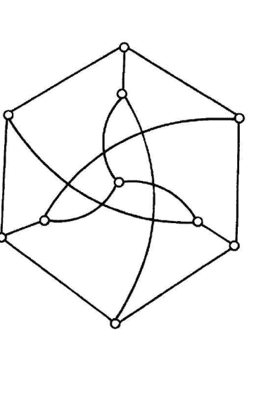
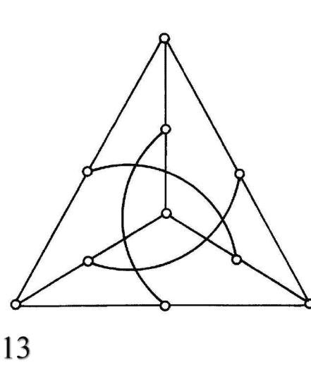
图 10.1.13

(a)

(b)
### 图 1.1.14

### 10.2 链(或路)与圈(或回路)
在无向图(或有向图)的研究中，常常考虑从一个结点出发，沿着一些边(或弧)连续移动而达到另一个指定结点，这种依次由结点和边(或弧)组成的序列，便形成了链(或路)的概念。

### 定义10.2.2
在一条链(或路)中，若出现的边(或弧)都是不相同的，称该链(或路)为简单链(或简单路)；若出现的结点都是是不相同的，称该链(或路)为基本链(或基本路)。

显然，每条基本链(或基本路)必定是简单链(或简单路)。


### 定义10.2.3
在一圈(或回路)中，若出现的每条边(或弧)恰好一次，称该圈(或简单回路)为简单圈(或简单回路)；若出现的每个结点恰好一次，称该圈(或回路)为基本圈(或基本回路)。

可以看出，对于简单图来说，链(或路)和圈(或回路)能够仅用结点序列表示之。

### 定理10.2.1
在一个图中，若从结点v_i到结点v_j存在一条链(或路)，则必有一条从v_i到v_j的基本链(或基本路)。

### 定理10.2.2
在一个具有n个结点的图中，则
- (1) 任何基本链(或路)的长度均不大于n-1。
- (2) 任何基本圈(或路)的长度均不大于n。

### 定义10.2.4
在一个图中，若从v_i到v_j存在任何一条链(或路)，则称从v_i到v_j是可达的，或简称v_i可达v_j。

为完全起见，规定每个结点到其自身是可达的。

对于无向图G来说，不难证明结点间的可达性是结点集合上的等价关系。因此它将结点集合给出一个划分，并且划分中的每个元素形成一个诱导子图；两结点之间是可达的当且仅当它们属于同一个子图，称这种子图为图G的连通分图，图G的连通分图的个数，记为ω(G)。

### 定义10.2.5
若图G只有一个连通分图，则称G是连通图；否则，称图G为非连通图或分离图。

在图的研究中，常常需要考虑删去与增加结点、结点集、边和边集（或弧集）的问题。所谓从图G=<V,E>中删去结点集S，是指作V-S以及从E中删去与S中的全部结点相联结的边而得到的子图，记作G-S；特别当S={v}时，简记为G-v；所谓从图G=<V,E>中删去边集（或弧集）T，是指作E-T，且T中的全部边所关联的结点仍在V中而得到的子图，记为G-T；特别当T={e}时，简记作G-e。

所谓图G=<V,E>增加结点集S，是指作V∪T以及向E中并入S中、S与V中所成的边而得到的图，记作G+S；特别当S={v}时，简记为G+v；图G=<V,E>增加边集（或弧集）T是指作E∪T所得到的图，记作G+T，这里T中全部边（或弧）的关联结点属于V。

### 定义10.2.6
给定连通无向图G=<V, E>, S⊆V。若ω(G-S)>ω(G)，但∀T⊂S有ω(G-T)=ω(G)，则称S是G的一个分离结点集。若图G的分离结点集S={v}，则称v是G的割点。

类似地可定义图G的分离边集T；若图G的分离边集T={e}，则称e是G的割边或桥。

对于连通的非平凡图$G$，称$\gamma(G)=\min_{S\subseteq V}\{|S|\mid S$是$G$的分离结点集$\}$为图$G$的结点连通度，它表明产生不连通图而需要删去结点的最少数目。
于是，对于分离图$G$，$\gamma(G)=0$；对于存在割点的连通图$G$，$\gamma(G)=1$。

类似地定义边连通度λ(G)= min_{T⊆E} {|T| | T是G的分离边集}，它表明产生不连通图而需要删去边的最少数目。可见，对于分离图G，λ(G)=0；对于完全图G，λ(G)=0；对于图K₁，λ(K₁)=0；对于存在割边的连通图G，λ(G)=1；对于完全图Kₙ，λ(Kₙ)=n-1。

下面是由惠特尼(H.Whitney)于1932年得到的关于结点连通度、边连通度和最小度的不等式联系的定理：

**定理10.2.3** 对于任何一个无向图$G$，有

$$\gamma(G)\leq\lambda(G)\leq\delta(G)。$$

**定理10.2.4** 一个连通无向图$G$中的结点$v$是割点⇔存在两个结点$u$和$w$，使得联结$u$和$w$的每条链都经过$v$。

### 定理10.2.5
一个连通无向图G中的边e是割边 ⇔ 存在两个结点u和w，使得联结u与w的每条链都经过e。

下面再给出一个判定一条边是割边的充要条件。

### 定理10.2.6
连通无向图G中的一条边e是割边 ⇔ e不包含在图的任何基本圈中。

对于有向图而言，结点间的可达性不再是等价关系，它仅仅是自反的和传递的。一般说来，不是对称的。因此，有向图的连通概念较之无向图要复杂得多。

对于给定的有向图G，要略去G中每条边的方向便得到一个无向图G₁，称G₁是G的基础图。

### 定义10.2.7
在简单有向图G中，若G中任何两个结点间都是可达的，则称G是强连通的；若任何两个结点间至少是从一个结点可达另一个结点，则称G是单向连通的；若有向图G不是单向连通的，但其基础图是连通的，则称G是弱连通的。

从上面定义可知，若图G是强连通的，则它必是单向连通的，但反之未必真；若图G是单向连通的，则它必是弱连通的，反之不真。

### 定理10.2.7
有向图G是强连通的⇔G中有一回路，它至少通过每个结点一次。

令G是简单有向图，对于某种性质而言，若G中再没有其它包含子图G₁的真子图具有这种性质，则称G₁是G的关于该性质的极大子图。

### 定义10.2.8
在简单有向图中，具有强连通性质的极大子图，称为强分图；具有单向连通性质的极大子图，称为单向分图；具有弱连通性质的极大子图，称为弱分图。

### 定理10.2.8
简单有向图中的任一个结点恰位于一个强分图中。

注意，有向图中的任意一弧未必恰位于一个强分图中，例如，在图10.2.6中，弧<v₁,v₂>位于结点集合 {v₁,v₂,v₃} 的诱导子图中，但弧 <v₃,v₄> 不位于任何强分图之中。

类似地可以证明下面两个定理：
定理10.2.9 简单有向图中的每个结点和每条弧至少位于一个单向分图中。
定理10.2.10 简单有向图中的每个结点和每条弧恰位于一个弱分图中。
如果结点u可达结点v，它们之间可能存在不止一条链(或路)。在所有这些链(或路)中，最短链(或路)的长度称为结点u和v之间的距离或短程线或测地线，记作d<u, v>。

### 距离满足下列性质：
d<u, v> >= 0

d<u, u> >= 0

d<u, v> + d<v, w> >= d<u, w>

如果u不可达v，则d<u, v> = +∞。

此外，要注意，即使u与v相互可达，d<u, v>未必等于d<v, u>。

下面给出简单有向图的一个应用——资源分配图。
在多道程序的计算机系统中，可以同时执行多个程序。实际上，程序共享计算机系统中的资源，如磁带机、磁盘设备、CPU、主存储器和编译程序等。操作系统对这些资源负责分配给各个程序。当一个程序要求使用某种资源，它要发出请求，操作系统必须保证这一请求得到满足。

对资源的请求可能发生冲突。如程序A控制着资源r₁，请求资源r₂；但程序B控制着资源r₂，请求资源r₁。这种情况称为处于死锁状态。然而冲突的请求必须解决，资源分配图有助于发现和纠正死锁。

假设某一程序对一些资源的请求，在该程序运行完之前必须都得到满足。在请求的时间里，被请求的资源是不能利用的，程序控制着可利用的资源，但对不可利用的资源则必须等待。

令P_t={p₁, p₂, …, p_m}表示计算机系统在时间t的程序集合，Q_t⊆P_t是运行的程序集合，或者说在时刻t至少分配一部分所请求的资源的程序集合。R_t={r₁, r₂, …, r_n}是系统在时刻t的资源集合。资源分配图G_t=<R_t, E>是有向图，它表示了时间t系统中资源分配状态。把每个资源r_i看作图中一个结点，其中i=1, 2, …, n。<r_i, r_j>表示有向边，<r_i, r_j>∈E当且仅当程序p_k∈Q_t已分配到资源r_i且等待资源r_j。

例如，令 $R_t = \{r_1, r_2, r_3, r_4\}$， $Q_t = \{p_1, p_2, p_3, p_4\}$。

资源分配状态是：

$p_1$ 占用资源 $r_4$ 且请求资源 $r_1$；

$p_2$ 占用资源 $r_1$ 且请求资源 $r_2$ 和 $r_3$；

$p_3$ 占用资源 $r_2$ 且请求资源 $r_3$；

$p_4$ 占用资源 $r_3$ 且请求资源 $r_1$ 和 $r_4$。

于是，可得到资源分配图Gₜ=<Rₚ,E>，如图10.2.7所示。

能够证明，在时刻计算机系统处于死锁状态⇔资源分配图Gₜ中包含强分图。于是，对于图10.2.7，Gₜ是强连通的，即处于死锁状态。

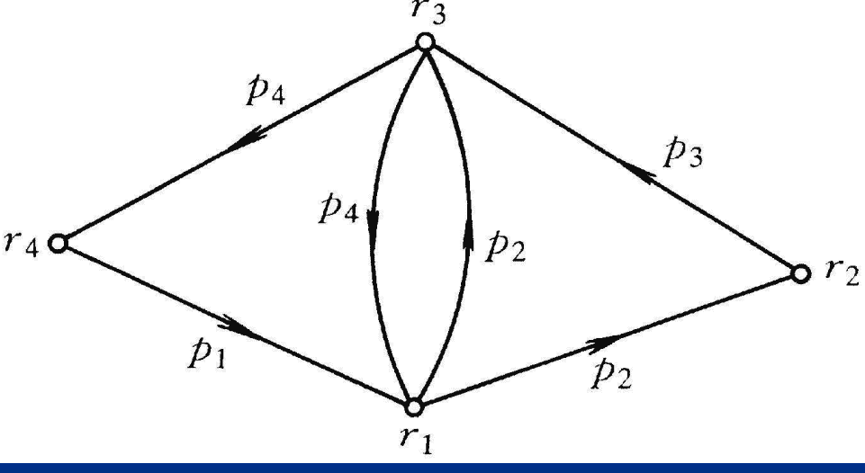

### 10.3 图的矩阵表示
给定一个图 G=<V，E>，使用图形表示法很容易把图的结构展现出来，而且这种表示直观明了。但这只在结点和边(或弧)的数目相当小的情况下才是可行的。显然这限制了图的利用。本节提供另一种图的表示法——图的矩阵表示法。它不仅克服了图形表示法的不足，而且这种表示可以充分利用现代工具电子计算机，以达到研究图的目的。

一个简单图 G=<V, E> 由 V 中每两个结点间的
的邻接关系唯一地确定，这种关系可以用一个
矩阵给出，而矩阵形式与图中结点的编号有密
切关系，这是用矩阵表示图值得注意的一点。

### 定义10.3.1
给定简单图G=<V, E>，V={v₁, v₂, ..., vₙ}，V中的结点按下标由小到大编号，则n阶方阵A=(aᵢⱼ)称为图G的邻接矩阵。其中

aᵢⱼ = { 1, vᵢ adj vⱼ
0, vᵢ nadj vⱼ } i, j=1, 2, ..., n。

有时为强调邻接矩阵依赖于图G，把图G的邻接矩阵记为A(G)。


对于给定图G，显然不会因结点排序不同而使其结构发生任何变化，即图的结点所有不同的排序实际上仍表示同一个图。换句话说，这些结点的不同排序的图都是同构的，并且它们的邻接矩阵都是相似的。于是

G≡H⇔存在置换矩阵P，使A(H)=P⁻¹A(G)P

今后将略去这种由于V中结点排序而引起邻接矩阵的任意性，而取该图的任一个邻接矩阵作为该图的矩阵表示。

邻接矩阵可展示相应图的一些性质：

若邻接矩阵的元素全为零，则其对应的图是零图；

若邻接矩阵的元素除主对角线元素外全为1，则其对应的图是连通的且为简单完全图。

此外，当给定的简单图是无向图时，邻接矩阵是对称矩阵；反之，若给定任何对称矩阵A，显然可以唯一地作出以A为其邻接矩阵的简单图G。于是，所有n个结点的不同排序的简单图的集合与所有n阶对称矩阵的集合可建立一一对应。

当给定的图是简单有向图时，其邻接矩阵并非一定是对称矩阵，但所有n个结点的不同编序的简单图的集合，与所有n阶邻接矩阵的集合亦可建立一一对应。

不仅如此，通过对矩阵元素的一些计算还可以得到对应图的某些数量的特征。

在给定简单有向图的邻接矩阵中，第i行元素是由结点v_i出发的弧所确定，故第i行中值为1的元素数目等于结点v_i的出度。同理，第j列中值为1的元素数目等于结点v_j的入度。即d⁺(v_i)=∑_{k=1}^{n} a_{ik} 和 d⁻(v_j)=∑_{k=1}^{n} a_{kj}。

由给定简单图G的邻接矩阵A可计算出矩阵A的l次幂，即A^l。若第i行第j列上的元素a^l_ij便是G中从第i个结点v_i到第j个结点v_j长度为l的链（或路）的数目。为说明此事实，今给出下面定理。

### 定理10.3.1 设A为简单图G的邻接矩阵，则A^l中的i行j列元素a^l_ij等于G中联结v_i到v_j的长度为l的链(或路)的数目。

在一些实际问题中，有时要判定图中结点 v_i 到结点 v_j 是否可达，或者说 v_i 到 v_j 是否存在一条链（或路）。如果要利用图 G 的邻接矩阵 A，则应计算 A²，A³，…，A^r，…。当发现其中某个 A^r 中 a_{ij}^r，就表明 v_i 可达 v_j 或 v_i 到 v_j 存在一条链（或路）。但这种计算繁琐量大，又不知计算 A^r 到何时为止。

根据定理10.2.2可知，对于有n个结点的图，任何基本链（或路）的长度不大于n-1和任何基本圈（或回路）的长度不大于n。因此，只需考虑 a_{ij}^r 就可以了，其中1≤r≤n。即只要计算 B_n = A + A^2 + A^3 + … + A^n。

如果关心的是结点间可达性或结点间是否有链（或路），至于结点间的链存在多少条及长度是多少无关紧要，那么便可用下面的定义图的 可达矩阵来表示结点间可达性。

## 定义10.3.2 给定图$G=\langle V,\ E\rangle$，将其结点按下标编序得$V=\{v_1,\ v_2,\ \dots,\ v_n\}$。定义一个$n$阶方阵$P=(p_{ij})$，其中

$p_{ij}=\begin{cases}1 & v_i\text{到}v_j\text{可达}\\0 & \text{否则}\end{cases}$

则称矩阵$P$是图$G$的可达矩阵。

可见，可达矩阵表明了图中任意两结点间是否至少存在一条链(或路)以及在结点处是否有圈(或回路)。

从图G的邻接矩阵A可以得到可达矩阵P，即令Bₙ=A+A²+A³+...+Aⁿ，再从Bₙ中非零元素改为1而零元素不变，这种变换后的矩阵即是可达矩阵P。

假设矩阵中的元素是属于布尔代数 <B,∧,∨,¬,0,1>的B中元素，其中B={0,1}，则称该矩阵为布尔矩阵。显然邻接矩阵是一个布尔矩阵，同样可达矩阵也是布尔矩阵。下面定义两个布尔矩阵B与C的运算：

令$B$和$C$的布尔和、布尔积分别记为$B\vee C$和$B\circ C$，其定义为

$(B\vee C)_{ij}=b_{ij}\vee c_{ij}$

$(B\circ C)_{ij}=\bigvee_{k=1}^{n}(b_{ik}\wedge c_{kj})$

$i,j=1,2,\cdots,n$。其中$b_{ij}$、$c_{ij}$分别是$B$和$C$的行列元素。

特别地，对于邻接矩阵 $A$，记 $A\circ A=A^{(2)}$，对于任何 $r=2,3,\cdots$，有

$A^{(r-1)}\circ A=A^{(r)}$

要注意的是 $A$ 与 $A^{(r)}$ 的区别。$A^{(r)}$ 中 $a_{ij}^{(r)}$ 表明从 $v_i$ 到 $v_j$ 长度为 $r$ 的链（或路）的数目，而 $A^{(r)}$ 中 $a_{ij}^{(r)}$ 是指出：若 $v_i$ 到 $v_j$ 至少存在一条链（或路）时，$a_{ij}^{(r)}=1$，否则，$a_{ij}^{(r)}=0$。

由上述说明，便得到可达矩阵 $P$ 为：

$P=A\lor A^{(2)}\lor A^{(3)}\lor\cdots\lor A^{(n)}=\bigvee_{k=1}^{n}A^{(k)}$

对于简单有向图G=<V,E>，显然有 E⊆V×V。因此，弧集合E可解释成B中的二元关系，而二元关系是可用矩阵表示的，通常称这种矩阵为关系矩阵，其定义如下：

设两个有限集合 $X = \{x_1, x_2, \cdots, x_m\}$ 和 $Y = \{y_1, y_2, \cdots, y_n\}$，则关系 $R \subseteq X \times Y$ 的关系矩阵 $M_R = (r_{ij})$，其中

$r_{ij} = \begin{cases} 1, & \langle x_i, y_j \rangle \in R \\ 0, & \text{否则} \end{cases}$

$i = 1,2,\cdots,m;\; j = 1,2,\cdots,n.$

由定义可知，关系R与其关系矩阵M_R是一一对应的，即可以相互确定。

根据集合论可知，对于域F(R)=V而|V|=n的关系R的传递闭包R+可计算如下：

R⁺ = R ∪ R² ∪ R³ ∪ … ∪ Rᵏ    (k ≤ n)

于是，关系R₁和R₂的关系矩阵分别为A₁和A₂，则关系R₁ ∪ R₂的关系矩阵为A₁ ∨ A₂。用归纳法可以证明R⁺的关系矩阵是

M_{R⁺} = M_R ∨ M_{R²} ∨ M_{R³} ∨ … ∨ M_{Rᵏ}

对于G=<V,E>的邻接矩阵A是关系E的关系矩阵，因为E²=EoE，即若存在一个结点vₖ，使得vᵢEvₖ，和vₖEvⱼ，则必有vᵢE²vⱼ，亦即从vᵢ到vⱼ若至少存在一条长度为2的链（或路），那么E²的关系矩阵中的(i,j)元素值为1。这表明矩阵A⁽²⁾是关系E²的关系矩阵。以此类推，A⁽ᵏ⁾是Eᵏ的关系矩阵，k=2,3,…,n。因此
A⁺=A∨A⁽²⁾∨A⁽³⁾∨⋯∨A⁽ⁿ⁾
亦即 A⁺=A∨A⁽²⁾∨A⁽³⁾∨⋯∨A⁽ⁿ⁾=P

可见，关系E的传递闭包E+的关系矩阵A+与可达矩阵相同。

为了计算A+或P，自然可先依次求得A(2)，A(3)，…，A(n)，然后再计算∨_{k=1}^{n} A(k)，其结果即为所求，这是计算A+或P的一种方法，还可介绍一种现有效的方法—Warshall算法，它由邻接矩阵A依下面给出的步骤便能计算A+。其步骤如下：

- (1) $P \leftarrow A$
- (2) $k \leftarrow 1$
- (3) $i \leftarrow 1$
- (4) 若 $p_{ik}=1$, 对 $j=1,2,\cdots,n$ 作 $p_{ij} \leftarrow p_{ij} \lor p_{kj}$
- (5) $i \leftarrow i+1$, 若 $i \le n$ 则转(4)
- (6) $k \leftarrow k+1$, 若 $k \le n$ 则转到(3), 否则停止。

该算法的关键的一步是(4)，它判定如果 $p_{ik}=1$，将第$i$行和第$k$行的各对应元素作布尔和或逻辑加后送到第$i$行中去。

给定关系E₁和关系E₂，它们的关系矩阵分别为A=(aᵢⱼ)和B=(bᵢⱼ)，则关系交E₁∩E₂的关系矩阵记为A∧B，其定义如下：
(A∧B)ᵢⱼ = aᵢⱼ ∧ bᵢⱼ
于是，由可达矩阵和利用关系交的关系矩阵可求出包含图中任何指定结点的强分图。

### 定理10.3.2 给定简单有向图G中的任意结点vᵢ，若P=(pᵢⱼ)是G的可达矩阵，Pᵀ=(pⱼᵢ)是P的转置矩阵，则P∧Pᵀ的第i行元素为1的列号为下标的结点构成了包含vᵢ的强分图。

利用简单有向图的可达矩阵，能够确定某过程是否为递归的。

假设V_P = {p_1,p_2,⋯,p_n}是程序P中的过程集合，做有向图G=<V_P,E>，其中p_i∈V_P, i=1,2,⋯,n;
<p_i,p_j>∈E⇔p_i调用p_j。如果图G中有包含p_i的回路，则可判断p_i是递归的。为此，由图G的邻接矩阵A=(a_ij)计算出可达矩阵A+=(a^+_ij)。如果A^+中的主对角线上的某元素 a^+_ii =1，则p_i是递归的。


在图的矩阵表示中，除邻接矩阵外，
还有关联矩阵、圈（或回路）矩阵、权矩阵等，在此就不都予涉及了，只是再给出
权矩阵的概念以结束本小节。

已知加权的简单图 G=<V,E>，定义一个矩阵 W=(w_ij)，其中：

w_ij = { w， w 是边 |v_i v_j|（或弧 <v_i v_j>）∈E 的权
0， v_i 与 v_j 不相邻

则称 W 为图 G 的权矩阵

# 第十一章 几类重要的图

### 11.1 欧拉图与哈密尔顿图

### 11.2 二部图

### 11.3 树

### 11.4 平面图

### 11.1 欧拉图与哈密尔顿图

1736年瑞士数学家欧拉发表了图论的第一篇著名论文“哥尼斯堡七桥问题”（下称七桥问题）。这个问题是这样的：哥尼斯堡城有一条横贯全城的普雷格尔河，城的各部分用七桥联结，每逢节假日，有些城市居民进行环城周游，于是便产生了能否“从某地出发，通过每桥恰好一次，在走遍了七桥后又返回到原处”的问题。

在图11.1.1画出了哥尼斯堡城图，城的四块陆地部分以A，B，C，和D标记。欧拉巧妙地把哥尼斯堡城图化为图11.1.2所示图G，他把陆地设为图G中的结点，把桥画成相应地联结陆地即结点的边。于是，通过哥尼斯堡中每座桥恰好一次问题，等价于在图G中从某一结点出发找出一条链，它通过每条边恰好一次后回到原出发结点，亦即等价于在图G中寻找一个圈，它通过G中每一条边恰好一次。

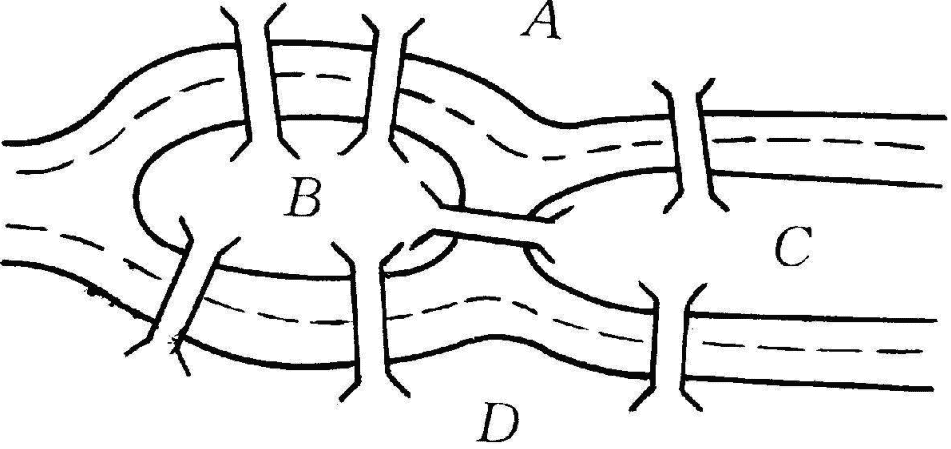

A

B

C

D

欧拉在这篇论文中提出了一条简单准则，确定七桥问题是不能解的。下面就来讨论这个问题。

**定义11.1.1** 图 $G$ 中的一圈（或回路），若它通过 $G$ 中的每一条边（或弧）恰好一次，则称该圈（或回路）为欧拉圈（或回路），具有这种圈（或回路）的图称为欧拉无向（或有向）图。

**定理11.1.1** 给定连通无向图 $G$，$G$ 有欧拉圈 ⇔ $G$ 中每个结点都是偶度结点。

由定义11.1.1可知，具有欧拉圈的图是欧拉图，故图G为欧拉图⇔G中每个结点都是偶度结点。

由于七桥问题所对应的图中每个结点都是奇度结点，根据上述定理可知，七桥问题无解。

### **定义11.1.2** 图G中的一条链(或路)，若它通过G中的每条边(或弧)恰好一次，则称该链(或路)为欧拉链(或路)。

### **定理11.1.2** 给定连通无向图G=<V, E>，u，v∈V且u≠v，u与v间存在欧拉链↔G中仅有u和v为奇度结点。

### 定理11.1.3 给定弱连通有向图G，G有欧拉回路⇔G中的每个结点的入度等于出度。

### 定理11.1.4 给定弱连通有向图G=<V, E>，

u, v∈V且u≠v，u与v存在欧拉路⇔G中唯有u和v的入度不等于出度，且u的入度比其出度大1和v的出度比其入度小于1(或者反之)。

这两个定理的证明，可以看作是关于无向图的欧拉圈和欧拉链的推广。因为对于有向图的任意一个结点来说，如果入度与出度相等，则该结点为偶度结点；如果入度与出度之差为1时，该结点必是奇度结点，所以定理11.1.3和14.1.4与前面两个定理的证明类似。

与欧拉圈和链(或回路和路)非常类似的问题是哈密尔顿圈和链(或回路和路)的问题。1859年，爱尔兰数学家哈密尔顿(W.R.Hamilton)首先提出“环球周游”问题。他用一个正十二面体的20个顶点代表世界上20个大城市(见图11.1.4(a))，这个正十二面体同构于一个平面图(见图11.1.4(b)，平面图的定义稍后给出)，要求旅游者能否找到沿着正十二面体的棱，从某个顶点(即城市)出发，经过每个顶点(即每座城市)恰好一次，然后回到出发顶点?这便是著名的哈密尔顿问题。

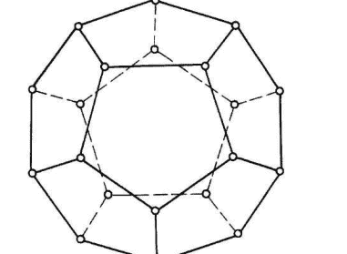

(a)

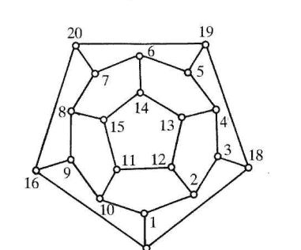

(b)

### 图 11.1.4

按图11.1.4(c)中所给的编号进行旅游，

便是哈密尔顿问题的解。

对于任何连通图也有类似的问题。

### 定义11.1.3 图G中的一圈(或回路)，若它通

过G中每个结点恰好一次，则该圈(或回路)称为

哈密尔顿圈(或回路)，具有哈密尔顿圈(或回路)

的图称为哈密尔顿无向(或有向)图。

由该定义可知，完全图必是哈密尔顿图。

### 定义11.1.4 图G中的一链(或路)，若它通过G中的每个结点恰好一次，则该链(或路)称为哈密顿链(或路)。

哈密顿图尽管在形式上与欧拉图极其相似，但其结论上却有很大不同，至今还没有得到关于哈密顿图的非平凡的充要条件，这是图论尚未解决的主要问题之一。然而，还是有不少重要成果，下面给出几个必要和充分条件的定理。

### 定理11.1.5

若连通图G=<V, E>是哈密尔顿图，S是V的任意真子集，则ω(G-S)≤|S|。

本定理给出是哈密尔顿图的一个必要条件， 但这个条件又不便于使用，因为它要求对G的 结点的集合的所有真子集进行验证。尽管如此， 利用它还可以证明某些图不是哈密尔顿图。

下面给出图G是哈密尔顿图的充分条件，这个结果是于1952年G.A.Dirac研究得到的。

### 定理11.1.6 给定简单图G=<V, E>, |V|=n, 若n≥3和δ≥n/2，则G是哈密尔顿图。

请注意，本定理给出的仅是充分条件。例如，如，十多边形显然是哈密尔顿图，但δ=2≥10/2 =5。

Bondy和Chvátol于1969年证明了更强的充分条件。他们的方法是建立在下面两个引理之上的。

**引理11.1.1** 给定图G=<V, E>, |V|=n≥3。

若u, v∈V, u与v不邻接且d(u)+d(v)≥n, 则G是哈密尔顿图⇔G+ (u, v) 是哈密尔顿图。

受引理11.1.1启示，可以定义图的闭包概念。

### 定义11.1.4 给定图 $G=<V,\ E>$, $|V|=n$。

图$G$的闭包是由$G$通过相继地用边连接两个其度之和至少为$n$的不邻接结点，直到不能如此进行为止而得到的图。用$C(G)$表示图$G$的闭包。

### 引理11.1.2 $C(G)$是唯一确定的。

下面定理是引理11.1.1的直接结果：

### 定理11.1.7 简单无向图G是哈密尔顿图

⇔ C(G)是哈密尔顿图。

容易看出，至少有三个结点的所有完全图都是哈密尔顿图。由此可得到下面推论：

### 推论 给定简单无向图G=<V, E>, |V|≥3。

若C(G)是完全图，则图G是哈密尔顿图。

对于有向图的哈密尔顿回路和路也有此类类似结果，但其证明却是困难得多，因此这里只叙述由Ghoula-Houri给出的定理如下：

### 定理11.1.8 给定n阶强连通图G=<V, E>。

若对任意v∈V，有d⁺(v)+d⁻(v)≥n，则G有哈密尔顿回路。

### 11.2 二部图

本节简要介绍二部图及二部图中匹配理论的主要概念和成果。

定义11.2.1 给定简单无向图 G=<V, E>，且 V=V₁∪V₂，V₁∩V₂=∅。若 V₁和V₂的诱导子图 <V₁>和<V₂>都是零图，则称 G是二部图或偶图，并将二部图记作 G=<V₁, E, V₂>，并称 V₁, V₂ 是 V的划分。

在一个二部图G=<V₁，E，V₂>中，若

|V₁|=m，|V₂|=n，且对任意的u∈V₁，v∈V₂均有

(u，v)∈E，则称G为完全二部图，记为Kₘ，ₙ。

定理11.2.1 简单图G为二部图⇔G中所有基本圈的长度为偶数。

### 定义11.2.2 给定简单无向图 G=<V，E>，

若 M⊆E 且 M 中任意两条边都是不邻接的，则子集 M 称为 G 的一个匹配或对集，并把 M 中的边所关联的两个节点称为在 M 下是匹配的。

令 M 是 G 的一个匹配，若节点 v 与 M 中的边关联，则称 v 是 M—饱和的；否则，称 v 是 M—不饱和的；若 G 中的每个节点都是 M—饱和的，则称 M 是完全匹配。如果 G 中没有匹配 M₁，使 |M₁| > |M|，则称 M 是最大匹配。显然，每个完全匹配是最大匹配，但反之不真。

### 定义11.2.3 令$M$是图$G=<V,\ E>$中的一个匹配

若存在一个链，它是由分别由$E-M$和$M$中的边交替构成，则称该链是$G$中的$M$—交错链；若$M$—交错链的始结点和终结点都是$M$—不饱和的，则称该链为$M$—增广链；特别地，若$M$—交错链的始结点也是它的终结点而形成圈，则称该圈为$M$—交错圈。

在匹配理论中，人们特别关心的是最大匹配。Berge在1957年给出了一个图中的一个匹配为最大匹配的充要条件。在证明这一结论时，将要用到两个集合的对称差的概念，现叙述如下：

给定两个集合S和T，S与T的对称差，记为 SΔT，其定义为：

S⊕T=(S∪T)-(S∩T)


在许多应用中，... 1935年，Hall首先给出存在这样匹配的充分必要条件的定理。

### 定理11.2.3

给定二部图 $G=\langle V_1, E, V_2\rangle$，$G$ 中存在使 $V_1$ 中每个结点饱和的匹配 ⇔ 对任意 $S\subseteq V_1$ 有 $|N(S)|\ge|S|$ (2)

其中 $N(S)$ 表示与 $S$ 中结点邻接的所有结点集合。

### 推论

若 $G=\langle V_1, E, V_2\rangle$ 是二部图，且对于任意 $v\in V_1$ 或 $V_2$ 有 $d(v)=k>0$，则 $G$ 有一个完全匹配。

在定理11.2.3的证明中，它提供了在二部图 $G=\langle V_1, E, V_2\rangle$ 中寻找一个匹配 $M$，使 $V_1$ 中每个结点是 $M$-饱和的。下面给出的称为 *Hungarian* 方法的算法。令 $M$ 是 $G=\langle V_1, E, V_2\rangle$ 中任意一个匹配，该算法是：

1. 若 $V_1$ 中每个结点是 $M$-饱和的，停止。否则，令 $v$ 是 $V_1$ 中 $M$-不饱和结点，作 $S=\{v\}$ 和 $T=\emptyset$。
2. 若 $N(S)=T$，因为 $|T|=|S|-1$，则 $|N(S)|<|S|$，由 Hall 定理知，不存在使 $V_1$ 中每个结点都是饱和的匹配，停止；否则，令 $y\in N(S)-T$。
3. 若 $y$ 是 $M$-饱和的，令 $(y,z)\in M$，作 $S\leftarrow S\cup\{z\}$ 和 $T\leftarrow T\cup\{y\}$，并转到(2)；否则，令 $C_M$ 是以 $v$ 为始结点和 $y$ 为终结点的 $M$-增广链，作 $M\leftarrow M\Delta E(C_M)$ 并转到(1)。其中 $E(C_M)$ 表示 $C_M$ 中所有边的集合。

### 11.3 树

### 定义11.3.1

一个无圈的连通图，称为树。

显然，由定义可知，树是个简单图，即它无环和无平行边。

在树中，度为1的结点称为叶或悬挂结点；度数大于1的结点称为内结点或分枝结点；而与叶或悬挂结点所关联的边，称为叶边或悬挂边。

若图中的每个连通分图是树，则称该图为森林。

### 定理11.3.1

树T中任两个结点间恰有一条链。

### 定理11.3.2

若图G中每对结点间有且仅有一条链，则G为树。

### 定理11.3.3

具有n个结点的树中有n-1条边，即树T=<V，E>中，$|E|=|V|-1$。

注意，具有 $n$ 个结点和恰有 $n-1$ 条边的图未必是树，但有下面两个定理：

### 定理11.3.4

给定连通图 $G=\langle V, E\rangle$，若 $|E|=|V|-1$，则 $G$ 是树。

### 定理11.3.5

给定图 $G=\langle V, E\rangle$，$|E|=|V|-1$ 且 $G$ 中无圈，则 $G$ 是树。

连通无圈完全刻划了树，这是树的一个特性；树还有另外一个重要性质是：它以最少的边使结点可达或连通。这便导出下面的最小连通的概念。

### 定义11.3.2

给定连通图 $G=\langle V, E\rangle$，若对任意 $e\in E$，均使 $G-e$ 不连通，则称连通图 $G$ 是最小连通的。

显然，最小连通图不可能有圈。因为删去圈中的一条边后仍使图连通。于是，最小连通图是树。反之，如果一个连通图G不是最小连通的，则必存在G中一条边 $e_i$，使 $G-e_i$ 连通。所以 $e_i$ 位于一圈中，这意味着G不是树。故可得到下面定理：

### 定理11.3.6

图G是树 ⇔ G是最小连通的。

上面的六个定理可以总结为下面五个不同的但却是等价的树的定义。给定图 $G=\langle V, E\rangle$，G是树的等价定义是：

- ① G是连通且无圈
- ② G是连通且 $|E|=|V|-1$
- ③ G是无圈且 $|E|=|V|-1$
- ④ G中每对结点间恰有一条链
- ⑤ G是最小连通图

### 定理11.3.7

给定树 $T=\langle V, E\rangle$，若 $|V|\ge 2$，则 T 中至少存在两个悬挂结点。

对于一些图，它本身未必是树，但它的子图是树。

一个图可能有多个子图是树，其中很重要的一类树是生成树。

### 定义11.3.3

给定图 $G=\langle V, E\rangle$。若G的生成子图T是树，则称T是G的生成树。T中的边称为枝；G中的边但不在T中的边称为弦。

### 定理11.3.8

图 $G=\langle V, E\rangle$ 有生成树 $T=\langle V_T, E_T\rangle$ ⇔ G是连通的。

假设图 $G=\langle V, E\rangle$ 是连通图，G的一个生成树是 $T=\langle V, E_T\rangle$，则 $|E_T|=|V|-1$。因此，要确立G的一棵生成树必须从G中删去 $|E|-(|V|-1)$ 条边。称数 $|E|-|V|+1$ 为图G的基本圈的秩，它表现打破全部基本圈所必须从G中删去的最小边数，即由G产生的生成树应删去弦的数目。例如，对于图11.3.3所示的图，其圈秩是3。

### 定理11.3.9

若T是图G的一棵生成树，$e=\{u,v\}$ 是弦，则存在唯一的由e和T中某些边构成的基本圈C。若f是C上与e不同的边且由f替换e而得到图 $T_1$，则 $T_1$ 也是G的一棵生成树。

### 定理11.3.10

设 $T_1$ 和 $T_2$ 是图G的两棵生成树。若f是 $T_1$ 的边但不为 $T_2$ 的边，则存在一条属于 $T_2$ 但不属于 $T_1$ 的边e，使得用e代替 $T_1$ 中的一条边而得到图G的一棵生成树 $T_3$。

下面讨论利用生成树为讨论加权图的最小连接问题。

设 $G=\langle V, E, W\rangle$ 是加权的连通图，对任意边 $e\in E$，其权 $w(e)\ge 0$。令 $T=\langle V_T,E_T,W_T\rangle$ 是G的一棵加权生成树，其所有枝上的权的总和 $\sum_{e\in E_T} w(e)$，称为树T的权，记为 $w(T)$。一般说来，对于G的不同生成树T，$w(T)$ 也是不同的。可以知道，其中必有一个最小者，而这正是人们最为感兴趣的。因此，有如下定义。

### 定义11.3.4

给定连通加权图 $G=\langle V, E, W\rangle$，$T_0=\langle V, E_{T_0}, W_{T_0}\rangle$ 是G的加权生成树，$w(T_0)$ 为 $T_0$ 的权。若对G的任意加权生成树T均有 $w(T_0)\le w(T)$，则称 $T_0$ 是G的最小生成树。

下面给出一种求最小生成树的方法——Kruskal算法(1956)，它的本质是树生成过程，因此得名避圈法。

### 定理11.3.11

设G是有n个结点的连通图，下面算法产生的是最小生成树。

1. 选取具有尽可能小的权的边 $e_1$；假定 $i<n-1$ 和已选取边为 $e_1, e_2, \dots, e_i$。
2. 在G中选取不同于 $e_1, e_2, \dots, e_i$ 的边 $e_{i+1}$，使 $\{e_1, e_2, \dots, e_i, e_{i+1}\}$ 的诱导子图无圈且 $e_{i+1}$ 是满足此条件的权尽可能小的边。重复作下去直至选出边 $e_1, e_2, \dots, e_{n-1}$ 为止。

### 定义11.3.5

给定加权连通图 $G=\langle V, E, W\rangle$，对任意 $e\in E$ 均有 $w(e)\ge 0$，及 $u,v\in V$。连接u和v的链 $C_0: u=x_1, x_2, \dots, x_k=v$，其链长记为 $l(v)$ 或 $l(C_0)$，等于 $\sum_{e\in C_0} w(e)$。如果对G中连接u与v的任何链C均有 $l(C_0)\le l(C)$，则称 $C_0$ 是G中连接u和v的最短链。

现在给出一种求从已知结点到另外一个结点的最短链的方法——G.Dantzig算法，其本质也是一种树生长过程。

### 定理11.3.12

设有 $n$ 个结点的加权连通图 $G=\langle V, E, W\rangle$，$x_0\in V$。依下面算法得到G的一棵生成树T，使得在T中连接 $x_0$ 与 $x\neq x_0$ 的每一条基本链是G中连接 $x_0$ 与 $x$ 的最短链。

令 $X_0=\{x_0\}$ 和 $l(x_0)=0$，执行以下步骤：

1. 选取 $x_1$，连接 $x_0$ 与 $x_1$ 使 $w(\{x_0,x_1\})$ 尽可能地小。令 $l(x_1)=w(\{x_0,x_1\})$，$X_1=\{x_0,x_1\}$ 和 $E_1=\{\{x_0,x_1\}\}$。
2. 假设已确定结点集 $X_k=\{x_0,x_1,\dots,x_k\}$ 和边集 $E_k$，$k\ge1$。对于 $x_i\in X_k$，选取 $y_i\notin X_k$，使得 $\{x_i,y_i\}\in E$ 且 $w(\{x_i,y_i\})$ 尽可能地小（若选取不到 $y_i$，则略过 $x_i$）。选取 $x_p\in X_k$，使得对于 $i=0,1,\dots,k$ 有 $l(x_p)+w(\{x_p,y_p\})\le l(x_i)+w(\{x_i,y_i\})$，令 $x_{k+1}=y_p$ 和 $l(x_{k+1})=l(x_p)+w(\{x_p,y_p\})$，再令 $X_{k+1}=\{x_0,x_1,\dots,x_k,x_{k+1}\}$ 和 $E_{k+1}=E_k\cup\{\{x_p,x_{k+1}\}\}$。
3. 重复(2)，直到 $X_{n-1}=\{x_0,x_1,\dots,x_{n-1}\}$ 和 $E_{n-1}$ 确定为止。

前面讨论的树，都是无向图中的树，即无向树；下面将简单地介绍有向图中的树即有向树。

### 定义11.3.6

如果一个有向图的基础图是一棵树，则该有向图称为有向树。其图形表示法常采用倒置树表示之，且为方便计，有时略去边之方向。

### 定义11.3.7

给定一个有向图，若只有一个结点的入度是零，其余结点的入度都是1，则称该树为有根树。

在有根树中，入度为零的结点称为根或根结点，出度为零的结点称为叶或叶结点；出度不为零的结点称为分枝结点或内结点。

### 定义11.3.8

在有根树中，从根到某个结点的路长即该路中的弧数，称为该结点的级。其中结点的级的最大者，称为有根树的树高。

由于有向树中没有回路，因此所有的路都是基本路。可见，从树中任何结点到另一个结点的路长即是两结点的距离。故有根树的根结点的级是零；任何结点的级，等于从根到该结点的距离。

在有向树中，结点的出现次序是没有意义的。但实际应用中，有时要给出同一级中结点的相对次序，这便导出有序树的概念。


定义11.3.9 在一棵有根树中，在每一级的结点都指定某种次序，称树为有序树。例如，图11.3.11与图11.3.10表示两棵不同的有序树。

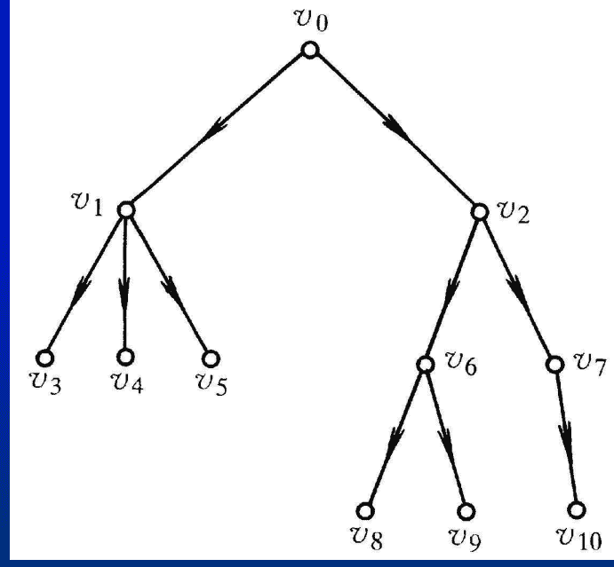

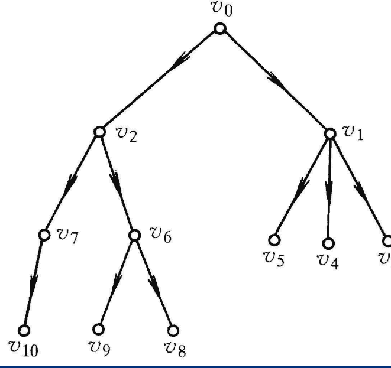

图 11.3.11

为表示结点间的关系，有时借用家族中的术语。令 $u$ 是有根树中的分枝结点，若从 $u$ 到 $v$ 有一条弧或说 $u$ 与 $v$ 是邻接的，则结点 $v$ 称为结点 $u$ 的“儿子”，或称 $u$ 是 $v$ 的“父亲”；若从 $u$ 到 $w$ 有一条路，称 $u$ 是 $w$ 的“祖先”，或称 $w$ 是 $u$ 的“子孙”，同一个分枝结点的儿子称为“兄弟”。

在前面讨论的有根树或有序树中，其结点的出度未加任何限制。现在将依据结点出度的不同情况进行讨论。

### 定义11.3.10

在有根树中，若每一个
结点的出度都小于或等于$m$，则称该树为
$m$叉树。若每一个结点的出度恰好等于$m$
或等于0，则称这种树为完全$m$叉树。若
所有的叶结点的级相同，则称正则$m$叉树。

### 定义11.3.11 在$m$叉树中，如果对任何结点的$m$个(或少于$m$个)儿子都分别指定好$m$个不同的确定位置，则称该树为位置叉树。

当$m=2$时，便可得到常用的二叉树、完全二叉树和正则二叉树。不难看出，二叉树中的每个结点$v$，至多有两个子树，分别称为$v$的左子树和右子树。若$v$只有一个子树，则称它为左子树或右子树均可。在二叉树的图形表示中，$v$的左子树画在$v$的左下方，$v$的右子树画在$v$的右下方。

在位置二叉树中，每个结点可用字符表{0, 1}上的字符串唯一地表示。串中的字符个数称为串的长度。结点v的任何一个儿子所对应的串的前缀是v所对应的串；任何一个叶结点的串不能放置在其它结点的串的前面，这树是位置二叉树的0-1串表示或称哈夫曼编码。对应于叶结点的串的集合形成一个前缀码或哈夫曼编码。例如，{000, 001, 01, 10, 110, 111}是前缀码，因为它正是图11.3.12(b)中树的叶结点0-1串表示的集合。不难看出，利用字符表{0, 1, 2, …, m-1}上的字符串，可表示位置m叉树的各个结点。

如前所叙，在任何位置二叉树的0-1串表示中，其叶结点的串集合是个前缀码，即哈夫曼编码树对应着一个哈夫曼编码。不仅如此，还可以构造性证明其逆命题：

### 定理11.3.13

任何一个前缀码都对应一棵位置二叉树的0-1串表示，即哈夫曼编码对应一棵哈夫曼编码树。

有很多实际应用，可用二叉树或m叉树表示。可以指出，按下面算法，任何一棵有序树均能表成二叉树。其算法是：

(1) 除最左边的分枝结点外，删去所有从每个结点长出的分枝。在同一级中，兄弟结点之间用从左到右的弧连接。

(2) 选取直接位于给定结点下面的结点作为左儿子，与给定结点位于同一水平线上且紧靠它的右边结点作为右儿子，如此类推。

上述算法能够推广到有序森林上去。

二叉树的一个重要应用就是最优树问题。

给定一组数 w₁，w₂，…，wₙ。令一棵二叉树有 n 个叶结点，并对它们分别指派 w₁，w₂，…，wₙ 作为权，则该二叉树称为加权二叉树。

### 定义11.3.12

在权分别为 $w_1，w_2，…，w_n$ 的加权二叉树 $T$ 中，若权是 $w_i$ 的叶结点，其级为 $L(w_i)$，则
$$\sum_{i=1}^{n}w_iL(w_i)$$
称为加权二叉树 $T$ 的权，并记为 $w(T)$。

已知 $w_1，w_2，…，w_n$ 为权，$T_0$ 为加权二叉树，其权为 $w(T_0)$，如果对任意加权二叉树 $T$，它的权是 $w(T)$，均有 $w(T_0)\geq w(T)$，则称 $T_0$ 是最优树或 Huffman 树。

### 定理11.3.14 设T为加权w₁，w₂，…，wₙ且

w₁≤w₂≤…≤wₙ的最优树，则

- (1) 加权w₁和w₂的叶结点v_w₁和v_w₂是兄弟。
- (2) 以叶结点v_w₁和v_w₂为儿子的分支结点，它是所有分支结点的级最高者。

### 定理11.3.15 设T为加权w₁，w₂，…，wₙ且

w₁≤w₂≤…≤wₙ的最优树，若将以加权w₁和w₂的叶结点为儿子的分枝结点改为加权w₁+w₂的叶结点

而得到一棵新树T₁，则T₁是最优树。

### 高等学校21世纪教材

根据上述两个定理，求一棵有n个权的最大优树，可简化为求一棵有n-1个权的最优树，而这又可简化为求一棵有n-2个权的最大优树，依此类推。具体作法是：

首先找出两个最小的权值，设w1和w2。然后对n-1个权w1+w2，w3，...,wn求作一棵最优树，并且将这棵树中的结w1+w2代之以w1 w2，依此类推。

### 11.4 平面图

在一些实际问题中，要涉及到图的平面性的研究，比如大家都知道的印刷线路板的布线问题。近些年来，大规模集成电路的发展，进一步促进了图的平面性的研究。本节将简要地介绍平面图的概念，欧拉公式和平面图的着色。

定义11.4.1 一个无向图 G=<V，E>，如果能把它画在平面上，且除V中的结点外，任意两条边均不相交，则称该图G为平面图。

下面给出一种判别平面图的直观方法。
根据平面的定义，无圈的图显然是平面图。
故，研究图的平面性问题，只需要限制有圈的一类图即可。判别方法是：

- (1) 对于有圈的图找出一个长度尽可能大的且边不相交的基本圈。
- (2) 将图中那些相交于非结点的边，适当放置在已选定的基本圈内侧或外侧，若能避免除结点之外边的相交，则该图是平面图；否则，便是非平面图。

在图论中，称K₃,₃和K₅是库拉图斯基图。这是因为波兰数学家库拉图斯基(K.Kuratowski)于1930年给出了的判别平面图充要条件(后称库拉图斯基定理)曾用到这两个图。下面就来介绍这一定理，不过它要用两个图同胚的概念。
可以看出，在给定图G的任何一条边上插入一个度为2的结点，使一条边成为两条边，或者涂抹图G中度为2的结点，使两条边成为一条边，这些都不会影响图的平面性。

### 定义11.4.2 若图G₂可由图G₁中的一些

边上适当插入或涂抹度为2的有限个结点
后而得到，则称G₁与G₂同胚。

显然，任何两个基本圈是同胚的。

### 定理11.4.1（库拉图斯基定理）一个图G是平面图⇔G中不含同胚于K₃,₃或K₅的子图。

该定理的证明是看起来不算很难但是冗长的，略去了，有兴趣读者可参见图论专著中的证明。

库拉图斯基定理表述还是简明的，例如，图11.4.4(a)所示的图称为彼得森图，它是非平面图。因为当删去边|v₆,v₈|和|v₃,v₄|时，它成为含有同胚于K₃,₃的子图，如图11.4.4(b)或(c)所示。

### 图 11.4.5

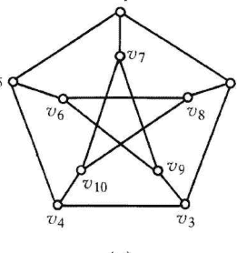

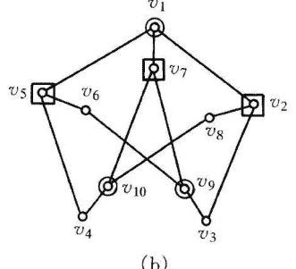

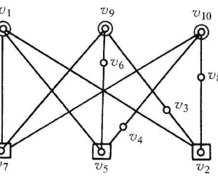

下面介绍平面图中的重要的欧拉公式。

### 定义11.4.3

设G为一平面图，若由G的一条或多条边所界定的区域内部不含图G的结点和边，这样的区域称为G的一个面，记为f。包围这个区域的各条边所构成的圈，称为该面f的边界，其圈的长度，称为该面f的度，记为d(f)。为强调平面图G中含有面这个元素，今后把平面图表为G=<V, E, F>，其中F是G中所有面的集合。

为方便有时把平面图G的外部的无限区域当作一个面，称为无限面或外部面，其余的面称为有限面或内部面。

由定义不难证明下面定理：

### 定理11.4.2 令 G=<V, E, F> 是连通平面图，

则 ∑_{f∈F} d(f) = 2|E| 。

### 定理11.4.3 设 G=<V, E, F> 是连通平面图，

则 |V|-|E|+|F|=2。

这便是著名的欧拉公式。

### 推论1 给定连通简单平面图 G=<V, E, F>。

若 |V|≥3，则 |E|≤3|V|-6。

### 推论2 设 G=<V, E, F> 是一个连通简单平面图

若 |V|≥3，则存在 v∈V，使得 d(v)≤5。

## 推论3 给定连通简单平面图 $G=\langle V,\ E,\ F\rangle$。

若对于每个面 $f\in F$，有 $d(f)\ge 4$，则

$|E|\le 2|V|-4$

## 推论4 完全图 $K_n$ 是平面图 $\Leftrightarrow n\le 4$。

## 推论5 完全二部图 $K_{m,n}$ 是平面图 $\Leftrightarrow m\le 2$ 或

$n\le 2$。


下面讨论平面图的着色问题。

平面图的着色问题，最早起源于地图的着色。在一张地图中，若相邻国家着以不同的颜色，那么最少需要多少种颜色呢？1840年，德国数学家麦比乌斯(A.F.Möbius)在他的讲稿中第一次提出了确信用四种颜色可以对地图着色的问题(以下简称为四色猜想)。1879年肯普(Kempe)给出了这个猜想的第一个证明，但到1890年希伍德(Heawood)发现肯普证明是有错误的，然而他指出了肯普的方法虽不能证明地图着色用四种颜色就够了，但却可以证明用五种颜色是够的，即五色定理成立。

在这里，研究的方法并不直接去考察地图着色问题，而是把它转化成平面图。为此，先给出对偶图的概念。

### 定义11.4.4 给定平面图G=<V，E，F>，且

f₁, f₂, …, fₙ ∈ F。若有图G*=<V*, E*>满足下列条件：

- (1) 对于任意 $f_i \in F$ 内部有且仅有一个结点 $v_i^* \in V^*$；
- (2) 对于 $G$ 中面 $f_i$ 和面 $f_j$ 的公共边 $e_k$ 有且仅有一条边 $e_k^* \in E^*$，使得 $e_k^* = (v_i^*,\ v_j^*)$ 且 $e_k^*$ 与 $e_k$ 相交；
- (3) 当且仅当 $e_k$ 只是一个面 $f_j$ 的边界时，$v_i^*$ 存在一个环 $e_k^*$ 且 $e_k^*$ 与 $e_k$ 相交，则称图 $G^*$ 是图 $G$ 的对偶图。

从对偶图的定义可以看出，若 $G^* = \langle V^*, E^* \rangle$ 是平面图 $G = \langle V, E, F \rangle$ 的对偶图，则 $G$ 也 $G^*$ 的对偶图。一个连通平面图 $G$ 的对偶图 $G^*$，也是平面图，而且有

$|E(G^*)| = |E(G)|$

$|V(G^*)| = |F(G)|$

$d(v_i^*) = d_c(f_i) \quad f_i \in F, \; v_i^* \in V^*$

其中 *E(G)* 表示图 *G* 的所有边集合，

*F(G)* 表示图 *G* 的所有面的集合。于是，可得到下面定理：

### 定理11.4.4 若 *G = <V, E, F>* 是平面图，

则 $\sum_{f \in F} d(f) = 2\,|E|.$

### 定义11.4.5 若图$G$的对偶图$G^*$同构于
$G$，则称$G$是自对偶图。

### 定理11.4.5 若平面图 G=<V, E> 是自对偶图，则 |E|=2(|V|-1)。

从对偶图的定义容易知道，对于地图的着色问题，可以化为一种等价的对于平面图的结点的着色问题。因此，四色问题可以归结为要证明：对任意平面图一定可以用四种颜色，对其结点进行着色，使得相邻结点都有不同颜色。

平面图G=<V，E>的着色α是从结点集V到色集C={c₁，c₂，…，cₙ}上一个映射，使对任意边|vᵢ，vⱼ|∈E均有α(vᵢ)≠α(vⱼ)，即对G的每个结点指派一种颜色，使得相邻结点都有不同的颜色。

对于平面图G着色时，需要的最少颜色数称为G的着色数，记为χ(G)。

定理11.4.6（五色定理）对于任何简单平面图G=<V，E>，均有χ(G)≤5。

由此定理及对偶图定义，可得出下面定理。

### 定理11.4.7 任何地图M，M是五着色的，即χ(M)≤5。

自从四色猜想提出后，一百多年来，一直成为数学上的著名难题，它吸引许许多多的人，为之而作出大量辛劳，也得到很多重要结果，但长久未能得到解决。直到1976年6月，由美国伊利诺斯大学两名数学家爱普尔(K.I.Apple)、黑肯(W.Haken)在考希(J.Koch)帮助下借助于电子计算机，用了一百多亿次逻辑判断，花了1200多机时才证明四色猜想是成立的，从此宣告，四色猜想成为四色定理。现将它叙述如下：

### 定理11.4.8 (四色定理)对于任何平面图G,

有χ(G)≤4。

相应地有下面的定理。

### 定理11.4.9 对于任何地图M, M是四着色的，即χ(M)≤4。
