# 吉林大学组成原理课件（曲冠南）


## 课程介绍

学时数: 64

教学方式: 讲授

教材：《计算机组成原理》，唐朔飞，高等教育出版社。

参考书:

- 《计算机系统结构-量化研究方法》， John L. Hennessy, David A. Patterson.
- 《计算机组成与设计： 硬件/软件接口》， David A. Patterson, John L. Hennessy.

考核：平时成绩+期末成绩

## 上课要求

- 不缺席
- 作业独立完成
- 考试不作弊

## 点名与习题

- 随堂测试
- 两次总结习题课（二二篇一次，三四篇一次）
- 答疑

## 本课程如何进行

计算机

## 第 1 篇 概论

## 本课程如何进行

## 第 2 篇

计算机系统的硬件结构

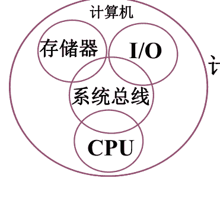

计算机

存储器

I/O

系统总线

CPU

## 本课程如何进行

## 第 3 篇 CPU

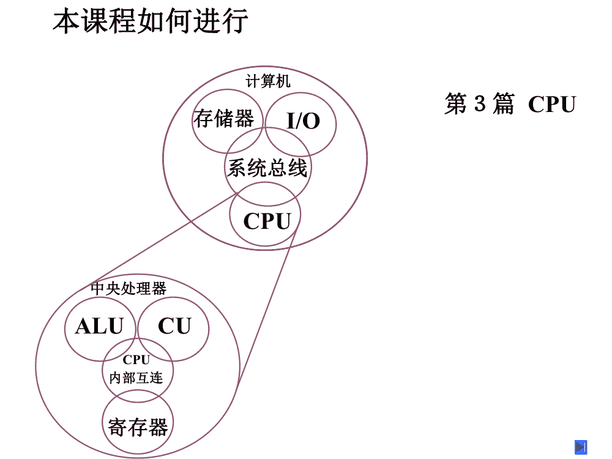

## 本课程如何进行

## 第 4 篇 CU

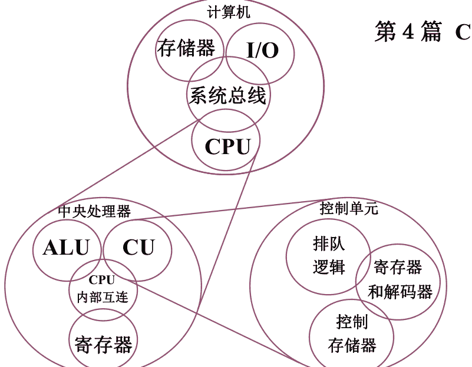

# 第 1 篇 计算机系统概论

## 1.1 计算机系统简介

## 1.2 计算机系统的基本组成

## 1.3 计算机硬件的主要技术指标

## 1.4 计算机硬件和体系结构的发展

## 1.1 计算机系统简介

### 一、计算机的软硬件概念

1. 计算机系统

计算机系统
硬件 计算机的实体，如主机、外设等
软件 由具有各类特殊功能的信息（程序）组成

#### 软件

##### 系统软件

用来管理整个计算机系统

- 语言处理程序
- 操作系统
- 服务性程序
- 数据库管理系统
- 网络软件

##### 应用软件

按任务需要编制成的各种程序

### 二、计算机系统的层次结构

高级语言

汇编语言

操作系统

机器语言

微指令系统

虚拟机器 M₃

虚拟机器 M₂

虚拟机器

实际机器 M₁

微程序机器 M₀

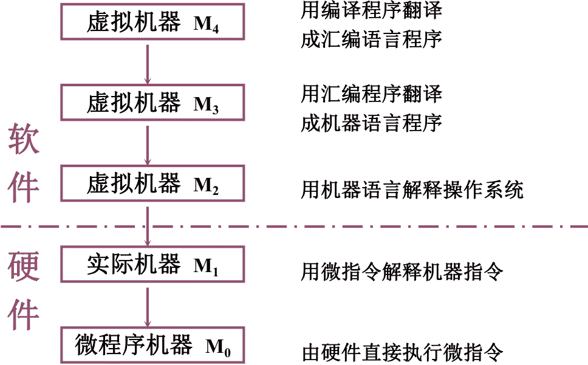

#### 软件

#### 硬件

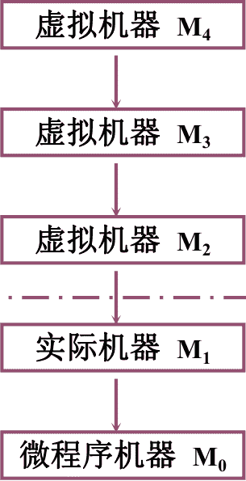

用编译程序翻译
成汇编语言程序

用汇编程序翻译
成机器语言程序

用机器语言解释操作系统

用微指令解释机器指令

由硬件直接执行微指令

### 三、计算机体系结构和计算机组成

计算机体系结构

程序员所见到的计算机系统的属性

概念性的结构与功能特性

（指令系统、数据类型、寻址技术、I/O机理）

有无乘法指令

计算机组成

实现计算机体系结构所体现的属性

（具体指令的实现）

如何实现乘法指令

## 1.2 计算机系统的基本组成

#### 一、冯·诺依曼计算机的特点

- 1. 计算机由五大部件组成
- 2. 指令和数据以同等地位存于存储器，可按地址寻访
- 3. 指令和数据用二进制表示
- 4. 指令由操作码和地址码组成
- 5. 存储程序
- 6. 以运算器为中心

##### 冯·诺依曼计算机硬件框图

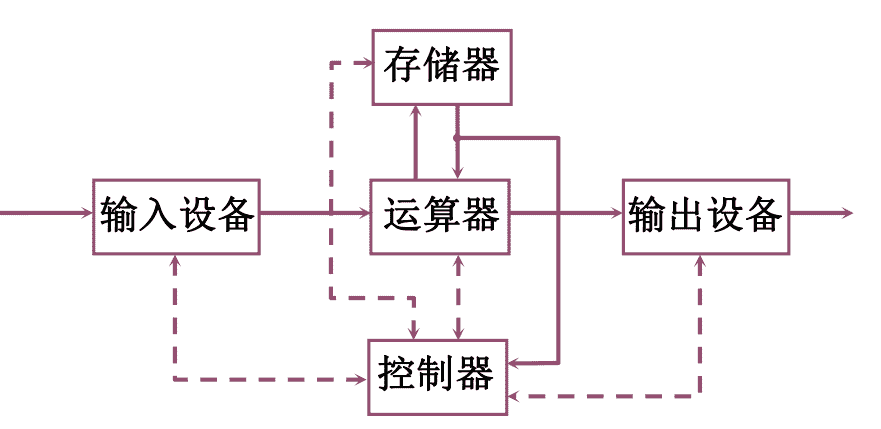

#### 二、计算机硬件框图

1. 以存储器为中心的计算机硬件框图

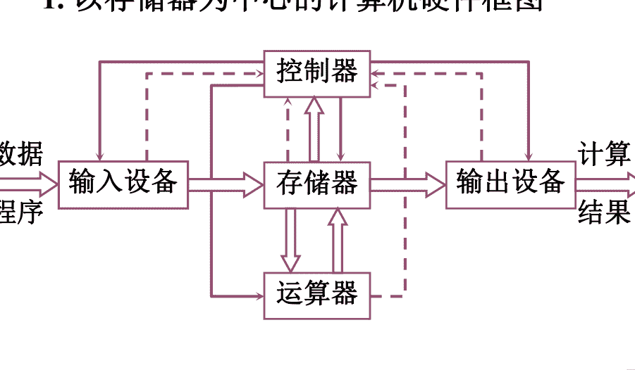

2. 现代计算机硬件框图

- 运算器 ALU
- 控制器 CU
- 主存 辅存
- 输入设备
- 输出设备

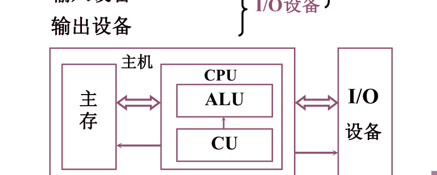

#### 三、计算机的工作步骤

- • 建立数学模型
- • 确定计算方法

```
sin x = x - x³/3! + x⁵/5! - x⁷/7! + x⁹/9! - …
```

```
√x = 1/2 (yₙ + x/yₙ) (n = 0, 1, 2, …)
```

- • 编制解题程序

程序 —— 运算的 全部步骤

指令 —— 每一个步骤

##### 编程举例

计算 ax² + bx + c = (ax + b)x + c

- 取x 至运算器中
- 乘以x 在运算器中
- 乘以a 在运算器中
- 存ax² 在存储器中
- 取b 至运算器中
- 乘以x 在运算器中
- 加ax² 在运算器中
- 加c 在运算器中

- 取x 至运算器中
- 乘以a 在运算器中
- 加b 在运算器中
- 乘以x 在运算器中
- 加c 在运算器中

##### 指令格式举例

| 操作码 | 地址码 | 说明 |
|---|---|---|
| 取数 α | 000001 0000001000 | [α] → ACC |
| 存数 β |  | [ACC] → β |
| 加 γ |  | [ACC] + [γ] → ACC |
| 乘 δ |  | [ACC] × [δ] → ACC |
| 打印 σ |  | [σ] → 打印机 |
| 停机 |  |  |

##### 计算 $ax^2 + bx + c$ 程序清单

| 指令和数据存在主存单元的地址 | 指令 |  | 注释 |
|---|---|---|---|
|  | 操作码 | 地址码 |  |
| 0 | 000001 | 0000001000 | 取数$x$至ACC |
| 1 | 000100 | 0000001001 | 乘$a$得$ax$,存于ACC中 |
| 2 | 000011 | 0000001010 | 加$b$得$ax+b$,存于ACC中 |
| 3 | 000100 | 0000001000 | 乘$x$得$(ax+b)x$,存于ACC中 |
| 4 | 000011 | 0000001011 | 加$c$得$ax^2+bx+c$,存于ACC |
| 5 | 000010 | 0000001100 | 将$ax^2+bx+c$,存于主存单元 |
| 6 | 000101 | 0000001100 | 打印 |
| 7 | 000110 |  | 停机 |
| 8 |  | $x$ | 原始数据$x$ |
| 9 |  | $a$ | 原始数据$a$ |
| 10 |  | $b$ | 原始数据$b$ |
| 11 |  | $c$ | 原始数据$c$ |
| 12 |  |  | 存放结果 |

##### 2. 计算机的解题过程

(1) 存储器的主要功能和组成

- 存放程序和数据的装置
- 计算机能够随机的访问这些程序和数据
- 进？   <<== 地址
- 出？   ==> 数

##### 2. 计算机的解题过程

##### 存储器的基本组成

存储体 - 存储单元 - 存储元件（0/1）

大楼 - 房间 - 床位（无人/有人）

存储单元 存放一串二进制代码

存储字 存储单元中二进制代码的组合

存储字长 存储单元中二进制代码的位数

每个存储单元赋予一个地址号

按地址寻访


##### 存储器的基本组成


MAR 存储器地址寄存器 反映存储单元的个数

MDR 存储器数据寄存器 反映存储字长

设 MAR=4位

MDR=8位

存储单元个数 16

存储字长 8

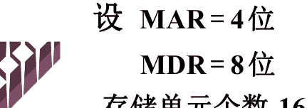

(2)运算器的主要功能和组成

- • 完成算数和逻辑运算
- • 所有的算数运算都能够通过加法来解决
- • 进? === 数
- • 出? ==》数

##### 运算器的基本组成及操作过程

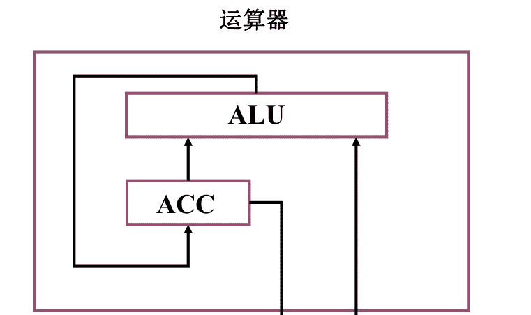

(3)控制器的主要功能

- 整个机器的指挥机构
  - 按照规定的操作进行 ==》 取/译/执
  - 自动的进行 ==》 PC = PC+1
  - 有秩序的进行 ==》 时序，时钟，节拍，脉冲
- 出？ ==》 指令地址
- 进？ 《== 指令
- 出？ ==》 控制信号


##### 控制器的基本组成

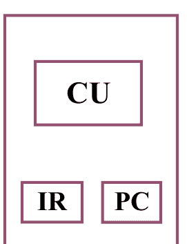

完成一条指令
取指令
分析指令
执行指令

PC
IR
取指 访存
CU
执行 访存

PC 存放当前欲执行指令的地址，具有计数功能（PC）+1→PC

IR 存放当前欲执行的指令

CU 控制单元

##### (4) 主机完成一条指令的过程
以取数指令为例

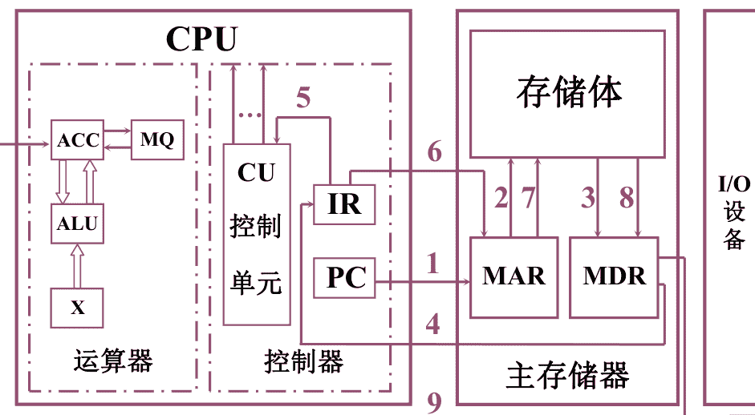

##### (4) 主机完成一条指令的过程
以存数指令为例

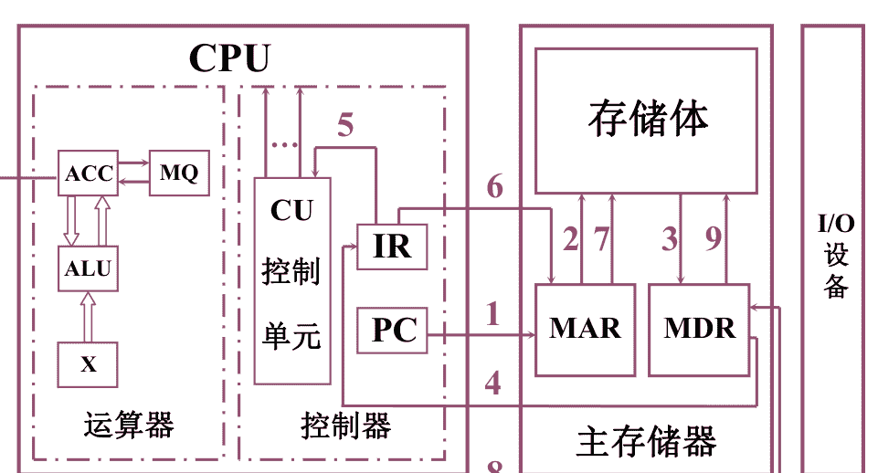

##### (5) $ax^2 + bx + c$ 程序的运行过程

- 将程序通过输入设备送至计算机
- 程序首地址 ⟶ PC
- 启动程序运行
- 取指令 PC ⟶ MAR ⟶ M ⟶ MDR ⟶ IR ， (PC) + 1 ⟶ PC
- 分析指令 OP(IR) ⟶ CU
- 执行指令 Ad(IR) ⟶ MAR ⟶ M ⟶ MDR ⟶ ACC
- ∶
- 打印结果
- 停机

## 1.3 计算机硬件的主要技术指标

- 1. 机器字长
- CPU 一次能处理数据的位数
- 与 CPU 中的 寄存器位数 有关

- 2. 运算速度
- 主频
- 吉普森法 $T_M = \sum_{i=1}^{n} f_i t_i$
- MIPS 每秒执行百万条指令
- CPI 执行一条指令所需时钟周期数
- FLOPS 每秒浮点运算次数

### 3. 存储容量
存放二进制信息的总位数

#### 主存容量

存储单元个数 × 存储字长

如 MAR MDR 容量
10 8 1K×8位
16 32 64K×32位

1K = 2^{10}

#### 字节数

如 2^{13} = 1 KB
2^{21} = 256 KB

1B = 2^{3b}

#### 辅存容量

字节数 80 GB

1GB = 2^{30b}

## 1.4 计算机硬件和体系结构的发展

### 一、计算机的产生和发展

- 第一台通用电子计算机诞生于1946年

世界上第一台现代电子计算机“埃尼阿克”（LJC32），诞生于1946年2月14日的美国宾夕法尼亚大学，并于次日正式对外公布。ENIAC长30.48米，宽1米，占地面积约170平方米，30个操作台，约相当于10间普通房间的大小，重达30吨，耗电量150千瓦，造价48万美元。它包含了17,468真空管7,200水晶二极管，1,500中转，70,000电阻器，10,000电容器，1500继电器，6000多个开关，每秒执行5000次加法或400次乘法，是继电器计算机的1000倍、手工计算的20万倍。

ENIAC于1955年退役。

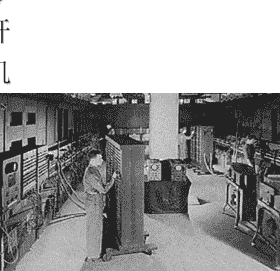

#### 硬件技术对计算机更新换代的影响

| 代 | 时间 | 硬件技术 | 速度 /（次/秒） |
| --- | --- | --- | --- |
| 一 | 1946—1957 | 电子管 | 40 000 |
| 二 | 1958—1964 | 晶体管 | 200 000 |
| 三 | 1965—1971 | 中小规模集成电路 | 1 000 000 |
| 四 | 1972—1977 | 大规模集成电路 | 10 000 000 |
| 五 | 1978—现在 | 超大规模集成电路 | 100 000 000 |

#### IT定律：

- • 摩尔定律
- IT产品的性能每18个月翻一番。

处理能力：

- 1945年 ENIAC 每秒5000次定点运算；
- 2007年 IBM深蓝基因 ENIAC的70倍；
- 2010年 中国天河1A IBM深蓝的的70倍；
- 2012年 IBM红杉 天河1A的6倍。

- • 安迪-比尔定律
- What Andy gives, Bill takes away.

### 二、 计算机系统结构的发展

1. 输入/输出方式的改进

输入输出方式
程序控制
程序等待
程序中断
DMA
成组传递
周期挪用
I/O 处理机
通道
外围处理机

2. 采用并行处理技术

- 并行数据处理：
  例如，微操作级、指令级、线程级、进程级、任务级等。
- 并行存取

3. 存储器组织结构的发展

- 相联存储器与相联处理机
- 通用寄存器组
- 存储体系
- 指令和数据分离

4. 指令集的发展

- 复杂指令集计算机（CISC）
- 精减指令集计算机（RISC）

#### 二、 计算机系统结构中并行性的发展

##### 1. 并行性的概念

- 并行性：计算机系统在同一时刻或者同一时间间隔内进行多种运算或操作。（只要在时间上相互重叠，就存在并行性）
  - 同时性：两个或两个以上的事件在同一时刻发生。
  - 并发性：两个或两个以上的事件在同一时间间隔内发生。

##### 2. 从执行程序的角度来看，并行性等级从低到高可分为：

- 指令内部并行：单条指令中各微操作之间的并行。
- 指令级并行：并行执行两条或两条以上的指令。
- 线程级并行：并行执行两个或两个以上的线程。
  通常是以一个进程内派生的多个线程为调度单位。
- 任务级或过程级并行：并行执行两个或两个以上的过程或任务（程序段）
  以子程序或进程为调度单元。
- 作业或程序级并行：并行执行两个或两个以上的作业或程序。

##### 3. 提高并行性的技术途径

三种途径：

- 时间重叠
  
  引入时间因素，让多个处理过程在时间上相互错开，轮流重叠地使用同一套硬件设备的各个部分，以加快硬件周转而赢得速度。原则上不重复设置硬件设备。

- 资源重复
  
  引入空间因素，以数量取胜。通过重复设置硬件资源，大幅度地提高计算机系统的性能。

- 资源共享
  
  这是一种软件方法，它使多个任务按一定时间顺序轮流使用同一套硬件设备。如，多道程序。

##### 4 单机系统中并行性的发展

(1) 在发展高性能单处理机过程中，起主导作用的是时间重叠原理。

实现时间重叠的基础：部件功能专用化

- 把一件工作按功能分割为若干相互联系的部分；
- 把每一部分指定给专门的部件完成；
- 按时间重叠原理把各部分的执行过程在时间上重叠起来，使所有部件依次分工完成一组同样的工作。

例如： 对于解释指令的5个过程，就分别需要5个专用的部件：取指令部件 (IF)、指令译码部件 (ID)、指令执行部件 (EX)、访问存储器部件 (M) 和写结果部件 (WB)。
时间
串行执行
指令 i
指令 i+1
指令 i+2
指令 i+3
流水执行
IF ID EX M WB
指令 i
指令 i+1
指令 i+2

（2）在单处理机中，资源重复原理的运用也已经十分普遍。

例如：

- 多体存储器
- 多操作部件
  - 通用部件被分解成若干个专用部件，如加法部件、乘法部件、除法部件、逻辑运算部件等，而且同一种部件也可以重复设置多个。
  - 只要指令所需的操作部件空闲，就可以开始执行这条指令（如果操作数已准备好的话）。

(3) 在单处理机中，资源共享的概念实质上是用单处理机模拟多处理机的功能，形成所谓**虚拟机**的概念。

- 分时系统

##### 5　多机系统中并行性的发展

多机系统遵循时间重叠、资源重复、资源共享原理，发展为3种不同的多处理机：

- 时间重叠 → 功能专用化（实现时间重叠）→ 异构型多处理机系统
  由多个不同类型、至少担负不同功能的处理机组成，它们按照作业要求的顺序，利用时间重叠原理，依次对它们的多个任务进行加工，各自完成规定的功能动作。
  例如：专用处理机
- 资源重复 → 重复设置相同的资源 → 同构型多处理机
  例如：容错系统
- 资源共享 → 分布式系统

# 计算机原理与系统结构

# 第三章 系统总线

曲冠南

gnqu@jlu.edu.cn

### 3.1 总线的基本概念

### 3.2 总线的分类

## 3.3 总线特性及性能指标

### 3.4 总线结构

### 3.5 总线控制

### 3.1 总线的基本概念

- 一、为什么要用总线

- 二、什么是总线

总线是连接各个部件的信息传输线，

是 各个部件共享的传输介质

- 三、总线上信息的传送

串行


并行


#### 四、总线结构的计算机举例

##### 1. 面向 CPU 的双总线结构框图

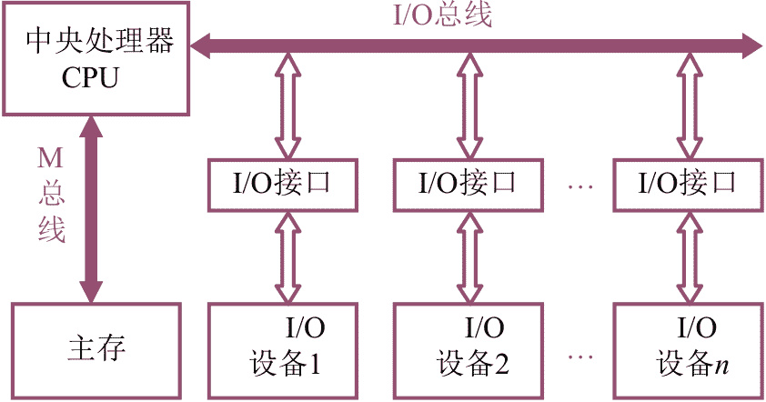

##### 2. 单总线结构框图

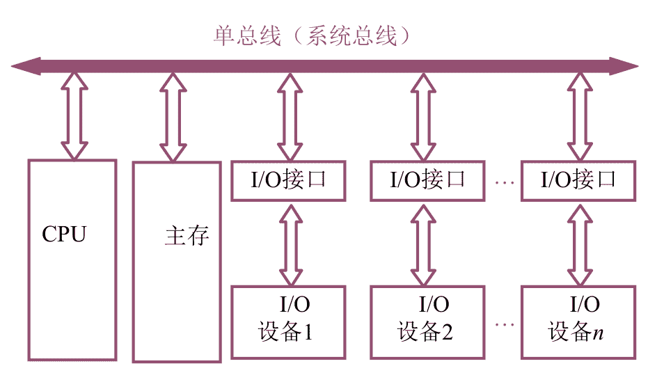

##### 3. 以存储器为中心的双总线结构框图

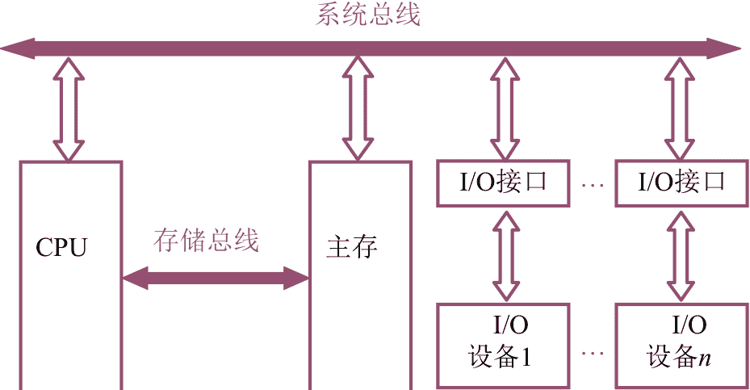

系统总线

存储总线

CPU

主存

I/O接口

I/O接口

I/O设备1

I/O设备$n$

### 3.2 总线的分类

- 1. 片内总线
- 芯片内部 的总线

- 2. 系统总线
- 计算机各部件之间 的信息传输线

- 数据总线
- 双向 与机器字长、存储字长有关

- 地址总线
- 单向 与存储地址、 I/O地址有关

- 控制总线
- 有出 有入

中断请求、总线请求

存储器读、存储器写
总线允许、中断确认

#### 3. 通信总线

用于计算机系统之间或计算机系统与其他系统（如控制仪表、移动通信等）之间的通信

传输方式
- 串行通信总线
- 并行通信总线

### 3.3 总线特性及性能指标（自行阅读）

#### 一、总线物理实现

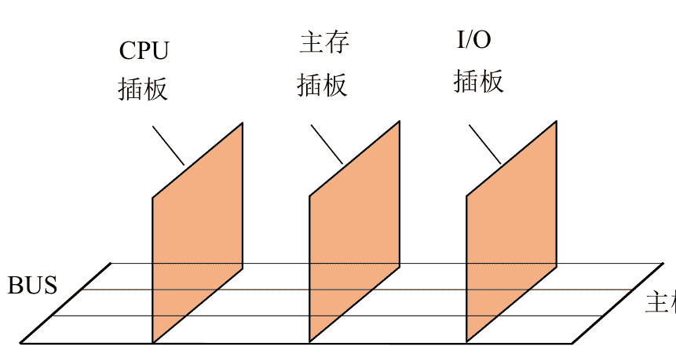

CPU
插板

主存
插板

I/O
插板

BUS

主板

#### 二、总线特性

- 1. 机械特性  尺寸、形状、管脚数 及 排列顺序

- 2. 电气特性  传输方向 和有效的 电平 范围

- 3. 功能特性  每根传输线的 功能  { 地址 数据 控制 }

- 4. 时间特性  信号的 时序 关系

#### 三、总线的性能指标

- 1. 总线宽度：数据线的根数
- 2. 总线带宽：每秒传输的最大字节数（MBps）
- 3. 时钟同步/异步：同步、不同步
- 4. 总线复用：地址线与数据线复用
- 5. 信号线数：地址线、数据线和控制线的总和
- 6. 总线控制方式：并发、自动、仲裁、逻辑、计数
- 7. 其他指标：负载能力，电源电压，是否扩展等

#### 四、总线标准

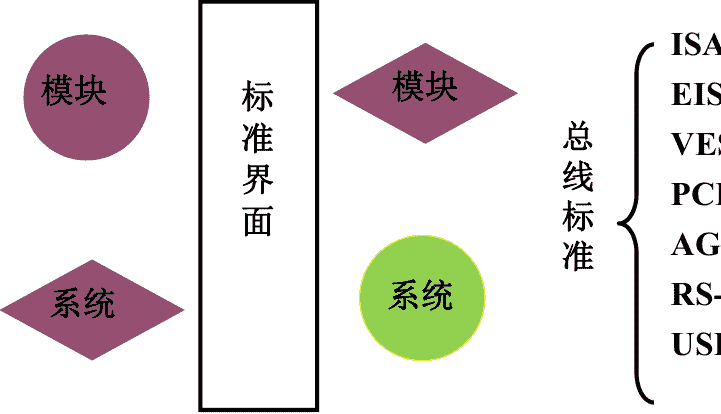

模块

系统

标准界面

模块

系统

总线标准

- ISA
- EISA
- VESA(LV-BUS)
- PCI
- AGP
- RS-232
- USB

#### 四、总线标准

| 总线标准 | 数据线 | 总线时钟 | 带宽 |
|----------|--------|----------|------|
| ISA | 16 | 8 MHz (独立) | 16 MBps |
| EISA | 32 | 8 MHz (独立) | 33 MBps |
| VESA (VL-BUS) | 32 | 33 MHz (CPU) | 133 MBps |
| PCI | 32 | 33 MHz (独立) | 132 MBps |
|  | 64 | 66 MHz (独立) | 528 MBps |
| AGP | 32 | 66.7 MHz (独立) | 266 MBps |
|  | 133 MHz (独立) | 533 MBps |
| RS-232 | 串行通信总线标准 | 数据终端设备（计算机）和数据通信设备（调制解调器）之间的标准接口 |  |
| USB | 串行接口总线标准 | 普通无屏蔽双绞线带屏蔽双绞线最高 | 1.5 Mbps (USB1.0)
12 Mbps (USB1.0)
480 Mbps (USB2.0) |

### 3.4 总线结构

#### 一、单总线结构

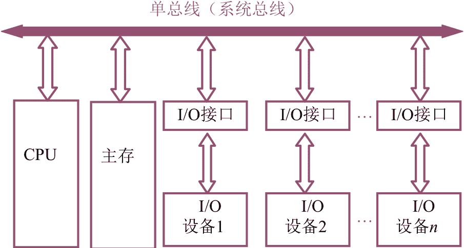

#### 二、多总线结构

1. 双总线结构

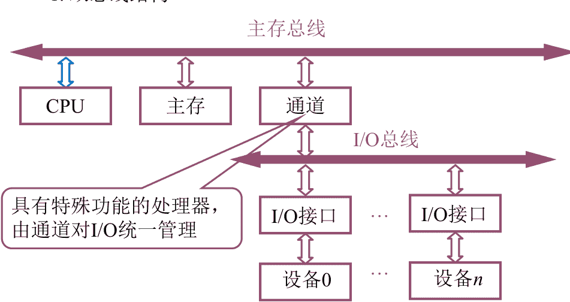

##### 2. 三总线结构

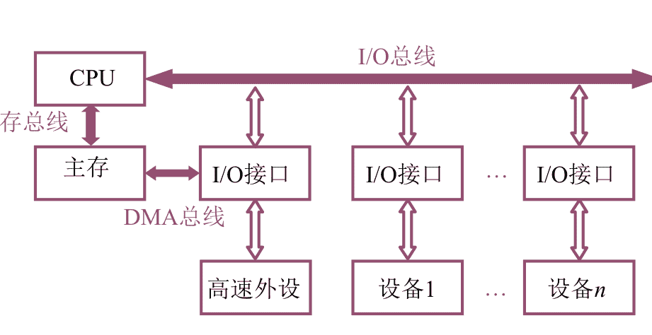

##### 3. 三总线结构的又一形式

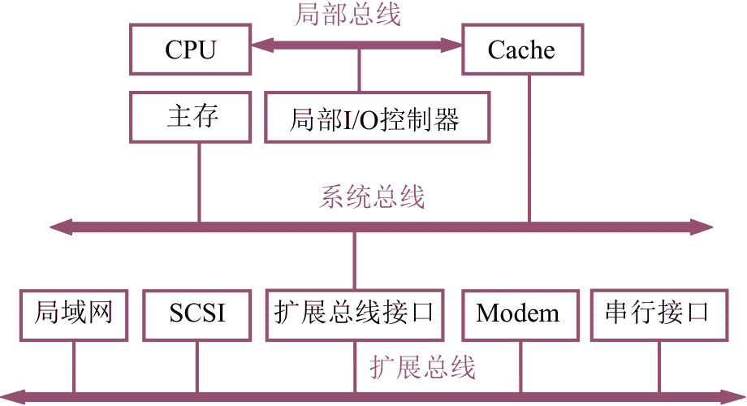

##### 4. 四总线结构

CPU

局部总线

Cache/bridge

系统总线

主存

SCSI

图形

多媒体

局域网

高速总线

FAX

扩展总线接口

Modem

串行接口

扩展总线

#### 三、总线结构举例

1. 传统微型机总线结构

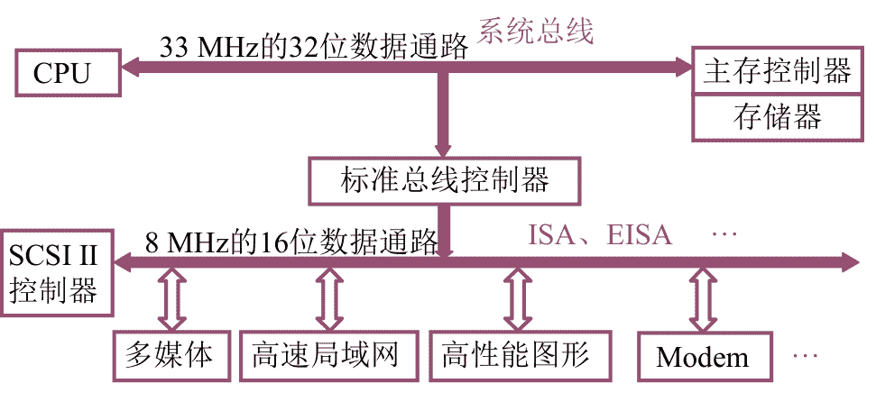

2. VL-BUS局部总线结构

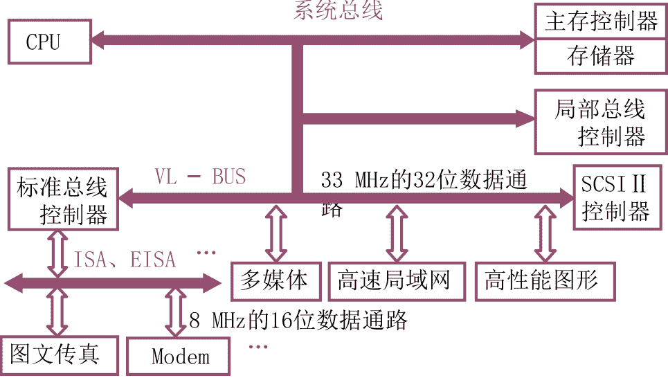

3. PCI 总线结构

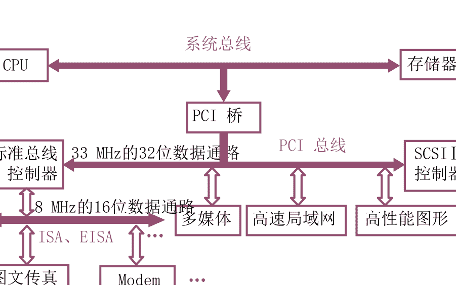

4. 多层 PCI 总线结构

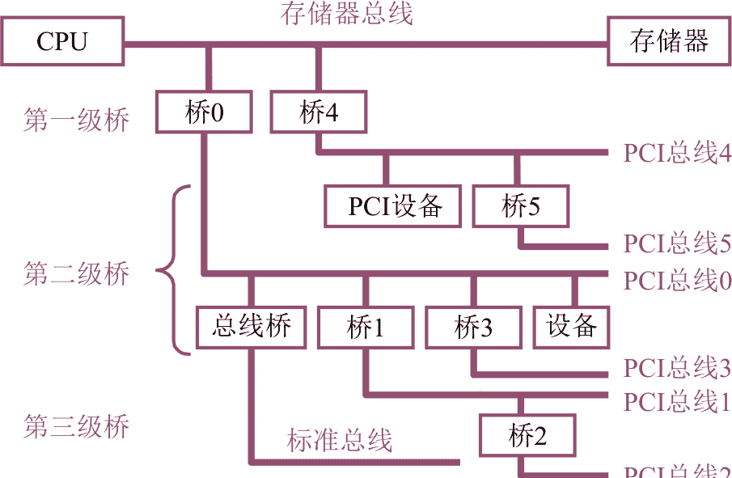

### 3.5 总线控制

#### 一、总线判优控制

##### 1. 基本概念

- - 主设备(模块) 对总线有 控制权

- - 从设备(模块) 响应 从主设备发来的总线命令

- - 总线判优控制
- { 集中式
- { 链式查询
- 计数器定时查询
- 独立请求方式 }
- 分布式 }

##### 2. 链式查询方式

BS —总线忙

BR—总线请求

BG—总线同意

数据线

地址线

总线控制部件

BS

BR

I/O接口0

I/O接口1

…

I/O接口n

BG

##### 3. 计数器定时查询方式

BS —总线忙

BR—总线请求

数据线

地址线

设备地址

总线控制部件

计数器

BS

BR

I/O接口0

I/O接口1

I/O接口n

1

##### 4. 独立请求方式

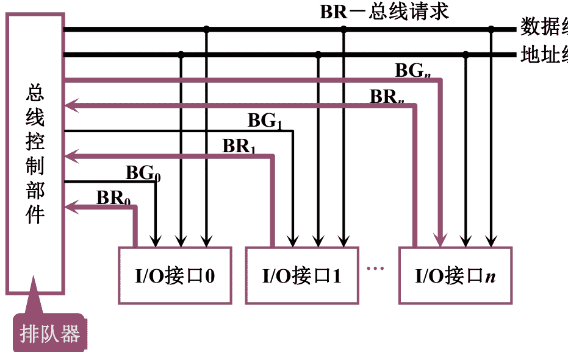

#### 二、总线通信控制

1. 目的　　解决通信双方**协调配合**问题

2. 总线传输周期

- - 申请分配阶段　　**主模块申请**，总线仲裁决定
- - 寻址阶段　　　　主模块向从模块**给出地址**和**命令**
- - 传数阶段　　　　主模块和从模块**交换数据**
- - 结束阶段　　　　主模块**撤消有关信息**

##### 3. 总线通信的四种方式

- - 同步通信
- 由 统一时标 控制数据传送
- - 异步通信
- 采用 应答方式，没有公共时钟标准
- - 半同步通信
- 同步、异步结合
- - 分离式通信
- 充分 挖掘 系统 总线 每个瞬间 的 潜力

##### (1) 同步式数据输入

总线传输周期

时钟

T₁

T₂

T₃

T₄

地址

读命令

数据

##### (2) 同步式数据输出

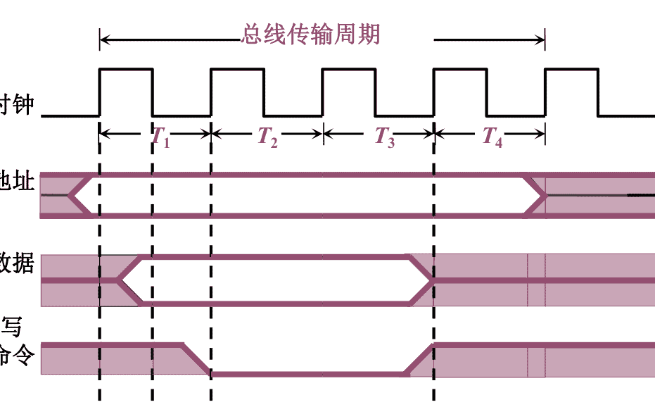

例题 3.1 假设总线的时钟频率为100MHz，总线的传输周期为4个时钟周期，总线的宽度是32位。若想提高一倍的数据传输率，可采用什么措施？

##### (3)异步通信

主设备

请求

回答

从设备

不互锁
单机

半互锁
多机

全互锁
网络通信

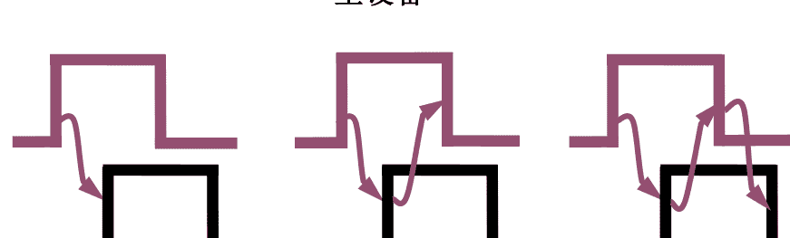

###### 以输入数据为例的半同步通信时序

*T*₁ 主模块发地址

*T*₂ 主模块发命令

*T*₍w₎ 当 WAIT为低电平时，等待一个 *T*

*T*₍w₎ 当 WAIT为低电平时，等待一个 *T*

⋮

*T*₃ 从模块提供数据

*T*₄ 从模块撤销数据，主模块撤销命令

##### (4) 半同步通信
(同步、异步 结合)

总线传输周期

时钟

地址

读命令

WAIT

数据

T₁ T₂ T_W T_W T₃ T₄

###### 上述三种通信的共同点

###### 一个总线传输周期（以输入数据为例）

- - 主模块发地址 、命令 占用总线
- - 从模块准备数据 不占用总线 总线空闲
- - 从模块向主模块发数据 占用总线


###### (5) 分离式通信

充分挖掘系统总线每个瞬间的潜力

一个总线传输周期

子周期1

主模块申请占用总线，使用完后即放弃总线的使用权

子周期2

从模块申请占用总线，将各种信息送至总线上

主模块

###### 分离式通信特点

- 1. 各模块有权申请占用总线
- 2. 采用同步方式通信，不等对方回答
- 3. 各模块准备数据时，不占用总线
- 4. 总线被占用时，无空闲

充分提高了总线的有效占用

练习题：某总线支持二级cache块传输方式，若每块6个字，每个字长4字节，时钟频率是100MHz。问：

（1）当读操作时，第一个时钟周期接收地址，第二、三个为延时周期，另用4个周期传送一个块。读操作的总线传输速率是多少？

（2）当写操作时，第一个时钟周期接收地址，第二个为延时周期，另用4个周期传送一个块，写操作的总线传输速率是多少？

（3）设在全部的传输中，70%用于读，30%用于写，则该总线在本次传输中平均速率是多少？

# 计算机原理与系统结构

# 第四章 存储器

曲冠南
gnqu@jlu.edu.cn

- 4.1 概述
- 4.2 主存储器
- 4.3 高速缓存存储器
- 4.4 辅助存储器

## 4.1 概述

### 一、存储器分类

#### 1. 按存储介质分类

- (1) 半导体存储器    TTL、MOS    易失
- (2) 磁表面存储器    磁头、载磁体
- (3) 磁芯存储器    硬磁材料、环状元件
- (4) 光盘存储器    激光、磁光材料

非易失

#### 2. 按存取方式分类

- 随机存储器 在程序的执行过程中 可读 可写
- 只读存储器 在程序的执行过程中 只读

- 顺序存取存储器 磁带
- 直接存取存储器 磁盘

#### 3. 按在计算机中的作用分类

- 存储器
  - 主存储器
    - RAM
      - 静态 RAM
      - 动态 RAM
    - ROM
      - MROM
      - PROM
      - EPROM
      - EEPROM
  - Flash Memory
  - 高速缓冲存储器（Cache）
  - 辅助存储器
    - 磁盘、磁带、光盘

### 二、存储器的层次结构

#### 1. 存储器三个主要特性的关系

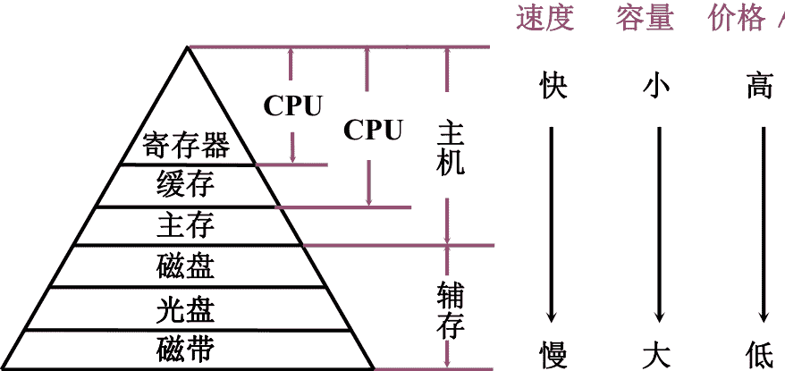

#### 2. 缓存—主存层次和主存—辅存层次

10 ns

CPU

20 ns

缓存

200 ns

主存

ms

辅存

（速度）

（容量）

缓存 — 主存

主存 — 辅存

主存储器

虚拟存储器

实地址

虚地址

物理地址

逻辑地址

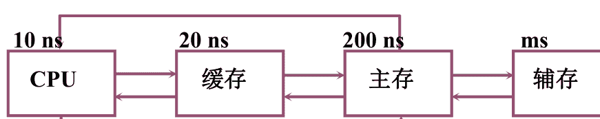

## 4.2 主存储器

### 一、概述

#### 1. 主存的基本组成

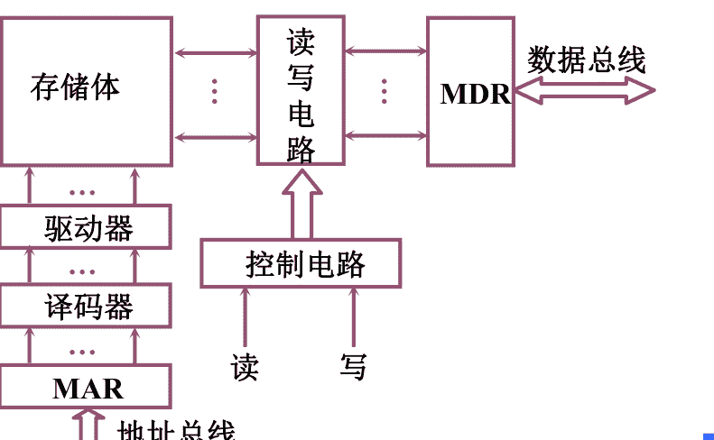

#### 2. 主存和 CPU 的联系

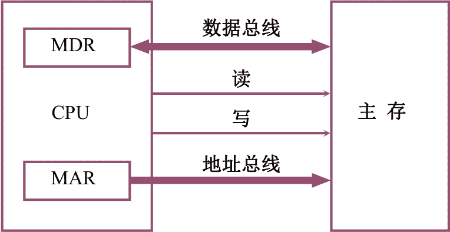

#### 3. 主存中存储单元地址的分配

高位字节 地址为字地址
低位字节 地址为字地址

| 字地址 | 字节地址 |
|--------|----------|
| 0      | 0 1 2 3  |
| 4      | 4 5 6 7  |
| 8      | 8 9 10 11|

| 字地址 | 字节地址 |
|--------|----------|
| 0      | 1 0      |
| 2      | 3 2      |
| 4      | 5 4      |

设地址线 24 根 按字节寻址 2^24 = 16 M

若字长为 16 位 按字寻址 8 M

若字长为 32 位 按字寻址 4 M

#### 4. 主存的技术指标

- (1) 存储容量
  - 主存存放二进制代码的总位数
  - 也可以用字节数来表示
- (2) 存储速度
  - 存取时间
    - 存储器的访问时间
    - 读出时间 写入时间
  - 存取周期
    - 连续两次独立的存储器操作（读或写）所需的最小间隔时间
    - 读周期 写周期
- (3) 存储器的带宽
  - 字/秒 字节/秒 位/秒

### 二、半导体存储芯片简介

#### 1. 半导体存储芯片的基本结构

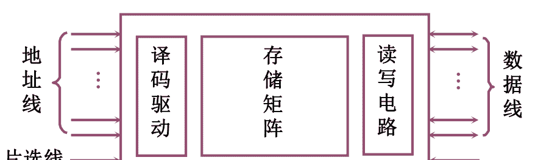

片选线  CS  CE

读/写控制线  WE（低电平写 高电平读）

OE（允许读）  WE（允许写）

##### 存储芯片片选线的作用

用 16K × 1位的存储芯片组成 64K × 8位的存储器

32片

8片 16K × 1位
8片 16K × 1位
8片 16K × 1位
8片 16K × 1位

当地址为 65 535 时，此 8 片的片选有效

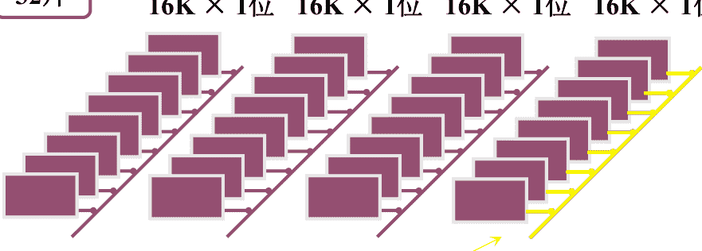

### 三、随机存取存储器（RAM）

#### 1. 静态 RAM (SRAM)

##### (1) 静态 RAM 基本电路

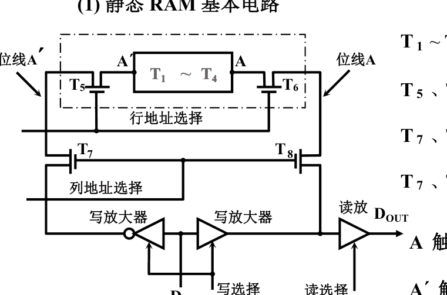

- T₁ ~ T₄ 触发器
- T₅、T₆ 行开关
- T₇、T₈ 列开关
- T₇、T₈ 一列共用
- A 触发器原端
- A′ 触发器非端

###### ① 静态 RAM 基本电路的读操作

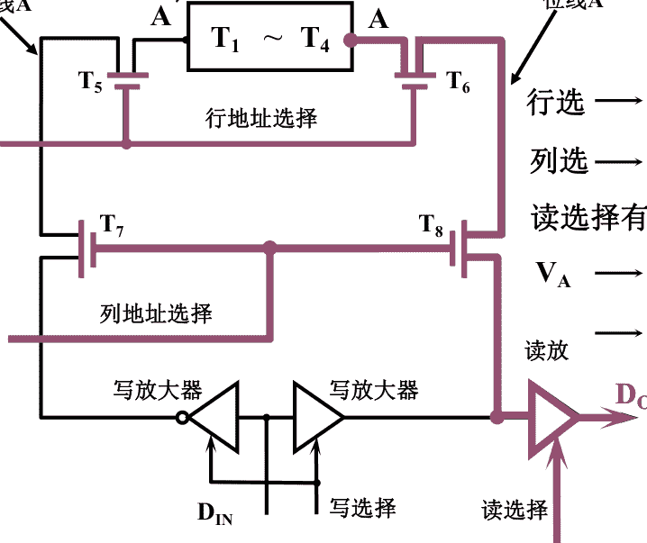

- 行选 → T₅、T₆ 开
- 列选 → T₇、T₈ 开
- 读选择有效
- V_A → T₆ → T₈
- 读放 → 读放 → D_OUT

###### ② 静态 RAM 基本电路的写操作

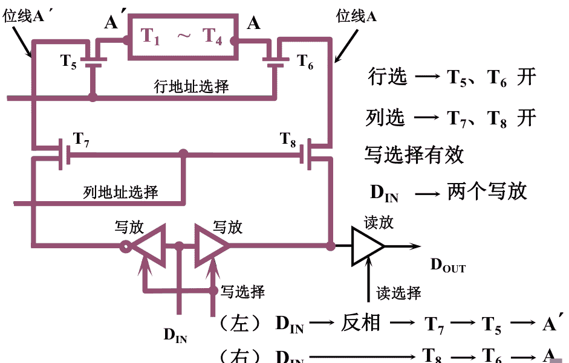

##### (2) 静态 RAM 芯片举例

###### ① Intel 2114 外特性

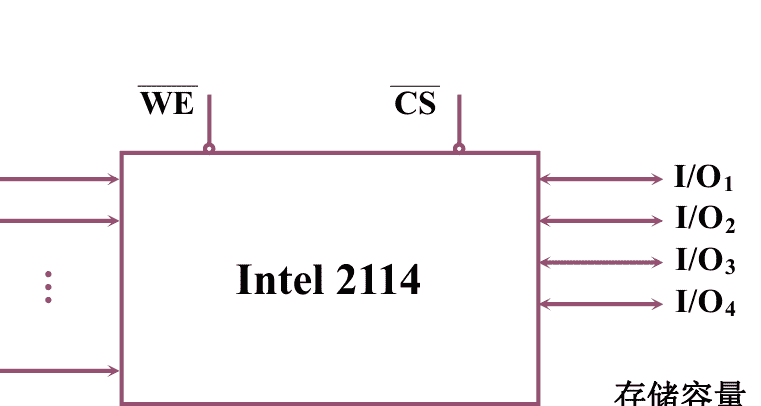

###### ② Intel 2114 RAM 矩阵 (64 × 64) 读

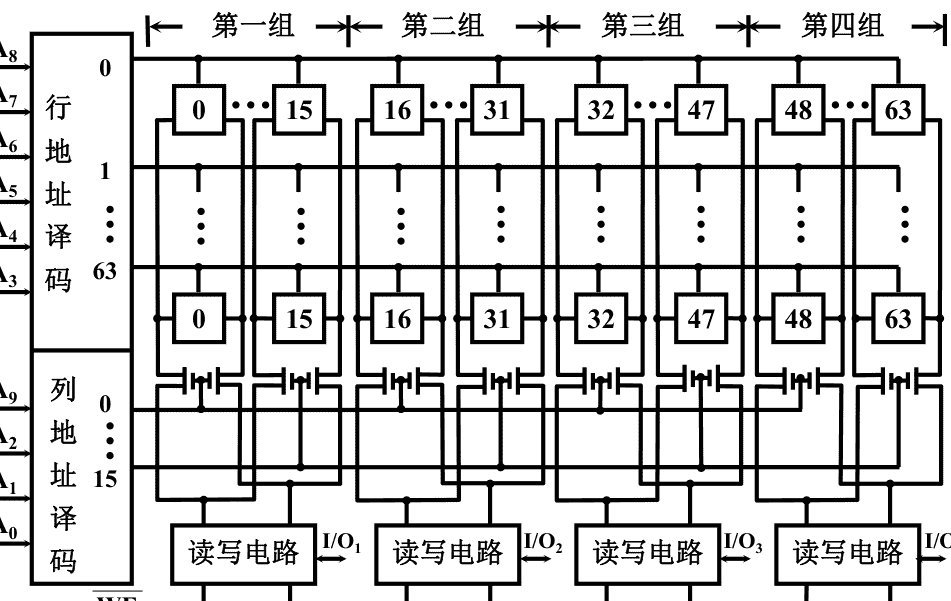

###### ② Intel 2114 RAM 矩阵 (64 × 64) 读

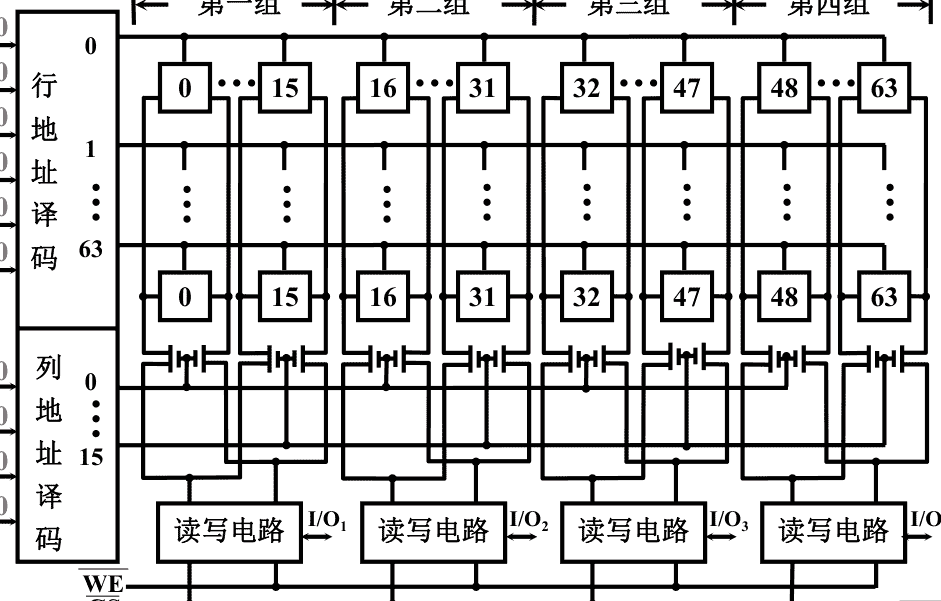

###### ② Intel 2114 RAM 矩阵 (64 × 64) 读

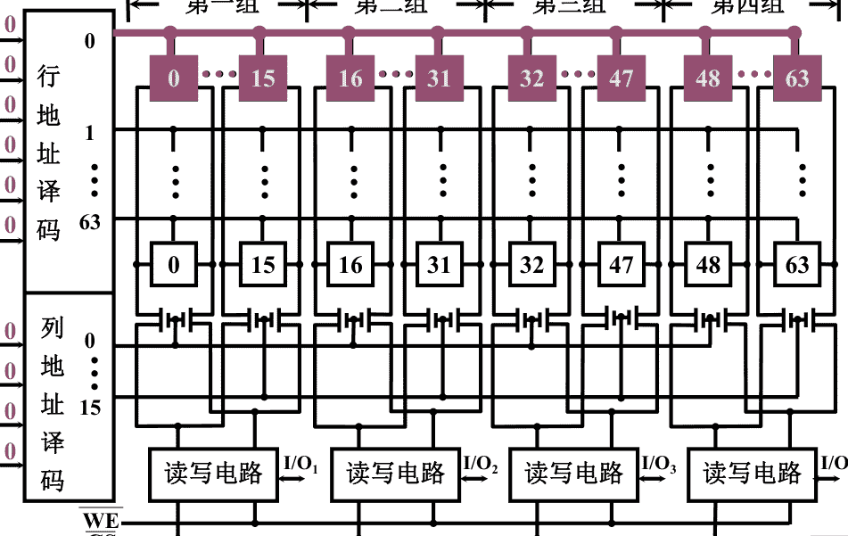

###### ② Intel 2114 RAM 矩阵 (64 × 64) 读

- 4.2
- 第一组
- 第二组
- 第三组
- 第四组
- 行地址译码
- 列地址译码
- 读/写电路 I/O₁
- 读/写电路 I/O₂
- 读/写电路 I/O₃
- 读/写电路 I/O₄
- WE CS

###### ② Intel 2114 RAM 矩阵 (64 × 64) 读

- 行地址译码
- 列地址译码
- 第一组
- 第二组
- 第三组
- 第四组
- 读写电路 I/O₁
- 读写电路 I/O₂
- 读写电路 I/O₃
- 读写电路 I/O₄
- WE
- CS

###### ② Intel 2114 RAM 矩阵 (64 × 64) 读

- 行地址译码
- 列地址译码
- 第一组
- 第二组
- 第三组
- 第四组
- 读写电路 I/O₁
- 读写电路 I/O₂
- 读写电路 I/O₃
- 读写电路 I/O₄

###### ② Intel 2114 RAM 矩阵 (64 × 64) 读

- 行地址译码
- 列地址译码
- 第一组
- 第二组
- 第三组
- 第四组
- 读写电路 I/O₁
- 读写电路 I/O₂
- 读写电路 I/O₃
- 读写电路 I/O₄
- WE
- CS

###### ② Intel 2114 RAM 矩阵 (64 × 64) 读

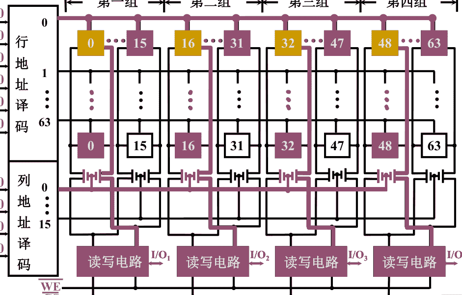

###### ③ Intel 2114 RAM 矩阵（64 × 64）

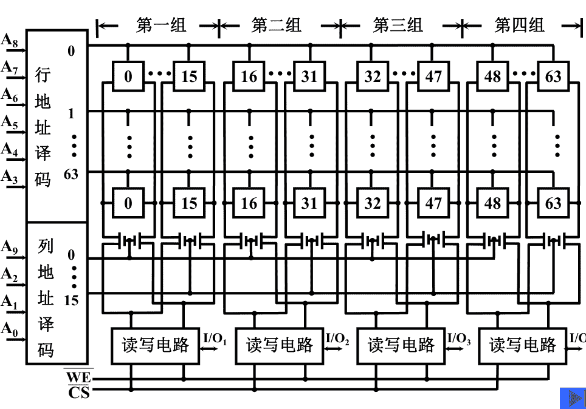


###### ③ Intel 2114 RAM 矩阵（64 × 64）写

| 第一组 | 第二组 | 第三组 | 第四组 |
|---|---|---|---|
| 0–15 | 16–31 | 32–47 | 48–63 |
| I/O₁ | I/O₂ | I/O₃ | I/O₄ |

- 行地址译码：0, 1, …, 63
- 列地址译码：0, …, 15
- 读写电路：I/O₁、I/O₂、I/O₃、I/O₄
- WE、CS

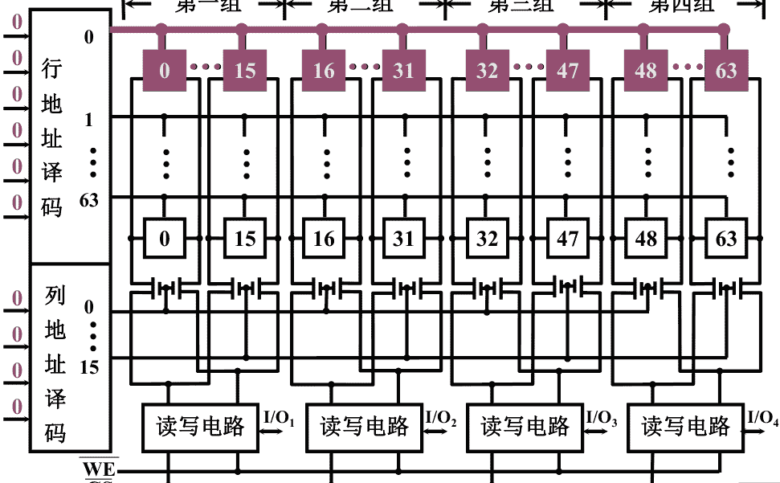

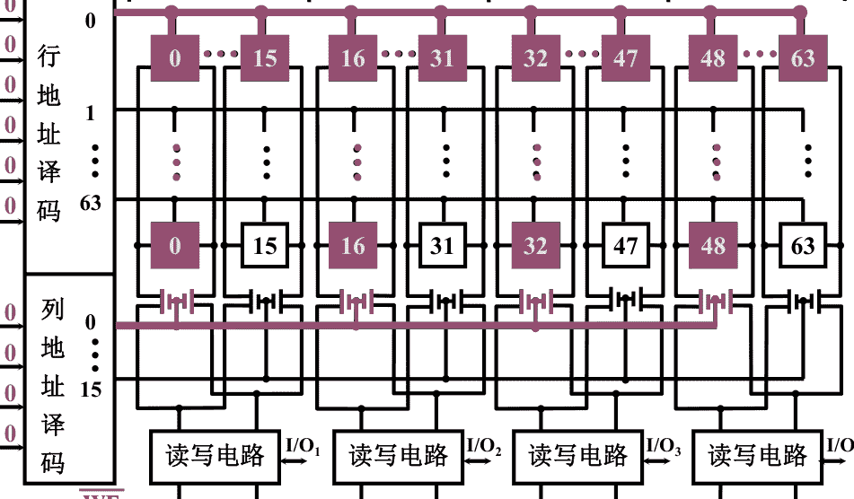

读写电路 → I/O₁，读写电路 → I/O₂，读写电路 → I/O₃，读写电路 → I/O₄

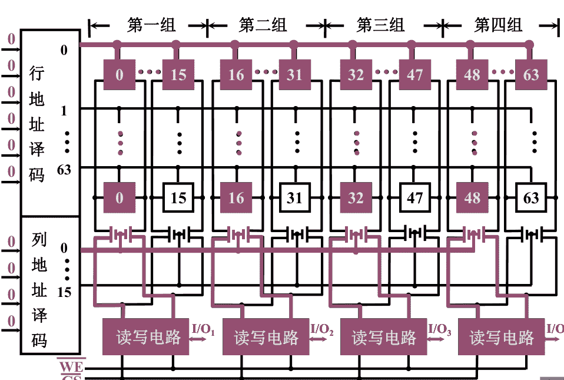

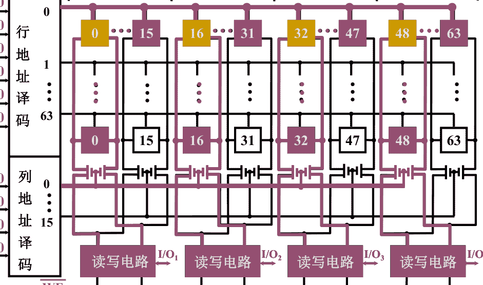

##### (4) 静态 RAM（2114）写时序

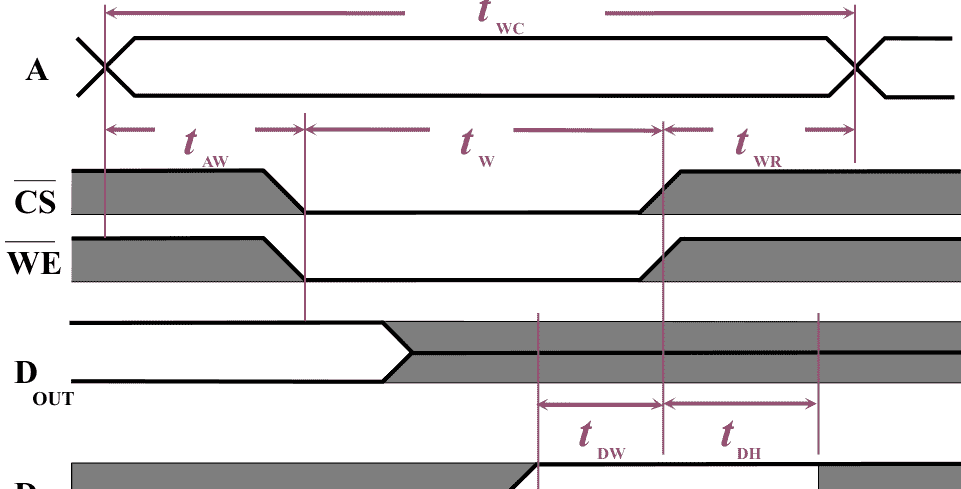

t_DH：WE̅ 失效后的数据维持时间

#### 2. 动态 RAM（DRAM）

##### (1) 动态 RAM 基本单元电路

- 读选择线
- 写选择线
- 写数据线
- 读数据线
- 读出与原存信息相反
- 写入与输入信息相同
- V_DD、预充电信号、T2、T1、T3、Cg、T4、字线、数据线、漏电流、Cs
- 读出时数据线有电流为 “1”
- 写入时 Cs 充电为 “1”、放电为 “0”


##### (2) 动态 RAM 芯片举例

###### ① 三管动态 RAM 芯片（Intel 1103）读

- 行地址译码器：A₉、A₈、A₇、A₆、A₅
- 列地址译码器：A₄、A₃、A₂、A₁、A₀
- 读选择线、写选择线、读数据线、写数据线
- 单元电路、刷新放大器、读写控制电路
- D
- 0 1 … 31
- 0 0 1 1 … 31 31


###### ② 三管动态 RAM 芯片（Intel 1103）写


行地址译码器、列地址译码器、读选择线、写选择线、读数据线、写数据线、刷新放大器、单元电路、读写控制电路

A₉、A₈、A₇、A₆、A₅、A₄、A₃、A₂、A₁、A₀、D


###### ③ 单管动态 RAM 4116（16K × 1位）外特性


###### ④ 4116（16K × 1位）芯片读原理

- 读放大器
- 读放大器
- 读放大器
- Cₛ
- 0 … 63、64 … 127
- 128 根行线
- D_IN、数据输入
- I/O缓冲、输出驱动、D_OUT
- 0、1、…、127（128 列选择）
- 读/写线

###### ⑤ 4116（16K × 1位）芯片写原理


- 128 根行线
- 列选择
- 读/写线
- D_IN、数据输入
- I/O缓冲、输出驱动、D_OUT
- 读放大器、读放大器、读放大器

##### (3) 动态 RAM 时序

行、列地址分开传送。

| 读时序 | 写时序 |
|---|---|
| 行地址 RAS 有效 | 行地址 RAS 有效 |
| 写允许 WE 有效（高） | 写允许 WE 有效（低） |
| 列地址 CAS 有效 | 列地址 CAS 有效 |
| 数据 D_OUT 有效 | 数据 D_IN 有效 |

##### (4) 动态 RAM 刷新

刷新与行地址有关。

###### ① 集中刷新（存取周期为 0.5 μs）

以 128 × 128 矩阵为例。

读/写或维持 → 刷新 → 读/写或维持

| 阶段 | 读/写或维持 | 刷新 | 读/写或维持 |
|---|---|---|---|
| 周期序号 | 0, 1, 2, …, 3871 | 3872, …, 3999 | 0, 1, … |
| t_c | t_c … t_c | t_c … t_c | t_c … t_c |
| 地址序号 | X, Y, …, V, W | 0, 1, …, 127 |  |

- 读/写或维持：3872 个周期（1936 μs）
- 刷新：128 个周期（64 μs）
- 刷新时间间隔：2 ms
- “死区”为 0.5 μs × 128 = 64 μs
- “死时间率”为 128 / 4 000 × 100% = 3.2%

###### ② 分散刷新（存取周期为 1 μs）

以 128 × 128 矩阵为例


- 刷新间隔：128 个存取周期
- t_C = t_M + t_R，无“死区”
- 读/写 + 刷新（存取周期为 0.5 μs + 0.5 μs）

###### ③ 分散刷新与集中刷新相结合（异步刷新）

对于 128 × 128 的存储芯片（存取周期为 0.5 μs），若每隔 15.6 μs 刷新一行：


- 每行每隔 2 ms 刷新一次
- “死区”为 0.5 μs
- 将刷新安排在指令译码阶段，不会出现“死区”

#### 3. 动态 RAM 和静态 RAM 的比较

|  | DRAM | SRAM |
|---|---|---|
| 存储原理 | 电容 | 触发器 |
| 集成度 | 高 | 低 |
| 芯片引脚 | 少 | 多 |
| 功耗 | 小 | 大 |
| 价格 | 低 | 高 |
| 速度 | 慢 | 快 |
| 刷新 | 有 | 无 |

主存：DRAM；缓存：SRAM


## 四、只读存储器（ROM）

+   1. 掩模 ROM ( MROM )
+      行列选择线交叉处有 MOS 管为 “1”
+      行列选择线交叉处无 MOS 管为 “0”

+   2. PROM (一次性编程)


熔丝断 为 “0”

熔丝未断 为 “1”

### 3. EPROM (多次性编程)

#### (1) N型沟道浮动栅 MOS 电路


G 栅极

S 源

D 漏

紫外线全部擦洗

D 端加正电压    形成浮动栅    S 与 D 不导通为 “0”

D 端不加正电压    不形成浮动栅    S 与 D 导通为 “1”

### 4. EEPROM (多次性编程)

- 电可擦写
- 局部擦写
- 全部擦写

### 5. Flash Memory (闪速型存储器)

EPROM    价格便宜 集成度高

EEPROM    电可擦洗重写

比 EEPROM快 具备 RAM 功能

### (2) 字扩展（增加存储字的数量）
4.2

用2片1K×8位存储芯片组成2K×8位的存储器

11根地址线

8根数据线


### (3) 字、位扩展

4.2

用8片 1K×4位 存储芯片组成 4K×8位的存储器

12根地址线

8根数据线


## 2. 存储器与 CPU 的连接

- (1) 合理选择存储芯片
- (2) 地址线的连接 – CPU低位地址优先
- (3) 数据线的连接 – CPU所有数据线
- (4) 读/写命令线的连接 – CPU读/写信号
- (5) 片选线的连接 – CPU访存信号 + 选芯片信号
- (6) 其他    时序、负载

### 例4.1 解：

4.2

(1) 写出对应的二进制地址码

A₁₅ A₁₄ A₁₃   A₁₁ A₁₀ ... A₇ ... A₄ A₃ ... A₀

0 1 1 0 0 0 0 0 0 0 0 0 0 0 0 0

⋮

0 1 1 0 0 1 1 1 1 1 1 1 1 1 1 1

ROM

2K×8位

1片 2K×8位

0 1 1 0 1 0 0 0 0 0 0 0 0 0 0 0

⋮

0 1 1 0 1 0 1 1 1 1 1 1 1 1 1 1

1K×8位

RAM

2片1K×4位

(2) 确定芯片的数量及类型

#### （3）分配地址线


$A_{10}\sim A_0$ 接 2K×8 位 ROM 的地址线

$A_9\sim A_0$ 接 1K×4 位 RAM 的地址线

#### （4）确定片选信号

### 例 4.1 CPU 与存储器的连接图


### 例4.2 假设同前，要求最小 4K为系统程序区，相邻 8K为用户程序区。

- (1) 写出对应的二进制地址码
- (2) 确定芯片的数量及类型
- (3) 分配地址线
- (4) 确定片选信号
- (4) 画出CPU与存储器连接图

#### (1) 写出对应的二进制码

| A15 ... A12 | A11 ... A8 | A7 ... A4 | A3 ... A0 |  |
|---|---|---|---|---|
| 0 0 0 0 | 0 0 0 0 | 0 0 0 0 | 0 0 0 0 | 8K 系统程序区 |
| ⋮ |  |  |  |  |
| 0 0 0 1 | 1 1 1 1 | 1 1 1 1 | 1 1 1 1 |  |
| 0 0 1 0 | 0 0 0 0 | 0 0 0 0 | 0 0 0 0 | 16K 用户程序区 |
| ⋮ |  |  |  |  |
| 0 0 1 1 | 1 1 1 1 | 1 1 1 1 | 1 1 1 1 |  |
| 0 1 0 0 | 0 0 0 0 | 0 0 0 0 | 0 0 0 0 |  |
| ⋮ |  |  |  |  |
| 0 1 0 1 | 1 1 1 1 | 1 1 1 1 | 1 1 1 1 |  |
| 1 1 1 1 | 0 0 0 0 | 0 0 0 0 | 0 0 0 0 | 4K 系统程序区 |
| ⋮ |  |  |  |  |
| 1 1 1 1 | 1 1 1 1 | 1 1 1 1 | 1 1 1 1 |  |

#### (2) 选择合适的芯片

- 8K系统区 -- 1片8K*8位的ROM
- 16K用户区 -- 2片8K*8位的RAM
- 4K系统区 -- 1片4K*8位的ROM

#### (3) 分配地址线

- 8K*8位的ROM --- 低13位地址线
- 8K*8位的RAM --- 低13位地址线
- 4K*8位的ROM --- 低12位地址线

#### (4) 确定片选信号

A15 … A12    A11 … A8    A7 … A4    A3 … A0
0 0 0 0 0    0 0 0 0    0 0 0 0    0 0 0 0
⋮
0 0 0 1    1 1 1 1    1 1 1 1    1 1 1 1    8K 系统程序区
0 0 1 0    0 0 0 0    0 0 0 0    0 0 0 0
⋮
0 0 1 1    1 1 1 1    1 1 1 1    1 1 1 1
0 1 0 0    0 0 0 0    0 0 0 0    0 0 0 0
⋮
0 1 0 1    1 1 1 1    1 1 1 1    1 1 1 1    16K 用户程序区
1 1 1 1    0 0 0 0    0 0 0 0    0 0 0 0
⋮
1 1 1 1    1 1 1 1    1 1 1 1    1 1 1 1    4K 系统程序区

#### (5) 画出CPU与存储器连接图

4.2


### 例 4.3 设 CPU 有 20 根地址线，8 根数据线。

并用 IO/M 作访存控制信号。 RD 为读命令， WR 为写命令。现有 2764 EPROM ( 8K × 8位 )，外特性如下：


CE 片选信号
OE 允许输出
PGM 可编程端

用 138 译码器及其他门电路（门电路自定）画出 CPU 和 2764 的连接图。要求地址为 F0000H~FFFFFH，并写出每片 2764 的地址范围。

### 习题

设CPU共有16根地址线，8根数据线，并用MREQ作为访存控制信号（低电平有效），用WR作为读/写控制信号（高电平为读，低电平为写）。现有下列存储芯片：1K×4位RAM,4K×8位RAM,2K×8位ROM以及74138译码器和各种门电路见书P94。画出CPU与存储芯片的连接图。

要求：

- （1）主存地址空间分配：8000H—87FFH为系统程序区；8800H—8BFFH为用户程序区。
- （2）合理选用上述存储芯片，说明各选几片。
- （3）详细画出存储芯片的片选逻辑

## 六、存储器的校验

### 1．编码的最小距离

任意两组合法代码之间二进制位数的最少差异，编码的纠错、检错能力与编码的最小距离有关

$L-1=D+C\ (D\geq C)$

$L$ —— 编码的最小距离，$L=3$

$D$ —— 检测错误的位数，具有一位纠错能力

$C$ —— 纠正错误的位数

汉明码是具有一位纠错能力的编码

### 2. 汉明码的组成

组成汉明码的三要素

汉明码的组成需增添？位检测位

2^k ≥ n + k + 1

检测位的位置？

2^i (i = 0, 1, 2, 3, …)

检测位的取值？

检测位的取值与该位所在的检测“小组”中承担的奇偶校验任务有关

#### 汉明码成码过程

- 1. 选位数
    根据 $2^k \ge n + k + 1$，确定 k

- 2. 定位--校验位的位置为 $2^0$， $2^1$ ... $2^{k-1}$

| 位置 | 1 | 2 | 3 | 4 | ... | ... | n+k |
|---|---|---|---|---|---|---|---|

- 3. 分组 - 自身、两两共享、三三共享

- 4. 配值 - 配偶（每组1的个数为偶数）
    配奇（每组1的个数为奇数）


##### 练习1 按配偶原则配置 0011 的汉明码 4.2

解： ∵ n = 4 根据 2^k ≥ n + k + 1

取 k = 3

| 二进制序号 | 1 | 2 | 3 | 4 | 5 | 6 | 7 |
| 名称 | C₁ | C₂ | 0 | C₄ | 0 | 1 | 1 |
|  | 1 | 0 |  | 0 |  |  |  |

C₁ = 3 ⊕ 5 ⊕ 7 = 1

C₂ = 3 ⊕ 6 ⊕ 7 = 0

C₄ = 5 ⊕ 6 ⊕ 7 = 0

∴ 0011 的汉明码为 1000011

### 3. 汉明码的纠错过程

形成新的检测位 P_i，其位数与增添的检测位有关，如增添 3 位（k=3），新的检测位为 P₄ P₂ P₁。

以 k=3 为例，P_i 的取值为

P₁ = 1 ⊕ 3 ⊕ 5 ⊕ 7
C₁
P₂ = 2 ⊕ 3 ⊕ 6 ⊕ 7
C₂
P₄ = 4 ⊕ 5 ⊕ 6 ⊕ 7
C₄

对于按“偶校验”配置的汉明码
不出错时 P₁=0，P₂=0，P₄=0

#### 汉明码纠错过程

- 1. 选位数
- 根据 2^k ≥ n + k + 1，确定 k

- 2. 定位--校验位的位置为 2^0， 2^1 ... 2^{k-1}

| 位置 | 1 | 2 | 3 | 4 | ... | ... | n+k |
|---|---|---|---|---|---|---|---|

- 3. 分组 - 自身、两两共享、三三共享

- 4. 纠错 -- （假设按照配偶原则）每组求异或，按组序号倒叙组合，得到出错位。

#### 例4.5 已知接收到的汉明码为 0100111 4.2

（按配偶原则配置）试问要求传送的信息是什么？

解：纠错过程如下

P₁ = 1 ⊕ 3 ⊕ 5 ⊕ 7 = 0 无错

P₂ = 2 ⊕ 3 ⊕ 6 ⊕ 7 = 1 有错

P₄ = 4 ⊕ 5 ⊕ 6 ⊕ 7 = 1 有错

∴ P₄P₂P₁ = 110

第 6 位出错，可纠正为 0100101，故要求传送的信息为 0101。

#### 练习2 写出按偶校验配置的汉明码

0101101 的纠错过程

P₄ = 4 ⊕ 5 ⊕ 6 ⊕ 7 = 1

P₂ = 2 ⊕ 3 ⊕ 6 ⊕ 7 = 0

P₁ = 1 ⊕ 3 ⊕ 5 ⊕ 7 = 0

∴ P₄P₂P₁ = 100    第 4 位错，可不纠

#### 练习3 按配奇原则配置 0011 的汉明码

配奇的汉明码为 0101011

## 七、提高访存速度的措施

- - 采用高速器件
- - 采用层次结构 Cache –主存
- - 调整主存结构

### 1. 单体多字系统

增加存储器的带宽


### 2. 多体并行系统

#### (1) 高位交叉  顺序编址


#### (2) 低位交叉 各个体轮流编址 4.2

地址 M₀ M₁ M₂ M₃

0000 00 0000 01 0000 10 0000 11
0001 00 0001 01 0001 10 0001 11
1111 00 1111 01 1111 10 1111 11

体内地址 体号

##### 低位交叉的特点

在不改变存取周期的前提下，增加存储器的带宽


设四体低位交叉存储器，存取周期为T，总线传输周期为τ，为实现流水线方式存取，应满足 T = 4τ。


连续读取 4 个字所需的时间为 T+(4−1)τ

如果是高位交叉存储器呢？

##### 例题4.6:

设有4个模块组成的四体存储器结构，每个体的存储字长为32位，存取周期是200ns。假设数据总线宽度为32位，总线传输周期为50ns，试求顺序存储和交叉存储的存储器带宽。

## 4.3 高速缓存存储器

### 一、概述

#### 1. 问题的提出

避免 CPU “空等” 现象

CPU 和主存（DRAM）的速度差异


程序访问的局部性原理

#### 2. Cache的基本工作原理

(1) 地址划分

主存储器
主存块号
0
字块 0
1
字块 1
2^m−1
字块 M−1
n位
m位 b位
主存块号 块内地址
M块 B个字
主存和缓存按块存储

标记 Cache 缓存块号
0
字块 0
1
字块 1
2^c−1
字块 C−1
c位 b位
缓存块号 块内地址
C块 B个字
块的大小相同 B 为块长

4.3

#### （2）Cache 的基本工作原理

地址总线

由CPU完成

主存地址

块号

块内地址

访问主存
替换Cache

Cache 替换机构

可替换？
否
是

命中？
否
是

主存Cache地址映射转换机构

主存

访问主存装入Cache

数据总线

Cache 地址

块号

块内地址

CPU

Cache 存储体

数据通路

#### 3. 评价指标

命中与未命中

缓存共有 C 块

主存共有 M 块    M >> C

命中    主存块 调入 缓存

主存块与缓存块 建立 了对应关系

用 标记记录 与某缓存块建立了对应关系的主存块号

未命中    主存块 未调入 缓存

主存块与缓存块 未建立 对应关系

##### （1）Cache 的命中率

h = Nc/(Nc+Nm)

##### （2）平均访问时间

平均访问时间 = 命中率*命中时间+不命中率*访问主存时间

= h*tc + (1-h)tm

##### （3）Cache -主存系统的效率

效率 e 与 命中率 有关

e = 访问 Cache 的时间 / 平均访问时间 × 100%

设 Cache 命中率为 h，访问 Cache 的时间为 t_c，

访问 主存 的时间为 t_m

则 e = t_c / (h × t_c + (1−h) × t_m) ×100%

##### 例题 4.7

假设CPU执行某段程序时，共访问Cache命中2000次，访问主存50次。已知Cache的存取周期为50ns，主存的存取周期为200ns。求Cache-主存的命中率、效率和平均访问时间。

### 二、四個問題

- 1. 当把内存中的一个块调入Cache时，可以放在哪些位置上？
- （映像规则）
- 2. 当所要访问的块在Cache中时，如何找到该块？
- （查找方法）
- 3. 当发生失效时，应替换哪一块？
- （替换算法）
- 4. 当进行写访问时，应进行哪些操作？
- （写策略）

#### 1. 四个基本问题 – 映射规则

（1）全相联映像

- > 全相联：主存中的任一块可以被放置到Cache中的任意一个位置。
- > 特点：空间利用率最高，冲突概率最低，实现最复杂。


##### （2）直接映射

- > 直接映射：主存中的每一块只能被放置到Cache中唯一的一个位置。（循环分配）
- > 特点：空间利用率最低，冲突概率最高，实现最简单。
- > 对于主存的第 i 块，若它映射到Cache的第 j 块，则：
- > j = i mod（M） （M为Cache的块数）


设M=2^m，则当表示为二进制数时，j实际上就是i的低m位：


##### （3）组相联映射

- - 组相联：主存中的每一块可以被放置到Cache中唯一的一个组中的任何一个位置。
- - 组相联是直接映射和全相联的一种折中
- - 若主存第 i 块映射到第 k 组，则：k = i mod (G) （G为Cache的组数）

设 G = 2^g，则当表示为二进制数时，k 实际上就是 i 的低 g 位：


（4）三者关系：n 路组相联：
每组中有n个块(n=M/G)，n 称为相联度。
相联度越高，Cache空间的利用率就越高，块冲突概率就越低，不命中率也就越低。

|  | n（路数） | G（组数） |
|---|---|---|
| 全相联 | M | 1 |
| 直接映射 | 1 | M |
| 组相联 | 1<n<M | 1<G<M |


**例题：**设 Cache 共有 8 块，每块大小为 4B，主存共有 64 块，请给出直接映射、2 路组相联映射、4 路组相联映射和全相联映射时的访存地址格式和具体分析过程。

主存容量：64×4B = 2^8，访存地址 8 位；每块大小为 4B，块内位移 2 位；因此块地址为 6 位。

直接映射：8 组 = 2^3；2 路组相联：4 组 = 2^2；4 路组相联：2 组 = 2^1。

| 映射方式 | 标识 | 索引 | 块内位移 |
|---|---:|---:|---:|
| 直接映射 | 3 | 3 | 2 |
| 2 路组相联 | 4 | 2 | 2 |
| 4 路组相联 | 5 | 1 | 2 |

## 4.3

#### 2. 四个基本问题——查找方法

- 当 CPU 访问 Cache 时，要访问的块可能在哪？
- 是否有要访问的块？
- 通过查找目录表来实现。
- 目录表有 M 项，对应 Cache 的 M 块。
- 有效位。
- 找到候选位置，比较标识。主存块的块地址的高位部分称为标识。每个主存块能唯一地由其标识来确定。


##### 4 路组相联并行标志比较


#### 3. 四个基本问题——替换算法

所要解决的问题：当新调入一块，而 Cache 又已被占满时，替换哪一块？

- 直接映射 Cache 中的替换很简单，因为只有一个块，别无选择。
- 在组相联和全相联 Cache 中，则有多个块供选择。
- 主要的替换算法有三种：
  1. 随机法
  2. 先进先出法 FIFO
  3. 最近最少使用法 LRU
- LRU 实现比较困难，实际上选择最久没有被访问过的块作为被替换的块。

#### 4. 四个基本问题——写策略

（1）“写”访问有可能导致 Cache 和主存内容的不一致。

（2）命中时，两种写策略。写策略是区分不同 Cache 设计方案的一个重要标志。

- 写直达法（也称存直达法）：执行“写”操作时，不仅写入 Cache，而且也写入下一级存储器；优点：易于实现，一致性好。
- 写回法（也称为拷贝回法）：执行“写”操作时，只写入 Cache。仅当 Cache 中相应的块被替换时（脏块），才写回主存。（每一块设置“修改位”）优点：速度快，所使用存储器带宽较低。

（3）采用写直达法时，若在进行“写”操作的过程中 CPU 必须等待，直到“写”操作结束，则称 CPU 写停顿。

减少写停顿的一种常用的优化技术：采用写缓冲器。

**（4）“写”访问失效时的策略**

- 按写分配（写时取）：写不命中时，先把所写单元所在的块调入 Cache，再行写入。
- 不按写分配（绕写法）：写不命中时，直接写入下一级存储器而不调块。

**（5）写策略与调块**

- 写回法——按写分配
- 写直达法——不按写分配

### 习题

某机器主存为 2KB，指令 Cache 容量为 32B。指令长度均为 4B，该段程序执行前，指令 Cache 的内容为空。先在该机器上执行如下循环程序，假设该程序加载到内存的 00000100000 地址上，循环执行 10 次。

```asm
OK:    LD.D      F2, 0(R1)
       MULT.D    F4, F2, F0
       LD.D      F6, 0(R2)
       ADD.D     F6, F4, F6
       SD.D      0(R2), F6
       ADDI      R1, R1, #8
       ADDI      R2, R2, #8
       SUBI      R3, R3, #1
       BNEZ      R3, OK
```

问：

- （1）假设直接映射，每块 8B，请给出程序结束时每个 Cache 块所对应的标识，并求出失效率；
- （2）假设直接映射，每块 16B，请给出程序结束时每个 Cache 块所对应的标识，并求出失效率；
- （3）假设二路组相联，每块 8B，替换采用 LRU 算法，请给出程序结束时每个 Cache 块所对应的标识，并求出失效率。

### 三、Cache 的改进

平均访问时间 = 命中率 × 命中时间 + 不命中率 × 访问主存时间

- 途径一：降低失效率
- 途径二：降低失效开销
- 途径三：降低命中时间

此消彼长？

#### 三种类型的不命中（3C）

- **强制性不命中（Compulsory miss）**：当第一次访问一个块时，该块不在 Cache 中，需从下一级存储器中调入 Cache，这就是强制性不命中。（冷启动不命中，首次访问不命中）
- **容量不命中（Capacity miss）**：如果程序执行时所需的块不能全部调入 Cache 中，则当某些块被替换后，若又重新被访问，就会发生不命中。这种不命中称为容量不命中。
- **冲突不命中（Conflict miss）**：在组相联或直接映射 Cache 中，若太多的块映射到同一组（块）中，则会出现该组中某个块被别的块替换（即使别的组或块有空闲位置），然后又被重新访问的情况。这就是发生了冲突不命中。（碰撞不命中，干扰不命中）

#### 方法一：最直接的方法

- 强制不命中——增加块大小
- 容量不命中——增加 Cache 容量
- 冲突不命中——提高相联度

#### 方法二：伪相联 Cache（列相联 Cache）

多路组相联的低不命中率和直接映射的命中速度。

|  | 优点 | 缺点 |
|---|---|---|
| 直接映射 | 命中时间小 | 不命中率高 |
| 组相联 | 不命中率低 | 命中时间大 |

伪相联 Cache 的优点：

- 命中时间小
- 不命中率低

**基本思想及工作原理**

在逻辑上把直接映射 Cache 的空间上下平分为两个区。对于任何一次访问，伪相联 Cache 先按直接映射 Cache 的方式去处理。若命中，则其访问过程与直接映射 Cache 的情况一样。若不命中，则再到另一区相应的位置去查找。若找到，则发生了伪命中，否则就只好访问下一级存储器。


#### 方法三：编译器预取

例：对于下面的程序，首先判断哪些访问可能会导致数据 Cache 失效。然后，加入预取指令以减少失效。最后，计算所执行的预取指令的条数以及通过预取避免的失效次数。假定：

（1）我们用的是容量为 8KB、块大小为 16B 的直接映射 Cache，它采用写回法并且按写分配。

（2）a、b 分别为 3×100（3 行 100 列）和 101×3 的双精度浮点数组，每个元素都是 8B。当程序开始执行时，这些数据都不在 Cache 内。

```c
for ( i = 0; i < 3; i = i + 1 )
for ( j = 0; j < 100; j = j + 1 )
    a[ i ][ j ] = b[ j ][ 0 ] * b[ j + 1 ][ 0 ];
```

**解**

计算过程：
- 取 a 时 150 次
- 取 b 时 101 次

失效情况：
- 总的失效次数 = 251 次

改进后的程序：

假设失效开销很大，预取必须至少提前 7 次循环进行。

```c
for ( j = 0; j < 100; j = j + 1 ) {
    prefetch ( b[j + 7][0] );
    /* 预取 7 次循环后所需的 b ( j , 0 ) */
    prefetch ( a[0][j + 7] );
    /* 预取 7 次循环后所需的 a ( 0 , j ) */
    a[0][j] = b[j][0] * b[j + 1][0];
    /* a 失效 7/2 = 4; b 失效 7 次 */
}
for ( i = 1; i < 3; i = i + 1 ) {
    for ( j = 0; j < 100; j = j + 1 ) {
        prefetch ( a[i][j + 7] );
        /* 预取 7 次循环后所需的 a ( i , j ) */
        a[i][j] = b[j][0] * b[j + 1][0];
    }
} /* a 失效 7/2 = 4，两次循环共失效 8 次 */
```

#### 方法四：编译器优化

基本思想：通过对软件进行优化，提高代码访问的局部性，进而降低不命中率。

- 数组合并：将本来相互独立的多个数组合并成为一个复合数组，以提高访问它们的局部性。
- 内外循环交换
- 循环融合：将若干个独立的循环融合为单个的循环。这些循环访问同样的数组，对相同的数据作不同的运算。这样能使得读入 Cache 的数据在被替换出去之前，能得到反复的使用。


##### 编译器优化 - 举例

##### 数组合并 - 提高空间局部性

适用情况：同时引用多个数组的相同索引。

举例：

```c
/* 修改前 */
int val[SIZE];
int key[SIZE];
```

```c
/* 修改后 */
struct merge {
    int val;
    int key;
};
struct merge merged_array[SIZE];
```

##### 循环融合 - 改进时间局部性

```c
/* 修改前 */
for (i=0; i<N; i=i+1)
    for (j=0; j<N; j=j+1)
        a[i][j]=1/b[i][j]*c[i][j];
for (i=0; i<N; i=i+1)
    for (j=0; j<N; j=j+1)
        d[i][j]=a[i][j]+c[i][j];
/* 修改后 */
for (i=0; i<N; i=i+1)
    for (j=0; j<N; j=j+1) {
        a[i][j]=1/b[i][j]*c[i][j];
        d[i][j]=a[i][j]+c[i][j];
    }
```

## 4.4 辅助存储器

### 一、概述

1. 特点：不直接与 CPU 交换信息
2. 磁表面存储器的技术指标
    - (1) 记录密度：道密度 $D_t$，位密度 $D_b$
    - (2) 存储容量：$C=n\times k\times s$
    - (3) 平均寻址时间：寻道时间 + 等待时间
        - 辅存的速度：寻址时间 = 寻道时间 + 磁头读写时间
    - (4) 数据传输率：$D_r=D_b\times V$（密度×读写速度）
    - (5) 误码率：出错信息位数与读出信息的总位数之比

### 二、磁记录原理和记录方式

**1. 磁记录原理**

写


读

读线圈 铁芯 磁通 磁层 运动方向 读出“0”

读线圈 运动方向 读出“1”


### 三、硬磁盘存储器

**1. 硬磁盘存储器的类型**

- (1) 固定磁头和移动磁头
- (2) 可换盘和固定盘

**2. 硬磁盘存储器结构**


- **（1）磁盘驱动器**：主轴、定位驱动、数据控制


- **（2）磁盘控制器**：
    - 接收主机发来的命令，转换成磁盘驱动器的控制命令
    - 实现主机和驱动器之间的数据格式转换
    - 控制磁盘驱动器读写

    磁盘控制器是主机与磁盘驱动器之间的接口：对主机通过总线；对硬盘（设备）。

- **（3）盘片**：由硬质铝合金材料制成

**2. 软盘片**

由聚酯薄膜制成


- 保护套
- 主轴孔
- 实际的软盘片
- 写保护口
- 读/写磁头访问槽
- 衬里/清洁材料

### 五、光盘存储器

**1. 概述**

采用光存储技术，利用激光写入和读出。

- 第一代光存储技术：采用非磁性介质，不可擦写
- 第二代光存储技术：采用磁性介质，可擦写

**2. 光盘的存储原理**

- 只读型和只写一次型：热作用（物理或化学变化）
- 可擦写光盘：热磁效应

### 六、循环冗余校验码CRC

1. 模2运算
2. 编码方法
    - M(x)：待编码信息构成的多项式
    - G(x)：校验码产生多项式，k位余数，G(x)为k+1位
    - R(x)：余数多项式

    即 M(x) * x^k = Q(x) * G(x) + R(x)

    即 M(x) * x^k + R(x) = Q(x) * G(x) 应能整除，若不能整除，则余数指出错误。

    例4.5 已知有效信息为1100，G(x)=1011
3. 纠错，参照书

## 虚拟存储器工作原理（以页式为例）

- 主存、磁盘存储器、虚拟存储器都划分成固定大小的块（页）。
    - 主存 -- 实页
    - 虚存 -- 虚页
- 主存地址 A：实页号 + 页内偏移
- 虚存地址 Av：用户号 + 虚页号 + 页内偏移


图 3.17 页式虚拟存储器工作框图

1. 给出虚地址 Av（用户号U、虚页号P、页内偏移D）。
2. 内部地址变换，得到实页号，若成功，访问主存。
3. 若不成功，外部地址变换，查外表，得到磁盘存储器实地址；查内表，若有空页，调入；若无空页，页面替换。
4. 若外部地址变换不成功，继续访问磁带等。

上图取自郑伟民教材

### 地址映像与转换


地址映像：把虚拟地址空间映像到主存地址空间，具体地说，就是把用户用虚拟地址编写的程序按照某种规则装入到主存储器中，并建立多用户虚拟地址与主存实地址之间的对应关系。

地址变换：程序被装入主存后，实际运行时，多用户虚地址转换成实地址（内部地址变换）或者磁盘存储器地址（外部地址变换）。

### 段式虚拟存储器优点

- 程序模块化性能好：对于大的程序，可以分成若干程序段，赋予不同的名字，由多个程序员并行编写、编译和调试；程序段功能上独立，不互相影响。
- 便于程序和数据共享：程序段按功能划分，如数组段等。在主存中装入一份，可共享主存起始地址和段长等信息，方便实现共享。
- 便于动态链接。
- 便于实现信息保护。

### 段式虚拟存储器缺点

- 地址变换复杂：查2次表，做2次加法
- 主存利用率低：各段长度不等，程序段连续存放，程序段运行过程中动态变化
- 对辅存管理困难：磁盘存储器按固定块访问。

### 页式虚拟存储器 - 地址映射


图 3.20 页式虚拟存储器的地址映射

1. 一个用户程序分成若干页。最后一页不满会浪费空间；
2. 每页对应页表一项。
3. 页表每项对应主存实页号。
4. 每一页可以映射到主存储器任意一页位置。

上图取自郑伟民教材

### 页式虚拟存储器 - 地址变换


图 3.21 页式虚拟存储器的地址变换

- 给出虚地址：用户号（程序号）+ 虚页号 + 页内偏移。
- 查找基址寄存器，找到相应程序的页表基地址。
- 根据基地址和虚页号，查找页表，得到相应页。主存页号拼接页内偏移 = 主存实地址。
- 段长和访问方式用于保护程序段。

### 段页式虚拟存储器 - 地址映射


1. 结合段式和页式的优缺点，虚存空间分段管理，主存空间分页管理。
2. 每一道程序分成若干段，每段分成若干页，如图例，页大小为4k
3. 每一道程序一个段表，段表中每项指出该段页数和页表地址
4. 由页表指向主存页地址。

图 3.22 段页式虚拟存储器的地址映射

### 段页式虚拟存储器 - 地址变换

- 给出虚地址：用户号（程序号）+段号+虚页号+页内偏移
- 查段表，得到页表地址
- 查页表，得到实页号。
- 实页号+页内偏移 = 主存地址。


图 3.23 段页式虚拟存储器的地址变换

上图取自郑伟民教材


# 计算机原理与系统结构

# 第五章 输入输出系统

曲冠南

qugnStu@live.com

## 5.1 概述

### 一、输入输出系统的发展概况

+   1. 早期
+      分散连接
+      CPU 和 I/O设备 串行 工作 程序查询方式

+   2. 接口模块和 DMA 阶段
+      总线连接
+      CPU 和 I/O设备 并行 工作
+      { 中断方式
+        DMA 方式 }

+   3. 具有通道结构的阶段

+   4. 具有 I/O 处理机的阶段

### 二、输入输出系统的组成

+   1. I/O 软件

+   (1) I/O 指令    CPU 指令的一部分

| 操作码 | 命令码 | 设备码 |

+   (2) 通道指令    通道自身的指令

指出数组的首地址、传送字数、操作命令

如 IBM/370 通道指令为 64 位

+   2. I/O 硬件

设备    I/O 接口

设备    设备控制器    通道

### 三、I/O 设备与主机的联系方式

+   1. I/O 设备编址方式
+      (1) 统一编址    用取数、存数指令
+      (2) 不统一编址    有专门的 I/O 指令

+   2. 设备选址
+      用设备选择电路识别是否被选中

+   3. 传送方式
+      (1) 串行
+      (2) 并行

#### 4. 联络方式

+   (1) 立即响应
+   (2) 异步工作采用应答信号


并行


串行

+   (3) 同步工作采用同步时标

#### 5. I/O 设备与主机的连接方式

#### 5.1

##### (1) 辐射式连接


每台设备都配有一套

控制线路和一组信号线

不便于增删设备

##### (2) 总线连接

便于增删设备

### 四、I/O设备与主机信息传送的控制方式 5.1

#### 1. 程序查询方式

CPU 和 I/O 串行工作

踏步等待


现行程序

CPU向I/O发读指令

CPU读I/O状态

检查状态

未准备就绪

出错

已准备就绪

从I/O接口中读一个字到CPU

从CPU向主存写入一个字

完成否

否

是

CPU读I/O状态

检查状态

未准备就绪

出错

#### 2. 程序中断方式

I/O 工作 { 自身准备 CPU 不查询 与主机交换信息 CPU 暂停现行程序

CPU 和 I/O 并行工作


没有踏步等待现象
中断现行程序

##### 程序中断方式流程


#### 3. DMA 方式

主存和 I/O 之间有一条直接数据通道

不中断现行程序

周期挪用（周期窃取）

CPU 和 I/O 并行工作

一个存取周期

实现I/O与主存之间的传送


##### 三种方式的 CPU 工作效率比较

5.1

程序查询方式

CPU 执行现行程序

CPU 查询等待并传输 I/O 数据

CPU 执行现行程序

启动 I/O

I/O 准备及传送

程序中断方式

CPU 执行现行程序

指令执行周期结束

中断

CPU 执行现行程序

启动 I/O

中断请求

I/O 准备

I/O 准备

CPU 处理中断服务程序 实现 I/O 与主机之间的传送

DMA 方式

一个存取周期

CPU 执行现行程序

存取周期结束

CPU 执行现行程序

启动 I/O

DMA 请求

I/O 准备

I/O 准备

实现 I/O 与主存之间的传送

## 5.2 I/O设备（自学）

### 一、概述


外部设备大致分三类

+   1. 人机交互设备 键盘、鼠标、打印机、显示器

+   2. 计算机信息存储设备 磁盘、光盘、磁带

+   3. 机—机通信设备 调制解调器等

### 二、输入设备

+   1. 键盘
+      - 按键
+      - 判断哪个键按下
+      - 将此键翻译成 ASCII 码（编码键盘法）
+   2. 鼠标
+      - 机械式 金属球 电位器
+      - 光电式 光电转换器
+   3. 触摸屏

### 三、输出设备

#### 1. 显示器

(1) 字符显示      字符发生器

(2) 图形显示      主观图像

(3) 图像显示      客观图像

#### 2. 打印机

(1) 击打式      点阵式（逐字、逐行）

(2) 非击打式      激光（逐页）喷墨（逐字）

### 四、其他

+   1. A/D、D/A 模拟/数字（数字/模拟）转换器

+   2. 终端 由键盘和显示器组成
+   完成显示控制与存储、键盘管理及通信控制

+   3. 汉字处理 汉字输入、汉字存储、汉字输出

### 五、多媒体技术

+   1. 什么是多媒体

+   2. 多媒体计算机的关键技术

## 5.3 I/O 接口

### 一、概述

为什么要设置接口？

+   1. 实现设备的选择
+   2. 实现数据缓冲达到速度匹配
+   3. 实现数据串一并格式转换
+   4. 实现电平转换
+   5. 传送控制命令
+   6. 反映设备的状态（“忙”、“就绪”、“中断请求”）

### 二、接口的功能和组成

#### 1. 总线连接方式的 I/O 接口电路

+   (1) 设备选择线
+   
+   (2) 数据线
+   
+   (3) 命令线
+   
+   (4) 状态线


#### 3. I/O 接口的基本组成


## 5.4 程序查询方式

### 一、程序查询流程

#### 1. 查询流程

单个设备

多个设备

检查状态标记

准备就绪？

是

否

交换数据

测试

取指令

取指令

检查状态标记

设备1 准备就绪？

是

处理设备1

否

检查状态标记N

设备N 准备就绪？

否

是

处理设备N

#### 2. 程序流程

保存
寄存器内容

设置计数值

设置主存缓冲区首址

启动外设

准备好？ 否

是

传送一个数据

修改主存地址

修改计数值

未完

传送完？ 完

结束I/O传送

5.4

### 二、程序查询方式的接口电路

以输入为例

数据线

准备就绪

启动命令

地址线

输入数据

启动设备

设备工作结束

DBR

设备选择电路

SEL

D
Q
1

B
Q
0

&

#### 例题5.1

在程序查询方式的输入输出系统中，假设不考虑处理时间，每一次查询操作需要100个时钟周期，CPU的时钟频率为50MHz。现有的鼠标和硬盘两个设备，而且CPU必须每秒对鼠标进行30次查询，硬盘以32位字长为单位传输数据，即每32位被CPU查询一次，传输率为2MBps。求CPU对这两个设备查询所花费的时间的比率，可得出什么结论。

## 5.5 程序中断方式

### 一、 中断的概念


### 二、I/O 中断的产生

以打印机为例

CPU 与打印机并行工作


### 三、程序中断方式的接口电路

#### 1. 配置中断请求触发器和中断屏蔽触发器

中断请求

来自 CPU 的 中断查询信号

INTR

MASK

INTR
中断请求触发器

INTR = 1 有请求

MASK
中断屏蔽触发器

MASK = 1 被屏蔽

D 完成触发器

受设备本身控制


#### 2. 排队器

排队器 {
- 硬件：在 CPU 内或在接口电路中（链式排队器）
- 软件：详见第八章
}


设备 1#、2#、3#、4# 优先级按降序排列。

INTRi = 1 有请求；INTRi = 0 无请求。


#### 3. 中断向量地址形成部件

入口地址 {
- 由软件产生（详见第八章）
- 硬件向量法：由硬件产生向量地址，再由向量地址找到入口地址
}


向量地址：00010010

设备编码器  
中断向量地址形成部件  
排队器输出  

向量地址：12H、13H、14H

主存：

|  |  |
| --- | --- |
| JMP | 200 |
| JMP | 300 |
| JMP | 400 |
| ... |  |
| 入口地址 200 | 打印机服务程序 |
| ... |  |
| 入口地址 300 | 显示器服务程序 |
| ... |  |

入口地址 200：打印机服务程序  
入口地址 300：显示器服务程序

#### 4. 程序中断方式接口电路的基本组成

5.5

向量地址  
中断响应 INTA  
中断请求  
设备编码器  
排队器  
至最低一级的排队器  
来自高一级的排队器  
MASK  
INTR Q D Q̅  
中断查询  
启动设备  
命令译码  
启动命令  
地址线  
数据线  
设备选择电路  
DBR  
设备工作结束  
输入数据  
SEL


### 四、I/O 中断处理过程

#### 1. CPU 响应中断的条件和时间

**（1）条件**

允许中断触发器 EINT = 1

用开中断指令将 EINT 置“1”

用关中断指令将 EINT 置“0”或硬件自动复位

**（2）时间**

当 D = 1（随机）且 MASK = 0 时

在每条指令执行阶段的结束前

CPU 发中断查询信号（将 INTR 置“1”）

#### 2. I/O 中断处理过程

以输入为例

5.5

向量地址  
中断响应 INTA  
中断请求  
至最低一级的排队器  
来自高一级的排队器  
中断查询  
启动设备  
启动命令  
设备工作结束  
输入数据  
地址线  
数据线


### 五、中断服务程序流程

#### 1. 中断服务程序的流程

**（1）保护现场**

- 程序断点的保护：中断隐指令完成
- 寄存器内容的保护：进栈指令

**（2）中断服务**

对不同的 I/O 设备具有不同内容的设备服务

**（3）恢复现场**

出栈指令

**（4）中断返回**

中断返回指令

#### 2. 单重中断和多重中断

单重中断：不允许中断现行的中断服务程序

多重中断：允许级别更高的中断源中断现行的中断服务程序

#### 3. 单重中断和多重中断的服务程序流程


#### 主程序和服务程序抢占 CPU 示意图 5.5

CPU：主程序 → 启动外设 → 继续执行主程序 → 服务程序（传送数据） → 继续执行主程序 → 服务程序（传送数据）

I/O：准备工作 → 准备工作 → 准备工作 → 传送数据 → 发中断请求 → 传送数据 → 发中断请求

宏观上 CPU 和 I/O 并行工作；微观上 CPU 中断现行程序，为 I/O 服务。

## 5.6 DMA 方式

### 一、DMA 方式的特点

#### 1. DMA 和程序中断两种方式的数据通路


#### 2. DMA 与主存交换数据的三种方式 5.6

**（1）停止 CPU 访问主存**

控制简单  
CPU 处于不工作状态或保持状态  
未充分发挥 CPU 对主存的利用率

主存工作时间：CPU 控制并使用主存；DMA 控制并使用主存；t

CPU 不执行程序  
DMA 不工作 / DMA 工作 / DMA 不工作

**（2）周期挪用（或周期窃取）**

DMA 访问主存有三种可能：

- CPU 此时不访存
- CPU 正在访存
- CPU 与 DMA 同时请求访存
  - 此时 CPU 将总线控制权让给 DMA


**（3）DMA 与 CPU 交替访问**

CPU 工作周期（所有指令执行过程中的一个基准时间）{
- C₁ 专供 DMA 访问
- C₂ 专供 CPU 访问
}


不需要申请、建立和归还总线的使用权

### 二、DMA 接口的功能和组成

#### 1. DMA 接口功能

- (1) 向 CPU 申请 DMA 传送
- (2) 处理总线控制权的转交
- (3) 管理系统总线、控制数据传送
- (4) 确定数据传送的首地址和长度，修正传送过程中的数据地址和长度
- (5) DMA 传送结束时，给出操作完成信号

#### 2. DMA 接口组成


##### (2) DMA 传输过程示意

**数据传送**

CPU 预处理：
- 主存起始地址 → DMA
- 设备地址 → DMA
- 传送数据个数 → DMA
- 启动设备

数据传送：
- 继续执行主程序
- 同时完成一批数据传送

后处理：
- 中断服务程序
- 做 DMA 结束处理

继续执行主程序

DMA 请求

允许传送？
- 否
- 是：
  - 主存地址送总线
  - 数据送 I/O 设备（或主存）
  - 修改主存地址
  - 修改字计数器

数据块传送结束？
- 否
- 是：向 CPU 申请程序中断

##### (3) 数据传送过程（输入）


##### (4) 数据传送过程（输出）

主存  
CPU  
HLDA ④  
HRQ ③  
DMA控制逻辑  
中断请求  
中断机构  
数据线 ⑦  
地址线 ⑤  
AR +1  
溢出信号  
WC +1  
DAR  
BR  
DMA接口  
⑥ DACK  
② DREQ  
设备 ①


##### (5) 后处理

- 校验送入主存的数是否正确
- 是否继续用 DMA
- 测试传送过程是否正确，错则转诊断程序
- 由中断服务程序完成

例题5.3 一个DMA接口可采用周期窃取的方式把字符传送到存储器，它支持的最大批量为400个字节。若存取周期为100ns，每处理一次中断需要5μs，现有的字符设备的传输率为9600bps。假设字符之间的传输是无间隙的，若忽略预处理所需的时间，试问采用DMA方式每秒因数据传输需要占用处理器多少时间？如果完全采用中断方式，又需要占用处理器多长时间？

例5.4 假设磁盘采用DMA方式与主机交换信息，其传输速率是2MBps，而且DMA的预处理需要1000个时钟周期，DMA完成传送后处理中断需要500个时钟周期。如果平均的数据长度为4KB，试问，硬盘工作时，50MHz的处理器需要用多少时间比率进行DMA辅助操作（预处理和后处理）。

#### 2. DMA 接口与系统的连接方式

**（1）具有公共请求线的 DMA 请求**


**（2）独立的 DMA 请求**


#### 3. DMA 方式与程序中断方式的比较 5.6

|  | 中断方式 | DMA 方式 |
| --- | --- | --- |
| (1) 数据传送 | 程序 | 硬件 |
| (2) 响应时间 | 指令执行结束 | 存取周期结束 |
| (3) 处理异常情况 | 能 | 不能 |
| (4) 中断请求 | 传送数据 | 后处理 |
| (5) 优先级 | 低 | 高 |


### 四、DMA 接口的类型

#### 1. 选择型

在物理上连接多个设备，在逻辑上只允许连接一个设备


#### 2. 多路型

在物理上连接多个设备
在逻辑上允许连接多个设备同时工作

5.6

链式


独立请求式


#### 3. 多路型 DMA 接口的工作原理


# 计算机原理与系统结构

# 第六章 计算机的运算方法

曲冠南

qugnStu@live.com

## 6.1 无符号数和有符号数

## 6.2 数的定点表示和浮点表示

## 6.3 定点运算

## 6.4 浮点四则运算

## 6.5 算术逻辑单元

## 这章讲了什么？

- 1. 一个数在计算机中怎么表示的？
- 2. 两个数如何进行加减乘除的？
- 3. 计算机中实现加减乘除的？

### 二、有符号数

#### 1. 机器数与真值

真值

带符号的数

+ 0.1011

− 0.1011

+ 1100

− 1100

机器数

符号数字化的数

0 || 1011

小数点的位置

1 || 1011

小数点的位置

0 || 1100

小数点的位置

1 || 1100

小数点的位置

#### 2. 原码表示法

##### (1) 定义

整数

[x]原 = { 0, x      2ⁿ > x ≥ 0
          2ⁿ - x    0 ≥ x > -2ⁿ }

x 为真值      n 为整数的位数

如 x = +1110      [x]原 = 0, 1110

用 逗号 将符号位和数值部分隔开

x = -1110      [x]原 = 2⁴ + 1110 = 1, 1110

带符号的绝对值表示

小数

[x]原 = { x      1 > x ≥ 0
1 - x    0 ≥ x > -1 }

x 为真值

如 x = + 0.1101      [x]原 = 0.1101      用 小数点 将符号位和数值部分隔开

x = -0.1101      [x]原 = 1 - (-0.1101) = 1.1101

x = + 0.1000000      [x]原 = 0.1000000      用 小数点 将符号位和数值部分隔开

x = -0.1000000      [x]原 = 1 - (-0.1000000) = 1.1000000

##### (2) 举例

例 6.1 已知 [x]原 = 1.0011 求 x - 0.0011

解：由定义得

x = 1 - [x]原 = 1 - 1.0011 = -0.0011

例 6.2 已知 [x]原 = 1,1100 求 x -1100

解：由定义得

x = 2⁴ - [x]原 = 10000 -1,1100 = -1100

例 6.3 已知 [x]原 = 0.1101 求 x

解: 根据定义 ∵ [x]原 = 0.1101

∴ x = + 0.1101

例 6.4 求 x = 0 的原码

解: 设 x = +0.0000    [+0.0000]原 = 0.0000

x = - 0.0000    [-0.0000]原 = 1.0000

同理，对于整数    [+ 0]原 = 0,0000

[− 0]原 = 1,0000

∴ [+0]原 ≠ [−0]原

原码的特性：简单、直观

但是用原码作加法时，会出现如下问题：

| 要求 | 数1 | 数2 | 实际操作 | 结果符号 |
|------|-----|-----|----------|----------|
| 加法 | 正 | 正 | 加 | 正 |
| 加法 | 正 | 负 | 减 | 可正可负 |
| 加法 | 负 | 正 | 减 | 可正可负 |
| 加法 | 负 | 负 | 加 | 负 |

能否 只作加法？

找到一个与负数等价的正数 来代替这个负数 就可使 减 ——> 加

#### 3. 补码表示法

##### (1) 补的概念

- 时钟

逆时针
6
-3
3

顺时针
6
+9
15
-12
3

可见 -3 可用 +9 代替 减法→加法

称 +9 是 -3 以 12 为模的 补数

记作 -3 ≡ +9 （mod 12）

同理 -4 ≡ +8 （mod 12）

-5 ≡ +7 （mod 12）

时钟以 12为模

结论

- 一个负数加上 “模” 即得该负数的补数

- 一个正数和一个负数互为补数时
它们绝对值之和即为模数

- 计数器（模16） 1011 ——> 0000 ？

1011
− 1011
———
0000

1011
+ 0101
———
10000
自然去掉

可见 -1011 可用 + 0101 代替

记作 -1011 ≡ + 0101 （mod 2⁴）

同理 -011 ≡ + 101 （mod 2³）

- 0.1001 ≡ + 1.0111 （mod 2）

##### (2) 正数的补数即为其本身

两个互为补数的数分别加上模，结果仍互为补数。

$-1011 \equiv +0101 \pmod{2^4}$

$-1011 + 10000 = +0101$

$+0101 + 10000 = +10101$，去掉最高位。

$\therefore\ +0101 \equiv +0101 \pmod{2^4}$

可见 $+0101 \rightarrow +0101$

$-1011$

$?,0101 \rightarrow +0101$

$?,0101 \rightarrow -1011$

$2^{4+1} - 1011 = 100000$

$-1011$

$1,0101$

用逗号将符号位和数值部分隔开

##### (3) 补码定义

整数

[x]补 = { 0, x      2^n > x ≥ 0
 2^{n+1} + x      0 > x ≥ -2^n (mod 2^{n+1}) }

x 为真值          n 为整数的位数

如        x = +1010                x = -1011000

[x]补 = 0,1010

[x]补 = 2^{7+1} + (-1011000)
= 10000000
-   1011000
-------------
1,0101000

用逗号将符号位和数值部分隔开

小数

$$[x]_{补}=\begin{cases}x, & 1>x\geq 0\\2+x, & 0>x\geq -1\pmod{2}\end{cases}$$

$x$ 为真值

如　　$x=+0.1110$　　　　$x=-0.1100000$

$$[x]_{补}=0.1110$$

$$[x]_{补}=2+(-0.1100000)$$
$$=10.0000000$$
$$\phantom{=} -\ 0.1100000$$
$$\underline{\phantom{=0000000}}$$
$$\phantom{=}1.0100000$$

用小数点将符号位和数值部分隔开

##### (4) 求补码的快捷方式

设 $x = -1010$ 时

则 $[x]_{补} = 2^{4+1} - 1010 = 11111 + 1 -1010$
$= 100000$
$- 1010$
$= 1,0110$
$= 11111 + 1$
$- 1010$
$= 10101 + 1$
$= 1,0110

又 $[x]_{原} = 1,1010$

当真值为负时，补码可用原码除符号位外每位取反，末位加1求得

##### (5) 举例

例 6.5 已知 [x]补 = 0.0001
求 x
解：由定义得 x = + 0.0001

例 6.6 已知 [x]补 = 1.0001
求 x
解：由定义得
x = [x]补 − 2
= 1.0001 − 10.0000
= −0.1111

[x]补 ⟶ ? [x]原
[x]原 = 1.1111
∴ x = −0.1111

例 6.7 已知 $[x]_{补}=1,1110$

求 $x$

解： 由定义得

$x = [x]_{补} - 2^{4+1}$

$= 1,1110 - 100000$

$= -0010$

$[x]_{补} \xrightarrow{?} [x]_{原}$

$[x]_{原} = 1,0010$

$\therefore x = -0010$

当真值为负时，原码可用补码除符号位外

每位取反，末位加 1 求得


##### 练习 求下列真值的补码

# 6.1

| 真值 | [x]补 | [x]原 |
|---|---|---|
| x = +70 = 1000110 | 0,1000110 | 0,1000110 |
| x = -70 = -1000110 | 1,0111010 | 1,1000110 |
| x = 0.1110 | 0.1110 | 0.1110 |
| x = -0.1110 | 1.0010 | 1.1110 |
| x = 0.0000 [+0]补 = [-0]补 | 0.0000 | 0.0000 |
| x = -0.0000 | 0.0000 | 1.0000 |
| x = -1.0000 | 1.0000 | 不能表示 |

由小数补码定义 [x]补 = { x      1 > x ≥ 0
 2 + x   0 > x ≥ -1 (mod 2) }

[−1]补 = 2 + x = 10.0000 − 1.0000 = 1.0000

#### 4. 反码表示法

##### (1) 定义

整数

$$[x]_{反}=\begin{cases}0，x & 2^n>x\ge 0\\(2^{n+1}-1)+x & 0\ge x>-2^n\pmod{2^{n+1}-1}\end{cases}$$

$x$ 为真值　　　　$n$ 为整数的位数

如　　$x=+1101$　　　　　　　　　$x=-1101$

$$[x]_{反}=0,1101$$

$$[x]_{反}=(2^{4+1}-1)-1101$$
$$=11111-1101$$
$$=1,0010$$

用逗号将符号位
和数值部分隔开

##### (2) 举例

例6.8 已知 [x]反 = 0,1110 求 x

解： 由定义得 x = + 1110

例6.9 已知 [x]反 = 1,1110 求 x

解： 由定义得 x = [x]反 - (2^4+1 -1)
= 1,1110 -11111
= - 0001

例 6.10 求 0 的反码

解： 设 x = + 0.0000    [+0.0000]反 = 0.0000
x = - 0.0000    [-0.0000]反 = 1.1111

同理，对于整数 [+0]反 = 0,0000 [-0]反 = 1,1111

∴ [+0]反 ≠ [-0]反

#### 三种机器数的小结

- > 最高位为符号位，书写上用 “,”（整数）或 “.”（小数）将数值部分和符号位隔开
- > 对于正数，原码 = 补码 = 反码
- > 对于负数，符号位为 1，其数值部分
- 原码除符号位外每位取反末位加 1 → 补码
- 原码除符号位外每位取反 → 反码

#### 例6.11 设机器数字长为8位（其中1位为符号位）

对于整数，当其分别代表无符号数、原码、补码和反码时，对应的真值范围各为多少？

| 二进制代码 | 无符号数对应的真值 | 原码对应的真值 | 补码对应的真值 | 反码对应的真值 |
|---|---|---|---|---|
| 00000000 | 0 | +0 | ±0 | +0 |
| 00000001 | 1 | +1 | +1 | +1 |
| 00000010 | 2 | +2 | +2 | +2 |
| ⋮ | ⋮ | ⋮ | ⋮ | ⋮ |
| 01111111 | 127 | +127 | +127 | +127 |
| 10000000 | 128 | -0 | -128 | -127 |
| 10000001 | 129 | -1 | -127 | -126 |
| ⋮ | ⋮ | ⋮ | ⋮ | ⋮ |
| 11111101 | 253 | -125 | -3 | -2 |
| 11111110 | 254 | -126 | -2 | -1 |
| 11111111 | 255 | -127 | -1 | -0 |

#### 例6.12 已知 [y]补 求[-y]补

解：设 [y]补 = y0. y1 y2 … yn

<I> [y]补 = 0. y1 y2 … yn

[y]补连同符号位在内，每位取反，末位加1 即得[-y]补

[-y]补 = 1. y1̅ y2̅ … yn̅ + 2⁻ⁿ

<II> [y]补 = 1. y1 y2 … yn

[y]补连同符号位在内，每位取反，末位加1 即得[-y]补

[-y]补 = 0. y1̅ y2̅ … yn̅ + 2⁻ⁿ

#### 5. 移码表示法

补码表示很难直接判断其真值大小

如

| 十进制 | 二进制 | 补码 |
|---|---|---|
| x = +21 | +10101 | 0,10101 |
| x = -21 | -10101 | 1,01011 |
| x = +31 | +11111 | 0,11111 |
| x = -31 | -11111 | 1,00001 |

x + 2⁵

+10101 + 100000 = 110101
-10101 + 100000 = 001011
+11111 + 100000 = 111111
-11111 + 100000 = 000001


##### (1) 移码定义

[x]移 = 2^n + x （2^n > x ≥ -2^n）

x 为真值，n 为整数的位数

##### 移码在数轴上的表示


如 x = 10100

[x]移 = 2^5 + 10100 = 1,10100

x = -10100

[x]移 = 2^5 - 10100 = 0,01100

用逗号将符号位和数值部分隔开

##### (2) 移码和补码的比较

设    x = +1100100
[x]移 = 2⁷ + 1100100 = 1,1100100
[x]补 = 0,1100100

设    x = −1100100
[x]移 = 2⁷ − 1100100 = 0,0011100
[x]补 = 1,0011100

补码与移码只差一个符号位

##### (3) 真值、补码和移码的对照表

| 真值 x ( n=5 ) | [x]补 | [x]移 | [x]移对应的十进制整数 |
|---|---|---|---|
| - 1 0 0 0 0 0 | 1 0 0 0 0 0 | 0 0 0 0 0 0 | 0 |
| - 1 1 1 1 1 | 1 0 0 0 0 1 | 0 0 0 0 0 1 | 1 |
| - 1 1 1 1 0 | 1 0 0 0 1 0 | 0 0 0 0 1 0 | 2 |
| ... | ... | ... | ... |
| - 0 0 0 0 1 | 1 1 1 1 1 1 | 0 1 1 1 1 1 | 31 |
| ± 0 0 0 0 0 | 0 0 0 0 0 0 | 1 0 0 0 0 0 | 32 |
| + 0 0 0 0 1 | 0 0 0 0 0 1 | 1 0 0 0 0 1 | 33 |
| + 0 0 0 1 0 | 0 0 0 0 1 0 | 1 0 0 0 1 0 | 34 |
| ... | ... | ... | ... |
| + 1 1 1 1 0 | 0 1 1 1 1 0 | 1 1 1 1 1 0 | 62 |
| + 1 1 1 1 1 | 0 1 1 1 1 1 | 1 1 1 1 1 1 | 63 |

##### （4）移码的特点

- ➢ 当 $x=0$ 时
- 
- $[+0]_{移}=2^5+0=1,00000$
- 
- $[-0]_{移}=2^5-0=1,00000$
- 
- ∴ $[+0]_{移}=[-0]_{移}$

- ➢ 当 $n=5$ 时，最小的真值为 $-2^5=-100000$
- 
- $[-100000]_{移}=2^5-100000=000000$
- 
- 可见，最小真值的移码为全 0

用移码表示浮点数的阶码
能方便地判断浮点数的阶码大小

## 6.2 数的定点表示和浮点表示

小数点按约定方式标出

### 一、定点表示


| 定点机 | 小数定点机 | 整数定点机 |
|---|---|---|
| 原码 | -(1 - 2^-n) ~ +(1 - 2^-n) | -(2^n - 1) ~ +(2^n - 1) |
| 补码 | -1 ~ +(1 - 2^-n) | -2^n ~ +(2^n - 1) |
| 反码 | -(1 - 2^-n) ~ +(1 - 2^-n) | -(2^n - 1) ~ +(2^n - 1) |

### 二、浮点表示

N = S×r^j 浮点数的一般形式

S 尾数 j 阶码 r 基数 (基值)

计算机中 r 取 2、4、8、16 等

当 r = 2 N = 11.0101 二进制表示

✓ = 0.110101 × 2^{10} 规格化数

= 1.10101 × 2^{1}

= 1101.01 × 2^{-10}

✓ = 0.00110101 × 2^{100} 规格化数

计算机中 S 小数、可正可负

j 整数、可正可负

#### 1. 浮点数的表示形式


$S_f$　代表浮点数的符号

$n$　其位数反映浮点数的精度

$m$　其位数反映浮点数的表示范围

$j_f$ 和 $m$　共同表示小数点的实际位置

##### 举例：假设尾数数值部分n=10位，阶码数值部分m=4位，表示的数的范围？


- - 0
- - 正数最小？
- - 正数最大？
- - 负数最大？
- - 正数最小？

#### 2. 浮点数的表示范围

上溢 阶码 > 最大阶码

下溢 阶码 < 最小阶码 按机器零处理

上溢

负数区

下溢

正数区

上溢

最小负数

-2^(2^m-1)×(1-2^-n)

-2^15×(1-2^-10)

最大正数

2^(2^m-1)×(1-2^-n)

2^15×(1-2^-10)

0

最小正数

2^-(2^m-1)×2^-n

2^-15×2^-10

最大负数

-2^-(2^m-1)×2^-n

-2^-15×2^-10

设 m = 4

n = 10

#### 3. 浮点数的规格化形式

r = 2      尾数最高位为 1

#### 4. 浮点数的规格化

r = 2      左规      尾数左移 1 位，阶码减 1

右规      尾数右移 1 位，阶码加 1

### 三、举例

例 6.13 将 + 19/128 写成二进制定点数、浮点数及在定点机和浮点机中的机器数形式。其中数值部分均取 10 位，数符取 1 位，浮点数阶码取 5 位（含1位阶符）。

解： 设 x = + 19/128

二进制形式      x = 0.0010011

定点表示        x = 0.0010011 000

浮点规格化形式  x = 0.1001100000 × 2⁻¹⁰

定点机中        [x]原 = [x]补 = [x]反 = 0.0010011000

浮点机中        [x]原 = 1, 0010; 0.1001100000

[x]补 = 1, 1110; 0.1001100000

[x]反 = 1, 1101; 0.1001100000

例 6.14 将 -58 表示成二进制定点数和浮点数，6.2 并写出它在定点机和浮点机中的三种机器数及阶码为移码、尾数为补码的形式（其他要求同上例）。

解： 设 x = -58

二进制形式      x = - 111010

定点表示        x = - 0000 111010

浮点规格化形式  x = - (0.1110100000) × 2¹¹⁰

定点机中

[x]原 = 1, 0000111010

[x]补 = 1, 1111000110

[x]反 = 1, 1111000101

浮点机中

[x]原 = 0, 0110; 1. 1110100000

[x]补 = 0, 0110; 1. 0001100000

[x]反 = 0, 0110; 1. 0001011111

[x]阶移、尾补 = 1, 0110; 1. 0001100000

例6.15 写出对应下图所示的浮点数的补码形式。设 n = 10, m = 4, 阶符、数符各取 1 位。

上溢

负数区

下溢

正数区

上溢

最小负数
-2^(2^m-1)×(1-2^-n)

0
最小正数

2^(-(2^m-1))×2^-n

最大负数
-2^(-(2^m-1))×2^-n

最大正数
2^(2^m-1)×(1-2^-n)

解：

真值

补码

| 最大正数 | 2^15×(1-2^-10) | 0,1111; 0.1111111111 |
| 最小正数 | 2^-15×2^-10 | 1,0001; 0.0000000001 |
| 最大负数 | -2^-15×2^-10 | 1,0001; 1.1111111111 |
| 最小负数 | -2^15×(1-2^-10) | 0,1111; 1.0000000001 |

#### 机器零

- > 当浮点数尾数为 0 时，不论其阶码为何值按机器零处理
- > 当浮点数阶码等于或小于它所表示的最小数时，不论尾数为何值，按机器零处理

如 m = 4    n = 10

当阶码和尾数都用补码表示时，机器零为
X, X X X X;  0.0 0  ...  0
(阶码 = -16)  1, 0 0 0 0 0;  X.X X  ...  X

当阶码用移码，尾数用补码表示时，机器零为
0, 0 0 0 0;  0.0 0  ...  0

有利于机器中“判 0”电路的实现

### 四、IEEE 754 标准

#### （1）格式


##### 单精度（32位）


##### 双精度（64位）


#### （2）尾数的处理

IEEE 754标准定义尾数用1.M的形式表示，小数点前的1隐含。

#### （3）阶码的处理

保留了四种特殊的情况的表示：非规格化数，∞，NaN，0。

| 符号 | 阶码 | 尾数 | 表示 |
| --- | --- | --- | --- |
| 任意 | 0 | 全0 | 0 |
| 任意 | 255 | 全0 | ∞ |
| 任意 | 255 | 任意非0 | NaN |
| 任意 | 0 | 任意非0 | 非规格化浮点数 |

因此偏移量为127

#### 例题：将178.125表示为单精度浮点数

- (1) 178.125 表示成二进制 10110010.001
- (2) 用二进制的科学计数法表示为 1.0110010001*2^111
- (3) 计算偏移量，111+01111111 = 10000110
- (4) 表示成单精度浮点数

| 0 | 1000010 | 01100100010...0 |
|---|---|---|
| 数符 |  | 小数点位置 |

#### 习题：采用IEEE754标准，试表示

- (1) +0
- (2) -0
- (3) +∞
- (4) -∞
- (5) NaN
- (6) 规格化浮点数正数最大值，并求出真值；
- (7) 规格化浮点数正数最小值，并求出真值；
- (8) 非规格化浮点数正数最小值，并求出真值；
- (9) 非规格化浮点数正数最小值，并求出真值；

## 6.3 定点运算

### 一、移位运算

#### 1. 移位的意义

15. m = 1500. cm

小数点右移 2 位

机器用语 15 相对小数点 左移 2 位

（小数点不动）

左移 绝对值扩大

右移 绝对值缩小

在计算机中，移位与加减配合，能够实现乘除运算

#### 2. 算术移位规则

符号位不变

| 真值 | 码 制 | 添补代码 |
| --- | --- | --- |
| 正数 | 原码、补码、反码 | 0 |
| 负数 | 原 码 | 0 |
|  | 补 码 | 左移 添 0 |
|  |  | 右移 添 1 |
|  | 反 码 | 1 |

##### 例6.16

设机器数字长为 8 位（含 1 位符号位），写出 A = +26 时，三种机器数左、右移一位和两位后的表示形式及对应的真值，并分析结果的正确性。

解： A = +26 = +11010

则 [A]原 = [A]补 = [A]反 = 0,0011010

| 移位操作 | 机器数 | 对应的真值 |
| --- | [A]原=[A]补=[A]反 |  |
| 移位前 | 0,0011010 | +26 |
| 左移一位 | 0,0110100 | +52 |
| 左移两位 | 0,1101000 | +104 |
| 右移一位 | 0,0001101 | +13 |
| 右移两位 | 0,0000110 | +6 |

##### 例6.17

设机器数字长为 8 位（含 1 位符号位），写出 A = -26 时，三种机器数左、右移一位和两位后的表示形式及对应的真值，并分析结果的正确性。

解： A = -26 = -11010

| 原码 | 移位操作 | 机器数 | 对应的真值 |
|---|---|---|---|
|  | 移位前 | 1,0011010 | -26 |
|  | 左移一位 | 1,0110100 | -52 |
|  | 左移两位 | 1,1101000 | -104 |
|  | 右移一位 | 1,0001101 | -13 |
|  | 右移两位 | 1,0000110 | -6 |

**补码**

| 移位操作 | 机器数 | 对应的真值 |
|---|---:|---:|
| 移位前 | 1,1100110 | −26 |
| 左移一位 | 1,1001100 | −52 |
| 左移两位 | 1,0011000 | −104 |
| 右移一位 | 1,1110011 | −13 |
| 右移两位 | 1,1111001 | −7 |

**反码**

| 移位操作 | 机器数 | 对应的真值 |
|---|---:|---:|
| 移位前 | 1,1100101 | −26 |
| 左移一位 | 1,1001011 | −52 |
| 左移两位 | 1,0010111 | −104 |
| 右移一位 | 1,1110010 | −13 |
| 右移两位 | 1,1111001 | −6 |

#### 3. 算术移位的硬件实现


（a）真值为正 （b）负数的原码 （c）负数的补码 （d）负数的反码

←丢 1   出错   出错   正确   正确

→丢 1   影响精度   影响精度   影响精度   正确

#### 4. 算术移位和逻辑移位的区别

算术移位    有符号数的移位

逻辑移位    无符号数的移位

逻辑左移    低位添 0，高位移丢

逻辑右移    高位添 0，低位移丢

例如    01010011    10110010

逻辑左移    10100110    逻辑右移    01011001

算术左移    00100110    算术右移    11011001（补码）

高位 1 移丢

带进位的移动

Cy → 01010011

0    10100110


### 二、加减法运算

#### 1. 补码加减运算公式

##### (1) 加法

整数 $[A]_{补} + [B]_{补} = [A+B]_{补} \（mod\ 2^{n+1}）$

小数 $[A]_{补} + [B]_{补} = [A+B]_{补} \（mod\ 2）$

##### (2) 减法

$A-B = A+(-B)$

整数 $[A-B]_{补} = [A+(-B)]_{补} = [A]_{补} + [-B]_{补} \（mod\ 2^{n+1}）$

小数 $[A-B]_{补} = [A+(-B)]_{补} = [A]_{补} + [-B]_{补} \（mod\ 2）$

连同符号位一起相加，符号位产生的进位自然丢掉

#### 2. 举例

例 6.18 设 A = 0.1011， B = -0.0101

求 [A + B]补

验证

解： [A]补 = 0.1011
+ [B]补 = 1.1011
[A]补 + [B]补 = 10.0110 = [A + B]补
∴ A + B = 0.0110

0.1011
- 0.0101
0.0110

例 6.19 设 A = -9， B = -5

求 [A+B]补

验证

解： [A]补 = 1, 0111
+ [B]补 = 1, 1011
[A]补 + [B]补 = 11, 0010 = [A + B]补
∴ A + B = -1110

-1001
+ -0101
-1110

##### 例 6.20 设机器数字长为 8 位（含 1 位符号位） 且 A = 15， B = 24，用补码求 A − B

解： A = 15 = 0001111

B = 24 = 0011000

[A]补 = 0, 0001111      [B]补 = 0, 0011000

+ [−B]补 = 1, 1101000

[A]补 + [−B]补 = 1, 1110111 = [A − B]补

∴ A − B = −1001 = −9

##### 考虑下面这四个运算

- • 0.1001 + 0.0011 = ?
- • 1.0111 + 1.1101 = ?
- • 0.1001 + 0.1010 = ?
- • 1.0111 + 1.0110 = ?

#### 3. 溢出判断

##### (1) 一位符号位判溢出

参加操作的两个数（减法时即为被减数和“求补”以后的减数）符号相同，其结果的符号与原操作数的符号不同，即为溢出

###### 硬件实现

最高有效位的进位 ⊕ 符号位的进位 = 1 溢出

如
1 ⊕ 0 = 1 } 有溢出
0 ⊕ 1 = 1
0 ⊕ 0 = 0 } 无溢出
1 ⊕ 1 = 0

##### (2) 两位符号位判溢出

[x]_{p'} = { x 1 > x ≥ 0 
4 + x 0 > x ≥ -1 (mod 4)

[x]_{p'} + [y]_{p'} = [x + y]_{p'} (mod 4)

[x - y]_{p'} = [x]_{p'} + [-y]_{p'} (mod 4)

结果的双符号位 相同 未溢出 00, ×××××
11, ×××××
结果的双符号位 不同 溢出 10, ×××××
01, ×××××

最高符号位 代表其 真正的符号


### 三、乘法运算

#### 1. 分析笔算乘法

A = − 0.1101      B = 0.1011

符号位单独处理。

乘数的某一位决定是否加被乘数。

4个位积一起相加。

乘积的位数扩大一倍。

A × B = − 0.10001111

##### 存在的问题？

- 被乘数寄存器需要2n位，且有一半数值为0
- ALU也需要2n位
- 需要2n个加法器

改进？

#### 2. 笔算乘法改进

A · B = A · 0.1011  
= 0.1A + 0.00A + 0.001A + 0.0001A  
= 0.1A + 0.00A + 0.001(A + 0.1A)  
= 0.1A + 0.01[0 · A + 0.1(A + 0.1A)]  
= 0.1{A + 0.1[0 · A + 0.1(A + 0.1A)]}

右移一位  
= 2^{-1}{A + 2^{-1}[0 · A + 2^{-1}(A + 2^{-1}(A + 0))]}

- 第一步 被乘数 A + 0
- 第二步 右移一位，得新的部分积
- 第三步 部分积 + 被乘数
- ……
- 第八步 右移一位，得结果

##### 算法归结

设 Rx为被乘数；Ry为乘数，Ry(n)为Ry的第n位；Rm为部分积。

算法：

- 1. 0 → Rm，n → counter；
- 2. Rm + Ry(n)*Rx → Rm；
- 3. Rm 右移1位，Ry右移1位，counter--；
- 4. If counter ≠ 0，go to 2；else 结束，得到结果。

#### 3. 改进后的笔算乘法过程（竖式）（6.3）

| 部分积 | 乘数 | 说明 |
|---|---|---|
| 0.0000<br>+ 0.1101 | 1011 | 初态，部分积 = 0；乘数为 1，加被乘数 |
| 0.1101<br>0.0110<br>+ 0.1101 | 1101 | →1，形成新的部分积；乘数为 1，加被乘数 |
| 1.0011<br>0.1001<br>+ 0.0000 | 1110 | →1，形成新的部分积；乘数为 0，加 0 |
| 0.1001<br>0.0100<br>+ 0.1101 | 1111 | →1，形成新的部分积；乘数为 1，加被乘数 |
| 1.0001<br>0.1000 | 1111 | →1，得结果 |

#### 4. 原码乘法

##### (1) 原码一位乘运算规则

以小数为例。

设[x]原 = x₀.x₁x₂ … xₙ，[y]原 = y₀.y₁y₂ … yₙ。

[x·y]原 = (x₀⊕y₀).(0.x₁x₂ … xₙ)(0.y₁y₂ … yₙ)  
= (x₀⊕y₀).x*·y*

式中 x* = 0.x₁x₂ … xₙ 为 x 的绝对值，y* = 0.y₁y₂ … yₙ 为 y 的绝对值。

乘积的符号位单独处理 x₀⊕y₀，数值部分为绝对值相乘 x*·y*。

##### (2) 原码一位乘递推公式

x*·y* = x*(0.y₁y₂ … yₙ)  
= x*(y₁2⁻¹ + y₂2⁻² + … + yₙ2⁻ⁿ)  
= 2⁻¹(y₁x* + 2⁻¹(y₂x* + … 2⁻¹(yₙx* + 0)…))

z₀ = 0  
z₁ = 2⁻¹(yₙx* + z₀)  
z₂ = 2⁻¹(yₙ₋₁x* + z₁)  
⋮  
zₙ = 2⁻¹(y₁x* + zₙ₋₁)

##### 例6.21 已知 x = -0.1110，y = 0.1101，求[x·y]原（6.3）

解：

| 数值部分的部分积 | 乘数 | 说明 |
|---|---|---|
| 0.0000<br>+ 0.1110 | 1101 | 部分积初态 z₀ = 0<br>+ x* |
| 0.1110<br>0.0111<br>+ 0.0000 | 0110 | →1，得 z₁<br>+ 0 |
| 0.0111<br>0.0011<br>+ 0.1110 | 1011 | →1，得 z₂<br>+ x* |
| 1.0001<br>0.1000<br>+ 0.1110 | 1101 | →1，得 z₃<br>+ x* |
| 1.0110<br>0.1011 | 0110 | →1，得 z₄ |

逻辑右移  
逻辑右移  
逻辑右移  
逻辑右移

##### 例6.21 结果

- ① 乘积的符号位 $x_0 \oplus y_0 = 1 \oplus 0 = 1$
- ② 数值部分按绝对值相乘

$x^* \cdot y^* = 0.10110110$

则 $[x \cdot y]_{原} = 1.10110110$

特点：绝对值运算；用移位的次数判断乘法是否结束；逻辑移位。

##### (3) 原码一位乘的硬件配置


A、X、Q 均 n+1 位。

移位和加受末位乘数控制。

##### (4) 原码两位乘

原码乘：符号位和数值位部分分开运算。

两位乘：每次用乘数的2位判断原部分积是否加和如何加被乘数。

考虑：x = 0.111111，y = 0.111001，x·y 用两位乘怎么计算？

| 乘数 y_{n-1}y_n | 新的部分积 |
|---|---|
| 0 0 | 加 “0” → 2 |
| 0 1 | 加 1 倍的被乘数 → 2 |
| 1 0 | 加 2 倍的被乘数 → 2 |
| 1 1 | 加 3 倍的被乘数 → 2 |

3 倍怎么办？

因为 3 = 4 - 1，二进制表示为 100 - 01 = 11。

所以先减 1 倍的被乘数，再加 4 倍的被乘数。

##### (5) 原码两位乘运算规则

| 乘数判断位 y_{n-1}y_n | 标志位 C_j | 操作内容 |
|---|---|---|
| 0 0 | 0 | z→2, y*→2, C_j 保持 “0” |
| 0 1 | 0 | z+x*→2, y*→2, C_j 保持 “0” |
| 1 0 | 0 | z+2x*→2, y*→2, C_j 保持 “0” |
| 1 1 | 0 | z−x*→2, y*→2, C_j 置 “1” |
| 0 0 | 1 | z+x*→2, y*→2, C_j 置 “0” |
| 0 1 | 1 | z+2x*→2, y*→2, C_j 置 “0” |
| 1 0 | 1 | z−x*→2, y*→2, C_j 保持 “1” |
| 1 1 | 1 | z→2, y*→2, C_j 保持 “1” |

共有操作：+x*、+2x*、−x*，右移两位。

实际操作：+[x*]补、+[2x*]补、+[−x*]补，右移两位（补码移）。

##### 例6.22 已知 x = 0.111111，y = -0.111001，求[x·y]原（6.3）

| 部分积 | 乘数 | Cj | 说明 |
| --- | --- | --- | --- |
| 000.0000000 | 00.111001 | 0 | 初始 z₀ = 0，+x*，Cj = 0 |
| 000.111111 | 11 001110 | 0 | →2 +2x*，Cj = 0 |
| 000.0011111 | 11 001110 | 0 | →2 +2x*，Cj = 0 |
| 001.111110 | 11 | 0 | →2 +2x*，Cj = 0 |
| 010.001101 | 0111 0011 | 0 | →2 +2x*，Cj = 0 |
| 000.100011 | 0111 0011 | 0 | →2 +2x*，Cj = 0 |
| 111.000001 | 0111 0011 | 0 | →2 -x*，Cj = 1 |
| 111.100100 | 0111 | 0 | →2 +2x*，Cj = 0 |
| 111.110001 | 000111 00 | 1 | →2 +x*，Cj = 0 |
| 000.111111 | 000111 | 0 |  |
| 000.111000 | 000111 |  |  |

##### 例6.22 结果（6.3）

- ① 乘积的符号位 $x_0 \oplus y_0 = 0 \oplus 1 = 1$
- ② 数值部分的运算

$x^* \cdot y^* = 0.1110000000111$

则 $[x \cdot y]_{原} = 1.1110000000111$

特点：绝对值的补码运算；用移位的次数判断乘法是否结束；算术移位。

##### (6) 原码两位乘和原码一位乘比较（6.3）

| 项目 | 原码一位乘 | 原码两位乘 |
|---|---|---|
| 符号位 | 单独处理 | 单独处理 |
| 操作数 | 绝对值 | 绝对值的补码 |
| 移位 | 逻辑右移 | 算术右移 |
| 移位次数 | n | n/2（n为偶数） |
| 最多加法次数 | n | n/2+1（n为偶数） |

思考：n为奇数时，原码两位乘移？次，最多加？次？


#### 练习

X = -0.1100110，Y = -0.1110001

采用原码一位乘法、原码两位乘法计算，并用笔算法验证计算结果是否正确。

答案：0.1011 0100 0001 10

例题 6.19：[x]补 = 1.0101，[y]补 = 0.1101

例题 6.20：[x]补 = 0.1101，[y]补 = 1.0101

##### ③ Booth 算法（被乘数、乘数符号任意）

设 [x]补 = x₀.x₁x₂⋯xₙ，[y]补 = y₀.y₁y₂⋯yₙ

[x·y]补 = [x]补(0.y₁⋯yₙ) − [x]补·y₀

= [x]补(y₁2⁻¹ + y₂2⁻² + ⋯ + yₙ2⁻ⁿ) − [x]补·y₀

= [x]补(−y₀ + y₁2⁻¹ + y₂2⁻² + ⋯ + yₙ2⁻ⁿ)

= [x]补[−y₀ + (y₁ − y₁2⁻¹) + (y₂2⁻¹ − y₂2⁻²) + ⋯ + (yₙ2⁻⁽ⁿ⁻¹⁾ − yₙ2⁻ⁿ)]

= [x]补[(y₁ − y₀) + (y₂ − y₁)2⁻¹ + ⋯ + (yₙ − yₙ₋₁)2⁻⁽ⁿ⁻¹⁾ + (0 − yₙ)2⁻ⁿ]

= [x]补[(y₁ − y₀) + (y₂ − y₁)2⁻¹ + ⋯ + (yₙ₊₁ − yₙ)2⁻ⁿ]

注：

- −[x]补 = +[−x]补
- 2⁻¹ = 2⁰ − 2⁻¹
- 2⁻² = 2⁻¹ − 2⁻²
- 附加位 yₙ₊₁
- y₁2⁻¹ + ⋯ + yₙ2⁻ⁿ

##### ④ Booth 算法递推公式

[z₀]补 = 0

[z₁]补 = 2⁻¹{(yₙ₊₁ − yₙ)[x]补 + [z₀]补}，yₙ₊₁ = 0

⋮

[zₙ]补 = 2⁻¹{(y₂ − y₁)[x]补 + [zₙ₋₁]补}

[x·y]补 = [zₙ]补 + (y₁ − y₀)[x]补

最后一步不移位

如何实现 yᵢ₊₁ − yᵢ？

| yᵢ | yᵢ₊₁ | yᵢ₊₁ − yᵢ | 操作 |
|---|---|---|---|
| 0 | 0 | 0 | 右移一位 |
| 0 | 1 | 1 | 加 [x]补，右移一位 |
| 1 | 0 | -1 | 加 [−x]补，右移一位 |
| 1 | 1 | 0 | 右移一位 |

例题 6.21：[x]补 = 0.1101，[y]补 = 0.1011

例题 6.22：[x]补 = 1.0101，[y]补 = 1.0011

#### 乘法小结

- 整数乘法与小数乘法完全相同
- 可用逗号代替小数点
- 原码乘符号位单独处理
- 补码乘符号位自然形成
- 原码乘去掉符号位运算即为无符号数乘法
- 不同的乘法运算需有不同的硬件支持

补码两位乘法，请结合原码两位乘法和补码 Booth 法自学。

#### 练习

X = -0.1100110，Y = -0.1110001

采用补码比较法、补码 Booth 法和补码两位乘法计算，并用笔算法验证计算结果是否正确。

### 四、除法运算

#### 1. 分析笔算除法

x = -0.1011，y = 0.1101，求 x ÷ y

```
      0.1101
0.1101 ) 0.10110
    0.01101
    0.010010
     0.001101
    0.00010100
     0.00001101
     0.00000111
```

x ÷ y = -0.1101（商符心算求得）

余数 0.00000111

#### 3. 原码除法

以小数为例：

[x]原 = x₀.x₁x₂⋯xₙ

[y]原 = y₀.y₁y₂⋯yₙ

\([x/y]_{\text{原}} = (x_0 \oplus y_0).(x^*/y^*)\)

式中 \(x^* = 0.x_1x_2\cdots x_n\) 为 x 的绝对值，\(y^* = 0.y_1y_2\cdots y_n\) 为 y 的绝对值。

商的符号位单独处理：x₀ ⊕ y₀

数值部分为绝对值相除：x\*/y\*

约定：

- 小数定点除法 x\* < y\*
- 被除数不等于 0，除数不能为 0
- 商的位数与操作数位数一致

##### (1) 恢复余数法

例 6.24：x = −0.1011，y = −0.1101，求 [x/y]原

解：[x]原 = 1.1011，[y]原 = 1.1101，[y\*]补 = 0.1101，[−y\*]补 = 1.0011

① x₀ ⊕ y₀ = 1 ⊕ 1 = 0

| 被除数（余数） | 商 | 说明 |
|---|---|---|
| 0.1011 | 0.0000 | |
| +1.0011 |  | +[−y\*]补 |
| 1.1110 | 0 | 余数为负，上商 0 |
| +0.1101 |  | 恢复余数 +[y\*]补 |
| 0.1011 | 0 | 恢复后的余数 |
| 1.0110 | 0 | 逻辑左移 |
| +1.0011 |  | +[−y\*]补 |
| 0.1001 | 01 | 余数为正，上商 1 |
| 1.0010 | 01 | 逻辑左移 |
| +1.0011 |  | +[−y\*]补 |
| 0.0101 | 011 | 余数为正，上商 1 |
| 0.1010 | 011 | 逻辑左移 |
| +1.0011 |  | +[−y\*]补 |
| 1.1101 | 0110 | 余数为负，上商 0 |
| +0.1101 |  | 恢复余数 +[|y\*|]补 |
| 0.1010 | 0110 | 恢复后的余数 |
| 1.0100 | 0110 | 逻辑左移 |
| +1.0011 |  | +[−y\*]补 |
| 0.0111 | 01101 | 余数为正，上商 1 |

x\*/y\* = 0.1101

∴ [x/y]原 = 0.1101

余数为正，上商 1；余数为负，上商 0，恢复余数。

上商 5 次；第一次上商判溢出；移 4 次。

##### (2) 不恢复余数法（加减交替法）

**恢复余数法运算规则**

- 余数 \(R_i > 0\)，上商“1”：\(2R_i - y^*\)
- 余数 \(R_i < 0\)，上商“0”：\(R_i + y^*\)，恢复余数
- \(2(R_i + y^*) - y^* = 2R_i + y^*\)

**不恢复余数法运算规则**

- 上商“1”：\(2R_i - y^*\)
- 上商“0”：\(2R_i + y^*\)

加减交替。

例 6.25：x = -0.1011，y = -0.1101，求 [x/y]原

解：

[x]原 = 1.1011，[y]原 = 1.1101

[x\*]补 = 0.1011，[y\*]补 = 0.1101，[−y\*]补 = 1.0011

| 被除数（余数） | 商 | 说明 |
|---|---|---|
| 0.1011 | 0.0000 | |
| +1.0011 |  | +[−y\*]补 |
| 1.1110 | 0 | 余数为负，上商 0 |
| 1.1100 | 0 | 逻辑左移 |
| +0.1101 |  | +[y\*]补 |
| 0.1001 | 01 | 余数为正，上商 1 |
| 1.0010 | 01 | 逻辑左移 |
| +1.0011 |  | +[−y\*]补 |
| 0.0101 | 011 | 余数为正，上商 1 |
| 0.1010 | 011 | 逻辑左移 |
| +1.0011 |  | +[−y\*]补 |
| 1.1101 | 0110 | 余数为负，上商 0 |
| 1.1010 | 0110 | 逻辑左移 |
| +0.1101 |  | +[y\*]补 |
| 0.0111 | 01101 | 余数为正，上商 1 |

##### 例 6.25 结果

① x₀ ⊕ y₀ = 1 ⊕ 1 = 0

② x\*/y\* = 0.1101

∴ [x/y]原 = 0.1101

**特点**：上商 n + 1 次；第一次上商判溢出；移 n 次，加 n + 1 次；用移位的次数判断除法是否结束。

##### (3) 原码加减交替除法硬件配置

A、X、Q 均 n+1 位。

用 Qₙ 控制加减交替。


#### 4. 补码除法

##### (1) 商值的确定

① 比较被除数和除数绝对值的大小。

x 与 y 同号时：

- x = 0.1011，y = 0.0011，x\* > y\*

  [x]补 = 0.1011，[y]补 = 0.0011，+[−y]补 = 1.1101

  [Rᵢ]补 = 0.1000，[Rᵢ]补 与 [y]补 同号 → “够减”

- x = -0.0011，y = -0.1011，x\* < y\*

  [x]补 = 1.1101，[y]补 = 1.0101，+[−y]补 = 0.1011

  [Rᵢ]补 = 0.1000，[Rᵢ]补 与 [y]补 异号 → “不够减”


###### x 与 y 异号

$x=0.1011$　　 $[x]_{补}=0.1011$　　 $[x]_{补}=0.1011$　　 $x^*>y^*$

$y=-0.0011$　 $[y]_{补}=1.1101$　 $+[y]_{补}=1.1101$　 $[R_i]_{补}$与$[y]_{补}$异号
　　　　　　　　　　　　　　　　　　　　　　　　　“够减”

$[R_i]_{补}=0.1000$

$x=-0.0011$　 $[x]_{补}=1.1101$　　 $[x]_{补}=1.1101$　　 $x^*<y^*$

$y=0.1011$　　 $[y]_{补}=0.1011$　　 $+[y]_{补}=0.1011$　 $[R_i]_{补}$与$[y]_{补}$同号
　　　　　　　　　　　　　　　　　　　　　　　　　“不够减”

$[R_i]_{补}=0.1000$

#### 小结

| $[x]_{补}$和$[y]_{补}$ | 求 $[R_i]_{补}$ | $[R_i]_{补}$与$[y]_{补}$ |
|---|---|---|
| 同号 | $[x]_{补}-[y]_{补}$ | 同号，“够减” |
| 异号 | $[x]_{补}+[y]_{补}$ | 异号，“够减” |

###### ② 商值的确定 末位恒置“1”法 6.3

×.××××1

[x]补与[y]补同号
正商

0.××××1
原码
按原码上商
“够减”上“1”
“不够减”上“0”

[x]补与[y]补异号
负商

1.××××1
反码
按反码上商
“够减”上“0”
“不够减”上“1”

小结

| [x]补与[y]补 | 商 | [R_i]补与[y]补 | 商值 |
|---|---|---|---|
| 同号 | 正 | 够减（同号） | 1 | 原码上商 |
|  |  | 不够减（异号） | 0 |  |
| 异号 | 负 | 够减（异号） | 0 | 反码上商 |
|  |  | 不够减（同号） | 1 |  |

简化为

| [R_i]补与[y]补 | 商值 |
|---|---|
| 同号 | 1 |
| 异号 | 0 |

##### (2) 商符的形成

除法过程中自然形成

[x]补和[y]补同号 → [x]补−[y]补 → 比较[R_i]补和[y]补
同号(够) “1”
异号(不够) “0”
小数除法 第一次 “不够” 上 “0”
原码上商

正商

[x]补和[y]补异号 → [x]补+[y]补 → 比较[R_i]补和[y]补
异号(够) “0”
同号(不够) “1”
小数除法 第一次 “不够” 上 “1”
反码上商

负商

##### (3) 新余数的获得

加减交替

| [R_i]补 和 [y]补 | 商 | 新余数 |
|---|---|---|
| 同号 | 1 | 2[R_i]补 + [-y]补 |
| 异号 | 0 | 2[R_i]补 + [y]补 |

##### 例6.26 设 x = -0.1011 y = 0.1101 求 [x/y]补 并还原成真值

解： [x]补 = 1.0101 [y]补 = 0.1101 [-y]补 = 1.0011

| | | |
|---|---|---|
| 1.0101 | 0.0000 | |
| + 0.1101 | | 异号做加法 |
| 0.0010 | 1 | 同号上 “1” |
| 0.0100 | 1 | ←1 |
| + 1.0011 | | +[-y]补 |
| 1.0111 | 10 | 异号上 “0” |
| 0.1110 | 10 | ←1 |
| + 0.1101 | | +[y]补 |
| 1.1011 | 100 | 异号上 “0” |
| 1.0110 | 100 | ←1 |
| + 0.1101 | | +[y]补 |
| 0.0011 | 1001 | 同号上 “1” |
| 0.0110 | 10011 | ←1 未位恒置 “1” |

∴ [x/y]补 = 1.0011 则 x/y = -0.1101

逻辑左移

逻辑左移

逻辑左移

逻辑左移

##### (4) 小结

- 补码除法共上商 n+1 次（末位恒置 1）
- 第一次为商符
- 第一次商可判溢出
- 加 n 次 移 n 次
- 用移位的次数判断除法是否结束
- 精度误差最大为 2^{-n}

##### (5) 补码除和原码除（加减交替法）比较 6.3

|  | 原码除 | 补码除 |
|---|---|---|
| 商符 | $x_0 \oplus y_0$ | 自然形成 |
| 操作数 | 绝对值补码 | 补码 |
| 上商原则 | 余数的正负 | 比较余数和除数的符号 |
| 上商次数 | $n + 1$ | $n + 1$ |
| 加法次数 | $n + 1$ | $n$ |
| 移位 | 逻辑左移 | 逻辑左移 |
| 移位次数 | $n$ | $n$ |
| 第一步操作 | $[x^*]_补 - [y^*]_补$ | 同号 $[x]_补 - [y]_补$ 异号 $[x]_补 + [y]_补$ |

#### 速记 原码除法 和 补码除法法则

#### 原码除法：

符号位单独算；第一次减除数；余数为正，上1，左移，减；余数为负，上0，左移，加。加减n+1次，左移n次。

#### 补码除法：

符号位一起算；第一次同号减，异号加；余数和减数同号，上1，左移，减；余数和减号异号，上0，左移，加；末尾恒置1。加减n次，移位n次。

## 6.4 浮点四则运算

### 一、浮点加减运算

步骤

- 1. 对阶（小阶向大阶看齐）
- 2. 尾数相加减
- 3. 规格化（正：0.1*****; 负：1.0*****, 负数有特例）
- 4. 舍入（0舍1入；恒1）
- 5. 判溢出（阶符 01 上溢（正正得负）； 10 下溢（负负得正））

#### 1. 对阶

(1) 求阶差

```
Δj = j_x - j_y = { 
  = 0   j_x = j_y        已对齐
  > 0   j_x > j_y { x 向 y 看齐    S_x ←1, j_x−1
                     y 向 x 看齐  ✓ S_y →1, j_y+1 }
  < 0   j_x < j_y { x 向 y 看齐  ✓ S_x →1, j_x+1
                     y 向 x 看齐    S_y ←1, j_y−1 }
}
```

小阶向大阶看齐

例如 x = 0.1101 × 2^01      y = (-0.1010) × 2^11

求 x + y

解： [x]补 = 00, 01; 00.1101      [y]补 = 00, 11; 11.0110

#### 1. 对阶

① 求阶差  [Δj]补 = [j_x]补 − [j_y]补 = 00, 01
                 + 11, 01
                 --------
                   11, 10

阶差为负（−2）      ∴ S_x → 2    j_x + 2

② 对阶      [x]补′ = 00, 11; 00.0011

#### 2. 尾数求和

[S_x]补′ = 00.0011      对阶后的[S_x]补′
+ [S_y]补 = 11.0110
----------------
        11.1001
∴ [x+y]补 = 00, 11; 11.1001

#### 3. 规格化

(1) 规格化数的定义

r = 2    1/2 ≤ |S| < 1

(2) 规格化数的判断

| S>0 | 规格化形式 | S<0 | 规格化形式 |
|---|---|---|---|
| 真值 | 0.1××…× | 真值 | −0.1××…× |
| 原码 | 0.1××…× | 原码 | 1.1××…× |
| 补码 | 0.1××…× | 补码 | 1.0××…× |
| 反码 | 0.1××…× | 反码 | 1.0××…× |

原码 不论正数、负数，第一数位为1

补码 符号位和第一数位不同

##### 特例

S = - 1/2 = -0.100···0

[S]原 = 1.100···0

[S]补 = 1.1 00···0

∴ [-1/2]补 不是规格化的数

S = -1

[S]补 = 1.00 0···0

∴ [-1]补 是规格化的数

##### (3) 左规

尾数左移一位，阶码减 1，直到数符和第一数位不同为止

上例 [x+y]补 = 00, 11; 11.1001

左规后 [x+y]补 = 00, 10; 11.0010

∴ x + y = (-0.1110)×2¹⁰

##### (4) 右规

当 尾数溢出（>1）时，需 右规

即尾数出现 01.×× …×或 10.×× …×时

尾数右移一位，阶码加 1

##### 例6.27  x = 0.1101 × 2¹⁰   y = 0.1011 × 2⁰¹  6.4

求 x+y（除阶符、数符外，阶码取 3 位，尾数取 6 位）

解：  [x]补 = 00, 010; 00.110100
[y]补 = 00, 001; 00.101100

① 对阶

[Δj]补 = [j_x]补 - [j_y]补 = 00, 010
+ 11, 111
---------
100, 001

阶差为 +1  ∴ S_y→1, j_y+1

∴ [y]补' = 00, 010; 00.010110

② 尾数求和

[S_x]补 = 00.110100
+ [S_y]补' = 00.010110
-----------------
01.001010

对阶后的[S_y]补'
尾数溢出需右规


##### ③ 右规

[x+y]补 = 00, 010; 01. 001010

右规后

[x+y]补 = 00, 011; 00. 100101

∴ x+y = 0. 100101 × 2¹¹

#### 4. 舍入

在对阶和右规过程中，可能出现尾数末位丢失引起误差，需考虑舍入

- (1) 0 舍 1 入法
- (2) 恒置 “1” 法

##### 例 6.28  x = (-5/8) × 2^-5  y = (7/8) × 2^-4

求 x−y（除阶符、数符外，阶码取 3 位，尾数取 6 位）

解：  x = (−0.101000) × 2^-101        y = ( 0.111000) × 2^-100

[x]补 = 11, 011; 11. 011000        [y]补 = 11, 100; 00. 111000

- ① 对阶

[Δj]补 = [jx]补 − [jy]补 = 11, 011
                  + 00, 100
                  -----------
                    11, 111

阶差为 −1      ∴ Sx→1,  jx+1

∴ [x]补' = 11, 100; 11. 101100

##### ② 尾数求和

[Sₓ]补' = 11. 101100
+ [−Sᵧ]补 = 11. 001000
----------------
110. 110100

##### ③ 右规

[x − y]补 = 11, 100; 10. 110100

右规后

[x − y]补 = 11, 101; 11. 011010

∴ x − y = (−0.100110) × 2⁻¹¹

= (−19/32) × 2⁻³

### 二、浮点乘除运算

x = S_x · 2^{j_x}      y = S_y · 2^{j_y}

- 1. 乘法
- x · y = (S_x · S_y) × 2^{j_x + j_y}
- 2. 除法
- x / y = S_x / S_y × 2^{j_x - j_y}
- 3. 步骤
- (1) 阶码相加减
- (2) 尾数相乘除
- (3) 规格化
- (4) 舍入（若需要）

#### 阶码相加减 -- 若用移码

用移码加减规则

```
[jx+jy]移 = [jx]移 + [jy]补
[jx-jy]移 = [jx]移 + [-jy]补
```

- 1. 高位增加符号位，设为0；
- 2. 运算后，高位符号位为1，则有溢出
- 低位符号位为0，上溢（正正得负）;
- 低位符号位为1，下溢（负负得正）；

例如：阶码取3位（不包含符号位），对应的真值范围是-8 – 7。

当jx = +101, jy = +100

则有 [jx]移 =01,101； [jy]补 = 00,100

[jx+jy]移 = 01,101 + 00,100=10,001

（正正得负）

当jx = -101, jy = -100

则有 [jx]移 =00,011； [jy]补 = 11,100

[jx+jy]移 = 00,011 + 11,100=11,111

（负负得正）

#### 舍入

方法一：截断

方法二（补码）：

- 正数：0舍1入；
- 负数：
- 1. 丢失位全为0，不必舍入；
- 2. 丢失位最高位为0，以后不全为0；或最高位为1，以后全为0，舍；
- 3. 丢失位最高位为1，以后不全为0，最末位上1。

### 二、快速进位链

#### 1. 并行加法器


S_i = \overline{A_i} \overline{B_i} C_{i-1} + \overline{A_i} B_i \overline{C_{i-1}} + A_i \overline{B_i} \overline{C_{i-1}} + A_i B_i C_{i-1}

C_i = \overline{A_i} B_i C_{i-1} + A_i \overline{B_i} C_{i-1} + A_i B_i \overline{C_{i-1}} + A_i B_i C_{i-1} = A_i B_i + (A_i + B_i) C_{i-1}

d_i = A_i B_i 本地进位 与低位无关
t_i = A_i + B_i 传送条件

则 C_i = d_i + t_i C_{i-1}

#### 2. 串行进位链

进位链  传送进位的电路

串行进位链  进位串行传送

以 4 位全加器为例，每一位的进位表达式为

C₀ = d₀ + t₀ C₋₁ = \overline{\overline{d₀}·\overline{t₀ C₋₁}}

C₁ = d₁ + t₁ C₀

C₂ = d₂ + t₂ C₁

C₃ = d₃ + t₃ C₂

设与非门的级延迟时间为 t_y


4位全加器产生进位的全部时间为 8t_y

n 位全加器产生进位的全部时间为 2n t_y

#### 3. 并行进位链（先行进位，跳跃进位）

6.5

n 位加法器的进位同时产生 以 4 位加法器为例

C₀ = d₀ + t₀ C₋₁

C₁ = d₁ + t₁ C₀ = d₁ + t₁ d₀ + t₁ t₀ C₋₁

C₂ = d₂ + t₂ C₁ = d₂ + t₂ d₁ + t₂ t₁ d₀ + t₂ t₁ t₀ C₋₁

C₃ = d₃ + t₃ C₂ = d₃ + t₃ d₂ + t₃ t₂ d₁ + t₃ t₂ t₁ d₀ + t₃ t₂ t₁ t₀ C₋₁

当 dᵢ, tᵢ 形成后，只需 2.5 tⱼ 产生全部进位

设与或非门的延迟时间为 1.5 tⱼ


##### (1) 单重分组跳跃进位链

n 位全加器分若干小组，小组中的进位同时产生，小组与小组之间采用串行进位 以 n = 16 为例


当 d_i t_i 形成后 经 2.5 t_y 产生 C3 ~ C0

经 5 t_y 产生 C7 ~ C4

经 7.5 t_y 产生 C11 ~ C8

经 10 t_y 产生 C15 ~ C12

##### (2) 双重分组跳跃进位链

## 6.5

n 位全加器分若干大组，大组中又包含若干小组。每个大组中小组的最高位进位同时产生。大组与大组之间采用串行进位。

以 n = 32 为例

C31

C27

C23

C19

C15

C11

C7

C3

第一大组

第二大组

1

2

3

4

5

6

7

8


##### (3) 双重分组跳跃进位链 大组进位分析

6.5

以第 8 小组为例

C₃ = d₃ + t₃ C₂ = d₃ + t₃ d₂ + t₃ t₂ d₁ + t₃ t₂ t₁ d₀ + t₃ t₂ t₁ t₀ C₋₁ = D₈ + T₈ C₋₁

D₈ 小组的本地进位 与外来进位无关

T₈ 小组的传送条件 与外来进位无关 传递外来进位

同理 第 7 小组 C₇ = D₇ + T₇ C₃

第 6 小组 C₁₁ = D₆ + T₆ C₇

第 5 小组 C₁₅ = D₅ + T₅ C₁₁

进一步展开得

C₃ = D₈ + T₈ C₋₁

C₇ = D₇ + T₇ C₃ = D₇ + T₇ D₈ + T₇ T₈ C₋₁

C₁₁ = D₆ + T₆ C₇ = D₆ + T₆ D₇ + T₆ T₇ D₈ + T₆ T₇ T₈ C₋₁

C₁₅ = D₅ + T₅ C₁₁ = D₅ + T₅ D₆ + T₅ T₆ D₇ + T₅ T₆ T₇ D₈ + T₅ T₆ T₇ T₈ C₋₁

##### (4) 双重分组跳跃进位链的大组进位线路 6.5

以第 2 大组为例


##### (5) 双重分组跳跃进位链的小组进位线路 6.5

以第 8 小组为例 只产生低 3 位的进位和 本小组的 D₈ T₈


##### (6) n=16 双重分组跳跃进位链

## 6.5

C15

C11

C7

C3

第二重进位链

D5

T5

C14-12

第5小组

d15-12

t15-12

D6

T6

C10-8

第6小组

d11-8

t11-8

D7

T7

C6-4

第7小组

d7-4

t7-4

D8

T8

C2-0

第8小组

d3-0

t3-0

C-1

当 d_i t_i 和 C_-1 形成后 经 2.5 t_y 产生 C2、C1、C0、D5~D8、T5~T8

经 5 t_y 产生 C15、C11、C7、C3

经 7.5 t_y 产生 C14~C12、C10~C8、C6~C4

串行进位链 经 32 t_y 产生 全部进位

单重分组跳跃进位链 经 10 t_y 产生 全部进位


当 d_i t_i 形成后 经 2.5 t_y 产生 C2、C1、C0、D1~D8、T1~T8

5 t_y 产生 C15、C11、C7、C3

7.5 t_y 产生 C18~C16、C14~C12、C10~C8、C6~C4 C31、C27、C23、C19

10 t_y 产生 C30~C28、C26~C24、C22~C20

# 计算机原理与系统结构

# 第七章 指令系统

曲冠南

qugnStu@live.com

### 7.1 机器指令

## 7.2 操作数类型和操作类型

## 7.3 寻址方式

## 7.4 指令格式举例

## 7.5 RISC 技术

### 7.1 机器指令

#### 一、指令的一般格式

| 操作码字段 | 地址码字段 |

#### 1. 操作码 反映机器做什么操作

- (1) 长度固定

用于指令字长较长的情况，RISC

如 IBM 370 操作码 8 位

- (2) 长度可变

操作码分散在指令字的不同字段中

##### Huffman压缩的思想

高概率指令的操作码用较短的位数表示，低概率指令的操作码用较长的位数表示，就可以使得指令操作码的平均长度较短。所以指令操作码的优化的前提是知道各条指令在程序中出现的概率。


从根节点开始，沿线到达各指令所经过的代码序列就构成该指令的操作码。短码不可能是长码的前缀。

##### Huffman树的生成方法：

- 1) 将所有指令的使用频率由小到大排序，每个频率作为一个节点：
- 2) 选择其中频率最小的两个节点，将它们合并成一个新的节点，新节点的频率是这两个节点频率的和；
- 3) 将新节点按频率大小插入未合并的节点中；
- 4) 再从未合并的节点中选择两个频率最小节点，将它们合并成一个新的节点；
- 5) 如此继续进行，直至全部节点合并完成形成根节点；
- 6) 之后，从根节点开始，向下延伸，分出两个分支，分别用一位代码的“0”和“1”来表示。

#### 补充

Huffman编码指令平均长度

L=0.40×1+0.30×2+0.15×3+0.05×5
+0.04×5+0.03×5+0.03×5
=2.20

信息冗余量为

（2.20-2.17）÷2.20≈1.36%

无法达到理论值2.17，是因为操作码必须用整数位表示。

#### 扩展Huffman编码

介于固定长度操作码编码和Huffman编码之间的一种编码方式，操作码长度虽不是定长的，但是只有几种码长，但仍然是概率高的指令用短操作码表示，概率低的指令用短操作码表示。仍然符合Huffman压缩的思想。

#### 扩展Huffman编码

I₁: 00
I₂: 01
I₃: 10
I₄: 1100
I₅: 1101
I₆: 1110
I₇: 1111
扩展Huffman编码指令平局长度
L=0.40×2+0.30×2+0.15×2+
0.05×4+0.04×4+0.03×4+0.03×4
=2.30
信息冗余量为
（2.30-2.17）÷2.30≈5.65%

##### (3) 扩展操作码技术

操作码的位数随地址数的减少而增加

4 位操作码

| OP | A₁ | A₂ | A₃ |
|---|---|---|---|
| 0000 | A₁ | A₂ | A₃ |
| 0001 | A₁ | A₂ | A₃ |
| ⋮ | ⋮ | ⋮ | ⋮ |
| 1110 | A₁ | A₂ | A₃ |

最多15条三地址指令

8 位操作码

| OP | A₁ | A₂ | A₃ |
|---|---|---|---|
| 1111 0000 | A₂ | A₃ |
| 1111 0001 | A₂ | A₃ |
| ⋮ | ⋮ | ⋮ | ⋮ |
| 1111 1110 | A₂ | A₃ |

最多15条二地址指令

12 位操作码

| OP | A₁ | A₂ | A₃ |
|---|---|---|---|
| 1111 1111 0000 | A₃ |
| 1111 1111 0001 | A₃ |
| ⋮ | ⋮ | ⋮ | ⋮ |
| 1111 1111 1110 | A₃ |

最多15条一地址指令

16 位操作码

| OP | A₁ | A₂ | A₃ |
|---|---|---|---|
| 1111 1111 1111 0000 | |
| 1111 1111 1111 0001 | |
| ⋮ | ⋮ | ⋮ | ⋮ |
| 1111 1111 1111 1111 | |

16条零地址指令

例：按照如上假设，形成15条三地址指令，14条二地址指令，31条一地址指令和16条零地址指令。

##### 例7.1：假设指令字长为16位，操作数地址码为6位，指令有零地址、一地址、二地址三种指令格式。

（1）假设操作码固定，若零地址指令P种，一地址指令Q种，二地址指令最多多少种？

（2）若采用扩展操作码技术，若二地址指令有X种，零地址指令有Y种，则一地址指令最多有多少种？

#### 2. 地址码

##### (1) 四地址


A₁ 第一操作数地址

A₂ 第二操作数地址

A₃ 结果的地址

A₄ 下一条指令地址

(A₁) OP (A₂) ⟶ A₃

设指令字长为 32 位

操作码固定为 8 位

4 次访存

寻址范围 2⁶ = 64

若 PC 代替 A₄

##### (2) 三地址


(A₁) OP (A₂) ⟶ A₃

4 次访存

寻址范围 2⁸ = 256

若 A₃ 用 A₁ 或 A₂ 代替

##### (3) 二地址

| 8 | 12 | 12 |
| OP | A₁ | A₂ |

或 (A₁) OP (A₂) ⟶ A₁

(A₁) OP (A₂) ⟶ A₂

4 次访存

寻址范围 2¹² = 4 K

若结果存于 ACC 3次访存

若 ACC 代替 A₁（或 A₂）

##### (4) 一地址

| 8 | 24 |
| OP | A₁ |

(ACC) OP (A₁) ⟶ ACC

2 次访存

寻址范围 2²⁴ = 16 M

##### (5) 零地址

无地址码

### 二、指令字长

指令字长决定于

- 操作码的长度
- 操作数地址的长度
- 操作数地址的个数

#### 1. 指令字长 固定

指令字长 = 存储字长

#### 2. 指令字长 可变

按字节的倍数变化

#### 小结

- 当用一些硬件资源代替指令字中的地址码字段后
  - 可扩大指令操作数的寻址范围
  - 可缩短指令字长
  - 可减少访存次数

- 当指令的地址字段为寄存器时
  - 三地址  OP R₁, R₂, R₃
  - 二地址  OP R₁, R₂
  - 一地址  OP R₁
  - 可缩短指令字长
  - 指令执行阶段不访存

## 7.2 操作数类型和操作种类

### 一、操作数类型

- 地址 无符号整数
- 数字 定点数、浮点数、十进制数
- 字符 ASCII
- 逻辑数 逻辑运算

### 二、数据在存储器中的存放方式

- 要点1：存储对齐
- 要点2：高位/低位起始

#### 要点1：存储对齐

边界对准

#### 7.2

地址（十进制）

| | 地址（十进制） |
|---|---|
| 字（地址 0） | 0 |
| 字（地址 4） | 4 |
| 字节（地址11） 字节（地址10） 字节（地址 9） 字节（地址 8） | 8 |
| 字节（地址15） 字节（地址14） 字节（地址13） 字节（地址12） | 12 |
| 半字（地址18） ✔  半字（地址16） ✔ | 16 |
| 半字（地址22） ✔  半字（地址20） ✔ | 20 |
| 双字（地址24） ▲ | 24 |
| 双字 | 28 |
| 双字（地址32） ▲ | 32 |
| 双字 | 36 |

边界未对准

地址（十进制）

| | 地址（十进制） |
|---|---|
| 字（地址2） | 半字( 地址0) | 0 |
| 字节（地址7） 字节（地址6） | 字（地址4） | 4 |
| 半字（地址10） | 半字（地址8） | 8 |

#### 要点2：高低位起止

字地址

|   | 3 | 2 | 1 | 0 |
|---|---|---|---|---|
| 0 |   |   |   |   |
| 4 | 7 | 6 | 5 | 4 |

低字节为 低地址

字地址

|   | 0 | 1 | 2 | 3 |
|---|---|---|---|---|
| 0 |   |   |   |   |
| 4 | 4 | 5 | 6 | 7 |

高字节为 低 地址


### 三、操作类型

#### 1. 数据传送

| 源 | 寄存器 | 寄存器 | 存储器 | 存储器 |
| --- | --- | --- | --- | --- |
| 目的 | 寄存器 | 存储器 | 寄存器 | 存储器 |
| 例如 | MOVE | STORE
MOVE
PUSH | LOAD
MOVE
POP | MOVE |

置“1”，清“0”

#### 2. 算术逻辑操作

加、减、乘、除、增1、减1、求补、浮点运算、十进制运算

与、或、非、异或、位操作、位测试、位清除、位求反

如 8086 ADD SUB MUL DIV INC DEC CMP NEG AAA AAS AAM AAD AND OR NOT XOR TEST

算术类指令除了完成算术过程，还要完成测试操作

- ZF：零标志位，运算结果为零时ZF置1；
- AF：半进位，AF = 1，有半进位；
- PF：偶校验，1的个数为偶数时PF为1；
- SF：结果为负标志，若运算结果为负，则SF为1；
- CF：进位标志，若有进位时，CF为1；
- OF：溢出标志，若溢出时，OF为1。

逻辑运算类指令应用

- 逻辑乘的应用：实现字段截取；用自身产生标志位；按位清零；等
- 逻辑加的应用：某位置1；偶校验；等；
- 按位加（异或）：判全等；清零；求反；产生随机数；等。

#### 3. 移位操作

算术移位 逻辑移位

循环移位（带进位和不带进位）

#### 4. 转移

- (1) 无条件转移 JMP
- (2) 条件转移 （条件码）
- 结果为零转 （ZF = 1） JZ
- 结果溢出转 （OF= 1） JO
- 结果有进位转 （CF = 1） JC
- 跳过一条指令 SKP

##### (3) 调用和返回 (CALL and RETURN) 7.2

| 地址 | 主程序 |
|------|--------|
| 2000 | : |
| 2100 | CALL SUB1 |
| 2101 | : |
| 2400 | 子程序SUB1 |
| 2500 | : |
| 2501 | CALL SUB2 |
| 2560 | CALL SUB2 |
| 2561 | : |
| 2700 | 子程序SUB2 |
| 2700 | : |
| 2700 | RETURN |


主存空间分配

程序执行流程

##### (4) 陷阱（Trap）与陷阱指令

意外事故的中断

- 一般不提供给用户直接使用
- 在出现事故时，由 CPU 自动产生并执行（隐指令）
- 设置供用户使用的陷阱指令
- 如 8086 INT TYPE 软中断
- 提供给用户使用的陷阱指令，完成系统调用

#### 5. 输入输出

端口地址（外设寄存器） ⟶ CPU 的寄存器

CPU 的寄存器 ⟶ 端口地址（外设寄存器）

## 7.3 寻址方式

寻址方式 确定 本条指令 的 操作数地址

下一条欲执行 指令 的 指令地址

寻址方式
{
指令寻址
数据寻址
}

## 7.3 寻址方式

### 一、指令寻址

顺序  (PC)+1 ⟶ PC

跳跃  由转移指令指出

| 指令地址 | 指令 |
|---|---|
| 0 | LDA 1000 |
| 1 | ADD 1001 |
| 2 | DEC 1200 |
| 3 | JMP 7 |
| 4 | LDA 2000 |
| 5 | SUB 2001 |
| 6 | INC |
| 7 | STA 2500 |
| 8 | LDA 1100 |
| 9 | ... |

指令地址寻址方式

顺序寻址

顺序寻址

顺序寻址

跳跃寻址

顺序寻址


### 二、数据寻址

| 操作码 | 寻址特征 | 形式地址 A |
|---|---|---|

形式地址 指令字中的地址

有效地址 操作数的真实地址（EA）

约定 指令字长 = 存储字长 = 机器字长

#### 1. 立即寻址

在指令中直接给出操作数


- 优点：指令执行阶段不访存
- 缺点：A 的位数限制了立即数的范围

#### 2. 直接寻址

在指令中直接给出操作数所在的内存地址


- 优点： 寻找操作数简单，执行阶段访存一次
- 缺点： A 的位数决定了该指令操作数的寻址范围

操作数的地址不易修改（必须修改A）

#### 3. 隐含寻址

操作数地址隐含在操作码中


另一个操作数
隐含在 ACC 中

如 8086

- MUL 指令 被乘数隐含在 AX（16位）或 AL（8位）中
- MOVS 指令 源操作数的地址隐含在 SI 寄存器中
- 目的操作数的地址隐含在 DI 寄存器中
- 指令字中少了一个地址字段，可缩短指令字长

#### 4. 间接寻址

地址指向 地址

寻址特征

主存

一次间址

寻址特征

主存

多次间址

多次访存

- 缺点： 执行指令阶段 2 次访存
- 优点： 可扩大寻址范围
  便于编制程序

#### 5. 寄存器寻址

EA = R_i   有效地址即为寄存器编号


优点：执行阶段不访存，只访问寄存器，执行速度快

寄存器个数有限，可缩短指令字长

#### 6. 寄存器间接寻址

寄存器 指向 地址


- 有效地址在寄存器中，操作数在存储器中，执行阶段访存
- 举例：数组访问

#### 7. 基址寻址

(1) 采用专用寄存器作基址寄存器

EA = ( BR ) + A      BR 为基址寄存器


- 可扩大寻址范围
- 有利于多道程序
- BR 内容由操作系统或管理程序确定
- 在程序的执行过程中 BR 内容不变，形式地址 A 可变

(2) 采用通用寄存器作基址寄存器


- 由用户指定哪个通用寄存器作为基址寄存器
- 基址寄存器的内容由操作系统确定
- 在程序的执行过程中 R₀ 内容不变，形式地址 A 可变

#### 8. 变址寻址

EA = (IX) + A    IX为变址寄存器（专用）
通用寄存器也可以作为变址寄存器


- 可扩大寻址范围
- IX 的内容由用户给定
- 在程序的执行过程中 IX 内容可变，形式地址 A 不变
- 便于处理数组问题

例 设数据块首地址为 **D**，求 **N** 个数的平均值

7.3

直接寻址

```
LDA   D
ADD   D + 1
ADD   D + 2
⋮
ADD   D + (N - 1)
DIV   # N
STA   ANS
```

共 **N + 2** 条指令

变址寻址

```
LDA   # 0
LDX   # 0        X 为变址寄存器
ADD   X, D       D 为形式地址
INX               (X) + 1 → X
CPX   # N        (X) 和 #N 比较
BNE   M          结果不为零则转
DIV   # N
STA   ANS
```

共 **8** 条指令

#### 9. 相对寻址

EA = (PC) + A

A 是相对于当前指令的位移量（可正可负，补码）


- A 的位数决定操作数的寻址范围
- 程序浮动
- 广泛用于转移指令

(1) 相对寻址举例

```
LDA  # 0
LDX  # 0
M    ADD  X, D
M+1  INX
M+2  CPX  # N
M+3  BNE  M
DIV  # N
STA  ANS
```

* 相对寻址特征

M 随程序所在存储空间的位置不同而不同

而指令 BNE *-3 与指令 ADD X, D 相对位移量不变

指令 BNE *-3 操作数的有效地址为

```
EA = ( M+3 ) - 3 = M
```


##### (2) 按字节寻址的相对寻址举例


设 当前指令地址 PC = 2000H

转移后的目的地址为 2008H

因为 取出 JMP * + 8 后 PC = 2002H

故 JMP * + 8 指令的第二字节为 2008H - 2002H = 06H

##### 例题7.2：设相对寻址的转移指令占3个字节，第一字节为操作码，第二、三字节为相对位移量（补码表示），而且数据在存储器中采用以低字节地址为字地址的存放方式。每当CPU从存储器取一个字节时，即自动完成(PC)+1→PC。

（1）若PC当前值为240（十进制），要求转移到290（十进制），则转移指令的第二、三字节的机器代码是多少？

（2）若PC当前值为240（十进制），要求转移到200（十进制），则转移指令的第二、三字节的机器代码又是多少？

#### 10. 堆栈寻址

##### (1) 堆栈的特点

堆栈 { 硬堆栈 多个寄存器 软堆栈 指定的存储空间 }

先进后出（一个入口） 栈顶地址 由 SP 指出

进栈 （SP）− 1 → SP 出栈 （SP）+ 1 → SP


##### (2) 堆栈寻址举例

### 7.3

PUSH A 前

PUSH A 后

POP A 前

POP A 后


##### (3) SP 的修改与主存编址方法有关 7.3

###### ① 按字地址

进栈 (SP) - 1 → SP

出栈 (SP) + 1 → SP

###### ② 按字节地址

##### 存储字长 16 位

进栈 (SP) - 2 → SP

出栈 (SP) + 2 → SP

##### 存储字长 32 位

进栈 (SP) - 4 → SP

出栈 (SP) + 4 → SP

例 7.4 某机器字长16位，存储器直接寻址空间为128字，变址时的位移量为-64 - +63，16个通用寄存器可以做变址寄存器。设计一套指令系统格式，满足下列寻址类型的要求。

- (1) 直接寻址的二地址指令3条。
- (2) 变址寻址的一地址指令6条。
- (3) 寄存器寻址的二地址指令8条。
- (4) 直接寻址的一地址指令12条。
- (5) 零地址指令32条。

试问还有多少种代码未用？若安排寄存器寻址的一地址指令，还能容纳多少条？

#### 例 7.5 设某机配有基址寄存器和变址寄存器，采用一地址格式的指令系统，允许直接和间接寻址，且指令字长和存储字长均为16位。

(1) 若采用单字长指令，能完成105种操作，则指令可直接寻址的范围时多少？一次间接寻址的寻址范围是多少？画出其指令格式并说明各个字段的含义。

(2) 若存储字长不变，可采用什么方法直接访问容量为16MB的主存？

例 7.6 某模型机共有64种操作，操作码位数固定，且具有以下特点：

- (1) 采用一地址或者二地址格式；
- (2) 有寄存器寻址、直接寻址和相对寻址(位移量为-128 - +127)三种寻址方式。
- (3) 有16个通用寄存器，算数运算和逻辑运算的操作数均在寄存器中，结果也在寄存器中。
- (4) 取数/存数指令在通用寄存器和存储器之间传送数据。
- (5) 存储器容量为1MB，按照字节编址。

要求设计算逻指令、取数/存数指令和相对转移指令的格式，并简述理由。

例 7.7 某机器共能完成110种操作，CPU有8个通用寄存器（16位），主存容量为4M字，采用寄存器-存储器型指令。
（1）欲使指令可直接访问主存中的任意地址，指令字长应取多少位？画出指令格式；
（2）若在上述指令设计的指令字中设置一寻址特征位为X，且X=1表示某个寄存器作为基址寄存器，画出指令格式。试问基址寻址可否访问主存的任意单元？为什么？如果不能，提出一种方案，使其可以访问主存的任意位置。
（3）若主存容量扩大到4G字，且存储字长等于指令字长，则在不改变上述硬件结构的前提下，可采用什么方法使指令可访问存储器的任意位置。

## 7.5 RISC 技术

### 一、RISC 的产生和发展

RISC（Reduced Instruction Set Computer）

CISC（Complex Instruction Set Computer）

80 — 20 规律 —— RISC技术

- > 典型程序中 80% 的语句仅仅使用处理机中 20% 的指令
- > 执行频率高的简单指令，因复杂指令的存在，执行速度无法提高
- ? 能否用 20% 的简单指令组合不常用的 80% 的指令功能

### 二、RISC 的主要特征

- - 选用使用频率较高的一些 简单指令，复杂指令的功能由简单指令来组合
- - 指令 长度固定、指令格式种类少、寻址方式少
- - 只有 LOAD / STORE 指令访存
- - CPU 中有多个 通用 寄存器
- - 采用 流水技术 一个时钟周期 内完成一条指令
- - 采用 组合逻辑 实现控制器
- - 采用 优化 的 编译 程序

### 三、CISC 的主要特征

- > 系统指令 复杂庞大，各类指令使用频率相差大
- > 指令 长度不固定、指令格式种类多、寻址方式多
- > 访存 指令 不受限制
- > CPU 中设有 专用寄存器
- > 大多数指令需要 多个时钟周期 执行完毕
- > 采用 微程序 控制器
- > 难以 用 优化编译 生成高效的目的代码

### 四、RISC和CISC 的比较

- 1. RISC更能 充分利用 VLSI 芯片的面积
- 2. RISC 更能 提高计算机运算速度

指令数、指令格式、寻址方式少，
通用 寄存器多，采用 组合逻辑，
便于实现 指令流水

- 3. RISC 便于设计，可 降低成本，提高 可靠性
- 4. RISC 有利于编译程序代码优化
- 5. RISC 不易 实现 指令系统兼容

## 补充：MIPS指令集结构

### MIPS的指令格式

- - 寻址方式编码到操作码中
- - 所有的指令都是32位的
- - 操作码占6位
- - 3种指令格式，对应I类指令、R类指令和J类指令

##### I类指令


##### R类指令


##### J类指令


# 计算机原理与系统结构

# 第八章 CPU的结构和功能

曲冠南

qugnStu@live.com

### 8.1 CPU 的结构

## 8.2 指令周期

## 8.3 指令流水

## 8.4 中断系统

### 8.1 CPU 的结构

#### 一、CPU 的功能

##### 1. 控制器的功能

取指令

分析指令

执行指令，发出各种操作命令

控制程序输入及结果的输出

总线管理

处理异常情况和特殊请求

指令控制

操作控制

时间控制

处理中断

数据加工

##### 2. 运算器的功能

实现算术运算和逻辑运算

#### 二、CPU 结构框图

##### 1. CPU 与系统总线

- - 指令控制
- - 操作控制
- - 时间控制
- - 数据加工
- - 处理中断

- - PC IR
- - CU 时序电路
- - ALU 寄存器
- - 中断系统


##### 2. CPU 的内部结构


#### 三、CPU 的寄存器

8.1

- 1. 用户可见寄存器
- (1) 通用寄存器

存放操作数

可作某种寻址方式所需的 专用寄存器

- (2) 数据寄存器

存放操作数（满足各种数据类型）

两个寄存器拼接存放双倍字长数据

- (3) 地址寄存器

存放地址，其位数应满足最大的地址范围

用于特殊的寻址方式 段基值 栈指针

- (4) 条件码寄存器

存放条件码，可作程序分支的依据

如 正、负、零、溢出、进位等


##### 2. 控制和状态寄存器

PC → MAR → M → MDR → IR

控制 CPU 操作

其中 MAR、MDR、IR 用户不可见

PC 用户可见

状态寄存器 存放条件码

PSW 寄存器 存放程序状态字

##### 3. 举例

Z8000 8086 MC 68000

#### 四、 控制单元 CU 和中断系统

##### 1. CU 产生全部指令的微操作命令序列

- 组合逻辑设计
- 微程序设计

- 硬连线逻辑
- 存储逻辑

参见 第 4 篇

##### 2. 中断系统

参见 8.4 节

#### 五、 ALU

参见 第 6 章

##### 2. 每条指令的指令周期不同


##### 3. 具有间接寻址的指令周期


##### 4. 带有中断周期的指令周期


##### 5. 指令周期流程


##### 6. CPU 工作周期的标志

#### CPU 访存有四种性质

- 取 指令 取指周期
- 取 地址 间址周期
- 取 操作数 执行周期
- 存 程序断点 中断周期

CPU 的 4个工作周期


### 二、指令周期的数据流

#### 1. 取指周期数据流


#### 2. 间址周期数据流


#### 3. 执行周期数据流

不同指令的执行周期数据流不同

#### 4. 中断周期数据流


## 8.3 指令流水


## 8.3 指令流水

### 一. 什么是指令流水？

- 并行的概念

并行 { 并发 两个或两个以上事件在 同一时间段 发生 同时 两个或两个以上事件在 同一时刻 发生 }

- 指令级并行

多条指令并行

#### 指令流水原理 -- 重叠执行

将一条指令的执行过程分为三个阶段


#### 三种执行方式

- 顺序执行方式
- 一次重叠执行方式
- 二次重叠执行方式

假设每段时间相等，考虑三种方式执行n条指令，总的执行时间是多少？


T=3nt


T=(1+2n)t


T=(2+n)t

#### 指令流水原理 - 流水线技术

1. 流水线技术
   - 把一个重复的过程分解为若干个子过程，每个子过程由专门的功能部件来实现。
   - 把多个处理过程在时间上错开，依次通过各功能段，这样，每个子过程就可以与其他的子过程并行进行。

2 流水线中的每个子过程及其功能部件称为流水线的级或段，段与段相互连接形成流水线。流水线的段数称为流水线的深度。

#### 3. 流水线的表示方法—时空图 1

- 时空图从时间和空间两个方面描述了流水线的工作过程。时空图中，横坐标代表时间，纵坐标代表流水线的各个段。
- 4段流水线的时空图


#### 3 流水线的表示方法—时空图 2

| t | 1 | 2 | 3 | 4 | 5 | 6 | 7 | 8 | 9 | 10 | 11 | 12 | 13 | 14 |
|---|---|---|---|---|---|---|---|---|---|---|---|---|---|---|
| 指令 1 | FI | DI | CO | FO | EI | WO |  |  |  |  |  |  |  |  |
| 指令 2 |  | FI | DI | CO | FO | EI | WO |  |  |  |  |  |  |  |
| 指令 3 |  |  | FI | DI | CO | FO | EI | WO |  |  |  |  |  |  |
| 指令 4 |  |  |  | FI | DI | CO | FO | EI | WO |  |  |  |  |  |
| 指令 5 |  |  |  |  | FI | DI | CO | FO | EI | WO |  |  |  |  |
| 指令 6 |  |  |  |  |  | FI | DI | CO | FO | EI | WO |  |  |  |
| 指令 7 |  |  |  |  |  |  | FI | DI | CO | FO | EI | WO |  |  |
| 指令 8 |  |  |  |  |  |  |  | FI | DI | CO | FO | EI | WO |  |
| 指令 9 |  |  |  |  |  |  |  |  | FI | DI | CO | FO | EI | WO |

完成一条指令 6 个时间单位

串行执行 6 × 9 = 54 个时间单位

六级流水 14 个时间单位

### 二. 流水线性能

#### 三个性能指标：吞吐率，加速比，效率

吞吐率：在单位时间内流水线所完成的任务数量或输出结果的数量。

```
TP = n / T_K
```

n: 任务数

T_k: 处理完成n个任务所用的时间

#### 加速比：完成同样一批任务，不使用流水线所用的时间与使用流水线所用的时间之比。

假设：不使用流水线（即顺序执行）所用的间为 $T_s$，使用流水线后所用的时间为 $T_k$，则该流水线的加速比为

```
$S = \frac{T_s}{T_k}$
```

#### 效率：流水线中的设备实际使用时间与整个运行时间的比值，即流水线设备的利用率。

从时空图上看，效率就是n个任务占用的时空面积和k个段总的时空面积之比。


#### 流水线性能分析

假设：各段时间均相等的流水线，流水线为k段，如图所示，请分析该流水线的吞吐率，加速比和效率。


#### 1. 吞吐率分析

流水线完成$n$个连续任务所需要的总时间为

$T_k = k\Delta t + (n-1)\Delta t = (k + n - 1)\Delta t$

流水线的实际吞吐率

$TP = \frac{n}{(k + n - 1)\Delta t}$

##### 最大吞吐率

$TP_{\max} = \lim_{n \to \infty} \frac{n}{(k + n - 1)\Delta t} = \frac{1}{\Delta t}$

- 最大吞吐率与实际吞吐率的关系

```
TP = \frac{n}{k + n - 1} TP_{max}
```

- 流水线的实际吞吐率小于最大吞吐率，它除了与每个段的时间有关外，还与流水线的段数k以及输入到流水线中的任务数n等有关。

- 只有当n≫k时，才有TP≈TP_max。

#### 2. 加速比分析

一条k段流水线完成n个连续任务，所需要的时间为：

T_k = (k + n - 1)Δt

顺序串行执行n个任务，所需要的时间：

T_s = nkΔt

流水线的实际加速比为

S = nk / (k + n - 1)


- 最大加速比

$S_{max} = \lim_{n\to\infty} \frac{nk}{k + n - 1} = k$

当$n>>k$时，$S \approx k$
思考：流水线的段数愈多愈好？

#### 3. 效率分析

- 整条流水线的效率为

$E = \frac{n}{k + n - 1}$

##### 最高效率为

$E_{\max} = \lim_{n \to \infty} \frac{n}{k + n - 1} = 1$

当 $n \gg k$ 时， $E \approx 1$。

#### 考虑：各段时间不完全相等的流水线

- 各段时间不等的流水线及其时空图
- 举例（时空图）

- 一条4段的流水线

- S1，S3，S4各段的时间： Δ t

- S2的时间： 3 Δ t （瓶颈段）

流水线中这种时间最长的段称为流水线的瓶颈段。

请分析各段时间不相等的流水线的吞吐率（最大），加速比（最大），效率（最大）。

#### 流水线的时-空图
(各段时间不等)


例 设在下图所示的流水线上计算：

∏_{i=1}^{4} (A_i + B_i)

流水线的输出可以直接返回输入端或暂存于相应的流水寄存器中，试计算其吞吐率、加速比和效率。


(每段的时间都为Δt)

#### 解题步骤：

- 1. 选择合适的算法，原则：少相关，少切换
- 2. 画时空图
- 3. 求流水线执行时间
- 4. 求吞吐率，加速比，效率


TP = 7 / 18Δt

S = 36Δt / 18Δt = 2

E = 4×6 + 3×4 / 8×18 = 0.25

可以看出，在求解此问题时，该流水线的效率不高。

为什么？

#### • 主要原因

• 流水线的工作过程有建立与排空部分。

• 静态流水线在进行功能切换时，要等前一种运算全部流出流水线后才能进行后面的运算。

• 运算之间存在关联，后面有些运算要用到前面运算的结果。

### 三. 影响流水线性能的因素

#### 预备知识： MIPS指令格式

- 寻址方式编码到操作码中
- 所有的指令都是32位的
- 操作码占6位
- 3种指令格式，对应I类指令、R类指令和J类指令

##### I类指令


##### R类指令


##### J类指令


#### 三。影响流水线性能的因素

预备知识： MIPS指令实现的数据通路


### 三. 影响流水线性能的因素

预备知识：五个阶段的任务

|  | ALU | 访存 | 分支 |
|---|---|---|---|
| IF（IM） | 取指令→ IR， PC=PC+1 | 取指令→ IR， PC=PC+1 | 取指令→ IR， PC=PC+1 |
| ID (REG) | 译码，访问通用寄存器，取操作数 | 译码，访问通用寄存器，取操作数 | 译码，访问通用寄存器，取操作数 |
| EX (ALU) | ALU | 计算有效地址 | 计算目标地址；设置条件码 |
| MEM(DM) |  | 访存 | 若条件成立，目标地址→PC |
| WB (REG) | ALU运算结果写通用寄存器 | Load指令访存结果写通用寄存器 |  |

### 三. 影响流水线性能的因素

预备知识： MIPS指令流水化实现

MIPS指令系统一个经典的5段流水线

- 每一个周期作为一个流水段。
- 只有load和store指令访存
- 在各段之间加上锁存器（流水寄存器）。


### 三. 影响流水线性能的因素

预备知识： MIPS指令流水化实现


一种流水实现的数据通路

## 用第二种时空图描述

| 指令编号 | 1 | 2 | 3 | 4 | 5 | 6 | 7 | 8 | 9 |
|---|---|---|---|---|---|---|---|---|---|
| 指令i | IF | ID | EX | MEM | WB |  |  |  |  |
| 指令i+1 |  | IF | ID | EX | MEM | WB |  |  |  |
| 指令i+2 |  |  | IF | ID | EX | MEM | WB |  |  |
| 指令i+3 |  |  |  | IF | ID | EX | MEM | WB |  |
| 指令i+4 |  |  |  |  | IF | ID | EX | MEM | WB |

时钟周期

### 三. 影响流水线性能的因素

相关 - 流水线断流。

相关有3种类型：

- 结构相关：当指令在重叠执行的过程中，不同指令争用同一功能部件产生资源冲突时发生的，又有资源相关之称。
- 数据相关：流水线中各条指令因重叠操作，可能改变对操作数的读写访问顺序，从而导致数据相关冲突。
- 控制相关：流水线遇到分支指令和其他会改变PC值的指令所引起的。

#### 1. 结构相关

- 如果某种指令组合因为资源冲突而不能正常执行。

结构相关举例：访存冲突

有些流水线处理机只有一个存储器，将数据和指令放在一起，访存指令会导致访存冲突。


##### • 解决办法 I：插入暂停周期（“流水线气泡”或“气泡”）
“流水线气泡”或“气泡”


##### 引入暂停后的时空图

| 指令编号 | 时钟周期 |  |  |  |  |  |  |  |  |  |  |
|---|---|---|---|---|---|---|---|---|---|---|---|
|  | 1 | 2 | 3 | 4 | 5 | 6 | 7 | 8 | 9 | 10 |  |
| 指令i | IF | ID | EX | MEM | WB |  |  |  |  |  |  |
| 指令i+1 |  | IF | ID | EX | MEM | WB |  |  |  |  |  |
| 指令i+2 |  |  | IF | ID | EX | MEM | WB | WB |  |  |  |
| 指令i+3 |  |  |  | stall | IF | ID | EX | MEM | WB |  |  |
| 指令i+4 |  |  |  |  |  | IF | ID | EX | MEM | WB |  |
| 指令i+5 |  |  |  |  |  |  | IF | ID | EX | MEM |  |

- 解决方法Ⅱ：
  
  设置相互独立的指令存储器和数据存储器或设置相互独立的指令Cache和数据Cache。

- 解决方法Ⅲ：
  
  指令预取技术：在CPU中设置指令队列，在执行阶段，存储器空闲时，将指令预先取出。

#### 2. 数据相关

当相关的指令靠得足够近时，它们在流水线中的重叠执行或者重新排序会改变指令读/写操作数的顺序，使之不同于它们非流水实现时的顺序，则发生了数据相关冲突。

举例：

```
DADD R1, R2, R3
DSUB R4, R1, R5
XOR R6, R1, R7
AND R8, R1, R9
OR R10, R1, R11
```

根据指令读访问和写访问的顺序，可以将数据相关冲突分为3种类型。

- 写后读相关（RAW）
  在 *i* 写入之前，*j* 先去读，*j* 读出的内容是错误的。
- 读后写相关（WAR）
  在 *i* 读之前，*j* 先写。*i* 读的结果是 *j* 写入的，错误！
- 写后写相关（WAW）
  在 *i* 写入之前，*j* 先写入。两次写的次序颠倒，错误！


##### 解决数据相关冲突方法：

- 减少停顿 → ？
  入手点：并不是所有的阶段都真正的需求读取数据。
  解决方案：采用定向技术。
- 指令调度
  入手点：让指令执行间隔足够远。
  解决方案：指令调度（静态/动态）。

- 定向技术
  （定向技术也称为旁路或短路）
  **关键思想：** 在某条指令产生计算结果之前，其他指令并不真正立即需要该计算结果，如果能够将该计算结果从其产生的地方直接送到其他指令需要它的地方，那么就可以避免停顿。
- 定向情况Ⅰ
- 定向情况Ⅱ
- 定向情况Ⅲ
- 定向情况Ⅳ

##### 定向情况I：

检测条件： EX/MEM.IR为ALU指令，
且 EX/MEM.IR[目的寄存器] == ID/EX.IR[源寄存器i]
操作： ALU运算使用定向数据作为输入（替代原本来自寄存器i的输入）


##### 定向路径

定向情况1: 请观察左图中的粉色回路

##### 定向情况II：

检测条件： MEM/WB.IR为ALU指令，
且 MEM/WB.IR[目的寄存器] == ID/EX.IR[源寄存器i]
操作： ALU运算使用定向数据作为输入（替代原本来自寄存器i的输入）


##### 定向情况II：不相邻指令定向


##### 流水实现的数据通路

##### 定向路径

□ 定向情况II: 请观察
左图中的黄色回路


##### 定向情况III：

检测条件： MEM/WB.IR为Load指令，

且 MEM/WB.IR[目的寄存器] == ID/EX.IR[源寄存器i]

操作： ALU运算使用定向数据作为输入（替代原本来自寄存器i的输入）


##### 定向情况Ⅲ：访存指令定向

流水实现的数据通路

##### 定向路径

定向情况III：请观察左图中的红色回路


##### 定向情况IV：不能定向

时间（时钟周期） →


LD R1，0(R2)

DADD R4，R1，R5

AND R6，R1，R7

XOR R8，R1，R9

无法将LD指令的结果定向到DADD指令

解决方案：增加流水线互锁硬件，插入“暂停”。
操作：检测发现数据冲突，并使流水线停顿，直至冲突消失。


流水线互锁机制插入气泡后的执行过程

##### 静态指令调度：依靠编译器解决数据冲突

让编译器重新组织指令顺序来消除冲突，这种技术称为指令调度或流水线调度。

- 例如：采用典型的代码生成方法，
  表达式A=B+C的代码会导致暂停

| LD Rb, B |  | IF | ID | EX | MEM | WB |  |  |  |  |
| LD Rc, C |  | IF | ID | EX | MEM | WB |  |  |  |  |
| DADD Ra, Rb, Rc |  |  |  | IF | ID | stall | EX | MEM | WB |  |
| SD Ra , A |  |  |  |  | IF | stall | ID | EX | MEM | WB |

- 举例：

请为下列表达式生成没有暂停的指令序列：

```
A = B + C ;
D = E − F ;
```

假设载入延迟为1个时钟周期。

题解

| 调度前的代码 | 调度后的代码 |
|---|---|
| LD    Rb, B | LD    Rb, B |
| LD    Rc, C | LD    Rc, C |
| DADD  Ra, Rb, Rc | LD    Re, E |
| SD    Ra, A | DADD  Ra, Rb, Rc |
| LD    Re, E | LD    Rf, F |
| LD    Rf, F | SD    Ra, A |
| DSUB  Rd, Re, Rf | DSUB  Rd, Re, Rf |
| SD    Rd, D | SD    Rd, D |

##### 动态指令调度：Tomasulo算法

在指令的执行过程中进行调度，指令顺序流出，不冲突的指令先执行。
主要解决数据相关冲突。

从指令部件来

指令队列

浮点寄存器 FP

load/store 操作

地址部件

load 缓冲器

store 缓冲器

数据

地址

存储部件

浮点操作

操作数总线

操作总线

保留站

标识

浮点加法器

标识

浮点乘法器

公共数据总线（CDB）

##### 课外习题：有如下的指令序列

- I₁: LW R1, 0(R6)
- I₂: LW R2, 4(R6)
- I₃: MUL R5, R1, R2
- I₄: LW R3, 8(R6)
- I₅: LW R4, 24(R6)
- I₆: ADD R2, R3, R4
- I₇: ADD R2, R2, R5

如上指令采用MIPS的五段流水线实现，并假设：（1）有如图所示的定向路径；（2）对同一个寄存器的读和写操作可以在同一个周期完成。

问：
（1）如何进行指令调度使其执行延迟时间最短？
（2）进行指令调度所获得的加速比是多少？


##### 解：

| 调度前 | 1. | 2. | 3. | 4. | 5. | 6. | 7. | 8. | 9. | 10. | 11. | 12. | 13. |  |
|---|---|---|---|---|---|---|---|---|---|---|---|---|---|---|
| I₁ LW R1,0(R6) |  | IF | ID | EX | MEM | WB |  |  |  |  |  |  |  |  |
| I₂ LW R2,4(R6) |  |  | IF | ID | EX | MEM | WB |  |  |  |  |  |  |  |
| I₃ MUL R5,R1,R2 |  |  |  | IF | ID | stall | EX | MEM | WB |  |  |  |  |  |
| I₄ LW R3,8(R6) |  |  |  |  | IF | stall | ID | EX | MEM | WB |  |  |  |  |
| I₅ LW R4,24(R6) |  |  |  |  |  |  | IF | ID | EX | MEM | WB |  |  |  |
| I₆ ADD R2,R3,R4 |  |  |  |  |  |  |  | IF | ID | stall | EX | MEM | WB |  |
| I₇ ADD R2,R2,R5 |  |  |  |  |  |  |  |  | IF | stall | ID | EX | MEM | WB |

| 调度后 | 1. | 2. | 3. | 4. | 5. | 6. | 7. | 8. | 9. | 10. | 11. |  |
|---|---|---|---|---|---|---|---|---|---|---|---|---|
| I₁ LW R1,0(R6) | IF | ID | EX | MEM | WB |  |  |  |  |  |  |
| I₂ LW R2,4(R6) |  | IF | ID | EX | MEM | WB |  |  |  |  |  |
| I₄ LW R3,8(R6) |  |  | IF | ID | EX | MEM | WB |  |  |  |  |
| I₅ LW R4,24(R6) |  |  |  | IF | ID | EX | MEM | WB |  |  |  |
| I₃ MUL R5,R1,R2 |  |  |  |  | IF | ID | EX | MEM | WB |  |  |
| I₆ ADD R2,R3,R4 |  |  |  |  |  | IF | ID | EX | MEM | WB |  |
| I₇ ADD R2,R2,R5 |  |  |  |  |  |  | IF | ID | EX | MEM | WB |

调度后的指令序列为 I₁、I₂、I₄、I₅、I₃、I₆、I₇。

加速比：SP=13Δt / 11Δt=13 / 11


#### 3. 控制相关

- 执行分支指令的结果有两种
- 分支成功： PC值改变为分支转移的目标地址。 在条件判定和转移地址计算都完成后，才改变PC值。
- 不成功或者失败： PC的值保持正常递增， 指向顺序的下一条指令。

结合如下的例子，考虑流水线中处理控制冲突的方法：

```
BEQZ  R1, name
ADD. D F7, F3, F4
Name: ADD. D F4, F0, F2
DAADIU R1, R1, #-8
```

##### 方法一：处理分支指令最简单的方法：

“冻结”或者“排空”流水线。

优点：简单。

缺点：给流水线带来了3个时钟周期的延迟

（前述5段流水线中，改变PC值是在MEM段进行的。）

##### 方法二：改进流水线实现方法，尽早判断，尽早转移。

##### 方法三：预测。

##### 改进的五段流水线


##### 例如：预测分支失败

- 允许分支指令后的指令继续在流水线中流动，就好像什么都没发生似的。
- 若确定分支失败，将分支指令看作是一条普通指令，流水线正常流动。
- 若确定分支成功，流水线就把在分支指令之后取出的所有指令转化为空操作，并按分支目的重新取指令执行。

要保证：分支结果出来之前不会改变处理机的状态，以便一旦猜错时，处理机能够回退到原先的状态。

##### DLX流水线对分支的处理过程

| 分支指令 i(失败) | IF | ID | EX | MEM | WB |
|---|---|---|---|---|---|
| 指令 i+1 |  | IF | ID | EX | MEM | WB |
| 指令 i+2 |  |  | IF | ID | EX | MEM | WB |
| 指令 i+3 |  |  |  | IF | ID | EX | MEM | WB |
| 指令 i+4 |  |  |  |  | IF | ID | EX | MEM | WB |

| 分支指令 i(成功) | IF | ID | EX | MEM | WB |
|---|---|---|---|---|---|
| 指令 i+1 |  | IF | ID | idle | idle | idle |
| 分支目标 j |  |  | IF | ID | EX | MEM | WB |
| 分支目标 j+1 |  |  |  | IF | ID | EX | MEM | WB |
| 分支目标 j+2 |  |  |  |  | IF | ID | EX | MEM | WB |

##### 例如：预测分支成功

假设分支转移成功，并从分支目标地址处取指令执行。
起作用的前题：先知道分支目标地址，后知道分支是否成功。
前述5段流水线中，这种方法没有任何好处。

##### 基于硬件的前瞻算法

ROB

指令类型
目标地址
数据值
就绪状态

从指令部件来

指令队列

浮点寄存器 FP

寄存器号

数据

load/store 操作

地址部件

load 缓冲器

6
5
4
3
2
1

store 数据

存储部件

store 地址

地址

load 数据

浮点操作

操作数总线

操作总线

保留站

3
2
1

保留站

2
1

浮点加法器

浮点乘法器

公共数据总线（CDB）

## 8.4 中断系统

### 一、概述

- 1. 引起中断的各种因素

- (1) 人为设置的中断

如 转管指令


- (2) 程序性事故 溢出、操作码不能识别、除法非法

- (3) 硬件故障

- (4) I/O 设备

- (5) 外部事件 用 键盘中断 现行程序

### 二、中断请求标记和中断判优逻辑

#### 1. 中断请求标记 INTR

一个请求源 一个 INTR 中断请求标记触发器

多个INTR 组成 中断请求标记寄存器

| 1 | 2 | 3 | 4 | 5 |  |  | n |
|---|---|---|---|---|---|---|---|
| 掉电 | 过热 | 主存读写校验 | 阶上溢 | 非法除法 |  | 键盘输入 | 打印机输出 |

INTR 分散在各个中断源的 接口电路中（如198页图5.41）

INTR 集中在 CPU 的中断系统内

#### 2. 中断判优逻辑

##### (1) 硬件实现（排队器）

- ① 分散 在各个中断源的 接口电路中 链式排队器

参见 第五章

- ② 集中 在 CPU 内


INTR₁、INTR₂、INTR₃、INTR₄ 优先级 按降序 排列

##### (2) 软件实现（程序查询）

A、B、C 优先级按 降序 排列


### 三、中断服务程序入口地址的寻找

## 8.4

#### 1. 硬件向量法


中断向量

向量地址形成部件

排队器输出

主存

|  |  |
|---|---|
| 12 H | JMP 200 |
| 13 H | JMP 300 |
| 14 H | JMP 400 |

主存

|  |  |
|---|---|
| 12 H | 入口地址 200 |
| 13 H | 入口地址 300 |
| 14 H | 入口地址 400 |

两种方法：

向量地址 12H、13H、14H

入口地址 200、300、400

#### 2. 软件查询法

八个中断源 1, 2, … 8 按 降序 排列

中断识别程序（入口地址 M）

| 地址 | 指令 | 说明 |
| --- | --- | --- |
| M | SKP DZ 1#<br>JMP 1# SR | 1# D = 0 跳（D为完成触发器）<br>1# D = 1 转1#服务程序 |
|  | SKP DZ 2#<br>JMP 2# SR | 2# D = 0 跳<br>2# D = 1 转2#服务程序 |
|  | … |  |
|  | SKP DZ 8#<br>JMP 8# SR | 8# D = 0 跳<br>8# D = 1 转8#服务程序 |

### 四、中断响应

- 1. 响应中断的条件
  允许中断触发器 EINT = 1

- 2. 响应中断的时间
  指令执行周期结束时刻由CPU 发查询信号


至排队器

D触发器

CPU
中断查询

中断源 1

中断源 2

中断源 n

#### 3. 中断隐指令

- (1) 保护程序断点

断点存于 特定地址（0号地址）内 断点进栈

- (2) 寻找服务程序入口地址

向量地址 ⟶ PC （硬件向量法）

中断识别程序 入口地址 M ⟶ PC （软件查询法）

- (3) 硬件 关中断

INT 中断标记

EINT 允许中断

R-S 触发器


### 五、保护现场和恢复现场

- 1. 保护现场
  断点 中断隐指令 完成
  寄存器 内容 中断服务程序 完成

- 2. 恢复现场 中断服务程序 完成

中断服务程序

- 保护现场 PUSH

- 其它服务程序 视不同请求源而定

- 恢复现场 POP

- 中断返回 IRET

### 六、中断屏蔽技术

#### 1. 多重中断的概念


程序断点 k+1, l+1, m+1

#### 2. 实现多重中断的条件

- (1) 提前设置开中断指令
- (2) 优先级高的中断源有权中断优先级低的中断源

主程序

中断服务程序

（A、B、C、D 优先级按降序排列）

中断请求

B、C

D

A


#### 3. 屏蔽技术

##### (1) 屏蔽触发器的作用


MASK = 0（未屏蔽）

INTR 能被置 “1”

MASKi = 1（屏蔽）

INTPi = 0（不能被排队选中）


##### (2) 屏蔽字

16个中断源 1, 2, 3, …, 16 按降序排列

| 优先级 | 屏蔽字 |
| --- | --- |
| 1 | 1 1 1 1 1 1 1 1 1 1 1 1 1 1 1 1 |
| 2 | 0 1 1 1 1 1 1 1 1 1 1 1 1 1 1 1 |
| 3 | 0 0 1 1 1 1 1 1 1 1 1 1 1 1 1 1 |
| 4 | 0 0 0 1 1 1 1 1 1 1 1 1 1 1 1 1 |
| 5 | 0 0 0 0 1 1 1 1 1 1 1 1 1 1 1 1 |
| 6 | 0 0 0 0 0 1 1 1 1 1 1 1 1 1 1 1 |
| … | … |
| 15 | 0 0 0 0 0 0 0 0 0 0 0 0 0 0 1 1 |
| 16 | 0 0 0 0 0 0 0 0 0 0 0 0 0 0 0 1 |

##### (3) 新屏蔽字的设置


##### (4) 屏蔽技术可改变处理优先级

响应优先级：不可改变

处理优先级：可改变（通过重新设置屏蔽字）

| 中断源 | 原屏蔽字 | 新屏蔽字 |
| --- | --- | --- |
| A | 1 1 1 1 | 1 1 1 1 |
| B | 0 1 1 1 | 0 1 0 0 |
| C | 0 0 1 1 | 0 1 1 0 |
| D | 0 0 0 1 | 0 1 1 1 |

响应优先级 A→B→C→D 降序排列

处理优先级 A→D→C→B 降序排列


CPU 执行程序轨迹（原屏蔽字）


CPU 执行程序轨迹（新屏蔽字）

##### (5) 屏蔽技术的其他作用

- 可以人为地屏蔽某个中断源的请求
- 便于程序控制

#### 4. 多重中断的断点保护

- (1) 断点进栈
  - 中断隐指令完成

- (2) 断点存入“0”地址
  - 中断隐指令完成

中断周期：0 → MAR

命令存储器写

PC → MDR（断点 → MDR）

(MDR) → 存入存储器

三次中断，三个断点都存入“0”地址

？ 如何保证断点不丢失？

##### (3) 程序断点存入“0”地址的断点保护（8.4）

| 地址 | 内容 | 说明 |
| --- | --- | --- |
| 0 | XXXX | 存程序断点 |
| 5 | JMP SERVE | 5 为向量地址 |
| SERVE | STA SAVE | 保护现场 |
|  | ⋮ |  |
|  | LDA 0 | 0 地址内容转存 |
|  | STA RETURN |  |
|  | ENI | 开中断 |
|  | ⋮ | 其他服务内容 |
|  | LDA SAVE | 恢复现场 |
|  | JMP @ RETURN | 间址返回 |
| SAVE | XXXX | 存放 ACC 内容 |
| RETURN | XXXX | 转存 0 地址内容 |

置屏蔽字 →

# 计算机原理与系统结构

# 第九章 控制单元的功能

曲冠南  
qugnStu@live.com

## 控制单元 CU

正确的、按顺序完成各种指令的功能

关键词：操作、顺序。

需要解决的问题：

- （1）完成一条指令都需要什么操作？
- （2）如何控制？
- （3）如何以正确的时序控制？

## 9.1 操作命令的分析

完成一条指令分 4 个工作周期

- 取指周期
- 间址周期
- 执行周期
- 中断周期

### 二、间址周期

指令形式地址 → MAR

Ad(IR) → MAR

1 → R

M(MAR) → MDR

MDR → Ad(IR)


### 三、执行周期

**1. 非访存指令**

- (1) CLA 清A：0 → ACC
- (2) COM 取反：ACC̅ → ACC
- (3) SHR 算术右移：L(ACC) → R(ACC)，ACC₀ → ACC₀
- (4) CSL 循环左移：R(ACC) → L(ACC)，ACC₀ → ACCₙ
- (5) STP 停机指令：0 → G

**2. 访存指令**

```
Ad(IR) → MAR
1 → R
M(MAR) → MDR
(ACC) + (MDR) → ACC
```

```
Ad(IR) → MAR
1 → W
ACC → MDR
MDR → M(MAR)
```

**（3）取数指令 LDA X**

- Ad(IR) → MAR
- 1 → R
- M(MAR) → MDR
- MDR → ACC

**3. 转移指令**

**（1）无条件转 JMP X**

Ad(IR) → PC

**（2）条件转移 BAN X（负则转）**

A₀·Ad(IR) + Ā₀(PC) → PC

**4. 三类指令的指令周期**

- 非访存：指令周期 = 取指周期 + 执行周期
- 直接访存：指令周期 = 取指周期 + 执行周期
- 间接访存：指令周期 = 取指周期 + 间址周期 + 执行周期
- 转移：指令周期 = 取指周期 + 执行周期
- 间接转移：指令周期 = 取指周期 + 间址周期 + 执行周期

### 四、中断周期

| 程序断点存入“0”地址 | 程序断点进栈 |
| --- | --- |
| 0 → MAR | (SP)-1 → MAR |
| 1 → W | 1 → W |
| PC → MDR | PC → MDR |
| MDR → M(MAR) | MDR → M(MAR) |

中断识别程序入口地址 M → PC

0 → EINT（置“0”）

## 9.2 控制单元的功能

### 一、控制单元的外特性


**1. 输入信号**

**（1）时钟**

CU 受时钟控制

一个时钟脉冲发一个操作命令或一组需同时执行的操作命令

**（2）指令寄存器 OP（IR）→ CU**

控制信号与操作码有关

**（3）标志**

CU 受标志控制，如 CPU 当前所处的状态

**（4）外来信号**

| 信号 | 含义 |
| --- | --- |
| INTR | 中断请求 |
| HRQ | 总线请求 |

**2. 输出信号**

**（1）CPU 内的各种控制信号**

- R_i → R_j
- (PC) + 1 → PC
- ALU +、-、与、或……

**（2）送至控制总线的信号**

- MREQ：访存控制信号
- IO/M：访 IO/存储器的控制信号
- RD：读命令
- WR：写命令
- INTA：中断响应信号
- HLDA：总线响应信号

### 二、控制信号举例

**1. 不采用 CPU 内部总线的方式**

以 ADD @ X 为例

**取指周期**


**ADD @ X 间址周期**


**ADD @ X 执行周期**


**2. 采用 CPU 内部总线方式**

**（1）ADD @ X 取指周期**

- PC → MAR → 地址线（PCₒ, MARᵢ）
- CU 发读命令，1 → R
- 数据线 → MDR
- MDR → IR（MDRₒ, IRᵢ）
- OP（IR）→ CU
- （PC）+ 1 → PC


**（2）ADD @ X 间址周期**

形式地址 → MAR

- MDR → MAR → 地址线（MDRₒ, MARᵢ）
- 1 → R
- 数据线 → MDR
- MDR → IR（MDRₒ, IRᵢ）

有效地址 → Ad（IR）


#### (3) ADD @ X 执行周期

- MDR → MAR → 地址线
  - MDR₀ MARᵢ
- 1 → R
- 数据线 → MDR
- MDR → Y → ALU
  - MDR₀ Yᵢ
- AC → ALU
  - AC₀ ALUᵢ
- (AC) + (Y) → Z
- Z → AC
  - Z₀ ACᵢ


#### 例题9.2


图 9.5 单总线计算机结构

### 三、多级时序系统

- 指令周期
- 机器周期
- 时钟周期（节拍、状态）

#### 多级时序系统

机器周期、节拍（状态）组成多级时序系统

一个指令周期包含若干个机器周期

一个机器周期包含若干个时钟周期

CLK

节拍（状态）
T0 T1 T2 T3 T0 T1 T2 T3 T0 T1 T2 T3
机器周期（取指令） 机器周期（取有效地址） 机器周期（执行指令）
指令周期

节拍（状态）
T0 T1 T2 T3 T0 T1 T2
机器周期（取指令） 机器周期（执行指令）
指令周期

#### 机器速度与机器主频的关系

机器的主频 f 越快，机器的速度也越快

在机器周期所含时钟周期数相同的前提下，两机平均指令执行速度之比等于两机主频之比

MIPS₁ / MIPS₂ = f₁ / f₂

机器速度不仅与主频有关，还与机器周期中所含时钟周期（主频的倒数）数以及指令周期中所含的机器周期数有关

### 四、控制方式

产生不同微操作命令序列所用的时序控制方式

1. 同步控制方式

   任一微操作均由统一基准时标的时序信号控制

   

   (1) 采用定长的机器周期

   以最长的微操作序列和最繁的微操作作为标准

   机器周期内节拍数相同

   (2) 采用不定长的机器周期

   机器周期内节拍数不等

   

   

   (3) 采用中央控制和局部控制相结合的方法 9.2

   取指周期

   执行周期

   机器周期

   指令周期

   中央控制节拍

   局部控制的节拍宽度与中央控制的节拍宽度一致

   局部控制节拍

   中央控制节拍

   T₀ T₁ T₂ T₃

   T₃ T₀ T₁

   T* T* ... T*

2. 异步控制方式

   无基准时标信号

   无固定的周期节拍和严格的时钟同步

   采用应答方式

3. 联合控制方式

   同步与异步相结合

4. 人工控制方式

   (1) Reset

   (2) 连续和单条指令执行转换开关

   (3) 符合停机开关

### 五、多级时序系统实例分析

#### 1. 8085 的组成


#### 2. 8085 的外部引脚

(1) 地址和数据信号

A15~A8   AD7~AD0
SID      SOD

(2) 定时和控制信号

入  X1  X2

出  CLK  ALE  S0  S1
IO/M  RD  WR

(3) 存储器和 I/O 初始化

入  HOLD  Ready

出  HLDA


(4) 与中断有关的信号

入  INTR

出  INTA

Trap 重新启动中断

(5) CPU 初始化

入  Reset in

出  Reset out

(6) 电源和地

V_CC  +5 V

V_SS  地


9.2

#### 3. 机器周期和节拍（状态）与控制信号的关系


#### 小结

以一条输出指令（I/O 写）为例

- 机器周期 M₁ 取指令操作码
- 机器周期 M₂ 取设备地址
- 机器周期 M₃ 执行 ACC 的内容写入设备

每个控制信号在指定机器周期的指定节拍 T 时刻发出

# 计算机原理与系统结构

# 第十章 控制单元的设计

曲冠南

qugnStu@live.com

### 10.1 组合逻辑设计

## 10.2 微程序设计

### 10.1 组合逻辑设计

**一、组合逻辑控制单元框图**

**1. CU 外特性**


**2. 节拍信号**


**二、微操作的节拍安排**

采用同步控制方式

一个机器周期内有3个节拍（时钟周期）

CPU 内部结构采用非总线方式


**1. 安排微操作时序的原则**

- 原则一：微操作的先后顺序不得随意更改
- 原则二：被控对象不同的微操作，尽量安排在一个节拍内完成
- 原则三：占用时间较短的微操作，尽量安排在一个节拍内完成，并允许有先后顺序

**步骤**

- 写出各个微操作的数据通路
- 合并
- 安排节拍

**2. 取指周期微操作的节拍安排**

$T_0$　PC → MAR

　　1 → R

$T_1$　M(MAR) → MDR

　　(PC) + 1 → PC

$T_2$　MDR → IR

　　OP(IR) → ID

原则一

原则二

原则三

**3. 间址周期微操作的节拍安排**

$T_0$　Ad(IR) → MAR

　　1 → R

$T_1$　M(MAR) → MDR

$T_2$　MDR → Ad(IR)

**4. 执行周期微操作的节拍安排**

① CLA
T₀
T₁
T₂  0 → AC

② COM
T₀
T₁
T₂  AC̅ → AC

③ SHR
T₀
T₁
T₂  L(AC) → R(AC)
    AC₀ → AC₀

④ CSL
T₀
T₁
T₂
R ( AC ) ⟶ L ( AC )    AC₀ ⟶ ACₙ

⑤ STP
T₀
T₁
T₂
0 ⟶ G

⑥ ADD X
T₀
Ad ( IR ) ⟶ MAR    1 ⟶ R
T₁
M ( MAR ) ⟶ MDR
T₂
( AC ) + ( MDR ) ⟶ AC

⑦ STA X
T₀
Ad ( IR ) ⟶ MAR    1 ⟶ W
T₁
AC ⟶ MDR
T₂
MDR ⟶ M ( MAR )

**5. 中断周期微操作的节拍安排**

T₀    0 ⟶ MAR                1 ⟶ W    硬件关中断

T₁    PC ⟶ MDR

T₂    MDR ⟶ M ( MAR )    向量地址 ⟶ PC

中断隐指令完成

#### 例题10.1，10.2


图 10.2 例 10.1 CPU 内部结构框图

**三、组合逻辑设计步骤**

**1. 列出操作时间表**

| 工作周期标记 | 节拍 | 状态条件 | 微操作命令信号 | CLA | COM | ADD | STA | LDA | JMP |
|---|---|---|---|---|---|---|---|---|---|
|  | $T_0$ |  | PC → MAR |  |  |  |  |  |  |
|  |  |  | 1 → R |  |  |  |  |  |  |
|  | $T_1$ |  | M(MAR) → MDR |  |  |  |  |  |  |
| FE 取指 |  |  | (PC) + 1 → PC |  |  |  |  |  |  |
|  | $T_2$ |  | MDR → IR |  |  |  |  |  |  |
|  |  |  | OP(IR) → ID |  |  |  |  |  |  |
|  |  | I | 1 → IND |  |  |  |  |  |  |
|  |  | Ī | 1 → EX |  |  |  |  |  |  |

间址特征


### 三、组合逻辑设计步骤
#### 1. 列出操作时间表

| 工作周期标记 | 节拍 | 状态条件 | 微操作命令信号 | CLA | COM | ADD | STA | LDA | JMP |
|---|---|---|---|---|---|---|---|---|---|
| IND 间址 | $T_0$ |  | Ad (IR) ⟶ MAR |  |  |  |  |  |  |
|  |  |  | 1 ⟶ R |  |  |  |  |  |  |
|  | $T_1$ |  | M(MAR) ⟶ MDR |  |  |  |  |  |  |
|  | $T_2$ |  | MDR ⟶ Ad (IR) |  |  |  |  |  |  |
|  |  | $\overline{IND}$ | 1 ⟶ EX |  |  |  |  |  |  |

间址周期标志

| 工作周期标记 | 节拍 | 状态条件 | 微操作命令信号 | CLA | COM | ADD | STA | LDA | JMP |
|---|---|---|---|---|---|---|---|---|---|
| EX 执行 | $T_0$ |  | Ad (IR) → MAR |  |  |  |  |  |  |
|  |  |  | 1 → R |  |  |  |  |  |  |
|  |  |  | 1 → W |  |  |  |  |  |  |
|  | $T_1$ |  | M(MAR) → MDR |  |  |  |  |  |  |
|  |  |  | AC → MDR |  |  |  |  |  |  |
|  | $T_2$ |  | (AC)+(MDR)→AC |  |  |  |  |  |  |
|  |  |  | MDR → M(MAR) |  |  |  |  |  |  |
|  |  |  | MDR→ AC |  |  |  |  |  |  |
|  |  |  | 0→AC |  |  |  |  |  |  |

| 工作周期标记 | 节拍 | 状态条件 | 微操作命令信号 | CLA | COM | ADD | STA | LDA | JMP |
|---|---|---|---|---|---|---|---|---|---|
| FE取指 | T₀ |  | PC→MAR | 1 | 1 | 1 | 1 | 1 | 1 |
| FE取指 |  |  | 1→R | 1 | 1 | 1 | 1 | 1 | 1 |
| FE取指 | T₁ |  | M(MAR)→MDR | 1 | 1 | 1 | 1 | 1 | 1 |
| FE取指 |  |  | （PC）+1→PC | 1 | 1 | 1 | 1 | 1 | 1 |
| FE取指 | T₂ |  | MDR→IR | 1 | 1 | 1 | 1 | 1 | 1 |
| FE取指 |  |  | OP(IR)→ID | 1 | 1 | 1 | 1 | 1 | 1 |
| FE取指 |  | I | 1→IND |  |  | 1 | 1 | 1 | 1 |
| FE取指 |  | I̅ | 1→EX | 1 | 1 | 1 | 1 | 1 | 1 |

| 工作周期标记 | 节拍 | 状态条件 | 微操作命令信号 | CLA | COM | ADD | STA | LDA | JMP |
|---|---|---|---|---|---|---|---|---|---|
|  | $T_0$ |  | Ad (IR) ⟶ MAR |  |  | 1 | 1 | 1 | 1 |
|  |  |  | 1 ⟶ R |  |  | 1 | 1 | 1 | 1 |
| IND 间址 | $T_1$ |  | M(MAR) ⟶ MDR |  |  | 1 | 1 | 1 | 1 |
|  | $T_2$ |  | MDR ⟶ Ad (IR) |  |  | 1 | 1 | 1 | 1 |
|  |  | $\overline{IND}$ | 1 ⟶ EX |  |  | 1 | 1 | 1 | 1 |

| 工作周期标记 | 节拍 | 状态条件 | 微操作命令信号 | CLA | COM | ADD | STA | LDA | JMP |
|---|---|---|---|---|---|---|---|---|---|
|  |  |  | Ad (IR) → MAR |  |  | 1 | 1 | 1 |  |
|  | $T_0$ |  | 1 → R |  |  | 1 |  | 1 |  |
|  |  |  | 1 → W |  |  |  | 1 |  |  |
| EX 执行 | $T_1$ |  | M(MAR) → MDR |  |  | 1 |  | 1 |  |
|  |  |  | AC → MDR |  |  |  | 1 |  |  |
|  | $T_2$ |  | (AC)+(MDR)→AC |  |  | 1 |  |  |  |
|  |  |  | MDR → M(MAR) |  |  |  | 1 |  |  |
|  |  |  | MDR → AC |  |  |  |  | 1 |  |
|  |  |  | 0 → AC | 1 |  |  |  |  |  |

#### 2. 写出微操作命令的最简表达式

M ( MAR ) ⟶ MDR

= FE · T₁ + IND · T₁ ( ADD + STA + LDA + JMP + BAN )
    + EX · T₁ ( ADD + LDA )

= T₁ { FE + IND ( ADD + STA + LDA + JMP + BAN )
    + EX ( ADD + LDA ) }

#### 3. 画出逻辑图

##### 10.1


- 思路清晰，简单明了
- 庞杂，调试困难，修改困难
- 速度快 (RISC)

### 课堂练习

某计算机单总线CPU结构如下图所示。主存M，主存数据寄存器MDR，主存地址寄存器MAR，指令寄存器IR，通用寄存器R0——R3，暂存器LATCH,C和D，PC有自动加1功能。

写出指令ADD R1，（R2）在取指令和执行阶段所需的微操作命令及节拍安排。指令功能是（R1）+（（R2））→R1。


## 10.2 微程序设计

### 一、微程序设计思想的产生

1951 英国剑桥大学教授 Wilkes

完成一条机器指令

微操作命令 1
微操作命令 2
⋮
微操作命令 n

微指令 1
10100000
⋮
微指令 n
00010010

微程序

一条机器指令对应一个微程序

存入 ROM

存储逻辑

### 二、微程序控制单元框图及工作原理

#### 1. 机器指令对应的微程序


#### 2. 微程序控制单元的基本框图

至 CPU 内部和系统总线的控制信号

OP

IR

微地址形成部件

顺序逻辑

标志

CLK

CMDR

下地址

CMAR

地址译码

控制存储器

微指令基本格式

操作控制

顺序控制


### 二、微程序控制单元框图及工作原理 10.2


#### 3. 工作原理

##### (1) 取指阶段 执行取指微程序

M → CMAR
CM (CMAR) → CMDR
由 CMDR 发出的命令
形成下条微指令地址 M + 1


Ad (CMDR) → CMAR
CM (CMAR) → CMDR
由 CMDR 发出的命令
形成下条微指令地址 M + 2


Ad (CMDR) → CMAR
CM (CMAR) → CMDR
由 CMDR 发出的命令


##### （2）执行阶段　执行 LDA 微程序

OP（IR）→ 微地址形成部件 → CMAR　（P → CMAR）

CM（CMAR）→ CMDR

由 CMDR 发命令

形成下一条微指令地址 CMAR


CM（CMAR）→ CMDR

由 CMDR 发命令

形成下一条微指令地址 CMAR


CM（CMAR）→ CMDR

由 CMDR 发命令

形成下一条微指令地址 CMAR


（M → CMAR）


### (3) 取指阶段 执行取指微程序

M ⟶ CMAR

CM ( CMAR ) ⟶ CMDR

由 CMDR 发命令

：

全部微指令存在 CM 中，程序执行过程中 只需读出

关键

+   微指令的操作控制字段如何形成微操作命令
+   微指令的 后续地址如何形成


### 三、微指令的编码方式（控制方式）

#### 1. 直接编码（直接控制）方式

在微指令的操作控制字段中，

每一位代表一个微操作命令


速度最快

某位为 “1” 表示该控制信号有效

#### 2. 字段直接编码方式

将微指令的控制字段分成若干 “段”，
每段经译码后发出控制信号


每个字段中的命令是 互斥 的

缩短了微指令 字长， 增加了译码 时间

#### 3. 字段间接编码方式


#### 4. 混合编码

直接编码和字段编码（直接和间接）混合使用

#### 5. 其他

### 四、微指令序列地址的形成

+   1. 微指令的下地址字段指出
+   2. 根据机器指令的操作码形成
+   3. 增量计数器
+      (CMAR) + 1 ⟶ CMAR
+   4. 分支转移

| 操作控制字段 | 转移方式 | 转移地址 |
|---|---|---|
| 转移方式 | 指明判别条件 |  |
| 转移地址 | 指明转移成功后的去向 |  |

#### 5. 通过测试网络


#### 6. 由硬件产生微程序入口地址

第一条微指令地址 由专门 硬件 产生

中断周期 由 硬件 产生 中断周期微程序首地址

#### 7. 后续微指令地址形成方式原理图


### 五、微指令格式

#### 1. 水平型微指令

一次能定义并执行多个并行操作

如 直接编码、字段直接编码、字段间接编码、直接和字段混合编码

#### 2. 垂直型微指令

类似机器指令操作码 的方式

由微操作码字段规定微指令的功能

#### 3. 两种微指令格式的比较

+   (1) 水平型微指令比垂直型微指令 并行操作能力强，
+   灵活性强
+   (2) 水平型微指令执行一条机器指令所要的
+   微指令 数目少，速度快
+   (3) 水平型微指令 用较短的微程序结构换取较长的
+   微指令结构
+   (4) 水平型微指令与机器指令 差别大

### 六、静态微程序设计和动态微程序设计 10.2

静态 微程序无需改变，采用 ROM

动态  通过改变微指令 和 微程序 改变机器指令，

有利于仿真，采用 EPROM

### 七、毫微程序设计

#### 1. 毫微程序设计的基本概念

微程序设计 用 微程序解释机器指令

毫微程序设计 用 毫微程序解释微程序

毫微指令与微指令 的关系好比 微指令与机器指令 的关系

#### 2. 毫微程序控制存储器的基本组成


### 八、串行微程序控制和并行微程序控制 10.2

#### 串行 微程序控制

取第 i 条微指令 执行第 i 条微指令 取第 i+1 条微指令 执行第 i+1 条微指令

#### 并行 微程序控制

取第 i 条微指令 执行第 i 条微指令 取第 i+1 条微指令 执行第 i+1 条微指令 取第 i+2 条微指令 执行第 i+2 条微指令

### 九、微程序设计举例

#### 1. 写出对应机器指令的微操作及节拍安排

假设 CPU 结构与组合逻辑相同

##### （1）取指阶段微操作分析

3 条微指令

| 节拍 | 微操作 | 说明 |
|---|---|---|
| $T_0$ | $PC \rightarrow MAR$ | $1 \rightarrow R$ |
| $T_1$ | $M(MAR) \rightarrow MDR$ | $(PC)+1 \rightarrow PC$ |
| $T_2$ | $MDR \rightarrow IR$ | $OP(IR) \rightarrow$ 微地址形成部件 |

若需考虑如何安排这条微指令？

则取指操作需 3 条微指令

$Ad(CMAR) \rightarrow CMAR$

$OP(IR) \rightarrow$ 微地址形成部件 $\rightarrow CMAR$

##### （2）取指阶段的微操作及节拍安排

考虑到需要 **形成后续微指令的地址**

$T_0$　PC → MAR　　　　　　　　　1 → R

$T_1$　**Ad（CMDR）→ CMAR**

$T_2$　M（MAR）→ MDR　（PC）+1 → PC

$T_3$　**Ad（CMDR）→ CMAR**

$T_4$　MDR → IR　　　　　　　　OP（IR）→ 微地址形成部件

$T_5$　**OP（IR）→ 微地址形成部件 → CMAR**


##### (3) 执行阶段的微操作及节拍安排

考虑到需形成后续微指令的地址

+   • 非访存指令

```
① CLA 指令

T₀ 0 → AC

T₁ Ad (CMDR) → CMAR
```

```
② COM 指令

T₀ \overline{AC} → AC

T₁ Ad (CMDR) → CMAR
```

> 取指微程序的入口地址 M 由微指令下地址字段指出

##### ③ SHR 指令

T₀    L(AC) ⟶ R(AC)    AC₀ ⟶ AC₀

T₁    Ad( CMDR ) ⟶ CMAR

##### ④ CSL 指令

T₀    R(AC) ⟶ L(AC)    AC₀ ⟶ ACₙ

T₁    Ad( CMDR ) ⟶ CMAR

##### ⑤ STP 指令

T₀    0 ⟶ G

T₁    Ad( CMDR ) ⟶ CMAR

+   - 访存指令

⑥ ADD 指令

$T_0$　Ad (IR) ⟶ MAR　　　1 ⟶ R
$T_1$　Ad (CMDR) ⟶ CMAR
$T_2$　M (MAR) ⟶ MDR
$T_3$　Ad (CMDR) ⟶ CMAR
$T_4$　( AC ) + ( MDR ) ⟶ AC
$T_5$　Ad (CMDR) ⟶ CMAR

⑦ STA 指令

$T_0$　Ad (IR) ⟶ MAR　　　1 ⟶ W
$T_1$　Ad (CMDR) ⟶ CMAR
$T_2$　AC ⟶ MDR
$T_3$　Ad (CMDR) ⟶ CMAR
$T_4$　MDR ⟶ M (MAR)
$T_5$　Ad (CMDR) ⟶ CMAR

##### 转移类指令

+   ⑨ JMP 指令

T₀    Ad ( IR ) ⟶ PC

T₁    Ad ( CMDR ) ⟶ CMAR

+   ⑩ BAN 指令

T₀    A₀·Ad ( IR ) + Ā₀·( PC ) ⟶ PC

T₁    Ad ( CMDR ) ⟶ CMAR

全部微操作  20个

微指令  38条

##### （4）微指令字长的确定

38 条微指令中有 19 条是关于后续微指令地址 → CMAR

+   其中：
+   - 1 条：OP（IR）→ 微地址形成部件 → CMAR
+   - 18 条：Ad（CMDR）→ CMAR

若用 Ad（CMDR）直接送控存地址线，则省去了输至 CMAR 的时间，省去了 CMAR

同理，OP（IR）→ 微地址形成部件 → 控存地址线

可省去 19 条微指令，2 个微操作

38 − 19 = 19　　　　　　　　　20 − 2 = 18

下地址字段最少取 5 位　　　操作控制字段最少取 18 位

##### （5）省去了 CMAR 的控制存储器


考虑留有一定的余量

取操作控制字段　18 位 → 24 位
下地址字段　　　5 位 → 6 位　} 共 30 位

##### （6）定义微指令操作控制字段每一位的微操作


#### 3. 编写微指令码点

## 10.2

| 微程序名称 | 微指令地址（八进制） | 微指令（二进制代码） | 操作控制字段 |  |  |  |  |  |  |  |  |  |  | 下地址字段 |  |  |  |  |  |
|---|---|---|---|---|---|---|---|---|---|---|---|---|---|---|---|---|---|---|---|
|  |  | 0 | 1 | 2 | 3 | 4 | … | 10 | … | 23 | 24 | 25 | 26 | 27 | 28 | 29 |
| 取指 | 00 | 1 | 1 |  |  |  |  |  |  |  | 0 | 0 | 0 | 0 | 0 | 1 |
|  | 01 |  |  | 1 | 1 |  |  |  |  |  | 0 | 0 | 0 | 0 | 1 | 0 |
|  | 02 |  |  |  |  | 1 |  |  |  |  | × | × | × | × | × | × |
| CLA | 03 |  |  |  |  |  |  |  |  |  | 0 | 0 | 0 | 0 | 0 | 0 |
| COM | 04 |  |  |  |  |  |  |  |  |  | 0 | 0 | 0 | 0 | 0 | 0 |
|  | 10 |  | 1 |  |  |  |  | 1 |  |  | 0 | 0 | 1 | 0 | 0 | 1 |
| ADD | 11 |  |  | 1 |  |  |  |  |  |  | 0 | 0 | 1 | 0 | 1 | 0 |
|  | 12 |  |  |  |  |  |  |  |  |  | 0 | 0 | 0 | 0 | 0 | 0 |
|  | 16 |  | 1 |  |  |  |  | 1 |  |  | 0 | 0 | 1 | 1 | 1 | 1 |
| LDA | 17 |  |  | 1 |  |  |  |  |  |  | 0 | 1 | 0 | 0 | 0 | 0 |
|  | 20 |  |  |  |  |  |  |  |  |  | 0 | 0 | 0 | 0 | 0 | 0 |
