# 吉林大学设计模式课件（张欣佳）


## 课程背景及意义

### 为什么学习软件设计模式

面向对象是软件开发领域的主流技术。面向对象的目的是程序可维护、可复用、可扩展、灵活性。

设计模式是一套被反复使用、多数人知晓的、经过分类编目的、面向对象程序设计经验的总结。

设计模式之于面向对象软件开发的作用就有如数据结构之于面向过程软件开发的作用。

更快地成为一名优秀的软件开发工程师。


## 课程背景及意义

- 可维护
  要改，只需更改要改之字
- 可复用
  并非用完这次就无用，可以在后来的印刷中重复使用
- 可扩展
  若要加字，只需另刻字加入即可
- 灵活性
  字的排列其实有可能是竖排有可能是横排，只需将活字移动就可做到满足排列需求

## 课程内容及目标

### 课程主要内容

- 1. 面向对象设计原则: SRP, OCP, LSP, DIP, ISP, CRP, LoD
- 2. 创建型模式: Simple Factory, Factory Method, Abstract Factory, Builder, Prototype, Singleton
- 3. 结构型模式: Adapter, Bridge, Composite, Decorator, Facade, Flyweight, Proxy
- 4. 行为型模式: Chain of Responsibility, Command, Interpreter, Iterator, Mediator, Memento, Observer, State, Strategy, Template Method, Visitor


## 课程内容及目标

### 学习目标

- 1. 提升面向对象分析与设计能力
- 2. 掌握常用的面向对象设计原则和GoF设计模式
- 3. 学会在应用开发中运用设计模式
- 4. 学会使用设计模式对代码和设计方案进行重构，改善代码和设计质量
- 5. 进一步熟悉建模（分析与设计）工具和UML
- 6. 培养软件设计与架构思想

## 课程学习建议

- 需求导向
  培养兴趣、自我激励
- 选择合适的书籍
  别指望看第一遍书就能记住和掌握什么，请看第二遍、第三遍。
- 思考与练习
- 项目实训/工程实践

## 系统架构师（工作地点：深圳）

### 职位描述

### JAVA架构师

公司名称：软通动力信息技术(集团)有限公司

### [北京]腾讯2012招聘

JAVA架构师：

2.

### WXHZ-前台开发工程师（深圳）

- 1. 工作地点：深圳 职位类别：技术类 招聘人数：1人
- 2. 工作职责：
- 3. 负责部门户系统、经营分析系统的前台架构设计和开发工作；
- 4. 负责部门户系统的前台运维和开发工作
- 5. 工作要求：

二年以上工作经验，其中1年以上Java或.Net大型系统开发工作经验；

- 1. 熟悉B/S开发技术，熟练MVC开发，熟悉javascript、Ajax、Css、XML等web开发领域相关技术；
- 2. 熟悉一种JS框架（Jquery等）技术，对html5技术有一定了解，熟悉数据库开发技术，具有数据库；
- 3. 设计及面向对象分析设计方法论的经验，有数据库如：ORACLE、mysql、SQLSERVER等应用开发的经验；
- 4. 熟练掌握主流的MVC框架，对设计模式、主流的应用程序设计框架有深入的研究
- 6. 稳重、踏实、积极进取、具有较强的沟通能力及团队合作精神；
- 7. 有电子商务、财务或者支付项目开发经验者优先

## 合适的书籍

- 《Head First 设计模式》
- 《研磨设计模式》
- 《设计模式:基于C#的工程化实现及扩展》
- 《设计模式:可复用面向对象软件的基础》
- 《重构-改善既有代码的设计》
- 《重构与模式》

## 面向对象设计与复用

### 什么是面向对象设计

面向对象设计的任务是对面向对象分析的结果作进一步的规范化整理，以便能够被面向对象编程直接接受。

### 面向对象设计的层次

- 框架级设计
- 类设计
- 代码设计

## 面向对象设计与复用

框架是从一类特定软件中提取出来的可复用的一组相互协作的类，通常定义了该类软件的系统结构

框架级设计考虑如何将可重用的类进行合理的分组，并说明说明它们是如何协同工作的

框架级设计可以用“包”来表示类的分组

可以根据一些原则对类进行合理的划分，并把类分配到包中。在更高抽象层次上来进行设计。

### 三层的逻辑框架

#### UI

Microsoft基类

应用窗口

ActiveX组件

#### 业务对象

《Facade》服务接口

控制业务对象

外部业务对象

实体业务对象

#### 数据库

《Facade》对象到关系转换包

SQL产生器

## 面向对象设计与复用

- 关于包设计的6个原则
  包的创建、相互关系的管理以及包的使用
- 包的内聚性3个原则
  重用发布等价原则、共同重用原则、共同封闭原则，用来指导如何把类划分到包中的
- 包的耦合性3个原则
  无环依赖原则、稳定依赖原则、稳定抽象原则，用来处理包之间的相互关系的。

## 面向对象设计与复用

### 代码设计

类是逻辑的，代码是物理的，是类的具体实现

代码设计主要考虑代码的形式、部署方式和位置、代码的性能、可靠性和可移植性等等

代码一般有如下几种形式：

- 源代码，.cpp .c .java等等
- 二进制代码，.lib .obj .class等等
- 可执行代码，.exe .dll等等

## 面向对象设计与复用

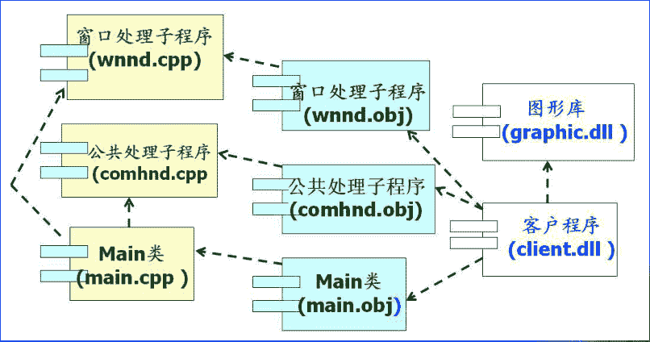

窗口处理子程序（wnnd.cpp）

窗口处理子程序（wnnd.obj）

公共处理子程序（comhnd.cpp）

公共处理子程序（comhnd.obj）

Main 类（main.cpp）

Main 类（main.obj）

图形库（graphic.dll）

客户程序（client.dll）

## 面向对象设计与复用

### 类设计

对象(object)是问题域中一些事物的抽象

类是对对象特征的描述，一个类刻画了一组具有相同属性特征和行为特征的对象

类的设计包括了：

- 类的组织与表示
- 行为的组织与表示
- 属性的组织与表示

## 面向对象设计与复用

### 类的组织与表示

- 类的发现
- 聚类分析
- 类的再抽象
- 类的拆分
- 类的可见性
- 类的复用性

## 面向对象设计与复用

### 属性的组织与表示

- 只读/只写属性
- 不变属性
- 类变量与类属性
- 可见性属性

## 面向对象设计与复用

### 类设计中难点在于—变化的存在

- 职责的变化
  接口、功能的变化，如：功能的增加，参数个数及类型的变化，可访问性的变化等等
- 实现的变化
  数据表示的变化，如数据的类型、数量、可访问性、组织形式等
  行为的变化，如行为过程、行为结果等

## 面向对象设计与复用

### 变化的适应方式

- 修改既有代码
- 扩展既有代码
  - 继承方式扩展
  - 依赖方式扩展
  - 关联方式扩展
  - 聚合方式扩展
  - 组合方式扩展

## 设计模式的诞生与发展

- 模式的诞生与定义
- Alexander给出了关于模式的经典定义：每个模式都描述了一个在我们的环境中不断出现的问题，然后描述了该问题的解决方案的核心，通过这种方式，我们可以无数次地重用那些已有的解决方案，无需再重复相同的工作。
- A pattern is a solution to a problem in a context
- 模式是在特定环境中解决问题的方案

## 设计模式的诞生与发展

- 软件模式
  - 1990年，软件工程界开始关注Christopher Alexander等在这一住宅、公共建筑与城市规划领域的重大突破，最早将该模式的思想引入软件工程方法学的是1991-1992年以“四人组（Gang of Four，GoF，分别是Erich Gamma，Richard Helm，Ralph Johnson和John Vlissides）”自称的四位著名软件工程学者，他们在1994年归纳发表了23种在软件开发中使用频率较高的设计模式，旨在用模式来统一沟通面向对象方法在分析、设计和实现间的鸿沟。


## 设计模式的诞生与发展

Gang of Four

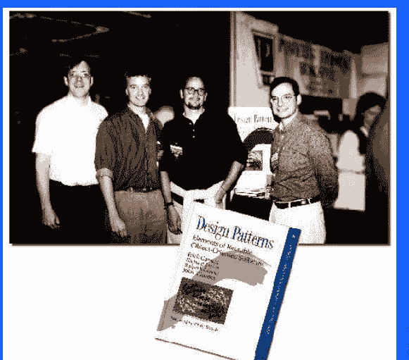

## 设计模式的诞生与发展

### Gang of Four


Erich Gamma

苏黎世大学计算机科学博士，是Eclipse、JUnit 等项目主要技术负责人之一。


Richard Helm

墨尔本大学计算机科学博士，原IBM 研究员，现在波士顿顾问集团供职。


Ralph Johnson

康奈尔大学计算机科学博士，
伊利诺伊大学教授。


John Vlissides

斯坦福大学计算机科学博士，
原IBM研究员，于2005年11月24日因脑瘤去世，享年44岁。

## 设计模式的诞生与发展

软件模式

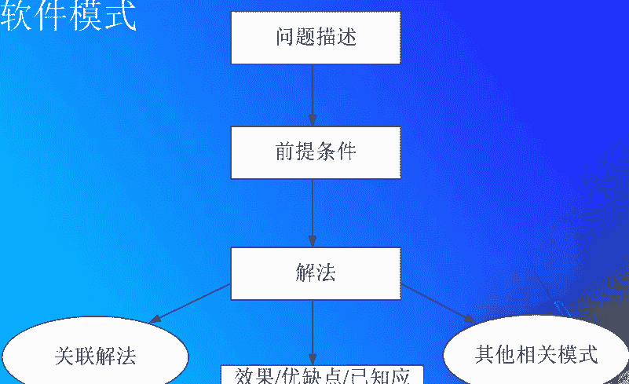

## 设计模式的诞生与发展

- 软件模式
- 软件模式与具体的应用领域无关，在模式发现过程中需要遵循大三律(Rule of Three)，即只有经过三个以上不同类型（或不同领域）的系统的校验，一个解决方案才能从候选模式升格为模式。

## 设计模式的诞生与发展

### 设计模式的发展

- 1987年，Kent Beck和Ward Cunningham借鉴Alexander的模式思想在程序开发中开始应用一些模式，在OOPSLA会议上发表了他们的成果。
- 1990年，OOPSLA与ECOOP联合举办，Erich Gamma和Richard Helm等人开始讨论有关模式的话题，“四人组”正式成立，并开始着手进行设计模式的分类整理工作。
- 1991年，OOPSLA，首次针对设计模式的研讨会。
- 1992年，OOPSLA，模式已经逐渐成为人们讨论的话题。
- 注: OOPSLA (Object-Oriented Programming, Systems, Languages & Applications, 面向对象编程、系统、语言和应用大会), 编程语言及软件工程国际顶级会议，2010年改为SPLASH --- Systems, Programming, Languages and Applications: Software for Humanity

- 1993年, Kent Beck 和 Grady Booch 赞助了第一次关于设计模式的会议，这个设计模式研究组织发展成为著名的Hillside Group研究组。
- 1994 年, 由Hillside Group发起，在美国伊利诺伊州(Illinois)的Allerton Park召开了第1届关于面向对象模式的世界性会议，名为PLoP(Pattern Languages of Programs, 编程语言模式会议)，简称PLoP'94。
- 1995年, PLoP'95 仍在伊利诺伊州的Allerton Park举行，"四人组"出版了《设计模式：可复用面向对象软件的基础》(Design Patterns: Elements of Reusable Object-Oriented Software)一书，本书成为1995年最抢手的面向对象书籍，也成为设计模式的经典书。

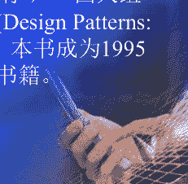

- 从1995年至今，设计模式在软件开发中得以广泛应用，在Java SE/Java EE平台和.NET平台设计中就应用了大量的设计模式。
- 诞生了越来越多的与设计模式相关的书籍和网站，设计模式也作为一门独立的课程或作为软件体系结构等课程的重要组成部分出现在国内外研究生和大学教育的课堂上。


## 设计模式的定义与分类

### 设计模式的基本要素

设计模式一般有如下几个基本要素：模式名称、问题、目的、解决方案、效果、实例代码和相关设计模式，其中的关键元素包括以下四个方面：

- 模式名称 (Pattern name)
- 问题 (Problem)
- 解决方案 (Solution)
- 效果 (Consequences)

## 设计模式的定义与分类

### 设计模式的分类

- 根据其目的（模式是用来做什么的）可分为创建型(Creational)，结构型(Structural)和行为型(Behavioral)三种：
- 创建型模式主要用于创建对象。
- 结构型模式主要用于处理类或对象的组合。
- 行为型模式主要用于描述对类或对象怎样交互和怎样分配职责。

## GoF设计模式简介

| 范围\目的 | 创建型模式 | 结构型模式 | 行为型模式 |
|---|---|---|---|
| 类模式 | 工厂方法模式 | （类）适配器模式 | 解释器模式<br>模板方法模式 |
| 对象模式 | 抽象工厂模式<br>建造者模式<br>原型模式<br>单例模式 | （对象）适配器模式<br>桥接模式<br>组合模式<br>装饰模式<br>外观模式<br>享元模式<br>代理模式 | 职责链模式<br>命令模式<br>迭代器模式<br>中介者模式<br>备忘录模式<br>观察者模式<br>状态模式<br>策略模式<br>访问者模式 |

- 创建型模式
  - 抽象工厂模式(Abstract Factory)
  - 建造者模式(Builder)
  - 工厂方法模式(Factory Method)
  - 原型模式(Prototype)
  - 单例模式(Singleton)

## GoF设计模式简介

- 结构型模式
  - 适配器模式(Adapter)
  - 桥接模式(Bridge)
  - 组合模式(Composite)
  - 装饰模式(Decorator)
  - 外观模式(Facade)
  - 享元模式(Flyweight)
  - 代理模式(Proxy)


## GoF设计模式简介

## 行为型模式

- 职责链模式(Chain of Responsibility)
- 命令模式(Command)
- 解释器模式(Interpreter)
- 迭代器模式(Iterator)
- 中介者模式(Mediator)
- 备忘录模式(Memento)
- 观察者模式(Observer)
- 状态模式(State)
- 策略模式(Strategy)
- 模板方法模式(Template Method)
- 访问者模式(Visitor)

## 设计模式的优点

- 设计模式是从许多优秀的软件系统中总结出的成功的、能够实现可维护性复用的设计方案，使用这些方案将避免我们做一些重复性的工作，而且可以设计出高质量的软件系统。
- 设计模式的主要优点如下：
- 设计模式融合了众多专家的经验，并以一种标准的形式供广大开发人员所用，它提供了一套通用的设计词汇和一种通用的语言以方便开发人员之间沟通和交流，使得设计方案更加通俗易懂。对于使用不同编程语言的开发和设计人员可以通过设计模式来交流系统设计方案，每一个模式都对应一个标准的解决方案，设计模式可以降低开发人员理解系统的复杂度。
- 设计模式使人们可以更加简单方便地复用成功的设计，将已证实的技术表述成设计模式会使新系统开发者更加容易理解其设计思路，并避免那些导致不可重用的设计方案。
- 设计模式使得设计方案更加灵活，且易于修改。
- 设计模式的使用将提高软件系统的开发效率和软件质量，且在一定程度上节约设计成本。
- 设计模式有助于初学者更深入地理解面向对象思想，一方面可以帮助初学者更加方便地阅读和学习现有类库与其他系统中的源代码，另一方面还可以提高软件的设计水平和代码质量。

### 小结

- 设计模式是一套被反复使用、多数人知晓的、经过分类编目的、代码设计经验的总结，使用设计模式是为了可重用代码、让代码更容易被他人理解、保证代码可靠性。
- 设计模式一般有如下几个基本要素：模式名称、问题、目的、解决方案、效果、实例代码和相关设计模式，其中的关键元素包括模式名称、问题、解决方案和效果。
- 设计模式根据其目的可分为创建型，结构型和行为型三种；根据范围可分为类模式和对象模式两种。
- 设计模式是从许多优秀的软件系统中总结出的成功的、能够实现可维护性复用的设计方案，使用这些方案将避免我们做一些重复性的工作，而且可以设计出高质量的软件系统。


## 创建型模式

◆ 创建型模式概述

◆ 简单工厂模式
■ 模式动机与定义
■ 模式结构与分析
■ 模式实例与解析
■ 模式效果与应用
■ 模式扩展

## 创建型模式

### 创建型模式概述

- 创建型模式(Creational Pattern)关注的是对象的创建，将创建对象(类的实例化)的过程进行了抽象和封装，分离了对象创建和对象使用。作为客户程序仅仅需要去使用对象，而不再关心创建对象过程中的逻辑。帮助一个系统独立于如何创建、组合和表示它的那些对象。

## 创建型模式

### 创建型模式概述

- 创建型模式有两个重要的特点：
  1) 客户不知道对象的具体类是什么（除非看源代码）
  2) 隐藏了对象实例是如何被创建和组织的
- 当想要使用new运算符的时候，就考虑创建型模式

## 创建型模式

创建型模式概述


想吃苹果!?


## 创建型模式

### 创建型模式概述

获取苹果的两种方式

自己种苹果树


去超市买

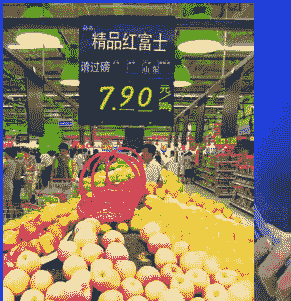

## 创建型模式

创建型模式概述

- 简单工厂模式（Simple Factory）
- 工厂方法模式（Factory Method）
- 抽象工厂模式（Abstract Factory）
- 建造者模式（Builder）
- 原型模式（Prototype）
- 单例模式（Singleton）

## 简单工厂模式

### 模式动机

- 只需要知道水果的名字则可得到相应的水果

水果农场

Apple

Orange

Banana

create

create

create


## 简单工厂模式

### 模式动机

考虑一个简单的软件应用场景，一个软件系统可以提供多个外观不同的按钮（如圆形按钮、矩形按钮、菱形按钮等），这些按钮都源自同一个基类，不过在继承基类后不同的子类修改了部分属性从而使得它们可以呈现不同的外观，如果我们希望在使用这些按钮时，不需要知道这些具体按钮类的名字，只需要知道表示该按钮类的一个参数，并提供一个调用方便的方法，把该参数传入方法即可返回一个相应的按钮对象，此时，就可以使用简单工厂模式。

## 简单工厂模式

### 模式定义

简单工厂模式(Simple Factory Pattern)：又称为静态工厂方法(Static Factory Method)模式。在简单工厂模式中，可以根据参数的不同返回不同类的实例。简单工厂模式专门定义一个类来负责创建其他类的实例，被创建的实例通常都具有共同的父类。

## 简单工厂模式

### 模式结构

```
if(arg.equalsIgnoreCase("A"))
{
    return new ConcreteProductA();
}
else if(arg.equalsIgnoreCase("B"))
{
    return new ConcreteProductB();
}
else
{
    ....
}
```

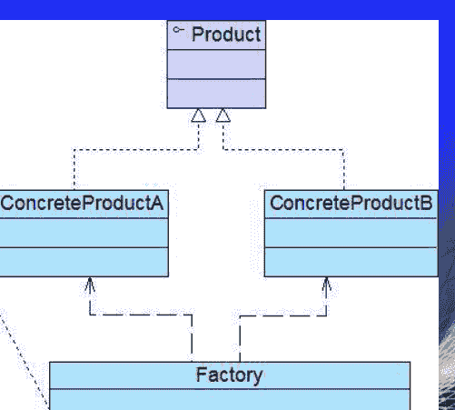

## 简单工厂模式

◆ 模式结构

- 简单工厂模式包含如下角色：
  - **Factory**：工厂角色，负责实现创建所有实例的内部逻辑
  - **Product**：抽象产品角色，是所创建的所有对象的父类，负责描述所有实例所共有的公共接口
  - **ConcreteProduct**：具体产品角色是创建目标，所有创建的对象都充当这个角色的某个具体类的实例

## 简单工厂模式

### 模式分析

- 分析如下代码：

```
public void pay(String type)
{
    if(type.equalsIgnoreCase("cash"))
    {
        //现金支付处理代码
    }
    else if(type.equalsIgnoreCase("credit"))
    {
        //信用卡支付处理代码
    }
    else if(type.equalsIgnoreCase("voucher"))
    {
        //代金券支付处理代码
    }
    else
    {
        ......
    }
}
```

代码复杂，难以维护

## 简单工厂模式

### 模式分析

- 重构后的代码：

```
public abstract class AbstractPay
{
    public abstract void pay();
}
```

```
public class CashPay extends AbstractPay
{
    public void pay()
    {
        //现金支付处理代码
    }
}
```

抽象支付类

具体支付类


## 简单工厂模式

### 模式分析

- 重构后的代码：

```
public class PayMethodFactory
{
    public static AbstractPay getPayMethod(String type)
    {
        if(type.equalsIgnoreCase("cash"))
        {
            return new CashPay();    //根据参数创建具体产品
        }
        else if(type.equalsIgnoreCase("creditcard"))
        {
            return new CreditcardPay(); //根据参数创建具体产品
        }
        ....
    }
}
```

支付工厂

## 简单工厂模式

### 模式分析

- 将对象的创建和对象本身业务处理分离可以降低系统的耦合度，使得两者修改起来都相对容易。
- 在调用工厂类的工厂方法时，由于工厂方法是静态方法，使用起来很方便，可通过类名直接调用，而且只需要传入一个简单的参数即可，在实际开发中，还可以在调用时将所传入的参数保存在XML等格式的配置文件中，修改参数时无须修改任何Java源代码。
- 简单工厂模式最大的问题在于工厂类的职责相对过重，增加新的产品需要修改工厂类的判断逻辑，这一点与开闭原则是相违背的。
- 简单工厂模式的要点在于：当你需要什么，只需要传入一个正确的参数，就可以获取你所需要的对象，而无须知道其创建细节。

## 简单工厂模式

### 模式实例与解析

- 实例一：简单电视机工厂

某电视机厂专为各知名电视机品牌代工生产各类电视机，当需要海尔牌电视机时只需要在调用该工厂的工厂方法时传入参数“Haier”，需要海信电视机时只需要传入参数“Hisense”，工厂可以根据传入的不同参数返回不同品牌的电视机。现使用简单工厂模式来模拟该电视机工厂的生产过程。

## 简单工厂模式

◆模式实例与解析

▪ 实例一：简单电视机工厂

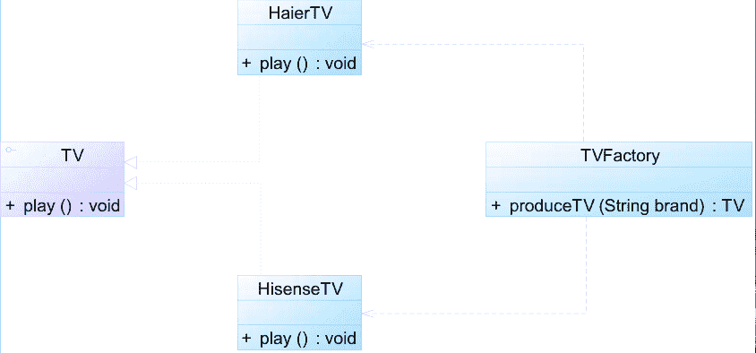

## 简单工厂模式

◆ 模式实例与解析
■ 实例一：简单电视机工厂
• 参考代码(sample01)

演示......

## 简单工厂模式

### 模式实例与解析

- 实例二：权限管理

在某OA系统中，系统根据对比用户在登录时输入的账号和密码以及在数据库中存储的账号和密码是否一致来进行身份验证，如果验证通过，则取出存储在数据库中的用户权限等级（以整数形式存储），根据不同的权限等级创建不同等级的用户对象，不同等级的用户对象拥有不同的操作权限。现使用简单工厂模式来设计该权限管理模块。


## 简单工厂模式

模式实例与解析

- 实例二：权限管理

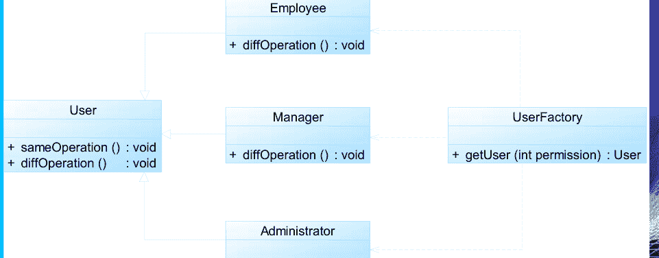

模式实例与解析
实例二：权限管理
参考代码(sample02)


## ◆ 模式优缺点

- **简单工厂模式的优点**
  - 工厂类含有必要的判断逻辑，可以决定在什么时候创建哪一个产品类的实例，客户端可以免除直接创建产品对象的责任，而仅仅“消费”产品；简单工厂模式通过这种做法实现了对责任的分割，它提供了专门的工厂类用于创建对象。
  - 客户端无需知道所创建的具体产品类的类名，只需要知道具体产品类所对应的参数即可，对于一些复杂的类名，通过简单工厂模式可以减少使用者的记忆量。
  - 通过引入配置文件，可以在不修改任何客户端代码的情况下更换和增加新的具体产品类，在一定程度上提高了系统的灵活性。

- 由于工厂类集中了所有产品创建逻辑，一旦不能正常工作，整个系统都要受到影响。
- 使用简单工厂模式将会增加系统中类的个数，在一定程度上增加了系统的复杂度和理解难度。
- 系统扩展困难，一旦添加新产品就不得不修改工厂逻辑，在产品类型较多时，有可能造成工厂逻辑过于复杂，不利于系统的扩展和维护。
- 简单工厂模式由于使用了静态工厂方法，造成工厂角色无法形成基于继承的等级结构。

### 模式适用环境

在以下情况下可以使用简单工厂模式：

- 工厂类负责创建的对象比较少：由于创建的对象较少，不会造成工厂方法中的业务逻辑太过复杂。
- 客户端只知道传入工厂类的参数，对于如何创建对象不关心：客户端既不需要关心创建细节，甚至连类名都不需要记住，只需要知道类型所对应的参数。

### 模式应用

(1) 在JDK类库中广泛使用了简单工厂模式，如工具类 java.text.DateFormat，它用于格式化一个本地日期或者时间。

```
public final static DateFormat getDateInstance();
public final static DateFormat getDateInstance(int style);
public final static DateFormat getDateInstance(int style,Locale locale);
```

模式应用
(2) Java加密技术

```
//获取不同加密算法的密钥生成器
KeyGenerator keyGen=KeyGenerator.getInstance("DESede");
```

```
//创建密码器
Cipher cp=Cipher.getInstance("DESede");
```

参考代码：
DESEencrypt.java

### 模式扩展

- 简单工厂模式的简化：

在有些情况下工厂类可以由抽象产品角色扮演，一个抽象产品类同时也是子类的工厂，也就是说把静态工厂方法写到抽象产品类中。

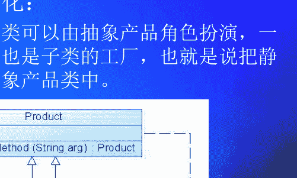

### 小结

- 创建型模式对类的实例化过程进行了抽象，能够将对象的创建与对象的使用过程分离。
- 简单工厂模式又称为静态工厂方法模式，它属于类创建型模式。在简单工厂模式中，可以根据参数的不同返回不同类的实例。简单工厂模式专门定义一个类来负责创建其他类的实例，被创建的实例通常都具有共同的父类。
- 简单工厂模式包含三个角色：工厂角色负责实现创建所有实例的内部逻辑；抽象产品角色是所创建的所有对象的父类，负责描述所有实例所共有的公共接口；具体产品角色是创建目标，所有创建的对象都充当这个角色的某个具体类的实例。

- 简单工厂模式的要点在于：当你需要什么，只需要传入一个正确的参数，就可以获取你所需要的对象，而无须知道其创建细节。
- 简单工厂模式最大的优点在于实现对象的创建和对象的使 用分离，将对象的创建交给专门的工厂类负责，但是其最 大的缺点在于工厂类不够灵活，增加新的具体产品需要修 改工厂类的判断逻辑代码，而且产品较多时，工厂方法代 码将会非常复杂。
- 简单工厂模式适用情况包括：工厂类负责创建的对象比较 少；客户端只知道传入工厂类的参数，对于如何创建对象 不关心。

## 工厂方法模式

工厂方法模式
- 模式动机与定义
- 模式结构与分析
- 模式实例与解析
- 模式效果与应用
- 模式扩展

### 模式动机

考虑这样一个系统，按钮工厂类可以返回一个具体的按钮实例，如圆形按钮、矩形按钮、菱形按钮等。在这个系统中，如果需要增加一种新类型的按钮，如椭圆形按钮，那么除了增加一个新的具体产品类之外，还需要修改工厂类的代码，这就使得整个设计在一定程度上违背了“开闭原则”。

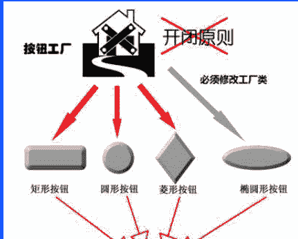

现在对该系统进行修改，不再设计一个按钮工厂类来统一负责所有产品的创建，而是将具体按钮的创建过程交给专门的工厂子类去完成，我们先定义一个抽象的按钮工厂类，再定义具体的工厂类来生成圆形按钮、矩形按钮、菱形按钮等，它们实现在抽象按钮工厂类中定义的方法。这种抽象化的结果使这种结构可以在不修改具体工厂类的情况下引进新的产品，如果出现新的按钮类型，只需要为这种新类型的按钮创建一个具体的工厂类就可以获得该新按钮的实例，这一特点无疑使得工厂方法模式具有超越简单工厂模式的优越性，更加符合“开闭原则”。

- 使用工厂方法模式设计的按钮工厂

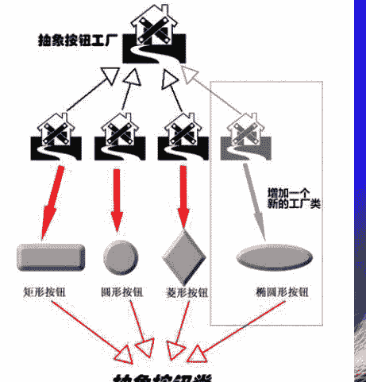

### 模式定义

工厂方法模式(Factory Method Pattern)又称为工厂模式，也叫虚拟构造器(Virtual Constructor)模式或者多态工厂(Polymorphic Factory)模式。在工厂方法模式中，工厂父类负责定义创建产品对象的公共接口，而工厂子类则负责生成具体的产品对象，这样做的目的是将产品类的实例化操作延迟到工厂子类中完成，即通过工厂子类来确定究竟应该实例化哪一个具体产品类。

### 模式结构

Product
Factory
+ factoryMethod() : Product
ConcreteProduct
ConcreteFactory
<<create>>
+ factoryMethod() : Product
return new ConcreteProduct();

工厂方法模式包含如下角色：

- Product: 抽象产品
- ConcreteProduct: 具体产品
- Factory: 抽象工厂
- ConcreteFactory: 具体工厂

## ◆模式分析

工厂方法模式是简单工厂模式的进一步抽象和推广。由于使用了面向对象的多态性，工厂方法模式保持了简单工厂模式的优点，而且克服了它的缺点。在工厂方法模式中，核心的工厂类不再负责所有产品的创建，而是将具体创建工作交给子类去做。这个核心类仅仅负责给出具体工厂必须实现的接口，而不负责哪一个产品类被实例化这种细节，这使得工厂方法模式可以允许系统在不修改工厂角色的情况下引进新产品。

### 模式分析

- 当系统扩展需要添加新的产品对象时，仅仅需要添加一个具体产品对象以及一个具体工厂对象，原有工厂对象不需要进行任何修改，也不需要修改客户端，很好地符合了“开闭原则”。而简单工厂模式在添加新产品对象后不得不修改工厂方法，扩展性不好。工厂方法模式退化后可以演变成简单工厂模式。

模式分析

抽象工厂类代码：

```
public abstract class PayMethodFactory
{
    public abstract AbstractPay getPayMethod();
}
```

抽象工厂类

### 模式分析

具体工厂类代码：

```
public class CashPayFactory extends PayMethodFactory
{
    public AbstractPay getPayMethod()
    {
        return new CashPay();
    }
}
```

具体工厂类


## 工厂方法模式

### 模式分析

+   客户类代码片段：

```
PayMethodFactory factory;
AbstractPay payMethod;
factory=new CashPayFactory();
payMethod =factory.getPayMethod();
payMethod.pay();
```

为了提高系统的可扩展性和灵活性，在定义工厂和产品时都必须使用抽象层，如果需要更换产品类，只需要更换对应的工厂即可，其他代码不需要进行任何修改。

### 模式分析

+   配置文件代码：

在实际的应用开发中，一般将具体工厂类的实例化过程进行改进，不直接使用new关键字来创建对象，而是将具体类的类名写入配置文件中，再通过Java的反射机制，读取XML格式的配置文件，根据存储在XML文件中的类名字符串生成对象。

```
<?xml version="1.0"?>
<config>
    <className>CashPayFactory</className>
</config>
```

### 模式分析

+   Java反射(Java Reflection):
+   是指在程序运行时获取已知名称的类或已有对象的相关信息的一种机制，包括类的方法、属性、超类等信息，还包括实例的创建和实例类型的判断等。可通过Class类的forName()方法返回与带有给定字符串名的类或接口相关联的Class对象，再通过newInstance()方法创建此对象所表示的类的一个新实例，即通过一个类名字符串得到类的实例。

```
//创建 一个字符串类型的对象
Class c = Class.forName("String");
Object obj = c.newInstance();
return obj;
```

### 模式分析

工具类XMLUtil代码片段：

```
//创建DOM文档对象
DocumentBuilderFactory dFactory = DocumentBuilderFactory.newInstance();
DocumentBuilder builder = dFactory.newDocumentBuilder();
Document doc;
doc = builder.parse(new File("config.xml"));

//获取包含类名的文本节点
NodeList nl = doc.getElementsByTagName("className");
Node classNode = nl.item(0).getFirstChild();
String cName = classNode.getNodeValue();

//通过类名生成实例对象并将其返回
Class c = Class.forName(cName);
Object obj = c.newInstance();
return obj;
```

### 模式分析

◇ 修改后的客户类代码片段：

```
PayMethodFactory factory;
AbstractPay payMethod;
factory=(PayMethodFactory)XMLUtil.getBean(); //getBean()的返回类型为Object，此处需要进行强制类型转换
payMethod =factory.getPayMethod();
payMethod.pay();
```

### 模式实例与解析

+   实例一： 电视机工厂

将原有的工厂进行分割，为每种品牌的电视机提供一个子工厂，海尔工厂专门负责生产海尔电视机，海信工厂专门负责生产海信电视机，如果需要生产TCL电视机或创维电视机，只需要对应增加一个新的TCL工厂或创维工厂即可，原有的工厂无须做任何修改，使得整个系统具有更加的灵活性和可扩展性。

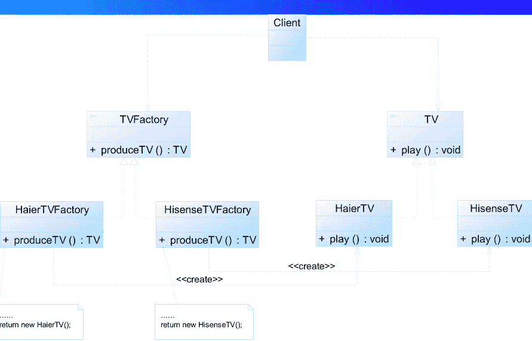

### 模式实例与解析

+   - 实例一：电视机工厂
+     - 参考代码(sample01)


### 模式实例与解析

+   实例二：日志记录器

某系统日志记录器要求支持多种日志记录方式，如文件记录、数据库记录等，且用户可以根据要求动态选择日志记录方式，现使用工厂方法模式设计该系统。

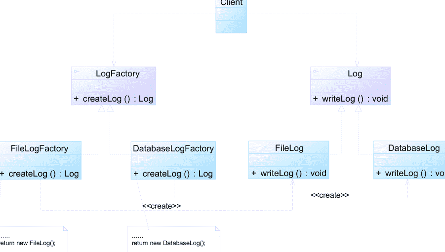

### 模式优点

+   - 在工厂方法模式中，工厂方法用来创建客户所需要的产品，同时还向客户隐藏了哪种具体产品类将被实例化这一细节，用户只需要关心所需产品对应的工厂，无须关心创建细节，甚至无须知道具体产品类的类名。
+   - 基于工厂角色和产品角色的多态性设计是工厂方法模式的关键。它能够使工厂可以自主确定创建何种产品对象，而如何创建这个对象的细节则完全封装在具体工厂内部。工厂方法模式之所以又被称为多态工厂模式，是因为所有的具体工厂类都具有同一抽象父类。
+   - 使用工厂方法模式的另一个优点是在系统中加入新产品时，无须修改抽象工厂和抽象产品提供的接口，无须修改客户端，也无须修改其他的具体工厂和具体产品，而只要添加一个具体工厂和具体产品就可以了。这样，系统的可扩展性也就变得非常好，完全符合“开闭原则”。

### 模式缺点

+   - 在添加新产品时，需要编写新的具体产品类，而且还要提供与之对应的具体工厂类，系统中类的个数将成对增加，在一定程度上增加了系统的复杂度，有更多的类需要编译和运行，会给系统带来一些额外的开销。
+   - 由于考虑到系统的可扩展性，需要引入抽象层，在客户端代码中均使用抽象层进行定义，增加了系统的抽象性和理解难度，且在实现时可能需要用到DOM、反射等技术，增加了系统的实现难度。

### 模式适用环境

+   - 一个类不知道它所需要的对象的类：在工厂方法模式中，客户端不需要知道具体产品类的类名，只需要知道所对应的工厂即可，具体的产品对象由具体工厂类创建；客户端需要知道创建具体产品的工厂类。
+   - 一个类通过其子类来指定创建哪个对象：在工厂方法模式中，对于抽象工厂类只需要提供一个创建产品的接口，而由其子类来确定具体要创建的对象，利用面向对象的多态性和里氏代换原则，在程序运行时，子类对象将覆盖父类对象，从而使得系统更容易扩展。
+   - 将创建对象的任务委托给多个工厂子类中的某一个，客户端在使用时可以无须关心是哪一个工厂子类创建产品子类，需要时再动态指定，可将具体工厂类的类名存储在配置文件或数据库中。

### 模式应用

+   (1) Java消息服务JMS(Java Messaging Service)：

```
//使用上下文和JNDI得到连接工厂的引用, ctx是上下文Context类型的对象
QueueConnectionFactory qConnFact=(QueueConnectionFactory)ctx.lookup("cfJndi");
//使用连接工厂创建一个连接
QueueConnection qConn=qConnFact.createQueueConnection();
//使用连接创建一个会话
QueueSession qSess=qConn.createQueueSession(false, javax.jms.QueueSession.AUTO_ACKNOWLEDGE);
//使用上下文和JNDI得到消息队列的引用
Queue q=(Queue)ctx.lookup("myQueue");
//使用连接创建一个需要发送的消息类型的实例
QueueSender qSend=qSess.createSender(q);
System.out.println("开始发送消息....");
```

+   - (2) JDBC中的工厂方法：

```
Connection
conn=DriverManager.getConnection("jdbc:microsoft:sqlserver://localhost:1433; DatabaseName=DB;user=sa;password=");
Statement statement=conn.createStatement();
ResultSet rs=statement.executeQuery("select * from UserInfo");
```

### 模式扩展

+   - 使用多个工厂方法：在抽象工厂角色中可以定义多个工厂方法，从而使具体工厂角色实现这些不同的工厂方法，这些方法可以包含不同的业务逻辑，以满足对不同的产品对象的需求。
+   - 产品对象的重复使用：工厂对象将已经创建过的产品保存到一个集合（如数组、List等）中，然后根据客户对产品的请求，对集合进行查询。如果有满足要求的产品对象，就直接将该产品返回客户端；如果集合中没有这样的产品对象，那么就创建一个新的满足要求的产品对象，然后将这个对象在增加到集合中，再返回给客户端。
+   - 多态性的丧失和模式的退化：如果工厂仅仅返回一个具体产品对象，便违背了工厂方法的用意，发生退化，此时就不再是工厂方法模式了。一般来说，工厂对象应当有一个抽象的父类型，如果工厂等级结构中只有一个具体工厂类的话，抽象工厂就可以省略，也将发生了退化。当只有一个具体工厂，在具体工厂中可以创建所有的产品对象，并且工厂方法设计为静态方法时，工厂方法模式就退化成简单工厂模式。


### 小结
- 工厂方法模式又称为工厂模式，它属于类创建型模式。在工厂方法模式中，工厂父类负责定义创建产品对象的公共接口，而工厂子类则负责生成具体的产品对象，这样做的目的是将产品类的实例化操作延迟到工厂子类中完成，即通过工厂子类来确定究竟应该实例化哪一个具体产品类。
- 工厂方法模式包含四个角色：抽象产品是定义产品的接口，是工厂方法模式所创建对象的超类型，即产品对象的共同父类或接口；具体产品实现了抽象产品接口，某种类型的具体产品由专门的具体工厂创建，它们之间往往一一对应；抽象工厂中声明了工厂方法，用于返回一个产品，它是工厂方法模式的核心，任何在模式中创建对象的工厂类都必须实现该接口；具体工厂是抽象工厂类的子类，实现了抽象工厂中定义的工厂方法，并可由客户调用，返回一个具体产品类的实例。

工厂方法模式是简单工厂模式的进一步抽象和推广。由于使用了面向对象的多态性，工厂方法模式保持了简单工厂模式的优点，而且克服了它的缺点。在工厂方法模式中，核心的工厂类不再负责所有产品的创建，而是将具体创建工作交给子类去做。这个核心类仅仅负责给出具体工厂必须实现的接口，而不负责产品类被实例化这种细节，这使得工厂方法模式可以允许系统在不修改工厂角色的情况下引进新产品。

工厂方法模式的主要优点是增加新的产品类时无须修改现有系统，并封装了产品对象的创建细节，系统具有良好的灵活性和可扩展性；其缺点在于增加新产品同时需要增加新的工厂，导致系统类的个数成对增加，在一定程度上增加了系统的复杂性。

工厂方法模式适用情况包括：一个类不知道它所需要的对象的类；一个类通过其子类来指定创建哪个对象；将创建对象的任务委托给多个工厂子类中的某一个，客户端在使用时可以无须关心是哪一个工厂子类创建产品子类，需要时再动态指定。

## 抽象工厂模式

### 模式动机与定义
### 模式结构与分析
### 模式实例与解析
### 模式效果与应用
### 模式扩展

### 模式动机
- 在工厂方法模式中具体工厂负责生产具体的产品，每一个具体工厂对应一种具体产品，工厂方法也具有唯一性，一般情况下，一个具体工厂中只有一个工厂方法或者一组重载的工厂方法。但是有时候我们需要一个工厂可以提供多个产品对象，而不是单一的产品对象。

引入两个概念：

- 产品等级结构：产品等级结构即产品的继承结构，如一个抽象类是电视机，其子类有海尔电视机、海信电视机、TCL电视机，则抽象电视机与具体品牌的电视机之间构成了一个产品等级结构，抽象电视机是父类，而具体品牌的电视机是其子类。
- 产品族：在抽象工厂模式中，产品族是指由同一个工厂生产的，位于不同产品等级结构中的一组产品，如海尔电器工厂生产的海尔电视机、海尔电冰箱，海尔电视机位于电视机产品等级结构中，海尔电冰箱位于电冰箱产品等级结构中。

- 当系统所提供的工厂所需生产的具体产品并不是一个简单的对象，而是多个位于不同产品等级结构中属于不同类型的具体产品时需要使用抽象工厂模式。
- 抽象工厂模式是所有形式的工厂模式中最为抽象和最具有一般性的一种形态。
- 抽象工厂模式与工厂方法模式最大的区别在于，工厂方法模式针对的是一个产品等级结构，而抽象工厂模式则需要面对多个产品等级结构，一个工厂等级结构可以负责多个不同产品等级结构中的产品对象的创建。当一个工厂等级结构可以创建出分属于不同产品等级结构的一个产品族中的所有对象时，抽象工厂模式比工厂方法模式更为简单、高效率。

抽象工厂模式示意图

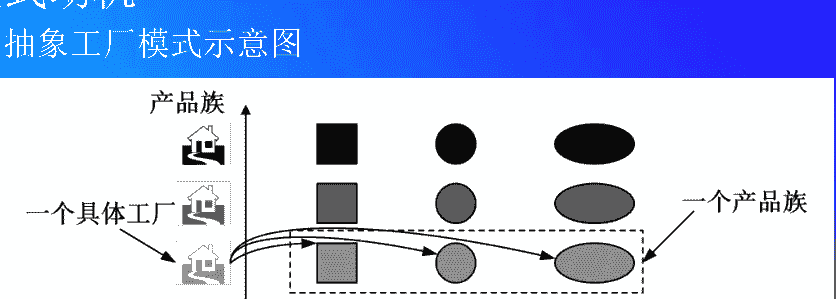

抽象工厂模式(Abstract Factory Pattern): 提供一个创建一系列相关或相互依赖对象的接口，而无需指定它们具体的类。抽象工厂模式又称为Kit模式，属于对象创建型模式。

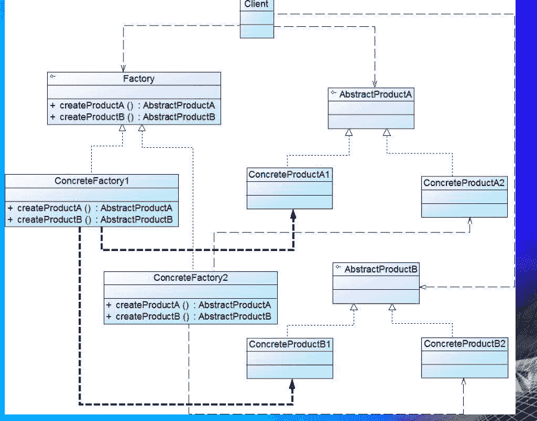

### 模式结构
抽象工厂模式包含如下角色：

- AbstractFactory: 抽象工厂
- ConcreteFactory: 具体工厂
- AbstractProduct: 抽象产品
- Product: 具体产品

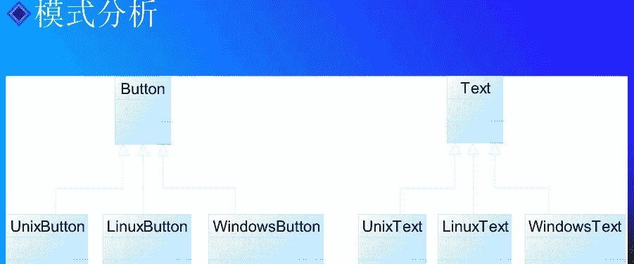

### 模式分析
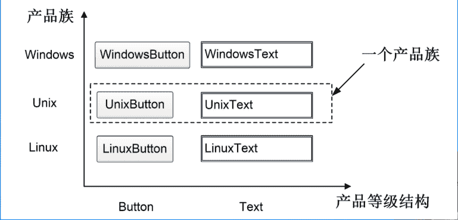

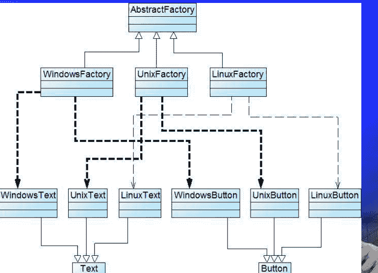

模式分析

抽象工厂类的典型代码如下：

```
public abstract class AbstractFactory
{
    public abstract AbstractProductA createProductA();
    public abstract AbstractProductB createProductB();
}
```

具体工厂类的典型代码如下：

```
public class ConcreteFactory1 extends AbstractFactory
{
    public AbstractProductA createProductA()
    {
        return new ConcreteProductA1();
    }
    public AbstractProductB createProductB()
    {
        return new ConcreteProductB1();
    }
}
```

### 模式实例与解析
- 实例一：电器工厂

一个电器工厂可以产生多种类型的电器，如海尔工厂可以生产海尔电视机、海尔空调等，TCL工厂可以生产TCL电视机、TCL空调等，相同品牌的电器构成一个产品族，而相同类型的电器构成了一个产品等级结构，现使用抽象工厂模式模拟该场景。

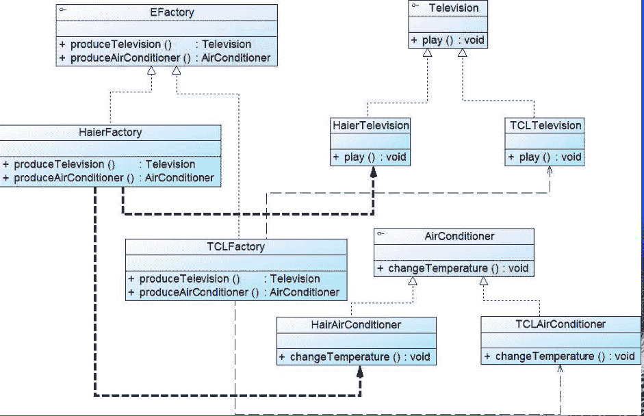

- 模式实例与解析
- 实例一：电器工厂
- 参考代码 (sample01)

演示......

- 实例二：数据库操作工厂

某系统为了改进数据库操作的性能，自定义数据库连接对象Connection和语句对象Statement，可针对不同类型的数据库提供不同的连接对象和语句对象，如提供Oracle或SQL Server专用连接类和语句类，而且用户可以通过配置文件等方式根据实际需要动态更换系统数据库。使用抽象工厂模式设计该系统。

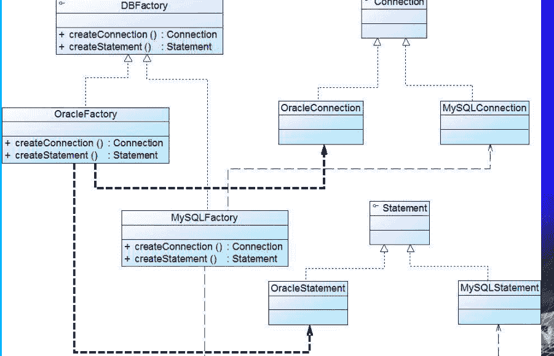

### 模式优点
- 抽象工厂模式隔离了具体类的生成，使得客户并不需要知道什么被创建。由于这种隔离，更换一个具体工厂就变得相对容易。所有的具体工厂都实现了抽象工厂中定义的那些公共接口，因此只需改变具体工厂的实例，就可以在某种程度上改变整个软件系统的行为。另外，应用抽象工厂模式可以实现高内聚低耦合的设计目的，因此抽象工厂模式得到了广泛的应用。
- 当一个产品族中的多个对象被设计成一起工作时，它能够保证客户端始终只使用同一个产品族中的对象。这对一些需要根据当前环境来决定其行为的软件系统来说，是一种非常实用的设计模式。
- 增加新的具体工厂和产品族很方便，无须修改已有系统，符合“开闭原则”。

### 模式缺点
- 在添加新的产品对象时，难以扩展抽象工厂来生产新种类的产品，这是因为在抽象工厂角色中规定了所有可能被创建的产品集合，要支持新种类的产品就意味着要对该接口进行扩展，而这将涉及到对抽象工厂角色及其所有子类的修改，显然会带来较大的不便。
- 开闭原则的倾斜性（增加新的工厂和产品族容易，增加新的产品等级结构麻烦）

### 模式适用环境
在以下情况下可以使用抽象工厂模式：
- 一个系统不应当依赖于产品类实例如何被创建、组合和表达的细节，这对于所有类型的工厂模式都是重要的。
- 系统中有多于一个的产品族，而每次只使用其中某一产品族。
- 属于同一个产品族的产品将在一起使用，这一约束必须在系统的设计中体现出来。
- 系统提供一个产品类的库，所有的产品以同样的接口出现，从而使客户端不依赖于具体实现。


## 抽象工厂模式
### 模式应用
- (1) Java SE AWT（抽象窗口工具包）
  - 在Java语言的AWT（抽象窗口工具包）中就使用了抽象工厂模式，它使用抽象工厂模式来实现在不同的操作系统中应用程序呈现与所在操作系统一致的外观界面。
- (2) 在很多软件系统中需要更换界面主题，要求界面中的按钮、文本框、背景色等一起发生改变时，可以使用抽象工厂模式进行设计。

### 模式扩展
- “开闭原则”的倾斜性
- “开闭原则”要求系统对扩展开放，对修改封闭，通过扩展达到增强其功能的目的。对于涉及到多个产品族与多个产品等级结构的系统，其功能增强包括两方面：
- (1) 增加产品族：对于增加新的产品族，工厂方法模式很好的支持了“开闭原则”，对于新增加的产品族，只需要对应增加一个新的具体工厂即可，对已有代码无须做任何修改。
- (2) 增加新的产品等级结构：对于增加新的产品等级结构，需要修改所有的工厂角色，包括抽象工厂类，在所有的工厂类中都需要增加生产新产品的方法，不能很好地支持“开闭原则”。
- 抽象工厂模式的这种性质称为“开闭原则”的倾斜性，抽象工厂模式以一种倾斜的方式支持增加新的产品，它为新产品族的增加提供方便，但不能为新的产品等级结构的增加提供这样的方便

当抽象工厂模式中每一个具体工厂类只创建一个产品对象，也就是只存在一个产品等级结构时，抽象工厂模式退化成工厂方法模式；当工厂方法模式中抽象工厂与具体工厂合并，并提供一个统一的工厂来创建产品对象，并将创建对象的工厂方法设计为静态方法时，工厂方法模式退化成简单工厂模式。


### 小结
抽象工厂模式提供一个创建一系列相关或相互依赖对象的接口，而无须指定它们具体的类。抽象工厂模式又称为Kit模式，属于对象创建型模式。

抽象工厂模式包含四个角色：抽象工厂用于声明生成抽象产品的方法；具体工厂实现了抽象工厂声明的生成抽象产品的方法，生成一组具体产品，这些产品构成了一个产品族，每一个产品都位于某个产品等级结构中；抽象产品为每种产品声明接口，在抽象产品中定义了产品的抽象业务方法；具体产品定义具体工厂生产的具体产品对象，实现抽象产品接口中定义的业务方法。

抽象工厂模式是所有形式的工厂模式中最为抽象和最具一般性的一种形态。抽象工厂模式与工厂方法模式最大的区别在于，工厂方法模式针对的是一个产品等级结构，而抽象工厂模式则需要面对多个产品等级结构。

- 抽象工厂模式的主要优点是隔离了具体类的生成，使得客户端并不需要知道什么被创建，而且每次可以通过具体工厂类创建一个产品族中的多个对象，增加或者替换产品族比较方便，增加新的具体工厂和产品族很方便；主要缺点在于增加新的产品等级结构很复杂，需要修改抽象工厂和所有的具体工厂类，对“开闭原则”的支持呈现倾斜性。
- 抽象工厂模式适用情况包括：一个系统不应当依赖于产品类实例如何被创建、组合和表达的细节；系统中有多于一个的产品族，而每次只使用其中某一产品族；属于同一个产品族的产品将在一起使用；系统提供一个产品类的库，所有的产品以同样的接口出现，从而使客户端不依赖于具体实现。


## 建造者模式
- 建造者模式
- 模式动机与定义
- 模式结构与分析
- 模式实例与解析
- 模式效果与应用
- 模式扩展

### 模式动机
无论是在现实世界中还是在软件系统中，都存在一些复杂的对象，它们拥有多个组成部分，如汽车，它包括车轮、方向盘、发送机等各种部件。而对于大多数用户而言，无须知道这些部件的装配细节，也几乎不会使用单独某个部件，而是使用一辆完整的汽车，可以通过建造者模式对其进行设计与描述，建造者模式可以将部件和其组装过程分开，一步一步创建一个复杂的对象。用户只需要指定复杂对象的类型就可以得到该对象，而无须知道其内部的具体构造细节。

在软件开发中，也存在大量类似汽车一样的复杂对象，它们拥有
一系列成员属性，这些成员属性中有些是引用类型的成员对象。
而且在这些复杂对象中，还可能存在一些限制条件，如某些属性
没有赋值则复杂对象不能作为一个完整的产品使用；有些属性的
赋值必须按照某个顺序，一个属性没有赋值之前，另一个属性可
能无法赋值等。

复杂产品对象相当于一辆有待建造的汽车，而对象的属性相当于
汽车的部件，建造产品的过程就相当于组合部件的过程。由于组
合部件的过程很复杂，因此，这些部件的组合过程往往被“外部
化”到一个称作建造者的对象里，建造者还还给客户端的是一个
已经建造完毕的完整产品对象，而用户无须关心该对象所包含的
属性以及它们的组装方式，这就是建造者模式的模式动机。

### 模式定义
- 建造者模式(Builder Pattern): 将一个复杂对象的构建与它的表示分离，使得同样的构建过程可以创建不同的表示。
- 建造者模式是一步一步创建一个复杂的对象，它允许用户只通过指定复杂对象的类型就可以构建它们，用户不需要知道内部的具体构建细节。建造者模式属于对象创建型模式。根据中文翻译的不同，建造者模式又可以称为生成器模式。

### 模式结构
```
builder.buildPartA();
builder.buildPartB();
builder.buildPartC();
return builder.getResult();
```

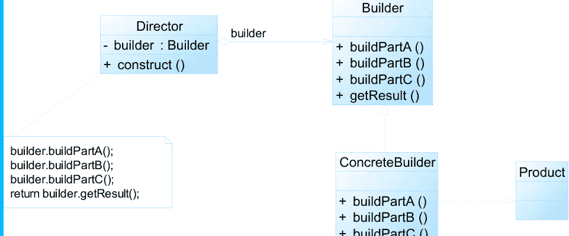

- Builder：抽象建造者为创建一个产品对象的各个部件指定抽象接口
- ConcreteBuilder：具体建造者实现了抽象建造者接口，实现各个部件的构造和装配方法，定义并明确它所创建的复杂对象，也可以提供一个方法返回创建好的复杂产品对象
- Director：指挥者负责安排复杂对象的建造次序，指挥者与抽象建造者之间存在关联关系，可以在其construct方法中调用建造者对象的部件构造与装配方法，完成复杂对象的建造
- Product：产品角色是被构建的复杂对象，包含多个组成部件

### 模式分析
一个典型的复杂对象其类代码示例如下：

```
public class Product
{
    private String partA; //可以是任意类型
    private String partB;
    private String partC;
    //partA的Getter方法和Setter方法省略
    //partB的Getter方法和Setter方法省略
    //partC的Getter方法和Setter方法省略
}
```

抽象建造者类中定义了产品的创建方法和返回方法，其典型代码如下：

```
public abstract class Builder
{
    protected Product product=new Product();

    public abstract void buildPartA();
    public abstract void buildPartB();
    public abstract void buildPartC();

    public Product getResult()
    {
        return product;
    }
}
```

建造者模式的结构中引入了一个指挥者类Director，该类的作用主要有两个：一方面它隔离了客户端与生产过程；另一方面它负责控制产品的生成过程。指挥者针对抽象建造者编程，客户端只需要知道具体建造者的类型，即可通过指挥者类调用建造者的相关方法，返回一个完整的产品对象。

指挥者类的代码示例如下：

```
public class Director
{
    private Builder builder;
    public Director(Builder builder)
    {
        this.builder=builder;
    }
    public void setBuilder(Builder builder)
    {
        this.builder=builder;
    }
    public Product construct()
    {
        builder.buildPartA();
        builder.buildPartB();
        builder.buildPartC();
        return builder.getResult();
    }
}
```


## 建造者模式

### 模式分析

客户端类代码片段：

```
......
Builder builder = new ConcreteBuilder();
Director director = new Director(builder);
Product product = director.construct();
......
```

在客户端代码中，无须关心产品对象的具体组装过程，只需确定具体建造者的类型即可，建造者模式将复杂对象的构建与对象的表现分离开来，这样使得同样的构建过程可以创建出不同的表现。

## 建造者模式

实例：KFC套餐

建造者模式可以用于描述KFC如何创建套餐：套餐是一个复杂对象，它一般包含主食（如汉堡、鸡肉卷等）和饮料（如果汁、可乐等）等组成部分，不同的套餐有不同的组成部分，而KFC的服务员可以根据顾客的要求，一步一步装配这些组成部分，构造一份完整的套餐，然后返回给顾客。


#### 建造者

#### KFC使用了建造者模式

#### 建造者模式实例与解析

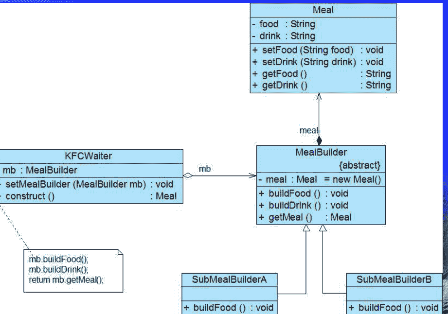

```
mb.buildFood();
mb.buildDrink();
return mb.getMeal();
```

## 建造者模式

- ◆ 建造者模式实例与解析
- ■ 实例：KFC套餐
  - • 参考代码 (sample01)

演示......

## 建造者模式

### 模式缺点

- 建造者模式所创建的产品一般具有较多的共同点，其组成部分相似，如果产品之间的差异性很大，则不适合使用建造者模式，因此其使用范围受到一定的限制。
- 如果产品的内部变化复杂，可能会导致需要定义很多具体建造者类来实现这种变化，导致系统变得很庞大。

## 建造者模式

### 模式适用环境

在以下情况下可以使用建造者模式：

- 需要生成的产品对象有复杂的内部结构，这些产品对象通常包含多个成员属性。
- 需要生成的产品对象的属性相互依赖，需要指定其生成顺序。
- 对象的创建过程独立于创建该对象的类。在建造者模式中引入了指挥者类，将创建过程封装在指挥者类中，而不在建造者类中。
- 隔离复杂对象的创建和使用，并使得相同的创建过程可以创建不同的产品对象。

## 建造者模式

### 模式应用

- (1) JavaMail（一步一步构造一个完整的邮件对象，然后发送）

```
//由邮件会话对象新建一个邮件消息对象
MimeMessage message=new MimeMessage(session);
//设置邮件地址
InternetAddress from=new InternetAddress("sunny@test.com");
message.setFrom(from);//设置发件人
InternetAddress to=new InternetAddress(to_mail);
message.setRecipient(Message.RecipientType.TO,to);//设置收件人，并设置其接收类型为TO
message.setSubject(to_title);//设置主题
message.setText(to_content);//设置信件内容
message.setSentDate(new Date());//设置发信时间
message.saveChanges();//存储邮件信息
Transport transport=session.getTransport("smtp");
transport.connect("smtp.test.com","test","test");
transport.sendMessage(message,message.getAllRecipients());
......
```

## 建造者模式

- (2) 在很多游戏软件中，地图包括天空、地面、背景等组成部分，人物角色包括人体、服装、装备等组成部分，可以使用建造者模式对其进行设计，通过不同的具体建造者创建不同类型的地图或人物。

## 建造者模式

- 与抽象工厂模式相比，建造者模式返回一个组装好的完整产品，而抽象工厂模式返回一系列相关的产品，这些产品位于不同的产品等级结构，构成了一个产品族。
- 在抽象工厂模式中，客户端实例化工厂类，然后调用工厂方法获取所需产品对象，而在建造者模式中，客户端可以不直接调用建造者的相关方法，而是通过指挥者类来指导如何生成对象，包括对象的组装和建造过程，它侧重于一步步构造一个复杂对象，返回一个完整的对象。
- 如果将抽象工厂模式看成汽车配件生产工厂，生产一个产品族的产品，那么建造者模式就是一个汽车组装工厂，通过对部件的组装可以返回一辆完整的汽车。


### 小结

- • 建造者模式将一个复杂对象的构建与它的表示分离，使得同样的构建过程可以创建不同的表示。建造者模式是一步一步创建 一个复杂的对象，它允许用户只通过指定复杂对象的类型和内容就可以构建它们，用户不需要知道内部的具体构建细节。建造者模式属于对象创建型模式。
- • 建造者模式包含如下四个角色：抽象建造者为创建一个产品对象的各个部件指定抽象接口；具体建造者实现了抽象建造者接口，实现各个部件的构造和装配方法，定义并明确它所创建的复杂对象，也可以提供一个方法返回创建好的复杂产品对象；产品角色是被构建的复杂对象，包含多个组成部件；指挥者负责安排复杂对象的建造次序，指挥者与抽象建造者之间存在关联关系，可以在其construct()建造方法中调用建造者对象的部件构造与装配方法，完成复杂对象的建造。

### 小结

在建造者模式的结构中引入了一个指挥者类，主要有两个作用：一方面它隔离了客户与生产过程；另一方面它负责控制产品的生成过程。指挥者针对抽象建造者编程，客户端只需要知道具体建造者的类型，即可通过指挥者类调用建造者的相关方法，返回一个完整的产品对象。

建造者模式的优点在于客户端不必知道产品内部组成的细节，将产品本身与产品的创建过程解耦，使得相同的创建过程可以创建不同的产品对象，每一个具体建造者都相对独立，而与其他的具体建造者无关，因此可以很方便地替换具体建造者或增加新的具体建造者，符合“开闭原则”，还可以更加精细地控制产品的创建过程；其缺点在于由于建造者模式所创建的产品一般具有较多的共同点，其组成部分相似，因此其使用范围受到一定的限制，如果产品内部变化复杂，可能会导致需要定义很多具体建造者类来实现这种变化，导致系统变得很庞大。

建造者模式适用情况包括：需要生成的产品对象有复杂的内部结构，这些产品对象通常包含多个成员属性；需要生成的产品对象的属性相互依赖，需要指定其生成顺序；对象的创建过程独立于创建该对象的类；隔离复杂对象的创建和使用，并使得相同的创建过程可以创建同类型的产品。

## 原型模式

- 原型模式
- - 模式动机与定义
- - 模式结构与分析
- - 模式实例与解析
- - 模式效果与应用
- - 模式扩展

## 原型模式

### 模式动机

- 在面向对象系统中，使用原型模式来复制一个对象的自身，从而克隆出多个与原型对象一模一样的对象。
- 在软件系统中，有些对象的创建过程较为复杂，而且有时候需要频繁创建，原型模式通过给出一个原型对象来指明所要创建的对象的类型，然后用复制这个原型对象的办法创建出更多同类型的对象，这就是原型模式的意图所在。

## 原型模式

### 模式定义

- 原型模式(Prototype Pattern)： 原型模式是一种对象创建型模式，用原型实例指定创建对象的种类，并且通过复制这些原型创建新的对象。原型模式允许一个对象再创建另外一个可定制的对象，无须知道任何创建的细节。
- 原型模式的基本工作原理是通过将一个原型对象传给那个要发动创建的对象，这个要发动创建的对象通过请求原型对象拷贝原型自己来实现创建过程。

## 原型模式

### 模式结构

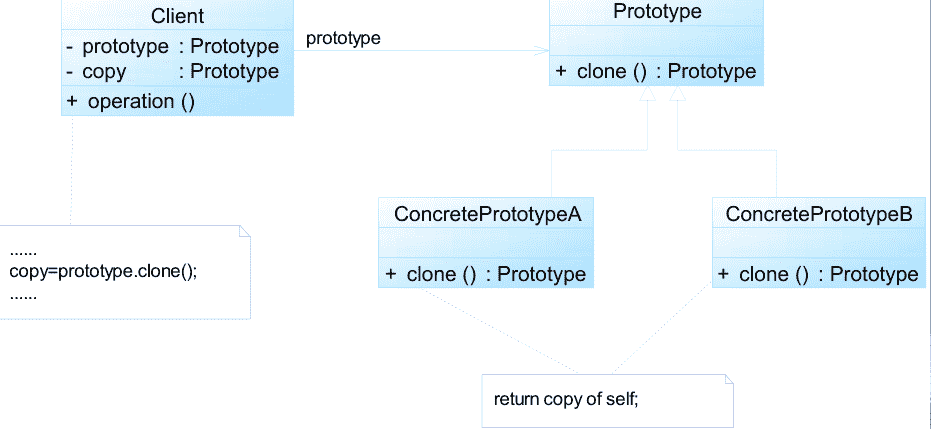

## 原型模式

### 模式结构

- Prototype：抽象原型类是定义具有克隆自己的方法的接口
- ConcretePrototype：具体原型类实现具体的克隆方法，在克隆方法中返回自己的一个克隆对象
- Client：在客户类中只需要直接实例化或通过工厂方法等方式创建一个对象，再通过调用该对象的克隆方法复制得到多个相同的对象


## 原型模式
### 模式分析

示例代码：

```
public class PrototypeDemo implements Cloneable
{
    .....
    public Object clone()
    {
        Object object = null;
        try {
            object = super.clone();
        } catch (CloneNotSupportedException exception) {
            System.err.println("Not support cloneable");
        }
        return object;
    }
    .....
}
```

## 原型模式
### 模式分析

- 通常情况下，一个类包含一些成员对象，在使用原型模式克隆对象时，根据其成员对象是否也克隆，原型模式可以分为两种形式：深克隆和浅克隆。
- 浅克隆复制对象的字段值：对于基本数据类型，则复制值；对于复合数据类型，仅复制该字段值，如数组变量则复制地址，对于对象变量则复制对象的reference
- 深克隆与浅克隆的区别在于对复合数据类型的复制。若对象中的某个字段为复合类型，在克隆对象的时候，需要为该字段重新创建一个对象。

## 原型模式
### 模式分析

+ 浅克隆与深克隆

浅克隆

深克隆

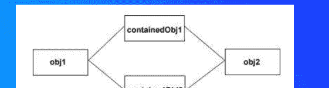

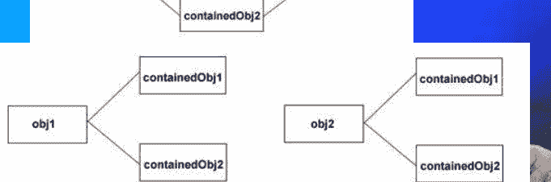

## 原型模式
### 模式分析

- Java语言提供的clone()方法将对象复制了一份并返回给调用者。一般而言，clone()方法满足：
  * (1) 对任何的对象x，都有x.clone() != x，即克隆对象与原对象不是同一个对象。
  * (2) 对任何的对象x，都有 x.clone().getClass() == x.getClass()，即克隆对象与原对象的类型一样。
  * (3) 如果对象x的equals()方法定义恰当，那么 x.clone().equals(x)应该成立。

## 原型模式
### 原型模式实例与解析

- 实例一：邮件复制（浅克隆）

由于邮件对象包含的内容较多（如发送者、接收者、标题、内容、日期、附件等），某系统中现需要提供一个邮件复制功能，对于已经创建好的邮件对象，可以通过复制的方式创建一个新的邮件对象，如果需要改变某部分内容，无须修改原始的邮件对象，只需要修改复制后得到的邮件对象即可。使用原型模式设计该系统。在本实例中使用浅克隆实现邮件复制，即复制邮件(Email)的同时不复制附件(Attachment)。

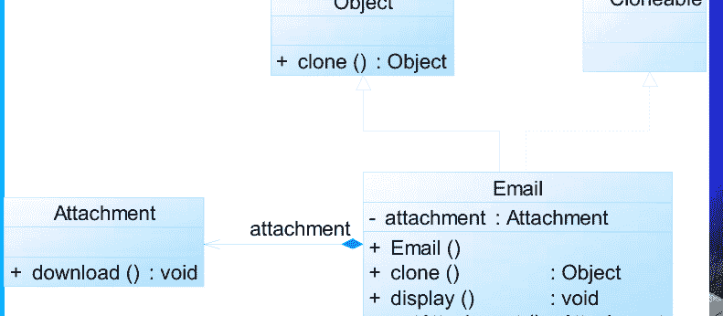

- 实例一：邮件复制（浅克隆）
- 参考代码 (sample01)

演示……

## 原型模式
### 原型模式实例与解析

- 实例二：邮件复制（深克隆）

使用深克隆实现邮件复制，即复制邮件的同时复制附件。

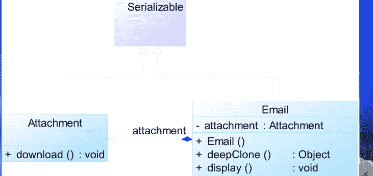

- 实例二：邮件复制（深克隆）
- 参考代码 (sample02)

演示......

## 原型模式
### 模式优点

- 当创建新的对象实例较为复杂时，使用原型模式可以简化对象的创建过程，通过一个已有实例可以提高新实例的创建效率。
- 扩展性较好，由于在原型模式中提供了抽象原型类，在客户端可以针对抽象原型类进行编程，而将具体原型类写在配置文件中，增加或减少产品类对原有系统都没有任何影响。

## 原型模式
### 模式缺点

- 需要为每一个类配备一个克隆方法，而且这个克隆方法需要对类的功能进行通盘考虑，这对全新的类来说不是很难，但对已有的类进行改造时，不一定是件容易的事，必须修改其源代码，违背了“开闭原则”。
- 在实现深克隆时需要编写较为复杂的代码，而且当对象之间存在多重的嵌套引用时，为了实现深克隆，每一层对象对应的类都必须支持深克隆，实现起来可能会比较麻烦。

## 原型模式
### 模式适用环境

- **创建新对象成本较大**，如创建对象的构造函数非常的复杂，在执行这个构造函数时会消耗较多的CPU或内存资源，同时，这个构造函数中的一些信息又没有什么变化，新的对象可以通过原型模式对已有对象进行复制来获得，如果是相似对象，则可以对其属性稍作修改。
- **如果系统要保存对象的状态**，而对象的状态变化很小，或者对象本身占内存不大的时候，也可以使用原型模式配合备忘录模式来应用。相反，如果对象的状态变化很大，或者对象占用的内存很大，那么采用状态模式会比原型模式更好。
- 需要避免创建一个与产品类层次平行的工厂类层次时，并且类的实例对象只能有几个不同状态组合中的一种时，建立相应数目的原型并克隆它们可能比每次用合适的状态手工实例化该类更方便一些。
- 比如在画图工具里，要画圆只需要拖动工具条的画圆工具到绘图区即可，而不需要从头开始一点一点的画一个圆，而且如果需要不同大小和颜色的圆，只需要复制几个圆，然后再修改他们的大小和颜色即可。

## 原型模式
### 模式应用

- (1) 原型模式应用于很多软件中，如果每次创建一个对象要花大量时间，原型模式是最好的解决方案。很多软件提供的复制(Ctrl + C)和粘贴(Ctrl + V)操作就是原型模式的应用，复制得到的的对象与原型对象是两个类型相同但内存地址不同的对象，通过原型模式可以大大提高对象的创建效率。
- (2) 在Struts2中为了保证线程的安全性，**Action对象的创建使用了原型模式**，访问一个已经存在的Action对象时将通过克隆的方式创建出一个新的对象，从而保证其中定义的变量无须进行加锁实现同步，每一个Action中都有自己的成员变量，避免Struts1因使用单例模式而导致的并发和同步问题。
- (3) 在Spring中，用户也可以采用**原型模式来创建新的bean实例**，从而实现每次获取的是通过克隆生成的新实例，对其进行修改时对原有实例对象不造成任何影响。

## 原型模式
### 模式扩展

- 带原型管理器的原型模式
  - 原型管理器(Prototype Manager)是将多个原型对象存储在一个集合中供客户端使用，它是一个专门负责克隆对象的工厂，其中定义了一个集合用于存储原型对象，如果需要某个原型对象的一个克隆，可以通过复制集合中对应的原型对象来获得。在原型管理器中针对抽象原型类进行编程，以便扩展。

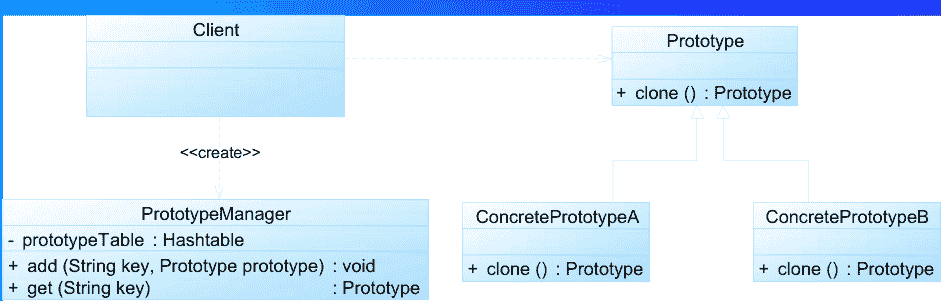

- 模式扩展
- 带原型管理器的原型模式
  - 参考代码 (原型管理器)

演示......

## 原型模式
### 模式扩展

- 相似对象的复制
  - 很多情况下，复制所得到的对象与原型对象并不是完全相同的，它们的某些属性值存在异同。通过原型模式获得相同对象后可以再对其属性进行修改，从而获取所需对象。如多个学生对象的信息的区别在于性别、姓名和年龄，而专业、学院、学校等信息都相同，为了简化创建过程，可以通过原型模式来实现相似对象的复制。

◆ 模式扩展
■ 相似对象的复制
• 参考代码(相似对象的复制)

演示......

### 小结

- 原型模式是一种对象创建型模式，用原型实例指定创建对象的种类，并且通过复制这些原型创建新的对象。原型模式允许一个对象再创建另外一个可定制的对象，无须知道任何创建的细节。原型模式的基本工作原理是通过将一个原型对象传给那个要发动创建的对象，这个要发动创建的对象通过请求原型对象拷贝原型自己来实现创建过程。
- 原型模式包含三个角色：抽象原型类是定义具有克隆自己的方法的接口；具体原型类实现具体的克隆方法，在克隆方法中返回自己的一个克隆对象；让一个原型克隆自身从而创建一个新的对象，在客户类中只需要直接实例化或通过工厂方法等方式创建一个对象，再通过调用该对象的克隆方法复制得到多个相同的对象。
- 在Java中可以直接使用Object提供的clone()方法来实现对象的克隆，能够实现克隆的Java类必须实现一个标识接口Cloneable，表示这个Java类支持复制。


### 小结

在浅克隆中，当对象被复制时它所包含的成员对象却没有被复制；在深克隆中，除了对象本身被复制外，对象包含的引用也被复制，也就是其中的成员对象也将复制。在Java语言中，通过覆盖Object类的clone()方法可以实现浅克隆；如果需要实现深克隆，可以通过序列化等方式来实现。

原型模式最大的优点在于可以快速创建很多相同或相似的对象，简化对象的创建过程，还可以保存对象的一些中间状态；其缺点在于需要为每一个类配备一个克隆方法，因此对已有类进行改造比较麻烦，需要修改其源代码，并且在实现深克隆时需要编写较为复杂的代码。

原型模式适用情况包括：创建新对象成本较大，新的对象可以通过原型模式对已有对象进行复制来获得；系统要保存对象的状态，而对象的状态变化很小；需要避免使用分层次的工厂类来创建分层次的对象，并且类的实例对象只有一个或很少的几个组合状态，通过复制原型对象得到新实例可能比使用构造函数创建一个新实例更加方便。

## 单例模式

+ ◆ 单例模式
+ ■ 模式动机与定义
+ ■ 模式结构与分析
+ ■ 模式实例与解析
+ ■ 模式效果与应用
+ ■ 模式扩展

## 单例模式

### 模式动机

+ 对于系统中的某些类来说，只有一个实例很重要，例如，一个系统只有一个文件系统、一个任务管理器。

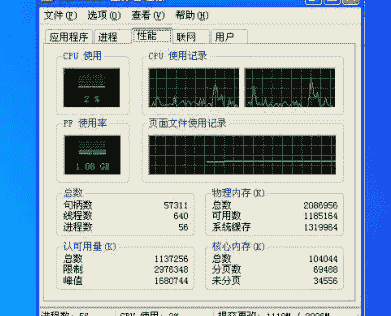

## 单例模式

### 模式动机

+ - 如何保证一个类只有一个实例并且这个实例易于被访问呢？定义一个全局变量可以确保对象随时都可以被访问，但不能防止我们实例化多个对象。
+ - 一个更好的解决办法是让类自身负责保存它的唯一实例。这个类可以保证没有其他实例被创建，并且它可以提供一个访问该实例的方法。这就是单例模式的模式动机。

## 单例模式

### 模式定义

+ - 单例模式(Singleton Pattern)：单例模式确保某一个类只有一个实例，而且自行实例化并向整个系统提供这个实例，这个类称为单例类，它提供全局访问的方法。
+ - 单例模式有三个要点：一是某个类只能有一个实例；二是它必须自行创建这个实例；三是它必须自行向整个系统提供这个实例。单例模式是一种对象创建型模式。单例模式又名单件模式或单态模式。

## 单例模式

```
Singleton
- instance : Singleton
- Singleton ()
+ getInstance () : Singleton
```

```
if(instance==null)
instance=new Singleton();
return instance;
```

## 单例模式

+ ◆ 模式结构
+ ■ 单例模式包含如下角色:
+ ✽ Singleton: 单例

## 单例模式

### 模式分析

▪ 单例模式的目的是保证一个类仅有一个实例，并提供一个访问它的全局访问点。单例模式包含的角色只有一个，就是单例类Singleton。**单例类拥有一个私有构造函数，确保用户无法通过new关键字直接实例化它。**除此之外，该模式中包含一个静态私有成员变量与静态公有的工厂方法，该**工厂方法负责检验实例的存在性并实例化自己，然后存储在静态成员变量中，以确保只有一个实例被创建。**


## 单例模式

### 模式分析

单例模式的实现代码如下所示：

```
public class Singleton
{
    private static Singleton instance=null; //静态私有成员变量
    //私有构造函数
    private Singleton() { }

    //静态公有工厂方法，返回唯一实例
    public static Singleton getInstance()
    {
        if(instance==null)
            instance=new Singleton();
        return instance;
    }
}
```

## 单例模式

### 模式分析

在单例模式的实现过程中，需要注意如下三点：

+ - 单例类的构造函数为私有；
+ - 提供一个自身的静态私有成员变量；
+ - 提供一个公有的静态工厂方法。


## 单例模式

### ◆ 单例模式实例与解析

+ - **实例一：身份证号码**
+ - 在现实生活中，居民身份证号码具有唯一性，同一个人不允许有多个身份证号码，第一次申请身份证时将给居民分配一个身份证号码，如果之后因为遗失等原因补办时，还是使用原来的身份证号码，不会产生新的号码。现使用单例模式模拟该场景。


## 单例模式

### ◆ 单例模式实例与解析

+ - 实例一：身份证号码

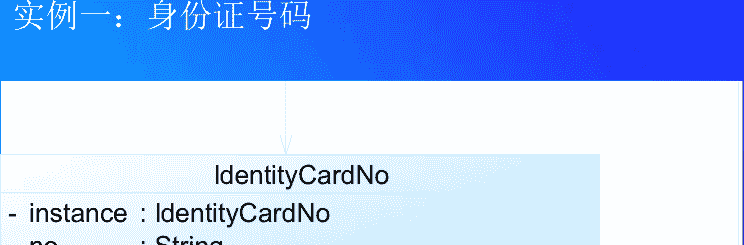

## 单例模式

+ 单例模式实例与解析
+ 实例一： 身份证号码
+ 参考代码 (sample01)

演示......

## 单例模式

+ 单例模式实例与解析

+ 实例二：打印池

在操作系统中，打印池(Print Spooler)是一个用于管理打印任务的应用程序，通过打印池用户可以删除、中止或者改变打印任务的优先级，在一个系统中只允许运行一个打印池对象，如果重复创建打印池则抛出异常。现使用单例模式来模拟实现打印池的设计。

## 单例模式

+ 单例模式实例与解析
+ 实例二：打印池

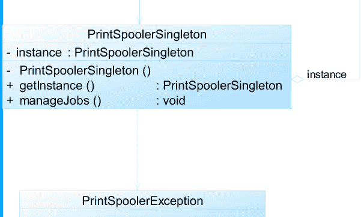

## 单例模式

+ 单例模式实例与解析
+ 实例二：打印池
+ 参考代码 (sample02)

演示......

## 单例模式

模式优点

+ - 提供了对唯一实例的受控访问。因为单例类封装了它的唯一实例，所以它可以严格控制客户怎样以及何时访问它，并为设计及开发团队提供了共享的机制。
+ - 由于在系统内存中只存在一个对象，因此可以节约系统资源，对于一些需要频繁创建和销毁的对象，单例模式无疑可以提高系统的性能。
+ - 允许可变数目的实例。我们可以基于单例模式进行扩展，使用与单例控制相似的方法来获得指定个数的对象实例。

## 单例模式

### ◆ 模式缺点

+ - 由于单例模式中没有抽象层，因此**单例类的扩展有很大的困难**。
+ - **单例类的职责过重**，在一定程度上违背了“单一职责原则”。因为单例类既充当了工厂角色，提供了工厂方法，同时又充当了产品角色，包含一些业务方法，将产品的创建和产品的本身的功能融合到一起。
+ - **滥用单例将带来一些负面问题**，因为为了节省资源将数据库连接池对象设计为单例类，可能会导致共享连接池对象的程序过多而出现连接池泄漏。


## 单例模式

### 模式适用环境

在以下情况下可以使用单例模式：

+ - 系统只需要一个实例对象，如系统要求提供一个唯一的序列号生成器，或者需要考虑资源消耗太大而只允许创建一个对象。
+ - 客户调用类的单个实例只允许使用一个公共访问点，除了该公共访问点，不能通过其他途径访问该实例。
+ - 在一个系统中要求一个类只有一个实例时才应当使用单例模式。反过来，如果一个类可以有几个实例共存，就需要对单例模式进行改进，使之成为多例模式。

## 单例模式

### 模式应用

+ - (1) java.lang.Runtime类

```
public class Runtime {
  private static Runtime currentRuntime = new Runtime();
  public static Runtime getRuntime() {
    return currentRuntime;
  }
  private Runtime() {}
  .....
}
```

## 单例模式

### 模式应用

+ - (2) 一个具有自动编号主键的表可以有多个用户同时使用，但数据库中只能有一个地方分配下一个主键编号，否则会出现主键重复，因此该主键编号生成器必须具备唯一性，可以通过单例模式来实现。

## 单例模式

模式应用

(3) 默认情况下Spring会通过单例模式创建bean实例：

```
<bean id="date" class="java.util.Date" scope="singleton"/>
```


## 单例模式

模式扩展

+   - 饿汉式单例类

```
EagerSingleton
- instance : EagerSingleton = new EagerSingleton()
- EagerSingleton ()
+ getInstance () : EagerSingleton
```
creates

## 单例模式

+   模式扩展
+   懒汉式单例类

```
LazySingleton
- instance : LazySingleton = null
- LazySingleton ()
+ getInstance () : LazySingleton
```

instance

creates

if(instance==null)
    instance=new LazySingleton();
return instance;

## 单例模式

#### 饿汉式单例与懒汉式单例类比较

+   - 饿汉式单例类在自己被加载时就将自己实例化。单从资源利用效率角度来讲，这个比懒汉式单例类稍差些。从速度和反应时间角度来讲，则比懒汉式单例类稍好些。
+   - 懒汉式单例类在实例化时，必须处理好在多个线程同时首次引用此类时的访问限制问题，特别是当单例类作为资源控制器，在实例化时必然涉及资源初始化，而资源初始化很有可能耗费大量时间，这意味着出现多线程同时首次引用此类的机率变得较大，需要通过同步化机制进行控制。
+   - public static synchronized Singleton get Instance()

### 小结

+   - 单例模式确保某一个类只有一个实例，而且自行实例化并向整个系统提供这个实例，这个类称为单例类，它提供全局访问的方法。单例模式的要点有三个：一是某个类只能有一个实例；二是它必须自行创建这个实例；三是它必须自行向整个系统提供这个实例。单例模式是一种对象创建型模式。
+   - 单例模式只包含一个单例角色：在单例类的内部实现只生成一个实例，同时它提供一个静态的工厂方法，让客户可以使用它的唯一实例；为了防止在外部对其实例化，将其构造函数设计为私有。

### 小结

+   单例模式的目的是保证一个类仅有一个实例，并提供一个访问它的全局访问点。单例类拥有一个私有构造函数，确保用户无法通过new关键字直接实例化它。除此之外，该模式中包含一个静态私有成员变量与静态公有的工厂方法。该工厂方法负责检验实例的存在性并实例化自己，然后存储在静态成员变量中，以确保只有一个实例被创建。

+   单例模式的主要优点在于提供了对唯一实例的受控访问并可以节约系统资源；其主要缺点在于因为缺少抽象层而难以扩展，且单例类职责过重。

+   单例模式适用情况包括：系统只需要一个实例对象；客户调用类的单个实例只允许使用一个公共访问点。

## 结构型模式

+   - 结构型模式
+     - 结构型模式概述
+     - 结构型模式简介
+   - 适配器模式
+     - 模式动机与定义
+     - 模式结构与分析
+     - 模式实例与解析
+     - 模式效果与应用
+     - 模式扩展

## 结构型模式

### 结构型模式概述

结构型模式(Structural Pattern)描述如何将类或者对象结合在一起形成更大的结构，就像搭积木，可以通过简单积木的组合形成复杂的、功能更为强大的结构。


## 结构型模式

### 结构型模式概述

+   - 结构型模式可以分为类结构型模式和对象结构型模式：
+     - 类结构型模式关心类的组合，由多个类可以组合成一个更大的系统，在类结构型模式中一般只存在继承关系和实现关系。
+     - 对象结构型模式关心类与对象的组合，通过关联关系使得在一个类中定义另一个类的实例对象，然后通过该对象调用其方法。根据“合成复用原则”，在系统中尽量使用关联关系来替代继承关系，因此大部分结构型模式都是对象结构型模式。

## 结构型模式

### 结构型模式简介

+   - 适配器模式(Adapter)
+   - 桥接模式(Bridge)
+   - 组合模式(Composite)
+   - 装饰模式(Decorator)
+   - 外观模式(Facade)
+   - 享元模式(Flyweight)
+   - 代理模式(Proxy)

## 适配器模式

模式动机

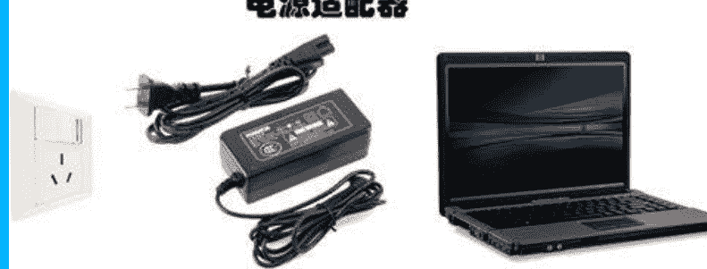

## 适配器模式

### 模式动机

+   - 在软件开发中采用类似于电源适配器的设计和编码技巧被称为适配器模式。
+   - 通常情况下，客户端可以通过目标类的接口访问它所提供的服务。有时，现有的类可以满足客户类的功能需要，但是它所提供的接口不一定是客户类所期望的，这可能是因为现有类中方法名与目标类中定义的方法名不一致等原因所导致的。
+   - 在这种情况下，现有的接口需要转化为客户类期望的接口，这样保证了对现有类的重用。如果不进行这样的转化，客户类就不能利用现有类所提供的功能。适配器模式可以完成这样的转化。


## 适配器模式

### 模式动机

+   在适配器模式中可以定义一个包装类，包装不兼容接口的对象，这个包装类指的就是适配器(Adapter)，它所包装的对象就是适配者(Adaptee)，即被适配的类。

+   适配器提供客户类需要的接口，适配器的实现就是把客户类的请求转化为对适配者的相应接口的调用。也就是说：当客户类调用适配器的方法时，在适配器类的内部将调用适配者类的方法，而这个过程对客户类是透明的，客户类并不直接访问适配者类。因此，适配器可以使由于接口不兼容而不能交互的类可以一起工作。这就是适配器模式的模式动机。

## 适配器模式

### 模式定义

+   适配器模式(Adapter Pattern)：将一个接口转换成客户希望的另一个接口，适配器模式使接口不兼容的那些类可以一起工作，其别名为包装器(Wrapper)。适配器模式既可以作为类结构型模式，也可以作为对象结构型模式。

## 适配器模式

# ◇ 模式结构

#### ▪ 类适配器

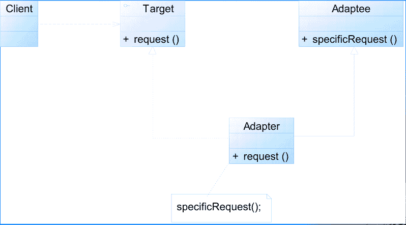

## 适配器模式

+   - 模式结构
+   - 对象适配器

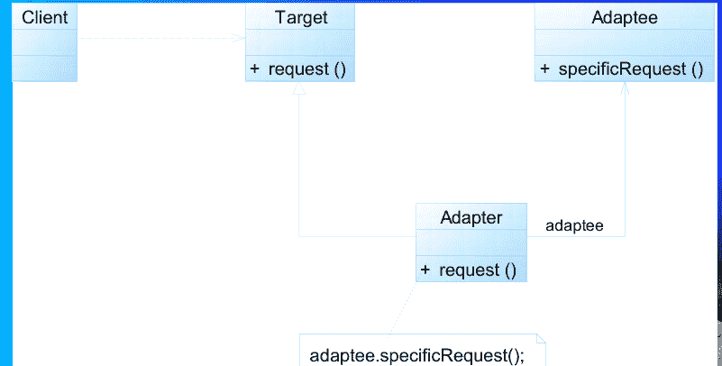

## 适配器模式

### 模式结构

+   - Target：目标抽象类定义客户所需接口，可以是一个抽象类或接口，也可以是具体类

+   - Adapter：适配器类可以调用另一个接口，作为一个转换器，对Adaptee和Target进行适配，适配器类是适配器模式的核心，在对象适配器中，它通过继承Target并关联一个Adaptee对象使二者产生联系

+   - Adaptee：适配者类即被适配的角色，它定义了一个已经存在的接口，这个接口需要适配，适配者类一般是一个具体类，包含了客户希望使用的业务方法，在某些情况下可能没有适配者类的源代码

+   - Client：客户类

## 适配器模式

### 模式分析

典型的对象适配器代码：

```
public class Adapter extends Target
{
    private Adaptee adaptee;
    public Adapter(Adaptee adaptee)
    {
        this.adaptee=adaptee;
    }
    public void request()
    {
        adaptee.specificRequest();
    }
}
```

## 适配器模式

+   - 实例一：仿生机器人

现需要设计一个可以模拟各种动物行为的机器人，在机器人中定义一系列方法，如机器人叫喊方法cry()、机器人移动方法move()等。如果希望在不修改已有代码的基础上使得机器人能够像狗一样叫，像狗一样样跑，使用适配器模式进行系统设计。

## 适配器模式

### ◆ 适配器模式实例与解析

#### ▪ 实例一：仿生机器人

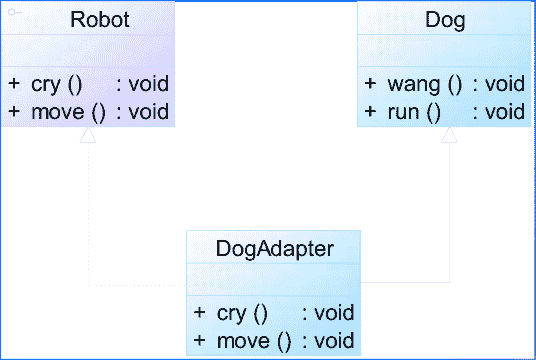

## 适配器模式

+   ◆ 适配器模式实例与解析
+     ■ 实例一：仿生机器人
+       • 参考代码 (sample01)

演示......

## 适配器模式

### 适配器模式实例与解析

+   实例二： 加密适配器

某系统需要提供一个加密模块，将用户信息（如密码等机密信息）加密之后再存储在数据库中，系统已经定义好了数据库操作类。为了提高开发效率，现需要重用已有的加密算法，这些算法封装在一些由第三方提供的类中，有些甚至没有源代码。使用适配器模式设计该加密模块，实现在不修改现有类的基础上重用第三方加密方法。


## 适配器模式

### 适配器模式实例与解析
- 实例二：加密适配器
  - 参考代码 (sample02)

演示......


#### 模式优缺点
适配器模式的优点
- 将目标类和适配者类解耦，通过引入一个适配器类来重用现有的适配者类，而无须修改原有代码。
- 增加了类的透明性和复用性，将具体的实现封装在适配者类中，对于客户端类来说是透明的，而且提高了适配者的复用性。
- 灵活性和扩展性都非常好，通过使用配置文件，可以很方便地更换适配器，也可以在不修改原有代码的基础上增加新的适配器类，完全符合“开闭原则”。

- 类适配器模式还具有如下优点：由于适配器类是适配者类的子类，因此可以在适配器类中置换一些适配者的方法，使得适配器的灵活性更强。
- 类适配器模式的缺点如下：对于Java、C#等不支持多重继承的语言，一次最多只能适配一个适配者类，而且目标抽象类只能为抽象类，不能为具体类，其使用有一定的局限性，不能将一个适配者类和它的子类都适配到目标接口。
- 对象适配器模式还具有如下优点：一个对象适配器可以把多个不同的适配者适配到同一个目标，也就是说，同一个适配器可以把适配者类和它的子类都适配到目标接口。
- 对象适配器模式的缺点如下：与类适配器模式相比，要想置换适配者类的方法就不容易。如果一定要置换掉适配者类的一个或多个方法，就只好先做一个适配者类的子类，将适配者类的方法置换掉，然后再把适配者类的子类当做真正的适配者进行适配，实现过程较为复杂。

### 模式适用环境
在以下情况下可以使用适配器模式：
- 系统需要使用现有的类，而这些类的接口不符合系统的需要。
- 想要建立一个可以重复使用的类(适配器类)，用于与一些彼此之间没有太大关联的一些类(目标类和适配者类)，包括一些可能在将来引进的类(适配者类的子类)一起工作。

### 模式应用
- (1) Sun公司在1996年公开了Java语言的数据库连接工具JDBC，JDBC使得Java语言程序能够与数据库连接，并使用SQL语言来查询和操作数据。JDBC给出一个客户端通用的抽象接口，每一个具体数据库引擎（如SQL Server、Oracle、MySQL等）的JDBC驱动软件都是一个介于JDBC接口和数据库引擎接口之间的适配器软件。抽象的JDBC接口和各个数据库引擎API之间都需要相应的适配器软件，这就是为各个不同数据库引擎准备的驱动程序。
- (2) 在JDK类库中也定义了一系列适配器类，如在 com.sun.imageio.plugins.common 包中定义的 InputStreamAdapter类，用于包装 ImageInputStream接口及其子类对象。

```java
public class InputStreamAdapter extends InputStream {
    ImageInputStream stream;
    public InputStreamAdapter(ImageInputStream stream) {
        super();
        this.stream = stream;
    }
    public int read() throws IOException {
        return stream.read();
    }
    public int read(byte b[], int off, int len) throws IOException {
        return stream.read(b, off, len);
    }
}
```

### 模式扩展
- 默认适配器模式(Default Adapter Pattern)或缺省适配器模式
  - 当不需要全部实现接口提供的方法时，可先设计一个抽象类实现接口，并为该接口中每个方法提供一个默认实现（空方法），那么该抽象类的子类可有选择地覆盖父类的某些方法来实现需求，它适用于一个接口不想使用其所有的方法的情况。因此也称为单接口适配器模式。
- 默认适配器模式
  - 适配者接口
  - 默认适配器类
  - 具体业务类

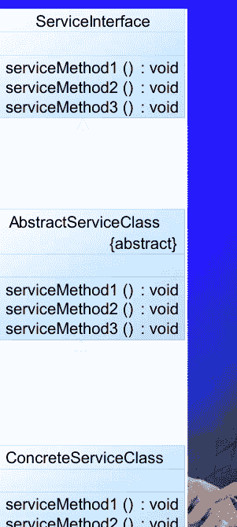

- 适配者接口是一个接口，通常在该接口中声明了大量的方法。
- 默认适配器类是缺省适配器模式的核心类，使用空方法的形式实现了在ServiceInterface接口中声明的方法。通常将它定义为抽象类，因为对它进行实例化没有任何意义。
- 具体业务类是缺省适配器类的子类，在没有引入适配器之前，它需要实现适配者接口，因此需要实现在适配者接口中定义的所有方法，而对于一些无须使用的方法也不得不提供空实现。在有了缺省适配器之后，可以直接继承该适配器类，根据需要有选择性地覆盖在适配器类中定义的方法。

- 在JDK类库的事件处理包java.awt.event中广泛使用了缺省适配器模式，如WindowAdapter、KeyAdapter、MouseAdapter等。我们以处理窗口事件为例进行说明：
- 在Java语言中，一般我们可以使用两种方式来实现窗口事件处理类，一种是通过实现WindowListener接口，另一种是通过继承WindowAdapter适配器类。
- 如果是使用第一种方式，直接实现WindowListener接口，事件处理类需要实现在该接口中定义的七个方法，而对于大部分需求可能只需要实现一两个方法，但由于语言特性我们不得不为其他方法也提供一个简单的实现（通常是空实现），这给使用带来了麻烦。

这时使用缺省适配器模式就可以很好地解决这一问题，在JDK中提供了一个适配器类 WindowAdapter来实现WindowListener接口，该适配器类为接口中的每一个方法都提供了一个空实现，此时事件处理类可以继承WindowAdapter类，而无须再为接口中的每个方法都提供实现。

- 默认适配器模式

**WindowListener**
- windowOpened(WindowEvent e): void
- windowClosing(WindowEvent e): void
- windowClosed(WindowEvent e): void
- windowIconified(WindowEvent e): void
- windowDeiconified(WindowEvent e): void
- windowActivated(WindowEvent e): void
- windowDeactivated(WindowEvent e): void

**WindowAdapter (abstract)**
- windowOpened(WindowEvent e): void
- windowClosing(WindowEvent e): void
- windowClosed(WindowEvent e): void
- windowIconified(WindowEvent e): void
- windowDeiconified(WindowEvent e): void
- windowActivated(WindowEvent e): void
- windowDeactivated(WindowEvent e): void
- windowStateChanged(WindowEvent e): void
- windowGainedFocus(WindowEvent e): void
- windowLostFocus(WindowEvent e): void

- 双向适配器：在对象适配器的使用过程中，如果在适配器中同时包含对目标类和适配者类的引用，适配者可以通过它调用目标类中的方法，目标类也可以通过它调用适配者类中的方法，那么该适配器就是一个双向适配器。

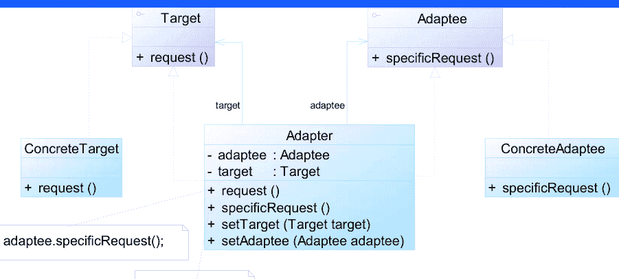

### 小结
- 结构型模式描述如何将类或者对象结合在一起形成更大的结构。
- 适配器模式用于将一个接口转换成客户希望的另一个接口，适配器模式使接口不兼容的那些类可以一起工作，其别名为包装器。适配器模式既可以作为类结构型模式，也可以作为对象结构型模式。
- 适配器模式包含四个角色：目标抽象类定义客户要用的特定领域的接口；适配器类可以调用另一个接口，作为一个转换器，对适配者和抽象目标类进行适配，它是适配器模式的核心；适配者类是被适配的角色，它定义了一个已经存在的接口，这个接口需要适配；在客户类中针对目标抽象类进行编程，调用在目标抽象类中定义的业务方法。
- 在类适配器模式中，适配器类实现了目标抽象类接口并继承了适配者类，并在目标抽象类的实现方法中调用所继承的适配者类的方法；在对象适配器模式中，适配器类继承了目标抽象类并定义了一个适配者类的对象实例，在所继承的目标抽象类方法中调用适配者类的相应业务方法。


### 小结

- 适配器模式的主要优点是能够将目标类和适配者类解耦，增加了类的透明性和复用性，同时系统的灵活性和扩展性都非常好，更换适配器或者增加新的适配器都非常方便，符合“开闭原则”；类适配器模式的缺点是适配器类在很多编程语言中不能同时适配多个适配者类，对象适配器模式的缺点是很难以置换适配者类的方法。
- 适配器模式适用情况包括：系统需要使用现有的类，而这些类的接口不符合系统的需要；想要建立一个可以重复使用的类，用于与一些彼此之间没有太大关联的类一起工作。

## 桥接模式

- 模式动机与定义
- 模式结构与分析
- 模式实例与解析
- 模式效果与应用
- 模式扩展

### 模式动机与定义

### 模式动机

- 考虑两种常见文具：毛笔和蜡笔的区别。
- 假如我们需要大、中、小3种型号的画笔，能够绘制12种不同的颜色，如果使用蜡笔，需要准备3×12=36支；但如果使用毛笔的话，只需要提供3种型号的毛笔，外加12个颜料盒即可，涉及到的对象个数仅为3+12=15，远小于36，却能实现与36支蜡笔同等的功能。如果增加一种新型号的画笔，并且也需要具有12种颜色，对应的蜡笔需增加12支，而毛笔只需增加一支。
- 为什么会这样呢？

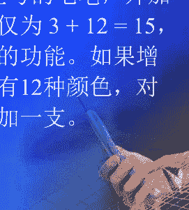

- 通过分析我们可以得知：
  - 在蜡笔中，颜色和型号两个不同的变化维度（即两个不同的变化原因）融合在一起，无论是对颜色进行扩展还是对型号进行扩展都势必会影响另一个维度；
  - 在毛笔中，颜色和型号实现了分离，增加新的颜色或者型号对另一方都没有任何影响。

- 如果使用软件工程中的术语，我们可以认为在蜡笔中颜色和型号之间存在较强的耦合性，而毛笔很好地将二者解耦，使用起来非常灵活，扩展也更为方便。

- 在软件开发中，我们也提供了一种设计模式来处理与画笔类似的具有多变化维度的情况，即将要介绍的桥接模式。


假设要开发一个软件，绘制矩形、圆形、椭圆、正方形，我们至少需要4个形状类，同时如果绘制的图形还需要填充不同的颜色，如白色、灰色、黑色等，此时至少有如下两种设计方案：

- 第一种设计方案是为每一种形状都提供一套各种颜色的版本。
- 第二种设计方案是根据实际需要对形状和颜色进行组合。

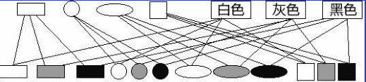

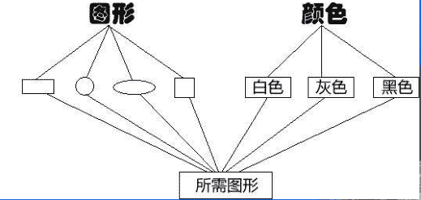

- 方案一采用多重继承或多层继承，导致系统中类的个数急剧增加，需要提供12个具体类，加上各级抽象层的类，系统中类的总数要达到17到21个。
- 方案一扩展麻烦，无论是增加新的图形还是新的颜色，都需要增加大量的具体类，导致系统变得非常庞大，增大运行和维护开销。究其原因，是将图形的形状和颜色两种职责集中在一个具体类中，违反了“单一职责原则”，任意一个职责发生改变都需要一个新类。
- 方案二采用关联关系解耦，类个数更少，扩展更方便。

### 模式定义

- 桥接模式（Bridge Pattern）：将抽象部分与它的实现部分分离，使它们都可以独立变化。它是一种对象结构型模式，又称为柄体（Handle and Body）模式或接口（Interface）模式。
- 如果软件系统中某个类存在两个独立变化的维度，通过桥接模式可以将这两个维度分离出来，使两者可以独立扩展，让系统更加符合“单一职责原则”。

与多重/多层继承方案不同，桥接模式将两个独立变化的维度设计为两个独立的继承等级结构，并且在抽象层建立一个抽象关联，该关联关系类似于一条连接两个独立继承结构的桥，故名桥接模式。

桥接模式用抽象关联取代了传统的多重/多层继承，将类之间的静态继承关系转换为动态的对象组合关系，使得系统更加灵活，并易于扩展，同时有效控制了系统中类的个数。

### 模式结构与分析

### 模式结构

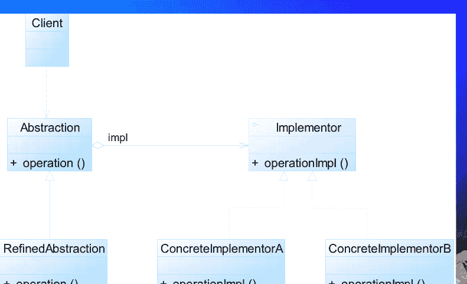

桥接模式包含如下角色：

- Abstraction：抽象类，用于定义抽象类的接口，一般是抽象类而不是接口，其中定义了一个Implementor（实现类接口）类型对象并可以维护该对象，它与Implementor之间具有关联关系，它既可以包含抽象业务方法，也可以包含具体业务方法。
- RefinedAbstraction：扩充抽象类，扩充由Abstraction定义的接口，通常情况下它不再是抽象类而是具体类，它实现了在Abstraction中声明的抽象业务方法，也可以调用在Implementor中定义的业务方法。
- Implementor：实现类接口，定义实现类的接口，这个接口不一定要与Abstraction的接口完全一致，事实上这两个接口可以完全不同，一般而言，Implementor接口仅提供基本操作，对这些基本操作进行了声明，而具体实现交给其子类。通过关联关系，Abstraction中不仅拥有自己的方法，还可以调用到Implementor中定义的方法，使用关联关系来替代继承关系。
- ConcreteImplementor：具体实现类，具体实现Implementor接口，在不同的具体实现类中提供基本操作的不同实现，在程序运行时，具体实现类对象将替换其父类对象，提供给抽象类具体的业务操作方法。

### 模式分析

典型的实现类接口代码：

```java
public interface Implementor
{
    public void operationImpl();
}
```

典型的抽象类代码：

```java
public abstract class Abstraction
{
    protected Implementor impl; //定义实现类接口对象
    public void setImpl(Implementor impl)
    {
        this.impl=impl;
    }
    public abstract void operation(); //声明抽象业务方法
}
```

典型的扩展抽象类代码：

```java
public class RefinedAbstraction extends Abstraction
{
    public void operation()
    {
        //业务代码
        impl.operationImpl();  //调用实现类的方法
        //业务代码
    }
}
```

- 在使用桥接模式时，我们首先应该识别出一个类所具有的两个独立变化的维度，将它们设计为两个独立的继承等级结构，为两个维度都提供抽象层，并建立抽象耦合。
- 通常情况下，我们将具有两个独立变化维度的类的一些普通业务方法和与之关系最密切的维度设计为“抽象类”层次结构（抽象部分），而将另一个维度设计为“实现类”层次结构（实现部分）。

例如：对于毛笔而言，由于型号是其固有的维度，因此可以设计一个抽象的毛笔类，在该类中声明并部分实现毛笔的业务方法，而将各种型号的毛笔作为其子类；颜色是毛笔的另一个维度，由于它与毛笔之间存在一种“设置”的关系，因此我们可以提供一个抽象的颜色接口，而将具体的颜色作为实现该接口的子类。在此，型号可认为是毛笔的抽象部分，而颜色是毛笔的实现部分，见实例一结构示意图。

### 模式实例与解析

#### 实例一：模拟毛笔

现需要提供大、中、小3种型号的画笔，能够绘制5种不同颜色，如果使用蜡笔，我们需要准备3×5=15支蜡笔，也就是说必须准备15个具体的蜡笔类。而如果使用毛笔的话，只需要3种型号的毛笔，外加5个颜料盒，用3+5=8个类就可以实现15支蜡笔的功能。本实例使用桥接模式来模拟毛笔的使用过程。

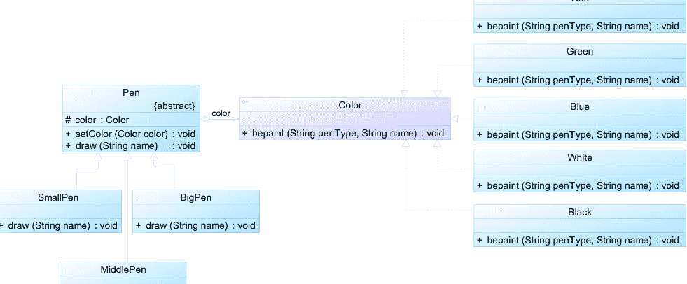

参考代码（sample01）

演示……

## 桥接模式

## 桥接模式实例与解析

#### 实例二：跨平台视频播放器

如果需要开发一个跨平台视频播放器，可以在不同操作系统平台（如Windows、Linux、Unix等）上播放多种格式的视频文件，常见的视频格式包括 MPEG、RMVB、AVI、WMV等。现使用桥接模式设计该播放器。

## 桥接模式实例与解析

#### 实例二：跨平台视频播放器

MPEGFile
decode (String osType, String fileName) : void

RMVBFile
decode (String osType, String fileName) : void

OperatingSystemVersion
vf : VideoFile
setVideoFile (VideoFile vf) : void
play (String fileName) : void

VideoFile
decode (String osType, String fileName) : void

AVFile
decode (String osType, String fileName) : void

WMVFile
decode (String osType, String fileName) : void

WindowsVersion
play (String fileName) : void

UnixVersion
play (String fileName) : void

LinuxVersion
play (String fileName) : void

Abstract Method

### 模式优点

- 分离抽象接口及其实现部分。桥接模式使用“对象间的关联关系”解耦了抽象和实现之间固有的绑定关系，使得抽象和实现可以沿着各自的维度来变化。所谓抽象和实现沿着各自维度的变化，也就是说抽象和实现不再在同一个继承层次结构中，而是各自都具有自己的子类，以便任何组合子类，从而获得多维度组合对象。

### ◆ 模式优点

- 在很多情况下，桥接模式可以取代多重/多层继承方案，多重/多层继承方案违背了“单一职责原则”，复用性较差，且类的个数非常多，桥接模式是比继承方案更好的解决方法，它极大减少了子类的个数。
- 桥接模式提高了系统的可扩展性，在两个变化维度中任意扩展一个维度，都不需要修改原有系统，符合“开闭原则”。


### 模式缺点

- 桥接模式的使用会增加系统的理解与设计难度，由于关联关系建立在抽象层，要求开发者一开始就针对抽象层进行设计与编程。
- 桥接模式要求正确识别出系统中两个独立变化的维度，因此其使用范围具有一定的局限性，如何正确识别两个独立维度也需要一定的经验积累。

### ◆ 模式适用环境

- 在以下情况下可以使用桥接模式：
  - 如果一个系统需要在抽象化和具体化之间增加更多的灵活性，避免在两个层次之间建立静态的继承关系，通过桥接模式可以使它们在抽象层建立一个关联关系。
  - “抽象部分”和“实现部分”可以以继承的方式独立扩展而且不影响，在程序运行时可以动态将一个抽象化子类的对象和一个实现化子类的对象进行组合，即系统需要对抽象化角色和实现化角色进行动态耦合。

### 模式适用环境

- 在以下情况下可以使用桥接模式：
  - 一个类存在两个（或多个）独立变化的维度，且这两个（或多个）维度都需要独立进行扩展。
  - 对于那些不希望使用继承或因为多重/多层继承导致系统类的个数急剧增加的系统，桥接模式尤为适用。

### 模式应用

- (1) Java语言通过Java虚拟机实现了平台的无关性。

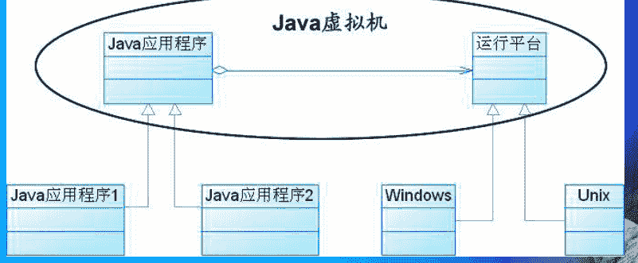

### 模式应用

- (2) 一个Java桌面软件总是带有所在操作系统的视觉感(LookAndFeel)，如果一个Java软件是在Unix系统上开发的，那么开发人员看到的是Motif用户界面的视觉；在Windows上面使用这个系统的用户看到的是Windows用户界面的视觉；在Macintosh上面使用这个系统的用户看到的则是Macintosh用户界面的视觉，Java语言是通过所谓的Peer架构做到这一点的。Java为AWT中的每一个GUI构件都提供了一个Peer构件，在AWT中的Peer架构就使用了桥接模式。

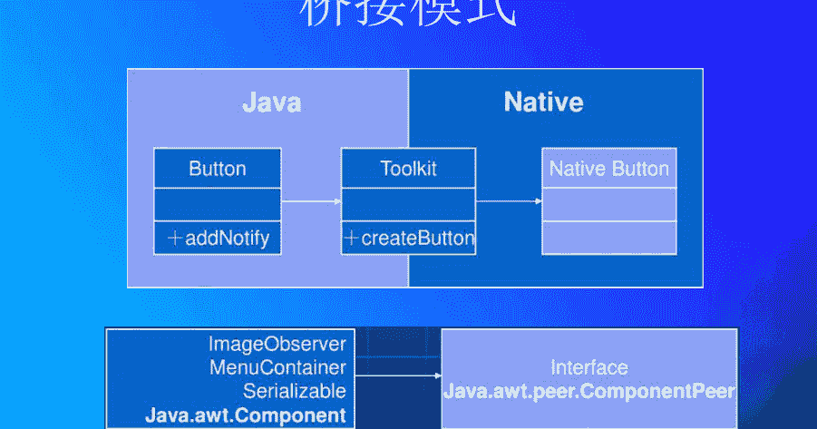

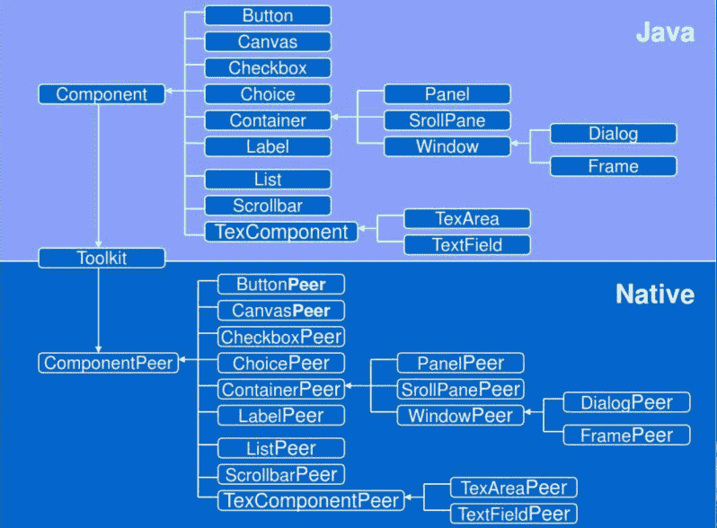

### 模式扩展

- 适配器模式与桥接模式的联用

在软件开发中，适配器模式通常可以与桥接模式联合使用。适配器模式可以解决两个已有接口间不兼容问题，在这种情况下被适配的类往往是一个黑盒子，有时候我们不想也不能改变这个被适配的类，也不能控制其扩展。适配器模式通常用于现有系统与第三方产品功能的集成，采用增加适配器的方式将第三方类集成到系统中。桥接模式则不同，用户可以通过接口继承或类继承的方式来对系统进行扩展。

- 适配器模式与桥接模式的联用

桥接模式和适配器模式用于设计的不同阶段，桥接模式用于系统的初步设计，对于存在两个独立变化维度的类可以将其分为抽象化和实现化两个角色，使它们可以分别进行变化；而在初步设计完成之后，当发现系统与已有类无法协同工作时，可以采用适配器模式。但有时候在设计初期也需要考虑适配器模式，特别是那些涉及到大量第三方应用接口的情况。

### 模式扩展

- 适配器模式与桥接模式的联用

在某系统的报表处理模块中，需要将报表显示和数据采集分开，系统可以有多种报表显示方式也可以有多种数据采集方式，如可以从文本文件中读取数据，也可以从数据库中读取数据，还可以从Excel文件中获取数据。如果需要从Excel文件中获取数据，则需要调用与Excel相关的API，而这个API是现有系统所不具备的，该API由厂商提供。使用适配器模式和桥接模式设计该模块。

### 模式扩展

- 适配器模式与桥接模式的联用

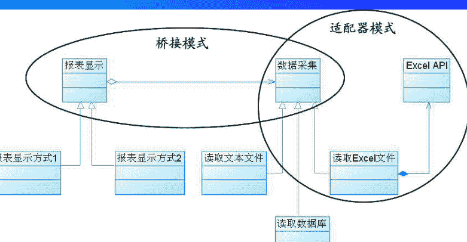

### 小结

- 桥接模式将抽象部分与它的实现部分分离，使它们都可以以独立地变化。它是一种对象结构型模式，又称为柄体(Handle and Body)模式或接口(Interface)模式。

- 桥接模式包含如下四个角色：抽象类中定义了一个实现类接口类型的对象并可以维护该对象；扩充抽象类扩充由抽象类定义的接口，它实现了在抽象类中定义的抽象业务方法，在扩充抽象类中可以调用在实现类接口中定义的业务方法；实现类接口定义了实现类的接口，实现类接口仅提供基本操作，而抽象类定义的接口可能会做更多更复杂的操作；具体实现类实现了实现类接口并且具体实现它，在不同的具体实现类中提供基本操作的不同实现，在程序运行时，具体实现类对象将替换其父类对象，提供给客户端具体的业务操作方法。

- 在桥接模式中，抽象化(AbstractIon)与实现化(Implementation)脱耦，它们可以沿着各自的维度独立变化。

### 小结

- 桥接模式的主要优点是分离抽象接口及其实现部分，是比多继承方案更好的解决方法，桥接模式还提高了系统的可扩充性，在两个变化维度中任意扩展一个维度，都不需要修改原有系统；实现细节对客户透明，可以对用户隐藏实现细节；其主要缺点是增加系统的理解与设计难度，且识别出系统中两个独立变化的维度并不是一件容易的事情。

- 桥接模式适用情况包括：需要在构件的抽象化角色和具体化角色之间增加更多的灵活性，避免在两个层次之间建立静态的继承联系；抽象化角色和实现化角色可以以继承的方式独立扩展而互不影响；一个类存在两个独立变化的维度，且这两个维度都需要进行扩展；设计要求需要独立管理抽象化角色和具体化角色；不希望使用继承或因为多层次继承导致系统类的个数急剧增加的系统。

## 组合模式

模式动机

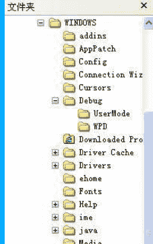

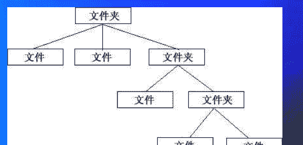

## 组合模式

模式动机

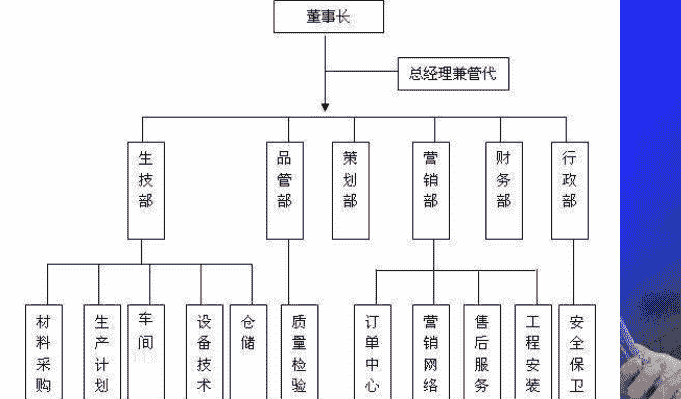


## 组合模式

### 模式动机

- 对于树形结构，当容器对象（如文件夹）的某一个方法被调用时，将遍历整个树形结构，寻找也包含这个方法的成员对象（可以是容器对象，也可以是叶子对象，如子文件夹和文件）并调用执行。（递归调用）
- 由于容器对象和叶子对象在功能上的区别，在使用这些对象的客户端代码中必须有区别地对待容器对象和叶子对象，而实际上大多数情况下我们希望一致地处理它们，因为对于这些对象的区别对待将会使得程序非常复杂。
- 组合模式就是为解决此类问题而诞生，它通过一种巧妙的设计方案使得客户端可以一致性地处理整个树形结构或者树形结构的一部分，也可以一致性地处理树形结构中的叶子节点（不包含子节点的节点）和容器节点（包含子节点的节点）。

### 组合模式包含如下角色

- Component: 抽象构件，可以是接口或抽象类，为叶子构件和容器构件对象声明接口，在该角色中可以包含所有子类共有行为的声明和实现。在抽象构件中定义了访问及管理它的子构件的方法，如增加子构件、删除子构件、获取子构件等。
- Leaf: 叶子构件，在组合结构中表示叶子节点对象，叶子节点没有子节点，它实现了在抽象构件中定义的行为。对于那些访问及管理子构件的方法，可以通过异常等方式进行处理。
- Composite: 容器构件，在组合结构中表示容器节点对象，容器节点包含子节点，其子节点可以是叶子节点，也可以是容器节点，它提供一个集合用于存储子节点，实现了在抽象构件中定义的行为，包括那些访问及管理子构件的方法，在其业务方法中可以递归调用其子节点的业务方法。
- Client: 客户类，针对Component抽象构件类进行编程

### 模式分析

- 组合模式的关键是定义了一个抽象构件类，它既可以代表叶子，又可以代表容器，而客户端针对该抽象构件类进行编程，无须知道它到底表示的是叶子还是容器，可以对其进行统一处理。
- 同时容器对象与抽象构件类之间还建立一个聚合关联关系，在容器对象中既可以包含叶子，也可以包含容器，以此实现递归组合，形成一个树形结构。
- 如果不使用组合模式，客户端代码将过多地依赖于容器对象复杂的内部实现结构，容器对象内部实现结构的变化将引起客户端代码的频繁变化，带来了代码维护复杂、可扩展性差等弊端。组合模式的引入将在一定程度上解决这些问题。


典型的抽象构件角色代码：

```
public abstract class Component
{ //用于访问和管理成员子构件的方法
    public abstract void add(Component c); //增加成员
    public abstract void remove(Component c); //删除成员
    public abstract Component getChild(int i); //获取成员

    //业务方法
    public abstract void operation();
}
```

典型的叶子构件角色代码：

```
public class Leaf extends Component
{
    public void add(Component c)
    { //异常处理或错误提示 }
    public void remove(Component c)
    { //异常处理或错误提示 }
    public Component getChild(int i)
    { //异常处理或错误提示 }
    public void operation()
    { //叶子构件具体业务方法的实现 }
}
```

作为抽象构件类的子类，在叶子构件中需要实现在抽象构件类中声明的所有方法，包括业务方法以及管理访问子构件的方法，但是叶子构件不能再包含子构件，因此在叶子构件中实现子构件管理访问方法时需要提供异常处理或错误提示。这会给叶子构件的实现带来麻烦。

典型的容器构件角色代码：

```
public class Composite extends Component {
    private ArrayList list = new ArrayList();
    public void add(Component c) {    list.add(c); }
    public void remove(Component c) {    list.remove(c); }
    public Component getChild(int i) {    (Component)list.get(i);    }
    public void operation()
    { //容器构件具体业务方法的实现
    //递归调用成员构件的业务方法
    for(Object obj:list) { ((Component)obj).operation(); }
    }
}
```

### 组合模式实例与解析

- 实例一：水果盘

在水果盘(Plate)中有一些水果，如苹果(Apple)、香蕉(Banana)、梨子(Pear)，当然大水果盘中还可以有小水果盘，现需要对盘中的水果进行遍历（吃），当然如果对一个水果盘执行“吃”方法，实际上就是吃其中的水果。使用组合模式模拟该场景。

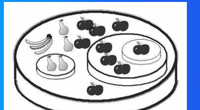


- 参考代码 (sample01)

演示......

- 实例二：文件浏览

文件有不同类型，不同类型的文件其浏览方式有所区别，如文本文件和图片文件的浏览方式就不相同。对文件夹的浏览实际上就是对其中所包含文件的浏览，而客户端可以一致地对文件和文件夹进行操作，无须关心它们的区别。使用组合模式来模拟文件的浏览操作。


```
AbstractFile
{abstract}

+ add (AbstractFile element)        : void
+ remove (AbstractFile element)     : void
+ display ()                        : void
```

```
ImageFile
- fileName : String
+ ImageFile (String fileName)
+ add (AbstractFile element)       : void
+ remove (AbstractFile element)    : void
+ display ()                       : void
```

```
VideoFile
- fileName : String
+ VideoFile (String fileName)
+ add (AbstractFile element)       : void
+ remove (AbstractFile element)    : void
+ display ()                       : void
```

```
Folder
- fileList  : ArrayList
- fileName  : String
+ Folder (String fileName)
+ add (AbstractFile element)       : void
+ remove (AbstractFile element)    : void
+ display ()                       : void
```

```
TextFile
- fileName : String
+ TextFile (String fileName)
+ add (AbstractFile element)       : void
+ remove (AbstractFile element)    : void
+ display ()                       : void
```

## 组合模式
### 模式优点
- 组合模式可以清楚地定义分层次的复杂对象，表示对象的全部或部分层次，它让客户端忽略了层次的差异，方便对整个层次结构进行控制。
- 客户端可以一致地使用一个组合结构或其中单个对象，不必关心处理的是单个对象还是整个组合结构，简化了客户端代码。

### 模式优点
- 在组合模式中增加新的容器构件和叶子构件都很方便，无须对现有类库进行任何修改，符合“开闭原则”。
- 组合模式为树形结构的面向对象实现提供了一种灵活的解决方案，通过叶子对象和容器对象的递归组合，可以形成复杂的树形结构，但对树形结构的控制却非常简单。


### 模式缺点
- 在增加新构件时很难对容器中的构件类型进行限制。
  有时候我们希望一个容器中只能有某些特定类型的对象，例如在某个文件夹中只能包含文本文件，使用组合模式时，不能依赖类型系统来施加这些约束，因为它们都来自于相同的抽象层，在这种情况下，必须通过在运行时进行类型检查来实现，这个实现过程较为复杂。


### 模式适用环境
- 在以下情况下可以使用组合模式：
- 在具有整体和部分的层次结构中，希望通过一种方式忽略整体与部分的差异，客户端可以一致地对待它们。
- 在一个使用面向对象语言开发的系统中需要处理一个树形结构。
- 在一个系统中能够分离出叶子对象和容器对象，而且它们的类型不固定，需要增加一些新的类型。

### 模式应用
- (1) 操作系统中的目录结构是一个树形结构，因此在对文件和文件夹进行操作时可以应用组合模式，例如杀毒软件在查毒或杀毒时，既可以针对一个具体文件，也可以针对一个目录。如果是对目录查毒或杀毒，将递归处理目录中的每一个子目录和文件。

### 模式应用
- (2) JDK的AWT/Swing是组合模式在Java类库中的一个典型实际应用。


### 模式扩展
#### 透明组合模式


### 模式扩展
- 安全组合模式，在抽象构件Component中没有声明任何用于管理成员对象的方法，而是在Composite类中声明并实现这些方法。这种做法是安全的，因为根本不向叶子对象提供这些管理成员对象的方法，对于叶子对象，客户端不可能调用到这些方法。
- 安全组合模式的缺点是不够透明，因为叶子构件和容器构件具有不同的方法，且容器构件中那些用于管理成员对象的方法没有在抽象构件类中定义，因此客户端不能完全针对抽象编程，必须有区别地对待叶子构件和容器构件。在实际应用中安全组合模式的使用频率也非常高。

### 小结
- 组合模式用于组合多个对象形成树形结构以表示“整体-部分”的结构层次。组合模式对单个对象（即叶子对象）和组合对象（即容器对象）的使用具有一致性。组合模式又可以称为“整体-部分”模式，属于对象的结构模式，它将对象组织到树结构中，可以用来描述整体与部分的关系。
- 组合模式包含三个角色：抽象构件为叶子构件和容器构件对象声明接口，在该角色中可以包含所有子类共有行为的声明和实现；叶子构件在组合结构中表示叶子节点对象，叶子节点没有子节点；容器构件在组合结构中表示容器节点对象，容器节点包含子节点，其子节点可以是叶子节点，也可以是容器节点，它提供一个集合用于存储子节点，实现了在抽象构件中定义的行为。
- 组合模式的关键是定义了一个抽象构件类，它既可以代表叶子，又可以代表容器，而客户端针对该抽象构件类进行编程，无须知道究竟表示的是叶子还是容器，可以对其进行统一处理。

- 组合模式的主要优点在于可以方便地对层次结构进行控制，客户端调用简单，客户端可以一致的使用组合结构或其中单个对象，用户就不必关心自己处理的是单个对象还是整个组合结构，简化了客户端代码；其缺点在于使设计变得更加抽象，且增加新构件时可能会产生一些问题，而且很难对容器中的构件类型进行限制。
- 组合模式适用情况包括：需要表示一个对象整体或部分层次；让客户能够忽略不同对象层次的变化，客户端可以针对抽象构件编程，无须关心对象层次结构的细节；对象的结构是动态的并且复杂程度不一样，但客户需要一致地处理它们。
- 组合模式根据抽象构件类的定义形式，又可以分为透明组合模式和安全组合模式。

## 装饰模式
- 装饰模式
- 模式动机与定义
- 模式结构与分析
- 模式实例与解析
- 模式效果与应用
- 模式扩展

### 模式动机
在现实生活中，存在如下一些场景：
- 买了新房，但却是毛坯房，它可以居住，但如何能变得更漂亮、更温馨、更实用、更能满足居家的需求？答案是装修，对新房进行装修不但没有改变房屋用于居住的原有功能，又增加了很多新功能。
- 一张纸板照片，如何让它更美观、保存更长久？即在不改变照片记录影像的原有功能前提下，增加新的好看、防潮功能。答案是我们可以给它增加一个相框，而且可以根据喜好给它增加不同类型的相框，甚至可以在一个小相框的外面再套一个大相框。


### 模式动机
- 在软件设计中，一般有两种方式可以实现给一个类或对象增加行为（新功能）：
  - 继承机制，使用继承机制是给现有类添加功能的一种有效途径，通过继承一个现有类可以使得子类在拥有自身方法的同时还拥有父类的方法。但是这种方法是静态的，用户不能控制增加行为的方式和时机。
  - 关联机制，即将一个类的对象嵌入另一个对象中，由另一个对象来调用嵌入对象的行为同时扩展其行为，我们称这另一个对象为装饰器(Decorator)。

### 模式动机
- 装饰器使用对象之间的关联关系取代类之间的继承关系，在装饰器中既可以调用原有类的方法，还可以增加新的方法，以扩充原有类的功能。它通过一种无须定义子类的方式来给对象动态增加职责，符合合成复用原则。

### 模式定义
- 装饰模式(Decorator Pattern)：动态地给一个对象增加一些额外的职责(Responsibility)，就增加对象功能来说，装饰模式比生成子类实现更为灵活。其别名也可以称为包装器(Wrapper)，与适配器模式的别名相同，但它们适用于不同的场合。根据翻译的不同，装饰模式也有人称之为“油漆工模式”，它是一种对象结构型模式。
- 在装饰模式中，为了让系统具有更好的灵活性和可扩展性，我们通常会定义一个抽象装饰类，而将具体的装饰类作为它的子类，同时，也还会引入一个抽象构件类。

### 模式结构


装饰模式包含如下角色
- Decorator：抽象装饰类，它也是抽象构件类的子类，用于给具体构件增加职责，但是具体职责在其子类中实现。它维护一个指向抽象构件对象的引用，通过该引用可以调用装饰之前构件对象的方法，并通过其子类扩展该方法，以达到装饰的目的。
- ConcreteDecorator：具体装饰类，它是抽象装饰类的子类，负责向构件添加新的职责。每一个具体装饰类都定义了一些新的行为，它可以调用在抽象装饰类中定义的方法，并可以增加新的方法用以扩充对象的行为。

### 模式分析
- 由于具体构件类和装饰类都实现了相同的抽象构件接口，因此装饰模式以对客户透明的方式动态地给一个对象附加加上更多的责任，换言之，客户端并不会觉得对象在装饰前和装饰后有什么不同。装饰模式可以在不需要创造更多子类的情况下，将对象的功能加以扩展。

### 模式分析
装饰模式的核心在于抽象装饰类的设计，其典型代码：
```
public class Decorator extends Component
{
    private Component component;  // 维持一个对抽象构件对象的引用
    public Decorator(Component component) // 注入一个抽象构件类型的对象
    {
        this.component=component;
    }
    public void operation()
    {
        component.operation();  // 调用原有业务方法
    }
}
```


## 装饰模式
### 模式分析

在抽象装饰类Decorator中定义了一个Component类型的对象component，维持一个对抽象构件对象的引用，并可以通过构造函数或Setter方法将一个Component类型的对象注入进来，同时由于Decorator类实现了抽象构件Component接口，因此需要实现在其中声明的业务方法operation()，需要注意的是在Decorator中并未真正实现operation()方法，而只是调用原有component对象的operation()方法，它没有真正实施装饰，而是提供一个统一的接口，将具体装饰过程交予子类完成。

在Decorator的子类即具体装饰类中将继承operation()方法并根据需要进行扩展，其典型代码：

```
public class ConcreteDecorator extends Decorator
{
    public ConcreteDecorator(Component component)
    {
        super(component);
    }
    public void operation()
    {
        super.operation();  //调用原有业务方法
        addedBehavior();    //调用新增业务方法
    }
    public void addedBehavior() //新增业务方法
    {
        .....
    }
}
```

在具体装饰类中可以调用到抽象装饰类的operation()方法，同时可以定义新的业务方法，如addedBehavior()。由于在抽象装饰类Decorator中注入的是Component类型的对象，因此我们可以将一个具体构件对象注入其中，再通过具体装饰类来进行装饰；此外，我们还可以将一个已经装饰过的Decorator子类的对象再注入其中进行多次装饰，从而对原有功能的多次扩展。

## 装饰模式
### 装饰模式实例与解析

- 实例一：变形金刚

变形金刚在变形之前是一辆汽车，它可以在陆地上移动。当它变成机器人之后除了能够在陆地上移动之外，还可以说话；如果需要，它还可以变成飞机，除了在陆地上移动还可以在天空中飞翔。


- 实例二：多重加密系统

某系统提供了一个数据加密功能，可以对字符串进行加密。最简单的加密算法通过对字母进行移位来实现，同时还提供了稍复杂的逆向输出加密，还提供了更为高级的求模加密。用户先使用最简单的加密算法对字符串进行加密，如果觉得还不够可以对加密之后的结果使用其他加密算法进行二次加密，当然也可以进行第三次加密。现使用装饰模式设计该多重加密系统。


- ◆ 装饰模式实例与解析
- ■ 实例二：多重加密系统
- • 参考代码 (sample02)

演示……

## 装饰模式
### 模式优点

- 对于扩展一个对象的功能，装饰模式比继承更加灵活，不会导致类的数量急剧增加。
- 可以通过一种动态的方式来扩展一个对象的功能，通过配置文件可以在运行时选择不同的具体装饰类，从而实现不同的行为。
- 可以对一个对象进行多次装饰，通过使用不同的具体装饰类以及这些装饰类的排列组合，可以创造出很多不同行为的组合，得到功能更为强大的对象。
- 具体构件类与具体装饰类可以独立变化，用户可以根据需要增加新的具体构件类和具体装饰类，原有类库代码无须改变，符合“开闭原则”。

## 装饰模式
### 模式缺点

- 使用装饰模式进行系统设计时将产生很多小对象，这些对象的区别在于它们之间相互连接的方式有所不同，而不是它们的类或者属性值有所不同，大量小对象的产生势必会占用更多的系统资源，在一定程度上影响程序的性能。
- 装饰模式提供了一种比继承更加灵活机动的解决方案，但同时也意味着比继承更加易于出错，排错也很困难，对于多次装饰的对象，调试时寻找错误可能需要逐级排查，较为繁琐。

## 装饰模式
### ◆ 模式适用环境

- 在不影响其他对象的情况下，以动态、透明的方式给单个对象添加职责。
- 当不能采用继承的方式对系统进行扩展或者采用继承不利于系统扩展和维护时可以使用装饰模式。不能采用继承的情况主要有两类：第一类是系统中存在大量独立的扩展，为支持每一种扩展或者扩展之间的组合将产生大量的子类，使得子类数目呈爆炸性增长；第二类是因为类已经定义为不能被继承（如Java语言中的final类）。

## 装饰模式
### 模式应用

- (1) 在javax.swing包中，可以通过装饰模式动态给一些构件增加新的行为或改善其外观显示。

如JList构件本身并不支持直接滚动，即没有滚动条，要创建可以滚动的列表，可以使用如下代码实现：

```
JList list = new JList();
JScrollPane sp = new JScrollPane(list);
```

(2) 装饰模式在JDK中最经典的实例是Java IO。

以InputStream为例：


- (2) 角色分配：
- 抽象构件类： InputStream
- 具体构件类： FileInputStream、 ByteArrayInputStream等
- 抽象装饰类： FilterInputStream, 用来封装其它的输入流, 并为它们提供额外功能
- 具体装饰类： BufferedInputStream（为输入流提供缓冲功能，以及mark()和reset()功能）、 DataInputStream（允许应用程序以与机器无关方式从底层输入流中读取基本 Java 数据类型）等

- (2) 抽象装饰类： FilterInputStream

```
......
protected volatile InputStream in;
protected FilterInputStream(InputStream in) {
this.in = in;
}
......
```

### ◆模式应用
#### ▪（2）客户端使用：

```
……

FileInputStream inFS=new FileInputStream("temp/fileSrc.txt");

BufferedInputStream inBS=new BufferedInputStream(inFS);

//定义一个字节数组，用于存放缓冲数据
byte[] data = new byte[1024];
inBS.read(data);

……
```


## 装饰模式
### 模式扩展

- 透明装饰模式（多重加密系统）
- 在透明装饰模式中，要求客户端完全针对抽象编程，装饰模式的透明性要求客户端程序不应该声明具体构件类型和具体装饰类型，而应该全部声明为抽象构件类型。

```
Cipher sc,cc,ac;
sc=new SimpleCipher();
cc=new ComplexCipher(sc);
ac=new AdvancedCipher(cc);
```

- 装饰模式的简化-需要注意的问题

- 尽量保持装饰类的接口与被装饰类的接口相同，这样，对于客户端而言，无论是装饰之前的对象还是装饰之后的对象都可以一致对待。这也就是说，在可能的情况下，我们应该尽量使用透明装饰模式。

- 尽量保持具体构件类ConcreteComponent是一个“轻”类，也就是说不要把太多的行为放在具体构件类中，我们可以通过装饰类对其进行扩展。

- 如果只有一个具体构件类，那么抽象装饰类可作为该具体构件类的直接子类。

模式扩展

- 装饰模式


没有抽象构件类的装饰模式


### 小结

- 装饰模式用于动态地给一个对象增加一些额外的职责，就增加对象功能来说，装饰模式比生成子类实现更为灵活。它是一种对象结构型模式。
- 装饰模式包含四个角色：抽象构件定义了对象的接口，可以给这些对象动态增加职责（方法）；具体构件定义了具体的构件对象，实现了在抽象构件中声明的方法，装饰器可以给它增加额外的职责；抽象装饰类是抽象构件类的子类，用于给具体构件增加职责，但是具体职责在其子类中实现；具体装饰类是抽象装饰类的子类，负责向构件添加新的职责。
- 使用装饰模式来实现扩展比继承更加灵活，它以对客户透明的方式动态地给一个对象附加更多的责任。装饰模式可以在不需要创造更多子类的情况下，将对象的功能加以扩展。
- 装饰模式的主要优点在于可以提供比继承更多的灵活性，可以通过一种动态的方式来扩展一个对象的功能，并通过使用不同的具体装饰类以及这些装饰类的排列组合，可以创造出很多不同行为的组合，而且具体构件类与具体装饰类可以独立变化，用户可以根据需要增加新的具体构件类和具体装饰类；其主要缺点在于使用装饰模式进行系统设计时将产生很多小对象，而且装饰模式比继承更加易于出错，排错也很困难，对于多次装饰的对象，调试时寻找错误可能需要逐级排查，较为烦琐。
- 装饰模式适用情况包括：在不影响其他对象的情况下，以动态、透明的方式给单个对象添加职责；需要动态地给一个对象增加功能，这些功能也可以动态地被撤销；当不能采用继承的方式对系统进行扩充或者采用继承不利于系统扩展和维护时。
- 装饰模式可分为透明装饰模式和半透明装饰模式：在透明装饰模式中，要求客户端完全针对抽象编程，装饰模式的透明性要求客户端程序不应该声明具体构件类型和具体装饰类型，而应该全部声明为抽象构件类型；半透明装饰模式允许用户在客户端声明具体装饰者类型的对象，调用在具体装饰者中新增的方法。

## 外观模式

- 模式动机与定义
- 模式结构与分析
- 模式实例与解析
- 模式效果与应用
- 模式扩展

### 模式动机

在现实生活中，存在如下一些场景：

- 想组装一台新电脑，一个方案是去电子市场把自己需要的配件都买回来，然后自己组装，但需要对各种配件都要比较熟悉，这样才能选择最合适的配件，而且还要考虑配件之间的兼容性；另外一个方案，就是到电子市场，找一家专业装机的公司，把具体的要求一讲，然后就等着拿电脑就好了，方案二不需要挨家去跑，也不需要熟悉各种配件，通常是大多数人的选择。
- 餐厅、茶馆，厨师、茶艺师


客户完全自己组装电脑

找专业的装机公司组装电脑

- 我们把组装电脑的过程抽象一下：如果把电子市场看成是一个系统，而各个卖配件的公司看成是子系统的话，就类似于出现了这样一种情况：客户端为了完成某个功能，需要去调用某个系统中的多个子系统，简称为子系统A、子系统B和子系统C，对于客户端而言，那就需要知道A、B、C这三个子系统的功能，还需要知道如何组合A、B、C这三个子系统所提供的功能来实现自己所需要的功能，非常麻烦。
- 方案二提供了一种简单的方法，能让客户端实现相同的功能却不需要跟系统中的多个模块交互。
- 方案二引入的装机公司，就是所谓的外观角色，用户只需要直接与外观角色交互，用户与子系统之间的复杂关系由外观角色来实现，从而降低了系统的耦合度。


### 模式定义

- 外观模式(Facade Pattern)：为子系统中的一组接口提供一个统一的入口。外观模式定义了一个高层接口，这个接口使得这一子系统更加容易使用。
- 外观模式中，一个子系统的外部与其内部的通信通过一个统一的外观类进行，外观类将客户类与子系统的内部复杂性分隔开，使得客户类只需要与外观角色打交道，而不需要与子系统内部的很多对象打交道。
- 外观模式又称为门面模式，它是一种对象结构型模式。
- 外观模式是迪米特原则的一种具体实现，通过引入一个新的外观角色可以降低原有系统的复杂度，同时降低客户类与子系统的耦合度。

### 模式结构


外观模式示意图

外观模式类结构图

外观模式包含如下角色

- Facade: 外观角色，客户端可以调用它的方法，在外观角色中可以知道相关的（一个或者多个）子系统的功能和责任；在正常情况下，它将所有从客户端发来的请求委派到相应子系统去，传递给相应的子系统对象处理。
- SubSystem: 子系统角色，在软件系统中可以有一个或者多个子系统角色，每一个子系统可以不是一个单独的类，而是一个类的集合，它实现子系统的功能；每一个子系统都可以被客户端直接调用，或者被外观角色调用，它处理由外观类传递过来的请求；子系统并不知道外观的存在，对于子系统而言，外观角色仅仅是一个另外一个客户端而已。

### 模式分析

- 外观模式的主要目的在于降低系统的复杂程度，在面向对象软件系统中，类与类之间的关系越多，不能表示系统设计得越好，反而表示系统中类之间的耦合度太大，这样的系统在维护和修改时都缺乏灵活性，因为一个类的改动会导致多个类发生变化，而外观模式的引入在很大程度上降低了类与类之间的耦合关系。引入外观模式之后，增加新的子系统或者移除子系统都非常方便，客户类无须进行修改（或者极少的修改），只需要在外观类中增加或移除对子系统的引用即可。从这一点来说，外观模式在一定程度上并不符合开闭原则，增加新的子系统需要对原有系统进行一定的修改，虽然这个修改工作量可能不大。

- 外观模式中所指的子系统是一个广义的概念，它可以是一个类、一个功能模块、系统的一个组成部分或者一个完整的系统。子系统类通常是一些业务类，实现了一些具体的、独立的业务功能，例如：典型的子系统角色代码：

  ```
  class SubSystemA
  {
      public void MethodA()
      {
          //业务实现代码
      }
  }
  class SubSystemB
  {
      public void MethodB()
      {
          //业务实现代码
      }
  }
  class SubSystemC
  {
      public void MethodC()
      {
          //业务实现代码
      }
  }
  ```

- 在引入外观类之后，与子系统业务类之间的交互统一由外观类来完成，在外观类中通常存在如下代码：

  ```
  public class Facade
  {
      private SubSystemA obj1 = new SubSystemA();
      private SubSystemB obj2 = new SubSystemB();
      private SubSystemC obj3 = new SubSystemC();
      public void Method()
      {
          obj1.MethodA();
          obj2.MethodB();
          obj3.MethodC();
      }
  }
  ```

由于在外观类中维持了对子系统对象的引用，客户端可以通过外观类来间接调用子系统对象的业务方法，而无须与子系统对象直接交互。引入外观类后，客户端代码变得非常简单，典型代码如下：

```
class Program
{
    static void Main(string[] args)
    {
        Facade facade = new Facade();
        facade.Method();
    }
}
```

### 外观模式实例与解析

- 实例一：电器总开关

  现在考察一个电器总开关的例子，以便进一步说明外观模式。为了使用方便，一个电器总开关可以控制四盏灯、一个风扇、一台空调和一台电视机的启动和关闭。通过该电器总开关可以同时控制上述所有电器设备，使用外观模式设计该系统。

**实例**


## 外观模式

◆ 外观模式实例与解析
■ 实例一：电器总开关
• 参考代码 (sample01)

演示......

### 外观模式实例与解析

实例二：文件加密

某系统需要提供一个文件加密模块，加密流程包括三个操作，分别是读取源文件、加密、保存加密之后的文件。读取文件和保存文件使用流来实现，这三个操作相对独立，其业务代码封装在三个不同的类中。现在需要提供一个统一的加密外观类，用户可以直接使用该加密外观类完成文件的读取、加密和保存三个操作，而不需要与每一个类进行交互，使用外观模式设计该加密模块。

```
reader = new FileReader();
cipher = new CipherMachine();
writer = new FileWriter();
```

```
String plainStr=reader.read(fileNameSrc);
String encryptStr=cipher.encrypt(plainStr);
writer.write(encryptStr,fileNameDes);
```

EncryptFacade
- reader : FileReader
- cipher : CipherMachine
- writer : FileWriter
+ EncryptFacade ()
+ fileEncrypt (String fileNameSrc, : void String fileNameDes)

reader

cipher

writer

FileReader
+ read (String fileNameSrc) : String

FileWriter
+ write (String encryptText, : void String fileNameDes)

CipherMachine
+ encrypt (String plainText) : String

外观模式实例与解析

实例二：文件加密

参考代码 (sample02)

演示......


### 模式优点

外观模式对客户端屏蔽了子系统组件，减少了客户端所需处理的对象数目，并使得子系统使用起来更加容易。通过引入外观模式，客户端代码将变得很简单，与之关联的对象也很少。

外观模式实现了子系统与客户端之间的松耦合关系，这使得子系统的变化不会影响到调用它的客户端，只需要调整外观类即可。

一个子系统的修改对其他子系统没有任何影响，而且子系统内部变化也不会影响到外观对象。

### 模式缺点

- 外观模式不能很好地限制客户端直接使用子系统类，如果对客户端访问子系统类做太多的限制则减少了可变性和灵活性。
- 如果设计不当，增加新的子系统可能需要修改外观类的源代码，违背了开闭原则。

## 外观模式

- 在以下情况下可以使用外观模式：
  - 当要为访问一系列复杂的子系统提供一个简单入口时可以使用外观模式。
  - 客户端程序与多个子系统之间存在很大的依赖性。引入外观类可以将子系统与客户端解耦，从而提高子系统的独立性和可移植性。
  - 在层次化结构中，可以使用外观模式定义系统中每一层的入口，层与层之间不直接产生联系，而通过外观类建立联系，降低层之间的耦合度。

### 模式应用

- (1) 在几乎所有的软件中都能够找到外观模式的应用，如绝大多数B/S系统都有一个首页或者导航页面，大部分C/S系统都提供了菜单或者工具栏，在这里，首页和导航页面就是B/S系统的外观角色，而菜单和工具栏就是C/S系统的外观角色，通过它们用户可以快速访问子系统，降低了系统的复杂程度。

### 模式扩展

一个系统有多个外观类

在外观模式中，通常只需要一个外观类，并且此外观类只有一个实例，换言之它是一个单例类。在很多情况下为了节约系统资源，一般将外观类设计为单例类。当然这并不意味着在整个系统里只能有一个外观类，在一个系统中可以设计多个外观类，每个外观类都负责和一些特定的子系统交互，向用户提供相应的业务功能。

### 模式扩展

- 不要试图通过外观类为子系统增加新行为

- 不要通过继承一个外观类在子系统中加入新的行为，这种做法是错误的。外观模式的用意是为子系统提供一个集中化和简化的沟通渠道，而不是向子系统加入新的行为，新的行为的增加应该通过修改原有子系统类或增加新的子系统类来实现，不能通过外观类来实现。

### 模式扩展

- 外观模式与迪米特法则

外观模式创造出一个外观对象，将客户端所涉及的属于一个子系统的协作伙伴的数量减到最少，使得客户端与子系统内部的对象的相互作用被外观对象所取代。外观类充当了客户类与子系统类之间的“第三者”，降低了客户类与子系统类之间的耦合度，外观模式就是实现代码重构以便达到“迪米特法则”要求的一个强有力的武器。

### 模式扩展

抽象外观类的引入

在标准的外观模式结构图中，如果需要增加、删除或更换与外观类交互的子系统类，必须修改外观类或客户端的源代码，这将违背开闭原则，因此可以通过引入抽象外观类来对系统进行改进，在一定程度上可以解决该问题。在引入抽象外观类之后，客户端可以针对抽象外观类进行编程，对于新的业务需求，不需要修改原有外观类，而对应增加一个新的具体外观类，由新的具体外观类来关联新的子系统对象，同时通过修改配置文件来达到不修改任何源代码并更换外观类的目的。

模

Client

AbstractFacade
+ method1 () : void
+ method2 () : void

ConcreteFacade1
+ method1 () : void
+ method2 () : void

ConcreteFacade2
+ method1 () : void
+ method2 () : void

SubSystem1

SubSystem2

SubSystem3

SubSystem4

SubSystem5

### 小结

- 在外观模式中，外部与一个子系统的通信必须通过一个统一的外观对象进行，为子系统中的一组接口提供一个一致的界面，外观模式定义了一个高层接口，这个接口使得这一子系统更加容易使用。外观模式又称为门面模式，它是一种对象结构型模式。
- 外观模式包含两个角色：外观角色是在客户端直接调用的角色，在外观角色中可以知道相关的(一个或者多个)子系统的功能和责任，它将所有从客户端发来的请求委派到相应的子系统去，传递给相应的子系统对象处理；在软件系统中可以同时有一个或者多个子系统角色，每一个子系统可以不是一个单独的类，而是一个类的集合，它实现子系统的功能。
- 外观模式要求一个子系统的外部与其内部的通信通过一个统一的外观对象进行，外观类将客户端与子系统的内部复杂性分隔开，使得客户端只需要与外观对象打交道，而不需要与子系统内部的很多对象打交道。

外观模式主要优点在于对客户屏蔽子系统组件，减少了客户处理的对象数目并使得子系统使用起来更加容易，它实现了子系统与客户之间的松耦合关系，并降低了大型软件系统中的编译依赖性，简化了系统在不同平台之间的移植过程；其缺点在于不能很好地限制客户使用子系统类，而且在不引入抽象外观类的情况下，增加新的子系统可能需要修改外观类或客户端的源代码，违背了“关闭原则”。

外观模式适用情况包括：要为一个复杂子系统提供一个简单接口；客户程序与多个子系统之间存在很大的依赖性；在层次化结构中，需要定义系统中每一层的入口，使得层与层之间不直接产生联系。


## 享元模式

- 模式动机与定义
- 模式结构与分析
- 模式实例与解析
- 模式效果与应用
- 模式扩展

### 模式动机

现要开发一围棋软件，通过分析发现，围棋棋盘中包含大量的黑子和白子，它们的形状、大小都一模一样，只是出现的位置不同而已。如果将每一个棋子都作为一个独立的对象存储在内存中，将导致该围棋软件在运行时所需内存空间较大。如何实现对这些相同或者相似对象的共享访问，从而节约内存并提高系统性能？

享元模式正是为解决这一类问题而诞生的。享元模式通过共享技术实现相同或相似对象的重用。

### 模式动机

再看看软件开发中常见的字符串，比如一个文本字符串中往往存在很多重复的字符，如果每一个字符都用一个单独的对象来表示，将会占用较多的内存空间。

这时就可以通过享元模式实现相同或相似对象的重用。在逻辑上每一个出现的字符都有一个对象与之对应，然而在物理上它们却共享同一个享元对象，这个对象可以出现在一个字符串的不同地方，相同的字符对象都指向同一个实例。


## 享元模式

### 模式动机

在享元模式中，存储这些共享实例对象的地方称为享元池(Flyweight Pool)。我们可以针对每一个不同的字符创建一个享元对象，将其放在享元池中，需要时再从享元池取出。


### 模式动机

- 享元模式以共享的方式高效地支持大量细粒度对象的重用，享元对象能做到共享的关键是区分了内部状态(Intrinsic State)和外部状态(Extrinsic State)。下面将对享元的内部状态和外部状态进行简单的介绍：
- 内部状态是存储在享元对象内部并且不会随环境改变而改变的状态，内部状态可以共享。如字符的内容，不会随外部环境的变化而变化，无论在任何环境下字符 “a” 始终是 “a”，都不会变成 “b”。

### 模式动机

- 外部状态是随环境改变而改变的、不可以共享的状态。享元对象的外部状态通常由客户端保存，并在享元对象被创建之后，需要使用的时候再传入到享元对象内部。一个外部状态与另一个外部状态之间是相互独立的。如字符的颜色，可以在不同的地方有不同的颜色，例如有的 “a” 是红色的，有的 “a” 是绿色的，字符的大小也是如此，有的 “a” 是五号字，有的 “a” 是四号字。而且字符的颜色和大小是两个独立的外部状态，它们可以独立变化，相互之间没有影响，客户端可以在使用时将外部状态注入享元对象中。

### 模式动机

- 正因为区分了内部状态和外部状态，我们可以将具有相同内部状态的对象存储在享元池中，享元池中的对象是可以实现共享的，需要的时候就将对象从享元池中取出，实现对象的复用。通过向取出的对象注入不同的外部状态，可以得到一系列相似的对象，而这些对象在内存中实际上只存储一份。


### 模式定义

- 享元模式(Flyweight Pattern)：运用共享技术有效地支持大量细粒度对象的复用。系统只使用少量的对象，而这些对象都很相似，状态变化很小，可以实现对象的多次复用。由于享元模式要求能够共享的对象必须是细粒度对象，因此它又称为轻量级模式，它是一种对象结构型模式。
- 享元模式一般结合工厂模式一起使用，在它的结构图中包含了一个享元工厂类，其结构图如图所示：

### 模式结构


- Flyweight: 抽象享元类，通常是一个接口或抽象类，在抽象享元类中声明了具体享元类公共的方法，这些方法可以向外界提供享元对象的内部数据（内部状态），同时也可以通过这些方法来设置外部数据（外部状态）。

- ConcreteFlyweight: 具体享元类，实现了抽象享元类，其实例称为享元对象；在具体享元类中为内部状态提供了存储空间。通常我们可以结合单例模式来设计具体享元类，为每一个具体享元类提供唯一的享元对象。


### 模式结构

- UnsharedConcreteFlyweight: 非共享具体享元类，并不是所有的抽象享元类的子类都需要被共享，不能被共享的子类可设计为非共享具体享元类；当需要一个非共享具体享元类的对象时可以直接通过实例化创建。

### 模式结构

- FlyweightFactory: 享元工厂类，用于创建并管理享元对象，它针对抽象享元类编程，将各种类型的具体享元对象存储在一个享元池中，享元池一般设计为一个存储“键值对”的集合（也可以是其他类型的集合），可以结合工厂模式进行设计；当用户请求一个具体享元对象时，享元工厂提供一个存储在享元池中已创建的实例或者创建一个新的实例（如果不存在的话），返回新创建的实例并将其存储在享元池中。

### 模式分析

- 享元模式的核心在于享元工厂类，在享元模式中引入了享元工厂类，享元工厂类的作用在于提供一个用于存储享元对象的享元池，当用户需要对象时，首先从享元池中获取，如果享元池中不存在，则创建一个新的享元对象返回给用户，并在享元池中保存该新增对象。

#### 典型的享元工厂类代码：

```
public class FlyweightFactory
{ //定义一个HashMap用于存储享元对象，实现享元池
    private HashMap flyweights = new HashMap();

    public Flyweight getFlyweight(String key)
    {
        if(flyweights.containsKey(key)) //如果对象存在，则直接从享元池获取
        {
            return (Flyweight)flyweights.get(key);
        }
        else //如果对象不存在，先创建一个新的对象添加到享元池中，然后返回
        {
            Flyweight fw = new ConcreteFlyweight();
            flyweights.put(key,fw);
            return fw;
        }
    }
}
```

### 模式分析

- 享元类的设计是享元模式的要点之一，在享元类中要将内部状态和外部状态分开处理，通常将内部状态作为享元类的成员变量，而外部状态通过注入的方式添加到享元类中。

### 模式分析

- 典型的享元类代码：

```
```java
public class Flyweight
{
    //内部状态intrinsicState作为成员变量，同一个享元对象其内部状态是一致的
    private String intrinsicState;

    public Flyweight(String intrinsicState)
    {
        this.intrinsicState = intrinsicState;
    }
    //外部状态extrinsicState在使用时由外部设置，不保存在享元对象中，即使是同
    //一个对象，在每一次调用时也可以传入不同的外部状态
    public void operation(String extrinsicState)
    {
        ......
    }
}
```
```

### 享元模式实例与解析

- 实例一：共享网络设备（无外部状态）

很多网络设备都是支持共享的，如交换机、集线器等，多台终端计算机可以连接同一台网络设备，并通过该网络设备进行数据转发，如图所示，现用享元模式模拟共享网络设备的设计原理。


#### 实例一：共享网络设备（无外部状态）

DeviceFactory
- devices : ArrayList = new ArrayList()
- totalTerminal : int = 0
+ DeviceFactory ()
+ getNetworkDevice (String type) : NetworkDevice
+ getTotalDevice () : int
+ getTotalTerminal () : int

NetworkDevice
+ getType () : String
+ use () : void

Switch
- type : String
+ Switch (String type)
+ getType () : String
+ use () : void

Hub
- type : String
+ Hub (String type)
+ getType () : String
+ use () : void

- 实例一：共享网络设备（无外部状态）
  - 参考代码 (sample01)


### 享元模式实例与解析

- 实例二：共享网络设备（有外部状态）

虽然网络设备可以共享，但是分配给每一个终端计算机的端口(Port)是不同的，因此多台计算机虽然可以共享同一个网络设备，但必须使用不同的端口。我们可以将端口从网络设备中抽取出来作为外部状态，需要时再进行设置。


## 享元模式

### 享元模式实例与解析

#### 实例二：共享网络设备（有外部状态）


- 实例二：共享网络设备（有外部状态）
- 参考代码 (sample02)


- 可以极大减少内存中对象的数量，使得相同或相似对象在内存中只保存一份，从而可以节约系统资源，提高系统性能。
- 享元模式的外部状态相对独立，而且不会影响其内部状态，从而使得享元对象可以在不同的环境中被共享。

### 模式缺点

- 享元模式使得系统变得复杂，需要分离出内部状态和外部状态，这使得程序的逻辑复杂化。
- 为了使对象可以共享，享元模式需要将享元对象的部分状态外部化，而读取外部状态将使得运行时间变长。

### 模式应用

- (2) 在JDK类库中定义的String类使用了享元模式。

```
public class Demo
{
    public static void main(String args[])
    {
        String str1 = "abcd";
        String str2 = "abcd";
        String str3 = "ab" + "cd";
        String str4 = "ab"; //重新分配空间
        str4 += "cd";
        System.out.println(str1 == str2); //true
        System.out.println(str1 == str3); //true
        System.out.println(str1 == str4); //false
        str2 += "e";
        System.out.println(str1 == str2); //false
    }
}
```

在Java语言中，如果每次执行类似String str1="abcd"的操作时都创建一个新的字符串对象将导致内存开销很大，因此如果第一次创建了内容为"abcd"的字符串对象str1，下一次再创建内容相同的字符串对象str2时会将它的引用指向"abcd"，不会重新分配内存空间，从而实现了"abcd"在内存中的共享。

### 模式扩展

#### 单纯享元模式：在单纯享元模式中，所有的享元对象都是可以共享的，即所有抽象享元类的子类都可共享，不存在非共享具体享元类。


复合享元模式：将一些单纯享元使用组合模式加以组合，可以形成复合享元对象，如果希望为多个内部状态不同的享元对象设置相同的外部状态，可以考虑使用复合享元模式。


- 享元模式与其他模式的联用
- 在享元模式的享元工厂类中通常提供一个静态的工厂方法用于返回享元对象，使用简单工厂模式来生成享元对象。
- 在一个系统中，通常只有唯一一个享元工厂，因此享元工厂类可以使用单例模式进行设计。
- 享元模式可以结合组合模式形成复合享元模式，统一对享元对象设置外部状态。

### 小结

- 享元模式运用共享技术有效地支持大量细粒度对象的复用。系统只使用少量的对象，而这些对象都很相似，状态变化很小，可以实现对象的多次复用，它是一种对象结构型模式。
- 享元模式包含四个角色：抽象享元类声明一个接口，通过它可以接受并作用于外部状态；具体享元类实现了抽象享元接口，其实例称为享元对象；非共享具体享元是不能被共享的抽象享元类的子类；享元工厂类用于创建并管理享元对象，它针对抽象享元类编程，将各种类型的具体享元对象存储在一个享元池中。
- 享元模式以共享的方式高效地支持大量的细粒度对象，享元对象能做到共享的关键是区分内部状态和外部状态。其中内部状态是存储在享元对象内部并且不会随环境改变而改变的状态，因此内部状态可以共享；外部状态是随环境改变而改变的、不可以共享的状态。

◇ 享元模式主要优点在于它可以极大减少内存中对象的数量，使得相同对象或相似对象在内存中只保存一份；其缺点是使得系统更加复杂，并且需要将享元对象的状态外部化，而读取外部状态使得运行时间变长。

◇ 享元模式适用情况包括：一个系统有大量相同或者相似的对象，由于这类对象的大量使用，造成内存的大量耗费；对象的大部分状态都可以以外部化，可以将这些外部状态传入对象中；多次重复使用享元对象。

### 代理模式

### 代理模式

- 模式动机与定义
- 模式结构与分析
- 模式实例与解析
- 模式效果与应用
- 模式扩展

### 模式动机

- 近年来，代购已逐步成为电子商务的一个重要分支。何谓代购，简单来说就是找人帮忙购买所需要的商品，当然你可能需要向实施代购的人支付一定的费用。代购通常分为两种类型：一种是因为在当地买不到某件商品，又或者是因为当地这件商品的价格比其他地区的贵，因此托人在其他地区甚至国外购买该商品，然后通过快递发货或者直接携带回来；还有一种代购，由于消费者对想要购买的商品相关信息的缺乏，自己无法确定其实际价值而又不想被商家宰，只好委托中介机构帮其讲价或为其代买。

代购网站为此应运而生，它为消费者提供在线的代购服务，如果看中某国外购物网站上的商品，可以登录代购网站填写代购单并付款，代购网站会帮助进行购买然后通过快递公司将商品发送给消费者。商品代购过程如图所示：


在软件开发中，也有一种设计模式可以提供与代购网站类似的功能。由于某些原因，客户端不想或不能直接访问一个对象，此时可以通过一个称之为“代理”的第三者来实现间接访问，该方案对应的设计模式被称为代理模式。

### 模式定义

- 代理模式(Proxy Pattern)：给某一个对象提供一个代理，并由代理对象控制对原对象的引用。代理模式的英文叫做Proxy或Surrogate，它是一种对象结构型模式。
- 在代理模式中引入了一个新的代理对象，代理对象在客户端对象和目标对象之间起到中介的作用，它去掉客户不能看到的内容和服务或者增添客户需要的额外的新服务。
- 代理模式是一种应用很广泛的结构型设计模式，而且变化形式非常多，常见的代理形式包括远程代理、保护代理、虚拟代理、缓冲代理、智能引用代理等，后面将学习变不同的代理形式。

代理模式的结构比较简单，其核心是代理类，为了让客户端能够一致性地对待真实对象和代理对象，在代理模式中引入了抽象层。


### 代理模式包含如下角色

- Subject: 抽象主题角色，声明了真实主题和代理主题的共同接口，这样一来在任何使用真实主题的地方都可以使用代理主题，客户端通常需要针对抽象主题角色进行编程。
- RealSubject: 真实主题角色，定义了代理角色所代表的真实对象，在真实主题角色中实现了真实的业务操作，客户端可以通过代理主题角色间接调用真实主题角色中定义的操作。

- Proxy：代理主题角色，它包含了对真实主题的引用，从而可以在任何时候操作真实主题对象；在代理主题角色中提供一个与真实主题角色相同的接口，以便在任何时候都可以替代真实主题；代理主题角色还可以控制对真实主题的使用，负责在需要的时候创建和删除真实主题对象，并对真实主题对象的使用加以约束。通常，在代理主题角色中，客户端在调用所引用的真实主题操作之前或之后还需要执行其他操作，而不仅仅是单纯调用真实主题对象中的操作。

### 模式分析

抽象主题类声明了真实主题类和代理类的公共方法，它可以是接口、抽象类或具体类，客户端针对抽象主题类编程，一致性地对待真实主题和代理主题，典型的抽象主题类代码如下：

```
public interface AbstractSubject
{
    public void request();
}
```


### 代理模式
### 模式分析

真实主题类继承了抽象主题类，提供了业务方法的具体实现，其典型代码如下：

```
public class RealSubject implements AbstractSubject
{
    public void request()
    {
        //业务方法具体实现代码
    }
}
```

代理类也是抽象主题类的子类，它维持一个对真实主题对象的引用，调用在真实主题中实现的业务方法，在调用时可以在原有业务方法的基础上附加一些新的方法来对功能进行扩充或约束，最简单的代理类实现代码如下：

```
public class Proxy implements AbstractSubject
{
    private RealSubject realsubject = new RealSubject(); //维持一个对真实主题对象的引用
    public void prerequest()
    { ...... }
    public void request()
    {
        prerequest();
        realsubject.request(); //调用真实主题对象的方法
        postrequest();
    }
    public void postrequest()
    { ...... }
}
```

在实际开发过程中，代理类的实现比上述代码要复杂很多，代理模式根据其目的和实现方式不同可分为很多种类，其中常用的几种代理模式简要说明如下：

- (1) 远程代理(Remote Proxy)：为一个位于不同的地址空间的对象提供一个本地的代理对象，这个不同的地址空间可以是在同一台主机中，也是在另一台主机中，远程代理又称为大使(Ambassador)。

远程代理是一种常用代理模式，它使得客户端程序可以访问在远程主机上的对象，远程主机可能具有更好的计算性能与处理速度，可以快速响应并处理客户端的请求。
远程代理可以将网络的细节隐藏起来，使得客户端不必考虑网络的存在。客户完全可以认为被代理的远程业务对象是在本地而不是在远程，而远程代理对象承担了大部分的网络通信工作，并负责对远程业务方法的调用。


DCOM（Distribute Component Object Model，分布式组件对象模型）、Web Service、Java RMI、CORBA中都应用了远程代理模式。


- (2) 虚拟代理(Virtual Proxy)：如果需要创建一个资源消耗较大的对象，先创建一个消耗相对较小的对象来表示，真实对象只在需要时才会被真正创建。

一个很常见的虚拟代理应用实例就是对大图浏览的控制。
用户通过浏览器访问网页时先不加载真实的大图，而是通过代理对象的方法来进行处理，在代理对象的方法中，先使用一个线程向客户端浏览器加载一个小图片，然后在后台使用另一个线程来调用大图片的加载方法将大图片加载到客户端。当需要浏览大图片时，再将大图片在新网页中显示。如果用户在浏览大图时加载工作还没有完成，可以再启动一个线程来显示相应的提示信息。通过代理技术结合多线程编程将真实图片的加载放到后台来操作，不影响前台图片的浏览。

- (3) 保护代理(Protect Proxy)：控制对一个对象的访问，可以给不同的用户提供不同级别的使用权限。

- (4) 缓冲代理(Cache Proxy)：为某一个目标操作的结果提供临时的存储空间，以便多个客户端可以共享这些结果。

- (5) 智能引用代理(Smart Reference Proxy)：当一个对象被引用时，提供一些额外的操作，例如将对象被调用的次数记录下来等。

- (6) 防火墙代理(Firewall Proxy): 控制网络资源的访问，保护主题免于“坏客户”的侵害。常用在公司的防火墙系统。

- (7) 同步代理(Synchronization Proxy): 在多线程的情况下为主题提供安全的访问。常用在JavaSpaces，为分散式环境内的潜在对象集合提供同步访问控制。

- (8) 写入时复制代理(Copy-On-Write Proxy): 用来控制对象的复制，方法是延迟对象的复制，直到客户真的需要为止。这是虚拟代理的变体。

### 代理模式实例与解析

- 实例一：论坛权限控制代理

在一个论坛中已注册用户和游客的权限不同，已注册的用户拥有发帖、修改自己的注册信息、修改自己的帖子等功能；而游客只能看到别人发的帖子，没有其他权限。使用代理模式来设计该权限管理模块。

在本实例中我们使用代理模式中的保护代理，该代理用于控制对一个对象的访问，可以给不同的用户提供不同级别的使用权限。

#### 实例一：论坛权限控制代理


- 实例一：论坛权限控制代理
- 参考代码 (sample01)


#### 实例二：数学运算代理

模拟应用远程代理来访问另外一个应用程序域中的对象，如果在远程实现了加减乘除等运算，在本地需要调用，那么可以考虑在本地设置一个代理。

real=new RealCalculator();
real.add(x,y);

| Calculator |
|---|
| + add (double x, double y) : double |
| + sub (double x, double y) : double |
| + mul (double x, double y) : double |
| + div (double x, double y) : double |

| ProxyCalculator |
|---|
| - real : RealCalculator |
| + init () : void |
| + add (double x, double y) : double |
| + sub (double x, double y) : double |
| + mul (double x, double y) : double |
| + div (double x, double y) : double |

| RealCalculator |
|---|
| + add (double x, double y) : double |
| + sub (double x, double y) : double |
| + mul (double x, double y) : double |
| + div (double x, double y) : double |

### 模式优点

- 代理模式能够协调调用者和被调用者，在一定程度上降低了系统的耦合度。

- 客户端可以针对抽象主题角色进行编程，增加和更换代理类无须修改源代码，符合开闭原则，系统具有较好的灵活性和可扩展性。

- 此外，不同类型的代理模式也具有独特的优点，例如：

- 远程代理为位于两个不同地址空间对象的访问提供了一种实现机制，可以将一些消耗资源较多的对象和操作移至性能更好的计算机上，提高系统的整体运行效率。
- 虚拟代理通过一个消耗资源较少的对象来代表一个消耗资源较多的对象，在一定程度上节省系统的运行开销。
- 缓冲代理为某一个操作的结果提供临时的缓存存储空间，以便在后续使用中能够共享这些结果，优化系统性能，缩短执行时间。
- 保护代理可以控制对一个对象的访问权限，为不同用户提供不同级别的使用权限。

### 模式缺点

- 由于在客户端和真实主题之间增加了代理对象，因此有些类型的代理模式可能会造成请求的处理速度变慢。

- 实现代理模式需要额外的工作，有些代理模式的实现非常复杂。


### 代理模式

### 模式适用环境

- 代理模式的类型较多，不同类型的代理模式有不同的优缺点，它们应用于不同的场合：
- 当客户端对象需要访问远程主机中的对象时可以使用远程代理。
- 当需要用一个消耗资源较少的对象来代表一个消耗资源较多的对象，从而降低系统开销、缩短运行时间时可以使用虚拟代理，例如一个对象需要很长时间才能完成加载时。
- 当需要为某一个被频繁访问的操作结果提供一个临时存储空间，以供多个客户端共享访问这些结果时可以使用缓冲代理。通过使用缓冲代理，系统无须在客户端每一次访问时都重新执行操作，只需直接从临时缓冲区获取操作结果即可。
- 当需要控制对一个对象的访问，为不同用户提供不同级别的访问权限时可以使用保护代理。
- 当需要为一个对象的访问（引用）提供一些额外的操作时可以使用智能引用代理。

### 模式应用

- (1) Java RMI (Remote Method Invocation，远程方法调用)。


- (2) Spring 框架中的AOP技术也是代理模式的应用，在 Spring AOP中应用了动态代理(Dynamic Proxy)技术，动态代理是一种较为高级的代理模式。

### 模式扩展

- 在标准代理模式中，客户端通过Proxy调用RealSubject类的request()方法，还在Proxy中封装了其他方法(如preRequest()和postRequest())，可以处理一些其他问题。
- 标准代理模式中，各个角色在编译前就已存在，并且指定好了谁代理谁，执行效率高。因此也被称为静态代理模式。
- 当有多个真实主题对象需要代理时，需要建立多个代理类。
- 编译前就确定了谁代理谁，系统的灵活性差。
- 可以基于反射技术采用Java JDK提供的相应机制实现动态代理模式。
- 当有多个真实主题对象时，只需要一个动态代理类即可，避免了创建多个静态代理类的麻烦。
- 可以在运行时根据实际需要为某个真实主题对象动态地创建一个代理对象，系统更加灵活。
- 缺点是效率低，比静态代理慢一点，可读性差，不好理解。
- JDK动态代理只能对实现了接口的类进行代理。
- JDK动态代理相关类位于java.lang.reflect包，涉及两个类：
- InvocationHandler接口。它是动态代理类对象所对应的调用处理程序类的接口，该接口中定义了如下方法：

```
public Object invoke(Object proxy, Method method, Object[] args)
throws Throwable;
```

该方法中第一个参数proxy表示代理类，第二个参数method表示需要代理的方法，第三个参数args表示代理方法的参数数组。

- Proxy类。该类即为动态代理类，该类最常用的方法为：

```
public static Object newProxyInstance (ClassLoader loader, Class<?>[] interfaces,
                                      InvocationHandler h) throws IllegalArgumentException;
```

该方法根据传入的参数返回一个动态创建的代理类对象，方法中第一个参数loader表示主题类(目标类)的类加载器，第二个参数interfaces表示主题类(目标类)的接口列表，第三个参数h表示调用处理程序对象，所有对代理类对象方法的调用都被委托给对象h，由对象h的invoke()进行相应的处理。

- 动态代理
- 参考代码 (DynamicProxy)


### 小结

- 在代理模式中，要求给某一个对象提供一个代理，并由代理对象控制对原对象的引用。代理模式的英文叫做Proxy或Surrogate，它是一种对象结构型模式。
- 代理模式包含三个角色：抽象主题角色声明了真实主题和代理主题的共同接口；代理主题角色内部包含对真实主题的引用，从而可以在任何时候操作真实主题对象；真实主题角色定义了代理角色所代表的真实对象，在真实主题角色中实现了真实的业务操作，客户端可以通过代理主题角色间接调用真实主题角色中定义的方法。
- 代理模式的优点在于能够协调调用者和被调用者，在一定程度上降低了系统的耦合度；其缺点在于由于在客户端和真实主题之间增加了代理对象，因此有些类型的代理模式可能会造成请求的处理速度变慢，并且实现代理模式需要额外的工作，有些代理模式的实现非常复杂。
- 远程代理为一个位于不同的地址空间的对象提供一个本地的代表对象，它使得客户端可以访问在远程机器上的对象，远程机器可能具有更好的计算性能与处理速度，可以快速响应并处理客户端需求。
- 如果需要创建一个资源消耗较大的对象，先创建一个消耗相对较小的对象来表示，真实对象只在需要时才会被真正创建，这个小对象称为虚拟代理。虚拟代理通过使用一个小对象来代表一个大对象，可以减少系统资源的消耗，对系统进行优化并提高运行速度。
- 保护代理可以控制对一个对象的访问，可以给不同的用户提供不同级别的使用权限。


## 行为型模式

- 行为型模式
- 行为型模式概述
- 行为型模式简介
- 模式动机与定义
- 模式结构与分析
- 模式实例与解析
- 模式效果与应用
- 模式扩展

### 行为型模式概述

- 行为型模式(Behavioral Pattern)是对在不同的对象之间划分责任和算法的抽象化。
- 行为型模式不仅仅关注类和对象的结构，而且重点关注它们之间的相互作用。
- 通过行为型模式，可以更加清晰地划分类与对象的职责，并研究系统在运行时实例对象之间的交互。在系统运行时，对象并不是孤立的，它们可以通过相互通信与协作完成某些复杂功能，一个对象在运行时也将影响到其他对象的运行。


- 行为型模式分为类行为型模式和对象行为型模式两种：
- 类行为型模式：类的行为型模式使用继承关系在几个类之间分配行为，类行为型模式主要通过多态等方式来分配父类与子类的职责。
- 对象行为型模式：对象的行为型模式则使用对象的聚合关联关系来分配行为，对象行为型模式主要是通过对象关联等方式来分配两个或多个类的职责。根据“合成复用原则”，系统中要尽量使用关联关系来取代继承关系，因此大部分行为型设计模式都属于对象行为型设计模式。


### 行为型模式简介

- 职责链模式(Chain of Responsibility)
- 命令模式(Command)
- 解释器模式(Interpreter)
- 迭代器模式(Iterator)
- 中介者模式(Mediator)
- 备忘录模式(Memento)
- 观察者模式(Observer)
- 状态模式(State)
- 策略模式(Strategy)
- 模板方法模式(Template Method)
- 访问者模式(Visitor)

## 职责链模式

### 模式动机

- 在现实生活中，存在如下一些场景：
  - “斗地主”这样的纸牌游戏中，某人出牌给他的下家，下家看看手中的牌，如果要不起上家的牌则将出牌请求再转发给他的下家，其下家再进行判断。一个循环下来，如果其他人都要不起该牌，则最初的出牌者可以打出新的牌。在这个过程中，牌作为一个请求沿着一条链在传递，每一位纸牌的玩家都可以处理该请求。


## 职责链模式

### 模式动机


在设计模式中，也有一种专门用于处理这种请求链式传递的模式，它就是将要介绍的职责链模式。

很多情况下，在一个软件系统中可以处理某个请求的对象不止一个，例如上面例子中的申请表，辅导员、系主任、院长和校长都可以处理申请表，他们可以构成一条处理申请表的链式结构，申请表沿着这条链进行传递，这条链就称为职责链。

职责链可以是一条直线、一个环或者一个树形结构，最常见的职责链是直线型，即沿着一条单向的链来传递请求。

链上的每一个对象都是请求的处理者，职责链模式可以将请求的处理者组织成一条链，并让请求沿着链传递，由链上的处理者对请求进行相应的处理，客户端无须关心请求的处理细节以及请求的传递，只需将请求发送到链上即可，实现请求发送者和请求处理者解耦。这就是职责链模式的模式动机。

### 模式定义

- 职责链模式(Chain of Responsibility Pattern)：避免请求发送者与接收者耦合在一起，让多个对象都有可能接收请求，将这些对象连接成一条链，并且沿着这条链传递请求，直到有对象处理它为止。职责链模式是一种对象行为型模式。由于英文翻译的不同，职责链模式又称为责任链模式。

### 模式结构


### 职责链模式包含如下角色

- Handler: 抽象处理者角色，它定义了一个处理请求的接口，一般设计为抽象类，由于不同的具体处理者处理请求的方式不同，因此在其中定义了抽象请求处理方法。因为每一个处理者的下家还是一个处理者，因此在抽象处理者中定义了一个抽象处理者类型的对象（如结构图中的successor），作为其对下家的引用。通过该引用，处理者可以连成一条链。

- ConcreteHandler: 具体处理者角色，它是抽象处理者的子类，可以处理用户请求，在具体处理者类中实现了抽象处理器中定义的抽象请求处理方法，在处理请求之前需要进行判断，看是否有相应的处理权限，如果可以处理请求就处理它，否则则将请求转发给后继者；在具体处理者中可以访问链中下一个对象，以便请求的转发。


### 模式分析

- 在职责链模式里，很多对象由每一个对象对其下家的引用而连接起来形成一条链。

- 请求在这条链上传递，直到链上的某一个对象决定处理此请求。

- 发出这个请求的客户端并不知道链上的哪一个对象最终处理这个请求，这使得系统可以在不影响客户端的情况下动态地重新组织链和分配责任。

职责链模式的核心在于抽象处理者类的设计，抽象处理者的典型代码：

```
```java
public abstract class Handler
{
    //维持对下家的引用
    protected Handler successor;

    public void setSuccessor(Handler successor)
    {
        this.successor=successor;
    }

    public abstract void handleRequest(String request);
}
```
```

抽象处理者类定义了对下家的引用对象，以便将请求转发给下家，该对象的访问符可设为protected，在其子类中可以使用。在抽象处理者类中声明了抽象的请求处理方法，具体实现交由子类完成。

具体处理者是抽象处理者的子类，它具有两大作用：第一是处理请求，不同的具体处理者以不同的形式实现抽象请求处理方法handleRequest()；第二是转发请求，如果该请求超出了当前处理者类的权限，可以将该请求转发给下家。典型的具体处理者代码：

```
public class ConcreteHandler extends Handler
{
    public void handleRequest(String request)
    {
        if(请求request满足条件)
        {
            ...... //处理请求； }
        else
        {
            this.successor.handleRequest(request); //转发请求 }
    }
}
```

需要注意的是，职责链模式并不创建职责链，一般是在使用该职责链的客户端中创建职责链。

```
class Client {
public static void main(String[] args) {
Handler ha, hb, hc;
ha = new ConcreteHandlerA();
hb = new ConcreteHandlerB();
hc = new ConcreteHandlerC();
ha.setSuccessor(hb); //创建职责链
hb.setSuccessor(hc);
String req = new String("some request");
ha.handleRequest(req);
}
}
```

### 职责链模式实例与解析

- 实例：审批假条

- 某OA系统需要提供一个假条审批的模块，如果员工请假天数小于3天，主任可以审批该假条；如果员工请假天数大于等于3天，小于10天，经理可以审批；如果员工请假天数大于等于10天，小于30天，总经理可以审批；如果超过30天，总经理也不能审批，提示相应的拒绝信息。


- 实例：审批假条

- 参考代码 (sample01)


### 模式优点

- 职责链模式使得一个对象无须知道是其他哪一个对象处理其请求，对象仅需知道该请求会被处理即可，接收者和发送者都没有对方的明确信息，且链中的对象不需要知道链的结构，由客户端负责链的创建，降低了系统的耦合度。

- 请求处理对象仅需维持一个指向其后继者的引用，而不需要维持它对所有的候选处理者的引用，可简化对象的相互连接。

- 在给对象分派职责时，职责链可以给我们更多的灵活性，可以通过在运行时对该链进行动态的增加或修改来增加或改变处理一个请求的职责。

- 在系统中增加一个新的具体请求处理者时无须修改原有系统的代码，只需要在客户端重新建链即可，从这一点来看是符合“开闭原则”的。

### 模式缺点

- 由于一个请求没有明确的接收者，那么就不能保证它一定会被处理，该请求可能一直到链的末端都得不到处理；一个请求也可能因职责链没有被正确配置而得不到处理。

- 对于比较长的职责链，请求的处理可能涉及到多个处理对象，系统性能将受到一定影响，而且在进行代码调试时不太方便。

- 如果建链不当，可能会造成循环调用，将导致系统陷入死循环。

### 模式适用环境

- 有多个对象可以处理同一个请求，具体哪个对象处理该请求待运行时刻再确定，客户端只需将请求提交到链上，而无须关心请求的处理对象是谁以及它是如何处理的。
- 在不明确指定接收者的情况下，向多个对象中的一个提交一个请求。
- 可动态指定一组对象处理请求，客户端可以动态创建职责链来处理请求，还可以改变链中处理器之间的先后次序。

### 模式应用

#### （1）Java中的异常处理机制

```
```java
try
{
    ……
}
catch(ArrayIndexOutOfBoundsException e1)
{
    ……
}
catch(ArithmeticException e2)
{
    ……
}
catch(IOException e3)
{
    ……
}
finally
{
    ……
}
```
```


## 职责链模式
### 模式应用
- (2)在Web应用开发中创建一个过滤器(Filter)链来对请求数据进行过滤，在工作流系统中实现公文的分级审批等等。
- (3) 早期的Java AWT事件模型(JDK 1.0及更早)：事件浮升(Event Bubbling)机制。
- JavaScript事件浮升机制：


## 职责链模式
### 模式扩展
- 在一个不纯的职责链模式中允许某个请求被一个具体处理者部分处理后再向下传递，或者一个具体处理者处理完某请求后其后继处理者可以继续处理该请求，而且一个请求可以最终不被任何处理者对象所接收。Java AWT 1.0中的事件处理模型应用的是不纯的职责链模式，基本原理如下：
- 由于窗口组件（如按钮、文本框等）一般都位于容器组件中，因此当事件发生在某一个组件上时，先通过组件对象的handleEvent()方法将事件传递给相应的事件处理方法，该事件处理方法将处理此事件，然后决定是否将该事件向上一级容器组件传播；
- 上级容器组件在接到事件之后可以继续处理此事件并决定是否继续向上级容器组件传播，如此反复，直到事件到达顶层容器组件为止；如果一直传到最顶层容器仍没有处理方法，则该事件不予处理。**每一级组件在接收到事件时，都可以处理此事件，而不论此事件是否在上一级已经得到处理，还存在事件未被处理的情况。**
- Java AWT 1.0中的这种事件处理机制又叫事件浮升（Event Bubbling）机制。从Java 1.1以后，JDK使用观察者模式代替职责链模式来处理事件。目前，在JavaScript中仍然可以使用这种事件浮升机制来进行事件处理。

### 小结
- 行为型模式是对在不同的对象之间划分责任和算法的抽象化。行为型模式不仅仅关注类和对象的结构，而且重点关注它们之间的相互作用。通过行为型模式，可以更加清晰地划分类与对象的职责，并研究系统在运行时实例对象之间的交互。行为型模式可以分为类行为型模式和对象行为型模式两种。
- 职责链模式可以避免请求发送者与接收者耦合在一起，让多个对象都有可能接收请求，将这些对象连接成一条链，并且沿着这条链传递请求，直到有对象处理它为止。它是一种对象行为型模式。
- 职责链模式包含两个角色：抽象处理者定义了一个处理请求的接口；具体处理者是抽象处理者的子类，它可以处理用户请求。
- 在职责链模式里，很多对象由每一个对象对其下家的引用而连接起来形成一条链。请求在这个链上传递，直到链上的某一个对象决定处理此请求。发出这个请求的客户端并不知道链上的哪一个对象最终处理这个请求，这使得系统可以在不影响客户端的情况下动态地重新组织链和分配责任。
- 职责链模式的主要优点在于可以降低系统的耦合度，简化对象的相互连接，同时增强给对象指派职责的灵活性，增加新的请求处理类也很方便；其主要缺点在于不能保证请求一定被接收，且对于比较长的职责链，请求的处理可能涉及到多个处理对象，系统性能将受到一定影响，而且在进行代码调试时不太方便。
- 职责链模式适用情况包括：有多个对象可以处理同一个请求，具体哪个对象处理该请求由运行时刻自动确定；在不明确指定接收者的情况下，向多个对象中的一个提交一个请求；可动态指定一组对象处理请求。

### 命令模式
### 命令模式
- 模式动机与定义
- 模式结构与分析
- 模式实例与解析
- 模式效果与应用
- 模式扩展

### 模式动机
在现实生活中，通过开关可以控制一些电器的打开和关闭，例如电灯或者排气扇。在购买开关时，我们并不知道它将来到底用于控制什么电器，也就是说，开关与电灯、排气扇并无直接关系，一个开关在安装之后可能用来控制电灯，也可能用来控制排气扇或者其他电器设备。开关与电器之间通过电线建立连接，如果开关打开，则电线通电，电器工作；反之，开关关闭，电线断电，电器停止工作。相同的开关可以通过不同的电线来控制不同的电器，如图所示。


- 我们可以将开关理解成一个请求的发送者，用户通过它来发送一个“开灯”请求，而电灯是“开灯”请求的最终接收者和处理者，在图中，开关和电灯之间并不存在直接耦合关系，它们通过电线连接在一起，使用不同的电线可以连接不同的请求接收者，只需更换一根电线，相同的发送者（开关）即可对应不同的接收者（电器）。
- 在软件开发中也存在很多与开关和电器类似的请求发送者和接收者对象，例如一个按钮，它可能是一个“关闭窗口”请求的发送者，而按钮点击事件处理类则是该请求的接收者。
- 此时，我们特别希望能够以一种松耦合的方式来设计软件，使得请求发送者与请求接收者能够消除彼此之间的耦合，让对象之间的调用关系更加灵活，可以灵活地指定请求接收者以及被请求的操作。命令模式为此类问题提供了一个较为完美的解决方案。
- 命令模式可以将请求发送者和接收者完全解耦，发送者与接收者之间没有直接引用关系，发送请求的对象只需要知道如何发送请求，而不必知道如何完成请求。


### 模式定义
- 命令模式的核心在于引入了命令类，通过命令类来降低发送者和接收者的耦合度，请求发送者只需指定一个命令对象，再通过命令对象来调用请求接收者的处理方法，其结构如图所示：

### 模式结构


### 命令模式包含如下角色
- Command: 抽象命令类一般是一个抽象类或接口，在其中声明了用于执行请求的execute()等方法，通过这些方法可以调用请求接收者的相关操作。
- ConcreteCommand: 具体命令类是抽象命令类的子类，实现了在抽象命令类中声明的方法，它对应具体的接收者对象，将接收者对象的动作绑定其中。在实现execute()方法时，将调用接收者对象的相关操作(Action)。
- Invoker: 调用者，即请求发送者，它通过命令对象来执行请求。一个调用者并不需要在设计时确定其接收者，因此它只与抽象命令类之间存在关联关系。在程序运行时可以将一个具体命令对象注入其中，再调用具体命令对象的execute()方法，从而实现间接调用请求接收者的相关操作。
- Receiver: 接收者执行与请求相关的操作，它具体实现对请求的业务处理。

### 模式分析
- 命令模式的本质是对请求进行封装，一个请求对应一个命令，将发出请求的职责和执行请求的职责分割开。
- 每一个请求都对应一个操作：发送者发出请求，要求执行一个操作；接收者收到请求，并执行操作。
- 命令模式允许请求者和接收者相互独立，使得请求者不必知道接收者的接口，更不必知道请求是怎么被接收，以及操作是否被执行、何时被执行，以及是怎么被执行的。
- 命令模式使请求本身成为一个对象，这个对象和其他对象一样可以被存储和传递。
- 命令模式的关键在于引入了抽象命令类，请求发送者针对抽象命令类编程，只有实现了抽象命令类的具体命令才与请求接收者相关联。

在最简单的抽象命令类中只包含了一个抽象的execute()方法，其典型代码如下所示：

```
public abstract class Command
{
    public abstract void execute();
}
```

- 具体命令类继承了抽象命令类，它与请求接收者相关联，实现了在抽象命令类中声明的execute()方法，并在实现时调用接收者的请求响应方法action()，不同的具体命令类提供了execute()方法的不同实现，并调用不同接收者的请求处理方法。其典型代码如下所示：

```
public class ConcreteCommand extends Command
{
    private Receiver receiver; //维持一个对请求接收者对象的引用
    public void execute()
    {
        receiver.action(); //调用请求接收者的业务处理方法
    }
}
```


### 命令模式
### 模式分析

对于请求发送者即调用者而言，将针对抽象命令类进行编程，可以通过构造注入或者设值注入的方式在运行时传入具体命令类对象，并在业务方法中调用命令对象的execute()方法，其典型代码如下所示：

```
public class Invoker
{
    private Command command; //维持一个对命令对象的引用
    public Invoker(Command command) //构造注入
    {
        this.command=command;
    }
    public void setCommand(Command command) //设值注入
    {
        this.command=command;
    }
    public void call() //业务方法，用于调用命令类的方法
    {
        command.execute();
    }
}
```

### 命令模式
### 模式扩展-命令队列

- 有时候一个请求发送者不止发送一个请求，将不止一个请求接收者产生响应，我们需要将多个请求排队，当发送请求时，这些请求接收者将逐个执行业务方法，完成对请求的处理。此时，我们可以通过命令队列来实现。

- 命令队列的实现方法有多种形式，其中最常用、灵活性最好的一种方式是增加一个CommandQueue类，由该类来负责存储多个命令对象，而不同的命令对象可以对应不同的请求接收者。

#### CommandQueue类的典型代码如下所示：

```
```java
class CommandQueue {
    //定义一个ArrayList来存储命令队列
    private ArrayList<Command> commands = new ArrayList<Command>();
    public void addCommand(Command command) { commands.add(command); }
    public void removeCommand(Command command) { commands.remove(command); }
    //循环调用每一个命令对象的execute()方法
    public void execute() {
        for (Object command : commands) {
            ((Command)command).execute();
        }
    }
}
```
```

■ 在增加了命令队列类CommandQueue以后，请求发送者类Invoker将针对CommandQueue编程，代码修改如下：

```
```java
class Invoker {
private CommandQueue commandQueue; //维持一个CommandQueue对象的引用
//构造注入
public Invoker(CommandQueue commandQueue) { this.commandQueue = commandQueue; }
//设值注入
public void setCommandQueue(CommandQueue commandQueue) {
this.commandQueue = commandQueue;
}
//调用CommandQueue类的execute()方法
public void call() { commandQueue.execute(); }
}
```
```

- 命令队列与我们常说的“批处理”有点类似。批处理，顾名思义，可以对一组对象（命令）进行批量处理，当一个发送者发送请求后，将有一系列接收者对请求作出响应，命令队列可以用于设计批处理应用程序，如果请求接收者的接收次序没有严格的先后次序，我们还可以使用多线程技术来并发调用命令对象的execute()方法，从而提高程序的执行效率。

### 命令模式
### 模式扩展-请求日志

- 请求日志就是将请求的历史记录保存下来，通常以日志文件(Log File)的形式永久存储在计算机中。很多系统都提供了日志文件，例如Windows日志文件、Oracle日志文件等，日志文件可以记录用户对系统的一些操作（例如对数据的更改）。请求日志文件可以实现很多功能，常用功能如下：

- 一旦系统发生故障，日志文件可以为系统提供一种恢复机制，在请求日志文件中可以记录用户对系统的每一步操作，从而让系统能够顺利恢复到某一个特定的状态；

- 请求日志也可以用于实现批处理，在一个请求日志文件中可以存储一系列命令对象，例如一个命令队列；
- 可以将命令队列中的所有命令对象都存储在一个日志文件中，每执行一个命令则从日志文件中删除一个对应的命令对象，防止因为断电或者系统重启等原因造成请求丢失，而且可以避免重新发送全部请求时造成某些命令的重复执行，只需读取请求日志文件，再继续执行文件中剩余的命令即可。

- 实例：通过一个可视化界面对配置文件进行增删改等操作，同时，将对配置文件的操作请求记录在日志文件中，如果重新创建配置文件，需要执行保存在日志文件中的命令对象即可修改配置文件。使用命令模式进行设计。


### 模式扩展-请求日志

- 请求日志的实现

- 参考代码 (RequestLog)


### 命令模式
### 模式扩展-撤销操作

- 在命令模式中，可以通过调用一个命令对象的execute()方法来实现对请求的处理，如果需要撤销(Undo)请求，可通过在命令类中增加一个逆向操作来实现。

- 除了通过一个逆向操作来实现撤销(Undo)外，还可以通过保存对象的历史状态来实现撤销，后者可使用备忘录模式(Memento Pattern)来实现。

- 实例：开发一个简易计算器，该计算器可以实现简单的数学运算，还可以对运算实施撤销操作。

#### 撤销操作的实现


- 撤销操作的实现

- 参考代码 (UndoDemo)


### 命令模式
### 模式扩展-宏命令

- 宏命令又称为组合命令，它是命令模式和组合模式联用的产物。

- 宏命令是一个具体命令类，它拥有一个集合属性，在该集合中包含了对其他命令对象的引用。通常宏命令不直接与请求接收者交互，而是通过它的成员来调用接收者的方法。当调用宏命令的execute()方法时，将递归调用它所包含的每个成员命令的execute()方法，一个宏命令的成员可以是简单命令，还可以继续是宏命令。执行一个宏命令将触发多个具体命令的执行，从而实现对命令的批处理。

| 类/接口 | 方法与属性 |
|---|---|
| **Invoker** | |
| **Command** | `+ addCommand (Command command)`  
`+ removeCommand (Command command)`  
`+ getCommand (int i)`  
`+ execute()` |
| **ConcreteCommandA** | `+ execute()` |
| **ConcreteCommandB** | `+ execute()` |
| **CompositeCommand** | `- commands : ArrayList`  
`+ addCommand (Command command)`  
`+ removeCommand (Command command)`  
`+ getCommand (int i)`  
`+ execute()` |
| **ReceiverA** | `+ action()` |
| **ReceiverB** | `+ action()` |

```
for(Command command:commands)
{
    command.execute();
}
```


### 命令模式
### 命令模式实例与解析

- 实例一：电视机遥控器

电视机是请求的接收者，遥控器是请求的发送者，遥控器上有一些按钮，不同的按钮对应电视机的不同操作。抽象命令角色由一个命令接口来扮演，有三个具体的命令类实现了抽象命令接口，这三个具体命令类分别代表三种操作：打开电视机、关闭电视机和切换频道。显然，电视机遥控器就是一个典型的命令模式应用实例。


◆ 命令模式实例与解析
■ 实例一： 电视机遥控器
‣ 参考代码 (sample01)

演示......


### 命令模式实例与解析

- 实例二：功能键设置

为了用户使用方便，某系统提供了一系列功能键，用户可以自定义功能键的功能，如功能键FunctionButton可以用于退出系统(SystemExitClass)，也可以用于打开帮助界面(DisplayHelpClass)。用户可以通过修改配置文件来改变功能键的用途，现使用命令模式来设计该系统，使得功能键类与功能类之间解耦，相同的功能键可以对应不同的功能。

◆ 命令模式实例与解析
▪ 实例二：功能键设置


### 模式优点

- 降低系统的耦合度。由于请求者与接收者之间不存在直接引用，因此请求者与接收者之间实现完全解耦，相同的请求者可以对应不同的接收者，同样，相同的接收者也可以供不同的请求者使用，两者之间具有良好的独立性。
- 新的命令可以很容易地加入到系统中。由于增加新的具体命令类不会影响到其他类，因此增加新的具体命令类很容易，无须修改原有系统源代码，甚至客户类代码，满足“开闭原则”的要求。

### 模式缺点

- 使用命令模式可能会导致某些系统有过多的具体命令类。因为针对每一个对请求接收者的调用操作都需要设计一个具体命令类，因此在某些系统中可能需要提供大量的具体命令类，这将影响命令模式的使用。

### 模式适用环境

- 系统需要支持命令的撤销(Undo)操作和恢复(Redo)操作。
- 系统需要将一组操作组合在一起形成宏命令。

### 模式应用

- (1) Java语言使用命令模式实现AWT/Swing GUI的委托事件模型 (Delegation Event Model, DEM)。

在AWT/Swing中，Frame、Button等界面组件是请求发送者，而AWT提供的事件监听器接口和事件适配器类是抽象命令接口，用户可以自己写抽象命令接口的子类来实现事件处理，即实现具体命令类，而在具体命令类中可以调用业务处理方法来实现该事件的处理。对于界面组件而言，只需要了解命令接口即可，无须关心接口的实现，组件类并不关心实际操作，而操作由用户来实现。

- (2) 很多系统都提供了宏命令功能，如UNIX平台下的Shell编程，可以将多条命令封装在一个命令对象中，只需要一条简单的命令即可执行一个命令序列，这也是命令模式的应用实例之一。

### 小结

- 在命令模式中，将一个请求封装为一个对象，从而使我们可用不同的请求对客户进行参数化；对请求排队或者记录请求日志，以及支持可撤销的操作。命令模式是一种对象行为型模式，其别名为动作模式或事务模式。
- 命令模式包含四个角色：抽象命令类中声明了用于执行请求的execute()等方法，通过这些方法可以调用请求接收者的相关操作；具体命令类是抽象命令类的子类，实现了在抽象命令类中声明的方法，它对应具体的接收者对象，将接收者对象的动作绑定其中；调用者即请求的发送者，又称为请求者，它通过命令对象来执行请求；接收者执行与请求相关的操作，它具体实现对请求的业务处理。

- 命令模式的本质是对命令进行封装，将发出命令的责任和执行命令的责任分割开。命令模式使请求本身成为一个对象，这个对象和其他对象一样可以被存储和传递。
- 命令模式的主要优点在于降低系统的耦合度，增加新的命令很方便，而且可以比较容易地设计一个命令队列和宏命令，并方便地实现对请求的撤销和恢复；其主要缺点在于可能会导致某些系统有过多的具体命令类。
- 命令模式适用情况包括：需要将请求调用者和请求接收者解耦，使得调用者和接收者不直接交互；需要在不同的时间指定请求、将请求排队和执行请求；需要支持命令的撤销操作和恢复操作；需要将一组操作组合在一起，即支持宏命令。

## 解释器模式

- 模式动机与定义
- 模式结构与分析
- 模式实例与解析
- 模式效果与应用
- 模式扩展

### 模式动机

- 智能手机上的计算器应用，只要输入一个表达式，它就能够计算出表达式结果，如图所示，当输入字符串表达式为“1+2+3-4+1”时，将输出计算结果为3。


- 我们知道，像C++、Java和C#等语言无法直接解释类似“1+2+3−4+1”这样的字符串（如果直接作为数值表达式时可以解释），因此，计算机应用必须定义一套文法规则来实现对这些语句的解释。

假如要开发一套机器人控制程序，提供图形化的设置界面，用户通过对界面进行操作可以创建一个机器人控制指令，机器人在收到指令后将按照指令的设置进行移动，例如输入控制指令： up move 5，则“向上移动5个单位”；输入控制指令： down run 10 and left move 20，则“向下快速移动10个单位再向左移动20个单位”。开发人员就要编写代码来解析控制指令的文法规则，并按指令要求来驱动机器人完成相应动作。

### 模式概述

- 如果在系统中某一特定类型的问题发生的频率很高，此时可以考虑将这些问题的实例表述为一个语言中的句子，然后可以构建一个解释器，该解释器通过解释这些句子来解决这些问题。
- 在实际开发中，这些简单的自定义语言可以基于现有的编程语言来设计，如果所基于的编程语言是面向对象语言，此时可以使用解释器模式来实现自定义语言。
- 解释器模式描述了如何为简单的语言定义一个文法，如何在该语言中表示一个句子，以及如何解释这些句子。

在前面所提到的加法/减法解释器中，每一个输入表达式，例如“1 + 2 + 3 - 4 + 1”，都包含了三个语言单位，可以使用如下文法规则来定义：

```
expression ::= value | operation
operation ::= expression '+' expression | expression '-' expression
value ::= an integer //一个整数值
```

该文法规则包含三条语句，第一条表示表达式的组成方式，其中value和operation是后面两个语言单位的定义，每一条语句所定义的字符串如operation和value称为语言构造成分或语言单位，符号“::=”表示“定义为”的意思，其左边的语言单位通过右边来进行说明和定义，语言单位对应终结符表达式和非终结符表达式。如本规则中的operation是非终结符表达式，它的组成元素仍然可以是表达式，可以进一步分解，而value则是终结符表达式。

在文法规则定义中可以使用一些符号来表示不同的含义，如使用“|”表示或，使用“{”和“}”表示组合，使用“*”表示出现0次或多次等，其中使用频率最高的符号是表示“或”关系的“|”，如文法规则“boolValue ::= 0 | 1”表示终结符表达式boolValue的取值可以为0或者1。

除了使用文法规则来定义一个语言，在解释器模式中还可以通过一种称之为抽象语法树(Abstract Syntax Tree, AST)的图形方式来直观地表示语言的构成，每一棵抽象语法树对应一个语言实例，如加法/减法表达式语言中的语句“1+2+3-4+1”，可以通过如图所示抽象语法树来表示：


## 解释器模式
### 模式概述

在该抽象语法树中，可以通过终结符表达式value和非终结符表达式operation组成复杂的语句，每个文法规则的语言实例都可以表示为一个抽象语法树，即每一条具体的语句都可以用类似上图所示的抽象语法树来表示，在图中终结符表达式类的实例作为树的叶子节点，而非终结符表达式类的实例作为非叶子节点，它们可以将终结符表达式类的实例以及包含终结符和非终结符实例的子表达式作为其子节点。抽象语法树描述了如何构成一个复杂的句子，通过对抽象语法树的分析，可以识别出语言中的终结符类和非终结符类。

解释器模式是一种使用频率相对较低但学习难度较大的设计模式，它用于描述如何使用面向对象语言构成一个简单的语言解释器。在某些情况下，为了更好地描述某些特定类型的问题，我们可以创建一种新的语言，这种语言拥有自己的表达式和结构，即文法规则，这些问题的实例将对应为该语言中的句子。此时，可以使用解释器模式来设计这种新的语言。对解释器模式的学习能够加深我们对面向对象思想的理解，并且掌握编程语言中文法规则的解释过程。

### 模式定义

- 解释器模式(Interpreter Pattern)：定义一个语言的文法，并且建立一个解释器来解释该语言中的句子，这里的“语言”是指使用规定格式和语法的代码，解释器模式是一种类行为型模式。

### 模式结构


- AbstractExpression: 抽象表达式声明了抽象的解释操作，它是所有终结符表达式和非终结符表达式的公共父类。
- TerminalExpression: 终结符表达式是抽象表达式的子类，它实现了与文法中的终结符相关联的解释操作，在句子中的每一个终结符都是该类的一个实例。通常在一个解释器模式中只有少数几个终结符表达式类，它们的实例可以通过非终结符表达式组成较为复杂的句子。

- NonterminalExpression: 非终结符表达式也是抽象表达式的子类，它实现了文法中非终结符的解释操作，由于在非终结符表达式中可以包含终结符表达式，也可以继续包含非终结符表达式，因此其解释操作一般通过递归的方式来完成。
- Context: 环境类又称为上下文类，它用于存储解释器之外的一些全局信息，通常它临时存储了需要解释的语句。

- Client: 客户类，指的是使用解释器的客户端，通常在这里把遵循语言文法规则的表达式转换为使用解释器对象描述的抽象语法树，然后调用解释操作。建树的操也可以封装在Context环境类中。

### 模式分析

在解释器模式中，每一种终结符和非终结符都有一个具体类与之对应，正因为使用类来表示每一条文法规则，所以系统将具有较好的灵活性和可扩展性。对于所有的终结符和非终结符，我们首先需要抽象出一个公共父类，即抽象表达式类，其典型代码如下所示：

```
public abstract class AbstractExpression
{
    public abstract void interpret(Context ctx);
}
```

终结符表达式和非终结符表达式类都是抽象表达式类的子类，对于终结符表达式，其代码很简单，主要是对终结符元素的处理，其典型代码如下所示：

```
public class TerminalExpression extends AbstractExpression
{
    public void interpret(Context ctx)
    {
        //对于终结符表达式的解释操作
    }
}
```

对于非终结符表达式，其代码相对比较复杂，因为可以通过非终结符将表达式组合成更加复杂的结构，对于包含两个操作元素的非终结符表达式类，其典型代码如下：

```
public class NonterminalExpression extends AbstractExpression {
    private AbstractExpression left;
    private AbstractExpression right;
    public NonterminalExpression(AbstractExpression left,AbstractExpression right)
    {
        this.left=left;
        this.right=right;
    }
    public void interpret(Context ctx)
    {
        //递归调用每一个组成部分的interpret()方法
        //在递归调用时指定组成部分的连接方式，即非终结符的功能
    }
}
```

环境类Context用于存储一些全局信息，通常包含一个HashMap或ArrayList等类型的集合对象(也可以直接由HashMap等集合类充当环境类)，存储一系列公共信息，如变量名与值的映射关系(key/value)等，用于在进行具体的解释操作时从中获取相关信息。其典型代码如下：

```
public class Context
{
    private HashMap map = new HashMap();
    public void assign(String key, String value)
    {    //往环境类中设值    }
    public String lookup(String key)
    {    //获取存储在环境类中的值    }
}
```

客户端Client的典型代码如下：

```
public class Client
{
    //主要按照文法规则对特定的句子构建抽象语法树
    //然后调用解释操作
}
```

- 解释器模式的功能：解释器模式使用解释器对象来表示和处理相应的文法规则，一般一个解释器对象处理一条文法规则。理论上来说，只要能用解释器对象把符合文法规则的表达式表示出来，而且能够构成抽象的语法树，那都可以使用解释器模式来处理。

- 文法规则和解释器之间是有对应关系的，一般一个解释器处理一条文法规则，但是反过来并不成立，一条文法规则是可以有多种解释和处理的，也就是一条文法规则可以对应多个解释器对象。

- 上下文在解释器模式中起到非常重要的作用，由于上下文会被传递到所有的解释器中，因此可以在上下文中存储和访问解释器的状态，比如前面的解释器可以存储一些数据在上下文中，后面的解释器就可以获取这些值。

- 另外还可以通过上下文传递一些在解释器外部，但是解释器需要的数据，也可以是一些全局的，公共的数据。

- 上下文还有一个功能，就是可以提供所有解释器对象的公共功能，类似于对象组合，而不是使用继承来获取公共功能，在每个解释器对象里面都可以调用。

- 在客户端构建抽象语法树，往往是比较麻烦的，但是在解释器模式中，并没有涉及这部分功能，只是负责对构建好的抽象语法树进行解释处理。如果文法规则简单，构建抽象语法树就不是特别困难的事，如果文法规则特别复杂，构建解释器模式需要的抽象语法树的工作是非常艰巨，解释器模式就不太适合。

### 解释器模式实例与解析

- 实例：数学运算解释器，现需要构造一个语言解释器，使得系统可以执行整数间的乘、除和求模运算。如用户输入表达式“3 * 4 / 2 % 4”，输出结果为2。使用解释器模式实现该功能。


解释器模式实例与解析

实例：


◆ 解释器模式实例与解析
■ 实例：数学运算解释器
• 参考代码 (sample01)

演示......

### 模式优点

- 易于改变和扩展文法，由于在解释器模式中使用类来表示语言的文法规则，因此可以通过继承等机制来改变或扩展文法。
- 每一条文法规则都可以表示为一个类，因此可以方便地实现一个简单的语言。
- 实现文法较为容易，在抽象语法树中每一个表达式节点类的实现方式都是相似的，这些类的代码编写都不会特别复杂，还可以通过一些工具自动生成节点类代码。


## 解释器模式
### 模式优点
- 增加新的解释表达式较为方便。如果用户需要增加新的解释表达式只需要对应增加一个新的终结符表达式或非终结符表达式类，原有表达式类代码无须修改，符合“开闭原则”。

## 解释器模式
### 模式缺点
- 对于复杂文法难以维护。在解释器模式中，每一条规则至少需要定义一个类，因此如果一个语言包含太多文法规则，类的个数将会急剧增加，导致系统难以管理和维护，此时可以考虑使用语法分析程序等方式来取代解释器模式。
- 执行效率较低。由于在解释器模式中使用了大量的循环和递归调用，因此在解释较为复杂的句子时其速度很慢，而且代码的调试过程也比较麻烦。
- 应用场景很有限。

## 解释器模式
### 模式适用环境
- 可以将一个需要解释执行的语言中的句子表示为一个抽象语法树。
- 一些重复出现的问题可以用一种简单的语言来进行表达。
- 一个语言的文法较为简单。
- 执行效率不是关键问题。

## 解释器模式
### 模式应用
- (1) 解释器模式在使用面向对象语言实现的编译器中得到了广泛的应用，如Smalltalk语言的编译器。
- (2) 目前有一些基于Java抽象语法树的源代码处理工具，如在Eclipse中就提供了Eclipse AST，它是Eclipse JDT的一个重要组成部分，用来表示Java语言的语法结构，用户可以通过扩展其功能，创建自己的文法规则。

## 解释器模式
### 模式应用
(3) 可以使用解释器模式，通过C++、Java、C#等面向对象语言开发简单的编译器，如数学表达式解析器、正则表达式解析器等，用于增强这些语言的功能，使之增加一些新的文法规则，用于解释一些特定类型的语句。


## 解释器模式
### 模式扩展
- 数学表达式解析器简介。在实际项目开发中如果需要解析数学公式，无须再运用解释器模式进行设计，可以直接使用一些第三方解析工具包，它们可以统称为数学表达式解析器(Math Expression Parser, MEP)，如 Expression4J、Jep、JbcParser、Symja、Math Expression String Parser(MESP)等来取代解释器模式，它们可以方便地解释一些较为复杂的文法，功能强大，且使用简单，效率较好。

## 解释器模式
### 模式扩展
- **Expression4J：** Expression4J是一个基于Java的开源框架，它用于对数学表达式进行操作，是一个数学公式解析器，在Expression4J中可以将数学表达式存储在字符串对象中。Expression4J是高度定制的，用户可以自定义文法，其主要功能包括实数和复数的基本数学运算，支持基本数学函数、复杂函数以及用户使用Java语言自定义的函数和文法，还可以定义函数目录（函数集）、支持XML配置文件等。

http://www.expression4j.org/

## 解释器模式
### 模式扩展
- Jep: Jep(Java Mathematical Expression Parser)是一个用于解析和求解数学表达式的Java类库。通过使用Jep提供的包，我们可以输入一个以字符串表示的任意数学公式，然后立即对其进行求解。Jep支持用户自定义变量、常量和自定义函数，同时还包含了大量通用的数学函数和常量。

http://www.singularsys.com/jep/

### 小结
- 解释器模式定义语言的文法，并且建立一个解释器来解释该语言中的句子，这里的“语言”意思是使用规定格式和语法的代码，它是一种类行为型模式。
- 解释器模式主要包含如下四个角色：在抽象表达式中声明了抽象的解释操作，它是所有的终结符表达式和非终结符表达式的公共父类；终结符表达式是抽象表达式的子类，它实现了与文法中的终结符相关联的解释操作；非终结符表达式也是抽象表达式的子类，它实现了文法中非终结符的解释操作；环境类又称为上下文类，它用于存储解释器之外的一些全局信息。
- 解释器模式描述了如何为简单的语言定义一个文法，如何在该语言中表示一个句子，以及如何解释这些句子。

### 小结
- 对于一个简单的语言可以使用一些文法规则来进行定义，还可以通过抽象语法树的图形方式来直观地表示语言的构成，每一棵抽象语法树对应一个语言实例。
- 解释器模式的主要优点包括易于改变和扩展文法，易于实现文法并增加了新的解释表达式的方式；其主要缺点是对于复杂文法难以维护，执行效率较低且应用场景很有限。
- 解释器模式适用情况包括：可以将一个需要解释执行的语言中的句子表示为一个抽象语法树；一些重复出现的问题可以用一种简单的语言来进行表达；文法较为简单且效率不是关键问题。

## 迭代器模式
- 迭代器模式
- 模式动机与定义
- 模式结构与分析
- 模式实例与解析
- 模式效果与应用
- 模式扩展

## 迭代器模式
### 模式动机


迭代频道

电视机遥控器

电视机
（电视频道的集合）

## 迭代器模式
### 模式动机
- 在软件开发中，也存在大量类似电视机一样的类，它们可以存储多个成员对象（元素），这些类通常称为聚合类(Aggregate Classes)，对应的对象称为聚合对象。
- 聚合对象拥有两个职责：一是存储数据；二是遍历数据。从依赖性来看，前者是聚合对象的基本职责；而后者既是可变化的，又是可分离的。

## 迭代器模式
### 模式动机
- 因此，我们比照电视机遥控器的功能角色，将遍历数据的行为从聚合对象中分离出来，封装在一个被称之为“迭代器”的对象中，由迭代器来提供遍历聚合对象内部数据的行为，这将简化聚合对象的设计，更符合“单一职责原则”的要求。
- 同时还可以灵活地为聚合对象增加不同的遍历方法，还可以访问一个聚合对象中的元素但又不需要暴露它的内部结构。

## 迭代器模式
### 模式定义
- 迭代器模式(Iterator Pattern)：提供一种方法来访问聚合对象，而不用暴露这个对象的内部表示，其别名为游标(Cursor)。迭代器模式是一种对象行为型模式。
- 在迭代器模式结构中包含聚合和迭代器两个层次结构，考虑到系统的灵活性和可扩展性，在迭代器模式中应用了工厂方法模式，其模式结构如图所示：

## 迭代器模式
### 模式结构


## 迭代器模式
### 迭代器模式包含如下角色
- **Iterator：** 抽象迭代器，定义了访问和遍历元素的接口，声明了相应方法，例如：用于获取第一个元素的first()方法，用于访问下一个元素的next()方法，用于判断是否还有下一个元素的hasNext()方法，用于获取当前元素的currentItem()方法等，在具体迭代器中将实现这些方法。
- **ConcreteIterator：** 具体迭代器，实现了抽象迭代器接口，完成对聚合对象的遍历，同时在具体迭代器中通过游标来记录在聚合对象中所处的当前位置，在具体实现时，游标通常是一个表示位置的非负整数。

## 迭代器模式
### 迭代器模式包含如下角色
- Aggregate：抽象聚合类，用于存储和管理元素对象，声明一个createIterator()方法用于创建一个迭代器对象，充当抽象迭代器工厂角色。
- ConcreteAggregate：具体聚合类，实现了在抽象聚合类中声明的createIterator()方法，该方法返回一个与该具体聚合类对应的具体迭代器ConcreteIterator实例。

## 迭代器模式
### 模式分析
在迭代器模式中，提供了一个外部的迭代器来对聚合对象进行访问和遍历，迭代器定义了一个访问该聚合元素的接口，并且可以跟踪当前遍历的元素，了解哪些元素已经遍历过而哪些没有。迭代器的引入，将使得对一个复杂聚合对象的操作变得简单。

## 迭代器模式
### 模式分析
下面我们结合代码来对迭代器模式的结构进行进一步分析。在迭代器模式中应用了工厂方法模式，抽象迭代器对应于抽象产品角色，具体迭代器对应于具体产品角色，抽象聚合类对应于抽象工厂角色，具体聚合类对应于具体工厂角色。

## 迭代器模式
### 模式分析
- 在抽象迭代器中声明了用于遍历聚合对象中所存储元素的方法，典型代码如下所示：

```
interface Iterator {
    public void first(); //将游标指向第一个元素
    public void next(); //将游标指向下一个元素
    public boolean hasNext(); //判断是否存在下一个元素
    public Object currentItem(); //获取游标指向的当前元素
}
```


## 迭代器模式

### 模式分析

需要注意的是抽象迭代器接口的设计非常重要，一方面需要充分满足各种遍历操作的要求，尽量为各种遍历方法都提供声明，另一方面又不能包含太多方法，接口中方法太多将给子类的实现带来麻烦。因此，可以考虑使用抽象类来设计抽象迭代器，在抽象类中为每一个方法提供一个空的默认实现。如果需要在具体迭代器中为聚合对象增加全新的遍历操作，则必须修改抽象迭代器和具体迭代器的源代码，这将违反“开闭原则”，因此在设计时要考虑全面，避免之后修改接口。

在具体迭代器中将实现抽象迭代器声明的遍历数据的方法，如下代码所示：

```
class ConcreteIterator implements Iterator {
    private ConcreteAggregate objects; //维持一个对具体聚合对象的引用，以便于访问存储在聚合对象中的数据
    private int cursor; //定义一个游标，用于记录当前访问位置
    public ConcreteIterator(ConcreteAggregate objects) {
        this.objects=objects;
    }
    public void first() { ...... }
    public void next() { ...... }
    public boolean hasNext() { ...... }
    public Object currentItem() { ...... }
}
```

聚合类用于存储数据并负责创建迭代器对象，最简单的抽象聚合类代码如下所示：

```
interface Aggregate {
    Iterator createIterator();
}
```

具体聚合类作为抽象聚合类的子类，一方面负责存储数据，另一方面实现了在抽象聚合类中声明的工厂方法 createIterator()，用于返回一个与该具体聚合类对应的具体迭代器对象，代码如下所示：

```
class ConcreteAggregate implements Aggregate {
    .....
    public Iterator createIterator() {
        return new ConcreteIterator(this);
    }
    .....
}
```

- 在迭代器模式结构图中，我们可以看到具体迭代器类和具体聚合类之间存在双重关系，其中一个关系为关联关系，在具体迭代器中需要维持一个对具体聚合对象的引用，该关联关系的目的访问存储在聚合对象中的数据，以便迭代器能够对这些数据进行遍历操作。
- 除了使用关联关系外，为了能够让迭代器可以访问到聚合对象中的数据，我们还可以将迭代器类设计为聚合类的内部类，例：自定义迭代器。

模式分析

- 自定义迭代器
- 参考代码 (SimpleIterator)

演示......


迭代器模式是一种使用频率非常高的设计模式，很多编程语言的类库都已经实现了迭代器模式，因此在实际开发中，我们只需要直接使用Java、C#等语言已定义好的迭代器即可，迭代器已经成为我们操作聚合对象的基本工具之一。

- ◆ 迭代器模式实例与解析
- ■ 实例： 电视机遥控器
  - • 电视机遥控器就是一个迭代器的实例，通过它可以实现对电视机频道集合的遍历操作，本实例我们将模拟电视机遥控器的实现。

### 迭代器模式实例与解析

例子：电视机遥控器


- 迭代器模式实例与解析
- 实例：电视机遥控器
- 参考代码 (sample01)

演示......

### 模式优点

- - 支持以不同的方式遍历一个聚合对象，在同一个聚合对象上可以定义多种遍历方式。在迭代器模式中只需要用一个不同的迭代器来替换原有迭代器即可改变遍历算法，我们也可以自己定义迭代器的子类以支持新的遍历方式。
- - 迭代器简化了聚合类。由于引入了迭代器，在原有的聚合对象中不需要再自行提供数据遍历等方法，这样可以简化聚合类的设计。
- - 在迭代器模式中，由于引入了抽象层，增加新的聚合类和迭代器类都很方便，无须修改原有代码，满足“开闭原则”的要求。

### 模式缺点

- 由于迭代器模式将存储数据和遍历数据的职责分离，增加新的聚合类需要对应增加新的迭代器类，类的个数成对增加，这在一定程度上增加了系统的复杂性。
- 抽象迭代器的设计难度较大，需要充分考虑到系统将来的扩展，例如JDK内置迭代器Iterator就无法实现逆向遍历，如果需要实现逆向遍历，只能通过子类ListIterator等来实现，而ListIterator迭代器无法用于操作Set类型的聚合对象。在自定义迭代器时，创建一个考虑全面的抽象迭代器并不是件很容易的事情。

### 模式适用环境

- - 访问一个聚合对象的内容而无须暴露它的内部表示。将聚合对象的访问与内部数据的存储分离，使得访问聚合对象时无须了解其内部实现细节。
- - 需要为一个聚合对象提供多种遍历方式。
- - 为遍历不同的聚合结构提供一个统一的接口，在该接口的实现类中为不同的聚合结构提供不同的遍历方式，而客户端可以一致性地操作该接口。

### 模式应用

- JDK 1.2 引入了新的Java聚合框架Collections。


- Collection是所有Java聚合类的根接口。
- 在JDK类库中，Collection的iterator()方法返回一个java.util.Iterator类型的对象，而其子接口java.util.List的listIterator()方法返回一个java.util.ListIterator类型的对象，ListIterator是Iterator的子类。它们构成了Java语言对迭代器模式的支持，Java语言的java.util.Iterator接口就是迭代器模式的应用。

- - 模式应用
- - Java内置迭代器
  - - 参考代码 (JavaIterator)

演示......

### 模式扩展

- - 在JDK中，Iterator接口具有如下3个基本方法：
- - Object next(): 通过反复调用next()方法可以逐个访问聚合中的元素。
- - boolean hasNext(): hasNext()方法用于判断聚合对象中是否还存在下一个元素，为了不抛出异常，必须在调用next()之前先调用hasNext()。如果迭代对象仍然拥有可供访问的元素，那么hasNext()返回true。
- - void remove(): 用于删除上次调用next()时所返回的元素。

- Java迭代器可以理解为它工作在聚合对象的各个元素之间，每调用一次next()方法，迭代器便越过下一个元素，并且返回它刚越过的那个元素的地址引用。但是，它也有一些限制，如某些迭代器只能单向移动。在使用迭代器时，访问某个元素的唯一方法就是调用next()。


### ◆ 模式扩展

- - Java迭代器代码示例：

```
Iterator iterator = collection.iterator();  // collection是已实例化的集合对象
iterator.next();                         // 跳过第一个元素
iterator.remove();                       // 删除第一个元素
```

```
iterator.remove();
iterator.next();  //该语句不能去掉，去掉则程序运行抛异常，因为第二次删除时将找
                //不到可供删除的元素。
iterator.remove();
//上面代码片段可用于删除两个相邻的元素
```


### 小结

- 迭代器模式提供一种方法来访问聚合对象，而不用暴露这个对象的内部表示，其别名为游标。迭代器模式是一种对象行为型模式。
- 迭代器模式包含四个角色：抽象迭代器定义了访问和遍历元素的接口；具体迭代器实现了抽象迭代器接口，完成对聚合对象的遍历；抽象聚合类用于存储对象，并定义创建相应迭代器对象的接口；具体聚合类实现了创建相应迭代器的接口。
- 将遍历聚合对象中数据的行为提取出来，封装到一个迭代器中，通过专门的迭代器来遍历聚合对象的内部数据，这就是迭代器模式的本质。迭代器模式是“单一职责原则”的完美体现。

### 小结

- 迭代器模式的主要优点在于它支持以不同的方式遍历一个聚合对象，还简化了聚合类，而且在同一个聚合上可以有多个遍历；其缺点在于增加新的聚合类需要对应增加新的迭代器类，类的个数成对增加，这在一定程度上增加了系统的复杂性。
- 迭代器模式适用情况包括：访问一个聚合对象的内容而无须暴露它的内部表示；需要为聚合对象提供多种遍历方式；为遍历不同的聚合结构提供一个统一的接口。
- 在JDK类库中，Collection的iterator()方法返回一个Iterator类型的对象，而其子接口List的listIterator()方法返回一个ListIterator类型的对象，ListIterator是Iterator的子类。它们构成了Java语言对迭代器模式的支持，Java语言的Iterator接口就是迭代器模式的应用。

## 中介者模式

- 中介者模式
  - 模式动机与定义
  - 模式结构与分析
  - 模式实例与解析
  - 模式效果与应用
  - 模式扩展

## 中介者模式

### 模式动机

- 在QQ聊天中，一般有两种聊天方式：第一种是用户与用户直接聊天，第二种是通过QQ群聊天。
- 一个用户如果要与别的用户聊天或发送文件，通常需要加其他用户为好友，一个用户如果要将相同的信息或文件发送给其他所有用户，必须一个一个的发送。
- 如果使用QQ群，一个用户就可以向多个用户发送相同的信息和文件而无须一一进行发送。
- 群的作用就是将发送者所发送的信息和文件转发给每一个接收者用户。

## 中介者模式

### 模式动机


友情万岁(12345678) (暂通话, 生活闲聊)

聊天中请勿随意汇款、中奖信息、陌生电话，勿使用外挂软件。

库巴 COO8.com

群状态

你的群相对最近没有更新群文件 立刻上传

群成员(5/6)

搜索群成员

- 赵大
- 李四
- 王五
- 小强
- 小莉
- 小花
- 张三

按住下载：高手安装数据枪先看

关闭(C) 发送(S)

## 中介者模式

### 模式动机

- 通过引入群的机制，将极大减少系统中用户之间的两两通信，用户与多个用户之间的联系可以通过群来实现。
- 在有些软件中，某些类/对象之间的相互调用关系错综复杂，类似QQ用户之间的关系，此时，我们特别需要一个类似“QQ群”一样的中介类来协调这些类/对象之间的复杂关系，以降低系统的耦合度。有一个设计模式正为此而诞生，它就是将要介绍的中介者模式。

## 中介者模式

### 模式动机

如果在一个系统中对象之间的联系呈现为网状结构，如图所示。对象之间存在大量的多对多联系，将导致系统非常复杂，这些对象既会影响别的对象，也会被别的对象所影响，这些对象称为同事对象，它们之间通过彼此的相互作用实现系统的行为。在网状结构中，几乎每个对象都需要与其他对象发生相互作用，而这种相互作用表现为一个对象与另外一个对象的直接耦合，这将导致一个过度耦合的系统。新对象的引入将带来大量的修改工作。

## 中介者模式

◆ 模式结构


对象之间存在复杂关系的网状结构

如果在一个系统中对象之间存在多对多的相互关系，我们可以将对象之间的一些交互行为从各个对象中分离出来，并集中封装在一个中介者对象中，并由该中介者进行统一协调，这样对象之间多对多的复杂关系就转化为相对简单的一对多关系。可以将系统的网状结构变成以中介者为中心的星形结构，如图所示。在这个星形结构中，同事对象不再直接与另一个对象联系，它通过中介者对象与另一个对象发生相互作用。中介者模式是“迪米特法则”的一个典型应用。

## 中介者模式

模式介绍


引入中介者对象的星型结构

## 中介者模式

### 模式定义

- 中介者模式(Mediator Pattern)定义：用一个中介对象来封装一系列的对象交互，中介者使各对象不需要显式地相互引用，从而使其耦合松散，而且可以独立地改变它们之间的交互。中介者模式又称为调停者模式，它是一种对象行为型模式。

## 中介者模式

### 模式结构


中介者模式包含如下角色

- Mediator: 抽象中介者，它定义一个接口，该接口用于与各同事对象之间进行通信。
- ConcreteMediator: 具体中介者，它是抽象中介者的子类，通过协调各个同事对象来实现协作行为，它维持了对各个同事对象的引用。

## 中介者模式

中介者模式包含如下角色

- Colleague: 抽象同事类，它定义各个同事类共有的方法，并声明了一些抽象方法来供子类实现，同时它维持了一个对抽象中介者类的引用，其子类可以通过该引用来与中介者通信。
- ConcreteColleague: 具体同事类，它是抽象同事类的子类；每一个同事对象在需要和其他同事对象通信时，先与中介者通信，通过中介者来间接完成与其他同事类的通信；在具体同事类中实现了在抽象同事类中声明的抽象方法。

## 中介者模式

### 模式分析

- 模式的核心在于中介者类的引入，它承担两方面职责：
- 中转作用（结构性）：通过中介者提供的中转作用，各同事对象就不再需要显式引用其他同事，当需要和其他同事进行通信时，可通过中介者来实现间接调用。该中转作用属于中介者在结构上的支持。
- 协调作用（行为性）：中介者可以更进一步的对同事之间的关系进行封装，同事可以一致的和中介者进行交互，而不需要指明中介者需要具体怎么做，中介者根据封装在自身内部的协调逻辑，对同事的请求进行进一步处理，将同事成员之间的关系行为进行分离和封装。该协调作用属于中介者在行为上的支持。

## 中介者模式

### 模式分析

- 典型的抽象中介者类代码：

```
abstract class Mediator {
    protected ArrayList<Colleague> colleagues; //用于存储同事对象

    //注册方法，用于增加同事对象
    public void register(Colleague colleague) {
        colleagues.add(colleague);
    }

    //声明抽象的业务方法
    public abstract void operation();
}
```

在抽象中介者中可以定义一个同事类的集合，用于存储同事对象并提供注册方法，同时声明了具体中介者类所具有的方法。在具体中介者类中将实现这些抽象方法。

## 中介者模式

### 模式分析

- 典型的具体中介者类代码：

```
class ConcreteMediator extends Mediator {
    //实现业务方法，封装同事之间的调用
    public void operation() {
        .....
        ((Colleague)(colleagues.get(0))).method1(); //通过中介者调用同事类的方法
        .....
    }
}
```

在具体中介者类中将调用同事类的方法，调用时可以增加一些自己的业务代码对调用进行控制。

## 中介者模式

### 模式分析

在抽象同事类中维持了一个抽象中介者的引用，用于调用中介者的方法，典型的抽象同事类代码：

```
abstract class Colleague {
    protected Mediator mediator; //维持一个抽象中介者的引用

    public Colleague(Mediator mediator) {
        this.mediator=mediator;
    }

    public abstract void method1(); //声明自身方法，处理自己的行为
}
```


## 中介者模式

### 模式分析

+   典型的具体同事类代码：

```
class ConcreteColleague extends Colleague {
    public ConcreteColleague(Mediator mediator) {
        super(mediator);
    }
    //实现自身方法
    public void method1() {
        .....
    }
    //定义依赖方法，与中介者进行通信
    public void method2() {
        mediator.operation();
    }
}
```

在具体同事类中实现了在抽象同事类中声明的方法，其中method1()方法是同事类的自身方法(Self-Method)，用于处理自己的行为，而method2()方法是依赖方法(Depend-Method)，用于调用在中介者中定义的方法，依赖中介者来完成相应的行为，例如调用另一个同事类的相关方法。

## 中介者模式

中介者模式实例与解析

实例： 虚拟聊天室

某论坛系统欲增加一个虚拟聊天室，允许论坛会员通过该聊天室进行信息交流，普通会员可以给其他会员发送文本信息，钻石会员既可以给其他会员发送文本信息，还可以发送图片信息。该聊天室可以对指定字符进行过滤，如“C”等字符；还可以对发送的图片大小进行控制。用中介者模式设计该虚拟聊天室。

## 中介者模式

### 中介者模式实例与解析


## 中介者模式

+   ◆ 中介者模式实例与解析
+     ■ 实例：虚拟聊天室
+       • 参考代码 (sample01)

演示......

## 中介者模式

模式优点

+   - 中介者模式简化了对象之间的交互，它用中介者和同事的一对多交互代替了原来同事之间的多对多交互，一对多关系更容易理解、维护和扩展，将原本难以理解的网状结构转换成相对简单的星型结构。

+   - 中介者模式可将各同事对象解耦。中介者有利于各同事之间的松耦合，我们可以独立的改变和复用每一个同事和中介者，增加新的中介者和新的同事类都比较方便，更好地符合“开闭原则”。

## 中介者模式

### 模式优点

+   - 可以减少子类生成，中介者将原本分布于多个对象间的行为集中在一起，改变这些行为只需生成新的中介者子类即可，这使各个同事类可被重用，无须对同事类进行扩展。

### 模式缺点

+   - 在具体中介者类中包含了大量同事之间的交互细节，可能会导致具体中介者类非常复杂，使得系统难以维护。

## 中介者模式

### 模式适用环境

+   - 系统中对象之间存在复杂的引用关系，系统结构混乱且难以理解。
+   - 一个对象由于引用了其他很多对象并且直接和这些对象通信，导致难以复用该对象。
+   - 想通过一个中间类来封装多个类中的行为，而又不想生成太多的子类。可以通过引入中介者类来实现，在中介者中定义对象交互的公共行为，如果需要改变行为则可以增加新的具体中介者类。

## 中介者模式

### 模式应用

+   - 中介者模式在事件驱动类软件中应用比较多，在设计GUI应用程序时，组件之间可能存在较为复杂的交互关系，一个组件的改变将影响与之相关的其他组件，此时可以使用中介者模式来对组件进行协调。

+   - MVC 是Java EE 的一个基本模式，此时控制器Controller作为一种中介者，它负责控制视图对象View和模型对象Model之间的交互。如在Struts中，Action就可以作为JSP页面与业务对象之间的中介者。

## 中介者模式

### 模式扩展

+   - 中介者模式和外观模式的区别

+   - 外观模式多用来封装一个子系统内部的多个模块，目的是向子系统外部提供简单易用的接口，也就是说外观模式封装的是子系统外部和子系统内部模块间的交互；而中介者模式是提供多个平等的同事对象之间交互关系的封装，一般是用在内部实现上。

+   - 外观模式是实现单向的交互，是从子系统外部来调用子系统内部，不会反着来，而中介者模式实现的是内部多个模块间多向的交互。

## 中介者模式

### 模式扩展

+   - 中介者模式和外观模式的区别
+   - 中介者模式的目的是松散多个模块之间的耦合，把这些耦合关系全部放到中介者中去实现；而外观模式的目的是简化客户端的调用，这点和中介者模式也不同。

### 小结

+   - 中介者模式用一个中介对象来封装一系列的对象交互，中介者使各对象不需要显式地相互引用，从而使其耦合松散，而且可以独立地改变它们之间的交互。中介者模式又称为调停者模式，它是一种对象行为型模式。
+   - 中介者模式包含四个角色：抽象中介者用于定义一个接口，该接口用于与各同事对象之间的通信；具体中介者是抽象中介者的子类，通过协调各个同事对象来实现协作行为，了解并维护它的各个同事对象的引用；抽象同事类定义各同事的公有方法；具体同事类是抽象同事类的子类，每一个同事对象都引用一个中介者对象；每一个同事对象在需要和其他同事对象通信时，先与中介者通信，通过中介者来间接完成与其他同事类的通信；在具体同事类中实现了在抽象同事类中定义的方法。

### 小结

◇ 通过引入中介者对象，可以将系统的网状结构变成以中介者为中心的星形结构。中介者承担了中转作用和协调作用。中介者类是中介者模式的核心，它对整个系统进行控制和协调，简化了对象之间的交互，还可以对对象间的交互进行进一步的控制。

◇ 中介者模式的主要优点在于简化了对象之间的交互，将各同事解耦，还可以减少子类生成，对于复杂的对象之间的交互，通过引入中介者，可以简化各同事类的设计和实现；中介者模式主要缺点在于具体中介者类中包含了同事之间的交互细节，可能会导致具体中介者类非常复杂，使得系统难以维护。

◇ 中介者模式适用情况包括：系统中对象之间存在复杂的引用关系，产生的相互依赖关系系统结构混乱且难以理解；一个对象由于引用了其他很多对象并且直接和这些对象通信，导致难以复用该对象；想通过一个中间类来封装多个类中的行为，而又不想生成太多的子类。

## 备忘录模式

+   - 备忘录模式
+     - 模式动机与定义
+     - 模式结构与分析
+     - 模式实例与解析
+     - 模式效果与应用
+     - 模式扩展

## 备忘录模式

### 模式动机

+   - 为了使软件的使用更加个性化，对于误操作，我们需要提供一种类似“后悔药”的机制，让软件系统可以回到误操作前的状态，因此需要保存用户每一次操作时系统的状态，一旦出现误操作，可以把存储的历史状态取出即可回到之前的状态。

+   - 现在大多数软件都有撤销(Undo)的功能，快捷键一般都是Ctrl+Z，目的就是为了解决这个后悔的问题。

+   - 备忘录模式是一种给我们的软件提供后悔药的机制，通过它可以使系统恢复到某一特定的历史状态。


## 备忘录模式

+   模式动机


## 备忘录模式

### 模式定义

+   - 备忘录模式(Memento Pattern)：在不破坏封装的前提下，捕获一个对象的内部状态，并在该对象之外保存这个状态，这样可以在以后将对象恢复到原先保存的状态。它是一种对象行为型模式，其别名又叫做Token模式或快照模式(Snapshot Pattern)。
+   - 备忘录模式的核心是备忘录类以及用于管理备忘录的负责人类的设计，其结构如下图所示。

## 备忘录模式

### 模式结构


## 备忘录模式

备忘录模式包含如下角色

+   - Originator：原发器，它是一个普通类，可以创建一个备忘录，并存储它的当前内部状态，也可以使用备忘录来恢复其内部状态，一般将需要保存内部状态的类设计为原发器。
+   - Memento：备忘录，存储原发器的内部状态，根据原发器来决定保存哪些内部状态。备忘录的设计一般可以参考原发器的设计，根据实际需要确定备忘录类中的属性。需要注意的是，除了原发器本身与负责人类之外，备忘录对象不能直接供其他类使用，原发器的设计在不同的编程语言中实现机制会有所不同。

## 备忘录模式

### 备忘录模式包含如下角色

+   - Caretaker：负责人又称为管理者，它负责保存备忘录，但是不能对备忘录的内容进行操作或检查。在负责人类中可以存储一个或多个备忘录对象，它只负责存储对象，而不能修改对象，也无须知道对象的实现细节。

+   - 理解备忘录模式并不难，但关键在于如何设计备忘录类和负责人类。由于在备忘录中存储的是原发器的中间状态，因此需要防止原发器以外的其他对象访问备忘录，特别是
+   不允许其他对象来修改备忘录。


## 备忘录模式

### 模式分析

使用备忘录模式时首先应该存在一个原发器类Originator，在真实业务中，原发器类是一个具体的业务类，它包含一些用于存储成员数据的属性，典型代码如下所示：

```
package dp.memento;
public class Originator {
    private String state;
    public Originator() { }
    // 创建一个备忘录对象
    public Memento createMemento() {  return new Memento(this);  }
    // 根据备忘录对象恢复原发器状态
    public void restoreMemento(Memento m) {  state = m.state;  }
    public void setState(String state) {    this.state=state;  }
    public String getState() {    return this.state;  }
}
```

对于备忘录类Memento而言，它通常提供了与原发器相对应的属性（可以是全部，也可以是部分）用于存储原发器的状态，典型的备忘录类设计代码如下：

```
package dp.memento;
class Memento {
    private String state;
    public Memento(Originator o) {
        state = o.getState();
    }
    public void setState(String state) {
        this.state=state;
    }
    public String getState() {
        return this.state;
    }
}
```

- 在设计备忘录类时需要考虑其封装性，除了Originator类，不允许其他类来调用备忘录类Memento的构造函数与相关方法，如果不考虑封装性，允许其他类调用setState()等方法，将导致在备忘录中保存的历史状态发生改变，通过撤销操作所恢复的状态就不再是真实的历史状态，备忘录模式也就失去了本身的意义。
- 在实际开发中，原发器与备忘录之间的关系是非常特殊的，它们要分享信息而不让其他类知道，实现的方法因编程语言的不同而有所差异。

在C++中可以使用friend关键字，让原发器类和备忘录类成为友元类，互相之间可以访问对象的一些私有的属性；

在使用Java语言实现备忘录模式时，一般通过将Memento类与Originator类定义在同一个包(package)中来实现封装，在Java语言中可使用默认访问标识符来定义Memento类，让它们之间满足默认的包内可见性，也可以将备忘录类作为原发器类的内部类，使得只有原发器才可以访问备忘录中的数据，其他对象都无法使用备忘录中的数据。

对于负责人类Caretaker，它用于保存备忘录对象，并提供getMemento()方法用于向客户端返回一个备忘录对象，原发器通过使用这个备忘录对象可以回到某个历史状态。典型的负责人类的实现代码如下：

```
package dp.memento;
public class Caretaker {
    private Memento memento;

    public Memento getMemento() {
        return memento;
    }

    public void setMemento(Memento memento) {
        this.memento=memento;
    }
}
```

在Caretaker类中不应该直接调用Memento中的状态改变方法，它的作用仅仅用于存储备忘录对象。将原发器备份生成的备忘录对象存储在其中，当用户需要对原发器进行恢复时再将存储在其中的备忘录对象取出。

### 备忘录模式实例与解析

- 实例：用户信息操作撤销
  - 某系统提供了用户信息操作模块，用户可以修改自己的各项信息。为了使操作过程更加人性化，现使用备忘录模式对系统进行改进，使得用户在进行了错误操作之后可以恢复到操作之前的状态。

**UserInfoDTO**

- account : String
- password : String
- telNo : String

+ getAccount() : String
+ setAccount(String account) : void
+ getPassword() : String
+ setPassword(String password) : void
+ getTelNo() : String
+ setTelNo(String telNo) : void
+ saveMemento() : Memento
+ restoreMemento(Memento user) : void
+ show() : void

**Memento**

- account : String
- password : String
- telNo : String

+ Memento(String account, String password, String telNo) : void
+ getAccount() : String
+ setAccount(String account) : void
+ getPassword() : String
+ setPassword(String password) : void
+ getTelNo() : String
+ setTelNo(String telNo) : void


**Caretaker**

- memento : Memento

+ getMemento() : Memento
+ setMemento(Memento memento) : void

- 备忘录模式实例与解析
  - 实例：用户信息操作撤销
    - 参考代码 (sample01)

演示......

### 模式优点

- 它提供了一种状态恢复的实现机制，使得用户可以方便地回到一个特定的历史步骤，当新的状态无效或者存在问题时，可以使用暂时存储起来的备忘录将状态复原。
- 备忘录实现了对信息的封装，一个备忘录对象是一种原发器对象状态的表示，不会被其他代码所改动。备忘录保存了原发器的状态，采用列表、堆栈等集合来存储备忘录对象可以实现多次撤销操作。

### 模式缺点

- 资源消耗过大，如果需要保存的原发器类的成员变量太多，就不可避免需要占用大量的存储空间，每保存一次对象的状态都需要消耗一定的系统资源。

### 模式适用环境

在以下情况下可以使用备忘录模式：
- 保存一个对象在某一个时刻的全部状态或部分状态，这样以后需要时它能够恢复到先前的状态，实现撤销操作。
- 防止外界对象破坏一个对象历史状态的封装性，避免将对象历史状态的实现细节暴露给外界对象。

### 模式应用

- (1) 几乎所有的文字或者图像编辑软件都提供了撤销的功能，即撤销操作，但是当软件关闭再打开时不能再进行撤销操作，也就是说不能再回到关闭软件前的状态，实际上这中间就使用到了备忘录模式，在编辑文件的同时可以保存一些内部状态，这些状态在软件关闭时从内存销毁，当然这些状态的保存也不是无限的，很多软件只提供有限次的撤销操作。

### 模式扩展

- 如何实现多次撤销呢？
- 在负责人类中定义一个集合来存储多个备忘录，每个备忘录负责保存一个历史状态，在撤销时可以对备忘录集合进行逆向遍历，回到一个指定的历史状态，而且还可以对备忘录集合进行正向遍历，实现重做(Redo)操作，即取消撤销，让对象状态得到恢复。
- 通过使用备忘录模式实现了中国象棋棋子的撤销操作。
- 参考代码 (MoreUndo)


- 备忘录模式和命令模式的比较
- 这两个模式可以组合使用。
- 命令模式实现中，在实现命令的撤销和重做的时候，可以使用备忘录模式，在命令操作的时候记录下操作前后的状态，然后在命令撤销和重做的时候，直接使用相应的备忘录对象来恢复状态就可以了。
- 在这种撤销的执行顺序和重做执行顺序可控的情况下，备忘录对象还可以采用增量式记录的方式，可以减少保存的数据量。


## 备忘录模式
### 模式扩展
- 备忘录模式和原型模式
- 这两个模式可以组合使用。
- 在原发器对象创建备忘录对象的时候，如果原发器对象中全部或者大部分的状态都需要保存，一个简洁的方式就是直接克隆一个原发器对象。也就是说，这个时候备忘录对象里面存放的是一个原发器对象的实例。

### 小结
- 备忘录模式可以在不破坏封装的前提下，捕获一个对象的内部状态，并在该对象之外保存这个状态，这样可以在以后将对象恢复到原先保存的状态。它是一种对象行为型模式，其别名为Token。
- 备忘录模式包含三个角色：原发器可以创建一个备忘录，并存储它的当前内部状态，也可以使⽤备忘录来恢复其内部状态；备忘录存储原发器的内部状态，根据原发器来决定保存哪些内部状态；负责人负责保存备忘录，但是不能对备忘录的内容进行操作或检查。

### 小结
- 备忘录对象通常封装了原发器的部分或所有的状态信息，而且这些状态不能被其他对象访问，也就是说不能在该对象之外保存其状态，因为暴露其内部状态将违反封装的原则，可能有损系统的可靠性和可扩展性。
- 备忘录模式的主要优点在于它提供了一种状态恢复的实现机制，使得用户可以方便地回到一个特定的历史步骤，还简化了原发器对象，备忘录只保存原发器的状态，采用堆栈来存储备忘录对象可以实现多次撤销操作，可以通过在负责人中定义集合对象来存储多个备忘录；备忘录模式的主要缺点在于资源消耗过大，因为每一个历史状态的保存都需要一个备忘录对象。
- 备忘录模式适用情况包括：保存一个对象在某一个时刻的状态或部分状态，这样以后需要时它能够恢复到先前的状态；如果用一个接口来让其他对象得到这些状态，将会暴露对象的实现细节并破坏对象的封装性。

## 观察者模式
- ◆ 观察者模式
  - 模式动机与定义
  - 模式结构与分析
  - 模式实例与解析
  - 模式效果与应用
  - 模式扩展

## 观察者模式
### 模式动机
- 现实生活中，订阅报纸的基本流程如下：


## 观察者模式

实际上，邮局只不过起到一个中转的作用，为了简单，我们去掉邮局，让订阅者直接和报社交互：


## 观察者模式
### 模式动机
- 引申一下，用类来描述上述的过程，描述如下：
- 订阅者类向出版者类订阅报纸，很明显不会只有一个订阅者对象订阅报纸，订阅者对象可以有很多；当出版者对象出版新报纸的时候，多个订阅者对象如何知道呢？还有订阅者对象如何得到新报纸的内容呢？
- 进一步抽象描述这个问题：当一个对象的状态发生改变的时候，如何让依赖于它的所有对象得到通知，并进行相应的处理呢？
- 解决上述问题的一个合理的解决方案就是观察者模式

## 观察者模式
### 模式定义
- 观察者模式(Observer Pattern)：定义对象间的一种一对多依赖关系，使得每当一个对象状态发生变化时，其相关依赖对象皆得到通知并被自动更新。
- 观察者模式又叫做发布-订阅(Publish/Subscribe)模式、模型-视图(Model/View)模式、源-监听器(Source/Listener)模式或从属者(Dependents)模式。观察者模式是一种对象行为型模式。

## 观察者模式

- • 观察者模式是使用频率最高的设计模式之一，它用于建立一种对象与对象之间的依赖关系，一个对象发生改变时将自动通知其他对象，其他对象将相应作出反应。在观察者模式中，发生改变的对象称为观察目标，而被通知的对象称为观察者，一个观察目标可以对应多个观察者，而且这些观察者之间可以没有任何相互联系，可以根据需要增加和删除观察者，使得系统更易于扩展。

## 观察者模式
### 模式结构

观察者模式结构中通常包括观察目标和观察者两个继承层次结构


```
for(obs:observers)
{
    obs.update();
}
```

```
return subjectState;
```

```
observerState=subject.getState();
```

## 观察者模式
### 观察者模式包含如下角色
- Subject: 目标又称为主题，它是指被观察的对象。在目标中定义了一个观察者集合，一个观察目标可以接受任意数量的观察者来观察，它提供一系列方法来增加和删除观察者对象，同时它定义了通知方法notify()。目标类可以是接口，也可以是抽象类或具体类。
- ConcreteSubject: 具体目标是目标类的子类，通常它包含有经常发生改变的数据，当它的状态发生改变时，向它的各个观察者发出通知；同时它还实现了在目标类中定义的抽象业务逻辑方法（如果有的话）。如果无须扩展目标类则具体目标类可以省略。

## 观察者模式
### 观察者模式包含如下角色
- **Observer**: 观察者将对观察目标的改变做出反应，观察者一般定义为接口，该接口声明了更新数据的方法update()，因此又称为抽象观察者。
- **ConcreteObserver**: 具体观察者中维护一个指向具体目标对象的引用，它存储具体观察者的有关状态，这些状态需要和具体目标的状态保持一致；它实现了在抽象观察者中定义的update()方法。通常在实现时，可以调用具体目标类的attach()方法将自己添加到目标类的集合中或通过detach()方法将自己从目标类的集合中删除。

## 观察者模式
### ◆ 模式分析
- 观察者模式描述了如何建立对象与对象之间的依赖关系，如何构造满足这种需求的系统。
- 这一模式中的关键对象是观察目标和观察者，一个目标可以有任意数目的与之相依赖的观察者，一旦目标的状态发生改变，所有的观察者都将得到通知。
- 作为对这个通知的响应，每个观察者都将监视观察目标的状态以使其状态与目标状态同步，这种交互也称为发布-订阅（Publish-Subscribe）。观察目标是通知的发布者，它发出通知时并不需要知道谁是它的观察者，可以有任意数目的观察者订阅它并接收通知。


## 观察者模式
### 模式分析

典型的抽象目标类代码如下所示：

```
import java.util.*;
abstract class Subject {
    //定义一个观察者集合用于存储所有观察者对象
    protected ArrayList<Observer> observers= new ArrayList<Observer> ();
    //注册方法，用于向观察者集合中增加一个观察者
    public void attach(Observer observer) { observers.add(observer); }
    //注销方法，用于在观察者集合中删除一个观察者
    public void detach(Observer observer) { observers.remove(observer); }
    //声明抽象通知方法
    public abstract void notify();
}
```

## 观察者模式
### ◆ 模式分析
▪ 具体目标类ConcreteSubject是实现了抽象目标类Subject的一个具体子类，其典型代码如下所示：

```
class ConcreteSubject extends Subject {

    //实现通知方法
    public void notify() {
        //遍历观察者集合，调用每一个观察者的响应方法
        for(Object obs:observers) {
            ((Observer)obs).update();
        }
    }
}
```

## 观察者模式

抽象观察者角色一般定义为接口，通常只声明一个update()方法，为不同观察者的更新(响应)行为定义相同的接口，这个方法在其子类中实现，不同的观察者具有不同的响应方法。抽象观察者Observer典型代码如下所示；

```
interface Observer {
	//声明响应方法
	public void update();
}
```

## 观察者模式

在具体观察者ConcreteObserver中实现了update()方法，其典型代码如下所示：

```
class ConcreteObserver implements Observer {
	//实现响应方法
	public void update() {
		//具体响应代码
	}
}
```


## 观察者模式

### 模式分析
- 在有些更加复杂的情况下，具体观察者类的update()方法在执行时需要使用到具体目标类中的状态属性，因此在具体观察者类与具体目标类之间有时候还存在关联或依赖关系，在具体观察者类中定义一个具体目标类实例，通过该实例获取存储在具体目标类中的状态。
- 如果具体观察者类的update()方法不需要使用到具体目标类中的状态属性，则可以对观察者模式的标准结构进行简化，在具体观察者和具体目标之间无须维持对象引用。

### 观察者模式实例与解析
- 实例一：猫、狗与老鼠

假设猫是观察目标，老鼠和狗是观察者，猫叫，则老鼠跑，狗也跟着叫，使用观察者模式描述该过程。

- 观察者模式实例与解析
- 实例一：猫、狗与老鼠
  - 参考代码 (sample01)


- 观察者模式实例与解析

- 实例二：自定义登录控件

Java事件处理模型中应用了观察者模式，下面通过一个实例来学习如何自定义GUI组件，如包含两个文本框和两个按钮的登录组件LoginBean，并给该控件增加相应的事件。该实例基于Java Swing/AWT控件，在Swing/AWT的相关类中封装了对事件的底层处理。


- LoginEvent是事件类，它用于封装与事件有关的信息，它不是观察者模式的一部分，但是它可以在目标对象和观察者对象之间传递数据，在AWT事件模型中，所有的自定义事件类都是java.util.EventObject的子类。
- LoginEventListener充当抽象观察者，它声明了事件响应方法validateLogin()，用于处理事件，该方法也称为事件处理方法，validateLogin()方法将一个LoginEvent类型的事件对象作为参数，用于传输与事件相关的数据，在其子类中实现该方法，实现具体的事件处理。
- LoginBean充当具体目标类，在这里我们没有定义抽象目标类，对观察者模式进行了一定的简化。在LoginBean中定义了抽象观察者LoginEventListener类型的对象lel和事件对象LoginEvent，提供了注册方法addLoginEventListener()用于添加观察者，在Java事件处理中，通常使用的是一对一的观察者模式，而不是一对多的观察者模式，也就是一个观察目标中只定义一个观察者对象，而不是定义一个观察者对象的集合。在LoginBean中还定义了一个通知方法fireLoginEvent(),
- 该方法在Java事件处理模型中称为“点火方法”，在该方法内部实例化了一个事件对象LoginEvent，将用户输入的信息传给观察者对象，并且调用了观察者对象的响应方法validateLogin()。
- LoginValidatorA和LoginValidatorB充当具体观察者类，它们实现了在LoginEventListener接口中声明的抽象方法validateLogin()，用于具体实现事件处理，该方法包含一个LoginEvent类型的参数，在LoginValidatorA和LoginValidatorB类中可以针对相同的事件提供不同的实现。

- 观察者模式实例与解析
  - 实例二： 自定义登录控件
    - 参考代码 (sample02)

演示......

### 模式优点
- 观察者模式可以实现表示层和数据逻辑层的分离，定义了稳定的消息更新传递机制，并抽象了更新接口，使得可以有各种各样不同的表示层充当具体观察者角色。
- 观察者模式在观察目标和观察者之间建立一个抽象的耦合。观察目标只需要维持一个抽象观察者的集合，无须了解其具体观察者。由于观察目标和观察者没有紧密地耦合在一起，因此它们可以属于不同的抽象化层次。
- 观察者模式支持广播通信，观察目标会向所有已注册的观察者对象发送通知，简化了一对多系统设计的难度。
- 观察者模式满足“开闭原则”的要求，增加新的具体观察者无须修改原有系统代码，在具体观察者与观察目标之间不存在关联关系的情况下，增加新的观察目标也很方便。

### 模式缺点
- 如果一个观察目标对象有很多直接和间接观察者，将所有的观察者都通知到会花费很多时间。
- 如果在观察者和观察目标之间存在循环依赖，观察目标会触发它们之间进行循环调用，可能导致系统崩溃。
- 观察者模式没有相应机制让观察者知道所观察的目标对象是怎么发生变化的，而仅仅只是知道观察目标发生了变化。

### 模式适用环境
- 一个抽象模型有两个方面，其中一个方面依赖于另一个方面，将这两个方面封装在独立的对象中使它们可以各自独立地改变和复用。
- 一个对象的改变将导致一个或多个其他对象也发生改变，而并不知道具体有多少对象将发生改变，也不知道这些对象是谁。
- 需要在系统中创建一个触发链，A对象的行为将影响B对象，B对象的行为将影响C对象……，可以使用观察者模式创建一种链式触发机制。

### 模式应用
- (1) 观察者模式在软件开发中应用非常广泛，如某电子商务网站可以在执行发送操作后给用户多个发送商品打折信息，某团队战斗游戏中某队友牺牲将给所有成员提示等等，凡是涉及到一对一或者一对多的对象交互场景都可以使用观察者模式。
- (2) JDK 1.0及更早版本的事件模型基于职责链模式，但是这种模型不适用于复杂的系统，因此在JDK 1.1及以后的各个版本中，事件处理模型采用基于观察者模式的委派事件模型(DelegationEvent Model, DEM)，即一个Java组件所引发的事件并不由引发事件的对象自己来负责处理，而是委派给独立的事件处理对象负责。
- 在DEM模型中，目标角色（如界面组件）负责发布事件，而观察者角色（事件处理者）可以向目标订阅它所感兴趣的事件。当一个具体目标产生一个事件时，它将通知所有订阅者。
- 事件的发布者称为事件源(Event Source)，而订阅者称为事件监听器(Event Listener)，在这个过程中还可以通过事件对象(Event Object)来传递与事件相关的信息，可以在事件监听者的实现类中实现事件处理，因此事件监听对象又可以称为事件处理对象。
- 事件源对象、事件监听对象（事件处理对象）和事件对象构成了Java事件处理模型的三大要素。

### 模式扩展
- 观察者模式在Java语言中的地位非常重要。在java.util包中，提供了Observable类以及Observer接口，它们构成了JDK对观察者模式的支持。
- 我们可以直接使用Observer接口和Observable类来作为观察者模式的抽象层，再自定义具体观察者类和具体观察目标类，通过使用JDK中的Observer接口和Observable类，可以更加方便地在Java语言中应用观察者模式。

```
Observable
- changed : boolean = false
- obs : Vector
+ Observable ()
+ addObserver (Observer o) : void
+ deleteObserver (Observer o) : void
+ notifyObservers () : void
+ notifyObservers (Object arg) : void
+ deleteObservers () : void
+ setChanged () : void
+ clearChanged () : void
+ hasChanged () : boolean
+ countObservers () : int
```

```
Observer
+ update (Observable o, Object arg) : void
```

```
ConcreteObservable
```

```
ConcreteObserver
+ update (Observable o, Object arg) : void
```

obs

- MVC模式，MVC模式是一种架构模式，它包含三个角色：模型(Model)，视图(View)和控制器(Controller)。观察者模式可以用来实现MVC模式，观察者模式中的观察目标就是MVC模式中的模型(Model)，而观察者就是MVC中的视图(View)，控制器(Controller)充当两者之间的中介者(Mediator)。当模型层的数据发生变化时，视图层将自动改变其显示内容。


## 观察者模式

- 模式扩展
  - MVC模式


http://www.oracle.com/technetwork/articles/javase/index-142890.html

### 小结

- 观察者模式定义对象间的一种一对多依赖关系，使得每当一个对象状态发生改变时，其相关依赖对象皆得到通知并被自动更新。观察者模式又叫做发布-订阅模式、模型-视图模式、源-监听器模式或从属者模式。观察者模式是一种对象行为型模式。

- 观察者模式包含四个角色：目标又称为主题，它是指被观察的对象；具体目标是目标类的子类，通常它包含有经常发生改变的数据，当它的状态发生改变时，向它的各个观察者发出通知；观察者将对观察目标的改变做出反应；在具体观察者中维护一个指向具体目标对象的引用，它存储具体观察者的有关状态，这些状态需要和具体目标的状态保持一致。

- 观察者模式定义了一种一对多的依赖关系，让多个观察者对象同时监听某一个目标对象，当这个目标对象的状态发生变化时，会通知所有观察者对象，使它们能够自动更新。

### 小结

- 观察者模式的主要优点在于可以实现表示层和数据逻辑层的分离，并在观察目标和观察者之间建立一个抽象的耦合，支持广播通信；其主要缺点在于如果一个观察目标对象有很多直接和间接的观察者的话，将所有的观察者都通知到会花费很多时间，而且如果在观察者和观察目标之间有循环依赖的话，观察目标会触发它们之间进行循环调用，可能导致系统崩溃。
- 观察者模式适用情况包括：一个抽象模型有两个方面，其中一个方面依赖于另一个方面；一个对象的改变将导致其他一个或多个对象也发生改变，而不知道具体有多少对象将发生改变；一个对象必须通知其他对象，而并不知道这些对象是谁；需要在系统中创建一个触发链。
- 在JDK的java.util包中，提供了Observable类以及Observer接口，它们构成了Java语言对观察者模式的支持。

## 状态模式

- 状态模式
- 模式动机与定义
- 模式结构与分析
- 模式实例与解析
- 模式效果与应用
- 模式扩展

## 状态模式

### 模式动机

- “人有悲欢离合，月有阴晴圆缺”，包括人在内，很多事物都具有多种状态，而且在不同状态下会具有不同的行为，这些状态在特定条件下还将发生相互转换。就像水，它可以凝固成冰，也可以受热蒸发后变成水蒸气，水可以流动，冰可以雕刻，蒸汽可以扩散。
- 在UML中可以使用状态图来描述对象状态的变化。

## 状态模式

### 模式动机

开心
失恋
伤心
do / 唱歌
do / 请客吃饭
中奖
do / 撞墙
do / 疯狂购物


## 状态模式

模式动机


## 状态模式

### 模式动机

- 在软件系统中，有些对象也像水一样具有多种状态，这些状态在某些情况下能够相互转换，而且对象在不同的状态下也将具有不同的行为。为了更好地对这些具有多种状态的对象进行设计，我们将学习用于描述对象状态及其转换的状态模式。

## 状态模式

### 模式定义

状态模式(State Pattern)：允许一个对象在其内部状态改变时改变它的行为，对象看起来似乎修改了它的类。其别名为状态对象(Objects for States)，状态模式是一种对象行为型模式。

状态模式用于解决系统中复杂对象的状态转换以及不同状态下行为的封装问题。状态模式将一个对象的状态从该对象中分离出来，封装到专门的状态类中，使得对象状态可以灵活变化，对于客户端而言，无须关心对象状态的转换以及对象所处的当前状态，无论对于何种状态的对象，客户端都可以一致处理。

## 状态模式

### 模式结构


```
state.handle();
```

## 状态模式

### 状态模式包含如下角色

- Context：环境类，又称为上下文类，它是拥有多种状态的对象。由于环境类的状态存在多样性且在不同状态下对象的行为有所不同，因此将状态独立出去形成单独的状态类。在环境类中维护一个抽象状态类State的实例，这个实例定义当前状态，在具体实现时，它是一个State子类的对象。

## 状态模式

### 状态模式包含如下角色

- State：抽象状态类，它用于定义一个接口以封装与环境类的一个特定状态相关的行为，在抽象状态类中声明了各种不同状态对应的方法，而在其子类中实现类这些方法，由于不同状态下对象的行为可能不同，因此在不同子类中方法的实现可能存在不同，相同的方法可以写在抽象状态类中。

- ConcreteState：具体状态类，它是抽象状态类的子类，每一个子类实现一个与环境类的一个状态相关的行为，每一个具体状态类对应环境的一个具体状态，不同的具体状态类其行为有所不同。

## 状态模式

### 模式分析

- 状态模式的关键是引入了一个抽象类来专门表示对象的状态，而对象的每一种具体状态类都继承了该类，并在不同具体状态类中实现了不同状态的行为，包括各种状态之间的转换。

- 典型的抽象状态类代码如下所示：

```
abstract class State {
    //声明抽象业务方法，不同的具体状态类可以不同的实现
    public abstract void handle();
}
```

## 状态模式

### 模式分析

- 具体状态类中实现了在抽象状态类中声明的业务方法，在实际使用时，可能包含多个业务方法，如果某些业务方法的实现完全相同，可以将这些方法移至抽象状态类，实现代码的复用。典型的具体状态类代码如下：

```
class ConcreteState extends State {
    public void handle() {
        //方法具体实现代码
    }
}
```

## 状态模式

环境类维持一个对抽象状态类的引用，典型代码如下所示：

```
class Context {
	private State state; //维持一个对抽象状态对象的引用
	private int value; //其他属性值，该属性值的变化可能会导致对象状态发生变化
	public void setState(State state) { //注入不同的具体状态对象
		this.state = state;
	}
	public void request() {
		//其他代码
		state.handle(); //调用状态对象的业务方法
		//其他代码
	}
}
```

## 状态模式

### 模式分析

- 环境类实际上是真正拥有状态的对象，我们只是将环境类中与状态有关的代码提取出来封装到专门的状态类中。在状态模式结构图中，环境类Context与抽象状态类State之间存在单向关联关系，在Context中定义了一个State对象。在实际使用时，它们之间可能存在更为复杂的关系，State与Context之间可能也存在依赖或者关联关系。

- 在状态模式的使用过程中，一个对象的状态之间还可以进行相互转换，通常有两种实现状态转换的方式：

## 状态模式

### 模式分析

- (1) 统一由环境类来负责状态之间的转换，此时，它充当了状态管理器(State Manager)角色，在它的业务方法中通过对某些属性值的判断实现状态转换，还可以提供一个专门的方法用于实现属性判断和状态转换，如下代码段所示：

```
public void changeState() {
    if (value === 0) {  //判断属性值，根据属性值进行状态转换
        this.setState(new ConcreteStateA());
    }
    else if (value === 1) {
        this.setState(new ConcreteStateB());
    }
}
```

## 状态模式

### 模式分析

- (2) 由具体状态类来负责状态之间的转换，可以在其业务方法中判断环境类的某些属性值为它设置新的状态对象，实现状态转换，也可以提供一个专门的方法来负责属性判断和状态转换。此时，两者之间就存在依赖或关联关系：

```
public void changeState(Context ctx) {
    if (ctx.getValue() == 1) { //根据环境对象中的属性值进行状态转换
        ctx.setState(new ConcreteStateB());
    }
    else if (ctx.getValue() == 2) {
        ctx.setState(new ConcreteStateC());
    }
}
```


## 状态模式
### 模式分析
状态类的产生是由于环境类存在多个状态，同时还满足两个条件：这些状态经常需要切换，在不同的状态下对象的行为不同。因此可以将不同状态下的行为单独提取出来封装在具体的状态类中，使得环境类对象在其内部状态改变时可以改变它的行为，对象看起来似乎修改了它的类，而实际上是通过切换到不同的具体状态类实现的。由于环境类可以设置为任一具体状态类，因此它针对抽象状态类进行编程，在程序运行时可以将任一具体状态类的对象设置到环境类中，从而使得环境类可以改变内部状态，并且改变行为。

## 状态模式
### 状态模式实例与解析
实例一：论坛用户等级。在某论坛系统中，用户可以发表留言，发表留言将增加积分；用户也可以回复留言，回复留言也将增加积分；用户还可以下载文件，下载文件将扣除积分。该系统用户分为三个等级，分别是新手、高手和专家，这三个等级对应三种不同的状态，这三种状态分别定义如下：(1)如果积分小于100分，则为新手状态，用户可以发表留言、回复留言，但是不能下载文件。(2)如果积分大于等于100分但小于1000分，则为高手状态，用户可以发表留言、回复留言，还可以下载文件，而且用户在发表留言时可以获取双倍积分。如果下载文件后积分小于0，则不能下载该文件。(3)如果积分大于等于1000分，则为专家状态，用户可以发表留言、回复留言和下载文件，用户除了在发表留言时可以获取双倍积分外，下载文件只扣除所需积分的一半。如果下载文件后积分小于0，则不能下载该文件。


## 状态模式
◆ 状态模式实例与解析
■ 实例一：论坛用户等级
• 参考代码 (sample01)
演示......

## 状态模式
### 状态模式实例与解析
实例二：银行账户，在某银行系统定义的账户有三种状态：(1) 如果账户中余额大于等于0，此时账户的状态为正常状态，既可以向账户存款也可以从中取款；(2) 如果账户中余额小于0，并且大于-2000，则账户的状态为透支状态(Overdraft State)，此时用户既可以向该账户存款也可以从该账户取款，但需要按天计算利息；(3) 如果账户中余额等于-2000，那么账户的状态为受限状态(Restricted State)，此时用户只能向该账户存款，不能再从中取款，同时也将按天计算利息；(4) 根据余额的不同，以上三种种状态可发生相互转换。


## 状态模式
### 模式优点
- 封装了状态的转换规则，在状态模式中可以将状态的转换代码封装在环境类或者具体状态类中，可以对状态转换代码进行集中管理，而不是分散在一个个业务方法中。
- 将所有与某个状态有关的行为放到一个类中，只需要注入一个不同的状态对象即可使环境对象拥有不同的行为。
- 允许状态转换逻辑与状态对象合成一体，而不是提供一个巨大的条件语句块，状态模式可以让我们避免使用庞大的条件语句来将业务方法和状态转换代码交织在一起。
- 可以让多个环境对象共享一个状态对象，从而减少系统中对象的个数。

## 状态模式
### 模式缺点
- 状态模式的使用必然会增加系统中类和对象的个数，导致系统运行开销增大。
- 状态模式的结构与实现都较为复杂，如果使用不当将导致程序结构和代码的混乱，增加系统设计的难度。
- 状态模式对“开闭原则”的支持并不太好，增加新的状态类需要修改那些负责状态转换的源代码，否则无法转换到新增状态；而且修改某个状态类的行为也需修改对应类的源代码。

## 状态模式
### 模式适用环境
- 对象的行为依赖于它的状态（如某些属性值），状态的改变将导致行为的变化。
- 在代码中包含大量与对象状态有关的条件语句，这些条件语句的出现，会导致代码的可维护性和灵活性变差，不能方便地增加和删除状态，并且导致客户类与类库之间的耦合增强。

## 状态模式
### 模式应用
- (1) 状态模式在工作流软件中得以广泛使用，甚至可以用于这些系统的核心功能设计，如在政府OA办公系统中，一个批文的状态有多种：尚未办理；正在办理；正在批示；正在审核；已经完成等各种状态，而且批文状态不同时对批文的操作也有所差异。使用状态模式可以描述工作流对象（如批文）的状态转换以及不同状态下它所具有的行为。

## 状态模式
### 模式应用
- (2) 在目前主流的RPG（Role Play Game，角色扮演游戏）中，使用状态模式可以对游戏角色进行控制，游戏角色的升级伴随着其状态的变化和行为的变化。对于游戏程序本身也可以通过状态模式进行总控，一个游戏活动包括开始、运行、结束等状态，通过对状态的控制可以控制系统的行为，决定游戏的各个方面，因此可以使用状态模式对整个游戏的架构进行设计与实现。

## 状态模式
- 模式扩展
  - 共享状态
    - 在有些情况下多个环境对象需要共享同一个状态，如果希望在系统中实现多个环境对象实例共享一个或多个状态对象，那么需要将这些状态对象定义为环境的静态成员对象。
    - 参考代码 (ShareState)
演示……

## 状态模式
### 模式扩展
- 简单状态模式：简单状态模式是指状态都相互独立，状态之间无须进行转换的状态模式，这是最简单的一种状态模式。对于这种状态模式，每个状态类都封装与状态相关的操作，而无须关心状态的切换，可以在客户端直接按实例化状态类，然后将状态对象设置到环境类中。如果是这种简单的状态模式，它遵循“开闭原则”，在客户端可以针对抽象状态类进行编程，而将具体状态类写到配置文件中，同时增加新的状态类对原有系统也不造成任何影响。

## 状态模式
### 模式扩展
- 可切换状态的状态模式：大多数的状态模式都是可以切换状态的状态模式，在实现状态切换时，在具体状态类内部需要调用环境类Context的setState()方法进行状态的转换操作，在具体状态类中可以调用到环境类的方法，因此状态类与环境类之间通常还存在关联关系或者依赖关系。通过在状态类中引用环境类的对象来回调环境类的setState()方法实现状态的切换。在这种可以切换状态的状态模式中，增加新的状态类可能需要修改其他某些状态类甚至环境类源代码，否则系统无法切换到新增状态。

## 状态模式
### 模式扩展
- 状态模式和观察者模式的区别
- 这两个模式都是在状态发生改变的时候触发行为，只不过观察者模式的行为是固定的，那就是通知所有的观察者，而状态模式是根据状态来选择不同的处理，当状态发生改变的时候，动态改变行为。

### 小结
- 状态模式允许一个对象在其内部状态改变时改变它的行为，对象看起来似乎修改了它的类。其别名为状态对象，状态模式是一种对象行为型模式。
- 状态模式包含三个角色：环境类又称为上下文类，它是拥有状态的对象，在环境类中维护一个抽象状态类State的实例，这个实例定义当前状态，在具体实现时，它是一个State子类的对象，可以定义初始状态；抽象状态类用于定义一个接口以封装与环境类的一个特定状态相关的行为；具体状态类是抽象状态类的子类，每一个子类实现一个与环境类的一个状态相关的行为，每一个具体状态类对应环境的一个具体状态，不同的具体状态类其行为有所不同。
- 状态模式描述了对象状态的变化以及对象如何在每一种状态下表现出不同的行为。

### 小结
状态模式的主要优点在于封装了转换规则，并枚举可能的状态，它将所有与某个状态有关的行为放到一个类中，并且可以方便地增加新的状态，只需要改变对象状态即可改变对象的行为，还可以让多个环境对象共享一个状态对象，从而减少系统中对象的个数；其缺点在于使用状态模式会增加系统类和对象的个数，且状态模式的结构与实现都较为复杂，如果使用不当将导致程序结构和代码的混乱，对于可以切换状态的状态模式不满足“开闭原则”的要求。

状态模式适用情况包括：对象的行为依赖于它的状态（属性）并且可以根据它的状态改变而改变它的相关行为；代码中包含大量与对象状态有关的条件语句，这些条件语句的出现，会导致代码的可维护性和灵活性变差，不能方便地增加和删除状态，使客户类与类库之间的耦合增强。

## 策略模式
- 策略模式
  - 模式动机与定义
  - 模式结构与分析
  - 模式实例与解析
  - 模式效果与应用
  - 模式扩展

## 策略模式
俗话说：条条大路通罗马。在很多情况下，实现某个目标的途径不止一条，例如我们在外出旅游时可以选择多种不同的出行方式，如骑自行车、坐汽车、坐火车或者坐飞机，可根据实际情况（目的地、旅游预算、旅游时间等）来选择一种最适合的出行方式。


## 策略模式

### 模式动机


旅游出行方式

骑自行车

坐汽车

坐火车

坐飞机

- 完成一项任务，往往可以有多种不同的方式，每一种方式称为一个策略，我们可以根据环境或者条件的不同选择不同的策略来完成该项任务。
- 在软件开发中也常常遇到类似的情况，实现某一个功能有多个途径，此时可以使用一种设计模式来使得系统可以灵活地选择解决途径，也能够方便地增加新的解决途径。

- 在软件系统中，要实现如查找/排序的功能，有许多算法可以实现。一种常用的方法是硬编码(Hard Coding)在一个类中，如需要提供多种查找算法，可以将这些算法写到一个类中，在该类中提供多个方法，每一个方法对应一个具体的查找算法；当然也可以将这些查找算法封装在一个统一的方法中，通过if...else...等条件判断语句来进行选择。这两种实现方法我们都可以称之为硬编码，如果需要增加一种新的查找算法，需要修改封装算法类的源程序；更换查找算法，也需要修改客户端调用代码。在这个算法类中封装了大量查找算法，该类代码将较为复杂，维护较为困难。

- 除了提供专门的查找算法类之外，还可以在客户端程序中直接包含算法代码，这种做法更不可取，将导致客户端程序庞大而且难以维护，如果存在大量可供选择的算法时问题将变得更加严重。

- 为了解决这些问题，可以定义一些独立的类来封装不同的算法，每一个类封装一个具体算法，在这里，每一个封装算法的类都可以称之为策略(Strategy)，为了保证这些策略的一致性，一般会用一个抽象的策略类来做算法的定义，而具体每种算法则对应于一个具体策略类。

### 模式定义

- 策略模式(Strategy Pattern): 定义一系列算法，将每一个算法封装起来，并让它们可以相互替换。策略模式让算法独立于使用它的客户而变化，也称为政策模式(Policy)。策略模式是一种对象行为型模式。

### 模式结构


### 模式分析

- 策略模式是一个比较容易理解和使用的设计模式，策略模式是对算法的封装，它把算法的责任和算法本身分割开，委派给不同的对象管理。策略模式通常把一个系列的算法封装到一系列具体策略类里面，作为抽象策略类的子类。环境类是需要使用算法的类。在一个系统中可以存在多个环境类，它们可能需要重用一些相同的算法。

- 使用策略模式时，需要将算法从Context类中提取出来，首先应该创建一个抽象策略类，其典型代码如下所示：

```
abstract class AbstractStrategy {
    public abstract void algorithm(); //声明抽象算法
}
```

- 然后再将封装每一种具体算法的类作为该抽象策略类的子类，如下代码所示：

```
class ConcreteStrategyA extends AbstractStrategy {
    //算法的具体实现
    public void algorithm() {
    //算法A
    }
}
```

- 对于Context类而言，在它与抽象策略类之间建立一个关联关系，其典型代码如下所示：

```
class Context {
    private AbstractStrategy strategy; //维持一个对抽象策略类的引用
    public void setStrategy(AbstractStrategy strategy) {
        this.strategy= strategy;
    }
    //调用策略类中的算法
    public void algorithm() {
        strategy.algorithm();
    }
}
```

在Context类中定义一个AbstractStrategy类型的对象strategy，通过注入的方式在客户端传入一个具体策略对象

客户端代码片段如下所示：

```
......
Context context = new Context();
AbstractStrategy strategy;
strategy = new ConcreteStrategyA(); //可在运行时指定类型
context.setStrategy(strategy);
context.algorithm();
......
```

在客户端代码中只需注入一个具体策略对象，可以将具体策略类类名存储在配置文件中，通过反射来动态创建具体策略对象，从而使得用户可以灵活地更换具体策略类，增加新的具体策略类也很方便。

- 策略模式仅仅封装算法，提供新算法插入到已有系统中，以及老算法从系统中 “退休” 的方便，策略模式并不决定在何时使用何种算法，算法的选择由客户端来决定。这在一定程度上提高了系统的灵活性，但是客户端需要理解所有具体策略类之间的区别，以便选择合适的算法，这也是策略模式的缺点之一，一定程度上增加了客户端的使用难度。

### ◆ 策略模式实例与解析

#### ▪ 实例一：排序策略

某系统提供了一个用于对数组数据进行操作的类，该类封装了对数组的常见操作，如查找数组元素、对数组元素进行排序等。现以排序操作为例，使用策略模式设计该数组操作类，使得客户端可以动态地更换排序算法，可以根据需要选择冒泡排序或选择排序或插入排序，也能够灵活地增加新的排序算法。


◆ 策略模式实例与解析
■ 实例一：排序策略
• 参考代码 (sample01)

演示......

### 策略模式实例与解析

- 实例二：旅游出行策略

旅游出行方式可以有多种，如可以乘坐飞机旅游，也可以乘火车旅游，如果有兴趣自行车游也是一种极具乐趣的出行方式。不同的旅游出行方式有不同的实现过程，客户根据自己的需要选择一种合适的旅游方式。在本实例中我们用策略模式来模拟这一过程。

实例二：旅游出行策略


策略模式实例与解析

- 实例二：旅游出行策略

- 参考代码 (sample02)


### ◆ 模式优点

- 提供了对“开闭原则”的完美支持，用户可以在不修改原有系统的基础上选择算法或行为，也可以灵活地增加新的算法或行为。
- 提供了管理相关的算法族的办法。策略类的等级结构定义了一个算法或行为族，恰当使用继承可以把公共的代码移到抽象策略类中，从而避免重复的代码。
- 提供了一种算法的复用机制，由于将算法单独提取出来封装在策略类中，因此不同的环境类可以方便地复用这些策略类。


- 提供了一种可以替换继承关系的办法。如果不使用策略模式，那么使用算法的环境类就可能会有一些子类，每一个子类提供一种不同的算法。但是，这样一来就违背“单一职责原则”，决定使用哪一种算法的逻辑和算法本身混合在一起，从而不可能独立演化，而且使用继承无法实现算法或行为在程序运行时的动态切换。
- 可以避免多重条件选择语句。多重条件选择语句不易维护，它把采取哪一种算法的逻辑与算法本身的实现逻辑混合在一起，将它们全部硬编码在一个庞大的多重条件选择语句中，比直接继承环境类的办法还要原始和落后。

### 模式缺点

- 客户端必须知道所有的策略类，并自行决定使用哪一个策略类。这就意味着客户端必须理解这些算法的区别，以便适时选择恰当的算法。换言之，策略模式只适用于客户端知道所有的算法或行为的情况。

- 将造成系统产生很多具体策略类，任何细小的变化都将导致系统要增加一个新的具体策略类。


## 策略模式

- 一个系统需要动态地在几种算法中选择一种。
- 一个对象有很多的行为，如果不用恰当的模式，这些行为就只好使用多重条件选择语句来实现。此时，使用策略模式，把这些行为转移到相应的具体策略类里面，就可以避免使用难以维护的多重条件选择语句。
- 不希望客户端知道复杂的、与算法相关的数据结构，在具体策略类中封装算法与相关的数据结构，可以提高算法的保密性与安全性。


### 模式应用

Java SE的容器布局管理是策略模式应用的经典实例。


在Java SE开发中，用户需要对容器对象Container中的成员对象如按钮、文本框等GUI控件进行布局(Layout)，在程序运行期间由客户端动态决定一个容器对象如何布局，JDK中提供了几种不同的布局方式，封装在不同的类中，例如FlowLayout、GridLayout、BorderLayout、GridBagLayout和CardLayout等。上图中Container类充当环境角色Context，而LayoutManager作为所有布局类的公共父类扮演了抽象策略角色，它给出所有具体布局类所需的接口，而具体策略类是LayoutManager的子类，也就是各种具体的布局类，它们封装了不同的布局方式。

- 在JDK中，Container类的代码片段如下：

```
public class Container extends Component {
    .....
    LayoutManager layoutMgr;
    .....
    public void setLayout(LayoutManager mgr) {
        layoutMgr = mgr;
        .....
    }
    .....
}
```

Container作为环境类，针对抽象策略类LayoutManager进行编程，用户在使用时，只需要在setLayout()方法中传入一个具体布局对象即可，无须关心它的具体实现。

### 模式扩展

- 策略模式与状态模式的比较
- 可以通过环境类状态的个数来决定是使用策略模式还是状态模式。如果系统中某个类的对象存在多种状态，不同状态下行为有差异，而且这些状态之间可以发生转换时使用状态模式；如果系统中某个类的某一行为存在多种实现方式，而且这些实现方式可以互换时使用策略模式。

- 使用策略模式时，客户端需要知道所选的具体策略是哪一个，而使用状态模式时，客户端无须关心具体状态，环境类的状态会根据用户的操作自动转换。
- 策略模式中，具体策略类无须关心环境类；而状态模式中具体状态往往需要维护一个环境类的引用，以便通过该引用实现状态的切换，因此环境类和状态类之间存在一种双向的关联关系。


### 小结

- 在策略模式中定义了一系列算法，将每一个算法封装起来，并让它们可以相互替换。策略模式让算法独立于使用它的客户而变化，也称为政策模式。策略模式是一种对象行为型模式。

- 策略模式包含三个角色：环境类在解决某个问题时可以采用多种策略，在环境类中维护一个对抽象策略类的引用实例；抽象策略类为所支持的算法声明了抽象方法，是所有策略类的父类；具体策略类实现了在抽象策略类中定义的算法。

- 策略模式是对算法的封装，它把算法的责任和算法本身分割开，委派给不同的对象管理。策略模式通常把一个系列的算法封装到一系列的策略类里面，作为一个抽象策略类的子类。

- 策略模式主要优点在于对“开闭原则”的完美支持，在不修改原有系统的基础上可以更换算法或者增加新的算法，它很好地管理算法族，提高了代码的复用性，是一种替换继承，避免多重条件转移语句的实现方式；其缺点在于客户端必须知道所有的策略类，并理解其区别，同时在一定程度上增加了系统中类的个数，可能存在很多策略类。

- 策略模式适用情况包括：在一个系统里面有许多类，它们之间的区别仅在于它们的行为，使用策略模式可以动态地让一个对象在许多行为中选择一种行为；一个系统需要动态地在几种算法中选择一种；避免使用难以维护的多重条件选择语句；希望在具体策略类中封装算法和与相关的数据结构。

### 模板方法模式

### 模板方法模式

- 模式动机与定义
- 模式结构与分析
- 模式实例与解析
- 模式效果与应用
- 模式扩展

### 模式动机

在现实生活中，很多事情都包含几个实现步骤，例如请客吃饭，无论吃什么，一般都包含点单、吃东西、买单等几个步骤，通常情况下这几个步骤的次序是：点单 --> 吃东西 --> 买单。在这三个步骤中，点单和买单大同小异，最大的区别在于第二步——吃什么？吃面条和吃满汉全席可大不相同，如图所示：

请客

- 1. 点单
- 2. 吃东西
- 3. 买单


在软件开发中，有时也会遇到类似的情况，某个方法的实现需要多个步骤(类似“请客”)，其中有些步骤是固定的(类似“点单”和“买单”)，而有些步骤并不固定，存在可变性(类似“吃东西”)。为了提高代码的复用性和系统的灵活性，可以使用一种称之为模板方法模式的设计模式来对这类情况进行设计，将实现功能的每一个步骤所对应的方法称为基本方法(例如“点单”、“吃东西”和“买单”)，而调用这些基本方法同时定义基本方法的执行顺序的方法称为模板方法(例如“请客”)。

在模板方法模式中，可以将相同的代码放在父类中，例如将模板方法“请客”以及基本方法“点单”和“买单”的实现放在父类中，而对于基本方法“吃东西”，在父类中只做一个声明，将其具体实现放在不同的子类中，在一个子类中提供“吃面条”的实现，而另一个子类提供“吃满汉全席”的实现。通过使用模板方法模式，一方面提高了代码的复用性，另一方面还可以利用面向对象的多态性，在运行时选择一种具体子类，实现完整的“请客”方法，提高系统的灵活性和可扩展性。

### 模式定义

- 模板方法模式(Template Method Pattern)：定义一个操作中算法的框架，而将一些步骤延迟到子类中。模板方法模式使得子类可以不改变一个算法的结构即可重定义该算法的某些特定步骤。模板方法是一种类行为型模式。
- 模板方法模式是一种基于继承的代码复用技术，它是一种类行为型模式。

模板方法模式是结构最简单的行为型设计模式，在其结构中只存在父类与子类之间的继承关系。通过使用模板方法模式，可以将一些复杂流程的实现步骤封装在一系列基本方法中，在抽象父类中提供一个称之为模板方法的方法来定义这些基本方法的执行顺序，而通过其子类来覆盖某些步骤，从而使得相同的算法框架可以有不同的执行结果。模板方法模式提供了一个模板方法来定义算法框架，而某些具体步骤的实现可以在其子类中完成。


### 模式结构


### 模式包含如下角色

- AbstractClass: 抽象类定义了一系列基本操作，这些基本操作可以是具体的，也可以是抽象的，每一个基本操作对应算法的一个步骤，在其子类中可以重定义或实现这些步骤。同时，抽象类还实现了一个模板方法，用于定义一个算法的框架，模板方法不仅可以调用在抽象类中实现的基本方法，也可以调用在抽象类的子类中实现的基本方法，还可以调用其他对象中的方法。

- ConcreteClass: 具体子类是抽象类的子类，用于实现在抽象类中声明的抽象基本操作以完成子类特定算法的步骤，也可以覆盖在父类中已经实现的具体基本操作。

### 模式分析

- 在实现模板方法模式时，软件设计师可以协作进行。一个设计师负责给出一个算法的轮廓和框架，另一个设计师则负责给出这个算法的各个逻辑步骤。实现这些具体逻辑步骤的方法即为基本方法，而将这些基本方法汇总起来的方法即为模板方法，模板方法模式的名字也因此而来。下面详细介绍模板方法和基本方法：


### 模板方法模式

### 模式分析-模板方法

- 一个模板方法是定义在抽象类中的、把基本操作方法组合在一起形成一个总算法或一个总行为的方法。
- 这个模板方法定义在抽象类中，并由子类不加以修改地完全继承下来。
- 模板方法是一个具体方法，它给出了一个顶层逻辑框架，而逻辑的组成步骤在抽象类中可以是具体方法，也可以是抽象方法。
- 由于模板方法是具体方法，因此模板方法模式中的抽象层只能是抽象类，而不是接口。

### 模式分析-基本方法

- 基本方法是实现算法各个步骤的方法，是模板方法的组成部分。基本方法分为三种：抽象方法(Abstract Method)、具体方法(Concrete Method)和钩子方法(Hook Method)。
- 抽象方法在抽象类声明、由其具体子类实现。
- 具体方法在一个抽象类或具体类声明并实现，其子类可以进行覆盖也可以直接继承。
- 钩子方法在一个抽象类或具体类声明并实现，而其子类可能会加以扩展。通常在父类中给出的实现是一个空实现，并以该空实现作为方法的默认实现，当然钩子方法也可以提供一个非空的默认实现。

钩子方法有两类：第一类钩子方法可以与一些具体步骤挂钩，以实现在不同条件下执行模板方法中的不同步骤，这类钩子方法的返回类型通常是bool类型的，这类方法名一般为IsXXX()，用于对某个条件进行判断，如果条件满足则执行某一步骤，否则将不执行，如下代码片段所示：

```
public void TemplateMethod() { //模板方法
    Open();
    Display();
    if (IsPrint()) {  Print(); }  //通过钩子方法来确定某步骤是否执行
}
public bool IsPrint() { //钩子方法
    return true;
}
```

如果不希望某方法执行，可在其子类中覆盖钩子方法，将其返回值改为false即可，这种类型的钩子方法可以控制方法的执行，对一个算法进行约束。

- 还有一类钩子方法就是实现体为空的具体方法，子类可以根据需要覆盖或者继承这些钩子方法，与抽象方法相比，这类钩子方法的好处在于子类如果没有覆盖父类中定义的钩子方法，编译可以正常通过，但是如果没有覆盖父类中声明的抽象方法，编译将报错。

### 模式分析

在模板方法模式中，抽象类的典型代码如下：

```
abstract class AbstractClass {
    //模板方法
    public void TemplateMethod() {
        PrimitiveOperation1();
        PrimitiveOperation2();
        PrimitiveOperation3();
    }
    //基本方法—具体方法
    public void PrimitiveOperation1() { //实现代码 }
    //基本方法—抽象方法
    public abstract void PrimitiveOperation2();
    //基本方法—钩子方法
    public virtual void PrimitiveOperation3() { }
}
```

对于所有子类都相同的基本方法可在父类提供具体实现，否则在父类声明为抽象方法或钩子方法，由不同的子类提供不同的实现。

可在抽象类的子类中提供抽象步骤的实现，也可覆盖父类中已经实现的具体方法，具体子类的典型代码如下：

```
class ConcreteClass : AbstractClass
    public override void PrimitiveOp
    {
        //实现代码
    }

    public override void PrimitiveOperation3()
    {
        //实现代码
    }
}
```

对于所有子类都相同的基本方法可在父类提供具体实现，否则在父类声明为抽象方法或钩子方法，由不同的子类提供不同的实现。

在模板方法模式中，由于面向对象的多态性，子类对象在运行时将覆盖父类对象，子类中定义的方法也将覆盖父类中定义的方法，因此程序在运行时，具体子类的基本方法将覆盖父类中定义的基本方法，子类的钩子方法也将覆盖父类的钩子方法，从而可以通过在子类中实现的钩子方法对父类方法的执行进行约束，实现子类对父类行为的反向控制。


### 模板方法模式实例与解析

- 实例一：银行业务办理流程

在银行办理业务时，一般都包含几个基本步骤，首先需要取号排队，然后办理具体业务，最后需要对银行工作人员进行评分。无论具体业务是取款、存款还是转账，其基本流程都一样。现使用模板方法模式模拟银行业务办理流程。

#### 实例一：银行业务办理流程

BankTemplateMethod
{abstract}
+ takeNumber () : void
+ transact () : void
+ evaluate () : void
+ process () : void

takeNumber();
transact();
evaluate();

Deposit
+ transact () : void

Withdraw
+ transact () : void

Transfer
+ transact () : void

- ◆ 模板方法模式实例与解析
- ■ 实例一：银行业务办理流程
- • 参考代码 (sample01)

演示......

- 实例二：数据库操作模板

对数据库的操作一般包括连接、打开、使用、关闭等步骤，在数据库操作模板类中我们定义了connDB()、openDB()、useDB()、closeDB()四个方法分别对应这四个步骤。对于不同类型的数据库（如SQL Server和Oracle），其操作步骤都一致，只是连接数据库connDB()方法有所区别，现使用模板方法模式对其进行设计。

模板方法模式实例与解析

实例二：数据库操作模板

```
connDB();
openDB();
useDB();
closeDB();
```

DBOperator {abstract}
+ connDB() : void
+ openDB() : void
+ useDB() : void
+ closeDB() : void
+ process() : void

SQLServerDBOperator
+ connDB() : void

OracleDBOperator
+ connDB() : void

### 模式优点

- 在父类中形式化地定义一个算法，而由它的子类来实现细节的处理，在子类实现详细的处理算法时并不会改变算法中步骤的执行次序。
- 模板方法模式是一种代码复用技术，它在类库设计中尤为重要，它提取了类库中的公共行为，将公共行为放在父类中，而通过其子类来实现不同的行为，它鼓励我们恰当使用继承来实现代码复用。

### 模式缺点

- 需要为每一个基本方法的不同实现提供一个子类，如果父类中可变的基本方法太多，将会导致类的个数增加，系统更加庞大，设计也更加抽象，此时，可结合桥接模式来进行设计。

### ◆ 模式适用环境

- 对一些复杂的算法进行分割，将其算法中固定不变的部分设计为模板方法和父类具体方法，而一些可以改变的细节由其子类来实现。即：一次性实现一个算法的不变部分，并将可变的行为留给子类来实现。
- 各子类中公共的行为应被提取出来并集中到一个公共父类中以避免代码重复。
- 需要通过子类来决定父类算法中某个步骤是否执行，实现子类对父类的反向控制。

### 模式应用

- 模板方法广泛应用于框架设计(如Spring， Struts等)中，以确保父类控制处理流程的逻辑顺序。
- 作为一种基本的代码复用技术，模板方法在MFC中得到大量的应用。如在MFC的源程序VIEWCORE.CPP中，类CView(AbstractClass)对Windows消息WM_PAINT的相应函数OnPaint就是一个TemplateMethod。
- 首先，通过宏语句ON_WM_PAINT将WM_PAINT消息的处理映射到函数OnPaint。VIEWCORE.CPP中的OnPaint定义了对WMPAINT的处理骨架，如下所示：


### 模板方法模式

### 模式应用

```
class CView: public CWnd {
public:
    .....
    void CView::OnPaint() {  //模板方法
        //standard paint routine
        CPaintDC dc(this);
        OnPrepareDC(&dc);
        OnDraw(&dc);
    }
    virtual void OnPrepareDC(CDC* pDC, CPrintInfo* pInfo = NULL)
    { /*缺省实现*/ }      //具体方法
    virtual void OnDraw( CDC* pDC )=0; //抽象方法
    .....
}
```

### 模式应用

- OnDraw被定义为纯虚函数，在App Wizard生成代码框架时，为CView的派生类类自动生成了OnDraw函数。用户只需在CView派生类中的OnDraw函数中编写代码就可实现数据的正确显示，而不必关心OnDraw如何被调用。
- OnPrepareDC函数可用于在View中显示数据前修改设备上下文，或者打印时对打印机进行控制等。MFC CView对OnPrepareDC提供了默认实现，必要时，可以在派生类中覆盖该函数，实现用户特定的功能。


### 模式扩展

- 关于继承的讨论
- 模板方法模式鼓励我们恰当使用继承，此模式可以用来改写一些拥有相同功能的相关类，将可复用的一般性的行为代码移到父类里面，而将特殊化的行为代码移到子类里面。这也进一步说明，虽然继承复用存在一些问题，但是在某些情况下还是可以给开发人员带来方便，模板方法模式就是体现继承优势的模式之一。

### 模式扩展

- 好莱坞原则

在模板方法模式中，子类不显式调用父类的方法，而是通过覆盖父类的方法来实现某些具体的业务逻辑，父类控制对子类的调用，这种机制被称为好莱坞原则(Hollywood Principle)，好莱坞原则定义为：不要给我们打电话，我们会给你打电话(Don’t call us, we’ll call you)。

- 在模板方法模式中，好莱坞原则体现在：子类不需要调用父类，而通过父类来调用子类，将某些步骤的实现写在子类中，由父类来控制整个过程。


### 模式扩展

- 钩子方法的使用
- 钩子方法的引入使得子类可以控制父类的行为。
- 最简单的钩子方法就是空方法，也可以在钩子方法中定义一个默认的实现，如果子类不覆盖钩子方法，则执行父类的默认实现代码。
- 比较复杂一点的钩子方法可以对其他方法进行约束，这种钩子方法通常返回一个bool类型，即返回true或false，用来判断是否执行某一个基本方法。

### 模式扩展

- 钩子方法的使用
  - 参考代码 (HookMethodDemo)


### 模式扩展

- 模板方法模式和策略模式
- 从表面上看，两个模式都能实现算法的封装，但是模板方法封装的是算法的骨架，这个算法骨架是不变的，变化的是算法中某些步骤的具体实现；而策略模式是把某个步骤的具体实现算法封装起来，所有封装的算法对象是等价的，可以相互替换。
- 可以在模板方法中使用策略模式，就是把那些变化的算法步骤通过使用策略模式来实现。
- 也可以在策略模式中使用模板方法。

### 小结

- 模板方法模式的优点在于在子类定义详细的处理算法时不会改变算法的结构，实现了代码的复用，通过对子类的扩展可以增加新的行为，符合“开闭原则”；其缺点在于需要为每个不同的实现都定义一个子类，这会导致类的个数增加，系统更加庞大，设计也更加抽象
- 模板方法模式适用情况包括：一次性实现一个算法的不变的部分，并将可变的行为留给子类来实现；各子类中公共的行为应被提取出来并集中到一个公共父类中以避免代码重复；对一些复杂的算法进行分割，将其算法中固定不变的部分设计为模板方法，而一些可以改变的细节由其子类来实现；通过模板方法模式还可以控制子类的扩展。

## 访问者模式

### 模式动机

- 对于系统中的某些对象，它们存储在同一个集合中，且具有不同的类型，而且对于该集合中的对象，可以接受一类称为访问者的对象来访问，而且不同的访问者其访问方式有所不同，访问者模式为解决这类问题而诞生。


### 模式动机

- 在实际使用时，对同一集合对象的操作并不是唯一的，对相同的元素对象可能存在多种不同的操作方式。
- 而且这些操作方式并不稳定，可能还需要增加新的操作，以满足新的业务需求。
- 此时，访问者模式就是一个值得考虑的解决方案。
- 访问者模式的目的是封装一些施加于某种数据结构元素之上的操作，一旦这些操作需要修改的话，接受这个操作的数据结构可以保持不变。为不同类型的元素提供多种访问操作方式，且可以在不修改原有系统的情况下增加新的操作方式，这就是访问者模式的模式动机。

### 模式定义

- 访问者模式(Visitor Pattern)：表示一个作用于某对象结构中的各元素的操作，它使我们可以在不改变各元素的类的前提下定义作用于这些元素的新操作。访问者模式是一种对象行为型模式。

#### Visitor

+ visitConcreteElementA(
ConcreteElementA elementA)
+ visitConcreteElementB(
ConcreteElementB elementB)

#### Client

#### ConcreteVisitorA

+ visitConcreteElementA(
ConcreteElementA elementA)
+ visitConcreteElementB(
ConcreteElementB elementB)

#### ConcreteVisitorB

+ visitConcreteElementA(
ConcreteElementA elementA)
+ visitConcreteElementB(
ConcreteElementB elementB)

#### ObjectStructure

#### Element

+ accept (Visitor visitor)

#### ConcreteElementA

+ accept (Visitor visitor)
+ operationA ()

```
visitor.visitConcreteElementA(this);
```

#### ConcreteElementB

+ accept (Visitor visitor)
+ operationB ()

```
visitor.visitConcreteElementB(this);
```

### 模式结构

访问者模式包含如下角色：

- Visitor: 抽象访问者
- ConcreteVisitor: 具体访问者
- Element: 抽象元素
- ConcreteElement: 具体元素
- ObjectStructure: 对象结构

### 模式分析

- 访问者模式中对象结构存储了不同类型的元素对象，以供不同访问者访问。
- 访问者模式包括两个层次结构，一个是访问者层次结构，提供了抽象访问者和具体访问者，一个是元素层次结构，提供了抽象元素和具体元素。
- 相同的访问者可以以不同的方式访问不同的元素，相同的元素可以接受不同访问者以不同访问方式访问。在访问者模式中，增加新的访问者无需修改原有系统，系统具有较好的可扩展性。


### 模式分析

典型的抽象访问者类代码如下所示：

```
public abstract class Visitor
{
    public abstract void visit(ConcreteElementA elementA);
    public abstract void visit(ConcreteElementB elementB);
    public void visit(ConcreteElementC elementC)
    {
        //元素ConcreteElementC操作代码
    }
}
```


## 访问者模式

### 模式分析

- 典型的具体访问者类代码如下：

```java
public class ConcreteVisitor extends Visitor
{
    public void visit(ConcreteElementA elementA)
    {
        //元素ConcreteElementA操作代码
    }
    public void visit(ConcreteElementB elementB)
    {
        //元素ConcreteElementB操作代码
    }
}
```

- 典型的抽象元素类代码如下所示：

```java
public interface Element
{
    public void accept(Visitor visitor);
}
```

- 典型的具体元素类代码如下所示：

```java
public class ConcreteElementA implements Element
{
    public void accept(Visitor visitor)
    {
        visitor.visit(this);
    }

    public void operationA()
    {
        //业务方法
    }
}
```

```java
public class ObjectStructure
{
    private ArrayList list=new ArrayList();
    public void accept(Visitor visitor)
    {
        Iterator i=list.iterator();
        while(i.hasNext())
        {
            ((Element)i.next()).accept(visitor);
        }
    }
    public void addElement(Element element)
    {
        list.add(element);
    }
    public void removeElement(Element element)
    {
        list.remove(element);
    }
}
```

### 访问者模式实例与解析

- 实例一：购物车

顾客在超市中将选择的商品，如苹果、图书等放在购物车中，然后到收银员处付款。在购物过程中，顾客需要对这些商品进行访问，以便确认这些商品的质量，之后收银员计算价格时也需要访问购物车内顾客所选择的商品。此时，购物车作为一个ObjectStructure（对象结构）用于存储各种类型的商品，而顾客和收银员作为访问这些商品的访问者，他们需要对商品进行检查和计价。不同类型的商品其访问形式也可能不同，如苹果需要过秤之后再计价，而图书不需要。使用访问者模式来设计该购物过程。

```plaintext
#### name : String
+ setName (String name) : void
+ visit(Apple apple) : void
+ visit(Book book) : void

+ accept (Visitor visitor) : void

+ visit(Apple apple) : void
+ visit(Book book) : void

+ visit(Apple apple) : void
+ visit(Book book) : void

- list : ArrayList = new ArrayList()
+ accept (Visitor visitor) : void
+ addProduct (Product product) : void
+ removeProduct (Product product) : void

+ accept (Visitor visitor)

+ accept (Visitor visitor)

+ accept (Visitor visitor)
```

- 参考代码 (sample01)

演示……


- 实例二：奖励审批系统

某高校奖励审批系统可以实现教师奖励和学生奖励的审批 (AwardCheck)，如果教师发表论文数超过10篇或者学生论文超过2篇可以评选科研奖，如果教师教学反馈分大于等于90分或者学生平均成绩大于等于90分可以评选成绩优秀奖，使用访问者模式设计该系统，以判断候选人集合中的教师或学生是否符合某种获奖要求。


### 模式优点

- 使得增加新的访问操作变得很容易。

- 将有关元素对象的访问行为集中到一个访问者对象中，而不是分散到一个个的元素类中。

- 可以跨过类的等级结构访问属于不同的等级结构的元素类。

- 让用户能够在不修改现有类层次结构的情况下，定义该类层次结构的操作。

### 模式缺点

- 增加新的元素类很难。在访问者模式中，每增加一个新的元素类都意味着要在抽象访问者角色中增加一个新的抽象操作，并在每一个具体访问者类中增加相应的具体操作，违背了“开闭原则”的要求。

- 破坏封装。访问者模式要求访问者对象访问并调用每一个元素对象的操作，这意味着元素对象有时候必须暴露一些自己的内部操作和内部状态，否则无法供访问者访问。


### 模式适用环境

- 一个对象结构包含很多类型的对象，希望对这些对象实施一些依赖其具体类型的操作。在访问者中针对每一种具体的类型提供了一个访问操作，不同类型的对象可以有不同的访问操作。

- 需要对一个对象结构中的对象进行很多不同的并且不相关的操作，而需要避免让这些操作“污染”这些对象的类，也不希望在增加新操作时修改这些类。访问者模式使我们可以将相关的访问操作集中起来定义在访问者类中，对象结构可以被多个不同的访问者类所使用，将对象本身与对象的访问操作分离。

- 对象结构中对象对应的类很少改变，但经常需要在此对象结构上定义新的操作。

### 模式应用

- (1) 在一些编译器的设计中运用了访问者模式，程序代码是被访问的对象，它包括变量定义、变量赋值、逻辑运算、算术运算等语句，编译器需要对代码进行分析，如检查变量是否定义、变量是否赋值、算术运算是否合法等，可以将不同的操作封装在不同的类中，如检查变量定义的类、检查变量赋值的类、检查算术运算是否合法的类，这些类就是具体访问者，可以访问程序代码中不同类型的语句。在编译过程中除了代码分析外，还包含代码优化、空间分配和代码生成等部分，也可以将每一个不同编译阶段的操作封装到了跟该阶段有关的一个访问者类中。

- (2) 在常用的Java XML处理技术DOM4J中，可以通过访问者模式的方式来读取并解析XML文档，VisitorSupport是DOM4J提供的Visitor接口的默认适配器，具体访问者只需继承VisitorSupport类即可。

```java
public class MyVisitor extends VisitorSupport
{
    public void visit(Element element)
    {
        System.out.println(element.getName());
    }
    public void visit(Attribute attr)
    {
        System.out.println(attr.getName());
    }
}
```

### 模式扩展

- 与其他模式联用
  - 由于访问者模式需要对对象结构进行操作，而对象结构本身是一个元素对象的集合，因此访问者模式经常需要与迭代器模式联用，在对象结构中使用迭代器来遍历元素对象。
  - 在访问者模式中，元素对象可能存在容器对象和叶子对象，因此可以结合组合模式来进行设计。

- 倾斜的“开闭原则”
  - 访问者模式以一种倾斜的方式支持“开闭原则”，增加新的访问者方便，但是增加新的元素很困难。


### 小结

- 访问者模式表示一个作用于某对象结构中的各元素的操作，它使我们可以在不改变各元素的类的前提下定义作用于这些元素的新操作。访问者模式是一种对象行为型模式。

- 访问者模式包含五个角色：抽象访问者为对象结构类中每一个抽象元素类声明一个访问操作；具体访问者实现了每个由抽象访问者声明的操作，每一个操作用于访问对象结构中一种类型的元素；抽象元素一般是抽象类或者接口，它定义一个accept()方法，该方法以一个抽象访问者作为参数；具体元素实现了accept()方法，在其accept()中调用访问者的访问方法以便完成对一个元素的操作；对象结构是一个元素的集合，它用于存放元素对象，并且提供了遍历其内部元素的方法。

- 访问者模式中对象结构存储了不同类型的元素对象，以供不同访问者访问。访问者模式包含两个层次结构，一个是访问者层次结构，提供了抽象访问者和具体访问者，一个是元素层次结构，提供了抽象元素和具体元素。相同的访问者可以以不同的方式访问不同的元素，相同的元素可以接受不同访问者以不同访问方式访问。在访问者模式中，增加新的访问者无须修改原有系统，具有较好的可扩展性。

### 小结

- ◆ 访问者模式的主要优点在于使得增加新的访问操作变得很容易，将有关元素对象的访问行为集中到一个访问者对象中，而不是分散到一个个的元素类中，还可以跨过类的等级结构访问属于不同的等级结构的元素类，让用户能够在不修改现有类层次结构的情况下，定义该类层次结构的操作；其主要缺点在于增加新的元素类很困难，而且在一定程度上破坏系统的封装性。

- ◆ 访问者模式适用情况包括：一个对象结构包含很多类型的对象，希望对这些对象实施一些依赖其具体类型的操作；需要对一个对象结构中的对象进行很多不同的并且不相关的操作，而需要避免让这些操作“污染”这些对象的类，也不希望在增加新操作时修改这些类；对象结构中对象对应的类很少改变，但经常需要在此对象结构上定义新的操作。


## 设计模式课程要求

- ◆ 掌握类间关系及UML表示方法
- ◆ 理解面向对象设计原则
- ◆ 21个设计模式
  - ■ 给出业务场景能够选择合适的模式
  - ■ 深刻理解模式的定义能够区分各个模式
  - ■ 掌握各模式的静态结构与组成角色及职责
  - ■ 能够给出指定模式角色的典型代码
  - ■ 熟知模式的优缺点
  - ■ 了解模式的应用情况
  - ■ 能够掌握模式的扩展，包括与其他模式的联用
