# 吉林大学软件测试课件（陈伟）


## 第一部分 基本原理

- 软件、软件开发、开发过程与测试
- 软件质量与测试
- 软件测试的基本概念与方法
- 软件的质量保证、质量标准与测试

### 第一章 软件开发过程与测试

- 软件  
  软件=程序+数据+文档+服务

- 软件开发过程与测试  
  - 软件的变的更大  
  - 软件的功能更复杂  
  - 软件的相关软件或硬件增多  
  - 软件开发中的人员更多，分工更细  
  - 软件的相关开发技术更多、可选性更强  
  - 其他因素

#### 开发过程

- 开发的基本过程  
  - 需求获取与分析  
  - 系统分析  
  - 系统设计  
  - 编码  
  - 测试  
  - 维护

#### 开发模型

- 瀑布模型
- 主要问题
  - 完整需求的获取困难
  - 修改困难
  - 测试量大
  - 开发过程、开发进度不易控制

#### 开发模型

- 原型模型
- 典型适用
  - 用户需求不准确或难确定
  - 短时间内给出产品框架及主要功能说明
- 问题
  - 分析和设计考虑不充分
  - 需求改变，后期难度激增
  - 需求改变后，测试难度也大增

#### 开发模型

- 快速应用开发（RAD）模型
- 问题
  - 要有完善的需求
  - 分析设计充分

#### 开发模型

- 增量模型
- 问题
  - 要有良好的设计（复用、可扩充）
  - 这对设计人员的要求较高

#### 开发模型

- 迭代模型
- 当前应用广泛
- 好处
  - 用户的角度
  - 开发者的角度
  - 测试人员的角度
  - 维护人员的角度
  - 从质量管理者的角度

#### 开发模型

- 迭代模型—敏捷开发

#### 软件测试

- 从开发过程看：
  - 由过程式转成面向对象的
  - 由单人（几个人）转成多个团队

- 软件测试内涵的变化
  - 早期：代码小、测试人员通常就是开发人员
  - 现在：
    - 实践表明：问题发现的越早，成本越低
    - 软件大小、复杂性、技术多样性
    - 开发过程的各阶段都应测试
    - 测试人员更专业

#### 软件缺陷

- 缺陷的产生
  - 技术原因
    - 分析设计不合理
    - 编码错误
  - 团队协作
    - 需求获取或分析不完整
    - 团队成员沟通不一致
  - 软件原因
    - 第三方硬件、软件存在缺陷
    - 实际应用环境与规范有差别

#### 软件测试

- 软件测试：就是为发现缺陷并纠正缺陷，而做的工作。
- 测试的对象
  - 可以是软件开发过程中的每个产品
  - 最通常的是软件本身
  - “为发现错误而执行程序的过程” -Myers

#### 测试的基本过程

##### 1. 制定测试计划

- 定义测试的任务和目的

- 决定测试的人员、时间

- 决定测试的环境—软件、硬件

- 最重要： 决定测试策略

- 划定各待测部分的优先级

- 为各部分定义测试强度

- 选定测试工具

- 其他

#### 测试的基本过程

+ 2. 设计测试用例
   依据不同的测试策略，设计测试用例

+ 3. 执行测试用例并做完整记录
   测试的可重现性是绝对必要的

+ 4. 评估测试结果，并给出测试总结报告

#### 测试的基本原则

+ 1. 测试可以证明缺陷存在，但不能证明缺陷不存在

+ 2. 穷尽测试时不可能的

+ 3. 测试活动应尽早开始

+ 4. 缺陷有集群性

+ 5. 重复使用同一个测试用例，效能减低

+ 6. 测试依赖于内容

+ 7. 纠正了缺陷不能保证整个系统满足用户的预期和要求

#### 测试准则

- 测试用例
- 完全测试的不可能性
  - 用例集合的选取
  - 用例能力的最优化
  - 用例数量的最小化
- 准则：
  - 判定各用例是否有“代表性”
  - 判定用例集是否充分
  - 判定测试是否可以“结束”

#### 白盒测试

- 白盒测试技术
  - 传统的白盒技术
  - 面向对象的白盒技术
  - 面向构件的白盒技术

- 白盒测试技术
  - 特点
  - 不足

- 白盒测试中用例集的选取
  - 减少重复测试
  - 提高覆盖率
  - 提高测试资源的使用率

##### 基本路径测试

- 路径覆盖准则
- 分支覆盖准则
- 基本路径测试
  - 控制流图
  - 圈复杂度
    - ( v(G)=二叉谓词节点数+1)
  - 图矩阵

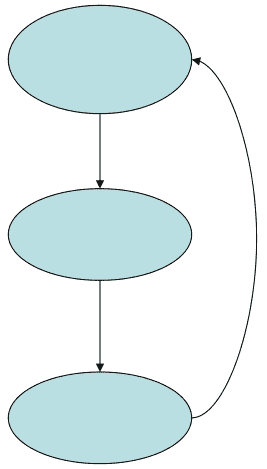

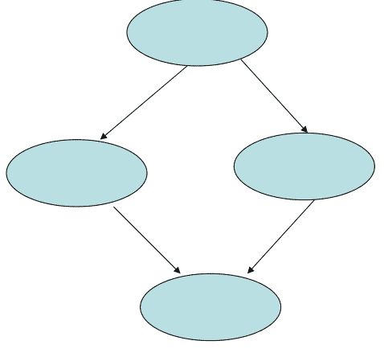

循环语句的流程图

If-then-else语句的流程图

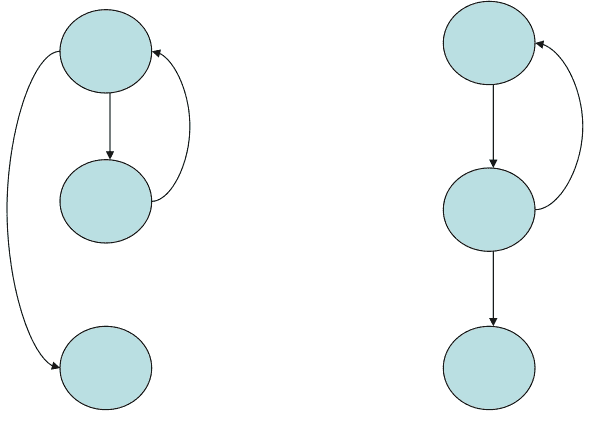

while循环语句的流图

Until循环语句的流图

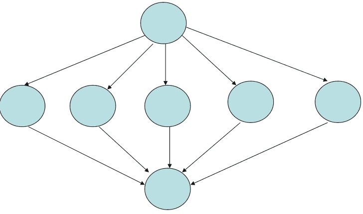

Case语句的流图

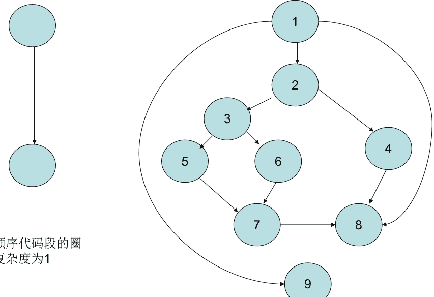

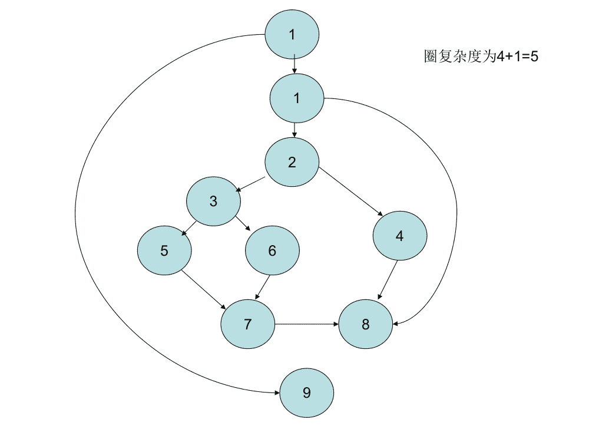

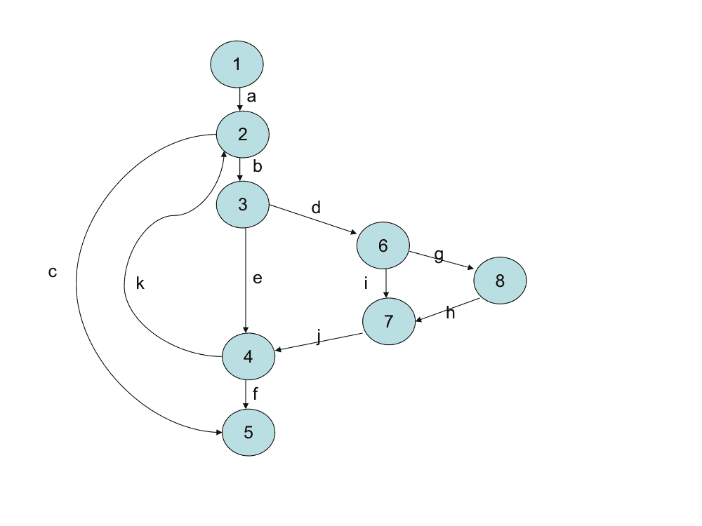

| 连接 | 1 | 2 | 3 | 4 | 5 | 6 | 7 | 8 | 连接 |
|------|---|---|---|---|---|---|---|---|---|
| 1 | 0 | 1 | 0 | 0 | 0 | 0 | 0 | 0 | 1-1=0 |
| 2 | 0 | 0 | 1 | 0 | 1 | 0 | 0 | 0 | 2-1=1 |
| 3 | 0 | 0 | 0 | 1 | 0 | 1 | 0 | 0 | 2-1=1 |
| 4 | 0 | 1 | 0 | 0 | 1 | 0 | 0 | 0 | 2-1=1 |
| 5 | 0 | 0 | 0 | 0 | 0 | 0 | 0 | 0 | / |
| 6 | 0 | 0 | 0 | 0 | 0 | 0 | 1 | 1 | 2-1=1 |
| 7 | 0 | 0 | 0 | 1 | 0 | 0 | 0 | 0 | 1-1=0 |
| 8 | 0 | 0 | 0 | 0 | 0 | 0 | 1 | 0 | 1-1=0 |
|  |  |  |  |  |  |  |  |  | 连接总数 4 |
|  |  |  |  |  |  |  |  |  | 圈复杂 4+1=5 |

##### 基本路径测试

- 路径：
- 独立路径：至少新加入一个新语句或新条件的路径
- 基本路径：
  - 必须是独立路径
  - 而且不存在循环迭代的子路径

##### 基本路径测试

- 基本过程
  - 画控制流图
  - 计算圈复杂度（确定基本路径数目）
  - 选择基本路径集合
  - 为每条路径生成测试用例
- 用例生成
  - 1.生成流程图
  - 2.计算圈复杂度为2+1=3
  - 3.基本路径集
    - 路径1 S0,S1,S2,R
    - 路径2 S0,S1,S3,S5,S6,R
    - 路径3 S0,S1,S3,S4,S6,R
  - 4.构造测试用例
    - 1 . C=12
    - 2 C=7
    - 3 C=3


```
S0    public void func(int C) {
S1        if(C>10) {
S2            F=F+C;
               Flag = 1;
S3        } else if (C>5) {
S4            F=F-1;
               }
S5            F=C*12;
S6        }
```

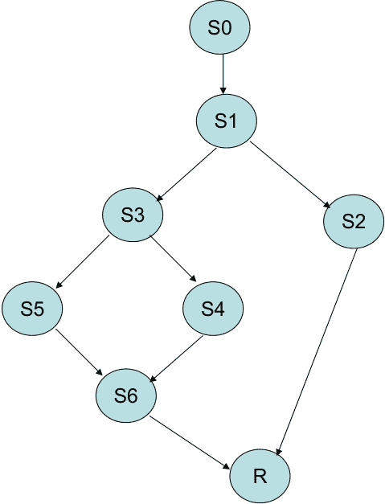

##### 数据流测试
- 根据处理和加工数据的过程，设计测试用例

```
int a =10;
System.out.println(a);
if (a>0) {
    语句块1
}else {
    语句块2
}
a=200;
语句块3
```

##### 循环测试
- 针对各种循环结构，设计测试用例
- 简单循环
  - 循环次数：0，1，2，m，n-1,n，n+1
- 嵌套循环
  - 从内层循环开始，并对其执行简单循环测试
  - 逐层向外测试，期间保持内层循环次数为典型值，其它层最小
- 顺序循环
- 带跳转的循环

#### 黑盒测试
- 黑盒测试
  - 基于需求文档
  - 从用户的角度测试
- 黑盒测试的特点
  - 测试对象可大可小
  - 测试人员的素质要求可以降低一些
  - 良好用例的选择比较困难

##### 等价类划分法
- 分割输入域和输出域，以减少用例数目
- 用例生成
  - 输入域至少要分成合法输入域和非法输入域
  - 合法输入域还可以细分成更小的等价类

##### 边界值分析
- 等价类法的边界问题
- 边界值分析
  - 针对边界(输入边界、输出边界、其它边界）选择测试用例
- 用例生成
  - 输入边界：选择边界上，边界内一点，边界外一点的测试用例
  - 输出边界：选择边界上，边界内一点，边界外一点的测试用例
  - 其它边界

##### 其它测试方法
- 基于规则的测试
- 基于有限状态机的测试
- 变异测试
- 基于故障攻击的测试
- 灰盒测试

#### 测试的覆盖率
- 语句覆盖率
- 路径覆盖率
- 分支覆盖率
- 条件覆盖率
- 功能覆盖率

#### 静态分析（测试）方法
- 静态测试  
  - 不执行代码  
  - 各开发阶段均可使用  
  - 利于早期发现缺陷

- 对比动态测试  
  - 优点：  
    - 效率高，单位成本低  
    - 覆盖率高  
    - 灵活  
  - 不足：  
    - 人的能力有限，通常适用于较高层次或较低的单元测试中  
    - 测试效果与测试人员的能力关系较大  
    - case工具的能力有局限性。

##### 静态测试技术的分类

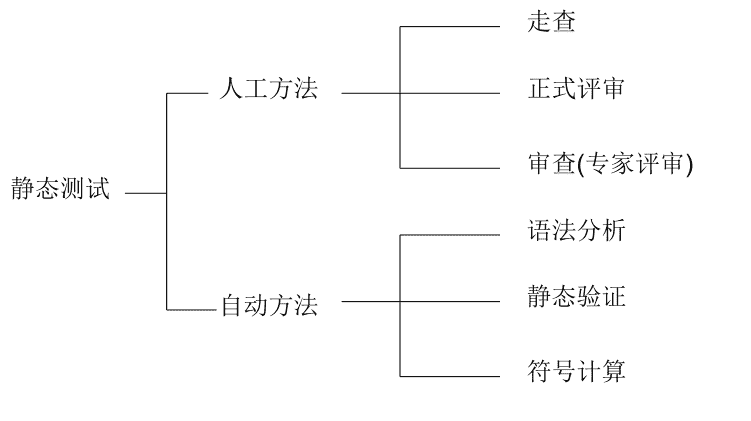

###### 人工方法—走查
- 走查：人工检查文档和代码中的问题
- 走查目的：
  - 发现错误
  - 尽早发现问题
  - 促进了解领域或业务知识
  - 发现技术难点、可用性难点及关键风险等
  - 增加项目的可控性

## 人工方法一走查
- 规格说明走查  
  - 走查内容：规格说明 / 项目计划 / 需求分析  
  - 走查依据：部署图、数据流图、E — R 图等

- 设计走查  
  - 走查内容：概要设计和详细设计  
  - 走查依据：结构图、设计文档等

- 代码走查

- 测试走查  
  - 走查内容：测试计划、测试步骤  
  - 走查依据：测试计划、测试策略、测试用例范例等

## 人工方法一审查
- 审查：发现某阶段的特定成果中的问题，但不要求解决。
- 参与人员：审查负责人、记录人、开发人员(对开发成果负责)、一个(多个)专家
- 审查步骤
  - 1.总体规划 2.准备文档材料 3.审查 4.返工 5.追查
- 审查的过程及结果：
  - 1通过(不需再审查) 2.返工部分需再验证 3.重新审查

## 人工方法一评审
- 评审：在开发的各阶段结束时，评估产品本身及其管理过程。

- 管理评审：

- 技术评审：

- 包括需求评审、规格说明评审、概要设计评审、详细设计和关键设计评审等

- 技术评审的结果—技术评审检查表

###### 静态的自动法
- 语法分析器

- 静态验证

- 符号计算

#### 附表 1：软件需求评审检查表

| 编号 | 检查项 | 是 | 否 |
|---|---|---|---|
| 1 | 功能性需求是否覆盖了所有异常？ | | |
| 2 | 模型、算法、数值计算技术之间的相容性是否已检查？ | | |
| 3 | 人机交互接口的充分性是否已检查？ | | |
| 4 | 设计 / 实现的约束是否合理？ | | |
| 5 | 设计、操作、维护的可行性是否已检查？ | | |
| 6 | 是否存在需求被定义了一次以上？ | | |
| 7 | 容错或主动降级需求是否明确？ | | |
| 8 | 需求规格说明是否有效，并为后续的开发设计、设计测试用例等建立了良好基础？ | | |
| 9 | 需求是否是可以验证的？ | | |

#### 附表 2：软件设计评审检查表

| 编号 | 检查项 | 是 | 否 |
|---|---|---|---|
| 1 | 设计特征是否与需求一致？ | | |
| 2 | 设计是否实现了每个接口要求的程序行为？ | | |
| 3 | 是否包含了需要的处理步骤？ | | |
| 4 | 是否指明了每个决策点的可能结果？ | | |
| 5 | 是否在设计中考虑了所有的预期情形和条件？ | | |
| 6 | 是否能确保设计配置变更的完整性？ | | |
| 7 | 每个程序是否只有一个功能？ | | |
| 8 | 设计是否有良好的结构化？ | | |
| 9 | 是否避免了不必要的设计复杂性和表示方式？ | | |

## 第二部分 软件测试的方法

### 验证与确认
#### 确认

用户的实际期望

需求规格说明

实现

#### 验证

### 测试中考虑
- 需求规格说明的精确性
- 测试目标的准确描述
- 终端用户的可接受性
- 自动化工具的辅助
- 测试过程的监控与改进
- 测试的终止
- 测试的成本
- 其它

### 测试的前提
- 1. 测试用从模块级别开始，逐步扩展到整个系统的集成
- 2. 测试应是一个循环渐进的过程
- 3. 自底向上的方式更适合
- 4. 不同的测试技术适用于不同情况
- 5. 测试最好独立进行
- 6. 验证关注是否在正确地构造产品
- 7. 确认关注是否在构造正确的产品
- 8. 其它

### 常用的软件测试策略

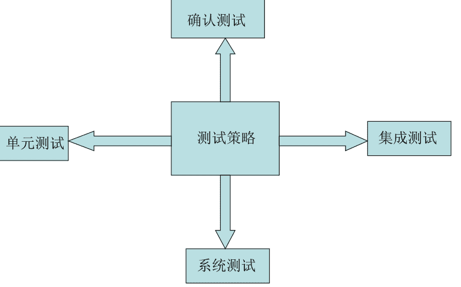

### 单元测试
- 测试对象：孤立的软件片段（文件、函数、模块、构件等）
- 针对的主要软件缺陷
  - 模块的接口
  - 模块的局部数据结构
  - 模块的边界条件
  - 模块中的正常路径
  - 模块中的各错误处理路径

#### 单元测试的过程
- 计划阶段
  - 完成《单元测试计划》
- 设计阶段
  - 设计测试用例集
- 执行阶段
  - 执行用例，记录缺陷，反馈给开发人员，同时跟踪缺陷的纠正
- 评估阶段
  - 评估测试的完备性和覆盖性，最好给出测试对象一个可度量的评价
- 总结阶段
  - 生成测试报告

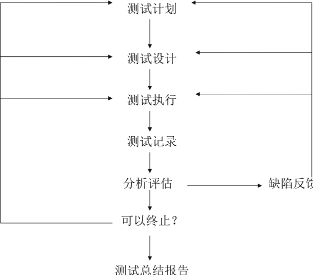

测试计划

测试设计

测试执行

测试记录

分析评估

缺陷反馈及跟踪

可以终止？

测试总结报告


#### 单元测试技术
- 静态测试技术
- 动态测试技术
- 功能性测试技术
  - 等价类划分
  - 边界值分析
  - 非法输入格式测试
  - 特殊值测试
  - 输入域测试
  - 输出域测试
- 结构化测试技术
  - 语句测试
  - 分支测试
  - 条件测试
  - 表达式测试
  - 路径测试
- 基于错误的测试技术
  - 故障植入
  - 变异测试

### 集成测试
- 目标：检查是否按设计要求、正确地用单元（已测试）构造程序。即查找单元间相互协作和互操作性的问题。
- 必要性：
  - 质量不高的单元，易致系统失效
  - 但高质量的单元，不能保证系统有效
- 主要针对的软件缺陷
  - 接口通信时，数据是否丢失
  - 接口通信时，输出域与输入域的匹配问题
  - 模块对其它模块的负作用
  - 功能的正确性

### 集成测试
- 集成测试的技术  
  - 功能性测试：使用黑盒技术测试模块的接口  
  - 非功能性测试：使用黑盒和白盒测试模块的性能
- 集成测试的策略  
  - 大爆炸式策略：  
  - 增量式测试策略：

#### 增量式集成测试
- 自顶向下的集成
- 自底向上的集成
- 三明治集成
- 核心(中枢)式集成

#### 自顶向下的集成
- 过程
  - 1. 以主控模块为驱动模块
  - 2. 编写测试模块需要的所有桩模块
  - 3. 测试本次集成
  - 4. 用一个实际模块代替一个桩模块
  - 5. 为这个实际模块编写必要的桩模块
  - 6. 测试本次集成
  - 7. 最后，所有桩模块都被实际模块代替
  - 8. 执行回归测试

#### 自顶向下的集成图示
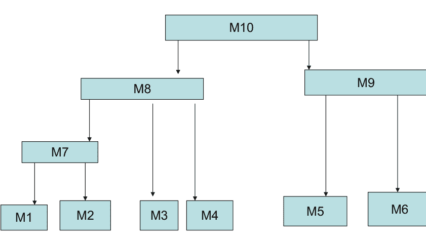

#### 自底向上的集成
- 过程
  - 1. 按子功能分组：将多个底层模块集成一组
  - 2. 对每一组执行测试
  - 3. 将两个或多个组再集成成为一组
  - 4. 为3中的组编写的驱动模块
  - 5. 执行测试
  - 6. 用实际模块替换驱动模块
  - 7. 重复

#### 自底向上的集成图示
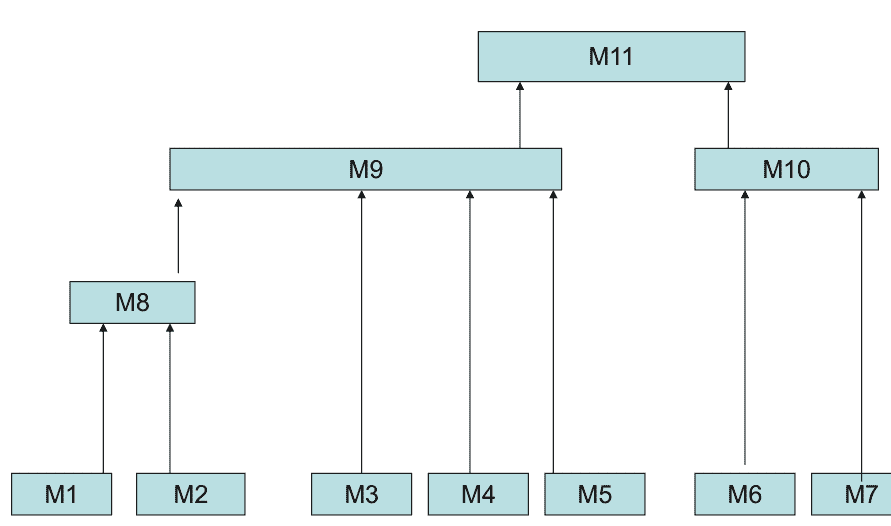

#### 三明治集成
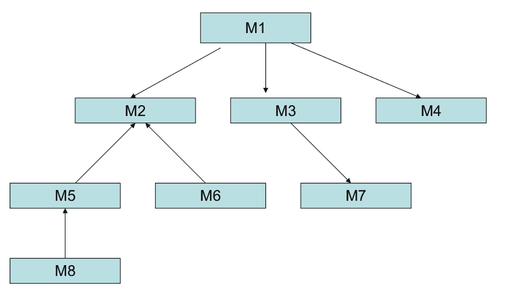

#### 核心(中枢)集成
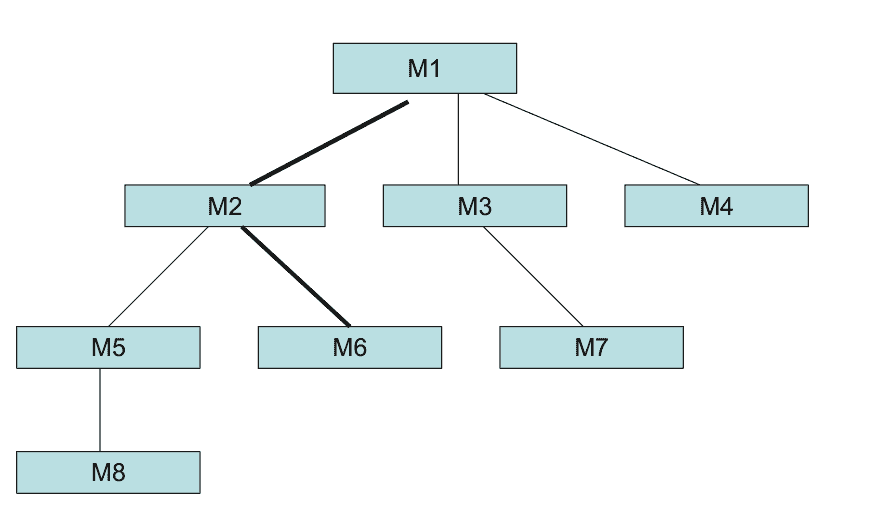

### 系统测试
- 系统测试通常由一系列不同的测试组成。包括系统功能性测试和系统非功能性测试。
- 系统功能性测试：
- 系统非功能性测试：
- 系统测试包括(典型): 恢复测试、安全测试、压力测试、容量测试、性能测试等

### 系统测试
- 恢复测试：检查各种导致系统失效的条件，验证系统在失效情况下的恢复过程。
- 安装测试：测试在不同软件和硬件环境下，系统安装的情况。
- 安全测试：检查系统的保护机制，包括利用系统漏洞入侵、密码破解、非授权访问等。
- 压力测试：在正常运行资源下，却有异常访问量、访问频率或数据量下，系统的执行情况。
- 性能(performance)测试：系统运行时的各种能力的表现情况。细分如基准(比较)测试、竞争测试、

### 确认测试（验收测试）
- 完全从用户的角度看待系统的各方面表现
- 常见形式:
  - 以合同为标准
  - 由用户组织测试
  - 用户实际操作测试
  - 现场测试:
    - Alpha测试
    - Beta测试

### 其它关于测试的概念
- 回归测试
- 软件度量
- 软件缺陷估计
- 其它

### 软件测试的模型
- V-模型
- W-模型
- B-模型

### 测试计划的层次
#### 主测试计划
#### 验收测试计划
#### 系统测试计划
#### 集成测试计划
#### 单元测试计划
#### 需求
#### 系统规格说明
#### 高层设计
#### 详细设计
#### 代码

### 主测试计划(经典)
- 1. 介绍
- 2. 测试参考文档及提交文档
- 3. 测试进度安排
- 4. 测试资源
- 5. 风险管理
- 6. 测试策略
- 7. 缺陷标识说明

#### 主测试计划-1.介绍
- 项目名称
- 测试目的
  - 总结说明：测试对象、测试过程(时间、标准、交付物)、其它评估性内容(工作量、质量等)
- 项目背景说明
  - 项目的应用背景，主要功能和非功能性要求，项目的硬件结构和要求，分布式要求等。
- 范围
  - 简要说明针对哪些阶段性测试、何种测试技术、使用哪些工具、各阶段主要风险

#### 主测试计划-2.测试参考文档及提交文档
- 测试参考文档列表
  - 如可行性分析报告、项目投标书、项目需求定义（软件和硬件）、项目分析报告、概要设计、详细设计、测试计划等
- 提交文档列表
  - 测试计划、测试用例设计表、测试结果报告、缺陷修复情况表、测试结果分析及评估报告等

都应包括名称、时间、撰写人(提交人)、备注等信息

#### 主测试计划-3.进度安排计划
| 内容 | 计划开始日期 | 计划结束日期 | 实际开始日期 | 实际结束日期 |
|---|---|---|---|---|
| 制定计划 |  |  |  |  |
| 单元测试 |  |  |  |  |
| 集成测试 |  |  |  |  |
| 系统功能测试 |  |  |  |  |
| 性能测试 |  |  |  |  |
| 恢复测试 |  |  |  |  |
| ... |  |  |  |  |
| 验收测试 |  |  |  |  |
| 发布 |  |  |  |  |

#### 主测试计划-4.测试资源
- 时间
- 人力成本
  - 人员数量、角色分工、能力要求、工作时间、具体职责、配合部门(人员)
- 环境
  - 软件资源(基础软件、辅助软件、操作系统等)
  - 硬件资源(硬件设备(打印机、扫描仪等)，网络设备(网关、服务器、无线传输设备的)
- 辅助工具
  - 名称、主要功能及用途、版本、生产商、价格、同类备选工具说明

#### 主测试计划-5.风险管理
- 主要风险
- 应对策略及优先级控制

#### 主测试计划-6.测试策略
- 数据完整性测试
- 单元测试
- 集成测试
- 系统功能测试
- 用户界面测试
- 性能测试
- 安全测试
- ...

每类测试应指明测试的范围、采用的技术、启动条件、结束条件、测试重点、应急方案

#### 主测试计划-7.缺陷标识说明
- 缺陷等级划分
  - 一级：功能性错误
  - 二级：有时功能性错误
  - 三级：错误使用导致功能性错误
  - 四级：有待改进的缺陷
- 缺陷修复标识
  - 可忽略
  - 已指派
  - 已修复
  - 修复仍有缺陷
  - 待修复
  - 未修复

### 多层次的测试计划
制定测试计划的目的：
- 1. 确定测试的整体方案和策略
- 2. 确定测试环境
- 3. 协调不同级别的测试活动
- 4. 确定评估测试结果的方法
- 5. 确定工作量及出口(结束条件)
- 6. 确定需要准备的文档和模板
- 7. 确定回归测试或再次测试的方案

### 测试计划参考结构(IEEE829)
- 1. 测试计划标识
  — 项目名称、版本、标识号
- 2. 项目介绍
  — 项目应用背景、目的等的简要概述；
  — 参考的文档及标准:如高层次的测试计划、行业标准、国家标准、公司标准、授权合同、规格说明等
- 3. 测试项
  — 测试对象的简单概述
  — 测试对象的名称、版本、标识号
- 4. 需要测试的特性
  — 根据级别的不同，确定相应的测试内容
- 5. 不需要测试的特性
  — 根据级别的不同，实际条件(时间、人员、环境等)来具体确定
- 6. 测试方式
  — 根据级别的不同，确定
  — 选择测试用例的标准、目的、要求。
  — 选择测试用例集的方法
- 7. 测试通过/失败准则(测试的出口准则)
  — 根据级别的不同，测试对象的不同，确定相应的准则
  — 根据安全及风险分析，制定出口标准。
- 8. 挂起准则和恢复准则
  — 制定尽早结束无效测试的准则
  — 制定恢复测试活动的准则


### 测试计划参考结构(IEEE829)

9. 测试的交付物
- 如测试计划、测试进度表、测试总结报告
10. 测试任务
- 进度表中，测试活动的各项工作的完成情况(启动、进行中、延期、已完成)
11. 环境要求
12. 责任—各成员在测试活动中的责任和权限
13. 人员配备及培训要求
14. 进度表
- 整个测试活动的进度情况及完成情况
- 与整个项目一致
15. 风险、意外事件及应对方法
16. 审批
17. 附件
