# 哈工大C语言课件（赵岩）


+   - 赵岩
+   - 哈工大计算机学院博士
+   - 荷兰格罗宁根大学博士生
+   - 工大软件学院高级讲师

## 联系方式

+   - email: zhaoyanhit@hit.edu.cn
+   - qq: 1619604531
+   - 人人: www.renren.com/zhaoyanhbr
+   - 微博: www.weibo.com/zhaoyanhbr
+   - homepage: www.hrbxinzhi.com/zhaoyansite

## 下载课件(Slides)

http://cms.hit.edu.cn/course/view.php?id=100


## 基本情况

+   - 赵岩
+     - 哈工大计算机学院博士
+     - 荷兰格罗宁根大学博士生
+     - 工大软件学院高级讲师
+   - 联系方式
+     - email: zhaoyanhit@hit.edu.cn
+     - qq: 1619604531
+     - 人人: www.renren.com/zhaoyanhrb
+     - 微博: www.weibo.com/zhaoyanhrb
+     - homepage: www.hrbxinzhi.com/zhaoyansite
+   - 下载课件(Slides)
+     - http://cms.hit.edu.cn/course/view.php?id=100


## 老师特点

+   - 优点
+     - 动手能力强
+     - 不照本宣科
+     - 孩子的心
+   - 缺点
+     - 积极性差
+     - 有的时候会跑题
+     - 管理性差

## 老师特点

+   - 优点
+     - 动手能力强
+     - 不照本宣科
+     - 孩子的心
+   - 缺点
+     - 积极性差
+     - 有的时候会跑题
+     - 管理性差

## 课时安排 (40学时)

+   - 0 概述(2学时)
+   - 1 类型、运算符与表达式(4学时)
+   - 2 观其大略(2学时)
+   - 3 控制结构(6学时)
+   - 4 函数(4学时)
+   - 5 预处理命令与模块化编程(2学时)
+   - 6 数组(4学时)
+   - 7 指针(6学时)
+   - 8 结构体与共用体(6学时)
+   - 9 文件操作(4学时)

## 课程网络化管理

+   - 乐学网 http://cms.hit.edu.cn

## 课程管理和分数分配

+   论坛表现 (5分)

+   每发一个有价值的帖子，奖励0.5分

+   实验 (50分)

+   在线评测，自动抓取

+   difficult

+   期末考试 (50分)

+   开卷！

+   essay

## 课程管理和分数分配

+   - 论坛表现（5分）
+     - 每发表一个有价值的帖子，奖励0.5分
+   - 实验（50分）
+     - 在线评测，自动抓抄袭。
+     - difficult
+   - 期末考试（50分）
+     - 开卷？！
+     - easy

## 课程管理和分数分配

+   - 讨论表现（5分）
+     - 每发表一个有价值的帖子，奖励0.5分
+   - 实验（50分）
+     - 详细讲解，自动扣分。
+     - difficult
+   - 期末考试（50分）
+     - 开卷！！
+     - easy

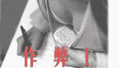

## 课程管理和分数分配

+   - 论坛表现（5分）
+     - 每发表一个有价值的帖子，奖励0.5分
+   - 实验（50分）
+     - 在线评测，自动抓取装。
+     - difficult
+   - 期末考试（50分）
+     - 开卷！！
+     - easy


## 实验作业

+   - 雷同作业
+     - 清掉所有作业分
+     - 抄袭双方0分
+   
+   - 如何抓？
+     - 系统自动分析相似度
+     - 直接面试或考试确认
+   
+   - 请君入瓮！


## 实验作业

+   - 雷同学作业
+     - 青草岗有作业分
+     - 抄袭双双0分
+   - 如何抓？
+     - 系统自动分析相似度
+     - 直接面试或考试确认
+   - 请君入瓮！


## 实验操作

+   - 需同作业
+     - 清楚所有作业分
+     - 抄袭双方0分
+   - 如何抓？
+     - 系统自动分析相似度
+     - 直接断试或考试确认
+   - 请君入瓮！


## 课堂纪律

+   - 鼓励
+     - 课堂互动（鼓励响哑！）
+     - 网络交互–cms.hit.edu.cn，QQ，Email...
+   - 默许
+     - 小声接电话
+     - 暑日传情
+     - 摆一摆衣袖，轻轻的走，悄悄地来
+     - 无声喝到宿教区送食物
+     - 睡觉，看书，看报
+     - 使用笔记本（电脑）
+   - 禁止
+     - 手机铃声
+     - 窃窃私语，自言自语
+     - 课上提问题

## 课堂纪律

+   - 鼓励
+     - 课堂互动（鼓励哨响！）
+     - 网络交互-cms.hit.edu.cn, QQ, Email...

+   - 默认
+     - 小声接电话
+     - 眉目传情
+     - 挥一挥衣袖，轻轻的走，悄悄地来
+     - 无声响和沉默似鸡道食物
+     - 敲着，看书，看报
+     - 使用笔记本（电脑）

+   - 禁止
+     - 手机铃声
+     - 窃窃私语，自言自语
+     - 课上提问题

## 课堂纪律

+   - 鼓励
+     - 课堂互动（鼓励啦啦！）
+     - 网络交互—cms.hit.edu.cn; QQ, Email...
+   - 默许
+     - 小声接电话
+     - 眉目传情
+     - 挥一挥衣袖，轻轻的走，悄悄地来
+     - 无声响和深郁味道食物
+     - 嘀咕，看书，吞报
+     - 使用笔记本（电脑）
+   - 禁止
+     - 手机铃声
+     - 窃窃私语，自言自语
+     - 课上提问题

## 计算机的学习方针

+   - 计算机科学？
+   - 应用驱动
+     - 通信
+     - 计算
+     - 娱乐
+     - ...
+   - 问题驱动
+     - 我们什么都不全，怎么才？
+     - 问题=解决
+     - 能力就上升

## 计算机的学习方针

+   - 计算机科学？
+   - 应用驱动
+     - 通信
+     - 计算
+     - 娱乐
+     - ...
+   - 问题驱动
+     - 我们什么都不舍，怎么办法？
+     - 问题→解决
+     - 螺旋式上升


## 计算机的学习方针
- 计算机科学？
- 应用驱动
  - 通讯
  - 计算
  - 娱乐
  - ...
- 问题驱动
  - 我们什么都不会，怎么办？
  - 问题→解决
  - 螺旋式上升

## 计算机的学习方针
- 计算机科学？
- 应用驱动
  - 通讯
  - 计算
  - 娱乐
  - ...
- 问题驱动
  - 我什么都不会，怎么办？
  - 问题→解决
  - 螺旋式上升


## 最早的计算机
- 出生地点: 中国
- 出生年代: 不详
- 能耗指数: 零
- 计算速度: 快

## 最早的计算机
- 出生地点:中国
- 出生年代:不详
- 能耗指数:零
- 计算速度:快

## 最早的计算机
- 出生地点:中国
- 出生年代:不详
- 能耗指数:零
- 计算速度:快

## 最早的计算机
- 出生地点:中国
- 出生年代:不详
- 能耗指数:零
- 计算速度:快

## 最早的计算机
- 出生地点:中国
- 出生年代:不详
- 能耗指数:零
- 计算速度:快


## 进度
● 十进制：10个数(0, 1, 2...9)，逢10进位。

## 进制
- 十进制：10个数(0, 1, 2...9)，逢10进位。

## 问题
为什么我们人类社会用十进制计数呢？

## 进制
- 十进制：10个数(0, 1, 2...9)，逢10进位。
- 其它进制：十二进制，六十进制，十六进制（半斤八两）...

## 进制
- 十进制：10个数(0, 1, 2...9)，逢10进位。
- 其它进制：十二进制，六十进制，十六进制（半斤八两）...
- 二进制：——共有2个数(0,1)，逢2进位。

## 进制
- 十进制：10个数(0, 1, 2...9)，逢10进位。
- 其它进制：十二进制，六十进制，十六进制（半斤八两）...
- 二进制：——共有2个数(0,1)，逢2进位。

|  | 10^1 (10) | (1) |
|---|---|---|
| 加数 | 0 | 7 |
| 被加数 | 0 | 4 |
| 和 | 1 | 1 |

|  | 2^3 (8) | 2^2 (4) | 2^1 (2) | 1 |
|---|---|---|---|---|
| 加数 | 0 | 1 | 1 | 1 |
| 被加数 | 0 | 1 | 0 | 0 |
| 和 | 1 | 0 | 1 | 1 |

## 进制
- 十进制：10个数(0, 1, 2...9)，逢10进位。
- 其它进制：十二进制，六十进制，十六进制（半斤八两）...
- 二进制：只有2个数(0,1)，逢2进位。

|  | 10^1 (10) | (1) |
|---|---|---|
| 加数 | 0 | 7 |
| 被加数 | 0 | 4 |
| 和 | 1 | 1 |

| 2^3 (8) | 2^2 (4) | 2^1 (2) | 1 |
|---|---|---|---|
| 加数 | 0 | 1 | 1 | 1 |
| 被加数 | 0 | 1 | 0 | 0 |
| 和 | 1 | 0 | 1 | 1 |

- 这个世界上只有10种人，一种懂二进制的人，一种不懂二进制的人。

- 中文名：约翰-冯诺依曼
- 英文名：John von Neumann
- 国籍：美籍匈牙利人
- 生辰：1903—1957

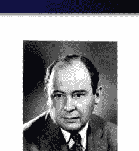

## 冯·诺依曼
- 中文名：约翰·冯·诺依曼
- 英文名：John von Neumann
- 国籍：奥籍匈牙利人
- 生年：1903~1957

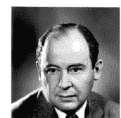

## 冯·诺依曼
- 中文名：约翰·冯·诺依曼
- 英文名：John von Neumann
- 国籍：美籍匈牙利人
- 生辰：1903~1957

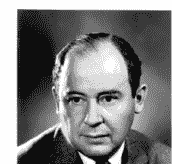

## 冯·诺依曼
- 中文名：约翰·冯·诺依曼
- 英文名：John von Neumann
- 国籍：美籍匈牙利人
- 生辰：1903—1957

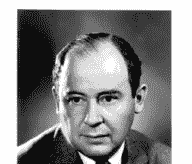

## 贡献——工程方面
- 将2进制引入计算机
- 规定了计算机的五大部分
- 并描述了这五部分的功能和关系。

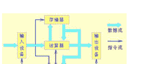

## 贡献——工程方面
- 将2进制引入计算机
- 规定了计算机的五大部份
- 并描述了五个部分职能和相互关系。

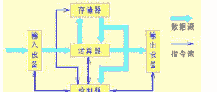

## 电子管计算机
- 英文名: Electronic Numerical Integrator And Computer (ENIAC)
- 中文名: 埃尼阿克
- 占地面积达170平方米、重达30吨。
- 1秒钟内进行了5000次加法运算和500次乘法,比继电器计算机快1000倍。


## 电子管计算机
- 英文名: Electronic Numerical Integrator And Computer (ENIAC)
- 中文名: 埃尼阿克
- 占地面积约170平方米，重达30吨。
- 1秒钟内进行了5000次加法运算和500次乘法,比继电器计算机快1000倍。


## 电子管计算机
- 英文名: Electronic Numerical Integrator And Computer (ENIAC)
- 中文名: 埃尼阿克
- 占地面积达170平方米，重达30吨。
- 1秒钟内进行了5000次加法运算和500次乘法，比继电器计算机快1000倍。


## 电子管计算机
- 英文名: Electronic Numerical Integrator And Computer (ENIAC)
- 中文名: 埃尼阿克
- 占地面积达170平方米，重达30吨。
- 1秒钟内进行了5000次加法运算和500次乘法，比继电器计算机快1000倍。


## 艾伦·图灵
- 中文名：艾伦·图灵
- 英文名：Alan Turing
- 国籍：英国
- 出生：1921年—1954年

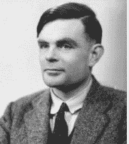

## 艾伦·图灵
- 中文名：艾伦·图灵
- 英文名：Alan Turing
- 国籍：英国
- 生年：1912年—1954年

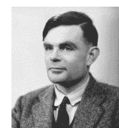

## 艾伦·图灵
- 中文名：艾伦·图灵
- 英文名：Alan Turing
- 国籍:英国
- 生辰：1912年-1954年


## 夏娃—图灵
- 中文名：艾伦·图灵
- 英文名：Alan Turing
- 国籍：英国
- 生年：1912年—1954年

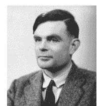

## 贡献——理论方面
- 图灵机⇒问题的可计算性
- 图灵假设⇒分辨不出人和机器
- 图灵预言⇒本世纪末，会有智能的计算机出现

- 1997年，IBM深蓝击败了象棋大师卡斯帕罗夫
- 卡斯帕罗夫感觉电脑的决定有“创意”
- 以前那么“难”的事情，现在那么容易。以前那么“容易”的事情，现在那么难。

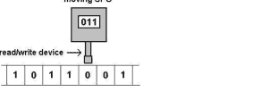
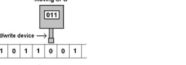
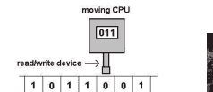


## 晶体管起源
- 1947年，贝尔实验室，肖克利、巴丁、布拉顿三人
- 利用半导体（硅、锗）的单向导电性发明了晶体管。
- 1956年，肖克利等三人，同时荣获诺贝尔物理学奖。


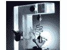

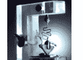

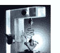

## 八“叛逆”
- 1955年，晶体管的发明者肖克利回到硅谷，创办肖克利实验室。
- 以诺依斯（N.Noyce）、摩尔（G.Moore）为首的八位青年科学家，加盟肖克利实验室。
- 两年后，八人集体叛逃，成立“Fairchild”，中文为“仙童”公司。
- 诺依斯（N.Noyce）发明了集成电路。
- 摩尔（G.Moore）发现了摩尔定律：18个月芯片速度翻一番。（价格降一倍）


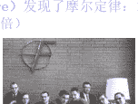
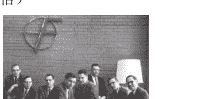

## Intel成立
- 1968年，诺依斯（N.Noyce）、摩尔（G.Moore）创立了一个企业，取名：Moore Noyce
- 谐音为：More Noise 更多噪音，后改名(Intel)英特尔公司。
- 1974年：英特尔发布了其第一个微处理器8080。
- 1978年：英特尔把8088微处理器销售给IBM，IBM利用其开发了自己的微型电脑IBM-PC。
- 286、386、奔腾、奔腾III、酷睿双核...


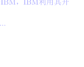


## 牛郎星
- 1975年，爱德华利用Intel8080开发了一个微型电脑→牛郎星。
- 电脑就像神一样，有专门的“神坛”，需要专人穿着白大褂的“祭师”来负责交流。
- DIY (Do It Yourself) 自己组装电脑。


## 中学的电话
- 把牛顿星从玩具变成工具需要织女：一种计算机语言。
- “我可以给牛顿星编写一套计算机语言”，三周后交货

把牛顿星从玩具变成工具需要织女：一种计算机语言。

“我可以给牛顿星编写一套计算机语言”，三周后交货

- 借助于BASIC语言，1975年，微软成立。


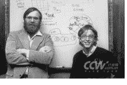

## 苹果诞生
- “我们可以做得更好！”
- 1977年，乔布斯开发出了Apple II。
- 企业的基因。
- 微软的合作，苹果的超越。


## 疯狂的苹果
- 短短5年时间内，苹果营业额跃升10亿美元。
- 跨进美国最大500家公司的行列。

FORTUNE
500

## 跳舞的大象——IBM
- 1978年，IBM利用英特尔8088微处理器推出了IBM PC。
- 技术规范公开——兼容机。
- 很快从苹果赢回了一部分的微机市场。

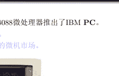
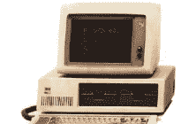
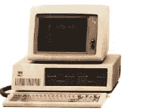

## 最失败的谈判
- 1981年，乔布斯雇微软为其图形界面开发应用软件。
- 给谁看都可以，就是不要给盖茨看。
- 忽略操作系统的认识，IBM和苹果都犯了致命的错误。
- 衣着随便，带着厚厚的眼镜的年轻人，几乎毁了苹果的命。


## 兼容机厂家
- 微软生产操作系统。
- Intel生产CPU。
- 飞利浦和索尼生产光驱。
- 3COM生产网卡。
- 3M生产软盘。
- IBM生产硬盘。
- 显示卡、键盘、鼠标。


## Apple
- 1985年，乔布斯被苹果公司开除。
- 1998年，苹果董事会请回乔布斯。
- 发明iPod mp3播放器。
- 推出智能手机iPhone，平板电脑iPad。
- 依靠创新，苹果完成从电脑生产厂商到高端时尚电子产品制造商的转型。

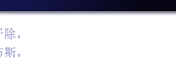
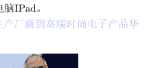


## 温拿


## 各自的特点
- 好的商业模式（google，dell）
- 创新（apple）
- 内容为王（yahoo，google）
- 送我上青天（sicio，nokia）
- 危机感（microsoft）
- 专一（IBM）

## Unix
- 一切从一个叫“Space Travel”的电子游戏开始……；
- 为了让他的游戏能在DEC PDP-7上运行，Ken Thompson用汇编语言给PDP-7写了一个操作系统——UNIX；
- 他在BCPL基础上，自己设计了一个B语言；
- UNIX开始发展，B也不够用了；
- Dennis Ritchie加入，把B改造成C，并开始用C重写UNIX；

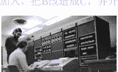
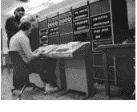
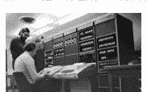
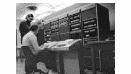

## 杰出的贡献


## Unix的不足
- Unix was like homer, handed down as oral wisdom.
- The world's First computer virus.
- Unix is user-friendly. It just isn't promiscuous about which users it's friendly with.
- Like Russian Roulette with Six Bullets Loaded.

> ——《The Unix Hater Handbook》

## 什么是程序
- 很像厨师的菜谱，定义了执行某个任务所需的步骤
- 如果计算机是乐队，程序就是乐谱，你就是音乐家
- 如果计算机是军队，程序就是作战计划，你就是总司令
- 但不幸的是，你不能使用你自己的母语来写程序

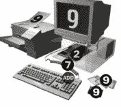
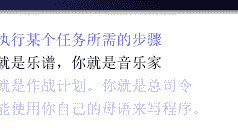


## 什么是程序

- 很像厨师的菜谱，定义了执行某项任务所需的步骤
- 如果计算机是乐队，程序就是乐谱，你就是音乐家
- 如果计算机是军队，程序就是作战计划，你就是总司令
- 但不幸和不同的是，你不能使用你自己的母语来写程序。

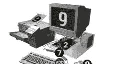

## 程序设计语言

- C语言编写的1+1程序
- 既不是英语，也非机器语言
- 比机器语言程序容易，但比使用英语难（要求没有歧义）

### Demo 1: A simple c example

```c
#include<stdio.h>
main()
{
    printf("%d\n",1+1);
}
```

## 语言的大致分类

### 编译语言

- c
- c++
- ...


### 解释语言

- Java
- c#
- ...


### 脚本语言

- perl
- python
- ...

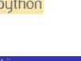

## 语言的编译运行

### 编译过程

- 程序员（Programmer）编写程序源代码（Source Code）
- 编译器（Compiler）把源代码转换为可被计算机理解的机器代码（Machine Code），并把机器代码以可执行文件（Executable File）的形式保存在磁盘上

### 软件的运行

- 计算机把机器代码读入到内存（Memory），由CPU运行这些代码，读取输入（Input），产生输出（Output），完成程序员预定的功能

## C语言的工作原理

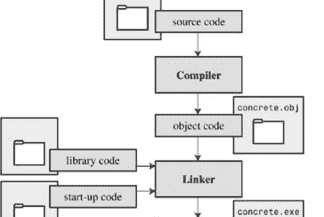

## C语言编写程序过程

- 分析（Analysis） — What is to be done?
- 设计（Design） — How is it to be done?
- 编码（Write）
- 编辑（Edit） 扩展名为.c的文件（对C而言）
- 编译（Compile） 扩展名为.obj的文件
- 链接（Link）
- 运行（Run）
- 调试（Debug）
- 可执行文件 扩展名为.exe的文件

## 语言的解释运行

- 解释运行过程
  - 程序员编写程序源代码
  - 解释器读入源代码，并执行源代码
- 解释运行的语言特点
  - 执行速度慢
  - 好学易用
- 先编译，后解释
  - 把源代码编译成更容易解释的中间代码，然后再解释运行

| Position Sep 2010 | Position Sep 2009 | Delta in Position | Programming Language | Ratings Sep 2010 | Delta Sep 2009 | Status |
|---|---|---|---|---|---|---|
| 1 | 1 | = | Java | 17.915% | -1.47% | A |
| 2 | 2 | = | C++ | 17.147% | -0.29% | A |
| 3 | 4 | ↑ | C# | 9.812% | -0.18% | A |
| 4 | 3 | ↓ | PHP | 8.370% | -1.79% | A |
| 5 | 5 | = | (Visual) Basic | 5.797% | -3.40% | A |
| 6 | 7 | ↑ | C | 5.015% | +0.83% | A |
| 7 | 8 | ↑ | Python | 4.583% | +0.65% | A |
| 8 | 18 | ↑↑↑↑↑↑↑↑↑↑ | Objective-C | 3.368% | +2.78% | A |
| 9 | 5 | ↓↓↓↓ | Perl | 2.447% | -2.00% | A |
| 10 | 10 | = | Ruby | 1.907% | -0.47% | A |
| 11 | 9 | ↓↓ | JavaScript | 1.865% | -1.33% | A |

## C语言的特点

- 是一种高级语言
  - 高级语言并不是“高级”，只是相对低级语言，在一个高的级别上进行编程
- 历史悠久，战功卓著
  - 诞生于上世纪70年代初，成熟于80年代（C89），修订于90年代（C99）
  - 很多重量级软件都是用C写的
- 很多流行语言、新生语言都借鉴了它的思想、语法
  - 从C++，到Java，再到C#，还有php等
- 现状
  - 嵌入式领域和系统级编程占主流
  - 桌面和网络应用不多


## C语言的特点

- 是一种高级语言
  - 高级语言并不是“高级”，只是相对低级语言，在一个更高的级别上进行编程
- 历史悠久，功勋卓著
  - 诞生于上世纪70年代初，成熟于80年代（C89），修订于90年代（C99）
  - 很多重量级软件都是用C写的
- 很多流行语言、新生语言都借鉴了它的思想、语法
  - 从C++，到Java，再到C#，还有PHP等
- 现状
  - 嵌入式领域和系统级编程占主流
  - 桌面和网络应用不多

## C语言的地盘

- 高级语言的地盘
  - 应用程序 (Application)
  - 基于平台应用程序
  - 应用平台
- 低级语言的地盘
  - 操作系统 (OS)
  - 硬件 (Hardware)

## C语言的精神

- 信任程序员。
- 不要阻止程序员做他认为应该做的事。
- 保持语言的精巧和简单。
- 对一种操作只提供一种方法。
- 一定要快，哪怕这么做是不可移植的。

> ——引自《Rationale for C99》

## 学好C语言的方法

- 学习编程最好的方法之一就是阅读源代码。
- 多读书，积累编程技巧。
- 善于利用身边的工具与环境。
- 不怕错误，在错误中成长。
- 学习编程的秘诀是：编程，再编程，再编程！
- Dirty your hands

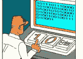

> REAL Programmers code in BINARY.

## 优秀程序员的素质

- 良好的编程风格。
- 严谨的思维。
- 扎实的基础。
- KISS。（Keep it simple and Stupid）
- 好奇心。

## 成功者语录

- 永远渴望，大智若愚（Stay Hungry, Stay Foolish）
- 领袖和跟风者的区别就在于创新
  ——乔布斯（Apple 董事长）
- 无论公司有多大，18个月后都有可能倒闭
  ——比尔·盖茨（Microsoft 董事长）
- 只有偏执狂才能生存（Only The Paranoid Survive）
  ——安迪·格鲁夫（Intel前CEO）
- 这无关比特、字节和协议，而关乎利润和损益
  ——郭士纳（IBM前CEO）


## 成功者语录

- 永远渴望、大智若愚（Stay Hungry. Stay Foolish）
- 领导和跟风者的区别就在于创新。
  —乔布斯（Apple 董事长）
- 无论公司有多大，18个月后都有可能关闭
  —比尔盖茨（Microsoft 董事长）
- 只有偏执狂才能生存(Only The Paranoid Survive)
  —安迪·格鲁夫（Intel前CEO）
- 这无关比特、字节和议论,而关乎利润和损益
  —郭士纳（IBM前CEO）

## 失败者语录

- 计算机进入家庭是最不切实际的假想。
  — DEC 的总裁 Ken Olsen

- 全世界有五台电脑就足够了。
  — IBM 董事长 Thomas Watson

- 1996 年互联网产业由于增长过于快速，因此将像超新星一样爆炸后走向崩溃。
  — 3COM 公司迈特卡尔夫 (Metcalfe)

- 谷歌有五千年耐心在中国获得成功。
  — 李开复

- 看上去我们已经到达了利用计算机技术可能获得的极限了，尽管这样的结论听得小心，因为不出五年这听起来会相当愚蠢。
  — 冯诺依曼,1949年

## 失败者语录

- 计算机进入家庭是最不切实际的假想。
  ——DEC 的总裁 Ken Olsen

- 全世界有五台电脑就够了
  ——IBM 董事长 Thomas Watson

- 1996年互联网产业由于增长过于快速，因此将像超新星一样爆炸后而走向崩溃。
  ——3COM 公司首席执行官卡尔·梅特卡夫（Metcalfe）

- 谷歌有五千年耐心在中国获得成功
  ——李开复

- 看上去我们已经到达了利用计算机技术可能获得的极限了，尽管下这样的结论得小心，因为不出五年这听起来就会相当愚蠢
  ——冯诺依曼,1949年

## 失败者语录

- 计算机进入家庭是最不切实际的假想。
  —— DEC 的总裁 Ken Olsen
- 全世界有五台电脑就足够了
  —— IBM 董事长 Thomas Watson
- 1996年互联网产业由于增长过于快速，因此像昙花一现那样
  爆炸后而走向崩溃
  —— 3COM 公司迈特卡尔夫(Metcalfe)
- 谷歌有五千年耐心在中国获得成功
  —— 李开复
- 看上去我们已经到达了利用计算机技术可能获得的极限
  —— 令人担心这样的结论得小心，因为不出五年时听起来就会相当愚蠢
  —— 冯诺伊曼, 1949年

## 失败者语录

- 计算机进入家庭是最不切实际的假想。
  ——DEC 的总裁 Ken Olsen
- 全世界有五台电脑就足够了
  ——IBM 董事长 Thomas Watson
- 1996年互联网产业由于增长过于快速，因此将像超新星一样爆炸后而走向崩溃。
  ——3COM公司迈特卡尔夫(Metcalfe)
- 谷歌有五千年耐心在中国获得成功
  ——李开复
- 看上去我们已经到达了利用计算机技术可能获得的极限了，尽管下这样的结论得小心，因为不出五年这听起来就会相当愚蠢
  ——冯诺伊曼,1949年

谢谢大家，欢迎提问！


## 集成开发环境IDE

- 主要产品
  - Windows: Visual Studio
  - Linux: Vim+GCC+GDB
- 开发流程
  - 建立项目
  - 编辑文件
  - 编译、运行
  - 调试程序

## 符号分类

- 关键字（Keyword）
  - 又称为保留字，C语言中预先规定的具有固定含义的一些单词(if, while, ...)。详见附录B
- 标识符（Identifier）
  - 系统预定义标识符: main, printf
  - 用户自定义标识符: 自定义变量名，函数名和类类型
- 运算符（Operator）
  - 3种，(+,-,*,...,)。详见附录D
- 分隔符（Separator）
  - 空格、回车/换行、逗号等
- 其它符号
  - 大花括号“{”和“}”通常用于标识数据或者一个语句块
  - “/*”和“*/”是程序注释所需要的界符

## 符号分类

- 关键字（Keyword）
  - 又称为保留字，C语言中预先规定的具有固定含义的一些单词(if, while ...)。详见附录B
- 标识符（Identifier）
  - 系统 predefined 标识符: main, printf
  - 用户自定义标识符: 自定义变量名，函数名和类类型名
- 运算符（Operator）
  - 34种，(+,-,*,...,)。详见附录D
- 分隔符（Separator）
  - 空格、回车/换行、逗号等
- 其它符号
  - 大花括号“{”和“}”通常用于标识函数体或者一个语句块
  - “/*”和“*/”是程序注释所需要的界符

## 符号分类

- 关键字（Keyword）
  - 又称为保留字，C语言中预先规定的具有固定含义的一些单词(if, while...)。详见附录B
- 标识符（Identifier）
  - 系统 predefined 标识符: main, printf
  - 用户自定义标识符: 自定义变量名，函数名和类类型名
- 运算符（Operator）
  - 34种，(+,-,*,...)。详见附录D
- 分隔符（Separator）
  - 空格、回车/换行、逗号等
- 其它符号
  - 大花括号“{”和“}”通常用于标识数值或者一个语句块
  - “/*”和“*/”是程序注释所需要的界符

## 符号分类

- 关键字（Keyword）
  - 又称为保留字，C语言中预先规定的具有固定含义的一些单词(if, while...). 详见附录B
- 标识符（Identifier）
  - 系统 predefined 标识符: main, printf
  - 用户自定义标识符: 自定义变量名，函数名和类类型名
- 运算符（Operator）
  - 3种，(+,-,*,...). 详见附录D
- 分隔符（Separator）
  - 空格、回车/换行、逗号等
- 其它符号
  - 大花括号“{”和“}”通常用于标识区域或一个语句块
  - “/*”和“*/”是程序注释所需要的界符

## 符号分类

- 关键字（Keyword）
  - 又称为保留字，C语言中预先规定的具有固定含义的一些单词(if, while...)。详见附录B
- 标识符（Identifier）
  - 系统 predefined 标识符: main, printf
  - 用户自定义标识符: 自定义变量名，函数名和类类型名
- 运算符（Operator）
  - 3种，(+,-,*,...)。详见附录D
- 分隔符（Separator）
  - 空格，回车/换行，逗号等
- 其它符号
  - 大花括号“{”和“}”通常用于标示函数体或者一个语句块
  - “/*”和“*/”是程序注释所需的界定符

## 标识符例子

## Demo 1: Identifiers example

```
1 #include<stdio.h>
2 int Add(int a,int b){
3     return (a + b);
4 }
5 main(){
6     int x,y,sum = 0;
7     printf("Input two integers:");
8     scanf("%d,%d",&x,&y);
9     sum = Add(x,y);
10    printf("sum=%d\n",sum);
11 }
```


## 自定义标识符命名规则

- 关键字（keyword）不可作为标识符
  - `int`, `float`, `for`, `while`, `if`等
- 尽量避开系统预定义标识符：`printf`, `main`
- 以字母或下划线开头，后跟字母、数字、下划线组成
- 不可以是数字开头。
- 大小写敏感：`name`、`Name`、`NAME`是三个不同的标识符
  - 一般大写字母标识符在C语言中代表常量

## 自定义标识符命名习惯

- 标识符要直观，能表达它的功能
  - 英语还是拼音？
- 下划线和大小写通常用来增强可读性
  - `variablename` (bad name)
  - `VARIABLE_NAME` (常量名)
  - `variable_name`, `variableName` (good name)
- 某些功能的变量采用习惯命名
  - 如：循环语句所采用的循环变量习惯用 `i`, `j`, `k`

## 数据的类型

- 数据为什么要区分类型?
  - Untyped Perl.

Demo 2: A simple perl example

```
1 #!/usr/bin/perl
2 my $var = 1, $var1, $var2;
3 $var = $var + 2.3;
4 print $var,"\n";
5 
6 $var1 = $var,"abc";
7 print $var1,"\n";
8 $var2 = $var1+"abc";
9 print $var2,"\n";
```

## 区分数据类型的优点

- 数据的类型代表不同的
  - 数据表示形式
  - 合法的取值范围
  - 占用内存空间大小
  - 可参与的运算种类
- 牺牲灵活性，增加可靠性。避免类型方面的错误

## 内存的度量

| 英文 | 中文 | 换算 |
|---|---|---|
| bit | 位 | 1B==8bit |
| Byte | 字节 | 1KB==1024B |
| Kilobyte(KB) | K | 1MB==1024KB |
| Megabyte(MB) | 兆 | 1GB==1024MB |
| Gigabyte(GB) | 吉 | 1TB==1024GB |
| Terabyte(TB) | T |  |

## 基本数据类型

- int
  - 整数，在目前绝大多数机器上占4个字节
- float
  - 单精度浮点数，一般是4个字节
- double
  - 双精度浮点数，一般是8个字节
- char
  - 字符，一般是1个字节长
  - 用来表示256个ASCII字符，或者0-255或者(-128-127)的整数

## Figma vs 即时设计

Figma and 即时设计 are both design tools. Figma is more popular, while 即时设计 is a Chinese alternative.

- 1. Ease of use
  - 即时设计 provides free access for all templates and plugins, making it easier for new users to get started.
  - Figma's interface is more intuitive for non-Chinese speakers without needing translation.
  - 即时设计 allows direct preview and design of UI/UX projects.
- 2. Cost
  - 即时设计 provides free access for all templates and plugins.
  - Figma has higher costs due to currency exchange rates.
  - 即时设计 is more cost-effective for small teams or individual designers.
    - (Why it matters: Budget is a top concern for many teams, and 即时设计's free model can be a significant advantage.)

**Prices:** Figma: $12-15/user/month. 即时设计: Free.

### 3. Team collaboration

| Feature | Figma | 即时设计 |
|---------|-------|------|
| Real-time collaboration | ✅ | ✅ |
| Cloud file storage | ✅ | ✅ |
| Live comments | ✅ | ✅ |
| Comment replies | ✅ | ✅ |
| Multimodal communication | ✅ | ✅ |
| Shared team libraries | ✅ | ✅ |
| Cross-platform support | ✅ | ✅ |
| Chinese localization | ❌ | ✅ |

- 4. Community support
  - Figma has a larger global community due to its longer history and broader user base.
  - 即时设计 offers excellent Chinese community support with active local forums.


## 基本数据类型
- int
  - 整数，在目前绝大多数机器上占4个字节
- float
  - 单精度浮点数，一般是4个字节
- double
  - 双精度浮点数，一般是8个字节
- char
  - 字符，一般是1个字节长
  - 用来表示256个ASCII字符，或者0-255或者(-128-127)的整数

## 修饰符
- short
  - short int, 短整数，一般占2字节。通常简写为short
- long
  - long int, 长整数，一般占4字节。通常简写为long
  - long double, 高精度浮点数，一般占12字节。
- signed
  - 修饰char, int, short, long, 说明他们是有符号的整数（正整数、0和负整数）。缺省都是有符号的，所以这个修饰符常省略
- unsigned
  - 修饰char, int, short, long, 说明他们是无符号的整数（正整数和0）

## 修饰符
- short
  - short int, 短整数, 一般占2字节。通常简写为 short
- long
  - long int, 长整数, 一般占4字节。通常简写为 long
  - long double, 高精度浮点数, 一般占12字节。
- signed
  - 修饰 char, int, short, long, 说明他们是有符号的整数（正整数、0和负整数）。缺省都是有符号的, 所以这个修饰符常省略
- unsigned
  - 修饰 char, int, short, long, 说明他们是无符号的整数（正整数和0）

## 修饰符
- short
  - short int, 短整数，一般占2字节。通常简写为short
- long
  - long int, 长整数，一般占4字节。通常简写为long
  - long double, 高精度浮点数，一般占12字节。
- signed
  - 修饰char, int, short, long, 说明他们是有符号的整数（正整数、0和负整数）。缺省都是有符号的，所以这个修饰符常常省略
- unsigned
  - 修饰char, int, short, long, 说明他们是无符号的整数（正整数和0）

## 修饰符
- short
  - short int, 短整数，一般占2字节。通常简写为short
- long
  - long int, 长整数，一般占4字节。通常简写为long
  - long double, 高精度浮点数，一般占12字节。
- signed
  - 修饰char, int, short, long, 说明他们是有符号的整数（正整数、0和负整数）。缺省都是有符号的，所以这个修饰符常常省略
- unsigned
  - 修饰char, int, short, long, 说明他们是无符号的整数（正整数和0）

## 数据类型的长度
- 不要对变量所占的字节数想当然
- 用sizeof获得变量或者数据类型的长度
- 它是一个C语言的关键字，并不是函数
- 可以用两种形式使用
  - sizeof(变量名)
  - sizeof(类型)
- 返回结果为一个size_t类型的数
  - typedef unsigned int size_t
- 求出的结果为类型占用的字节数

## 数据类型的长度
- 不要对变量所占的字节数想当然
- 用sizeof获得变量或者数据类型长度
- 它是一个C语言的关键字，并不是函数
- 可以用两种形式使用
  - sizeof(变量名)
  - sizeof(类型)
- 返回结果为一个size_t类型的数
  - typedef unsigned int size_t
- 求出的结果为类型占用的字节数

## 数据类型的长度
- 不要对变量所占的字节数想当然
- 用sizeof获得变量或者数据类型的长度
- 它是一个C语言的关键字，并不是函数
- 可以用两种形式使用
  - sizeof(变量名)
  - sizeof(类型)
- 返回结果为一个size_t类型的数
  - typedef unsigned int size_t
- 求出的结果为类型占用的字节数

## 数据类型的长度
- 不要对变量所占的字节数想当然
- 用sizeof获得变量或者数据类型长度
- 它是一个C语言的关键字，并不是函数
- 可以用两种形式使用
  - sizeof(变量名)
  - sizeof(类型)
- 返回结果为一个size_t类型的数据
  - typedef unsigned int size_t
- 求出的结果为类型占用的字节数

## 数据类型的长度
- 不要对变量所占的字节数想当然
- 用 `sizeof` 获得变量或者数据类型的长度
- 它是一个 C 语言的关键字，并不是函数
- 可以用两种形式使用
  - `sizeof(变量名)`
  - `sizeof(类型)`
- 返回结果为一个 `size_t` 类型的数
  - `typedef unsigned int size_t`
- 求出的结果为类型占用的字节数

## 数据类型的长度
- 不要对变量所占的字节数想当然
- 用sizeof获得变量或者数据类型长度
- 它是一个C语言的关键字，并不是函数
- 可以用两种形式使用
  - sizeof(变量名)
  - sizeof(类型)
- 返回结果为一个size_t类型的数
  - typedef unsigned int size_t
- 求出的结果为类型占用的字节数

## Demo 3: A simple example about data type
```
1  printf("Data type      Number of bytes\n");
2  printf("------------   ----------------\n");
3  printf("char            %d\n", sizeof(char));
4  printf("int             %d\n", sizeof(int));
5  printf("short int       %d\n", sizeof(short));
6  printf("long int        %d\n", sizeof(long));
7  printf("float           %d\n", sizeof(float));
8  printf("double          %d\n", sizeof(double));
```

## 无符号数的运算陷阱
```
1 char str1[] = "abcdefg";
2 char str2[] = "abc"
3 if( strlen(str2)-strlen(str1)>0 )
4 {
5     printf("str2 is longer than str1\n");
6 }
```

## 整形数据的溢出
任何类型都有取值范围。超过此范围的数值，就会产生数值溢出，得到一个不正确的结果


## 二进制表示
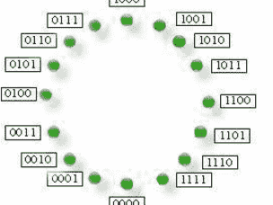

## 无符号数表示

## 源码
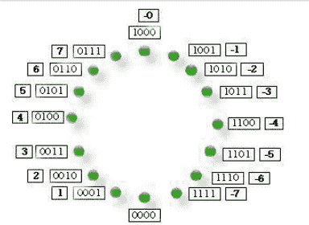

## 反码
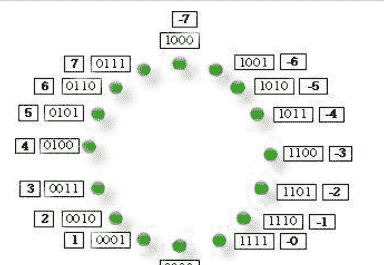

## 补码
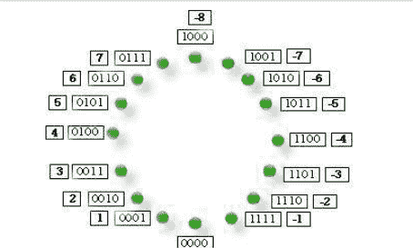

## 通过宏来得到具体的取值范围！
```
#include <limits.h>
```

| char | int | short | long | long long |
| SCHAR_MIN | INT_MAX | SHRT_MAX | LONG_MAX | LLONG_MAX |
| SCHAR_MAX | INT_MIN | SHRT_MIN | LONG_MIN | LLONG_MIN |
| UCHAR_MAX | UINT_MAX | USHRT_MAX | ULONG_MAX | ULLONG_MAX |
| CHAR_MIN |  |  |  |  |
| CHAR_MAX |  |  |  |  |

char类型有符号/无符号 由编译器决定


## 通过宏来得到具体的取值范围2

```
#include <float.h>
```

| float | double | long double |
| --- | --- | --- |
| FLT_MAX | DBL_MAX | LDBL_MAX |
| FLT_MIN | DBL_MIN | LDBL_MIN |
| FLT_DIG | DBL_DIG | LDBL_DIG |
| FLT_EPSILON | DBL_EPSILON | LDBL_EPSILON |
| FLT_MAX_EXP | DBL_MAX_EXP | LDBL_MAX_EXP |
| FLT_MIN_EXP | DBL_MIN_EXP | LDBL_MIN_EXP |

## Demo 4: Overflow example

```
1  printf("%d\n", INT_MAX);
2  printf("%d\n", INT_MAX+1);
3  printf("%d\n", INT_MAX+INT_MAX);
4
5  printf("%d\n", INT_MIN);
6  printf("%d\n", INT_MIN+(-1));
7  printf("%d\n", INT_MIN+INT_MIN);
```

## 防止溢出

- 如果不需处理负数，则采用无符号类型。
- 预先估算运算结果的可能范围，采用取值范围更大的类型
- 可能溢出的地方，加入判断语句
- 用ANSI/ISO C定义的宏确定数据的表示范围，解决溢出问题

## 防止溢出

- 如果无需处理负数，则采用无符号类型。
- 预计估算运算结果的可能范围，采用取值范围更大的类型
- 可能溢出的地方，加入判断语句
- 用ANSI/ISO C定义的宏确定数据的表示范围，解决溢出问题

## 防止溢出

- 如果不需处理负数，则采用无符号类型。
- 预先估算运算结果的可能范围，采用取值范围更大的类型
- 可能溢出的地方，加入判断语句
- 用ANSI/ISO C定义的宏确定数据的表示范围，解决溢出问题

## 防止溢出

- 如果不需处理负数，则采用无符号类型。
- 预先估算运算结果的可能范围，采用取值范围更大的类型
- 可能溢出的地方，加入判断语句
- 用 ANSI/ISO C 定义的宏确定数据的表示范围，解决溢出问题

## 浮点型的有效位

Demo 5: A simple example of float

```
#include <stdio.h>
main(){
    float i = 1234567890;
    i += 20;
    printf("%f", i);
}
```

- 有位数是7位
- 从左到右的七个数是对的，与小数点无关
- 并不代表数据就只有7位，修改%.15f试试看。

## 浮点数相等判断

Demo 6: A simple example of float

```
#include <math.h>
#include <float.h>
main(){
    float f = 0.11f, int = i;
    for(i = 0; i<5; i++){
        f += 0.11f;
        if(f == 0.33f) /* wrong way */
        /* if(fabs(f-0.33f)<FLT_EPSILON) */
            printf("Equal");
    }
}
```

## 数据类型注意事项-口诀

- 297两头两头
- 29代表int的最大数是2后面接9个数
- 7代表浮点型有效位为7位
- 两头为：*_MAX和*_EPSILON
- 两头为：limits.h和float.h

## 字符型char

- 代表一个数
  - 有符号，代表 (-128-127)
  - 无符号，代表 (0-255)
- 保存一个字符
  - ASCII（美国标准信息交换码）编码，附录E
  - 可打印字符
  - 不可打印字符（控制字符）

## 字符型char

- 代表一个数
  - 有符号，代表 (-128-127)
  - 无符号，代表 (0-255)
- 保存一个字符
  - ASCII（美国标准信息交换码）编码，附录E
  - 可打印字符
  - 不可打印字符（控制字符）

## ASC码表

000 (nul) 016 ► (dle) 032 sp 048 0 064 @ 080 P 096 ` 112 p
001 ☺ (soh) 017 ‡ (dc1) 033 ! 049 1 065 A 081 Q 097 a 113 q
002 ☻ (stx) 018 ♥ (dc2) 034 " 050 2 066 B 082 R 098 b 114 r
003 ♥ (etx) 019 ♠ (dc3) 035 # 051 3 067 C 083 S 099 c 115 s
004 ♦ (eot) 020 ♣ (dc4) 036 $ 052 4 068 D 084 T 100 d 116 t
005 ♣ (enq) 021 ♠ (nak) 037 % 053 5 069 E 085 U 101 e 117 u
006 ♠ (ack) 022 ♣ (syn) 038 & 054 6 070 F 086 V 102 f 118 v
007 ♣ (bel) 023 ♥ (etb) 039 ' 055 7 071 G 087 W 103 g 119 w
008 ■ (bs) 024 ♠ (can) 040 ( 056 8 072 H 088 X 104 h 120 x
009 □ (ht) 025 ♣ (em) 041 ) 057 9 073 I 089 Y 105 i 121 y
010 (lf) 026 ♠ (sub) 042 * 058 : 074 J 090 Z 106 j 122 z
011 δ (vt) 027 ♣ (esc) 043 + 059 ; 075 K 091 [ 107 k 123 {
012 φ (np) 028 ♠ (fs) 044 , 060 < 076 L 092 \ 108 l 124 |
013 ♠ (cr) 029 ♣ (gs) 045 - 061 = 077 M 093 ] 109 m 125 }
014 ♣ (so) 030 ♥ (rs) 046 . 062 > 078 N 094 ^ 110 n 126 ~
015 ♠ (si) 031 ▼ (us) 047 / 063 ? 079 O 095 _ 111 o 127 ◊

## char型与int型的关系

Demo 6: A simple example about char

```
1  char ch = 'b';
2  printf("%c, %d\n", ch, ch);
3  ch = 'b'-('a'-'A');  /*ch = 'b' - 32;*/
4  printf("%c, %d\n", ch, ch);
```

Demo 7: char or integer

```
1  char c; /* unsigned char c, what happen? */
2  while((c=getchar())!=EOF){
3    putchar(c);
4  }
```

## 总结

数据类型

常量和变量

变量

常量

常数

基本符号

保留字

标识符

注意事项

溢出

存储长度

浮点型的有效位

基本数据类型

整形

浮点型

字符型

谢谢大家，欢迎提问！

## C语言
第2讲: 运算符和表达式

赵岩

哈尔滨工业大学软件学院

September 2, 2011

## 目录

- 变量和常量
  - 变量
  - 常量

## 目录

- 变量和常量
  - 变量
  - 常量
- 运算符
  - 算术运算符
  - 关系与逻辑运算符
  - 特殊运算符

## 目录

- 变量和常量
  - 变量
  - 常量
- 运算符
  - 算术运算符
  - 关系与逻辑运算符
  - 特征运算符
- 类型转换
  - 自动类型转换
  - 强制类型转换
- 运算符优先级与结合性

## 变量定义

- 变量定义语句：
  - <数据类型名> <变量名列表>;
  - 例1： int i, j, k;
  - 例2： long l1, l2;
  - 例3： int i=3, j=5, k=i+j;
- 变量名：其命名规则同标识符。


## 变量定义

- 变量定义语句：
  - <数据类型名> <变量名列表>;
  - 例1: int i, j, k;
  - 例2: long l1, l2;
  - 例3: int i=3, j=5, k=i+j;
- 变量名：其命名规则同标识符。

## 变量定义说明

- 变量必须“先定义，后使用”
  - 所有变量必须在第一条可执行语句前定义（C语言）
  - 定义的顺序无关紧要
  - 一条定义语句可定义若干个同类型的变量，变量名之间用逗号分隔
  - 变量定义后，即占用内存，可随时向其存入数据，并可通过变量名使用数据

- 定义变量时，是初始化变量的最好时机
  - 不被初始化的变量，其值为危险的垃圾（随机）数

```
1 int i, j;
2 printf("%d", i); /* i的值到底是多少 */
```

## 变量定义说明

- 变量必须“先定义，后使用”
  - 所有变量必须在第一条可执行语句前定义（C语言）
  - 定义的顺序无关紧要
  - 一条定义语句可定义若干个同类型的变量，变量名之间用逗号分隔
  - 变量定义后，即占用内存，可随时向其存入数据，并可通过变量名使用数据
- 定义变量时，是初始化变量的最好时机
  - 不被初始化的变量，其值为危险的垃圾（随机）数

```
1 int i;
2 printf("%d", i); /* i的值到底是多少 */
```

## 常见常量

- 整型常量
  - 18, -31
  - long int型常量123L, 123L, 123456l, 123456L
  - unsigned int型常量123u, 123U
- 浮点常量
  - 十进制小数形式123.45, 456.78
  - 指数形式1e-2, 4.5e3
  - float型常量123.45f, 456.78F, 1e-2f, 4.5e3F
  - long double型常量123.45l, 456.78L, 4.5e3L
  - 缺省为double
  - 因为字母和数字容易混淆，所以当用l做后缀时，常使用大写形式

## 常见常量

- 整型常量
  - 18, -31
  - long int型常量123L、123L、123456l、123456L
  - unsigned int型常量123u、123U

- 浮点常量
  - 十进制小数形式123.45、456.78
  - 指数形式1e-2、4.5e3
  - float型常量123.45f、456.78F、1e-2f、4.5e3F
  - long double型常量123.45l、456.78L、4.5e3L
  - 缺省为double
  - 因为字母和数字容易混淆，所以当用l做后缀时，常使用大写形式

## 整型常量的进制和后缀

- 以数字"0"开头(不是字母"O")的整型常量是八进制数
  - 022、-037
  - 010和10大小不一样
  - 因为八进制并不包含8，所以此种表示法比较少见

- 以"0x"或"0X"开头的整型常量是十六进制数
  - A~F和a~f用来表示10~15
  - 十六进制的形式比较常用
  - 0x12、-0x1F、-0x1f
  - 0XFUL 这是一个什么数？

## 整型常量的进制和后缀

- 以数字"0"开头(不是字母"O")的整型常量是八进制数
- 022, -037
- 010和10不一样
- 因为八进制并不常用，所以此种表示法比较少见

- 以"0X"或"0x"开头的整型常量是十六进制
- A-F和a-f用来表示十进制的10-15
- 十六进制的形式比较常用
- 0x12, -0x1F, -0x1f
- 0XFUL 这是一个什么数？

## 常量后缀的应用

- 整型后缀
- 浮点型后缀

```
1 main()
2 {
3     float r;
4     r = 1.0f+0.2f;
5     r = r-1.2f;
6     printf("%22.16f\n",r);
7 }
```

- 去掉后缀后，发生什么？

## 常量后缀的应用

- 整型后缀
- 浮点型后缀

```
1 main()
2 {
3     float r;
4     r = 1.0f+0.2f;
5     r = r-1.2f;
6     printf("%22.16f\n",r);
7 }
```

- 去掉后缀后，发生什么？

## 常量后缀的应用

- 整型后缀
- 浮点型后缀

```
1 main()
2 {
3     float r;
4     r = 1.0f+0.2f;
5     r = r-1.2f;
6     printf("%22.16f\n",r);
7 }
```

- 去掉后缀后，发生什么？

## 字符型常量

- 字符常数的表示方法
  - `'a'`, `'A'`, `'5'`, `' '`
  - 单引号内只能有一个字符，除非以`\`开头
- 字符常量就是一个普通整数，也可以参与各种数学运算
  - 每个字符有一个0-255之间的值，可从ASCII表查出
  - 注意：`'5'`和整数5的区别
- 用`\`开头的字符为转义字符
  - 例如，`"\n"`，代表1个回车字符

## 字符型常量

- 字符常数的表示方法
  - 'a', 'A', '5', ' '
  - 单引号内只能有一个字符，除非以'\'开头
- 字符常量就是一个普通整数，也可以参与各种数学运算
  - 每个字符有一个0-255之间的值，可从ASCII表查出
  - 注意：'5'和整数5的区别
- 用'\'开头的字符为转义字符
  - 例如："\n"，代表1个回车字符

## 字符型常量

- 字符常数的表示方法
  - 'a', 'A', '5', ' '
  - 单引号内只能有一个字符，除非以'\'开头
- 字符常量就是一个普通整数，也可以参与各种数学运算
  - 每个字符有一个0~255之间的值，可从ASCII表查出
  - 注意：'5'和整数5的区别
- 用'\'开头的字符为转义字符
  - 例如，"\n" 代表1个回车字符

## 转义字符

| 转义 | 含义 | 转义 | 含义 |
|---|---|---|---|
| \a | 响铃符 | \\ | 反斜杠 |
| \b | 回退符 | \? | 问号 |
| \f | 换页符 | \' | 单引号 |
| \n | 换行符 | \" | 双引号 |
| \r | 回车符 | \ooo | 八进制数 |
| \t | 水平制表符 | \xhh | 十六进制数 |
| \v | 垂直制表符 |  |  |

## 字符串常量

- 用双引号括住的由0个或多个字符组成的字符序列
  - "I am a string"
  - ""表示空字符串
  - 转义字符也可以在字符串中使用
  - 引号只作为字符串开始和结束的标志
  - 除注释外，是唯一可以出现中文的地方
- "x"和'x'是不同的
  - C语言内部用\0表示字符串的结束
- <string.h>里定义了一系列专门的字符串处理函数
  - strlen, strcpy

## 字符串常量

- 用双引号括住的由0个或多个字符组成的字符序列
  - "I am a string"
  - ""表示空字符串
  - 转义字符也可以在字符串中使用
  - 引号只作为字符串开始和结束的标志
  - 除注释外，是唯一可以出现中文的地方
- "x"和'x'是不同的
  - C语言内部用\0表示字符串的结束
- <string.h>里定义了一系列专门的字符串处理函数
  - strlen, strcpy

## 字符串常量

- 用双引号括住的由0个或多个字符组成的字符序列
  - "I am a string"
  - ""表示空字符串
  - 转义字符也可以在字符串中使用
  - 引号只作为字符串开始和结束的标志
  - 除注释外，是唯一可以出现中文的地方
- "x"和'x'是不相同的
  - C语言内部用\0表示字符串的结束
- <string.h>里定义了一系列专门的字符串处理函数
  - strlen, strcpy


## 宏常量

- 宏常量
- #define 标识符 字符串

Demo 1: A simple example about macro

```
1 #include <stdio.h>
2 #define PI 3.1415926
3 main(){
4     float r = 2.0f;
5     printf("area = %f\n",PI*r);
6 }
```

## const 常量

- const float PI = 3.1415926f;
- 一旦被const修饰，在程序中就无法修改了。

Demo 2: A simple example about const

```
#include <stdio.h>
const float PI = 3.1415926f;
main()
{
    float r = 2.0f;
    PI = 3.14f; /*-- compile error*/
    printf("area = %f\n",PI*r);
}
```

## 枚举常量

Demo 3: A simple example about enumeration

```
1 enum weeks {
2     MON, TUE, WED, THU, FRI, SAT, SUN
3 };
4 enum weeks today, tomorrow;

6 today = MON;
7 tomorrow = today + 1;
8 if (tomorrow == TUE)
9     printf("Tomorrow is Tuesday.\n");
10 else
11     printf("Tomorrow is NOT Tuesday.\n");
```

## 使用常量注意事项

- 避免使用“幻数”:
  - 程序的可读性变差
  - 容易发生书写错误
  - 修改麻烦
- 用以下三种方式代替
  - 宏常量
  - const常量
  - 枚举常量
- 建议使用后两者。

## 使用常量注意事项

- 避免使用“幻数”
  - 程序的可读性变差
  - 容易发生书写错误
  - 修改麻烦
- 用以下三种方式来代替
  - 宏常量
  - const常量
  - 枚举常量
- 建议使用后两者。

## 使用常量注意事项

- 避免使用“幻数"
  - 程序的可读性变差
  - 容易发生书写错误
  - 修改麻烦
- 用以下三种方式来代替
  - 宏常量
  - const常量
  - 枚举常量
- 建议使用后两者。

## 算术运算符

- +、-、*、/
  - 加、减、乘、除运算，先乘除，后加减、
  - 从左向右计算（左结合性）

- %
  - 求余(取模)，符号与被除数相同
  - 求余只能用于整型数据类型

- 数学库函数

## 常用的标准数学函数

| 函数名 | 功能 | 函数名 | 功能 |
|---|---|---|---|
| sqrt(x) | 计算x的平方根，x应大于等于0 | exp(x) | 计算e^x的值 |
| fabs(x) | 计算x的绝对值 | pow(x,y) | 计算x^y的值 |
| log(x) | 计算lnx的值 | sin(x) | 计算sin(x)的值，x为弧度值 |
| log10(x) | 计算lgx的值 | cos(x) | 计算cos(x)的值，x为弧度值 |

## 关系运算符

- > , >= , < , <= , == , !=
- 大于，大于等于，小于，小于等于，等于，不等于
- 关系运算符运算出的结果为0和1
- 0，表示假，即该关系不成立
- 1，表示真，即该关系成立
- 在所有涉及和到真假判断的地方，0表示假，非0表示真

```
1 int a=0;
2 if (a==0) /* if(0==a) */
3     printf("a equal 0");
4 else
5     printf("a not equal 0");
```

## 逻辑运算符

- 逻辑运算符也被称为布尔（Boolean）运算，运算结果也是1和0
- &&
  - 与运算
  - (a > b && b > c)；a大于b，并且b大于c
- ||
  - 或运算
  - (a > b || b > c)；a大于b，或者b大于c
- !
  - 求反
  - !(a)；如果a是0，结果是1；如果a是非0，结果是0
  - 并不改变a的值

## 逻辑运算规则

| && | 1 | 0 |
|---|---|---|
| 1 | 1 | 0 |
| 0 | 0 | 0 |

| || | 1 | 0 |
|---|---|---|
| 1 | 1 | 1 |
| 0 | 1 | 0 |

| ! | 1 | 0 |
|---|---|---|
|   | 0 | 1 |

## & & 和 || 运算的一个特点

- 只算一半
- &&
  - 如果左边的表达式值为0，则运算结果必为0
  - 所以，如果左边为0，右边的表达式就不再求值
- ||
  - 如果左边的表达式值为非0，则运算结果必为1
  - 所以，如果左边为非0，右边的表达式就不再求值
- 此特点有时可以用来提高程序效率，有的时候也是错误根源

```
1 if (a==0 && b=b+1) /* error 1 */

3 if( (a!=2) || (a!=3) ) /* error 2 */
```

## 逻辑运算符实例

- 判断ch是否为英文大写字母
- 判断某一年year是否是闰年的条件是满足下列两个条件之一
  - 能被4整除，但不能被100整除；
  - 或者能被400整除；

```
1  if ((ch>='A') && (ch<='Z'))

3  if ( ( (year%4==0)&&(year%100)!=0)
4  || (year%400 == 0) )
```

## 增1和减1操作符使用事项

- 运算符为后缀，运算结果是加/减之前的值
- 运算符为前缀，运算结果是加/减之后的值
- 在一行语句中，使用++或--的变量最好只出现一次
- 否则，不可读性差，而且因为编译器实现的方法不同，容易导致不同编译器运行效果不一样，贻害无穷

```
1 int i=3; int j=3;
2 printf("%d,%d",j+(++i),i); /*output 7,4*/
3 printf("%d,%d",j+(i++),i); /*output 6,4*/
4 printf("%d,%d",j+(++i),i); /*output ?*/
5 k=(i++)+(++i)+(i++); /*x-bad style, not kiss*/
6 (i+j)++; /*x-error, only variable*/
```

## 位运算符

- <<
  - 按位左移运算
  - 等等于乘2操作
- >>
  - 按位右移运算
  - 分为算术移位和逻辑移位
- ~
  - 按位求反
  - ~(~0<<3)

- &
  - 按位与运算
  - 将特定位置0
- |
  - 按位或运算
  - 将特定位置1
- ^
  - 按位异或运算

## 右移中的算术移位和逻辑移位

- 算术移位和逻辑移位
- 最右面的如果是零，一定是逻辑移位。最右面的如果是1，数据类型决定是那种移位。

```
1 int i; /* unsigned int i; what happen? */
2 i = ('0')<<4;
3 printf("%x\n", i);
4 i = i>>2;
5 printf("%x\n", i);
```

## 位运算符实例

- 快速乘除

```
int i=100;
i<<=2; /* multiply 4 */
i>>>=3; /* divided by 8 */
```

- 取一个数的从右端开始的4-7位

```
i>>4;
i&((~0)<<<4);
```

## 赋值运算符和复合赋值运算符

- 赋值运算的结果是被赋值变量赋值后的值
  - a = b = c = 0;
  - a = (b = (c = 0));
- 复合赋值运算符
  - i = i + 2;
  - i += 2;
  - +, -, *, /, %, <<, >>, &, | 运算符都可以按此种方式处理
- 这种形式看起来更直观，而且执行效率一般也能更高一些


## 逗号运算符

- 表达式1, 表达式2, …… 表达式n
- 从第一个开始，依次计算每个表达式的值，最后一个表达式的值即为逗号表达式的值
- 主要用在循环语句中，同时对多个变量赋初值等

```
1 for (i = 0 , j = 0; i < j; i++, j++)
2 
3 x = (a=2,b=5,b++,a+b) /*x equals ? */
```

## 赋值中类型转换

- 数据赋值时
  - 从小类型到大类型，顺利转换
  - 从大到小，发出警告（好的编译器会给出），结果可能错误
  - 要知道自己在做什么

```
1 int i;
2 float f = -2.8f;
3 i = f; /*隐式转换*/
4 i = f+0.5f; /*四舍五入*/
```

## 表达式中自动类型转换

- 混合运算
- 当操作数1和操作数2的类型不同时，即为混合运算
- 在运算时要求类型应相同。即先转换，再运算，运算结果的类型同操作数的类型。

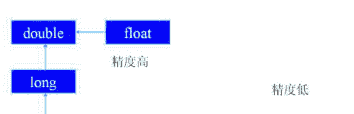

## 表达式类型转换实例

‘A’ + 32 + 7.23 * 6 - 5 / 3

int

double

int

运算结果的类型为： double

## 字符串与数值类型之间的转换

- int i = "123"
  - 这样用是不行滴
- atof(), atoi(), atol()
  - 把字符串转换为double, int和long
  - 定义在stdlib.h中
- sprintf()
  - 可以用来把各种类型的数值转为字符串
  - 定义在stdio.h中

## 字符串与数值类型之间的转换实例

Demo 4: conversion of number and string

```
1  float f = 1234.5678f; double d;
2  char numstr[10] = "765.4321";
3  char str[10];
4
5  /* change number to string */
6  sprintf(str, "%9.4f", f);
7  printf("%s\n", str);
8  /* change string to number */
9  d = atof(numstr);
10 printf("%f\n", d);
```

## 类型强制转换

- 可以通过“(类型名)操作数”的方式把表达式的值转为任意类型
  - 类型名必须用括号括起
  - 操作数：可以是常量、变量、函数、表达式
  - 例如：(float)(5/3), (float)5/3

- 强制转换时，你必须知道你在做什么！
  - 强转与指针，并称C语言两大神器，用好了可以呼风唤雨，用坏了就损兵折将

## 条件表达式

- 把a和b中的最大值放入z中
- 此种表达式切忌用得过于繁杂

```
1  if (a > b)
2      z = a;
3  else
4      z = b;
5
6  z = (a > b) ? a : b;
```

## 运算符优先级

- 单目→算术→关系→逻辑→赋值→逗号
- 能背下完整优先级表的人凤毛麟角
- 胞细胞太宝贵了，不能用来死记硬背
- 用括号或者分步书写来控制运算顺序更直观、方便，并减少出错的概率
  - 先算乘除，后算加减，有括号就先算括号里的
  - 注意用空格做好分隔
  - 实在不行就拆分表达式

## 运算符优先级实例

```
1  x *= y+1; /* How to understand?*/
2
3  char c;
4  while(c=fgetc(STDIN)!=EOF)
5  {
6      ...
7  }
8  while((c=fgetc(STDIN))!=EOF)
9  {
10     ...
11 }
```

## 运算符的结合性

- 当运算符在一个级别的时候，要考虑结合性
- 双目运算符基本都是左结合性
- 大部分单目运算符是右结合性（附录D）
  - 负号运算符-
  - 自增减运算符++
  - 按位取反

```
1 4/2*4   /* 8 or 0.5? 左结合 */
2 x=y=z+1; /* y=z+1; x=y; 右结合 */
3 m=--n++; /* m=--n; n++; */
```

## 运算的顺序

- 运算顺序并不固定
- 赋值运算符和自增减运算符最好单独一个语句

```
1 int m = 1,n;
2 n = m-(m=7);
3 printf("%d",n);
```

## 总结

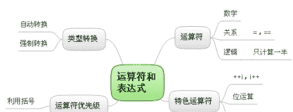

## C语言
第3讲：简单的C程序设计

赵岩

哈尔滨工业大学软件学院

March 6, 2011

## 目录

- ❶ 基本架构

## 目录

- 基本架构
- C语句

## 目录

- 基本架构
- C语句
- 字符及字符串输入/输出

## 目录

- 基本架构
- C语句
- 字符及字符串输入/输出
- 格式输入/输出
  - 格式输入
  - 格式输出

## C程序基本构成

```
/*打印Hello, World!到屏幕*/
#include <stdio.h>
main()
{
    printf("Hello, World!\n");
}
```

## C程序基本构成

- 注释语句不被编译器处理
- 函数是C语言中的功能单元
- 有且只有一个main函数,整个程序的入口。

## 好的代码风格

- 代码风格
- cms.hit.edu.cn/mod/resource/view.php?id=155

```
/* include <stdio.h> */
int main()
{
    int farH, closins;
    int lower = 0;
    upper = 300;
    step = 20;
    for (farH = lower; farH <= upper; farH += step)
    {
        printf("%d %d\n", farH, closins);
    }
    return 0;
}
```

## 坏的代码风格

```
#include <stdio.h>
main(){int fahr, celsius;
int lower, upper, step;
lower=0;upper=300;step=20;fahr=lower;
while (fahr<=upper){
celsius=5*(fahr-32)/9;
printf("%d\t%d\n",fahr,celsius);
fahr=fahr+step;}}
```


## (C程序中的语句

- 每个语句必须以分号“;”结束。(注意是“每个语句”而不是“每行语句”)

```
1 /* int i = 5; */
2 int
3 i
4 =
5 5
6 ;
```

## C语句分类

- 变量声明语句
  - `int x, y;`
- 表达式语句
  - `i++;`
  - `i = i + 1;`
- 空语句
  - `;`
- 复合语句
  - `t = x; x = y; y = t;`
- 控制语句

## 表达式语句

- 赋值表达式语句
- 函数调用语句
- total = m * pow(1+r, n);

## 复合语句

- 在什么情况下使用复合语句?
- 条件语句和循环语句

```
1 if (x!=y)
2 {
3     t=x;
4     x=y;
5     y=t;
6 }
```

## 空语句

- 空语句有什么作用？
- 自顶向下程序设计时用在那些未完成的模块中
- 延时用的空循环

```
1 DataInitialze()
2 {
3     ; /* Empty statement */
4 };
5 main()
6 {
7     ...;
8     DataInitialze();
9 }
```


## 输入输出函数

- 如何进行数据的输入输出?
  - 输入：从标准输入设备上输入数据到计算机内存
  - 输出：将计算机内存中的数据送到标准输出设备
  - C语言中输入输出操作通过调用标准库函数来实现
    - #include <stdio.h> 在指定的文件目录中找该文件

如何进行数据的输入输出？

输入：从标准输入设备上输入数据到计算机内存

输出：将计算机内存中的数据送到标准输出设备

C语言中输入输出操作通过调用标准库函数来实现

```
#include <stdio.h> 在指定的文件目录中找该文件
```

## 字符输入输出函数

- 字符输出函数
  - putchar(ch)
  - 输出一个字符ch到STDOUT
- 字符输入函数
  - getchar()
  - 无参数
  - 函数值为从STDIN接收一个字符

## 字符输入输出实例

### Demo 1: character input and output

```c
char ch;
/* first */
ch = getchar();
putchar(ch); putchar('
');
/* second */
ch = getchar();
putchar(ch); putchar('
');
/* third */
ch = getchar();
putchar(ch); putchar('
');
```

## 字符串相关函数

- 字符串输入函数gets(char * str);
- 字符串输出函数puts(char * str);

Demo 2: character input and output

```
1 #include <stdio.h>
2 main()
3 {
4     char str[30];
5     gets(str);
6     puts(str);
7 }
```

## 字符串相关函数

Demo 3: string input and output

```
#include <stdio.h>
main()
{
    char str[30];
    char c;
    gets(str);
    puts(str);
    
    c = getchar();
    putchar(c);
}
```

## 实验结论

- 结论1: getchar从缓冲区里面读取数据，而不是从键盘。
- 结论2: 调用输入函数且缓冲为空的时候，界面会停住。
- 结论3: getchar每次只读一个任意字符（包括回车）。
- 结论4: gets把回车从缓冲区读走。

## scanf输入函数

- scanf(格式控制字串，地址列表);

Demo 4: scanf example

```
1 #include <stdio.h>
2 main()
3 {
4     int a, b;
5     printf("Please input a and b:");
6     scanf("%d%d", &a, &b);
7     printf("a=%d, b=%d, a+b=%d\n",a,b,a+b);
8 }
```

## scanf常见错误1

### Demo 5: scanf error 2

```
1 #include <stdio.h>
2 main()
3 {
4     int a, b;
5
6     printf("Please input a and b:");
7     scanf("%d,%d", &a, &b);
8     printf("a=%d, b=%d, a+b=%d\n",a,b,a+b);
9 }
```

## scanf常见错误2

### Demo 6: scanf error 1

```
1
2    int a;
3    do
4    {
5        printf("\n");
6        scanf("%d",&a);
7        if(111==a)
8        {
9            break;
10       }
11   } while (1);
```

## 全真七子！

- 结论1： getchar从缓冲区里面读取数据，而不是从键盘。
- 结论2： 调用输入函数且缓冲区为空的时候，界面会停止。
- 结论3： getchar每次只读一个任意字符（包括回车）。
- 结论4： gets把回车从缓冲区读走。
- 结论5： scanf中%d提取数字，忽略空格，tab，回车。
- 结论6： 如果缓冲区不空，scanf按自己的格式提取
- 结论7： 提取成功，从缓冲区提取数据；提取失败，不从缓冲区提取数据。你可以手工flush(stdin)清空缓冲区。

## scanf思考题？

Demo 7: scanf error 3

```
1 int a; char b;
2 printf("please input an integer:");
3 scanf("%d",&a);
4 printf("interger: %d\n",a);
5
6 printf("please input a character:");
7 scanf("%c",&b);
8 printf("character: %c\n",b);
```

## 格式输出函数

- printf(格式控制字符串, 输出项表列);
- 输出若干个任意类型的数据

```
1 printf("a=%d b=%f", a,b);
```

## 格式转换说明符

- d 以带符号十进制整数输出
- o 以八进制无符号整数输出（无前导0）
- x 以十六进制无符号整数输出（无前导0x）
- u 以十进制无符号整数输出
- c 以字符形式输出单个字符
- s 输出一个字符串
- f 以小数形式输出浮点数（6位小数）
- e 以标准指数形式输出（6位小数）
- g 选用

## 格式修饰符

- m 表示全部数据占用的最小宽度
- 数据宽度大于m，按实际宽度输出
- 数据宽度小于m，补空格

- .n 对实数表示输出n位小数对字符串表示最多输出的字符个数

- 改变输出内容的对齐方式缺省为右对齐

Demo 8: printf example

```
1 float f1 = 1234.56789,
2 printf("%3.2f", f1); /* 1234.57 */
3 printf("%9.2f", f1); /* ---1234.57 */
4 printf("%-9.2f", f1); /* 1234.57--- */
5 printf("%.2f", f1); /* 1234.57 */
```

## printf实例

### Demo 9: printf example

```
1 float  f1 = 100.15799, f2 = 12.55, f3 = 1.7;
2 int    n1 = 123, n2 = 45, n3 = 6;
3 printf("printf WITHOUT width or precision specifications:\n");
4 printf("%f\n%f\n%f\n", f1, f2, f3);
5 printf("%d\n%d\n%d\n", n1, n2, n3);
6
7 printf("printf WITH width and precision specifications:\n");
8 printf("%5.2f\n%6.1f\n%3.0f\n", f1, f2, f3);
9 printf("%5d\n%6d\n%3d\n\n", n1, n2, n3);
```

## 代码风格的建议

- 乐学网上的资源（来自苏晓红老师）

## 总结

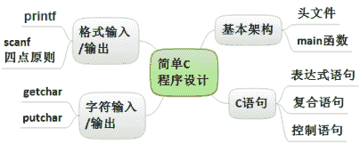

## C语言

### 第4讲：C语言的控制结构

赵岩

哈尔滨工业大学软件学院

March 6, 2011

## 目录

编程之道

## 编程之道

## C程序的控制结构

- 顺序结构
- 选择结构
- 循环结构

## 目录

- 1. 编程之道
- 2. C程序的控制结构
  - 顺序结构
  - 选择结构
  - 循环结构
- 3. 流程的转移控制


## 目录

- 1. 编程之道
- 2. C程序的控制结构
  - 顺序结构
  - 选择结构
  - 循环结构
- 3. 流程的转移控制
- 4. 调试

## 数据结构和算法

- 程序=数据结构+算法
- 数据结构
  - 数据结构是计算机存储、组织数据的方式
  - 实例：链表，树，图等数据结构
- 算法
  - 为解决一个具体问题而采取的确定的有限的操作步骤
  - 实例
    - 1+2+...+100
    - 最大公约数


## 最大公约数算法

- 求1000005和1000000的公约数
- 最大公约数算法:
  - x对y余数r
  - r=0, y为最大公约数
  - r!=0, x=y,y=r, 跳到第一步
- 衡量算法的复杂度
- 好算法可以极大地提高你的效率。
  - 2^n → n^2 → log(n) → M

## 算法的特性

- 有穷性
  - 在合理的时间内完成
- 确定性, 无歧义
  - 如果x≥0, 则输出Yes; 如果x≤0, 则输出No;
- 有效性
  - 能有效执行
  - 负数开平方
- 没有输入或有多于一个输入
- 有一个或多个输出

## 算法的描述方法

- 自然语言描述
- 流程图
- NS流程图
- 伪码（我个人用的最多）

## 算法的学习方法

- 记住常用的代码片段，code snippet
  - 基本输入输出
  - 数组遍历
  - 文件打开
  - …… 
- 熟练应用三种基本结构及应用场景
- 掌握简单的数据结构和算法
  - 链表
  - 查找和排序，随机数

## 算法参考书

- 莫花宝典：The Art of Computer Programming
- 独孤九剑：Introduction to Algorithms《算法导论》
  高等教育出版社
- 九阴真经：Computer Algorithms: Introduction to Design and Analysis

## 结构化的设计核心

- 采用顺序、选择和循环三种基本结构
  - 只有一个入口
  - 只有一个出口
  - 无死语句，即不存在永远都执行不到的语句
  - 无死循环，即不存在永远都执行不完的循环
- 采用“自顶向下、逐步求精”和模块化的方法进行结构化程序设计
  - 先全局后局部
  - 先整体后细节
  - 先抽象后具体

## 结构化的设计方法

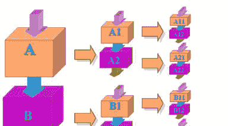

## C程序的三种基本结构

- 顺序结构、选择结构、循环结构
- 已经证明，任何程序均只用这三种结构实现
- 只用这三种结构的程序，叫结构化程序
- 程序“必须”符合结构化规则

## 语句块

- {} 括住的若干条语句构成一个语句块
- 语句块内可以定义变量
  - 变量必须在语句块的开头定义
  - 变量仅在定义它的语句块内(包括下层语句块)有效
  - 同一个语句块内的变量名不可相同，不同语句块可同名
    - 各司其职，下层优先
    - 避免在下层语句块内定义同名变量。
- 语句块通常用在判断和循环语句。

## 语句块实例

- 语句块中的变量只在定义它的语句块中有效
- 避免写出下面的程序

Demo 1: local variable

```
1 main()
2 {
3     int  a = 0;
4     {
5         int  a = 1;
6         printf("Inside: a = %d\n", a);
7     }
8     printf("Outside: a = %d\n", a);
9 }
```

## 顺序结构程序实例

Demo 2: sequence structure

```
1 int x,b0,b1,b2;
2 scanf("%d",x);
3 b2 = x/100;
4 b1 = (x-b2*100)/10;
5 b0 = x%10;
6 printf(" %4d  %4d  %4d",b2,b1,b0);
```

## 问题

？100000？有多少位？

## if-else代码

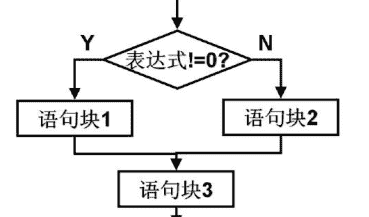

## if-else定义

- 选择结构的一种常用形式
- 表达式值非0（真）时，执行语句块1，然后执行后续语句
- 表达式值为0（假）时，执行语句块2，然后执行后续语句
- `else`部分可以没有.

```
if（表达式）
{
    语句块1;
}
else
{
    语句块2;
}
```

## else的配套问题

- x等于零的时候
  - y等于零,打印both zero
- x不等于零的时候
  - z=y/x

```
1  if (x==0)
2      if (y==0) printf("both zero");
3  else
4  {
5      z=y/x;
6  }
```

## else的配套问题的实际含义

+ else与最近的if匹配

```
1   if (x==0)
2   {
3       if (y==0) printf("both zero");
4       else
5       {
6           z=y/x;
7       }
8   }
```

## else的配套问题的解决办法

+ 利用大括号封装第一个if

```
1   if (x==0)
2   {
3       if (y==0) printf("both zero");
4   }
5   else
6   {
7       z=y/x;
8   }
```

## if判断条件简写

- 非零值为真
- 零值为假

```
1   if (x)
2
3   if (x!=0)
```

## 多重选择

```
1 if (表达式1){
    语句块1;
}
4 else if (表达式2){
    语句块2;
}
7 else if (表达式3){
    语句块3;
}
10 else{
    语句块4;
}
13 后续语句;
```

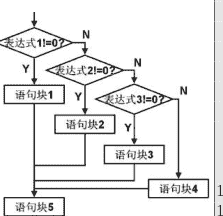

## 多重选择实例

- 按“体指数”对肥胖程度进行划分：
- 体指数t = w / h2（体重w单位为公斤，身高h单位为米）
- 当t < 18时，为低体重；
- 当18 ≤ t < 25时，为正常体重；
- 当25 < t < 27时，为超重体重；
- 当t ≥27时，为肥胖。

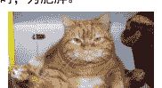

## switch

```
1 switch (表达式)
2 {
3     case 整型常量1:
4         语句1;
5     case 整型常量2:
6         语句2;
7     default:
8         语句3;
9 }
```

- default可以没有，但最好不要省略

## Demo 1: break problem

```
int a;
scanf("%d",&a);
switch (a){
case 1:
printf("you input 1\n");
case 2:
printf("you input 2\n");
case 3:
printf("you input 3\n");
default:
;
}
```

## switch实例代码

```
1 switch (c){
2     case '\n'
3     /* I skip break here */
4     case ','
5         sub();
6         break;
7     case '+'
8         add();
9         break;
10    default:
11    break;
12    ;
13 }
```

## switch与if比较

- switch比else-if更清晰
- else-if比switch的条件控制更强大一些
  - else-if可以依各种逻辑运算的结果进行流程控制
  - switch只能进行整数的==判断，条件表达式经过适当的计算变成整数。

```
1   mark = score / 10;
2   switch (mark)
3   {
4       case 9:
5       printf("80-90");
6       break;
7       ……
8   }
```

## 循环结构

- “当型”循环
  - while循环
  - for循环
- “直到型”循环
  - do-while循环


## while循环

- 只要表达式的值为真（非零），就重复执行语句块1，直到表达式值为0时止，开始执行后续语句

```
1 while (表达式){
2     语句块1
3 }
4 后续语句
```

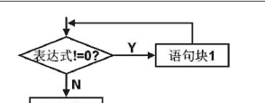

## for循环

```
1 for (表达式1; 表达式2; 表达式3){
2   语句块;
3 }
```

首先执行表达式1。如果表达式的值为真（非零），就重复执行语句块和表达式3，直到表达式2的值为假（零）时止

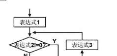

## for循环

- for的复杂表达式
  - 分号不可省略
  - 表达式2省略，恒为真
  - 表达式1和表达式3可以是用逗号分隔的
- for循环体内避免修改控制循环次数的循环变量。

```
1 for (i = 0, j = 0; i++; j++)
```

## 问题

for(i = 4, j = 0; i>0; j++, j++, j=j+2) 循环几次？

## do-while循环

```
1   do {
2       语句块1;
3   }
4   while (表达式);
5   后续语句
```

- 首先执行语句块1，然后判断表达式的值。如果为真（非零），继续向下执行（否则，再次执行语句块1。
- 与while的区别为语句块1会被执行至少一次

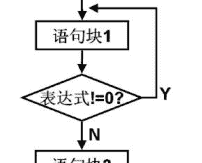

## 三种循环语句区别

- 如果循环次数已知，用 for
- 如果循环次数未知，或者无初始化操作，用 while
- 如果循环体至少要执行一次，用 do-while
- 只是思路，不是定律
- 如果能用一种循环完成，那么一定能用另外两种循环来完成。

## 判断，循环语句中的分号

- 在if for和while语句之后一搬不加分号
- 分号是一条空语句，它成为了循环体
- do...while语句之后一定有分号

```
1 while (i < 100); i++;
2 for (i = 0; i < 100; i++);
3 printf("%d", i);
4 /*
5 for (i = 0; i < 100; i++){
6     ;
7 }
8 printf("%d", i);
9 */
```

## 死循环

- 尽量避免死循环，它们使循环的中止条件变得不明朗。
- 绝大多数程序不需要死循环。如果出现，往往都是bug
- 时间过长的循环会造成“假死”现象，也要考虑解决

```
1 for (;;) {}
2 while (1) {}
3 do {} while (1);
```

## 死循环实例

```
1 for (i = 0; i<100; i++)
2 {
3     i=i-1;
4 }
```

```
1 for (i = 0; i<10000; i++){
2     if((i%10)==0) printf("%d", i);
3     for(j = 0; j<10000; j++){
4         for(k = 0; k<10000; k++){
5             sum=i+j+k;
6         }
7     }
8 }
```

## 猜数游戏

- 先由计算机“想”一个1到100之间的数请人猜，如果人猜对了，则结束游戏，否则计算机给出提示，告诉人所猜的数是太大还是太小，直至人猜对为止。计算机记录人猜的次数，以此来反映猜数者“猜”的水平。

## 猜数游戏用到的随机函数

- 随机函数rand()
- #include <stdlib.h>
  - RAND_MAX在stdlib.h中定义，不大于双字节整数的最大值32767
- 产生[0,RAND_MAX]之间的随机数
  - magic = rand();
- 产生[0,b-1]之间的随机数
  - magic = rand() % b;
- 产生[a,a+b-1]之间的随机数
  - magic = rand() % b + a;

## 随机函数内部实现

```
1 unsigned long int next = 1;
2 int rand(void)
3 {
4     next = next * 1103515245 + 12345;
5     return (unsigned int)(next/65536) % 32768;
6 }
7
8 void srand(unsigned int seed)
9 {
10    next = seed;
11 }
```

## 随机数种子

- 随机函数srand
  - 为函数rand()设置随机数种子来实现对函数rand所产生的伪随机数的“随机化”
- 使用计算机读取其时钟值并把该值自动设置为随机数种子，产生[1,100]之间的随机数
- 函数time()返回以秒计算的当前时间值，该值被转换为无符号整数并用作随机数发生器的种子

```
1  #include <time.h>
2  srand(time(NULL));
3  magic = rand() % 100 + 1;
```

## 编程实例

- 古印度舍罕王决定赏赐他的的宰相达依尔，这位聪明的宰相指着8×8共64格的象棋盘说：陛下，请您赏给我一些麦子吧，就在棋盘的第一个格子中放1粒，第二格中放2粒，第三格放4粒，以后每一格都比前一格增加一倍，依此放完棋盘上的64个格子，我就感恩不尽了。
- 试编程计算舍罕王总要多少麦子赏赐他的宰相，这些麦子有多少立方米？（已知1立方米麦子约1.42e8粒）
- 总粒数为： sum = 1 + 2^1 + 2^2 + 2^3 + ... + 2^63

## 实例源码

```
```c
#define CONST 1.42e8
int n;
double term, sum = 0;  /*求和变量赋初值*/
for (n=1; n<=64; n++){
    term = pow(2, n-1);
    sum += term;        /*作累加运算*/
}
printf("sum = %e\n", sum);   /*总考查数*/
printf("volum=%e\n", sum/CONST); /*体积数*/
```
```

## 实例源码

```
```c
#define CONST 1.42e8
int n;
double term = 1, sum = 1;
for (n=2; n<64; n++)
{
term *= 2;
sum += term; /* 作累加运算 */
}

printf("sum=%e\n", sum); /* 总粒数 */
printf("volum=%e\n", sum/CONST); /* 体积 */
```
```

## 嵌套的循环体

- 在嵌套的各层循环体中，使用复合语句（即用一对大括号括将循环体语句括起来）保证逻辑上的正确性
- 内层和外层循环控制变量不同名，以免造成混乱
- 嵌套的循环最好采用右缩进格式书写，以保证层次的清晰性
- 循环嵌套不能交叉，即在一个循环体内必须完整的包含着另一个循环

## 合法的嵌套循环

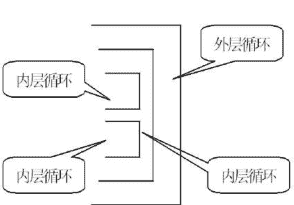

合法的嵌套循环

## 打印九九表

编程输出如下形式的乘法九九表

|   | 1 | 2 | 3 | 4 | 5 | 6 | 7 | 8 | 9 |
|---|---|---|---|---|---|---|---|---|---|
| 1 | 1 | 2 | 3 | 4 | 5 | 6 | 7 | 8 | 9 |
| 2 | 4 | 6 | 8 | 10 | 12 | 14 | 16 | 18 |
| 3 | 6 | 9 | 12 | 15 | 18 | 21 | 24 | 27 |
| 4 | 8 | 12 | 16 | 20 | 24 | 28 | 32 | 36 |
| 5 | 10 | 15 | 20 | 25 | 30 | 35 | 40 | 45 |
| 6 | 12 | 18 | 24 | 30 | 36 | 42 | 48 | 54 |
| 7 | 14 | 21 | 28 | 35 | 42 | 49 | 56 | 63 |
| 8 | 16 | 24 | 32 | 40 | 48 | 56 | 64 | 72 |
| 9 | 18 | 27 | 36 | 45 | 54 | 63 | 72 | 81 |


## 九九表源码
```
1  int m, n;
2  for (m=1; m<10; m++)
3      printf("%4d", m);      /*打印表头*/
4      printf("\n");
5  for (m=1; m<10; m++)
6      printf("    --");
7      printf("\n");
8  for (m=1; m<10; m++) {
9      for (n=1; n<10; n++){
10         printf("%4d", m*n);
11     }
12     printf("\n");
13 }
```

## 打印九九表下三角
- 将上例输出格式改成如下的下三角格式打印

1 2 3 4 5 6 7 8 9
- - - - - - - - -
1
2 4
3 6 9
4 8 12 16
5 10 15 20 25
6 12 18 24 30 36
7 14 21 28 35 42 49
8 16 24 32 40 48 56 64
9 18 27 36 45 54 63 72 81

## 马克思手稿中的趣味学题-暴力计算
- 有30人，其中有男人、女人和小孩，在一家饭馆里吃饭共花了50先令，每个男人各花3先令，每个女人各花2先令，每个小孩各花1先令，问男人、女人和小孩各有几人？

x + y + z = 30
3x + 2y + z = 50

## 流程的转移控制
- 循环级别控制
  - `break`语句
  - `continue`语句
- 函数级别控制
  - `return`语句
- 程序级别控制
  - 标准库函数 `void exit(int status)`

## break和continue
- 在for, while, do-while循环进行内部放置
- break, 退出循环
- continue, 中断此次循环的执行，开始下一次循环
- break和continue少用为妙
  - 它们增加了循环执行的分支，break更增加了循环的出口
  - 它们可以用来处理程序异常，而尽量不要用来处理正常流程

## break和continue区别


## exit函数
- void exit(int status)
- 通常，status为零代表程序正确完成。
- 作用是终止整个程序的执行，强制返回操作系统
- 调用该函数需要包含头文件<stdlib.h>

## 去掉字符串中的空格
```
1  int ch;
2
3  while ((ch = getchar()) != '\'')
4  {
5      if (ch == ' ')
6      {
7          continue;
8      }
9      putchar(ch);
10 }
11 printf("\nAll spaces have been removed\n");
```

## goto与标号
- 标号举例
  - Error:
  - 同变量、函数的命名规则一样，后面加上一个冒号，一般顶格书写
- goto举例
  - goto Error:

## 使用goto的原则
- 使用之后，程序仍然是单入口，单出口
- 不要使用一个以上的标号
- 不要用goto往回走，要向下走
- 不要让goto制造出永远不会被执行的代码

## 糟糕的goto
```
1 START_LOOP:
2 if (fStatusOk) {
3     if (fDataAvailable) {
4         i = 10;
5         goto MID_LOOP;
6     } else {
7         goto END_LOOP;
8     }
9 } else {
10    for (i = 0; i < 100; i++) {
11 MID_LOOP:
12    }
13    goto START_LOOP;
14 }
```

## 判断是否是质数-方法1
```
```c
int m, i, k;
printf("Please enter a number:");
scanf("%d", &m);
k = sqrt(m);
for( i=2; i<=k; i++){
    if (m % i == 0){
        printf("No!\\n");
        goto end;
    }
}
printf("Yes!\\n");
end:
printf("Program is over!\\n");
```
```

## 判断是否是质数-方法2
```
1 int m, i, k;
2 printf("Please enter a number:");
3 scanf("%d", &m);
4 k = sqrt(m);
5 for (i=2; i<=k; i++){
6     if (m % i == 0)
7         break;
8 }
9 if (i > k)
10    printf("Yes!\n");
11 else
12    printf("No!\n");
13 printf("Program is over!\n");
```

## 判断是否是质数-方法3
```
1 int m, i, k, flag = 1; /*标志变量flag初值为1*/
2 printf("Please enter a number:");
3 scanf("%d",&m);
4 k = sqrt(m);
5 for (i=2; i<=k && flag; i++){
6     if (m % i == 0)
7         flag = 0;
8 }
9 if (flag)
10 printf("Yes!\n");
11 else
12 printf("No!\n");
13 printf("Program is over!\n");
```

## 错误分类
- 编译错误
  - 警告
  - 错误
- 运行错误
  - 本程序执行非法操作！
- 逻辑错误
  - 程序调试
  - 补丁

```
1 int i
2 /* compile error */
3 
4 int i = 0;
5 5/i;
/* runtime error */
6 
7 int i = 0;
8 if(i=0)
9 {
10     printf("i is 0");
11 /* logical error */
12 }
```

## 调试的七种武器
- 蒙汗药 - 断点
- 时间机器 - 单步执行
- 手术刀 - 监视窗
- 显微镜 - 内存影响
- 病例 - 函数调用栈
- 防火墙 - assert
- 板砖 - printf

## 调试的实例
```
1 int i ;
2 int a[10];
3 for(i = 0;i<=10;i++)
4 {
5     a[i] = 0;
6 }
```

## 总结
控制结构
调试程序
七种武器
循环结构
“当”型
“直到”型
顺序结构
局部变量
选择结构
else配对问题
switch中的break

谢谢大家，欢迎提问！

## C语言
第5讲：函数与程序结构

赵岩

哈尔滨工业大学软件学院

March 6, 2011

## 目录
- 函数概述

## 目录
- 函数概述
- 函数基本知识
  - 函数定义
  - 函数调用
  - 递归函数

## 程序设计的艺术
- 如果程序是一个人
  - 算法设计艺术(灵魂)
  - 结构设计艺术(肉体)
  - 语言，只是它的一个外衣

## 程序设计的艺术


## 程序设计的艺术


## 程序设计的结构
- C语言为程序的结构设计提供了两种武器
  - 源码和模块
  - 一个程序由一个或多个源程序（模块）文件组成
  - 一个源程序文件由一个或多个函数组成
- 函数（function）是结构设计的最小基本单位
  - “一个程序应该是轻灵自由的，它的子程序就像象串在一根线上的珍珠。” Geoffrey James的《编程之道》


## 模块的设计原则

- 模块分解的原则
  - 保证模块的相对独立性
  - 高聚合、低耦合
- 模块的实现细节对外不可见
  - 外部：关心做什么
  - 内部：关心怎么做

- 设计好模块接口
  - 接口是指罗列出一个模块的所有的与外部打交道的变量等
  - 定义好后不要轻易改动
  - 在模块开头（文件的开头）进行函数声明
- 开发人员各司其职
  - 按模块分配任务，职责明确
  - 并行开发，缩短开发时间

## 函数间的关系

- 函数生来都是平等和互相独立的，没有高低贵贱之分
- 一个函数并不属于另外一个函数，但是一个函数可以调用另外一个函数
  - main()稍微特殊一点点
  - C程序的执行从main函数开始，调用其他函数后流程回到main函数，在main函数中结束整个程序运行。

## 函数的分类

- 库函数
  - ANSI/ISO C定义的标准库函数
    - 如：printf, scanf, sin, cos, ...
    - 符合标准的C语言编译器必须提供这些函数
  - 第三方库函数
    - 由其它厂商开发的C语言函数库。不在标准范围内，能扩充C语言的功能（图形、网络、数据库等）
    - Exceptions In C http://adomas.org/excc/
    - Libtc http://libtc.sourceforge.net/
- 自定义函数
  - 自己编写的函数
  - 包装后，也可成为函数库，供别人使用(成为第三方库函数)

## 函数的好处

- 分而治之
  - 把较大任务分解成若干个较小的任务，并提炼出公用任务
- 复用
  - 可以在其他函数的基础上构造程序，而不需要从头做起
  - 是高质量软件开发的基本方法之一
- 信息隐藏
  - 设计得当的函数可以把具体操作细节对外隐藏，保证其安全

- 如把编程比做制造一台机器，函数就好比其零部件
  - 可将这些“零部件”单独设计、调试、测试好，用时拿出来装配，再总体调试。
- 这些“零部件”可以是自己设计制造/别人设计制造的标准产品


## 不用函数的缺点

• 计算 \(\frac{n!}{(n-m)!}\)

```c
int n = 4, m = 2;
int i, result;
int Pn = 1, Pmm = 1;
for(i = 1; i <= n; i++)
    Pn = Pn * i;
for(i = 1; i <= n - m; i++)
    Pmm = Pmm * i;
result = Pn / Pmm;
printf("result = %d\n", result);
```

## 函数的实现

```
1 int P(int x){
2     int i, result=1;
3     for(i=1;i<=x;i++)
4         result*=i;
5     return result;
6 }
7 int main()
8 {
9     int n = 4, m = 2, Pn = 1, Pnm = 1;
10    Pu = P(n);
11    Pnm = P(n-m);
12    printf("result = %d\n", Pn/Pnm);
13    return 0;
14 }
```

## 函数定义

```
类型 函数名(类型 参数1, 类型 参数2, ……)
{
    函数体;
    return 表达式;
}

注：
- 返回值类型
- 标识符
- 参数表
- 结束符 }
- 返回值
```

## 求x!函数

```
int P(int x)
{
    int i;
    int result = 1;
    for(i = 1; i <= x; i++)
        result *= i;
    return result;
}
```

返回值类型

函数名

参数表

函数出口

返回值

## 函数的注释

## 注释的格式

```
/* 函数功能：实现××××功能
函数参数：参数1，表示××××
参数2，表示××××
函数返回值：××××
*/
返回值类型 函数名(参数表)
{
    函数体
    return 表达式;
}
```

## 用函数名取代函数的注释

- 注释是否需要呢？

```
/*
函数功能：计算平均数
函数入口参数：整型x，存储第一个运算数
            整型y，存储第二个运算数
函数返回值：平均数
*/
int GetAverage(int x, int y)
{
    int result;
    result = (x + y) / 2;
    return result;
}
```

## 函数的参数

- 如果没有函数参数，则应该用void注明
- 形参(形式参数):
  - 在定义函数时，函数名后面括号中的变量名
- 实参(实际参数):
  - 在主调函数中调用一个函数，调用函数名后面括号中的参数(或表达式)

## 形参和实参

```
1 int GetAverage(int x, int y)
2 {
3     int result = (x + y) / 2;
4     return result;
5 };
6 main()
7 {
8     int i =2,j = 4;
9     GetAverage(i,j);
10    GetAverage(2,1)
11 }
```

## 函数返回值

- 不需要返回值
  - 则应该用void定义返回值类型
  - 返回值为void的函数，可以不用return返回
- 需要返回值
  - 返回值类型与return语句配合
  - 能作为表达式的一部分
  - d=max(max(a,b),c);
- 当函数执行到return语句时，就中止函数的执行，返回到调用它的地方

## 函数声明

- 调用一个函数之前，先要对其返回值类型、函数名和参数进行声明 (declare)
  - 不对函数进行声明是非常危险的
  - 函数定义也有声明函数的效果
- 声明时不要省略参数以及返回值的类型
- 函数声明的若干位置
  - 函数定义在使用前
  - 函数声明在使用前
  - 函数声明在头文件，使用时包含同文件

## 函数声明位置1-函数定义在使用前

```
1 int GetAverage(int x, int y)
2 {
3     int result = (x + y) / 2;
4     return result;
5 };
6 main()
7 {
8     int i =2,j = 4;
9     GetAverage(i,j);
10 }
```

## 函数声明位置-函数声明在使用前

```
1 int GetAverage(int x, int y);
2 main()
3 {
4     int i =2,j = 4;
5     GetAverage(i,j);
6 }
7 
8 int GetAverage(int x, int y)
9 {
10     int result = (x + y) / 2;
11     return result;
12 }
```

## 函数声明位置-函数声明在头文件中。

```
1 #include "yanmath.h"
2 main()
3 {
4     int i =2,j = 4;
5     GetAverage(i,j);
6 }
7 int GetAverage(int x, int y)
8 {
9     return (x + y) / 2;
10 }
```

## 问题

printf函数定义在什么地方？

## 函数的调用

- 单向值传递
- 调用函数时提供的表达式（实参）和该函数的形参必须匹配
  - 数目一致
  - 类型一一对应（否则会发生自动类型转换）
  - 表达式的值赋值给对应的参数

## 函数与栈

## Demo 1: stack and function

```
1 int P(int x){
2   int i, result = 1;
3   for(i = 1;i<=x;i++){
4     result*=i;
5   }
6   return result;
7 }
8 int main(){
9   int n = 4, m = 2;
10  int Pn;
11  Pn = P(n);
12  return 0;
13 }
```


## 函数调用栈

1. 主控数据空间
n: 4
m: 2
Pn:

2. P函数调用栈
result: 24
i: 5
x: 4
Pn: 24

3. 主控数据结束，返回值传给Pn

4. 主控数据结束


## 使用函数注意事项

- 每个函数只完成一个功能（包括main()）
  - 对函数的功能可以用不含连词的一句话描述
- 函数不能过长
  - 1986年IBM在OS/360的研究结果：大多数有错误的函数都大于500行
  - 1991年对148,000行代码的研究表明：小于143行的函数比更长的函数更容易维护

## 函数的嵌套调用

- 在被调函数中，又调用了函数-嵌套调用

```
main()
{
...
...
...
}
```

```
a 函数
{
...
...
}
```

```
b 函数
{
...
...
...
}
```

## 函数的嵌套调用

- 在被调函数中，又调用了函数-嵌套调用

```
main()
{
...
...
...
}
```

```
a 函数
{
...
...
}
```

```
b 函数
{
...
...
...
}
```

## 函数的嵌套调用

- 在被调用函数中，又调用了函数-嵌套调用


## 函数的嵌套调用

- 在被调函数中，又调用了函数-嵌套调用


## 函数的嵌套调用

- 在被调函数中，又调用了函数-嵌套调用


## 函数的嵌套调用

- 在被调函数中，又调用了函数-嵌套调用


## 函数的嵌套调用

- 在被调函数中，又调用了函数-嵌套调用


## 函数的嵌套调用

- 在被调函数中，又调用了函数-嵌套调用


## 递归的定义

- 函数直接或间接调用自己为递归
- 缺点
  - 递归太多层易导致栈空间溢出
- 优点
  - 简单的思路解决复杂的问题

```
1 unsigned long func(unsigned int n)
2 {
3 if (n == 0)
4 return 1;
5 else
6 return n * func(n-1);
7 }
```

## 汉诺塔源码

## Demo 2: Hanoi source code

```
void hanoi(int n,char A,char B,char C)
{
if(n==1)
{
printf("Move disk %d from %c to %c\n",n,A,C);
}
else
{
hanoi(n-1,A,C,B);
printf("Move disk %d from %c to %c\n",n,A,C);
hanoi(n-1,B,A,C);
}
}
```

## 存储类型

- 一个完整的变量说明格式如下：
  - 存储类型　数据类型　变量名
  - `static int x;`

- C程序的存储类型有：
  - `auto`型（自动变量型）
  - `static`型（静态变量型）
  - `register`型（寄存器型）

## auto自动变量

- “自动”体现在
  - 省去的存储类型
  - 进入语句块时自动申请内存，退出时自动释放内存

- 标准定义格式
  - auto 类型名 变量名;
  - 不初始化时，值是不确定的

## 自动变量例子

## Demo 3: auto variable example

```
1 void Func(void){
2   int times = 1;
3   printf("Func() was called
4   %d times.\n", times++);
5 }
6 main()
7 {
8   int i;
9   for (i=0; i<10; i++){
10    Func();
11  }
12 }
```

## 寄存器变量

- 寄存器是CPU内的高速但容量有限的存储器

- 使用频率比较高的变量声明为register，可以使程序更小、执行速度更快
  - register 类型名 变量名;
  - register int i;

- 它只是一个建议
  - 编译器有最终权利决定变量是否是register
  - 编译器的决定往往更科学，不需要我们人为制定。

## 静态变量

- 静态变量自动初始化为0
- 变量定义为static，则变量一直保持，不会伴随函数调用时的栈帧消失

Demo 3: static variable example

```
1 main()
2 {
3     static int i;
4     printf("%d",i);  /* output 0 */
5 }
```

- 源程序中定义变量的位置及其能被读写访问的范围
  - 局部变量(Local Variable)
  - 全局变量(Global Variable )

## 局部变量

- 局部变量
  - 函数内部定义的变量
  - 在语句块内定义的变量
  - 形参也是局部变量
- 特点
  - 定义时不会自动初始化，除非程序员指定初值
  - 进入语句块时获得内存，仅能由语句块内语句访问，退出语句块时释放内存，不再有效
  - 并列语句块各自定义的同名变量互不干扰

## 全局变量

- 全局变量
  - 在所有函数之外定义的变量
  - 从程序运行起时即占据内存，程序运行过程中可随时访问，程序退出时释放内存
- 特点
  - 在程序中定义它的位置以后都有效
  - 在定义点之前或在其他文件中引用，应该进行如下声明：extern 类型名 变量名;
  - 使函数之间的数据交换更容易，也更高效
  - 但并不能推荐使用，因为谁都可以改写全局变量，封装性差。

## 存储类型总结

- 静态存储区中的变量
  - 与程序“共存亡”
- 动态存储区中的变量
  - 与语句块“共存亡”
- 寄存器中的变量
  - 动态存储区


## assert

- 各唤：断言
- assert(int expression)
  - expression为真，无声无息；
  - expression为假，中断程序。
- 用来测试某些可能发生的状态确实不会发生
  - Debug版有效
  - Release版失效
- 只为调试程序用，不可作为程序的功能

## 总结

变量的分类
存储类型
作用域
函数
函数概述
结构化设计
递归调用
优点
缺点
函数基本知识
声明
定义
调用

谢谢大家，欢迎提问！

## C语言

第6讲：预处理指令和模块化编程

赵岩

哈尔滨工业大学软件学院

March 6, 2011

## 目录

- 1. 预处理指令

## 目录

- 预处理指令
- 模块化编程
  - 基础知识
  - 工程实例

## 预编译指令

- 编译器在开始正式编译之前处理的指令，叫预编译指令
  - 编译器编译的是经过预编译处理后的代码
  - 预编译过程不进行C语法检查

## #define

- #define 宏名字 替换文本
- 在#define之后，所有独立出现“宏名字”的地方（除了字符串内）都被“替换文本”替换
- “替换文本”中可以有空格
- 宏可以有参数
  - #define max(A,B) ((A) > (B) ? (A) : (B))
- 定义宏的时候注意替换发生后产生的非预期结果
  - 用括号可以避免一些非预期结果


## `#define`的缺点

• 它只是简单的替换，不进行任何语法检查

## Demo 1: An example of define

```c
#define PI 3.1415;
#define max(A,B) ((A) > (B) ? (A) : (B))
void main()
{
    int i = 4;
    printf("%f\n",PI); /* compile error*/

    max(i++,3);
    /*((i++)>3?(i++):3); */
    printf("%d\n",i);
}
```

## `#define`的替换方法

- const 常量
- 模板内联函数

```cpp
1 const double PI = 3.1415;
2 template<class T>
3 inline const T& max(const T& a, const T& b)
4 { return a > b ? a : b; }
```

## `#include`指令

- 用#include指定文件的内容替换#include所在的的行
- 也是简单的替换，养成在头文件后面加上分号的习惯。
- 用<>或者""括上文件名
  - <>表示在编译器的include目录内查找文件
  - ""表示在当前目录下查找文件
- 文件名中可以带有路径

## 跨平台

```
1 #ifdef linux
2     #include <ext/hash_map>
3     #include <ext/hash_set>
4 #else
5     #include <hash_map>
6     #include <hash_set>
7 #endif
```

## 避免重复包含


## 使用预编译指令的目的

- 增强程序可读性
- 但是调试时宏可能会带来很多问题
- 精简源代码，提取变化
  - 这一重点更多时使用函数的效果更好，但宏也有其不可替代的优势
- 不编译无用代码，精炼目标代码

## 基本知识之编译器和链接器

- C语言是每个C文件单独编译的
  - 每次只编译一个C文件，看不到其它的C文件
- 编译器
  - 编译器确认每个标识符的类型
  - 我要认识它
- 链接器
  - 链接过程在内存中定位这个标识符
  - 我要唯一地找到它

## 例子3

- a.c文件

```
1 int i=5; /* a.c */
2 foo();
3 main(){
4     printf("%d",foo());
5 }
```

- b.c文件

```
1 int i; /*b.c*/
2 foo(){
3     i*=2;
4 };
```

## 正确例子

- a.c文件
- b.c文件

```
1 int i=5; /* a.c */
2 foo();
3 main(){
4     printf("%d",foo());
5 }
```

```
1 extern int i; /*b.c*/
2 foo(){
3     i*=2;
4 };
```

## a.c文件

```c
#include "b.h" /* * .a .c */
int i=5;
main(){
	printf("%d", foo());
}
```

## b.c文件

```c
#include "b.h" /* * .b .c */
foo (){
	i=2;
};
```

## 不仅正确，而且优雅！

- b.h文件

```
1 #ifndef _B_H /* b.h */
2 #define _B_H
3 foo();
4 extern int i;
5 #endif
```

## 工程-project

工程通常包含：

- 源文件(xxx.c)：一系列相关函数和全局变量的定义
- 头文件(xxx.h)：函数和全局变量的声明，如：函数声明、外部变量声明、宏定义、类型定义...
- 可以将模块编译成.o、.a、.obj或.lib文件，从而保护源代码

使用模块的过程

- 建立一个工程(project)
- 把各模块都加入到工程中
- #include模块的头文件
- 开始使用此模块

## 文件中的变量

- 文件的信息隐藏
  - 用static定义的函数和变量只在此模块（文件）中有效
  - （建议采用）
- 允许被其它文件使用的全局变量
  - 在源文件中定义，不加static修饰
  - 在头文件中进行声明，加extern修饰

```
#include"Area.h"
void main()
{
    double r = 3;
    double area = Circle_Area(r);
    area = Circle_Area(r);
    printf("area of circle is %f\n",area);
    printf("PI is %f\n", PI);
    GetTimes();
    printf("function was called %d times",global_times);
}
```

## 多文件工程实例源码-Area.h

```
#ifndef _AREA_H
#define _AREA_H

extern const double PI;
extern int global_times;
double Circle_Area(double r);
void GetTimes();
#endif
```

## 总结

预处理和模块

预处理

- #define
- #ifndef

模块

- 声明和定义的区别
- 全局变量的定义和声明
- 静态变量的定义

谢谢大家，欢迎提问！

## C语言
第7讲：数组

赵岩

哈尔滨工业大学软件学院

March 6, 2011

## 目录

- 数组的定义，初始化，使用
  - 一维数组
  - 二维数组
- 数组作为函数参数

## 目录

- 数组的定义，初始化，使用
  - 一维数组
  - 二维数组
- 数组作为函数参数
- 字符串数组
  - 字符串定义
  - 字符串输入与输出
  - 字符串处理

## 为什么使用数组-问题

## 问题

要读入某班全体5位同学(语言成绩)，然后进行统计处理(求平均成绩、最高分、最低分……)

## 为什么使用数组

- 用简单变量，需50个不同变量名，要用很多个scanf命令
- 用数组，可共用一个scanf命令，并利用循环结构读取。

```
1 /* without array */
2 int score1,score2,...,score50;
3 scanf("%d,%d,%d",&score1,&score2,&score3);
4 scanf("%d,%d,%d",&score4,&score5,&score6);
5 ........
6 /* use array */
7 int score[50];, /* 优雅 */
8 for (i=0;i<50;i++)
9     scanf("%d",&score[i]);
```

## 数组(array)定义

- 定义
  - 存储属性 数据类型 数组名 [整型常量1] [整型常量2] ... [整型常量n];
  - int a[5];
    - 定义一个有5个元素的数组，每个元素的类型均为int
    - 使用a[0], a[1], a[2], ..., a[4]这样的形式访问每个元素
    - 它和指针变量没有任何区别
    - 系统会在内存分配连续的5个int空间给此数组
    - 数组下标(index)可以是整型表达式
    - 直接访问a的访问，就是访问此数组的首地址


## 数组的大小

- 数组大小必须是常量表达式(常量或符号常量)，其值必须为正，不能为变量。
- 可以用宏或枚举来定义来定义，以适应未来可能的变化
- 数组大小定义好后，将永远不变

```
1 int a[10]; /*方法0*/
2
3 #define SIZE 10 /*方法1*/
4 int a[SIZE];
5
6 enum {SIZE=10}; /*方法2*/
7 int a[SIZE];
```

## 数组的初始化

- 数组定义后的初始值仍然是随机数，一般需要我们来初始化

```
1 int a[5] = { 12, 34, 56, 78, 9 };
2 int a[5] = { 1 }; /*后面的都是零*/
3 int a[] = { 12, 34, 56, 78, 9 };
```

## 数组的下标-index

- 数组的下标都是从0开始，既可以是常量，也可以是变量
  - 养成从0开始计数的“职业病”
- 下标越界是大忌！
  - 下标越界(编译程序不检查是否越界)，将访问数组以外的空间。那里是什么不受我们掌控，可能带来严重后果

## 数组下标越界的严重后果

```
1 | int i=0;
2 | int a[5]={1,2,3,4,5};
3 | int end=4; /* 4,5,6 */
4 | for(i=0;i<=end;i++)
5 | a[i]=0;
6 | printf("%d\n",a[4]));
```

## 一维数组的输入和输出

- 只能单独对数组元素操作（字符数组例外）

```
1 int a[10], i;
2 scanf("%d",&a[i]); /*input single */
3 printf("%d",a[i]); /*output single*/
4
5 for(i = 0;i<10;i++)
6 {
7     scanf("%d",&a[i]);
8     printf("%d",a[i]);
9 }
```

## 数组使用特点总结

- 数组名表示数组的首地址，其值不可改变！
- 快速地随机访问
- 一旦定义，不能改变大小（小心越界）

```
main()
{
    int a[4]={1,2,3,4}, b[4];
    b=a; /*← error */

    int i;
    for (i=0;i<4;i++)
        b[i]=a[i];
}
```

## Fibonacci数列

- $f_1 = 1$, $f_2 = 2$, $f_n = f_{n-1} + f_{n-2}$
- 1, 2, 3, 5, 8, 13, 21, 34, 55...


## 利用数组计算Fibonacci数列

```
```c
#define YEAR_MONTH 12

int f[YEAR_MONTH+1] = {0,1,2};
int month;
for (month=3; month<=YEAR_MONTH; month++)
{
    f[month] = f[month-1] + f[month-2];
}
for (month=1; month<=YEAR_MONTH; month++)
{
    printf("%d\t", f[month]);
}
printf("\nsum = %d\n", f[YEAR_MONTH]);
```
```

## 查找最高分

- 键盘输入学生人数n;
- 键盘输入所有学生的学号和成绩
- 分别存入数组num和score
- 对所有学生成绩进行比较
- 打印最高分maxScore及其学号maxNum;

```
1 for (i=0; i<n; i++)
2 {
3   若score[i] > maxScore，则
4     修改maxScore值为score[i]，
5     并记录其学号maxNum = num[i];
6 }
```

## 打印最大值源码

```
#define ARR_SIZE 40
void main(){
    maxScore = score[0];
    maxNum = num[0];
    for (i=1; i<n; i++){
        if (score[i] > maxScore){
            maxScore = score[i];
            maxNum = num[i];
        }
    }
    printf("maxScore = %.0f, maxNum = %ld\n", maxScore, maxNum);
}
```

## 从类型的角度理解数组

- int a[10];
  定义一个有10个元素的数组，每一个元素都是int类型

- int a[10][10];
  定义一个有10个元素的数组，每一个元素都是包含10个的数组类型
  a[0], a[1]...a[9]的类型是int[10], 所以a[0][0]...a[9][9]的类型是int

- int a[30][20][10];
  这个呢？

- 此原则决定了数组在内存的分布规律，也解释了数组的很多语法现象

## 二维数组

- **一维数组**
  - 用两个下标来确定各元素在数组中的顺序。可用排列成行，列的元素组来表示。
  - 如 `int b[2][3];`

- **n维数组**
  - 用 n 个下标来确定各元素在数组中的顺序。
  - 如 `int c[3][2][4];`
  - n≥3时，维数组无法在平面上表示其各元素的位置。

| b[0][0] | b[0][1] | b[0][2] |
|---|---|---|
| b[1][0] | b[1][1] | b[1][2] |

## 二维数组的内存分布

- 物理结构上是线性存放的
- 存放顺序：按行存放，先顺序存放第一行的元素，再存放第二行的元素
- 如定义数组： int a[M][N];
- 那么元素a[m][n]在数组a中的位置是：
- m * N + n

## Demo 2: array init

```
1 char ch = (char)0xAA;
2 char a[6][4] = { (char)0xFF };
3
4 a[0][0] = 0x00;
5 a[0][4] = 0x04; /*what happen?*/
6 a[1][1] = 0x11;
7 a[5][4] = 0x54; /*what happen then?*/
```

## 简单变量做函数参数


## 数组变量做函数参数

## 用数组名做函数参数

- 用数组名作参数，就是是将数组的首地址传给函数
- 实参数可与形参数组占用同一段内存
- 在函数中可对形参数组元素修改的结果，会影响主调函数中的实参数组结果

问题

为什么要进行地址传递而不进行单向值传递

## 实例

- 一维数组

```
1 sort(int array[], int n); /*函数定义*/
2
3 int score[5] = {89,67,98,66,56};
4 sort(score, 5); /*函数调用*/
```

- 二维数组

```
1 sort(int array[][3], int m, int n); /*函数定义*/
2
3 int bi[2][3] = {{89,67,55},{98,66,56}};
4 sort(bi,2,3); /*函数调用*/
```

## 交换法降序

```
1 ExchangeSort(int score[], int n)
2 {
3     for (i=0; i<n-1; i++)
4     {
5         for (j=i+1; j<n; j++)
6         {
7             if (score[j] > score[i])
8                 交换成绩score[j]和score[i];
9         }
10    }
11 }
```

## 冒泡法排序

```
1 BubbleSort(int score[], int n)
2 {
3     for (i=0; i<n-1; i++)
4     {
5         for (j=n-1; j>i; j--)
6         {
7             if (score[j-1] < score[j])
8                 交换成绩score[j-1]和score[j];
9         }
10    }
11 }
```


## 选择法排序

```
1 SelectionSort(int score[], int n)
2 {
3     for (i=0; i<n-1; i++){
4         k = i;
5         for (j=i+1; j<n; j++){
6             if (score[j] > score[k]){
7                 记录此轮比较中最高分的元素下标
8                 k = j;
9             }
10            若此轮记录的最大数不在位置i，则
11            交换成绩score[k]和score[i],
12     }
13 }
```

## 排序算法总结

| 算法名称 | 稳定性 | 算法复杂度 |
|---|---|---|
| 交换法排序 | no | n*n |
| 冒泡排序 | yes | n*n |
| 快速排序 | depends | n*log(n) |
| 选择法排序 | no | n*n |
| 插入排序 | yes | n*n |

- 动画演示
  - http://maven.smith.edu/~thiebaut/java/sort/demo.html

## 查找算法

- 顺序查找
- 二分查找

## 顺序查找

```
1 int Search(long a[], int n, long x)
2 {
3     int i;
4     for (i=0; i<n; i++)
5     {
6         if (a[i] == x)
7         {
8             return (i);
9         }
10    }
11    return (-1);
12 }
```

## 二分查找

```
int BinSearch(long a[], int n, long x){
int low=0, high=n-1, mid;
while (low <= high){
mid = (high + low) / 2;
if (x > a[mid]){
low = mid + 1;
} else if (x < a[mid]){
high = mid - 1;
} else{
return (mid);
}
}
}
```

## 字符串与字符数组

- 字符串
  - 一串以 \0 结尾的字符序列在C语言中被看作字符串
  - 用双引号括起的一串字符是字符串常量，C语言自动为其添加 \0 结束符
  - C语言并没有为字符串提供任何专门的表示法，完全使用字符数组和字符指针来处理
- 字符数组
  - 每个元素都是字符类型的数组
  - char string[80];

### 字符数组的初始化

- 用字符型数据对数组进行初始化

```
char str[6] = {"C",'h','i','n','a','\0'};
```

- 用字符常量直接对数组初始化（更简单的方法）

```
char str[6] = "China";
```

```
char str[6] = "China";
```

```
char str[5] = "China"; 正确吗？
```

```
char str[] = "China";
```

- 二维字符数组

```
char week[][10] = {"Saturday","Sunday"};
```

## scanf函数

```
1  char str[10];
2  scanf("%s", str);
```

- scanf不能读入带空格的字符串，gets()可以。
- gets和scanf用法都不安全。
- 当用户的输入多于10个（含10个），str数组将越界
- scanf被公认为最易遭到黑客攻击的函数之一

## fgets函数

- 对输入字符串长度有限制的函数调用
- fgets(char* s, int n, stdin);
- 最多读入n-1个字符
- 当读到换行回车符、文件末尾或读满n-1个字符后返回
- 返回后，在字符串的末尾加\0标记

## 字符串的输出

```
1   char str[80] = "Hello World";
2   printf("%s \n", str);
3   puts(str); /* more simple */
```

## 字符串处理函数

- 在<string.h>中定义了若干专门的字符串处理函数
- 字符串拷贝
  - `char *strcpy(char *dest, const char *src);`
- 字符串长度
  - `size_t strlen(const char *s);`
  - 返回字符串的实际长度，不包括'\0'
- 字符串粘结
  - `char *strcat(char *dest, const char *src);`
- 字符串比较
  - `int strcmp(const char *s1, const char *s2);`
  - 当出现第一对不相等的字符时，就由这两个字符决定所在字符串的大小

## 实例

- 从键盘任意输入5个学生的姓名，编程找出并输出按字典顺序排在最前面的学生姓名
- 等价于求最小字符串

## 实例源码

```
1 #include <string.h>
2 #define ARRA_SIZE 80
3     int     n, num;
4     char    str[ARRA_SIZE], min[ARRA_SIZE];
5     printf("Please enter five names:\n");
6     fgets(str,ARRA_SIZE,stdin);
7     strcpy(min, str);
8     for (n=1; n<5; n++){
9         fgets(str,ARRA_SIZE,stdin);
10        if (strcmp(str, min) < 0){
11
12            strcpy(min, str);
13        }
14    }
15    printf("The min is %s",min);
```

## n族字符串处理函数

- 假如若给这些字符串处理函数的字符串没有‘\0’会如何？
  - ‘\0’很关键，如果没有，那么这些处理函数会一直进行处理直到遇到一个‘\0’为止。此时可能已经把内存弄得乱七八糟
- ANSI C定义了一些“n族”字符串处理函数
- 包括strncpy strcmp等
- 通过增加一个参数来限制处理的最大长度
  - char *strncpy(char *dest, const char *src, unsigned int count);

## 总结

字符数组

末尾标志

字符串函数

数组和函数

地址传递

排序和查找

数组

数组的基本知识

定义

初始化

二维数组

内存的分布

二维数组的含义

## C语言
第8讲：指针基础知识

赵岩

哈尔滨工业大学软件学院

March 6, 2011

## 目录

- 内容
  - 内存的基本知识
  - 内存的寻址

## 目录

- 1 内存
  - 内存的基本知识
  - 内存的寻址
- 2 指针的概念
  - 指针的声明
  - 指针的运算符号
- 3 指针的常见错误
  - wild pointer
  - 指针为NULL
  - 指针越界

## About pointer

- 指针很嗨吗？
- 指针很繁琐。
- 指针很灵活。
- 指针很强大。
  - 指针可以指向任意一个地方，并且可以通过指针修改那个地方的值。

## About pointer

- 指针很恶心？
- 指针很繁琐。
- 指针很晦涩。
- 指针很强大。
  - 指针可以指向任意一个地方，并且可以通过指针修改那个地方的值。

## About pointer

- 指针很毒吗？
- 指针很繁琐。
- 指针很灵活。
- 指针
  - 指针可以指向任意一个地方，并且可以通过指针修改那个地方的值。


## About pointer
- 指针是什么？
- 指针很繁琐。
- 指针很灵活。
- 指针很强大。
  - 指针可以指向任意一个地方，并且可以通过指针修改那个地方的值。


## 内存
- 计算机内的存储部件，运行时的指令和数据都保存在这里。
  - 为什么要放到内存中？
  - 如果内存不够怎么办？
- 速度快，但是掉电即失(挥发性)。
- 内存的基本构成单位为字节。
- C语言中的变量，按照不同的数据类型在内存中占用不同的字节空间。

## 内存
- 计算机内的存储部件，运行时的指令和数据都保存在这里。
  - 为什么要放到内存中？
  - 如果内存不够怎么办？
- 速度快，但是掉电即失(挥发性)。
- 内存的基本构成单位为字节。
- C语言中的变量，根据不同的数据类型在内存中占用不同的字节空间。

## 内存
- 计算机内的存储部件，运行时的指令和数据都保存在这里。
  - 为什么要放到内存中？
  - 如果内存不够怎么办？
- 速度快，但是掉电即失(挥发性)。
- 内存的基本构成单位为字节。
- C语言中的变量，按照不同的数据类型在内存中占用不同的字节空间。

## 内存
- 计算机内的存储部件，运行时的指令和数据都保存在这里。
  - 为什么要放在内存中？
  - 如果内存不够怎么办？
- 速度快，但是掉电即失（挥发性）。
- 内存的基本构成单位为字节。
- C语言中的变量，按照不同的数据类型在内存中占用不同的字节空间。


## 内存地址
- 地址位数为32位或64位。
- 地址通常表示成16进制数。
- 保存地址的变量-指针变量


## 内存地址
- 地址位数为32位或64位。
- 地址通常表示成16进制数。
- 保留地址的变量-指针变量


## 内存地址
- 地址位数为32位或64位。
- 地址通常表示成16进制数。
- 保存地址的变量-指针变量


## 直接寻址和间接寻址
- 通过变量名直接读写内容。
- 通过指针变量间接读写内容。
  - 指针变量保存的是地址。
  - 指针变量占用四个字节（32位）。
  - 指针变量有效数据类型信息。


## 直接寻址和间接寻址
- 通过变量名直接读写内容。
- 通过指针变量间接读写内容。
- 指针变量保存的是地址。
- 指针变量占用四个字节（32位）
- 指针变量有数据类型信息。

short a;


## 指针的基本用法
- 声明一个指针
- 地址运算符（取地址运算符）&
- 指针运算符（取内容运算符）*

Demo 1: A simple example about a pointer

```
1  short a = 10;
2  short *p; /*declare a pointer variable p*/
3  p = &a; /*get address of variable a */
4  *p=15; /*--Indirect Addressing --*/
5  printf ("value of p is %p\n", p);
6  printf ("size of p is %d\n", sizeof(p));
7  printf ("value pointed by p is %d\n", a);
```

## 指针的基本用法
- 声明一个指针
- 地址运算符 (取地址运算符) &
- 指针运算符 (取内容运算符) *

Demo 1: A simple example about a pointer

```
1  short a = 10;
2  short *p; /*declare a pointer variable p*/
3  p = &a; /*get address of variable a */
4  *p=15; /*--Indirect Addressing --*/
5  printf ("value of p is %p\n", p);
6  printf ("size of p is %d\n", sizeof(p));
7  printf ("value pointed by p is %d\n", a);
```

## 指针的基本用法
- 声明一个指针
- 地址运算符（取地址运算符）&
- 指针运算符（取内容运算符）*

Demo 1: A simple example about a pointer

```
short a = 10;
short *p; /*declare a pointer variable p*/
p = &a; /*get address of variable a */
*p=15; /*--Indirect Addressing */
printf ("value of p is %p\n", p);
printf ("size of p is %d\n", sizeof(p));
printf ("value pointed by p is %d\n", a);
```

## 指针声明的注意事项
- “类型 *”是一个整体。
- 后面接指针变量名。

## 指针声明的注意事项
- “类型 *”是一个整体。
- 后面接指针变量名。

## 指针声明的注意事项
- “类型 *” 是一个整体。
- 后面接指针变量名。

Ambiguous *

```
1 short *p; /*declare a pointer variable*/
2 short a, *p;
3 int *j; /*get value pointed by p*/
4 i * j; /*i times j*/
5 i *p; /* what is this?*/
6 i *p *p; /* and then? */
7 i *p *p; /*My God!*/
```

## 取值符号和取址符
- 指针运算符用于指针。
- 地址运算符用于变量。

## 取值符与取址符
- 指针运算符作用于指针。
- 地址运算符作用于变量。

## 取值符号和取址符
- 指针运算符用于指针。
- 地址运算符用于变量。


## 取值符和取址符
- 指针运算符作用于指针。
- 地址运算符作用于变量。


```c
1 int a = 5
2 short *p = &a;
3 printf("%d", *( *( &a ) ));
```

## 指针运算
- 关系运算
  - <, >, ==
- 算术运算
  - 加减运算+,-:
  - 自加减运算++,-:
- 只支持这两类运算

## 指针运算
- 关系运算
  - <, >, ==
- 算术运算
  - 加减运算+,-;
  - 自加减运算++, --;
- 只支持这两种类运算

## 指针运算
- 关系运算
  - <, >, ==

- 算术运算
  - 加减运算 +,- 
  - 自加减运算 ++, --

- 只支持这两大类运算


## 数组实现-颠倒字符串

reverse a string

```
char a[200] = "abcde";
int len = strlen(a);
char temp;
int i ;
for(i = 0; i<len/2; i++){
    temp = a[i];
    a[i] = a[len-1-i];
    a[len-1-i] = temp;
}
printf("%s\n",a);
```

## 指针运算实例2-颠倒字符串

## Demo 3: Pointer implementation

```
1  char a[200] = "abcde";
2  int len = strlen(a);
3  char *p1 = a;
4  char *p2 = a+len-1;
5  char temp;
6  while( p1<p2){
7  temp = *p1; *p1 = *p2; *p2 = temp;
8  p1++;
9  p2--;
10 }
11 printf("%s\n",p1);
```

## 指针的一宗罪-wild pointer

+   - 不初始化。(wild pointer)

## Demo 4: wild pointer

```
1   short *p; /*declare a pointer variable*/
2   printf("%p \n",p);
3   printf("%d",*p) ;
4   *p=5;
```

+   - 声明时强制带等号。

## 指针的 - 宗罪 -wild pointer

+   - 不初始化。 (wild pointer)

## Demo 4: wild pointer

```
1  short *p; /*declare a pointer variable*/
2  printf ("%p \n",p);
3  printf("%d",*p) ;
4  *p=5;
```

+   - 声明时强制带等号。

## 指针的二宗罪-指鹿为马

+   - 类型不对

wrong pointer type

```
1  int a = 10;
2  int *p2 = &a;
3  short *p1 = &a; /*-error 1-*/
4  p1 = p2; /*-error 2-*/
5  p1 = 100; /*-error 3-*/
6  printf("%d",*p1);
```

## 指针的二宗罪-指鹿为马的解决方法

+   - 同等类型数据
+     - 地址符号
+     - 其他指针
+     - 数组
+     - 申请的内存
+   - 空指针
+     - NULL

## 指针的三宗罪-指针越界

+   - 多发生于字符串或数组的越界。

Demo 5: Out of bound 1

```
int age[3] = {28,30,33};
int *p = &age[0];
int index ;
scanf("%d",&index);
*(p+index) = 40;
```

## Demo 6: Out of bound 2

```
```c
int salary[3]={1000,1500,2000};
int age[3]={28,30,33};
int *p = &age[0];
int index;
scanf("%d",&index);
*(p+index) = 40;
printf("%d", salary[0]);
```
```

## 总结

## 常见错误

## 指针常见错误

## 指针越界

## wild pointer

## wrong type

## out of bound

## 内存

## 直接寻址和间接寻址

## 指针

## 基本用法

## 指针声明

## 取址符和取值符

## 关系操作符

## 算术操作符

## 操作符

谢谢大家，欢迎提问！

## C语言
第9讲：指针的应用

赵岩

哈尔滨工业大学软件学院

March 6, 2011

## 目录

+   ● 指针和函数

## 目录

+   1. 指针和函数

+   2. 指针和一维数组

## 目录

+   - 指针和函数
+   - 指针和一维数组
+   - 字符型指针

## 指针参数

+   - 指针是一种数据类型
+   - 指针既然是数据类型，自然可以做函数参数和函数的返回值
+   - 指针做函数参数的经典例子
+     - 两数的互换

## 程序1

```
```c
main()
int a, b;
a = 15;
b = 8;
Swap(a, b);
printf("a=%d,b=%d",a,b);
```
```

```
```c
void Swap(int x, int y)
{
int temp;
temp = x;
x = y;
y = temp;
}
```
```


## 主调函数

## 实参

## 形参

## 被调函数

```
main()
{
    int a, b;
    a = 15;
    b = 8;
    Swap(&a, &b);
    printf("a=%d,b=%d",a,b);
}
```

```
void Swap(int *x, int *y)
{
    int temp;
    temp = *x;
    *x = *y;
    *y = temp;
}
```

a 9

b 5

&a

&b

*x

*y

temp 5

## 两种方式比较

main 过程 Swap 过程

a) 调用Swap函数

b) 传入Swap函数

c) Swap函数逆例

main 过程 Swap 过程

(a) 调用Swap函数

(b) 传入Swap函数

## 错误方式1

```
void Swap(int *p1, int *p2) {
	int *p;
	p = p1; /*p1,p2为内部变量*/
	p1 = p2;
	p2 = p;
}
```

## 错误方式2

```
1 void Swap(int *p1, int *p2)
2 {
3     int *p;    /*指针p未初始化*/

5     *p = *p1;
6     *p1 = *p2;
7     *p2 = *p;
8 }
```

## 函数返回多个值

```
1 GetHighestScore(float *s, int *num, char* name)
    定义/*
2 {
3   *num = 0001
4   *s = 100.0f;
5   strcpy(name,"yan");
6 }

8 float score;  /*调用 */
9 int number;
10 char *name[10];
11 GetHighestScore(&score, &number, name);
```

## 下标法

```
1   main()
2 {
3     int  a[10];
4     int  i;

6     for (i=0; i<10; i++)
7         scanf("%d", &a[i]);

9     for (i=0; i<10; i++)
10        printf("%d ", a[i]);
11 }
```

## 指针法

```
1 main()
2 {
3     int  a[10];
4     int  *p, i;

6     for (p=a; p<(a+10); p++)
7         scanf("%d", p);

9     for (p=a; p<(a+10); p++)
10        printf("%d ", *p);
11 }
```

## 插入排序

+   - 关键是：找到该插入的位置，然后依次移动插入位置及其后的所有元素腾出这一位置放入待插入的元素

x=4

x插入前： a[0] a[1] a[2] a[3] a[4] a[5]
1 3 5 7 9

插入位置pos

x插入后： a[0] a[1] a[2] a[3] a[4] a[5]
1 3 4 5 7 9

插入元素x

## 插入排序

```
```c
void Insert(int a[], int n, int x)
{
    int i, pos;

    for (i=0; (i < n) && (x > a[i]); i++)
    {
        pos = i; /*找到插入位置pos*/
        for (i = n-1; i >= pos; i--)
        {
            a[i+1] = a[i];      /*向后移动*/
        }
        a[pos] = x;             /*插入元素到位置pos*/
```
```


## 字符串

- 一串以\0结尾的字符。
- C语言并没有为字符串提供任何专门的表示法，完全使用字符数组和字符指针来处理。

- 字符常量
- 字符数组
- 字符指针

```
1  char *p2 = "abc";      /* 字符串常量 */
2  char string[100] = {"abc"};  /* 字符数组 */
3  char *p1 = string;    /* 字符指针 */
```

## 修改字符串

```c
char *pstr = "hello";  /*修改指针常量*/
pstr[1]='a';

char astr[] = "hello";  /*修改数组常量*/
*(astr+1) = 'a';

printf("%s\n", pstr);
printf("%s\n", astr);
```

## 字符指针和字符数组的存储方式

```
1   char *pstr = "hello";
2   char astr[] = "hello";
3   printf("hello");
```

## 问题

在你生成的exe中，到底有多少个"hello"拷贝？

## 数组和指针的区别

- 数组名是地址常量
- 字符指针是变量

```
1  char *pstr = "hello";  = const char *p;
2  /*内容不能更改*/

4  char astr[] = "hello";  = char const *p;
5  /*地址不能更改*/
```

## 问题1

```
1  char *pstr = "hello";
2  char astr[] = "hello";
3
4  pstr[1]='a'; /*? ? */
5  pstr=astr; /*? ? */
6
7  char astr[] = "hello";
8  *(astr+1)='a'; /*? ? */
9  astr = pstr; /*? ? */
10 astr++;       /*? ? */
```

## 问题1

```
1   char *pstr = "hello";
2   char astr[] = "hello";
3
4   pstr[1]='a'; /* ? */
5   pstr=astr; /* ? */
6
7   char astr[] = "hello";
8   *(astr+1)='a'; /* ? */
9   astr = pstr; /* ? */
10  astr++;       /* ? */
```

- 错, 对, 对, 错, 错

## 问题2

```
1   char str[10];
2   char *ptr;
3   ptr = "china"      /* ? ? */
4   strcpy(str,"china"); /* ? ? */
```

## 问题2

```
1   char str[10];
2   char *ptr;
3   ptr = "china"      /* ? ? ? */
4   strcpy(str,"china"); /* ? ? ? */
```

- 对,错

## 注意事项

- 字符指针变量必须有明确的指向，否则使用是不安全的

```
1 char *a; /* 错误 */
2 scanf("%s", a); /* 错误 */
3 
4 char str[10];
5 scanf("%s", str); /* 正确但不安全 */
6 fgets(str,10,stdin); /* 正确！ */
```

## 总结

## 指针的应用

指针和函数
修改实参
返回多个值

指针和一维数组
数组名就是一个地址或指针

char *p, str[10];
p = str;
或者指向一块合法的地址

字符型指针
char *p = "hello";
字符串常量

> "hello"不能改变

谢谢大家，欢迎提问！

## C语言
第10讲：指针的复杂形式

赵岩

哈尔滨工业大学软件学院

March 6, 2011

## 目录

- 1. 指针和二维数组

## 目录

- ① 指针和二维数组

- ② 指针数组

## 目录

- 指针和二维数组
- 指针数组
- 动态内存分配函数

## 地址与指针复习

- 指针p指向（保存）一个地址
- p+1的含义?
  - 指针p有数据类型的信息。
  - p+1按照数据类型的长度来移动指针。
- *(p)按数据类型信息从当前地址取出内容

## 指针与一维数组

```
1 int a[3]; /* a 类型为int的一个地址 */
2 a+1; /* 数组第一个元素的地址 */
3 *(a+1) /* 数组第一个元素的内容 */
4 int *p = a; /* int类型的地址用int类型的指针指向 */
```

```
1 foo a[3]; /* a 类型为foo的一个地址 */
2 a+1; /* 数组第一个元素的地址 */
3 *(a+1) /* 数组第一个元素的内容 */
4 foo *p = a; /* foo类型的地址用foo类型的指针指向 */
```

## 二维数组的内存布局

- C语言将二维数组看作一维数组，其每个数组元素又是一个一维数组
- 按行顺序存放所有元素

```
int a[2][3];
```

a
{a[0] {a[0][0] a[0][1] a[0][2]}
a[1] {a[1][0] a[1][1] a[1][2]}}


## 不同的表示形式

- int b[2][3]; 则b
  - 代表二维数组的首地址，第0行的地址
  - int[3]数据类型地址
- b+i
  - 代表第i行的地址
  - int[3]数据类型地址
- *(b+i) 即b[i]
  - 代表第i行第0列的地址
  - int[3]数据类型的值，等价于int a[3]定义中的a;
- *(b+i)+j 即b[i]+j
  - 代表第i行第j列的地址
  - int类型的地址，等价于a+j;
- *(*(b+i)+j) 即b[i][j]
  - 代表第i行第j列的元素
  - int类型的值，等价于b[i][j]

## 二维数组的列指针表示

- 逐个元素查找元素所在位置
- 相对于数组起始地址的偏移量
  - i*n+j

```
1 int a[2][3];
2 int *p;
3 p = *a;
4 for (i=0; i<n; i++)
5 for (j=0; j<n; j++)
6 printf("%d", *(p+i*n+j));
```


## 二维数组的行指针

- int (*p)[3];
- p = a;//用行地址初始化
- 先逐行查找元素所在行
- 再在行内逐列查找元素所在位置

```
1 for (i=0; i<m; i++)
2 for (j=0; j<n; j++)
3 printf("%d", *(*(p+i)+j));
```


## 二维数组作为函数实参

```
1 int a[2][3];
2 GetMax(int *p, int m,int n,int *iRow,int *iCol)
3 {
4   *(p+1*n+2) /*第1行，第2列*/
5 }
6 GetMax(*a,2,3,&row,&col); /*调用*/
7 
8 GetMax(int array[][3],int m,int n,int *iRow,int *iCol)
9 {
10  *(*(array+1)+2) /*第1行，第2列*/
11  array[1][2] /*第1行，第2列*/
12 }
13 GetMax(a,2,3,&row,&col); /*调用*/
```

## 指针数组定义

- 元素均为指针类型的数组，称为指针数组
- 定义形式为：
  类型关键字 *数组名 [数组长度];

```
1  char *pStr [5];
2  int  *pInt [3];
3  float *pFloat [];
```


## 字符串排序-二维数组实现

```
1 char temp[10];
2 char str[][10] = {"Pascal", "Basic", "Fortran", "Java", "Visual C"};

4 if(strcmp(str[j],str[i])<0)
5 {
6     strcpy(temp ,str[i]);
7     strcpy(str[i],str[j]);
8     strcpy(str[j],temp);
9 }
```

## 二维数组实现图示


## 字符串排序-指针数组实现

```
1 char *temp = NULL;
2 char *ptr[N] = {"Pascal", "Basic",
3                 "Fortran", "Java", "Visual C"};
4 if(strcmp(ptr[j],ptr[i])<0)
5 {
6     temp = ptr[i];
7     ptr[i] = ptr[j];
8     ptr[j] = temp;
9 }
```

## 指针数组实现图示


## 命令行参数

- 通过命令行参数，使用者可以根据需要来决定我们的程序干什么、怎么干

```
main(int argc, char* argv[])
```

- 当你把main函数写成这样时

- argc的值为程序执行时参数的数目（包括命令本身）

- argv[i]为指向第i个参数的指针

- 这两个内嵌形参用于接收命令行参数

```
```c
1 main(int argc, char *argv[])
{
    int i;
    printf("The program name is:%s\n", argv[0]);
    if (argc > 1){
        printf("The other arguments are following:\n");
        for (i = 1; i<argc; i++)
        {
            printf("%s\n", argv[i]);
        }
    }
}
```
```

## 内存分配函数

- `#include <stdlib>`
- `#include <alloc.h>`
- `void*类型`的指针可以转换成任意类型的变量
- `void* malloc(unsigned int size);`
  - 向系统申请大小为size的内存块，把首地址返回。
  - 申请不成功，返回NULL
  - 不初始化
- `void* calloc(unsigned int num, unsigned int size);`
  - 向系统申请num个size大小的内存块，把首地址返回。
  - 如果申请不成功，返回NULL
  - 初始化为0
- `void free(void* p);`
  - 释放由malloc()和calloc()申请的内存块。

## 动态一维数组

```
1   int *p = NULL;
2   printf("Please enter array size:");
3   scanf("%d", &n);
4   p = (int *) malloc(n * sizeof (int));
5   p[i]   /*像一维数组一样使用*/
6   .....
7   free(p);
```

## 动态二维数组

```
printf("Please enter array size m,n:");
scanf("%d,%d", &m, &n);
p = (int *) calloc(m * n, sizeof (int));
p[i*n+j]; /*二维数组列指针使用*/
....
free(p);
```

## 总结

动态分配内存

- malloc
- calloc
- free

指针的复杂形式

指针和二维数组

二维数组的列指针

二维数组

二维数组的行指针

```
int (*p)[3]
```

更繁二维数组的嵌套定义

指针数组

```
main(int argc, char* argv[])
```

谢谢大家，欢迎提问！

## C语言
第11讲：结构体

赵岩

哈尔滨工业大学软件学院

March 6, 2011

## 目录

- 结构体
  - 结构体变量定义
  - 结构体和函数
  - 结构体嵌套

## 目录

- 结构体
  - 结构体变量定义
  - 结构体和函数
  - 结构体嵌套

- 共用体

## 目录

1. 结构体
   - 结构体变量定义
   - 结构体和函数
   - 结构体嵌套
2. 共用体
3. 位段

## 数据类型

- 数据类型本不存在
  - 内存里的内容，你认为它是什麽，它就是什麽
- 一般的CPU只支持两种类型
  - 整数、浮点数
- 高级语言设计了基本数据类型
  - 整数、浮点型、字符型等
  - 不同语言会定义不同的基本类型
  - 基本数据类型并不能方便地解决所有问题

## 抽象数据类型

- 用户自己构造数据类型-复合数据类型
  - 表示复杂的数据对象，典型的代表就是“结构体”，数组、指针也可算此类
- 抽象数据类型 (Abstract Data Type, 简称ADT)
  - 在复合数据类型基础上增加对数据的操作
    - C++中的类—跨时代的进步
    - 例如汽车就是一种ADT

## 如何保存这个表

- 在程序里表示一个人（姓名、年龄、性别、……），怎么表示？
- 想表示多个人呢？
- 如何用计算机程序实现上述表格的管理？

| 学号 | 姓名 | 性别 | 入学时间 | 计算机处理 | 英语 | 数学 | 音乐 |
|---|---|---|---|---|---|---|---|
| 1 | 令狐冲 | 男 | 1999 | 90 | 83 | 72 | 82 |
| 2 | 林平之 | 男 | 1999 | 78 | 92 | 88 | 78 |
| 3 | 岳灵珊 | 女 | 1999 | 89 | 72 | 98 | 66 |
| 4 | 任盈盈 | 女 | 1999 | 78 | 95 | 87 | 90 |
| 5 | ... |  |  |  |  |  |  |
| 6 | ... |  |  |  |  |  |  |

## 分散数组的表示

```
/* 管理30个学生，每个学生的学号用数组的下标表示 */
int studentId[30];
char studentName[30][10];
char studentSex[30][3];
int timeOfEnter[30]; /* 入学时间用int表示 */
int scoreComputer[30]; /* 计算机原理课的成绩 */
int scoreEnglish[30]; /* 英语课的成绩 */
int scoreMath[30]; /* 数学课的成绩 */
int scoreMusic[30]; /* 音乐课的成绩 */
```

```
int studentId[30] = {1,2,3,4,5,6};
char studentName[30][10] = {{"令狐冲"},
                         {"林平之"},
                         {"岳灵珊"},
                         {"任盈盈"}};
char studentSex[30][3] = {{"男"},{"男"},
                         {"女"},{"女"}};
int timeOfEnter[30] = {1999,1999,1999,1999};
int scoreComputer[30] = {90,78,89,78};
int scoreEnglish[30] = {83,92,72,95};
int scoreMath[30] = {72,88,98,87};
int scoreMusic[30] = {82,78,66,90};
```

## 缺点

- 分配内存不集中，寻址效率不高
- 对数组进行赋初值时，容易发生错位
- 结构显得比较零散，不容易管理

## 希望的内存分配图

| 序号 | 姓名 | 性别 | 入学时间 | 计算机 | 英语 | 数学 | 音乐 |
|---|---|---|---|---|---|---|---|
| 1 | 令狐冲 | 男 | 1999 | 90 | 83 | 72 | 82 |
| 2 | 林平之 | 男 | 1999 | 78 | 92 | 88 | 78 |
| 3 | 岳灵珊 | 女 | 1999 | 89 | 72 | 98 | 66 |
| 4 | 任堂堂 | 女 | 1999 | 78 | 95 | 87 | 90 |

## 结构体的解决方法

```
1 struct STUDENT {
2 int studentID;        /* 每个学生的序号 */
3 char studentName[10]; /* 每个学生的姓名 */
4 char studentSex[4];   /* 每个学生的性别 */
5 int timeOfEnter;      /* 每个学生的入学时间 */
6 int scoreComputer;    /* 计算机原理成绩 */
7 int scoreEnglish;     /* 英语成绩 */
8 int scoreMath;        /* 数学成绩 */
9 int scoreMusic;       /* 音乐成绩 */
10 };
```

## struct的大小尺寸

- 一个结构变量的成员变量在内存中是相邻的
- 整个结构变量的将占用多少内存呢？
  - 是所有成员变量的内存总和吗？
  - 事实上，所有数据类型在内存中都是从偶数地址开始存放的，并且结构所占的实际空间一般是按照机器字长对齐的
  - 不同的编译器、不同的平台，对齐方式会发生变化，不过一般的编译器都可以设定按照最大对齐
  - 我们可以用sizeof来获得结构的大小

## struct 的尺寸

```
struct Number {
char c;
short s;
int i;
} num1;
printf("%d", sizeof(num1));
```

## sizeof

- 它是一个C语言的关键字，并不是函数
- 可以用两种形式使用
  - sizeof(表达式) 常用sizeof(变量名)
  - sizeof(类型)
- 求出的结果为表达式值所属类型或者类型占用的字节数，类型size_t

## struct的特点

- 一个普通的类型
  - 可以定义该类型的变量、数组、指针……
  - 它的成员可以是任意类型
    - 基本类型、数组、指针、结构…
  - 可以做函数的参数类型和返回值类型
- struct类型的变量
  - 可以互相赋值
  - 可以&（取地址）
  - 不可以参与运算
- 它的成员也都是如假包换的变量
- 面向对象和数据库是struct的思想的发展

## 结构体变量定义-1

- 先定义结构体类型再定义变量名
- 用typedef为已存在的类型定义新名字

```
1 typedef struct student
2 {
3     int     num;
4     char    name[20];
5     char    sex;
6     int     age;
7     float   score;
8     char    addr[30];
9 } STUD;
10 STUD student1,student2;
```

## 结构体变量定义-2

- 定义类型的同时定义变量

```
struct student {
int num;
char name[20];
char sex;
int age;
float score;
char addr[30];
} student1,student2;

struct student student3;
```

## 结构体变量定义-3

- 只定义变量不定义类型

```
struct
{
    int      num;
    char     name[20];
    char     sex;
    int      age;
    float    score;
    char     addr[30];
} student1, student2;

student3; /*difficult to declare */
```

## 结构体变量定义思考题

```
```c
 1  struct student
 2  {
 3  ...;
 4  };

 6  struct student zhaoyan;   /* It works? */
 7  student zhaoyan;          /* Can this work? */

 9  typedef struct
10  {
11  ...;
12  }student;
13  student zhaoyan;   /* It works? */
```
```

## 结构体数组声明

```
1 struct STUDENT{
2     int      studentID;
3     char     studentName[10];
4     char     studentSex[4];
5     struct   date timeOfEnter;
6     int      scoreComputer;
7     int      scoreEnglish;
8     int      scoreMath;
9     int      scoreMusic;
10 };
11 struct STUDENT students[30];
12 students[0].studentName;
13 students[0].studentSex;
```

## 结构体指针

```
```c
struct point
{
    int x;
    int y;
};
struct point  pt;   /*定义结构体变量*/
struct point *ppt;  /*定义结构体指针*/
ppt = &pt;
pt.x = 0;            /*成员运算符*/
(*ppt).x = 0;
ppt->x = 0;          /*指针运算符*/
```
```

## 结构体数组和指针

```
1 struct STUDENT *pt; int i;
2 float sum[4] = {0.0}, average[4] = {0.0};
3 char *name[] = {"Computer", "English",
4 "Math", "Music"};
5 pt = students; /*pt指向结构体数组的第一个元素*/
6 for (pt=students; pt<students+30; pt++){
7 sum[0] = sum[0] + pt->scoreComputer;
8 sum[1] = sum[1] + pt->scoreEnglish;
9 sum[2] = sum[2] + pt->scoreMath;
10 sum[3] = sum[3] + pt->scoreMusic;
11 }
12 for (i=0; i<4; i++){
13 average[i] = sum[i]/30;
14 printf("%20s : %4.2f\n", name[i], *(average+i))
```

## 结构体变量引用-成员运算符

结构体变量.成员名

```
```c
typedef struct student
{
    int    num;
    char   name[20];
} STUD;
STUD student1,student2;
student1.num = 1;
strcpy(student2.name,"zhao yan");
```
```

## 结构体变量引用-箭头运算符

- 指向结构体变量的指针->成员名

```
1 typedef struct student
2 {
3     int     num;
4     char    name[20];
5 } STUD;
6 STUD student1, *pstudent;
7 pstudent = &student1;
8 pstudent->num = 1;
9 strcpy(pstudent->name, "zhao yan");
```

## 结构体和函数

- 向函数传递结构体的单个成员
  - 单向值传递，函数内对结构内容的修改不影响原结构
- 向函数传递结构体的完整结构
  - 单向值传递，函数内对结构内容的修改不影响原结构，开销大
- 向函数传递结构体的首地址
  - 用结构体数组或者结构体指针做函数参数
  - 除提高效率外，还可以修改结构体指针所指向的结构体的内容

## 结构体做参数

```
1  typedef struct{
2    int x;
3    int y;}point;
4  point mid, begin={1,1}, end = {0, 0};
5    point MidPt(point pt1, point pt2){
6      point pt;
7      pt.x = (pt1.x+pt2.x)/2;
8      pt.y = (pt1.y+pt2.y)/2;
9      return pt; }
10     mid = MidPt(begin, end);
```

## 问题

整个过程中发生了几次结构体的拷贝？

## 结构体做参数和返回值

- 这样呢？

```
1 void MidPt(const point* pPt1,
2     const point* pPt2, point* pMid)
3 {
4     pMid->x = (pPt1->x + pPt2->x)/2;
5     pMid->y = (pPt1->y + pPt2->y)/2;
6 }
7 
8 MidPt(&begin , &end , &mid)
```

- 指针传递效率更高，内容传递更直观

## 洗牌和发牌模拟-1

```c
char *suit [] = {"Spades","Hearts",
"Clubs","Diamonds"};
char *face [] = {"A","2","3","4","5",
"6","7","8","9","10",
"jack","Queen","King"};
void FillCard(struct CARD wCard[],
char *wFace[], char *wSuit[]) {
int i;
for (i=0; i<52; i++) {
strcpy(wCard[i].suit, wSuit[i/13]);
strcpy(wCard[i].face, wFace[i%13]);
}
}
```

## 洗牌和发牌模拟-2

```
void Shuffle(struct CARD *wCard)
{
    int i,j;
    struct card temp;
    for (i=0; i<52; i++)
    {
        j = rand()%52;
        temp = wCard[i];
        wCard[i] = wCard[j];
        wCard[j] = temp; /* 洗牌过程 */
    }
}
```

## 洗牌和发牌模拟-3

```
void Deal(struct CARD *wCard)
{
    int i;
    for (i=0; i<52; i++) /*输出发牌结果*/
    {
        printf("%10s%10s\n", wCard[i].suit, wCard[i].face);
    }
}
```

## 结构体的嵌套

```
1 struct STUDENT{
2 int studentID;
3 char studentName[10];
4 char studentSex[4];
5 struct date timeOfEnter;
6 int scoreComputer;
7 int scoreEnglish;
8 int scoreMath;
9 int scoreMusic;
10 };
11 struct STUDENT stu[30] =
12 {{1,"令狐冲","男", {1999,12,20},90,83,72,82},
13  {2,"林平之","男", {1999,07,06},78,92,88,78}};
```

## 结构体嵌套

```
1 struct point
2 {
3     int x; int y;
4 };
5 
6 struct rect
7 {
8     struct point pt1;
9     struct point pt2;
10 };
```

## 结构体嵌套

- 下面的结构什么意思？

```
1 struct something
2 {
3     struct something obj1;
4     struct something obj2;
5 };
```

```
1 struct something
2 {
3     char name[10];
4     struct something* pOtherObj;
5 };
```

- 第一个结构无限制循环定义了，第二个没问题。

## 链表

- 链表：线性表的链式存储结构
- 其特点是用一组任意的存储单元存储线性表的数据元素；存储单元可以是连续的，也可以是不连续的
- 为表示每个元素与其后继元素之间的逻辑关系，除了存储元素本身的信息外，还要存储其直接后继的信息。两部分信息组成一个结点，每个结点包含：
  - 数据域：存储数据元素信息
  - 指针域：存储直接后继的存储位置信息
- n个结点链接成一个链表（因为只包含一个指针域，故又称线性链表或单链表）

## 数据结构-链表

- 结构体声明时不能包含自身，但可以包含指向本结构体类型的指针变量
- 链表（Linked table）

```
struct node
{
    int    data;
    struct node *next;
}
```


## 链表节点删除

```
1 t = x->next;
2 x->next = t->next;
3 free(t);
```


## 链表节点删除

```
1 t = x->next;
2 x->next = t->next;
3 free(t);
```


## 链表节点删除

```
1 t = x->next;
2 x->next = t->next;
3 free(t);
```


## 链表节点插入

```
1 t = malloc(sizeof(struct Node));
2 t->next = x->next;
3 x->next = t;
```


## 链表节点插入

```
1 t = malloc(sizeof(struct Node));
2 t->next = x->next;
3 x->next = t;
```


## 链表节点插入

```
1 t = malloc(sizeof(struct Node));
2 t->next = x->next;
3 x->next = t;
```


## 结构体和共用体

- 结构体：
  - 把关系紧密且逻辑相关的多种不同类型的变量组织到统一的名字之下，也称复合数据类型
  - 这种类型的变量占用相邻的一段内存单元
- 共用体：
  - 把彼此互斥但又逻辑相关的多种不同类型的变量组织在一起
  - 这种类型的变量占用同一段内存单元，因此每一时刻只有一个数据起作用

## 共用体例子

```
1 union number{
2 char c;
3 short s;
4 int i;
5 };
```


## 共用体的大小

- c、s 和 i 处于同样的地址
- sizeof(union number)
- 取决于占空间最多的那个成员变量

```
union number
{
    char c;
    short s;
    int i;
};
sizeof(number);
```


## 共用体应用

```c
struct person{
    char name[20];
    char sex;
    int age;
    union{
        int single;
        struct{
            char spouseName[20];
            int child;
        }married;
        struct date divorcedDay;
    }marital;
    int marryFlag;
};
```

## 共用体应用改进

```c
struct person{
    char name[20];
    char sex;
    int age;
    union{
        int houseNumber; /*房子的数目*/
        struct{
            char spouseName[20];
            int child;
        }married;
        struct date divorcedDay;
    }marital;
    int marryFlag;
};
```

## 共用体总结

- 情形互斥下，节省内存
- 同一内存单元在每一瞬时只能存放其中一种类型的成员；并非同时都起作用
- 起作用的成员是最后一次存放的成员

## 总结

- 结构体
  - 结构体声明和定义
  - 结构体和函数
  - 结构体嵌套、链表
  - 结构体的成员访问
- 共用体
  - 使用上互斥
  - 只有一个变量有效

谢谢大家，欢迎提问！

## C语言 第12讲：文件操作

赵岩

哈尔滨工业大学软件学院

March 6, 2011

## 目录

1. 文件的基本概念
   - 流和I/O设备
   - 外部存储设备和文件
2. 基本文件操作
3. C语言中的文件操作
   - 文件打开和关闭
   - 文件读写
   - 文件位置和定位
   - 文件错误处理

## 流的概念

- 一般称为数据流，也叫做字节流、比特流等
  - 类似于水流
- 可控的流
  - 会保存的文件流
- 不可控流
  - 缓存保存的流或网络数据流

## Input设备

- 输入设备
  - 标准输入设备：键盘（STDIN）
  - 鼠标、软盘、硬盘、光驱（以文件的形式）
  - 串行口、并行口、USB接口、IEEE1394口、网络端口
  - 扫描仪、视频采集卡、电视卡、游戏杆、话筒
  - ……


## Output设备

- 输出设备
  - 标准输出设备：显示器（STDOUT）
  - 打印机、软盘、硬盘、CD-RW/DVD-RW（以文件的形式）
  - 串行口、并行口、USB接口、IEEE1394口、网络端口
  - 音箱
  - ……

单纯的输入设备或者单纯的输出设备越来越少


## 标准输入和输出

- 操作系统一般都设定标准输入与输出设备
  - DOS, Linux, Unix, Mac OS
- 标准输入（STDIN）就是键盘
- 标准输出（STDOUT）就是显示器
- 标准错误输出（STDERR）也是显示器
- 输入、输出重定向

## 问题

STDOUT 和 STDERR 的区别在？

## 标准输入和输出重定向

```c
int main(void) {
    int c;
    while ((c = getchar()) != EOF)
        putchar(c);
}
```

- 无重定向
  - `prog.exe < STDIN > STDOUT`
- 输入重定向
  - `prog.exe < input.txt`
- 输出重定向
  - `prog.exe > output.txt`
- 输入输出全部重定向
  - `prog.exe < input.txt > output.txt`

## 复杂的命令

- 管道
  - `ls -l | grep "^d" | awk '{print $8}' | sort -nr`
- 占位符
  - `split -l1 test split`
  - `ls -l | split -l1 split ?`
  - `ls -l | split -l1 - split`
- xargs
  - `rm splitaa splitab splitac`
  - `ls | grep "splita[a-c]" | rm ?`
  - `ls | grep "splita[a-c]" | xargs rm`

## 外部存储设备

- 数据断电后不丢失
  - 磁盘（Magnetic disks）
  - 光盘（CD/DVD）
  - U盘（Flash Memory）
  - ……


## 存储设备保存原理

- 磁盘
  - 磁盘表面涂有磁性物质
  - 磁性单元的N-S极的两种指向表示0-1
- 光盘
  - 凹坑（原理演示）
- U盘
  - 电擦写门（原理演示）

## 文件（File）

- 为什么需要文件？
  - 要让数据在断电后依然存在，就必须用外部存储设备
  - 外存原理迥异，如果必须按其特性使用...杯具！
- 文件哪里来？
  - 操作系统有一个模块，叫“文件系统”
  - 文件系统封装了外存的特性，让我们可以通过同一个接口使用不同外存
  - 这个接口就是“文件”
- 原理
  - 操作系统决定文件在介质上的所有保存细节。
- 使用文件需要知道
  - 目录结构、文件结构、命令接口、开发接口

## 文件目录

- 树形的文件目录结构是文件系统的事实标准
- 绝对路径（Absolute Path）表示
  - 在 Unix/Linux 下：`/home/zhaoyan/main.c`
  - 在 DOS/Windows 下：`D:\home\zhaoyan\main.c`
- 相对路径（Relative Path）表示
  - `../main.c`


## 文件的类型

- 文件在外存储就和数据在内存保存一样
  - 都是数据二进制形式的保存
  - 介质无关的数据格式
  - 你把数据当作是什么类型，它就是什么类型
  - 如果以类A的二进制形式存入，却当作类B读出，就乱套了

读取文件前，必须精确知道文件每一个字节的确切类型和含义。

- 文件格式分类
  - 二进制方式和文本方式

## 文件的格式

- 文本文件（Text File）
  - 所有内容都是可打印字符的文件
  - `.txt`、`.c`、`.h`、`.htm`
- 二进制文件（Binary File）
  - 忠实地反映数据和文件的真面貌，不做任何处理
  - `.exe`、`.bmp`、`.mp3`、`.jpg`、`.doc`、`.swf`……

## 文本文件换行符

- DOS/Windows 下：
  - 用 `\r\n` 表示换行
  - 按文本文件方式写入 `\n`，会自动写入 `\r\n`
  - 假设文件中有 `\r\n` 这样的连续字符
  - 按文本文件方式读，只能得到 `\n`
- Unix/Linux 下：
  - 用 `\n` 表示换行
- Mac 下：
  - 用 `\r` 表示换行
  - 写入 `\n`，自动改为 `\r`
  - 读入 `\r`，自动转为 `\n`


## Shell接口

- 操作系统界面（Shell）提供的文件操作命令
  - DOS下：
    - copy, del, move, type......
  - Windows下：
    - 鼠标拖拽, ctrl+c, v, ctrl+x, v......
  - Unix/Linux下：
    - cp, rm, mv, cat......
- 命令接口都是一些用开发接口编写的程序

## 文件开发接口

- 给程序员在程序中使用的接口
- DOS下:
  - INT 21H......
- Windows下:
  - CreateFile(), ReadFile(), WriteFile(), CloseHandle()......
- Unix/Linux下:
  - open(), read(), write(), close()......
- 很多语言提供了自己的访问文件接口，它们都是基于操作系统提供的接口实现的

## 文件访问

- **open**: 打开文件，获得对此文件的指针、引用和句柄，等以后通过它们使用此文件
- **read**: 读文件。参数一般指明要读多少字节，读到哪块内存
- **write**: 写文件。参数一般指明把哪块内存的内容写入文件，要写多少字节
- **close**: 关闭文件，表明操作结束，本程序不再使用此文件。open后要及时关闭。
- **lseek**: 临时调整file position
  - 表示距离文件头部的偏移量
- read/write结束后，自动加上读/写的字节数

## 打开文件

- pathname是文件路径。可以是绝对或相对路径
- flags是打开方式，常用为O_RDONLY、O_WRONLY、O_RDWR 及O_TEXT、O_BINARY的或运算
- 返回值为文件描述符（File Descriptor）也叫文件句柄（File Handle），留待以后使用。如果打开失败，返回值为-1

```
1 int open(const char *pathname, int flags);
2 int fd = open("C:\\AUTOEXEC.BAT",
3             O_RDWR | O_CREAT | O_TEXT );
```

## 读入文件

- fd是open返回的文件描述符
- 读入的数据将保存在buf指向的内存
- count是最大允许读入的字节数
- 返回值为实际读入的字节数，可能小于count，返回-1表示出错

```
int read(int fd, void *buf,
    unsigned int count);
int n_read = read(fd, buf, BUFSIZE);
```

## 写入文件

- fd is open returned file handle
- buf points to data written to file
- count is number of bytes written
- return value is actual bytes written, may be smaller than count. Return -1 means error

```
```c
int write(int fd, const void *buf, unsigned int count);
int n_write = write(fd, buf, BUFSIZE);
```
```

## 关闭文件

- fd是open返回的文件句柄
- 关闭成功返回0，否则返回-1

```
1 int close(int fd);
2 int ret;
3 ret = close(fd);
```

## 文件位置

- fd是打开返回的文件句柄
- offset是相对fromwhere的位置偏移多少，可以是负数
- fromwhere可以是SEEK_SET、SEEK_CUR或SEEK_END中的一个，分别表示文件头部、当前位置和文件末尾
- 成功返回移位后的当前位置，从文件头算起；否则返回-1L

```
long lseek(int fd, long offset,
    int fromwhere);
long pos;
pos = lseek(fd, 100L, SEEK_CUR);
```

## 错误处理流程

- 根据errno，做适当的处理
  - extern int errno;
  - stdio模块中定义的全局变量
  - 它的值说明错误类型
- 用perror告诉用户错误的具体信息，让他协助排除错误
  - void perror(const char *string);
  - 向stderr输出string，并在其后附加一个“:”，再输出错误对应的文字信息

## 基本文件实例

```
int WriteData(int fh, void *buf, int len)
{
    int written = 0; int val;
    while (written<len){
        val = write(fh,((char*)buf)+written,len-written);
        if(val == -1){
            return val;
        }
        written += val;
    }
    return written;
}
```

## 基本文件操作

- open(), read(), write(), close()和lseek()并不是ANSI C支持的
- 它们定义在POSIX标准中
- POSIX是Unix/Linux等众多操作系统遵循的标准，Windows也有支持POSIX的环境 (Cygwin)
- 在POSIX的世界里具有可移植性
- VC支持它们，但在标识符前加了一个下划线
  - _open(), _O_RDWR
- ANSI C有自己的标准的文件操作函数
- 它们包装了操作系统文件操作接口
- 在C语言的世界里具有可移植性

## 基本文件操作的理论意义

- open、read、write、close这种模式成为使用流的经典模式
  - 比如网络流操作就是使用此模式，甚至在一些平台上可以和文件采用完全相同的函数操作
- lseek并不支持网络流
- 对于不能进行“流控”的流
  - 如果当前数据不能立即处理
  - 后来的数据就可能会冲走当前数据
  - 于是当前数据丢失
- 流控成为流处理中的一个专门技术
  - 缓冲、握手协议

## 函数分层表示


## FILE的类型

- FILE是C语言定义的一个结构体类型
  - 不同的库在成员的定义上会有所有不同
  - stdin、stdout和stderr的类型都是FILE *
- fopen成功后
  - 建立一个FILE结构的全局变量，该变量里记录了访问文件的重要信息：
    - 文件位置标记；缓冲区指针，等
  - 该变量的地址作为返回值返回

## 文件指针细节

```
1 typedef struct
2 {
3     short level;                /* 缓冲区‘满或空’的程度 */
4     unsigned flags;             /* 文件状态标志 */
5     char fd;                    /* 文件描述符 */
6     unsigned char hold;         /* 如无缓冲区不读字符 */
7     short bsize;                /* 缓冲区的大小 */
8     unsigned char *buffer;      /* 数据缓冲区的指针位置 */
9     unsigned char *curp;        /* 指针当前的方向 */
10    unsigned char *temp;            /* 临时文件指示器 */
11    short token;                 /* 用于有效性检查 */
12 } FILE;
```


## 文件（句柄）指针

- FILE *fp；
- 是FILE类型指针变量
- 标识一个特定的磁盘文件
- 与文件相关联的每个流都有一个FILE类型的控制结构，定义有关文件操作的信息
- 用户绝对不应修改


## fopen使用惯例

- 只在windows下可用
  - FILE *fp = fopen("C:\\AUTOEXEC.BAT", "r+");
- linux和windows下都可用
  - FILE *fp = fopen("..\\AUTOEXEC.BAT", "r+");
- 一定要判断fopen是否成功！

Demo 1: open and close file

```
1 FILE *fp = fopen("test.txt", "w+");
2 if(fp == NULL){
3     printf("%s file failure","test.txt");
4     exit(1);
5 }
6 
7 fclose(fp);
```

## 文件字符读写

```
1 int fgetc(FILE *fp);
2 int fputc(int c, FILE *fp);
```

- ch=fgetc(fp);
- 从指定文件读入一个字符。
- 该文件应以只读或读写方式打开。
- 返回值：若读入成功，则返回字符，否则返回一个EOF

- fputc(ch,fp);
- 把字符ch写到fp所指向的文件中去
- 该文件应以写或读写方式打开。
- 返回值：若输出成功，则返回输出的字符，否则返回EOF

## 文件字符读写实例

Demo 2: character

```
1 /*输出字符*/
2 FILE *fp = fopen("test.txt","w+");
3 fputc('a',fp);
4 fclose(fp);
5 
6 /*读入字符*/
7 int c ;
8 FILE *fp = fopen("test.txt","r+");
9 c = fgetc(fp);
10 printf("%c",c);
11 fclose(fp);
```

## 文件字符串读取

```
char *fgets(char *s, int n, FILE *fp);
int fputs(const char *s, FILE *fp);
```

- 当读到换行、文件末尾或读满n-1个字符时返回
- 且在字符串末尾添加'\0'
- 返回值：若读入成功，则返回字符串地址，否则返回一个NULL

- 字符串输出到fp
- 返回值：若输出成功，则返回一个非负值，否则返回EOF

## 读入一个长行

- `getline`（C++）
- 动态增加内存

```
while((c=getche())!='\n'){
    if(len==number){
        times++;
        number=times*Step;
        temp=str;
        str=(char*)realloc(str,number);
    }
    *(str+len)=c;
    len++;
}
```

## 文件格式化读写

```
1. fprintf(fp,format,arg1,arg2,...,argn);  
2. fscanf(fp,format,&arg1,&arg2,...,&argn);
```

- fprintf函数
  - 将输出项arg1,arg2...argn按指定format格式写入fp所指的文件中,即输出到磁盘文件;
  - 格式控制符与fprintf定义一致
- fscanf函数
  - 按指定format格式从fp所指的文件中读取数据依次送入arg1,arg2...argn的内存单元;
  - 格式控制符与scanf定义一致

## 文件格式化读写实例

Demo 4: format

```
1 /*格式化输出*/
2 FILE *fp = fopen("test.txt", "w+");
3 fprintf(fp, "%d\n",10000000);
4 fprintf(fp, "%5.2f",100.1234);
5 fclose(fp);
6 
7 /*格式化输入*/
8 float f;
9 int i;
10 FILE *fp = fopen("test.txt", "r+");
11 fscanf(fp, "%d",&i);
12 fscanf(fp, "%f", &f);  /*scanf不支持printf*/ fclose(fp);
```

## C语言的二进制读写

```
size_t fread(void *ptr, size_t size,
size_t nmemb, FILE *fp);
size_t fwrite(const void *ptr, size_t size,
size_t nmemb, FILE *fp);
```

- fread
  - 读二进制文件
  - 在fp所指向的文件中读取一组数据并将其放到内存中某个地址

- fwrite
  - 写二进制文件
  - 将内存中的某地址内容写入到fp所指向的文件中去

## 二进制读写实例

Demo 5: binary

```
/*二进制写文件*/
int i = 100000000;
FILE *fp = fopen("test.bin", "wb+");
fwrite(&i, sizeof(int), 1, fp);
fclose(fp);

/*二进制读文件*/
int i=0;
FILE *fp = fopen("test.bin", "rb+");
fread(&i, sizeof(int),1,fp);
printf("%d",i);
fclose(fp);
```

## 文件位置定位

- void rewind(FILE *fp)
  - 使文件指针重新指向文件的开头位置。
  - 此函数没有返回值

- int fseek(FILE *fp, long offset, int whence);
  - 利用该函数可以改变文件指针的位置，从而实现随机读写
  - offset: 文件指针的位移量，字节数，long型，加或减；
  - from: 起始位置
    - 0 — 文件开头，1 — 当前位置，2 — 文件末尾

- long ftell(FILE *fp)
  - 获取文件指针的当前位置，用字节数，返回long类型

## 文件末尾判断

- int feof(FILE *fp);
- 文件位置指针指向末尾的时候返回非0值，否则返回0。
- Checks indicator, This indicator is generally set by a previous operation on the stream that reached the End-of-File.

## 文件末尾判断的实例

Demo 6: feof

```
1 FILE *fp = fopen("test.txt", "r+"); int c;
2 /* only 'a' in the file */
3 while (!feof(fp)) {
4 c=fgetc(fp);
5 printf("%d",c);
6 }
```


## 文件末尾判断的改进

```
1 FILE *fp = fopen("test.txt", "r+"); int c;
2 while ((c=fgetc(fp))!=EOF){
3     printf("%d",c);
4 }
5
6 /*读出全部字符串*/
7 while (fgets("%s",20,fp)!=NULL){
8 ....
9 }
10 /*读出全部二进制数据*/
11 while (fread(buffer, 16, 1, file) == 1){
12 ....
13 }
```

## 缓存写入文件

- int fflush(FILE *fp);
- 把缓存区内容写入到物理设备

Demo 7: fflush

```
1 int c;
2 FILE *fp = fopen("test.txt", "w+");
3 fputc('a', fp);
4 fputc('b', fp);
5 rewind(fp);
6 fflush(fp);  /* fflush在混合读写的时候非常重要 */
7 c = fgetc(fp);
8 printf("%c", c);
9 fclose(fp);
```


## 处理文件注意事项

- 文件操作是事故多发区
  - 文件不存在
  - 文件已存在
  - 磁盘满
  - 写一个只读文件，读一个只写文件
  - 设备损坏
- 在事故发生时，程序必须能自如应对，这就需要错误处理技术

## 错误处理

- ferror()函数
  - ferror(fp);
  - 检查输入输出函数的调用是否正确，返回非0值，表示出错。
  - 调用一个输入输出函数后，立即检查ferror函数的值

## 错误处理判断和策略

| 函数 | 当返回值 | 常用策略 |
|---|---|---|
| fopen() | ==NULL | 转移错误处理流程 |
| fprintf() | <0 |  |
| fputc()、putc() | ==EOF |  |
| fwrite() | <nmem b |  |
| fputs() | ==EOF |  |
| fgets() | ==NULL | 停止再次调用该函数，继续下一步 |
| fscanf() | ==0 或 ==EOF |  |
| fgetc()、getc() | ==EOF |  |
| fread() | <nmem b |  |
| fclose()、fflush() | ==EOF | 忽略 |

## 两种方式的区别

- open族的功能一般由OS直接提供，其使用方式也比较具有通用性，在各种语言里基本一样
- fopen族的函数系包装了open族的函数，提供更强大的功能，但是效率略微
- open族通常情况下直接反映文件的真实情况，因为它的操作都不假定文件的任何结构
- fopen族比较适合处理文本文件，或者结构单一的文件。会为了以处理的方式而改变一些内容

## C语言的文件操作实例-源码1

```c
int CopyFile(const char* srcName,
    const char* dstName){
    FILE* fpSrc = NULL;
    FILE* fpDst = NULL;
    int ch, rval=1;
    fpSrc = fopen(srcName, "rb");
    if(fpSrc == NULL)
        goto ERROR;
    fpDst = fopen(dstName, "wb");
    if(fpDst == NULL)
        goto ERROR;
    while((ch=fgetc(fpSrc))!=EOF){
        if(fputc(ch, fpDst)==EOF)
            goto ERROR;
    }
```

```c
fflush(fpDst);
goto EXIT;
ERROR:
    rval=0;
EXIT:
    if(fpSrc != NULL)
        fclose(fpSrc);
    if(fpDst != NULL)
        fclose(fpDst);
    return rval;
```
```

## C语言的文件操作·源码2

```
1 main(int argc, char *argv[])
2 {
3 if (argc != 3){
4 printf("too few parameters!\n");
5 exit(0);
6 }
7 if (CopyFile(argv[1], argv[2])){
8 printf("Copy succeed.\n");
9 }
10 else{
11 perror("Copy failed");
12 }
13 }
```

谢谢大家，欢迎提问！

## C语言总复习

## 数据类型

- 关键字
- 标识符
  - 命名规则
- 运算符
  - 自增运算算法
- 类型转换
  - 自动转换
  - 强制转换

## 简单C程序设计

- scanf()
  - 别忘了地址运算符
- printf()
  - 格式化信息输出，数字控制宽度

## 程序的控制结构

- 判断
  - If else
  - Switch
- 循环
  - For , while, for while
- Break, continue
- 语句块
  - 单行语句

## 函数

- 函数的声明和定义
- 形参和实参
- 变量的作用域
- 预处理指令
- #define 的潜在危险
- 返回值
- 需要返回多个值的时候怎么办？

## 数组

- 数组的定义
  - 数组名就是地址常量
  - 数组作为函数参数
    - “把” 概念的推广
  - 二维数组
  - 数组下标和越界

## 指针1

- 指针定义
- 地址运算符和指针运算符
- 指针的用处
- 改变实参
- 效率
- 构建数据结构
- 从函数传回多个数据

## 指针2

- 指针的算数运算
- 指针的关系运算
- 数组和指针
- 指针数组
- 命令行参数
  - argv

## 字符串

- 指针表示法
- 数组标示法
- 不能把字符串当成一个整体变量
- 字符串相关函数

## 结构体数组

- 结构体声明和定义
- 结构体成员的访问
  - 变量
  - 指针

## 文件操作

- 打开一个文件
  - R+ w+
- 循环访问文件
  - Fgetc
  - Fgets

## 泄露一道考题

- 评价你的老师，两条主要的优点，两条主要的缺点

## 未来的的建议1

- Google+英文
  - 拷贝错误信息
  - 构造字符串
- 调试器
  - 发现错误
  - 验证程序
  - 理解别人的意图

## 未来的的建议2

- 任务驱动
- 商用项目
- ACM和学生俱乐部
- 开源项目
- 自己动手...

## 未来的的建议3

- 学点语法，关注思想，
- 对象
- Kiss
- 接口
- ……

## 未来的的建议4

- 增加内功
  - 数据结构
  - 算法
  - 操作系统
- 掌握语言
  - C
  - C++ java
  - python

- Ambitious, active, aggressive
- 路虽迷，渐行渐至。事虽小，不为不成！

## 我的联系方式

- 乐学网
- Zhaoyan.hrb@gmail.com
- QQ: 1619604531
- Mobile phone: 18686836933
