# 哈工大TCPIP协议课件（张冬燕）


## 前言

- 以前的学习，一般需要预先在肚子里存储下足够的知识，必要时，就从海量的信息中提取所需的部分。
- 但是，到了信息领域大大超出“四书五经”的新时期，预先无目的的吞下海量信息的学习方式就有些不合时宜了。
- 旧有的学习方式需要变更以适应这个信息爆炸的年代。目的明确的去学习，即先知道要学什么，然后有目的的去寻找答案，这种方式看上去更加有效率。
- 新的学习方式的实施的前提：
  - 首先，要求学习者拥有一个包罗万象的信息库，以供随时抽取各种目的信息；
  - 其次，需要一个强劲的信息检索工具，以便高效率的从信息库中提取信息。
  - 很明显，Internet可以充当那个海量的信息库，而搜索引擎，则正是寻找光明之火的绝好工具。
- 我们非常幸运的有了：GOOGLE

## 摘要

- 简要的介绍了 **GOOGLE** 的历史和特点，
- **GOOGLE** 的基本搜索语法和高级搜索语法，
- **GOOGLE** 的特色功能，包括图片搜索、新闻组搜索和集成工具条等，
- 简单的介绍了一些常用搜索技巧和实用个案。
- http://www.google.com/about.html

## GOOGLE简介

- Google（www.google.com）是一个搜索引擎，由两个斯坦福大学博士生Larry Page与Sergey Brin于1998年9月发明，Google Inc.于1999年创立。2000年7月份，Google替代Inktomi成为Yahoo公司的搜索引擎，同年9月份，Google成为中国网易公司的搜索引擎。98年至今，GOOGLE已经获得30多项业界大奖。
- GOOGLE的成功得益于其强大的功能和独特的特点：
  - GOOGLE支持多达132种语言，包括简体中文和繁体中文；
  - GOOGLE网站只提供搜索引擎功能，没有花里胡哨的累赘；
  - GOOGLE速度极快，据说有10000多台服务器，200多条T3级宽带；
  - GOOGLE的专利网页级别技术PageRank能够提供高命中率的搜索结果；
  - GOOGLE的搜索结果摘录查询网页的含有关键字的內容，而不仅仅是网站简介；
  - GOOGLE智能化的“手气不错”功能，提供可能最符合要求的网站；
  - GOOGLE的“网页快照”功能，能从GOOGLE服务器里直接取出缓存的网页。

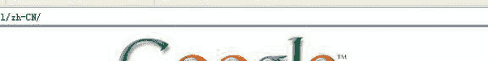

- 所有网站
- 图片
- 新闻
- 网上论坛
- 网页目录

- 搜索所有网站
- 搜索所有中文网站
- 搜索简体中文网页

利用 Google AdWords 为您的网站带来更多的客户

- 广告计划
- Google大全
- Google.com in English

将 Google 设为首页！

## 搜索入门

- 要用GOOGLE做搜索，当然首先要进GOOGLE网站--www.google.com；不过，163.com和yahoo.com.cn使用的实际上也是GOOGLE搜索引擎，只是对搜索结果进行了编排，但无法提供一些特色功能，如图片搜索等。
- 第一次进入GOOGLE，它会根据你的操作系统，确定语言界面。需要提醒的是，GOOGLE是通过cookie来存储页面设定的，所以，如果系统禁用cookie，就无法对GOOGLE界面进行个人设定了。
- GOOGLE的首页很清爽，LOGO下面，排列了五大功能模块：网站、图像、新闻组、网上论坛和目录服务。默认是网站搜索。
- 现在进行第一次搜索实践，要查找所有关于“易筋经”的中文网站和网页。在搜索框内输入一个关键字“易筋经”，然后点击下面的“google搜索”按钮（或者直接回车），结果就出来了。
- 搜索：“易筋经”
  结果：已搜索有关易筋经的中文(简体)网页。共约有44,500项查询结果，这是第1-10项。搜索用时0.07秒。

约有44,500项符合易筋经的查询结果，以下是第1-10项。（搜索用时 0.07秒）

### 武术健身-拳法精选

与武术关系最密切的健身气功就是《易筋经》，自创立之初到现在，差不多各家各派均有或多或少的引用。因此，这里先将易筋经刊登出来，但均以古文版本为主，并无统一标准。
这里选择其影响较大者先列出四家。本处刊载的易筋经为古文版本（原文），未做 ...

### 易筋经

“达摩易筋经”传说是达摩老祖的一种养生功法，练功时，必须在人少寂静的地方，刺苦穴，才能收到良好的效果，掌握这个功法的 ... 小林寺的功法，名称很多，“达摩易筋经”是最著名的功法之一，所以历来在民间很受欢迎，这个功法有特点，它就通过各个...

### 洗髓经

少林寺洗髓经研究中心，由少林文武僧、少林少易筋经洗髓经传人释延王禅师发起。
传易筋经“少林寺内功法”《易筋经》、《洗髓经》、《易筋经洗髓功》和《八段锦》。
内部功心法景象教材VCD已制作完成，并出版发行。相应的文字教材和理论也已 ...

## 初阶搜索

本节探讨多个关键词以及关键词间不同逻辑关系的查询。

- 搜索结果要求包含两个及两个以上关键词
  - 一般搜索引擎需要在多个关键词之间加上“+”，而GOOGLE无需用明的“+”来表示逻辑“与”操作，只要空格就可以了。
  - 示例：搜索所有包含关键词“易筋经”和“吸星大法”的中文网页
    搜索：“易筋经 吸星大法”
    结果：已搜索有关易筋经 吸星大法的中文(简体)网页。共有774项查询结果，这是第1-10项。搜索用时0.24秒。
  - 注意：搜索关键词外面的引号仅起引用作用，不能带入搜索栏内。

- 搜索结果要求不包含某些特定信息
  - GOOGLE用减号“-”表示逻辑“非”操作。
  - 示例：搜索所有包含“易筋经”而不含“吸星大法”的中文网页
    搜索：“易筋经 -吸星大法”
    结果：已搜索有关易筋经-吸星大法的中文(简体)网页。共有5,150项查询结果，这是第1-10项。搜索用时0.40秒。
  - 注意：这里的“+”和“-”号，是英文字符，操作符与作用的关键词之间，不能有空格。

## 初阶搜索（续）

- 搜索结果至少包含多个关键字中的任意一个
  - GOOGLE用大写的“OR”表示逻辑“或”操作。假定你是布兰妮和披头士的歌迷，现在要查找所有关于布兰妮和披头士的中文网页。
  - 示例：搜索包含布兰妮 “Britney”或者披头士 “Beatles”、或者两者均有的中文网页。
    搜索：“Britney OR Beatles OR 布兰妮 OR披头士”
    结果：已搜索有关Britney OR Beatles OR 布兰妮 OR披头士的中文(简体)网页。共约有10,400,300项查询结果，这是第1-10项。
  - 注意：小写的“or”，在查询的时候将被忽略；这样上述的操作实际上变成了一次“与”查询。

所有网站　图像　新闻　网上论坛　网页目录

约有 10,400,000 项符合 Britney OR Beatles OR 布兰妮 OR 破头士 的查询结果。以下是第1-10项。

可直接输入拼音，Google会自动显示最符合的中文关键词

### [The Beatles.com - [翻译此页 BETA]]

The Beatles Capitol Boxset, The Beatles Yellow Submarine, The Beatles First Visit, The Beatles Let It Be... Naked, The Beatles Anthology, The Beatles 1's.

©2005 Apple Corps Ltd - Register // Links:

www.beatles.com/ - 4k - 网页快照 - 类似网页

### Britney Spears ~ The Official Site. - [翻译此页 BETA]

The official site. Features a photo gallery, tour information, and news about Britney.

www.britneyspears.com/ - 3k - 网页快照 - 类似网页

### Britney Spears - britney.com - Jive Records - [翻译此页 BETA]

Includes news, biography, photos, tour dates, audio, and video.

www.britney.com/ - 8k - 网页快照 - 类似网页

### Britney Spears guide to Semiconductor Physics: semiconductor ... - [翻译此页 BETA]

Britney Spears lectures on semiconductor physics, radiative and non-radiative transitions, edge emitting lasers and VCSELs.

www.britneyspears.ac/lasers.htm - 13k - 网页快照 - 类似网页

### 布兰妮·斯皮尔斯 影音娱乐 新浪网

姓名：布兰妮·斯皮尔斯英文名字：Britney Jean Spears 生日：1981年12月2日出生地：

路易斯安那州肯特伍德市星座：人马座身高：1.63米体重：57公斤 2查查看兰妮星座履历

HM》评论全球性感女人布兰妮只排名六(图)。布兰妮计划产后火速复出一心 ...

sina.cuft.cn/suf/official.html - 62k - 网页快照 - 类似网页


## 初阶搜索（续）

- 用“+”和“-”减少冗余信息
  - “+”和“-”很多时候能够缩小搜索结果的范围，以提高查询结果命中率。
  - 例：查阅天龙八部具体是哪八部。分析：如果光用“天龙八部”做关键字，搜索结果有20,300项，而且前面的主要与金庸小说《天龙八部》相关，很难找到所需要的资讯。可以用两个方法减少无关结果。
    - 1，如果知道八部中的某一部，比如阿修罗，增加“阿修罗”关键字。“天龙八部 阿修罗”的搜索结果就只有1,050项。
    - 2，如果不知道八部中的任何一部，但知道这与佛教相关，可以排除与金庸小说相关的记录。“天龙八部 佛教 -金庸”的查询结果为1,120项，可以迅速找到需要的资料。

- “+”、“-”和“OR”的混合查询
  - 混合查询涉及到逻辑操作符的顺序问题。一般而言，搜索引擎按照从左往右的顺序读取操作符号。如果只涉及“与”操作和“非”操作或单纯的“或”操作，则不会产生顺序问题。
  - 示例：查询：“所有关于Britney或者Beatles、但是没有Madonna相关信息的中文网页”。
    - 搜索：“Britney OR Beatles -Madonna”
      结果：已搜索有关Britney OR Beatles -Madonna的中文(简体)网页。共约有16,200项查询结果，这是第1-10项。搜索用时0.23秒。
    - 搜索：“-Madonna Britney OR Beatles”
      结果：已搜索有关-Madonna Britney OR Beatles的中文(简体)网页。共约有16,200项查询结果，这是第1-10项。搜索用时0.13秒。
    - 搜索：“Britney -Madonna OR Beatles”
      结果：找不到和您的查询-Britney -Madonna OR Beatles-相符的网页
    - 搜索：“Britney OR -Madonna Beatles”
      结果：找不到和您的查询-Britney OR -Madonna Beatles-相符的网页
  - 可见，“或”操作的前后两个关键字必须是默认的“与”查询，否则，搜索引擎将无法完成搜索。

## 辅助搜索

- 通配符问题

很多搜索引擎支持通配符号，如 "*" 代表一连串字符， "?" 代表单个字符等。GOOGLE不支持通配符号，只能做精确查询，关键字中的 "*" 或者 "?" 会被忽略掉。

- 关键字的字母大小写

GOOGLE对英文字符大小写不敏感， "GOD"和 "god"搜索的结果是一样的。

- 搜索整个句子

GOOGLE的关键词可以是词组（中间没有空格），也可以是句子（中间有空格），但是，用句子做关键词，必须加英文引号。

示例：搜索包含 "long, long ago"字符串的页面。

```
"long long ago"
```

结果：已搜索有关long long ago的中文(简体)网页。共有 16,500项查询结果，这是第1-10项 。 搜索用时0.06秒。

## 辅助搜索（续）

- 搜索引擎忽略的字符和词汇

GOOGLE对一些网路上出现频率极高的英文单词，如 “i”、“com”、“www”等，以及一些符号如 “*”、“.” 等，作忽略处理。

示例：搜索关于第一次世界大战的信息
搜索： “worldwar i”
结果： “i”太常用，没有被列入搜索范围。已向英特网搜索 “worldwar i”。共约有67,000项符合worldwar i的查询结果，这是第1-10项。搜索用时0.07秒。

- 强制搜索

如果要对忽略的关键字进行强制搜索，则需要在该关键字前加上明文的 “+” 号。

示例：搜索包含 “Who am I?”的网页。如果用 “ who am i?”， “Who”、“I”、“?”会被省略掉，搜索将只用 “am”作关键字，所以应用强制搜索。
搜索： “ +who +am +i”
结果：已向英特网搜索 “+who +am +i”。共约有332,000项查询结果，这是第1-10项。搜索用时3.68秒。

- 注意：大部分常用英文符号（如问号，句号，逗号等）无法成为搜索关键字，加强制也不行。

## 进阶搜索

- 对搜索的网站进行限制
  - “site”表示搜索结果局限于某个具体网站或者网站频道，如 “sina.com.cn”、“edu.sina.com.cn”，或者是某个域名，如 “com.cn”、“com”等。如果是要排除某网站或者域名范围内的页面，只需用 “-网站/域名”。
  - 示例：搜索中文教育科研网站（edu.cn）上所有包含“金庸”的页面。
    搜索： “金庸 site:edu.cn”
    结果：已搜索有关金庸 site:edu.cn的中文(简体)网页。 共约有1,730项查询结果，这是第1-10项。 搜索用时0.23秒。
  - 示例：搜索新浪文教频道中关于鲁迅的信息。
    搜索： “鲁迅 site:edu.sina.com.cn”
    结果：已在edu.sina.com.cn搜索有关 鲁迅的中文(简体)网页。 共约有672项查询结果，这是第1-10项。 搜索用时0.24秒。
  - 注意： site后的冒号为英文字符，而且，冒号后不能有空格，否则，“site:”将被作为一个搜索的关键字。此外，网站域名不能有任何“/”的目录后缀；网站频道则只局限于“频道名.域名”方式，而不能是“域名/频道名”方式。诸如“金庸 site:edu.sina.com.cn/1/”的语法是错误的。

## 进阶搜索（续）

查询某一类文件（往往带有同一扩展名）

语法： “filetype:”，现在已经可以搜索15种，

- Adobe Portable Document Format (pdf)
- Adobe PostScript (ps)
- Lotus 1-2-3 (wk1, wk2, wk3, wk4, wk5, wki, wks, wku)
- Lotus WordPro (lwp)
- MacWrite (mw)
- Microsoft Excel (xls)
- Microsoft PowerPoint (ppt)
- Microsoft Word (doc)
- Microsoft Works (wks, wps, wdb)
- Microsoft Write (wri)
- Rich Text Format (rtf)
- Shockwave Flash (swf)
- Text (ans, txt)

- 查询某一类文件（往往带有同一扩展名）

最重要的是的文档搜索是PDF搜索。PDF是ADOBE公司开发的电子文档格式，现在已经成为互联网的电子化出版标准。目前GOOGLE检索的PDF文档大约有2500万左右。PDF文档通常是一些图文并茂的综合性文档，提供的信息一般比较集中全面。

- 示例：搜索关于电子商务（ECOMMERCE）的PDF文档。
  搜索：“ecommerce filetype:pdf”
  结果：已向英特网搜索ecommerce filetype:pdf. 共有25,500项查询结果。搜索用时0.44秒。

- 可以看到，GOOGLE在PDF档前加上了[PDF]的标记，而且，GOOGLE把PDF文件转换成了文字档，点击“一般文字档”，可以粗略的查看该PDF档的大致内容。

- 注意，上述查询均是对PDF内文的检索，“ecommerce”这个关键字是包含在PDF文档中的。

- 查询某一类文件（往往带有同一扩展名）
  - 搜索PDF文档还可以用来 “inurl:”语法。
    - 示例：搜索关于电子商务（ECOMMERCE）的PDF文档。
      搜索：“inurl:pdf ecommerce”
      搜索结果数量大致相同，不过查询结果顺序略有差别。
  - “filetype”的另一个强大用处在于图片搜索。后面将对GOOGLE的图片搜索功能作详细说明，此处略提一下。
    - 进入 “http://images.google.com/”，查找关于本拉登的JPG图片。
    - 搜索：“Bin Laden filetype:jpg”
      结果：搜索有关 Bin Laden filetype:jpg 的图片（）。
      （试验版）共约有1,630项查询结果，这是第1-20项。
      搜索用时0.14秒。

## 进阶搜索（续）

- 搜索的关键字包含在URL链接中
  - “inurl”语法返回的网页链接中包含第一个关键字，后面的关键字则出现在链接中或者网页文档中。INURL语法和基本搜索语法的最大区别在于，前者通常能提供非常精确的专题资料。
    - 示例：查找微软网站上关于windows2000的安全课题资料。
      搜索：“inurl:security windows2000 site:microsoft.com”
      结果：已在microsoft.com内搜索有关inurl:security windows2000 的网页。共约有188项查询结果，这是第1-10项。搜索用时0.27秒。
    - 注意：“inurl:”后面不能有空格，GOOGLE也不对URL符号如“/”进行搜索。例如，会把“cgi-bin/phf”中的“/”当成空格处理。
  - “allinurl”语法返回的网页的链接中包含所有作用关键字。这个查询的关键字只集中于网页的链接字符串。
    - 语法：“allinurl:"cgi-bin" phf +com”


## 进阶搜索（续）

- 搜索的关键字包含在网页标题中
  - “intitle”和“allintitle”的用法类似于上面的inurl和allinurl，只是后者对URL进行查询，而前者对网页的标题栏进行查询。网页标题，就是HTML标记语言title中间的部分。网页设计的一个原则就是要把主页的关键内容用简洁的语言表示在网页标题中。因此，只查询标题栏，通常也可以找到高相关率的专题页面。
  - 示例：查找日本明星藤原纪香的照片集。
    搜索：“intitle:藤原纪香 写真”
    结果：已搜索有关intitle:藤原纪香 写真 的中文(简体)网页。
    共约有465项查询结果，这是第1-10项。搜索用时0.16秒。

## 其他罕用语法

- 搜索所有链接到某个URL地址的网页
  - 如果你拥有一个个人网站, 估计很想知道有多少人对你的网站作了链接。而 “link”语法就能让你迅速达到这个目的。
  - 示例: 搜索所有含指向华军软件园 “www.newhua.com”链接的网页。
    搜索: “link:www.newhua.com”
    结果: 搜索所有链接到www.newhua.com的网页。共约有856项查询结果, 这是第1-10项。搜索用时0.17秒。
  - 注意: “link”不能与其他语法相混合操作, 所以 “link:”后面即使有空格, 也将被GOOGLE忽略。
- 查找与某个页面结构内容相似的页面
  - “related”用来搜索结构内容方面相似的网页。例: 搜索所有与中文新浪网主页相似的页面(如网易首页, 搜狐首页, 中华网首页等), “related:www.sina.com.cn/index.shtml”。

## 其他罕用语法（续）

- 从GOOGLE服务器上缓存页面中查询信息
  - “cache”用来搜索GOOGLE服务器上某页面的缓存，通常用于查找某些已经被删除的死链接网页，相当于使用普通搜索结果页面中的“网页快照”功能。
  - 示例：查找GOOGLE缓存的中文yahoo首页
    搜索： “cache:www.yahoo.com.cn”
    结果：这是Google内http://cn.yahoo.com/ 的页库快照。
    Google已先预览各网站，拍下网页的快照存档。
    这网页可能有更新的版本，请按此查看新版。
    Google 和网页作者无关，不对网页的内容负责。
    ...

## 图片搜索

- 不得不承认，GOOGLE的图片搜索功能真是个伟大的发明！！GOOGLE自称可以检索320,000,000张图片，并称自己为“互联网上最好用的图像搜索工具”。
- GOOGLE首页点击“图像”链接就进入了GOOGLE的图像搜索界面“images.google.com”。在关键字栏内输入描述图像内容的关键字，如“britney spears”，就会搜索到大量的小甜甜布兰妮的图片。
- GOOGLE给出的搜索结果具有一个直观的缩略图（THUMBNAIL），以及对该缩略图的简单描述，如图像文件名称，以及大小等。
- GOOGLE图像搜索目前支持的语法包括“+”，“−”，“OR”，"site"和"filetype"。
- 示例：查找美国教育网上的宇宙大爆炸jpg图片
  搜索：“BIG BANG filetype:jpg site:edu"
  结果：搜索有关 BIG BANG filetype:jpg site:edu 的图片。共约有337项查询结果，这是第1-20项。搜索用时1.99秒。

## 目录内搜索

- 如果不想搜索广泛的网页，而是想寻找某些专题网站，可以访问 GOOGLE 的分类目录“http://directory.google.com/”，中文目录是“http://directory.google.com/Top/World/Chinese_Simplified/”。
- 目前 GOOGLE 使用的分类目录采用了 ODP 的内容。“Open Directory Project”是网景公司所主持的大型公共网页目录。由全世界各地的义务编辑人员审核挑选网页，并依照网页的性质及内容来分门别类。因此，在某一目录门类中进行搜索往往能有更高的命中率。
- 示例：查找关于癌症治疗以及护理方面的中文资料
  搜索：先进入中文简体分类目录，再进入“健康”子目录，确定选中“只在健康中搜索”单选项目。在搜索栏内填入“癌症”进行搜索。
  结果：在分类健康项中搜索癌症。共约有370项查询结果，这是第1-10项。搜索用时0.05秒。
- 可以看到，上述查询结果比普通的检索更有效，因为在分类中进行搜索剔除了很多不相关的无效信息。
  - 对于中文用户而言，最大的问题是志愿的中文目录编辑太少，导致收录站点太少，因此搜索结果范围显得过于狭隘。

## 新闻组（USENET）搜索

新闻组有详尽的分类主题，某些主题还有专人管理编辑，具有大量有价值信息。由于新闻组包含的信息实在是海量，因此不利用工具进行检索是不大可能的。除了搜索之外，GOOGLE还支持新闻组的WEB方式浏览和张贴功能。

- 进入GOOGLE新闻组 “http://groups.google.com/”，有两种信息查找方式：
  - 一层层的点击进入特定主题讨论组
  - 直接搜索

示例：查找新闻组中关于山顶洞人的讨论信息
搜索：“山顶洞人”
结果：在各群组内搜索山顶洞人共约有18项查询结果，这是第1-10项。搜索用时0.29秒。

新闻组中的帖子实在是多，而且又涉及一些普通搜索所没有的语法，所以建议使用“高级群组搜索”。新闻组高级搜索提供留言内容、分类主题、标题、留言者、留言码、语言和发布日期作为条件进行搜索。（作者指发帖所用的唯一识别号电子信箱）

## 其他杰出功能

- 集成化的工具条
  - 为方便搜索者，GOOGLE提供了工具条，集成于浏览器中，用户无需打开GOOGLE主页就可以在工具条内输入关键字进行搜索。此外，工具条还提供许多其他功能，如显示页面PageRank等。最方便的一点在于用户可以快捷的在GOOGLE主页、目录服务、新闻组搜索、高级搜索和搜索设定之间切换。
  - 欲安装GOOGLE的工具条，可以访问 “http://toolbar.google.com/”，按页面提示可以自动下载并安装。
  - 对于经常进行网络搜索者而言，GOOGLE工具条实在是必备的东西！！
- 搜索结果过滤
  - 网络上的成人内容浩如烟海，而且很多站点具有欺骗或者其他不良企图，浏览者很容易掉入其中的陷阱。为此，GOOGLE设立了成人内容过滤功能，见GOOGLE的设置页面，http://www.google.com/preferences，最底下有一个选项 SafeSearch Filtering。不过，中文状态下的GOOGLE还没有这个功能。

## 其他杰出功能（续）

- 网页翻译

懂英文，但是是不觉得就懂德文、法文、拉丁文。如果搜索出来的页面是这些语言怎么办？呵呵，GOOGLE提供了网页翻译功能！！虽然目前只支持有限的拉丁语、法语、西班牙语、德语和葡萄牙文，但是是不得不承认，这是个杰出功能。

试着做以下搜索：“big bang site:fr”。这个表示查找关于宇宙大爆炸的法文网页。看第一条结果：

> The Big Bang Website - [ Translate this page ]
> ... A propos de Big Bang. Le dernier numéro en date. Les anciens
> activités. Concerts progressifs en France. Emissions de radio. Liens.
> perso.club-internet.fr/calyx/bigbang/ - 3k - Cached - Similar pages

有点晕。没关系，点击“Translate this page”按钮。再看结果，嗯，大致能看明白，这原来是个叫“big bang”的乐队的网站，与大爆炸无关...

机器翻译是一个很前沿的人工智能课题，想指望翻译出来的结果跟专门用英语撰写的内容是不可能的。但西文间的互相翻译比中英文机译强得多多了。至少能看明白。

## 关键词选择初探

- 关键词的选择在搜索中起到决定性的作用，关键词选择是最基本也是最有效的。
- 例一：查找《镜花缘》一书中淑士国酒保的酸话原文。
- 分析：如果按照一般的思路，找某部小说中的具体段落，就需要用搜索引擎先找到这本书，然后再翻到该段落。这样做当然可以，但是效率很低。如果了解目标信息的构成，用一些目标信息所特有的字词，可以非常迅速的查到所需要的资料。也就是说，高效率的搜索关键字不一定就是目标信息的主题。在上面的例子中，酒保谈到酒的浓淡与贵贱的关系时，之乎者也横飞。因此，可以用特定的词语一下子找到目标资料。
- 搜索：“酒贵贱之”，OK，找到的第一条信息就是镜花缘的这一段落：“先生听者：今以酒醋论之，酒价贱之，醋价贵之。因何贱之？为甚贵之？真所分之，在其味之。酒味淡之，故而贱之；醋味厚之，所以贵之。…”
- 以上的关键字选择技巧可以谓之“特定词法”。


## 关键词选择初探（续）

关键词的选择在搜索中起到决定性的作用，关键词选择是最基本也是最有效的。

例二：“黄花闺女”一词中“黄花”是什么意思。

“黄花闺女”是一个约定的俗语，如果只用“黄花闺女”做关键词，搜索结果将浩如烟海，没什么价值，因此必须要加更多的关键词，约束搜索结果。选择什么关键词好呢？备选的有“意思”、“含义”、“来历”、“由来”、“典故”、“出典”、“渊源”等，可以猜到的是，类似的资料，应该包含在一些民俗介绍性的文字里，所以用诸如“来历”、“由来”、“出典”等词汇的概率更高一些。

搜索：“黄花闺女 黄花 由来”，查到“黄花”原来出典于《太平御览》，与南朝的寿阳公主相关。如果想获得第一手资料，那就可以用“太平御览 寿阳公主”做搜索了。

以上的关键字选择技巧可以谓之“近义词法”。

## 常用搜索个案

- 找人
  - 分析：一个人在网上揭示的资料通常有：姓名，网名，性别，年龄，毕业学校，工作单位，外号，住址，电话，信箱，BP，手机号码，ICQ号，OICQ号等等。所以，如果要了解一下多年没见过的同学，那不妨用上述信息做关键字进行查询，也许会有大的收获。

- 找书
  - 分析一：常访问的电子图书馆类网站就那么几个，比如文艺类的“www.shuku.net”。于是可以用SITE语法很简单的找到某本书（如果该网站上有的話）。比如，“旧唐书 site:shuku.net”，就可以马上找到该书。如果没有，通常别的网站上也很难找到。因此，找书的关键，是了解一大批著名的图书馆网站。
  - 分析二：上面介绍的第一项关键字选择技巧特定词法，对于迅速找到某书或者文章也是极其有用的，当然，这得建立在你已经读过该书，对书的内容有印象的基础上。比如如果了解堂吉诃德一书战风车的 大致内容，就可以用“吉河德风车 桑乔”迅速找到该书。

## 常用搜索个案（续）

- 找软件
  - 分析一：最简单的搜索当然就是直接以软件名称以及版本号为关键字查询。但是，仅仅有软件名称和目标网站，显然还不行，因为搜索到的可能是软件的相关新闻。考虑到下载页面上常有“点击此处下载”或者“download”的提示语，因此，可以增加“下载”或者“download”为关键字。例：搜索“winzip 8.0 下载”。
  - 分析二：很多网站设有专门的下载目录，而且就命名为“download”，因此，可以用INURL语法直接搜索这些下载目录。例：搜索“winzip 8.0 inurl:download”。
  - 在互联网上随意的下载软件是不安全的，因为供下载的软件有可能带有病毒或者捆绑了木马，所以，对下载网站作一个限定，是一个稳妥的思路。可以用SITE语法达到这个目的。
  - 共享软件下载完之后，使用的时候，软件总跳出警示框，或者软件的功能受到一定限制。所以应该再找一个注册码。找注册码，除了软件的名称和版本号外，还需要有诸如“serial number”、“sn”、“序列号”等关键字。现在，来搜索一下winzip8.0的注册码。例：搜索“winzip 8.0 sn”。

- 找图片

除使用GOOGLE提供的专门图片搜索功能，还可以组合使用一些搜索语法，达到图片搜索之目的。

分析一：专门的图片集合，提供图片的网站通常会把图片放在某个专门目录下，如“gallery”、“album”、“photo”、“image”等。这样就可以使用INURL语法迅速找到这类目录。现在，试着找找小甜甜布兰妮的照片集。

```
搜索：“"britey spears" inurl:photo"。
```

分析二：提供图片集合的网页，在标题栏内通常会把注明，这是谁的图片集合。于是就可以用INTITLE语法找到这类网页。

```
搜索：“intitle:"britey spears" picture"。
```

分析三：明星的FANS通常会申请免费个人主页来存放他们偶像的靓照。于是用SITE语法指定某免费主页提供站点，是个迅速找到图片的好办法。

```
搜索：“"britey spears" site:geocities.com"。
```

## 常用搜索个案（续）

## 找MP3

- 分析一：提供MP3的网站，通常会建立一个叫做MP3的目录，目录底下分门别类的存放各种MP3乐曲。所以，可以用INURL语法迅速找到这类目录。现在用这个办法找我老歌“say you say me”。
  搜索：“say you say me” inurl:mp3
  结果：已向英特网搜索inurl:mp3 "say you say me"。共约有155项查询结果，这是第1-10项。搜索用时0.17秒。

- 分析二：也可以通过网页标题，找到这类提供MP3的网页。
  搜索：“say you say me” intitle:mp3
  结果：已向英特网搜索"say you say me" intitle:mp3。共约有178项查询结果，这是第1-10项。搜索用时0.73秒。

- 当然，如果知道某个网站的下载速度快，而且乐曲全，就可以用SITE语法先到该网站上看看有没有目标乐曲。

## GOOGLE搜索FAQ

- Q: 如何全面的了解google.com?
  A: 查看网站相关页面 “http://www.google.com/about.html”。
- Q: 如何切换google.com的初始语言界面?
  A: 点击搜索栏右边的 “使用偏好” （Preferences），选择 “界面语言” （Interface Language）中你期望的语言，点击最下面的 “设定使用偏好” （Save Preferences）按钮。需要提醒的是，GOOGLE使用cookie记录这个偏好，所以如果把浏览器的cookie功能关掉，就无法进行设定。
- Q: 如何设定每页搜索结果显示数量?
  A: 同上，进入使用偏好，在该页的 “查看结果” （Number of Results）选择显示结果数，数目越大，显示结果需要的时间越长，默认是10项。

## GOOGLE搜索FAQ

- Q: 搜索到的链接无法打开怎么办？
  A: 链接无法打开的原因很多，比如网站当机，或者页面已经死掉等等，可以点击GOOGLE的“网页快照”查看在GOOGLE服务器上的网页缓存。不过，如果该页面是被当地ISP过滤的话，服务器缓存还是无法打开。唯一的办法在于利用代理服务器，然后在URL栏内输入链接的IP地址。

- Q: 打开搜索结果的链接，可是该页面太大，很难找到一下子找到目的资料怎么办？
  A: 直接打开“网页快照”，GOOGLE会把关键词用不同颜色标记出来，很容易找到。

- Q: 点击每个查询结果的时候，我想单独弹出窗口，这该怎么办？
  A: 进入“使用偏好”界面，注意底部有个“结果视窗”项目，选中“开启新视窗以显示查询结果”复选框然后存储设置就可以了。

## 使用偏好

继续查询前请储存您的设定。

储存使用偏好

## 语系偏好 (修改将适用于所有的 Google 服务)

界面语言

指示语言 英语

## 搜索语言

所有语言 (建议使用).

只搜寻由以下语言所写的网页：(可多选)

- 丹麦文
- 俄文
- 保加利亚文
- 克罗地亚文
- 冰岛文
- 加泰罗尼亚文 (西班牙)
- 哥特利文
- 印尼文
- 土耳其文

- 塞尔维亚文
- 希伯来文
- 保加利亚文
- 德文
- 意大利语
- 拉脱维亚文
- 挪威文
- 捷克文
- 斯拉维尼亚文

- 斯洛伐克文
- 日文
- 法文
- 诺兰文
- 爱沙尼亚文
- 福典文
- 立陶宛文
- 简体中文
- 繁体中文

- 罗马尼亚文
- 芬兰文
- 英文
- 荷文
- 葡萄牙语
- 西班牙文
- 阿拉伯文
- 韩文

## 结果数量

Google的原始设定 (10 项) 最有效且快速。
每页显示 10 项搜索结果。

## 结果预览

开启新视窗以显示查询结果。

## 补充几点

- 几个关于google的常识：
  - 词典功能。在引擎中填入任何一个字，点击结果中的那个关链字，google自动转到 www.dictionary.com 显示该字的解释。
  - yahoo的搜索引擎买的就是google，如果google找不到，就别去yahoo了，也不要去网易。
  - google每月更新一次web 数据库，如果google找不到，去更新最勤的 www.alltheweb.com —— 9到12天，或许有收获。google的新闻组数据库号称每天更新数次。
  - google的爬虫只爬到每个文档的前110k字节处就停止了，所以长文档里面的部分，google会找不到。


张冬燕

zdy@hit.edu.cn

# 参考书目

- 《计算机网络》
  - Andrew Tanenbaum,清华大学出版社
- 《计算机网络与互联网》
  - Douglas Comer,电子工业出版社
- 《TCP/IP详解:卷一协议》
  - Richard Stevens,机械工业出版社
- 《计算机网络（第三版）》
  - 谢希仁编著，大连理工大学出版社
- 《用TCP/IP进行网络互连(第一卷)》
  - Douglas Comer,电子工业出版社

# 第一章 Internet 概述

## 主要内容

- Internet的基本概念、基础知识、特点、功能、形成、发展和现状等。

## 学习目的

- 掌握 计算机网络与Internet的基本概念
- 掌握Internet、Intranet、Extranet的含义及其区别
- 了解Internet产生、发展和现状
- 了解网络互连的基本概念以及接入Internet的基本方法

## 什么是计算机网络？

- 计算机网络是地理上分散的多台独立自主的计算机遵循约定的通讯协议，通过软、硬件互连以实现交互通信、资源共享、信息交换、协同工作以及在线处理等功能的系统。
- 计算机网络与国际电话系统十分相似 -- 没有人能完全拥有或控制它，但连接以后却能使它象大型网络一样运转。

## 1.1 计算机网络的起源与发展

### 计算机互联网初期的特点：

- 以通信线路为基础，建立远程终端，构造分时系统。这种具有通信功能的终端便是早期的计算机网络。
- 主要特点是将通信技术与计算机技术相结合，建立了总长度为240万公里的远程终端

### 问题：

- 主机负担重，需要兼顾数据处理及通信
- 设备运行速度慢，使得独占线路利用率低

### 计算机互联网的维形

早期 的计算机网络

二级结构的计算机网络

Zhang Dongyan

TCP/IP Protocols

通信控制处理器

### 计算机互联网的雏形

1969年美国建立第一个分组交换网

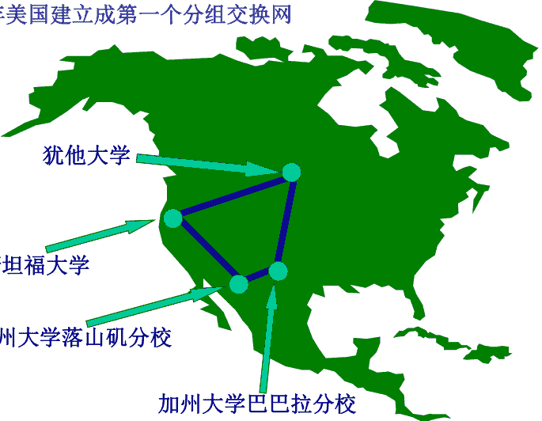

犹他大学

斯坦福大学

加州大学洛杉矶分校

加州大学巴巴拉分校

### 互联网的雏形--ARPANet网

- 分组交换不同于传统的电路交换，是存储转发方式中的一种，将要传送的报文分割成具有同一格式的分组，以此作为传输的单元，进行存储转发。

- 优点是：线路利用率高、可进行数据速率的转换、不易引起阻塞、可以使用优先权

- 因此在1976年，国际电报电话咨询委员会（CCITT）制定了用于公用分组交换网的协议标准 X.25。

### 互联网的雏形--ARPANet网

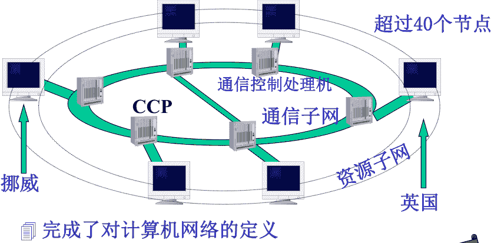

- 完成了对计算机网络的定义
- 提出了资源子网、通信子网的概念
- 研究了分组交换方法

首次提出了Internet的概念

### 互联网的雏形--NSFnet网

- 1985年美国国家科学基金会（NSF）在ARPANet成功后决定资助建立计算机科学网。
- 1987年建立了一个新的广域网，由13个节点组成，由主干节点下联到各地区网。
- 采用TCP/IP作为统一的通信协议标准，传输速率由56kbps提高到1.544Mbps。

### 互联网的雏形——NSFnet网

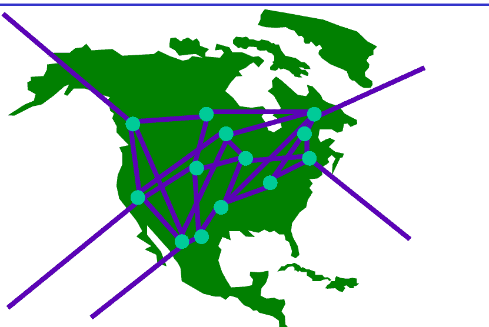

### 美国国内互联网的形成

- ARPAnet后期分离出来一个军方专用网络 MILnet。
- MILnet与NSFnet进行了互连，互连后正式称为Internet。
- 1990年能源网（Esnet）、航天技术网(NASAn et)、商业网(COMnet)等先后接入 Internet，从而构成了美国的Internet，称为USInternet。
- 同年建立了一个新的广域网ANSnet，带宽45Mbps。

### 中国互联网发展概况

- 1987年9月20日钱天白先生通过X. 25网络（ChinaPac）和德国的网关，从中国向Internet发出了第一封电子邮件：“Across the Great Wall, Reach the World”，即：“跨越长城，通达世界”。
- 1989年5月：CRN通过X. 25网与德国联网
- 1991年：中科院高能所通过专线与美国联网
- 1994年4月：中国成为直接接入Internet的国家

### 中国互联网发展概况

CERNET 中国科技网

CERNET 中国教育网

CHINANET 中国电信网

CHINAGBN 中国经济网

UNINET 中国联通网

中科院系统的12个分院和123个研究所(95年)

原国家教委94年12月组织清华、北大等高校承建

中国公用计算机互联网络，即163、169

中国联通公司(2000年)

中国国家公用经济信息通信网（金桥网）

Internet


### 中国公用计算机互联网 (Chinanet)

- Chinanet 于94年开始建设，由邮电部建设，95年6月对外营业。
- 依托ChinaPac, ChinaDDN, PSTN等通信资源，构成国内速度最快的网络。
- 共有31个主干节点，覆盖全国。
- 3个国际出口

### 中国公用计算机互联网络(Chinanet)

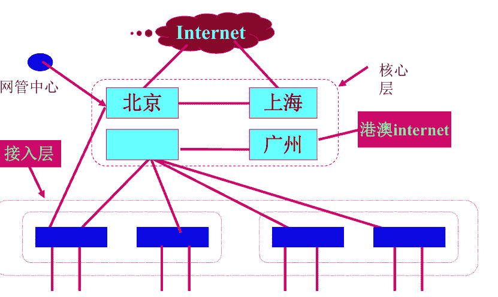

### 中国教育网的三层结构

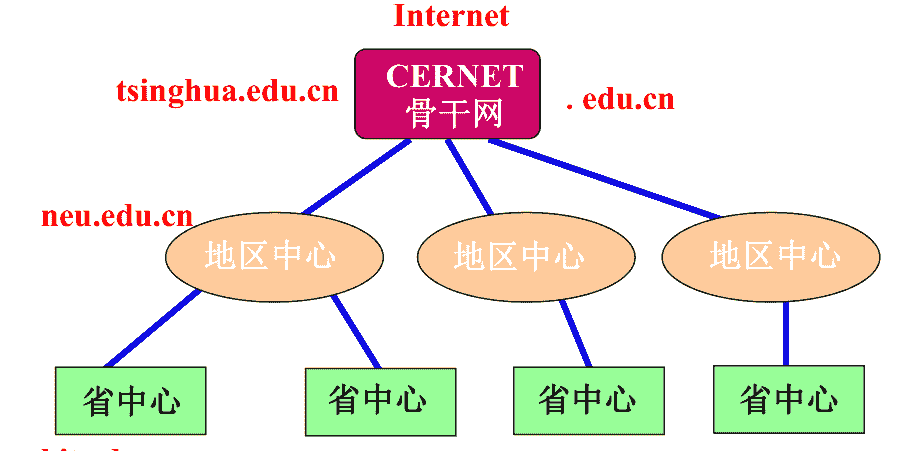

### 中国教育网（CERNET）

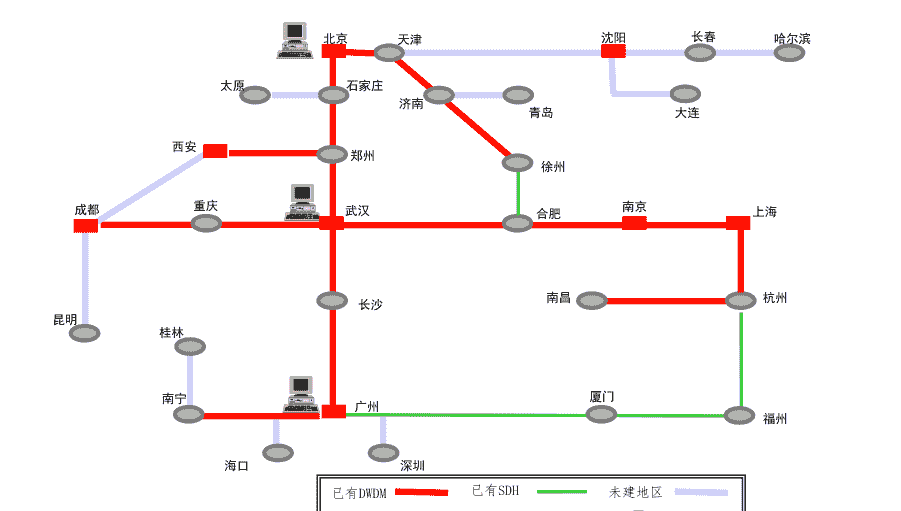

已有WDM 已有SDH 未建地区 地区网络中心 省主节点


### CERNET国内互联

- 中国网通 北京　　3x155M+155M=620M
- 中国电信 广州　　3x155M = 465M
- 北京交换中心　　1G（2.5G）

### 中国互联网的发展

- 2000年1月18日CNNIC《中国互联网络发展状况统计报告》：截止至99年12月31日，我国上网用户数达890万（99年上半年为400万），上网计算机主机达350万台，WWW站点15153个

- 2001年1月17日，CNNIC在京发布了最新的《中国互联网络发展状况统计报告》。统计报告显示：截止到2000年12月31日止，我国上网计算机数有约892万台（拨号751万，专线141万）；域名总数122099个；上网用户数2250万人（拨号1543万，专线与拨号同时343万，其它92万）；2001年，我国上网计算机已接近3000万台。WWW网站约265405个，我国国际线路的总容量为2799M。

### 全球范围Internet的形成

- 早期的Internet是为了促进科学与教育的发展而建立的，因此被严格地限制在科技与教育领域

- 由于美国Internet技术的发展，各国也相继发展起来，并开始进行了互连，从而使用户数急剧增加。

- 1992年，正式成立了Internet协会，届时联机数目已经以百万计。

## 1.1 计算机网络的起源与发展

### Internet的发展经历了三个阶段：

- 1969~1983　研究试验阶段
- 1983~1994　实用阶段，在美国和一些发达国家的大学及研究部门得到广泛应用
- 1994~至今　商业化阶段，除教育科研网外，政府部门、商业企业单位以及个人开始广泛使用Internet

## 1.1 计算机网络的起源与发展

- 计算资源共享；
- 互连的计算机是分布在不同地理位置的多台独立的“自治计算机”（autonomous computer）；
- 连网计算机必须遵循共同的网络协议；

### 与传输介质有关的概念

- **吞吐量/数据传输率**
  - 在一个给定时间内介质能够传输的数据量, bps
  - 每种介质都有其潜在的吞吐量
- **带宽**
  - 介质能传输的最高和最低频率之差，Hz
  - 任何一个物理系统都有其有限带宽
- **带宽与数据传输率的关系**
  - 1924, Nyquist定理
    - 无噪声信道环境下 max baud rate = 2 * Bandwidth
  - 带宽越高数据传输率越大


### 与传输介质有关的概念

利用数字通信通道进行传输的方法称为基带传输。相应的信号称为“数字基带信号”。

- 计算机到监视器、打印机等外设的信号就是基带传输的。
- 大多数的局域网使用基带传输，如以太网、令牌环网。

利用模拟信号来传输数据信号的方法称为频带传输。借助频带传输，可以将链路容量分解成两个或更多的信道，每个信道可以携带不同的信号，这就是宽带传输。

- 宽带传输中的所有信道都可以同时发送信号。如 CATV、ISDN 等。

## 1.2 计算机网络互连

### 网络互连的必要性

- 网络互连是局域网发展的必然趋势
- 各种通信类型的网络需要长期共存
- 网络的整体性能需要改善
- 大量的异构网需要互连

### 网络互连的结果

- 由许多不同的异构（heterogeneous）网络开始
  - 连接这些物理网络
  - 使用软件手段使得连接之后的系统看起来是“同类的”（homogeneous）
- 称之为 internetwork 或 internet

### 网络互连的基本方式

- 物理层中继系统（即中继器 Repeater）：通常用于同种网络的物理层上，对所接收的信号进行再生和放大，以便扩大网络的作用范围。
- 数据链路层中继系统（即网桥或桥接器）：通常用于在数据链路层对帧信息进行存储转发。
- 网络层中继系统（即路由器 Router）：通常用于在网络层存储与转发分组数据。
- 最高层中继系统（即网关或 Gateway）：这是最复杂的一种，通常用于在网络层以上的各层进行双向或单向的协议转换，故网关又称为协议转换器。

一般来说，网络互连的方式主要有：

#### （1）通过中继系统实现网络互连

由于主机和节点是组成网络的基本部分，因此这类互连主要有两种方式：

- 节点级互连（又称为分布式计算环境互连）
- 主机级互连（又称为数据终端设备 DTE 互连）

#### （2）通过互连网进行网络互连

当互连网络的数目较多时，通常的做法是：先用网关构成一个互连网，并为其制定一个大家都遵守的数据格式（协议），再把各个网络连接到网关上，这样就形成了互连网络。这种方式在数据从源到目的地时进行了两次协议转换：源网络协议→互连网协议；互连网协议→目的网络协议。

### 网络互连的常用设备

- (1) 中继器（Repeater）：用来扩展单段网络的长度，作用：对信号进行再生和放大。
- (2) 路由器（Router）：这是实现异构型网络互连的重要设备。它可将众多不同类型的网络连接成一个大型网络。其功能包括：路由选择、包的存储与转发、网络分段、流量控制、网络管理等。
- (3) 网关（Gateway）：也是用于异构型网络互连的设备。主要功能是进行协议转换和数据重新分组。通常用于网络层、运输层和应用层，主要有：协议网关、应用网关和安全网关。
- (4) 集线器（Hub）
- (5) 交换机（Switch）

### 计算机网络互连——中继器

中继器又称为转发器，工作在物理层，用于连接以太制式的总线式网络。中继器实现网络在物理层上的连接，起到扩展网络连接距离的作用。

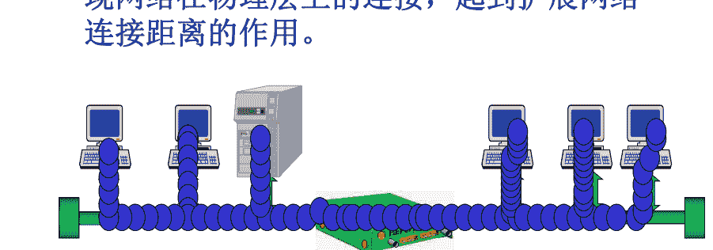

中继器分为直接放大式和信号再生式两种：

- 直接放大式只是一个简单的放大器，噪音也将一同传递到下一网段。
- 信号再生式同时具有信号再生功能，其可对信号进行整形后传到下一网段。

### 计算机网络互连——交换机

- 交换机是将各端口之间进行逻辑上的直联，因此不仅各端口可以同时进行传输，而且可以将网络划分为多个子段以提高广播效率。
- 交换机可分为二层交换与三层交换，其中第二层交换作用在链路层，起到广播转发的作用，如以太网交换机。而第三层交换则作用在网络层，支持 IP 交换。
- 第三层交换是路由器的另一种实现模式，用于完成路由控制功能。其与传统的路由器的主要差别一是表现在硬件实现上，二是与交换机合为一体，使得在交换的同时进行路由选择。
- 可以支持 VLAN。

### 计算机网络互连——路由器

路由器是在多个网络及介质之间对 IP 协议提供网络互连能力。其与网桥的主要差别是可以支持不同底层协议网络的互连，与网关的主要差别在于路由器具有路由功能。


## 1.3 计算机网络分类

### 按规模大小和地域范围

- 局域网（LAN）：在局部地理位置内建立的网络（1 公里以内）。如一个办公室，一栋大楼等。
- 广域网（WAN）：跨越远距离（几十至几千公里范围），一般通过远程通信设施（铜线、光缆、无线电）连接起来的网络。行业网，分布在多个地理位置的公司网。
- 城域网（MAN）：将一个城市中的各部门、各单位的网络连接起来的网络（5-50 公里内）。
- 子网：网络的一个片段，其内的机器可以直接共享资源和传输数据。

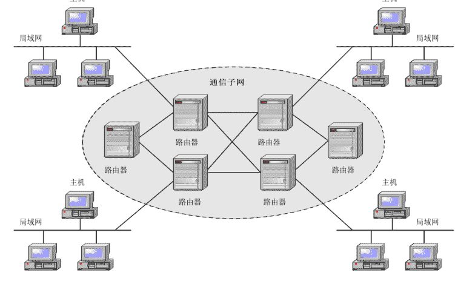

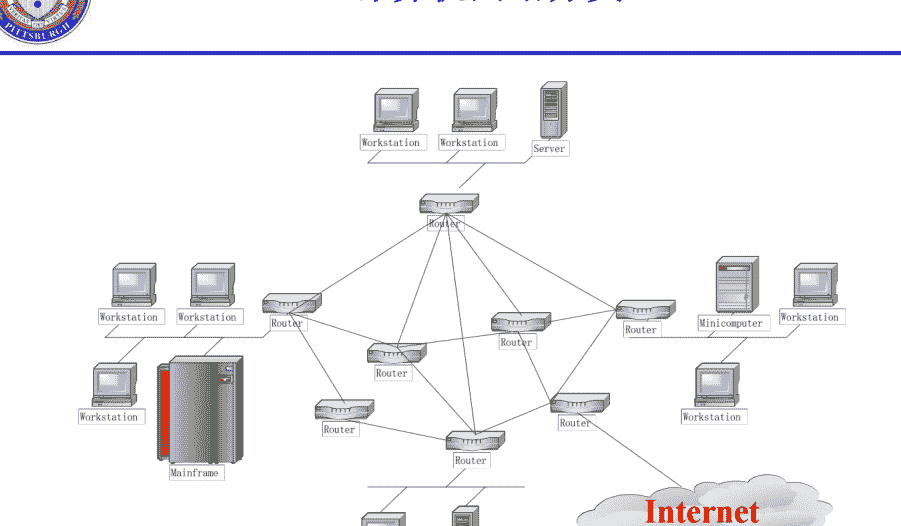

### 按拓扑结构（网络中计算机连接起来的结构形态）

- 总线
- 星型
- 环状
- 网状

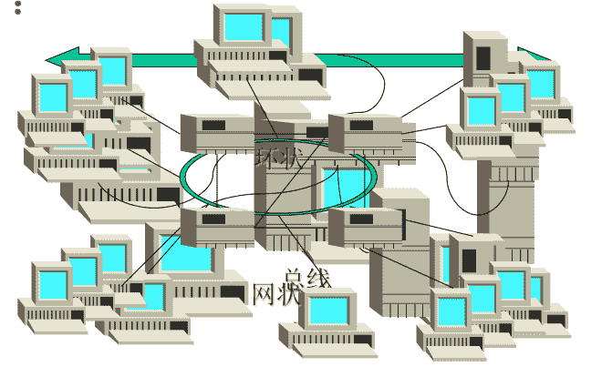

### 混合拓扑结构

- 层次（树）
- 总线-星
- 环-星
- 网状-星

### 按交换方式

- 电路交换（网络进行数据传输时，在源与目的之间构成一条实际连接的专用物理线路）
- 报文/分组交换（在源和目的之间不需要建立一条专用的物理线路，而将信息分解成报文/分组，一站一站从源送到目的地，与普通邮政寄信方式类似）
- 帧中继（呼叫控制信号与用户数据采用分开的逻辑连接，实现多路复用和交换；不采用一步一步地流控和差错控制。可以被认为是虚拟的租用线路）
- 信元交换（信元是 ATM 数据传送的单位，ATM 对信元信息域不做任何处理，信元在网络中传送期间出现的一切问题（信元丢失、传送出错、信元延时变化）都由终端来处理）

### 按网络协议

- TCP/IP、SNA、DNA、SPX/IPX、AppleTalk 等

### 按应用规模

- Internet
- Intranet
- Extranet

## 1.4 Internet 的基本应用

### 计算机联网的主要目的

- 资源共享
  - 硬件共享：大型计算机的处理能力，昂贵的外设；
  - 软件共享：应用软件，系统软件等；
  - 数据共享：用户数据（市场信息）等。
- 数据传输
  - 支持用户之间的数据传输（如电子邮件、文件传输、IP 电话等）；
- 提供分布处理和均衡计算机负荷的功能。
- 对地理上分布的系统进行集中控制；对网络资源进行集中分配和管理。
- 提高系统的可靠性。
- 向网络用户提供最佳的性能价格比。
- 开辟大量新的应用服务项目。
- ......

### Internet 最基本的应用方式有

- 网上信息交流
- 网上信息获取
- 网上资源共享
- 等等

### 网上信息交流

#### 信息的通信与交流方式

- 非交互式：
  - 普通方式：邮寄信件；
  - Internet 方式：E-mail；信息浏览
- 交互式：
  - 普通方式：打电话；
  - Internet 方式：在线文本交谈；语音通信（如 IP 电话）；视频通信（如视频会议）；共享白板系统等。

### 网上信息查找

WWW（环球信息网）是为了方便用户查找和获取 Internet 信息的一种信息组织方式。用户只需要在本地机（客户）上运行浏览器软件，就可从全球互连的 Web 服务器中获取各种信息。

Web 浏览器软件尽管各不相同，但都具有如下基本功能：

- 检索查询：可浏览、查询、读入全球范围内任一台 Web 服务器上的信息。
- 文件服务：可随时对所浏览的文档进行保存、打印，或跟踪感兴趣的链接。
- 其它服务：如收发电子邮件、FTP、Telnet 等功能。


### 网上资源共享

在 Internet 中除了上述的 Web 资源外，还有大量的、相互独立的公共文件服务器，其中存储着各种有用的资源，供人们通过 FTP（文件传输）手段进行获取。一般通过 FTP 下载的信息主要有以下三类：

- 免费软件：这类软件可供用户免费使用。
- 共享软件：这类软件只允许用户免费一段时间，到期后需交纳一定费用才能继续使用。
- 公共档案文件：如各国的人口统计资料、期刊杂志、艺术图片、科学实验结果等。

### Internet上的资源

- 网上图书馆
- 网上大型专题数据库
- 新闻组（news group）/邮寄用户清单（mailing list）
- 电子公告牌
- 信息获取工具
- 共享硬件/软件资源：巨型机、大型存储器、公用软件
- 搜索引擎：Google、Yahoo、Sohu、Sina

## 1.4 Internet 的基本应用

- 健康保健：远程医疗、紧急医疗响应支持
- 教育：远程、数字图书馆
- 科学研究：能源、地理系统、气象、生物
- 国家安全：全球通信、信息传播
- 环境：检测、警告、响应
- 政府：传递政府服务和信息给公民和企业
- 突发事件：灾难响应、危机管理
- 企业管理、设计和制造、电子商务、军事等多方面应用

- E-mail 服务
- Web 服务
- FTP 服务
- Telnet 服务
- News 服务
- Chat 服务
- BBS 服务
- ……

## 1.5 Internet 的组织管理与相关机构

Internet 最大的特点是管理上的开放性，它没有集中的管理机构。为了促进 Internet 运行所需的标准兼容性并确保 Internet 的持续发展，先后成立了一些机构自愿承担必需的管理职责，并且遵循自下而上的结构原则。下面介绍几个重要的 Internet 组织：

### 1、Internet协会（ISOC）及其组织机构

- **目的：** ISOC 成立于1992年，总部在美国，是作为一个全球 Internet 协调与合作的国际组织而建立的。
- **任务：** 确保全球 Internet 发展的有利性和开放性，并通过领导标准、议题和培训工作来发展互联网的相关技术。
- **网址：** www.isoc.org

Internet学会（ISOC）组织机构：

- Education
- Internet 体系结构委员会
- CNRI
- 工程任务组
- 技术研究组
- 许可证管理组
- Internet 编号组
  - 欧洲地区
  - 亚太地区
  - 其它地区

### 2、IAB（Internet体系结构委员会）职责

- 制定 Internet 的技术标准
- 通过网络发布 Internet 工作文件
- 规划 Internet 发展战略
- 就技术问题进行国际协调

### 3、Internet 草案与 RFC

Internet 技术管理的核心是制定网络连接和应用的协议标准。在 Internet 上，任何一个用户都可以对 Internet 某一领域的问题提出自己的解决方案或规范，作为 Internet 草案（Internet Drafts）提交给 IETF。最后，由 IESG 确定草案是否能成为 Internet 的标准。

### 4、InterNIC 与域名管理

Internet 网络信息中心（InterNIC：www.internic.net）成立于1993年1月，其主要任务是负责所有以 .org、.com、.net、.edu 结尾的国际顶级域名的注册与管理（.mil、.gov 由美国政府管理）。各国的顶级域名由各国自己管理。

### 5、IAB 下属工作组

- 工程任务组
- 许可证管理组
- 技术研究组
- Internet 编号组：欧洲地区、亚太地区、其它地区

### 6、WWW 协会（W3C）

WWW 协会（简称：W3C；网址：www.w3.org）是除了 ISOC 以外的另一个国际性的 Internet 组织，其任务在于确定和颁布有关 WWW 的应用标准。

### 7、中国互联网络信息中心（CNNIC）

中国互联网络信息中心（简称：CNNIC；网址：www.cnnic.net.cn）是于1997年6月成立的非营利性 Internet 管理与服务机构，行使中国国家互联网络信息中心的职责。

主要任务是：1）注册服务（包括：域名注册、IP地址分配、自治系统号分配等）；2）目录数据库服务；3）信息服务；4）网站访问流量认证；5）代表我国与 InterNIC、APNIC（亚太互联网络信息中心）等国际机构进行业务联系。

### 8、Internet 或网络中心的日常管理

Internet 或网络中心的日常工作管理由以下部门完成：

- NOC（Network Operations Center）
  - 职责：确保网络正常运行，监督网络活动。
- NIC（Network Information Center）
  - 职责：为用户或用户服务机构提供支持。

## 1.6 Internet 的接入方式

- 接入方式与 ISP 的选择（与谁连？连接到哪？如何连？）
- 调制解调器（MODEM）
- 通过电话线拨号接入 Internet
- 通过局域网接入 Internet
- 通过电话线进行数字连接
- 通过电缆接入 Internet

### ISP（Internet Service Provider）

- 即 Internet 服务提供商的简称。
- ISP 一般都建立自己的网络中心，使用专线接入 Internet 主干线路，提供 Internet 接入服务。

### ICP（Internet Content Provider）

- 即 Internet 网页内容供应商。
- 提供网页发布服务，一般不提供接入服务。

### IAP（Internet Access Provider）

- 即 Internet 接入供应商。
- 为用户提供接入服务，与 ISP 基本功能相同。

- 国家级接入网
  - ChinaNet
  - ChinaGBN
  - CERNET
  - CSTNET
- 接入服务商
  - ISP
  - ICP
  - IAP
- 单位/企业网
- 接入的通信线路
  - 电话网：PSTN
  - 非对称数字用户线：ADSL
  - 综合业务网：ISDN
  - 分组交换网：X.25
  - 专线：DDN、T1、E1
  - 宽带业务网：CABLE
  - 光纤、微波、卫星

Internet 的接入可以分为两大类：

- 拨号接入方式（适用于小型子网或个人用户）
  - 通过 PSTN（公用电话网）拨号接入
  - 通过 ISDN 拨号接入
  - 通过 ADSL（非对称数字用户线）接入
- 专线接入方式（适用于中型子网接入）
  - 通过路由器经 DDN 专线接入
  - 通过 FR（帧中继）接入
  - 通过分组交换网（如 X.25）接入
  - 通过微波或卫星接入

### 调制解调器连接图（单机）

```text
家里/办公室
MODEM
串行线
电话机
电话线 Line
MODEM池
访问服务器
ISP
Internet
PSTN/ISDN
```

### 局域网接入连接图（通过 MODEM）

- 通过 MODEM 连接
- 线路：PSTN、ISDN、ADSL
- 所有机器共享 1 个 IP 地址
- 代理服务器（PROXY）

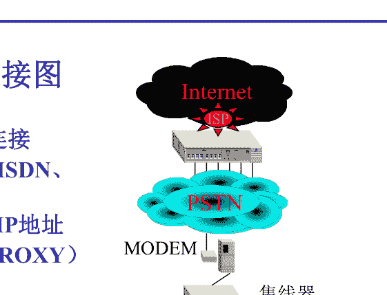

### 局域网接入连接图（通过路由器）

- 通过路由器连接
- 使用数据线路：DDN、FR、X.25
- 形成一个子网
- 通过网关访问
- 每台联网计算机各有 1 个 IP 地址

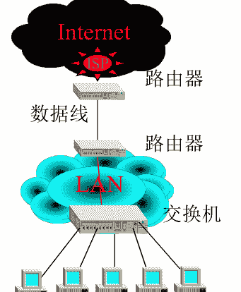

### 各种应用服务器

各种应用服务器：WWW、E-mail、FTP、Telnet、BBS、Gopher、Newsgroup……

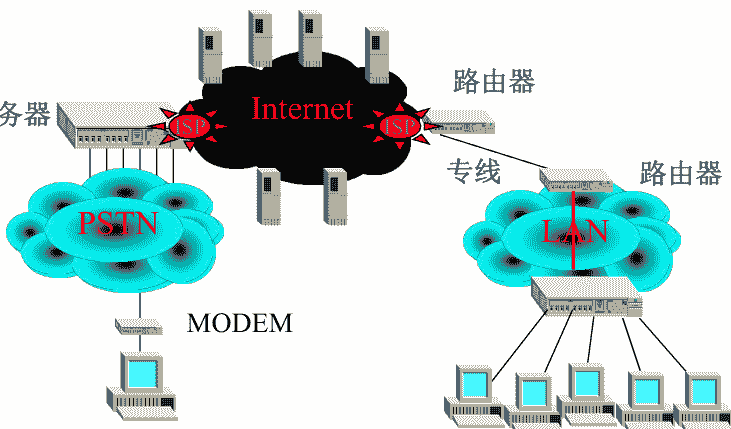


## 1.7 计算机网络发展趋势

### 网络用户数的发展趋势

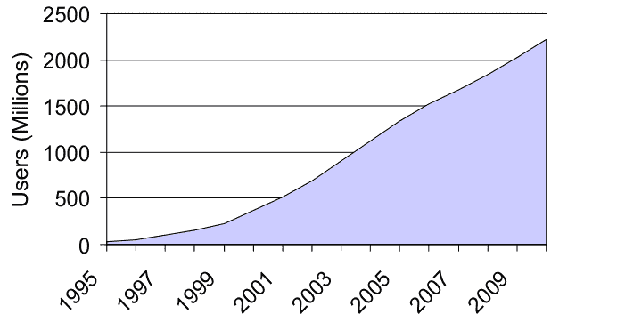

## 1.7 计算机网络发展趋势

### Growth of the Internet

### Internet上的主机数：

- Aug. 1981　　　 213
- Oct. 1984　　 1,024
- Dec. 1987　　 28,174
- Oct. 1990　　 313,000
- Oct. 1993　　 2,056,000
- Apr. 1995　　 5,706,000
- Jul. 1997　　 19,540,000
- Jul. 1999　　 56,218,000
- Jul. 2001　　 125,888,197
- Jul. 2002　　 162,128,493

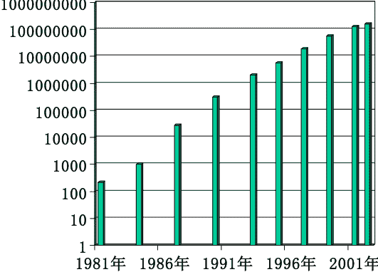

## 1.7 计算机网络发展趋势

### Recent Growth (1991-2002)

### Internet Domain Survey Host Count

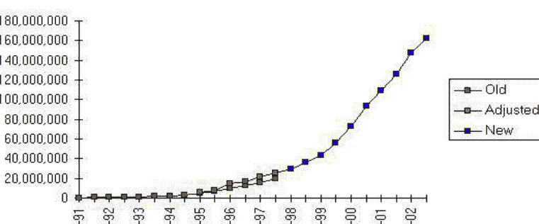

Source: Internet Software Consortium [www.isc.org]

## 1.7 计算机网络发展趋势

### Internet的发展速度

- 是历史上发展最快的一种技术
- 以商业化后达到 5000 万用户为例
- • 电视用了13年，收音机用了38年，电话更长
- • Internet 从商业化后达到 5000 万用户用了4 年时间

### Internet 正在以超过摩尔定理的速度发展

## 1.7 计算机网络发展趋势

### 网络时代的三大定律

摩尔定律：
CPU性能18个月翻番，10年100倍。
所有电子系统（包括电子通信系统，计算机）都适用

光纤定律：
超摩尔定律，
骨干网带宽9个月翻番，10年10000倍。带宽需求呈超高速增长的趋势

迈特卡尔夫定律:联网定律，
网络价值随用户数平方成正比。未联网设备增加N倍，效率增加N倍。联网设备增加N倍，效率增加N²倍

## 1.7 计算机网络发展趋势

### 网络带宽与CPU性能

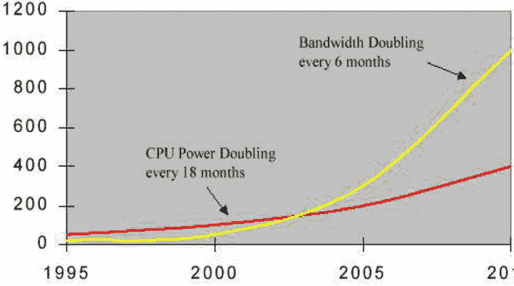

## 1.7 计算机网络发展趋势

### Internet面临的挑战：

- 从单一面向数据到面向多种服务；
- Internet设计者的本意是建立一个支持数据通信的网络，没有考虑视频、语音的多媒体应用；
- Internet商业化运作，以及各种信息服务的开展，促使它必须面对数据、语音与视频的多种类型应用程序通信的支持；

## 1.7 计算机网络发展趋势

### 不同应用对传输的特殊要求

- 数据传输具有突发性，对传输正确性的要求高；
- 在语音传输中，如果数据包丢失率小于10%，不会造成语音的严重失真；但是数据包的双向传输延迟一定要相同，并且延迟时间一般要求低于300—400ms；实时性要求表现在：双向传输延迟的一致性；延迟的大小；延迟值的抖动；
- 典型的应用是数据、语音与视频传输，它要求网络能保证提供确定的带宽，发送端与接收端之间保持不变、连续的定时关系，并且要求它们之间的传输延迟可以预知的；

## 1.7 计算机网络发展趋势

### 计算机网络发展的7个预言

- 到公元2025年，我们生活的地球将披上一层“通信外壳”
- 到2010年，全球互联装置之间的通信量将超过人与人之间的通信量
- 带宽的成本将变得非常低廉，甚至可以忽略不计
- 个人及企业将获得大量个性化服务
- 因特网将从一个单纯的大型数据中心发展成为一个更加聪明的商网络
- 高智能网络将成为人与信息之间的高层调节者
- 我们将看到一个充满虚拟性的新时代

## 1.7 计算机网络发展趋势

### 下一代互联网的计划

- 美国白宫的NGI计划（Next-eneration互联网 Initiative, 下一代因特网计划）
- NSF的VBNS（Very High Bandwidth Network Service, 超高带宽网络服务）
- Internet2（一个由大学、协会、公司和政府机构共同努力建设的网络）
- IPng（下一代因特网协议，又名IPv6）
- 这些计划试图建立新的协议、新的硬件、新的软件、新的知识和新的网络测试环境。

## 第二章

## Internet分层体系结构


## 2.1 网络系统结构

网络系统结构是计算机之间相互通信的层次，以及各层中的协议和层次之间接口的集合。网络协议是计算机网络和分布式系统中互相通信的对等实体间交换信息时所必须遵守的规则的集合。

协议的关键成分是：

- 语法(syntax)：包括数据格式、编码及信号电平等
- 语义(semantics)：包括用于协调和差错处理的控制信息
- 定时(timing)：包括速度匹配和排序等

## 2.1 网络体系结构

计算机网络是一个复合系统，由于在型号、线路类型、连接方式、同步方法、通信方式不同，尤其就异种机来说其通信极为复杂，因此需要采用分而治之的方式，将非常复杂的网络通信问题化为若干个彼此功能相关的模块来处理，各模块之间呈现明显的层次结构，这就是分层结构。

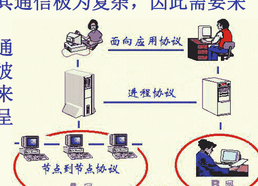

## 2.1 网络体系结构 - 基本构成

## 资源子网

REC(1122/3和1009)定义:

主机：一个主机就是连到1个或多个网络的设备。它可在其中的任意网络上进行收发通信，但不能将分组从一网络传到另一网络。

参考:

网关：网关是连到多于1个网络上的设备。它有选择性的将信息从一个网络发到另一个网络。

- 只完成输入输出及通信工作
- 可以是简单的输入输出设备


## 2.1 网络体系结构 - 基本构成

## 资源子网

- 高速线路
- 低速线路
- 终端
- 通讯控制处理器
- 主计算机

## 2.1 网络系统结构 - 基本构成

## 通信子网

- 局域网的通信子网由传输介质与网络接口板组成
- 广域网的通信子网在以上基础上包括转发部件，通常具有交换功能
- 路由器、网关、协议转换器均属于这类转发部件

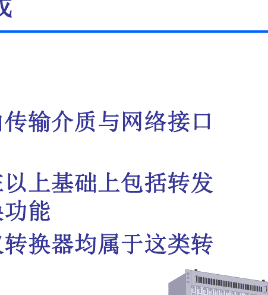

## 2.1 网络体系结构 - 基本构成

通讯控制处理器（CCP）
- 控制本模块与终端设备之间的数据传输，对其通信线路进行控制管理。

CCP：作为网络中各个模块之间的接口机，负责接口之间的信息传输控制。包括线路传输控制、差错监测与恢复、路由

集中器：主要负责差错控制、信息缓存、代码转换、电路转接等

数据通信设备 (DCE)
- 将数字信号与模拟信号进行相互转换。

## 2.2 开放系统互连(OSI)参考模型

国际标准化组织(ISO)是一个义务性的非条约的专门的标准化组织，负责制定各类标准。

标准的建立时间对于其成功是至关重要


## 2.2 开放系统互连(OSI)参考模型


## 2.2 开放系统互连(OSI)参考模型

- □2.2.1 物理层
- □2.2.2 链路层
- □2.2.3 网络层
- □2.2.4 传输层
- □2.2.5 会话层
- □2.2.6 表示层
- □2.2.7 应用层


## 2.2 开放系统互连(OSI)参考模型

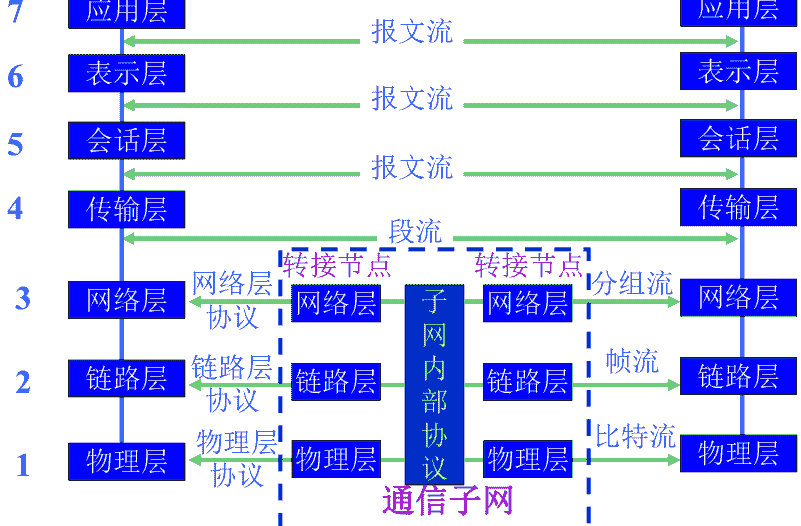

## 应用层

## 表示层

## 会话层

## 传输层

## 网络层

## 链路层

## 物理层

数据

传输层信息

网络层信息

数据

网络层头信息

数据


## 2.2.1 OSI模型 - 物理层

- 确定如何在通信信道上传输比特流
- 涉及网络物理结构、传输介质的规程、位传输的编码与定时规则。

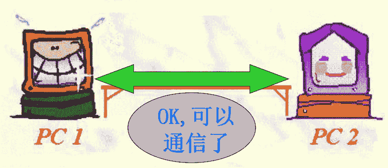

## 2.2.2 OSI模型 - 链路层

- 加强物理层的传输功能，建立一条无差错的传输线路
- 将物理层传输的比特组合成帧，确定帧界及速率，差错纠正

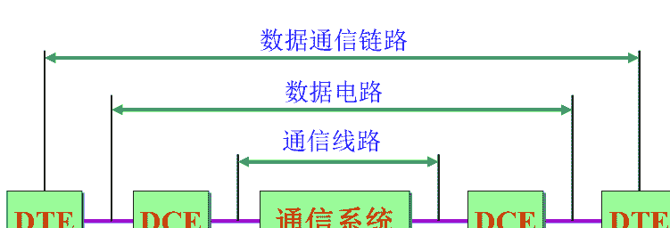

- 网卡地址（MAC地址）
- 出厂设置, 全球唯一

- 总线结构
- 环型结构的地址技术
- 星型结构 广播地址。
- 网状结构 如SUN
- 蜂窝结构


MAC地址,
- 总线结构的地址技术
- 环型结构唯一地址
- 星型结构 广播地址。
- 网状结构 如SUN
- 蜂窝结构

## 2.2.2 OSI模型 - 链路层

### 逻辑链路控制（LLC）层

- 帧界确定和识别 — 帧结束的判定
  - 面向字符的传输，面向位的传输，编码违例法
- 连接类型 — 对连接类型进行判定
  - 无确认、无连接；有确认、无连接；面向连接

差错控制和确认：用于遥测链路确认数据传输的可靠性

流量控制：无连接服务不提供顺序控制，可能出现重复包

- 静态窗口流控，动态窗口流控，预定速率流控

差错检测和纠错：置换错误帧编号确定重复包

- 奇偶校验码，方块码，循环冗余纠错码

## 2.2.2 OSI模型 - 链路层

### 差错控制机制

接收端可以通过检错码检查传送一帧数据是否出错，一旦发现传输出错，则采用反馈重发ARQ（Automatic Request for Repeat）的方法来纠正。

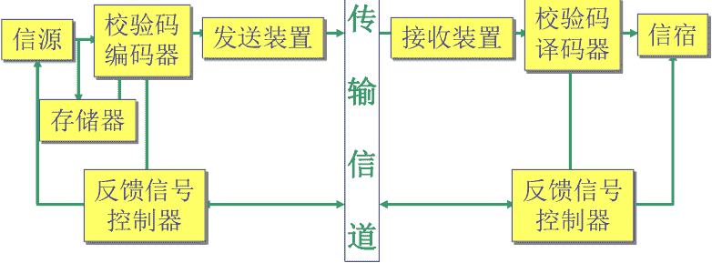

## 2.2.2 OSI模型 - 链路层

反馈重发纠错实现方法有两种：

- 停止等待方式
  - 等到确认接收方正确无误地收到数据帧后才发送下一个帧。协议简单，系统通信效率低。

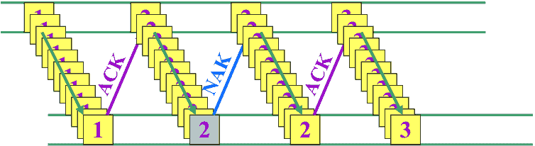

## 2.2.2 OSI模型 - 链路层

— 连续工作方式

- 拉回方式
- 选择重发方式


## 2.2.2 OSI模型 - 链路层

静态窗口流控：定义一个窗口大小，如4，选择4个帧附上窗口号发出，每收到针对一个窗口号的确认帧，该窗口号即可分配给新的帧。由此，最多未收到的确认帧数不会超过4个。

动态窗口流控：接收方发阻塞帧来要求降速，发送方收到后则调小窗口；当发送方在长时间未收到阻塞帧时则尝试调大窗口。由此得到最佳速度。

窗口控制：

- 窗口是指可以放置一定数据帧的缓冲区。
- 窗口流控就是通过控制缓冲区来控制数据传输速度的方法。

## 2.2.3 OSI模型 - 网络层

- 用于解决如何将源端发出的分组经过各种途径送到目的端
- 寻址，路径交换，路由的搜索，选择

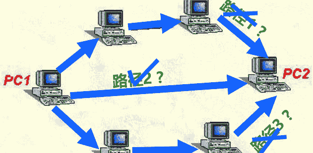

## 2.2.3 OSI模型 - 网络层

错误控制：分组最后仍需要进行差错校验，已确定是否需要补发分组。分组的丢失也需要补发。由于应答信号的丢失可能造成重发，根据分组号可重发
分组顺序控制：由于采用分组传送，接收端所收到的分组可能会乱序。就虚电路而言，原则不应出现乱序，但如果出现错误或断电需要重建虚电路，重建的一次寻址过程是先确定IP地址，再确定各分组加上组号，以便 MAC地址，然后再确定服务地址，即端口号。
拥塞控制：在...状态恢复出来，并在...口号。
接节点机速度慢，速度不匹配；另一是线路容量饱和，导致节点机不能及时接收。

分组交换：以固定长信息包为单位进行传送

- 错误控制，分组顺序控制，拥塞控制

网络互连：跨网络及多协议的转换

- 中继器，网桥，路由器，交换机，网关

## 路由选择算法

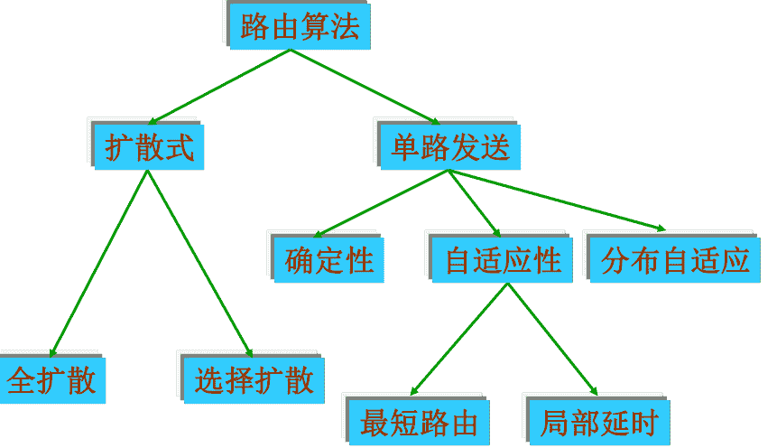

## 路由选择算法

### 扩散式： 将报文同时向多个路径广播的路由法

- 全扩散：典型的广播方法，可保证以最短的时间到达目的地。有两种方法可以确保不会出现洪泛现象
  - 通过设置生命周期控制，即将数据包设为路径长短的生命周期，每通过一个路由器就减一，使得未能到目的地的报文及时丢失掉。在不知路径长度时可设为网络的半径长度。
  - 各路由器将接收的每一个报文均记录下来，一旦多次接收便抛弃而不再向外广播。
- 选择扩散：向通往目的节点的部分端口送报文，有两种选择方法
  - 向大概方向发送，一般不会出现逆向连接
  - 随机选择一些通道发送出去。

## 路由选择算法

### 单路发送：只选择一个端口发送报文的路由法

- 确定性路由算法：典型的静态路由法，事先人为地确定路由信息，可以设置概率路径。
- 自适应路径算法
- 最短路径法：通过纪录实际的报文传输中最短传输时间所对应的路径，即通过接收了带有路径纪录参数的报文后获得出发节点到本节点的路径长度，保留短的纪录。是一种基于全网的全局算法。
- 局部延时法：通过纪录到达各直达邻点的传输时间来确定最短路径，也可以无条件将报文交到排队最少的端口通道。这是一种孤立式路径选择。
- 分布式适应性路由算法：如同距离矢量法一样，将本节点到其它节点的延迟时间传送出去，以便确定哪条路径传输最短，是上两种方法的结合。

## 2.2.4 OSI模型 - 传输层

- 传输层的目的是在源端与目的端之间建立可靠的端到端服务。隔离网络的上下层协议，使得网络应用与下层无关。
- 在网络中负责相当于链路层的错误控制，流量控制及顺序问题
- 寻址，段合并，连接服务


## 2.2.4 OSI模型 - 传输层

网络服务通常分为三类：
A类：该服务不存在分组错误，丢失及乱序。这种情况仅存在于局域网中。
B类：这类分组很少发生单个分组的丢失，丢失的分组可在底层恢复，但由于拥塞的问题及软硬件的缘故仍然会有问题，因此在传输层解决差错问题。如X.25网。
C类：是一种完全不可靠的服务，分组丢失和重复，顺序也完全无规律，通常不提供连接。因此主要靠传输层来完成差错控制及重发等工作
C类服务并不一定是最差，通常下层作了大量的工作并不一定是上层所需要的，还需重做。因此数据报类型的传输也有其市场。

## 2.2.4 OSI模型 - 传输层

### TCP/UDP协议

传输控制层协议(TCP)和用户数据报协议(UDP)是Internet的传输层协议，其支持主机之间的端到端的连接。TCP包括分组排序、流控、差错控制等，UDP不包括差错控制、重排序等，是不可靠的高速协议。

### SPX协议

序列分组交换(SPX)协议是Novell的传输层协议，是面向连接的协议，其包括连接控制、数据流控制、差错控制、分组排序。

### AppleTalk协议

ATP协议是苹果公司的传输层协议，提供两个主机之间的可靠的不丢失的分组发送技术。

## 2.2.5 OSI模型 - 会话层

- 为会话用户提供一个建立连接及在上按顺序传送数据的方法。
- 负责每一站究竟什么时间可以传送与接收数据。
- 会话连接与传输层有差别，前者需双方同意才可中断连接，后者可单方中断，有如电话。


## 2.2.5 OSI模型 - 会话层

### 对话控制

- 单工、半双工，双工
- 原则上，所有OSI连接都是双工的，但是多数情况下高层软件采用半双工形式，要求用户轮流发送数据，目的是方便软件设计。

### 会话管理

- 帮助在服务请求者与服务提供者之间建立和维护通信
- 建立连接，数据传输，连接释放

## 2.2.6 OSI模型 - 表示层

- 将用户信息转换成易于发送的比特流，在目的端再转换回去的方式。
- 数据压缩、数据转换、数据加密。


## 2.2.6 OSI模型 - 表示层

### 数据压缩
- 有穷符号的等价表示法，最小表示空间
- 频率依赖法，Hoffman算法
- 上下文依赖编码，尤其适于动态图像

### 数据转换
- 位序转换:补码还是反码？向左读还是向右读？
- 字节顺序:左起字节(IBM)还是右起字节(DEC)？
- 字符代码：EBCDIC码(a=81)与ASCII码(a=61)
- 语法转换：长文件名向DOS转换

### 数据加密
- 公开密钥（RSA） 私用密钥（DES）

## 2.2.7 OSI模型 - 应用层
- 提供面向用户的界面，即实用程序，使得用户可以利用这些程序完成实际的工作。
- 涉及到网络服务、服务公告及服务使用方式。

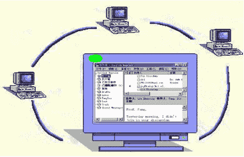

## 2.2.7 OSI模型 - 应用层

- 文件服务——FTP、NFS等
- 打印服务——网络打印机

> 将自己的服务名和地址登记在某一目录服务器中，在该目录服务器中形成一张服务表。客户端在需要了解网络能提供哪些服务时不需要接收全部服务器发出的广播包，只要向目录服务器发出请求即可获得服务名及其地址

> 机器型服务公告需要有提供服务者声明，被称为网络服务公告。其内容包括服务地址（我在哪），服务器（我是谁），服务器名（我能为你做什么）

## 2.2.7 OSI模型 - 应用层

### 服务使用方式
- 操作系统调用截获(OS Call Interception)
- 远程操作(Remote Operation)
- 协同计算(Collaborative)

类似Windows NT这类操作系统是可以看到网络的，这样网络中服务的提供者和请求者可相互“认识”并能共同工作。这样就可把同一任务分布在网上多个实体间共同完成，从而实现协同计算。

## 2.3 与协议分层相对应的网络结构

在计算机网络中，作为资源子网主体的计算机也参与通信操作，因为网络的重要目的是提供用户之间的资源共享，通信只是一种手段。因此，计算机网络可划分为通信服务提供者与通信服务使用者。

通信子网是通信服务提供者，主机则分为两个部分，即两者均包含

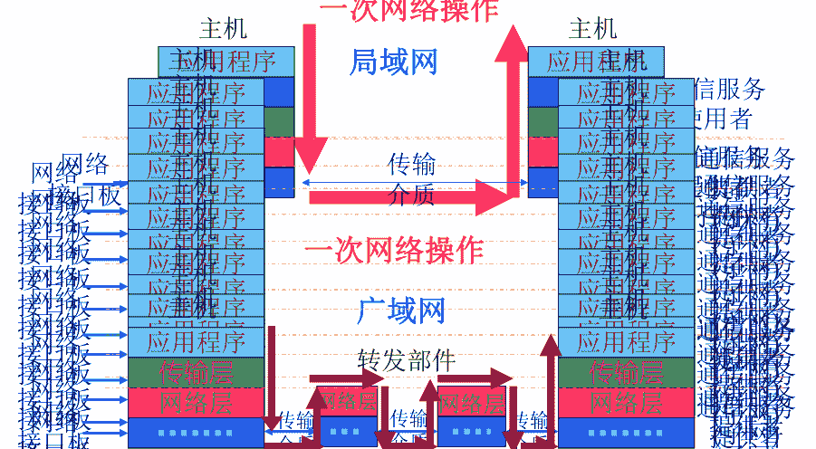

## 2.4 TCP/IP协议族

TCP/IP的设计目标是无缝的连接多个网络，使网络不受子网硬件损失的影响，因此要求网络系统结构必须相当灵活，能支持多种服务请求。

### TCP/IP协议的分层模式及组成
- TCP/IP作为一个协议族,其定义在四个层次上，包括网络接口层、网间网层、传输层及应用层。

## TCP/IP参考模型

7 应用层
6 表示层
5 会话层
4 传输层
3 网络层
2 链路层
1 物理层

应用层
传输层
Internet层
网络接口层

报文流
TCP分组
IP数据报
网络帧

应用层
传输层
Internet层
网络接口层

## 2.4 TCP/IP协议族

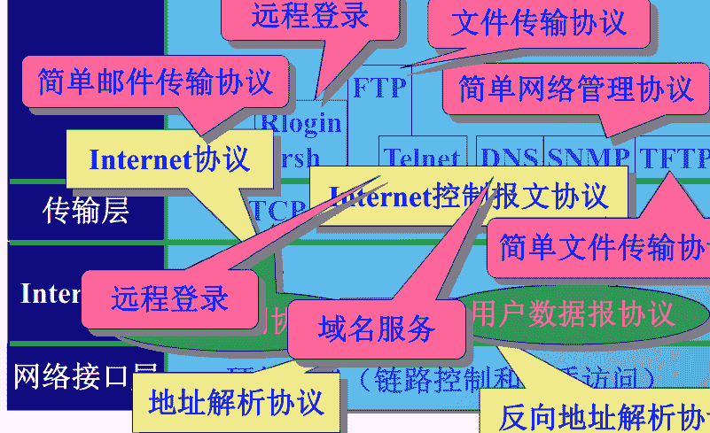

## TCP/IP参考模型-网络接口层
- 是最低一层，负责与物理网络的连接。
- 任何可用于IP数据交换的分组传输的链路层协议均包含在其中。
  - 定义了数据帧及其格式
  - 基于物理地址的网络寻址
  - 为发送到物理网络的数据提供差错控制
  - Ethernet, Token ring, etc

## TCP/IP参考模型-互连网层

该层负责相同或不同网络中计算机的通信，主要处理来自传输层的分组发送请求和路由选择。

- 提供逻辑寻址
- 提供路由选择和互联网上的数据发送服务
- 处理网间网控制报文协议
- 将物理地址和逻辑地址相关联
- IP protocol

## TCP/IP参考模型-传输层

提供应用程序(端到端)间的通信，并在IP的基础上提供面向连接的服务。

- 为两个用户进程之间建立、管理和拆除可靠而有效的端到端连接
- 提供流控制、差错控制和确认机制
- 与网络应用的接口
- TCP protocol、UDP protocol

## TCP/IP参考模型-应用层
- 向用户提供一组常用的应用程序。
- 定义了应用程序使用互联网络的规程
- 一些具体应用,如网络故障、文件传输、远程控制以及其他互联网应用
- **Browsers**
- **FTP**
- **Telnet**
- **Email**
- **SNMP（简单网络管理协议）**
- **RPC（远程过程呼叫等待）等**

## TCP/IP协议数据传输

数据传输基于包交换

ISO OSI层次

缓冲区

TCP包头

TCP数据区

IP包头

IP数据包

帧

发出

数据链路层 物理层

## 数据在不同层次的名字
- Application Layer          Message
- Transport Layer :
  - TCP Segment
  - UDP Datagram
- Internet Layer             Datagram
- Network Access Layer       Frame

## TCP/IP协议的功能
- TCP/IP协议是Internet的主协议， Internet网络系统结构事实上的标准通信协议，是一系列网络协议的总称。
- TCP/IP主要完成OSI的网络层和传输层功能
- IP(Internet Protocol, 互连网协议)：
  节点间的寻址（IP地址），无连接通信
- TCP(Transmission Control Protocol，传输控制协议)：提供端到端之间的可靠通信，建立通信链路
- TCP/IP提供异构系统（网络、机器）的互连

## TCP/IP 的发展

70年代 美国国防部高级研究计划署 (ARPA) 逐步推出目前形式的TCP/IP体系结构和协议规范。

80年代 在ARPANET上首次安装了TCP/IP模块。UNIX和TCP/IP的成功结合使两者得到了普及和发展。NSF支持TCP/IP的研究与开发并资助建立NSFNET，与APRNET互连。

90年代 以NSFNET, ARPANET和MILNET作为为主干组成了TCP/IP协议集的网络Internet。伴随着其他网络的加入，逐步形成一个统一可互操作的世界范围的计算机互联网络。1992年1月，国际上建立起制定Internet 标准和政策的组织Internet协会（ISOC）。由此，各国接入Internet的计算机网络不断增加，Internet 的规模和影响迅速地扩大。


## Internet 分层体系结构

## 内容结束

## 第三章

## IP 地址与地址解析

## 本章主要内容
- 主机、主机地址与IP地址
- 子网划分与子网掩码
- IPv6的主要特点
- 地址解析技术

## 3.1 IP 地址

主机（host）：
- 连接到Internet上，并且运行了TCP/IP协议的任何计算机。

主机地址（host address）：
- 由于Internet是一个巨大的网络系统，为了实现数据通信，在其中进行通信或信息交换的基本要求就是网上的每台主机（如计算机、路由器等）都要有一个唯一的可标识的编号或名字，这一标识符称为主机地址。采用“IP地址”和“域名地址”

## 3.1 IP 地址

### 物理地址：
- 即主机的网卡地址。绝大多数物理地址都是以太网卡地址，它有48 位，以16进制的方式表示。例如：02-3f-8d-56-3e-40

### IP地址：
- 在Internet上为每台主机指定的地址称为IP地址。它是在TCP/IP协议中所规定的Internet 的每个节点都要有的统一格式的地址。是Internet 主机地址的一种数字型标识，是一个机器可识别的地址。例如：202.118.224.153

注意：一台计算机可以有多个IP地址，但一个IP地址不能由两台或两台以上计算机共同拥有

## IP地址的含义和特点

### 它是Internet上通用的地址格式
- 通过IP地址使得网上的计算机能够彼此交换信息，它采用32位二进制地址格式进行编码。IP地址能贯穿于整个网络，而不管每个具体的网络是采用何种技术或结构。

### Internet上每台主机都必须有IP地址
- IP地址是识别Internet上每台主机包括计算机、路由器等）的端口地址，凡是上网的计算机都必须分配有IP地址，否则无法进行通信。

### IP地址是唯一的
- IP地址是识别Internet上每台主机的身份证，因此每台计算机的IP地址在全网中是唯一的。


## 3.1 IP 地址

- 一个IP地址不是用来标识一台特定的计算机，而是说每个IP地址用来标识一台计算机和一个网络的连接。
- 如果一台计算机与多个网络连接（如路由器），那么它必需为每一个连接分配一个IP地址！

## IP地址的获取方法

IP地址由Internet 协会(ISOC)下的NIC中的编号管理局（IANA）统一分配并制定有关政策。所有的IP地址都要由这一国际组织--NIC统一分配，目前共有三个这样的NIC：

- Inter NIC：负责北美及其它地区
- ENIC：负责欧洲地区
- APNIC：负责亚太地区

- APNIC总部设在日本东京大学。我国申请IP地址都要经过APNIC。具体可通过向国内一些代理机构提出。

## IP地址的格式（或表示法）

### 二进制数表示的IP地址

- 由一个32位的二进制数组成，分成4段，每段8位。
- 如：11001010 11000000 00100000 01100100

### 点分十进制表示：

0.0.0.0表示某个未知地址主机，只用于指示源地址，表示本网络中的一个地址。

255.255.255.255用于目的地址，表示广播至局域网所在的全部机器，该分组不会离开本机所在网络。

## IP地址的分类

IP地址所包含的信息：

IP地址是采用层次方式按逻辑网络的结构进行划分的，因此在IP地址中包含了两部分信息：

- 网络地址（Network ID）：标识主机所在的逻辑网络。
- 主机地址（host ID）：用来识别该网络中的一台主机。

IP地址的类别：

为了根据不同的网络规模来合理分配IP地址，通常将IP地址分为三个基本类：A类、B类、C类。还有2个特殊类：D类和E类。

## IP地址的分类

### IP地址的分类方法：

： 网络号； ： 主机号。

### A类

用前7位来标识网络号，后24位标识主机号，最前面一位固定为“0”。这样A类所能表示的网络数范围为：0-127，适用于大型网络的管理。因此，A类地址空间范围为：1. x. y. z-126. x. y. z。0. x. y. z表示本网络的指定主机，127. x. y. z固定表示为本机环路地址，发出该地址的分组将不传出本机。A. 255. 255. 255为直接广播地址，用于向A类地址范围内的全部主机进行广播，A. 0. 0. 0表示本网络中的某个地址。

美国密执安洲立大学拥有A类地址：35. 8. 2. 61


## IP地址的分类

### IP地址的分类方法：

： 网络号； ： 主机号。

### B类

用前14位来标识网络号，后16位标识主机号，最前面两位固定为“10”。这样第一段所表示的范围为：128-191。通常B类地址适用于中等规模的网络（如各地区的网络管理中心）。B类地址空间范围为128.0.y.z - 191.255.y.z。B.B.255.255为直接广播地址，用于向B类地址范围内的全部主机进行广播，B.B.0.0表示本网络中的某个地址。

## IP地址的分类

### IP地址的分类方法（续）

： 网络号； ： 主机号。

### C类 110

用前21位来标识网络号，后8位标识主机号，最前面三位为“110”。这样第一段所表示的范围为：192-223。通常B类地址的网络号数远大于主机号数，一般适用于校园网等小型网络。

### D类 1110 多点广播

### E类 1111 保留给将来使用

## 主机标识的有关规定

| 类别 | 第一段取值范围 | 网络地址长度 | 最大网络数（个） | 最大主机数（台） | 适用的网络规模 |
| A类地址 | 0-127 | 1 字节 | 128 | 16777214 | 大型网络 |
| B类地址 | 128-191 | 2 字节 | 16384 | 65534 | 中型网络 |
| C类地址 | 192-223 | 3 字节 | 2097152 | 254 | 小型网络 |

- 全“1”和全“0”的地址是专用的，不能进行分配。
- 每一台主机都必须有一个非零的主机标识；
- 全“1”的主机标识保留作为该网络的广播地址；
- 全“0”的主机标识用于代表该网络本身；
- 127.0.0.0是保留地址,不能作为网络地址。
- 127.0.0.1称为自返或回送（Loopback）地址，用于回环测试

## IP地址的分类

| 类别 | 起始位 | 第一节范围 | 网络数 | 每个子网主机数 | 主机总数 |
|---|---|---:|---:|---:|
| A类 | 0+ | 1~127 | 126 | 16777214 | 2113928964 |
| B类 | 10+ | 128~191 | 16384 | 65534 | 1073741824 |
| C类 | 110+ | 192~223 | 2097152 | 254 | 536870912 |
| D类 | 1110+ | （广播地址，供特殊协议向选定的节点发送信息用） |  |  |  |
| E类 | 1111+ | （保留地址） |  |  |  |
| 总计 |  |  | 2113662 |  | 3724541700 |

为用户专网保留的地址（全“0”和全“1”的地址保留）
A类：10.0.0.0~10.255.255.255
B类：172.0.0.0~172.255.255.255
C类：192.168.0.0~192.168.255.255

## IP地址的例子

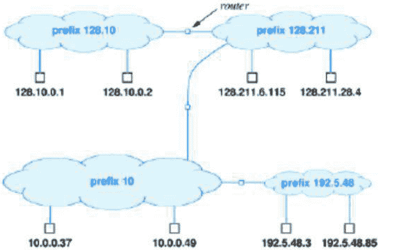

## 关于路由器地址

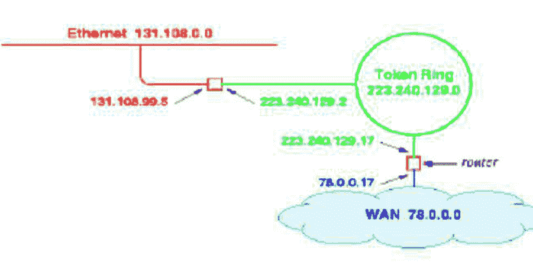

## 特殊IP地址

- 广播地址永远不是源地址
- Loopback地址永远不会出现在一个网络上

## 私有网络地址 (Private Network Address)

RFC1597 为那些没有连接到Internet或者安装了防火墙的组织, 预留了一系列私有网络地址。

- 私有网络地址包括:
- A类 10.0.0.0------10.255.255.255
- B类 172.16.0.0-----172.31.255.255
- C类 192.168.1.90---192.168.254.0
- **RFC: INTERNET的工作文件，其主要内容为TCP/IP协议标准和相关文档的一系列注释和说明。

## 3.2 子网（subnet）

- 在现有的三类网络的基础上将网络作进一步划分所得到的网络成为子网。即在内部可以直接通信的IP主机的集合
- 每一个子网是一个完全独立的网络，子网之间，子网与一般的网络之间必须通过路由器作为网关来实现互联。
- 划分子网有利于提高地址空间的实际利用率；在以太网的环境下有利于提高子网内的传输带宽。
- 路由器通过子网掩码识别子网的地址。

## C类网络的子网划分

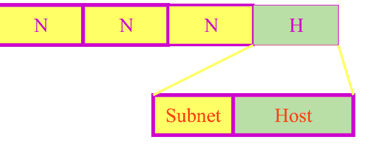

将主机标识位划分出若干位作为子网标识，子网标识位可由子网掩码确定。

## 子网掩码（subnet mask）

### 子网掩码

- 是一个32比特的二进制代码，它使接收方很容易从IP 数据包的IP 地址中分出地址的网络标识部分和主机标识部分。

### 掩码解释

- 如果某一位是打开的（“1”），地址中相应的位解释为网络位；如果该位是关闭的（“0”），地址中相应的位解释为主机地址。

## 标准子网掩码

| 类型 | 网络掩码（二进制） | 网络掩码（十进制） |
| --- | --- | --- |
| A类 | 11111111000000000000000000000000 | 255.0.0.0 |
| B类 | 11111111111111110000000000000000 | 255.255.0.0 |
| C类 | 11111111111111111111111100000000 | 255.255.255.0 |

- 将某类IP地址的子网掩码与对应的IP地址进行“与”运算，则可获得IP地址中的网络标识部分，以分辨出不同的网络。
- 将某类IP地址的子网掩码与对应的IP地址进行“或”运算，则可获得IP地址中的主机标识部分，以分辨出不同的主机。

## 子网划分与子网掩码

### 以C类网络为例

| 128 | 64 | 32 | 16 | 8 | 4 | 2 | 1 | 十进制值 | 子网数 |
|---|---|---|---|---|---|---|---|---|---|
| 1 | 0 | 0 | 0 | 0 | 0 | 0 | 0 | =128 | 0 |
| 1 | 1 | 0 | 0 | 0 | 0 | 0 | 0 | =192 | 2（4-2） |
| 1 | 1 | 1 | 0 | 0 | 0 | 0 | 0 | =224 | 6（8-2） |
| 1 | 1 | 1 | 1 | 0 | 0 | 0 | 0 | =240 | 14（16-2） |
| 1 | 1 | 1 | 1 | 1 | 0 | 0 | 0 | =248 | 30（32-2） |
| 1 | 1 | 1 | 1 | 1 | 1 | 0 | 0 | =252 | 62（64-2） |
| 1 | 1 | 1 | 1 | 1 | 1 | 1 | 0 | =254 | 126（128-2） |
| 1 | 1 | 1 | 1 | 1 | 1 | 1 | 1 | =255 |  |


## 子网划分与子网掩码

| Subnet bits | 子网掩码 | 子网数 | 子网主机数 |
|---|---|---|---|
| 2 | 255.255.255.192 | 2 | 62 |
| 3 | 255.255.255.224 | 6 | 30 |
| 4 | 255.255.255.240 | 14 | 14 |
| 5 | 255.255.255.248 | 30 | 6 |
| 6 | 255.255.255.252 | 62 | 2 |

注：在子网主机数中，已除去全“0”的子网代号和全“1”的广播地址。

## C类网络子网划分示例

设将某一C类网 (202.118.250.0) 划分出20个子网，每个子网至少可容纳5台主机。

根据上页表中可能的划分方法，应选择5位子网代码，相应地：

子网掩码： 255.255.255.248

子网数： 30

每个子网可容纳的主机数： 6

子网1： 202.118.250.0 255.255.255.248

子网2： 202.118.250.8 255.255.255.248

子网3： 202.118.250.16 255.255.255.248

……

## 一道试题

已知某主机地址210.222.5.121,子网掩码为255.255.255.248 求：

- 该主机所在子网的子网地址？
- 该子网可用的主机地址范围？
- 该子网的子网广播地址？

解答：子网掩码 248->11111000, 主机号121->01111001,因此可判断：

子网网络号为210.222.5.120,

可用地址01111001~01111110(121~126)

子网广播01111111(210.222.5.127)

## 关于子网的总结

- 用于把一个大型的网络划分为若干小型网络
- 使用子网编码来区分子网号和主机号
- Internet上的Router不需要知道子网掩码的信息
- 组织内的Router负责解释子网掩码

## 主机入网的主要参数

一台主机要加入Internet，所需设置的主要参数有：

- 主机的IP地址
- 子网掩码或网络掩码
- 缺省的路由器的IP地址
- 域名服务器的IP地址

## 3.3 IP协议的新发展—IPv6

### 1、IPv4与IPv6

IPv4：指Internet协议第4版，于1970年发布。它为整个Internet的应用和发展作出了巨大的贡献。

IPv6：指Internet协议第6版，未来的Internet协议

### 2、IPv4的主要缺陷

随着Internet用户的迅速增加，导致32位的IP地址空间即将用尽，现有格式的IP地址已不能满足需求。

IPv4已很难满足Internet上各种应用的需求（如实时话音和视频对数据的延时时间要求短、要求鉴别信息发送者等）

### 3、IPv6的新增特点

- (1) 更大的地址空间： IPv6将原来的32位IP地址扩展到了128位，使得IP地址空间足以适应数十年全球Internet的发展。
- (2) 更灵活的报头格式： 将原来IPv4的固定报头格式换成一组灵活可选的报头。
- (3) 增强的报头选项： 允许数据报包含可选的控制信息，以提供一些新功能。
- (4) 增强了对音频和视频的支持： 提供了一些新机制可很好地支持实时话音和视频应用。
- (5) 协议的可扩展性：

### 1、IPv6数据报的格式

在IPv6的数据报中，最前面是一个基本报头，紧接着可以有多个扩展，也可以没有，然后是数据区，见下图。或者说，一个最小的IPv6数据报可以只含有基本头部和数据区。

| 基本头部 | 扩展头部1 | ...... | 扩展头部N | 数据区 |

由于原来IPv4数据报报头的选项和其它一些固定字段被移到了IPv6的扩展报头里，因此IPv6 基本报头中所含信息要比IPv4少

### 1、IP地址的“冒分十六进制”表示法

在IPv6中，每个IP地址占16字节（128位），是IPv4的4倍。如果仍然采用传统的IPv4中的“点分十进制”表示法来描述一个128位的IP地址，无论在阅读、输入还是管理上都会十分不便。

为了减少书写一个IP地址所用的字符数，采用了一种所谓的“冒分十六进制”（Colon Hexadecimal Notation，简写为：Colon Hex）表示法，就是每16位为一组，用十六进制表示，并用冒号分隔，共分8段。如一个128位的IPv6的IP地址可表示为：“69DC：8864：FFFF：FFFF：0：1280：8C0A：FFFF”。

### 2、IP的“零压缩”表示法

在IPv6中，还有一种“零压缩法”（Zero Compression）可进一步减少IP地址的字符个数。就是用两个冒号代表连续的“0”。如：“FDC6：0：0：0：0：0：0：B0CA”可写成：“FDC6：：B0CA”。

### 3、与IPv4地址的兼容

为了与IPv4地址的兼容，IPv6把现有IPv4的IP地址全部映射到了IPv6的地址空间中。IPv6规定：若开始80位是全“0”，接着16位是全“1”，或全“0”，则它的低32位就是一个IPv4的地址。

## 3.4 地址解析

### 网络上的主机地址

在Internet上的每一台主机，都可能同时具备以下3个地址标识：

- ◆ 域名：这是一个具有一定含义又便于记忆的名字，由授权单位认定，在Internet上是唯一的。
- ◆ IP地址（逻辑地址）：这是一个数字型的地址（32位），由授权单位认定，在Internet上也是唯一的。
- ◆ 物理地址（网卡地址）：这是安装在主机上的网卡地址，每一块网卡都有一个全球范围内唯一的地址（48位），它存储在网卡的ROM中。

### 第二层协议

已知

- 一个给定的本地网络N
- 网络N中计算机C的IP地址
- 求计算机C的硬件地址
- 协议
  - ARP— Address Resolution Protocol
- 相关RFC
  - 826, 903, 1122, 1433, 1868, 2131, 2390

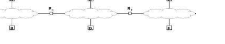

协议地址是软件提供的抽象地址；物理网络硬件并不知道如何通过协议地址来定位一台计算机。

### 地址解析的含义

- 将IP地址与物理地址之间建立一个双向的映射关系，称为地址解析（Address Resolution）。

When?

- 数据包通过某个物理网络到达目的主机时
- 数据包被Router转发时

Where?

- 同一物理网络内


### 1、正向地址解析（IP地址→物理地址）

在互联网中，IP及其以上各层所发出的数据都要使用IP地址进行标识，而物理网络本身不认识IP地址，故必须将IP地址映射成物理地址，才能将数据发往目的地。这一过程就是正向地址解析。

### 2、反向地址解析：（物理地址→IP地址）

此映射主要用于网络中的无盘站，因为无盘站的IP地址和其它各类文件都存放在服务器上，无盘站本身只用到一个物理地址。通过RARP，使无盘站能获取自己的IP地址。也只有无盘站才使用RARP。

## 以太网

以太网最初是由XEROX公司研制而成的，是两个最为流行的网络传输系统之一。以太网的基本特征是采用一种称为载波监听多路访问/冲突检测 CSMA/CD(Carrier Sense Multiple Access/Collision Detection)的共享访问方案。

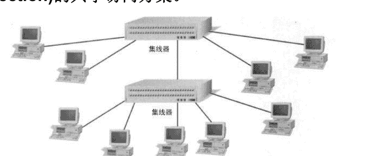

## TCP/IP与以太网

以太网和TCP/IP可以说是相辅相成的。

- 以太网在一二层提供物理上的连线，使用48位的MAC地址
- TCP/IP工作在上层，使用32位的IP地址
- 两者间使用ARP和RARP协议进行相互转换。

### 载波监听

- 指在以太网中的每个站点都具有同等的权利，在传输自己的数据时，首先监听信道是否空闲，如果空闲，就传输自己的数据，如果信道被占用，就等待信道空闲。

### 冲突检测

- 为了防止发生两个站点同时监测到网络没有被使用时而产生冲突。以太网采用广播机制，所有与网络连接的工作站都可以看到网络上传递的数据。

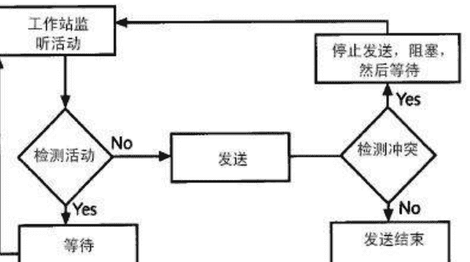

CSMA/CD过程


## 一个典型的在以太网中客户与服务器使用 TCP/IP协议的通信。

用户进程 FTP客户 <----------------------------> FTP服务器 应用层
||
内核中的协议栈 TCP <----------------------------> TCP 传输层
||
内核中的协议栈 IP <----------------------------> IP 网络层
||
以太网驱动程序 <----------------------------> 以太网驱动程序 数据链路层

-----------------------------------------------
以太网

## 网络接口卡

网络接口卡是使工作站连接到网络，并与网络中其他计算机相互通信的设备。好几家公司（比如3Com、IBM、Intel、SMC和Xircom）都生产网络接口卡。各家生产的网络接口卡规格不一样，但都满足网络和工作站的需求。下图即为一块典型的工作站网络接口卡。

注意：由于不同的PC和网络需要不同类型的网络接口卡，所以不能想当然地认为某工作站上运行正常的网络接口卡在别的工作站上也能照样运行。

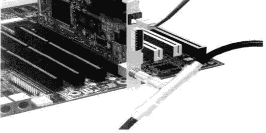

## 网络接口卡

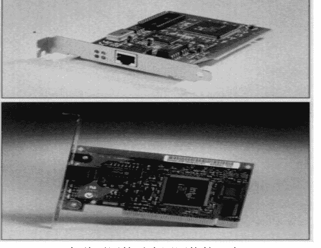

各种不同的以太网网络接口卡

## 以太网的广播通讯

在以太网中，所有的通讯都是广播的，

- 通常在同一个网段的所有网络接口都可以访问在物理媒体上传输的所有数据

网卡的MAC地址

- 每一个网络接口都有一个唯一的硬件地址，这个硬件地址也就是网卡的MAC地址。
- 大多数系统使用48比特的地址，这个地址用来表示网络中的每一个设备
- 一般来说每一块网卡上的MAC地址都是不同的
- 每个网卡厂家得到一段地址，然后用这段地址分配给其生产的每个Protocol网卡一个地址。

在正常的情况下，一个网络接口应该只响应这样的两种数据帧：

- 1. 与自己硬件地址相匹配的数据帧。
- 2. 发向所有机器的广播数据帧。

数据的收发是由网卡来完成的

- 网卡接收到传输来的数据，网卡内的单片程序接收数据帧的目的MAC地址，根据计算机上的网卡驱动程序设置的接收模式判断该不该接收。
- 认为该接收就接收后产生中断信号通知CPU

## 网卡来说一般有四种接收模式：

- ① 广播方式：该模式下的网卡能够接收网络中的广播信息。
- ② 组播方式：设置在该模式下的网卡能够接收组播数据。
- ③ 直接方式：在这种模式下，只有目的网卡才能接收该数据。
- ④ 混杂模式：在这种模式下的网卡能够接收一切通过它的数据，而不管该数据是否是传给它的。

## 3.4 地址解析--ARP

## 表查询地址解析

| IP Address | Hardware Address |
|---|---|
| 197.15.3.2 | 0A:07:4B:12:82:36 |
| 197.15.3.3 | 0A:9C:28:71:32:8D |
| 197.15.3.4 | 0A:11:C3:68:01:99 |
| 197.15.3.5 | 0A:74:59:32:CC:1F |
| 197.15.3.6 | 0A:04:BC:00:03:28 |
| 197.15.3.7 | 0A:77:61:0E:52:FA |

只包括本地网络的IP地址和硬件地址的地址对问题

- 网络规模变大查询效率降低
- 地址发生变化时需要更新

## 3.4 地址解析--ARP

- 为IP设备提供了一备的硬件地址的机制

- 两种基本信息
  - 请求
  - 响应

- 解析原理
  - ARP请求信息放在数据帧中以广播形式向网络内所有计算机发出
  - 请求信息涉及的计算机负责发回响应,其他主机不发响应
  - 响应信息直接发回请求方,不广播

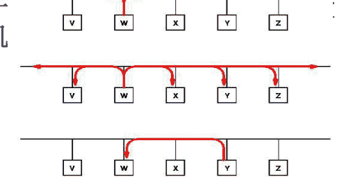

## 正向地址解析协议工作原理示意图

## 解析 202.118.224.2 的过程

202.118.224.2 收到广播，是本机IP地址


广播发送ARP请求报文：
其中包含：1a-Pa，1b

1a-Pa

1b: 202.118.224.2 → 物理地址=?

主机B的：IP: 202.118.224.2
Ethernet（物理地址）：
0800.0020.1111

ARP回应报文

## 3.4 地址解析--ARP

ARP高效运行的关键是由于每个主机上都有一个ARP高速缓存。这个高速缓存存放了最近Internet地址到硬件地址之间的映射记录。高速缓存中每一项的生存时间一般为20分钟，起始时间从被创建时开始算起。用arp -a显示ARP高速缓存中所有的内容。48 bit的以太网地址用6个十六进制的数来表示。

```
C:\Documents and Settings\yin.lh>arp -a

Interface: 219.217.249.15 --- 0x2
    Internet Address          Physical Address      Type
    219.217.249.126            00-08-e2-83-a0-0a     dynamic
```

## 3.4 地址解析--ARP

## ARP缓存原理

- 频繁的网络访问将可能使网络充满ARP广播信息而饱和。
- 请求方收到ARP响应后,会在本地缓存中保存响应方的硬件地址和IP地址对,以便下次使用时避免进行广播查询。
- 响应一方也做类似处理。
- 只有那些已经在缓存中存储了发送系统IP地址的系统才更新缓存的登记项,其他主机忽略ARP广播。

## 3.4 地址解析--ARP

## ARP缓存大小

- 缓存大小有限, 内容会被不断刷新
  - 如一个客户经常访问不同的服务器并且其ARP缓存小于所连接系统数目，导致不断重写缓存内容
  - 若有上百个设备，则理论上网络被ARP广播充斥而饱和
  - 出现对某一台机器(ARP缓存很小)的过多访问将导致该机器ARP缓存的作用消失
- 大型多用户系统和高端Router一般有大缓存, 几百个登记项

## 3.4 地址解析--ARP

## 缓存的过期问题

- 系统应该在ARP缓存中刷新掉那些已经闲置了一段时间的登记项

- 缓存登记项保留时间太长容易不准确（如机器更换新的IP地址）

- 太短则影响性能（需要太多的广播）

- 不同厂商的ARP过期值不一样

- Windows95, 120秒；
- 服务器, 10分钟或更多；
- Router, 4小时

- 出现缓存更新时，时钟重置

## 3.4 地址解析--ARP

## 静态缓存

- 许多产品提供了在缓存添加静态登记项的实现
  - 有的系统重启时清除静态登记项，然后重新加载
  - 有的系统则为永久设置，需手动改变
- 好处
  - 网络安全策略(IP和硬件地址的绑定)
  - 避免频繁的查找
- 缺点
  - 若系统经常移动或者频繁的重新编号则很麻烦

## 3.4 地址解析--ARP

## ARP代理

如果ARP请求是从一个网络的主机发往另一个网络上的主机，那么连接这两个网络的路由器就可以回答该请求，这个过程称作委托ARP或ARP代理(Proxy ARP)。这样可以欺骗发起ARP请求的发送端，使它误以为路由器就是目的主机，而事实上目的主机是在路由器的“另一边”。路由器的功能相当于目的主机的代理，把分组从其他主机转发给它。

## ARP的一些变化（网络变化频繁时，经常采用）

- DHCP ARP
- Gratuitous ARP

## 3.4 地址解析—免费ARP

设备广播自己的硬件地址和IP地址对，以使其其他设备更新(不是添加)其ARP缓存

- 过程
  - 发送者在请求信息的源IP和源硬件地址字段放入自己的地址
  - 在目的IP字段中放入自己的IP地址
  - 网络上其他设备听到该广播,若缓存中有该发送者的信息,更新之（重启更新计时器、更换新的硬件地址）

在服务器频繁地与很多不同客户通信时非常有用,使得客户每次同服务器通信时不必重新发送请求


## 3.4 地址解析——免费ARP

- 192.168.10.10发出免费ARP请求广播
  - 如果有响应则表明有IP地址冲突
- 一些问题
  - 如果一个配置错误的主机发出免费ARP请求，那么所有其他设备将更新ARP缓存，从而使用了错误的硬件地址，这样客户一直会向配置错误的主机发送信息——鲁莽的更新！

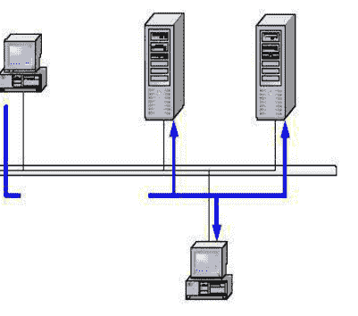

## 有关子网掩码、ARP的一个实验

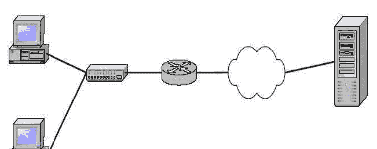

### 实验步骤一

设置两台主机的IP地址与子网掩码：
- A: 10.2.2.2 255.255.254.0
- B: 10.2.3.3 255.255.254.0

两台主机均不设置缺省网关。

用 `arp -d` 命令清除两台主机上的ARP表。

在A与B上分别用ping命令与对方通信，分别显示：
- A: Reply from 10.2.3.3: bytes=32 time<10ms TTL=128
- B: Reply from 10.2.2.2: bytes=32 time<10ms TTL=128

用 `arp -a` 命令可以在两台PC上分别看到对方的MAC地址。

分析：由于主机将各自通信目标的IP地址与自己的子网掩码相“与”后，发现目标主机与自己均位于同一网段（10.2.2.0），因此通过ARP协议获得对方的MAC地址，从而实现在同一网段内网络设备间的双向通信。

### 实验步骤二

将A的子网掩码改为：255.255.255.0，其他设置保持不变。

**操作1**：用 `arp -d` 命令清除两台主机上的ARP表，然后在A上“ping”B，在A上显示结果为：`Destination host unreachable`

用 `arp -a` 命令在两台PC上均不能看到对方的MAC地址。

**分析1**：A将目标设备的IP地址（10.2.3.3）和自己的子网掩码（255.255.255.0）相“与”得10.2.3.0，和自己不在同一网段（A所在网段为：10.2.2.0），则A必须将该IP分组首先发向缺省网关。由于A的缺省网关没有配置，无法对分组进行正确发送，因此显示“目标主机不可到达”。

**操作2**：接着在B上“ping”A，在B上显示结果为：

```
Request timed out
```

此时用 `arp -a` 命令可以在两台PC上分别看到对方的MAC地址。

**分析2**：B将目标设备的IP地址（10.2.2.2）和自己的子网掩码（255.255.254.0）相“与”，发现目标主机与自己均位于同一网段（10.2.2.0），因此，B通过ARP协议获得A的MAC地址，并可以正确地向A发送Echo Request报文。但由于A不能向B正确地发回Echo Reply报文（原因见分析1），故B上显示ping的结果为“请求超时”。

在该实验操作中，通过观察A与B的ARP表的变化，可以验证：在一次ARP的请求与响应过程中，通信双方就可以获知对方的MAC地址与IP地址的对应关系，并保存在各自的ARP表中。

### 实验步骤三

用 `arp -d` 命令清除A中的ARP表，在A上ping一台外网段的主机，如202.116.64.8，再用 `arp -a` 可观察到A的ARP表中只有缺省网关的MAC地址信息。

分析：当源主机要和外网段的主机进行通信时，它并不需要获取远程主机的MAC地址，而是把IP分组发向缺省网关，由网关完成IP分组的转发过程。如果源主机没有缺省网关MAC地址的缓存记录，则它会通过ARP协议获取网关的MAC地址，因此在A的ARP表中只观察到网关的MAC地址记录，而观察不到远程主机的MAC地址。

## IP 地址与地址解析

内容结束


## 第四章 TCP/IP协议

### 4.1 IP 协议

- IP协议为传输协议提供了基本的（不可靠、无连接）发送服务。所有的TCP、UDP、ICMP数据都以IP数据报格式传输。IP负责获取信息并发送到目的主机和网络。
- 不可靠（unreliable）：它不保证IP数据报能成功地到达目的地，仅提供最好的传输服务。如发生某种错误时，IP有一个简单的错误处理算法：丢弃该数据报，然后发送ICMP消息报给信源端。任何要求的可靠性必须由上层来提供（如TCP）。
- 无连接（connectionless）：IP并不维护任何关于后续数据报的状态信息。每个数据报的处理是相互独立的。

**Internet服务的三个层次**


- 分离的层次可以在不干扰其他服务的情况下替换某个服务
- 底层的无连接包发送服务是基础

**无连接-Connectionless**

- 发送方
  - 组装数据包发送
  - 将地址放入数据包中已经定义好的位置
  - 将数据包送到网络上传输
- 网络
  - 使用目的地址转发数据包
  - 传输者

**无连接网络的特点**

- 数据包含有确切的目的地址
- 每个包独立处理
- 传输数据之前不需要任何 setup
- 发送数据之后不需要任何 cleanup
- 不可靠
  - 数据包可能延迟、丢失、重复、乱序
- 每个包经过的路径可能不一样
- Best-effort
- 类似于发送明信片

**IP包（Internet Packets）**

- 动机
  - Router无法在异构网络之间传递数据帧
  - 必需定义独立于硬件的数据包格式
- 抽象的
- 只能被软件创建和识别
- 包括发送方和接收方地址
- 大小取决于所传送的数据
- 称为IP数据报 (IP Datagram)

**IP数据报 (IP Datagram)**


- **头部**
  - 包括目的地址
  - 固定字段
- **数据区**
  - 最高为64k的可变长度
  - 没有最小长度限制

**IP数据报和IP包**

- IP数据报“不是”IP发送的东西
- 作为IP包来发送
- IP包将IP数据报hop by hop发送到目的系统
- 很多时候一个IP数据报同时就是一个IP包
- IP数据报作为主机发送的实体
- IP包作为数据帧中传送的实体

**IP数据报和IP包一示意图**

到192.168.20.60

192.168.10.10  
192.168.10.3  
192.168.20.3  
192.168.20.60

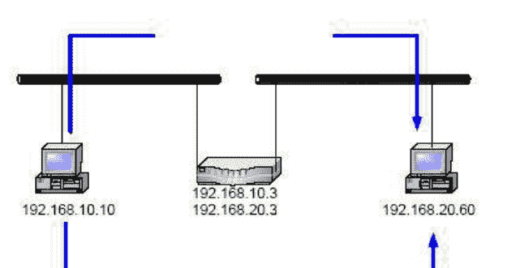

**IP数据报格式**

- IP头部
- IP数据区
- 控制码
- 源IP地址
- 目的IP地址
- 再次分段后本段在原分组的相对位置
- 允许再次分段标志
- 版本
- 头长度
- 服务类型
- 校验和
- 标志
- 偏移

**IP 数据报字段说明**

**生命期TTL**

- 避免数据报无限制地占用网络资源
- 以秒为单位或者以执行时间不足一秒的发送行为为单位的度量
- 一般认为每经过一跳数值减1
- 缺省值为64

**头部校验和**

- 检查数据报头部是否损坏
- 数据部分不需要检查
  - 浪费时间
  - 高层协议提供了检查机制
  - 一些应用协议能够处理部分破坏了的数据

**头部长度**

- 说明IP头部大小，以32比特倍数表示，最大值60字节？
- 大部分IP数据报头部为20字节

**数据服务类型和优先级TOS**


| 优先级 | 定义 |
| --- | --- |
| 0 | 常规 |
| 1 | 优先 |
| 2 | 立刻 |
| 3 | 急速 |
| 4 | 超急速 |
| 5 | 火急 |
| 6 | 互联网控制 |
| 7 | 网络控制 |

- C - Minimize Cost, 最小费用
- R - Maximize Reliability, 最高可靠性
- T - Maximize Throughput, 最大吞吐量
- D - Minimize Delay, 最小延迟


## IP 数据报字段说明
## 常见应用协议建议的TOS值

| 应用协议 | 建议TOS值 |
|---|---|
| Telnet | D |
| FTP控制信息 | D |
| FTP数据信息 | T |
| SMTP命令 | D |
| SMTP数据 | T |
| DNS UDP查询 | D |
| DNS TCP查询 | 普通 |
| DNS区域传送 | T |
| ICMP错误信息 | 普通 |

## 4.1 IP 协议--数据报的传输
## 数据报经过传统的网络被发送

- 从源主机到router
  - 组装数据报, 包括目的地址
  - 送到最近的Router
- 在中间routers中传输
  - 将数据报转发到下一个路由器
- 从最后的router送到目的主机

## 网络硬件不识别数据报

- 数据报格式
- IP地址

## 需要封装- Encapsulation

## 进行路由选择
## 进行路由选择
## 进行路由选择

主机

主机

主机

路由器

路由器

路由器

网络

网络

Telnet

Telnet

TCP包

帧

TCP包

帧

帧

帧

TCP

IP

网络接口

网络接口

## 4.1 IP 协议--数据报的封装
## IP数据报的封装


- 整个数据报作为帧的数据
- 数据帧的帧类型字段指明数据区里为IP数据报
- 数据帧的目的地址为“下一站”的硬件地址

## 4.1 IP 协议--数据报的地址

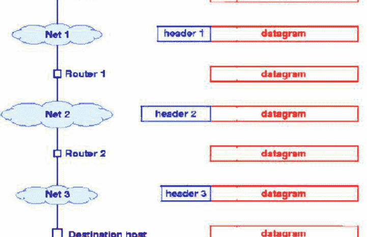

## 4.1 IP 协议--最大传输单元MTU

| 网络 | MTU(字节) | 定义源 |
|---|---|---|
| 16Mbps令牌环 | 17914 | IBM |
| 802.4令牌总线 | 8166 | RFC1042 |
| 4Mbps令牌环 | 4464 | RFC1042 |
| FDDI | 4325 | RFC1390 |
| PPP | 1500 | RFC1548 |
| 802.3以太网 | 1500 | RFC1042 |
| X.25 | 576 | RFC1356 |

## MTU不同带来的问题

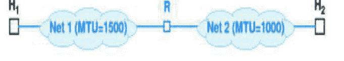

## 与分段有关的IP头部字段

- **Fragmentation Identifier-分段标识符**
  - 标识来自于同一个IP数据报的分段
  - 16 bit

- **Fragmentation Offset-分段偏移**
  - 标识一个分段在整个数据报中的位置
  - 其值×8B为实际的偏移

- **Fragmentation Flag-分段标志位**
  - 16-保留，为0
  - 17-DF，禁止分段
  - 18-MF，为1时表示还有更多分段

## 关于分段的说明

- Who?
  - Router

- When?
  - 数据报尺寸比目的网络MTU大

- How?
  - 为每一个分段拷贝原有的数据报头
  - 单独修改每一个头部, 如标志位、分段偏移、长度等等
  - 向每一个分段拷贝数据

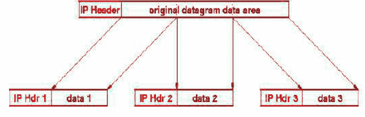

## 4.1 IP 协议--分段的例子

数据报分段的计算

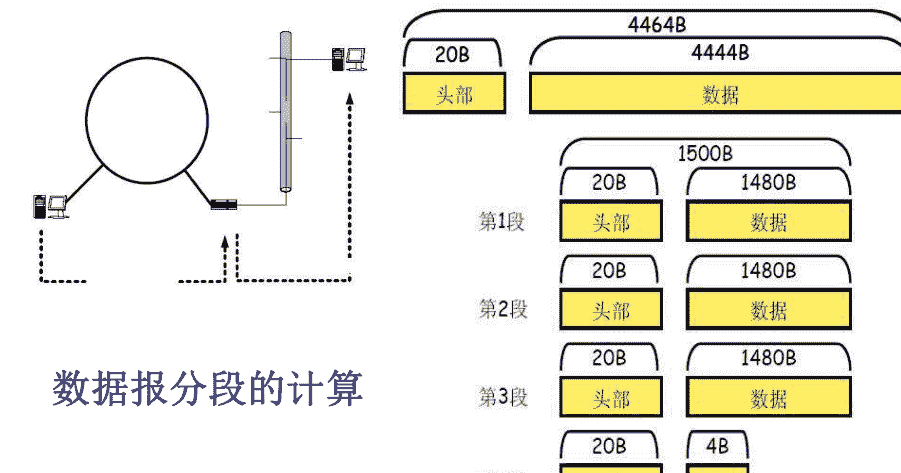

## 分段的进一步说明

- 分段仅仅出现在包的数据部分
- 分段过程不包括包的头部
- 每一个分段都会产生一个包含它自己的IP头部的新包
- 必须以8字节的倍数分段
  - 若数据报有576字节数据，则需要两个分段:512和64
- 分段偏移以8字节块为单位存储字节数
  - 如值为31，则表示31×8

## 4.1 IP 协议--分段的重组
## Who?

- 目的主机还是最后的Router?

## 条件

- 所有分段全部到达


## 4.1 IP 协议--分段
## 分段丢失

- 到来的分段存储在内存中
- 若有的分段在规定时间内 (UNIX, 60秒) 没有到达, 则删除所有分段

## 对分段进行分段

- 若互联网MTU次序如下：
  - 1500->1000->576->1500
- 两次分段
- 不考虑子分段, 所有分段均在同一级
- 重组为原始数据报

## 4.1 IP 协议-- IP选项

分段对选项的处理：
某些选项复制到所有分段（源站路由选择）
部分选项放到第一个分段（记录路由）

- IP选项字段
  - 记录路由
  - 源站路由选择
    - 严格的源站路由选择
    - 松的源站路由选择
  - 时间戳 ....

| 复制 (1位) | 类 (2位) | 类型 (5位) |


## 4.2 IP数据报的转发

从概念上说，IP路由选择是简单的。若目的主机与源主机直接相连（如点对点链路）或都在一个共享网络上（以太网或令牌环网），IP数据报就直接送到目的主机上。否则，主机把数据报发往一个默认的路由器上，由路由器来转发该数据报。

## 数据报的发送

- 直接（本地）
- 间接（远程）

## Hop by Hop

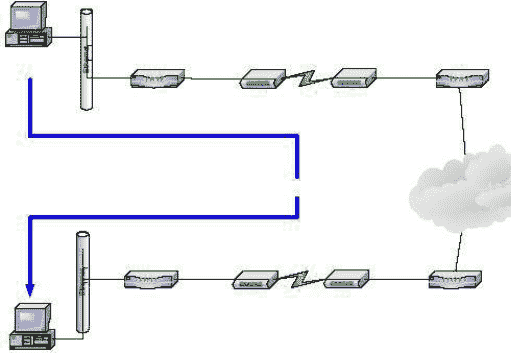

## 4.2 IP数据报的转发

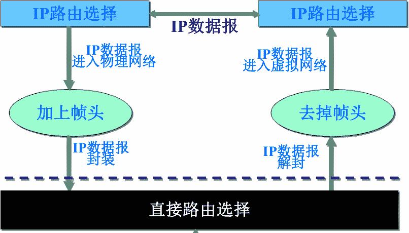

IP数据报

IP路由选择

IP路由选择

IP数据报
进入物理网络

IP数据报
进入虚拟网络

加上帧头

去掉帧头

IP数据报
封装

IP数据报
解封

直接路由选择

物理帧

## 4.2 IP数据报的转发

- 基于表的数据报选路
- 路由选择表

- 存储IP节点连接的网络、连接到该网络的网络接口的IP地址等等
- 每一IP设备都有

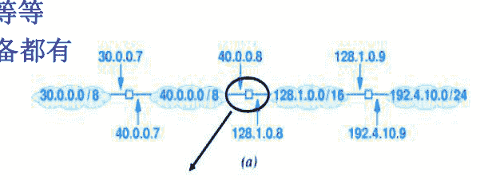

| Destination | Mask | Next Hop |
|---|---|---|
| 30.0.0.0 | 255.0.0.0 | 40.0.0.7 |
| 40.0.0.0 | 255.0.0.0 | deliver direct |
| 128.1.0.0 | 255.255.0.0 | deliver direct |
| 192.4.10.0 | 255.255.255.0 | 128.1.0.9 |

## 4.2 IP数据报的转发
## 192.168.10.1的缺省路由表

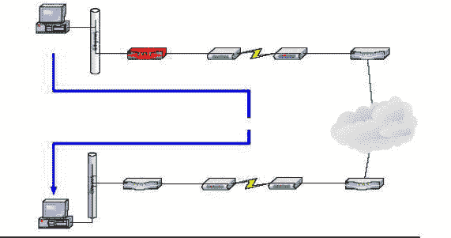

| 目的网络 | 接口/router |
|---|---|
| 127.0.0.0 | 127.0.0.1 |
| 192.168.10.0(本地Ethernet) | 192.168.10.1(本地Ethernet接口) |
| 192.168.100.0(本地SLIP) | 192.168.100.1(本地SLIP接口) |

## 4.2 IP数据报的转发
## 有一个远程Router的192.168.10.1的路由表


| 目的网络 | 接口/router |
|---|---|
| 127.0.0.0 | 127.0.0.1 |
| 192.168.10.0(本地Ethernet) | 192.168.10.1(本地Ethernet接口) |
| 192.168.100.0(本地SLIP) | 192.168.100.1(本地SLIP接口) |
| 172.16.100.0(远程网络) | 192.168.100.100(下一跳Router) |

## 4.2 IP数据报的转发
## 显示完整网络的192.168.10.1的完全路由表

| 目的网络 | 接口/router |
|---|---|
| 127.0.0.0 | 127.0.0.1 |
| 192.168.10.0(本地Ethernet) | 192.168.10.1(本地Ethernet接口) |
| 192.168.100.0(本地SLIP) | 192.168.100.1(本地SLIP接口) |
| 172.16.100.0(远程网络) | 192.168.100.100(下一跳Router) |
| 192.168.110.0(远程SLIP) | 192.168.100.100(下一跳Router) |
| 192.168.30.0(远程Ethernet) | 192.168.100.100(下一跳Router) |

## 192.168.10.1的简化路由表

- Router不可能维护所有网络的路由信息
- 设置缺省路由

| 目的网络 | 接口/router |
|---|---|
| 127.0.0.0 | 127.0.0.1 |
| 192.168.10.0(本地Ethernet) | 192.168.10.1(本地Ethernet接口) |
| 192.168.100.0(本地SLIP) | 192.168.100.1(本地SLIP接口) |
| 0.0.0.0(缺省路由) | 192.168.100.100(下一跳Router) |


## 下一跳路由的算法

- 执行：拆开IP数据报，从中抽取目的IP地址：D，通过“位与”运算求出目的地址的网络ID：N
- if N 和某个与路由器直接相连的网络匹配，则直接转发到该网络中的相应主机（需要执行：从IP地址D 解析出目的主机的物理地址，封装IP数据报为帧，帧头包含目的主机的物理地址，发送帧）。
- else if 路由器的路由表中包含有为该主机D指定的路由，则按路由表中所指定的发送到下一跳（需要执行：解析所指定的下一跳路由的物理地址，封装IP数据报为帧，帧头包含下一跳路由的物理地址，发送帧）。
- else if 路由器的路由表中包含有到达该网络N的路由，则按路由表中所指定的发送到下一跳（需要执行：同上）。
- else if 路由器的路由表中包含有默认路由，则发送到路由表中所指定的默认路由（需要执行：解析所指定的默认路由的物理地址，封装IP数据报为帧，帧头包含默认路由的物理地址，发送帧）。
- else 发回路由出错消息。

## 4.2 IP数据报的转发

### 关于路由表的补充说明

- 为一个网络指定一个路由器，而不必为每个主机指定一个路由器。可以极大地缩小路由表的规模，比如Internet上的路由器只有几千个表目，而不会是超过100万个表目。
- IP路由选择是逐跳（hop-by-hop）进行的。IP并不知道到达任何目的的完整路径。所有的IP路由选择只为数据报传输提供下一站路由器的IP地址。
- 只有最后一个Router知道目的主机是否可用，需要为Router安排方法向源主机来报告问题
- 路由可能不对称
  - A->B和B->A路径可能不一致

## 4.2 IP数据报的转发

### 数据包处理过程示意图

IP节点


## 有关路由表的一些命令

### Route

- Route print--用于显示路由表中的当前项目
- route add--添加路由。添加目标为10.41.0.0，子网掩码为255.255.0.0，下一个跃点地址为10.27.0.1，跃点数为 7 的路由：
  route add 10.41.0.0 mask 255.255.0.0 10.27.0.1 metric 7
- route change--修改现有路由。将目标为10.41.0.0，子网掩码为255.255.0.0 的路由的下一个跃点地址由10.27.0.1 更改为10.27.0.25:
  route change 10.41.0.0 mask 255.255.0.0 10.27.0.25
- route delete--删除路由。删除目标为 10.41.0.0，子网掩码为 255.255.0.0 的路由：
  route delete 10.41.0.0 mask 255.255.0.0

## 有关路由表的一些命令

### Netstat

- 用于显示与IP、TCP、UDP和ICMP协议相关的统计数据，用于检验本机各端口的网络连接情况。
- 使用时如果不带参数，netstat显示活动的TCP连接
- netstat -s--能够按各个协议分别显示其统计数据。如果你的应用程序（如Web浏览器）运行速度比较慢，或者不能显示Web页之类的数据，那么你就可以用本选项来查看一下所显示的信息。
- netstat -a--本选项显示所有有效连接的信息列表，包括已建立的连接（ESTABLISHED），也包括监听连接请求（LISTENING）的那些连接。
- netstat -n--显示所有已建立的有效连接。

## 有关路由表的一些命令

- 显示当前的TCP/IP配置的设置值。这些信息一般用来检验人工配置的TCP/IP设置是否正确。
- ipconfig--不带任何参数选项，为每个已经配置了的接口显示IP地址、子网掩码和默认网关值。
- ipconfig /all--当使用all选项时，IPConfig能为DNS和WINS服务器显示它已配置且所要使用的附加信息（如IP地址等），并且显示内置于本地网卡中的物理地址（MAC）。
- 显示到达目标的路径，使用很简单，只需要在 tracert后面跟一个IP地址或URL。

## 4.3 路由协议—路由器

Internet可以看作是由许多路由器互连在一起的网络，而每个计算机则连在其中的一个路由器上。因此，对分组信息的分发与捕获功能由路由器来完成。


## 4.3 路由协议—路由器

### 连接不同类型的网络并完成协议转换

- Internet所面对的是各种不同类型的网络，各网之间需要进行桥接
- 不同的网络运行的是不同的通信协议，需要转换

### 路由搜索与选择

- 在Internet范围内采用的是网状自由联接，信息发送不能采用广播方式，因此需要进行路由选择。常见的路由搜索方式是距离向量路由协议与链路状态路由协议两种。

### 网络管理和安全

- 一个网络如果确定一个或有限个出入口，可以通过限制出入的方式对内部网络进行保护。

## 4.3 路由协议

### 路由协议在协议栈中的位置


分层模型


网桥模型


路由器模型

## Internet路由选择的两种形式

### 静态路由选择

- 根据系统启动时初始化的路由表
- 不再修改

### 动态路由选择

- 根据系统启动时初始化的路由表
- 路由选择协议获得路由并更新路由表
- 路由表可能会不断改变

## Internet路由选择的两种形式


| Net | Mask | Next hop |
|---|---|---|
| 128.10.0.0 | 255.255.0.0 | direct |
| default | 0.0.0.0 | 128.10.0.100 |

(a)

(b)

— 仅用路由协议

## Internet路由选择的两种形式


## 4.3 路由协议

### 路由信息交换的含义

- 每个Router运行路由选择软件
- 获得其他Routers所能到达的目的地的信息
- 通知其他Routers自己所能到达的目的地信息
- 路由选择软件使用获得的信息不断的更新Router的路由选择表

## 4.3 路由协议

### 自治系统-Autonomous System

- 处于一个管理机构控制下的网络和路由器的集合
- 灵活可变, 人为定义
- 直觉上:校园网、医院网等等
- 需要AS是因为没有一个路由选择协议可以覆盖整个Internet
- 每个AS选择一个Routing Protocol

## 自治系统(AS)、区域及网络(NW)


- 每个AS都有一个唯一的编号
- 编号范围1~65535, 其中1~64511是注册的编号, 其余的为专用网络编号
- 一个大的AS经常划分为几个较小的路由域

## 4.3 路由协议

### Internet路由选择协议的分类

- 内部网关协议 (IGP)
  - 自治系统内的路由协议
  - 目的地位于AS内部
- 外部网关协议 (EGP)
  - 用于自治系统之间的路由选择
  - 目的地跨越Internet

### 路由选择协议的准则

- 路由协议能按照不同的路由准则为用户的通信数据选择最适当的传输路径,如最小成本路由等等
- 以下3个约束条件是所有准则必需考虑的
  - 时延、吞吐率、连接性

## 4.3 路由协议

### IGP/EGP的使用范围

### 路由信息和数据流

外部网关协议 (EGP)：BGP

自治系统号：200

运行内部网关协议 (IGP)：RIP

Routes for customers of ISP

Data to customers of ISP

- EIGRP
- OSPF

ISP₁ R₁

R₂ ISP₂


## 4.3 路由协议

## 路由搜寻协议的类型

- 距离向量协议
  - 最小跳距
  - 距离→跳距；向量→地址
- 链路状态协议
  - 每条链路有一个状态值
  - 路由选择的标准是构成该路径的所有链路的度量总和最小

## 距离向量路由协议

## 距离向量路由协议遵循以下几个基本原则：

- 每一个节点具有最基本的永久性信息，用于记录其地址和辨识与之相连接的链路；
- 每个节点都定时向邻接节点广播其自身的路由信息，同时也接收邻接节点广播来的路由信息；
- 接收邻接节点的路由信息后，依据该路由信息更新本地路由信息；更新方法是对没有的节点项则创建一个并在其距离向量之上加一，已存在的节点项则需比较一下两者那个更大，较小的一个将会留下
- 整个计算采用的是分布式算法，几个节点独立计算，直到收敛为止。

## 链路状态路由协议

链路状态路由协议遵循以下规则：

- 每个节点均维持一个网络图的副本，并定时更新；
- 网络图以数据库的形式表示，库中记录每个节点与其相邻节点的连接情况；
- 库的更新是以广播的方式实现，即每个节点收到一个路由广播报文，接收后再向其它链路广播。
- 为防止一个广播路由信息无限制地在网上传送，每个广播报文需要给一个编号，一旦一个节点再次收到一个针对同一个路由信息且编号相同的报文时则销毁而不再对外广播。

## 最短路径算法-SPF

- 网络中的每个路径均按最小成本准则分配相应的权重

- 每个节点有一个标签, 记录了自己到源节点的度量值(初始时为∞)

- 每个节点对其与其相邻节点的关系进行检查, 从源节点开始作为第一个工作节点

- 在下一次迭代运算中, 距离工作节点最近的节点成为新的工作节点, 直到检查了数据库中所有节点为止

## 最短路径算法-SPF

## 节点A为源节点


- 通过查阅LSA数据库，节点B和C被加入到当前工作节点集
- 经过检查链路度量较小的节点将成为新的工作节点，C变为工作节点

## 最短路径算法-SPF

## C成为工作节点


到目前, 已经知道从A到C、B、D、E、I的“最短路径”

但随着工作节点的变化 “最短路径” 也会发生变化

## 最短路径算法-SPF

## D成为工作节点


- 如果某个节点的标签与其邻接节点链路度量之和小于该邻接节点的标签值，则说明找到了一个到达源节点的更短路径
- 节点A和B之间还有更佳的路径, A->C->D->B, 度量值为7
  - 跳距多不一定意味着链路度量值大
- 重复上述过程, 最后每个节点标签反映的就是它与源节点之间具有最小成本的路径

## 最短路径算法-SPF

## 节点A的路由拓扑


带括号的数字表示了该节点在生成树中的选择顺序

## 构造生成树的过程


- 所有节点彼此相连
- 不存在环路

## 路由信息的跨域传播


- Router C的路由表
- 目标=跳数
- A=1 经由C
- B=2 经由C
- C=0 经由C
- D=1 经由C
- E=1 经由C
- F=2 经由C
- G=2 经由C

- 路由器C和路由器X分别为路由域1和2的边界路由器
- 路由器X利用C的路由表获得RD1内各节点的可达性信息
- 路由器X不关心C如何获得这些信息

## 路由信息的跨域传播


Router C的路由表
目标=跳数
A=1 经由C
B=2 经由C
C=0 经由C
D=1 经由C
E=1 经由C
F=∞ 经由C
G=2 经由C

- 设路由器F和路由器K也可以同时交换路由信息
- 设E和F之间链路中断, C则更改路由表, 并且将更改之后的消息发给X

## 路由信息的跨域传播


Router C的路由表
目标=跳数
A=1,经由C
B=2 经由C
C=0 经由C
D=1 经由C
E=1 经由C
F=3,经由C
G=2 经由C

- 但路由器X通过和K交换信息知道有更好的到达F的路径:X->K->F
- 该信息从X传回C, C则相应更新自己的路由表

## 因特网主要路由协议

| 协议 | 类型 | 距离矢量 | 链路状态 | 变化 | 聚合 | 非对称 |
|---|---|---|---|---|---|---|
| RIP | D-V |  |  | UDP | 无 | 是 | D/F | 是 | 否 |
| OSPF | L-S |  |  | IP | 有 | 是 | D/P | 是 | 是 |
| BGP | D-V/L-S |  |  | TCP | 有 | 是 | D/P | 是 | 是 |
| IGRP | I-S |  |  | IP | 无 | 是 | D/P | 是 | 否 |
| EIGRP | D-V |  |  | IP | 有 | 是 | D/P | 是 | 否 |
| PNNI | L-S |  |  | ATM | 有 | 否 | D/P | 是 | 是 |


- 类型
  - D-V 距离向量
  - L-S 链路状态
- 路径——通告的路径数值
- 邻居——发现邻居的能力以及问候（hello）能力

- 变化：对变化的处理能力
  - D：动态
  - P：部分通告
  - F：全路由表通告
- 聚合——地址聚合能力
- 非对称——两个方向上度量不同

## 4.4 差错报告机制ICMP

## Internet上的差错

- 可能的差错
  - 通信线路、处理器、目的主机关机
  - 数据报生命周期变为0
  - Router拥塞 等等
- 对于同一个网络
  - 可以利用特殊硬件来报告错误
- 对于互联网
  - 发送方很难判断传送失败的原因，如错误发生在哪里
  - IP协议本身没有处理错误的机制

## 4.4 差错报告机制ICMP

- Internet Control Message Protocol-ICMP
- 当出现发送不能进行的网络问题时，提供IP设备交换关于问题信息的服务
- 用于Router向其他Router或主机发送差错或控制报文
- IP协议的一部分，二者相互依赖
  - ICMP利用IP传递信息
  - IP利用ICMP发送差错与控制信息
- 使用者
  - Router
  - 主机

## 差错报告与差错改正

- ICMP是一个差错报告机制,但并没有指定对错误所应采取的措施(交给应用程序或其他协议处理)

- ICMP只与源主机进行通信
  - IP数据报中只有源主机和目的主机IP
  - Router没有全局的路由知识,不知道数据报所走过的路径
  - Router不能悄悄丢弃数据报,而是利用ICMP报告错误,由高层协议或管理员来处理问题

## ICMP报告的错误类型

IP数据报的发送可能失败

根据失败的原因, ICMP决定是否报告

两种失败
- 暂时性失败
  - 如校验和错误, 发送者可能会发现(根据上层协议的可靠性机制)这个失败, 并重发
  - 一个包不太可能重复出现同样的问题
  - 忽略之
- 半永久性失败
  - 如无效的目的IP地址、TTL为0等等
  - 需要立即向发送源报告, 说明出现了重要问题

## ICMP报文的传送

## 二级封装


## 一些问题

- ICMP报文有没有优先级?是否有特别的可靠措施?

- 如果携带ICMP报文的IP数据报出现差错怎么办?

- 为什么利用IP数据报传递信息而不直接用数据帧?


## ICMP报文的传送

## 问题的说明

- ICMP消息封装在IP数据报的数据部分，随IP数据报在网上转发的。由于IP数据报是不可靠传输的，因此ICMP消息的传输也是不可靠。
- 为避免出现有关差错报文的差错报文，规定如果包含ICMP报错消息的IP数据报出错，则不再产生新的ICMP消息
- 一般不把ICMP作为高层协议，而只作为IP必须的一个部分，之所以把ICMP消息封装在IP数据报中，只是因为回送ICMP消息需要跨越多个物理网络，因而不可能在物理层传送

## ICMP报文格式

- ICMP有一个预先定义好的消息集合,每个消息都提供专用的功能
- 根据报告消息的功能不同,有不同类型的ICMP报文
- 都以相同的如下三个字段开头

| 8 | 8 | 16 |
|---|---|---|
| TYPE | CODE | 校验和 |
| 具体内容(随消息类型而变) |  |  |

- TYPE-报文类型
- CODE-报文类型的进一步消息

## 4.4 差错报告机制ICMP

## ICMP报文的类别

- 差错报文
  - 包含出错的数据报的头部
  - 前64bit数据
  - 包含这两项的原因是使源主机能更准确地判断该IP报是由哪种上层协议以及哪一个应用程序发送的（因为TCP/IP的上层协议通常把关键信息编码放在前64位，如端口号）
- 信息报文

## 4.4 差错报告机制ICMP

## ICMP消息类型

| 类型字段 | ICMP 消息类型 |
| --- | --- |
| 0 | Echo Reply |
| 3 | 目的不可达 |
| 4 | 源站抑制 |
| 5 | 重定向(改变路由) |
| 8 | Echo Request |
| 11 | 数据报超时 |
| 12 | 数据报参数出错 |
| 13 | 时间戳请求 |
| 14 | 时间戳响应 |
| 15 | 信息请求(已废弃) |
| 16 | 信息响应(已废弃) |
| 17 | 地址掩码请求 |
| 18 | 地址掩码响应 |

## Destination Unreachable错误消息

## Network Unreachable

- 报告Router的路由表中找不到通往目的网络的路径
  - 试图连接一个私有网络地址
  - 路由表被破坏
  - 过时的Router
- 源系统和目的系统之间所有的Router都会产生该错误
- 只是说明出现了暂时性的路由错误(短期、可修复)

## Port Unreachable

- 目的主机上特定目的端口号不可使用
  - 客户试图连接某个服务器的应用程序,而服务器没有安装该应用程序或没有使用客户期望的端口号
- 几乎都由UDP产生

## Destination Unreachable错误消息

- **Host Unreachable**
  - IP数据报不能发送到最终的目的系统
- **Protocol Unreachable**
  - 目的系统的特定传输协议不可达
- **Source Route Failed**
  - 路由器不能把包发送到该数据报Source Route IP Option字段中指定的下一跳路由器
- **Destination Network Unknown**
  - 目的网络根本不存在(有确切的证据)
- **Destination Host Unknown**
  - 目的主机确实不存在(证据)

## 4.4 差异报告机制ICMP

所有Destination Unreachable错误消息必须发送到引发这个错误的传输层

- “软失败”，如Network unreachable，传输层不应该取消该连接，若连接因该错误失败，则错误向上报告给应用层协议进而通知用户
- “硬失败”，如Network unknown，则取消连接

## 4.4 差错报告机制ICMP

## Exceeded(超时)错误消息

- Time-To-Live Exceeded in Transit
  - TTL为0, 而数据报还没有到达最终目的地
  - Router不能转发TTL为0的数据报
  - 缺省值为30或更多, 除非出现路由循环一般够用
  - Traceroute
- Fragment Reassembly Time Exceeded
  - 没有在规定时间内收到所有的分段(Unix, 60秒)
- 所有Time Exceeded错误消息必须报告给引发这个失败的传输层, 但传输层不该取消这个连接

## 4.4 差错报告机制ICMP

## Redirect错误消息

- 如果用户在网络上有一个具有多个Router的路径，如果没有把数据报发送到“更好的”路由器，缺省路由器会用Redirect错误消息把正确的路由告诉发送者
- To Whom?
  - 发送者
- Who?
  - 和发送者在同一个子网上的“缺省”路由器
- 只要系统收到一个Redirect消息，并且它和设备处于同一网络，就必须更新自身路由表使用建议的路由器

## 4.4 差异报告机制ICMP

## Redirect的例子


- 192.168.10.10把包发送到缺省路由器192.168.10.3
- 缺省路由器发现有“更好”的路由器192.168.10.1,并且和源主机在同一个网络
- 缺省路由器192.168.10.3向源主机发出Redirect错误,同时把源主机发送给它的信息转送给“更好”的路由器192.168.10.1
- 此后源主机把所有发往192.168.30.10的包送往192.168.10.1

## 4.4 差错报告机制ICMP

## Echo Request/Reply消息

- 是两个最常用的ICMP消息类型。
- 主机或路由器可以向指定目的主机或路由器发送一个Echo Request，收到请求的目的机器向发送端返回一个Echo Reply - 不一定总能实现(安全原因)
- 每个主机必须安装ICMP Echo服务器以及用于实现Echo消息的应用程序接口
- Echo Request/Reply模型与ICMP错误消息的单向性设计相反, ICMP错误消息只有发送没有响应

## 4.4 差错报告机制ICMP

## 分段Echo Request/Reply查询消息

192.168.30.10
(4KB MTU)

192.168.10.10
(1.5KB MTU)

1.发往192.168.10.10
的2KB Echo Request

2.两个分段

3

4.包含 Echo Reply的两个分段

192.168.10.3
192.168.30.3

Tunneling


## 关于Ping

Ping允许用户向目的系统发送一个或多个ICMP Echo Request消息, 计算从探测开始到收到ICMP Echo Reply消息所花费的时间, 来测试两个设备之间的网络连接

- 四点
  - 源主机与目的主机之间的Router工作正常
  - 源主机为IP数据报选路的软件工作正常
  - 目的主机正在运行, IP和ICMP正常工作
  - 返回路径上Router有正确路由

## 关于Ping

## Ping的一些细节

- 每次会话中, ICMP Echo Request/Reply消息具有相同的ID
- Ping本网段内的广播地址
  - 一呼百应?
  - RFC1122 “发往IP广播地址的ICMP Echo Request可以丢弃”

## 关于Traceroute

允许用户识别数据报发送往远程设备所经过的路径

## 工作原理：

- 向目的系统发送一系列TTL数值逐渐增加的包, 监听ICMP Time Exceeded错误消息
- 发送第一个包(TLL为1), 本地网络上的第一跳路由器会返回ICMP Time Exceeded错误消息->获得第一跳路由器地址
- 发送第二个包(TLL为2), 第二跳路由器会返回ICMP Time Exceeded错误消息->获得第二跳路由器地址
- 依此类推, 知道到达最终目的系统

## Traceroute的的不同版本

- 不同版本的tracetoute使用不同类型的数据作为“种子” 数据报,得到的响应会有所不同
- 大部分UNIX缺省版本使用UDP数据报
  - 一次性发送3个UDP数据报 - 每个数据报的目的端口号都在增加
  - 有可能出现防火墙阻断
- 其他tracetoute使用ICMP Echo Request查询消息
  - 发送TTL不同的请求信息,一旦到达目的地则目的系统返回响应
  - 也存在被防火墙阻断的可能


## 第五章
## 域名体系与域名系统

### 5.1 域名体系与域名系统

IP地址由一组数据来表示。数字对计算机来说是十分有意义的，但对人类的记忆行为来说，则很不方便，因此需要用具有字面含义的名字来表现。

> 用名字来代替IP地址,以便于人们的记忆


> mail.hit.edu.cn = 202.118.224.153

### 5.1 域名体系与域名系统

### 域名（domain name）

在Internet中，采用IP地址可以直接访问网络中的一切主机资源，但是IP地址难于记忆，于是便产生了一套易于记忆的、具有一定意义的用字符来表示的IP地址，这就是域名。

### 域名的特点

- (1)易于记忆和理解;
- (2)使网络服务更易于管理;
- (3)在应用上与IP地址等效。

### 5.1 域名体系与域名系统

- IP地址到名字地址间的映射：便于记忆
  - 例：202.118.224.153 = mail.hit.edu.cn = 哈尔滨工业大学 Web Mail服务器
- 名字由DNS服务器解析
- 逆向层次型命名机制
  - www.pku.edu.cn = Web服务器.北京大学.教育机构.中国 (162.105.129.12)
- 行业和组织顶级域名：
  - com, edu, gov, mil, net, org, int
- 国家和地区顶级域名：
  - au, cn, tw, hk, jp, it

### 5.1 域名体系与域名系统

主机名必须满足三条准则：

- 全球唯一性
- 便于管理
- 便于映射，效率高

单一域名服务器的问题：

- 随着网络数及主机数的增加，重名的可能性变大
- 域名服务器的负担过重
- 跨网段域名服务器为网络负载带来负担
- 管理权限不清晰

### 层次型命名机制

- 名字空间分成若干个部分，并授权相应的机构进行管理；
- 各授权机构有权对其所管辖的名字空间进一步划分，并再授权相应的机构进行管理；
- 域名系统构成一个树状分布式数据库，叶节点是主机名，中间节点是相应层次的域名服务器，根节点为空。
- 域名之间用 “.”进行分割： www.hit.edu.cn

### 域名系统的命名机制

域名系统采用层次型命名机制，语法是：
主机名.第n级子域名......第2级子域名.顶级域名

域名地址一般包含四部分内容，他们分别是：
计算机名.机构名.网络分类名.顶级域名
如：www.pku.edu.cn

顶级域名(最高级域名:top-level domain)是一种标准化的标号以保证域名系统的通用性。

### 域名系统的层次结构

com

edu

cn

jp

hk

uk

顶级

com

edu

ac

org

网点

pku

hit

tsinghua

neu

www

mtlib

mllib

vtlib

主机

组

主机名. 组名. 网点名. 顶级域名

www.hit.edu.cn

主页服务器

哈工大

教育网

中国

### 域名系统的规定

- 域名系统具有特定的保留字，且顶级域名是确定的，由IAHC负责制定；
- 顶级域名分为三类：通用(组织)、国家(地域)及国际组织；
- 通用类由三个字母表示，表示组织，特指美国机构，其它国家则出现在二级域名(网络名)中

IAHC在世界的七个大区选择了不超过28个注册中心来接收这七个通用型顶级域名的申请

### 有关顶级域名的规定

（1）一般地，Internet地址的最后部分代表了最大的区域，通常为国家代码。

| 域名 | 国家/地区代码 | 域名 | 国家/地区代码 |
|---|---|---|---|
| au | 澳大利亚 | de | 德国 |
| ca | 加拿大 | uk | 英国 |
| cn | 中国 | fi | 芬兰 |
| fr | 法国 | it | 意大利 |
| jp | 日本 | es | 西班牙 |
| hk | 香港 | dk | 丹麦 |
| tw | 台湾 | nz | 新西兰 |

### 有关顶级域名的规定

(2) 美国通常不使用国家代码作为地址的最后一部分，而分别以：

| 域名 | 意义 | 例 |
|------|------|-----|
| com | 商业组织 | www.microsoft.com |
| edu | 教育部门 | www.mit.edu |
| gov | 政府部门 | www.whitehouse.gov |
| mil | 军事部门 | www. |
| net | 网络组织 | www.internic.net |
| org | 非赢利组织 | www.ims.org |
| int | 国际组织 | www. |

### 有关顶级域名的规定

(3) 新增通用型顶级域名：

| 域名 | 意义 | 例 |
|------|------|------|
| firm | 公司、企业 | www.legend.firm |
| store | 销售经营公司 | www.xxx.store |
| web | WWW 机构 | www.sina.web |
| arts | 文化、娱乐 | www.starco.arts |
| rec | 消遣、娱乐 | www.internic.rec |
| info | 信息服务 | www.mis.info |
| nom | 个人 | www. |

### 域名命名例子

哈尔滨工业大学校园网内负责收发电子邮件的主机代号为mail，其域名为：

mail.hit.edu.cn

其中，“cn”代表中国（国家名），“edu”代表教育机构的网络分类名，hit代表哈尔滨工业大学（机构名），“mail”则为邮件服务器的主机名（计算机名）。前一个区域被后一个区域包含，是后一个区域子域。

### 中国的顶级域名是cn，下属的二级域名分两类

- ◆ **机构类别域名（最初为6个，1997年后增加为7个）：**
  - `ac.cn`——用于科研机构
  - `com.cn`——用于工、商、金融企业
  - `edu.cn`——用于教育机构
  - `org.cn`——用于非赢利组织
  - `gov.cn`——用于政府部门
  - `net.cn`——用于互联网

- ◆ **行政区类别域名（34个）：**
  适用于各省、市、直辖市，一般取地名前两个汉字的拼音缩写。如：
  - `bj.cn`——北京
  - `sh.cn`——上海

### 5.2 域名系统与域名解析

- 在Internet上，“域名≡ IP地址”的映射或解析工作由一组既独立又协作的服务器来完成，并称为域名服务器（Domain Name Server，简称DNS）。
- 域名服务器也称为名字服务器，相应地完成该映射工作的软件称为域名解析器（Name Resolver）软件。

### 5.2 域名系统与域名解析

### 域名服务器的两种形式：

- 主服务器，用于保存域名解析表，获得结果后发送给请求方。
- 转发服务器，用于保存转发服务器表，一旦收到不是本地域名服务器解析范围内的地址时则转交到其他域名服务器，如此直至得到肯定的答复（有或没有）为止。

### 域名服务器的链的配置

- 所有服务器必须知道其下一层服务器的位置
- 所有服务器必须知道根服务器的位置

### 域名解析的含义

在Internet中，当用户使用主机域名进行通信时，系统必须将域名映射为IP地址或反之。这种将域名映射成相应的IP地址的过程称为域名解析（Name Resolution）。

- 域名解析包含两个过程：
- 正向域名解析：将域名映射成IP地址的过程，或者说从域名得到IP地址的过程。即“域名地址→ IP地址”。
- 反向域名解析：将IP地址映射成域名的过程，或者说从IP地址找到相应的域名的过程。这种情况一般使用不多。

### 5.2 域名系统与域名解析

### 域名服务器的分布结构

– 与域名的层次结构类似，Internet上众多的域名服务器也是按树型层次结构分布的。


### 域名的解析方法

一般来说，按上图中的域名服务器的层次结构，对于任何一个域名只要从根服务器开始，自顶向下进行搜索，通过一次搜索就可找到与之相应的IP地址。域名解析的实际过程中，通常采用以下两种方法：

- 1、递归解析法

从根服务器开始，自顶向下一级一级往下解析，直到找到相应的IP地址为止。（我替你查询）

- 2、重复解析（或反复解析）法

从本地的DNS开始，若在本DNS管理范围内找不到相应的域名，则将请求转向更高一层或最靠近的DNS；若还是找不到，则再向高一层的DNS查询，直至最后找到请求域名及相应的IP地址为止。（我告诉你找谁查询）


## 域名解析（递归解析）过程举例

如从本地访问：www.pku.edu.cn

- 首先由本地的DNS解析，若解析不了，将名字交给根中国（cn）的DNS解析；
- 若中国（cn）的DNS解析不了，将名字交给根中国教育科研网（edu）的DNS解析；
- 若教育科研网（edu）的DNS解析不了，将名字交给根北京大学（pku）的DNS解析；
- 最后由北京大学的DNS 解析出www.pku.edu.cn的IP地址为：202.112.7.12，并将该IP地址返回给用户。

## 域名系统的工作原理

根服务器

cn服务器

edu.cn服务器

主机

Hit.edu.cn服务器

143.53.2.5

## 关于域名服务器应注意的问题

- 域名在整个 Internet 中必须唯一。因此当高级子域名相同时，低级子域名不允许重复。
- 在域名中字母的大写和小写没有区别。
- 当一台主机从一处移到另一处时，当它属于不同的网络时，其 IP 地址必须更换，但可以保留原来的域名，域名的解析（从域名查找相应的 IP 地址）仍依赖于原来的域名服务器。
- 主机的 IP 地址和其域名对通信协议来说具有相同的作用。如果你系统没有域名服务器时，则只能使用 IP 地址不能使用域名。

## 一个例子

Hosts.db文件里存储了域名的正向解析信息

- software IN A 202.118.250.9
- BlueLine IN CNAME software
- hitsy IN A 202.118.250.165
- laserlab IN A 202.118.250.183

## 250.rev文件

- 9 IN PTR software.hit.edu.cn.
- 165 IN PTR hitsy.hit.edu.cn.
- 183 IN PTR laserlab.hit.edu.cn.
- ......

## DNS的报文格式

DNS定义了一个用于查询和响应的报文格式。下方显示这个报文的总体格式。

| 字节 | 0-15 | 16-31 |
|------|------|------|
|  | 标识 | 标志 |
|  | 问题数 | 资源记录数 |
|  | 授权资源记录数 | 额外资源记录数 |

- 查询问题 (资源记录可变)
- 回答 (资源记录可变)
- 授权 (资源记录可变)
- 额外信息 (资源记录可变)

## DNS查询和响应的一般格式

## DNS的报文格式

这个报文由2字节长的首部和4个长度可变的字段组成。标识字段由客户程序设置并由服务器返回结果。客户程序通过它来确定响应与查询是否匹配。16 bit的标志字段被划分为若干子字段，如下图所示。


从最左位开始依次介绍各子字段：

- **QR**是1 bit字段：0表示查询报文，1表示响应报文。
- **opcode**是一个4 bit字段：通常值为0（标准查询），其他值为1（反向查询）和2（服务器状态请求）。
- **AA**是1 bit标志，表示“授权回答（authoritative answer）”。该名字服务器是授权于该域的。

## DNS的报文格式

- TC是1 bit字段，表示“可截断的（truncated）”。使用UDP时，它表示当应答的总长度超过512字节时，只返回前512个字节。
- RD是1 bit字段表示“期望递归（recursion desired）”。该比特能在一个查询中设置，并在响应中返回。这个标志告诉名字服务器必须处理这个查询，也称为一个递归查询。如果该位为0，且被请求的名字服务器没有一个授权回答，它就返回一个能解答该查询的其他名字服务器列表，这称为迭代查询。在后面的例子中，我们将看到这两种类型查询的例子。

## DNS的报文格式

- R A是1 bit字段，表示“可用递归”。如果名字服务器支持递归查询，则在响应中将该比特设置为1。在后面的例子中可看到大多数名字服务器都提供递归查询，除了某些根服务器。
- 随后的3 bit字段必须为0。
- r c o d e是一个4 bit的返回码字段。通常的值为0（没有差错）和3（名字差错）。名字差错只有从一个授权名字服务器上返回，它表示在查询中制定的域名不存在。

随后的4个16 bit字段说明最后4个变长字段中包含的条目数。对于查询报文，问题(question)数通常是1，而其他3项则均为0。类似地，对于应答报文，回答数至少是1，剩下的两项可以是0或非0。

下图显示了如何存储域名gemini.tuc.noao.edu。


域名gemini.tuc.noao.edu 的表示

每个问题有一个查询类型，而每个响应（也有一个类型。大约有20个不同的类型值，其中的一些目前已经过时。下图显示了其中的一些值。

最常用的查询类型是A类型，表示期望获得查询名的IP地址。一个PTR查询则请求获得一个IP地址对应的域名。

查询类通常是1，指互联网地址（某些站点也支持其他非IP地址）

| 名字 | 数 值 | 描 述 | 类型? | 查询类型 |
|---|---|---|---|---|
| A | 1 | IP地址 | • | • |
| NS | 2 | 名字服务器 | • | • |
| CNAME | 5 | 规范名称 | • | • |
| PTR | 12 | 指针记录 | • | • |
| HINFO | 13 | 主机信息 | • | • |
| MX | 15 | 邮件交换记录 | • | • |
| AXFR | 252 | 对区域转换的请求 |  | • |
| *或ANY | 255 | 对所有记录的请求 |  | • |

## DNS问题和响应的类型值和查询类型值


## DNS应答的格式

注意到DNS名字服务器使用的熟知端口号无论对UDP还是TCP都是53。这意味着DNS均支持UDP和TCP访问，但我们使用tcpdump观察的所有例子都是采用UDP。那么这两种协议都在什么情况下采用以及采用的理由都是什么呢？

当名字解析器发出一个查询请求，并且返回响应中的TCP（删减标志）比特被设置为1时，它就意味着响应的长度超过了512个字节，而仅返回前512个字节。在遇到这种情况下，名字解析器通常使用TCP重发原来的查询请求，它将允许返回的响应超过512个字节。既然TCP能将用户的数据流分为一些报文段，它就能用多个报文段来传送任意长度的用户数据。

## 用UDP还是用TCP

此外，当一个域的辅助名字服务器在启动时，将从该域的主名字服务器执行区域传送。我们也说过辅助服务器将定时（通常是3小时）向主服务器进行查询以便了解主服务器数据是否发生变动。如果有变动，将执行一次区域传送。区域传送将使用TCP，因为这里传送的数据远比一个查询或响应多得多。

## 一个例子

- 4) 返回的应答中包含Rlogin服务器的IP地址。
- 5) Rlogin客户和Rlogin服务器建立一个TCP连接。客户和服务器的TCP模块间将交换3个分组。
- 6) Rlogin服务器收到来自客户的连接请求后，调用它的名字解析器通过TCP连接请求中的IP地址获得客户主机名。这是一个PTR查询请求，由一个根名字服务器处理。这个根名字服务器可以不同于步骤1中客户使用的根名字服务器。
- 7) 这个根名字服务器的响应中含有为客户的in-addr.arpa域的名字服务器。
- 8) 服务器上的名字解析器将向客户的名字服务器重传上述PTR查询。
- 9) 返回的PTR应答中含有客户主机的FQDN。

## 一个例子

10) 服务器的名字解析器向客户的名字服务器发送一个A类型查询请求，查找前一步返回的名字对应的IP地址。这可能由服务器中的gethostbyaddr函数自动完成，否則Rlogin服务器将完成这一步。此外，客户的名字服务器常常就是客户的in-addr.arpa名字服务器，但这不是必需的。

11) 从客户的名字服务器返回的响应含有客户主机的A记录。Rlogin服务器将客户的TCP连接请求中的IP地址与A记录作比较。


## 一个例子


启动Rlogin客户和服务器的分组交换过程

### Sniffer Portable - Local, Ethernet (Line speed at 100 Mbps) - [Sniffer: Decode, 1 / 42 Ethernet frames]

| No | Status | Source Address | Dest Address | Summary | Len | Rel Time | Delta Time |
|---|---|---|---|---|---|---|---|
| 1 | M | 202.118.236.152 | hit01.hit.edu.cn | DNS: C ID=17525 OP=QUERY NAME=www.hit.edu.cn | 74 | 00:00:00.000 | 0.000 |
| 2 |  | hit01.hit.edu.cn | 202.118.236.152 | DNS: R ID=17525 OP=QUERY STAT=OK NAME=www.hit.edu.cn | 162 | 00:00:00.000 | 0.000 |
| 3 |  | 202.118.236.152 | www.hit.edu.cn | TCP: D=80 S=1255 SYN SEQ=2383522807 LEN=0 WIN | 62 | 00:00:00.002 | 0.002 |
| 4 |  | www.hit.edu.cn | 202.118.236.152 | TCP: D=1255 S=80 SYN ACK=2383522808 SEQ=1435 | 62 | 00:00:00.003 | 0.001 |
| 5 |  | 202.118.236.152 | www.hit.edu.cn | TCP: D=80 S=1255 ACK=1435072483 WIN=65535 | 60 | 00:00:00.003 | 0.000 |

- DNS: ----- Internet Domain Name Service header -----
  - DNS: ID = 17525
  - DNS: Flags = 01
  - DNS: ... ... = Command
  - DNS: 000 0 0 = Query
  - DNS: .... 0... = Not truncated
  - DNS: .... ...1 = Recursion desired
  - DNS: Flags = 0X
  - DNS: 0 ... = Non Verified data NOT acceptable
  - DNS: Question count = 1
  - DNS: Answer count = 0
  - DNS: Authority count = 0
  - DNS: Additional record count = 0
  - DNS: ZONE Section
    - Name = www.hit.edu.cn

```
00000000: 00 02 b3 bc 2f ea 00 e0 4c 3d 27 ba 08 00 45 10 ...
00000010: 00 3c 04 9e 00 00 80 11 d4 28 44 78 ec 98 ca 76 ...
00000020: e0 64 04 66 00 35 89 17 44 77 01 00 00 01 00 01 ...
00000030: 00 00 00 00 00 03 27 77 77 77 03 68 69 74 03 65 du... www.hit.e
00000040: 64 75 02 63 6e 00 01 00 01 du.cn....
```

### Sniffer Portable - Local, Ethernet (Line speed at 100 Mbps) - [Sniffer: Decode, 1 / 42 Ethernet frames]

File Monitor Capture Display Tools Database Window Help

| No. | Status | Source Address | Dest Address | Summary | Len | Rel Time | Delta Time |
|---|---|---|---|---|---|---|---|
| 1 | M | [202.118.236.152] | hit01.hit.edu.cn | DNS: C ID=17525 OP=QUERY NAME=www.hit.edu.cn | 74 | 00:00:00.000 | 00:00:00.000 |
| 2 |  | hit01.hit.edu.cn | [202.118.236.152] | DNS: R ID=17525 OP=QUERY STAT=OK NAME=www.hit.edu.cn | 162 | 00:00:00.000 | 00:00:00.000 |
| 3 |  | [202.118.236.152] | www.hit.edu.cn | TCP: D=80 S=1255 SYN SEQ=2383522807 LEN=0 | 62 | 00:00:00.002 | 00:00:00.002 |
| 4 |  | www.hit.edu.cn | [202.118.236.152] | TCP: D=1255 S=80 SYN ACK=2383522808 SEQ=1435 | 62 | 00:00:00.003 | 00:00:00.001 |
| 5 |  | [202.118.236.152] | www.hit.edu.cn | TCP: D=80 S=1255 ACK=1435072483 WIN=65535 | 60 | 00:00:00.003 | 00:00:00.000 |

- DNS: Flags = 01
- DNS: 0 ... = Command
- DNS: .000 0 ... = Query
- DNS: .... 0 ... = Not truncated
- DNS: .... ... 1 = Recursion desired
- DNS: Flags = 0X
- DNS: 0 = Non Verified data NOT acceptable
- DNS: Question count = 1
- DNS: Answer count = 0
- DNS: Authority count = 0
- DNS: Additional record count = 0
- DNS: ZONE Section
- DNS: Name = www.hit.edu.cn
- DNS: Type = Host address (A.1)
- DNS: Class = Internet (IN.1)

```
00000000: 00 02 b3 3c 2a fe 00 00 00 4e 3d 34 27 3c 27 00 ...
00000010: 3c 3c 04 9e 96 00 80 11 d4 29 26 96 ec 98 ca 26 ...
00000020: e0 64 04 e6 00 35 00 28 93 17 44 75 01 00 01 01 ...
00000030: 00 00 00 00 00 00 03 77 77 77 03 68 69 74 03 65 ...
00000040: 64 75 02 63 6e 00 00 01 00 01
```

Expert Decode Matrix Host Table Protocol Dist Statistics
For Help, press F1

### Sniffer Portable - Local, Ethernet (Line speed at 100 Mbps) - [Sniffer: Decode, 1 / 42 Ethernet frames]

| No. | Status | Source Address | Dest Address | Summary | Len (B) | Rel Time | Delta Time |
|---|---|---|---|---|---|---|---|
| 1 | M | [202.118.236.152] | hit01.hit.edu.cn | DNS: C ID=17525 OP=QUERY NAME=www.hit.edu.cn | 74 | 00:00:00.000 | 0.000 |
| 2 |  | hit01.hit.edu.cn | [202.118.236.152] | DNS: R ID=17525 OP=QUERY STAT=OK NAME=www.hit.edu.cn | 162 | 00:00:00.000 | 0.000 |

```
DNS:  ZONE Section
    Name = www.hit.edu.cn
    Type = Host address (A,1)
    Class = Internet (IN,1)

DNS:  Answer section:
    Name = www.hit.edu.cn
    Type = Host address (A,1)
    Class = Internet (IN,1)
    Time-to-live = 3600 (seconds)
    Length = 4
    Address = [202.118.224.25]

DNS:  Authority section 1:
    Name = hit.edu.cn
    Type = Authoritative name server (NS,2)
    Class = Internet (IN,1)
    Time-to-live = 86400 (seconds)
    Length = 8
    Name server domain name = hit02.hit.edu.cn

DNS:  Authority section 2:
    Name = hit.edu.cn
    Type = Authoritative name server (NS,2)
    Class = Internet (IN,1)
    Time-to-live = 86400 (seconds)
    Length = 8
    Name server domain name = hit01.hit.edu.cn

DNS:  Additional record section 1:
```

```
00000000  00 e0 4c 3d 27 ba 00 b2 b3 bc 2f ea 08 00 45 00
00000010  94 00 00 40 00 30 11 da ce ca 76 e0 64 ca 76  ...
00000020  00 00 00 00 00 00 00 00 4f 75 65 80 01 00  ...
00000030  00 01 00 02 00 00 00 77 77 77 2e 68 69 74 2e
00000040  74 75 2e 63 6e 00 00 01 00 01 00 00 01 00  ...
```


## Sniffer Portable - Local Ethernet (Line speed at 100 Mbps) - [Sniff2: Decade, 2/42 Ethernet Frames]

| No. | Status | Source Address | Dest Address | Summary | Len (B) | Rel. Time | Delta Time |
|------|--------|----------------|--------------|---------|---------|-----------|------------|
| 1 | H | [202.118.236.152] | hit01.hit.edu.cn | DNS: C ID=17525 OP=QUERY NAME=www.hit.edu.cn | 74 | 0:00:00.000 | 0:00:00.000 |
| 2 |  | hit01.hit.edu.cn | [202.118.236.152] | DNS: R ID=17525 OP=QUERY STAT=OK NAME=www.hit.edu.cn | 162 | 0:00:00.000 | 0:00:00.000 |

- **DNS Type** = Authoritative name server (NS,2)
- **Class** = Internet (IN,1)
- **Time-to-live** = 86400 (seconds)
- **Length** = 8
- **Name server domain name** = hit02.hit.edu.cn

- **DNS Type** = Authoritative name server (NS,2)
- **Class** = Internet (IN,1)
- **Time-to-live** = 86400 (seconds)
- **Length** = 8
- **Name server domain name** = hit01.hit.edu.cn

- **Additional record section 1:**
  - **Name** = hit01.hit.edu.cn
  - **Type** = Host address (A,1)
  - **Class** = Internet (IN,1)
  - **Time-to-live** = 86400 (seconds)
  - **Length** = 4
  - **Address** = [202.118.224.100]

- **Additional record section 2:**
  - **Name** = hit02.hit.edu.cn
  - **Type** = Host address (A,1)
  - **Class** = Internet (IN,1)
  - **Time-to-live** = 86400 (seconds)
  - **Length** = 4
  - **Address** = [202.118.224.101]

```
00000000  e0 4c 3d 27 ba 00 02 b3 bc 2f e8 08 45 00 00 58 7? .B
00000010  94 00 00 00 00 00 00 00 00 00 00 00 00 00 00 00  ? . . . . . . . . . . . . . . .
00000020  00 00 00 00 00 00 00 00 00 00 00 00 00 00 00 00  ? . . . . . . . . . . . . . . .
00000030  00 00 00 00 00 00 00 00 00 00 00 00 00 00 00 00  ? . . . . . . . . . . . . . . .
00000040  00 00 00 00 00 00 00 00 00 00 00 00 00 00 00 00  ? . . . . . . . . . . . . . . .
00000050  00 00 00 00 00 00 00 00 00 00 00 00 00 00 00 00  ? . . . . . . . . . . . . . . .
00000060  00 00 00 00 00 00 00 00 00 00 00 00 00 00 00 00  ? . . . . . . . . . . . . . . .
00000070  00 00 00 00 00 00 00 00 00 00 00 00 00 00 00 00  ? . . . . . . . . . . . . . . .
00000080  00 00 00 00 00 00 00 00 00 00 00 00 00 00 00 00  ? . . . . . . . . . . . . . . .
00000090  00 00 00 00 00 00 00 00 00 00 00 00 00 00 00 00  ? . . . . . . . . . . . . . . .
000000a0  00 00 00 00 00 00 00 00 00 00 00 00 00 00 00 00  ? . . . . . . . . . . . . . . .
000000b0  00 00 00 00 00 00 00 00 00 00 00 00 00 00 00 00  ? . . . . . . . . . . . . . . .
000000c0  00 00 00 00 00 00 00 00 00 00 00 00 00 00 00 00  ? . . . . . . . . . . . . . . .
000000d0  00 00 00 00 00 00 00 00 00 00 00 00 00 00 00 00  ? . . . . . . . . . . . . . . .
000000e0  00 00 00 00 00 00 00 00 00 00 00 00 00 00 00 00  ? . . . . . . . . . . . . . . .
000000f0  00 00 00 00 00 00 00 00 00 00 00 00 00 00 00 00  ? . . . . . . . . . . . . . . .
```

## 第四章

## TCP/IP协议

## TCP/UDP协议

## 传输层协议

- TCP/IP协议栈中独立的一层
- 在概念上位于应用层和IP层之间

## 传输层协议的功能

- 标识发送和接收数据的应用程序
- 选择性的提供如下功能
  - 可靠性
  - 流量控制
  - 拥塞控制
- 并不是所有的传输协议都提供上述功能

## 网络层协议与传输层协议对比


## TCP/UDP协议

## 两个传输协议

- Transmission Control Protocol (TCP)
- User Datagram Protocol (UDP)

## User Datagram Protocol (UDP)

一种不可靠的、以数据报为中心的传输协议

## Transmission Control Protocol (TCP)

为应用程序提供了可靠的面向连接的传输服务

## User Datagram Protocol (UDP)

- 用户数据报协议
- 为那些不需要(或不使用)TCP所提供的面向连接服务的应用程序协议提供了低开销的传输服务
- 经常使用广播或多播的应用程序以及那些需要快速的请求和查询周转时间的应用程序使用UDP

## User Datagram Protocol (UDP)

- 一种不可靠的、以数据报为中心的传输协议
  - 类似于发明信片

- 具有最小的
  - 费用
  - 计算量
  - 通信量

- 可以同时给多个应用程序发送信息
  - TCP只能是两个

## 有限的可靠性

## 不可靠的无连接是UDP的“特性”而不是“问题”

- 相对TCP，具有低的开销
  - 发送广播信息
  - 需要轻便的请求和响应的程序
- 自身不提供任何纠错和重发服务
  - 使用UDP的应用程序具有一定的错误纠正功能
  - 继承底层协议(数据链路协议)所提供的现有的可靠性
  - 目前大部分网络拓扑非常可靠
  - 提供了校验和服务(可选的)
- 仍然是不可靠的, 应用层协议需要有相应的可靠性机制, 如TFTP


# UDP报文段


> 服务端口号，如 Email 为25，DNS为53

> 数据报的长度

## UDP端口

UDP必须提供两个基本的服务

- 为应用程序提供在IP软件上发送数据的方法
- 为它从IP接收到的数据提供返回到需要这个信息的应用程序的方法

通过一种multiplexing/demultiplexing（多路技术）的概念来实现

- 16位端口号
- 每个应用程序从UDP分配专用的端口号, 以便在输入和输出数据时使用

## 协议端口

### 服务器

- 一般使用well-known端口
- 通常相同的服务有相同的端口
- 端口号数字较低

### 客户端

- 从协议软件获得没有使用的端口
- 端口号数字较高

## 协议端口的例子

- 域名服务器使用端口53提供域名解析服务
- 应用程序使用端口28900访问服务器
- 从应用程序发往DNS服务器的UDP数据报中
  - 源端口号28900
  - 目的端口号53
- DNS 服务器返回的应答UDP数据报中
  - 源端口号53
  - 目的端口号28900

## Multiplexing与端口号

- 端口53(DNS服务器)
- 端口69(TFTP服务器)
- 端口1138(TFTP客户端)
- 端口53(DNS客户端)


## TFTP客户发送到TFTP服务器的数据

### TFTP客户端机
（端口号随机指定）

### TFTP服务器
（端口号69）

- UDP
- IP
- Media
- UDP
- IP
- Media

应用数据

源端口号××××

目的端口号69

源IP地址

目的地址

| No. | Status | Source Address | Dest Address | Summary | Len | Rel Time | Delta Time |
|-----|--------|----------------|--------------|---------|-----|----------|------------|
| 1 | N | [202.118.236.152] | hit01.hit.edu.cn | DNS: C ID=17525 OP=QUERY NAME=www.hit.edu.cn | 74 | 0:00:00.000 | 0:00:00.000 |
| 2 | N | [202.118.236.152] | hit01.hit.edu.cn | DNS: R ID=17525 OP=QUERY STAT=OK NAME=www.hit.edu.cn | 162 | 0:00:00.000 | 0:00:00.003 |

- UDP Source port = 1254
- UDP Destination port = 53 (Domain)
- UDP Length = 40
- UDP Checksum = 9317 (correct)
- UDP: [32 byte(s) of data]
- DNS ID = 17525
- DNS Flags = 01
- DNS Flags: 0.... .... = Command = Query
- DNS .... 0... = Not truncated
- DNS .... .1.. = Recursion desired
- DNS .... ..0. = Non Verified data NOT acceptable
- DNS .... ...0 = Non Verified data NOT acceptable
- DNS Question count = 1
- DNS Answer count = 0
- DNS Authority count = 0
- DNS Additional record count = 0
- DNS ZONE Section
  - Name = www.hit.edu.cn
  - Type = Host address (A.1)
  - Class = Internet (IN.1)

```
00000000: 00 02 b3 bc 2e ea 08 e0 4c 28 37 ba 08 98 ca 76 | ........L(7...v|
00000010: 00 3c 0c 9e 00 80 11 44 28 37 ba 08 98 ca 76 | .<.....D(7...v|
00000020: 64 04 02 00 00 00 00 00 00 00 00 00 00 00 00 00 | d...............|
00000030: 64 75 2e 63 6e 20 77 77 77 2e 68 69 74 2e 65 64 | du.cn www.hit.ed|
00000040: 75 2e 63 6e 00 00 00 00 00 00 00 00 00 00 00 00 | u.cn.............|
```

## UDP的应用

| 应用程序 | 应用层协议 | 底层传输协议 |
|---|---|---|
| 电子邮件 | SMTP | TCP |
| 远程登录 | Telnet | TCP |
| Web | HTTP | TCP |
| 文件传输 | FTP | TCP |
| 网络文件服务 | NFS | 通常为UDP |
| 流式多媒体 | 专用 | 通常为UDP |
| 因特网电话 | 专用 | 通常为UDP |
| 网络管理 | SNMP | 通常为UDP |
| 路由选择协议 | RIP | 通常为UDP |
| 域名解析 | DNS | 通常为UDP |

## Transmission Control Protocol (TCP)

- 为应用程序提供可靠的面向连接的传输服务
- 在一个TCP连接中，仅有两方进行彼此通信.
- 两个应用程序通过TCP连接交换8bit字节构成的字节流。TCP不在字节流中插入记录标识符。
- TCP对字节流的内容不作任何解释。TCP不知道传输的数据字节流是二进制数据、还是ASCII字符或者其他类型数据。
- 对字节流的解释由TCP连接双方的应用层解释。

## 重发和确认


## 重发和确认的一些问题

### 确认的种类

- 肯定的确认-ACK
- 否定的确认-NAK

### 重发

- 由延迟引起
- 数据包和ACK都可能重复！
  - 需要利用序号加以区分

### 计时器的等待时间

- LAN和WAN延迟不同,延迟始终在变化中
- 为确定一个包的丢失等待足够长的时间,但决不会比必须等待的时间长

## 重发计时器的动态变化


## 可靠传输服务的特性(1)

- 把两个应用程序之间传输的数据看作字节流
- 通信的两端建立虚电路
- 可靠的连接建立
- 完美的连接终止
- 与打电话类似

## 可靠传输服务的特性 (2)

### 带缓冲的传送

- 应用程序可以使用各种大小的数据片来发送
- 接收端接收次序与发送次序相同
- 协议软件可以将数据片根据需要分成若干段(与数据片大小无关)并负责组装成合适大小的数据报发送
- Push机制用来实现强迫的发送


## 可靠传输服务的特性 (3)

- 无结构的数据流
- 全双工的连接
  - 包括两个独立的、方向相反的数据流


## TCP特性总结

- TCP提供了一个完全可靠的、面向连接的、全双工的流传输服务，允许两个应用程序建立一个连接，并在任何一个方向上发送数据，然后终止连接。
- 每一个TCP连接可靠地建立、完美地终止，在终止发生前所有数据都会被可靠地传送。


# 滑动窗口

- 简单的带重发的肯定确认浪费大量的带宽
- 滑动窗口(slide window)技术
  - 允许发送方在等待一个确认返回之前可以发送多个包
  - 为了区分, 需要为发出的每一个包编号
  - 发送窗口: 发送方可以一次连续发送的包的个数
  - 接收窗口: 接收方可以一次连续接收的包的个数

发送方

接收方


## 滑动窗口示意图

发送方

接收方

(a)初始

发送方

接收方

(b)发送0,1,2

发送方

接收方

(c)收到0,发ACK0

发送方

接收方

(d)收到ACK0,发3

发送方

接收方

(e)收到2,乱序,不发ACK2

发送方

接收方

(f)收到1,发ACK1,ACK2

发送方

接收方

(g)收到ACK1,ACK2,发4,5

## 端口、连接和端点

- TCP使用端口号来标识主机上的多个目的的进程

### TCP连接

- 用一对端点来表示

- 端点：一对整数(IP地址, 端口号), 如 (128.10.2.3, 25), 也称为套接字(Socket)

- 如两台计算机的TCP连接可以定义成 (18.26.0.36, 1069) 和 (128.10.2.3, 25)

- 多个连接可以共享一个端点, 如HTTP服务

- 与UDP的端口多路复用不同, TCP可以通过套接字对区分发送到相同端口的不同连接

## 端口、连接的例子

host A

server B

source port: x
dest. port: 23

source port:23
dest. port: x

简单的telnet应用

Web client
host C

Source IP: C
Dest IP: B
source port: y
dest. port: 80

Source IP: C
Dest IP: B
source port: x
dest. port: 80

Web client
host A

Source IP: A
Dest IP: B
source port: x
dest. port: 80

Web server B

Web服务

## TCP超时与重传

### TCP面对互联网的环境

- 报文段送到目的地的时间和确认信息返回所需的时间存在显著变化

- 如何设定确认计时器？

- 太短导致频繁的重发

  - 早期的缺省计时器为200ms, 对于卫星线路太短

- 太长则延迟太大

  - Modem缺省为3000ms, 对于LAN来说延迟太大

## TCP的自适应重发算法

### 估计平均往返时间(Round Trip Time)

- 收集每个报文段的RTT, 得到平均往返时间RTT
- 利用新的样本SampleRTT逐步修改RTT
  RTT = x*OLD_RTT + (1-x)*SampleRTT
  - x: 代表了对延迟变化的敏感程度
  - RTT=0.875*OLD_RTT+0.125*SampleRTT

### 设置超时时间

- Timeout=β*RTT，β>1，最初推荐β=2

## 快速重传—fast retransmit

- 收到一个失序的报文段，TCP立即产生一个 ACK（一个重复的ACK）。

- 重复的ACK的目的在于让对方知道收到一个失序的报文段，并告诉对方自己希望收到的序号。

- 如果是一些报文段的重新排序，则只可能产生1-2个重复的ACK。

- 若一连串收到3个或3个以上的重复ACK，就非常可能是一个报文段丢失。

- 应该重传丢失的报文段，而无需等待超时定时器溢出。

## TCP的拥塞控制

- 端对端的拥塞控制
- 通过拥塞窗口来限制主机发送到连接上的流量样本
- 任何时候主机发送的数据量≤min(CongWin, RcvWin)
- 基本策略
  - 理想情况下用尽可能快的速度发送报文段
  - 同时增加拥塞窗口的大小直到出现报文段丢失
  - 出现丢失后,减少拥塞窗口大小,正常后再重复上述过程
- 有以下几种技术
  - 慢启动slow-start
  - 拥塞避免congestion avoidance
  - 加速递减multiplicative decrease

## 慢启动slow-start

- 每次开始新的连接或拥塞之后增加流量时
  - 拥塞窗口初始为1个报文段, 1个RTT后增加为2个段; 2个RTT后增加为4个段, 等等
- 实际上并不慢
- 建议初始拥塞窗口为2个报文段


## 加速递减multiplicative decrease

- 一旦发现丢失报文段, 立即将拥塞窗口大小减少一半(最小值为1个报文段), 同时对于保留在发送窗口的报文段, 重设计时器时限加倍

- 用来迅速而显著地减少流量

## 提高TCP的性能

① 慢启动、加速递减、拥塞避免、对延迟变化的测量、快速重传等技术结合在一起可以在不明显增加协议软件开销的情况下显著提高TCP的性能, 2-10倍

## TCP连接的建立与中止

### 三次握手 3way handshake

– 通信双方彼此之间交换三次信息

– 已经证明

- 在存在包丢失、重复和延迟的情况下，确保通信双方信息交换确定性的充要条件是三次握手！


① 说明
- CR建立连接的请求
- ACC同意建立连接
- REJ拒绝连接

② 目的: 不会出现过时的CR、ACC、或其他可能引起协议失败的组合,也不会无故地建立无人要求的连接

## 释放连接

### 两种方式

- 对称释放：将连接按照两个独立的单向连接来处理，要求每一方分别释放连接
- 非对称释放：一方结束后，连接即告中断。类似于打电话。但是可能导致数据丢失。


## 对称释放的问题-两军问题

蓝军 A

蓝军 B

4.1进攻

同意

收到同意

?

B不会进攻,不知“同意”是否安全到达

A不会进攻,不知“收到同意”是否安全到达

四次握手也不行 最后发出消息的指挥官永远无法确定信息是否安全到达

> 如果连接的双方在的确信对方也准备释放连接之前都不准备断开连接,那么连接永远得不到释放！

Zhang Dongyan
TCP/IP Protocols
44

## 释放连接的设计 (1)


(a)正常情况

(b)最后的确认丢失

## 释放连接的设计（2）


## TCP的连接建立

- 请求端(客户)发送一个SYN段指明打算连接的服务器的端口以及初始序列号(ISN, 1415531521)
- 服务器发回包含服务器初始序列号的SYN段作为应答. 同时将确认序列号设置为客户的ISN+1
- 客户必须将确认序号设置为服务器的ISN+1, 用来对服务器的SYN报文段确认


# Sniffer Portable - Local Ethernet (Line speed at 100 Mbps) [Sniff5: Decode, 5/178 Ethernet Frames]

| No. | Status | Source Address | Dest Address | Summary | Len (B) | Rel. Time | Delta Time |
|---|---|---|---|---|---|---|---|
| 2 |  | 202.118.236.152 | hit01.hit.edu.cn | DNS C ID=4239 OP=QUERY NAME=bbs.hit.edu.cn | 74 | 0:00:01.952 | 0:002.9 |
| 3 |  | hit01.hit.edu.cn | 202.118.236.152 | DNS C ID=4239 OP=QUERY STAT=OK NAME=bbs.hit.edu.cn | 162 | 0:00:01.952 | 0:003.2 |
| 4 |  | 202.118.236.152 | bbs.hit.edu.cn | TCP D=80 S=1451 SYN SEQ=1771264707 LEN=0 WIN=41162 | 62 | 0:00:01.954 | 0:002.9 |
| 5 |  | bbs.hit.edu.cn | 202.118.236.152 | TCP D=1451 S=80 SYN ACK=1771264708 SEQ=4041452780 WIN=60440 | 62 | 0:00:01.955 | 0:000.2 |
| 6 |  | 202.118.236.152 | bbs.hit.edu.cn | TCP D=80 S=1451 ACK=4041452780 WIN=65535 | 60 | 0:00:01.955 | 0:000.7 |
| 7 |  | 202.118.236.152 | bbs.hit.edu.cn | HTTP GET / | 488 | 0:00:01.956 | 0:000.7 |

# TCP 数据包详细信息

TCP  D=[202.118.236.152] S=[202.118.224.2] LEN=28 ID=0

- TCP: Transmission Control Protocol
  - Source port: 80 (WWW/HTTP/HTTP)
  - Destination port: 1451
  - Initial sequence number: 4041452785
  - Next expected Seq number: 4041452786
  - Acknowledgement number: 1771264708
  - Data offset: 28 bytes
  - Reserved Bits: Reserved for Future Use (Not shown in the Hex Dump)
  - Flags: 0x12
    - 0x0 = No urgent pointer
    - 0x1 = Acknowledgement
    - 0x0 = No push
    - 0x0 = No reset
    - 0x1 = SYN
    - 0x0 = No FIN
  - Window: 5840
  - Checksum: 4208 (Correct)
  - Urgent pointer: 0
  - Options follow
  - Maximum segment size = 1460
  - No-Operation
  - No-Operation
  - SACK-Permitted Option

```
00000010  00 30 00 40 71 3e 6d ab 1f ca 76 c0 42 ca 16
00000020  ec 98 00 50 01 ab e3 a5 1f 69 93 5a c4 70 76
00000030  16 ad 80 28 00 00 02 40 04 10 91 04 12 00 00
```

Expert | Decode | Matrix | Host Table | Protocol Dist. | Statistics

| No | Status | Source Address | Dest Address | Summary | Len | Rel Time | Delta Time |
| --- | --- | --- | --- | --- | --- | --- | --- |
| 1 |  | [202.118.236.152] | [202.118.236.152] | DNS: C=14239 OP=QUERY NAME=bbs.hit.edu.cn ... LEN=74 | 74 | 0.00 01.952 | 1.952 |
| 2 |  | [202.118.236.152] | [202.118.236.152] | ARP R=1 S=1 IP=202.118.236.152 LEN=28 | 28 | 0.00 01.952 | 0.002 |
| 3 |  | [202.118.236.152] | [202.118.236.152] | ARP R=2 S=2 IP=202.118.236.152 LEN=28 | 28 | 0.00 01.952 | 0.002 |
| 4 |  | [202.118.236.152] | [202.118.236.152] | TCP D=80 S=1451 SYN SEQ=1771264707 LEN=0 WIN=65535 | 62 | 0.00 01.952 | 0.002 |
| 5 |  | [202.118.236.152] | [202.118.236.152] | TCP D=1451 S=80 SYN-ACK ACK=1771264708 SEQ=4041452786 LEN=0 WIN=65535 | 60 | 0.00 01.952 | 0.002 |
| 6 |  | [202.118.236.152] | [202.118.236.152] | TCP D=1451 S=80 ACK=1771265215 WIN=65535 | 488 | 0.00 01.952 | 0.000 3 |

- **Source port**: 1451
- **Destination port**: 80
- **Sequence number**: 1771264708
- **Next expected Seq number**: 1771265142
- **Acknowledgment number**: 4041452786
- **Data offset**: 20 bytes
- **Reserved Bits**: 0
- **Flags**: .A.. (ACK)
- **Window**: 65535
- **Checksum**: 0xEF5 (correct)
- **No TCP options**
- **434 Bytes of data**

```
00000000: 01 da 07 40 00 07 09 90 61 76 6e 98 54 76 74 76   ....@...avn.Tvtv
00000010: 00 02 00 00 00 00 00 00 00 00 00 00 00 00 00 00
00000020: 47 45 54 20 2f 20 48 54 54 50 2f 31 2e 31 0d 0a   GET / HTTP/1.1
00000030: 41 63 63 65 70 74 3a 20 2a 2f 2a 0d 0a 0d 0a 00   Accept: */*
00000040: 00 00 00 00 00 00 00 00 00 00 00 00 00 00 00 00
00000050: 00 00 00 00 00 00 00 00 00 00 00 00 00 00 00 00
00000060: 00 00 00 00 00 00 00 00 00 00 00 00 00 00 00 00
00000070: 00 00 00 00 00 00 00 00 00 00 00 00 00 00 00 00
00000080: 00 00 00 00 00 00 00 00 00 00 00 00 00 00 00 00
00000090: 00 00 00 00 00 00 00 00 00 00 00 00 00 00 00 00
000000a0: 00 00 00 00 00 00 00 00 00 00 00 00 00 00 00 00
000000b0: 00 00 00 00 00 00 00 00 00 00 00 00 00 00 00 00
000000c0: 00 00 00 00 00 00 00 00 00 00 00 00 00 00 00 00
000000d0: 00 00 00 00 00 00 00 00 00 00 00 00 00 00 00 00
000000e0: 00 00 00 00 00 00 00 00 00 00 00 00 00 00 00 00
000000f0: 00 00 00 00 00 00 00 00 00 00 00 00 00 00 00 00
```

## TCP的连接终止

- 4次握手
- 全双工连接, 每个方向必须单独进行关闭


## Sniffer Portable - Local, Ethernet (Line speed at 100 Mbps) - [Snif5: Decode, 175/176 Ethernet Frames]

File Monitor Capture Display Tools Database Window Help

| No | Status | Source Address | Dest Address | TCP | Len | Rel Time | Delta Time |
|---|---|---|---|---|---|---|---|
| 173 |  | bbs.hit.edu.cn [202.118.236.152] |  | TCP: D=1454 S=23 ACK=2710354641 WIN=5840 | 60 | 0:00:52.863 | 0.000 21 |
| 174 |  | bbs.hit.edu.cn [202.118.236.152] |  | Telnet: R PORT=1454 <1B>[m]<1B>[R]<1B>[J] | 63 | 0:00:52.863 | 0.000 0 |
| 175 |  | bbs.hit.edu.cn [202.118.236.152] |  | TCP: D=1454 S=23 RTN ACK=2710354641 SEQ=4057... | 60 | 0:00:52.863 | 0.000 0 |
| 176 |  | [202.118.236.152] bbs.hit.edu.cn |  | TCP: D=23 S=1454 ACK=4057623259 WIN=6474 | 60 | 0:00:52.863 | 0.000 0 |
| 177 |  | [202.118.236.152] bbs.hit.edu.cn |  | TCP: D=23 S=1454 FIN ACK=4057623259 SEQ=2710... | 60 | 0:00:52.865 | 0.001 8x |
| 178 |  | bbs.hit.edu.cn [202.118.236.152] |  | TCP: D=1454 S=23 ACK=2710354642 WIN=5840 | 60 | 0:00:52.865 | 0.000 2 |

DLC: Ethertype=0800, size=60 bytes
IP: D={202.118.236.152} S={202.118.224.2} LEN=20 ID=46710
TCP: ------ TCP header ------
TCP: Source port = 23 (Telnet)
TCP: Destination port = 1454
TCP: Sequence number = 4057623258
TCP: Next expected Seq number= 4057623259
TCP: Acknowledgment number = 2710354641
TCP: Data offset = 20 bytes
TCP: Reserved Bits: Reserved for Future Use (Not shown in the Hex Dump)
TCP: Flags = 11
TCP: ....0.... (No urgent pointer)
TCP: ...1.... Acknowledgment
TCP: ..0..... (No push)
TCP: .0...... (No reset)
TCP: ......0. (No SYN)
TCP: .......1 FIN
TCP: Window = 5840
TCP: Checksum = 78A2 (correct)
TCP: Urgent pointer = 0
TCP: No TCP options
DLC: Frame padding= 6 bytes

```
00000000: 00 e0 4c 3d 27 ba 00 02 b3 bc 2f ea 08 00 45 00  ...'..../...E.
00000010: 00 28 76 76 40 3e 06 24 d1 ca 76 e0 02 ca 76  ...('v@>.$..v...v
00000020: ec 90 00 17 05 ae f1 da da da a1 8c ba d1 50 11  ..............P.
00000030: 16 78 78 a2 00 00 00 00 00 00 00 00 00 00 00  .xxx...........
```

Expert Decode Matrix Host Table Protocol Dist Statistics
For Help, press F1


| No. | Status | Source Address | Dest Address | Summary | Len | Rel. Time | Delta Time |
|---|---|---|---|---|---|---|---|
| 172 |  | 202.118.236.152 | bbs.hit.edu.cn | Telnet C PORT=1454 (ODD) | 60 | 0:00:52.863 | 0.000 |
| 173 |  | bbs.hit.edu.cn | 202.118.236.152 | TCP D=1454 S=23 ACK=2710354641 WIN=5840 | 60 | 0:00:52.863 | 0.000 |
| 174 |  | 202.118.236.152 | bbs.hit.edu.cn | Telnet R-PORT=1454 ACK=2710354641 | 60 | 0:00:52.863 | 0.000 |
| 175 |  | bbs.hit.edu.cn | 202.118.236.152 | TCP D=1454 S=23 FIN ACK=2710354641 SEQ=5047 | 60 | 0:00:52.863 | 0.000 |
| 176 |  | 202.118.236.152 | bbs.hit.edu.cn | TCP D=23 S=1454 ACK=4057623259 WIN=64740 | 60 | 0:00:52.863 | 0.000 |
| 177 |  | 202.118.236.152 | bbs.hit.edu.cn | TCP D=23 S=1454 FIN ACK=4057623259 SEQ=2710354641 | 60 | 0:00:52.865 | 0.001 |
| 178 |  | bbs.hit.edu.cn | 202.118.236.152 | TCP D=1454 S=23 ACK=2710354641 WIN=5840 | 60 | 0:00:52.865 | 0.000 |

```
DLC  Ethertype=0800, size=60 bytes
IP   D=[202.118.224.52] S=[202.118.236.152] LEN=20 ID=1942
TCP  TCP header
    TCP  Source port              = 1454
    TCP  Destination port         = 23 (Telnet)
    TCP  Sequence number         = 2710354641
    TCP  Next expected Seq number = 2710354642
    TCP  Acknowledgment number    = 4057623259
    TCP  Data offset              = 20 bytes
    TCP  Reserved Bits            = Reserved for Future Use (Not shown in the Hex Dump)
    TCP  Flags                    = 11
    TCP       ...0  = 0 (No urgent pointer)
    TCP       ..1.  = 1 (Acknowledgment)
    TCP       .0..  = 0 (No push)
    TCP       0...  = 0 (No reset)
    TCP       ....  = 0 (No SYN)
    TCP       ....  = 1 (FIN)
    TCP  Window                   = 64740
    TCP  Checksum                 = 928C (correct)
    TCP  Urgent pointer           = 0
    TCP  No TCP options
DLC  Frame padding = 6 bytes
```

```
00000000  00 02 b3 bc 2f ea 00 4c 3d 27 ba 08 08 00 45 00
00000010  00 28 07 96 40 00 40 06 91 b1 fe c6 98 9c ca 76
00000020  00 17 05 ae 0b 0c 00 00 00 00 00 00 00 00 00 00
00000030  1c e4 92 8c 00 00 00 00 00 00 00 00
```

## TCP的半关闭

- TCP提供了连接的一端在结束它的发送后还能接收来自另一端数据的能力。
- 当收到半关闭的一端在完成它的数据传送后，将发送一个FIN关闭这个方向的连接；当对第二个FIN进行确认后，连接彻底关闭。


## TCP的半连接

- 一方已经关闭或异常终止连接而另一方还不知道，称之为半连接（half-open）。
- 只要不打算在半连接的连接上传输数据，仍处于连接的一方就不会去监测另一方已经出现异常。
- 原因
  - 主机异常
  - 客户机掉电
- 模拟的例子——服务器异常
  - 用telnet连接，输入字符
  - 断开server的电缆，重新启动
  - 客户端继续输入命令，此时服务器将以复位段应答
  - “Connection closed by foreign host”

## TCP的同时打开与同时关闭

- 两个应用程序同时彼此执行主动打开
- 仅为此建立一条连接


## 第七章

## HTTP协议

## HTTP简介

现在在Internet中使用最广的莫过于HTTP协议了，也就是超文本传输协议，目前版本主要以HTTP/1.1为标准。

在HTTP协议中，服务端是指提供HTTP服务的部分，客户端是指你使用的浏览器或者下载工具等等。

在通讯时，由客户端发出请求连接，服务端建立连接；然后，客户端发出HTTP请求（Request），服务端返回响应信息（Response），由此完成一个HTTP操作。

## HTTP协议的主要特点

- ① 支持客户/服务器模式。
- ② 简单快速：客户向服务器请求服务时，只需传送请求方法和路径。请求方法常用的有GET、HEAD、POST。每种方法规定了客户与服务器联系的类型不同。
  - 由于HTTP协议简单，使得HTTP服务器的程序规模小，因而通信速度很快。
- ③ 灵活：HTTP允许传输任意类型的数据对象。正在传输的类型由Content-Type加以标记。
- ④ 无连接：无连接的含义是限制每次连接只处理一个请求。服务器处理完客户的请求，并收到客户的应答后，即断开连接。采用这种方式可以节省传输时间。
- ⑤ 无状态：HTTP协议是无状态协议。无状态是指协议对于事务处理没有记忆能力。

### 支持以下三种请求

- 1) GET请求，返回request-URI指出的任意信息。
- 2) HEAD请求，类似于GET请求，但服务器程序只返回指定文档的首部信息，而不包含实际的文档内容。该请求通常被用来测试超文本链接的正确性、可访问性和最近的修改。
- 3) POST请求用来发送电子邮件、新闻或发送能由交互用户填写的表格。这是唯一需要在请求中发送body的请求。使用POST请求时需要在报文首部Content-Length字段中指出body的长度。

```
HTTP/1.0响应的格式是：

status-line

headers（0个或多个）

<blank line>

body

status-line的格式是：

HTTP版本号 response-code response-phrase
```

## 首部字段

HTTP/1.0的请求和响应报文的首部均可包含可变数量的字段。用一个空行将所有首部字段与报文主体分隔开来。一个首部字段由字段名和随后的冒号、一个空格和字段值组成，字段名不区分大小写。

报文头可分为三类：一类应用于请求，一类应用于响应，还有一类描述主体。有一些报文头（例如：Date）既可用于请求又可用于响应。描述主体的报文头可以出现在POST请求和所有响应中。下图列出了17种不同的报文头。未知的报文头字段将被接收者忽略。


# 响应代码

服务器程序响应的第一行叫状态行。状态行以 HTTP 版本号开始，后面跟着3位数字表示响应代码，最后是易读的响应短语。下图列出了3位数字的响应代码的含义。根据第一位可以把响应分成5类。

| 响应 | 说明 |
| --- | --- |
| 1yz | 信息型，当前不用
成功
200 OK, 请求成功
201 OK, 新的资源建立 (post命令)
202 请求被接受，但处理未完成
204 OK, 但是没有内容返回 |
|  | 重定向；需要用户代理执行更多的动作
301 所请求的资源已被指派为新的固定URL
302 所请求的资源临时位于另外的URL
304 文档没有修改(条件GET) |
|  | 客户差错
400 错误的请求
401 未被授权；该请求要求用户认证
403 不明原因的禁止
404 没有找到 |
|  | 服务器差错
500 内部服务器差错
501 没有实现
502 错误的网关；网关或上游服务器来的无效响应
503 服务暂时失效 |

# HTTP 3位响应码

- 在GET请求中指出版本1.0。
- 发送一个可以被服务器记录的简单的报文头： From。
- 服务器返回的状态行给出了版本号、响应代码200和响应短语“OK”。
- Date报文头给出服务器上的时间和日期，通常是格林尼治时间。上例中服务器返回一个老式时间串。推荐的格式应是：缩写的天，日期中不含连字符，4位数的年， 如：
- Date: Sat, 19 Aug 1995 20:23:52 GMT

# 其他的典型值是：

```
Content-Type: text/html
Content-Type: text/plain
Content-Type: application/postscript
```

如果报文主体是经过编码的，则Content-Encoding报文头也会出现。例如：如果返回的报文中含有经过Unix的compress程序压缩的PostScript文件(通常带有.ps.Z后缀)，下面的两种报文头会同时出现：

```
Content-Type: application/postscript
Content-Encoding: x-compress
```


- Last-Modified 指出了最后一次修改资源的时间。
- 图象文件的长度(2859字节)在Content-Length报文中指出。

在最后一个响应报文首部的后面，服务器程序紧跟着图象后发送了一个空行。User-Agent是公有的客户端程序报文头，它用来标识客户端程序的类型。下面是一些公有的报文头的例子：

```
User-Agent: Mozilla/1.1N (Windows; I; 16bit)
User-Agent: NCSA Mosaic/2.6bl (X11;SunOS 5.4 sun4m) libwww/2.12 modified
```

# 例子：客户端缓存

许多客户端程序根据获取文件中的日期和时间在硬盘上缓存HTTP文档。如果客户端要获取的文档已存储在客户端程序的缓存中，则客户端程序将发送If-Modified-Since报文首部。

这样，如果服务器程序发现该文档没有发生任何变化，就无需再发送一次该文档了。这称为条件GET请求。

```
sun % telnet www.aw.com 80
Trying 192.207.117.2...
Connected to aw.com.
Escape character is '^]'.
GET /awplogob.gif HTTP/1.0
If-Modified-Since: Saturday, 08-Aug-95 20:20:14 GMT

HTTP/1.0 304 Not modified
```

用空行结束客户请求

| No. | Status | Source Address | Dest Address | Summary | Len | [R]el | Time | Delta Time |
|-----|--------|----------------|--------------|---------|-----|-------|------|------------|
| 1 | M | [202.118.236.152] | [h01.hit.edu.cn] | DNS: C ID=17525 OP=QUERY NAME=www.hit.edu.cn | 74 | 0.00 | 0.00 | 0.00 | 0.03 |
| 2 | R | [h01.hit.edu.cn] | [202.118.236.152] | TCP: R Port=1255 OP=STAT=OK NAME=www.hit.edu.cn | 162 | 0.00 | 0.00 | 0.00 | 0.03 |
| 3 | R | [h01.hit.edu.cn] | [202.118.236.152] | TCP: D=1255 S=80 SYN ACK=2383522808 WIN=65535 | 60 | 0.00 | 0.00 | 0.00 | 0.04 |
| 4 | R | [202.118.236.152] | [h01.hit.edu.cn] | TCP: D=1255 S=80 SYN ACK=2383522808 WIN=65535 | 60 | 0.00 | 0.00 | 0.00 | 0.00 |
| 5 | R | [202.118.236.152] | [h01.hit.edu.cn] | TCP: D=1255 S=80 SYN ACK=2383522808 WIN=65535 | 60 | 0.00 | 0.00 | 0.00 | 0.00 |
| 6 | R | [202.118.236.152] | [h01.hit.edu.cn] | TCP: D=1255 S=80 ACK=2383522808 WIN=32160 | 60 | 0.00 | 0.00 | 0.00 | 0.05 |
| 7 | R | [www.hit.edu.cn] | [202.118.236.152] | TCP: D=1255 S=80 ACK=1435207243 WIN=32160 | 253 | 0.00 | 0.00 | 0.00 | 0.54 |
| 8 | R | [www.hit.edu.cn] | [202.118.236.152] | TCP: D=1255 S=80 ACK=1435207243 WIN=32160 | 253 | 0.00 | 0.00 | 0.00 | 0.54 |
| 9 | R | [www.hit.edu.cn] | [202.118.236.152] | TCP: D=1255 S=80 ACK=1435207243 WIN=32160 | 253 | 0.00 | 0.00 | 0.00 | 0.54 |
| 10 | R | [www.hit.edu.cn] | [202.118.236.152] | TCP: D=1255 S=80 ACK=1435207243 WIN=32160 | 253 | 0.00 | 0.00 | 0.00 | 0.54 |
| 11 | R | [www.hit.edu.cn] | [202.118.236.152] | TCP: D=1255 S=80 ACK=1435207243 WIN=32160 | 251 | 0.00 | 0.00 | 0.00 | 0.59 |
| 12 | R | [www.hit.edu.cn] | [202.118.236.152] | TCP: D=1255 S=80 ACK=1435207243 WIN=32160 | 251 | 0.00 | 0.00 | 0.00 | 0.59 |

- **TCP Source port**: 1255
- **TCP Destination port**: 80
- **TCP Sequence number**: 2383522808
- **TCP Acknowledgment number**: 1435207243
- **TCP Next expected Seq number**: 1435207243
- **TCP Acknowledgment number**: 20 bytes
- **TCP Data offset**: 18
- **TCP Reserved Bits**: Reserved for Future Use (Not shown in the Hex Dump)
- **TCP Flags**: (No urgent pointer) (No Acknowledgment) Push (No reset) (No SYN) (No FIN)

```
00000000  02 03 bc 2e 1f 08 00 45 00 08 45 00 00 45 00 00  |......E..E..E..|
00000010  00 45 00 00 00 00 00 00 00 00 00 00 00 00 00 00  |.E..............|
00000020  00 00 00 00 00 00 00 00 00 00 00 00 00 00 00 00  |................|
00000030  00 00 00 00 00 00 00 00 00 00 00 00 00 00 00 00  |................|
00000040  00 00 00 00 00 00 00 00 00 00 00 00 00 00 00 00  |................|
00000050  00 00 00 00 00 00 00 00 00 00 00 00 00 00 00 00  |................|
00000060  2d 31 32 36 33 39 64 64 34 31 36 33 20 36 35 20  | -12639dd4163 65 |
00000070  70 74 32 30 36 39 36 64 21 2f 31 2e 31 20 41 63  |pt20696d!/1.1 Ac|
00000080  63 65 70 74 3a 20 69 6d 61 67 65 2f 67 69 66 2c  |cept: image/gif,|
00000090  20 69 6d 61 67 65 2f 78 2d 62 69 74 6d 61 70 2c  | image/x-bitmap,|
000000a0  20 69 6d 61 67 65 2f 6a 70 65 67 2c 20 69 6d 61  | image/jpeg, ima|
000000b0  67 65 2f 70 6e 67 2c 20 2a 2f 2a 0d 0a 0d 0a 00  |ge/png, */*.....|
000000c0  00 00 00 00 00 00 00 00 00 00 00 00 00 00 00 00  |................|
000000d0  00 00 00 00 00 00 00 00 00 00 00 00 00 00 00 00  |................|
000000e0  00 00 00 00 00 00 00 00 00 00 00 00 00 00 00 00  |................|
000000f0  00 00 00 00 00 00 00 00 00 00 00 00 00 00 00 00  |................|
00000100  00 00 00 00 00 00 00 00 00 00 00 00 00 00 00 00  |................|
00000110  00 00 00 00 00 00 00 00 00 00 00 00 00 00 00 00  |................|
00000120  00 00 00 00 00 00 00 00 00 00 00 00 00 00 00 00  |................|
00000130  00 00 00 00 00 00 00 00 00 00 00 00 00 00 00 00  |................|
00000140  00 00 00 00 00 00 00 00 00 00 00 00 00 00 00 00  |................|
00000150  00 00 00 00 00 00 00 00 00 00 00 00 00 00 00 00  |................|
00000160  00 00 00 00 00 00 00 00 00 00 00 00 00 00 00 00  |................|
00000170  00 00 00 00 00 00 00 00 00 00 00 00 00 00 00 00  |................|
00000180  00 00 00 00 00 00 00 00 00 00 00 00 00 00 00 00  |................|
00000190  00 00 00 00 00 00 00 00 00 00 00 00 00 00 00 00  |................|
000001a0  00 00 00 00 00 00 00 00 00 00 00 00 00 00 00 00  |................|
000001b0  00 00 00 00 00 00 00 00 00 00 00 00 00 00 00 00  |................|
000001c0  00 00 00 00 00 00 00 00 00 00 00 00 00 00 00 00  |................|
000001d0  00 00 00 00 00 00 00 00 00 00 00 00 00 00 00 00  |................|
000001e0  00 00 00 00 00 00 00 00 00 00 00 00 00 00 00 00  |................|
000001f0  00 00 00 00 00 00 00 00 00 00 00 00 00 00 00 00  |................|
```


# Sniffer Portable - Local, Ethernet (Line speed at 100Mbps) [Snif2(1).cap: Decode, 7/42 Ethernet Frames]

File Monitor Capture Display Tools Database Window Help

| No. | Status | Source Address | Dest Address | Summary | Len | Rel Time | Delta Time |
|---|---|---|---|---|---|---|---|
| 1 | M | [202.118.236.152] | hit01.hit.edu.cn | DNS: C ID=17525 OP=QUERY NAME=www.hit.edu.cn | 74 | 0:00:00.000 | 0.000:00 |
| 2 |  | hit01.hit.edu.cn | [202.118.236.152] | DNS: R ID=17525 OP=QUERY STAT=OK NAME=www.hi | 162 | 0:00:00.000 | 0.000:3 |
| 3 |  | [202.118.236.152] | www.hit.edu.cn | TCP: D=80 S=1255 SYN SEQ=2393522807 LEN=0 | 62 | 0:00:00.002 | 0.002:3 |
| 4 |  | [202.118.236.152] | www.hit.edu.cn | TCP: D=80 S=1255 SYN SEQ=2393522807 LEN=0 | 62 | 0:00:00.002 | 0.000:4 |
| 5 |  | [202.118.236.152] | www.hit.edu.cn | HTTP: C Port=1255 GET / HTTP/1.1 | 514 | 0:00:00.003 | 0.000:2 |
| 6 |  | www.hit.edu.cn | [202.118.236.152] | TCP: D=1255 S=80 ACK=2393522808 WIN=32174 | 60 | 0:00:00.003 | 0.000:1 |
| 7 |  | www.hit.edu.cn | [202.118.236.152] | HTTP: D=1255 S=80 ACK=2393522808 WIN=32174 | 583 | 0:00:00.003 | 0.000:0 |
| 8 |  | [202.118.236.152] | www.hit.edu.cn | TCP: D=80 S=1255 ACK=1435072483 WIN=6530 | 53 | 0:00:00.164 | 0.159:5 |
| 9 |  | [202.118.236.152] | www.hit.edu.cn | HTTP: C Port=1255 GET /css/style.css HTTP/1 | 398 | 0:00:00.597 | 0.432:1 |
| 10 |  | [202.118.236.152] | www.hit.edu.cn | HTTP: R Port=1255 HTTP/1.1 404 Not Found | 251 | 0:00:00.598 | 0.001:1 |
| 11 |  | [202.118.236.152] | www.hit.edu.cn | HTTP: C Port=1255 GET /js/top.js HTTP/1.1 | 394 | 0:00:00.671 | 0.073:3 |
| 12 |  | [202.118.236.152] | www.hit.edu.cn | ... | ... | ... | ... |

# TCP ----- TCP header -----

TCP: Source port = 80 (WWW/WWW-HTTP/HTTP)
TCP: Destination port = 1255
TCP: Sequence number = 1435072483
TCP: Next expected Seq number = 1435072483
TCP: Acknowledgment number = 2389523268
TCP: Data offset = 20 bytes
TCP: Reserved Bits: Reserved for future use (Not shown in the Hex Dump)
TCP: Flags
TCP: ... 0 ... (No urgent pointer)
TCP: ... 1 ... (Acknowledgment)
TCP: ... 0 ... (No push)
TCP: ... 0 ... (No reset)
TCP: ... 0 ... (No SYN)
TCP: ... 0 ... (No FIN)

```
00000000: 00 e0 4c 3d 27 ba 00 02 b3 bc 2f 08 00 45 10 ...
00000010: 00 28 09 07 40 00 00 00 00 00 00 00 00 00 00 00
00000020: ec 38 00 50 04 e7 55 89 77 e3 8e 11 ad c4 50 10
00000030: 7d 78 c2 42 00 00 00 00 00 00 00 00
```

Expert Decode Matrix Host Table Protocol Dist Statistics

For Help, press F1

# Sniffer Portable - Local, Ethernet (line speed at 100 Mbps) - [Snif(1).copy] Decode, 6 / 42 Ethernet Frames

File Monitor Capture Display Tools Database Window Help

| No | Status | Source Address | Dest Address | Summary | Len | Rel. Time | Delta Time |
|---|---|---|---|---|---|---|---|
| 1 | M | 202.118.236.152 | hit01.hit.edu.cn | DNS: C ID=17525 OP=QUERY NAME=www.hit.edu.cn | 74 | 0.00 00.000 | 0.000 0 |
| 2 |  | hit01.hit.edu.cn | 202.118.236.152 | DNS: R ID=17525 OP=QUERY STAT=OK NAME=www.hit.edu.cn | 162 | 0.00 00.003 | 0.000 3 |
| 3 |  | www.hit.edu.cn | 202.118.236.152 | TCP: D=1255 S=80 SYN ACK=2383522808 SEQ=1435 | 62 | 0.00 00.003 | 0.000 4 |
| 4 |  | 202.118.236.152 | www.hit.edu.cn | TCP: D=80 S=1255 ACK=1435072483 WIN=65535 | 60 | 0.00 00.003 | 0.000 0 |
| 5 |  | 202.118.236.152 | www.hit.edu.cn | HTTP: C Port=1255 GET / HTTP/1.1 | 514 | 0.00 00.003 | 0.000 2 |
| 6 |  | www.hit.edu.cn | 202.118.236.152 | HTTP: R Port=1255 HTTP/1.1 Status=Not Modified | 253 | 0.00 00.005 | 0.001 4 |
| 7 |  | 202.118.236.152 | www.hit.edu.cn | TCP: D=80 S=1255 ACK=1435072882 WIN=65536 |  | 0.00 00.164 | 0.159 5 |
| 8 |  | www.hit.edu.cn | 202.118.236.152 | HTTP: C Port=1255 GET /css/style.css HTTP/1.1 | 398 | 0.00 00.597 | 0.432 1 |
| 9 |  | www.hit.edu.cn | 202.118.236.152 | HTTP: R Port=1255 HTTP/1.1 Status=Not Modified | 281 | 0.00 00.598 | 0.001 1 |
| 10 |  | 202.118.236.152 | www.hit.edu.cn | HTTP: C Port=1255 GET /js/... |  |  |  |

DLC: Ethertype=0800, size=253 bytes
IP: D=202.118.236.152 S=202.118.224.25 LEN=219 ID=2472
TCP: D=1256 S=80 ACK=2383522689 SEQ=1435072483 LEN=199 WIN=3320
HTTP: Hypertext Transfer Protocol

+   HTTP:
+   1: HTTP/1.1 304 Not Modified
+   2: Date: Mon, 10 Mar 2003 15:18:09 GMT
+   3: Server: Apache/1.3.26 (Unix) Debian GNU/Linux
+   4: Connection: Keep-Alive
+   5: Keep-Alive: timeout=15, max=100
+   6: ETag: "10332-6f20-4224a5bb"
+   7: ETag:

```
00000000: 00 e0 4c 3d 27 ba 00 02 b3 bc 21 e0 08 00 45 00 ...
00000010: ef 09 48 80 61 74 06 06 76 19 76 76 ...
00000020: 50 50 50 50 47 55 89 77 e3 8e 11 ad c4 50 18 03 ...
00000030: 70 78 96 00 50 00 50 00 50 00 50 00 50 00 50 00 ...
00000040: 50 50 50 50 50 50 50 50 50 50 50 50 50 50 50 50 ...
00000050: 61 72 61 32 30 33 35 33 20 31 38 20 31 38 20 31 38 ...
00000060: 61 72 61 32 30 33 35 33 20 31 38 20 31 38 20 31 38 ...
```

Expert Decode Matrix Host Table Protocol Dist Statistics
For Help, press F1


## WWW - 信息海洋

### WWW的基本概念

- 环球信息网
- Web服务器与浏览器
- 统一资源定位器

### 1、环球信息网（WWW）

- 1、 WWW（WORLD WIDE WEB, 环球信息网）
- 2、 超文本
- 3、 超媒体
- 4、 WWW的基本特点
- 5、 WWW的应用领域

### 2、环球信息网（WWW）

- 浏览器/服务器
- WEB服务器
- 统一资源定位器（URL: Universal Resource Locator）
- HTTP（Hyper Text Transport Protocol, 超文本传输协议）
- IE浏览器

### 3、WWW 的特点

- 采用C/S结构，双向数据通信和信息收集
- 采用TCP/IP协议
- 能理解HTML语言
- 通过URL进行文档和资源的访问
- 允许客户机程序访问各种多媒体信息系统：文字、图像、声音
- 信息资源丰富：电子百科全书
- 广域性：跨越国界的信息系统；
- 交互性：输入查询条件查询
- 分散性：信息分散存放；动态性：可随时修改

### 5、WWW中的文档

#### 超文本和超媒体（Hypertext&Hypermedia）

超文本：是指一种基于计算机的文档，各文档之间互相链接，使信息可以交互查询。采用一种非线性阅读方式


超媒体：是超文本与多媒体的简单组合

- 浏览器/服务器工作模式（Browser/Server）

### 6、WWW工作原理

#### 浏览器/服务器(Browser/Server)体系结构


网页

HTTP

链接请求


Browser

### 7、WWW怎样工作？

#### Web浏览器访问Web服务器


### 8、Web 浏览器 (Browser)

指WWW客户软件，指客户端的WWW浏览程序。

#### 作用

- 发出用户请求
- 接收、显示网页

WWW的客户端软件

#### 常用的浏览器

- Internet Explorer: IE (Windows)
- Netscape (Unix, Windows)
- Mosaic (Unix, Windows)
- HotJava

### 9、WWW 浏览器软件

- 用户要访问WWW，必须在它的计算机上运行WWW客户软件。
- *WWW浏览器软件的执行原理是：* 将WWW上找到的内容在用户计算机上进行解释和显示。
- 大多数的浏览器具备访问Internet上其它服务器的功能。如FTP，Gopher,WAIS等。
- 有的浏览器还可以自动调用其他应用程序，以显示特殊类型的文档。

### 10、IE浏览器的界面形式

网页 (WebPage)
主页 (HomePage)

### 11、HTML语言的信息描述方式

超文本 (HyperText) 和超媒体 (HyperMedia)

```
<html>

<head>
<meta http-equiv="Content-Type" content="text/html; charset=gb2312">
<title>广州大学</title>
<meta name="GENERATOR" content="Microsoft FrontPage 3.0">
<base target="_top">
</head>

<body>
<div align="center"><center>

<table border="0" width="100%" align="top" cellspacing="0" cellpadding="0">
<tr>
<td width="100%"></td>
</tr>
</table>
</center></div><div align="center"><center>

<table border="0" width="778" height="475" cellspacing="0" cellpadding="0">
```

### 12、HTML语言的描述语言

#### 超文本标记语言HTML:(HyperText Markup Language)

描述、建立超文本文档的语言。

```
<html>
<head>
<meta http-equiv="Content-Type" content="text/html; charset=gb2312">
<title>哈尔滨工业大学</title>
<meta name="GENERATOR" content="Microsoft FrontPage 3.0">
<base target="_top">
</head>
<body>
<table border="0" width="778" height="475" cellspacing="0" cellpadding="0">
<tr><td width="100%"><p align="center"><font size="2" color="#0000FF" face="仿宋_GB2312"><a href="noname.htm">课程设置</a>&nbsp;<a href="xkjs.htm">系科介绍</a><br><a href="noname">重点校外教学基地</a></font></td></tr>
</table>
</center></div>
</body>
</html>
```

### 13、WWW使用的通信协议

超文本传输协议（HTTP：Hypertext Transport Protocol）：用于将WWW服务器的文档传送给浏览器的协议。


### 14、统一资源定位器URL

统一资源定位器（URL： Universal Resource Locator）

Http://www.gdrtvu.edu.cn/index.html

协议名

主机名

文件名

地址 210.38.32.2

### 14、统一资源定位器

#### URL(Uniform Resource Locator)

URL完整地描述了Internet上资源的地址,最多可以包含4个部分,如:

http://www.pku.edu.cn/academic/lesson.html

规则
机器名
文件
定位点

描述Internet上超媒体文档的地址，如：

- http://www.zsu.edu.cn
- ftp://ftp.zsu.edu.cn
- news://china.news

### 16、超链接

从一个网页进入另一个网页（单击 文字、图形、标记等对象）


```
<a href="xkjs.htm">
系科介绍
</a>
```

```
<a href="yjs.htm">

```

### 17、Web 服务器（Server）

#### 作用

- 管理信息文档
- 处理和响应用户请求
- 返回用户请求

#### Web Server是驻留在服务器上的一个程序

#### Server和Browser之间通过HTTP协议进行通讯

#### 最常用的Web服务器

- Unix上的CERN和NCSA
- NT上的Internet Information Server
- Windows 95/98上的Personal Web Server

### 18、其他

#### 起始页或主页（Home Page）

通过WWW进行浏览时，一个网址的起始信息页。

#### 网页（Web Page）

在WWW中的每个页面（Web Page）。


## 6.2 IE浏览器的使用

安装

界面

配置

使用

## 1、安装

从IE光盘中或从网络中下载

- 执行： setup.exe

安装Window 9X/ME/2000/XP时

- 可包含安装IE
- 所谓的 “捆绑销售”

## 2、启动IE

## 浏览界面

中国旅游商务热线
China Travel & Commerce On Line

English Version

您是第 104482 位到访本网站的旅客

广州旅游局
GuangZhou Tourism Bureau

- 旅游超市
- 线路预订
- 酒店预订
- 自费指南
- 旅游节庆
- 旅游论坛
- 企业推介
- 旅游之门
- 留言中心
- 会员操作
- 行业管理
- 网站简介

菜单栏

工具条

动态图标

URL地址栏

状态栏

## 3、配置

- 常规
- 安全
- 内容
- 连接
- 程序
- 高级

Internet 选项

- 常规
- 安全
- 内容
- 连接
- 程序
- 高级

主页
可以更改主页。

地址(R): http://www.guangzhu.edu.cn/

使用当前页(C) 使用默认页(D) 使用空白页(B)

Internet 临时文件
已查看过的 Internet 页存储在特定的文件夹中，这样可以提高以后浏览的速度。

删除文件(E) 设置(S)...

历史记录
"History" 文件夹中包含有已访问页的链接，可使用户快速访问已查看过的页。

网页保存在历史记录中的天数(D): 60 清除历史记录(H)

颜色(O)... 字体(F)... 语言(L)... 访问选项(A)...

确定 取消 应用(A)

Internet 选项

常规

安全

内容

连接

程序

高级

主页

可以更改主页。

地址(R)：

http://www.guangztc.edu.cn/chinese/info.html

使用当前页(C)

使用默认页(D)

使用空白页(B)

Internet 临时文件

已查看过的 Internet 页存储在定的文件夹中，这样可以提高以后浏览的速度。

删除文件(E)

设置(S)...

历史记录

“History” 页的链接，可使用户快速访问已查看过的页

网页保存在历史记录中的天数(K)：

20

清除历史记录(H)

颜色(O)...

字体(N)...

语言(L)...

访问选项(E)...

确定

取消

应用(A)


## 4、使用

- 菜单操作
- 工具条操作
- 地址操作
- 显示区操作

## 5、浏览新页面

在知道具体URL地址时

- 方法一：在 “Location”处，输入URL地址，回车。
- 方法二：用鼠标单击菜单 “File”，单击 “Open Location”或单击窗口的 “Open”按钮，即进入 “Location”画面。
- 方法三：按ctrl+l激活 “Open Location”。

不知道具体URL地址时

或要查找某些特定的信息和文件时，可通过网络搜索引擎查找。

## 6、新建浏览窗口

文件菜单------新建------窗口
可同时浏览多个网址

右击链接点------新建------窗口
打开新窗口浏览链接点，原窗口仍保留

## 7、收藏夹

添加到收藏夹

收藏 菜单----添加收藏到夹

整理收藏夹

## 8、保存、打印、邮寄页面

保存

- 页面保存：单击文件 | 另存为
- 图像保存：右健点击图象 | Save image as

打印

- 文件 | Page Setup 打印纸张设置；
- 文件 | 打印页面。

邮寄

- 文件 | 发送 | 电子邮件页面。

## 9、菜单栏

- 文件菜单，包括文件存取和打印功能。
- 编辑菜单，包括对文本的编辑和查找。
- 查看菜单，包括重传当前页面和查看当前页面源文件。
- 工具菜单，包括各种设置和工具
- 收藏菜单，包括添加、整理收藏夹
- 帮助菜单，包括Netscape公司通过网络提供的各项帮助服务。

## 6.3 网页与HTML语言简介

网页及其开发

HTML语言简介

HTML语言的结构

## 2、HTML 语言的特点

HTML特点

- 文件短小，易于传输和显示
- 独立于平台，多平台兼容
- 标记大多采用“双边”，成对出现（前面的为头标 “Opening Tag”或开始标记，后面的为尾标 “Closing Tag”或结束标记，如<title>This is a title</title>

局限性

- 标识的限制
- 格式编排不方便

书写工具:HTML编辑器或其它文本编辑器

## 2、HTML 语言的特点（续）

- 是一种超文本标记语言；
- HTML文件是一个纯ASCII（或纯文本）文件。
- HTML文件所描述的各种效果（如字体、字号、颜色、格式、插图、声音、动画等信息），虽然可以用字处理软件编辑，但必须在一特定的浏览器软件下才能观看。

## 3、几个常用术语和约定

- **Web站点：** WWW（万维网）是由许多Web站点（网站）组成，每个Web站点其实就是一组精心设计的Web页面，这些页面都围绕同一个主题，有机的连接在一起，形成一个整体。
- **Web页或网页：** 若将WWW看成Internet上的大型图书馆，则每个Web站点就是一本书，每个Web页面就是其中的一张书页，是网络文件的组成部分
- **主页或首页（Homepage）：** 按上面的说法，主页就是该书（Web站点）的封面和目录或是整个网站文件的起始页。可从主页进入整个网站文件，开始对网站进行浏览。主页又代表整个网站文件的地址。
- **网络文件：** 存在于网络服务器上的完整信息的集合体，包含一个或多个网页。

## 4、HTML语言的基本框架

组成内容：

- * 文件的实际文字内容（如字母、数字、空格和标点符号等）
- * 对该文件的格式和特性进行描述的HTML说明（标记）

常用的标记有：

- * <HTML>...文件全部内容...</HTML>；表示HTML文件开始与结束，无属性。
- * <HEAD>...</HEAD>；Web页面头部标记，其中内容一般是整个文件的序言，除显示<TITLE>中的内容外，其它内容均不显示。无属性。

## 5、HTML的标签

- **HTML**文档由标签和文字组成；
- 标签是一个用尖括号 <> 括起来的命令词,标签往往成对出现;不同标签之间可以嵌套, 但不能交叉;
- 文件一般以.htm或.html为扩展名;
- **HTML**标签规定Web文档的逻辑结构, 并且控制文档的显示格式, 大部分HTML标签的形式:
  〈标签名〉相应内容〈/ 标签名〉
- 标签对大小写不敏感。

## 7、HTML的基本结构

```
<html>
  <head>
    <title>...</title>
    <meta>
  </head>
  <body>
    ...
  </body>
</html>
```

文档标题

文档的主要内容

## 8、HTML语言的基本框架

- `<TITLE>...Web页面名称...</TITLE>`；用来给Web页面命名。浏览时，这一名称显示在浏览器的标题栏内。每一Web页只能有一个。
- `<BODY>...Web文件体的内容...</BODY>`；一定要包含在`<HTML>...</HTML>`标记之内。其中可以包含属性，如：`BACKGROUND=“背景图文件名”`；`BGCOLOR=“XXXX（背景颜色码，X为十六进制数）”`；`TEXT=“XXXX（文本颜色码）”`；`LINK=“XXXX（链接颜色码）`；`VLINK=“XXXX（已访问过的超链接颜色码）”`
- `<H>...</H>`；定义文件中各子标题的等级，以区分不同章节，x=1~6，即共有6级标题。

## 8、HTML语言的基本框架（续）

<A>...</A>；定义超链接，其中可包含属性，属性可以为：HREF=“被链接的对象”，被链接对象可以是另一Web页、另一Web站点的主页、或自己的电子邮件地址、或进一步将图作为链接点

<FORM>...</FORM>；定义表单并可将用户在浏览器端输入的各种数据传送给Server端的CGI（Common Gateway Interface）程序。其中可包含两种属性：METHOD=“GET/POST（选择表单的传输协议）”，以及ACTION=“表单提交时调用的Server端程序”。


## 8、HTML语言的基本框架（续）

除成对出现的标签外，还有一些是单标记的标签，主要有：

- `<P>`；空行标记。加入P标记后，先空出一行，然后再从下一行继续显示其后的文字。属性有：ALIGN=RIGHT/CENTER/LEFT，分别表示向右/中/左看齐。
- `<BR>`；换行标记。
- ``；设定显示的图形。其属性有：SRC=图形文件名，ALIGN=LEFT/RIGHT/MIDDLE/TOP/BOTTOM（图形与文字的对齐方式），WIDTH=XXX和HEIGHT=XXX（设定图形的宽度和高度）等。
- `<META>`；用于记录HTML文件的相关信息，这些信息不会显示在浏览器上。必须放在<HEAD></HEAD>之间。

## 9、简单HTML文件介绍--概述

### 基本概念理解

- HTML文件存放在Web服务器的某个目录里
- 通过WWW浏览器下载HTML文件，并对文件中的标记进行解释（即浏览）

### 基本成分：标题、段落、列表、表格、图象

### 简单网页形式：

标题

- 内容段落（列表、表格、图象等）
- 内容段落（列表、表格、图象等）

## 10、简单HTML文件介绍--构成

### 基本构成

- 文件的内容部分
- HTML的标志部分

### 标志书写格式：

- <标识名>文件内容</标识名>
- 标识名通常写在<>内
- 不区分大小写
- 也有单向标识：<标识名>

## 11、建立简单的HTML文件

### 四个基本标识

- <html></html>标识
- <head></head>标识
- <title></title>标识
- <body></body>标识

## 12、<html></html>标识

- HTML文件起始标识
- 成对出现
- 包含文件的全部内容

```
<html>
文件的全部内容
</html>
```

## 13、<head></head>标识

- 网页头部的标识
- 写在<head></head>之间的内容，如果又写在“title”标识中，表示该网页的名称，并作为浏览器标题栏的名称，显示在此网页窗口的最上方。如果不写在“title”标识中，则成为正文的头部，显示在文本之前。
- “head”标识中的文本应当尽量简练。

## 14、<title></title>标识

- 网页名称标识
- 在浏览器中作为标题栏名称显示在该窗口的上方。
- 一个网页应只有一个网页名称
- “title”标识应包含在“head”标识之间
- “title”标识内应不含任何其他标识
- “title”标识宜短小

## 15、<body></body>标签

- “body” 标识中放置网页的主体内容
- 成对出现
- 文件取名规则：
  - 以htm或html为后缀
  - 文件名中不可有空格和特殊字符
  - 在UNIX系统中，注意大小写敏感
  - 取名保存后，可在浏览器中打开

## 16、语言字符集信息

### 语言字符集信息标记

```
<meta http-equiv="content-type"
content="text/html;charset=gb2312">
```

## 17、文件的子标题

- 子标题是用来区分内容的不同章节的，浏览时会显示不同的大小字型
- HTML定义了六个级别的子标题
- 书写格式为： <Hn>吉安电大简介 </Hn>
- n从1到6，字体越来越小

## 18、几个常用的HTML标识

- <pre></pre>---原样显示文本
- <p></p>---段落标识
- <br></br>--- 行中断标识

## 19、常用标记小结

- `<html></html>`
- `<head></head>`
- `<title></title>`
- `<body></body>`
- `<Hn></Hn>`
- `<pre></pre>`---原样显示文本
- `<p></p>`---段落标识
- `<br></br>`--- 行中断标识

## 20、建立超链接

### 被连接文件名及其路径

```
`<A HREF=".../file1.html">链接到file1</A>`
```

起始标识

结束标识

使用<A>标识连接一个HTML文件（file1.htm）

## 21、<A 标签为如下形式：

选择链接时文件运行
高亮显示的文本
<A HREF="../menu.html"> 回到主菜单 </A>
起始标签
结束标签

其中HREF属性域指定了待链接文件名及其路径。
使用相对路径时，以链接所在文件为基准，可以包含上层目录名（用..）；也可以使用绝对路径或URL地址。

## 22、显示一个链接并在IE中显示

```
回到<A HREF="../menu.html">主菜单</A>
```


当你在浏览器中用鼠标单击“主菜单”文字时，就会跳转到名为menu.html的文件。

## HTML 语言基础

## HTML 超链接法

- 创建链接
- 链接到另一页面
- 链接到WEB的文件
- 链接到文档的指定位置

## 23、本地超链接

### 本地连接

- 所有连接文件都在本地磁盘上，不必连接网络
- 本地机上要有浏览器和编辑器

### 同一目录下的本地连接

- 只需写文件名，不需写路径

### 不同目录下的本地连接

- 必须写明连接文件路径名
- 路径名的写法：相对路径和绝对路径
- 相对路径：以当前文件所在路径和字目录为起点，进行相对的文件查找。
- 绝对路径：以绝对路径名进行文件查找，绝对路径中的盘符后用 “|”，而不用 “：”

## 相对路径名及其含义

| 相对路径名 | 含义 |
|---|---|
| href="file.html" | 本地当前路径下的文件 |
| href="files/file.html" | 本地当前路径下被称为 “files” 的子目录下的名为file.html的文件 |
| href="file/morefiles/file.html" | 当前目录下的file子目录下的 “morefiles”子目录下名为 file.html的文件 |
| href="../file.html" | 本地当前目录的上一级子目录下名 file.html的文件 |
| href="../../file.html" | 当前目录的上两级子目录下名为 file.html的文件 |

## 绝对路径名及其含义

| 绝对路径名 | 含义 |
|---|---|
| HREF="/u1/my/file.html" | file.html放在u1目录下的 my子目录下 |
| HREF ="d|/files/file.html" | file.html放在D盘的files目录下的html子目录下 |

- 说明：
- 1、路径名书写要遵循UNIX操作系统的格式，路径名与目录名要以 “/”分隔。
- 2、相对路径与绝对路径的选择。

## 24、网络超链接

被连接文件名及其路径

```
<A HREF="http://www.gdrtvu.edu.cn">your
```

起始标识

home page < A >

结束标识

远程文件的连接

## 6.4 网络信息检索工具

- 网络信息的特点及其分类
- 搜索引擎
- 多元搜索引擎
- 搜索引擎的比较及其发展趋势

## 1、网络信息的特点及其分类

### 1、网络信息资源的特点

Internet上的信息几乎涵盖了人文科学和自然科学的各个领域。主要有以下基本特点：

- 无限性：内容十分广泛。
- 丰富多彩：不止局限于文本，还包括图形、视频、动画、声音、图表等。
- 纷繁无序：提供信息的机构数不胜数，信息格式没有统一规范，信息分散无序，变化更新的速度很快。

## 1、ネットワーク情報の特徴及其分類

### 1、网络信息资源的特点（续）

- 廉价性：目前网络信息大多数是免费提供的。
- 新颖性：Internet上提供了获取非出版信息的丰富机会，许多是主流出版渠道之外的边缘文献，内容很新。
- 广泛性：扩大了人际交流范围，提供了更多直接交流的机会。
- 注意：网络信息不是传统信息资源的简单翻版，也不可能取代传统的资源，是传统信息资源的有力补充。


## 1、网络信息的特点及其分类

### 2、网络信息的分类

- 可以从不同的角度对网络信息进行大致分类：
- 按信息的提供者分：可分为个人提供的和组织（政府和公司）提供的信息两大类。
- 按访问者的权限来分：可分为开放信息和保密信息两大类。网上信息绝大多数是开放的。
- 按信息涉及的领域来分：可分为以下5类：
  • ①教育类信息；②文化类信息；③科研类信息；④娱乐消遣类信息；⑤政策类信息。

## 3、网络信息的检索工具

网络信息检索工具是指在Internet上提供信息检索服务的一类计算机系统，其检索对象是Internet上的各种网络信息。

Web检索工具主要可分为以下几种类型：

- （1）目录型检索工具：是按某种主题分类体系编制的一种可供检索的等级结构式目录。用户通过该目录体系的引导，找到有关的信息。如Yahoo！（www.yahoo.com）、搜狐（www.sohu.com）等。

## 1、网络信息的特点及其分类

## 3、网络信息的检索工具

- **搜索引擎：** 使用自动索引软件来发现、收集并标记网页，建立数据库。以Web形式提供给用户一个检索界面，供用户输入关键词之类的检索项，代替用户在数据库中查找出与其匹配的记录并返回结果，且按其相关度排序输出。
- **多元搜索引擎：** 将多个搜索引擎集成在一块，并提供一个统一的搜索界面，检索时，自动将一个检索提问发给多个搜索引擎同时进行检索。

## 2、搜索引擎的工作原理或过程（续）

### （2）加工：信息索引的建立

信息采集和存储后，要建立索引查询系统，其作用是决定索引的时空比、布尔逻辑操作、表达式匹配、词语匹配、相关性排序等。建立信息索引就是创建文档信息的特征记录，使检索者能快速地检索到所需信息。

## 3、搜索引擎的检索功能

### （1）一般检索功能

这是搜索引擎的最基本的作用。这些功能主要包括：布尔逻辑检索（Boolean）、词组检索（Phrase）、截词检索（Truncation）、字段检索（Fields）等。一般来说，每种搜索引擎并非包含了所有这些检索功能，而且每种搜索引擎对其中某一功能的侧重和表现也不相同。

## 2、搜索引擎（续）

## 3、搜索引擎的检索功能

### （2）特殊检索功能

特殊检索功能包括：

- 自然语言（Natural Language）检索
- 多语种检索
- 区分大小写的检索

## 2、搜索引擎（续）

## 4、常用搜索引擎介绍

- google（www.google.com）
- Yahoo！（www.yahoo.com 以及中文站点：cn.yahoo.com）
- Altavista（www.altavista.digital.com）
- Lycos（www.lycos.com）
- Hotbot（www.hotbot.com）
- Northen Light（www.nlsearch.com）
- 天网（e.pku.edu.cn）
- 网络指南针（www.compass.net.edu.cn）
- 悠游北京（www.goyoyo.com.cn）
- 百度搜索（www.baidu.com）

## 3、多元搜索引擎

## 什么是多元搜索引擎

多元搜索引擎（Metasearch Engine, Megasearch Engine或Unified Search Engine）又称集成式搜索引擎，是将多个搜索引擎集成在一起，向用户提供一个统一的检索界面。并且将一个检索提问同时发给多个搜索引擎同时检索多个数据库，经过聚合、去除重复部分并输出检索结果。使用多元搜索引擎可让用户省时、省力。

## 4、搜索引擎的发展趋势

- （1）使用简单化
- （2）内容复杂化
- （3）功能专业化
- （4）索引智能化

## 第七章

## 电子邮件（E-mail）

## 7.1 电子邮件的基本概念

E-mail is Internet最早的主要应用之一。

大多数用户使用互联网，都是从使用电子邮件（Electronic mail，简称E-mail）开始的。

E-mail有着广泛的应用，方便、经济、快捷。

提供Email收发的邮件服务器是各类网站的一个重要组成部分，尤其对于一个独立的企业或机构来说，建立邮件服务器是十分必要的。

## Email的作用和用途

无论是在Internet的发展初期还是在目前，E-mail都是网络中的一个热门的应用。它快速、安全地将各种信息传送到网上的各个节点，与世界上的任何人进行通信和交流。

事实上，所有类型的信息（包括文本、图形、声音及各种程序文件都可以作为E-mail的附件在网络中传输。用户除了可通过Email实现快速的信息交换外，还可通过Email进行项目管理，并根据快速的Email信息进行重要的决策。

## Email的作用和用途

- 接收
- 制作
- 发送
- 管理

多媒体电子信件


## Email的编码标准

E-mail在发送和传输过程中，必须对信息进行编码和解码，才能被正确传送和理解。在Email的传送过程中，涉及到三种编码标准：

- 1、UU编码（Unix to Unix Encoding）
  这是原来在Unix系统中使用编、解码程序，在早期传送非ASCII文件时，最常用的就是这种UU编码方式。
- 2、MIME标准（Multipurpose Internet Mail Extensions）
  其全名是多用途邮件传送扩展模式。它可以在Email中附加各种格式的文件（即附件）一起传送。MIME标准现已成为Email的主流。MIME定义了两种编码方式：QP编码规则和Base64编码规则。
- 3、Binhex编码
  此编码方式主要用于Mac机，在X86系列PC中很少使用。

## Email的地址格式

要想在Internet上发送和接收信息必须要有唯一的地址来标识自己，在Internet上Email地址就是某个用户的电子邮件地址，它们都有同样的格式：

用户名（或用户标识符）@域名

其中“域名”是指该用户名所在的邮件服务器的域名

例如：

- `student@hit.edu.cn`
- `hope@sohu.com`

## Email的信息结构形式

Email的邮件结构形式由两部分组成：

- 1、头部（Header）

在头部中包含的信息有：发送方和接收方地址、日期、主题、应收到副本的人员列表等信息。
Email软件在收发信息时必须使头部保持标准格式。

- 2、主体（Body）

其中包括信息的文本，即邮件的内容。

## Email的结构形式

- 收信人地址
- 抄送人地址
- 邮件主题
- 邮件内容
- 发信人地址（自动）
- 发送邮件的时间（自动）
- 发信人名称（自动）


## Email的结构形式

## 在Email中常用的关键字及其含义：

- From
  发信人地址（自动）
- To
  收信人地址
- Cc（或抄送）
  复制副本地址（Carbon copy）
- Bcc（或密件抄送）
  盲复制副本地址（Blind Carbon copy）
- Subject
  邮件主题
- Date
  发送邮件日期时间（自动）
- Reply To
  回复地址
- X-Charset
  使用的字符集（通常为ASCII）
- X-Mailer
  发送Email所使用的软件
- X-Sender
  发送方地址的副本

## 7.2 Email的协议

在Email中采用客户机/服务器（client/server）或浏览器/服务器的工作方式。
客户端Email的发送和接收都是通过邮件服务器来完成的。按其功能可分为发送邮件服务器和接收邮件服务器，它们各使用不同的协议。

## 发送邮件服务器

常使用的是SMTP（Simple Mail Transfer Protocol）协议。

## 接收邮件服务器

常使用的是POP3（Post Office Protocol 3）协议。


## 简单邮件传送协议SMTP

### SMTP的用途

SMTP是发送Email的基本协议，也是TCP/IP协议组成员之一。它的作用是解决如何通过一条链路，将邮件从一台机器传送到另一台机器上。

### SMTP的特点

SMTP具有良好的可伸缩性，既适用于广域网，也适用于局域网。SMTP本身非常简单，使得它的应用更加灵活。目前在Internet上能够接收Email的服务器都支持SMTP。

### SMTP的工作过程（见下图）

**SMTP协议的工作过程**


“用户邮箱”

“系统邮箱”或“电子邮局”

“邮件/邮路”

“系统邮箱”或“电子邮局”

“用户邮箱”

## 邮局协议第3版（POP3）

### POP3的用途和特点

POP3是接收Email的基本协议，也是TCP/IP协议组成员之一。它的作用是接收来自SMTP服务器的Email，在Windows平台上的Email客户端软件会与POP3服务器交互，收集由POP3服务器所接收到的用户的Email。基于POP3的Email系统能提供快速、经济和方便的Email接收服务。

### 基于POP3的工作过程

用户通过常用的Email客户端软件（如：Foxmail、Outlook Express等），并经过相应的参数设置（如：POP3服务器的IP地址或域名、用户帐号、密码等），选择“接收（Receive）”操作，就可将所有邮件从远程邮件服务器中下载到用户的本地硬盘中进行阅读。

## 接收Email的新协议IMAP

### IMAP的用途和特点

IMAP（Internet Message Access Protocol：Internet信息接收协议）指从邮件服务器上直接收取邮件的协议，IMAP可以让用户远程拨号连接邮件服务器，并具有智能邮件存储功能，可在下载邮件之前预览信件主题和信件来源，并决定是否下载附件。用户可以在任何地方、任何机器上获取邮件信息。

由于不同厂商对最新版本的IMAP规范的解释有所不同，使得邮件客户机与服务器之间不一致，造成不同厂商产品之间的不兼容，故目前还没有大规模的使用，但IMAP由于其优越性，在将来不可避免地会得到迅速发展。目前IMAP与POP3共存使用。

## 电子邮件的工作原理

- 采用客户机/服务器（client/server）或浏览器/服务器方式
- 简单邮件传输协议（SMTP）
  - Simple Mail Transfer Protocol


## 系统邮箱和用户邮箱

### 系统邮箱（电子邮局）的特点

- 要收到E-mail，必须有系统邮箱，系统邮箱必须设立在24小时开机的计算机上。该邮箱地址=用户电子邮件地址（用户申请时由管理员设立）
- 系统邮箱是私有的，任何人可向邮箱发来信件，但只有拥有者可以阅读和处理信件内容

### 用户邮箱

- 用户邮箱通常建立在使用邮件客户软件的计算机上。
- 邮箱就是一个文件，它的内容就是一段一段接在一起的电子邮件。
- 用户在接收邮件时，可将系统邮箱中的邮件删除，保存于用户邮箱中。

### 系统邮箱和用户邮箱的区别

用户邮箱
用户机
系统邮箱
电子邮件服务器
当有邮件发来时

系统邮箱
用户邮箱
电子邮件服务器
用户机


## 电子邮件工作原理示意图

## 电子邮箱的进一步认识

任何用户要接收电子邮件，必须要有用户电子邮箱（即用户帐号）和服务器电子邮箱（即邮局）

- 服务器电子邮箱（或称邮局）放在邮件服务器上
- 用户电子邮箱由系统管理员分配，即服务器上一个文件或目录
- 如student@hope.hit.edu.cn中的hope即服务器电子邮箱名，有时可省略；
- 服务器电子邮箱必须建立在24小时开机的计算机上，才能保证邮件不会丢失和及时接收。


## E-mail通信协议

| 发送 | 接收 |
| --- | --- |
| SMTP | POP3/IMAP |
| MIME | Internet网络 |

- **SMTP**: Simple Mail Transfer Protocol. 只定义了发送方和接收方之间的连接传输。只能传送ASCII文本文件。
- **MIME编码标准**: Multipurpose Internet Mail Extensions. 解决了SMTP只能传送ASCII文件的限制，定义了各种类型数据（如声音、图象、表格等）的编码格式。可将它们作为邮件的附件传送。
- **POP3**: Post Office Protocol Version 3. 用户可以采用POP3协议来访问邮件服务器上的电子邮箱，接收邮件。
- **IMAP**: （Internet Message Access Protocol: Internet信息接收协议）指从邮件服务器上直接接收邮件的协议。

## E-mail服务器：电子邮局

- 接收服务，发送服务。（二者可共用1台机器）
- 管理、认证用户帐户
- 管理用户邮箱
- 必须24小时×365天开机，保证邮件不会丢失和及时收发

E-mail服务器


邮局

## 免费邮箱及其申请

### 免费信箱的申请步骤：

- 在浏览器地址栏输入提供免费邮箱服务的ICP的域名（或IP）地址
- 点击申请邮箱按钮
- 要求同意其服务条款
- 填写个人资料
- 申请过程完成

申请订阅电子刊物的过程基本类似

## 7.3 E-mail客户端软件

### 概述

Email信息通常保存在邮件服务器中，因此首先应将邮件下载到自己的计算机中才能阅读（基于Web的Email可用WWW方式用浏览器软件进行阅读、编辑、收发、管理电子邮件），这时就需要用到Email的客户端软件。

### 作用

- 接收、阅读、编辑、发送、管理电子邮件。

### E-mail客户端软件的种类

现在有许多种类的邮件客户端软件，常见的有：

- Foxmail：中国人自己开发的，中文处理能力强
- Microsoft Outlook Express：微软产品
- Netscape Message Center：网景公司产品
- Eudora：历史悠久，但中文处理能力较差
- Sun Solaris Mailtool：太阳公司产品
- The Bat!
- Unix的mail程序（纯字符界面）

### Unix上的E-mail程序的应用

- Telnet ＜邮件服务器地址＞
- 输入：用户名Username 和口令 Password
- 在提示符下键入mail命令，进入邮件阅读方式
- 回车键逐封阅读信件
- ？命令看帮助信息
- d命令删除当前阅读邮件
- q命令退出mail系统

### Microsoft E-mail系统的使用

- MS的Email程序Outlook Express
- 安装Outlook Express
- Outlook Express窗口界面
- 配置Outlook Express
- 使用Outlook Express

**微软的Email程序Outlook Express**

- 帐号管理
- 邮件操作
  - 编撰、发送、接收、回复、转发
- 通讯簿（地址簿）管理
- 邮箱管理
- 信纸管理
- 配置（选项）管理

**Outlook Express窗口界面**

收件箱 - Outlook Express

- 收件箱
- 发件箱
- 已发送邮件
- 已删除邮件
- 草稿

发件人: zhhj8@ppp.tppt.zj.cn 收件人: asuperman8@163.net 主题: 邀请函

邀请函

为了扩大内需和加强技术合作，中华全国商业信息中心、中国轻工业信息中心、中国技术市场管理促进中心和浙江省台州市人民政府谨定于1999年11月18日至21日在台州市路桥区举行‘99中国日用...


## 配置Outlook Express

- 常规
- 发送
- 阅读
- 拼写检查
- 安全
- 拨号
- 高级

Zhang Dongyan

## 使用Outlook Express

- 管理帐号
- 管理通信簿
- 管理信纸
- 其它管理

- 新邮件
- 回复作者
- 全部回复
- 转发邮件
- 带附件地邮件
- 将附件转发
- 发送和接收邮件

## 在Outlook Express中设置邮件帐号

1、 “工具” 菜单---> “帐号”
2、 “邮件” ----> “添加”
   姓名：（自定）
   邮件地址： student@hit.edu.cn
   “POP3” 服务器
   发送邮件服务器： 202.118.224.153
   接收邮件服务器： 202.118.224.153
   帐号： stu501
3、 “关闭”


## 7.4 E-mail系统及其解决方案

- E-mail系统的基本组成
- 邮件服务器的解决方案
- 邮件服务器软件的选择

## 1、 E-mail系统的组成

E-mail系统一般由以下五部分组成：

- 邮件服务器 (Mail Server)
- 邮件主机 (Mail Host)
- 邮件客户端 (Mail Client)
- 邮件中继 (Mail Relay)
- 邮件网关 (Mail Gateway)

## E-mail系统各部分的基本功能

### 邮件服务器（Mail Server）

用来保存用户的Email信息，为用户提供登录机会并发送或接收信件。邮件服务器通常需要较大的硬盘保存用户信件，有时还需要双机备份。常见的邮件服务器有：SMTP服务器、POP3服务器以及IMAP服务器等。

### 邮件主机（ Mail Host）

负责本域内Email的收发，每一个域必须有一个主机。当邮件服务器发出一个Email时，被送到邮件主机，邮件主机先判断这个Email是否发往本域，若是，则可直接将邮件送目的主机；否则，送邮件中继。

## E-mail系统各部分的基本功能

### 邮件中继（Mail Relay）

负责向域外的主机发送邮件。邮件中继收到邮件主机送来的邮件后，就送到远处的上一级邮件中继，由上一级邮件中继进行处理。由于大多数邮件服务器软件包中已经包含了邮件主机和邮件中继的功能，因此，一般将邮件服务器、邮件主机和邮件中继安装在同一台服务器上。

### 邮件网关（Mail Gateway）

负责在不同协议的网络上传递邮件时进行协议之间的转换。一般采用SMTP和POP3协议的邮件服务器不需要邮件转换网关。

## E-mail系统各部分的基本功能

- □ 记帐功能：记录用户连机时间和信箱空间占用情况。实现计费功能。
- □ 限制用户功能：使用户只能进行与Email相关的操作限制用户资源。
- □ Email过滤功能：阻挡不良信息或病毒Email进入用户系统。
- □ 提供网络通信的加密功能：防止他人从网络监听或窃取口令。
- □ 提供信件和文件加密功能：保护用户个人隐私。
- □ 具有系统安全防御能力：抵抗外来攻击，保护用户信息安全。

## 邮件服务器的解决方案

### 1、企业对Email服务器的要求

对于一个较大的Intranet网络，需要自己安装、设置邮件服务器才能解决企业内部的邮箱需求。一个企业对Email信箱的要求有如下几点：

- E-mail地址应该具有单位的特征
- 服务器应允许设置大量的Email用户
- 收发E-mail速度要快，以提高工作效率

## 邮件服务器的解决方案

### 2、企业级邮件服务器的解决方案

针对上述要求，有不同的解决方案，主要有以下几种：

- ISP服务
- 虚拟主机托管服务
- 局域网内设立内部邮件服务器

## 邮件服务器的解决方案

### （1） ISP服务

如果用户没有自己的网络或网络规模太小，则采用这种方式。在这种方式下，用户一般是向ISP申请免费或收费的Email帐号，通过拨号（PSTN、ISDN或ADSL）上网来收发Email。

特点：这种Email地址不具有本单位的特征；用户必须与Internet连接才能收发Email，收发速度受连接Internet速度的影响。只适合个人用户或小型企业。

## 邮件服务器的解决方案

虚拟主机托管的方式是用户在ISP的服务器的硬盘上专门开辟了一块区域，用来作为自己的信息发布（Web服务器）和Email服务（邮件服务器）。但全部信息都是存放在ISP的服务器上，即使是内部邮件的交流，也要通过Internet才能完成。这种方式适合于小型企业。

## 邮件服务器的解决方案

### （3）局域网内设立内部邮件服务器

这种方式是在企业内部建立一个邮件服务器，解决内部邮件问题。该方案有两种形式：

### 内部局域网没有通过专线与Internet相连：

- 这时虽然内部局域网可以互相利用内部Email地址收发邮件，但内部Email地址无法和Internet上的Email地址统一，造成每人需要两个互不相干的Email地址。

### 内部局域网通过专线与Internet相连：

- 此时企业内部网上的邮件服务器通过专线与Internet连接，并且单独安装在一台具有合法IP地址的服务器上。这种方案可以很好地解决用户Email的内外收发、传输速度、安全性能等方面的诸多问题。但缺点是需要支付较高的通信费用。

## 邮件服务器软件的选择

为保证邮件服务器的建设质量，选择一个好的邮件服务器软件十分重要。

### 邮件服务器软件的分类

一般按邮件服务器软件是否基于Internet标准，可以分为如下几种：

- (1) 基于Internet的邮件软件包
- (2) 面向应用机构的Email系统

## 7.5 Email系统的安全与发展

对于一个Email系统来说，其安全性能是邮件系统能够充分发挥作用的基本保证。

Email系统的发展趋势主要表现在Internet/Intranet一体化以及支持多媒体邮件两方面。

## Email系统的安全性

### 1、Email系统安全性的基本内容

一般来说，Email系统的安全性主要包括以下三方面的内容：

- (1) 严格的身份验证：指不允许任何人以假冒的身份发送和冒名窃取别人的邮件。
- (2) 可靠的加密措施：为防止邮件在传送过程中被非法截阅，在发送方要能进行加密编码，在接收方进行相应的解密（解码）。
- (3) 收发邮件的不可抵赖性：即要求收发双方均不能修改已经发送和接收的邮件内容和收发记录，从而均不能抵赖相应的责任问题。

## Email系统的安全性

为使Email能安全地传送，通常采取以下方法提高安全性：

1. 设置合适的Email口令：不宜用作口令的有：
   ①用户名；
   ②用户名的变换形式；
   ③自己或亲友的生日；
   ④英文单词；
   ⑤5位或5位以下的字符。

2. 选用安全性好的邮件客户软件：安全性好的Email客户程序一般具有的增强功能：
   ①远程邮箱管理；
   ②能挂接PGP加密签名；
   ③有开机口令；
   ④能挂接防邮件炸弹、邮件病毒的工具。

3. 管理好Email信箱：尽量不要用在ISP处正式注册的Email账号来收发邮件；多申请几个不同地址的Email。

## 共享与交流--FTP及其他

## 8.1 文件传输（FTP）

- FTP的工作原理
- FTP的主要功能
- 匿名FTP的使用
- FTP的客户端程序--CuteFTP, leapftp
- FTP的服务器软件介绍

## 1、FTP的基本概念

1、 FTP---文件传输协议（File Transfer Protocol）
2、 文件传输---通过网络将文件从本地计算机传送到远程计算机（远程→本地：称为“下载”；本地→远程：称为“上传”），即在两台计算机之间复制文件。
3、 特点：
   - 跨操作系统平台
   - 跨网络平台
   - 所有的FTP程序都遵守FTP协议
   - 是Internet上文件传送的基础
4、 用途：主要用来从网络上获取程序和文档

## 2、FTP的工作原理


- (1) 接收用户从键盘或鼠标输入的命令；
- (2) 分析命令并传送给FTP服务器程序，通知进行如何操作；
- (3) 接收并在本地屏幕上显示服务器程序回送的信息；
- (4) 传送或接收文件；

- (1) 接收并执行客户程序发过来的命令；
- (2) 与客户程序建立TCP/IP连接；
- (3) 将文件传送给客户机或从客户机接收文件；
- (4) 将执行命令的状态回送给客户机，并显示在客户机的屏幕上；


## 3、FTP连接的要点

- 进行连接前，首先要知道目的计算机（即FTP服务器）的名称或地址；
- 连接上后，要校验用户名和密码，正确才可进入连接；
- 互联网上有许多FTP服务器都提供匿名FTP服务；
- 连接的目的是为了上传文件或下载文件；
- 上传（Upload）把本地计算机上的文件复制到远程计算机；
- 下载（Download）把远程计算机上的文件复制到本地计算机。

## 4、FTP的主要功能

- 1、把本地计算机的一个或多个文件传送到远程计算机或从远程计算机上获取一个或多个文件（复制功能）。
- 2、能够传输多种类型、多种结构、多种格式的文件。
- 3、提供对本地计算机和远程计算机的目录操作功能；
- 4、能对远程计算机上的文件进行改名、删除、显示文件内容等。
- 5、用户可以使用FTP访问匿名FTP服务器，从中获取大量免费或共享软件。
- 6、用户可以非匿名访问专用FTP站点。

## 5、匿名FTP

匿名FTP：无须成为注册用户就可连接远程主机并下载文件。在匿名FTP服务器上都建立有一个公共帐号（anonymous），每个Internet用户都可以以anonymous的身份访问它。用户要想访问匿名服务器，就必须知道它的域名或IP地址。

Internet上可用的资源种类：

- 1）完全免费软件：如Netscape和IE浏览器；
- 2）试用版软件；
- 3）付费软件。

## 6、FTP的文件传送方式

两种传送模式：

- 1) 文本模式（ASCII）——主要传送文本文件；
- 2) 二进制模式（Binary）——可传送任何格式文件，尤其是图像、声音，一定要用二进制模式。

二进制模式更安全、更快。

选择何种模式在当前的新版本FTP软件中不需要用户设置而会根据文件类型自动设置。

## 7、FTP访问

### 服务器端

- 1) 不同的操作系统不同（ServU-FTP）；
- 2) 可分为匿名登录和非匿名登录两类。

### 客户端

- 1) Windows下的FTP命令；
- 2) Cute-FTP，LeapFTP；
- 3) Netscape和IE浏览器（网页形式的FTP）。

## 8、FTP工具介绍-1

CuteFTP界面简洁，支持断点续传、操作简单方便，是一款不可多得的好工具。

- CuteFTP站点管理
- CuteFTP的上传和下载操作
- CuteFTP的设置

## 8、FTP工具介绍-2

### Net Vampire

- 网络吸血鬼
- 最早实现了断点续传的功能
- 曾经是最为流行、最为高效的下载工具

## 8、FTP工具介绍-3

### NetAnts

- 网络蚂蚁
- 目前最为流行的下载工具
- 支持多线程和断点续传
- 既可以使用FTP协议下载文件，也可以使用HTTP协议下载文件
- 还具有下载完成后自动断开连接、自动关机等功能

## 9、FTP的格式

ftp ftp.hit.edu.cn

FTP服务器IP地址或域名

ftp命令

或者 ftp

open ftp.hit.edu.cn

## 10、FTP的使用（一）

### Windows下的FTP

- 1）开始→运行→ftp ftp.hit.edu.cn；
- 2）开始→程序→MS-DOS方式→ftp ftp.hit.edu.cn；

注：改变文件的传输方式：ascii或binary命令。

注：可浏览、上载、下载。

```
Microsoft Windows XP [版本 5.1.2600]
(C) 版权所有 1985-2001 Microsoft Corp.

C:\Documents and Settings\IBM>ftp localhost
Connected to ibm-mq3kmogrivf.
220 Serv-U FTP Server v4.0 for WinSock ready...
User (ibm-mq3kmogrivf:(none)): anonymous
331 User name okay. please send complete E-mail address as password.
Password:
230 User logged in. proceed.
ftp> _
```

## 11、FTP的使用（二）

### 启动一个FTP会话

- ftp（-d -i -v 参数）（远程主机IP或域名）
- -d 打开调试模式（debug）
- -i 在传送多个文件时，关闭交互提示（prompt）
- -v 打开“冗长”模式（verbose）

## 12、FTP的使用（三）

- help（子命令）or ?（子命令）
- 建立/中止FTP连接
  - open 远程主机
  - close
  - disconnect
  - bye
  - quit

## 14、FTP的使用（五）

### 从远程计算机中取文件

- get
- mget
- recv

### 把文件传送到远程计算机

- put
- mput
- send

## 16、FTP的使用（七）

浏览器下的FTP：

- 1) 打开IE浏览器；
- 2) 在地址栏输入：ftp://ftp.hit.edu.cn；

注：可浏览、上载、下载，一般适用于匿名FTP。

## 17、FTP的使用（八）

### FTP软件——Cute-FTP

- 1）安装Cute-FTP；
- 2）启动Cute-FTP程序；
- 3）设置FTP服务器地址和用户名、密码；
- 4）按“连接”（connect）开始；
- 5）会列出服务器上的目录和文件；
- 6）用拖动鼠标的方法可下载和上载文件；

注：可用于匿名或非匿名FTP服务器。

## GlobalSCAPE - CuteFTP Pro 3.2 - [American Football - ftp.vnet.net, 状态: 失败, 正在读取已保存的站点]

- 文件
- 编辑
- 查看
- 工具
- 窗口
- 帮助

主机：202.118.224.241

用户名：anonymous

端口：21

- General FTP Sites
  - Anonymous Sites
    - Cryptography
    - Developer
    - Gaming
    - Government
    - Graphics
    - Hardware
    - Images
    - Internet Help
    - Literature
    - Operating Systems
    - Organizations
    - Software Archives
    - Sports
      - American Football
    - CuteFTP Pro Home

| 名称 | 大小 | 类型 | 更新时间 | 属性 | 描述 | 所有者 |
|------|------|------|----------|------|------|--------|

命令：正在查找列表 "/pub/football"...
命令：正在连接到 ftp.vnet.net...
命令：连接已关闭。

本地浏览 站点管理器

| 项目名称 | 地址 | <> | 大小 | 进程 | 本地 | 远程 | 逝去 | 剩余 | 速度 |
|----------|------|----|------|------|------|------|------|------|------|

队列窗口 日志窗口

连接到主机 ftp.vnet.net, 0 个对象, 0 字节

## 13、FTP的使用（九）

### 匿名FTP

- 无须成为注册用户就可连接远程主机并下载文件
- Username: anonymous
- password:

## 20、FTP的登录

FTP若连接成功，系统将提示用户输入用户名及口令：LOGIN：（输入合法的用户名或者“ANONYMOUS”）；PASSWORD：（输入合法的口令，若以“ANONYMOUS”方式登录，一般不用口令）。进入想要连接的FTP站点后，用户就可以进行相应的文件传输操作了。

## 21、FTP的客户端软件

FTP的客户端软件有很多，常用的有：

- CuteFTP
- LeapFTP
- 流星雨
- LeachFTP
- ……

### 查找和下载FTP软件常用网址

- ftp.hit.edu.cn
- e.pku.edu.cn
- dw.hit.edu.cn


# 22、FTP的服务器端软件使用

- Serv-U软件安装
- Serv-U软件配置
- Serv-U软件使用
  - 添加用户
  - 设置访问权限(读/写)
  - 其他

# Serv-U 4.0 Installation
By RhinoSoft.com
FTP Server for Windows 95/98/ME/NT/2000/XP
build 4.0.0.4

Welcome to the Serv-U Setup program. This program will install Serv-U on your computer.

IMPORTANT: If you have an older version of Serv-U installed and did not do so already: Edit this installation now and make a backup of your Serv-U directory!

When installing to the same directory as an existing older version this will upgrade your current installation. This should preserve all your accounts and settings.

This program is protected by copyright law and international treaties. To encourage future development please do not distribute your registration key. Thank you!

Click Next to continue this installation or Cancel to exit.

(c) 1995-2003 Ceri Soft LLC, an affiliate of RhinoSoft.com

# Serv-U软件配置

### Show menu images

Do you want the administrator program to show small images with all the menu items? If you are using a screen reader (as used by blind people) do not enable this. It causes screen readers to fail to read menus.

Enable small images with the menu items?

- Yes
- No

- Previous
- Cancel
- Next

Server is offline

Stop Server

# Serv-U软件配置

Serv-U Administrator - << Local Server >>

File Edit Server View Window Help

### Your IP address

Please enter the IP address of your computer. Leave this entry blank if your IP changes with each Internet connection (this is typical for a dial-up account) or you are not sure what it is:

IP address (leave blank for dynamic or unknown IP)

Cancel

Next

Server is offline

Stop Server

Server is build 4.0.0.4

<< Local Server >> [System Administrator] 0.000 KBps 2 of 32767 Sockets (0) of 1 User 0 Xfers

# Serv-U软件配置

### Domain name

Please enter a descriptive name for the domain that is being created. This can be the IP name (like ftp.domain.com) or any other description that you prefer.

Domain name

Wizard Generated Domain

Descriptive name for domain

Previous

Cancel

Next

Server is offline

Stop Server

Server is build 4.0.0.4


# Serv-U软件配置

### Anonymous account

Do you want to create anonymous access to the server? This is a special account with the username "Anonymous" that does not require a password.

Allow anonymous access?

Yes

No

Previous

Cancel

Next

Server is offline

Stop Server

Server is build 4.0.0.4

# Serv-U软件配置

Please enter the home directory for the anonymous account. The home directory is where the user is placed immediately after login in to the server.

Anonymous home directory

Home directory

Server is offline

Stop Server

Server is build 4.0.0.4

# Serv-U软件配置

### Lock in home directory

Should anonymous users be confined to their home directory? If "yes" they will only see "/" as their login directory and they will not be able to navigate out of their home directory.

Lock anonymous users in to their home directory?


# Serv-U Administrator - << Local Server >>

### Account name

Please enter a name for the account. This what the user has to enter as the login name to get in to the account.

Account login name

Used

Server is offline

Stop Server

Server is build 4.0.0.4

0.000 KBps / 32767 Sockets (0) of 1 User 0 Xfers

# Serv-U软件配置

Serv-U Administrator - << Local Server >>

File Edit Server View Window Help

### Account password

Please enter a password for the account.

Password

Previous

Cancel

Next

FTP Server

Serv-U Servers

<< Local Server >>

Save password.

Server is offline

Stop Server

Server is build 4.0.0.4

<< Local Server >> [System Administrator] 0.000 KBps 2 of 32767 Sockets (0) of 1 User 0 Xfers

## Serv-U软件配置


## Serv-U软件配置

### Admin privilege

If the user should have (remote) administrative privileges please select the appropriate level below.

Account admin privilege

No Privilege

Previous

Cancel

Next

Server is offline

Stop Server

Server is build 4.0.0.4


## 远程登录(Telnet)

Telnet（Telecommunication Network Protocol的缩写，远程登陆）是Internet上用来进行远程访问的重要工具，也是一个仿真终端程序。

- 指用户正在使用的系统，如本地计算机或本地终端。
- 指本地用户使用Telnet登录到的另一系统。如远程计算机或远程主机。
- 指本地计算机通过网络连接到另一台远程计算机上进行访问，可以使用该远程计算机的硬件、软件数据甚至全部资源。或者说将本地计算机仿真成远程主机的终端，并运行该机提供的各种程序

## 1、Telnet的使用

### 使用Telnet的前提

- 预先知道远程系统的IP地址或域名、端口号
- 系统管理员认可的注册过程，即用户名和口令

### 启动Telnet

- Telnet+IP或域名
- Telnet-->Connect IP或域名、端口号、用户名、口令

### 退出Telnet

- “连接” -->“退出”

## 2、Unix上的TelNet

- 登录到Unix主机
- 输入用户名和口令
- 使用telnet
- telnet ip(或主机名)
  - telnet 202.112.58.200(清华大学BBS)
  - telnet bbs.tsinghua.edu.cn
- 帐号和口令
- logout返回到本主机

```
C:\WINDOWS\system32\cmd.exe
Microsoft Windows XP [版本 5.1.2600]
(C) 版权所有 1985-2001 Microsoft Corp.
C:\Documents and Settings\zdy>telnet 202.118.236.190
```

回收站
我的文档
Adobe Reader 6.0
mp3
Media Player Classic
MSN Messenger
RealPlayer
... 
金山词霸 2005
中国方式 Internet

## 电子公告牌系统（BBS）

- BBS（Bulletin Board System，电子公告牌系统或电子布告栏系统）
- 具有信息交流、问题解答、电子邮件的功能。一般的BBS都有各自的主题或兴趣领域，并由个人或组织来管理和维护。

## 1、 BBS的主要功能

- 1、内部通信：企业机构可通过安装BBS来加强职员间的通信，而学校可以用BBS加强与教师和学生之间的联系和交流。
- 2、顾客服务或支持：通过BBS可以发布新产品及其性能特点之类的信息、发放演示程序和最新的驱动程序、反馈客户意见，加强对客户的支持服务。使客户随时可在BBS上获得问题的答案。
- 3、讨论区：这是BBS最主要的功能，包括：各类学术专门讨论区、疑难问题解答区、闲聊区等。目前BBS上常设的有数十个各具特色的分类讨论区。

## 3、国内的BBS的发展

- 国内第一个BBS站点
  - 清华大学的“水木清华”
- 各入网大学都建立自己的BBS
- 商业网站的BBS
- 工大的BBS站点
  - 紫丁香 bbs.hit.edu.cn

## 4、BBS的建立和管理

### 基于Telnet BBS

服务器端

- telnet服务器
- BBS软件： C++程序
- 支持英文、中文GB、中文BIG5

客户机端

- telnet软件

### 基于Web BBS

服务器端

- web服务器
- BBS软件： 网页
- 支持英文、中文GB、中文BIG5

客户机端

- 浏览器

### BBS站管理

讨论区，版主
监控文章

## 5、使用BBS--远程终端方式

- 用telnet连接到BBS服务器
- 登录
- 选择讨论区
- 阅读文章
- 发表文章
- 实时交谈
- 在线帮助

## 6、使用BBS--Web方式

- 用浏览器打开BBS网页
- 登录
- 选择讨论区
- 阅读文章
- 发表文章
- 实时交谈
- 在线帮助

## 7、部分著名的BBS站点

### BBS地址

- bbs.hit.edu.cn
- www.ytht.net
- bbs.tsinghua.edu.cn
- bbs.pku.edu.cn
- www.scut.edu.cn
- www.zsu.edu.cn
