# 哈工大VC++课件（张淼）


## Visual C++是什么？


### 回顾

C语言自产生以来，出现了许多C语言的集成开发环境，如Turbo C、Borland C等，在这些集成开发环境中，程序员可以将代码的编辑、编译、连接、执行和调试过程全部完成。


## 知新

面向对象的程序设计语言C++产生之后，又出现了Borland C++、C++ Builder和Visual C++等针对C++语言的集成开发环境。虽然这些C++集成开发环境是针对C++语言的，而且增加了许多其它特性，然而单就C程序来讲，如果符合ANSI的标准，在这些集成环境中都能够很好地编译和连接。

## 知新

Visual C++是C++语言的可视化集成开发环境。

C++是程序设计语言，Visual C++是工具。


### 回顾

- 计算机的工作是用程序来控制的
- 是为实现特定目标或解决特定问题而用计算机语言编写的命令序列的集合，这些命令序列最终告诉计算机做些什么。
- 机器语言、汇编语言、高级语言

### 回顾

### 机器语言和汇编语言

| Assembly Language | Machine Language |
|---|---|
| LOAD | 100100 |
| STOR | 100010 |
| MULT | 100110 |
| ADD | 100101 |
| SUB | 100011 |

### 高级语言

- 可移植
- 近似于自然语言

### 回顾

高级语言， 如C/C++ 编写的程序

编译

机器代码， 执行

编辑

预处理

编译

链接

执行

集成开发环境

## 知新

VC++主要是用来开发Windows应用程序的。Windows应用程序主要有窗口应用程序和控制台应用程序。


## 知新

控制台应用程序是一种DOS-Like程序。

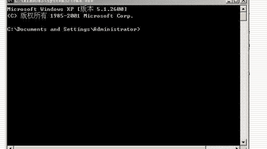


## 知新

Windows窗口程序设计不同于DOS下的程序设计，它是一种事件驱动的程序设计模式，主要是基于消息的。


## Windows应用程序

Microsoft Windows是一种基于图形用户界面的多任务操作系统。系统中可以同时运行多个应用程序。每个Windows应用程序通过各自的“窗口”与用户进行交互。

- 应用的用户界面
  - 单文档用户界面
  - 多文档
  - 对话框
- 消息驱动的程序结构

## Windows应用程序

- 事件驱动程序与过程驱动程序
- DOS过程驱动程序是顺序的、关联的，程序直接控制程序事件和过程顺序，以某种不可改变的顺序进行工作，交互性差。
- Windows事件驱动程序由事件发生来控制逻辑，事件的发生是随机的不确定的。

## Windows应用程序

```
input name:wanbo_
```

## Windows应用程序

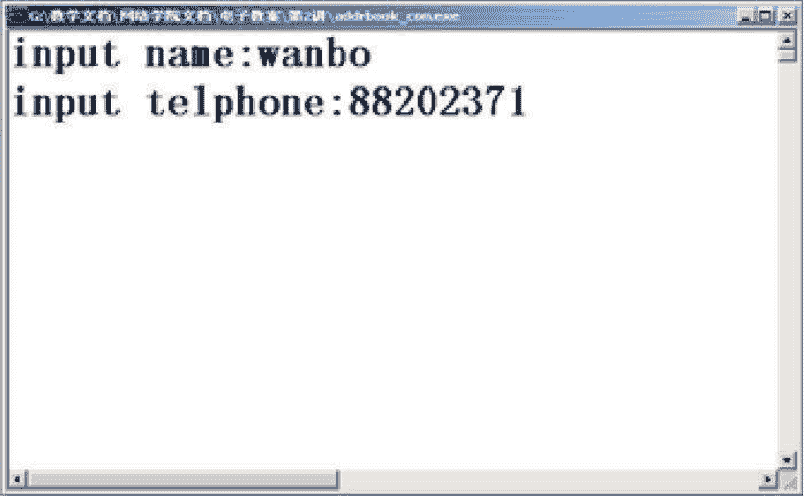

input name:wanbo
input telphone:88202371

## Windows应用程序

input name:wanbo
input telphone:88202371
input email:wanbo@xidian.edu.cn

## Windows应用程序

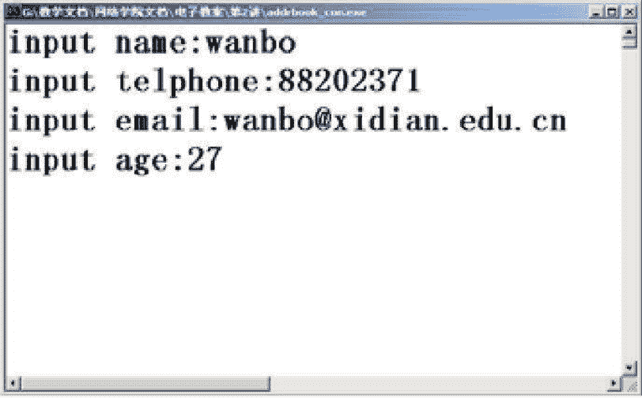

## Windows应用程序

```
input name:wanbo
input telphone:88202371
input email:wanbo@xidian.edu.cn
input age:27
the info you input:
name:wanbo
age:27
tel:88202371
email:wanbo@xidian.edu.cn
press any key to exit
```

## Windows应用程序

编辑器

姓名

年龄

0

电话

Email

信息

退出

确认

## Windows应用程序

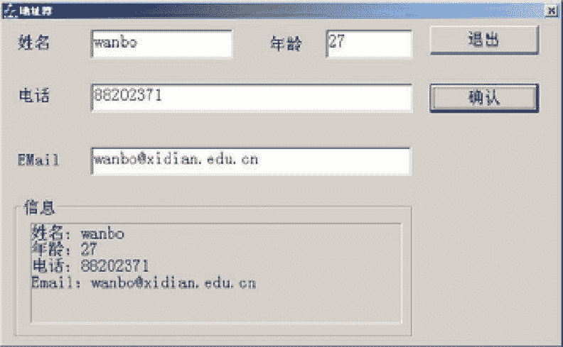

## 事件

键盘输入

单击鼠标左键

单击鼠标右键

# WINDOWS

处理键盘输入

处理鼠标左键

处理鼠标右键

程序数据

# 程序

### Visual C++

- Windows环境下最主要的应用开发系统之一。
- C++语言的可视化集成开发环境。
- 强大的调试功能为大型复杂软件的开发提供了有效的排错手段。

## 创建Windows窗口应用程序（with VC++）

### Platform SDK（software develop kit）

使用C/C++语言和Win32 API（Application Programming Interface，应用程序编程接口）函数进行编程。

### MFC

使用C++语言和MFC(微软基础类库)进行编程。

## 创建Windows窗口应用程序（with VC++）

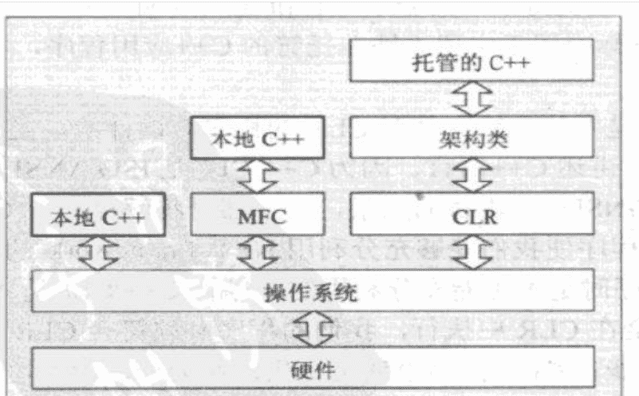

## 创建Windows窗口应用程序 (with VC++)

使用C/C++语言和Win32 API (Application Programming Interface, 应用程序编程接口)函数进行编程。

使用C++语言和MFC(微软基础类库)进行编程。

## 创建Windows窗口应用程序（with VC++）

SDK

MFC

简单、易于理解

复杂，代码可读性差

工作量大、效率低

工作量小，效率高

## 创建Windows窗口应用程序（with VC++）

SDK编程方式易于理解 Windows 工作原理。

通过了解相对已 “过时” 的 Windows SDK 编程,有助于理解 以后的很多东西！


## 创建Windows窗口应用程序 (with VC++)

□ VC++开发Windows窗口应用程序必须跨越的四大技术障碍 (MFC方式)

- 面向对象观念与C++语言
- Windows程序基本观念
- Microsoft Foundation Classes (MFC) 本身
- Visual C++集成开发环境与各种开发工具 (难度不高，但需熟练)

## 课程安排

- 学时安排
  - 42学时
- 课程内容
  - Windows编程基础
    - 4学时
  - C++语言和面向对象程序设计（设计模式）
    - 30学时
  - MFC（Microsoft Foundation Classes）
    - 8学时

安全编程

## 安全编程

- 计算机只能理解机器语言
- 用高级语言（如C/C++语言）的程序员并不总是了解整个程序执行情况

## 参考书籍-安全编程

- □ 深入理解计算机系统，（美）Randal E. Bryant David R. O’Hallaron 著 ，龚奕利、雷迎春译，机械工业出版社
- ■ 从程序员的视角详细阐述计算机系统的本质概念，并展示这些概念如何实实在在地影响应用程序的正确性、性能和实用性
- □ 网络渗透技术，许治坤等，电子工业出版社
- □ 编写安全的代码， Howard Michael、LeBlanc David，程永敬 译，机械工业出版社


## 内容体系

设计模式

代码规范

Windows
编程基础

C++语言
和面向对象
程序设计

MFC

安全编程

宏观层面

语言层面

微观层面

## 教材

- □ C++大学基础教程，徐惠民主编，人民邮电出版社
- □ （C++面向对象程序设计，陈维兴、陈昕，人民邮电出版社）
- □ C++大学基础教程，（美）戴特尔（Deitel,H.M.）等著，张引 等译，电子工业出版社
- □ C++大学教程，（美）戴特尔（Deitel,H.M.）等著，张引 等译，电子工业出版社

## 教材

- □ Visual C++应用教程，郑阿奇主编，人民邮电出版社

## 参考书籍

- C++ 编程思想（第2版）
  - Bruce Eckel, 机械工业出版社
- C++ Primer
  - Stanley B.Lippman,Josee Lajoie, 中国电力出版社
- Windows 程序设计（第5版）
  - Charles Petzold, 北京大学出版社
- MFC Windows 程序设计（第2版）
  - Jeff Prosise，清华大学出版社

## 参考书籍

+ 深入浅出MFC（第二版）

+ 侯俊杰, 华中科技大学出版社

+ Visual C++ 技术内幕

+ George Shepherd,David Kruglinski , 清华大学出版社

+ 深入解析MFC (MFC Internals)

+ George Shepherd ,中国电力出版社

+ VC++ 深入详解

+ 孙鑫,余安平, 电子工业出版社

## 参考书籍

- 设计模式：可复用面向对象软件的基础，
  **Erich Gamma**、 **Richard Helm**、 **Ralph Johnson**、 **John Vlissides**， 李英军等译， 机械工业出版社
- **Head First**设计模式， Eric Freeman等，
  中国电力出版社（Java语言）

## 第一部分

### Windows编程基础

### Windows编程基础

- Windows程序内部运行原理
- SDK方式编写Windows应用程序
- Windows应用程序特性


#### CH1.1 Windows程序内部运行原理

- 目标：理解Windows程序的运行机制
- 掌握以下基本概念
  - 窗口
  - Windows API
  - 消息与消息机制
  - 消息响应
  - 句柄

##### Windows应用程序，操作系统，计算机硬件输入输出设备之间的相互关系

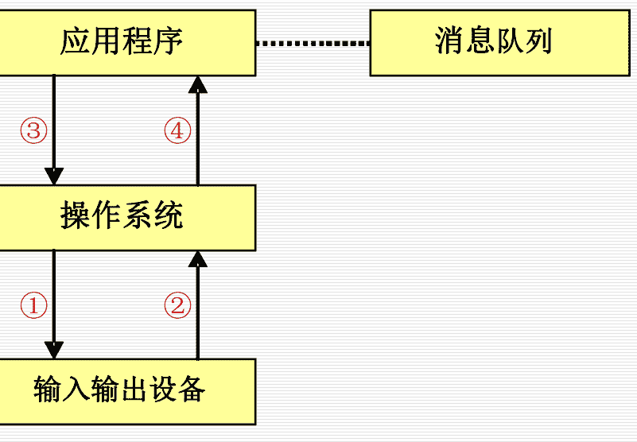

##### Windows API

操作系统所能够完成的每一个特殊功能通常都有一个函数与其对应，也就是说，操作系统把它所能够完成的功能以函数的形式提供给应用程序使用，应用程序对这些函数的调用就叫做系统调用（System call），这些函数的集合就是Windows操作系统提供给应用程序编程的接口(Application Programming Interface),简称Windows API。

##### Windows应用程序，操作系统，计算机硬件输入输出设备之间的相互关系

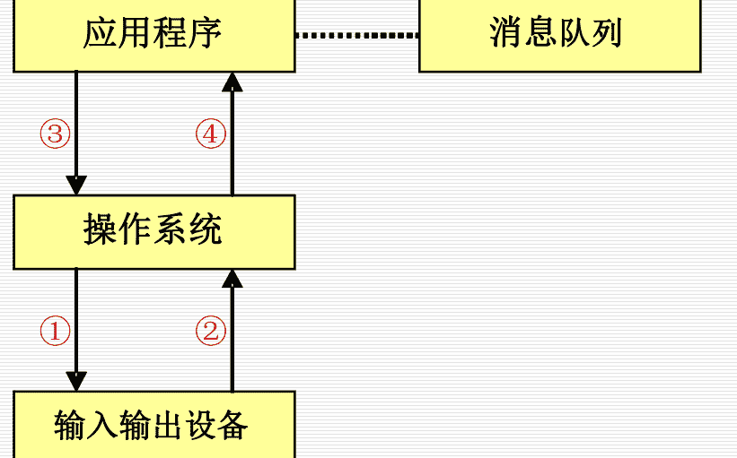

##### 消息响应

操作系统能够感知输入设备的变化（事件），并且能够知道具体的事件情况，但操作系统并不决定对这一事件如何作出反应，而是将这一事件转交给应用程序，由应用程序决定如何对这一事件作出反应。对事件作出反应的过程就是消息响应。

##### 消息

操作系统是怎样将感知到的事件传递给应用程序的呢？这是通过消息机制(Message)来实现的。操作系统将每个事件都包装成一个称为消息的结构体MSG来传递给应用程序。

##### 消息结构体

MSG结构定义如下：

```
typedef struct tagMSG{
  HWND hwnd;          //窗口句柄
  UINT message;       //主消息
  WPARAM wParam;      //附加消息
  LPARAM lParam;
  DWORD time;         //送至队列的时间
  POINT pt;           //消息发送时屏幕光标的位置
} MSG, *PMSG;
```

##### 从变量的类型区分变量的用途

```
int x,y;
x=50;
y=30;
//x和y既可以用来表示坐标点，也可以用来表示宽度和高度，还可以用来表示身高和体重等等。
```

```
typedef int WIDTH
typedef int HEIGHT
WIDTH x;
HEIGHT y;
//好处：我们从变量的类型上就可以知道x和y是用来表示宽度和高度。
```

##### 消息结构体

MSG结构定义如下：

```
typedef struct tagMSG{
    HWND hwnd;          // 窗口句柄
    UINT message;       // 主消息
    WPARAM wParam;      // 附加消息
    LPARAM lParam;
    DWORD time;         // 送至队列的时间
    POINT pt;           // 消息发送时屏幕光标的位置
} MSG, *PMSG;
```

##### Windows对象

- **Windows窗口**是Windows系统的一个内部数据结构的实例，由一个“**窗口句柄**”标识，Windows系统创建它并给它分配系统资源。
- **Windows Object**是Windows系统的内部结构，是Windows的规范部件，包括各种窗口、菜单、按钮、对话框以及程序模块等，通过一个**句柄**来引用。

##### 句柄（Handle）

- 句柄（HANDLE），Windows用来标识被应用程序建立或使用的Windows对象的一个唯一的整数值。
- 操作系统要管理和操作这些Windows对象（资源），都是通过句柄来找到对应的对象。按Windows对象的类型，又可将句柄细分成图标句柄（HICON），光标句柄（HCURSOR），窗口句柄（HWND），应用程序实例句柄（HINSTANCE）等等各种类型的句柄。
- 操作系统给每一个窗口指定的一个唯一的标识号（整数值）即窗口句柄。

##### 消息结构体

```
typedef struct tagMSG{
    HWND hwnd;          //窗口句柄
    UINT message;       //主消息
    WPARAM wParam;      //附加消息
    LPARAM lParam;
    DWORD time;         //送至队列的时间
    POINT pt;           //消息发送时屏幕光标的位置
} MSG, *PMSG;
```

##### 主消息

- □ 由事先定义好的消息名称标识
- ■ 采用不同的前缀符号来区别能够解释和处理消息的窗口类型
- □ WM_ 窗口消息
- □ BM_ 按钮控制消息
- □ CB_ 组合框控制消息
- □ DM_ 默认下压式按钮控制消息
- □ EM_ 编辑控制消息
- □ LB_ 列表框控制消息
- □ SMB_ 滚动条控制消息

##### 消息结构体

```
typedef struct tagMSG{
  HWND hwnd;      //窗口句柄
  UINT message;   //主消息
  WPARAM wParam;  //附加消息
  LPARAM lParam;
  DWORD time;     //送至队列的时间
  POINT pt;       //消息发送时屏幕光标的位置
} MSG, *PMSG;
```

##### 消息结构体

对于 MSG 这个结构体来说，它里面包含的信息是相当丰富的，它包含了对于一个消息来说，它和哪一个窗口相关，这个消息本身是什么，这个消息的附加参数是什么，消息发生投递的时间是什么。我们拿到这样一个消息就像当全面了。那么我们就知道应该做什么样的处理。

##### Windows应用程序，操作系统，计算机硬件输入输出设备之间的相互关系

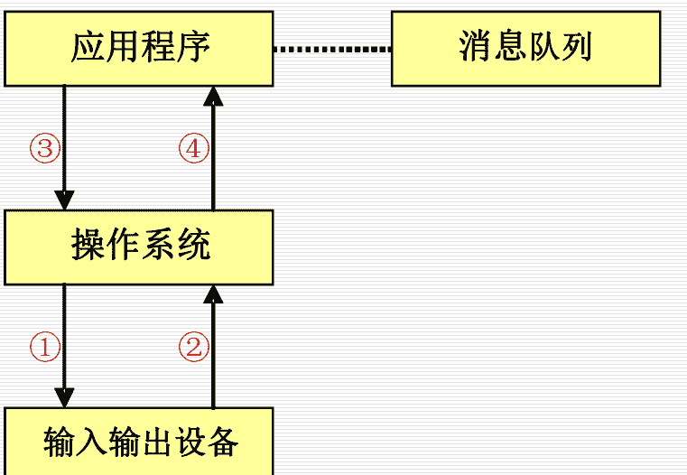


Hardware Event

System Queue

App3 Message Queue

App2 Message Queue

App1 Message Queue

Post Message

Application 1

Message Loop

Window Procedure

Default Window Procedure

Send Message

##### 应用程序获得的消息

- 进队消息
  - 进队消息是由Windows放入程序的消息队列中的
- 不进队消息
  - 不进队消息直接发送给窗口过程

#### CH1.2 SDK方式编写Windows应用程序

- □ 目标：能够用SDK (Windows API+C/C++)编写一个简单的Windows应用程序，通过编写程序掌握Windows程序的运行原理及编写方式。为MFC的学习打下基础。
- □ 掌握以下基本知识：
- ■ Windows应用程序基本结构

##### 程序执行的起点(入口函数)?

main()

WinMain()

##### WinMain函数

Windows程序的入口函数

```c
int WINAPI WinMain(
HINSTANCE hInstance,  // handle to current instance
HINSTANCE hPrevInstance,  // handle to previous instance
LPSTR lpCmdLine,  // command line
int nCmdShow  // show state
);
```

##### 匈牙利表示法

- 一种命名约定

匈牙利命名法是微软推广的一种关于变量、函数、对象、前缀、宏定义等各种类型的符号的命名规范。匈牙利命名法的主要思想是：在变量和函数名中加入前缀以增进人们对程序的理解。

- 为纪念Microsoft程序员Charles Simonyi所使用的命名约定

##### 命名约定

- 常用的命名约定有三种：
  - Unix环境常用的命名法
    - my_age、num_of_student
  - 驼峰式命名法
    - myAge、numOfStudent
  - 匈牙利标记法
    - iMyCar、bIsRight

##### WinMain函数

##### Windows程序的入口函数

```c
int WINAPI WinMain(
    HINSTANCE hInstance,
    // handle to current instance
    HINSTANCE hPrevInstance,
    // handle to previous instance
    LPSTR lpCmdLine,    // command line
    int nCmdShow        // show state
);
```

##### 函数调用约定

函数调用是通过堆栈来实现的。在调用时，将参数值和调用后的返回地址压入所分配的堆栈空间中。函数计算结束以后，或者调用者、或者函数本身修改堆栈，使堆栈恢复原装。在参数传递中，有两个很重要的问题必须得到明确说明：

- 当参数个数多于一个时，按照什么顺序把参数压入堆栈
- 函数调用后，由谁来把堆栈恢复原装（堆栈清除）

栈底

较早的帧

参数n

调用者的帧

参数1

返回地址

帧指针 %ebp

被保存的%ebp

被保存寄存器、本地变量和临时变量

当前帧

栈指针 %esp

参数构造区域

栈顶

地址增大

##### 函数的调用

函数调用过程的三个步骤

- 调用参数和返回地址（当前EIP）压栈，当前EBP压栈
- 跳转到函数入口，开始执行被调函数
- 恢复调用者原有栈，并跳到堆栈中保存的返回地址

##### Windows系统的栈

低地址方向
esp→ 其他数据，例如被调函数的局部变量
esp→ EBP
esp→ EIP
esp→ 被调函数参数
esp→ 其他数据，例如上层函数的局部变量
SHE指针
高地址方向

##### 函数调用过程示例

```
3 int func(int a, int b){
4   int retVal = a + b;
5   printf("b: 0x%08x\n", &b);
6   printf("a: 0x%08x\n", &a);
7   printf("ret addr here: 0x%08x\n", &a-1);
8   printf("stored ebp here: 0x%08x\n", &a-2);
9   printf("retVal: 0x%08x\n\n", &retVal);
10  return retVal;
11 }
12 int main(int argc, char* argv[])
13 {
14   int result = func(1, 2);
15   return 0;
16 }
```

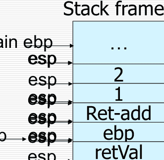

##### 函数调用约定

在高级语言中，通过函数调用约定来说明这两个问题。常见的调用约定有：

- stdcall
- cdecl
- fastcall
- thiscall
- naked call

##### 函数调用约定

| 关键字 | 清理堆栈 | 参数入栈顺序 |
|---|---|---|
| __cdecl | 调用函数 | 右 → 左 |
| __stdcall | 被调用函数 | 右 → 左 |
| __fastcall | 被调用函数 | 右 → 左 |

##### 窗口的创建

创建一个完整的窗口需要经过下面四个操作步骤：

- 设计一个窗口类；
- 注册窗口类；
- 创建窗口；
- 显示及更新窗口。

##### 窗口类的类型

在我们的程序中经常要用到一类变量，这个变量里的每一位(bit)都对应某一种特性。当该变量的某位为1时，表示有该位对应的那种特性，当该位为0时，即没有该位所对应的特性。当变量中的某几位同时为1时，就表示同时具有几种特性的组合。一个变量中的哪一位代表哪种意义，不容易记忆，所以我们经常根据特征的英文拼写的大写去定义一些宏，该宏所对应的数值中仅有与该特征相对应的那一位（bit）为1，其余的bit都为0。

##### 窗口类的类型

如果我们希望某一变量的数值既有 CS_VREDRAW特性，又有CS_HREDRAW特性，我们只需使用二进制OR（|）操作符将他们进行或运算相组合，如style=CS_VREDRAW | CS_HREDRAW | CS_NOCLOSE。如果我们希望在某一变量原有的几个特征上去掉其中一个特征，用取反（~）之后再进行与（&）运算，就能够实现，如在刚才的style的基础上去掉 CS_NOCLOSE特征，可以用style & ~CS_NOCLOSE实现。

##### 创建窗口 — 第一步

##### 窗口类的定义— WNDCLASS

```
typedef struct tagWNDCLASS{
    UINT style;                 //窗口类风格
    WNDPROC lpfnWndProc;        //窗口过程函数
    int cbClsExtra;   //在类结构中预留的空间
    int cbWndExtra;           //在Windows内部预留空间
    HINSTANCE hInstance;      //程序实例句柄
    HICON hIcon;              //窗口的图标
    HCURSOR hCursor;          //光标句柄
    HBRUSH hbrBackground;     //背景色
    LPCTSTR lpszMenuName;     //窗口类菜单
    LPCTSTR lpszClassName;    //窗口类名
} WNDCLASS, *PWNDCLASS;
```

##### 窗口过程函数

- □ 窗口过程函数用来对消息进行处理

第二个成员变量lpfnWndProc指定了这一类型窗口的过程函数，也称回调函数的。

##### 回调函数

当应用程序收到给某一窗口的消息时（还记得前面讲过的消息通常与窗口相关的吗？），就应该调用某一函数来处理这条消息。这一调用过程不用应用程序自己来实施，而由操作系统来完成，但是，回调函数本身的代码必须由应用程序自己完成。

##### 窗口过程函数

对于一条消息，操作系统到底调用应用程序中的哪个函数（回调函数）来处理呢？

操作系统调用的就是接受消息的窗口所属的类型中的`lpfnWndProc`成员指定的函数。

每一种不同类型的窗口都有自己专用的回调函数，该函数就是通过`lpfnWndProc`成员指定的。


##### 创建窗口 — 第一步
##### 窗口类的定义— WNDCLASS

```
typedef struct tagWNDCLASS{
    UINT style;                 //窗口类风格
    WNDPROC lpfnWndProc;        //窗口过程函数
    int cbClsExtra;             //在类结构中预留的空间
    int cbWndExtra;             //在Windows内部预留空间
    HINSTANCE hInstance;        //程序实例句柄
    HICON hIcon;                //窗口的图标
    HCURSOR hCursor;            //光标句柄
    HBRUSH hbrBackground;       //背景色
    LPCTSTR lpszMenuName;       //窗口类菜单
    LPCTSTR lpszClassName;      //窗口类名
} WNDCLASS, *PWNDCLASS;
```

##### WNDCLASS
##### 类附加空间(cbClsExtra)

- Windows为系统中每一个窗口类管理一个WNDCLASS结构。在应用程序注册一个窗口类时，它可以让Windows系统为该结构分配和追加一定字节数的附加内存空间，这部分内存称之为类附加内存，由属于这种窗口类的所有窗口共享，类附加内存空间用于存储类的附加信息。

- 函数SetClassWord和SetClassLong用来把某一值复制到类附加内存中，并可以通过GetClassWord和GetClassLong来检取这些值。

##### 窗口附加空间(cbWndExtra)

Windows为每一个窗口管理一个内部数据结构，在注册一个窗口类时，应用程序能够指定一定字节的附加内存空间，称为窗口附加内存。在创建这类窗口时，Windows系统就为窗口结构分配和追加指定数目的窗口附加内存空间，应用程序可以用这部分内存存储窗口特有的数据。

函数SetWindowWord和SetWindowLong可以把某一个值复制到附加内存，函数GetWindowWord和GetWindowLong可以检取这些值。

##### 创建窗口 — 第一步
##### 窗口类的定义— WNDCLASS

```
typedef struct tagWNDCLASS{
    UINT style;                 //窗口类风格
    WNDPROC lpfnWndProc;        //窗口过程函数
    int cbClsExtra;             //在类结构中预留的空间
    int cbWndExtra;             //在Windows内部预留空间
    HINSTANCE hInstance;        //程序实例句柄
    HICON hIcon;                //窗口的图标
    HCURSOR hCursor;            //光标句柄
    HBRUSH hbrBackground;       //背景色
    LPCTSTR lpszMenuName;       //窗口类菜单
    LPCTSTR lpszClassName;      //窗口类名
} WNDCLASS, *PWNDCLASS;
```

##### LoadIcon

LoadIcon的作用是在应用程序中加载一个窗口图标，其原型为：

```
HICON LoadIcon(
    HINSTANCE hInstance,
    LPCTSTR lpIconName
);
```

图标资源名或系统预定义图标标识名

图标资源所在的模块句柄，NULL则使用系统预定义图标

##### 基于资源的程序设计

Windows程序分为“程序代码”和“用户接口（UI）资源”两大部分。程序代码使用编译器编译，用户接口资源使用资源编译器编译，最后两者使用连接器加上库文件可以生成可执行文件。

##### 基于资源的程序设计

用户接口（UI）资源是指功能菜单、对话框、程序图标、光标等资源，它是Windows应用程序界面的重要组成部分。资源的使用极大方便了应用程序界面的设计，也大大方便了应用程序与用户的交互。
这些用户资源的实际内容（二进制代码）是借助各种工具产生的。并以各种扩展名文件存在，如.ico,.bmp,.cur等。程序员必须在一个所谓的资源描述文档（.rc）中描述它们。RC编译器读取RC文件的描述后，将所有用户接口资源文件集中制作一个.RES文件。
这些资源可以使用VC++提供的资源编辑器来实现创建和编辑。

##### 资源

- 资源分类
  - 菜单
    - WM_COMMAND消息
      - wParam低16位传递菜单项资源ID
  - 对话框
    - WM_COMMAND消息
      - wParam低16位传递子窗口（控件）资源ID
  - ……
- 资源ID
  - 资源的唯一标识

##### 基于资源的程序设计

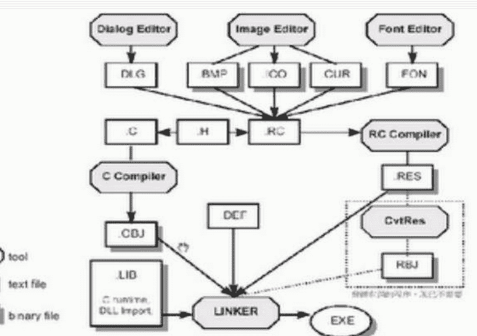

##### 创建窗口 — 第一步
##### 窗口类的定义 — WNDCLASS

```
typedef struct tagWNDCLASS{
    UINT style;                 //窗口类风格
    WNDPROC lpfnWndProc;        //窗口过程函数
    int cbClsExtra;             //在类结构中预留的空间
    int cbWndExtra;             //在Windows内部预留空间
    HINSTANCE hInstance;        //程序实例句柄
    HICON hIcon;                //窗口的图标
    HCURSOR hCursor;            //光标句柄
    HBRUSH hbrBackground;       //背景色
    LPCTSTR lpszMenuName;       //窗口类菜单
    LPCTSTR lpszClassName;      //窗口类名
} WNDCLASS, *PWNDCLASS;
```

##### 创建窗口 — 第一步
##### 窗口类的定义— WNDCLASS

```
typedef struct tagWNDCLASS{
    UINT style;                 //窗口类风格
    WNDPROC lpfnWndProc;        //窗口过程函数
    int cbClsExtra;   //在类结构中预留的空间
    int cbWndExtra;           //在Windows内部预留空间
    HINSTANCE hInstance;      //程序实例句柄
    HICON hIcon;              //窗口的图标
    HCURSOR hCursor;          //光标句柄
    HBRUSH hbrBackground;     //背景色
    LPCTSTR lpszMenuName;     //窗口类菜单
    LPCTSTR lpszClassName;    //窗口类名
} WNDCLASS, *PWNDCLASS;
```

##### GetStockObject

GetStockObject的作用是获取笔、画刷、调色板、字体的句柄。应用程序调用函数 GetStockObject获取系统提供的背景刷。其原型为：

```
HGDI OBJ GetStockObject( int  fnObject
    // type of stock object );
```

##### 创建窗口 — 第一步
##### 窗口类的定义— WNDCLASS

```
typedef struct tagWNDCLASS{
    UINT style;                 //窗口类风格
    WNDPROC lpfnWndProc;        //窗口过程函数
    int cbClsExtra;             //在类结构中预留的空间
    int cbWndExtra;             //在Windows内部预留空间
    HINSTANCE hInstance;        //程序实例句柄
    HICON hIcon;                //窗口的图标
    HCURSOR hCursor;            //光标句柄
    HBRUSH hbrBackground;       //背景色
    LPCTSTR lpszMenuName;       //窗口类菜单
    LPCTSTR lpszClassName;      //窗口类名
} WNDCLASS, *PWNDCLASS;
```


##### 菜单

- Windows应用程序加载菜单的方法：
- 在窗口类的定义中加载菜单资源
```
wndcls.lpszMenuName=MAKEINTRESOURCE(IDR_MENU1);
```

- 在创建窗口时加载菜单
```
HMENU hMenu;
hMenu=LoadMenu(hInstance, MAKEINTRESOURCE(IDR_MENU1))
```

- 动态加载菜单：应用程序通过调用函数 LoadMenu 获取菜单句柄后，还可通过 SetMenu 动态加载菜单。

##### 创建窗口 — 第二步

注册窗口类 — RegisterClass

```
ATOM RegisterClass
( CONST WNDCLASS *lpWndClass );
```

##### 创建窗口 — 第三步

##### 创建窗口实例— CreateWindow

```
HWND CreateWindow (
LPCTSTR lpszClassName, //窗口类名
LPCTSTR lpszTitle,    //窗口标题名
DWORD dwStyle,        //创建窗口的样式
int x,y,              //窗口左上角坐标
int nWidth,nHeight,   //窗口宽度和高度
HWND hwndParent,      //该窗口的父窗口句柄
HMENU hMenu,          //窗口主菜单句柄
HINSTANCE hInstance, //创建窗口的应用程序当前句柄
LPVOID lpParam        //指向一个传递给窗口的参数值的指针
)
```

##### 窗口样式

##### 常用窗口样式

| 标识 | 说明 |
| --- | --- |
| WS_BORDER | 创建一带边框的窗口 |
| WS_CAPTION | 创建一带标题栏的窗口 |
| WS_VSCROLL | 创建一带垂直滚动条的窗口 |
| WS_MAXIMIZEBOX | 创建一带最大化框的窗口 |
| WS_MAXIMIZE | 创建一最大尺寸的窗口 |
| WS_MINIMIZEBOX | 创建一带最小化框的窗口 |
| WS_MINIMIZE | 创建一最小尺寸的窗口 |
| WS_OVERLAPPED | 创建一带边框和标题的窗口 |
| WS_OVERLAPPEDWINDOW | 创建一带边框、标题栏、系统菜单及最大、最小化框的窗口 |
| WS_POPUP | 创建一弹出式窗口 |
| WS_POPUPWINDOW | 创建一带边框和系统菜单的弹出式窗口 |
| WS_SYSMENU | 创建一带系统菜单的窗口 |
| WS_HSCROLL | 创建一带水平滚动条的窗口 |

##### 菜单

- Windows应用程序加载菜单的方法：
- 在窗口类的定义中加载菜单资源
```
wndcls.lpszMenuName=MAKEINTRESOURCE(IDR_MENU1);
```

- 在创建窗口时加载菜单
```
HMENU hMenu;
hMenu=LoadMenu(hInstance, MAKEINTRESOURCE(IDR_MENU1))
```

- 动态加载菜单：应用程序通过调用函数 LoadMenu获取菜单句柄后，还可通过 SetMenu动态加载菜单。

##### 创建窗口 — 第四步

显示窗口 — ShowWindow

```
BOOL ShowWindow
( HWND hWnd, int nCmdShow );
```

|  |  |
|---|---|
| SW_HIDE | 隐藏窗口 |
| SW_SHOWNORMAL | 显示并激活窗口 |
| SW_SHOWMINIMIZE | 显示并最小化窗口 |
| SW_SHOWMAXIMIZE | 显示并最大化窗口 |
| SW_SHOWN OACTIVE | 显示但不激活窗口 |
| SW_RESTORE | 恢复窗口的原来位置及尺寸 |

##### 创建窗口 — 第五步

- 刷新窗口 — UpdateWindow

```
BOOL UpdateWindow( HWND hWnd );
```

显示窗口后，应用程序调用UpdateWindow更新并绘制用户区，并发出WM_PAINT消息。
UpdateWindow(hwnd);

##### 建立消息循环

Windows应用程序的运行以消息为核心，应用程序必须读取应用程序消息队列，检索消息并将它们发送出去，以便适当的窗口函数能够处理它们，完成这一任务的便是消息循环。

##### 建立消息循环

- □ 从消息队列中获取消息
  - ■ GetMessage
- □ 翻译消息和派送消息
  - ■ TranslateMessage
  - ■ DispatchMessage

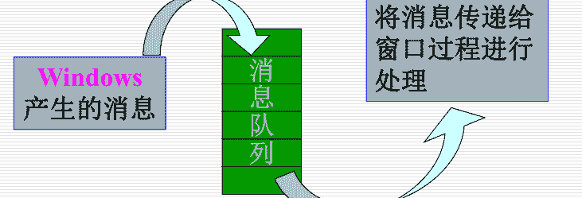

Hardware Event

System Queue

App3 Message Queue

App2 Message Queue

App1 Message Queue

Post Message

Application 1

Message Loop

Window Procedure

Default Window Procedure

Send Message

##### 建立消息循环

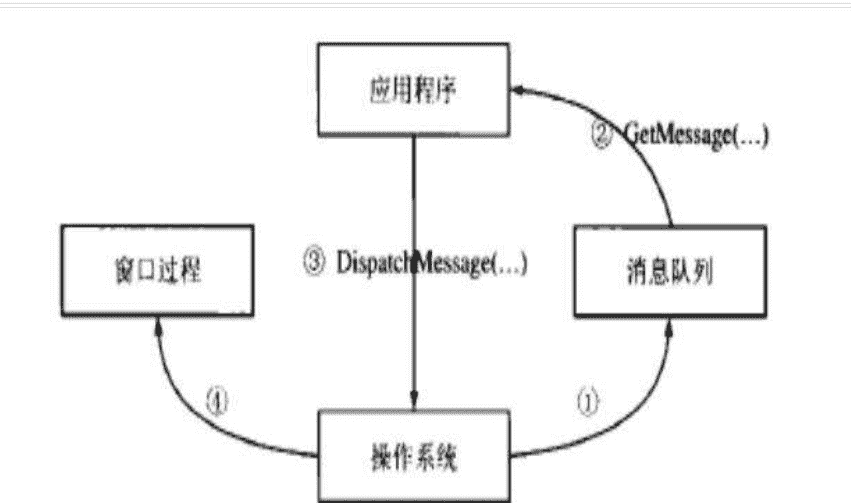

##### GetMessage

从消息队列中读取一条消息，并将消息放在MSG结构中

返回零值，即检索到WM_QUIT消息，程序结束循环并退出

```
其中函数GetMessage形式为:
GetMessage (
  lpMSG,      //指向MSG结构的指针
  hWnd,
  nMsgFilterMin,  //用于消息过滤的最小消息号值
  nMsgFilterMax   //用于消息过滤的最大消息号值
)
```

##### Windows系统

##### 排队消息

- WM_KEYDOWN
- WM_KEYUP
- WM_MOUSEMOVE
- WM_LBUTTONDOWN
- WM_QUIT
- ...

##### 非排队消息

- WM_CREATE
- WM_DESTROY
- WM_SIZE
- WM_PAINT
- ...

应用程序的消息队列

检索到的消息

GetMessage ()

WinMain ()

消息循环

DispatchMessage ()

应用程序

回调

WndProc ()

- case 1
- case 2
- case 3
- ...
- Default

DefWindowProc ()

##### 窗口过程

□ 窗口过程函数用来对消息进行处理

```
LRESULT CALLBACK WndProc (
  HWND hWnd,
  UINT message,
  WPARAM wParam,
  LPARAM lParam
);
```

窗口函数的一般形式如下：

```
LRESULT CALLBACK WndProc(HWND hwnd, UINT messgae, WPARAM wParam, LPARAM lParam)
{
...
}
```

```
switch(message) // message为标识的消息
{ case ...
...
break;
...
```

在消息处理程序段中一般都有对WM_DESTROY的处理,该消息是关闭窗口时发出的。它向应用程序发出WM_QUIT消息,请求退出处理函数:
void PostQuitMessage(int nExitCode)
//nExitCode为应用程序的退出代码

```
case WM_DESTROY:
PostQuitMessage(0);
default:
return DefWindowProc(hwnd, message, wParam, lParam);
}
```

```
return(0);
}
```

为未定义处理过程的消息提供缺省处理

##### 程序执行流程

程序从WinMain开始

进行程序初始化

创建窗口注册窗口函数

用GetMessage取消息

退出消息

退出程序

拦截消息

默认处理

处理消息

##### 格式化字符串函数

- □ 格式化字符串的函数
  - ■ sprintf
  - ■ stdio.h

```
char szChar[20];
sprintf(szChar,"char is %d",wParam);
```

##### MessageBox函数

用于显示信息

```
int                 //返回用户所选按钮代表的数值
MessageBox (
    HWND hWnd,      //窗口句柄
    LPCTSTR lpText, //消息框主体显示的文本
    LPCTSTR lpCaption, //消息框标题栏显示文本
    UINT uType      //代表消息框风格的常数组合
);
```


##### 消息框风格

- □ 以MB_开始的常数组合代表消息框的风格
- ■ 多种风格之间用 “|”分隔

```
if(IDOK == MessageBox(
    NULL,
    "是否退出本程序？ ",
    "退出",
    MB_OKCANCEL|
    MB_ICONQUESTION))

MessageBox(NULL,"再见！ ","退出",MB_OK);
```

##### GDI简介—图形设备接口

- - Windows应用程序中的图形输出流程
  - 应用程序提出绘图请求
  - GDI接受请求并传递给对应设备的驱动程序
  - 设备驱动程序完成特定的硬件输出

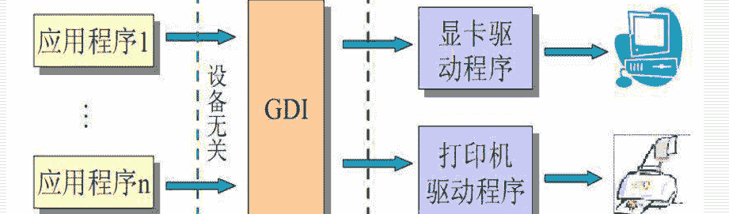

##### GDI简介

- - 绘图机制
  - 绘图函数（如：Ellipse、TextOut）
  - 绘图工具（画笔、画刷等）（GDIObject）
  - 设备上下文（绘图环境）（Device Context）


##### 设备描述表（Device context）

应用程序每一次文字图形操作均参照设备描述表中的属性进行。设备描述表描述了特定输出设备状态、文本和图形的绘图参数等；包括设备上可使用的输出区域、逻辑坐标系、选定何种绘图工具绘图、绘图前景色、填充色、字体、字体颜色、字的磅数等属性。

##### 画笔 — HPEN

□ 创建画笔

```
HPEN hPen;
hPen = CreatePen(
    PS_SOLID,2,RGB(255,0,0));
    // 线形，线宽，颜色
```

□ 将画笔选入DC

```
SelectObject(hdc,hPen);
```

□ 删除画笔资源

```
DeleteObject(hPen);
```

##### 画刷 — HBRUSH

创建画刷

```
HBRUSH hBrush;
hBrush = CreateSolidBrush(RGB(255,0,0));
```

将画刷选入DC

```
SelectObject(hdc,hBrush);
```

删除画刷资源

```
DeleteObject(hBrush);
```

##### GDI简介

- - 要在窗口的客户区绘图，可以使用 Windows的图形设备接口（GDI）函数
- - 每个GDI函数都需要将设备描述表句柄作为函数的第一个参数，例如
  - DrawText( HDC, LPCTSTR, int, LPRECT, UINT );
  - TextOut( HDC, int, int, LPCTSTR, int );

##### 画线

- - 画线
  - **LineTo**
    - LineTo(HDC,int,int);
      - 例：LineTo(hdc,100,100);
      - 默认情况下从(0,0)开始画
  - 移动画笔
  - **MoveToEx**
    - MoveToEx(HDC,int,int,LPPOINT);

##### 画其它图形

- - 画椭圆
  - `Ellipse(hdc,100,100,200,200);`
- - 画圆角矩形
  - `RoundRect(hdc,......);`
- - 画弧
  - `Arc(hdc,......);`
- - 画饼
  - `Pie(hdc,......);`
- - 画矩形
  - `Rectangle(HDC,int,int,int,int);`

##### 获取设备描述表：方法一

- □ 该方法适合于处理非WM_PAINT消息

- ■ 用GetDC获取设备描述表句柄

- ■ 用ReleaseDC释放设备描述表句柄

- □ 这种获取设备描述表的一般方式如下

```
hdc = GetDC(hwnd) ;
......
ReleaseDC(hwnd, hdc) ;
```

##### WM_PAINT消息

- 什么时候向窗口过程发送WM_PAINT消息（窗口发生重绘） — “无效”的时候

- 调用UpdateWindow函数刷新窗口

- 窗口的全部或者部分失效的时候

- 窗口从无到有

- 手动刷新窗口

- 调用InvalidateRect函数

##### 获取设备描述表：方法二

- 该方法只适合于处理WM_PAINT消息

- 用BeginPaint“使无效窗口生效”并“返回设备描述表句柄”

- 用EndPaint释放设备描述表句柄

- 一般处理WM_PAINT的形式如下：

```
Case WM_PAINT;
 hdc = BeginPaint(hwnd, &ps) ;
 ......
 EndPaint(hwnd, &ps) ;
 return 0 ;
```

##### PAINTSTRUCT结构

- - Windows系统为每一个窗口建立了一个PAINTSTRUCT结构。该结构中包含了包围无效区域的一个最小矩形的结构RECT，应用程序可以根据这个无效区域执行更新的操作。PAINTSTRUCT结构体不需要我们维护，是系统内部维护的结构体。

##### 获取设备描述表：方法三

- □ 获取整个窗口的设备描述表
- ■ 用GetWindowDC获取整个窗口的设备描述表句柄
- ■ 用ReleaseDC释放设备描述表句柄

```
HDC hdc;

Hdc = GetWindowDC(hWnd);
//使用设备描述表
.....

ReleaseDC(hWnd,hdc);
```

##### 获取设备描述表：方法四

- □ 获取整个屏幕的设备描述表
- ■ 用CreateDC获取整个屏幕的设备描述表句柄
- ■ 用DeleteDC释放设备描述表句柄

```
HDC hdc;

Hdc = CreateDC("DISPLAY", NULL,NULL,NULL);
//使用设备描述表
.....

DeleteDC(hdc);
```

##### 常用消息

- - WM_CREATE
  - 由CreateWindow函数发出的消息
- - WM_PAINT
  - 窗口客户区的全部或者部分“无效”时触发
- - WM_CLOSE
  - 关闭窗口时产生的消息
- - WM_DESTROY
  - 由DestroyWindow函数发出的消息
- - WM_QUIT
  - 由PostQuitMessage函数发出的消息

##### 头文件

- - windows.h（所有windows程序都必须载入windows.h）
  - 是主要的包含文件，是给Windows程序开发人员的总的接口头文件
  - 其中包含如下头文件
    - windef.h 基本类型定义
    - winnt.h 支持Unicode的类型定义
    - winbase.h 内核函数
    - winuser.h 用户接口函数
    - wingdi.h 图形设备接口函数
    - ……

##### 动态链接库

- □ 自从微软推出第一个版本的Windows操作系统以来，动态链接库（DLL）一直是Windows操作系统的基础。

##### 动态链接库

动态链接库通常都不能直接运行，也不能接收消息。它们是一些独立的文件，其中包含能被可执行程序或其它DLL调用来完成某项工作的函数。只有在其它模块调用动态链接库中的函数时，它才发挥作用。

Windows API中的所有函数都包含在DLL中。其中有3个最重要的DLL，Kernel32.dll，它包含用于管理内存、进程和线程的各个函数；User32.dll，它包含用于执行用户界面任务（如窗口的创建和消息的传送）的各个函数；GDI32.dll，它包含用于画图和显示文本的各个函数。

##### 静态库和动态库

- 静态库：函数和数据被编译进一个二进制文件（通常扩展名为.LIB）。在使用静态库的情况下，在编译链接可执行文件时，链接器从库中复制这些函数和数据并把它们和应用程序的其它模块组合起来创建最终的可执行文件(.EXE文件)。

- 在使用动态库的时候，往往提供两个文件：一个引入库和一个DLL。引入库包含被DLL导出的函数和变量的符号名，DLL包含实际的函数和数据。在编译链接可执行文件时，只需要链接引入库，DLL中的函数代码和数据并不复制到可执行文件中，在运行的时候，再去加载DLL，访问DLL中导出的函数。


##### 静态库和动态库

- 使用静态库的程序在链接完成后可以脱离静态库独立运行
- 使用动态库的程序需要和动态链接库（.dll）一起才能运行

##### 总结

- □ 创建Win32应用程序的步骤
  - ■ 编写WinMain函数，可以在MSDN上查找并复制
  - □ 设计窗口类（WNDCLASS）
  - □ 注册窗口类
  - □ 创建窗口
  - □ 显示并更新窗口
  - □ 编写消息循环
  - ■ 编写窗口过程函数

#### CH1.3 windows应用程序特性

- 消息驱动机制
- 图形设备接口（GDI）
- 基于资源的程序设计
- 动态链接库

##### 作业：

- 1、理解Windows程序设计的基本概念
- 2、SDK方式编写一个Windows应用程序
- 3、熟悉Visual C++开发环境

## 第二部分

C++语言和
面向对象程序设计

### 程序设计方法

- 过程式
  - PASCAL、C
- 对象式（面向对象）
  - JAVA、C++
- 函数式
  - Lisp
- 逻辑式
  - Prolog

### 函数式

- □ 在函数式模式中，程序被看成是一个数学函数。函数是把一组输入映射到一组输出的黑盒子。

- □ 函数式语言主要实现下面功能：
  - ■ 函数式语言定义一系列可供任何程序员调用的原始（原子）函数
  - ■ 函数式语言允许程序员通过若干原始函数的组件创建新的函数

### 逻辑式

- 根据逻辑推理的原则响应查询。把程序组织成一组事实和一组推理规则，它基于的是谓词演算。
- 程序员需要学习有关主题领域的知识（知道该领域内的所有已知的论据）或是向该领域的专家获取论据。程序员还应该精通如何逻辑上严谨地定义准则。这样程序才能推导出新的论据。
- 主要常用于人工智能领域的程序开发

### 过程式

- □ 以功能为中心，基于功能分解的程序设计范型。

- □ 主要思想：自顶向下，逐步求精

  - ■ 一个计算机程序可以看成是由一系列任务组成的，如读、计算和打印。任何一项任务如果过于复杂就将其分解成一系列较小的子任务，直至每一项任务都很小，很容易解决。

  - ■ 在程序实现中，许多函数用于完成这些任务。问题的焦点集中于函数，它们对特定的数据进行操作。

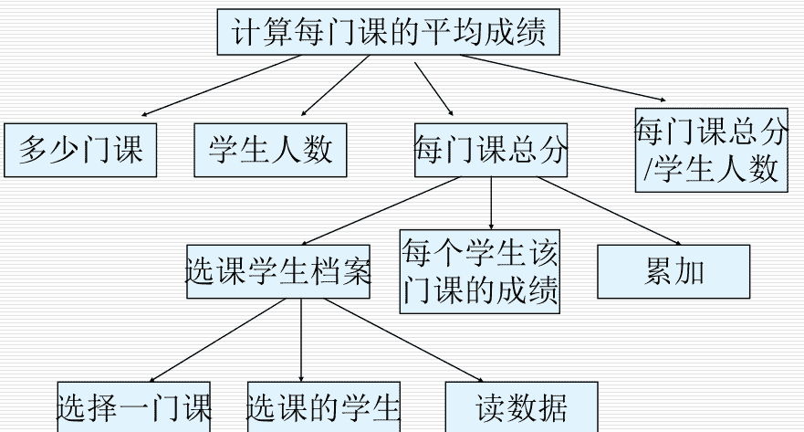

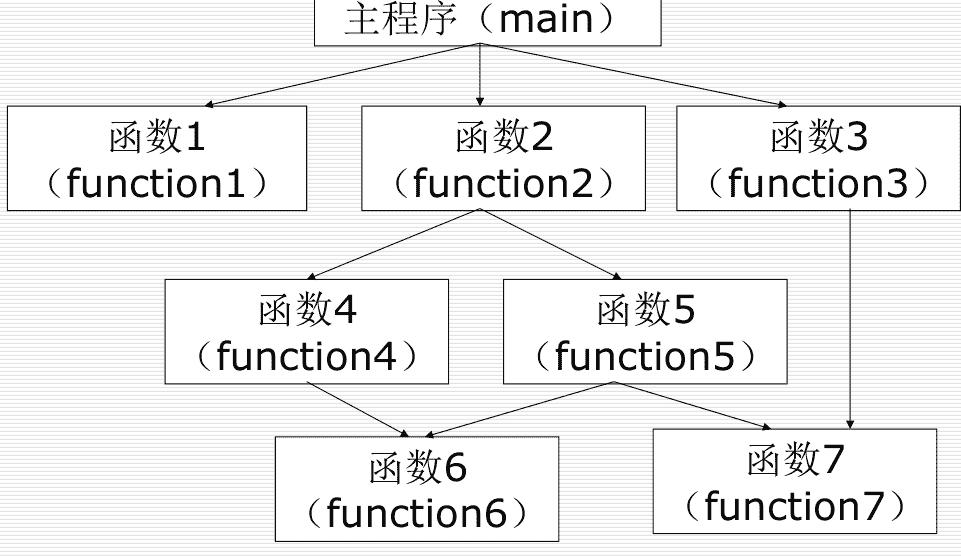

当我们集中精力开发函数的时候，很少会去注意那些被多个函数使用的数据（data）。在这些数据身上发生了什么事情？那些使用这些数据的函数又对它们产生了什么影响？
在多函数（multi-function）程序中，许多重要的数据被放置在全局数据区，这样它们可以被所有的函数访问。每个函数都可以具有它们自己的局部数据。

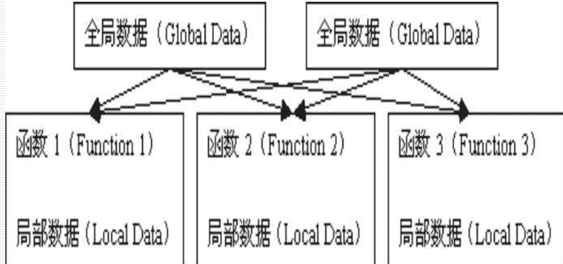

图 3

### 过程式

### 例：

从键盘输入一个学生的信息（包括姓名、年龄、性别、学号等）和一个老师的信息（包括姓名、年龄、性别、是否授课等），然后将信息输出到屏幕。

### 过程式

分析：

根据需求（题目要求），我们可以把问题划分为两个功能模块，一个是输入模块，一个是输出模块。

我们用C语言来写，参看下面的代码：

```
int main()
{
    // 主函数开始
    // 声明用于存储学生信息的变量
    char strStudentName[20];    // 学生姓名
    int  nStudentAge;           // 学生年龄
    char cStudentSex;           // 学生性别
    int  nStudentNumber;        // 学生学号

    // 声明用于存储老师信息的变量
    char strTeacherName[20];    // 老师姓名
    int  nTeacherAge;           // 老师年龄
    char cTeacherSex;           // 老师性别
    int  nIsTeaching;           // 是否授课

    // 输入模块
    GetStudentInfo(...);        // 输入学生信息
    GetTeacherInfo(...);        // 输入老师信息

    // 输出模块
    PrintStudentInfo(...);      // 输出学生信息
    PrintTeacherInfo(...);      // 输出老师信息
}
```

描述学生的数据

描述老师的数据

函数

函数

### 过程式

上面的例子中，我们可以进一步将属于学生和老师的变量放入结构中。这样可以在一定程度上完成对数据的封装。但在过程式程序设计中，数据与对其进行操作的函数仍是分离的。

```
// 声明学生结构Student
struct Student
{
    char strStudentName[20];      // 学生姓名
    int  nStudentAge;             // 学生年龄
    char cStudentSex;             // 学生性别
    int  nStudentNumber;          // 学生学号
};
// 声明老师结构Teacher
struct Teacher
{
    char strTeacherName[20];      // 老师姓名
    int  nTeacherAge;             // 老师年龄
    char cTeacherSex;             // 老师性别
    int  nIsTeaching;             // 是否教书
};
```

```
struct Window
{int height;

int weight;

long int color;
......
} window;

void MoveWindow(Window w);
void MinimizeWindow(Window w);
......

main()
{
......

MoveWindow(window); }
```

- 1、数据与操作相分离
- 2、程序由函数（操作）构成
- 3、程序的重心在函数（操作）上

### 问题

- □ 函数用于完成一定的功能，它们都是针对特定的数据进行操作的。那么我们能不能以特定的数据为中心，将数据与对其进行操作的函数封装起来呢？

### 对象式（面向对象）

- 面向对象程序设计出现在80年代中后期
- 面向对象程序设计不再是从功能入手，而是从对象（人、地方、事情等）入手

### 对象式（面向对象）

- □ 面向对象程序设计模拟自然界认识和处理事物的方法，将数据和对数据的操作方法放在一起，形成一个相对独立的整体——对象（object）[面向对象的程序设计就是由这些对象构造程序]，同类对象还可抽象出共性，形成类（class）。一个类中的数据通常只能通过本类提供的方法进行处理，这些方法成为该类与外部的接口。对象之间通过消息（message）进行通讯。

### 对象式（面向对象）

窗口

属性

```
int height;
int weight;
long int color;
```

方法

```
void Move();
void Minimize();
```

```
class Window
{private:
    int height;
    int weight;
    long int color;
public:
    void Move ();
    void Minimize ();
};
main()
{Window window;
window.Move();}
```

- 1、数据与操作结合
- 2、程序由对象构成
- 3、程序的重心在对象上

### 对象式（面向对象）

- 基本概念
  - 对象（object）
  - 类（class）
  - 消息（message）

#### 基本概念


对象

属性

- 表针
- 旋钮
- 其他机械机构

行为

调节旋钮


#### 基本概念
- 对象
  - 从语言实现层面来看，对象封装了代码和数据
  - 从概念层面讲，对象是某种拥有责任的抽象
    - 对象内包含数据，让它知道自己的状态
    - 对象内包含代码，让它可以适当地运行（做设计者希望它做的事）
  - 从规格层面讲，对象是一系列可以被其他对象使用的公共接口

#### 基本概念
### 类
类是一个抽象的概念，用来描述某一类对象所共有的、本质的属性和行为。


#### 基本概念
### 类
类是一个抽象的概念，用来描述某一类对象所共有的、本质的属性和行为。

类的一个具体实现，称为实例

类
对象
描述这类对象共有的、本质的属性和行为
具体到一只圆形的或方形的手表
手表
一块手表
手表共有的属性（表针、旋钮、内部结构）和行为（调节旋钮）

```cpp
class Window
{
private:
    int height;
    int weight;
    long int color;

public:
    void Move();
    void Minimize();
};
```

```cpp
main()
{
    Window window;
    window.Move();
}
```

#### 基本概念
消
息

我们把对象之间产生相互作用所传递的信息称做消息。

发送消息

接收并响应消息

启动


#### 基本概念
##### 消息
我们把对象之间产生相互作用所传递的信息称做消息。

发送消息

接收并响应消息

转向


### 对象式（面向对象）
- □ 面向对象程序设计特点
- ■ 封装性——隐藏内部实现
- ■ 继承与派生性——复用现有代码
- ■ 多态性——改写对象行为

#### “面向对象” 程序设计的特点
### 封装性
对象是一个封装体，在其中封装了该对象的属性和操作。通过限制对属性和操作的访问权限，可以将属性“隐藏”在对象内部，对外提供一定的接口，在对象之外只能通过接口对对象进行操作。


内
动作
机械零件
外
读表盘
调节旋钮


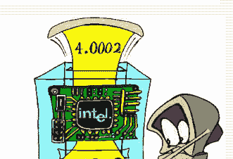

#### “面向对象” 程序设计的特点
### 封装性
把对象的全部属性和全部行为结合在一起，形成一个不可分割的独立单位。

信息隐藏，尽可能屏蔽对象的内部细节，对外部世界形成一个边界或屏障，只保留有限的公有对外接口，使之与外部世界发生联系。

#### “面向对象” 程序设计的特点

C++通过建立数据类型——类来支持封装和数据隐藏。封装性增加了对象的独立性，从而保证了数据的可靠性。一个定义完好的类可以作为独立模块使用。

## “面向对象”程序设计的特点
### 继承与派生
以汽车为例看客观世界描述事物的方式：

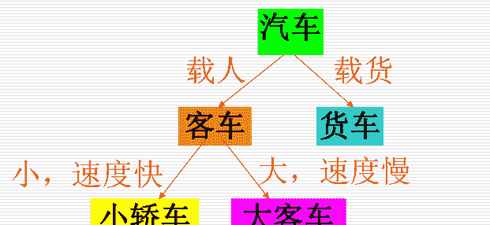

#### “面向对象” 程序设计的特点
### 继承与派生
面向对象程序设计提供了类似的机制：

当定义了一个类后，又需定义一个新类，这个新类与原来的类相比，只是增加或修改了部分属性和操作，这时可以用原来的类派生出新类，新类中只需描述自己所特有的属性和操作。

新类称为子类或派生类，原来的类称为基类。派生可以一直进行下去，形成一个派生树。

#### “面向对象” 程序设计的特点
### 继承与派生
继承性大大简化了问题的描述，大大提高了程序的可重用性，从而提高了程序设计、修改、扩充的效率。

# 继承与派生性——复用现有代码

#### “面向对象” 程序设计的特点

多态性指，同一个消息被不同对象接收时，产生不同结果，即实现同一接口，不同方法。

计算
平均成绩

语文、数学、英语、政治、物理、化学、生物

## “面向对象”程序设计的特点
#### 多态性
多态性指，同一个消息被不同对象接收时，产生不同结果，即实现同一接口，不同方法。


#### “面向对象” 程序设计的特点
#### 多态性
多态性指，同一个消息被不同对象接收时，产生不同结果，即实现同一接口，不同方法。

多态性——改写对象行为

### C++语言的产生
- C++是从C语言发展演变而来的。
- 引入了类的机制，最初的C++被称为"带类的C"。
- 1983年正式取名为C++。


Bjarne Stroustrup

### C++语言的产生
- 为了使C++具有更好的可移植性，美国国家标准局（American National Standards Institute，ANSI）于1990年设立了ANSI X3J16委员会专门负责制定C++标准。
- 不久，国际标准化组织ISO也成立了自己的委员会，负责制定C++标准。
- 同年，ANSI和ISO将两个委员会合并，共同合作进行C++标准化工作，委员会称ANSI/ISO。

### C++语言的产生
- 1998年，经过委员会的不懈努力，C++的国际标准（ISO/IEC）获得了ISO、IEC（International Commission，国际电工技术委员会）和ANSI的批准，这是第一个国际C++标准，称为标准C++或ANSI/ISO C++。
- 2003年，委员会制定并发布了C++标准第2版。

### C++语言
C++语言
支持面向过程
和面向对象的
程序设计语言

C语言
支持面向过程的
程序设计语言

C++不是一个纯面向对象的程序设计语言

### C++语言
- □ 打着面向对象的幌子干着面向过程的勾当！
- ■ C++ 编译器对 C 程序的兼容性造成了最底层的 “过程勾当”。
- ■ 实际上用 C++ 编程的人，大部分不自己创建类，而是使用类库，这样就造成了他们把类库作为一种高级的函数库来理解，并没有真正理解面向对象的思想。
- ■ C++ 给了我们第二条道路去走过程编程

### C++语言和面向对象程序设计
- 程序设计基础
- 结构化程序设计
- 面向对象程序设计
- 程序健壮性设计


### 控制台(console)应用程序
- DOS-like程序。
- 以main函数为入口点。
- Console窗口将成为其标准输入和输出装置。
- 仍然可以调用部分的、不牵扯到图形使用者接口（GUI）的Win32 API（尤其是KERNEL.DLL模块所提供的那一部分），所以它可以使用Windows提供的各种高级功能，它可以产生进程，产生线程。甚至还可以在其中使用部分的MFC类（同样是与GUI没有关联的），例如处理数组、链表等数据结构的collection classes（CArray,CList）、与文件有关的CFile、CStdioFile。

### 第一个C++程序 — HelloWorld
该程序在控制台输出一个字符串

```
#include <iostream.h>

int main()
{
cout<<"Hello World"<<endl;
return 0;
}
```

### 第二个C++程序 － 还是HelloWorld

该程序在控制台输出一个字符串

```cpp
#include <iostream>
using namespace std;

int main()
{
    cout<<"Hello World"<<endl;
    return 0;
}
```

### 分析我们的Hello World

- □ #include <iostream>
  - ■ 预处理命令 “#”
- □ using namespace std;
  - ■ 引用std名字空间

## C++头文件

C++标准库的程序实体是在名字空间std中定义的，在C++程序，如果包含的是相应的C++的头文件，则应通过名字空间std来使用这些功能。

C++标准库包含了C语言和针对C++提供的新功能，其头文件定义如下：
C标准库提供的头文件，在C++标准库中也提供了相应的头文件，文件名的约定是：把C标准库头文件名的.h去掉，然后在文件名前加一个字母c。
比如stdio.h 变为 cstdio
C++提供的新功能的头文件，去掉.h后缀，并放入std名字空间，比如 iostream.h 变为 iostream。

现在很多的C++实现为了保证与C语言的兼容性，往往同时提供了两套头文件。但注意：在VC++6.0的C++标准中，从C标准包含进来的功能并没有在名字空间std中定义。

##### 分析

- ☐ **void main()**
  - 程序入口点
- ☐ **cout<<"Hello World"<<endl;**
  - **cout**: 标准输出流对象，作用相当于 printf
  - **<<**：插入符，将后面的内容插入到cout中，即输出到屏幕上。
  - **endl**: end of line

## 输出

- cout流输出
  - 格式
    - cout<<输出数据;
    - 可以连续输出
      - cout<<a<<b<<c<<endl;
  - 功能
    - cout可以输出字符、整数、浮点数和字符串
    - 类似printf函数

## 输入

- □ cin流输入
  - ■ cin: 标准输入流对象，作用相当于scanf
  - ■ >>: 提取符，将用户输入的内容保存到后面的变量中。
  - 格式
    - cin>>输入数据;
    - 可以连续输入（空白符：空格、横向制表符或回车符作为输入数据之间的分隔符）
      - cin>>i>>j>>k;
  - 功能
    - 输入字符、整数、浮点数和字符串
    - 类似scanf函数

### C++语言和面向对象程序设计

- 程序设计基础
- 结构化程序设计
- 面向对象程序设计
- 程序健壮性设计


### 第二章 程序设计基础

- ☐ 基本C++语法格式
- ☐ 数据类型
- ☐ 运算符和表达式
- ☐ 基本语句

#### 内容

- 基本C++语法格式
- 数据类型
- 运算符和表达式
- 基本语句

#### 2.1 基本C++语法格式

- C++是严格区分大小写的
- C++是一种自由格式的语言

> 用C++语言编程时，程序的书写非常自由，甚至可以把整个函数体全部书写在一行上。但这样做，对人来说，如果程序稍长一点，就难理解了。

良好编程习惯： 较长的语句可分割成几行，如果必须这样分割一条语句，请挑选最合适的断点。比如对一个用逗号分割的列表来说，可选择在某个逗号之后断开；对于较长的表达式，可考虑在一个运算符之后断开，等等。一个语句分割成多行后，除第一行之外，其他所有行都进行缩进处理。


良好编程习惯：对于缩进的尺度，约定一个你喜欢的大小，然后始终如一的应用它。Tab键可用于产生缩进，但是制表间距可能会不一样。我们建议使用1/4in(1in=2.54cm)的制表间距，或者（更适宜地）用3个空格大小构成一个缩进级别。

##### C++程序的注释

- 作用：提高程序的可读性；调试程序
- `//` 和 `/* ... */`

> 软件编码规范中说：“可读性第一，效率第二”。在程序中必须包含适量的注释，以提高程序的可读性和易维护性，程序注释一般占程序代码总量的20%-50%。

```
// Program: Display greetings
// Author(s): Ima Programmer
// Date: 1/24/2001
```


> 良好编程习惯：每个程序都应该以注释开头，用于描述该程序的用途、作者、日期和时间。

```cpp
// Program: Display greetings
// Author(s): Ima Programmer
// Date: 1/24/2001
#include <iostream>
using namespace std;

int main()
{
    cout << "Hello world!" << endl;
    return 0;
}
```

##### C++中的标识符

标识符是用来表示变量名、函数名、数组名、类名等的有效字符序列。标识符命名要遵守合法性、有效性和易读性原则。


良好编程习惯：选择有意义的标识符，将有助于程序的“自我注解”——人们不需要求助手册或注释，只要看程序就能理解程序。

良好编程习惯：避免使用以下划线和双下划线开头的标识符，因为C++编译器可能采用这种形式的名称作为内部使用。

可移植性提示：C++语言本身允许任意长度的标识符，但你的系统和/或具体的C++实现有可能对标识符的长度进行了某种限制。因此，请使用31个字符以内的标识符，以保证可移植性。

#### 内容

- 基本C++语法格式
- 数据类型
- 运算符和表达式
- 基本语句

#### 2.2 C++数据类型

数据是程序处理的对象，在C++语言中，所有的对象都属于某种数据类型。

数据类型的分类

- 基本数据类型
- 派生类型
  - 指针
  - 引用
- 复合类型（数组、类、结构体、共用体、枚举）

##### 基本数据类型

- 整型（int）
- 字符型（char, wchar_t）
- 浮点型（实型）（float,double）
- 逻辑型（布尔型）（bool）
- 空值类型（void）:用于函数和指针

为了更加准确地描述数据类型，提供了4个关键字用来修饰基本的数据类型，分别是 short、long、unsigned和signed。

##### 常量

在程序中，有些数据在运行期间是不允许改变的，我们称之为常量。

常量的两种表示形式：

- 字面常量 —— 程序中直接写出常量值的常量。
- 符号常量

##### 整型常量

整型常量就是以文字形式出现的整数，包括三种形式。各种表示形式前均可加上正或负号以表示它们值的正负，正号可以省略。

| 形式 | 组成 | 举例 | 备注 |
| --- | --- | --- | --- |
| 十进制 | 由若干个0～9的数字组成，但不能以0开头 | 1980, -50 | L（或l）表示长整型，U（或u）表示无符号型，如果后缀包括L（或l）和U（或u）则表示无符号长整型。 |
| 八进制 | 以0开头，由若干0～7的数字组成 | 010, -0276 | L（或l）表示长整型，U（或u）表示无符号型，如果后缀包括L（或l）和U（或u）则表示无符号长整型。 |
| 十六进制 | 以0X或0x开头，由若干0～9的数字及A～F（大小写均可）的字母组成 | 0x1Fa, -0X4Ab | L（或l）表示长整型，U（或u）表示无符号型，如果后缀包括L（或l）和U（或u）则表示无符号长整型。 |


| 形式 | 组成 | 举例 | 备注 |
|---|---|---|---|
| 一般表示 | 又称小数表示形式。使用这种表示形式时，实型常量由整数和小数两部分组成。其中的一部分在实际使用时可省略，但不允许两部分同时省去。 | 10.2, 10., .2 | 默认数据类型为 double型，如果加上后缀F（或 f）则为 float型，加上L（或 l）则为 long double型。 |
| 指数表示 | 表示很大或很小的实数，由尾数部分、字母E（或 e）、指数部分三部分组成。尾数部分的表现和一般表示形式相同，指数部分必须是整数，但可正可负，当指数大于零时，正号可省。 | 1.2E2 0, .24 e100, | 默认数据类型为 double型，如果加上后缀F（或 f）则为 float型，加上L（或 l）则为 long double型。 |

##### 字符常量

+   字符常量通常是指用单引号括起来的一个字符，其数据类型是char。其中单引号只是用来说明被它括起来的字符是字符常量，它本身不是字符常量的内容。如：'a', '#', 'G'

+   C++语言中，还有一种转义序列的表示方法可用来表示字符常量

##### 字符常量

在书写字符常量时，可显示字符通常用字符本身来书写，而不可显示字符（控制字符）和有专门用途的字符用转义序列表示。另外，对于下面的字符要特别注意：

+   - 反斜杠（\）应写成 ‘\\’
+   - 单引号（‘）应写成 ‘\'’
+   - 双引号（“）应写成 ‘\"’或 ‘”’

##### 字符串常量

字符串和宏定义一行写不下需要续行时需用续行符\。

```
"this is a string!\
mnp"
```

```
#define CONTAINING_RECORD(address, type, field) ((type *)(\
(PCHAR)(address) - \
(UINT_PTR)(&((type *)0)->field)))
```

##### 符号常量

符号常量是指有名字的变量。在程序中使用常量时，除了采用字面常量形式外，还可以首先通过常量定义给常量取一个名字，并指定一个类型，然后，在程序中通过常量名来使用这些常量。

##### 符号常量

+   □ C语言中声明符号常量的方法

+   ■ 用#define声明符号常量

+   ■ #define pi 3.1415926

+   □ C++语言中广泛采用的声明符号常量的方法

```
const 数据类型  常量名=常量值;
或：
数据类型 const  常量名=常量值;
```

|  | 用const声明符号常量 | 用#define声明符号常量 |
|---|---|---|
| 解释 | C++语言中广泛采用的声明符号常量的方法 | C语言中声明符号常量的方法。其中#define是预处理指令。缺点是不能显式声明常量的类型。 |
| 形式 | const 数据类型 常量名=常量值； 或： 数据类型 const 常量名=常量值； |  |
| 正确声明 | const double pi=3.1415926; | #define pi 3.1415926 最后不允许加 “；” |
| 错误声明 | const double pi; //错误 pi=3.1415926; //错误 |  |

##### 符号常量

**const**定义的符号常量可以看作是一个只读变量，**不可在程序中修改它的值**。定义时必须初始化。

bool类型的值true和false可以看成是C++语言预定义的两个符号常量，它们的值分别为1和0。

##### 变量

有些数据在程序运行过程中是可以改变的，我们称之为**变量**。

一个变量对应着计算机中的一组内存单元，这组内存单元在C++语言中用一个标识符来标识，即**变量名**。

##### 变量定义

+   □ 任何一个变量在被引用之前必须定义。与C语言不同的是C++可以在程序中随时定义变量，不必集中在执行语句之前。

良好编程习惯：每个逗号(,)后都应该插入一个空格，以增强程序可读性。


##### 变量的初始化

程序中常需要对一些变量预先设置初值，这一过程称为初始化。在C/C++中，可以在定义变量时同时使变量初始化。

C++变量的初始化还有另外一种形式，它与C语言不同。例如：

```
int nX(1), nY(3);
```

表示nX和nY是整型变量，它们的初值分别为1和3。

#### 内容

+   - 基本C++语法格式
+   - 数据类型
+   - 运算符和表达式
+   - 基本语句

#### 2.3 运算符和表达式

+   - 同C语言（算术、关系、逻辑、位、赋值、sizeof、条件、逗号）
+   - 操作数的类型转换（隐式、显式）
+   - 注意运算符的优先级和结合性


> 良好编程习惯：在二元运算符的两端分别添加一个空格。这样可突出显示运算符，增强程序可读性。

#### 2.3 运算符和表达式


良好编程习惯：在编写含有多个运算符的表达式时，务必参考运算符优先级表。如果表达式过于复杂，无法确定顺序，可将表达式分割成几个小语句，或者干脆用括号强行规定顺序。

#### 2.4 基本语句

分类
简单语句
表达式语句
转移语句
  goto语句
  break语句
  continue语句
  return语句
空语句
结构语句
复合语句
选择语句
  if语句
  switch语句
循环语句
  while语句
  do-while语句
  for语句

### 第三章 结构化程序设计

+   - [ ] 函数
+   - [ ] 数组
+   - [ ] 指针和引用
+   - [ ] 其他复合数据类型

#### 本章要求

+   - 目标：回顾C++与C相同部分知识点，掌握不同部分
+   - 知识点
+     - 内联函数
+     - 变量的存储分配
+     - C++程序的多模块结构
+     - 标识符的作用域

#### 本章要求（续）

+   - 知识点
+     - 带默认参数值的函数
+     - 函数重载
+     - 动态变量
+     - 指向常量的指针和指针常量
+     - 引用

#### 内容

+   - □ 函数
+   - □ 数组
+   - □ 指针和引用
+   - □ 其他复合数据类型

#### 3.1 函数

+   - 函数是一个能完成某一独立功能的子程序，也就是程序模块。
+   - 每个C++程序至少包含一个函数，即main函数（主函数）。

#### 3.1 函数（续）

在面向过程的程序设计中，一个较为复杂的程序一般通过模块化，分解成主模块与若干子模块的组合，即一个主函数与若干子函数。程序是以函数为单位，由一个或多个函数组成的。

在面向对象的程序设计中，一个 C++程序是由类的实例（对象）构成。函数主要用于定义对象的操作接口。

#### 3.1 函数（续）

在面向过程的程序设计中，一个C++程序由一个或多个函数组成。当程序开始运行时，系统自动调用主函数。主函数可以调用子函数，子函数还可以调用其他子函数。

调用其他函数的函数称为主调函数，被其他函数调用的函数称为被调函数。

#### 3.1 函数（续）

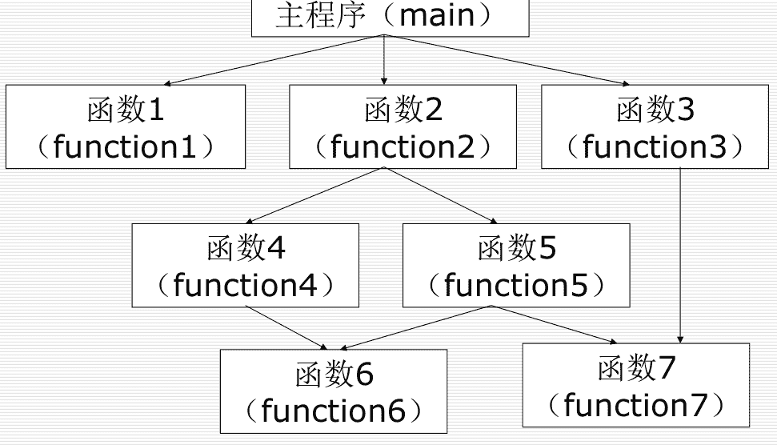

##### 函数的定义

在C++程序中，定义一个函数的格式如下：

```
类型 函数名（形式参数表）
{
    语句序列
}
```

该函数类型，即该函数返回值的类型。

##### 函数的定义

形式参数表由0个、1个或多个参数组成，内容如下：

类型1 形式参数名1，类型2 形式参数名2，
..., 类型n 形式参数名n

没有形参的函数，可以在形参表的位置填上void或保留空白，但形参表两边的圆括号不可省略。

##### 函数的定义示例

```
double rectanglearea(double a,double b)
{
    double s;
    s=a*b;
    return s;
}
```

##### 函数定义注意：

每个函数都是一个功能独立的模块，绝对不允许在一个函数体内定义另一个函数。

##### 函数的声明

声明函数，一般采用声明函数原型。
形式如下：

```
类型 函数名（形式参数表）;
```

函数原型中的类型、函数名和形参表必须与定义该函数时完全一致，但函数原型中可以不包含参数名，而只包含形参的类型。

例如：

```
double rectanglearea(double a, double b);
double rectanglearea(double, double);
```


##### 函数的调用

除主函数main由系统自动调用外，其他函数都由主函数直接或间接调用的。

函数的调用的一般形式如下：
函数名（实际参数表）

程序中调用的所有函数都要有定义，如果函数定义在其他文件中（如C++的标准库）或定义在本源文件使用点之后，则在调用前需要对被调用的函数进行声明。

##### 函数的调用

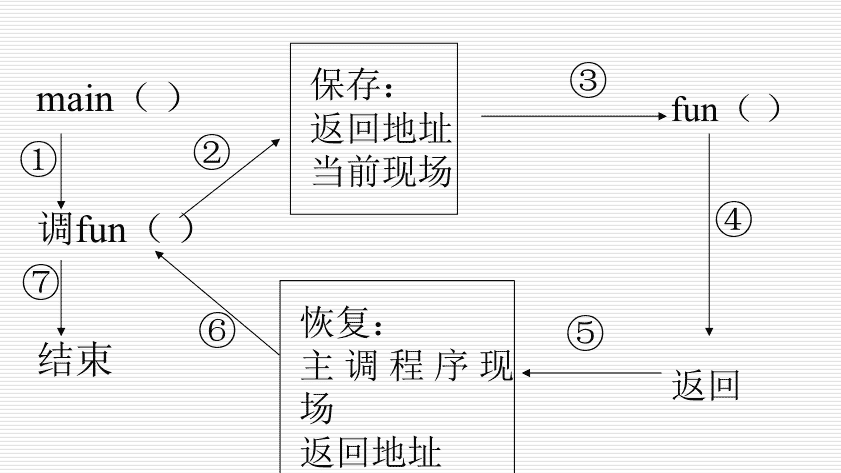

##### 进程内存空间

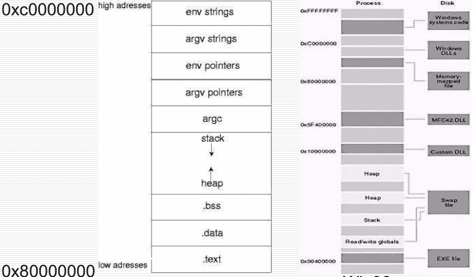

Linux

Win32

栈底

较早的帧

参数n

调用者的帧

参数1

返回地址

帧指针 %ebp

被保存的%ebp

被保存寄存器、本地变量和临时变量

当前帧

栈指针 %esp

参数构造区域

栈顶

地址增大

##### 函数的调用

- 函数调用过程的三个步骤
- 调用参数和返回地址（当前EIP）压栈，当前EBP压栈
- 跳转到函数入口，开始执行被调函数
- 恢复调用者原有栈，并跳到堆栈中保存的返回地址

##### Windows系统的栈

低地址方向
其他数据，例如被调函数的局部变量
EBP
EIP
被调函数参数
其他数据，例如上层函数的局部变量
SHE指针
高地址方向

##### 函数调用过程示例

```
3 int func(int a, int b){
4   int retVal = a + b;
5   printf("b: 0x%08x\n", &b);
6   printf("a: 0x%08x\n", &a);
7   printf("ret addr here: 0x%08x\n", &a-1);
8   printf("stored ebp here: 0x%08x\n", &a-2);
9   printf("retVal: 0x%08x\n\n", &retVal);
10  return retVal;
11 }
12 int main(int argc, char* argv[])
13 {
14   int result = func(1, 2);
15   return 0;
16 }
```

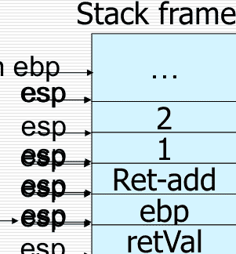

##### 缓冲区溢出

- 缓冲区（buffer）
  - 用于临时存储数据的一段内存区域
  - `char buffer[256];`
  - `buffer=malloc[64];`

- 溢出（overflow）
  - 数据过长导致无法存储在预期区域内，覆盖了存储其他数据的区域
  - `strcpy(smallBuffer,bigString)`

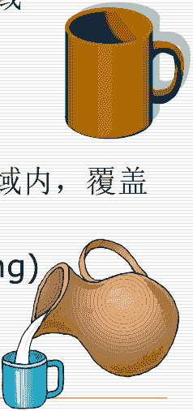

##### 缓冲区溢出

- **缓冲区溢出**：当计算机向缓冲区内填充数据时超过了缓冲区本身的容量，溢出的数据覆盖到了合法数据上。

##### 缓冲区溢出

- □ 缓冲区溢出分类
  - ■ 栈缓冲区溢出(stack overflow)
    - □ 溢出发生在栈内存中
    - □ 覆盖栈结构
  - ■ 堆缓冲区溢出(heap overflow)
    - □ 溢出发生在堆内存中
  - □ 覆盖指定的四字节指针

##### 栈缓冲区溢出

一个典型的问题程序

```
void vulfunc(char *str){
    char buffer[8];
    strcpy(buffer,str);
}
void main(int argc,char **argv){
    if(argc>1)
        vulfunc(argv[1]);
}
```

##### 栈缓冲区溢出

```
#include <stdio.h>
#include <conio.h>
#include <stdlib.h>
void wh
{printf
exit(
}
void f(
{int bu
buf[2]
}
void main(int argc,char *argv[])
{f();}
```

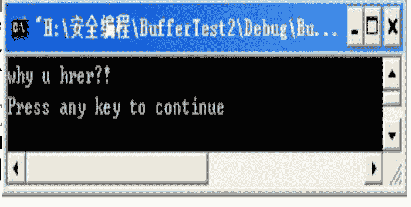

##### 栈缓冲区溢出

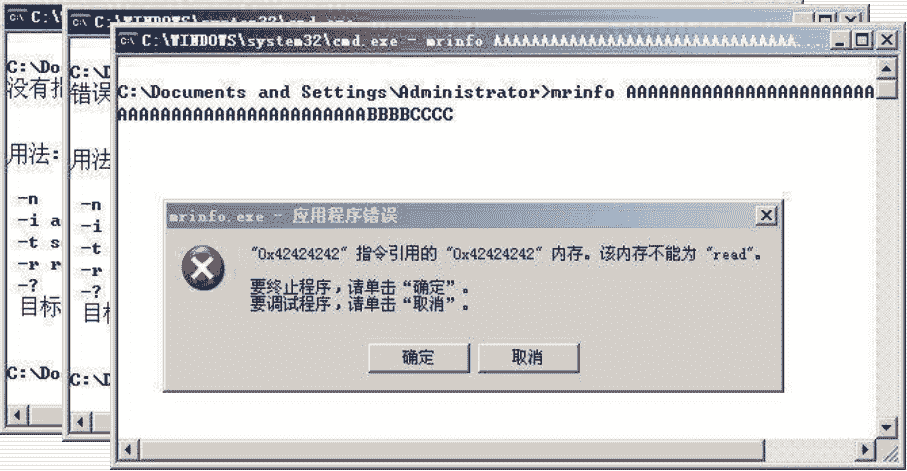

##### 栈缓冲区溢出

- 安全函数

- 可以限制所操作的数据长度，正确使用则不会导致缓冲区问题的函数

- strncpy(),memcpy(),snprintf(),strncat(),...

```
strncpy(DstBuffer,SrcBuffer,sizeof(DstBuffer)-1);
```

##### 栈缓冲区溢出

- □ 没有正确地使用安全函数
  - ■ strcpy(DstBuffer,SrcBuffer,sizeof(SrcBuffer)-1)
  - ■ strncpy等字符串截断拷贝函数的陷阱
    - □ 如果源字符串长度大于或等于限定长度参数，strncpy会按照限定长度拷贝到目标，但并不会在最后加上字符串结束符‘\0’
    - □ 这个陷阱可能导致不易察觉的缓冲区溢出

##### 栈缓冲区溢出

- - □ 边界检查（Boundary Check）
  - ■ 在向缓冲区中存储数据时，确定数据长度是否会超出缓冲区边界

```
if(sizeof(SrcBuffer)<sizeof(DstBuffer))
    strcpy(DstBuffer,SrcBuffer);
else
    printf("DstBuffer is too small.\n");
```

##### 缓冲区溢出存在的原因

- - 没有使用安全函数，也没有进行边界检查
- - 没有正确地使用安全函数
- - 设计和计算失误
- - MultiByteToWideChar()

##### 缓冲区溢出的后果

- - 攻击者使远程服务程序或者本地程序崩溃
- - 攻击者以被攻击的程序运行时的身份执行任意代码
- - 攻击者控制远程系统

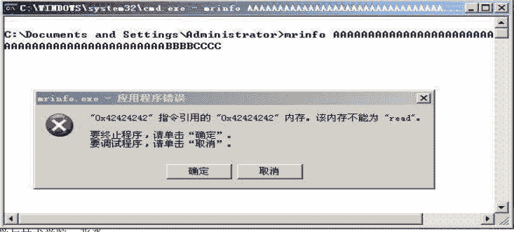

##### 函数的调用

##### 实参与形参结合方法

- - 传值调用: 简称值调用（默认）。
- - 传址调用
- - 引用调用

##### 例：输入两整数交换后输出

```
#include<iostream.h>
void Swap(int a, int b);
int main()
{
    int x(5), y(10);
    cout<<"x="<<x<<"      y="<<y<<endl;
    Swap(x,y);
    cout<<"x="<<x<<"      y="<<y<<endl;
    return 0;
}
```

##### 例：输入两整数交换后输出

```
void Swap(int a, int b)
{
    int t;
    t=a;
    a=b;
    b=t;
}
```

运行结果：

x=5    y=10
x=5    y=10

##### 例：输入两整数交换后输出

```
void swap(int *a,int *b)
{
    int temp;
    temp = *a; *a = *b; *b = temp;
}
void main()
{
    int m = 3,n = 5;
    swap(&m,&n);
    cout<<"m="<<m<<" n="<<n<<endl;
}
```

##### 数组作为函数参数

- - 数组元素作实参，与单个变量一样。

- - 数组名作参数，形、实参数都应是数组名，类型要一样，传递的是数组首地址。
+ 对形参数组的改变会直接影响到实参数数组。

##### 思考

程序的执行过程中，调用函数时先要保存主调函数的现场和返回地址，然后程序转移到被调函数的起始地址继续执行。被调函数执行结束后，先恢复主调函数的现场，取出返回地址并将返回值赋给函数调用本身，最后在返回地址处开始继续执行。当函数体比较小时，且执行的功能比较简单时，这种函数调用方式的系统开销相对较大。


##### 内联函数

在程序编译时，编译系统将程序中出现内联函数调用的地方用函数体进行替换。由于在编译时将函数体中的代码被替代到程序中，因此会增加目标程序代码量，进而增加空间开销，而在时间开销上不象函数调用时那么大，可见它是以目标代码的增加为代价来换取时间的节省。

注 内联函数的使用会增加程序的代码量。

内联函数一般来说仅适用于只有一、两条语句的小函数。

##### 内联函数

内联函数的定义：在函数定义时，在函数类型前增加关键字inline。

```
形式如下：
inline 类型 函数名（形参表）
{
......//函数体
}
```

说明：仅在声明函数原型时加上关键字inline，并不能达到内联效果。

##### 内联函数示例

```
#include<iostream.h>
inline double CalArea(double radius)
{
    return 3.14*radius*radius;
}
int main()
{
    double r(3.0);
    double area;
    area=CalArea(r);
    cout<<area<<endl;
    return 0;
}
```

##### 注意

(1) 对于内联函数，编译程序并不生成独立的函数代码，而是用内联函数的函数体来替换对内联函数的调用。因此，在调用内联函数时一定要见到内联函数的定义，仅仅对其声明是不行的。

##### 注意

+   (2) 需要定义成的内联函数不能含有循环、switch和复杂嵌套的if语句。

+   (3) 递归函数是不能被用来做内联函数的。

+   (4) 编译器是否将用户定义成的内联函数作为真正的内联函数处理由它自行决定。

##### 注意

(4) 内联函数名具有文件作用域，在一个文件中定义的内联函数对于另一个文件是不可见的。对于一个多文件结构的程序，如果在一个源文件中定义了一个内联函数，而在另一个源文件中对其声明并使用，这将导致程序连接时刻的错误。

##### 练习

在 一个函数中，要求通过函数来实现一种不太复杂的功能，并且要求加快执行速度，选用（ ）合适。

+   A. 内联函数
+   B. 重载函数
+   C. 递归调用
+   D. 嵌套调用

##### 全局变量与局部变量

在C++中，根据变量的定义位置，把变量分为全局变量和局部变量。全局变量是指定义在函数外部的变量，它能被所有函数使用。局部变量是指在复合语句（函数）中定义的变量，它们只能在定义它们的复合语句（包括内层的复合语句）中使用。

##### 全局数据 (Global Data)

##### 全局数据 (Global Data)

##### 函数 1 (Function 1)

局部数据 (Local Data)

##### 函数 2 (Function 2)

局部数据 (Local Data)

##### 函数 3 (Function 3)

局部数据 (Local Data)

##### 图 3

##### 全局变量与局部变量

全局变量可以定义在函数外的任何地方，如果在使用一个全局变量时未见到它的定义，则在使用前需要对该全局变量进行声明。

变量声明格式：

extern <类型名> <变量名>;

+   变量定义要给变量分配空间，变量声明则否。
+   在整个程序中，一个变量的定义只有一个，而该变量的声明可以有多个。

##### 全局变量与局部变量

局部变量可以放在复合语句的任何位置，但是，在复合语句中局部变量定义之前不能使用他们。

```
int main()
{
    ...x...  //error
    int x;
    ...x...  //ok
}
```

##### 变量的存储分配（生存期）

变量是**内存空间**的一种抽象，程序中定义的每个变量在程序运行时刻都有与之对应的**内存空间**。

但是，何时给变量分配空间以及相应空间分配在哪里？这要视变量的性质而定。通常把程序运行时一个变量占有内存空间的时间段称为该**变量的生存期**。


##### 进程内存空间

+   - env strings
+   - argv strings
+   - env pointers
+   - argv pointers
+   - argc
+   - stack
+   - heap
+   - .bss
+   - .data
+   - .text

+   - Process
+   - Disk:
+     - Windows systems code
+     - Windows DLLs
+     - Memory mapped file
+     - MFC42 DLL
+     - Custom DLL
+   - Heap
+   - Stack
+   - Readwrite globals
+   - EXE file

0xc0000000 high addresses

0x800000000 low addresses

##### 变量的三种生存期

+   - **静态**

内存空间从程序开始执行就进行分配，直到程序结束才收回。**全局变量具有静态生存期。**

+   - **自动**

内存空间在程序执行到它们所在的复合语句（函数）时才分配，当定义它们的复合语句执行结束时，它们的空间将会收回。局部变量和函数的参数一般具有自动生存期。

+   - **动态**

内存空间用new操作分配、用delete操作收回。

##### 变量的三种生存期

另外，在定义局部变量时，可以为它们加上存储类型修饰符auto、static或register来指定它们的生存期。

##### 变量的三种生存期

+   - 局部变量的默认存储类型为auto，即定义局部变量时，如果未指定存储类，则其存储类为auto。定义为auto存储类的局部变量具有自动生存期;
+   - 定义为static存储类的局部变量具有静态生存期;
+   - static存储类的局部变量的作用是它能在函数调用时获得上次调用结束时该局部变量的值。

```
#include <iostream.h>
int z=0;
void f()
{int x=0;
    static int y=0;
    x++;
    y++;
    z++;
cout<<"x="<<x<<",y="<<y<<",z="<<z<<endl;
}
```

```
void main()
{
    f();
    z++;
    f();
}
```

##### 变量的三种生存期

定义为**register**存储类的局部变量也具有自动生存期。它与**auto**存储类的局部变量的区别是： **register**存储类是**建议**编译程序把相应的局部变量的空间分配在**CPU**的寄存器中，目的是为了提高对局部变量的访问效率。

##### 变量的三种生存期

当一个程序准备运行时，操作系统将为其分配一块内存空间，其中包括四个部分：静态数据区（static code）、代码区（code）、栈区（stack）和堆区（heap，或称自由存储区, free store）。

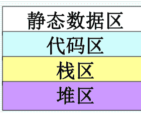

程序内存分配示意图

静态数据区用于全局变量、 **static** 存储类的局部变量。

代码区用于存放程序的指令，对 **C++** 程序而言，代码区存放的是所有函数代码；

栈区用于 **auto** 存储类的局部变量、函数的形式参数以及函数调用时的有关信息（如函数返回地址等）的内存分配；

堆区用于动态变量的内存分配。

|  |
|---|---|
| 静态数据区 |
| 代码区 |
| 栈区 |
| 堆区 |

##### 变量的初始值

+   - 全局变量、static存储类的局部变量（存放在静态数据区的变量）在变量定义时有默认值。int型为0，浮点型为0.0，char型为空。
+   - auto存储类的局部变量在定义时没有值，此时是一个不可预料的值，因此我们必须在使用前对它进行赋值或初始化。

##### 注意

全局变量，是在main()函数执行前就分配好了的。


##### C++程序的多模块结构

逻辑上，一个C++程序由一些全局函数（区别于类定义中的成员函数）、全局常量、全局变量/对象以及类的定义构成，其中必须有且仅有一个main的全局函数。函数内部还可以包含形参、局部常量、局部变量/对象的定义以及语句。

C++函数内部不能再定义函数。


##### C++程序的多模块结构

+   为了便于组织、管理理解 **C++** 程序，特别是为了避免对程序的一点修改导致对整个程序的重新编译和便于多人合作开发一个程序
+   在物理上我们通常可以按照某种规则对构成 **C++** 程序的若干逻辑单位（全局函数、全局常量、全局变量/对象、类等）进行分组，分别把它们放到若干源文件中。编译程序对每个源文件分别进行编译

分组的原则是按照模块进行，一个模块一般包含两部分：接口和实现。接口给出在本模块中定义的、提供给其他模块使用的一些程序实体（如函数、全局变量等）的声明；模块的实现给出了模块中实体的定义。

在C++中，一个模块通常由两个源文件构成，一个是.h文件，用于存放模块接口的定义；另一个是.cpp文件用于存放模块的实现。在一个模块中要用到另一个模块中定义的程序实体时，需要在前者的.cpp文件中用文件包含命令把后者的.h文件包含进来。

##### 编译预处理命令——文件包含

在编译前，用命令中的文件名所指定的文件内容替换该命令。

```
#include <文件名>
#include “文件名”
```

<>在系统指定的目录下寻找指定文件；

“”先在包含#include命令的源文件所在目录下查找指定文件，然后再在系统指定的目录下寻找指定的文件。

##### 标识符的作用域

C++根据程序的结构和标识符定义的位置，为每一个定义的标识符规定了一个作用域。标识符的作用域是指一个定义了标识符的有效范围，即该标识符所标识的程序实体能被访问的程序段。

C++把标识符的作用域分成若干类，其中包括：局部作用域、全局作用域、文件作用域、函数作用域、函数原型作用域、类作用域和名空间作用域。

当标识符的作用域完全相同时，不允许出现相同的标识符名。而当标识符具有不同的作用域时，允许标识符同名。

##### 局部作用域（块作用域）

局部作用域指在函数定义或复合语句中，从标识符的定义点开始到函数定义或复合语句结束之间的程序段。

C++中的局部常量名、局部变量名/对象名以及函数的形参名具有局部作用域。

局部实体定义前可以有语句，但这些语句不在相应标识符的作用域内，从而不能使用后面定义的标识符。

如果一个标识符的局部作用域中包含其它复合语句（内层复合语句），并且在该内层复合语句中定义了一个同名的不同实体，则外层定义的标识符的作用域应该是从其作用域中扣除内层同名标识符的作用域之后得到的作用域。

##### 全局作用域

全局作用域指构成C++程序的所有源文件，具有全局作用域的标识符称为全局标识符。

全局变量名/对象名、全局函数名和全局类名的作用域一般具有全局作用域。它们在整个程序中可用。

使用全局标识符时，若该标识符的定义点在其他源文件中或在本源文件中使用点之后，则在使用前需要声明它。

通常，把全局标识符的声明放在某个.h文件中，在需要使用这些全局标识符的源文件中使用 #include 编译预处理命令把声明文件包含进来。

##### 文件作用域

文件作用域指单独的源文件。

在全局标识符的定义中加上 static 修饰符，则该全局标识符就成了具有文件作用域的标识符，它们只能在定义它们的源文件中使用。

在函数外用 const 定义的常量名具有文件作用域。

##### 注意

C++中的关键词**static**有两个不同的含义。在局部变量的定义中，**static**修饰符用于指定局部变量采用静态存储分配；而在全局标识符的定义中，**static**修饰符用于把全局标识符的作用域改为文件作用域。


##### 函数作用域

函数作用域是指由整个函数定义所构成的程序段。

语句标号是唯一具有函数作用域的标识符，可以在定义它们的函数体的任何地方访问它们。

##### 函数作用域与局部作用域的区别

-   函数作用域包括整个函数，而局部作用域是从定义点开始到函数定义或复合语句结束。
-   在函数体中一个语句标号只能定义一次，即使在内层的复合语句中，也不能再定义与外层相同的语句标号。
-   C++把语句标号作为一种特殊的标识符看待，它与其他种类的标识符属于不同的范畴，因此，语句标号的作用域可以和同名的其它标识符的作用域重叠。

##### 函数原型作用域

函数原型作用域是指用于函数声明的函数原型，其中的形参名（如果给出）的作用域从函数原型开始到函数原型结束，即在函数原型声明中的左、右括号之间。

在函数原型中声明的标识符可以与函数定义中说明的标识符名称不同。

##### 练习

下列的标识符中，（ ）是函数作用域的。

-   A. 函数形参
-   B. 语句标号
-   C. 外部静态类标识符
-   D. 自动类标识符

##### 思考

```
file1.cpp
void f()
{...
}
实现打印
```

```
file2.cpp
void f()
{...
}
实现屏幕输出
```

```
main.cpp
int main()
{
    f();
    f();
}
实现打印
实现屏幕输出
```


##### 命名空间（namespace）

命名空间是给一组程序实体的定义取一个名字使之构成一个作用域——命名空间作用域。

##### 名空间（namespace）

```
namespace A
{int x=1;
void f()
{...
}
void g()
{...
}
}
```

在一个名空间中定义的全局标识符，其作用域为该名空间。当在一个名空间外部需要使用该名空间中定义的全局标识符时，可用该名空间的名字来修饰或受限。

如： A::f();

当使用某个名空间上的程序实体时，如果这些程序实体的名与其它全局程序实体的名不冲突，则可在在使用前写一个using <名空间>指示项，使得今后使用相应名空间中的程序实体时不必用空间名受限。

也可以分别对某个名空间中的程序实体采用 using声明。

C++的任何代码都位于某个命名空间。如果不明确表示将代码放在哪个特定的命名空间，那么代码就默认位于全局无名命名空间。

可以把文件作用域的程序实体定义为一个局部于各个源文件的无名名空间。如：

```
namespace
{int x,y;}
```

等价于static的全局变量定义，如： static int x, y;

##### 带默认形参值的函数

在C++中，允许在定义或声明函数时，为函数的某些参数指定默认值。当调用这些函数时没有提供相应的实参时，则相应的形参采用指定的默认值，否则相应的形参采用调用者提供的实参值。

```
void print(int value,int base=10);
```

```
print(x);
```

```
print(x,2);
```

```
int add(int x=5,int y=6)
{
 return x+y;
}
```

```
void main(void)
{
 add(10,20); //10+20
 add(10); //10+6
 add ( ) ; //5+6
}
```

-   □ 一个函数中有多个默认参数时，则形参分布中，默认参数应从右到左逐渐定义（所有默认参数必须放在参数表的最后，即在一个指定了默认值的参数的右边，不能出现没有指定默认值的参数）。

```
```cpp
int add(int x,int y=5,int z=6); //正确
```
```

```
```cpp
int add(int x=1,int y=5,int z); //错误
```
```

```
```cpp
int add(int x=1,int y,int z=6); //错误
```
```

-   - 在相同的作用域内，缺省形参值的声明应保持唯一，但如果在不同的作用域内，允许说明不同的缺省形参。

```
int add(int x=1,int y=2);
void main(void)
{ int add(int x=3,int y=4);
    add(); //使用局部缺省形参值（实现3+4）
}
void fun(void)
{ ...
    add(); //使用全局缺省形参值（实现1+2）
}
```


```cpp
//file.cpp
void f(int a,int b,int c) //函数f的定义
{...}
```

```cpp
//file1.cpp
void f(int a,int b,int c=2);
...
```

```cpp
//file2.cpp
void f(int a,int b=1,int c=0) ;
...
```

##### 思考

```
void print_int(int i){......}
```

```
void print_double(double d){......}
```

```
void print_char(char c){......}
```

```
void print (int i){......}
```

```
void print(double d){......}
```

```
void print (char c){......}
```

##### 函数重载

重载函数的返回类型，即函数类型可以相同，也可以不同。如果仅仅是返回类型不同，而函数名相同、形参表也相同，则是非法的。

```
例如： int fun(int a,int b);
long fun(int a,int b);
```

不合法的

```
例如 int fun(int a,int b);
int fun(int x,int y);
```

说明：合法的。但不是重载。它只是对同一函数原型的多次声明。

函数重载又称函数的多态性。它通过改变形参的个数或类型使多个函数共用一个函数名。

##### 函数重载

当重载的函数带有默认参数时，应该注意避免二义性。

```
例如 int fun(int a,int b=0);
int fun(int a);
```

说明：遇到fun(2)的函数调用时，编译器将无法准确地确定应调用哪个函数。

##### 练习

下面的函数声明中，（　　）是“void max(int a, int b);”的重载函数？

+   A. `int max(int a, int b);`  
+   B. `void max(int a, char b);`  
+   C. `float max(int a, int b, int c=0);`  
+   D. `void max(int a, int b=0);`

#### 内容

+   - 函数
+   - 数组
+   - 指针和引用
+   - 其他复合数据类型

#### CH3.3指针和引用

##### 变量的地址

取地址符&来获得一个变量的地址。

对于数组和函数，它们的内存首地址可以不用&来获得，数组变量名和函数名本身就表示它们在内存中的首地址。

> 对于常量0，它除了表示一个整型常量外，还可以表示一个**空指针**。
> 
> **空指针不代表任何内存空间的地址，它属于所有的指针类型。**
> 
> 在C++的标准头文件cstdio或stdio.h中，定义了一个符号常量**NULL**，用于表示空指针。

##### 指针赋值

+   - 对于一个指针变量只能把在定义该指针变量时所指定类型的变量的地址赋给它。
+   - 在使用指针变量前，一定要对其进行初始化或使其有确定的地址数值。
+   - 任何类型的指针都可以赋给 void * 类型的指针。

##### 间接访问操作*与->

+   - 对于一个指针变量可以通过间接访问操作符 `*` 来访问它所指向的变量。

+   - 对于一个指向结构体类型变量的指针，如果通过该指针变量来访问相应结构体变量的成员，则可写成：
+   
+     `指针变量->结构成员`
+   
+     `(*指针变量).结构成员`

##### 指针的输出

指针输出操作有一个例外：当输出字符指针（char *）时，输出的不是指针值，而是该指针所指向的字符串。

```
char str[]="ABCD";
char *p=str;
cout<<p; //输出： ABCD
cout<<*p; //输出： A
```

##### 指针作为形参类型——地址调用

+   把指针作为形参的类型可以产生两个效果：
+   ■ 提高参数传递效率。
+   ■ 通过形参改变实参的值。

性能提示：按值传递的缺点是，如果传递的是大型数据项目，那么复制该数据会花费较长时间，并占用内存。


##### 指针作为形参类型——地址调用

+   □ 指向常量的指针

```
const <类型> *<指针变量>;
```

```
<类型> const *<指针变量>
```

const的含义是不能改变<指针变量>所指向的数据的值。

指向常量的指针变量可以指向const常量也可指向变量，只不过不能通过它来改变所指向的变量值而已。

对于一个指向变量的指针变量，不允许它指向一个常量。

##### 示例

```
const int *p;
const int x=0;
p=&x;
*p=1; //error
```

```
int y=0;
p=&y;
*p=1; //error
y=1; //ok
```

##### 示例

```
const int x=0;
int *p;
p=&x; //error
```

##### 指向常量的指针


**性能提示：** 如果大型对象不需要在被调函数中修改，那么用指向常量数据的指针或对量数据的引用来传递它，可以获得很好的性能。


**软件工程知识：** 使用指向常量数据的指针或对常量数据的引用来传递大型对象，可以获得按值传递的安全性。

##### 注意

+   □ 不要将指向常量的指针类型与指针类型的常量混淆了。

指针类型的常量必须初始化。

```
int x,y;
int *const p=&x;
*p=1;
p=&y; //错误，p是一个常量其值不能改变。
```

##### 练习

`int a=0; const int *p;` 说明（　　　　）。

+   A. 不能修改p指针的值。
+   B. 不能通过p修改p所指向的变量的值。
+   C. p=&a;是错误的。
+   D. 上述B、C二者。

##### 练习

□ 已知int x; int *const p=&x;执行语句 *p=1;会发生错误。 ( )

##### 函数指针与返回指针值的函数

函数指针： C++中可以定义一个指针变量，使它指向一个函数。

```
<返回类型>(*<指针变量>)(<形式参数表>)
double (*f)(int);
```

返回指针值的函数： 返回值类型是一个指针类型。

```
int *max(const int x[],int num)
{
    .....
}
```

##### 指针与动态变量

动态变量：从静态的程序中无法确定它们的存在，只有当程序运行起来，随着程序的运行，它们根据程序的需要动态产生和消亡。其内存分配在堆区。动态变量没有名字，因此对动态变量的访问需要通过指向动态变量的指针变量来进行。

##### 动态变量的创建

+   - new 类型(初值);
+   - new 类型[第1维的大小]...[第n维的大小];
+   - void *malloc(unsigned int size);
+   - 例：
+     - int *p=new int; *p=1;
+     - int *p=new int(100);
+     - char *p=new char[10];
+     - int (*q)[4]=new int[5][4];
+     - int *p=(int *)malloc(sizeof(int));

##### 动态变量的撤消

+   - 在C++程序运行期间，动态变量不会自动消亡，在一个函数调用中创建的动态变量，函数返回后仍然存在（可以使用）。如果不再需要这个动态变量了，则应该显式使之消亡。
+   - 用`delete`释放用`new`动态分配的内存空间
+     - `delete` 指针变量
+     - `delete[]` 指针变量


##### 动态变量的撤销

- 用free释放用malloc动态分配的内存空间
  - void free(void *p)
- 注意事项
  - new和delete应成对出现，malloc和free成对出现

##### new和delete示例

```
#include <string.h>
struct student
{
	char name[10]; int num; int age;
};
void main()
{
	student *p = new student;
	strcpy(p->name,"张");
	p->num = 10123;
	p->age = 20;
	delete p;
}
```

##### new和malloc比较

- 使用方便性
  - malloc需要计算内存空间大小，通常需要与sizeof函数配合使用
  - malloc的返回值为void*，赋值给某一类型的变量时需要进行强制类型转换
    - student *s = (student *)malloc(sizeof(student));
  - new运算符自动计算内存空间大小，而且返回的就是具体的数据类型，不需要进行转换

##### new和malloc比较

- 程序执行效率
  - new和delete是运算符，执行效率高
  - malloc和free是函数，执行效率相对较低

- 其他
  - 如果创建的是动态对象，new会去调用对象类的构造函数，而malloc则不会

用delete或free撤消动态变量后，C++编译程序一般不会把指向它的指针变量的值赋为NULL，这时就会出现“悬浮指针”（dangling pointer）,它指向一个无效空间。这时如果再通过这个“悬浮指针”来使用相应的动态变量会导致程序的语义错误。

对于一个动态变量，如果没有撤消它，而仅仅是把指向它的指针变量指向了别处，或指向它的指针变量的生存期结束了，这个动态变量就会变成一个“孤儿”，这种现象称为内存泄露。程序中再也访问不到它，而它却一直占据内存空间，从而导致内存空间的浪费。

##### 内存泄漏

```
void f()
{
    int *p=new int(2);
    .....
}
```

栈内存

堆内存

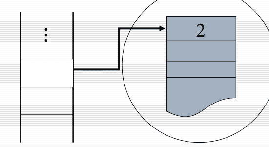

##### 内存泄漏

- 广义的说，内存泄漏不仅仅包含堆内存的泄漏，还包含系统资源的泄漏(resource leak)，比如核心态HANDLE，GDI Object，SOCKET，Interface等。

- 从根本上说这些由操作系统分配的对象也消耗内存，如果这些对象发生泄漏最终也会导致内存的泄漏。而且，某些对象消耗的是核心态内存，这些对象严重泄漏时会会导致整个操作系统不稳定。所以相比之下，系统资源的泄漏比堆内存的泄漏更为严重。

##### 练习

下面程序中的变量p，数字2，变量a，b，c分别被分配在（ ）内存区。

```
#include <iostream.h>
static int c=5;
void f()
{ int *p=new int(2);}
void main()
{ static int a=0;
int b=3;
f();
cout<<a<<b<<c<<endl;
}
```

##### 练习

- A. c为静态数据区；a，b，p为栈区，2为堆区
- B. c为静态数据区；a，b为栈区，2，p为堆区
- C. a，c为静态数据区；b为栈区，2，p为堆区
- D. a，c为静态数据区；p，b为栈区，2为堆区

##### 引用

- 什么是引用?
  - 引用是 C++ 中针对变量的一种别名机制
  - 引用不能单独存在，它的存在的前提是它所代表的变量首先存在
- 引用定义
  - 类型 &引用 = 变量名
- 定义一个引用
  - 例如:
    ```
    int a;
    int &b = a;
    ```

##### 引用示例

##### 定义引用并使用引用

```
```cpp
#include <iostream>
using namespace std;

void main()
{
    int a = 50;
    int& b = a;
    a = 100;
    cout << "a=" << a << endl;
    cout << "b=" << b << endl;
}
```
```

##### 引用的限制

- 引用不能单独使用，必须进行初始化。

```
int& a;
//错误，没有初始化引用
```

- 引用变量定义后，它不能再引用其它变量

- 当引用类型变量的初始化值是常数时，则必须将该引用定义成const类型。

```
int const a = 50;
```

```
const int &b = a;
```

##### 引用的限制

- 引用与其所引用的变量必须具有相同的类型

```
int a = 50;
float& b = a; //错误，引用与变量类型不一致
```

- 可以对指针引用，因为指针也是变量

```
int a = 50;
int *b = &a;
int* &c = b; //c是对指针变量b的引用
```

##### 函数的参数传递（1）

- 值传递

```
void swap(int a,int b)
{
    int temp;
    temp = a; a = b; b = temp;
}
void main()
{
    int m = 3,n = 5;
    swap(m,n);
    cout<<"m="<<m<<" n="<<n<<endl;
}
```

##### 函数的参数传递（2）

```
```cpp
void swap(int *a,int *b)
{
	int temp;
	temp = *a; *a = *b; *b = temp;
}

void main()
{
	int m = 3,n = 5;
	swap(&m,&n);
	cout<<"m="<<m<<" n="<<n<<endl;
}
```
```

##### 函数的参数传递（3）

引用传递

```
void swap(int &a,int &b)
{
    int temp;
    temp = a; a = b; b = temp;
}
void main()
{
    int m = 3,n = 5;
    swap(m,n);
    cout<<"m="<<m<<" n="<<n<<endl;
}
```

##### 函数的参数传递（3）

- 引用传递


性能提示：按引用传递对性能有一定好处。因为它们可以避免复制大量数据的开销。

##### 引用

- 不能修改所引用的变量的值
  - `const int &x=y;`
  - `int const &x=y;`
  - `x=3; // error`

##### 引用传递

```
```cpp
void f(const int &x)
{
    x=1; //error
}
void main()
{
    int a = 3;
    f(a);
}
```
```

##### 引用传递

> 性能提示：如果要传递大型对象，可用常量引用参数模拟按值传递的外观和安全性，进而避免传递大型对象副本的开销

> 软件工程知识：综合考虑到程序的清晰性和高性能，许多C++程序员喜欢使用指针将可修改的参数传递给函数，小型的非修改性参数可以按值传递，大型的非修改性参数则可以利用常量引用传递给函数。

##### 引用

- 引用具有左值。
- **Lvalues(左值)**
  - 能够出现在等号左边的表达式
  - 它们的值可以被改变，如变量名
    - x = 4;
- **Rvalues (右值)**
  - 能够出现在等号右边的表达式
  - 常量，如数字
    - 不能写成 4 = x;
    - 必须写成 x = 4;
  - 左值可以被用作右值，但反过来不行

```
int &max(int x[],int num)
{int i,j;
    j=0;
    for(i=1;i<num;i++)
        if(x[i]>x[j]) j=i;
    return x[j];
}
......
int a[10];
......
cout<<max(a,10)<<endl;
max(a,10)+=1;
```


##### 引用的用途

- 函数的参数
- 返回值
- 运算符的重载

##### 引用

- 引用（reference）（&）就像能自动被编译器间接引用的常量型指针。——C++编程思想
- 引用的一种最明显的实现方式是作为一个（常量）指针。——C++ Programming Language

#### 3.4 其他复合数据类型

- 结构体
- 共用体
- 枚举

##### 共用体

共用体是将多个数据成员组织为一个整体，它们在内存中占用同一段存储单元。

```cpp
union ab
{
    int a;
    double b;
};
```

C++的共用体中允许有成员函数。

##### 枚举类型

枚举类型是将变量的值一一列出来，变量的值只限于列出来的值的范围内。

```cpp
enum weekday
{
    sun, mon, tue, wed, thu, fri, sat
};
```

作用：增强程序代码的可读性。

##### 用typedef定义类型

使用关键字typedef可以将已有的类型名用新的类型名来代替。

格式：

```cpp
typedef <已有的类型名> <类型别名>;
```

### C++语言和面向对象程序设计

- [ ] 程序设计基础
- [ ] 结构化程序设计
- [ ] 面向对象程序设计
- [ ] 程序健壮性设计


### 面向对象程序设计

- 类和对象
- 继承与派生
- 多态性
- I/O流及输入输出

### 面向对象程序设计

- 类和对象
- 继承与派生
- 多态性
- I/O流及输入输出

### 第四章 类和对象


### 第四章 类与对象

- [ ] 类
- [ ] 对象
- [ ] 构造函数和析构函数
- [ ] const成员函数
- [ ] 成员对象
- [ ] 静态成员
- [ ] 友元
- [ ] 小结

### 第四章 类与对象

- 类
- 对象
- 构造函数和析构函数
- const成员函数
- 成员对象
- 静态成员
- 友元
- 小结

#### 4.1 类

##### 类的定义

```cpp
class 类名
{
    <成员描述>
};
```

说明：

1. 类名代表所定义的类的名字，用标识符表示。
2. 成员描述给出该类的对象所有的成员的说明，它包括成员函数和数据成员。
3. 在类定义的成员描述中还包含对成员的访问控制。

##### 一个类中的方法可以直接访问同类中的任何成员。

##### 成员的访问控制：信息隐藏

- 在C++中，可以用访问控制修饰符 public、private或protected来描述对类成员的访问限制。
- **public**: public成员的访问不受限制，在程序中的任何地方都可以访问一个类的public成员。
- **private**: private成员只能在本类（本类的成员函数）和友元中访问。
- **protected**: protected成员只能在本类、派生类和友元中访问。

##### 成员的访问控制

在类定义中可以有多个public、private和protected访问控制说明，它们出现的先后顺序无关。C++的默认访问控制是private。

良好编程习惯：为了保证程序的清晰性和可读性，每个成员访问说明符在类定义中只能使用一次。请将public成员放在最前面，这样更便于查找。

##### 成员的访问控制

一般情况下，类的成员数据和在类内部使用的成员函数应该指定为private，只有提供给外界使用的成员函数才指定为public。指定为public的成员构成了类与外界的一种接口。操作一个对象时，只能通过访问对象类中的public成员实现。

软件工程知识：根据经验，数据成员应该声明为private，成员函数应该声明为public，如果某些成员函数只是被该类的其他成员函数访问，那么它们更适合声明为private。


##### 类的定义示例

定义一个Student类

```cpp
class Student
{
private: //访问控制说明
    int number, score;
public: //访问控制说明
    void init()
    {
        number = 1001;
        score = 100;
    }
    void show()
    {
        cout << number << endl << score << endl;
    }
};
```

```cpp
class Time
{
public:
    Time( int = 0, int = 0, int = 0 );
    void setTime( int, int, int );
    int getHour();

    int &badSetHour( int ); // DANGEROUS reference return

private:
    int hour;
    int minute;
    int second;

}; // end class Time
```

##### 注意

```cpp
// POOR PROGRAMMING PRACTICE:
// Returning a reference to a private data member.
int &Time::badSetHour( int hh )
{
    hour = ( hh >= 0 && hh < 24 ) ? hh : 0;
    return hour; // DANGEROUS reference
} // end function
```

> Returning a reference to a private data member = DANGEROUS!

```cpp
int main()
{
    Time t; // create Time object

    // initialize hourRef with the reference returned by badSetHour
    int &hourRef = t.badSetHour( 20 ); // 20 is a valid hour

    cout << "Valid hour before modification: " << hourRef;
    hourRef = 30; // use hourRef to set invalid value in Time object t
    cout << "\nInvalid hour after modification: " << t.getHour();
    // Dangerous: Function call that returns
    // a reference can be used as an lvalue!
    t.badSetHour( 12 ) = 74; // assign another invalid value to hour
    return 0;
} // end main
```


##### 错误预防技巧

绝不要让类的public成员函数返回对该类private数据成员的非常量引用（或指针）。返回这种引用会破坏类的封装，也是很危险的，应该避免。

##### 数据成员

类定义中的数据成员说明描述了类的对象所包含的数据的类型，它们可以是常量成员和变量成员。

```cpp
class Date
{
    ...
private: // 访问控制说明
    int year, month, day; // 数据成员说明
};
```

##### 数据成员注意事项

一般来说，类定义中描述的数据成员属于类的成员，在创建对象前，类中说明的数据成员并不占有内存空间。因此，在类定义中说明数据成员（某些静态数据成员除外）时不能给它们赋初值，它们的初始化应在类的构造函数中指出。

```cpp
class A
{
    int x = 0; // error
    const double y = 0.0; // error
};
```


##### 数据成员注意事项

数据成员的类型可以是任意的C++类型（包括类，void除外）。但是在说明一个数据成员的类型时，如果未见到相应的类型定义或相应的类型未定义完，则该数据成员的类型只能是这些类型的指针或引用类型。

##### 数据成员注意事项

```
class A;
//A是在程序其他地方定义的类，这里是声明。
class B
{
    A a;//error ,未见A的定义
    B b;//error,B还未定义完
    A *p;
    B *q;
    A &aa;
    B &bb;
};
```

##### 成员函数

- 成员函数描述对类定义中的数据成员所能实施的操作。
- 成员函数的说明格式与非成员函数（称为全局函数）的定义或声明相同。
- 成员函数的定义可以放在类定义中，也可以放在类定义外。

##### 成员函数

##### 方法一

- 类内声明，类外定义

- 示例

##### 成员函数

```
class Student
{
private:
    int number,score;
public:
    void init();
};
void Student::init()
{
    number = 1001;
    score = 100;
}
```

类外定义的成员函数需指明其属于哪个类，以区别全局函数或其它类的成员函数

##### 成员函数的定义

方法二

内联函数的隐式声明——类内定义成员函数。

```
class Student
{
private:
    int number,score;
public:
    void init()
    {
        number = 1001;
        score = 100;
    }
};
```

##### 成员函数的定义

- 方法二

- 内联函数的显示声明

```
class Student
{
private:
    int number,score;
public:
    void init();
};
inline void Student::init()
{
    number = 1001;
    score = 100; }
```

##### 成员函数的定义


软件工程知识：通过函数原型在类定义中声明成员函数，在类定义之外定义这些函数，可以区分类的接口与实现方法。这样可以实现良好的软件工程。

##### 成员函数

- 类成员函数是可以重载的（构造函数除外），它遵循一般函数名重载规则。

```
class A
{
    .....
    public:
        void f();
        int f(int i);
        double f(double d);
    .....
};
```

### 第四章 类与对象

- 类
- 对象
- 构造函数和析构函数
- const成员函数
- 成员对象
- 静态成员
- 友元
- 小结

#### 对象

类属于类型范畴的程序实体，它存在于静态的程序（运行前的程序）中。而动态的面向对象程序（运行中的程序）则由对象构成，程序的执行是通过对象之间互相发送消息来实现的，当对象接收到一条消息后，它将调用对象类中定义的某个成员函数来处理这条消息。

##### 对象的创建和标识

- 直接方式

```
类名 对象名;
```

今后，在定义变量时，如果变量的类型为类，则称该变量为对象，用变量名来标识相应的对象。所有在函数外定义的对象称为全局对象。在函数（或复合语句）内定义的对象称为局部对象。关于全局对象和局部对象的生存期和对象标识符的作用域的规定和普通变量相同。成员对象将随着包含它的对象的创建而创建，随其消亡而消亡。成员对象标识符的作用域为它所在的类。

##### 对象指针

- 和基本数据类型的变量一样，每一个对象在初始化之后会在内存中占据一定空间。对象所占据的内存空间只是用于存放数据成员，函数并不在每个对象中都存储副本。

- 对象指针就是用于存放对象地址的变量。对象指针遵循一般变量指针的各种规则。
- 类名 *对象指针名;

```
Point *p_Point;
Point p1;
p_Point=&p1;
```

##### 对象的操作

- 对象名.数据成员名
- 对象名.成员函数名(实参列表)
- 对象指针->数据成员名
- 对象指针->成员函数名(实参列表)

- 对象指针->成员名

等价：
- (*对象指针).成员名

##### 对象的创建和标识

间接方式

间接创建和标识对象是指在程序运行时刻，通过new操作来创建对象。所创建的对象称为动态对象，其内存空间在程序的堆区中。动态对象用delete操作撤消（即使之消亡）。动态对象需要通过指针变量来标识。

##### 对象的创建和标识

- 单个动态对象的创建与撤销。

```
A *p;
p=new A;
.....
delete p;
```

```
A *p;
p=(A *)malloc(sizeof(A));
.....
free (p);
```

##### 对象的创建和标识

- 动态对象数组的创建与撤销

```
A *p;
p=new A[100];
......
delete []p;
```

```
A *p;
p=(A *)malloc(sizeof(A)*100);
......
free(p);
```

##### 类作用域

类定义构成一个作用域：类作用域，其中的标识符局部于类定义，它们可以与类定义外的全局标识符或其他类定义中的标识符相同。他们包括：

- 数据成员
- 成员函数

在类定义外使用类定义中的标识符时，需通过对象名受限或类名受限。在类定义中使用与局部标识符同名的全局标识符时，需要在全局标识符前面加上全局域分辨符（::）来实现。

##### 类作用域

```cpp
class Student
{
private:
int number,score;
public:
void init();
};
void Student::init()
{
number = 1001;
score = 100;
}```
```

##### 类作用域

```
void init();
class Student
{private:
    int number;
public:
    void init(int number);
    void f();
};
void Student::f()
{::init();//调用全局函数init }
```

```
class Student
{
private:
    int number;
    int score;
public:
    void init(int number,int score)
    {
        Student::number = number;
        Student::score = score;
    }
};
void main()
{
    Student s1;
    s1.init();
}
```

```
class A
{
    public:
        void f();
        void g(int i)
        {x=i;
        f();
        }
    private:
        int x,y,z;
};
```

A a,b;

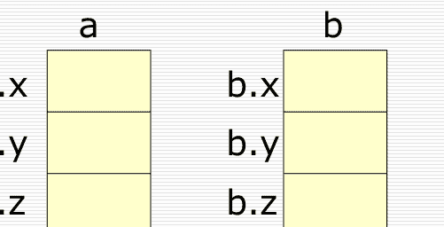

g(int i)

##### this指针

每个成员函数都有一个隐藏的指针类型的形参this，其类型为： <类名> *const this; 成员函数中对类成员的访问都是通过this指针进行的。

a.g(3); ⇒ A::g(&a,3);

```
void g(int i)
{x=i;

f();
}
```

```
void g(A *const this,int i)
{this->x=i;

this->f();
}
```

```
class Student
{
private:
    int number;
    int score;
public:
    void init(int number,int score)
    {
        this->number = number;
        this->score = score;
    }
};
void main()
{ Student s1;
 s1.init();}
```


要求：
调用a.f()时，在A::f中调用func(&a);
调用b.f()时，在A::f中调用func(&b);

```
void func(A * p)
{...}
class A
{ int x;
public:
void f(){func(?);}
void g(int i){x=i;f();}
};
A a,b;
a.f();
b.f();
```

##### 练习：应在下列程序划线处填入的正确语句是（ ）。

```
void init();
class Student
{private:
    int number;
public:
    void init(int number);
    void f();
};
void Student::init(int number)
{
    ______________ = number;
}
void Student::f()
{
______________  //调用全局函数init
}
```

##### 练习

+   A. this->number; ,::init();
+   B. this::number; ,::init();
+   C. Student::number; ,init();
+   D. student->number; ,init();

小技巧：在以后的MFC编程中，如果在成员函数中想调用同类中的某个成员，可以使用VC++提供的自动列出成员函数功能，使用this->，VC++将列出该类中的所有成员，我们可以从列表中选择我们想调用的成员。

自动列出成员函数功能，可以提高编写速度，减少拼写错误。我们经常不能完全记住某个函数的完整拼写，但却能够从列表中辨别出该函数，自动列出成员函数的功能在这时就显得更加有用 了。

事实上，在各种IDE编程环境中，我们通常都不能记住也没有必要记住所有的函数，只要将常用的函数记住，其他不常用的函数只要记住其大概的写法和功能，在调用该函数时可以从自动列出成员函数中选取，这样可以大大节省我们的学习时间。我们不用花费大量的时间去死记硬背许多函数，利用自动列出成员函数功能和帮助系统，就能够在编程时顺利地使用这些函数，等用的次数多了，也就在不知不觉中完全掌握了这些函数。

### 第四章 类与对象

+   □ 类
+   □ 对象
+   □ 构造函数和析构函数
+   □ const成员函数
+   □ 成员对象
+   □ 静态成员
+   □ 友元
+   □ 小结

#### 构造函数

+   什么是构造函数

构造函数是一种特殊的成员函数，它是在对象诞生后第一个执行(并且是自动执行)的函数。

##### 构造函数的特点

+   - 构造函数的名字必须与类名相同
+   - 构造函数没有返回值，可以有参数，可以重载
+   - 构造函数一般是public的，但有时也把构造函数声明为私有的（private），其作用是限制创建该类对象的范围，这时只能在本类和友元类中创建该对象。
+   - 程序中不能直接调用构造函数，在创建对象时系统自动调用构造函数。

#### 构造函数

在创建一个对象时，对象类的构造函数会被自动调用来对该对象进行初始化。至于调用对象类的哪个构造函数，这可以在创建对象的时候指定。

```
class A
{
......
public:
A();
A(int i);
A(char *p);
}
```

```
A a1; 或 A a1=A();
```

```
A a1();
```

```
A a2(1); 或 A a2=A(1);
或 A a2=1;
```

```
A a3("abcd");
或 A a3=A("abcd");
或 A a3="abcd";
```

```
class A
{ ......
public:
A();
A(int i);
A(char *p);
}
```

```
A a[4];
```

```
A b[5]={A(),A(1),A("abcd"),2,"xyz"};
```

```
A *p1=new A;
```

```
A *p2=new A(2);
```

```
A *p3=new A("xyz");
```

```
A *p4=new A[20];
```

#### 构造函数

+   □ 不带参数的（或所有参数都有默认值）构造函数，即构造对象时不提供参数的构造函数称为默认构造函数。
+   □ 程序中不能同时出现无参数的构造函数和带有全部默认形参值的构造函数。

#### 构造函数

```
class A
{ ..... 
public:
A();
A(int i=0);
};
A a;  (ERROR)
```

#### 构造函数

C++规定，每个类必须有一个构造函数，没有构造函数，就不能创建任何对象。

#### 构造函数

□ C++又规定，如果一个类没有提供任何的构造函数，则C++提供一个默认的构造函数（由C++编译器提供），这个默认的构造函数是一个不带参数的构造函数，该构造函数的函数体为空，不做任何的初始化工作。

#### 构造函数

只要一个类定义了一个构造函数，不管这个构造函数是否是带参数的构造函数，C++就不再提供默认的构造函数。因此，如果为一个类定义了一个带参数（且不是所有参数都有默认值）的构造函数，还想要创建一个对象而不提供参数，就需要自己定义一个默认构造函数。

#### 构造函数

```
class A
{
  ......
  public:
    A(int i);
};
A a; (ERROR)
```

```
class Student
{
private:
    int number;
    int score;
public:
    Student(int number,int score)
    {
        Student::number = number;
        Student::score = score;
    }
};
void main()
{
    Student s1(1002,90);
    Student s2;    } //错误，类中没有默认构造函数
```

◆构造函数也可以“类内声明，类外定义”

#### 构造函数


错误预防技巧：除非没有必要初始化类的数据成员，否则请提供构造函数，这样可以保证当类的每个新对象被创建时，类的数据成员都用有意义的值进行了初始化。

#### 析构函数

### 什么是析构函数

+   - 在对象将毁灭但未毁灭之前一刻，最后执行（并且是自动执行）的函数。
+   - 析构函数是“反向”的构造函数，析构函数不允许有返回值，更重要的是析构函数不允许带参数，并且一个类中只能有一个析构函数。
+   - 析构函数的作用正好与构造函数相反，对象超出其作用范围，对应的内存空间被系统收回或被程序用 `delete` 删除时，析构函数被调用。

##### 注意：


常见编程错误： 删除数组时，用delete代替 delete[] 将导致运行时的逻辑错误。为保证数组中的每个对象都接受一个析构函数调用，数组生成的内存空间要用delete[]运算符删除。类似地，总 是使用delete运算符将分配给单个元素的内存空间删除。

#### 析构函数

+   - 析构函数的特点
+   - 析构函数的名称与类名相同，前面加上 “~”
+   - 析构函数没有返回值，没有参数，不能重载
+   - 当对象被撤销时，系统自动调用析构函数
+   - 类中未定义析构函数，系统会自动生成默认的函数体为空的析构函数

#### 析构函数

□ 根据析构函数的特点，我们可以在构造函数中初始化对象的某些成员变量，给其分配内存空间（堆内存），在析构函数中释放对象运行期间所申请的资源。

```
```cpp
class Student
{
private:
    char *name;int number;int score;
public:
    Student(char *name,int number,int score)
    {
        this->name = new char[strlen(name) + 1];
        strcpy(this->name,name);
        this->number = number;
        this->score = score;
    }
    ~Student()
    {delete name;}
};
```
```

> ◆析构函数同样可以“类内声明，类外定义”


##### 析构函数示例

##### Stu1对象

##### 堆内存

| Stu1对象 |
|---|
|  |
| 101 |
| 90 |

##### 栈内存


```
Student stu1("zhangsan",101,90);
```

##### 注意

- 无论构造函数被调用还是析构函数被调用，对象都是存在的。

```
class A
{ int x;
    char *p;
    public:
        A(char *p,int x)
        { this->p = new char[strlen(p) + 1];
          strcpy(this->p,p);
          this->x = x;}
        ~A(){delete p;}
};
void main()
{A a("lisi",23);
......}
```

对象产生，系统在堆栈中分配内存空间

栈内存

①

a
 a.x
 a.p

```
class A
{ int x;
    char *p;
public:
    A(char *p,int x)
    { this->p = new char[strlen(p) + 1];
      strcpy(this->p,p);
      this->x = x;}
    ~A(){delete p;}
};
void main()
{A a("lisi",23);
......}
```

对象产生，系统在堆栈中分配内存空间

调用构造函数，完成初始化

栈内存

堆内存

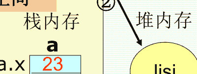

```cpp
class A
{
    int x;
    char *p;
public:
    A(char *p,int x)
    {
        this->p = new char[strlen(p) + 1];
        strcpy(this->p,p);
        this->x = x;
    }
    ~A(){delete p;}
};

void main()
{A a("lisi",23);
......}
```

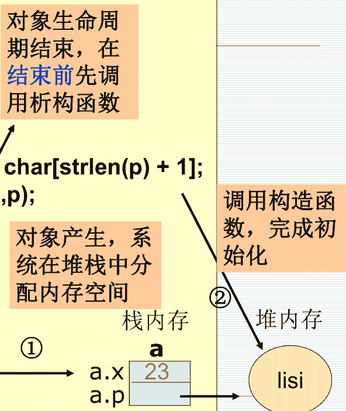

①

②

③

栈内存

堆内存

a

| a.x | 23 |
|---|---|
| a.p | → lisi |

```
class A
{ int x;
    char *p;
    public:
        A(char *p,int x)
        { this->p = new char[strlen(p) + 1];
          strcpy(this->p,p);
          this->x = x;}
        ~A(){delete p;}
};
void main()
{A a("lisi",23);
......}
```

对象生命周期结束，在结束前先调用析构函数

对象产生，系统在堆栈中分配内存空间

栈内存

a
 a.x 23
 a.p

对象生命周期结束，释放内存

调用构造函数，完成初始化

①

②

③

④

#### 析构函数

在某些情况下，我们并不撤消对象，而只是归还对象所申请的资源，这时我们可以通过显式地调用析构函数来实现。

##### 小结对象的创建

- 在C++中,有四种方法可以产生一个对象
- 在栈中产生
- 在堆中产生
- 产生一个全局对象
- 产生一个局部静态对象

##### 小结对象的创建

- 对于全局对象，程序一开始，其构造函数就被执行。程序即将结束前其析构函数执行。（MFC application object）

- 对于局部对象，当对象诞生时，其构造函数被函数执行。程序流程将离开该对象的存活范围（以致对象将毁灭）时，其析构函数执行。

##### 小结对象的创建

- 对于静态对象，当对象第一次被定义时其构造函数被执行。当程序将结束时（此对象因而遭受毁灭）其析构函数被执行，但比全局对象的析构函数早一步执行。

- 对于以new方式产生出来的局部对象，当对象诞生时其构造函数被执行。析构函数则在对象被delete时执行。

##### 思考

```
class Person
{......};

Person per1(30,"zhangsan", 170);
Person per2(per1);
```

#### 拷贝构造函数

- 什么是拷贝构造函数
- 拷贝构造函数是一种特殊的构造函数， 它的功能是用一个已知的对象来初始化一个被创建的同类对象。
- 拷贝构造函数实际上也是构造函数，具有一般构造函数的所有特性，它是在初始化时被调用来将一个已知对象的数据成员的值逐值拷贝给正在创建一个的同类对象。
- 默认情况下系统自动创建拷贝构造函数

#### 拷贝构造函数

如果在类定义中没有给出拷贝构造函数，则编译系统将会隐式地为其提供一个拷贝构造函数，该拷贝构造函数的行为是：逐个成员拷贝初始化。对于普通成员，它采用通常的初始化操作；对于成员对象，则调用成员对象类的拷贝构造函数来实现成员对象的初始化。


#### 拷贝构造函数

- 拷贝构造函数的定义

```
类名(const 类名 &object)
{
.....
}
```

```cpp
class Person
{
private:
    int height;
    int age;
    char name[_0];
public:
    Person(const Person &person)
    {
        height = person.height;
        age = person.age;
        strcpy(name, person.name);
    }
};
```

```
class Person
{
private:
char *name;int age;int height;
public:
Person(int age,char *name,int height)
{
this->name = new char[strlen(name) + 1];
strcpy(this->name,name);
this->age = age;
this->height = height;
}
~Student()
{
delete name;
}
};
```

##### 思考

```
Person p1(11,"zhangsan", 150);
Person p2(p1);
```

## 系统提供的默认拷贝构造函数的行为

```
Person(const Person &a)
{
    age=a.age;
    height=a.height;
    name=a.name;
}
```

##### 深拷贝和浅拷贝问题

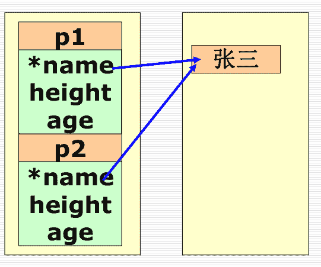

栈空间 p2 = p1 堆空间

##### 深拷贝和浅拷贝问题

- 类体内的成员需要动态开辟内存时我们应自定义拷贝构造函数进行深拷贝，以防止浅拷贝带来的堆内存的所属权产生混乱，从而造成析构错误

##### 深拷贝和浅拷贝问题

```
Person(const Person &a)
{
    age=a.age;
    height=a.height;
    name=
        new char[strlen(a.name)+1];
    strcpy(name,a.name);
}
```

#### 拷贝构造函数

```
void f(Person s)
{......}

Person a;
f(a);
```

##### 以下三种情况将调用拷贝构造函数

- 定义对象时
  A a1;
  A a2(a1); A a2=a1; A a2=A(a1);

- 把对象作为值参数传递给函数
  void f(A x);
  A a;
  f(a); //调用时将创建形参对象x，并调用拷贝构造函数（用对象a）对其初始化。

- 把对象作为返回值

```
A f()
{A a;
.....
    return a;//创建一个A类临时对象，并调用拷贝构造函数（用对象a）对其初始化。
}
void main()
{A b;
    b=f();
}
```


##### 思考

## const常量、引用的初始化问题？

```
class A
{
int x;
const int y=1; //error
int &z=x; //error
public:
A()
{
x=0;
y=1;// error, y是常量成员，其值不能改变
}
};
```

```
```cpp
class A {
	int x;
	const int y;
	int &z;

public:
	A():z(x),y(1),x(0)
	{
	}
};
```
```

## 成员初始化表（在定义构造函数时）

成员初始化表中成员初始化的书写顺序并不决定它们的初始化顺序，数据成员的初始化顺序由它们在类定义中的说明顺序来决定。

当类中有常量数据成员或引用数据成员时，如果类中定义了构造函数，则一定要在定义的所有构造函数的成员初始化表中对它们进行初始化，如果类中没有定义构造函数，则编译程序不会给该类生成一个默认构造函数。因此，这样的类程序是不能用于创建对象的。

##### 思考

程序运行的某个时刻，一个对象的所有数据成员的值反映了这个对象在该时刻的状态。在不同时刻，对象的状态可能是不同的，对象状态的改变往往是由于对象处理了一条消息（某个成员函数被调用）。但是并不是每条消息都会导致对象状态的变化。有些消息只是获取对象在某时刻的状态。

### 第四章 类与对象

- 类
- 对象
- 构造函数和析构函数
- *const*成员函数
- 成员对象
- 静态成员
- 友元
- 小结

#### const成员函数

在定义一个成员函数时，可以给它加上一个 const说明，表示它是一个获取对象状态的成员函数。例如：

```
class A
{......
    void f() const {......}
};
```

#### const成员函数

函数声明和定义处都要加const

```
class A
{
    int x,y;

public:

    void f() const;
};

void A::f() const
{
    ......
}
```

#### const成员函数

```
class A
{ int x;
public:
int f() const
{...
}
};
```

```
class A
{ int x;
public:
const int f()
{...
}
};
```

#### const成员函数

- 在const成员函数体中不能修改数据成员的值，也不能调用该类中的非常成员函数。


软件工程知识：如果成员函数不修改对象，最好将所有类成员函数声明为const。

#### const成员函数

```
class A
{ int x;
    char *p;
    public:
        void f() const
        {x=10;//error
        p=new char[20];//error
        }
};
```

#### const成员函数

□ const对象

软件工程知识：将对象声明为const有利于实现最低权限原则，这样试图修改对象就会产生编译时错误而非执行时错误。

□ 性能提示：把变量和对象声明为const，这不仅是一种有效的软件工程原则，而且还能提高性能，因为如今复杂的优化编译器能对常量进行某些优化，但无法对变量进行优化。

#### const成员函数

只有常成员函数才有资格操作常对象。

```
class A
{ int x,y;
public:
    void f() const {...}
    void g(){...} };
const A a;
a.f(); //OK
a.g(); //error
```

#### const成员函数


软件工程知识：可以对 const 成员函数进行非 const 版本的重载。编译器将根据调用函数的对象性质选择相应的重载函数来使用。如果对象是 const 的，则编译器使用 const 版本的重载函数；如果对象是非 const 的，则编译器使用非 const 版本的重载函数。

#### const成员函数

- □ const关键字可以被用于参与对重载函数的区分。如：
- void print();
- void print() const;

### 第四章 类与对象

- 类
- 对象
- 构造函数和析构函数
- const成员函数
- 成员对象——类的组合
- 静态成员
- 友元
- 小结

#### 成员对象

```
class A
{
 int m;
 public:
 A() {m=0;}
 A(int m1) {m=m1;}
};
```

```
class B
{
 int n;
 A a;
 public:
 B() {n=0;}
 B(int n1) {n=n1;}
};
```

```
B b1,b2(1);
```

##### 成员对象的初始化

在创建包含成员对象的对象时，对成员对象的初始化是由成员对象类的构造函数来实现的。默认情况下，成员对象由成员对象类的默认构造函数进行初始化。

##### 成员对象的初始化

```
class A
{
    int m;

public:
    A() { m=0; }
    A(int m1) { m=m1; }
};
```

```
class B
{
    int n;

    A a;

public:
    B() { n=0; }
    B(int n1) { n=n1; }
};
B b1,b2(1);
```

##### 成员对象的初始化

如需要调用成员对象的非默认构造函数对成员对象进行初始化，则要在包含成员对象的类的构造函数成员初始化表指出。

```
class A
{ int m;
    public:
        A() {m=0;}
        A(int m1)
            {m=m1;}
};
```

```
class B
{  int n;
    A a;
    public:
    B() {n=0;}
    B(int n1):a(n1) {n=n1;}
};
B b1,b2(1);
```

```
class Date
{
public:
    Date(int = 1, int = 1, int = 1900); // default constructor
    void print() const; // print date in month/day/year format
    ~Date(); // provided to confirm destruction order
private:
    int month; // 1-12 (January-December)
    int day; // 1-31 based on month
    int year; // any year
}; // end class Date
```

```
```cpp
class Employee
{
public:
Employee( const char * const, const char * const,
const Date &, const Date & );
void print() const;
~Employee(); // provided to confirm destruction order
private:
char firstName[ 25 ];
char lastName[ 25 ];
const Date birthDate; // composition: member object
const Date hireDate; // composition: member object
};
// end class Employee
```
```

```
```
Employee::Employee( const char * first, const char * last,
const Date &dateOfBirth, const Date &dateOfHire )
: birthDate( dateOfBirth ), // initialize birthDate
hireDate( dateOfHire ) // initialize hireDate
```
```

```
```
{
// copy first into firstName and be sure that it fits
int length = strlen( first );
length = ( length < 25 ? length : 24 );
......
}
```
```


##### 成员对象的初始化

构造函数的执行顺序是

- （如果有多个成员对象）按照成员对象在类的声明中出现的次序，依次调用其成员对象的构造函数。（注意：并不是按照初始化列表中给出的顺序）。
- 再执行本类的构造函数的函数体。

析构函数的调用执行顺序与构造函数相反。

##### 成员对象的初始化

系统提供的隐式拷贝构造函数会去调用成员对象的拷贝构造函数。自定义的拷贝构造函数不会去调用成员对象的拷贝构造函数，必须要在成员初始化列表中显示地指出。若没有指出，则表示调用成员对象的默认构造函数。

```
class A
{
......
};

class B
{
    int z;
    A a;
public:
    B();
    B(const B& b):a(b.a)
    {z=b.z}
};
```

##### 成员初始化列表

- 成员初始化列表
  - ■ 一般成员
  - ■ 常量成员
  - ■ 引用成员
  - ■ 自定义的拷贝构造函数调用成员对象的拷贝构造函数
  - ■ 显示调用成员对象的构造函数

### 第四章 类与对象

- ☐ 类
- ☐ 对象
- ☐ 构造函数和析构函数
- ☐ const成员函数
- ☐ 成员对象
- ☐ 静态成员
- ☐ 友元
- ☐ 小结

#### 4.6 静态成员

```
class SavingAccount
{private:
    char m_name[40];//存户姓名
    char m_addr[60];//存户地址
    double m_total;//存款额
    double m_rate;//利率
    .....
};
```

##### 静态数据成员

□ 必须在类外定义，定义时可以进行初始化

数据类型 类名::静态数据成员名 = 值;

```
class A
{
	static int shared;
	int x,y;
public:
	A(){x=y=0;}
	void increase_all()
	{...}
};
```

int A::shared=0;
A a1,a2;

- shared: 0
- a1.x: 0
- a1.y: 0
- a2.x: 0
- a2.y: 0

##### 静态数据成员

C++国际标准： const static int 或 enum

```
class A
{
    static const int shared=0;
    int x,y;
    public:
        A(){x=y=0;}
        void increase_all()
        {...}
};

A a1,a2;
```

##### 静态数据成员

- 具有默认构造函数的 `static` 成员对象
  - 因为它们的默认构造函数会被调用，所以不必初始化

##### 静态数据成员

- 静态数据成员具有静态生存期，不属于任何一个对象。
- 类的静态成员与该类的对象存在与否没有关系。

##### 静态数据成员

```
class A
{  int x,y;
public:
    A(){x=y=0;}
    void increase_all()
    {...}
    static int shared;
};
int A::shared=0;
```

```
int main()
{ A a;
  a.shared=4;
  A:: shared=4;
}
```

##### 思考

- private的静态成员变量,不能在外部被访问。只能通过公有的成员函数访问。
- 如果希望在产生任何对象之前就存取其class的private static成员变量.怎么办?

##### 思考

```
class A
{public:
    void getX();
private:
    static int x;
};
int A::x=0;
void A::getX()
{
    cout<<x;
}

int main()
{ A a;
  a.getX();
}

cout<<this->x;
```

##### 静态成员函数

```
class A
{public:
    static void getX();
private:
    static int x;
};
int A::x=0;
void A::getX()
{
    cout<<x;
}
```

```
int main()
{
    A::getX();
}
```

##### 静态成员函数

静态成员函数没有隐藏的形式参数this.

##### 静态成员函数

- □ 静态成员函数

静态成员函数只能访问静态成员。


```
```cpp
class A
{
public:
    static void f();
private:
    int x;
};
void A::f()
{
    cout << x; // error
}
```
```

```
class A
{public:
    static void f(A a);
private:
    int x;
};
void A::f(A a)
{
    cout<<x;//error
    cout<<a.x;
}
```

##### 底层思维

向下，如何深入把握机器底层，从微观理解对象构造——底层思维

- 语言构造
- 编译转换
- 对象内存模型
- 运行时机制
- ...

##### 抽象思维

向上，如何将我们周围的世界抽象为程序代码——抽象思维

- 面向对象
- 组件封装
- 设计模式
- 架构模式
- ...


##### 小知识

##### 设计模式

Singleton模式是做为"全局变量"的替代品出现的。所以它具有全局变量的特点：全局可见、贯穿应用程序的整个生命周期，它也具有全局变量不具备的性质：同类型的对象实例只可能有一个。

```
#include <math.h>
#include <iostream.h>
class Point
{public: //外部接口
    Point(int xx=0, int yy=0)
    {X=xx;Y=yy;}
    int GetX() {return X;}
    int GetY() {return Y;}
private: //私有数据成员
    int X,Y;
};
```

```
double Distance( Point& a, Point& b)
{
    double dx=a. GetX() -b. GetX();
    double dy=a. GetY() -b. GetY();
    return sqrt(dx*dx+dy*dy);
}
int main()
{ Point p1(3.0, 5.0), p2(4.0, 6.0);
    double d=Distance(p1, p2);
    cout<<"The distance is "<<d<<endl;
    return 0;
}
```

#### 友元（friend）

```
class A
{
    friend void func();//友元函数
    friend class B;//友元类
    friend void C::f();//友元类成员函数
};
```

```
class Count
{
    friend void setX( Count &, int ); // friend declaration
public:
    Count() : x( 0 )
    {
        // empty body
    } // end constructor Count

    void print() const
    {
        cout << x << endl;
    } // end function print
private:
    int x; // data member
}; // end class Count
```


##### 友元函数

- 在类里**声明**一个普通函数，在前面加上 `friend` 修饰，那么这个函数就成了该类的友元，可以访问该类的一切成员
- 一个普通函数可以是多个类的友元函数

##### 使用友元函数计算两点距离

```
#include <iostream.h>
#include <math.h>
class Point
{public:  //外部接口
    Point(int xx=0, int yy=0) {X=xx;Y=yy;}
    int GetX() {return X;}
    int GetY() {return Y;}
    friend double Distance(Point &a, Point &b);
private:  //私有数据成员
    int X,Y;
};
```

```
double Distance( Point& a, Point& b)
{
    double dx=a.X-b.X;
    double dy=a.Y-b.Y;
    return sqrt(dx*dx+dy*dy);
}
int main()
{ Point p1(3.0, 5.0), p2(4.0, 6.0);
    double d=Distance(p1, p2);
    cout<<"The distance is "<<d<<endl;
    return 0;
}
```

##### 友元成员

- 一个类的成员函数也可以是另一个类的友元，从而可以使得一个类的成员函数可以操作另一个类的数据成员

##### 友元类

- 整个类也可以是另一个类的友元，该友元称为友元类
- 友元类的每个成员函数都可以访问另一个类的所有成员

##### 友元类举例

```
class A
{
    friend class B;
    public:
        void Display()
        {cout<<x<<endl;}
    private:
        int x;
};

class B
{
    public:
        void Set(int i);
        void Display();
    private:
        A a;
};
```

```
void B::Set(int i)
{
    a.x=i;
}
void B::Display()
{
    a.Display();
}
```

#### 友元（friend）

- 友元不具有传递性，即使设B是A的友员，C是B的友员，如果没有显示指出C是A的友员，则C不是A的友元。
- 一个类的友元可以访问该类的所有成员。

## 小结 类与对象

- 类的定义
- 对象的创建
- 类作用域
- `this`指针
- 构造函数和析构函数（对象的生存期）
- 拷贝构造函数
- `const`成员常量，引用成员变量初始化
- `const`成员函数
- 静态成员（单态设计模式）
- 友元

| 姓名 | 张三 | 性别 | 男 | 民族 | 汉 |
| --- | --- | --- | --- | --- | --- |
| 出生 | 1990年1月1日 | 住址 | 北京市朝阳区某某街道100号 | 身份证号 | 110101199001011234 |

## 第五章

## 继承和派生

#### 本章要求

- 理解继承与派生的含义
- 掌握C++的单继承和多继承两种继承方式
- 掌握派生类生成过程
- 掌握派生类对象的生成
- 掌握继承的访问控制
- 掌握面向对象的模块化编程

#### 继承与派生问题举例

交通工具

汽车

小汽车

卡车

旅行车

工具车

轿车

面包车

#### 继承与派生问题举例

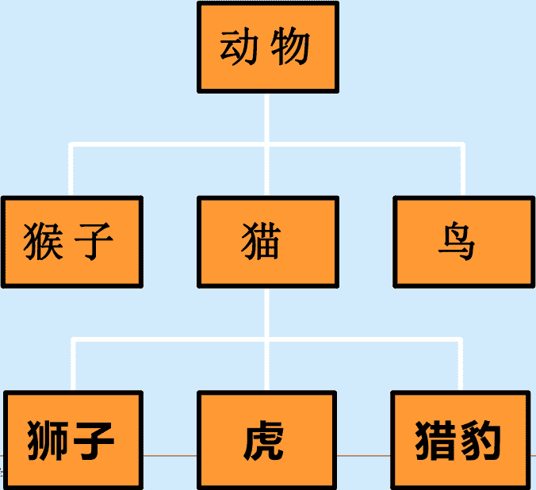

#### 继承与派生问题举例

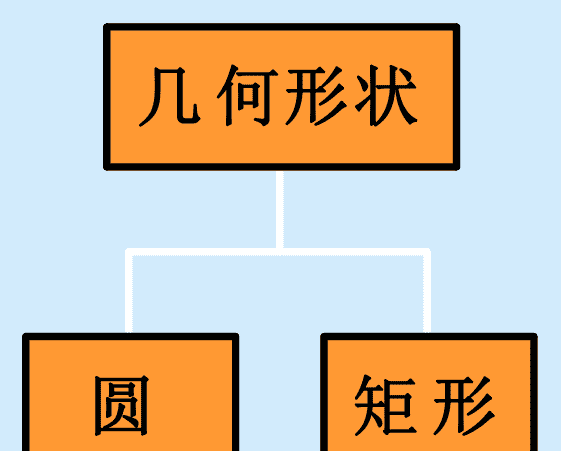

#### 继承与派生问题举例

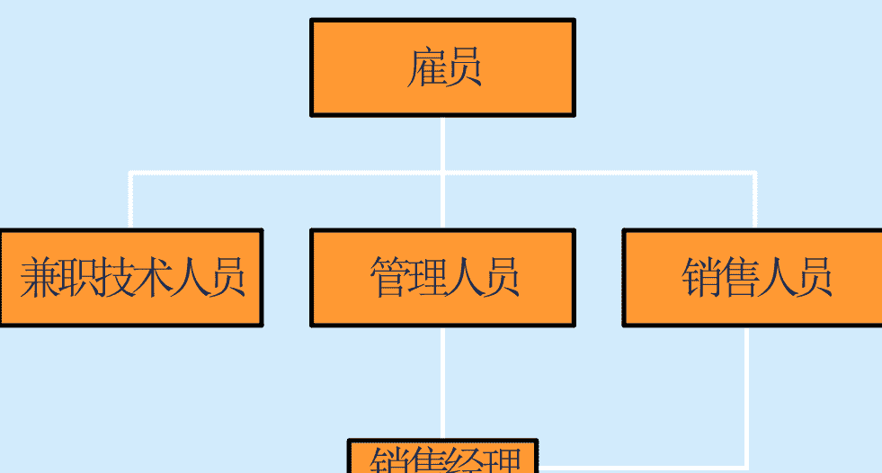

#### 类的继承与派生

- 保持已有类的特性而构造新类的过程称为继承。
- 在已有类的基础上新增自己的特性而产生新类的过程称为派生。
- 被继承的已有类称为基类（或父类）。
- 派生出的新类称为派生类。

#### 继承与派生的目的

- 继承的目的：实现代码重用。
- 派生的目的：当新的问题出现，原有程序无法解决（或不能完全解决）时，需要对原有程序进行改造。

#### 继承方式

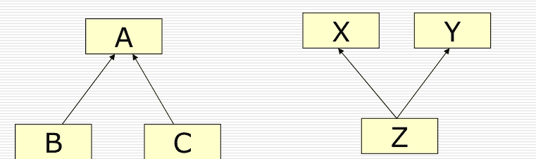

单继承

多继承

#### 继承方式

- 单继承
  - 派生类只从一个基类派生。
- 多继承
  - 派生类从多个基类派生。
- 多重派生
  - 由一个基类派生出多个不同的派生类。
- 多层派生
  - 派生类又作为基类，继续派生新的类。

### 第五章 继承和派生

- 单继承
- 模块化
- 多继承
- 面向对象的分析与设计

### 第五章 继承和派生

- 单继承
- 模块化
- 多继承
- 面向对象的分析与设计

#### 5.1 单继承

单继承的定义

```
class 派生类名 : 继承方式 基类名
{
    派生类新定义成员
};
```

继承方式

- 公有派生（public）
- 私有派生（private）
- 保护派生（protected）

##### 派生类成员

- 派生类除了拥有基类所有的成员（基类的构造函数、析构函数和赋值操作符重载函数除外）外，也可以具有新的成员。

##### 派生类成员

- 派生类中可以给出新的成员，也可以对基类的成员进行重定义。如果在派生类中对基类的某个成员进行了重定义，则在派生类中对该成员的访问是针对派生类中重定义的成员。

##### 派生类成员

```
class A
{  int x,y;
public:
    void f();
    void g();
};
```

```
class B:public A
{  int z;
public:
    void f();
    void h();
};
```

```
B b;
b.f();//B类中的f
b.g();
b.h();
```

##### 派生类作用域

- 派生类成员名的作用域嵌套在基类作用域中。对于基类的一个成员，如果派生类中没有定义与其同名的成员，则该成员名在派生类的作用域内可见。否则，该成员名在派生类的作用域内不可见，如果使用，必须用基类名受限。
- 即使派生类定义了与基类同名但参数不同的成员函数，基类的同名函数在派生类的作用域也是不可见的。

##### 派生类作用域

```
class A
{  int x,y;
public:
    void f();
    void g();
};
```

```
class B:public A
{  int z;
public:
    void f();
    void h()
    {A::f();
    f();}
};
```

```
B b;
b.f();
b.A::f();
```

```
```cpp
class A
{
    int x,y;

public:
    void f();

    void g();
};
```
```

```
```cpp
B b;

b.f(1);

b.f(); // error

b.A::f();
```
```

```
```cpp
class B:public A
{
    int z;

public:
    void f(int);

    void h()
    {
        f(1);
        f(); // error
        A::f();
    }
};
```
```

##### 派生类作用域


常见编程错误：当派生类重新定义了基类的成员函数时，派生类常常需要调用基类的同名函数来做额外的工作，如果在调用基类的同名成员函数时忘了在前面加上基类名称和二元作用域运算符(::) 将导致无限递归的错误。


##### 思考

□ 谁来初始化派生类对象？


##### 派生类对象的初始化

- 派生类对象的初始化由基类和派生类共同完成：基类的数据成员由基类的构造函数初始化，派生类的数据成员由派生类的构造函数初始化。
- 在创建派生类的对象时，派生类的构造函数在进入其函数体之前会调用基类的构造函数。默认情况下是调用基类的默认构造函数，如果要调用基类的非默认构造函数，则必须在派生类构造函数的成员初始化表中指出。

参见工程0103

##### 派生类对象的初始化

```
派生类构造函数(参数表) : 基类构造函数(参数表)
{
    ……
}
```

```
class A
{ int x;
public:
    A(){x=0;}
    A(int i){x=i;}
};
```

```
class B:public A
{ int y;
public:
    B(){y=0;}
    B(int i){y=i;}
    B(int i,int j):A(i)
    {y=j;} };
```

```
B b;    //A::A(),B::B()
B b2(1);//A::A(),B::B(int)
B b3(1,2);//A::A(int),B::B(int,int)
```

##### 派生类对象的析构

- 对于析构函数，先执行派生类的析构函数，而后执行基类的析构函数。
- 基类的构造函数和析构函数不能被派生类继承。

##### 构造和析构的顺序

□ 派生类构造函数和析构函数的执行顺序

基类的构造函数

派生类的构造函数

派生类的析构函数

基类的析构函数

##### 派生类的拷贝构造函数

- 对于拷贝构造函数，派生类的隐式拷贝构造函数（由编译器提供）将会调用基类的拷贝构造函数。
- 派生类自定义的拷贝构造函数在默认情况下则调用基类的默认构造函数，也可在成员初始化列表中显示指出调用基类的拷贝构造函数。

##### 成员初始化列表

- □ 成员初始化列表
  - □ 一般成员
  - □ 常量成员
  - □ 引用成员
  - □ 自定义的拷贝构造函数调用成员对象的拷贝构造函数
  - □ 显示调用成员对象的构造函数
  - □ 显示调用基类的构造函数
  - □ 显示调用基类的拷贝构造函数

一个类可以创建对象，也可以用来定义派生类，即一个类有两种用户：实例用户和派生类。

```
class A
{......};
class B:public A
{......}
void f()
{A a;
}
```

##### 派生类对基类成员的访问

- 在C++中通过引入protected成员访问控制，可以使派生类使用protected成员，但是protected成员不能被基类的实例用户使用。
- 这样，一个类就存在两个对外接口，一个接口由类的public成员构成，它提供给实例用户使用；另一个接口由类的public和protected成员构成，该接口提供给派生类使用。

##### 派生类对基类成员的访问

- 把类成员说明为protected使得类的封装性大打折扣，这是由封装与继承之间的固有矛盾所决定的。封装的目的是为了隐藏实现细节，而继承却去要知道基类的实现细节，否则派生类的一些功能可能无法实现（特别是在对基类的一些功能进行重定义时）。
- 因此从纯代码复用的角度讲，对象组合比继承要好。在对象组合方式的软件复用中，一个类只有一个接口，即类的实例用户接口。
- 不过，继承更容易实现子类型。

```
class A
{.....
    public:
        void f();
        void g();
};
class B:public A
{.....
    public:
        void h();
}
```

```
class B
{.....
    A a;
    public:
        void f(){a.f();}
        void g(){a.g();}
        void h();
    .....
};
```

##### 成员的访问控制

- **public**：public成员的访问不受限制，在程序中的任何地方都可以访问一个类的public成员。
- **private**：private成员只能在本类（本类的成员函数）和友元中访问。
- **protected**：protected成员只能在本类、派生类和友元中访问。

##### 继承的访问控制

在C++中，派生类拥有基类的所有成员。那么基类的成员变成派生类的什么成员呢？public,private还是protected?即基类的成员对派生类的用户具有何种访问控制？这是由基类成员的访问控制和派生类的继承方式共同决定的。

##### 继承的访问控制

| 继承方式 | 基类特性 | 派生类特性 |
|---|---|---|
| 公有继承 public | public | public |
|  | protected | protected |
|  | private | 不可访问 |
| 私有继承 private | public | private |
|  | protected | private |
|  | private | 不可访问 |
| 保护继承 protected | public | protected |
|  | protected | protected |
|  | private | 不可访问 |

```
class A
{public:
    void f();
protected:
    void g();
private:
    void h();
};
```

```
class B:protected A
{public:
    void q();
    //q对A类成员的访问不受B的继承方式影响，除了h,其他都能访问。
};
```

```
B b;
b.q(); //ok
b.f(); //error,f是B的protected成员
b.g(); //error,g是B的protected成员
b.h();// error,h是B的不可直接访问成员
```

```
```cpp
class A
{
public:
    void f();
protected:
    void g();
private:
    void h();
};
```
```

```
```cpp
class B: protected A
{
public:
    void q();
};
```
```

```
```cpp
class C: public B
{
public:
    void r()
    {
        q(); //ok
        f(); //ok
        g(); //ok
        h();//error
    }
};
```
```


##### 继承的访问控制

继承方式决定了派生类的实例（对象）
用户和派生类的派生类对基类成员的
访问限制。

##### 继承方式的调整

- □ 在任何继承方式中，除了基类的 private 成员，都可以在派生类中分别调整其访问控制。

调整时采用：

```
```text
[public:|protected:|private:]
<基类名>::<基类成员名>;
```
```

##### 派生类对象的构造和析构

- 如果一个类既有基类又有成员对象类，则在创建该类对象时，该类的构造函数
  - 首先调用基类的构造函数
  - 再调用成员对象类的构造函数
  - 执行自己的函数体
- 该类的对象消亡时
  - 首先调用和执行自己的析构函数
  - 然后调用成员对象类的析构函数
  - 最后调用基类的析构函数

先祖先，再客人（成员对象），后自己

### 第五章 继承和派生

- 单继承
- *模块化*
- 多继承
- 面向对象的分析与设计

#### 5.2 模块化

- □ 回顾
- ■ 模块化是处理大而复杂问题的重要手段，同时也是保证软件质量的有力措施。
- ■ 模块化能减低程序的复杂度，使得程序容易设计、理解与维护以及能够提高程序的正确性。
- ■ 在过程式程序设计中一个模块通常由一组相关的全局变量和全局函数的定义构成的。
- ■ 相关：这些程序实体实现一个逻辑功能。


## 模块化

一个模块一般包含两部分：接口和实现。接口给出在本模块中定义的、提供给其他模块使用的一些程序实体（如函数、全局变量等）的声明；模块的实现给出了模块中实体的定义。

在 **C++** 中，一个模块通常由两个源文件构成，一个是 **.h** 文件，用于存放模块接口的定义；另一个是 **.cpp** 文件用于存放模块的实现。在一个模块中要用到另一个模块中定义的程序实体时，需要在前者的 **.cpp** 文件中用文件包含命令把后者的 **.h** 文件包含进来。

## 模块化

- 在面向对象程序中，可以把一个类当作一个模块，也可以把多个具有继承关系或聚集关系的类作为一个模块。
- 一个C++模块一般由两个源文件构成：一个是.h文件，一个是.cpp文件。

## 模块化

一般情况下，类定义及函数原型的声明放在头文件（.h）中，类中成员函数的实现则放在源文件（.cpp）中。

##### C++源程序结构

- 三个组成部分
  - 类的定义及函数原型的声明
  - 类中成员函数的实现
  - 类的使用文件

- 存储和管理方式
  - 类的定义及函数原型的声明（.h）
    - 包括数据成员和成员函数的声明
  - 类中成员函数的实现（.cpp）
    - 成员函数的实现
  - 类的使用文件
    - 主函数

参见工程0101

##### C++源程序结构


软件工程知识：类客户端如果要使用类，不需要访问类的源代码。但是，客户端需要连接类的对象代码（即编译后的类）。这有利于由独立软件供应商(ISV)提供类库进行销售或发放许可证。ISV在自己的产品中只提供头文件和目标模块，不提供专属信息（例如源代码）。

##### C++源程序结构


**性能提示：** 在类定义中定义小的成员函数将自动使该成员函数成为内联函数（如果编译器如此选择的话）。这样可以提高性能。


**软件工程知识：** 在类定义的内部定义小成员函数并不能提高软件工程，因为类的客户端能够看到函数的实现方法，如果函数定义发生改变，客户端代码必须重新编译。

##### C++源程序结构

```
class Student
{
private:
    int number,score;
public:
    void init();
};
inline void Student::init()
{
    number = 1001;
    score = 100; }
```

##### 预处理命令

- 预处理命令  #ifdef
  - 格式
    - `#ifdef 标识符`
    - 语句
    - `#endif`
  - 功能
    - 如果已定义了“标识符”，则编译“语句”

##### 预处理命令

- 预处理命令  #ifndef
  - 格式
    - `#ifndef 标识符`
    - 语句
    - `#endif`
  - 功能
    - 如果未定义了“标识符”，则编译“语句”

##### 建立一个米时 左建立中加入 父件 给汉地人

```cpp
#ifndef student_H_H
#define student_H_H
class Student
{
public:
void init(int number,int score);
void show();
private:
int number;
int score;}
#endif
```

### 问题

- 头文件包含了部分类的实现和提示信息
  - 例如，类的私有数据成员出现在头文件中
  - 潜在的向客户暴露了专有信息

##### Implementation.h

```
class Implementation
{
public:
    Implementation( int v ) : value( v )
    {
    } // end constructor Implementation
    void setValue( int v )
    {
        value = v; // should validate v
    } // end function setValue
    int getValue() const
    {
        return value;
    } // end function getValue
private:
    int value; // data that we would like to hide from the client
}; // end class Implementation
```

##### Interface.h

```
class Implementation; // forward class declaration
```

```
class Interface
{
public:
    Interface( int ); // constructor
    void setValue( int ); // same public interface as
    int getValue() const; // class Implementation has
    ~Interface(); // destructor
private:
    // requires previous forward declaration
    Implementation *ptr;
}; // end class Interface
```

##### Interface.cpp

```
// Implementation of class Interface--client receives this file only
// as precompiled object code, keeping the implementation hidden.
#include "Interface.h" // Interface class definition
#include "Implementation.h" // Implementation class definition

// constructor
Interface::Interface( int v )
: ptr ( new Implementation( v ) ) // initialize ptr to point to
{
    // a new Implementation object
    // empty body
} // end Interface constructor
```

```
void Interface::setValue( int v )
{
    ptr->setValue( v );
} // end function setValue

int Interface::getValue() const
{
    return ptr->getValue();
} // end function getValue

Interface::~Interface()
{
    delete ptr;
} // end ~Interface destructor
```

```
```cpp
#include "Interface.h" // Interface class definition
```
```

```
```cpp
int main()
{
    Interface i( 5 ); // create Interface object

    cout << "Interface contains: " << i.getValue()
         << " before setValue" << endl;

    i.setValue( 10 );

    cout << "Interface contains: " << i.getValue()
         << " after setValue" << endl;
    return 0;
} // end main
```
```

### 第五章 继承和派生

- 单继承
- 模块化
- 多继承
- 面向对象的分析与设计


#### 5.3 多继承

##### 什么是多继承

C++ 允许为一个派生类指定多个基类，这样的继承结构称为多继承。

##### 多继承的声明

```
class 派生类名 : 继承方式1 基类名1, ...,
            继承方式n 基类名n
{
    ......
};
```

##### 多继承的构造函数和析构函数

- 构造函数的执行顺序
  - 基类构造函数
  - 派生类构造函数
  - 在多个基类之间按照它们被继承时声明的顺序（从左向右）执行。
- 析构函数的执行顺序
  - 析构函数的执行顺序与构造函数相反

##### 二义性问题举例

```
class A
{
    ...
public:
    void f();
    void g();
};

class B
{
    ...
public:
    void f();
    void h();
};

class C : public A, public B
{
    ...
public:
    void func()
    {
        f();
    }
};
```

```
C c;
c.f();
```

```
class B
{
public:
    int b;
};

class B1 : public B
{
private:
    int b1;
};

class B2 : public B
{
private:
    int b2;
};

class C : public B1, public B2
{
public:
    int f();
private:
    int d;
};
```

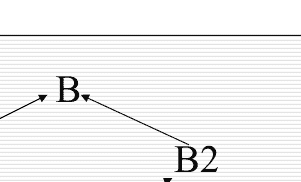

下面的访问是二义性的：

```
C c;
c.b;
c.B::b;
```

下面是正确的：

```
c.B1::b;
c.B2::b;
```

派生类 C 的对象的存储结构示意图：

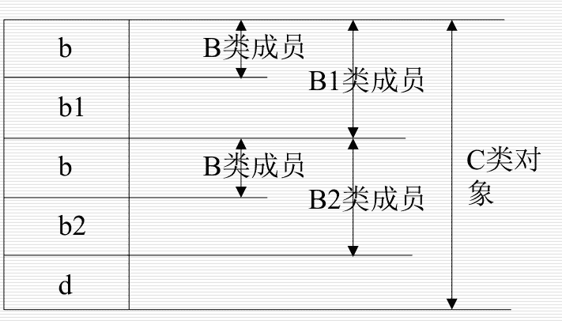

##### 虚基类

- 虚基类的引入
  - 用于有共同基类的场合
- 声明
  - 以 `virtual` 修饰说明基类
    - 例：`class B1 : virtual public B`
- 作用
  - 主要用来解决多继承时可能发生的对同一基类继承多次而产生的二义性问题。
  - 为最远的派生类提供唯一的基类成员，而不重复产生多次拷贝。
- 注意：
  - 在第一级继承时就要将共同基类设计为虚基类。

##### 虚基类举例

```
class B { public: int b; };
class B1 : virtual public B { private: int b1; };
class B2 : virtual public B { private: int b2; };
class C : public B1, public B2 { private: float d; };
```

下面的访问是正确的：

```
C cobj;
cobj.b;
```

##### 虚基类的派生类对象存储结构

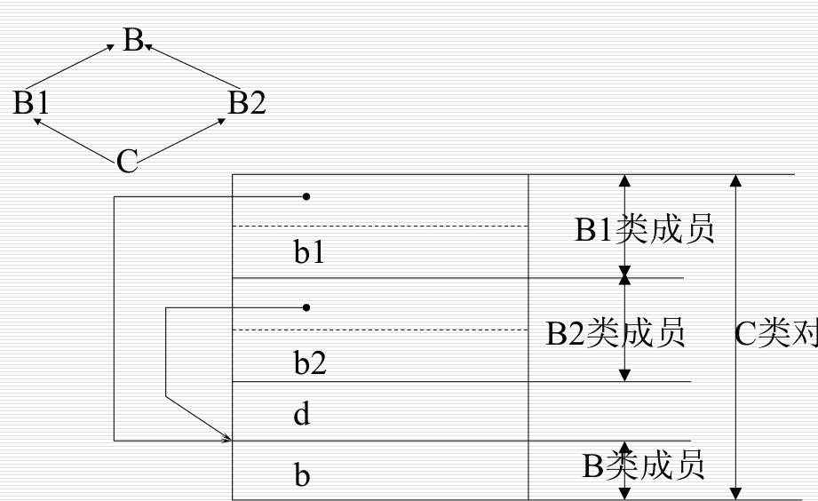

##### 虚基类构造函数的调用

- 虚基类的构造函数由最远派生出的类的构造函数调用。
- 虚基类的构造函数优先于非虚基类的构造函数执行。

##### 虚基类的构造函数

- 如果虚基类定义有非默认形式的构造函数（即带形参的构造函数），并且没有定义默认构造函数，在整个继承结构中，直接或间接继承虚基类的所有派生类，都必须在构造函数的成员初始化列表中列出对虚基类的初始化。

#### 面向对象分析与设计OOAD

为了得到最佳的解决方案，分析项目的需求（即确定该系统应该做什么）和开发满足这些需求的一份设计（即确定系统应该怎样做）应该遵循一个详细的过程。

如果此过程分析和设计系统是从面向对象的角度来考虑的，那么就称为面向对象分析与设计。

建立一个大型的软件系统可不是一件简单的事情，它是一项大工程，人们称它为软件工程，它研究如何建立大型软件系统：

- 可靠性；
- 成本效益好；
- 可理解性；
- 可维护性。

##### 面向对象的软件工程

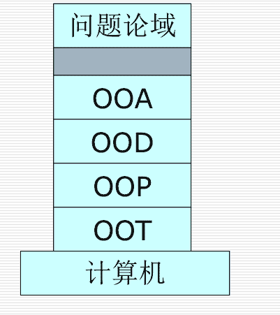

面向对象分析的任务是采用面向对象方法，把对问题域和系统的认识理解，正确地抽象为规范的对象（包括类、继承层次）和消息连接关系，形成面向对象模型，为后续的 OOD 和 OOP 提供指导。

设计是在分析的基础上进一步加工，OOD 阶段是对 OOA 模型的修改和补充，采用一致的概念、原则和表示法，二者没有严格的阶段划分，但设计阶段侧重于考虑与实现有关的细节。

##### 可视化建模

- 为了设计、开发和相互交流的需要，可采用图形形式将使用面向对象方法对问题的描述直观地表示出来。
- 实际使用的面向对象标记图有很多种类，但目前用于面向对象分析建模的最流行的方法是 UML 标记图。
- UML 是一种可视化建模语言，主要用于面向对象分析和建模。

##### UML(Unified Modeling Language)

- 于 20 世纪 90 年代中期在三位软件方法学家——Grady Booch、James Rumbaugh 和 Ivar Jacobson 的原创指导下开发出来的。
- 从 1989 年到 1994 年，面向对象建模语言的数量从不到 10 种增加到 50 多种。各种语言的创造者极力推崇自己的语言，并不断地发展完善它。但由于各种建模语言所固有的差异和优缺点，使得使用者不知道该选用哪种语言。
- 其中比较流行的有 Booch、Rumbaugh(OMT)、Jacobson(OOSE)、Coad-Yourdon 等方法。OMT 擅长分析，Booch 擅长设计，OOSE 擅长业务建模。
- Rumbaugh 于 1994 年加入 Booch 所在的 Rational 公司，他们一起研究一种统一的方法，一年后，Unified Method 0.8 诞生，同年，Rational 收购了 Jacobson 所在的 Objectory AB 公司。经过三人的共同努力，UML 0.9 和 UML 0.91 于 1996 年相继面世。
- 此后 UML 的创始人 Booch 等邀请计算机软件工程界的著名人士和著名的企业如 IBM、HP、DEC、Microsoft、Oracle 等对 UML 进行评论，提出修改意见。
- 1997 年 1 月 Rational 公司向 OMG 递交了 UML 1.0 标准文本。1997 年 11 月 OMG 宣布接受 UML，认定为标准的建模语言。UML 目前还在不断发展和完善。

##### UML 类图示样例

- 类
  - 第一行：类名称
  - 第二行：特性（字段或属性）
  - 第三行：操作（方法或行为）
- 注意：若类名称为斜体字，则此类为抽象类
- 依赖关系
- 聚合关系
- 合成(组合)关系
- 关联关系

##### UML类图

- 类名
- 属性
- 方法

- 类名
- 属性
- 方法

- 类名

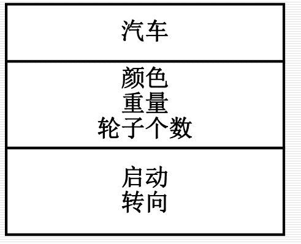

| 符号 | 种类 |
|---|---|
| + | Public（公共的） |
| # | Protected（受保护的） |
| − | Private（私有的） |

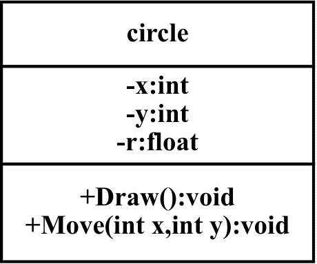

继承

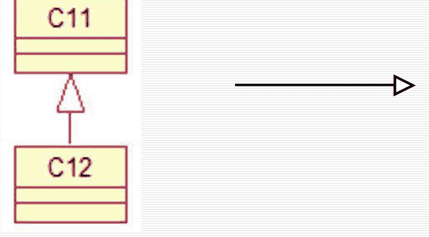

继承

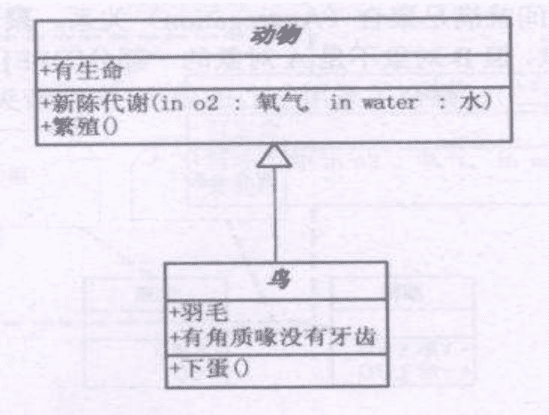

- 关联
  - 一个类知道另一个类

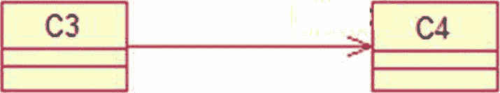


##### UML类图

- 关联
- 一个类知道另一个类

```
class C3
{
public:
    C4* theC4;
};

class C4
{
};
```

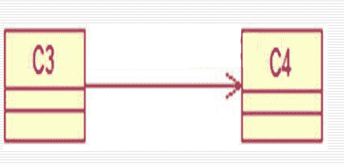

##### UML类图

- 关联
- 一个类知道另一个类

```
class Penguin: public Bird
{
...
private:
Climate *climate;
};
```

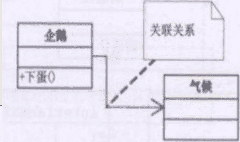

##### UML类图

□ 聚合（Aggregation）
■ 一种弱的“拥有”关系，体现的是A对象可以包含B对象，但B对象不是A对象的一部分。

```cpp
class C9 {
	public:
	C10*theC10;
};

class C10 {
};
```

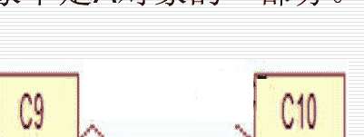

##### UML类图

- 聚合（Aggregation）

一种弱的“拥有”关系，体现的是A对象可以包含B对象，但B对象不是A对象的一部分。

```
class
WideGooseAggregate
{
...
private:
    WideGoose
        *arraywc;
};
```

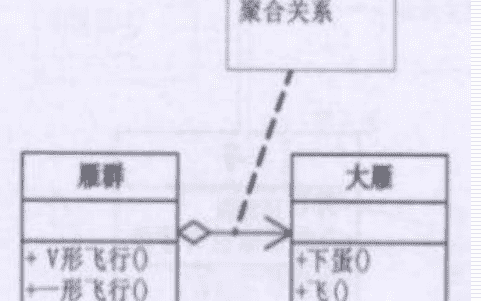

##### UML类图

组合（Composition）

一种强的“拥有”关系，体现了严格的整体和部分的关系，部分和整体生命周期一样。


##### UML类图

##### 组合（Composition）

- - 一种强的“拥有”关系，体现了严格的整体和部分的关系，部分和整体生命周期一样。

```
class C7 {
    public:
        C8 theC8;
};

class C8 {
};
```

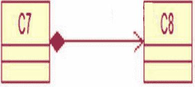

##### UML类图

一种强的“拥有”关系，体现了严格的整体和部分的关系，部分和整体生命周期一样。

```
class Bird {
  ...
  private:
  Wing wing;
};
```


##### UML类图

依赖是一种弱关联，只要一个类用到另一个类，但是和另一个类的关系不是太明显的时候（可以说是“uses”的那个类），就可以把这种关系看成是依赖，依赖也说是一种偶然的关系，而不是必然的关系，就是“我在某个方法中偶然用到了它，但在现实中我和它并没多大关系”。


##### UML类图

##### 依赖（Dependency）

```
// C5.h
#include "C6.h"
class C5
{
};
// C6.h
class C6
{
};
```

```
#include "B.h"
class A
{
    void Func(B &b);
};
```

##### UML类图

依赖（Dependency）


```
class Animal
{
...
    public:
        void Metabolism(Oxygen o, Water w);
};
```

##### 小结

- - 继承种类：单继承与多继承
- - 派生类生成过程
- - 吸收基类成员，改造基类成员，添加新的成员
- - 作用域的覆盖
- - 派生类对象的生成
- - 构造函数和析构函数的调用顺序

## 小结（续）

- - □ 派生类对基类成员的访问
- - ■ protected,public可访问
- - □ 派生类的实例用户及派生类的派生类对基类成员的访问
- - ■ 继承方式和访问控制共同决定
- - □ 多继承
- - ■ 二义性问题
- - ■ 虚基类

### 面向对象程序设计

- - 类和对象
- - 继承与派生
- - 多态性
- - I/O流及输入输出

### 第六章 多态性

#### 多态性

多态性指，同一个消息被不同对象接收时，产生不同结果，即实现同一接口，不同方法。


#### 多态性

多态性指，同一个消息被不同对象接收时，产生不同结果，即实现同一接口，不同方法。


#### 多态

- - 重载多态：通过调用相同名字的函数，表现出不同的行为。运算符重载也是一种重载多态。
- - 运行多态：通过基类的指针，调用不同派生类的同名函数，表现出不同的行为。许多面向对象程序设计的书籍中所说的多态性，就是这种多态。
- - 模板多态，也称为参数多态：通过一个模板，得到不同的函数或不同的类。这些函数或者类具有不同的特性和不同的行为。

### 第六章 多态性

- - 多态与虚函数
- - 虚函数（安全编程: 覆盖C++虚函数指针）
- - 纯虚函数和抽象类

- - 运算符重载

- - 模板
- - 函数模板
- - 类模板

#### 本章要求

- - 理解多态性的概念
- - 掌握虚函数的原理及使用
- - 掌握运算符重载
- - 掌握模板程序设计

##### 实例


#### 6.1 多态与虚函数

赋值兼容规则（子类型）：需要基类对象的任何地方都可以使用公有派生类的对象来替代。

替代包括：

- - 派生类的对象可以赋值给基类对象。
- - 派生类的对象可以初始化基类的引用。
- - 派生类的地址可以赋给指向基类的指针。

```
class A
{.....
    public:
        void f();
        void g();
};
class B:public A
{.....
    public:
        void h();
}
```

```
A a,*p;
B b;

A &g=b;
a=b;
p=&b;
```

##### 虚函数

□ 重定义指对派生类中定义的成员函数，其函数名、参数个数和类型以及返回值类型与基类的虚成员函数相同。（当基类虚函数返回值类型是某个类或其指针或引用时，派生类中重定义的成员函数的返回值也可以是子类类型，VC++6.0不支持）。

##### 静态联编和动态联编

- - 联编：将一个函数的调用与相应的函数体的代码相连接称为函数联编。
- - 静态联编：在编译根据 `CShape* pShape[6]` 的静态类型来决定 `pShape[i]->display()` 属于哪一个类。由于 `pShape[i]` 的静态类型是 `CShape*`，所以确定 `display()` 是 `CShape::display`。
- - 动态联编：在运行时，根据 `pShape[i]` 实际指向的对象类型来确定 `display()` 属于哪一个类。C++规定动态联编是在虚函数的支持下实现的。

##### 虚函数

- □ 使用虚函数的注意事项
- - 只有类的成员函数才能说明为虚函数
- - 静态成员函数不能是虚函数
- - 内联(inline)函数不能是虚函数
- - 构造函数不能是虚函数
- - 析构函数可以是虚函数,而且通常声明为虚函数

参见工程0106

##### 虚析构函数

- □ 如果用动态创建的派生类对象的地址初始化基类的指针，创建的过程不会有问题：仍然是先调用基类构造函数，再执行派生类构造函数。

- □ 但是，在用delete运算符删除这个指针的时候，由于指针是指向基类的，通过静态联编，只会调用基类的析构函数。


##### 虚析构函数

- 为了解决派生类对象释放不彻底的问题，必须将基类的析构函数定义为虚析构函数。格式是在析构函数的名称前添加virtual关键字。函数原型如下：
  `virtual ~CShape();`
- 此时，无论派生类析构函数是不是用virtual来说明，也都是虚析构函数。
- 再用delete shape来释放基类指针时，就会通过动态联编调用派生类的析构函数。

```
virtual ~CShape();
```

##### 深入理解多态性

- □ 什么是多态性
  - ■ 不同对象收到相同消息时产生不同的动作
  - ■ 多态性的实现与函数联编有关
- □ 将一个函数的调用与相应的函数体的代码相连接称为函数联编

##### 深入理解多态性

- 编译时的多态性
  - 静态联编所支持的多态性称为编译时的多态性
  - 函数重载、运算符重载、参数多态
- 运行时的多态性
  - 动态联编所支持的多态性称为运行时的多态性
  - 通过虚函数的继承实现

##### 深入理解多态性

```java
void 叫某人来吃饭（人 p）
{
    p.吃饭();
}
```

##### 深入理解多态性

□ 应用程序不必为每个派生类编写功能调用，只要对基类进行处理即可——以不变应万变，可以大大提高程序的可复用性。

```
class **Employee**{
    virtual int
        GetSalary()=0;
}
class **sales**:public
    **Employee**
{
public:
    int GetSalary()
    {...}
...}
```

```
class **engineer**:public
**Employee**
{
...
public:
    int GetSalary(){...}
...}
```

```
//显示工资程序
Employee *pe =
    emFactory.GetEmployee
    (id);
**pe->GetSalary();**
```

##### 深入理解多态性

- 应用程序不必为每个派生类编写功能调用，只要对基类进行处理即可——以不变应万变，可以大大提高程序的可复用性。
- 派生类的功能可以被基类的方法，指针或引用调用，这叫向后兼容，可以提高程序的扩充性和可维护性。

##### 类库

```
class Employee{
 virtual int GetSalary() = 0;
}
```

```
class sales:public Employee
{
...
public:
int GetSalary() { ... }
...
}
```

##### 框架

```
class engineer:public Employee
{ ...
public:
int GetSalary() { ... }
}
```

```
//显示工资程序
Employee *pe = emFactory.GetEmployee (id);
pe->GetSalary();
```

##### 运行时的多态性需要满足三个条件：

- 首先，类之间应该满足赋值兼容规则。
- 其二，要声明虚函数。
- 第三，要由成员函数来调用或者通过指针、引用来访问虚函数。

如果使用对象名来访问虚函数，则联编在编译过程中就可以进行，而无需在运行过程中进行。

```
class A
{public:
    A() {f();}
    ~A(){...}
    virtual void f();
    void g();
    void h(){f();g();}
};
```

```
class B:public A
{public:
    ~B(){...}
    void f();
    void g();
};
```

```
A a; A::A()和A::f
a.f(); A::f
a.g(); A::g
a.h(); A::h ,A::f
    ,A::g
B b; B::B(),
    A::A() ,A::f
b.f(); B::f
b.g(); B::g
b.h();
```

A::h ,B::f ,
A::g

```
class A
{public:
    A() {f();}
    ~A(){...}
    virtual void f();
    void g();
    void h(){f();g();}
};
```

```
class B:public A
{public:
    ~B(){...}
    void f();
    void g();
};
```

```
A *p; A a;
p=&a;
p->f();  A::f
p->g();  A::g
p->h();  A::h ,A::f ,A::g
```

```
class A
{public:
    A() {f();}
    ~A(){...}
    virtual void f();
    void g();
    void h(){f();g();}
};
```

```
class B:public A
{public:
    ~B(){...}
    void f();
    void g();
};
```

```
A *p; p=&b;
p->f();    B::f
p->A::f();    A::f
p->g();    A::g
p->h();    A::h ,B::f ,A::g
```

```
class A
{public:
    A() {f();}
    ~A(){...}
    virtual void f();
    void g();
    void h(){f();g();}
};
```

```
class B:public A
{public:
    ~B(){...}
    void f();
    void g();
};
```

```
A *p;
    B::B() ,A::A
p=new B;() ,A::f
delete p;    A::~A()
```

```
class Employee{
virtual int
GetSalary()=0;
}
class sales:public
Employee
{...
public:
    int GetSalary()
{...}
...}

class engineer:public
Employee
{...
public:
    int GetSalary(){...}
...}

//显示工资程序
Employee *pe =
    emFactory.GetEmployee
    (id);
pe->GetSalary();
```

##### 纯虚函数和抽象类

- □ 什么是纯虚函数
  - ■ 纯虚函数只有函数的声明，函数的定义必须在其派生类中完成
  - ■ 声明纯虚函数的类不能实例化
- □ 什么是抽象类
  - ■ 声明有纯虚函数的类称为抽象类
- □ 纯虚函数的声明

```
virtual 返回值类型 函数名() = 0;
```

参见工程0108

```
class Employee{
  virtual int
  GetSalary()=0;
}
class sales:public
  Employee
{...
  public:
    int GetSalary()
  {...}
...}
```

```
class engineer:public
Employee
{...
  public:
    int GetSalary(){...}
...}

//显示工资程序
Employee *pe =
  emFactory.GetEmployee
(id);
pe->GetSalary();
```

##### 纯虚函数和抽象类

- □ 抽象类的主要作用是通过它为一个类族建立一个公共的接口，使他们能够更有效的发挥多态特性。

```
class Employee{
virtual int
GetSalary()=0;
}
class sales:public
Employee
{...
public:
int GetSalary()
{...}
...}
```

```
class engineer:public
Employee
{...
public:
int GetSalary(){...}
...}

//显示工资程序
Employee *pe =
emFactory.GetEmployee
(id);
pe->GetSalary();
```


##### 纯虚函数和抽象类

+   抽象类的主要作用是通过它为一个类族建立一个公共的接口，使他们能够更有效的发挥多态特性。
+   抽象类派生出新类后，如果派生类没有给出全部纯虚函数的实现，这时的派生类仍然是一个抽象类。
+   抽象类不能实例化，但可以声明一个抽象类的指针和引用。通过指针或引用，我们就可以指向并访问派生类对象，进而访问派生类的成员，这种访问是具有多态特征的。

```
class Employee{
virtual int GetSalary()=0;
}
```

```
class sales:public Employee
{
...
public:
int GetSalary() {...}
...
}
```

```
class engineer:public Employee
{
...
public:
int GetSalary(){...}
...
}
```

```
//显示工资程序
Employee *pe = emFactory.GetEmployee (id);
pe->GetSalary();
```

```
class B0
{
public:
virtual void display()=0;}
class B1:public B0
{
public:
void display(){cout<<"B1::display";}
};
class D1:public B1
{
public:
void display(){cout<<"D1::display";}
};
```

```
void f(B0 *ptr)
{ptr->display();}
void main()
{B0 *p;
B1 b1;
D1 d1;
p=&b1;
fun(p);//B1::display
p=&d1;
fun(p);//D1::display
}
```

##### 练习

关于纯虚函数和抽象类的描述中，（ ）是错误的。

+   A. 纯虚函数是一种特殊的虚函数，它没有具体的实现。
+   B. 抽象类是指具有纯虚函数的类。
+   C. 一个基类中说明有纯虚函数，该基类的派生类一定不再是抽象类。
+   D. 抽象类只能作为基类来使用，其纯虚函数的实现由派生类给出。

### 第六章 多态性

+   - 多态与虚函数
+     - 虚函数（安全编程：覆盖C++虚函数指针）
+     - 纯虚函数和抽象类
+   - 运算符重载
+   - 模板
+     - 函数模板
+     - 类模板

#### 6.2 运算符重载

+   □ 例：实现复数的表示及其加法操作。
+   ■ C++语言没有提供复数类型。为了使程序中能够表示和处理复数，我们用一个复数类来实现它。
+   ■ 为了能实现复数加法操作，可以在复数类的定义中定义一个成员函数add，它把调用它的复数对象和参数指定的复数对象相加，返回相加之后得到的复数对象。

```
class Complex
{ double real,imag;
public:
    Complex(){real=0;imag=0;}
    Complex(double r,double i){real=r;imag=i;}
    Complex add(const Complex &x) const
    {Complex temp;
    temp.real=real+x.real;
    temp.imag=imag+x.imag;
    return temp;}
};
```

```
Complex
a(1,2),b(3,4),c;
c=a.add(b);
```

```
Complex
a(1,2),b(3,4),c;
c=a+b;
```

```
class Complex
{ double real,imag;
public:
Complex(){real=0;imag=0;}
Complex(double r,double i) {real=r;imag=i;}
Complex operator + (const Complex &x) const
{Complex temp;
temp.real=real+x.real;
temp.imag=imag+x.imag;
return temp;
};}
```

```
Complex
a(1,2),b(3,4),c;
c=a+b;
```

```
```cpp
class Complex
{
double real,imag;
public: ......
}
```
```

```
```cpp
Complex a(1,2),b(3,4);
c=add(a,b);
```
```

```
```cpp
friend Complex add (const Complex &c1, const Complex &c2)
```
```

```
```cpp
Complex add (const Complex &c1, const Complex &c2)
{
Complex temp;
temp.real=c1.real+c2.real;
temp.imag=c1.imag+c2.imag;
return temp;}
```
```

```
class Complex
{double real,imag;
    public: ......
```

```
friend Complex operator + (const Complex &c1, const Complex &c2)
```

```
};
```

```
Complex operator + (const Complex &c1, const Complex &c2)
```

```
{Complex temp;
    temp.real=c1.real+c2.real;
    temp.imag=c1.imag+c2.imag;
    return temp;};}
```

```
Complex
a(1,2),b(3,4),c;
c=a+b;
```

##### 运算符重载

运算符重载是对已有的运算符赋予多重含义。它的主要优点之一就是用户自定义的数据类型可使用编译系统预定义的运算符。

##### 重载的两种形式

+   重载为类成员函数。
+   重载为全局（友元）函数。


性能提示：可以把一个运算符作为一个非成员、非友元函数重载。但是，这样的运算符函数访问类的private和protected数据时必须使用类的public接口中提供的函数，调用这些函数所涉及的开销会降低性能。可以将这些函数内联以提高性能。

```
class Complex
{ double real,imag;
public:
Complex(){real=0;imag=0;}
Complex(double r,double i) {real=r;imag=i;}
Complex operator + (const Complex &x) const
{Complex temp;
temp.real=real+x.real;
temp.imag=imag+x.imag;
return temp;
};}
```

```
class Complex
{double real,imag;
    public:      ......
friend Complex operator + (const Complex &c1,
                        const Complex &c2)
};
Complex operator + (const Complex &c1,
const Complex &c2)
{Complex temp;
temp.real=c1.real+c2.real;
temp.imag=c1.imag+c2.imag;
return temp;};}
```

##### 重载的两种形式

+   - 定义形式
+     函数类型 `operator` 运算符（形参）
+     {
+       .....
+     }
+   - 重载为类成员函数时
+     参数个数 = 原操作数个数 -1（后置 ++、 -- 除外）
+   - 重载为全局（友元）函数时 参数个数 = 原操作数个数（后置 ++、 -- 除外），且至少应该有一个自定义类型的形参。

##### 作为成员函数重载

+   □ 双目操作符重载函数的声明格式

```
class <类名>
{
    <返回值类型> operator #( <类型> );
}
```

+   □ 双目操作符重载函数的定义格式

```
<返回值类型> <类名>::operator #( <类型> <参数> )
{...}
```

```
class Complex
{ double real,imag;
public:
Complex(){real=0;imag=0;}
Complex(double r,double i) {real=r;imag=i;}
Complex operator + (const Complex &x) const
{Complex temp;
temp.real=real+x.real;
temp.imag=imag+x.imag;
return temp;
};}
```


##### 作为成员函数重载

□ 双目操作符重载函数的使用格式

```
<类名> a;
<类型> b;
a#b;
或
a.operator#(b);
```

```cpp
class Complex
{
  double real,imag;
  public:
  Complex(){real=0;imag=0;}
  Complex(double r,double i){real=r;imag=i;}
  Complex operator + (const Complex &x) const
  {
    Complex temp;
    temp.real=real+x.real;
    temp.imag=imag+x.imag;
    return temp;
  };
};
```

##### 作为成员函数重载

+   □ 单目运算符重载函数的声明格式

```
class <类名>
{
<返回值类型> operator #();
}
```

+   □ 单目运算符重载函数的定义格式

```
<返回值类型> <类名>::operator #(){...}
```

##### 作为成员函数重载

+   - 单目操作符重载函数的使用格式

```
<类名> a;
#a;
```

或

```
a.operator#();
```

+   - 对于单目操作符，其重载函数是单目操作符的前置用法。而操作符++和--有前置和后置两种用法。为了能够区分，则可以定义另一个带有int型参数的操作符++和--的重载函数来表示它们的后置用法。

```c
int fun()
{
	static int a=4;
	return a;
}
```

```c
int& fun()
{
	static int a=4;
	return a;
}
```

```
const A fun()
{
	static A a;
	return a;
}
```

```
class A
{
	......
};
```

```
A& fun()
{
	static A a;
	return a;
}
```

```
class Counter
{ int value;
public:
    Counter(){value=0;}
    Counter& operator ++() //前置
    {value++;
    return *this;}
    const Counter operator ++(int) //后置
    { Counter temp=*this;
    ++(*this);
    return temp;}
};
```

##### 作为全局（友元）函数重载

+   □ 双目操作符重载函数的定义格式

```
<返回值类型> operator #( <类型1> <参数1>, <类型2> <参数2> )
{ ... }
```

```
class Complex
{double real,imag;
    public:      ......
friend Complex operator + (const Complex &c1,
                        const Complex &c2)
};
Complex operator + (const Complex &c1,
const Complex &c2)
{Complex temp;
temp.real=c1.real+c2.real;
temp.imag=c1.imag+c2.imag;
return temp;};}
```

##### 作为全局（友元）函数重载

+   □ 使用格式

```
<类型1> a;
<类型2> b;
a#b
或
operator#(a,b)
```

```
class Complex
{double real,imag;
    public:      ......
friend Complex operator + (const Complex &c1,
                        const Complex &c2)
};
Complex operator + (const Complex &c1,
const Complex &c2)
{Complex temp;
temp.real=c1.real+c2.real;
temp.imag=c1.imag+c2.imag;
return temp;};}
```

##### 作为全局（友元）函数重载

+   □ 单目操作符重载函数的定义格式

```
<返回值类型> operator #( <类型> <参数> )
{ ... }
```

##### 作为全局（友元）函数重载

□ 单目操作符重载函数的使用格式

```
<类名> a;
#a;
或
operator#(a);
```

##### 作为全局（友元）函数重载

+   □ 为了能够区分前置和后置++和--的重载函数，它们的后置用法：

```
<返回值类型> operator++(<类型><参数>,int);
```

##### 实例

+   □ 重载操作符+，使其能够实现实数与复数的混合运算。

```cpp
class Complex
{
    double real,imag;

public:

    Complex(){real=0;imag=0;}

    Complex(double r,double i) {real=r;imag=i;}

    friend Complex operator + (const Complex &c1, const Complex &c2)
    friend Complex operator + (const Complex &c, double d)
    friend Complex operator + (double d, const Complex &c)
}
```

```
Complex a(1,2),b(3,4),c1,c2,c3;
c1=a+b;
c2=b+21.5
c3=10.2+a;
```

##### 规则和限制

+   - 可以重载 C++ 中除下列运算符外的所有运算符：
+     - `.`
+     - `.*`
+     - `::`
+     - `?:`

+   - 只能重载 C++ 语言中已有的运算符，不可膨胀新的。

+   - 不改变原运算符的优先级和结合性。

+   - 不能改变操作数个数。

##### 规则和限制（续）

+   - 经重载的运算符，其操作数中至少应该有一个是自定义类型。
+   - 在重载运算符()、[]、->或者=时，运算符重载函数必须声明为类的一个成员。对于其他的运算符，运算符重载函数可以是成员函数或者友元函数。
+   - 但在某些情况下，操作符必须以全局函数来重载，才能满足使用上的要求。

##### 练习

如果在类对象a的类中重载运算符“+”，则 a+3的显示调用（          ）。

+   A. a.operator(3);
+   B. a->operator+(3);
+   C. a.operator+(3);
+   D. 3.operator+(a);

##### 赋值运算符的重载

两个同类对象之间可以赋值，其含义是用一个对象的状态来改变另一个对象的状态。

C++编译程序会为每个类定义一个隐式的赋值操作符重载函数，其行为是逐个对成员进行赋值操作。

对象的成员中有动态的数据类型时，就不能直接相互赋值，否则在程序的编译或执行过程中出现编译或运行错误。例如：

```
class Cdemo
{  public:
    CDemo(char *s)
    {  ps = new char[strlen(s) + 1];
        strcpy(ps, s); }
    ~CDemo()

void main()
{  CDemo d1("Key"), d2("Mouse");
    d1 = d2; }
    private:
        char *ps;};
```

```
class CDemo
{public:
    .....
    CDemo& operator = (const CDemo &a)
    {
        if (a.ps) { ps = a.ps;}
        else ps = 0;
        return *this;    }
private:
    char *ps;
};
```

##### 赋值运算符的重载


栈空间 d1 = d2 堆空间


##### 赋值运算符的重载

- 除了会产生与默认拷贝构造函数可能产生的类似问题以外，还会导致内存泄露。

```
class CDemo
{public:
.....
CDemo& operator = (const CDemo &a)
{if (ps) delete[] ps;
if (a.ps){ps = new char[strlen(a.ps) + 1];
strcpy(ps, a.ps);}
else ps = 0;
return *this; }
private:
char *ps;
};
```

##### 注意

软件工程知识：当类的对象包含指向动态分配的内存的指针时，如果不为其提供重载的赋值运算符重载函数和拷贝构造函数会造成逻辑错误。


软件工程知识：通常要把构造函数、析构函数、重载的赋值运算符以及拷贝构造函数一起提供给使用动态内存分配的类。


##### 注意


软件工程知识：防止一个类对象赋值给另一个类对象是可以实现的，具体做法是将赋值操作声明为该对象的private成员。

##### 重载转换运算符

在C++中，数据类型转换对于基本数据类型有两种方式：

- 1、隐式数据类转换
- 2、显式数据类型转换，也叫强制类型转换。

对于用户自定义的类，C++也提供了定义类型转换的机制，它通过带一个参数的构造函数和对类型转换操作符重载来实现一个类与其他类型之间的转换。

##### 带一个参数的构造函数用作类型转换

- 带一个参数的构造函数用作类型转换
  - 可用作从一个基本数据类型或其他类到一个类的转换。
  - 参见工程“转换运算符”。

##### 自定义类型转换

- 自定义类型转换
  - 在一个类中，可以对类型转换操作符进行重载，从而实现从一个类到一个基本数据类型或一个其他类的转换。
  - 转换运算符声明形式

```
operator 类型名();
```

```
class RMB
{
public:
    RMB(double value=0.0)
    {
        yuan =value;
        fen = (value-yuan)*100+0.5;
    }
    void ShowRMB()
    {
        cout<<yuan<<"元"
            <<fen<<"分"<<endl;
    }
    operator double ()
    {
        return yuan+fen/100.0;
    }
private:
    int yuan, fen;
};
```

##### 分析

对于r3=r1+2.40;的系统工作

- 1、寻找重载的成员函数+运算符
- 2、寻找重载的友元函数+运算符
- 3、寻找转换运算符
- 4、验证转换后的类型是否支持+运算。

转换运算符重载一般建议尽量少使用。

##### 歧义问题

- 歧义问题：同时有带一个参数的构造函数和类型转换操作符重载函数，有时会产生歧义。
  - 参见工程 “转换运算符1”
  - 解决：
    - 显示类型转换
    - 给带一个参数的构造函数加修饰符 explicit，其含义是禁止把带一个参数的构造函数作为隐式类型转换符来用。

##### string类

- substr 成员函数
  - s1.substr( 0, 14 );//从位置 0 取 14 个字符
  - s1.substr( 15 );//取从位置 15 开始到结束

##### string类

- 重载了 []
  - 访问一个字符
  - 无边界检查
- at 成员函数
  - 访问一个字符： s1.at( 10 );
  - 具有边界检查，如果下标越界将抛出异常

##### 小结

- 操作符重载属于程序设计中的一种多态机制，他可以实现用已有的操作符来对自定义类型的数据进行操作。
- 在C++中，操作符重载函数可以作为一个类的成员函数或作为全局函数来实现。作为全局函数来实现操作符重载函数时，其参数至少要有一个类参数，并且，如果在函数中需访问参数类的非public程序，则要把该全局的操作符重载函数说明成参数类的友元。

### 第六章 多态性

- 多态与虚函数
  - 虚函数（安全编程：覆盖C++虚函数指针）
  - 纯虚函数和抽象类
- 运算符重载
- 模板
  - 函数模板
  - 类模板

#### 6.3 类属（泛型）机制——模板

无性繁殖并不只是在遗传工程上，对程序员而言它也是一个由来已久的操作。过去，我们只不过是以一个简单而基本的工具，也就是文字编辑器，重制我们的代码。今天 C++提供给我们一个更好的繁殖方法： template

在程序设计中经常需要用到这样的一些程序实体：这些程序实体所完成的功能完全相同，但它们所操作的数据类型不同。

### 问题

- ☐ void int_sort(int x[],int num)
- ☐ void double_sort(double x[],int num)
- ☐ void A_sort(A x[],int num)

```
void sort(int x[],int num)
void sort(double x[],int num)
void sort(A x[],int num)
```

```
class IntStack
{int buf[100];
    public:
        bool push(int);
        bool pop(int&);
};
```

```
class DoubleStack
{double buf[100];
    public:
        bool push(double);
        bool pop(double &);
};
```

```
class AStack
{A buf[100];
    public:
        bool push(A);
        bool pop(A&);
};
```

##### 泛型程序设计

- 在程序设计中，一个程序实体能对多种类型的数据进行操作或描述的特性称为类属性，基于具有类属性的程序实体进行程序设计的技术称为类属程序设计或泛型程序设计（Generic Programming）。
- 用模板实现类属程序设计。

##### 泛型程序设计

- Template提供了比较好的解决方案。它把“一般性的算法”与其“对数据类型的实现部分”区分开来。你可以先写算法的程序代码，稍后在使用时再填入实际数据类型。

- 新的C++语法使“数据类型”也以参数的姿态出现。

- 有了template，你就可以拥有宏“只写一次”的优点，以及重载函数“类型检查”的优点。

##### 模板

- □ 模板的含义
  - ■ 以所处理的数据类型的说明作为参数的函数和类，分别称为函数模板和类模板
  - ■ 一个模板并非一个实实在在的类或函数，仅仅是一个类或函数的描述
- □ 模板的作用
  - ■ 模板可以实现逻辑相同，数据类型不同的程序代码的复制
  - ■ 模板机制可以减轻编程和维护的工作量和难度

##### 模板函数和模板类

定义函数模板之后可以用类型实参调用该函数

编译器将根据调用该函数实参数据类型，生成相应的函数版本（重载函数），该重载函数称为模板函数，是一个实实在在的函数

建立类模板之后，可以用类型实参定义模板类并创建实例对象

模板类是一个实实在在的类，对象是该模板类的实例

##### 模板


性能提示：模板凸显了软件重用的好处。但记住，尽管模板只编写一次，但程序中仍必须实例化多个模板函数和模板类的副本。这些副本会占用大量内存。

##### 函数模板

□ 函数模板可以用来创建一个通用的功能的函数，
以支持多种不同形参，进一步简化重载函数的函数体设计。


##### 函数模板 — 通用函数

```
int max(int a, int b)
{
return a>b?a:b;
}
```

```
float max(float a, float b)
{
return a>b?a:b;
}
```

```
char max(char a, char b)
{
return a>b?a:b;
}
```

```
template <class T>
T max(T a,T b)
{
	return a>b?a:b;
}
```

##### 函数模板的定义和使用

- 函数模板的定义

```
template <class type1,class type2...>
函数定义
```

- 关键字class可以用typename取代，效果完全相同

- type1,type2...：类型参数，用来声明函数模板参数类型，局部变量和返回值类型

- 函数模板的使用

```
函数名<类型>(参数列表)
```

##### 例 求绝对值函数的模板

##### 分析

- 编译器从调用 **abs()** 时实参的类型，推导出函数模板的类型参数。例如，对于调用表达式 **abs(n)**，由于实参 **n** 为 **int** 型，所以推导出模板中类型参数 **T** 为 **int**。

- 当类型参数的含义确定后，编译器将以函数模板为样板，生成一个函数：

```
int abs(int x)
{
    return x<0?-x:x;
}
```

##### 实例化函数模板-生成模板函数

实际上，函数模板定义了一系列重载的函数，要使用函数模板所定义的函数（模板函数），首先必须对函数模板进行实例化（生成具体的函数）。函数模板的实例化通常是隐式的，即编译程序会根据调用时实参的类型自动地把函数模板实例化为具体的函数。

##### 显示实例化函数模板

有时编译程序无法根据调用时的实参类型确定所调用的模板函数，这时需要在程序中显示地实例化函数模板。

如 abs<int>(n);

##### 显示实例化函数模板

```
template <class T1, class T2, class T3 >
T1 sum(T2 a,T3 b)
{
 ......
}
```

```
int i;long lng;
Sum<long>(i,lng);
```

```
int i;long lng;
Sum<long,int,long>(i,lng);
```

##### 函数模板的非类型参数

□ 除了类型参数，模板也可带有非类型参数。如：

```
template <class T,int size>
void f(T a)
{T temp[size];
......
}
void main()
{
    f<int,10>(1);
}
```

##### 函数模板的非类型参数

- 非类型参数按常量对待

##### 带有确定类型的参数的函数模板

函数模板的形式参数表中除了使用参数化类型名以外，还可以使用确定类型的参数。也就是说，函数模板的参数表中，一定要包含参数化类型名，但不一定都使用参数化类型名。还可以根据需要，使用确定类型的参数。如整型的参数、实型的参数，等等。

参见工程“模板”

##### typeid运算符

程序中使用了 C++ 所定义的 typeid 运算符。它可以在程序运行时，显示指定的数据的类型。使用的格式是：

- `typeid(表达式).name()`
- 或者 `typeid(类型标识符).name()`

##### RTTI（运行时类型识别）

通过使用RTTI，程序可以在运行时通过基类的指针或者引用来得到所指对象的实际类型。主要有两个操作：

- **typeid操作符：** 返回指针或者引用所指对象的实际类型。
- **dynamic_cast操作符：** 将基类类型的指针或引用安全地转换为派生类型的指针或者引用。
- **注意：** 只有当类中至少有一个虚函数时，才能返回我们所需的动态类型信息；否则，只能返回静态类型信息。

##### 例 求绝对值函数的模板

```
#include<iostream.h>

template<class T>
T abs(T x)
{    return x<0?-x:x;    }

void main()
{  int n=-5;
  double d=-5.5;
  cout<<abs(n)<<endl;
  cout<<abs(d)<<endl;
}
```

##### 用户定义的类取代类形参数

- 在这种情况下，函数模板实例化后，在函数的表达式中参与运算的就是类的对象。对象可以直接使用的运算符只有赋值运算符“=”。如果表达式中需要对象进行其他的运算，就必须在相应的类的定义中，对于要使用的运算符进行重载。

- 例如，在例中，函数模板是求3个实参的最大值，需要使用运算符“>”。如果要用对象来作实参，相应的类中要对“>”运算符进行重载。

```
#include<iostream.h>

template<typename T>
T max_value(T x, T y, T z)
    //函数模板的定义：求x、y、z的最大值
{
    T temp;
    if(x>y) temp = x;
    else temp = y;
    if(z>temp) temp =z;
    return temp;
}
```

```
void main()
{    Circle C1(2, 3, 5), C2(3, 5, 8), C3(3, 2, 6);
    cout<<max_value(12, 32, 21)<<endl;
    //用整数作实参调用函数模板
    cout<<max_value('a','A','9')<<endl;
    //用字符作实参调用函数模板
    cout<<max_value(C1, C2, C3)<<endl;
    //用对象作参数调用函数模板
}
```

```
class Circle { //Circle类的定义

public:
    Circle( int a = 0, int b = 0, double c = 0.0 )
    {x = a;  y = b; radius = c;}
    int operator>(Circle m2)      //重载“>”运算符
    {if(radius>m2.radius)
        return 1;
    else return 0;
    }
private:
    int x,y;                        // 圆心坐标
    double radius;                  // 圆半径
};
```

```
ostream &operator<<( ostream &out, Circle &C1 )
{
    out<<"x="<<C1.x<<"  y="<<C1.y;
    out<<"  radius="<<C1.radius;
    return out;
}
```

```
class Circle { //Circle类的定义
  friend ostream &operator<<( ostream &, Circle & );
public:
  Circle( int a = 0, int b = 0, double c = 0.0 )
  {x = a;  y = b; radius = c;}
  int operator>(Circle m2)    //重载 “>” 运算符
  {if(radius>m2.radius)
    return 1;
  else return 0;
  }
private:
  int x,y;                // 圆心坐标
  double radius;          // 圆半径
```

```
void main()
{   Circle C1(2, 3, 5), C2(3, 5, 8), C3(3, 2, 6);
    cout<<max_value(12, 32, 21)<<endl;
            //用整数作实参调用函数模板
    cout<<max_value('a','A','9')<<endl;

            //用字符作实参调用函数模板
    cout<<max_value(C1, C2, C3)<<endl;
            //用对象作参数调用函数模板
}
```

程序运行结果是:
32
a
x=3 y=5 radius=8

##### 函数模板与函数重载

为了弥补函数模板所缺乏的一些灵活性，需要把函数模板与函数重载结合起来使用。

```
template <class T>
T max(T a,T b)
{
    return a>b?a:b;
}
.....
int x,y,z;
double l,m,n;
z=max(x,y);
l=max(m,n);
max(x,m);
```

```
max<double>(x,m);
```

```
max<int>(x,m);
```

```
double max(int a,double b)
{return a>b?a:b;}
```

##### 函数模板与函数重载

+   □ 可以定义相同名字但形参数目或类型不同的多个函数模板，也可以定义和函数模板有相同名字的普通非模板函数

函数模板和非模板函数重载的情况下，一个具体的函数调用，就有多个函数可供选择。具体的选择是根据函数调用所提供的参数进行的。

+   首先寻找函数名和参数能精确匹配的非模板函数
+   如果没有找到，选择参数可以匹配的函数模板
+   如果还不成功，通过参数自动转换，选择非模板函数

##### 类模板

+   - [ ] 什么是类模板
     - 类模板是用户为类定义的一种模式，使类中的某些数据成员的类型、成员函数的参数或返回值能够使用任意的数据类型

##### 类模板

+   □ 类模板的定义

```
template <class type1,class type2...>
class <类名>
{<类成员说明>};
```

+   ■ 关键字class可以用typename取代，效果完全相同
+   ■ 类型参数可以在成员函数和数据成员中作为数据类型使用

在类模板的外部定义类模板的成员函数时的格式：

+   - 首先要使用类模板的头部，以表明类模板定义了几个类型参数；
+   - 作用域运算符 “::” 前面的类名用类模板名代替，而且也要在尖括号中注明所有类模板的类型参数；
+   - 函数的参数表或者自动变量的定义，则是可以使用类型参数，也可以不使用。

在类外部定义成员函数的格式如下：

```
template < class T1, ......., class Tn>
返回值类型 类模板名< T1,......., Tn > ::
                成员函数名（参数表）
{函数体}
```

```
template <class T>
//类模板：实现对任意类型数据进行存取
class Store
{ private:
    T item;        // 用于存放任意类型的数据
    int haveValue; // 用于标记item是否已被存入内容
public:
    Store();   // 构造函数
    T GetElem(); //提取数据函数
    void PutElem(T x); //存入数据函数
};
```

```cpp
// 缺省构造函数的实现

template <class T>
Store<T>::Store(): haveValue(0) {}

// 提取数据函数的实现

template <class T>
T Store<T>::GetElem()
{
 // 如果试图提取未初始化的数据，则终止程序
 if (haveValue == 0)
 {
  cout << "No item present!" << endl;
  exit(1);
 }
}
return item; // 返回item中存放的数据
}
```

##### // 存入数据函数的实现

```
template <class T>
void Store<T>::PutElem(T x)
{
    haveValue++;
    // 将haveValue 置为 TRUE，表示item中已存入数值
    item = x;    // 将x值存入item
}
```

##### 类模板的实例化

+   □ 函数模板在调用它或用它对函数指针进行初始化或赋值时实例化。类模板的实例化则是对象的实例化一起完成的，且需显示实例化。
+   ■ 在类模板后面的尖括号中，表明取代类型参数的实际类型名；
+   ■ 再写对象名和构造对象所需要的实参数。
+   □ 一般化的格式如下：
+   ■ 类模板名<类型1,......, 类型n> 对象名(实参数);

##### 例 类模板应用举例

```
#include <iostream.h>
#include <stdlib.h>

// 结构体Student
struct Student
{
    int id; //学号
    float gpa; //平均分
};
```

```
template <class T>
//类模板：实现对任意类型数据进行存取
class Store
{ private:
    T item;      // 用于存放任意类型的数据
    int haveValue; // 用于标记item是否已被存入内容
public:
    Store();   // 构造函数
    T GetElem(); //提取数据函数
    void PutElem(T x); //存入数据函数
};
```

##### // 缺省构造函数的实现

```
template <class T>
Store<T>::Store(): haveValue(0) {}
```

##### // 提取数据函数的实现

```
template <class T>
T Store<T>::GetElem()
{
    // 如果试图提取未初始化的数据，则终止程序
    if (haveValue == 0)
    {
        cout << "No item present!" << endl;
        exit(1);
    }
    return item;   // 返回item中存放的数据
}
```

##### // 存入数据函数的实现

```
template <class T>
void Store<T>::PutElem(T x)
{  haveValue++;
    // 将haveValue 置为 TRUE，表示item中已存入数值
    item = x;      // 将x值存入item
}
```

```
void main(void)
{
    Student g= {1000, 23};
    Store<int> S1, S2;
    Store<Student> S3;
    Store<double> D;

    S1.PutElem(3);
    S2.PutElem(-7);
    cout << S1.GetElem() << "  " <<
    S2.GetElem() << endl;
```

```
S3.PutElem(g);
cout << "The student id is " <<
    S3.GetElem().id << endl;

cout << "Retrieving object D ";
cout << D.GetElem() << endl; //输出对象D
  的数据成员
// 由于D未经初始化,在执行函数D.GetElement()
  时出错
}
```

##### 模板的复用

+   - 一个模板可以有很多实例，但是，是否实例化模板的某个实例要由使用情况来决定。
+   - 如果在一个源文件中未使用到一个模板的某个实例，则在相应的目标文件中，编译程序不会生成相应实例的代码。

```
//file2.h
template <class T>
class S  //类模板S的定义
{ T a;
    public:
        void f();
}
void sub();
```

```cpp
//file2.cpp

#include "file2.h"
template <class T>
void S<T>::f()    //类模板S的实现
{
...
}
void sub()
{
  //实例化 “s<float>”并创建该类的一个对象x。
  s<float> x;
  x.f();//ok
}
```

```
//file1.cpp

#include "file2.h"
int main()
{
    S<float>s1;
    s1.f();//ok
    S<int>s2;
    s2.f();//error,连接程序将指出 “void S<int>::f()”不存在

    sub();
    return 0;
}
```

##### 模板的复用

+   - 解决办法：将模板的定义和实现都放在头文件中。

##### 解决方法

```
//file2.h
template <class T>
class S  //类模板S的定义
{T a;
    public:
        void f();
}
template <class T>
void S<T>::f()  //类模板S的实现
{...
}
extern void sub();
```

##### 类模板的编译模式

##### 包含编译模式

这种编译模式下，类模板的成员函数和静态成员的定义必须被包含在“要将它们实例化”的所有文件中，如果一个成员函数被定义在类模板定义之外，那么这些定义应该被放在含有该类模板定义的头文件中。


##### 类模板的编译模式

##### 分离编译模式

- 这种模式下，类模板定义和其inline成员函数定义被放在头文件中，而非inline成员函数和静态数据成员被放在程序文本文件中

```
//------Graphics.h------
export template<class type>
Class Graphics
{void Setup(const type &);};
//------Graphics.c--------
#include “Graphics.h”
Template <class type>
Void Graphics<type>::Setup(const type &){...}
//------user.c-----
#include “Graphics.h”
void main()
{Graphics<int> *pg=new Graphics<int>;
Int ival=1;
//Graphics<int>::Setup(const int &)的实例
Pg->Setup(ival);
}
```

##### 类模板与继承

□ 模板类继承普通类

```cpp
class BASE
{
    int data;
    public:
    BASE(int n):data(n){}
};
```

```cpp
template <class T>
Class tempDERIVED: public BASE
{
    T value;
    public:
    tempDERIVED(int n,T m):BASE(n)
    { value=m;}
};
```

##### 类模板与继承

```
template <class T>
class tempBASE
{T data;
public:
    tempBASE(int n):data(n){}
};
```

```
template <class T1,class T2>
Class tempDERIVED: public tempBASE<T1>
{T2 value;
public:
    tempDERIVED(T1 n,T2 m):BASE<T1>(n)
    {value=m;}
};
```

##### 类模板与继承

```
template <class T>
class tempBASE
{T data;
public:
    tempBASE(int n):data(n){}
};
```

```
template <class T1,class T2>
Class DERIVED: public tempBASE<int>
{double value;
public:
    DERIVED(int n,double m):BASE<int>(n)
    {value=m;}
};
```

##### 类模板与继承

- 模板类继承模板参数给出的基类

```
//DynaBase.h
#include<iostream>
using namespace std;
class Base_A{
public:
    Base_A(){ cout<<"创建Base_A"<<endl;}
};
class Base_B{
public:
    Base_B(){ cout<<"创建Base_B"<<endl;}
};
template<typename T>
class Derived:public T{
public:
    Derived():T(){ cout<<"创建Derived"<<endl;}
};
```

##### 例

```
//DynaBaseTest.cpp
#include"DynaBase.h"

int main(){
	Derived<Base_A> a;
	Derived<Base_B> b;
	return 0;
}
```

##### 例

运行结果：
创建Base_A
创建Derived
创建Base_B
创建Derived

##### I/O类模板


##### 模板特化

```
template<class type>
class Graphics{
public:void out(type figure){...}};

class Rect{...};
```

##### 模板特化

有时为了需要，针对特定的类型，需要对模板进行特化，也就是特殊处理。

```cpp
template<>
void Graphics<Rect>::out(Rect figure){...}
```

##### 类模板特化

```
template<class T>
class stack{};

template<>
class stack<bool>{};
```

##### 函数模板特化

```
template<class T>
T mymax(T t){...};

template<>
char mymax(char t){...};
```

##### 类模板的偏特化

```
template<class T, class Allocator>
class A{...};

template< class Allocator >
class A<bool,Allocator>{...};
```

##### STL简介

- 标准模板库（Standard Template Library，简称STL）是建立在C++模板机制上的泛型程序设计思想的实现。
- STL以抽象性、通用性和极为出色的运行效率，实现了C++程序设计中普遍涉及的一大批数据结构和算法，成为了C++ ISO标准语言库的一个主要组成部分。

标准C++库中保留了大部分C语言系统函数，还加入了预定义的模板和类。

##### STL简介

- STL中主要包含了某些常用的算法（函数）模板（如排序函数模板，查找函数模板等）、容器类模板（如集合类模板、栈类模板等）以及迭代器类模板。
- 容器用于存储数据元素，它是元素的序列
- 算法用于对容器进行操作
- 迭代器实现了抽象的指针功能，用于对容器中的数据元素进行遍历和访问

##### 小结

- 在程序设计中，一个程序实体能对多种类型的数据进行操作或描述的特性称为类属性。具有类属机制的程序设计技术称为类属程序设计（泛型程序设计）。
- 模板使用前必须实例化，函数模板可以隐式实例化，也可以显示实例化，类模板必须显示实例化。
- 模板除了带有类型参数外，还可以有非类型参数。
- 使用一个模板的模块必须见到该模板的定义。

### 面向对象程序设计

- 类和对象
- 继承与派生
- 多态性
- **I/O流及输入输出**

## 第七章

## I/O流及输入输出

#### 本章要求

- ☐ 理解流的概念
- ☐ 掌握C++的控制台I/O
- ☐ 掌握C++的文件I/O

#### 输入/输出

输入/输出（简称I/O）是程序的一个重要组成部分，程序运行所需要的数据往往要从外设（如键盘、文件等）得到，程序的运行结果通常也要输出到外设（如显示器、打印机、文件等）中去。

在C++中，输入/输出不是语言所定义的成分，而是由具体的实现（编译程序）作为标准库的功能来实现的。

#### 流

在C++中，输入/输出操作是一种基于字节流的操作。

流：字节序列的抽象概念。
流提供了一种用统一的方法从各种I/O设备中读取和向其中写入字节序列的方法。
文件是数据的静态存储形式。
流是指数据传输时的形态。

#### 流


#### 流

在程序中，“流”具体体现为一个对象，负责在数据生产者和数据消费者之间建立联系，控制数据的流动。例如cin、cout就是两个流对象

#### C++的输入/输出

由于C++支持过程式和面向对象两种程序设计范型，因此，在C++中，输入/输出操作也可以以这两种方式来进行，C++标准库也以两种方式提供了输入/输出功能。

在C++中，以过程式的方式进行输入/输出是通过从C语言保留下来的函数库中的输入/输出函数来实现的，用这些函数可以实现对基本类型数据的I/O操作。

以面向对象方式进行输入/输出则是通过C++的I/O类库来实现的。I/O类库提供的输入/输出操作是由一些I/O类来实现的。

#### C++的流类库-类模板


#### C++的流类库


#### 流类库的头文件

- <iostream>：
包括istream、ostream、iostream以及cin、cout、cerr和clog对象的定义，同时提供非格式化和格式化的I/O服务。针对标准设备的I/O操作，须包含之。

- <sstream>：
包括istringstream、ostringstream、stringstream的定义，要使用字符串流对象进行针对内存字符串空间的I/O操作，须包含此文件。

#### 流类库的头文件

- <fstream>:
包括ifstream、ofstream、fstream的定义，要使用文件流对象进行针对磁盘文件的I/O操作，须包含此文件。

- <iomanip>:
包括setw、fixed等等操纵符的定义，利用操纵符进行格式化I/O操作，须包含之。

#### C++的流类库

istream类提供了>>（提取）,用它可以进行基本类型数据的输入操作。ostream类提供了<<（插入），它可以对基本类型的数据进行输出。

我们还可以对>>,<<进行重载，使得通过I/O类的对象可以对用户自定义的数据（如对象等）进行输入/输出操作。

### 第七章 I/O流及输入输出

- 控制台I/O
- 文件I/O

#### 7.1 控制台I/O

控制台I/O指从计算机系统的标准输入设备输入程序所需要的数据以及把程序的计算结果输出到计算机系统的标准输出设备。

##### 预定义的控制台对象

- 在I/O类库中预定义了四个I/O对象：cin,cout,cerr,clog，利用这些对象可以直接进行控制台的输入/输出。

- cin属于istream类的对象，它对应计算机的标准输入设备，用来处理标准输入，即键盘输入。

- cout,cerr以及clog属于ostream类的对象，cout对应计算机的用于输出程序正常运行结果的标准输出设备，而cerr和clog则对应计算机的用于输出程序错误信息的设备，用来处理标准出错信息，通常它们都对应显示器。cerr不对输出信息进行缓冲。

##### 内存缓冲区

- 有效地提高了CPU的使用率
- 有机会回滚部分写入的数据


##### 屏幕输出

使用预定义的插入符

使用成员函数

ostream& ostream::put(char ch): 输出一个字符

```
cout.put('m');
char c='a';cout.put(c);
```

ostream& ostream::write(const char *p,int count): 输出p所指向内存空间中count个字节。

```
cout.write("hello",strlen("hello"));
```

##### 例：向标准设备输出字符串

```
```cpp
#include <iostream>
using namespace std;
int main()
{
    char *word = "hello world!";
    double pi = 3.1415926;
    int dayOfYear = 365;
    cout<<"value of word is:"<<word<<endl;
    cout<<"PI = "<<pi<<endl;
    cout<<"days of year: "<<dayOfYear<<endl;
    cout.put('B').put('C').put('\n');
    return 0;
}
```
```

##### 例（续）

运行结果:
value of word is: hello world!
PI = 3.14159
days of year: 365
BC

##### 屏幕输出

为了对输出格式进行进一步的控制，可以通过输出一些操纵符（manipulator）来实现。（书p281）

##### 键盘输入

在输入时，各个数据之间用空白符分开，一般常用空格符、也可用tab键（水平制表符）或换行符。因此，从键盘输入字符时，空白符只用于输入字符的分隔符，而本身不作为从输入流中提取的字符。

提取符可以从输入流中读取一个字符序列，即一个字符串。在处理这种字符序列时，字符串被认为是一个以空白符结束的字符序列。在从输入流中，每读取一个字符串，系统自动加上‘\0’字符。

##### 键盘输入

##### 使用成员函数

istream::get(char &ch): 输入一个字符

该函数不忽略空白字符，即将输入流的空白字符也作为一个字符。

**get()**函数从指定流输入一个字符并将这个值作为函数调用的返回值返回，在遇到文件尾时返回**EOF**。

在**Windows**系统中，**EOF=<ctrl>+z**

##### 例：输入字符串

```
#include <iostream>
using namespace std;
int main()
{
    int character;
    cout<<"before input, cin.eof()"<<cin.eof()<<endl;
    cout<<"please input a sentence:"<<endl;
    while((character = cin.get()) != EOF)
        cout.put(character);
    cout<<"EOF in this system is:"<<character<<endl;
    cout<<"after input of EOF, cin.eof() = "<<cin.eof()<<endl;
    return 0;
}
```

##### 例（续）

运行结果：
before input, cin.eof() = 0
please input a sectence:
I am a good C++ programmer
I am a good C++ programmer
^Z
EOF in this system is: -1
After input of EOF, cin.eof() = 1

##### I/O流的状态

C++ I/O流的状态用ios_base中一组状态标志位来表示，同时定义了一组判断、操纵这些标志位的成员函数，常用的有

- bool good()const: 刚进行的操作成功时返回 true，否则返回 false;
- bool fail()const: 与good()相反，刚进行的操作失败时返回 true，否则返回 false;

##### I/O流的状态

C++ I/O流的状态用ios_base中一组状态标志位来表示，同时定义了一组判断、操纵这些标志位的成员函数，常用的有

- bool bad()const: 如果进行了非法操作返回 true，否则返回 false； bad()为true时fail()必为true;

- bool eof()const: 进行输入操作时，若到达流尾返回true，否则返回false，通常只用于输入流； eof()为true时fail()必为true;

- void clear(): 将流置为正常状态，使得good()返回true。

##### 键盘输入

##### 使用成员函数

istream::get(char &ch): 输入一个字符

该函数不忽略空白字符，即将输入流的空白字符也作为一个字符。

istream::getline(char *p,int count,char delim='\n'): 输入一个字符串直到输入count-1个字符或遇到delim指定的字符为止，并自动加上一个 '\0'.

istream::read(char *p,int count): 读入count个字符至p所指向的内存空间。

##### 键盘输入

- 从输入流提取时，可以使用操纵符。常用的操纵符有dec， oct和hex， skipws（忽略空白，默认）， noskipws（不忽略空白）

| 格式标志 | 对应的二进制位 | 对应二进制位为1时的含义 |
|---|---|---|
| ios_base::skipws | 0x0001 | 输入时跳过空白字符 |
| ios_base::unitbuf | 0x0002 | 每次输出操作后立即写缓存 |
| ios_base::uppercase | 0x0004 | 数制标志中的字母为大写 |
| ios_base::showbase | 0x0008 | 显示数制标志 |
| ios_base::showpoint | 0x0010 | 即使小数部分为0也显示小数点 |
| ios_base::showpos | 0x0020 | 0或正数前显示+号 |
| ios_base::left | 0x0040 | 左对齐 |
| ios_base::right | 0x0080 | 右对齐 |

| ios_base::internal | 0x0100 | 内部对齐，即符号在最左端，数值数据右对齐 |
| ios_base::dec | 0x0200 | 整数按十进制输入/输出 |
| ios_base::oct | 0x0400 | 整数按八进制输入/输出 |
| ios_base::hex | 0x0800 | 整数按十六进制输入/输出 |
| ios_base::scientific | 0x1000 | 按科学表示法（指数格式）显示浮点数 |
| ios_base::fixed | 0x2000 | 按定点格式显示浮点数 |
| ios_base::boolalpha | 0x4000 | 把逻辑值输出为true和false（否则输出为1和0） |
| ios_base::adjustfield | 0x0 | 对齐方式域：0x0==left | right | internal |
| ios_base::basefield | 0x0e00 | 数制方式域：0x0e00==dec | oct | hex |
| ios_base::floatfield | 0x3000 | 浮点方式域：0x3000==scientific | fixed |

##### 例：输入/输出的格式控制示例

```cpp
#include <iostream>
#include <iomanip>
using namespace std;

int main()
{
    int i,j;
    cin >> hex >> i >> j;
    cout << i << '\t' << j;
    cout << endl << oct << i << "\t" << showbase << j << endl;
    return 0;
}
```

##### 例（续）

运行结果：
**0x3f**  **FA**
63      250
77      0372

##### 格式控制操纵符（续）

- 输入/输出宽度的控制
  - 有关的操纵符是：
  - setw(n)
  - 功能：设置输入/输出宽度，其中n为表示宽度的整数；

##### 格式控制操纵符（续）

- 输出精度的控制

精度是针对浮点数设置的，精度设置对于输入流无效。对于输出流，初始精度值为6，可以通过设置改为任意精度；将精度设置0意味着回到初始精度6。有关操纵符是：

- setprecision(n)

- 功能：设置浮点数的精度，其中n为精度的整数；

## <<和>>的重载

为了能用>>和<<对自定义类的对象进行输入输出操作，就需要对自定义的类重载<<和>>。

```
class A
{int x,y;
public:
    friend ostream& operator <<(ostream & out,const A &a)
}
```

## <<和>>的重载

```
ostream& operator <<(ostream & out, const A &a)
{
out<<a.x<<','<<a.y;
return out;
}
```

```
A a,b;
cout<<a<<b<<endl;
```

### 第七章 I/O流及输入输出

- 控制台I/O
- 文件I/O

#### 7.2文件I/O

## 文件

文件是在计算机内存中以二进制表示的数据在外部存储介质上的另一种存放形式。

在C++中，把文件看成是由一系列**字节**所构成的字符串，称为**流式文件**。对文件中数据的操作（输入、输出）通常是逐个字节顺序进行。

## 文本文件和二进制文件

- 文件就是一片内存中的数据在硬盘上的另一种存放形式，也就是二进制数据，即每个文件都是二进制的。
- 如果一个文件中的每个字节的内容都可以表示成字符的数据，我们就称这个文件为文本文件。
- 除了文本文件之外的文件称为二进制文件。

```
fstream iofile;
iofile.open(文件名，打开方式);
```

```
ofstream outfile;
outfile.open(文件名，打开方式);
```

```
ifstream infile;
infile.open(文件名，打开方式);
```

```
fstream iofile(文件名，打开方式);
```

```
ofstream outfile(文件名，打开方式);
```

```
ifstream infile(文件名，打开方式);
```

## 文件打开

可以通过构造函数或open函数的第二个参数，指定文件的打开模式。打开模式被定义为一组枚举常量：

| 打开模式 | 含义 |
|----------|------|
| ios_base::app | 为添加数据而打开（总是在尾部写） |
| ios_base::binary | 作为二进制文件打开 |
| ios_base::in | 为输入而打开 |
| ios_base::out | 为输出而打开 |
| ios_base::trunc | 若文件存在，截为空文件 |
| ios_base::ate | 打开时定位于文件尾 |

## 文件打开

每个被打开的文件都有一个内部的位置指针，他指出文件的当前读写位置。


进行读/写操作时，每读/写一个字节，文件指针就会自动往后移动一个字节的位置。

## 文件打开

由于种种原因，打开文件操作可能失败。因此，打开文件时应判断打开是否成功，只有文件打开成功后才能对文件进行操作。判断文件打开是否成功可采用以下方式：

```
if(!outfile) 或(outfile.fail())
或!outfile.is_open()
```

## 文件读写

文件打开成功后可以使用插入符<<和成员函数 put,write函数对文件进行写操作。

使用提取符>>和成员函数 get,geline,read来进行文件读操作。

## 两种特殊的文件流

- 以文件名"CON"打开的输入文件流所联系的设备是键盘，可用于键盘输入；以"CON"为文件名打开的输出文件流所联系的设备是显示器，以"CON"为文件名打开的输入/输出文件流所联系的设备是终端，即键盘加显示器。
- 用文件名"PRN"打开的输出文件流所联系的设备是打印机，

```
例如: ofstream Printer("PRN");
Print<<"此行文字被打印出来"<<endl;
```

## 文件随机访问

为了能够随机读写文件中的数据，必须要显示地指出读写的位置。

对于以输入方式打开的文件，可用下面的操作来指定文件内部指针位置。

```
seekg(位置); //指定绝对位置
seekg(偏移量, 参照位置); //指定绝对位置
tellg()//获取指针位置。
```

## 文件随机访问

其中位置和偏移量都是long型量，并以字节数为单位。

参照位置可以是ios::beg（文件头）、ios::cur（当前位置）、ios::end（文件尾）

## 文件随机访问

对于以输出方式打开的文件，可用下面的操作来指定文件内部指针位置。

```
seekp(位置); //指定绝对位置
```

```
seekp(偏移量, 参照位置); //指定绝对位置
```

```
tellp()//获取指针位置。
```

## 文件关闭

关闭文件用成员函数close().文件读写完毕后，通常要关闭文件，其目的是把暂存在内存缓冲区中的内容写入到文件中，并归还打开文件时申请的内存资源。

- 如果程序没有用close()主动关闭文件，则在文件流对象退出其作用域时，将自动调用文件流对象的析构函数关闭所联系的文件。缓冲区中尚未写入文件的数据将在文件关闭时实际地写入到文件中。当不再使用文件时立即关闭文件是一个好的习惯，这除了能够尽早释放流对象所占用的计算机资源之外，还有利于文件中数据的安全。

例： CopyFile接收两个参数：输入文件名和输出文件名，完成从输入文件和输出文件的拷贝

##### 例（续）

```cpp
//CopyFile.h
#include<iostream>
#include<fstream>
using namespace std;
void CopyFile(const char *from, const
  char *to);
```

```
//CopyFile.cpp
#include"CopyFile.h"
void CopyFile(const char *from, const char *to)
{
	cin.clear();
	ifstream inf(from);
	if(!inf){
		cerr<<"输入文件打开失败! "<<endl;
		exit(1);
	}
}
```


```
if(!outf){
    cerr<<"输出文件打开失败！"<<endl;
    exit(3);
}
while(!inf.eof()) outf.put(inf.get());
inf.close();
outf.close();
}
```
//11-12.cpp
#include"CopyFile.h"

int main(){
    char fin[30],fout[30];
    cout<<"输入文件： "; cin>>fin;
    cout<<"输出文件： "; cin>>fout;
    CopyFile(fin,fout);

    return 0;
}

### C++语言和面向对象程序设计

- 程序设计基础
- 结构化程序设计
- 面向对象程序设计
- 程序健壮性设计


## 第八章
程序健壮性设计——异常处理

#### 本章要求

- 目标：掌握C++的异常处理机制
- 知识点
  - 异常的概念
  - C++的异常处理机制

### 第八章 异常处理

- [ ] 异常及异常处理
- [ ] C++的异常处理机制
- [ ] 用类的对象传递异常
- [ ] 异常处理中的递归和对象析构

### 第八章 异常处理

- 异常及异常处理
- C++的异常处理机制
- 用类的对象传递异常
- 异常处理中的递归和对象析构

#### 8.1 异常及异常处理

- 程序的错误通常包括：语法错误、逻辑错误和运行异常。
- 语法错误：程序的书写不符合语言的语法规则，可由编译程序发现。
- 逻辑错误（语义错误）：程序设计不当造成程序没有完成预期的功能，可通过测试发现。
- 运行异常：由程序运行环境问题造成的程序异常终止，如内存空间不足、打开不存在的文件进行读操作、程序执行了除以0的指令等。

#### 异常的特点

- 异常有以下的一些特点：
- 偶然性。程序运行中，异常并不总是会发生的。
- 可预见性。异常的存在和出现是可以预见的。
- 严重性。一旦异常发生，程序可能终止，或者运行的结果不可预知。

#### 程序的健壮性

- 程序的鲁棒性（健壮性）：程序在各种极端情况下能够正确运行的程度。
- 为了提高程序的鲁棒性，就需要在程序中对各种异常（极端）情况进行考虑并给出相应的处理。

#### 异常处理

- □ 处理异常的办法有很多，其中最直接的办法是调用C++标准库中的函数exit或abort终止程序执行。

- ■ 参见工程 “yccl”。

- ■ 异常的检测和处理都是在一个程序模块（divide函数）中进行的——就地处理；就地处理有时不合适。

#### 异常处理

```
int f(char *filename)
{ifstream file(filename);

if(file.fail())
{return -1;}
else
{......}
}
```

```
void main()
{ char filename[10];

cin>>filename;
if(f(filename)==-1)
{......//异常处理}
}
```

#### 异常处理

- □ 通过返回值异地处理。

- ■ 混乱，易读性不好

- ■ 破坏程序的逻辑性

### 第八章 异常处理

- 异常及异常处理
- **_C++的异常处理机制_**
- 用类的对象传递异常
- 异常处理中的递归和对象析构

```
try
  f(filename);
catch (……)
  复合语句
  …
```

```
void main()
{ char filename[10];
  cin>>filename;
  f(filename);
}
```

```
void f(char *filename)
{ifstream file(filename);
  ...//可能发生异常
  throw 表达式;
}
```

#### 异常处理流程

- 若有异常则通过throw操作创建一个异常对象并抛掷。
- 将可能抛出异常的程序段嵌在try块之中。控制通过正常的顺序执行到达try语句，然后执行try块内的保护段。
- 如果在保护段执行期间没有引起异常，那么跟在try块后的catch子句就不执行。程序从try块后跟随的最后一个catch子句后面的语句继续执行下去。

#### 异常处理流程（续）

- catch子句按其在try块后出现的顺序被检查。匹配的catch子句将捕获并处理异常（或继续抛掷异常）。
- 如果匹配的处理器未找到，则运行函数 terminate将被自动调用，其缺省功能是调用 abort终止程序。

#### 说明

- try语句块和catch语句块是一个整体，两者之间不能有其他的语句；
- 一个try语句块后面可以有多个catch语句，但是，不可以几个try语句块后面用一个catch语句。
- catch（…）表示catch子句可以处理任何类型的异常。这段处理程序必须是try块的最后一段处理程序。

#### 异常的捕获

如果抛掷的异常对象在程序的调用链上没有给出捕获，则调用系统的 terminate 函数进行标准的异常处理。默认情况下，terminate 函数将会去调用 abort 函数。


#### 异常接口声明

- 可以在函数的声明中列出这个函数可能抛掷的所有异常类型。
  - 例如：
    `void fun() throw(A, B, C, D);`

- 若无异常接口声明，则此函数可以抛掷任何类型的异常。

- 不抛掷任何类型异常的函数声明如下：
  `void fun() throw();`

### 第八章 异常处理

- □ 异常及异常处理
- □ C++的异常处理机制
- □ 用类的对象传递异常
- □ 异常处理中的递归和对象析构

#### 8.3 用类的对象传递异常

- throw语句所传递的异常，可以是各种类型的：整型、实型、字符型、指针，等等。也可以用类对象来传递异常。

- 对象就是既有数据属性，也有行为属性。使用对象来传递异常，就是既可以传递和异常有关的数据属性，也可以传递和处理异常有关的行为或者方法。

- 专门用来传递异常的类称为异常类。异常类可以是用户自定义的，也可以是系统提供的 exception类。

#### 异常类

- □ C++提供了一个专门用于传递异常的类：exception类。可以通过exception类的对象来传递异常。

#### 异常类

□ 其中和传递异常最直接有关的函数有两个：

- 带参数的构造函数。参数是字符串，一般就是检测到异常后要显示的异常信息。
- what()函数。返回值就是构造exception类对象时所输入的字符串。可以直接用插入运算符“<<”在显示器上显示。

#### 异常类

如果捕获到exception类对象后，只要显示关于异常的信息，则可以直接使用exception类。如果除了错误信息外，还需要显示其他信息，或者作其他的操作，则可以定义一个exception类的派生类，在派生类中可以定义虚函数what的重载函数，以便增加新的信息的显示。

### 第八章 异常处理

- 异常及异常处理

- C++的异常处理机制

- 用类的对象传递异常

- *异常处理中的递归和对象析构*

#### 异常处理中的退栈和对象析构

- 在函数调用时，函数中定义的自动变量将在堆栈中存放。结束函数调用时，这些自动变量就会从堆栈中弹出，不再占用堆栈的空间，这个过程有时被称为“退栈”（Stack unwinding）。其他的结束动作还包括调用析构函数，释放函数中定义的对象。

- 但是，如果函数执行时出现异常，并且只是采用简单的显示异常信息，然后退出（exit）程序的做法，则程序的执行就会突然中断，结束函数调用时必须完成的退栈和对象释放的操作也不会进行。这样的结果是很不希望的。


### 回顾

### Visual C++

- Windows环境下最主要的应用开发系统之一。
- C++语言的集成开发环境。
- 强大的调试功能为大型复杂软件的开发提供了有效的排错手段。

### 创建交互式Windows应用程序

- 使用Windows API
- 使用Microsoft Foundation Classes（MFC）
- 使用Windows Forms

### 创建交互式Windows应用程序


## 第三部分

## MFC

## MFC 简介

- □ 什么是MFC?
- ■ Microsoft Foundation Class
- ■ Microsoft 提供的 MFC 是封装 Windows API 的面向对象 C++ 类库
- □ 以层次结构组织
- □ 封装了大部分的API函数

## MFC 类库结构


## MFC 简介

- 编程方式的改变
  - 并不经常直接调用 API
  - 从 MFC 类创建对象并调用其成员函数

## MFC 简介

□ 什么是MFC?

- ■ Microsoft Foundation Class

- ■ Microsoft 提供的 MFC 是封装 Windows API 的面向对象 C++ 类库

- □ 以层次结构组织

- □ 封装了大部分的API函数

- ■ MFC 也是一個应用程序的框架结构

- □ 提供图形环境下的应用程序框架和组件

## Application Framework

- 完整的程序模型，具备标准应用软件所需要的一切基本功能，像文件存取、打印预览、数据交换…，以及这些功能的使用接口（工具栏、状态栏、菜单、对话框）。
- 由一整组合作无间 的 “对象” 结构起来的大模型。
- 一组合作无间的 “类” 结构起来的大模型。

## Application Framework

类超级市场:MFC,OWL,OpenClass


火锅拼盘

函数库市场:


## Application Framework

- □ 使用Application Framework，我们要做的是加料和火。
- ■ 加料——在派生类中改写虚函数，在派生类中加入新的成员函数。
- ■ 火——application object

## Application Framework

Application Framework带来的革命精神是：程序模型已经存在，程序员只要依个人需求加料就好：在派生类中改写虚函数，在派生类中加入新的成员函数。

## Application Framework

我们挖出别人早写好的一整套模块(MFC或OWL或OpenClass)之中的一部分，给个引子（ application object ）使它们一一实例化动起来，并被允许修改其中某些零件使这个程序更符合私人需求。

## SDI

工具栏

视图区

框架窗口

状态栏

## MDI

主框架窗口

客户窗口

子窗口

## MFC框架的基本类

## CWinApp

- 应用程序类
- 负责初始化和运行应用程序
- 程序开始运行后创建的第一个对象，并且是程序结束前最后一个清除的对象
- 负责创建其他对象，包括窗口、视图和文档
- 通常应用程序类都是CWinApp的子类，默认命名规则是CXXXApp，其中XXX为应用程序名称

## MFC框架的基本类

## CFrameWnd

- 应用程序框架窗口类
- 负责显示交互界面，包括菜单和工具栏等
- 对于单文档应用程序，其基类为 CFrameWnd；对于多文档应用程序，其主窗口基类为CMDIFrameWnd，每一个视图的主窗口基类为CMD IChildWnd
- 对于SDI程序，窗口框架命名为 CMainFrame；对于MDI应用程序，主框架窗口命名为CMainFrame，子窗口命名为 CChildFrame

## MFC框架的基本类

- CDocument
  - 应用程序文档类
  - 负责加载和维护文档
  - 默认命名规则CXXXDoc，XXX为应用程序名

- CView
  - 应用程序视图类
  - 一个文档可以对应几个不同的视图（对应不同的显示方式）
  - 默认命名规则CXXXView，XXX为应用程序名

### 第九章 MFC

- MFC内部机理
- MFC消息映射机制
- MFC编程

### 第九章 MFC

- MFC内部机理
- MFC消息映射机制
- MFC编程

#### CH9.1 MFC内部机理

- □ MFC六大关键技术
- ■ MFC程序的初始化过程
- ■ RTTI（Runtime Type Information）运行时类型识别
- ■ Dynamic Creation 动态创建
- ■ Persistence 永久保存
- ■ Message Mapping 消息映射
- ■ Message Routing 消息传递

### 回顾

## WinMain()——入口函数

窗口的创建

- 设计一个窗口类；
- 注册窗口类；
- 创建窗口；
- 显示及更新窗口。

消息循环

##### 窗口过程函数

```
switch
  case message1:
  ...
  case message2:
  ...
```

### 回顾

WinMain

程序入口点

Create Window

Message Loop

Register Window

Create window

Show window

Get message

Dispatch message

WndProc

```
switch (message)
{
case WM_COMMAND:
//Parse the menu selections:
break;
case WM_PAINT:
//TODO:Add drawing code
break;
case WM_DESTROY:
//Exit window
break;
}
```

## AFX 函数

- 什么是AFX函数
  - 全局函数，并非MFC类的成员函数
  - 任何地方都可以使用
- 常用的AFX函数

| AfxAbort | 无条件终止应用程序 |
| AfxBeginThread | 创建新线程并开始执行 |
| AfxEndThread | 终止当前执行的线程 |
| AfxMessageBox | 显示Windows消息框 |
| AfxGetApp | 返回指向应用程序对象的指针 |
| AfxGetAppName | 返回应用程序的名称 |
| AfxGetMainWnd | 返回指向应用程序主窗口的指针 |
| AfxGetInstanceHandle | 返回应用程序当前实例的句柄 |
| AfxRegisterWndClass | 为MFC应用程序注册自定义 WNDCLASS类 |

```
int AFXAPI AfxWinMain(HINSTANCE hInstance, HINSTANCE hPrevInstance, LPTSTR lpCmdLine, int nCmdShow)
{
    //得到全局变量theApp
    CWinThread* pThread = AfxGetThread();
    CWinApp* pApp = AfxGetApp();
    //...
    // 应用程序初始化
    if (pApp != NULL && !pApp->InitApplication())
        goto InitFailure;

    // 初始化窗口和文档模板
    if (!pThread->InitInstance())
    {
        //...
    }
    //消息循环
    nReturnCode = pThread->Run();
}
```


# 应用程序对象

- [ ] 应用程序对象
- 一个MFC应用程序有且仅有一个应用程序对象
- 应用程序对象应该继承自CWinApp
- 应用程序对象必须是全局对象

```
int AFXAPI AfxWinMain(HINSTANCE hInstance, HINSTANCE hPrevInstance, LPTSTR lpCmdLine, int nCmdShow)
{
    //得到全局变量theApp
    CWinThread* pThread = AfxGetThread();
    CWinApp* pApp = AfxGetApp();
    //...
    // 应用程序初始化
    if (pApp != NULL && !pApp->InitApplication())
        goto InitFailure;

    // 初始化窗口和文档模板
    if (!pThread->InitInstance())
    {
        //...
    }
    //消息循环
    nReturnCode = pThread->Run();
}
```

# 应用程序对象

- □ 应用程序对象

**InitInstance虚函数**

- □ 应用程序对象自动调用InitInstance虚函数，一般应覆盖该函数完成初始化工作，如创建应用的主窗口

- □ 该函数返回FALSE程序将退出

```
int AFXAPI AfxWinMain(HINSTANCE hInstance, HINSTANCE hPrevInstance, LPTSTR lpCmdLine, int nCmdShow)
{
    //得到全局变量theApp
    CWinThread* pThread = AfxGetThread();
    CWinApp* pApp = AfxGetApp();
    //...
    // 应用程序初始化
    if (pApp != NULL && !pApp->InitApplication())
        goto InitFailure;

    // 初始化窗口和文档模板
    if (!pThread->InitInstance())
    {
        //...
    }
    //消息循环
    nReturnCode = pThread->Run();
}
```

# MFC 如何使用应用程序对象

- □ 是什么启动了我们的程序？

- ■ 执行步骤

- □ 调用应用对象的构造函数创建全局应用对象

- □ 执行 CWinApp::InitApplication

- □ 执行 pApp->InitInstance, 必须重写该函数

- ■ 如：通常在该函数中打开应用程序的主框架窗口

```
int AFXAPI AfxWinMain(HINSTANCE hInstance, HINSTANCE hPrevInstance, LPTSTR lpCmdLine, int nCmdShow)
{
    //得到全局变量theApp
    CWinThread* pThread = AfxGetThread();
    CWinApp* pApp = AfxGetApp();
    //...
    // 应用程序初始化
    if (pApp != NULL && !pApp->InitApplication())
        goto InitFailure;

    // 初始化窗口和文档模板
    if (!pThread->InitInstance())
    {
        //...
    }
    //消息循环
    nReturnCode = pThread->Run();
}
```

```
CWinThread::Run()
{
    // 捕获并派送消息直到收到WM_QUIT消息
    for (;;)
    {
        // phase1: 检查是否空闲状态，是则做空闲循环
        while (bIdle && !::PeekMessage(&m_msgCur, ...))
        {
            // call OnIdle while in bIdle state
        }
        // phase2:接收到消息，派送消息
        do
        {
            // 派送消息,如果是 WM_QUIT退出
            if (!PumpMessage())
                return ExitInstance();
            //...
        } while (::PeekMessage(&m_msgCur, ...));
    }
}

消息循环
```

```
BOOL CWinThread::PumpMessage()
{
    if (!::GetMessage(&m_msgCur, NULL, NULL, NULL))
    {
        return FALSE;
    }
    // 处理消息
    if (m_msgCur.message != WM_KICKIDLE
        && !PreTranslateMessage(&m_msgCur))
    {
        ::TranslateMessage(&m_msgCur);
        ::DispatchMessage(&m_msgCur);
    }
    return TRUE;
}
```

程序开始

CXXXApp构造函数

初始化全局对象theApp

CWinApp构造函数

AfxWinMain

CXXXApp
Initinstance()
{
ProcessShellCommand
(cmdInfo)
}

Run()
消息循环

销毁窗口

程序结束

窗口类的注册，创建等

# MFC 如何使用应用程序对象

- □ 是什么启动了我们的程序？
- ■ CWinApp取代了WinMain的地位
- □ CWinApp的主要函数
  - virtual BOOL InitApplication();
  - virtual BOOL InitInstance();
  - //初始化应用实例
  - virtual BOOL Run();
  - //进入消息循环
  - virtual BOOL ExitInstance();
  - //最后执行的函数

##### 头文件

- 头文件
- **Afxwin.h**
- 包含该头文件可以引用**MFC**中的类

# MFC对象和Windows对象

MFC中最重要的封装是对Win32 API的封装，
因此，理解Windows Object和MFC Object (C++对象，一个C++类的实例)之间的关系是理解MFC的关键之一。

所谓Windows Object（Windows对象）是 Win32下用句柄表示的Windows操作系统对象；

# MFC对象和Windows对象

所谓**MFC Object (MFC对象)**是C++对象，是一个C++类的实例，这里MFC Object是有特定含义的，指封装Windows Object的C++ Object，并非指任意的C++ Object。**MFC Object 和Windows Object**是不一样的，但两者紧密联系。

# MFC对象和Windows对象

一个MFC窗口对象是一个C++ CWnd类（或派生类）的实例，是程序直接创建的。在程序执行中它随着窗口类构造函数的调用而生成，随着析构函数的调用而消失。

而Windows窗口则是Windows系统的一个内部数据结构的实例，由一个“窗口句柄”标识，Windows系统创建它并给它分配系统资源。

# MFC对象和Windows对象

Windows 窗口在MFC窗口对象创建之后，由 CWnd 类的 Create 成员函数创建， “窗口句柄” 保存存在窗口对象的 m_hWnd 成员变量中。Windows 窗口可以被一个程序销毁，也可以被用户的动作销毁。

# MFC对象和Windows对象

# MFC对象

##### Windows对象

```
HWND m_hWnd;
```

其他成员变量

成员函数

窗口

# MFC对象和Windows对象

1.从数据结构上比较

MFC Object是相应C++类的实例，这些类是 MFC或者程序员定义的；

Windows Object是Windows系统的内部结构，通过一个句柄来引用；

MFC给这些类定义了一个成员变量来保存MFC Object对应的Windows Object的句柄。


# MFC对象和Windows对象

3. 从创建上比较

MFC Object通过构造函数由程序直接创建；
Windows Object由相应的SDK函数创建。

MFC中，使用这些MFC Object，一般分两步：首先，创建一个MFC Object，或者在STACK中创建，或者在HEAP中创建，这时，MFC Object的句柄实例变量为空，或者说不是一个有效的句柄。然后，调用MFC Object的成员函数创建相应的Windows Object，MFC的句柄变量存储一个有效句柄。

# MFC对象和Windows对象

## 3. 从创建上比较

当然，可以在MFC Object的构造函数中创建相应的Windows对象，
MFC的GDI类就是如此实现的，但从实质上讲，
MFC Object的创建和
Windows Object的创建是两回事。

# MFC对象和Windows对象

## 4. 从销毁上比较

MFC Object随着析构函数的调用而消失；但 Windows Object必须由相应的Windows系统函数销毁。

当然，可以在MFC Object的析构函数中完成 Windows Object的销毁，MFC Object的 GDI类等就是如此实现的，但是，应该看到：两者的销毁是不同的。

### 第九章 MFC

- MFC内部机理
- **_MFC消息映射机制_**
- MFC编程

#### CH9.2 MFC消息映射机制

- SDK中有窗口过程函数，用switch/case语句处理消息
- MFC对消息如何处理?
  - 消息映射

```
CWinThread::Run()
{
    // 捕获并派送消息直到收到WM_QUIT消息
    for (;;)
    {
        // phase1: 检查是否空闲状态，是则做空闲循环
        while (bIdle && !::PeekMessage(&m_msgCur, ...))
        {
            // call OnIdle while in bIdle state
        }
        // phase2:接收到消息，派送消息
        do
        {
            // 派送消息,如果是 WM_QUIT退出
            if (!PumpMessage())
                return ExitInstance();
            //...
        } while (::PeekMessage(&m_msgCur, ...));
    }
}

消息循环
```

```
```cpp
BOOL CWinThread::PumpMessage()
{
    if (!::GetMessage(&m_msgCur, NULL, NULL, NULL))
    {
        return FALSE;
    }
    // 处理消息
    if (m_msgCur.message != WM_KICKIDLE
        && !PreTranslateMessage(&m_msgCur))
    {
        ::TranslateMessage(&m_msgCur);
        ::DispatchMessage(&m_msgCur);
    }
    return TRUE;
}
```
```

# 消息行走流程


# 消息的分类

标准消息

除WM_COMMAND之外，所有以WM_开头的信息。从CWnd派生的类，都可以接收到这类消息。

命令消息

来自菜单、加速键或工具栏按钮的消息。这类消息都以WM_COMMAND呈现。在MFC中，通过菜单项的标识（ID）来区分不同的命令消息；在SDK中，通过消息的wParam参数识别。从CCmdTarget派生的类，都可以接收到这类消息。

# 消息的分类

- ☐ 通告消息
  由控件产生的消息，例如，按钮的单击，列表框的选择等均产生此类消息，为的是向其父窗口（通常是对话框）通知事件的发生。从 **CCmdTarget** 派生的类，都可以接收到这类消息。

# 消息行走流程


# 消息处理


# 消息映射原理

- 消息映射表
  - 消息映射表定义
    - 在每个能处理消息的类（CCmdTarget及其子类）中定义的
      消息和消息处理函数的静态对照表
  - 工作原理
    - 在有消息需要处理时，类搜索自己的消息映射表，查看是否定义了该消息，有则调用对应的处理函数

# MFC消息映射表

| 消息类型 | 菜单或控件ID | 消息处理函数 |
|---|---|---|
| WM_COMMAND | ID_FILE_TEST | OnFileTest |
| … | … | … |

# 传统的switch-case结构

```
switch (message)
{
case WM_COMMAND:
    // Parse the menu selections:
        break;
//...
}
```

# 消息映射原理

## □ 消息映射表的实现方式

- MFC通过宏定义实现在类的静态消息映射表

- 在类的定义文件中加入(声明消息映射)

```
DECLARE_MESSAGE_MAP()
```

- 在类的实现文件中加入(表和表项的定义)

```
BEGIN_MESSAGE_MAP(theClass, baseClass)
    ......              // 当前类，当前类的父类
    //
END_MESSAGE_MAP()
```

# 消息映射原理

- □ 添加成员函数定义处理消息

- ■ 成员函数的名字与消息映射宏名字对应

- □ 如： ON_WM_PAINT()对应OnPaint()函数

##### 例

□ 映射鼠标消息（[以左键按下消息为例](#)）

- ▪ 添加消息映射宏

```
□ ON_WM_LBUTTONDOWN()
```

- ▪ 声明消息处理函数

```
□ afx_msg void OnLButtonDown(
    UINT nFlags,
    CPoint point
);
```

##### 例

- [ ] 映射鼠标消息（以左键按下消息为例）

- 实现消息处理函数

```
void
CMfcTsetView::OnLButtonDown(UINT nFlags, CPoint point)
```

# 标准消息映射宏

| 宏名称 | 对映消息 | 消息处理函数 |
|---|---|---|
| ON_WM_CHAR | WM_CHAR | OnChar |
| ON_WM_CLOSE | WM_CLOSE | OnClose |
| ON_WM_CREATE | WM_CREATE | OnCreate |
| ON_WM_DESTROY | WM_DESTROY | OnDestroy |

# 标准消息映射宏

| 宏名称 | 对映消息 | 消息处理函数 |
|--------|----------|--------------|
| ON_WM_LBUTTONDOWN | WM_LBUTTONDOWN | OnLButtonDown |
| ON_WM_LBUTTONUP | WM_LBUTTONUP | OnLButtonUp |
| ON_WM_MOUSEMOVE | WM_MOUSEMOVE | OnMouseMove |
| ON_WM_PAINT | WM_PAINT | OnPaint |

# 消息行走流程


# 标准消息的路由——直线上溯


# 图3-5 Frame7 程序所架构起来的消息流动网（也就是Message Map）。

# 通告消息的路由

窗口类::OnWndMsg(...) 判断消息类型为WM_NOTIFY

OnNotify(...)

控件能处理该消息？

是

控件消息处理消息

否

控件父窗口类::OnCmdMsg(...)

消息反射


## 命令消息路由——拐弯上溯


CFrameWnd::OnCommand

CWnd::OnCommand

CFrameWnd::OnCmdMsg

CView::OnCmdMsg

CWnd::OnCmdMsg (CCmdTarget::OnCmdMsg)

DispatchCmdMsg

msg handler

CDocument::OnCmdMsg

CCmdTarget :: OnCmdMsg

DispatchCmdMsg

msg handler

CWnd::OnCmdMsg (CCmdTarget::OnCmdMsg)

DispatchCmdMsg

msg handler

CWinApp::OnCmdMsg (CCmdTarget::OnCmdMsg)

DispatchCmdMsg

msg handler

## 命令消息的路由——拐弯上溯


## 消息的分类

- 标准消息
  - 从**CWnd**派生的类，都可以接收到这类消息。
- 命令消息
  - 从**CCmdTarget**派生的类，都可以接收到这类消息。
- 通告消息
  - 从**CCmdTarget**派生的类，都可以接收到这类消息。

### 第九章 MFC

- ☐ MFC内部机理
- ☐ MFC消息映射机制
- ☐ *MFC编程*

#### 9.3 MFC编程—对话框

- 对话框有两种类型：模态对话框和非模态对话框。
- 模态对话框在应用程序能够继续执行之前必须被关闭掉。即当我们显示一个模态对话框时应用程序就会暂停，直到我们关闭对话框我们才能继续执行程序中的其他任务。
- 非模态对话框允许我们在显示对话框时转而执行程序的其他任务而不用关闭对话框。

## 对话框

- 对话框类： CDialog
  - 由于对话框是一个特殊的窗口，所以该类是从 CWnd 类中派生出来的，包括
    - 通用对话框类 CDialog
    - 支持文件选择、颜色选择、字体选择、打印、替换文本的公共对话框子类

## 对话框

- CDialog::DoModal
  - virtual int DoModal();

- CDialog::Create
  - CWnd::ShowWindow

## 对话框

- □ 控件的创建和基本使用方法
  - ■ 在对话框模板中用编辑器指定控件，将对话框看作控件的父窗口。
  - ■ 编程方式，即调用相应控件类的成员函数 Create 来创建，并在 Create 函数指定控件的父窗口指针。

## 对话框

- 控件的访问
  - 控件和变量相关联
    - 控件和变量值的传递
      - CWnd::UpdateData
      - BOOL UpdateData( BOOL bSaveAndValidate = TRUE );
      - TRUE（默认值），控件→变量
      - FALSE，变量→控件

## 对话框

- □ 控件的访问
  - ■ 控件和变量相关联
    - □ 控件和变量值的传递
    - ■ 对话框初始显示自动将变量的值传递到控件
  - ■ CDialog::OnOK 默认的行为是自动将控件的值传递给变量

## 对话框

- 对话框控件访问几种方式
  - GetDlgItem()->Get(Set)WindowText()
  - GetDlgItemText()/SetDlgItemText()
  - 将控件和变量相关联
  - 将控件和控件变量相关联
  - SendMessage()
  - SendDlgItemMessage()

#### 9.3 MFC编程——菜单

- 菜单类： CMenu
  - 用于管理菜单
  - 它是一个Windows HMenu的封装，提供了与窗口有关的菜单资源建立、修改、跟踪及删除的成员函数

## 菜单的结构

|   | 300 | 301 | 302 | 303 | 304 |
|---|---|---|---|---|---|
| 3 |     |     |     |     |     |
| 2 |     |     |     |     |     |
| 1 |     |     |     |     |     |
| 0 |     |     |     |     |     |
|   | 0 | 1 | 2 | 3 | 4 |

## 菜单操作

- 获取菜单栏
  - **CMenu*** CWnd::GetMenu()
- 获取子菜单
  - **CMenu*** CMenu::GetSubMenu( **int** *nPos* ) **const**

## 命令更新

在后台所做的工作是：当要显示一个菜单时，操作系统发出 `WM_INITMENUPOPUP` 消息，然后由 MFC 的基类（如 `CFrameWnd`）接管，它创建一个 `CCmdUI` 对象，并与第一个菜单项相关联，并调用 `CCmdUI` 对象的一个成员函数 `DoUpdate()`。这个函数发出 `CN_UPDATE_COMMAND_UI` 消息，这条消息带有指向 `CCmdUI` 对象的指针。如果对这个菜单项捕获了 `CN_UPDATE_COMMAND_UI` 消息，便可以在这个消息的消息响应函数中进行菜单项显示的处理（如可用不可用等）。

处理完第一个菜单项后同一个 `CCmdUI` 对象就设置为与第二个菜单项相关联，这样顺序进行，直到完成所有菜单项。

## 菜单操作

设置菜单

```
BOOL CWnd::SetMenu( CMenu* pMenu );
```

#### 9.3 MFC编程—画图


