# 哈工大图形学课件（蔡则苏）


## 什么是计算机图形学

### 研究内容

## 与相关学科的关系

## 发展简史

## 应用领域

## 交互式计算机图形处理系统

## 第1章 绪论

### 1.1、 Computer Graphics (CG)

什么是计算机图形学

计算机图形学是研究怎样用计算机生成、处理和显示图形的原理、方法和技术的一门学科。

国际标准化组织(ISO)的定义：

计算机图形学是研究通过计算机将数据转换为图形，并在专门显示设备上显示的原理、方法和技术的学科。

电子与电气工程师协会（IEEE）定义：

计算机图形学是利用计算机产生图形化的图像的艺术和科学

### 图形的构成要素

图形的要素：

几何要素（点、线、面、体等几何属性）和非几何要素（反映物体本身固有的属性——视觉属性，如明暗、灰度、色彩、纹理、透明性、线型、线宽）。

计算机图形学中所研究的图形

从客观世界物体中抽象出来的带有颜色及形状信息的图和形。或者：能够在人的视觉系统中形成视觉印象的客观对象。

### 图形的表示（点阵法和参数法）

- □ 点阵法是用具有颜色信息的点阵来表示图形的一种方法，它强调图形由哪些点组成，并具有什么灰度或色彩。
- □ 参数法是以计算机中所记录图形的形状参数与属性参数来表示图形的一种方法。
- □ 通常把参数法描述的图形叫做图形（Graphics）
- □ 把点阵法描述的图形叫做图象（Image）

### 与计算机图形学相关的学科

- □ 计算机图形学（CG）试图将参数形式的数据描述来生成（逼真的）图象。（图形的综合技术）
- □ 数字图象处理(Digital Image Processing)旨在对图象进行各种加工以改善图象的视觉效果。
- □ 模式识别 (Pattern Recognition ) 图形学的逆操作，研究如何从图像中提取数据、模型或特征。
- □ 计算机视觉(Computer Vision)是研究用计算机来模拟生物外显或宏观视觉功能的科学技术。是图像处理、模式识别和计算机图形的综合应用。

### 图像处理

图像

CAD/CAM

- 计算机艺术
- 计算机动画
- 计算机视觉

与相关学科的关系

计算机图形学

模式识别

特征数据
几何模型

计算几何

一般说来，要在计算机上生成一幅表示物体的图形，有三个要素：

### 二、研究内容

- **造型技术:**
  - 在计算机中建立所要生成图像的物体的模型
  - 即给出表示该物体的几何数据和拓扑关系
- **绘制技术:**
  - 按照给定的观察点及观察方向将物体模型在计算机屏幕上显示出来
- **人机交互技术:**
  - 为造型和绘制这两个过程提供友好的人机界面

### 研究内容

### 计算机对图形数据处理的硬件和软件

围绕着生成和表示物体图形的
准确性->真实性->实时性
算法可大致分为以下几类：

- 基于图形设备的基本图形元素的生成算法
- 图形的变换和裁剪
- 自由曲线和曲面——计算几何
- 几何造型技术

### 1.2、研究内容

- 真实感图形的生成算法
- 自然景物的生成——分形几何
- 颜色科学及其应用
- 计算机动画技术
- 虚拟现实技术——实时交互式三维图形处理
- 热点问题探讨

### 1.3 计算机图形学的发展

- 计算机图形学的确立
- 图形硬件的发展
- 图形软件的发展

### 计算机图形学的确立

- □ 酝酿期（50年代）（“被动”图形学）

1950年，美国麻省理工学院（MIT）的

旋风1号(Whirlwind I)计算机配备了阴极射线管(CRT)来显示一些简单的图形。

### 计算机图形的确定

- □ 萌芽期（60年代）（交互式图形生成技术）

1962年，美国MIT林肯实验室的Ivan.E. Sutherland发表了一篇题为“Sketchpad:一个人——机通信的图形系统”的博士论文，其中首次使用了“Computer Graphics”。

### 计算机图形学的确立

- 发展期（70年代）（显示技术与交互技术）

计算机图形处理技术进入实用化阶段；

出现了区域填充、裁剪、消隐等基本图形概念及算法；

真实感图形学和实体造型技术；

CADAM：用于飞机设计的交互式图形处理系统，绘制工程图、分析与产生数据加工纸带

### 计算机图形学的确立

- 普及期（80年代）（基于图形的应用软件）
  - 出现了带有光栅图形显示器的个人计算机和工作站。
  - 光线跟踪算法和辐射度算法的提出，标志着计算机真实感图形学的算法已经日渐成熟。
- 提高增强期（90年代）（多学科交叉融合）
  - 标准化、集成化、智能化方向发展。
  - 发展趋势：结合图形硬件实现实时绘制、基于数据采集进行真实感建模、绘制与建模任务相结合。

### 图形硬件的发展

- □ 图形显示设备

  - ■ 60年代中期，随机扫描的显示器；（价格昂贵）
  - ■ 60年代后期，存储管式显示器；（不能显示动态图形）
  - ■ 70年代中期，电视技术光栅扫描的图形显示器。

目前正向着小型化、低电压、数字化方向发展。

### 图形硬拷贝设备（图形绘制）

- 打印机
- 绘图仪

### 图形输入设备

### 二维图形输入设备

- 跟踪球、触摸屏数字化仪

### 三维图形输入设备（空间球、数据手套、无线数据衣）

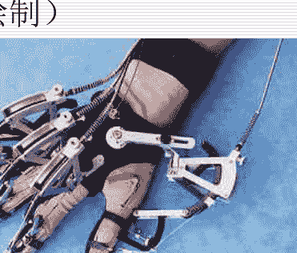

### Input Devices


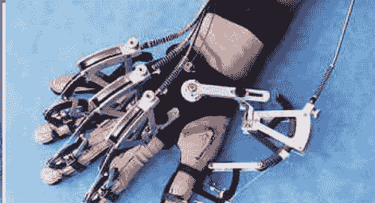

数据衣

数据手套

### Input Devices

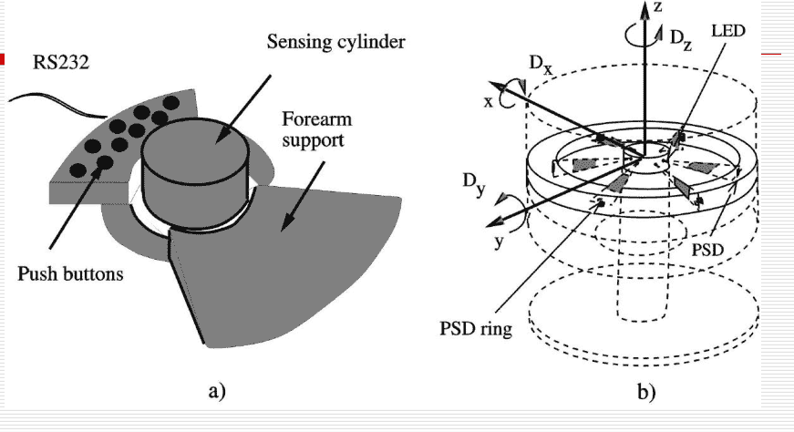

### Trackballs

### 图形软件的发展及软件标准的形成

- 开放式、高效率、标准化、集成化、智能化、学科交叉。

与设备无关、与应用无关、具有较高性能。

### 图形软件的发展及软件标准的形成

- 近二十年中，国际标准化组织ISO已经批准和正在讨论的与计算机图形有关的标准有：
  图形核心系统 GKS、三维图形核心系统GKS-3D、程序员层次交互式图形系统PHIGS、计算机图元文件CGM、计算机图形接口CGI、基本图形转换规范IGES、产品数据转换规范STEP。
- 事实标准
  SGI的OpenGL，微软的Direct X，Adobe的Postscript等。

### 1.3 计算机图形学的应用

- 计算机辅助设计与制造（CAD/CAM）

CAD通过交互式的图形设备对部件进行设计和描述，产生工程略图（线框图）或者更接近实际物体的透视图等，通过迅速地将各种修改信息进行组合，用户可以自由、灵活地对图形进行实验性改动和形体显示。

CAM技术在各种工业制造业中得到广泛的应用。（Pro/E, UG等）

### 图形用户界面

应

飞机、汽车、船舶、机电、轻工、服装的外形设计

- 集成电路、印刷电路板的设计
- 建筑设计
- 基于工程图纸的三维形体重建

用

在飞机工业中，美国波音飞机公司已用有关的CAD系统实现波音777大型客机的整体设计和模拟，其中包括飞机外型、内部零部件的安装和检验。使其设计制造成本下降30%以上。（无纸化设计，无纸化制造）

### 应用

### Engineering drawings

### (a) 工程图

### Wireframe

### (b) 线框图

### Solid

### (c) 实体图


### 计算机图形学的应用

- 计算机辅助绘图
- 图形、图表和模型图等的绘制；
- 商务事务领域分析财政、数学和经济等方面数据。
- 科学计算可视化：有限元分析、分子模型构建、地震数据处理、大气科学、生物信息、生物化学等。

### 计算机图形学的应用

- 计算机辅助教学（CAI）

计算机图形显示与处理技术已广泛地应用于计算机辅助教学系统中，它可以使教学过程，特别是基础学科的教学过程形象、直观和生动。

### 计算机图形学的应用

### 计算机艺术

计算机图形技术已广泛应用于各种图案、花纹、工艺外形及传统的油画、中国国画和书法等艺术品的制作，为创作艺术和商品艺术提供了更为广阔的空间。

> “计算机艺术是科学与艺术相结合的一门新兴的交叉学科，是计算机应用的一个崭新、富有时代气息的领域。
> 科学和艺术是不可分割的，就像一枚硬币的两面……” 
> ——诺贝尔物理学奖 李政道

### 计算机艺术——艺术领域

- 含义很广
- 以计算机为工具，可以完成多种艺术品的制作和设计，如绘画（平面图形）、雕塑（立体图形）、音乐、平面构成、空间结构，还有体操舞蹈设计等等。
- 其中，美术作品占比重最大
- 因此，计算机艺术主要指计算机美术
- 齐东旭
- 计算机动画，分形艺术
- 潘云鹤
- 智能CAD，纺织CAD

### 计算机艺术——艺术领域

- 计算机平面合成艺术（婚纱影楼，PS）

- 计算机数字图像合成艺术（Computer Image Editing and Montage Art）

- 主要指利用电脑对扫描或数字相机导入的图像素材进行编辑和合成，以及进行后期特技处理所产生的新视觉作品

- 软件包括：Corel Painter 或 Adobe Photoshop 等。

- 该类作品接近于传统摄影特技，并带有“蒙太奇艺术”的特点，许多合成图像带有荒诞、刺激、搞笑、离奇和超现实主义风格的效果。

- 优势为：易于掌握和普及、效果丰富、成本较低。

- 广泛应用于影视后期和多媒体创作。和应用美术及广告设计的关系十分密切。

### 非真实感绘制

### NPR Non-Photorealistic Rendering

- 非真实感图形比真实感图形应用更广泛，如文学读物插图，其中儿童读物插图量最大；
- 用数字方法对传统绘画进行模拟以掌握其规律性的东西；
- 传统动画都是非真实感的，现在需要用计算机技术再现它们

### 钢笔画效果

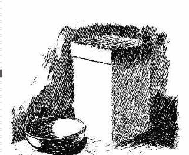

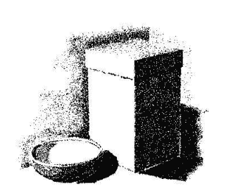

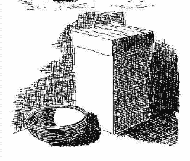

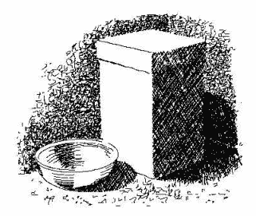

钢笔素描产生于中世纪，从19世纪开始成为一门艺术，然而用计算机模拟钢笔绘画却是20世纪90年代的事情。

### 铅笔画效果

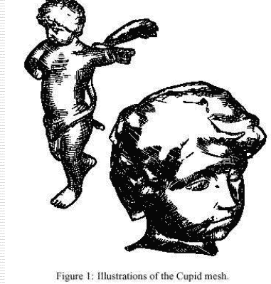

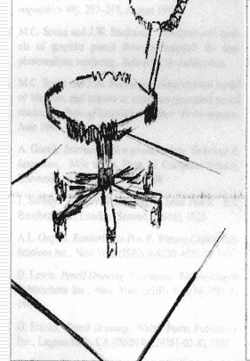

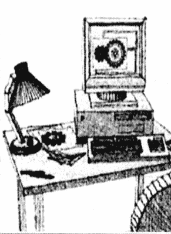

Figure 1: Illustrations of the Cupid mesh.

### 水彩画效果

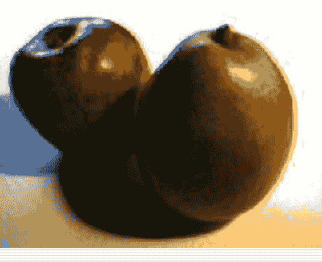

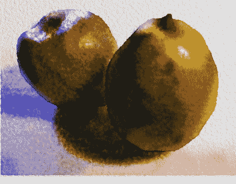

### 手绘图像效果（古装美女）


### 手绘图像效果（日本漫画）


### 计算机图形学的应用

- 工业控制及交通（组态王等软件）
- 在过程控制中，用户利用计算机图形处理和显示技术实现与其控制或管理对象间的相互作用；
- 用于石油化工、金属冶炼过程中的监视和控制；
- 铁路系统和公路系统的管制与监视。

### 计算机图形学的应用

- 医疗卫生
- 显示病历，显示各种药物的剂量、性能；
- 对某种病的治愈率作统计分析；
- 医学图像处理技术；
- 计算机辅助手术（Computer-Aided Surgery）。

### 虚拟手术仿真

应用

将医用CT扫描的数据转化为三维图像，并通过一定的技术生成在人体内漫游的图象，使得医生能够看到并准确地判别病人的体内的患处，然后通过碰撞检测一类的技术实现手术效果的反馈，帮助医生成功完成手术。

### 虚拟手术仿真

台湾pcexpert公司研制的LSVR系统逼真地模拟了腹腔手术，进行过程教学、手术成果检验等（右图：内视鏡虛擬手術模擬及訓練系統)或稱為最小侵入性外科手術模擬系統）

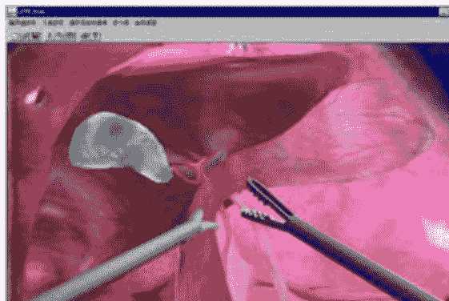

### 计算机图形学的应用

- 图形用户界面（GUI, Graphical User Interface）

典型的图形用户界面包含一个窗口管理程序、菜单显示和图符等。

除此以外，计算机图形学在广告、教学、游戏以及商业等方面都有着很好的应用和发展前景。

### 计算机图形学的研究动态

计算机动画：计算机动画是指用程序生成一系列的景物画面，其中当前帧画面是对前一帧画面的部分修改。通过足够快的速度显示这些帧已产生动态的效果

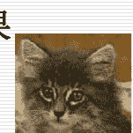

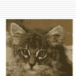

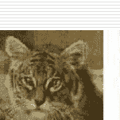

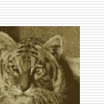


### 计算机动画的分类

- 刚体动画（相对运动变化来实现—虚拟漫游）
- 变形动画（一种形状或物体变成另一种形状或物体）
- 基于物理的动画（满足物理规律的运动动画）
- 粒子动画（大量粒子来模拟自然现象，如雨雪烟雾等）
- 关节动画（建立计算机模型来模拟两足或四足动物的运动，关节很主要）
- 行为动画（对物体的行为进行建模，如鸟群的运动）

### 计算机图形学的研究动态

- **地理信息系统**（以图形符号化的方式表达特征和现象的关系，空间位置、属性特征、时域特征）

地理信息系统（GIS，Geographic Information System）是一种用于采集、模拟、处理、检索、分析和表达地理空间数据的计算机信息系统，是社会经济与环境保护协同持续发展中，信息集成和分析的先进工具。

### 计算机图形成的研究动态

- 人机交互

人机交互学（Human-Computer Interface）
是一门关于设计、评估和执行交互式计算机系统以及研究由此而发生的相关现象的学科。它是伴随着计算机的出现而出现，伴随着计算机技术发展而发展的。

### 计算机图形学的研究动态

- 真实感图形显示（综合利用数学、物理学、计算机科学和其他相关学科知识逼真地表示真实世界的图形显示技术）
- 真实感图形的生成：
- 场景造型→（点线面体的几何描述）
- 取景变换→（三维到二维的投影变换）
- 视域裁剪→（抽取有用信息）
- 消除隐藏面→（场景消隐）
- 可见面光亮度计算（颜色）


### 计算机图形学的研究动态

虚拟现实（Virtual reality）

由计算机生成的一个实时三维空间。用户在其间可以“自由”地运动，随意观察周围的景物，并可以通过一些特殊的设备与虚拟物体进行交互操作，使用户产生一种身临其境的感觉。

### 虚拟现实技术

- 沉浸（Immersion）：全方位投入，使用户产生身临其境的感觉。
- 交互（Interaction）：响应用户的各种输入手势、语言命令以及身体动作。
- 构想（Imagination）：生动形象地反映设计者的思想。

### VIRTUAL REALITY TRIANGLE

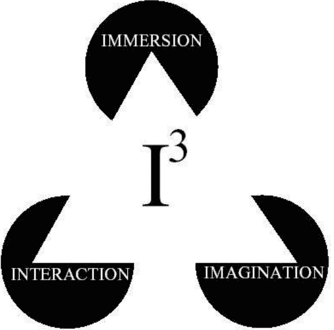

### 虚拟现实的关键技术

- 能以实时的速度生成有逼真感的景物图形。
- 能高精度的跟踪用户的头和手。
- 头盔显示器能产生高分辨率图象和较大的视角。
- 能对用户的动作产生力反馈。

### 三维输入设备

虚拟现实技术演示

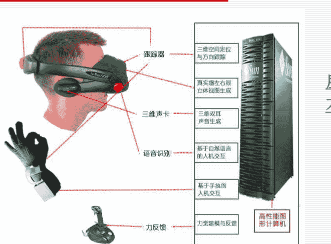

### 计算机图形学的研究动态

- □ 科学计算可视化

运用计算机图形学和图像处理技术，将科学计算过程中及计算结果的数据转换为图形及图像在屏幕上显示出来并进行交互处理的理论、方法和技术。

- ▸ 科学计算结果数据的后处理
- ▸ 科学计算结果数据的实时处理与显示
- ▸ 科学计算结果数据的实时绘制及交互处理

#### 并行图形处理

- - 多计算机的并行图形处理
- - 多图形显示子系统（显卡）实现并行计算
- - 多GPU/VPU的并行处理

SGI公司的InfiniteReality、HP公司的PixelFlow、斯坦福大学的WireGL（与Intel）、Chromium（与IBM）、浙江大学的AnyGL、MSPR等

## 第一章 绪论（课后习题）

- 1、名词解释：图形、图像、点阵化、参数法
- 2、什么是计算机图形学？分析计算机图形学、数字图像处理、模式识别和计算机视觉学科之间的关系
- 3、举例说明计算机图形学有哪些应用范围，解决的问题是什么？

## 第二章 计算机图形系统及图形硬件

- - 计算机图形系统概述(恰当的硬件、合适的软件、必需的数学方法、如何解决图形处理问题)
- - 图形输入设备
- - 图形显示设备
- - 显示子系统
- - 图形硬拷贝设备
- - OpenGL图形软件包

### 2.1 计算机图形系统概述

计算机图形系统的功能

- 1）计算功能：包括形体设计、分析的方法程序库和有关描述形体的图形数据库。数据库中应该有坐标的几何变换、曲线/曲面的生成、图形交点的计算以及性能检验等。
- 2）存储功能：在计算机的内/外存中存放各种图形数据以及图形数据之间的相互关系。
- 3）交互功能：决定了用户通过图形显示器和图形输入设备进行人机通信的方式。

### 2.1 计算机图形系统概述

计算机图形系统的功能

- 4）输入功能：将设计过程中图形的形状、大小和颜色属性等必要的参数和命令输入到计算机中。
- 5）输出功能：用于长期保存计算结果或交互需要的图形信息。

### 计算机图形系统的功能

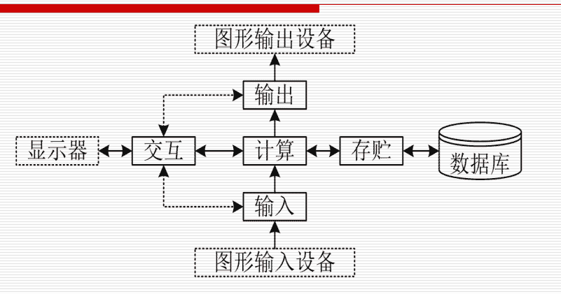

图2.1 计算机图形系统的功能

### 2.1 计算机图形系统概述

- - 计算机图形系统的结构
- - 图形系统的结构有图形软件与图形硬件构成

### 计算机图形系统的结构

图形系统
图形软件
图形硬件
图形应用数据结构
图形应用软件
图形处理软件、图形生成软件、图形用户接口、图形辅助控制、图形工具软件
图形支撑软件
图形计算机平台
微型计算机
工作站
计算机网络
中小型计算机
图形设备
图形输入设备
图形输出设备
图形显示设备
图形数据文件
图形基元模型
字模字体库
图案模型
几何描述数据

图2.2 计算机图形系统的结构

### 图形输入设备的发展

- - 第一阶段：控制开关、穿孔纸等
- - 第二阶段：键盘、光笔
- - 第三阶段：
  - 二维定位设备，如鼠标、坐标数字化仪、跟踪球、触摸屏、操纵杆、扫描仪等
- - 第四阶段：
  - 三维输入设备（如三维鼠标、空间球、数据手套、数据衣）
  - 智能人机接口：用户的手势、表情、语音等

### 2.2 图形输入设备

- - 键盘（keyboard）

键盘能用来进行屏幕坐标的输入、菜单选择、图形功能选择，以及输入那些如辅助图形显示的图片标记等非图形数据。

### 图形输入设备

- 鼠标器（mouse）

当推动鼠标器在平面上移动时，鼠标将记录移动的方向和距离，这个方向和距离被传送给计算机，转换成对应的光标的位移。

### 图形输入设备

光笔(light pen)

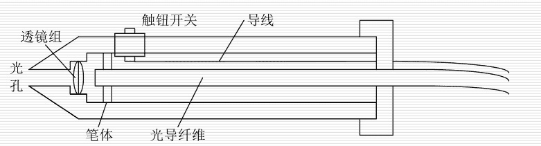

图2.3 光笔的结构

### 图形输入设备

- - 触摸屏(touch screen)

当用手指或者小杆触摸屏幕时，触点位置便以光学的（红外线式触摸屏）、电子的（电阻式触摸屏和电容式触摸屏）或声音的（声音探测式）方式记录下来。

### 图形输入设备

- □ 操纵杆(joystick)

操纵杆是由一根小的垂直杠杆组成的
可摇动装置，该杠杆装配在一个其四周可移动的底座上来控制屏幕光标。

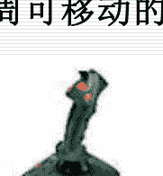

### 图形输入设备

- 跟踪球（Trackball）和
- 空间球（Spaceball）

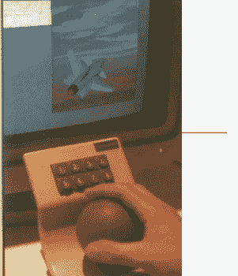

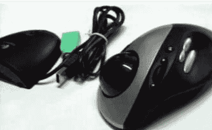

图2.4 跟踪球

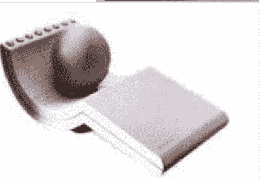

图2.5 空间球

### 图形输入设备

### 数据手套(Data Glove)

是一种戴在手上的传感器，可以用来抓住“虚拟对象”，它由一系列检测手和手指运动的传感器构成，用来提供关于手的位置和方向的信息。


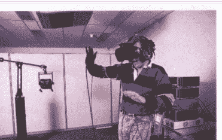

图 2-23 与虚拟现实环境的交互(伊利诺大学国家超级计算机应用中心提供)

### 三维数字化仪

工作原理

- - 电磁感应技术
- - 由一块数据板和一根触笔组成
- - 数据板中布满了金属栅格，当触笔在数据板上移动时，其正下方的金属栅格上就会产生相应的感应电流
- - 根据已产生电流的金属栅格的位置，就可以判断出触笔当前的几何位置
- - 许多数字化仪提供了多种压感电流，用不同的压力就会有不同的信息传向计算机

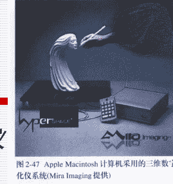

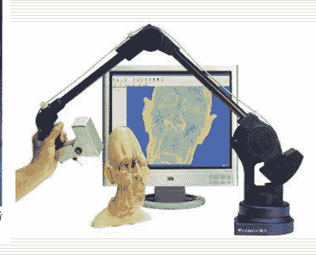

### 图形输入设备

- 图像扫描仪(Scaner)

图像扫描仪可直接把图纸、图表、照片、广告画等输入到计算机中，在将它们传过一个光学扫描机构时，灰度或彩色等级被记录下来，并按图像方式进行存储。

### 图形输入设备 (7/13)

### 扫描仪工作原理

- - 用光源照射原稿
- - 投射光线经过一组光学镜头射到CCD器件上，得到元件的颜色信息
- - 再经过模/数转换器，图象数据暂存器等
- - 最终输入到计算机

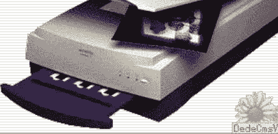

### 图形输入设备

- - 声频输入系统
- - 视频输入系统

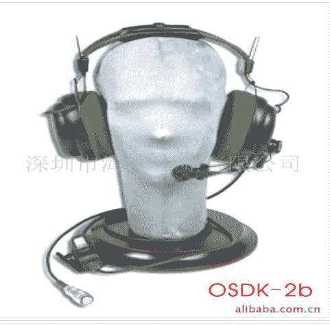

### 2.3 图形显示设备

- - 阴极射线管
- - 彩色阴极射线管
- - CRT图形显示器
- - 平板显示器
- - 三维观察设备

### 阴极射线管（CRT）

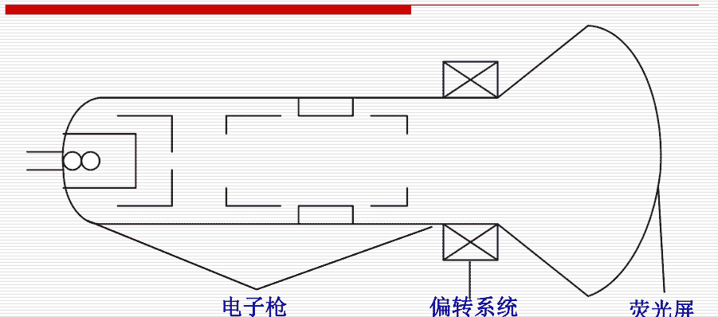

图2.6 CRT的结构


### 阴极射线管（CRT）

#### 电子枪

- 产生一个沿管轴（Z轴）方向前进的高速的细电子束轰击荧光屏。
- 具有足够的电流强度。
- 电流的大小和有无必须是可控的。
- 具有很高的速度。
- 在荧光屏上应能聚焦很小的光点，以保证显示器有足够的分辨率。

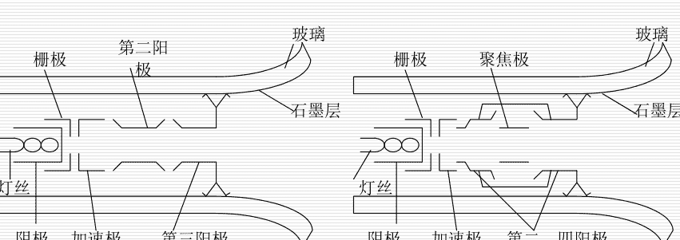

（a）三极电子枪

（b）四极电子枪

图2.7 CRT电子枪的结构

#### 偏转系统

为了在荧光屏上显示图形及字符，必须用电子束偏转扫描来实现。

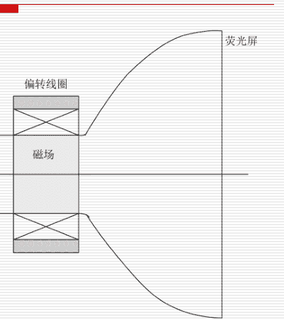

图2.8 磁偏转

#### 枕形失真的校正

- 将产生偏转磁场的锯齿形电流预先产生一些失真；
- 将偏转磁场做成略有不匀性，接近管轴中央处略强，周围略弱。

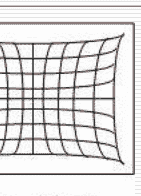

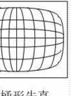

图2.9 枕形失真与桶形失真

#### 电偏转

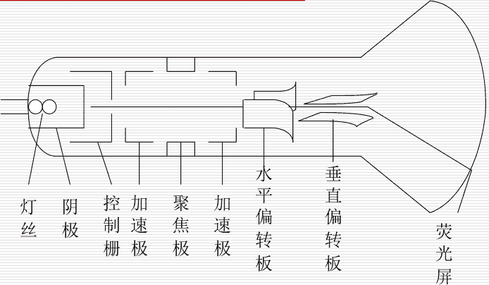

灯丝

阴极

控制栅极

加速极

聚焦极

加速极

水平偏转板

垂直偏转板

荧光屏

图2.10 电偏转

#### 荧光屏（Phosphor Screen）

荧光屏是用荧光粉涂敷在玻璃底壁上制成的，常用沉积法涂敷荧光粉。玻璃底壁要求无气泡，表面光学抛光。

荧光粉的性能要求是：发光颜色满足标准白色、发光效率高、余辉时间合适以及寿命长等。余辉时间：从电子束停止轰击到发光亮度下降到初始值的1%所经历的时间。

#### 彩色阴极射线管——荫罩式

- 三基色原则
- 主要结构：三色荧光屏、三支电子枪、荫罩板

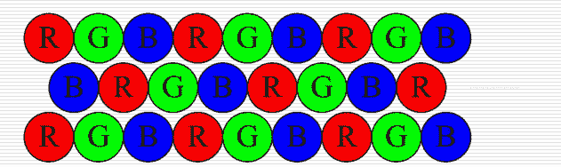

图2.11 三色荧光屏

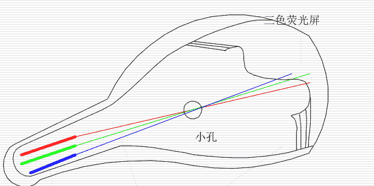

图2.12 三支电子枪

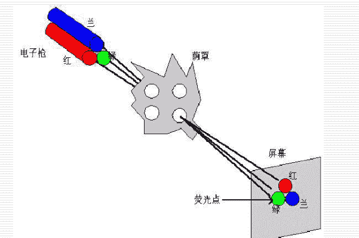

图2.13 荫罩

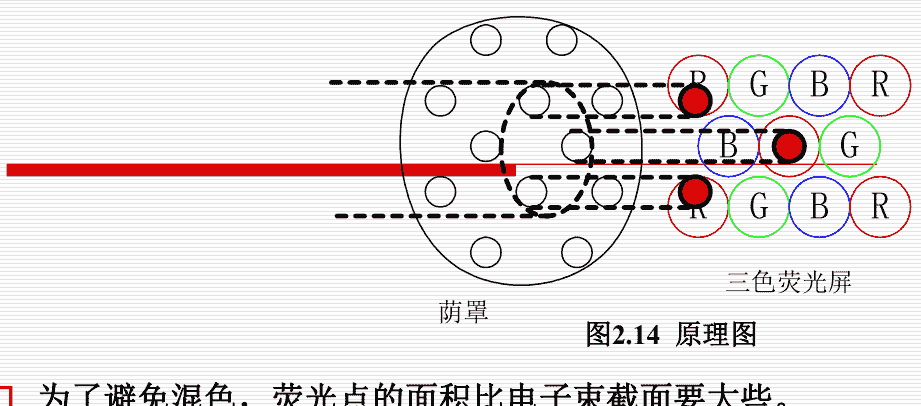

荫罩

三色荧光屏

图2.14 原理图

- 为了避免混色，荧光点的面积比电子束截面要大些。
- 只有15%左右的电子到达屏幕。
- 荫罩吸收大量电子，容易发热变形。
- 管子的亮度低，要提高管子的亮度，则需提高第二阳极的高压。

#### 色纯、会聚和白平衡

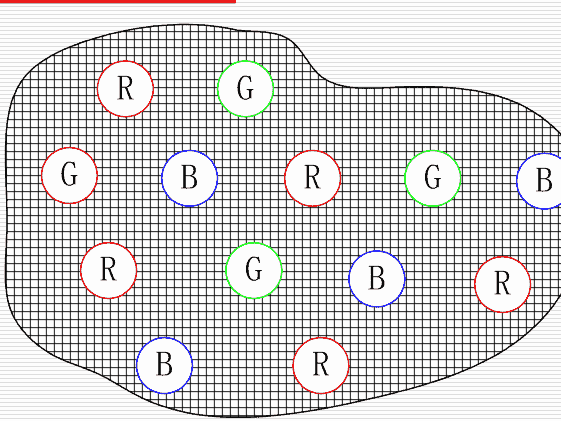

图2.15 黑底荫罩管

### CRT图形显示器

- 随机扫描的图形显示器
- 直视存储管图形显示器
- 光栅扫描的图形显示器

#### 1) 随机扫描的图形显示器

- 向量（vector）显示器、笔划（Stroke writing）显示器。
- 随机扫描（random-scan）的图形显示器中电子束的定位和偏转具有随机性，即电子束的扫描轨迹随显示内容而变化，只在需要的地方扫描，而不必全屏扫描。

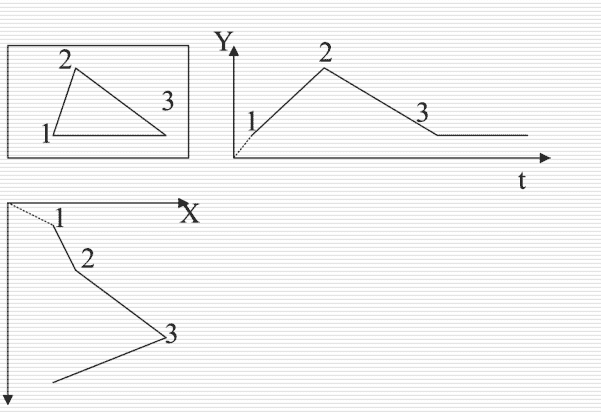

图2.16 随机扫描图形显示器的工作原理

#### 2) 直视存储管图形显示器

直视存储管DVST（direct-view storage tube）（通过紧贴在屏幕荧光屏层后的电荷分布来存储图形信息），从表面上看直视存储管的特性极像一个有长余辉的荧光屏，一条线一旦画在屏幕上，在一小时之内都将是可见的。

- 无需刷新；
- 很复杂的图形都可以在极高的分辨率下无闪烁地显示；
- 成本较低；

缺点：

- 不能显示彩色；
- 不能局部修改；只能擦除整个屏幕。
- 擦除和重画过程可能持续较长时间。

#### 3) 光栅扫描图形显示器（最广泛使用）

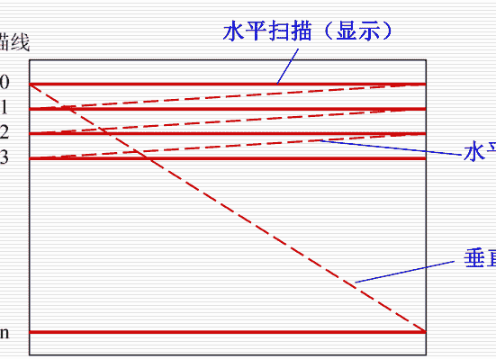

图2.18 光栅扫描原理

光栅扫描图形显示器（画点设备，需要使用反走样技术减轻锯齿问题）。

- 被显示的线段、字符、图形及其背景色都按照像素一一存储在刷新缓冲存储器（refresh buffer）或称帧缓冲存储器（frame buffer）。
- 该类存储器中保存的每单位信息对应屏幕上的一个点，该点称为像素（pixel或pel，是picture element的简写）。
- 像素信息从应用程序转换并放入帧缓冲区的过程称之为扫描转换过程。系统在垂直回扫期间，把亮度信息放入帧缓存中。

### 平板显示器（flat-panel display）

（CRT的笨重性、高电压和非数字化寻址）

低电压、轻小型、数字化显示器件。

平板显示器（flat-panel display）的分类：

- 非发射显示器（non-emissive display）（如液晶显示器）
- 发射显示器（emissive display）（如平板CRT、等离子体、薄片光电显示器、发光二极管等）

- 液晶显示器
- 等离子体显示板（Plasma Panel）
- 薄片光电显示器（Thin-Film Electroluminescent Display）
- 发光二极管（Light-Emitting Diode, LED）

#### 液晶显示器——原理

液晶分子（不仅具有液体的流动性，而且兼具晶体的各向异性）的排列在微弱的外部电场、磁场或者应力、温度变化等作用下非常容易改变。当液晶分子的某种排列状态在电场作用下变为另一种状态时，液晶的光学性质随之改变，这种产生光被电场调制的现象称为液晶的电光效应。

液晶显示的机理是通过能阻塞或传递光的液晶材料，传递来自周围的或内部光源的偏振光。

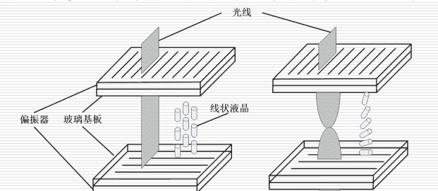

图2.20 液晶显示原理

#### 液晶显示器——类型

- NW（Normal White）型的LCD：在液晶面板不施加电压时，我们所看到的面板是透光的画面，也就是亮的画面。
- NB（Normal Black）型的LCD：当对液晶面板不施加电压时，面板无法透光。

背光板提供一个亮度高且分布均匀的光源。

#### 液晶显示器——彩色

- 液晶显示器利用在一侧的玻璃基板上加上一个彩色滤光片（CF，Color Filter）实现彩色。
- 彩色滤光片上均匀分布着红、绿、蓝色小点，每个小点有各自不同的灰度，相邻的一组RGB小点构成一个基本的彩色显示单元，即一个像素。

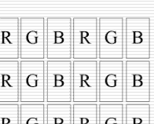

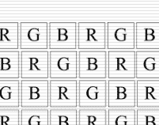

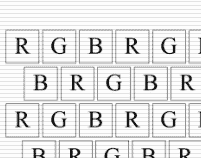

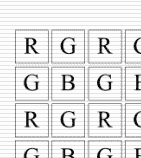

（条状排列适合桌面和便携式，马赛克或三角形适合电视机）

像素由亮转暗并由暗转亮所需要的时间称为反应时间

图2.21 彩色滤光片排列方式

#### 液晶显示器——分类

- 扭曲向列型（TN, Twisted Nematic）
- 超扭曲向列型（STN, Super TN）
- 双层超扭曲向列型（DSTN, Dual Scan TN）

缺点：对比度、亮度较差、可视角度小、色彩欠丰富

- 薄膜晶体管型（TFT, Thin Film Transistor）

（每个像素位置放置一个薄膜晶体管，控制像素位置的电压，并阻止液晶单元慢性漏电）

反应速度快、对比度好、亮度高、可视角度大、色彩丰富


### 等离子体显示板（气体放电显示器）

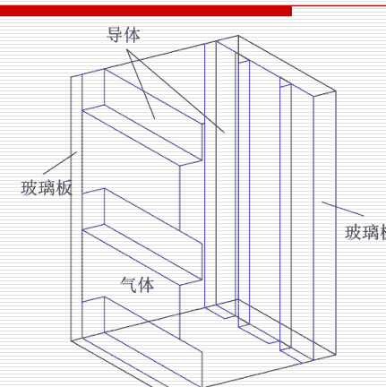

导体

玻璃板

气体

玻璃板

图2.22 等离子体显示板的基本结构

### 发光二极管 (LED)

发光二极管采用二极管激发发光来显示图像。二极管以矩阵排列形成显示器的像素位置。图形的定义存储在刷新缓冲器中。信息从刷新缓冲器读出，并转换为电压施于二极管，在显示器上产生发光图案。

### 三维观察设备

□ 从变焦距的柔性震动镜面反射CRT图像

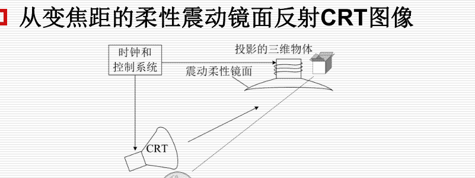

图2.24 采用震动镜面的三维显示系统

### 三维观察设备

+   - 显示具立体感的视图
+   - 利用不同的刷新周期交替地显示两视图；（立体眼镜）
+   - 将屏幕分半；（偏振光眼镜）
+   - 使用头盔式结构。（头盔显示器）

### 2.4 显示子系统

+   - 光栅扫描图形显示子系统的结构
+   - 绘制流水线
+   - 相关概念

### 光栅扫描图形显示子系统的结构


图2.25 简单的光栅图形显示子系统

### 光栅扫描图形显示子系统的结构


图2.26 常见的光栅图形显示子系统

### 光栅扫描图形显示子系统的结构


图2.27 发展的光栅图形显示子系统

### 光栅扫描图形显示子系统的结构(显卡)

+   □ 帧缓冲存储器：用来存储像素颜色（灰度）值的存储器。

+   □ 双缓存：一个缓存用来刷新的同时，另一个写入数据信息，尔后这两个缓存可互换角色。这种方式称为双缓存，它可以使得显示的动画流畅而没有滑动感。

### 光栅扫描图形显示子系统的结构

□ 显示控制器（Display Controller），又称视频控制器（Video Controller），主要功能是依据设定的显示工作方式，自主地、反复不断地读取帧缓存中的图像点阵（包括图形、字符文本）数据，将它们转换成R、G、B三色信号并配以同步信号送至显示器，即可刷新屏幕。

### 光栅扫描图形显示子系统的结构

+   □ 显示处理器（Display Processor），又称图形控制器（Graphics Controller）或显示协处理器（Display Coprocessor），它把CPU从图形显示处理的事务中解脱出来，其主要任务是扫描转换待显示的图形以及某些附加的操作等。

### 绘制流水线

+   - 图形子系统的图形绘制功能常常采用流水线（Pipeline）结构绘制，或者称为管线绘制。

+   - 绘制流水线的基本结构从概念上包括三个阶段
+     - 应用程序阶段
+     - 几何阶段
+     - 光栅阶段

### 相关概念

+   - 分辨率
+   - 像素与帧缓存
+   - 颜色查找表
+   - 显示长宽比
+   - 屏幕坐标系

### 相关概念——分辨率

+   - 光点一般是指电子束打在显示器的荧光屏上，
+   显示器能够显示的最小的发光点。
+   - 像素点是指图形显示在屏幕上时候，
+   按当前的图形显示分辨率所能提供的最小元素点。
+   像素点可以看做光点的集合，
+   其最小尺寸等于光点

### 相关概念——分辨率（屏幕分辨率、显示分辨率和存储分辨率）

+   □ 屏幕分辨率，也称为光栅分辨率，它决定了显示系统最大可能的分辨率，任何显示控制器所提供的分辨率也不能超过这个物理分辨率。

+   □ 通常用水平方向上的光点数与垂直方向上的光点数的乘积来表示。

### 相关概念——分辨率

+   - 显示分辨率是计算机显示控制器所能够提供的显示模式分辨率，实际应用中简称为显示模式。
+   - 对于文本显示方式，显示分辨率用水平和垂直方向上所能显示的字符总数的乘积表示。
+   - 对于图形显示方式，则用水平和垂直方向上所能显示的像素点总数的乘积表示。
+   - 显示分辨率不同，它所对应的像素点大小也不同。

### 相关概念——分辨率

□ 图形的存储分辨率是指帧缓冲区的大小，一般用缓冲区的字节数表示。

□ 存储分辨率不仅与显示分辨率有关，还与像素点的色彩有关。

□ 帧缓存大小的计算：
x方向的像素点数 × y方向的像素点数 × log₂n/8 (BYTE)
其中：n为颜色数或灰度等级数

### 相关概念——分辨率

+   - 屏幕分辨率决定了所能显示的最高分辨率。
+   - 显示分辨率和存储分辨率对所能显示的图形分辨率有控制作用。
+   - 显示器中的分辨率

带宽 = A*水平像素点数*垂直像素点数*刷新频率
A常取1.344

### 相关概念——颜色查找表

颜色查找表也称调色板，是由高速的随机存储器组成，用来储存表达像素色彩的代码。此时帧缓冲存储器中每一像素对应单元的代码不再代表该像素的色彩值，而是作为查色表的地址索引。

### 2.5 图形硬拷贝设备

+   - 打印机
+   - 绘图仪

### 打印机

+   - 打印机是画点设备。
+   - 击式打印机主要指针式打印机，它隔着色带将某种点阵图案压在纸上。
+   - 非撞击式打印机包括激光打印机、喷墨打印机、热转印打印机、染料热升华打印机和静电打印机等。

### 绘图仪

+   □ 笔式绘图仪（Pen Plotter）是画线设备。

+   □ 笔式绘图仪可分为平板式绘图仪（Flatbed Plotter）和滚筒式绘图仪（Drum Plotter）

### 2.6 OpenGL图形软件包

+   - OpenGL的主要功能
+   - OpenGL的绘制流程
+   - OpenGL的基本语法
+   - OpenGL的程序实例

### OpenGL图形软件包

+   - OpenGL是SGI（Silicon Graphics Inc.）公司对IRIS GL进行改进，扩展可移植性，形成的一个跨平台开放式图形编程接口。

+   - 目前，OpenGL标准由1992年成立的独立财团 OpenGL Architecture Review Board（ARB）以投票方式产生，并制成规范文档公布。各软硬件厂商以此为基础在各自的系统上予以实现。

### OpenGL的主要功能

+   - 模型绘制
+   - 模型观察
+   - 颜色模式
+   - 光照应用
+   - 图像效果增强
+   - 位图和图像处理

### OpenGL的主要功能

+   - 纹理映射
+   - 实时动画
+   - 交互技术

### OpenGL的绘制流程——流水线

OpenGL命令将被放在一个命令缓冲区中，这样命令缓冲区中包含了大量的命令、顶点数据和纹理数据。当缓冲区被清空时，缓冲区中的命令和数据都将传递给流水线的下一个阶段。


图2.35 一条简化的OpenGL绘制流水线

### OpenGL的基本语法——相关库

+   - OpenGL核心库： gl（115个最基本的命令函数）
+   - OpenGL实用程序库： glu（43个函数，可实现复杂的操作，如纹理映射、坐标变换、网格化等）
+   - OpenGL编程辅助库： aux（31个函数）
+   - OpenGL实用程序工具包（OpenGL utility toolkit，GLUT）： glut（30多个，基于窗口的工具）
+   - Windows专用库： wgl（6个函数，用于连接OpenGL和Windows NT）

### OpenGL的基本语法——命名规则

+   □ OpenGL函数都遵循一个命名约定，即采用以下格式：

```
<库前缀><根命令><可选的参数个数><可选的参数类型>
```

例如函数glColor3f(...), gl表示这个函数来自库gl.h, color表示该函数用于颜色设定, 3f表示这个函数采用了三个浮点数参数。


### OpenGL的基本语法——数据类型

表2.1 OpenGL的数据结构

| OpenGL数据类型 | 内部表示法 | 定义为C类型 | C字面值后缀 |
|---|---|---|---|
| GLbyte | 8位整数 | signed char | B |
| GLshort | 16位整数 | short | S |
| GLint、GLsizei | 32位整数 | long | L |
| GLfloat、GLclampf | 32位浮点数 | float | F |
| GLdouble、GLclampd | 64位浮点数 | double | D |
| GLubyte、GLboolean | 8位无符号整数 | unsigned char | Ub |
| GLshort | 16位无符号整数 | unsigned short | Us |
| GLuint、GLenum、GLbitfield | 32位无符号整数 | unsigned long | Ui |

### OpenGL程序实例——窗口管理

- 初始化（`glutInit`）
- 创建窗口（`glutCreateWindow`）
- 设定窗口的显示模式（`glutInitDisplayMode`）
- 指定窗口的位置和大小（`glutInitWindowPosition`和`glutInitWindowSize`）
- 指定窗口的显示内容函数（`glutDisplayFunc`）
- 运行框架（`glutMainLoop`）

### OpenGL程序实例——绘制图形

- 指定窗口背景色（ glClearColor ）

- 颜色管理，使用RGB颜色模型。一种颜色用红、绿、蓝三种颜色成分混合而成，每种颜色成分使用0.0到1.0之间的任意有效浮点数来表示颜色值。

### OpenGL程序实例——绘制图形

表2.2 OpenGL的一些常用混合色

| 混合色 | 红色成分（R） | 绿色成分（G） | 蓝色成分（B） |
|---|---|---|---|
| 黑 | 0.0 | 0.0 | 0.0 |
| 红 | 1.0 | 0.0 | 0.0 |
| 绿 | 0.0 | 1.0 | 0.0 |
| 黄 | 1.0 | 1.0 | 0.0 |
| 蓝 | 0.0 | 0.0 | 1.0 |
| 紫 | 1.0 | 0.0 | 1.0 |
| 青 | 0.0 | 1.0 | 1.0 |
| 深灰 | 0.25 | 0.25 | 0.25 |
| 浅灰 | 0.75 | 0.75 | 0.75 |
| 棕 | 0.60 | 0.40 | 0.12 |
| 南瓜橙 | 0.98 | 0.625 | 0.12 |
| 粉红 | 0.98 | 0.04 | 0.70 |
| 紫红 | 0.60 | 0.40 | 0.70 |
| 白 | 1.0 | 1.0 | 1.0 |

### OpenGL程序实例——绘制图形

- 刷新窗口的缓冲区（ glClear）
- 设定投影参数
  ```
  glMatrixMode(GL_PROJECTION);
  gluOrtho2D(0.0,200.0,0.0,150.0);
  ```
- 绘制图形
  ```
  glRectf(50.0f, 100.0f, 150.0f, 50.0f);
  ```

### 课后第一次作业 (请交电子版, caizesu@sina.com)

1、名词解释：
鼠标、光笔、数据手套、液晶显示器、像素点 、屏幕分辨率、显示分辨率、存储分辨率

2、试列出你所知道的图形输入与输出设备

3、简述液晶显示器的基本显示原理

4、实验作业： 在Visual C++环境下利用 OpenGL给出 一个特定名称命名的窗口 ，并在窗口中绘制一个有简单二维图形组合而成的图案。

## 第三章 用户接口与交互技术

- 用户接口设计
- 逻辑输入设备与输入处理
- 交互式绘图技术
- OpenGL实现橡皮筋技术
- OpenGL实现拾取操作
- OpenGL中的菜单功能

### 3.1 用户接口设计

一个好的图形用户接口应具备以下特点：

- 易于被用户理解并接受；
- 易于操作、使用；
- 高效率、可靠性和实用性。

### 用户模型

- 用户模型（User Mode）是用户接口设计的基础，它提供给用户有关它所处理的的对象以及作用于这些对象的处理过程的一个概念性模型。

- 用户模型依照定义对象和对对象进行的操作来定义图形系统。

- 用户模型应尽可能地使用用户熟悉的概念而回避一些计算机专业术语。

### 反馈

□ 反馈是计算机与用户交互的一个基本成分，计算机图形终端给出反馈信息，用来帮助用户对系统进行操作。

□ 反馈要求系统在接收到每次输入以后给出某种类型的反应。

□ 反馈信息通常应足够简捷清晰，引人注目，但这些信息也不能过分突出，以至于干扰用户的注意力。

□ 实现反馈必须考虑的因素是速度。

### 一致性原则

- 一致性原则是指在设计系统的各个环节时，应遵从统一和简单的规则，保证不出现例外和特殊的情况，无论信息显示还是命令输入都应如此。

- 按用户认为最正常、最合乎逻辑的方式去做，这比保持单纯的一致性更重要。

### 减少记忆量

- 用户接口的操作应该组织得容易理解和记忆。
- 重要的原则是唤醒用户的识别而不是记忆。

### 回退和出错处理

- 回退（Undo）机制，它指绘图系统允许用户沿着进行的操作步骤，一步步倒退，并删除已做的操作。
- 对操作过程中的任何错误或失误，无论在何级别，都应有一定的改错、取消和修复措施。
- 设计一些好的诊断程序和提供出错信息可帮助确定发生错误的原因。

### 视觉效果设计

- 视觉效果设计涉及用户接口的各个方面，如屏幕的布局、色彩的使用、信息的安排等等，这里强调的是色彩的使用。
- 通常在选择色彩对比时以色调对比为主。
- 为减轻视觉疲劳，还应该在视野范围内保持均匀的色彩明亮度。

### 适应不同的用户

- 针对同一交互任务，交互式图形接口通常提供
  多种交互方式以适应不同的用户。

### 逻辑输入设备

表2.1 图形输入设备的逻辑分类

| 名称 | 基本功能 |
|------|----------|
| 定位设备 (Locator) | 指定一个点的坐标位置 (x, y) |
| 笔划设备 (Stroke) | 指定一系列点的坐标 |
| 数值设备 (Valuator) | 输入一个整数或实数 |
| 字符串设备 (String) | 输入一串字符串 |
| 选择设备 (Choice) | 选择某个菜单项 |
| 拾取设备 (Pick) | 选择显示着的图形的组成部分 |

□ 图形输入设备从逻辑上分为六种 (PHIGS、GKS)。

### 逻辑输入设备

- **定位设备**有鼠标器、操纵杆、跟踪球、空间球、数字化仪的触笔或手动光标等。（在屏幕上交互地指定一个点的坐标位置）

- 定位设备的三种分类
  - 绝对坐标设备（数字化仪和触摸屏）和相对坐标设备（鼠标器、跟踪球和操纵杆等）
  - 直接设备（触摸屏）和间接设备（鼠标等）
  - 连续设备（鼠标、操纵杆、数字化仪等）和离散设备（键控光标）

### 逻辑输入设备

□ 笔划设备： 笔划设备的输入等于多次调用定位设备，产生一系列的坐标值，根据产生的坐标值可产生多边形和曲线等。（交互式指定多个点的坐标位置）

□ 定值设备： 定值设备常用来输入各种参数和数据。

### 逻辑输入设备

□ 字符串设备：即进行字符串输入。包括键盘、语音、笔画（手写）等输入。

□ 选择设备

- 选择设备用来选择菜单选项、属性选项和用于构图的对象形状等。

- 常用的选择设备有功能键、热键和定位设备等等。

### 逻辑输入设备——拾取设备

### 冲突问题的解决

- 在图形对象生成时就对每一个对象确定其拾取优先级。

- 依次对拾取图形设立标志。

- 找距离最近的对象优先拾取。


图2.2 距离最近原则


### 逻辑输入设备——拾取设备

- 矩形包围。
- 直接键入结构名字。


### 输入模式

- 输入模式即如何管理、控制多种输入设备进行工作。
- 常用的输入模式有请求（request）、采样（sample）、事件（event）及其组合形式等几种。

### 输入模式

- □ 请求方式（request mode）：输入设备在应用程序的控制下工作，程序在输入请求发出后一直被置于等待状态直到数据输入。（指定、请求、等待）

- □ 取样方式（sample mode）：此时，应用程序和输入设备同时工作，当输入设备工作时，存储输入数据，并不断地更新当前数据，当程序要求输入时，程序采用当前数据值。

### 输入模式

- □ 事件方式（event mode）：每次用户对输入设备的一次操作以及形成的数据叫做一个事件。
- ■ 思想：一般一个事件发生时，往往来不及进行处理，于是，就要把事件按先后次序排成队列，以便先进先出，即先到的事件进入队列，先被取出进行处理。
- ■ 当设备被置成事件方式，程序和设备同时工作。

### 3.3 交互式绘图技术

- □ 基本交互绘图技术（回显、约束、网格、引力域、橡皮筋技术、草拟技术、拖动、旋转、形变等）

- □ 三维交互技术（三维图形数据的输入、三维定位、三维定向等）

### 基本交互绘图技术

- 回显


图2.5 回显

### 基本交互绘图技术

- 约束（在图形绘制的过程中对图形的方向、对齐方式等进行规定和校准）

- 网格（网格对齐）


图2.6 约束和网格

### 基本交互绘制图技术

□ 草拟技术（用来实现用户任意意图画图的要求）

（基于距离采样和基于时间采样）


图2.8 草拟技术

### 基本交互绘图技术

- • 拖动（将图形对象在空间的移动过程动态、连续地表示出来，直到满足要求为止）


图2.9 拖动技术

### 基本交互绘图技术

- 旋转


图2.10 旋转技术

### 基本交互绘图技术

- □ 形变


图2.11 形变技术

### 三维交互技术（无法区分深度值）

- 三维图形数据的输入
- 三维定位
- 三维定向

### 3.4 OpenGL实现橡胶筋技术

- 橡胶筋技术的实现方法（两种）

利用颜色的异或操作，对原有图形并不是擦除，而是再绘制一条同样的直线段并与原图形进行异或操作，此时原图形会从屏幕上消失；

利用双缓存技术，绘制图形时分别绘制到两个缓存，交替显示。

### OpenGL实现橡皮筋技术

- 鼠标实现
  - 鼠标响应函数
    glutMouseFunc
  - 鼠标移动相应函数
    glutMotionFunc
    glutPassiveMotionFunc

### OpenGL实现橡皮筋技术

- 键盘实现

- 键盘相应函数

glutKeyboardFunc

### OpenGL实现拾取操作

- 名字堆栈操作
  - 初始化名字堆栈（`glInitNames`）
  - 将一个名字压入堆栈（`glPushName`）
  - 替换名字堆栈的栈顶元素（`glLoadName`）
  - 将栈顶元素弹出（`glPopName`）

### OpenGL实现拾取操作

- □ 设置合适的变换过程

```
gluPickMatrix(xPick, yPick, widthPick, heightPick, *vp);
```

- □ 为每个图元分配名字并绘制

- □ 切换回渲染模式

- □ 分析选择缓冲区中的数据

### 3.6 OpenGL中的菜单功能

- □ 菜单注册函数

      glutCreateMenu(ProcessMenu);

- □ 在菜单中加入菜单项

      void glutAddMenuEntry(char *name,
      GLint value);

- □ 将菜单与某个鼠标按键关联

      void glutAttachMenu(button);

## 第四章 图形的表示与数据结构

- 如何在计算机中建立恰当的模型表示不同图形对象。

- 如何组织图形对象的描述数据以使存储这些数据所要的空间最省，检索、处理这些数据的速度较快。

### 图形的表示与数据结构

- 基本概念
- 三维形体的表示
- 非规则对象的表示
- 层次建模

### 4.1 基本概念

- 造型技术
- 基本图形元素
- 几何信息与拓扑信息
- 坐标系
- 实体的定义
- 正则集合运算
- 欧拉公式

### 基本概念——造型技术

把研究如何在计算机中建立恰当的模型表示不同图形对象的技术称为造型技术。

- 有两类图形对象：
  
  - 规则对象：几何造型、几何模型(几何信息和拓扑信息)。
  
  - 不规则对象：过程式模拟。

### 基本概念——基本图形元素

- 基本图形元素：图素或图元、体素。
- 图素是指可以用一定的几何参数和属性参数描述的最基本的图形输出元素（包括点、线、面、环、体等）。
- 在二维图形系统中将基本图形元素称为图素或图元，在三维图形系统中称为体素。

- □ 1、点：为0维几何元素，是形体最基本的元素，自由曲线、曲面或其他形体均可用有序的点集来表示。点集及其连接关系的存储。
- □ 2、线：一维几何元素，是两个邻面或多个邻面的交界
- □ 3、面：二维几何元素，是形体上一个有限、非零的区域，由一个外环和若干内环界定其范围。具有方向性，由其外法线矢量方向定义。
- □ 4、环：有序、有向边组成的面的封闭边界。（外环中其边逆时针排序，内环顺时针排序）
- □ 5、体：三维几何元素，由封闭表面围成的空间。

### 基本概念——几何信息与拓扑信息

- □ 图形信息与非图形信息
  - ■ 几何信息：形体在欧氏空间中的位置和大小。
  - ■ 拓扑信息：形体各分量（点、边、面）的数目及其相互间的连接关系。

面相邻性 f:{f}

面-顶点包含性

面-边包含性 f:{e}

顶点-面相邻性

顶点相邻性

顶点-边相邻性 v:{e}

边-面相邻性 e:{f}

边-顶点包含性 e:{v}

边相邻性 e:{e:}

#### 图4.1 拓扑信息

### 基本概念——几何信息与拓扑信息

- 刚体运动：不改变图形上任意两点间的距离，也不改变图形的几何性质的运动。

- 拓扑运动：允许形体作弹性运动，即在拓扑关系中，对图形可随意地伸张扭曲。但图上各个点仍为不同的点，决不允许把不同的点合并成一个点。


### 基本概念——坐标系

- 建模坐标系（Modeling Coordinate System）（局部坐标系）
- 用户坐标系（全局坐标系、世界坐标系）
- 观察坐标系（Viewing Coordinate System）（指定裁剪空间、定义投影平面，将用户坐标转换成规格化的设备坐标）
- 规格化设备坐标系（Normalized Device coordinate System）（定义视图区）
- 设备坐标系（Device Coordinate System）（图形输入/输出的设备坐标系，如屏幕等）

### 基本概念——实体


图4.2 带有悬挂边的立方体

### 三维物体表面必须具有以下5条性质：

- 连通性：位于物体表面上的任意两个点都可用实体表面上的一条路径连接起来。
- 有界性：物体表面可将空间分为互不连通的两部分，其中一部分是有界的
- 非自相交性：物体的表面不能自相交
- 可定向性：物体表面的两侧可明确定义出属于物体的内侧或外侧
- 闭合性：物体表面的闭合性是由表面上多边形网格各元素的拓扑关系决定的，即每一条边有且只有两个顶点；每一条边连接一个或两个以上的面。

### 基本概念 - 实体（点集拓扑学的角度）

- □ 点的领域： 如果P是点集S的一个元素，那么点P的以R（R>0）为半径的领域指的是围绕点P的半径为R的小球（二维情况下为小圆）。
- □ 开集的闭包： 是指该开集与其所有边界点的集合并集，本身是一个闭集。（三维物体的点的集合可以分为内部点和边界点两部分）
- □ 正则集： 由内部点构成的点集的闭包就是正则集，三维空间的正则集就是正则形体。也就是三维有效物体

### 基本概念 - 实体

- 组成三维物体的点的集合可以分为两类：
  - 内部点为点集中的这样一些点，它们具有完全包含于该点集的充分小的领域。
  - 边界点：不具备此性质的点集中的点。

### 基本概念——实体

- 定义点集的正则运算 $r\text{-}\mathrm{运算}$ 为：

$r\cdot A=c\cdot i\cdot A$

- 正则运算即为先对物体取内点再取闭包的运算。

$r\text{-}A$ 称为 $A$ 的正则集。


(a) 带有孤立点和边的二维点集 A

(b) 内点集合 i • A

(c) 正则点集 c • i • A

图4.3 实体的例子


图4.4 正则形体

### 基本概念——实体

□ 二维流形指的是对于实体表面上的任意一点，都可以找到一个围绕着它的任意小的区域，该区域与平面上的一个圆盘是拓扑等价的。


### 基本概念——实体

□ 实体：对于一个占据有限空间的正则形体，如果其表面是二维流形，则该正则形体为实体。

### 基本概念——正则集合运算

- 有效实体的封闭性。
- 把能够产生正则形体的集合运算称为正则集合运算。

(a)A与B

(b)

C

C*

(c)集合运算
C=A∩B

(d) 正则集合运算
C*=A∩*B

图4.6 集合运算与正则集合运算


图4.7 基于点的领域概念生成正则形体

图4.8 规则集合运算A∪*B， A∩*B， A—*B的结果（实线表示结果形体的边界）

b·(A∪*B) = {b·A out B, b·B out A, b·A shared b·B}
b·(A∩*B) = {b·A in B, b·B in A, b·A shared b·B}
b·(A - * B) = {b·A out B, -(b·B in A), b·A shared -(b·B)}


### 基本概念——平面多面体与欧拉公式


8-12+6=2


5-8+5=2


6-12+8=2


24−36+15−3=2×（1−1）

图4.9 平面多面体与欧拉公式

### 4.2 三维形体的表示

- 线框模型与实体模型（线框模型由定义一个物体边界的直线和曲线组成）
- 可以将实体模型的表示大致分为三类：
  - 边界表示（用一组曲面（或平面）来描述物体，这些曲面将物体分为内部和外部）
  - 构造实体几何表示
  - 空间分割（将包含物体的空间划分成一组非常小的非重叠的连续实体）表示

### 三维形体的表示

- 多边形表面模型（使用一组包围物体内部的平面多边形来描述实体）
- 扫描表示
- 构造实体几何法
- 空间位置枚举表示
- 八叉树
- BSP树
- OpenGL中的实体模型函数

### 多边形表面模型

边界表示(B-reps)的最普遍方式是多边形表面模型，它使用一组包围物体内部的平面多边形，也即平面多面体，来描述实体。需要设计有效的数据结构来处理面、边、点


图4.10 四面体及其点、边、面的关系

### 多边形表面模型——数据结构

- □ 几何信息（几何表）
- ■ 建立3张表：顶点表、边表和多边形表来存储几何数据。
- ■ 实体模型中，用多边形顶点坐标值以及多边形所在平面方程方式保存实体单个表面部分的空间方向信息

### 多边形表面模型——数据结构

- □ 拓扑信息：翼边结构表示（Winged Edges Structure）


图4.11 翼边结构表示

### 多边形表面模型——数据结构

属性信息

用属性表来存储多边形面的属性，指明物体透明度及表面反射度的参数和纹理特征等等。

实体测试条件：

- 1）每个顶点至少是两条边的端点
- 2）每条边至少是一个多边形的一部分
- 3）每个多边形式封闭的
- 4）每个多边形至少有一条公共边
- 5）如果多边形表包含指向多边形边的指针，则每一个被指针指向的边有一个逆指针指回到多边形

### 多边形表面模型

- 多边形网格：三维形体的边界通常用多边形网格（polygon mesh）的拼接来模拟。（三角形和四边形）
- 例子


### 扫描表示（sweep representation）

- 扫描表示法（sweep representation）可以利用简单的运动规则生成有效实体。
- 包含两个要素
  - 一是作扫描运动的基本图形（截面）；
  - 二是扫描运动的方式（平移、旋转、对称变换）。


### 构造实体几何法

□ 构造实体几何法 (CSG, Constructive Solid Geometry) 由两个实体间的并、交或差操作生成新的实体。


(a) A,B形体的并 (b) A,B形体的差 (c) A,B形体的交

图4.13 构造实体几何法

### 构造实体几何法

- 在构造实体几何法中，集合运算的实现过程可以用一棵二叉树（称为CSG树）来描述。
- 树的叶子是基本体素或是几何变换参数；
- 树的非终端结点是施加于其子结点的正则集合算子（正则并、正则交和正则差）或几何变换的定义。

#### 图4.14 由CSG树产生二维形体的实例

(a)

(b)

(c) CSG树

(d) 由CSG树产生的形体

### 构造实体几何法

- 优点：如果体素设置比较齐全，通过集合运算就可以构造出多种不同的符合需要的实体。
- 缺点一：集合运算的中间结果难以用简单的代数方程表示，求交困难。
- 缺点二：CSG树不能显式地表示形体的边界，因而无法直接显示CSG树表示的形体。

### 构造实体几何法

□ 解决：光线投射算法


图4.15 光线投射算法

（实体A∪B取ad，实体A∩B则取cb，实体A-B则取ab）

### 空间位置枚举表示

空间位置枚举表示法将包含实体的空间分割为大小相同、形状规则（正方形或立方体）的体素，然后，以体素的集合来表示图形对象。

- 二维情况，常用二维数组存放。
- 三维情况下，常用三维数组p[i][j][k]来存放。

### 八叉树

- 八叉树（octrees）又称为分层树结构，它对空间进行自适应划分，采用具有层次结构的八叉树来表示实体。

### 八叉树——四叉树


图4.16 二维图的四叉树表示

### 八叉树


图4.17 三维空间分成八个卦限及其节点表示

### BSP树

□ 二叉空间分割（Binary Space Partitioning, BSP）树方法是一种类似于八叉树的空间分割方法，它每次将一实体用任一位置和任一方向的平面分为二部分（不同于八叉树方法的每次将实体用平行于笛卡尔坐标平面的三个两两垂直的平面分割）。

### OpenGL中的实体模型函数

#### GLUT库中的多面体函数

| 函数 | 说明 |
|---|---|
| `glutSolidTetrahedron()` | 绘制中心位于世界坐标系原点的实心四面体和线框四面体，四面体的半径为√3。 |
| `glutWireTetrahedron()` | 绘制中心位于世界坐标系原点的实心四面体和线框四面体，四面体的半径为√3。 |
| `glutSolidCube(size)` | 绘制中心位于世界坐标系原点的实心立方体和线框立方体，立方体的半径为size，size是一个双精度浮点值。 |
| `glutWireCube(size)` | 绘制中心位于世界坐标系原点的实心立方体和线框立方体，立方体的半径为size，size是一个双精度浮点值。 |
| `glutSolidOctahedron()` | 绘制中心位于世界坐标系原点的实心八面体和线框八面体，八面体的半径为1.0。 |
| `glutWireOctahedron()` | 绘制中心位于世界坐标系原点的实心八面体和线框八面体，八面体的半径为1.0。 |
| `glutSolidDodecahedron()` | 绘制中心位于世界坐标系原点的实心12面体和线框12面体，12面体的半径为√3。 |
| `glutWireDodecahedron()` | 绘制中心位于世界坐标系原点的实心12面体和线框12面体，12面体的半径为√3。 |
| `glutSolidIcosahedron()` | 绘制中心位于世界坐标系原点的实心20面体和线框20面体，20面体的半径为1.0。 |
| `glutWireIcosahedron()` | 绘制中心位于世界坐标系原点的实心20面体和线框20面体，20面体的半径为1.0。 |

### OpenGL中的实体模型函数

- GLUT库中的二、三次曲面
- 绘制实体或线框球面
  
  ```c
  void glutSolidSphere/glutWireSphere
  (GLdouble radius, GLint slices, GLint stacks);
  ```
- 绘制实体或线框圆锥面
  
  ```c
  void glutSolidCone/glutWireCone
  (GLdouble radius, GLdouble height, GLint
  slices, GLint stacks);
  ```

### OpenGL中的实体模型函数

- 绘制实体或线框圆环

```
void glutSolidTorus/ glutWireTorus(GLdouble innerRadius, GLdouble outerRadius, GLint slices,GLint stacks);
```

- 绘制实体或线框茶壶

```
void glutSolidTeapot/glutWireTeapot
(GLdouble size);
```

### OpenGL中的实体模型函数

- GLU二次曲面函数
  - 定义一个二次曲面
    `GLUquadricObj *sphere;`
  - 激活二次曲面绘制器
    `sphere = gluNewQuadric();`
  - 指定二次曲面的绘制方式
    `gluQuadricDrawStyle(sphere, GLU_LINE);`

### OpenGL中的实体模型函数

- 绘制二次曲面

```
gluSphere(sphere, radius, slices, stacks);
```

```
gluCylinder(sphere,baseRadius,topRadius, height, slices, stacks);
```

```
gluDisk(sphere,innerRadius,outerRadius, slices, stacks);
```

### 非规则对象的表示

- [ ] 分形几何
- [ ] 形状语法
- [ ] 粒子系统
- [ ] 基于物理的建模
- [ ] 数据场的可见化

### 分形几何(fractal geometry)

- 分形几何物体具有一个基本特征： 无限的自相似。
- 无限的自相似性是指物体的整体和局部之间细节的无限重现。

### 分形几何(fractal geometry)

□ 分形维数，又称分数维数


4 = 2²
8 = 2³
N = Kᴰ
D=lgN/lgk
K为边长缩小倍数；
N为边长缩小后产生的新形体个数。

图4.18 分形维数

### 分形几何(fractal geometry)

- 生成过程：初始生成元（initiator）、生成元（generator）。
- 实例


图4.19 生成过程

### 海岸线长度问题

二十世纪七十年代，法国数学家曼德尔布罗特在他的著作中讨论英国海岸线的长度。他发现，这个问题取决于测量所使用的尺度。采用公里做单位，一些几米和几十米的曲折会被忽略；如果采用米做单位，测得的长度会增加，但厘米以下的量仍然无法反映，测量单位的缩小使测得的长度曾加。由于在自然尺度之间有许多个数量级，这种曾加不会停止，海岸线的长度会趋于无限长。也就是说，长度不是海岸线的定量特征。


### 数学的不规则图形

实际上，在曼德尔勃朗时期问题提出之前，数学家就曾经构造过多种不规则的几何图形，他们具有和海岸线相似的性质。

### Cantor集

Cantor在1883年构造了如下一类集合：取一段欧式长度为1的直线段，将该线段三等分，去掉中间的一段，剩下两段。再将剩下的两段分别三等分，各去掉中间的一段，剩下四段。将这个操作进行下去，直至无穷，可得到一个离散的点集，点数趋于无穷多，而长度趋于零。经无限次操作所得到的离散点集称为Cantor集。

#### Koch雪花线

- 瑞典数学家科赫（H.von Koch）在1904年提出了一种曲线，它的生成方法是把一条直线段分成三段，将中间的一段用夹角为60度的两条等长折线来代替，形成一个生成元，然后再把每个直线段用生成元进行代换，经无穷次迭代后就呈现出一条有无穷多弯曲的Koch曲线。

### Koch曲线


### Koch曲线的生成过程
—第0步、第1步


### Koch曲线的生成过程
—第2步、第3步


### 随机Koch曲线
——对海岸线的模拟


### Koch曲线的一些基本性质

- Koch曲线具有与Cantor集，Sierpinski垫片类似的性质。
- 长度等于无穷。

### Sierpinski集

首先，将一个等边三角形四等分，得到四个小等边三角形，去掉中间的一个，保留它的边。将剩下的三个小三角形再分别进行四等分，并分别去掉中间的一个，保留它的边。重复操作直至无穷，得到一个面积为零，线的欧式长度趋于无穷大的图形。这个图形被人们称为谢尔宾斯基垫。

### Sierpinsk垫片的生成过程
—第0步、第1步


### Sierpinsk垫片的生成过程
—第2步、第3步


### Sierpinsk垫片


#### Sierpinski地毯

- 其次，将一个正方形九等分，去掉中间的一个，保留四条边，剩下八个小正方形。将这九个小正方形再分别进行九等分，各自去掉中间的一个保留它们的边。重复操作直至无穷。

#### Sierpinski地毯


### Sierpinski海绵

- □ 第三， 对一个正六面体，将它的每条边进行三等分，即对正六面体进行27等分，去掉体心和面心处的7个小正六面体，剩下20个小正六面体，并保留它们的表面，反复操作直无穷大，得到的图形。体积趋于零，而其表面的欧式面积趋于无穷大。


### Sierpinski集的共同特点

- 它们都是经典几何无法描述的图形，是一种“只有皮没有肉”的几何集合。
- 它们都具有无穷多个自相似的内部结构，任何一个分割后的图形放大后都是原来图形的翻版。

### 问题在哪里？

- 以上是一些经典几何意义下的“病态”图形，以Koch曲线为例，以一维来度量它，它的长度趋于无穷，而以二维来度量它，它的面积为零，那么，它究竟是几维图形？1维？ 2维？ 1.?????维吗？
- 经典的维度定义有问题吗？

### 经典几何的维度定义

- 在经典几何下，点被定义成0维的，点没有长度；直线被定义成1维，只有长度，没有面积，平面图形被定义成2维的，有面积，没有体积，立体图形是3维的，有体积。
- 经典几何讨论的维度都是整数，它们的数值与决定几何形状的变量个数及自由度是一致的，这是一个很自然的想法。

### 换一个角度看维度

根据相似性来看线段、正方形和立方体的维数。首先把线段、正方形和立方体的边两等分，这样，线段成为长度一半的两条线段，正方形变成边长为原来边长1/2的四个小正方形，而立方体而成为八个小立方体，边长为原来边长的1/2。原来的线段、正方形和立方体分别由2，4，8个把全体分成1/2的相似形组成。而2，4，8可改写成2的1，2，3次方，这里的1，2，3分别与其图形的经验维数相一致。

### 相似维度的定义

- 一般地，如果某图形是由把全体缩小为1/a的a^D个相似图形构成的，那么此指数D就具有维度的意义。此维度被称为相似维度。
- 相似维数常用Ds表示，按照定义，Ds完全没有是整数的必要。如某图形是由全体缩小1/a的b个相似形组成，则

```
Ds = (ln b) / (ln a)
```

- □ 我们可以以此计算上述几种图形的相似维度。
- □ **Koch曲线： (ln4)/(ln3)=1.2618**
- □ **Cantor集： (ln2)/(ln3)=0.6309**
- □ **Sierpinski集：**
  - 绒垫： (ln3)/(ln2)=1.5850
  - 地毯： (ln8)/(ln3)=1.8927
  - 海绵： (ln20)/(ln3)=2.7268

从以上图形的生成方式来看，大体上有两种方式：第一种是从初始图形E₀按一定原则往下“挖”，得到的新图形的维数小于E₀ 的欧式维数，常称为降维生成；第二种是在初始图形E₀的基础上增加一些线或面，得到的图形E的维数大于E0的欧式维数，这种生成方式常称为升维生成。

- 相似维数的定义具有很大的局限性，因为只用对具有严格的自相似性的分形，才能使用这个维数，定义适用于包括随机图形在内的任意的维数是很必要的。
- 波恩大学数学家豪斯道夫1919年从测量的角度引入了Hausdorff维数。

### 分形的定义

- 定义1. 如果一个集合在欧式空间中的 Hausdorff维数DH恒大于其拓扑维数DT，则称该集合为分形集，简称分形。
- 由Mandelbrot在1982年提出，四年后，他又提出了一个更是实用的定义：
- 定义2. 组成部分以某种方式与整体相似的形体叫分形。

#### 分形理论的应用

- 生物学: 肺（人肺的分形维数为2.17; 血管（血管直径分布的分形维数约为2.3）, 人脑（人脑表面的皱纹的分形维数为2.73-2.79 ）; 蛋白质。
- 地球物理学: 海岸线、河流的干流和支流分布 、地震研究。
- 物理学和化学: 超导; 固体表面; 高分子。

### □ 天文学, 材料科学, 计算机构形学, 经济学, 语言学和情报学

### 分形的自然观与世界观

- 递归性，宇宙的创生，生命的生成，思维的生成。
- 维数与空间，马赫多维原子理论，物理空间的变维性。
- 变维的中国文化根源。

### 分形山


### 分形树叶


### 分形树叶(续1)


### 形状语法

- 形状语法（**shape grammars**）：给定一组产生式规则，形状设计者可以在从给定初始物体到最终物体结构的每一次变换中应用不同的规则。
- 产生式规则可以用具有图形运算能力的数学式或其他过程性方法结合实现。


### 粒子系统

- 用于模拟自然景物或模拟其它非规则形状物体展示“流体”性质的一个方法是微粒系统（particle systems）。
- 这一方法尤其擅长描述随时间变化的物体。
- 微粒运动的模拟方式：随机过程模拟、运动路径模拟、力学模拟。

### 基于物理的建模

- 基于物理的建模方法：描述了物体在内外力相互作用下的行为。
- 通常用一组网格结点来逼近物体。网格结点间取为柔性连接，再考虑贯穿物体网格的力传递。

### 数据场的可视化

- 科学计算可视化（scientific visualization）指的是运用计算机图形学和图像处理技术，将科学计算过程中及计算结果的数据转换为图形及图像在屏幕上显示出来并进行交互处理的理论、方法和技术。

### 4.4 层次模型

- 段与层次模型
- 层次模型的实现
- OpenGL中的层次模型

### 段与层次模型

- 具有逻辑意义的有限个图素（或体素）及其附加属性的集合称为段，或者称为图段（二维空间中）、结构和对象。
- 段是可以嵌套
- 段与基本图形元素的區別在于，基本图形元素是用数据来描述的，而段是用规则来描述的。

### 段与层次模型

- 段一般具有三个特性：可见性、醒目性和可选择性（可由交互式输入设备来选择）。
- 利用段的嵌套来构造复杂的对象或系统。


图4.20 自行车及其层次描述

### 段与层次模型

- 存储简单：一个段虽然在图中各处出现，但他的几何和拓扑信息只要保存一次。
- 编辑简单：删除、移动及缩放操作都可以以段为单位。

### 层次模型的实现

- 系统的层次模型可以通过将一个图段嵌套到另一个图段中形成图段树来创建。不同的段和基本图形元素在各自的建模坐标系中定义。
- 图层。通过把功能相同的部分归类，并将它们绘制在同一层上，有助于图形的理解和管理。
- 一般图层不再嵌套。

### OpenGL中层次模型的实现

- 显示列表的创建
```
glNewList( listID, listMode );
glutSolidCube(2.0);
......
glEndList();
```

- 显示列表的执行
```
void glListBase(GLuint offsetValue);
```

### OpenGL中层次模型的实现

- 多级显示列表

OpenGL支持创建多级显示列表，即在 glNewList 和 glEndList 函数对之间允许调用 glCallList 函数来执行其他显示列表。

- 显示列表的删除

```
void glDeleteLists(GLuint listID, GLsizei range);
```

### 第二次课后作业：

- 用OpenGL 程序，分别以直线段和正三角形为初始生成元，实现迭代次数在6次以内的 Koch曲线，要求用键盘交互控制迭代次数

### 第五章 基本图形生成算法

- 如何在指定的输出设备上根据坐标描述构造基本二维几何图形（点、直线、圆、椭圆、多边形域、字符串及其相关属性等）。

### 第五章 基本图形生成算法

- 图形生成的概念
- 直线段的扫描转换
- 圆的扫描转换
- 多边形的扫描转换与区域填充
- 属性处理
- 反走样技术
- 在OpenGL中绘制图形

### 图形生成的概念

- 图形的生成：是在指定的输出设备上，根据坐标描述构造二维几何图形。
- 图形的扫描转换：在光栅显示器等数字设备上确定一个最佳逼近于图形的像素集的过程。


### 5.1 直线的扫描转换

#### 直线的绘制要求

1. 直线要直；
2. 直线的端点要准确，无定向性无断裂；
3. 直线的亮度、色泽要均匀；
4. 画线的速度要快；
5. 具有不同的色泽、亮度、线型等。

### 直线的扫描转换

- 解决的问题：给定直线两端点P₀(x₀,y₀)和P₁(x₁,y₁)，画出该直线。
- 数值微分法
- 中点Bresenham算法
- 改进的Bresenham算法

### 数值微分法(DDA法)

直线的微分方程：

dy/dx = Δy/Δx = (y₁ - y₀)/(x₁ - x₀) = k

x_{i+1} = x_i + ε·Δx

y_{i+1} = y_i + ε·Δy

ε = 1/max(|Δx|,|Δy|)


### max(|Δx|,|Δy|)=|Δx|，即|k|≤1的情况：

x_{i+1} = x_i + ε·Δx = x_i + 1/|Δx|·Δx = x_i ±1

y_{i+1} = y_i + ε·Δy = y_i + 1/|Δx|·Δy = y_i ±k

### max(|Δx|,|Δy|)=|Δy|，此时|k|≥1：

x_{i+1} = x_i + ε·Δx = x_i + 1/|Δy|·Δx = x_i ± 1/k

y_{i+1} = y_i + ε·Δy = y_i + 1/|Δy|·Δy = y_i ±1

### 数值微分法(ODA法)——特点

- 增量算法
- 直观、易实现
- 不利于用硬件实现

### 中点Bresenham算法

算法原理：根据直线的斜率确定或选择变量在x或y方向上每次递增一个单位，而另一方向的增量为1或0，它取决于实际直线与相邻象素点的距离，这一距离称为误差项。

假设0≤k≤1,
即0≤ Δy/Δ x ≤1，x是最大位移方向


图5.4 Bresenham算法生成直线的原理

### 判别式：

d = F(x_M,y_M) = F(x_i +1,y_i +0.5) = y_i +0.5 -k(x_i +1)-b

则有：

- x_{i+1} = x_i +1
- y_{i+1} = \begin{cases} y_i +1 (d<0) \\ y_i (d \ge 0) \end{cases}


### d的意义：

d = F(x_M, y_M) = F(x_i +1, y_i +0.5) = y_i +0.5 - k(x_i +1) - b

d = F(x_M, y_M) - F(x_Q, y_Q)

= y_M - k x_M - b - (y_Q - k x_Q - b)

= y_M - y_Q

- d > 0    y_M > y_Q
- d < 0    y_M < y_Q
- d = 0    y_M = y_Q


### 误差项的递推 (d≥0)

```
d₁ = F(x_i + 1, y_i + 0.5)
= y_i + 0.5 - k(x_i + 1) - b
d₂ = F(x_i + 2, y_i + 0.5)
= y_i + 0.5 - k(x_i + 2) - b
d₂ = y_i + 0.5 - k(x_i + 1) - b - k
= d₁ - k
```


图5.8 误差项递推

### 中点Bresenham算法

初始值d的计算

d₀ = F(x₀ + 1, y₀ + 0.5)
= y₀ + 0.5 − k(x₀ + 1) − b
= y₀ − kx₀ − b − k + 0.5
= 0.5 − k


图5.9 计算初值

### 中点Bresenham算法——改进

改进：用2d△x代替d，令D=2d△x 则：
D₀ = 2△x d₀ = 2△x(0.5 − k) = △x − 2△y
d₀ < 0    D₀ < 0
D₁ = 2△x d₁ = 2△x(d₀ + 1 − k)
= 2△x d₀ + 2△x − 2△y
= D₀ + 2△x − 2△y
d₀ ≥ 0    D₀ ≥ 0
D₁ = 2△x d₁ = 2△x(d₀ − k) = D₀ − 2△y


#### 中点Bresenham算法——算法步骤

- 输入直线的两端点P₀(x₀,y₀)和P₁(x₁,y₁)。
- 计算初始值△x、△y、D=△x-2△y、x=x₀、y=y₀。
- 绘制点(x,y)。判断D的符号。若D<0，则(x,y)更新为(x+1,y+1)，D更新为D+2△x-2△y；否则(x,y)更新为(x+1,y)，D更新为D-2△y。
- 当直线没有画完时，重复上一步骤，否则结束。

程序演示

#### 改进的Bresenham算法

假设直线段的0≤k≤1

x_{i+1} = x_i + ε·Δx = x_i + 1/|Δx|·Δx = x_i + 1

y_{i+1} = y_i + ε·Δy = y_i + 1/|Δx|·Δy = y_i + k

#### 改进的Bresenham算法——原理

```
$$\begin{cases} x_{i+1}=x_i+1 \\ y_{i+1}=\begin{cases}y_i+1 & (d>0.5) \\ y_i & (d\leq 0.5)\end{cases} \end{cases}$$
```

### 误差项的计算

- $d_{初}=0$
- 每走一步：$d=d+k$
- 一旦$y$方向上走了一步，$d=d-1$

#### 改进2：用E=2e△x来替换e

- e初=-0.5
- 每走一步有e=e+k
- if (e>0) then e=e-1


- E初=-0.5*2△x=-△x
- 每走一步有E=(e+k)*2△x=E+2△y
- if (e>0) then E=(e-1)*2△x=E-2△x

#### 改进的Bresenham算法——算法步骤

1. 输入直线的两端点 $P_0(x_0,y_0)$ 和 $P_1(x_1,y_1)$。
2. 计算初始值 $\Delta x$、$\Delta y$、$e=-\Delta x$、$x=x_0$、$y=y_0$。
3. 绘制点 $(x,y)$。
4. $e$ 更新为 $e+2\Delta y$，判断 $e$ 的符号。若 $e>0$，则 $(x,y)$ 更新为 $(x+1,y+1)$，同时将 $e$ 更新为 $e-2\Delta x$；否则 $(x,y)$ 更新为 $(x+1,y)$。
5. 当直线没有画完时，重复步骤3和4。否则结束。

### 5.2 圆的扫描转换

□ 解决的问题：绘出圆心在原点，半径为整数R 的圆 x²+y²=R²。


#### 图5.11 八分法画圆

### 圆的扫描转换

解决问题：


图5.12 1/8圆弧

### 圆的扫描转换

- 简单方程生成圆弧
- 中点Bresenham算法

### 简单方程产生圆弧

算法原理：利用其函数方程，直接离散计算。

圆的函数方程为：$x^2 + y^2 = R^2$

```
$x_{i+1} = x_i + 1$   x ∈ [0, R/√2]
$y_{i+1} = round(\sqrt{R^2 - x_{i+1}^2})$
(5-7)
```

### 简单方程产生圆弧

圆的极坐标方程为：

x = R cos θ

y = R sin θ

θ_{i+1} = θ_i + Δθ （Δθ为一固定角度步长）
x_{i+1} = round(R cos θ_{i+1})
y_{i+1} = round(R sin θ_{i+1})

### 中点Bresenham画圆

给定圆心在原点，半径为整数R的圆，其方程为

x² + y² = R²

构造函数F(x,y)=x²+y²-R²。

- 对于圆上的点，有F(x,y)=0;
- 对于圆外的点，F(x,y)>0;
- 而对于圆内的点，F(x,y)<0。


图5.13 中点Bresenham画圆的原理

### 中点Bresenham画圆

构造判别式：

d = F(x_M, y_M) = F(x_i+1, y_i − 0.5) = (x_i+1)^2 + (y_i − 0.5)^2 − R^2

- □ 当d≤0时，下一点取P_u(x_i +1, y_i);
- □ 当d>0时，下一点取P_d(x_i +1, y_i−1)。

### 误差项的递推（d≤0）

d₂ = F(xᵢ + 2, yᵢ − 0.5)
= (xᵢ + 2)² + (yᵢ − 0.5)² − R²

d₂ = (xᵢ + 1 + 1)² + (yᵢ − 0.5)² − R²
= (xᵢ + 1)² + 2xᵢ + 3 + (yᵢ − 0.5)² − R²
= d₁ + 2xᵢ + 3


### 误差项的递推（$d>0$）

$$d_2=F(x_i+2,y_i-1.5)$$
$$=(x_i+2)^2+(y_i-1.5)^2-R^2$$

$$d_2=(x_i+1+1)^2+(y_i-0.5-1)^2-R^2$$
$$=(x_i+1)^2+2x_i+3+(y_i-0.5)^2-2(y_i-0.5)+1-R^2$$
$$=(x_i+1)^2+(y_i-0.5)^2+2(x_i-y_i)+5$$
$$=d_1+2(x_i-y_i)+5$$


图5.15 $d>0$的情况

### 中点Bresenham画圆

判别式的初始值

d₀ = F(x₀ + 1, y₀ − 0.5)
= F(1, R − 0.5)
= 1 + (R − 0.5)² − R²
= 1.25 − R

### 改进：用d-0.25代替d

此时有：

$d = d + 2x_i + 3 \qquad d \le -0.25$
$d = d + 2(x_i - y_i) + 5 \quad d > -0.25$
$d_0 = 1 - R$

$d \le -0.25 \quad \rightarrow \quad d < 0$
$d > -0.25 \quad \rightarrow \quad d \ge 0$

### 中点Bresenham画圆——算法步骤

1. 输入圆的半径R。
2. 计算初始值d=1-R、x=0、y=R。
3. 绘制点(x,y)及其在八分圆中的另外七个对称点。
4. 判断d的符号。若d<0，则先将d更新为d+2x+3，再将(x,y)更新为(x+1,y)；否则先将d更新为d+2(x-y)+5，再将(x,y)更新为(x+1,y-1)。
5. 当x<y时，重复步骤3和4。否则结束。程序演示

### 椭圆的扫描转换

- F(x, y) = b²x² + a²y² − a²b² = 0
- 椭圆的对称性，只考虑第一象限椭圆弧生成，分上下两部分，以切线斜率为−1的点作为分界点。
- 椭圆上一点处的法向：
  
  N(x, y) = (F)'xᵢ + (F)'yⱼ
  
  = 2b²xᵢ + 2a²yⱼ


### 椭圆的中点画法

与圆弧中点算法类似：确定一个像素后，接着在两个候选像素的中点计算一个判别式的值，由判别式的符号确定更近的点

先讨论椭圆弧的上部分

(Xp, Yp)中点(Xp+1,Yp-0.5)

d1=F(Xp+1,Yp-0.5)=b²(Xp+1)²+a²(Yp-0.5)²-a²b²

根据d1的符号来决定下一像素是取正右方的那个，还是右上方的那个。

- 若d1<0，中点在椭圆内，取正右方像素，判别式更新为：
  
  d1'=F(Xp+2,Yp-0.5)=d1+b²(2Xp+3)
  
  d1的增量为b²(2Xp+3)

- 当d1≥0，中点在椭圆外，取右下方像素，更新判别式：
  
  d1'=F(Xp+2,Yp-1.5)=d1+b²(2Xp+3)+a²(-2Yp+2)
  
  d1的增量为b²(2Xp+3)+a²(-2Yp+2)


#### d1的初始条件：

椭圆弧起点为(0, b)，第一个中点为(1,b-0.5)

初始判别式：

d1₀=F(1,b-0.5)=b*b+a*a(-b+0.25)

转入下一部分，下一象素可能是一正下方或右下方，此时判别式要初始化。

d2 = F(Xp+0.5,Yp-1) = b²(Xp+0.5)²+a²(Yp-1)²-a²b²

若d2<0,则d2' = F(Xp+1.5,Yp-2) = d2 + b²(2Xp+2)+a²(-2Yp+3)

若d2>=0,则d2' = F(Xp+0.5,Yp-2) = d2 + a²(-2Yp+3)

下半部分弧的终止条件为 y = 0

#### 程序： MidpointEllipe(a,b,color)

```
int a,b,color;
{ int x,y; float d1,d2;
    x = 0; y = b;
    d1 = b*b + a*a*(-b+0.25);
    putpixel(x,y,color);
    while( b*b*(x+1) < a*a*(y-0.5) )
    { { if(d1<0)
            d1 +=b*b*(2*x+3); x++; }
        else { d1 +=(b*b*(2*x+3)+a*a*(-2*y+2))
            x++; y--; }
        putpixel(x,y,color);
    }//上部分
```

```
d2 = sqr(b*(x+0.5)) +sqr(a*(y-1)) - sqr(a*b);
    while(y>0)
    { if (d2 <0) { d2 +=b*b*(2*x+2)+a*a*(-2*y+3);
            x++; y--; }
        else {d2 += a*a*(-2*y+3); y--; }
        putpixel(x,y,color); }
}
```

#### 程序演示

#### 作业

- 用数值微分DDA算法,中点算法和Bresenham算法扫描转换直线段(1,1)--(5,3)


要求：写出每一步递推过程的x, y坐标及判别式d的值并图示计算结果

#### 思考题

- 1. 用DDA算法实现给定任何数目(n)输入点的polyline功能，当n=1时绘制单个点。
- 2. 考虑象限间的对称性将Bresenham画线算法扩充，以便生成具有任何斜率和区分首末点的直线。编制利用这个算法实现显示连接n个输入点的直线组的polyline功能的程序，当n=1时绘制单个点。
- 3. 用中点方法推导沿斜率在0<m<1范围内的直线路径生成点的决策参数，判定中点决策参数是否与Bresenham画线算法中的相同

### 5.4 多边形的扫描转换与区域填充

- 多边形的扫描转换主要是通过确定穿越区域的扫描线的覆盖区间来填充多边形。
- 区域填充是从给定的位置开始涂描直到指定的边界条件为止，来填充区域。

### 多边形的扫描转换与区域填充

- 多边形的扫描转换
- 边缘填充算法
- 区域填充
- 相关概念

### 多边形的扫描转换

- 顶点表示 用多边形的顶点序列来刻划多边形。（直观简单，但不能用于面着色）
- 点阵表示 是用位于多边形内的像素的集合来刻划多边形。（便于利用帧缓存表示图形）
- 扫描转换多边形： 从多边形的顶点信息出发，求出位于其内部的各个像素，并将其颜色值写入帧缓存中相应单元的过程。（多边形的填充）

### 多边形的扫描转换

- X-扫描线算法
- 改进的有效边表算法

### X - 扫描线算法——原理

基本思想：按扫描线顺序，计算扫描线与多边形的相交区间，再用要求的颜色显示这些区间的所有像素。


### X - 扫描线算法——算法步骤

- 1. 确定多边形顶点的最小和最大 y 值（y_min 和 y_max），得到多边形所占有的最大扫描线数。
- 2. 从 y = y_min 到 y = y_max，每次用一条扫描线进行填充。对一条扫描线填充的过程可分为四个步骤：
- 求交；计算扫描线与多边形所有边的交点
- 排序；把所有交按照 x 坐标递增的顺序排序
- 交点配对；配对第一个和第二个、第三个和第四个交点等。每对交点都代表扫描线与多边形的一个相交区间
- 区间填色：把这些相交区间内的像素置成不同于背景色的填充色

### X - 扫描线算法——取整规则

- 交点的取整规则：使生成的像素全部位于多边形之内。（用于直线等图元扫描转换的四舍五入原则可能导致部分像素位于多边形之外，从而不可用）。
- 假定非水平边与扫描线 y=e 相交，交点的横坐标为 x，规则如下：

## 规则1：X为小数，即交点落于扫描线上两个相邻像素之间时：

- 交点位于左边界之上，向右取整；
- 交点位于右边界之上，向左取整；


图5.17 取整规则1

### X - 扫描线算法——取整规则

规则2：边界上像素的取舍问题，避免填充扩大化。规定落在右边边界上的像素不予填充。（具体实现时，只要对扫描线与多边形的相交区间左闭右开）


图5.18 取整规则2

### X - 扫描线算法——取整规则

规则3：当扫描线与多边形顶点相交时，交点的取舍，保证交点正确配对。


图5.19 取整规则3

### X - 扫描线算法——取整规则

解决方法：

当扫描线与多边形的顶点相交时，

- 若共享顶点的两条边分别落在扫描线的两边，交点只算一个；
- 若共享顶点的两条边在扫描线的同一边，这时交点作为零个或两个。

### X - 扫描线算法 取整规则

实际处理：只要检查
顶点的两条边的另外
两个端点的Y值，两个
Y值中大于交点Y值的
个数是0，1，2，来
决定取0，1，2个交
点。


### X - 扫描线算法——取整规则


图5.21 与扫描线相交的多边形顶点的交点数

### 改进的有效边表算法（Y连贯性算法）

改进原理：

- 处理一条扫描线时，仅对有效边求交。
- 利用扫描线的连贯性。
- 利用多边形边的连贯性。


图5.22 与多边形边界相交的两条连续扫描线交点的相关性

### 改进的有效边表算法（Y连贯性算法）

- **有效边（Active Edge）**：指与当前扫描线相交的多边形的边，也称为活性边。
- **有效边表（Active Edge Table，AET）**：把有效边按与扫描线交点 x 坐标递增的顺序存放在一个链表中，此链表称为有效边表。
- 有效边表的每个结点：

`x   y_max   1/k   next`

### 改进的有效边表算法——构造边表

- 首先构造一个纵向链表，链表的长度为多边形所占有的最大扫描线数，链表的每个结点，称为一个桶，则对应多边形覆盖的每一条扫描线。
- 将每条边的信息链入与该边最小y坐标（y_min）相对应的桶处。也就是说，若某边的较低端点为y_min，则该边就放在相应的扫描线桶中。

### 改进的有效边表算法——构造边表

- 每条边的数据形成一个结点，内容包括：该扫描线与该边的初始交点x（即较低端点的x值），1/k，以及该边的最大y值y_max。

x|ymin   y_max   1/k   NEXT

- 同一桶中若干条边按x|ymin由小到大排序，若x|ymin相等，则按照1/k由小到大排序。

### 解决顶点交点计为1时的情形：


扫描线y+1

扫描线y

扫描线y-1

(a)原图

(b)缩短ymax的边

(c)缩短ymin的边

图5-23 将多边形的某些边缩短以分离那些应计为1个交点的顶点


p3p2 3 6 -1/3

p3p4 3 5 3/4

p5p4 8 5 -1/2

p5p6 8 9 1/2

p2p1 1 12 2/5

p0p1 7 12 -1

p0p6 7 9 5

p1

p0

p6

p2

p4

p3

p5

图5.24 多边形P₀P₁P₂P₃P₄P₅P₆

### 图5.24 多边形P₀P₁P₂P₃P₄P₅P₆

(c) 边表


### 改进的有效边表算法——算法步骤

- (1)初始化：构造边表，AET表置空；
- (2)将第一个不空的ET表中的边与AET表合并；
- (3)由AET表中取出交点对进行填充。填充之后删除 y=y_max 的边；
- (4)y_{i+1}=y_i+1，根据x_{i+1}=x_i+1/k计算并修改AET表，同时合并ET表中y=y_{i+1}桶中的边，按次序插入到AET表中，形成新的AET表；
- (5)AET表不为空则转(3)，否则结束。

### 边缘填充算法

- □ 基本思想：按任意顺序处理多边形的每条边。
- 处理时，先求出该边与扫描线的交点，再对扫描线上交点右方的所有像素取反。
- □ 算法简单，但对于复杂图形，每一像素可能被访问多次

### 栅栏填充算法

- - 栅栏指的是 一条过多边形顶点且与扫描线垂直的直线。它把多边形分为两半。
- - 基本思想：按任意顺序处理多边形的每一条边，但处理每条边与扫描线的交点时，将交点与栅栏之间的像素取反。
- - 这种算法尽管减少了被重复访问像素的数目，但仍有一些像素被重复访问。

### 边标志算法

- □ 基本思想：先用特殊的颜色在帧缓存中将多边形的边界勾画出来，然后将着色的像素点依x坐标递增的顺序配对，再把每一对像素构成的区间置为填充色。
- □ 分为两个步骤：打标记；填充。
- □ 当用软件实现本算法时，速度与改进的有效边表算法相当，但本算法用硬件实现后速度会有很大提高。

### 区域填充

- □ 基本概念
- □ 区域的表示方法
- □ 区域的分类
- □ 区域填充算法

### 基本概念

- □ 区域填充是指从区域内的某一个像素点（种子点）开始，由内向外将填充色扩展到整个区域内的过程。
- □ 区域是指已经表示成点阵形式的填充图形，它是相互连通的一组像素的集合。

### 图5-25 区域的概念

### 区域的表示方法

- □ 边界表示法：把位于给定区域的边界上的像素一一列举出来的方法。
- □ 边界表示法中，由于边界由特殊颜色指定，填充算法可以逐个像素地向外处理，直到遇到边界颜色为止，这种方法称为边界填充算法（Boundary-fill Algorithm）。

内点表示法：枚举出给定区域内所有象素的表示方法。以内点表示法为基础的区域填充算法称为泛填充算法（Flood-fill Algorithm）。


图5-26 区域的表示方法

### 区域的分类

4-连通区域，8-连通区域


(a) 4-邻接点


(b) 8-邻接点

图5-27 4-邻接点与8-邻接点

### 区域的分类

- □ 4-连通区域：从区域上的一点出发，通过访问已知点的4-邻接点，在不越出区域的前提下，遍历区域内的所有像素点。
- □ 8-连通区域：从区域上的一点出发，通过访问已知点的8-邻接点，在不越出区域的前提下，遍历区域内的所有像素点。

图5-28 4-连通与8-连通区域

### 4连通与8连通区域的区别

- - 连通性： 4连通可看作8连通区域，但对边界有要求。
- - 对边界的要求。


### 区域填充算法

- - 区域填充算法（边界填充算法和泛填充算法）
- 是根据区域内的一个已知像素点（种子点）出发，找到区域内其他像素点的过程，所以把这一类算法也成为种子填充算法。

### 区域填充算法——边界填充算法

- - 算法的输入：种子点坐标(x,y)，填充色以及边界颜色。
- - 利用堆栈实现简单的种子填充算法
- 算法从种子点开始检测相邻位置是否是边界颜色，若不是就用填充色着色，并检测该像素点的相邻位置，直到检测完区域边界颜色范围内的所有像素为止。

### 区域填充算法——边界填充算法

栈结构实现8-连通边界填充算法的算法步骤为：

种子像素入栈；当栈非空时重复执行如下三步操作：

- (a) 栈顶像素出栈；
- (b) 将出栈像素置成填充色；
- (c) 检查出栈像素的8-邻接点，若其中某个像素点不是边界色且未置成多边形色，则把该像素入栈。

### 区域填充算法——边界填充算法

- - 可以用于填充带有内孔的平面区域。
- - 把太多的像素压入堆栈，降低了效率，同时需要较大的存储空间。
- - 递归执行，算法简单，但效率不高，区域内每一像素都引起一次递归，进/出栈费时费内存。
- - 通过沿扫描线填充水平像素段，来代替处理4-邻接点和8-邻接点。

### 区域填充算法——边界填充算法

- 扫描线种子填充算法：
- 扫描线通过在任意不间断扫描线区间中只取一个种子像素的方法使堆栈的尺寸极小化。不间断区间是指在一条扫描线上的一组相邻像素。


### 区域填充算法——边界填充算法

基本过程：当给定种子点时，首先填充种子点所在的扫描线上的位于给定区域的一个区段，然后确定与这一区段相通的上下两条扫描线上位于给定区域内的区段，并依次保存下来。反复这个过程，直到填充结束。


图5-31 扫描线种子填充算法过程

### 区域填充算法——泛填充算法

- □ 算法的输入：种子点坐标(x,y)，填充色和内部点的颜色。
- □ 算法原理：算法从指定的种子(x,y)开始，用所希望的填充颜色赋给所有当前为给定内部颜色的像素点。

### 区域填充算法——泛填充算法

- □ 种子像素入栈；栈非空时重复执行如下三步操作：
- 
- (1)栈顶像素出栈；
- 
- (2)将出栈像素置成填充色；
- 
- (3)检查出栈像素的8-邻接点，若其中某个像素点不是给定内部点的颜色且未置成新的填充色，则把该像素入栈。

### 区域填充算法——泛填充算法

- □ 当以边界表示时，4-连通边界填充算法只能填充4-连通区域，8-连通边界填充算法也只能填充8-连通区域。
- □ 当以内点表示时，8-连通泛填充算法可以填充8-连通区域也可以填充4-连通区域，当然4-连通泛填充算法还是只能填充4-连通区域。

### 相关概念——内外测试


图5-32 不自交的多边形与自相交的多边形

### 相关概念——内外测试

奇-偶规则（Odd-even Rule）

从任意位置p作一条射线，若与该射线相交的多边形边的数目为奇数，则p是多边形内部点，否则是外部点。


### 相关概念——内外测试

- □ 首先使多边形的边变为矢量。
- □ 将环绕数初始化为零。
- □ 再从任意位置p作一条射线。当从p点沿射线方向移动时，对在每个方向上穿过射线的边计数数，每当多边形的边从右到左穿过射线时，环绕数加1，从左到右时，环绕数减1。
- □ 处理完多边形的所有相关边之后，若环绕数为非零，则p为内部点，否则，p是外部点。

### 相关概念——曲线边界区域填充

- □ 相交计算中包含了非线性边界。
- □ 对于简单曲线：
- （1）计算曲线相对两侧的两个扫描线交点
- （2）简单填充在曲线两侧上的边界点间的水平像素区间。


### 5.5 字符处理

- ASCII码：“美国信息交换用标准代码集”(American Standard Code for Information Interchange)，简称ASCII码。
- 国际码：“中华人民共和国国家标准信息交换编码，简称为国际码，代号GB2312-80。
- 字库：字库中储存了每个字符的图形信息。
- 矢量字库和点阵字库。

### 字符处理——点阵字符

- 在点阵表示中，每个字符由一个点阵位图来表示。
- 显示时：形成字符的像素图案。


图5-33 字符A的点阵表示

### 字符处理——点阵字符

- 定义和显示直接、简单。
- 存储需要耗费大量空间。
- 从一组点阵字符生成不同尺寸和不同字体的其他字符。
- 采用压缩技术。

### 字符处理——矢量字符

轮廓字型法采用直线或二、三次曲线的集合来描述一个字符的轮廓线，轮廓线构成了一个或若干个封闭区域，显示时只要填充这些区域就可产生相应的字符。

显示时可以“无极放缩”。

占用空间少，美观，变换方便。

### 5.6 属性处理

- 图素或图段的外观由其属性决定。
- 图形软件中实现属性选择的方法是提供一张系统当前属性值表，通过调用标准函数提供属性值表的设置和修改。进行扫描转换时，系统使用属性值表中的当前属性值进行显示和输出。

### 属性处理

- 线型与线宽
- 区域填充属性


图5-35 相同数目像素显示的不等长划线

□ 可根据线的斜率来调整实心段和中间空白段的像素数目。

### 线型与线宽——线型

- 实现简单、效率高。
- 斜线与水平(或垂直)线不一样粗。
- 当线宽为偶数个像素时，线的中心将偏移半个像素。
- 利用线刷子生成线的始末端总是水平或垂直的，看起来不太自然。
解决：添加“线帽（line cap）”


图5-37 线帽

- 方帽：调整端点位置，使粗线的显示具有垂直于线段路径的正方形端点。
- 凸方帽：简单将线向两头延伸一半线宽并添加方帽。
- 圆帽：通过对每个方帽添加一个填充的半圆得到。

### 线型与线宽——线型

当比较接近水平的线与比较接近垂直的线汇合时，汇合处外角将有缺口。


图5-38 线刷子产生的缺口

□ 解决：斜角连接（miter join）、圆连接（round join）、斜切连接（bevel join）


图5-39 线刷子产生的缺口

### 方刷子


图5-40 方刷子

特点：

- □ 方刷子绘制的线条（斜线）比用线刷子所绘制的线条要粗一些。
- □ 方刷子绘制的斜线与水平（或垂直）线不一样粗。
- □ 方刷子绘制的线条自然地带有一个“方线帽”。

### 线型与线宽——线型

- □ 区域填充
- □ 改变刷子形状

```
[0 1 1 1 0]
[1 1 1 1 1]
[0 1 1 1 0]
```


(a)像素模板

(b)用该模板进行线宽处理

图5-41 利用像素模板进行线宽处理

### 线型与线宽——曲线的线型和线宽

- □ 线型：可采用像素模板的方法。


图5-42 利用模板110进行圆的线型处理

### 线型与线宽——曲线的线型和线宽

- 从一个八分象限转入下一个八分象限时要交换像素的位置，以保持划线长度近似相等。
- 在沿圆周移动时调整画每根划线的像素数目以保证划线长度近似相等。
- 改进：可以采用沿等角弧画像素代替用等长区间的像素模板来生成等长划线。

### 线型与线宽——曲线的线型和线宽

线宽:

- □ 线刷子：经过曲线斜率为1和-1处，必须切换刷子。
- 曲线接近水平与垂直的地方，线条更粗。
- □ 方刷子：接近水平垂直的地方，线条更细

要显示一致的曲线宽度可通过旋转刷子方向以使其在沿曲线移动时与斜率方向一致

- □ 圆弧刷子
- □ 采用填充的办法。

根据图案和透明度属性来填充平面区域的基本思想是：

- 首先用模板定义各种图案。
- 然后，修改填充的扫描转换算法：在确定了区域内一像素之后，不是马上往该像素填色而是先查询模板位图的对应位置。若是以透明方式填充图案，则当模板位图的对应位置为1时，用前景色写像素，否则，不改变该像素的值。若是以不透明方式填充图案，则视模板位图对应位置为1或0来决定是用前景色还是背景色去写像素。

### 区域填充属性

□ 确定区域与模板之间的位置关系（对齐方式）


[1 0 1]
[0 1 0]
[1 0 1]

(a)图案模板位图

模板图案

(b)用该模板进行填充

图5-44 利用图案模板进行三角形的填充

### 5.7 反走样

用离散量表示连续量引起的失真，就叫做走样（Aliasing）。


图5-45 绘制直线时的走样现象

### 反走样

产生原因：

数学意义上的图形是由无线多个连续的、面积为零的点构成；但在光栅显示器上，用有限多个离散的，具有一定面积的象素来近似地表示他们。

### 反走样

走样现象：

- 一是光栅图形产生的阶梯形。
- 一是图形中包含相对微小的物体时，这些物体在静态图形中容易被丢弃或忽略，在动画序列中时隐时现，产生闪烁。

### 例子

(a)需显示的矩形

(b)显示结果

(a)显示

(b)不显示

(c)显示

(d)不显示

图5-46 丢失细节与运动图形的闪烁


用于减少或消除这种效果的技术，称为反走样（antialiasing，图形保真）。

一种简单方法：


图5-47 分辨率提高一倍，阶梯程度减小一倍

过取样（supersampling），或后滤波

区域取样（area sampling），或前滤波

### 反走样——过取样 (super sampling)

□ 过取样： 在高于显示分辨率的较高分辨率下用点取样方法计算，然后对几个像素的属性进行平均得到较低分辨率下的像素属性。

### 简单过取样

在x，y方向把分辨率都提高一倍，使每个像素对应4个子像素，然后扫描转换求得各子像素的颜色亮度，再对4个像素的颜色亮度进行平均，得到较低分辨率下的像素颜色亮度。


图5-48 简单的过取样方式

重叠过取样：为了得到更好的效果，在对一个像素点进行着色处理时，不仅仅只对其本身的子像素进行采样，同时对其周围的多个像素的子像素进行采样，来计算该点的颜色属性。


图5-49 重叠过取样


+   □ **基于加权模板的过取样**：前面在确定像素的亮度时，仅仅是对所有子像素的亮度进行简单的平均。更常见的做法是给接近像素中心的子像素赋予较大的权值，即对所有子像素的亮度进行加权平均。


图5-50 常用的加权模板

### 反走样——简单的区域取样

在整个像素区域内进行采样，这种技术称为区域取样。又由于像素的亮度是作为一个整体被确定的，不需要划分子像素，故也被称为前置滤波。


### 反走样——简单的区域取样

如何计算直线段与像素相交区域的面积？


图5-54 重叠区域面积的计算

### 反走样——简单的区域取样

+   - 可以利用一种求相交区域的近似面积的离散计算方法：
+     (1) 将屏幕像素分割成 n 个更小的子像素，
+     (2) 计算中心落在直线段内的子像素的个数 m，
+     (3) m/n 为线段与像素相交区域面积的近似值。
+   - 直线段对一个像素亮度的贡献与两者重叠区域的面积成正比。
+   - 相同面积的重叠区域对像素的贡献相同。

### 反走样——加权区域取样

+   □ 过取样中，我们对所有子像素的亮度进行简单平均或加权平均来确定像素的亮度。

+   □ 在区域取样中，我们使用覆盖像素的连续的加权函数（Weighting Function）或滤波函数（Filtering Function）来确定像素的亮度。

### 加权区域取样原理

加权函数W(x,y)是定义在二维显示平面上的函数。对于位置为(x,y)的小区域dA来说，函数值W(x,y)（也称为在(x,y)处的高度）表示小区域dA的权值。将加权函数在整个二维显示图形上积分，得到具有一定体积的滤波器（Filter），该滤波器的体积为1。将加权函数在显示图形上进行积分，得到滤波器的一个子体，该子体的体积介于0到1之间。用它来表示像素的亮度。


滤波器

像素

实际直线

重叠区域

子块

#### 图5-55 盒式滤波器的加权区域取样

底面

(a)立方体滤波

(b)圆锥滤波

(c)高斯滤波

#### 图5-56 常见的滤波函数


### 反走样——加权区域取样

特点：

+   - 接近理想直线的像素将被分配更多的灰度值；
+   - 相邻两个像素的滤波器相交，有利于缩小直线条上相邻像素的灰度差。

### 5.8 在OpenGL中绘制

+   - 点的绘制
+   - 直线的绘制
+   - 多边形面的绘制
+   - OpenGL中的字符函数
+   - OpenGL中的反走样

### 点的绘制

点的绘制

```
glBegin(GL_POINTS);
glVertex3f(0.0f, 0.0f, 0.0f);
glVertex3f(10.0f, 0.0f, 0.0f);
glEnd();
```

点的属性（大小）

```
void glPointSize(GLfloat size);
```

### 直线的绘制

+   □ 直线的绘制模式
+   ■ GL_LINES
+   ■ GL_LINE_STRIP
+   ■ GL_LINE_LOOP


（a）GL_LINES画线模式 （b）GL_LINE_STRIP画线模式 （c）GL_LINE_LOOP画线模式

图5-57 OpenGL画线模式

### 直线的绘制

+   - 直线的属性
+     - 线宽
+       - `void glLineWidth(GLfloat width)`
+     - 线型
+       - `glEnable(GL_LINE_STIPPLE);`
+       - `glLineStipple(GLint factor, GLushort pattern);`

### 直线的绘制

模式: 0X00FF = 255

二进制表示 : 00000000011111111


图5-58 画线模式用于构造线段

### 多边形面的绘制

+   - 三角形面的绘制
+     - `GL_TRIANGLES`
+     - `GL_TRIANGLE_STRIP`
+     - `GL_TRIANGLE_FAN`
+   - 四边形面的绘制
+     - `GL_QUADS`
+     - `GL_QUADS_STRIP`
+   - 多边形面的绘制（`GL_POLYGON`）

### 多边形面的绘制

+   - 多边形面的绘制规则
+     - 所有多边形都必须是平面的。
+     - 多边形的边缘决不能相交，而且多边形必须
       是凸的。
+   - 解决：对于非凸多边形，可以把它分割成几
     个凸多边形（通常是三角形），再将它绘制
     出来。

### 多边形面的绘制

问题：轮廓图形状态会看到组成大表面的所有小三角形。处理OpenGL提供了一个特殊标记来处理这些边缘，称为边缘标记。

```
glEdgeFlag (True)
```

```
glEdgeFlag (False)
```

### 多边形面的属性

指定顶点时顺序和方向的组合称为“绕法”。绕法是任何多边形图元的的一个重要特性。一般默认情况下，OpenGL认为逆时针绕法的多边形是正对着的。

```
glFrontFace(GL_CW);
```

### 多边形面的属性

+   多边形面的颜色

glShadeModel(GL_FLAT) 用指定多边形最后一个顶点时的当前颜色作为填充多边形的纯色，唯一例外是GL_POLYGON图元，它采用的是第一个顶点的颜色。

glShadeModel(GL_SMOOTH) 从各个顶点给三角形投上光滑的阴影，为各个顶点指定的颜色之间进行插值。

### 多边形面的属性

+   □ 多边形面的显示模式

```
glPolygonMode(GLenum face, GLenum mode);
```

+   ■ 参数face用于指定多边形的哪一个面受到模式改变的影响。

+   ■ 参数mode用于指定新的绘图模式。

### 多边形面的属性

#### □ 多边形面的填充

多边形既可以用纯色填充，也可以用
32×32的模板位图来填充。

```
void glPolygonStipple(const GLubyte
*mask);

glEnable(GL_POLYGON_STIPPLE);
```

### 多边形面的属性

法向量是垂直于面的方向上点的向量，它确定了几何对象在空间中的方向。

在OpenGL中，可以为每个顶点指定法向量量。

```
void glNormal3{bsidf} ( TYPE nx, TYPE ny, TYPE nz);
void glNormal3{bsidf}v ( const TYPE* v);
```

### OpenGL中的字符函数

+   □ GLUT位图字符
   
       void glutBitmapCharacter(void *font,
       int character);

+   □ GLUT矢量字符
   
       void glutStrokeCharacter(void *font,
       int character);

### OpenGL中的反走样

+   - 启用反走样
     `glEnable(primitiveType);`
+   - 启用OpenGL颜色混和并指定颜色混合函数
     `glEnable(GL_BLEND);`
     `glBlendFunc(GL_SCR_ALPHA, GL_ONE_MINUS_SRC_ALPHA);`


### OpenGL中的反走样

- 颜色混和函数用于计算两个相互重叠的对象的颜色。
- 在RGBA颜色模式（A表示透明度）中，已知源像素的颜色值为（Sᵣ，S𝓰，Sᵦ，Sₐ），目标像素的颜色值为（Dᵣ，D𝓰，Dᵦ，Dₐ），颜色混合后像素的颜色为：
  
  （Rₛ·Sᵣ + Rᴅ·Dᵣ，Gₛ·S𝓰 + Gᴅ·D𝓰，Bₛ·Sᵦ + Bᴅ·Dᵦ，Aₛ·Sₐ + Aᴅ·Dₐ）

## 第六章 二维变换及二维观察

- 如何对二维图形进行方向、尺寸和形状方面的变换。
- 如何进行二维观察。

### 二维变换及二维观察

- □基本几何变换与基本概念

- □二维图形几何变换的计算

- □复合变换

- □变换的性质

### 6.2 基本几何变换

图形的几何变换是指对图形的几何信息经过平移、比例、旋转等变换后产生新的图形，是图形在方向、尺寸和形状方面的变换。

基本几何变换都是相对于坐标原点和坐标轴进行的几何变换。

### 基本几何变换——平移变换

- 平移是指将p点沿直线路径从一个坐标位置移到另一个坐标位置的重定位过程。


图6-1 平移变换

### 基本几何变换——比例变换

推导：
$x' = S_x \cdot x$
$y' = S_y \cdot y$

矩阵形式：

$[x'\quad y'] = [x\quad y] \cdot \begin{bmatrix} S_x & 0 \\ 0 & S_y \end{bmatrix}$

### 基本几何变换——比例变换

比例变换是指对p点相对于坐标原点沿x方向放缩Sx倍，沿y方向放缩Sy倍。其中Sx和Sy称为比例系数。


图6-2 比例变换(Sx=2,Sy=3)

### 基本几何变换——比例变换

图6-3 比例变换

(a) Sx=Sy比例

Sx=Sy<1

Sx=Sy>1

(b) Sx<>Sy比例

Sx>Sy

Sx<Sy

### 基本几何变换——旋转变换

二维旋转是指将p点绕坐标原点转动某个角度（逆时针为正，顺时针为负）得到新的点p'的重定位过程。


### 基本几何变换——旋转变换

□ 推导：（极坐标）

$$x=r\cos\alpha \qquad y=r\sin\alpha$$

$$x'=r\cos(\alpha+\theta)=x\cos\theta-y\sin\theta$$

$$y'=r\sin(\alpha+\theta)=x\sin\theta+y\cos\theta$$

□ 矩阵：逆时针旋转θ角

$$[x'\ \ y']=[x\ \ y]\begin{bmatrix}\cos\theta & \sin\theta\\-\sin\theta & \cos\theta\end{bmatrix}$$

### 基本几何变换

平移、缩放、旋转变换的矩阵表示：

P' = P + T
P' = P · S
P' = P · R
P' = P · T₁ + T₂

图形通常要进行一系列基本几何变换，希望能够把二维变换统一表示为矩阵的乘法。

### 基本几何变换——规范化齐次坐标

- 齐次坐标表示就是用n+1维向量表示一个n维向量。

(x, y) ↔ (x h, y h, h)      h ≠ 0

- 规范化齐次坐标表示就是h=1的齐次坐标表示。

(x, y) ↔ (x, y, 1)

### 基本几何变换

平移：[x'  y'] = [x  y] + [T_x  T_y]

↓

[x'  y'  1] = [x  y  1] · ⎡1  0  0⎤
                         ⎢0  1  0⎥
                         ⎣T_x T_y 1⎦

### 基本几何变换

比例：
[x'  y'] = [x  y] · [S_x  0]
                 [0  S_y]

[x'  y'  1] = [x  y  1] · [S_x  0  0]
                              [0  S_y  0]
                              [0  0  1]

### 基本几何变换

旋转变换：

[x'  y'] = [x  y] + [ cosθ  sinθ ; -sinθ  cosθ ]

⇓

[x'  y'  1] = [x  y  1] · [ cosθ  sinθ  0 ; -sinθ  cosθ  0 ; 0  0  1 ]

### 基本几何变换——二维变换矩阵

[x' y' 1] = [x y 1]·T₂D = [x y 1]·⎡a b p⎤
                                   ⎢c d q⎥
                                   ⎣l m s⎦

x' = (a x + c y + l) / (p x + q y + s)      y' = (b x + d y + m) / (p x + q y + s)

### 基本几何变换——对称变换

对称变换后的图形是原图形关于某一轴线或原点的镜像。


### 基本几何变换——对称变换


(e) 关于 x=-y 对称


(d) 关于 x=y 对称

### 基本几何变换——对称变换

(1)关于x轴对称

```
[ [1 0 0] [0 -1 0] [0 0 1] ]
```


图6-5 关于x轴对称

### 基本几何变换——对称变换

| -1 | 0 | 0 |
| 0 | 1 | 0 |
| 0 | 0 | 1 |


### 基本几何变换——对称变换

| -1 | 0 | 0 |
| 0 | -1 | 0 |
| 0 | 0 | 1 |


### 基本几何变换——对称变换

(4)关于y=x轴对称

```
[ 0 1 0 ]
[ 1 0 0 ]
[ 0 0 1 ]
```


图6-8 关于x=y对称

### 基本几何变换——对称变换

(5)关于y=-x轴对称

```
[ 0  -1  0 ]
[ -1  0  0 ]
[ 0   0  1 ]
```


图6-9 关于x=-y对称

### 基本几何变换——错切变换

错切变换，也称为剪切、错位变换，用于产生弹性物体的变形处理。


图6-10 错切变换

### 基本几何变换——错切变换

其变换矩阵为：

```
[ [1, b, 0], [c, 1, 0], [0, 0, 1] ]
```

- (1) 沿 x 方向错切
- (2) 沿 y 方向错切
- (3) 两个方向错切

### 二维图形几何变换的计算

几何变换均可表示成P'=P*T的形式。

```
[x' y' 1] = [x y 1] · 
\begin{bmatrix} a & b & p \\ c & d & q \\ l & m & r \end{bmatrix}
```


### 二维图形几何变换的计算

```
\[\begin{bmatrix} x_1' & y_1' & 1 \\ x_2' & y_2' & 1 \end{bmatrix} = \begin{bmatrix} x_1 & y_1 & 1 \\ x_2 & y_2 & 1 \end{bmatrix} \cdot \begin{bmatrix} a & b & p \\ c & d & q \\ l & m & r \end{bmatrix}\]
```

$$
\begin{bmatrix} x'_1 & y'_1 & 1 \\ x'_2 & y'_2 & 1 \\ x'_3 & y'_3 & 1 \\ \vdots & \vdots & \vdots \\ x'_n & y'_n & 1 \end{bmatrix} = \begin{bmatrix} x_1 & y_1 & 1 \\ x_2 & y_2 & 1 \\ x_3 & y_3 & 1 \\ \vdots & \vdots & \vdots \\ x_n & y_n & 1 \end{bmatrix} \cdot \begin{bmatrix} a & b & p \\ c & d & q \\ l & m & r \end{bmatrix}
$$

### 复合变换

- 图形作一次以上的几何变换，变换结果是每次变换矩阵的乘积。
- 任何一复杂的几何变换都可以看作基本几何变换的组合形式。
- 复合变换具有形式：
  $$P' = P \cdot T = P \cdot (T_1 \cdot T_2 \cdot T_3 \cdots T_n)$$ 
  $$= P \cdot T_1 \cdot T_2 \cdot T_3 \cdots T_n \quad (n > 1)$$

### 复合变换——二维复合平移

T_t = T_{t1} · T_{t2} = \begin{bmatrix} 1 & 0 & 0 \\ 0 & 1 & 0 \\ T_{x1} & T_{y1} & 1 \end{bmatrix} · \begin{bmatrix} 1 & 0 & 0 \\ 0 & 1 & 0 \\ T_{x2} & T_{y2} & 1 \end{bmatrix}

= \begin{bmatrix} 1 & 0 & 0 \\ 0 & 1 & 0 \\ T_{x1}+T_{x2} & T_{y1}+T_{y2} & 1 \end{bmatrix}

### 复合变换——二维复合比例

T_s = T_{s1} \cdot T_{s2} = \begin{bmatrix} S_{x1} & 0 & 0 \\ 0 & S_{y1} & 0 \\ 0 & 0 & 1 \end{bmatrix} \cdot \begin{bmatrix} S_{x2} & 0 & 0 \\ 0 & S_{y2} & 0 \\ 0 & 0 & 1 \end{bmatrix}

= \begin{bmatrix} S_{x1} \cdot S_{x2} & 0 & 0 \\ 0 & S_{y1} \cdot S_{y2} & 0 \\ 0 & 0 & 1 \end{bmatrix}

### 复合变换——二维复合旋转

T_r = T_{r1} · T_{r2} = \begin{bmatrix} \cos\theta_1 & \sin\theta_1 & 0 \\ -\sin\theta_1 & \cos\theta_1 & 0 \\ 0 & 0 & 1 \end{bmatrix} \cdot \begin{bmatrix} \cos\theta_2 & \sin\theta_2 & 0 \\ -\sin\theta_2 & \cos\theta_2 & 0 \\ 0 & 0 & 1 \end{bmatrix}

= \begin{bmatrix} \cos(\theta_1 + \theta_2) & \sin(\theta_1 + \theta_2) & 0 \\ -\sin(\theta_1 + \theta_2) & \cos(\theta_1 + \theta_2) & 0 \\ 0 & 0 & 1 \end{bmatrix}

R = R_{(\theta_1)} \bullet R_{(\theta_2)} = R(\theta_1 + \theta_2)

### 复合变换

R = \begin{bmatrix} \cos\theta & \sin\theta & 0 \\ -\sin\theta & \cos\theta & 0 \\ 0 & 0 & 1 \end{bmatrix} = \begin{bmatrix} \cos\theta & 0 & 0 \\ 0 & \cos\theta & 0 \\ 0 & 0 & 1 \end{bmatrix} \cdot \begin{bmatrix} 1 & tg\theta & 0 \\ -tg\theta & 1 & 0 \\ 0 & 0 & 1 \end{bmatrix}

= \begin{bmatrix} 1 & tg\theta & 0 \\ -tg\theta & 1 & 0 \\ 0 & 0 & 1 \end{bmatrix} \cdot \begin{bmatrix} \cos\theta & 0 & 0 \\ 0 & \cos\theta & 0 \\ 0 & 0 & 1 \end{bmatrix}

### 相对任一参考点的一维几何变换

相对某个参考点(x,y)作二维几何变换，其变换过程为：

- 1. 平移；
- 2. 针对原点进行二维几何变换；
- 3. 反平移。

### 相对任意方向的二维几何变换

相对任意方向作二维几何变换，其变换的过程是：

- (1) 旋转变换；
- (2) 针对坐标轴进行二维几何变换；
- (3) 反向旋转。

例2. 相对直线y=x的反射变换

可能发生的变换：沿（0，0）到（1，1）的比例变换


```
T = [ cos(-45°)  sin(-45°)  0 ] [ S_x  0  0 ] [ cos45°  sin45°  0 ]
    [ -sin(-45°) cos(-45°) 0 ] [ 0  S_y  0 ] [ -sin45° cos45° 0 ]
    [ 0        0        1 ] [ 0   0   1 ] [ 0      0      1 ]
```

P' = P · T

### 坐标系之间的变换

问题：


图6-12 坐标系间的变换

分析：


图6-13 坐标系间的变换的原理

可以分两步进行：

p (xp, yp)

p (xp, yp)

(a) 将 x′ y′ 坐标系的原点平移到 xy 坐标系的原点

(b) 将 x′ 轴旋转到 x 轴上

图6-14 坐标系间的变换的步骤

于是：

$p' = \begin{bmatrix} x'_p & y'_p & 1 \end{bmatrix} = \begin{bmatrix} x_p & y_p & 1 \end{bmatrix} \cdot T$
$= p \cdot T = p \cdot T_t \cdot T_R$

$T = T_t \cdot T_r = \begin{bmatrix} 1 & 0 & 0 \\ 0 & 1 & 0 \\ -x_0 & -y_0 & 1 \end{bmatrix} \cdot \begin{bmatrix} \cos\theta & -\sin\theta & 0 \\ \sin\theta & \cos\theta & 0 \\ 0 & 0 & 1 \end{bmatrix}$

### 光栅变换

直接对帧缓存中像素点进行操作的变换称为光栅变换。

光栅平移变换：


□ 90°、180° 和270° 的光栅旋转换：


(a) 逆时针旋转90°

(b) 逆时针旋转180°

图6-15 光栅旋转变换


### 光栅变换

任意角度的光栅旋转变换：


旋转的像素阵列

光栅网格

图6-16 任意角度的光栅旋转变换

### 光栅变换

光栅比例变换：进行区域的映射处理。


(a) Sx=1/2, Xy=1/2


(b) 原图


(a) Sx=1, Xy=3/2

缩小时原图中的相应象素区域

放大时原图中的相应象素区域

图6-16 光栅比例变换

### 变换的性质

（平行线不变性和有限点数目不变性）

二维仿射变换是具有如下形式的二维坐标变换：

```
$$\begin{cases}x'=ax+by+m\\y'=cx+dy+n\end{cases}$$
```

- 平移、比例、旋转、错切和反射等变换均是二维仿射变换的特例，反过来，任何常用的二维仿射变换总可以表示为这五种变换的复合。

### 变换的性质

- □ 仅包含旋转、平移和反射的仿射变换维持角度和长度的不变性；
- □ 比例变换可改变图形的大小和形状；
- □ 错切变换引起图形角度关系的改变，甚至导致图形发生畸变。
- ■ 直线的中点变换后仍然是直线的中点
- ■ 平行直线作相同变换后依然平行

### 二维观察

- □ 基本概念
- □ 二维观察变换
- □ 二维裁剪
- □ OpenGL中的二维观察

### 二维观察——基本概念

- □ 在计算机图形学中，将在用户坐标系中需要进行观察和处理的一个坐标区域称为窗口（Window）。
- □ 将窗口映射到显示设备上的坐标区域称为视区（Viewport）。

### 图6-17 用户坐标系中旋转的窗口


### 二维观察——基本概念

- 观察坐标系(View Coordinate)是依据窗口的方向和形状在用户坐标平面中定义的直角坐标系。
- 规格化设备坐标系(Normalized Device Coordinate)也是直角坐标系，它是将二维的设备坐标系规格化到（0.0，0.0）到（1.0，1.0）的坐标范围内形成的。

### 二维观察——基本概念

引入了观察坐标系和规格化设备坐标系后，观察变换分为如下图所示的几个步骤，通常称为二维观察流程。


图6-17 二维观察流程

### 二维观察——基本概念

### 变焦距效果


(a) 原图及变化的窗口


(b)与窗口对应的视区1


(c)与窗口对应的视区2


(d)与窗口对应的视区3

图6-18 变焦距效果（窗口变、视区不变）

### 二维观察——基本概念

#### □ 整体放缩效果


图6-17 整体放缩效果（窗口不变、视窗变）

#### □ 漫游效果

### 用户坐标系到观察坐标系的变换

- □ 用户坐标系到观察坐标系的变换分由两个变换步骤合成：
- ◆ 将观察坐标系原点移动到用户坐标系原点；


### 用户坐标系到观察坐标系的变换

◆ 绕原点旋转使两坐标系重合


### 窗口到视区的变换


图6-23　窗口到视区的变换

### 窗口到视区的变换

- - 要将窗口内的点（$x_w, y_w$）映射到相对应的视区内的点（$x_v, y_v$）需进行以下步骤：
- 1. 将窗口左下角点移至用户系统系的坐标原点；
- 2. 针对原点进行比例变换；
- 3. 进行反平移。

### 裁剪

- 在二维观察中，需要在观察坐标系下对窗口进行裁剪，即只保留窗口内的那部分图形，去掉窗口外的图形。
- 假设窗口是标准矩形，即边与坐标轴平行的矩形，由上（）下（）左（）右（）四条边描述。
  
  $y = y_{w_t} \quad y = y_{w_b} \quad x = x_{w_l} \quad x = x_{w_r}$

### 二维线段的裁剪

已知条件：

- （1）窗口边界 $y = y_{w_t}$ $y = y_{w_b}$ $x = x_{w_l}$ $x = x_{w_r}$ 的坐标值；
- （2）直线段端点 $p_1p_2$ 的坐标值 $x_1, y_1, x_2, y_2$。


□ 实交点：直线段与窗口矩形边界的交点；

□ 虚交点：处于直线段延长线或窗口边界延长线上的交点。

### Cohen-Sutherland算法

编码：对于任一端点(x,y)，根据其坐标所在的区域，赋予一个4位的二进制码D3D2D1D0。

编码规则如下：

- （1）若x<wxl，D0=1，否则D0=0；
- （2）若x>wxr，D1=1，否则D1=0；
- （3）若y<wyb，D2=1，否则D2=0；
- （4）若y>wyt，D3=1，否则D3=0。


### Cohen-Sutherland算法

（1）判断

裁剪一条线段时，先求出直线段端点p₁和p₂的编码code1和code2，然后：

- a. 若code1|code2=0，对直线段简取之；
- b. 若code1&code2≠0，对直线段简弃之；

### Cohen-Sutherland算法

（2）求交

若上述判断条件不成立，则需求出直线段与窗口边界的交点。

- a. 左、右边界交点的计算: y = y₁ + k(x - x₁);
- b. 上、下边界交点的计算: x = x₁ + (y-y₁)/k。

其中，k = (y₂-y₁)/(x₂-x₁)。

### Cohen-Sutherland算法

1001

1000

1010

0001

0000

0010

0101

0100

0110

p₁

p₁

p₄

p₂


### Cohen-Sutherland算法

- - 用编码方法实现了对完全可见和不可见直线段的快速接受和拒绝；
- - 求交过程复杂，有冗余计算，并且包含浮点运算，不利于硬件实现。

### 中点分割算法

- 中点分割算法的核心思想是通过二分逼近来确定直线段与窗口的交点。


### 中点分割算法

□ 特点：主要计算过程只用到加法或位移运算，易于硬件实现，同时适合于并行计算。


### Liang-Barsky算法

分析


### Liang-Barsky算法

直线的参数方程

x = x₁ + u·(x₂ − x₁)      0 ≤ u ≤ 1
y = y₁ + u·(y₂ − y₁)

对于直线上一点（x,y）,若它在窗口内则有

x_wl ≤ x₁ + u·(x₂ − x₁) ≤ x_wr
y_wb ≤ y₁ + u·(y₂ − y₁) ≤ y_wt

u·(x₁−x₂) ≤ x₁−x_{w_l}

u·(x₂−x₁) ≤ x_{w_r}−x₁

u·(y₁−y₂) ≤ y₁−y_{w_b}

u·(y₂−y₁) ≤ y_{w_t}−y₁
p₁=−(x₂−x₁)      q₁=x₁−x_{w_l}
p₂=x₂−x₁          q₂=x_{w_r}−x₁
令
p₃=−(y₂−y₁)      q₃=y₁−y_{w_b}
p₄=y₂−y₁          q₄=y_{w_t}−y₁
则有 u·p_k ≤ q_k

### Liang-Barsky算法

由 $u \cdot p_k \le q_k$

\begin{cases}
\frac{q_k}{p_k}(p_k < 0) \le u \le \frac{q_k}{p_k}(p_k > 0) & k = 1,2 \\
\frac{q_k}{p_k}(p_k < 0) \le u \le \frac{q_k}{p_k}(p_k > 0) & k = 3,4 \\
0 \le u \le 1
\end{cases}

### 特殊处理：

p₃ = -(y₂ - y₁)      q₃ = y₁ - wyb
p₄ = y₂ - y₁        q₄ = wyt - y₁

### 求出参数值：

u3 = q₃ / p₃,    u4 = q₄ / p₄

u_A = 0,    u_B = 1,

u_max = max(0, u_k | p_k < 0)
u_min = min(u_k | p_k > 0, 1)


p₁ = -(x₂ - x₁)      q₁ = x₁ - wx l
p₂ = x₂ - x₁        q₂ = wxr - x₁

### 求出参数值：

u₁ = q₁ / p₁,    u₂ = q₂ / p₂

u_A = 0,    u_B = 1,

u_max = max(0, u_k | p_k < 0)
u_min = min(u_k | p_k > 0, 1)


(b) 直线段与窗口边界 wyb 和 wyt 平行的情况

p₁ = -(x₂ - x₁)      q₁ = x₁ - wxl
p₂ = x₂ - x₁        q₂ = wxr - x₁
p₃ = -(y₂ - y₁)      q₃ = y₁ - wxb
p₄ = y₂ - y₁        q₄ = wyt - y₁


### 一般情况：

u_max = max(0, u_k | p_k < 0)
u_min = min(u_k | p_k > 0, 1)

### 算法步骤：

-   (1) 输入直线段的两端点坐标：(x₁,y₁)和(x₂,y₂)，以及窗口的四条边界坐标：yWt、ywb、xwl和xwr。
-   (2) 若Δx=0，则p₁=p₂=0。此时进一步判断是否满足q₁<0或q₂<0，若满足，则该直线段不在窗口内，算法转(7)。否则，满足q₁>0且q₂>0，则进一步计算u₁和u₂。算法转(5)。
-   (3) 若Δy=0，则p₃=p₄=0。此时进一步判断是否满足q₃<0或q₄<0，若满足，则该直线段不在窗口内，算法转(7)。否则，满足q₁>0且q₂>0，则进一步计算u₁和u₂。算法转(5)。
-   (4) 若上述两条均不满足，则有pₖ≠0（k=1,2,3,4）。此时计算u₁和u₂。
-   (5) 求得u₁和u₂后，进行判断：若u₁>u₂，则直线段在窗口外，算法转(7)。若u₁<u₂，利用直线的参数方程求得直线段在窗口内的两端点坐标。
-   (6) 利用直线的扫描转换算法绘制在窗口内的直线段。
-   (7) 算法结束。

### 多边形的裁剪

问题的提出：


### Sutherland-Hodgeman多边形裁剪

-   基本思想：将多边形的边界作为一个整体，每次用窗口的一条边界对要裁剪的多边形进行裁剪，体现分而治之的思想。

### Sutherland-Hodgeman多边形裁剪

-   算法实施策略：
-   - 为窗口各边界裁剪的多边形存储输入与输出顶点表。在窗口的一条裁剪边界处理完所有顶点后，其输出顶点表将用窗口的下一条边界继续裁剪。
-   - 窗口的一条边以及延长线构成的裁剪线把平面分为两个区域，包含窗口区域的区域称为可见侧；不包含窗口区域的域为不可见侧。

### Sutherland-Hodgeman多边形裁剪

沿着多边形依次处理顶点会遇到四种情况：


输入： ABCDEFGH
输出： 12DEFGHA
(a) 用左边界裁剪

输入： 12DEFGHA
输出： 34D56FGHA1
(b) 用下边界裁剪

输入：34D56FGHA1

(c) 用右边界裁剪

(d) 用上边界裁剪

### 特点


(a) 裁剪前


(b) Sutherland-Hodgeman 算法的裁剪结果

### Weiler-Atherton多边形裁剪

假设按顺时针方向处理顶点，且将用户多边形定义为Ps，窗口矩形为Pw。算法从Ps的任一点出发，跟踪检测Ps的每一条边，当Ps与Pw相交时（实交点），按如下规则处理：

-   (1)若是由不可见侧进入可见侧，则输出可见直线段，转(3);

### Weiler-Atherton多边形裁剪

(2)若是是由可见侧进入不可见侧，则从当前交点开始，沿窗口边界顺时针检测Pw的边，即用窗口的有效边界去裁剪Ps的边，找到Ps与Pw最靠近当前交点的另一交点，输出可见直线段和由当前交点到另一交点之间窗口边界上的线段，然后返回处理的当前交点；

(3)沿着Ps处理各条边，直到处理完Ps的每一条边，回到起点为止。

### 下图示了Weiler-Atherton算法裁剪凹多边形的过程和结果。

(a)裁剪前

(b)Weiler-Atherton算法的裁剪结果

图6-34 Weiler-Atherton算法裁剪凹多边形


### 6.6 OpenGL中的二维观察

-   - 指定矩阵堆栈
-   - 指定裁剪窗口
-   - 指定视区

### 指定矩阵堆栈

-   指定当前操作的是投影矩阵堆栈
-   
-   `glMatrixMode(GL_PROJECTION)`

-   初始化，即指定当前操作的矩阵堆栈的栈顶元素为单位矩阵。
-   
-   `glLoadIdentity();`

### 指定裁剪窗口

-   - 指定视区
    `glViewPort (xvmin, yvmin, vpWidth, vpHeighht);`

-   - **xvmin**和**yvmin**指定了对应于屏幕上显示窗口中的矩形视区的左下角坐标，单位为像素。

-   - 整型值**vpWidth**和**vpHeighht**则指定了视区的宽度和高度。

-   - 默认的视区大小和位置与显示窗口保持一致。


### 第三次作业

- 编程实现编码裁剪算法
- 编程实现中点分割法裁剪线段
- 编程实现Liang-Barsky裁剪算法
- 试用Weiler-Atherton算法对下图所示的多边形进行裁剪，要求写出每步裁剪的结果，并标明输入和输出的顶点。
- 试用Sutherland-Hodgeman算法对下图所示的多边形进行裁剪，要求写出每步裁剪的结果，并标明输入和输出的顶点。

G(1,7) G(3,10) F(6,8) E(8,9) D(9,4) B(3,5) C(4,3) A(1,4) 6 2 2 6

## 第七章 三维变换及三维观察

- 如何对三维图形进行方向、尺寸和形状方面的变换；
- 如何进行投影变换；
- 如何方便地实现在显示设备上对三维图形进行观察；

### 三维变换

### 三维齐次坐标变换矩阵

$p' = [x' \ y' \ z' \ 1] = p \cdot T_{3D} = [x \ y \ z \ 1] \cdot \begin{bmatrix} a & b & c & p \\ d & e & f & q \\ h & i & j & r \\ l & m & n & s \end{bmatrix}$

### 三维基本几何变换

三维基本几何变换都是相对于坐标原点和坐标轴进行的几何变换。

假设三维形体变换前一点为 $p(x,y,z)$，变换后为 $p'(x',y',z')$。

### 三维基本几何变换——平移变换

$T_t = \begin{bmatrix} 1 & 0 & 0 & 0 \\ 0 & 1 & 0 & 0 \\ 0 & 0 & 1 & 0 \\ T_x & T_y & T_z & 1 \end{bmatrix}$


图7-1 三维平移变换

### 三维基本几何变换——比例变换

一般比例变换：

$T_s = \begin{bmatrix} a & 0 & 0 & 0 \\ 0 & e & 0 & 0 \\ 0 & 0 & j & 0 \\ 0 & 0 & 0 & 1 \end{bmatrix}$

例：对下图所示的长方体进行比例变换，其中a=1/2，e=1/3，j=1/2，求变换后的长方体各点坐标。


图7-2 三维比例变换

| 0 | 0 | 0 | 1 |
|---|---|---|---|
| 2 | 0 | 0 | 1 |
| 2 | 3 | 0 | 1 |
| 0 | 3 | 0 | 1 |
| 0 | 0 | 2 | 1 |
| 2 | 0 | 2 | 1 |
| 2 | 3 | 2 | 1 |
| 0 | 3 | 2 | 1 |

| 1/2 | 0 | 0 | 0 |
|---|---|---|---|
| 0 | 1/3 | 0 | 0 |
| 0 | 0 | 1/2 | 0 |
| 0 | 0 | 0 | 1 |

| 0 | 0 | 0 | 1 |
|---|---|---|---|
| 1 | 0 | 0 | 1 |
| 1 | 1 | 0 | 1 |
| 0 | 1 | 0 | 1 |
| 0 | 0 | 1 | 1 |
| 1 | 0 | 1 | 1 |
| 1 | 1 | 1 | 1 |
| 0 | 1 | 1 | 1 |

整体比例变换：

$T_S = \begin{bmatrix} 1 & 0 & 0 & 0 \\ 0 & 1 & 0 & 0 \\ 0 & 0 & 1 & 0 \\ 0 & 0 & 0 & s \end{bmatrix}$

### 三维基本几何变换——旋转变换


图7-3 三维旋转的方向与角度

绕Z轴旋转：

$T_{RZ} = \begin{bmatrix} \cos\theta & \sin\theta & 0 & 0 \\ -\sin\theta & \cos\theta & 0 & 0 \\ 0 & 0 & 1 & 0 \\ 0 & 0 & 0 & 1 \end{bmatrix}$


图7-3 三维旋转的方向与角度

绕X轴旋转：

$T_{RX} = \begin{bmatrix} 1 & 0 & 0 & 0 \\ 0 & \cos\theta & \sin\theta & 0 \\ 0 & -\sin\theta & \cos\theta & 0 \\ 0 & 0 & 0 & 1 \end{bmatrix}$


图7-3 三维旋转的方向与角度

绕Y轴旋转：

$T_{RY} = \begin{bmatrix} \cos\theta & 0 & -\sin\theta & 0 \\ 0 & 1 & 0 & 0 \\ \sin\theta & 0 & \cos\theta & 0 \\ 0 & 0 & 0 & 1 \end{bmatrix}$


图7-3 三维旋转的方向与角度

### 三维基本几何变换——对称变换

关于坐标平面对称。

关于XOY平面进行对称变换的矩阵计算形式为：

$T_{Fxy} = \begin{bmatrix} 1 & 0 & 0 & 0 \\ 0 & 1 & 0 & 0 \\ 0 & 0 & -1 & 0 \\ 0 & 0 & 0 & 1 \end{bmatrix}$

关于YOZ平面进行对称变换的矩阵计算形式为：

$T_{Fyz} = \begin{bmatrix} -1 & 0 & 0 & 0 \\ 0 & 1 & 0 & 0 \\ 0 & 0 & 1 & 0 \\ 0 & 0 & 0 & 1 \end{bmatrix}$

关于ZOX平面进行对称变换的矩阵计算形式为：

$T_{Fzx} = \begin{bmatrix} 1 & 0 & 0 & 0 \\ 0 & -1 & 0 & 0 \\ 0 & 0 & 1 & 0 \\ 0 & 0 & 0 & 1 \end{bmatrix}$

关于坐标轴对称变换。

关于 x 轴进行对称变换的矩阵计算形式为：

$T_{Fx} = \begin{bmatrix} 1 & 0 & 0 & 0 \\ 0 & -1 & 0 & 0 \\ 0 & 0 & -1 & 0 \\ 0 & 0 & 0 & 1 \end{bmatrix}$

关于Y轴进行对称变换的矩阵计算形式为：

$T_{Fy} = \begin{bmatrix} -1 & 0 & 0 & 0 \\ 0 & 1 & 0 & 0 \\ 0 & 0 & -1 & 0 \\ 0 & 0 & 0 & 1 \end{bmatrix}$

关于Z轴进行对称变换的矩阵计算形式为：

$T_{Fz} = \begin{bmatrix} -1 & 0 & 0 & 0 \\ 0 & -1 & 0 & 0 \\ 0 & 0 & 1 & 0 \\ 0 & 0 & 0 & 1 \end{bmatrix}$

关于原点对称：

$T_{Fxy} = \begin{bmatrix} -1 & 0 & 0 & 0 \\ 0 & -1 & 0 & 0 \\ 0 & 0 & -1 & 0 \\ 0 & 0 & 0 & 1 \end{bmatrix}$

### 三维基本几何变换

逆变换：所谓逆变换即是与上述变换过程的相反的变换。

平移的逆变换：

$T_t^{-1} = \begin{bmatrix} 1 & 0 & 0 & 0 \\ 0 & 1 & 0 & 0 \\ 0 & 0 & 1 & 0 \\ -T_x & -T_y & -T_z & 1 \end{bmatrix}$

比例的逆变换。

局部比例变换的逆变换矩阵为：

$T_s^{-1} = \begin{bmatrix} \frac{1}{a} & 0 & 0 & 0 \\ 0 & \frac{1}{e} & 0 & 0 \\ 0 & 0 & \frac{1}{j} & 0 \\ 0 & 0 & 0 & 1 \end{bmatrix}$

整体比例变换的逆变换矩阵为：

$T_S^{-1} = \begin{bmatrix} 1 & 0 & 0 & 0 \\ 0 & 1 & 0 & 0 \\ 0 & 0 & 1 & 0 \\ 0 & 0 & 0 & \frac{1}{s} \end{bmatrix}$


### 三维基本几何变换

旋转的逆变换

```
$T_{RZ}^{-1} = \begin{bmatrix} \cos(-\theta) & \sin(-\theta) & 0 & 0 \\ -\sin(-\theta) & \cos(-\theta) & 0 & 0 \\ 0 & 0 & 1 & 0 \\ 0 & 0 & 0 & 1 \end{bmatrix} = \begin{bmatrix} \cos\theta & -\sin\theta & 0 & 0 \\ \sin\theta & \cos\theta & 0 & 0 \\ 0 & 0 & 1 & 0 \\ 0 & 0 & 0 & 1 \end{bmatrix}$
```

### 三维复合变换

- 三维复合变换是指图形作一次以上的变换，变换结果是每次变换矩阵的乘积。

P' = P · T = P · (T₁ · T₂ · T₃ … Tₙ)      (n > 1)

### 相对任一参考点的三维变换

相对于参考点F(x_f, y_f, z_f)作比例、对称等变换的过程分为以下三步：

- (1)将参考点F移至坐标原点；
- (2)针对原点进行三维几何变换；
- (3)进行反平移。

### 相对任一参考点的三维变换

相对于F(x_f, y_f, z_f)点进行比例变换


图7-4 相对参考点F的比例变换

### 绕任意轴的三维旋转变换

[x' y' z' 1] = [x y z 1]·T_RAB

问题：如何求出为T_RAB。


图7-5 P点绕AB轴旋转


图7-6 三维旋转


### 绕任意轴的三维旋转变换

(1) 将坐标原点平移到A点；

```
T_A = [ 1 0 0 0
0 1 0 0
0 0 1 0
- x_A - y_A - z_A 1 ]
```

### 绕任意轴的三维旋转变换

(2) 将OB'B''绕x轴逆时针旋转α角，则OB'旋转到

xoz平面上；


```
T_Rx = [[1, 0, 0, 0], [0, cos α, sin α, 0], [0, -sin α, cos α, 0], [0, 0, 0, 1]]
```

### 绕任意轴的三维旋转变换

(3) 将O'B绕y轴顺时针旋转β角，则O'B旋转到z轴上;

T_Ry = [[cos(-β), 0, -sin(-β), 0], [0, 1, 0, 0], [sin(-β), 0, cos(-β), 0], [0, 0, 0, 1]]

### 绕任意轴的三维旋转变换

(4) 经以上三步变换后，AB轴与z轴重合，此时绕AB轴的旋转转换为绕z轴的旋转；

(5) 最后，求TₜA， T_Rx， T_Ry的逆变换，回到AB原来的位置。

T = T_A · T_Rx · T_Ry · T_R · T_Ry⁻¹ · T_Rx⁻¹ · T_A⁻¹

### 绕任意轴的三维旋转变换

- 类似地，针对任意方向轴的变换可用五个步骤来完成：
- (1) 使任意方向轴的起点与坐标原点重合，此时进行平移变换。
- (2) 使方向轴与某一坐标轴重合，此时需进行旋转变换，且旋转变换可能不止一次。
- (3) 针对该坐标轴完成变换。
- (4) 用逆旋转变换使方向轴回到其原始方向。
- (5) 用逆平移变换使方向轴回到其原始位置。

### 投影变换

- - 平面几何投影
- - 平行投影
- - 透视投影

### 平面几何投影变换

- 投影变换就是把三维立体（或物体）投射到投影面上得到二维平面图形的过程。

- 平面几何投影主要指平行投影、透视投影以及通过这些投影变换而得到的三维立体的常用平面图形：三视图、轴测图。

- 观察投影是指在观察空间下进行的图形投影变换。

### 平面几何投影变换

投影中心、投影面、投影线：


图7-7 投影构成


平面几何投影可分为两大类：

- - 透视投影的投影中心到投影面之间的距离是有限的；
- - 平行投影的投影中心到投影面之间的距离是无限的。


图7-9 平面几何投影的分类

### 平面几何投影变换——平行投影

平行投影可分成两类：正投影和斜投影。


性质：能够精确地反映物体的实际尺寸。

### 平面几何投影变换——正投影

- 正投影又可分为：三视图和正轴测。

- 当投影面与某一坐标轴垂直时，得到的投影为三视图；否则，得到的投影为正轴测图。


图7-11 正投影

### 平面几何投影变换——三视图

三视图包括主视图、侧视图和俯视图三种，投影面分别与X轴、Y轴和Z轴垂直。


### 平面几何投影变换——三视图

- - 确定三维形体上各点的位置坐标；
- - 引入齐次坐标，求出所作变换相应的变换矩阵；
- - 将所作变换用矩阵表示，通过运算求得三维形体上各点(x,y,z)经变换后的相应点(x',y')或(y',z')；
- - 由变换后的所有二维点绘出三维形体投影后的三视图。

### 平面几何投影变换——三视图

主视图：将三维形体向xoz面（又称V面）作垂直投影（即正平行投影），得到主视图。


图7-13 三维形体及其主视图

### 平面几何投影变换——三视图

T_v =

| 1 | 0 | 0 | 0 |
| 0 | 0 | 0 | 0 |
| 0 | 0 | 1 | 0 |
| 0 | 0 | 0 | 1 |

### 平面几何投影变换——三视图

俯视图：三维形体向xoy面（又称H面）作垂直投影得到俯视图。


图7-14 三维形体及其主、俯视图

### (1) 投影变换


俯视图

```
T_{xoy} = \begin{bmatrix} 1 & 0 & 0 & 0 \\ 0 & 1 & 0 & 0 \\ 0 & 0 & 0 & 0 \\ 0 & 0 & 0 & 1 \end{bmatrix}
```

### (2)使H面绕x轴负转90°


俯视图

```
T_Rx = [[1, 0, 0, 0], [0, cos(-90°), sin(-90°), 0], [0, -sin(-90°), cos(-90°), 0], [0, 0, 0, 1]] = [[1, 0, 0, 0], [0, 0, -1, 0], [0, 1, 0, 0], [0, 0, 0, 1]]
```

### (3)使H面沿z方向平移一段距离 -z₀


俯视图

```
T_Rx = [[1, 0, 0, 0], [0, 1, 0, 0], [0, 0, 1, 0], [0, 0, -z₀, 1]]
```

### 平面几何投影变换——三视图

俯视图投影矩阵为：

```
T = T_xoy · T_Rx · T_tz = [ [1, 0, 0, 0], [0, 0, -1, 0], [0, 0, 0, 0], [0, 0, -z₀, 1] ]
```

### 平面几何投影变换——三视图

侧视图：获得侧视图是将三维形体往 yoz 面（侧面 W）作垂直投影。


图7-15 三维形体及其三视图

#### (1) 侧视图的投影变换


```
T_{ yoz } = \begin{bmatrix} 0 & 0 & 0 & 0 \\ 0 & 1 & 0 & 0 \\ 0 & 0 & 1 & 0 \\ 0 & 0 & 0 & 1 \end{bmatrix}
```

#### (2)使W面绕z轴正转90°


侧视图

```
T_Rz = [ [cos90° , sin90° , 0 , 0] , [-sin90° , cos90° , 0 , 0] , [0 , 0 , 1 , 0] , [0 , 0 , 0 , 1] ] = [ [0 , 1 , 0 , 0] , [-1 , 0 , 0 , 0] , [0 , 0 , 1 , 0] , [0 , 0 , 0 , 1] ]
```

#### (3)使W面沿负x方向平移一段距离x₀


```
$T_{Rx} = \begin{bmatrix} 1 & 0 & 0 & 0 \\ 0 & 1 & 0 & 0 \\ 0 & 0 & 1 & 0 \\ -x_0 & 0 & 0 & 1 \end{bmatrix}$
```

### 平面几何投影变换——三视图

侧视图投影矩阵为：

T = T_yoz · T_Rz · T_t = 
[ 0 0 0 0 ]
[ -1 0 0 0 ]
[ 0 0 1 0 ]
[ -x₀ 0 0 1 ]

### 平面几何投影变换——三视图

最后的三视图：


图7-16 三维形体及其三视图

图例

### 平面几何投影变换——正轴测图


图7-17 正轴测图


图7-18 正轴测图

### 平面几何投影变换——正轴测图

(1) 先绕y轴顺时针旋转α角

```
T_Ry = [ cos(-α)  0  -sin(-α)  0 ]   [ cosα  0  sinα  0 ]
        [ 0       1   0        0 ] = [ 0     1   0    0 ]
        [ sin(-α) 0   cos(-α)   0 ]   [ -sinα 0  cosα  0 ]
        [ 0       0   0        1 ]   [ 0     0   0    1 ]
```

### 平面几何投影变换——正轴测图

(2) 再绕x轴逆时针旋转β角

```
T_Rx = [ [1, 0, 0, 0], [0, cos β, sin β, 0], [0, -sin β, cos β, 0], [0, 0, 0, 1] ]
```

### 平面几何投影变换——正轴测图

(3) 将三维形体向xoy平面作正投影

```
T_p = ⎡1 0 0 0⎤
      ⎢0 1 0 0⎥
      ⎢0 0 0 0⎥
      ⎣0 0 0 1⎦
```

### 平面几何投影变换——正轴测图

最后得到正轴测图的投影变换矩阵：

```
T = T_Ry · T_Rx · T_p = 
[
cos α   -sin α · sin β   0   0
0       cos β           0   0
-sin α  -cos α · sin β  0   0
0       0               0   1
]
```

此矩阵是一般正轴测图的投影变换矩阵。

### 平面几何投影变换——正轴测图

#### 正等测图

sin α = cos α = √2 / 2

sin β = √3 / 3

cos β = √6 / 3


图7-19 正等测图

### 平面几何投影变换——正轴测图

将α和β的值代入(7-1)式得到正等测图的投影变换矩阵：

T = [ [√2/2, -√6/6, 0, 0], [0, √6/3, 0, 0], [-√2/2, -√6/6, 0, 0], [0, 0, 0, 1] ] = [ [0.7071, -0.4082, 0, 0], [0, 0.8165, 0, 0], [-0.7071, -0.4082, 0, 0], [0, 0, 0, 1] ]

### 平面几何投影变换——正轴测图

#### 正二测图

sin α = cos α = √2 / 2


图7-20 正二测图

### 平面几何投影变换——正轴测图

将α值代入(7-1)式得到正二测图的投影变换矩阵：

```
T = [ [ √2/2, -√2/2 sin β, 0, 0 ], [ 0, cos β, 0, 0 ], [ -√2/2, -√2/2 sin β, 0, 0 ], [ 0, 0, 0, 1 ] ]
```

- 能同时反映物体的多个面，具有一定的立体效果。
- 能使空间任意一组平行线的投影仍然保持平行。
- 不能保持三维空间的角度关系。
- 沿三个坐标轴的方向均可测量距离，但要注意比例关系。

### 平面几何投影变换——斜投影图

- 斜投影图，即斜轴测图，是将三维形体向一个单一的投影面作平行投影，但投影方向不垂直于投影面所得到的平面图形。
- 常选用垂直于某个主轴的投影面，使得平行于投影面的形体表面可以进行距离和角度的测量。
- 特点：既可以进行测量又可以同时反映三维形体的多个面，具有立体效果。

### 平面几何投影变换——斜投影图

常见的斜轴测图有斜等测图和斜二测图。


图7-21 斜平行投影


图7-21 斜平行投影的形成

x'_q = z_q ctg α cos β + x_q

y'_q = z_q ctg α sin β + y_q

斜平行投影的投影变换矩阵为：

T = [ 1 0 0 0 ; 0 1 0 0 ; ctg α cos β ctg α sin β 0 0 ; 0 0 0 1 ]


#### 图7-22 斜平行投影

对于斜等测图有：α=45°，ctgα=1。

斜二测图则有：α=arctg(2)，ctgα=1/2。

通常β取30° 或45°。

### 平面几何投影变换——斜投影图


图7-23 单位立方体的斜平行投影


### 平面几何投影变换——透视投影

x'/x = y'/y = d/(d + z)

\[
\begin{bmatrix}
1 & 0 & 0 & 0\\
0 & 1 & 0 & 0\\
0 & 0 & 0 & 1/d\\
0 & 0 & 0 & 1
\end{bmatrix}
\]


\[
[x'\ y'\ z'\ 1] = [x\ y\ z\ 1] \cdot
\begin{bmatrix}
1 & 0 & 0 & 0\\
0 & 1 & 0 & 0\\
0 & 0 & 1 & 1/d\\
0 & 0 & 0 & 1
\end{bmatrix}
\begin{bmatrix}
1 & 0 & 0 & 0\\
0 & 1 & 0 & 0\\
0 & 0 & 0 & 0\\
0 & 0 & 0 & 1
\end{bmatrix}
\]

\[
[x'\ y'\ z'\ 1] = [x\ y\ z\ 1] \cdot
\begin{bmatrix}
1 & 0 & 0 & 0\\
0 & 1 & 0 & 0\\
0 & 0 & 1 & r\\
0 & 0 & 0 & 1
\end{bmatrix}
\begin{bmatrix}
1 & 0 & 0 & 0\\
0 & 1 & 0 & 0\\
0 & 0 & 0 & 0\\
0 & 0 & 0 & 1
\end{bmatrix}
\]

透视缩小效应：物体的透视投影的大小与物体到投影中心的Z方向距离成反比。


- 透视投影的深度感更强，更加具有真实感，但透视投影不能够准确反映物体的大小和形状。
- 透视投影的大小与物体到投影中心的距离有关。
- 一组平行线若平行于投影平面时，它们的透视投影仍然保持平行。
- 只有当物体表面平行于投影平面时，该表面上的角度在透视投影中才能被保持。

投影中心

投影面

图7-25 灭点

- 不平行于投影面的平行线的投影会汇聚到一个点，这个点称为灭点(Vanishing Point)。
- 坐标轴方向的平行线在投影面上形成的灭点称作主灭点。
- 一点透视有一个主灭点，即投影面与一个坐标轴正交，与另外两个坐标轴平行。
- 两点透视有两个主灭点，即投影面与两个坐标轴相交，与另一个坐标轴平行。
- 三点透视有三个主灭点，即投影面与三个坐标轴都相交。


(a) 一点透视
(b) 两点透视
(c) 三点透视

图7-26 透视投影

透视投影的变换矩阵：

\[
\begin{bmatrix}
1 & 0 & 0 & p\\
0 & 1 & 0 & q\\
0 & 0 & 1 & r\\
0 & 0 & 0 & 1
\end{bmatrix}
\]

### 三维观察变换

- 观察坐标系
- 观察空间
- 三维观察流程
- 三维裁剪

#### 观察坐标系


- 观察参考坐标系（View Reference Coordinate）
- 观察参考点（View Reference Point）

观察平面（View Plane），即投影平面。


图7-28 沿z_v轴的观察平面

- 观察坐标系统（uvn坐标系统）的建立


图7-28 法矢量N的定义

- （2）法矢量V的建立


图7-29 法矢量V的定义

- （3）法矢量U

通过改变观察参考点的位置或改变N的方向可以使用户在不同的距离和角度上观察三维形体。


图7-30 三维观察

#### 观察空间

- 观察窗口：


图7-31 观察窗口

- 观察空间：将观察窗口沿投影方向作平移运动产生的三维形体。
- 观察空间的大小和形状依赖于窗口的大小及投影类型。


- 无限观察空间、有限观察空间
- 前后截面：z = z_front，z = z_back


图7-28 正投影的观察空间

(a) 无限观察空间
(b) 有限观察空间

(a) 无限观察空间
(b) 有限观察空间

图7-29 斜投影的观察空间


图7-30 透视投影的观察空间

(a) 无限观察空间
(b) 有限观察空间

需注意，对于透视投影，前截面必须在投影中心和后截面之间。

观察平面和前后截面的有关位置取决于要生成的窗口类型及特殊图形包的限制。


图7-31 观察平面及前后截面的位置安排

观察窗口
观察平面
V_p
观察窗口
观察平面
Z_v
参考点

(a) 平行投影

观察平面
观察窗口
投影中心
投影中心
投影中心
Z_v

(b) 透视投影

- 规范化观察空间
- 平行投影的规范化观察空间定义为：

x_v = -1, x_v = 1
y_v = -1, y_v = 1
z_v = 0, z_v = 1


(a) 平行投影的规范化观察空间

透视投影的规范化观察空间为：

x_v = -1, x_v = 1
y_v = -1, y_v = 1
z_v = z_min, z_v = 1


(b) 透视投影的规范化观察空间

#### 三维观察流程

应用程序到图形的用户坐标（用户坐标） → 用户坐标系到观察坐标系的变换 → 观察坐标 → 规范化投影变换 → 规范化投影坐标 → 三维裁剪 → 规范化投影坐标 → 正投影 → 规范化二维坐标 → 二维变换输出 → 设备坐标 → 在图形设备上输出

图7-35 三维观察流程

#### 用户坐标系到观察坐标系变换

具体变换步骤：

- (1) 平移观察参考点到用户坐标系原点；
- (2) 进行旋转变换分别让x_v、y_v和z_v轴对应到用户坐标系中的x、y和z轴。

(a) 用户坐标系与观察坐标系
(b) 平移观察坐标系
(c) 旋转观察坐标系

### 平行投影的规范化投影变换

分析：


(b) 有限观察空间

- 观察窗口：左下角点（xw_min， yw_min）
- 右上角点（xw_max， yw_max）
- 参考点：（x_prp， y_prp， z_prp）
- 前后截面：z = z_front，z = z_back
- 观察平面：z = z_vp
- 投影方向为从参考点到观察窗口中心点的坐标矢量。

平行投影的规范化投影变换可由以下三步组成。

(1) 将投影中心平移到观察坐标系原点；


\[
\begin{bmatrix}
1 & 0 & 0 & 0\\
0 & 1 & 0 & 0\\
0 & 0 & 1 & 0\\
-x_{prp} & -y_{prp} & -z_{prp} & 1
\end{bmatrix}
\]


x_v O y_v
平面


前截面

观察平面

后截面

窗口中心

z_v

### (b) 错切变换

解得：

a = -x_cw / z_cw

b = -y_cw / z_cw

[0 0 z_cw 1] = [x_cw y_cw z_cw 1]·

[ 1 0 0 0 ]
[ 0 1 0 0 ]
[ a b 1 0 ]
[ 0 0 0 1 ]

### 平行投影的规范化投影变换

(3)进行坐标的归一化变换；


(b) 错切变换后

(a) 平行投影的规范化观察空间

### a) 平移变换


```
[ 1 0 0 0 ]
[ 0 1 0 0 ]
[ 0 0 1 0 ]
[ 0 0 -(z_front - z_prp) 1 ]
```

### b) 比例变换


```
[ [ 2/(x_wmax - x_wmin) , 0 , 0 , 0 ] , [ 0 , 2/(y_wmax - y_wmin) , 0 , 0 ] , [ 0 , 0 , 1/(z_back - z_front) , 0 ] , [ 0 , 0 , 0 , 1 ] ]
```

### 透视投影的规范化投影变换

分析：透视投影的规范化投影变换分两步进行

(1)


(b) 有限观察空间

### (2)

Xv

(1, 1, 1)

Zv

(-1, -1, Zmin)

yv

yv

Xv

Zv

### 透视投影的规范化投影变换

+   观察窗口：左下角点（xw_min， yw_min， 0）
+   右上角点（ xw_max， yw_max， 0）

+   参考点：（x_prp， y_prp， z_prp）

+   前后截面：Z=Zfront， Z=Zback

+   观察平面：Z=Zvp

### 变换步骤：

（1）将投影中心平移到观察坐标系原点

（2）对坐标系进行错切变换


图7-38 透视投影的规范化投影变换步骤(1)(2)

### 透视投影的规范化投影变换


### 透视投影的规范化投影变换

(3) 进行比例变换。


\begin{bmatrix}
\frac{2}{xW_{\max} - xW_{\min}} \cdot \frac{z_{vp} - z_{prp}}{z_{back} - z_{prp}} & 0 & 0 & 0 \\
0 & \frac{2}{yW_{\max} - yW_{\min}} \cdot \frac{z_{vp} - z_{prp}}{z_{back} - z_{prp}} & 0 & 0 \\
0 & 0 & \frac{1}{z_{back} - z_{prp}} & 0 \\
0 & 0 & 0 & 1
\end{bmatrix}

### 透视投影的规范化投影变换

(4) 将图7-34(b)所示的透视投影的规范化观察空间变换为图7-34(a)的平行投影的规范化观察空间。


图7-39 规范化投影变换的透视变换

### 三维裁剪

+   - 三维裁剪保留所有在观察空间内的图形以便在输出设备中显示，所有在观察空间外的图形被丢弃。
+   - 三维直线段的裁剪
+   - 多边形面的裁剪

### 三维裁剪

四维齐次坐标表示的图形裁剪：

+   - 一是将齐次坐标转换为三维坐标，在三维空间中关于规范化观察空间剪裁；
+   - 一是直接在齐次坐标空间中进行裁剪。

### OpenGL中的变换

+   - 变换种类
+   - 模型视图矩阵
+   - 矩阵操作
+   - 矩阵堆栈
+   - 投影变换
+   - 高级矩阵操作

### 变换种类

+   - 视图变换：指定观察者或摄影机的位置；
+   - 模型变换：在场景中移动对象；
+   - 模型视图变换：描述视图变换与模型变换的对偶性；
+   - 投影变换：对视见空间进行修剪和改变大小；
+   - 视见区变换：对窗口的最终输出进行缩放；

### 模型视图矩阵

+   - 平移
+     `void glTranslated(f)(GLdouble x, GLdouble y, GLdouble z);`

+   - 旋转
+     `void glRotated(f)(GLdouble angle, GLdouble x, GLdouble y, GLdouble z);`

+   - 比例
+     `void glScaled(f)(GLdouble x, GLdouble y, GLdouble z);`

### 模型视图矩阵

+   视图变换函数（定义观察坐标系）

```
void gluLookAt(GLdouble eyex, GLdouble eyey, GLdouble eyez, GLdouble centerx, GLdouble centery, GLdouble centerz, GLdouble upx, GLdouble upy, GLdouble upz);
```

### 矩阵操作

```
glMatrixMode(GLenum mode);
```

参数mode用于确定将哪个矩阵堆栈用于矩阵操作。

+   GL_MODELVIEW: 模型视图矩阵堆栈
+   GL_PROJECTION: 投影矩阵堆栈
+   GL_TEXTURE: 纹理矩阵堆栈

### 矩阵操作 —— 单位矩阵

```
```c
glTranslatef(10.0f, 0.0f, 0.0f);

glutSolidSphere(1.0f, 15, 15);

glMatrixMode(GL_MODELVIEW);
glLoadIdentity();

glTranslatef(0.0f, 10.0f, 0.0f);

glutSolidSphere(1.0f, 15, 15);
```
```

### 矩阵堆栈

+   - OpenGL为模型视图矩阵和投影矩阵各维护着一个“矩阵堆栈”，可以把当前矩阵压到堆栈中保存它，然后对当前矩阵进行修改。把矩阵弹出堆栈即可恢复。使用的函数如下：
+     void glPushMatrix(void);
+     void glPopMatrix(void);

### 投影变换

+   OpenGL中只提供了两种投影方式，一种是平行投影（正射投影），另一种是透视投影。在投影变换之前必须指定当前处理的是投影变换矩阵：

```
glMatrixMode(GL_PROJECTION);
glLoadIdentity();
```

#### # 投影变换

+   - OpenGL中只提供了两种投影方式，一种是平行投影（正射投影），另一种是透视投影。
+   - 在投影变换之前必须指定当前处理的是投影变换矩阵：

```
glMatrixMode(GL_PROJECTION);

glLoadIdentity();
```

### 投影变换

+   □ 平行投影：视景体是一个矩形的平行管道，也就是一个长方体，其特点是无论物体距离相机多远，投影后的物体大小尺寸不变。

```
void glOrtho (GLdouble left, GLdouble right, GLdouble bottom, GLdouble top, GLdouble near, GLdouble far);
```


### 投影变换

```
void gluOrtho2D (GLdouble left, GLdouble right, GLdouble bottom, GLdouble top);
```

一个特殊的正射投影函数，主要用于二维图像到二维屏幕上的投影。其near和far缺省值分别为-1.0和1.0，所有二维物体的Z坐标都为0.0。因此它的裁剪面是一个左下角点为（left, bottom）、右上角点为（right, top）的矩形。

### 透视投影

```
void glFrustum (GLdouble left,GLdouble Right,GLdouble bottom,GLdouble top,GLdouble near,GLdouble far);
```

此函数创建一个透视投影矩阵，并且用这个矩阵乘以当前矩阵。它的参数只定义近裁剪平面的左下角点和右上角点的三维空间坐标，即（left，bottom，-near）和（right，top，-near）；最后一个参数far是远裁剪平面的Z负值，其左下角点和右上角点空间坐标由函数根据透视投影原理自动生成。

```
void gluPerspective (GLdouble fovy, GLdouble aspect, GLdouble zNear, GLdouble zFar);
```

它也创建一个对称透视视景体，但它的参数定义于前面的不同，其操作是创建一个对称的透视投影矩阵，并且用这个矩阵乘以当前矩阵。参数fovy定义视野在X-Z平面（垂直方向上的可见区域）的角度，范围是[0.0, 180.0]；参数aspect是投影平面的纵横比（宽度与高度的比值）；参数zNear和Far分别是远近裁剪面沿Z负轴到视点的距离。

### 投影变换


### 高级矩阵操作

```
glfloat m[] = { 1.0f, 0.0f, 3.0f, 0.0f,
                0.0f, 1.0f, 0.0f, 1.0f,
                0.0f, 0.0f, 1.0f, 1.0f,
                0.0f, 0.0f, 0.0f, 1.0f, };
glMatrixMode(GL_MODELVIEW);
glLoadMatrixf(m);
glMultiMatrixf(m);
```

## 第八章 曲线和曲面

- 提出问题

由离散点来近似地决定曲线和曲面，即通过测量或实验得到一系列有序点列，根据这些点列需构造出一条光滑曲线，以直观地反映出实验特性、变化规律和趋势等。

### 8.1 基本概念

- 曲线曲面数学描述的发展
- 曲线曲面的表示要求
- 曲线曲面的表示
- 插值与逼近
- 连续性条件
- 样条描述

### 概 述

- 对形状数学描述的要求：应保留产品形状的尽可能多地性质

- 从计算机对形状处理的角度来看

（1）唯一性：要求所采用的数学方法应满足由已给定的有限信息决定的形状是唯一的，传统模拟量传递的样板法，不能保证形状定义的唯一性

（2）几何不变性：当用有限的信息决定一个曲面或曲线时，如果这些点的相对位置确定后，那么曲线的形状应是确定的，不应随所取坐标系的不同而改变。

对在不同测量坐标系测得的同一组数据点进行拟合，用同样的数学方法得到的拟合曲线形状不变。

### 概述

- （3）易于定界：在工程上，曲线和曲面的形状总是有界的，形状的数学描述应易于定界。参数方程表示易于定界

- （4）统一性：能统一表示各种形状并处理各种情况。

统一的数学表示，便于建立统一的数据库

标量函数：平面曲线 y = f(x)

空间曲线 y = f(x)
z = g(x)

矢量函数：平面曲线 P(t) = [x(t), y(t)]

空间曲线 P(t) = [x(t), y(t), z(t)]

```
x = x(t)
y = y(t)    t ∈ [a,b]
z = z(t)
```

### 目标：美观，且物理性能最佳

自由曲线曲面的发展过程

1963年，美国波音飞机公司，Ferguson双三次曲面片 —— 自由曲线和曲面的数学描述的标准形式

1964~1967年，美国MIT，Coons双三次曲面片，Schoenberg的样条函数，解决了连接问题

1971年，法国雷诺汽车公司，Bezier曲线曲面

1974年，美国通用汽车公司，Cordon和Riesenfeld, Forrest, B样条曲线曲面克服了Bezier方法的不足

1975年，美国Syracuse大学，Versprille有理B样条方法

80年代，Piegl和Tiller，NURBS方法将非有理Bezier曲线、有理Bezier曲线及非有理B样条曲线都统一在NURBS（非均匀有理B样条）中

### 曲线曲面的表示

- 参数法表示

$$p=p(t)=(x(t),y(t),z(t))\quad t\in[0,1]$$

- 参数法表示的优点

- 点动成线

- 通常总是能够选取那些具有几何不变性的参数曲线曲面表示形式。

- 用对参数求导来代替斜率，避免无穷大斜率

### 曲线曲面的表示

- 规格化参数变量 t ∈ [0,1]，使其相应的几何分量是有界的。无需另外的参数去定义其边界

- 对非参数方程表示的曲线/曲面进行仿射和投影变换，必须对曲面/曲线上的每个型值点进行变换，而对参数表示的曲线/曲面可对参数方程直接进行仿射和投影变换，从而节省计算工作量。

- 参数方程将自变量和因变量完全分开，使得参数变化对各因变量的影响可以明显地表示出来。

### 插值与逼近

- □ 曲线曲面的拟合：当用一组型值点来指定曲线曲面的形状时，其形状完全通过给定的型值点列。用该方法得到的曲线/曲面称为曲线/曲面的拟合


图8.1 曲线的拟合

### 插值与逼近

- 曲线曲面的逼近：当用一组控制点来指定曲线曲面的形状时，求出的形状不必通过控制点列。该方法称为曲线/曲面的逼近


图8.2 曲线的逼近

### 插值与逼近

- 求给定型值点之间曲线上的点 称为曲线的插值。

- 将连接有一定次序控制点的直线序列称为控制多边形或特征多边形。


图8.2 曲线的逼近

### 连续性条件（当许多参数曲线首尾相连构成一条曲线时，如何保证各曲线段在连接处具有合乎要求的连续性是一个重要问题）

- 假设参数曲线段 pᵢ 以参数形式进行描述：
- $p_i = p_i(t) \quad t \in [t_{i0}, t_{i1}]$

- 参数连续性和几何连续性

- 0阶参数连续性，记作 C⁰ 连续性，是指曲线的几何位置连接，即
- $p_i(t_{i1}) = p_{(i+1)}(t_{(i+1)0})$

### 连续性条件

- ■ 1阶参数连续性，记作 C¹连续性，指代表两个相邻曲线段的方程在相交点处有相同的一阶导数：
- 

- $p_i(t_{i1}) = p_{(i+1)}(t_{(i+1)0})$ 
- 且 $p_i'(t_{i1}) = p'_{(i+1)}(t_{(i+1)0})$

### 连续性条件

- 2阶参数连续性，记作C²连续性，指两个相邻曲线段的方程在相交点处具有相同的一阶和二阶导数。


图8.3 曲线段的参数连续性

### 连续性条件

- 几何连续性（只需要曲线段在相交处的参数导数成比例即可）

- 0阶几何连续性，记作G⁰连续性，与0阶参数连续性的定义相同，满足：
- 

- $p_i(t_{i1}) = p_{(i+1)}(t_{(i+1)0})$

### 连续性条件

- - 1阶几何连续性，记作G¹连续性，指一阶导数在相邻段的交点处成比例，相邻曲线段在交点处切向量的大小不一定相等
- - 2阶几何连续性，记作G²连续性，指相邻曲线段在交点处其一阶和二阶导数均成比例。此 时，两个曲线段在交点处的曲率相等


### 样条描述

n次样条参数多项式曲线的矩阵

```
$$\begin{cases} x(t)=a_n t^n + \cdots + a_2 t^2 + a_1 t^1 + a_0 \ y(t)=b_n t^n + \cdots + b_2 t^2 + b_1 t^1 + b_0 \ z(t)=c_n t^n + \cdots + c_2 t^2 + c_1 t^1 + c_0 \end{cases} \quad t \in [0,1]$$
```

p(t) = [x(t) y(t) z(t)]^T = [t^n ... t 1] · [a_n b_n c_n; ... ... ...; a_1 b_1 c_1; a_0 b_0 c_0]
= T · C = T · M_S · G   t ∈ [0,1]

### 8.2 三次样条

三次多项式方程是能表示曲线段的端点通过特定点且在连接处保持位置和斜率连续性的最低阶次的方程

给定 n+1 个点，可得到通过每个点的分段三次多项式曲线：

```
x(t) = a_x t³ + b_x t² + c_x t + d_x
y(t) = a_y t³ + b_y t² + c_y t + d_y
z(t) = a_z t³ + b_z t² + c_z t + d_z
```

t ∈ [0,1]

### 自然三次样条（原始模线样板法的一个数学模型）

- □ 定义：给定 n+1 个型值点，现通过这些点列构造一条自然三次参数样条曲线，要求在所有曲线段的公共连接处均具有位置、一阶和二阶导数的连续性，即自然三次样条具有 C² 连续性。
- □ 还需要两个附加条件才能解出方程组。
- ■ （四种确定附加条件的方法）

### 三次Hermite样条

定义： 假定型值点Pₖ和Pₖ₊₁之间的曲线段为 p(t),t∈[0,1]，给定矢量Pₖ、 Pₖ₊₁、 Rₖ和 Rₖ₊₁，则满足下列条件的三次参数曲线为三次 Hermite样条曲线：

p(0) = P_k, p(1) = P_{k+1}

p'(0) = R_k, p'(1) = R_{k+1}

### 推导

p(t) = [t³  t²  t  1] ⎡aₓ  aᵧ  a_z⎤
                     ⎢bₓ  bᵧ  b_z⎥
                     ⎢cₓ  cᵧ  c_z⎥
                     ⎣dₓ  dᵧ  d_z⎦

= [t³  t²  t  1] ⎡a⎤ = T·C
                  ⎢b⎥
                  ⎢c⎥
                  ⎣d⎦

C = \begin{bmatrix} a \\ b \\ c \\ d \end{bmatrix} = \begin{bmatrix} 0 & 0 & 0 & 1 \\ 1 & 1 & 1 & 1 \\ 0 & 0 & 1 & 0 \\ 3 & 2 & 1 & 0 \end{bmatrix}^{-1} \begin{bmatrix} P_k \\ P_{k+1} \\ R_k \\ R_{k+1} \end{bmatrix}

= \begin{bmatrix} 2 & -2 & 1 & 1 \\ -3 & 3 & -2 & -1 \\ 0 & 0 & 1 & 0 \\ 1 & 0 & 0 & 0 \end{bmatrix} \begin{bmatrix} P_k \\ P_{k+1} \\ R_k \\ R_{k+1} \end{bmatrix} = M_h \cdot G_h

M_h是Hermite矩阵，为边界约束矩阵的伪矩阵。G_h是Hermite样条曲线型值点及其切矢构成的矩阵

### 三次Hermite样条

通常将T·M_h称为Hermite基函数（或称混合函数，调和函数）：
H₀(t) = 2t³ − 3t² + 1
H₁(t) = −2t³ + 3t²
H₂(t) = t³ − 2t² + t
H₃(t) = t³ − t²
p(t) = Pₖ H₀(t) + Pₖ₊₁ H₁(t) + Rₖ H₂(t) + Rₖ₊₁ H₃(t)

### 三次Hermite样条


图8.4 Hermite基函数

### 三次Hermite样条

- □ 特点
- ■ 可以局部调整，因为每个曲线段仅依赖于端点约束。
- ■ 基于Hermite样条的变化形式：Cardinal样条和Kochanek-Bartels样条。
- ■ Hermite曲线具有几何不变性。

### 8.3 Bezier曲线曲面

- - ☐ Bezier曲线的定义
- - ☐ Bezier曲线的性质
- - ☐ Bezier曲线的生成
- - ☐ Bezier曲面

### Bezier曲线的定义


图8.5 Bezier曲线

定义
$p(t) = \sum_{k=0}^{n} P_k BEN_{k,n}(t) \quad t \in [0,1]$

Bernstein基函数具有如下形式:
$BEN_{k,n}(t) = \frac{n!}{k!(n-k)!} t^{k} (1-t)^{n-k} = C_n^k t^{k} (1-t)^{n-k}$
$k = 0,1,\cdots,n$

注意：当k=0，t=0时，t^k=1，k!=1。

- 一次Bezier曲线（n=1）

p(t) = Σ_{k=0}^{1} P_k B E N_{k,1}(t) = (1 - t)P_0 + t P_1      t ∈ [0,1]

直线段

二次Bezier曲线（n=2）

p(t) = Σ_{k=0}^{2} P_k BEN_{k,n}(t) = (1−t)^2 P_0 + 2t(1−t)P_1 + t^2 P_2
= (P_2 − 2P_1 + P_0)t^2 + 2(P_1 − P_0)t + P_0          t ∈ [0, 1]

抛物线

三次Bezier曲线（n=3）

p(t) = Σ_{k=0}^{3} P_k BEN_{k,n}(t)
= BEN_{0,3}(t)P_0 + BEN_{1,3}(t)P_1 + BEN_{2,3}(t)P_2 + BEN_{3,3}(t)P_3
= (1-t)^3 P_0 + 3t(1-t)^2 P_1 + 3t^2(1-t)P_2 + t^3 P_3          t ∈ [0, 1]

p(t) = [t^3  t^2  t  1] · [ -1  3  -3  1 ; 3  -6  3  0 ; -3  3  0  0 ; 1  0  0  0 ] · [P0; P1; P2; P3] = T · M_be G_be      t ∈ [0, 1]

任何三次Bezier曲线
都是这4条曲线
的线性组合


图8.6 三次Bezier曲线的四个Bezier基函数

### Bezier曲线的性质

端点
p(0) = Σ_{k=0}^{n} P_k BEN_{k,n}(0)
= P_0 BEN_{0,n}(0) + P_1 BEN_{1,n}(0) + ⋯ + P_n BEN_{n,n}(0)
= P_0
p(1) = Σ_{k=0}^{n} P_k BEN_{k,n}(1)
= P_0 BEN_{0,n}(1) + P_1 BEN_{1,n}(1) + ⋯ + P_n BEN_{n,n}(1)
= P_n

### Bezier曲线的性质

一阶导数

$$BEN'_{k,n}(t)=\frac{n!}{k!(n-k)!}\left(k\cdot t^{k-1}(1-t)^{n-k}-(n-k)(1-t)^{n-k-1}\cdot t^k\right)$$

$$=\frac{n(n-1)!}{(k-1)!((n-1)-(k-1))!}\cdot t^{k-1}\cdot(1-t)^{(n-1)-(k-1)}$$

$$-\frac{n(n-1)!}{k!((n-1)-k)!}\cdot t^k\cdot(1-t)^{(n-1)-k}$$

$$=n\left(BEN_{k-1,n-1}(t)-BEN_{k,n-1}(t)\right)$$


### Bezier曲线的性质

\(p'(t)=n\sum_{k=0}^{n}P_k(BEN_{k-1,n-1}(t)-BEN_{k,n-1}(t))\)

\(=n((P_1-P_0)BEN_{0,n-1}(t)+(P_2-P_1)BEN_{1,n-1}(t)+\cdots+(P_n-P_{n-1})BEN_{n-1,n-1}(t))\)

\(=n\sum_{k=1}^{n}(P_k-P_{k-1})BEN_{k-1,n-1}(t)\)

\(p'(0)=n\sum_{k=1}^{n}(P_k-P_{k-1})BEN_{k-1,n-1}(0)=n(P_1-P_0)\)

\(p'(1)=n\sum_{k=1}^{n}(P_k-P_{k-1})BEN_{k-1,n-1}(1)=n(P_n-P_{n-1})\)

- 二阶导数

  \(p''(0)=n(n-1)((P_2-P_1)-(P_1-P_0))\)

  \(p''(1)=n(n-1)((P_{n-2}-P_{n-1})-(P_{n-1}-P_n))\)

  Bezier曲线在起始点和终止点处的二阶导数分别取决于最开始和最后的三个控制点。

  Bezier曲线在起始点和终止点处的r阶导数分别取决于起始点或终止点和它们的r个邻域的控制多边形顶点来决定。

- 对称性

  保持控制多边形的顶点位置不变，仅仅把它们的顺序颠倒一下，将下标为k的控制点\(P_k\)改为下标为\(n-k\)的控制点\(P_{n-k}\)时，曲线保持不变，只是走向相反而已。

- 凸包性

  \(BEN_{k,n}(t)=\dfrac{n!}{k!(n-k)!}t^{k}(1-t)^{n-k}\ge0\)

  \(\sum_{k=0}^{n}BEN_{k,n}(t)=\sum_{k=0}^{n}\dfrac{n!}{k!(n-k)!}t^{k}(1-t)^{n-k}=(1-t+t)^{n}\equiv1\)

  Bezier曲线各点均落在控制多边形各顶点构成的凸包之中。任一曲线位置\(p(t)\)仅是控制点位置的加权和。

  Bezier曲线的凸包性保证了曲线随控制点平稳前进而不会振荡。

- 几何不变性：曲线的形状仅与控制多边形各顶点的相对位置有关，而与坐标系的选择无关。
- 变差减少性
- 控制顶点变化对曲线形状的影响

### Bezier曲线的生成

- 绘制一段Bezier曲线

  \(C_n^k=\dfrac{n!}{k!(n-k)!}=\dfrac{n-k+1}{k}C_n^{k-1}\quad(n\ge k)\)

  \(x(t)=\sum_{k=0}^{n}x_k BEN_{k,n}(t)\)

  \(y(t)=\sum_{k=0}^{n}y_k BEN_{k,n}(t)\quad t\in[0,1]\)

  \(z(t)=\sum_{k=0}^{n}z_k BEN_{k,n}(t)\)

- 在两段三次Bezier曲线间得到G²连续性

  \(p_2''(0)=\beta\cdot p_1''(1)\)

  \((Q_0-2Q_1+Q_2)=\beta\cdot(P_1-2P_2+P_3)\)

  

  图8.7 两段三次Bezier曲线的连接

### Bezier曲面

- 定义

  \(p(u,v)=\sum_{i=0}^{m}\sum_{j=0}^{n}P_{i,j}BEN_{i,m}(u)BEN_{j,n}(v),\quad(u,v)\in[0,1]\times[0,1]\)

  \(BEN_{i,m}(u)\)与\(BEN_{j,n}(v)\)是Bernstein基函数。

  

  

#### 双三次Bezier曲面(m=n=3)

\(p(u,v)=\sum_{i=0}^{3}\sum_{j=0}^{3}P_{i,j}BEN_{i,3}(u)BEN_{j,3}(v),\quad(u,v)\in[0,1]\times[0,1]\)


图8.8 双三次Bezier曲面及其控制网格

### Bezier曲面的性质

- 控制网格的四个角点正好是Bezier曲面的四个角点。
- 控制网格最外一圈顶点定义Bezier曲面的四条边界，这四条边界均为Bezier曲线。
- 几何不变性、对称性、凸包性等。

### Bezier曲面的拼接

- 0阶连续性只要求在边界上匹配控制点；
- 1阶连续性则要求在边界曲线上的任何一点，两个曲面片跨越边界的切线矢量应该共线，而且两切线矢量的长度之比为常数。


图8.9 Bezier曲面片的拼接

### 8.4 B样条曲线曲面

- B样条曲线
- B样条曲线的性质
- B样条曲面

### B样条曲线

- Bezier曲线的不足
  - 控制多边形的顶点个数决定了Bezier曲线的阶数，且当顶点个数较大时，控制多边形对曲线的控制将会减弱；
  - 不能作局部修改，任何一个控制点位置的变化对整条曲线都有影响。

- 定义

  \(p(t)=\sum_{k=0}^{n}P_k B_{k,m}(t)\)

- de Boor点
- B样条控制多边形
- B样条基函数

基函数递推定义：

$$B_{k,1}(t)=\begin{cases}1 & \text{若 } t_k\le t < t_{k+1}\\0 & \text{其他}\end{cases}$$

$$B_{k,m}(t)=\dfrac{t-t_k}{t_{k+m-1}-t_k}B_{k,m-1}(t)+\dfrac{t_{k+m}-t}{t_{k+m}-t_{k+1}}B_{k+1,m-1}(t)$$

- 参数说明：m是曲线的阶数，\((m-1)\)为B样条曲线的次数，曲线在连接点处具有\((m-2)\)阶连续。

当节点沿参数轴均匀等距分布，即 \(t_{k+1}-t_k=\text{常数}\) 时，所生成的曲线称为均匀B样条曲线。

均匀B样条的基函数呈周期性，即给定n和m，所有的基函数都具有相同的形状，每个后续基函数仅仅是前面基函数在新的位置上的重复：

$$B_{k,m}(t)=B_{k+1,m}(t+\Delta t)=B_{k+2,m}(t+2\Delta t)$$

$$B_{k,m}(t)=B_{0,m}(t-k\Delta t)$$

- 均匀二次（三阶）B样条曲线

取 \(n=3,m=3\)，则 \(n+m=6\)，不妨设节点向量为 \(T=(0,1,2,3,4,5,6)\)：

$$B_{k,1}(t)=\begin{cases}1 & k\le t < k+1\\0 & \text{其他}\end{cases}$$

$$B_{k,m}(t)=\dfrac{t-k}{m-1}B_{k,m-1}(t)+\dfrac{k+m-t}{m-1}B_{k+1,m-1}(t)$$

于是：

$$B_{0,3}(t)=\begin{cases}\dfrac{1}{2}t^2 & 0\le t <1\\[4pt] \dfrac{1}{2}t(2-t)+\dfrac{1}{2}(t-1)(3-t) & 1\le t <2\\[4pt] \dfrac{1}{2}(3-t)^2 & 2\le t <3\end{cases}$$

$$B_{1,3}(t)=\begin{cases}\dfrac{1}{2}(t-1)^2 & 1\le t <2\\[4pt] \dfrac{1}{2}(t-1)(3-t)+\dfrac{1}{2}(t-2)(4-t) & 2\le t <3\\[4pt] \dfrac{1}{2}(4-t)^2 & 3\le t <4\end{cases}$$

$$B_{2,3}(t)=\begin{cases}\dfrac{1}{2}(t-2)^2 & 2\le t <3\\[4pt] \dfrac{1}{2}(t-2)(4-t)+\dfrac{1}{2}(t-3)(5-t) & 3\le t <4\\[4pt] \dfrac{1}{2}(5-t)^2 & 4\le t <5\end{cases}$$

$$B_{3,3}(t)=\begin{cases}\dfrac{1}{2}(t-3)^2 & 3\le t <4\\[4pt] \dfrac{1}{2}(t-3)(5-t)+\dfrac{1}{2}(t-4)(6-t) & 4\le t <5\\[4pt] \dfrac{1}{2}(6-t)^2 & 5\le t <6\end{cases}$$


### B样条曲线


图8.10 四段二次(三阶)均匀B样条基函数

### B样条曲线

曲线的起点和终点值：

$p(start) = \frac{1}{2}(P_0 + P_1),\; p(end) = \frac{1}{2}(P_2 + P_3)$

均匀二次B样条曲线起点和终点处的导数：

$p'(start) = P_1 - P_0,\; p'(end) = P_3 - P_2$

### B样条曲线

- 对于由任意数目的控制点构造的二次均匀周期性B样条曲线来说，曲线的起始点位于头两个控制点之间，终止点位于最后两个控制点之间。
- 对于高次多项式，起点和终点是m−1个控制点的加权平均值点。若某一控制点出现多次，样条曲线会更加接近该点。

### B样条曲线

三次周期性B样条曲线

取m=4，n=3，节点矢量为：

T=(0,1,2,3,4,5,6,7)：

$B_{0,4}(t)=\frac{t}{3}B_{0,3}(t)+\frac{4-t}{3}B_{0,3}(t-1)$

=$\begin{cases}\frac{1}{6}t^{3} & 0\le t<1\\ \frac{1}{6}t^{2}(2-t)+\frac{1}{6}t(3-t)(t-1)+\frac{1}{6}(4-t)(t-1)^{2} & 1\le t<2\\ \frac{1}{6}t(3-t)^{2}+\frac{1}{6}(4-t)(3-t)(t-1)+\frac{1}{6}(4-t)^{2}(t-2) & 2\le t<3\\ \frac{1}{6}(4-t)^{3} & 3\le t<4\end{cases}$

### B样条曲线

B_{0,4}(t) = \frac{1}{6}(-t^3 + 3t^2 - 3t + 1)

B_{1,4}(t) = \frac{1}{6}(3t^3 - 6t^2 + 4)

B_{2,4}(t) = \frac{1}{6}(-3t^3 + 3t^2 + 3t + 1)

B_{3,4}(t) = \frac{1}{6}t^3

t ∈ [0,1)

### B样条曲线

p(t) = \sum_{k=0}^{n} P_k B_{k,m}

= [B_{0,4}(t) \; B_{1,4}(t) \; B_{2,4}(t) \; B_{3,4}(t)] \cdot \begin{bmatrix} P_0 \\ P_1 \\ P_2 \\ P_3 \end{bmatrix}

= [t^3 \; t^2 \; t \; 1] \cdot \frac{1}{6} \cdot \begin{bmatrix} -1 & 3 & -3 & 1 \\ 3 & -6 & 3 & 0 \\ -3 & 0 & 3 & 0 \\ 1 & 4 & 1 & 0 \end{bmatrix} \cdot \begin{bmatrix} P_0 \\ P_1 \\ P_2 \\ P_3 \end{bmatrix}

= T \cdot M_B \cdot G_B \qquad t \in [0,1)

### B样条曲线

#### 三次周期性B样条曲线的边界条件

p(0) = 1/6 (P₀ + 4P₁ + P₂)

p(1) = 1/6 (P₁ + 4P₂ + P₃)

p'(0) = 1/2 (P₂ - P₀)

p'(1) = 1/2 (P₃ - P₁)


图8.11 四个控制点的三次周期性B样条曲线

### B样条曲线

开放均匀B样条曲线

节点矢量可以这样定义：

令 L = n - m，从 0 开始，按 t_i ≤ t_{i+1} 排列。

T = (0,...,0,1,2,...,k-1,k,...,k)    k = n - m + 2

t_i = { 0          0 ≤ i < m
        i - m + 1   m ≤ i ≤ L + m
        L + 2       i > L + m }

### B样条曲线

- 开放均匀的二次（三阶）B样条曲线

假设 m = 3，n = 4，节点矢量为：

T = (t₀, t₁, …, tₙ₊ₘ) = (t₀, t₁, t₂, t₃, t₄, t₅, t₆, t₇) = (0,0,0,1,2,3,3,3)。

B₀,₃(t) = (1 - t)²          0 ≤ t < 1

B₁,₃(t) = { ½ t(4 - 3t)      0 ≤ t < 1
            ½ (2 - t)²      1 ≤ t < 2 }

### B样条曲线

B_{2,3}(t) = \begin{cases} \frac{1}{2} t^2 & 0 \le t < 1 \\ \frac{1}{2} t(2 - t) + \frac{1}{2} (t - 1)(3 - t) & 1 \le t < 2 \\ \frac{1}{2} (3 - t)^2 & 2 \le t < 3 \end{cases}

B_{3,3}(t) = \begin{cases} \frac{1}{2} (t - 1)^2 & 1 \le t < 2 \\ \frac{1}{2} (3t - 5)(3 - t) & 2 \le t < 3 \end{cases}

B_{4,3}(t) = (t - 2)^2 \quad 2 \le t < 3


图8.12 开放均匀的二次B样条基函数

### B样条曲线

非均匀B样条曲线


图8.13 非均匀B样条曲线的基函数

### B样条曲线的性质

- □ 局部支柱性

B样条的基函数是一个分段函数，其重要特征是在参数变化范围内，每个基函数在tₖ到tₖ₊ₘ的子区间内函数值不为零，在其余区间内均为零，通常也将该特征称为局部支柱性。


图8.14 B样条曲线的局部支柱性

#### □ B样条的凸组合性质

```
\sum_{k=0}^n B_{k,m}(t) \equiv 1 
 t \in [t_{m-1}, t_{n+1}]
```

B样条的凸组合性和B样条基函数的数值均大于或等于0保证了B样条曲线的凸包性，即B样条曲线必处处在控制多边形所形成的凸包之内。


（a）B样条曲线和Bezier曲线的凸包比较

（b）B样条曲线和Bezier曲线的比较

#### 图8.15 B样条曲线与Bezier曲线的凸包性比较

### B样条曲线的性质

- 连续性
- 若一节点向量中节点均不相同，则m阶（m-1次）B样条曲线在节点处为m-2阶连续。
- B样条曲线基函数的次数与控制顶点个数无关。
- 重节点问题


### B样条曲线的性质

- 导数
- 几何不变性
- 变差减少性

$p'(t) = (m-1) \sum_{k=1}^{n} \frac{P_k - P_{k-1}}{t_{k+m-1} - t_k} B_{k,m-1}(t) \quad t \in [t_{m-1}, t_{n+1}]$

### B样条曲面

定义
$p(u,v)=\sum_{k_1=0}^{n_1}\sum_{k_2=0}^{n_2}P_{k_1,k_2}B_{k_1,m_1}(u)B_{k_2,m_2}(v)$

控制顶点、控制网格（特征网格）、B样条基函数。

B样条曲面具有与B样条曲线相同的局部支柱性、凸包性、连续性、几何不变性等性质。

### 8.5 有理样条曲线曲面

- NURBS曲线曲面的定义
- 有理基函数的性质
- NURBS曲线曲面的特点

### NURBS曲线曲面的定义

#### 定义

$$p(t)=\frac{\sum_{k=0}^{n} w_kP_kB_{k,m}(t)}{\sum_{k=0}^{n} w_kB_{k,m}(t)}$$

### NURBS曲线曲面的定义

例： 假定用定义在三个控制顶点和开放均匀的节点矢量上的二次（三阶）B样条函数来拟合，于是， T=(0,0,0,1,1,1)，取权函数为：

w₀ = w₂ = 1

w₁ = r / (1 - r)    0 ≤ r < 1


### NURBS曲线曲面的定义

则有理B样条的表达式为：

p(t) = [P₀B₀,3(t) + (r/(1−r))P₁B₁,3(t) + P₂B₂,3(t)] / [B₀,3(t) + (r/(1−r))B₁,3(t) + B₂,3(t)]

然后取不同的r值得到各种二次曲线：


图8.17 由不同有理样条权因子生成的二次曲线段


图8.18 由有理样条函数生成的第一象限上的圆弧

NURBS曲面可由下面的有理参数多项式函数表示：

p(u,v) = \frac{\sum_{k_1=0}^{n_1}\sum_{k_2=0}^{n_2} w_{k_1,k_2} P_{k_1,k_2} B_{k_1,m_1}(u) B_{k_2,m_2}(v)}{\sum_{k_1=0}^{n_1}\sum_{k_2=0}^{n_2} w_{k_1,k_2} B_{k_1,m_1}(u) B_{k_2,m_2}(v)}

### NURBS曲线曲面的性质

NURBS曲面可由下面的有理参数多项式函数表示：

```
p(t) = Σ_{k=0}^{n} P_k R_{k,m}(t)
```

```
R_{k,m}(t) = w_k B_{k,m}(t) / Σ_{j=0}^{n} w_j B_{j,m}(t)
```

- 普遍性
- 局部性
- 凸包性
- 可微性
- 权因子

### NURBS曲线曲面的特点

- □ 既为自由型曲线曲面也为初等曲线曲面的精确表示与设计提供了一个公共的数学形式，因此，一个统一的数据库就能够存储这两类形状信息。

- □ 为了修改曲线曲面的形状，既可以借助调整控制顶点，又可以利用权因子，因而具有较大的灵活性。

- 计算稳定且速度快。
- **NURBS**有明确的几何解释，使得它对良好的几何知识尤其是画法几何知识的设计人员特别有用。
- **NURBS**具有强有力的几何配套计算工具，包括节点插入与删除、节点细分、升阶、节点分割等，能用于设计、分析与处理等各个环节。

- NURBS具有几何和透视投影变换不变性。
- NURBS是非有理B样条形式以及有理与非有理Bezier形式的合适的推广。
- 需要额外的存储以定义传统的曲线曲面。
- 权因子的不合适应用可能导致很坏的参数化，甚至毁掉随后的曲面结构。

- 某些技术用传统形式比用NURBS工作得更好。
  例如，曲面与曲面求交时，NURBS方法特别难于处理刚好接触的情况。

- 某些基本算法，例如求反曲线曲面上的点的参数值，存在数值不稳定问题。

### 8.6 曲线曲面的转换和计算

- 曲线曲面的转换
- 样条曲线曲面的离散生成

### 曲线曲面的转换

$p(t) = T \cdot M_1 \cdot G_1 \quad p(t) = T \cdot M_2 \cdot G_2$

$p(t) = T \cdot M_1 \cdot G_1 = T \cdot M_2 \cdot G_2$

$G_2 = M_2^{-1} \cdot M_1 \cdot G_1 = M_{1,2} \cdot G_1$

### 以三次周期性B样条变换到三次Bezier样条为例

p(t) = T · M_B · G_B = T · M_be · G_be

G_be = M_be^{-1} · M_B · G_B = M_{B,be} · G_B

M_{B,be} = \begin{bmatrix} 1 & 3 & -3 & 1 \\ 3 & -6 & 3 & 0 \\ -3 & 3 & 0 & 0 \\ 1 & 0 & 0 & 0 \end{bmatrix}^{-1} · \frac{1}{6} \begin{bmatrix} 1 & 3 & -3 & 1 \\ 3 & -6 & 3 & 0 \\ -3 & 0 & 3 & 0 \\ 1 & 4 & 1 & 0 \end{bmatrix} = \frac{1}{6} \begin{bmatrix} 1 & 4 & 1 & 0 \\ 0 & 4 & 2 & 0 \\ 0 & 2 & 4 & 0 \\ 0 & 1 & 4 & 1 \end{bmatrix}

## 三次Hermite样条矩阵： $M_h = \begin{bmatrix} 2 & -2 & 1 & 1 \\ -3 & 3 & -2 & -1 \\ 0 & 0 & 1 & 0 \\ 1 & 0 & 0 & 0 \end{bmatrix}$

## 三次Bezier样条矩阵： $M_{be} = \begin{bmatrix} -1 & 3 & -3 & 1 \\ 3 & -6 & 3 & 0 \\ -3 & 3 & 0 & 0 \\ 1 & 0 & 0 & 0 \end{bmatrix}$

## 三次均匀B样条矩阵： $M_B = \begin{bmatrix} -1 & 3 & -3 & 1 \\ 3 & -6 & 3 & 0 \\ -3 & 0 & 3 & 0 \\ 1 & 4 & 1 & 0 \end{bmatrix}$

### Horner规则

Horner规则是最简单和最直观的规则。该规则通过逐次分解因子来减少计算量。下面以三次样条为例进行说明。

x(t) = aₓ t³ + bₓ t² + cₓ t + dₓ

y(t) = aᵧ t³ + bᵧ t² + cᵧ t + dᵧ

z(t) = a_z t³ + b_z t² + c_z t + d_z

x(t) = ((aₓ t + bₓ) t + cₓ) t + dₓ

### 向前差分计算

向前差分计算是求解多项式函数值最快的方法。它采用了增量算法的思想，利用前次计算出的函数值以及当前的函数值增量来求出当前的函数值，以x坐标值为例

```
x_{k+1} = x_k + Δx_k
```

每步的增量 称为向前差分（Forward Difference）。

### 细分

用少量的控制顶点来设计曲线形状，然后用细分过程来得到附加的控制点，可以对曲线的某些小段作精确的调整。


图8.19 四个控制点的Bezier曲线分成两段

### Bezier曲线曲面函数

### Bezier曲线曲面的求值函数

```
void glMap1{fd}(GLenum target,
TYPE t1, TYPE t2, GLint stride, GLint
order, const TYPE *points);
```

```
void glMap1{fd}(GLenum target,
TYPE t1, TYPE t2, GLint stride, GLint
order, const TYPE *points);
```

- □ 激活Bezier曲线曲面的求值函数
  
  glEnable(GL_MAP1_VERTEX_3)

- □ 计算沿样条路径的位置并显示曲线或曲面
  
  void glEvalCoord1{fd}(TYPE t);
  glEvalCoord2{fd}(TYPE u, TYPE v);

### B样条曲线曲面函数

□ 如果要对NURBS曲面应用光照，可以调用函数使曲面自动生成面法线。

```
glEnable(GL_AUTO_NORMAL);
```

□ 指定一个NURBS对象，这个对象既可以是曲线也可以是曲面，然后使用函数

```
gluNewNurbsRenderer()
```

当NURBS对象不需要再使用时，可以使用函数删除NURBS对象。

```
gluDeleteNurbsRenderer(curveName);
```

调用函数gluNurbsProperty( )设置 NURBS对象的属性，包括用于渲染的多边形的最大尺寸或线段的最大长度。

```
void gluNurbsProperty(
GLUnurbsObj *nobj, GLenum
property, GLfloat value);
```


### B样条曲线曲面函数

+ 如果希望发生错误时能够得到通知。

```
void gluNurbsCallback(
GLUnurbsObj *nobj, GLenum which,
void(*fn)(GLenum errorCode));
```

+ 创建NURBS曲线或曲面。

曲线：在

```
void gluBeginCurve(GLUnurbsObj *nobj);
void gluEndCurve(GLUnurbsObj *nobj);
```

之间调用：

```
void gluNurbsCurve(
GLUnurbsObj *nobj, GLint
uknot_count, GLfloat *uknot, GLint
u_stride, GLfloat *ctlarray, GLint
uorder, GLenum type);
```

+ 创建NURBS曲线或曲面。

+ 曲面：在

```
void gluBeginSurface(GLUnurbsObj *nobj);
void gluEndSurface (GLUnurbsObj *nobj);
```

之间调用：

```
void gluNurbsSurface (GLUnurbsObj
*nobj, GLint uknot_count, GLfloat
*uknot, GLint vknot_count, GLfloat
*vknot, GLint u_stride, GLint
v_stride, GLfloat *ctlarray, GLint
uorder, GLint vorder, GLenum type);
```
