# 哈工大数据结构课件（张岩）


## 课程说明

- 课程编号：08T1031010
- 授课学时：40（9至18周，周4学时，2次）
- 实验学时：8（第12\14\16周，3学时/1次）
- 课程分类：专业（技术）基础
- 答疑地点：综合楼804，每周1次
- 课程资源：
  - http://cms.hit.edu.cn
- 考核形式：
  - 笔试70%+作业10%+实验20%
- 主讲教师：张岩
  - 联系方式：电话13845139350
  - email: zhangy@hit.edu.cn

## 第1章 绪论


## 学习目标

- 了解数据结构的基本概念、研究对象以及数据结构课程的发展历史，对数据结构与算法课程有一个宏观的认识
- 掌握贯穿全书的重要概念----抽象数据类型，包括其概念的定义和实现方法，初步掌握抽象技术方法
- 了解算法、算法复杂性，掌握算法性能的评价方法
- 了解解决问题的一般过程和算法的逐步求精方法，掌握问题求解的基本过程和方法

## 数据结构的创始人—Donald. E. Knuth


1938年出生，25岁毕业于加州理工学院数学系，博士毕业后留校任教，28岁任副教授。30岁时，加盟斯坦福大学计算机系，任教授。从31岁起，开始出版他的历史性经典巨著：

*The Art of Computer Programming*

他计划共写7卷，然而出版三卷之后，已震惊世界，使他获得计算机科学界的最高荣誉图灵奖，此时，他年仅36岁。

## 1.1 数据结构的兴起和发展

### 客观世界与计算机世界的关系

- 计算机科学是研究信息表示和信息处理的科学。
- 信息在计算机内是用数据表示的。
- 用计算机解决实际问题的实质可以用下图表示：

客观世界
（客观问题）
映射
抽象
概念世界
（逻辑模型）
映射
实现
机器世界
（存储表示）
映射
模拟
客观世界与计算机的关系

## 1.1 数据结构的兴起和发展(Cont.)

- 程序设计的实质是什么？
  - 数据表示：将数据存储在计算机中
  - 数据处理：处理数据，求解问题
  - 数据结构问题起源于程序设计

- 数据结构随着程序设计的发展而发展
  - 1. 无结构阶段：在简单数据上作复杂运算
  - 2. 结构化阶段：数据结构＋算法＝程序
  - 3. 面向对象阶段：（对象＋行为）＝程序

数据结构的发展并未终结……

## 1.2 研究对象与基本概念

例1 学籍管理问题——表结构

完成什么功能？各表项之间是什么关系？

| 学号 | 姓名 | 性别 | 出生日期 | 政治面貌 |
|------|------|------|----------|----------|
| 0001 | 王晓东 | 男 | 1990/09/02 | 团员 |
| 0002 | 李明远 | 男 | 1989/12/25 | 党员 |
| 0003 | 张蕾薇 | 女 | 1991/03/26 | 团员 |
| ... | ... | ... | ... | ... |

## 1.2 研究对象与基本概念(Cont.)

### 例2 人机对弈问题——树结构

如何实现对弈？各格局之间是什么关系？

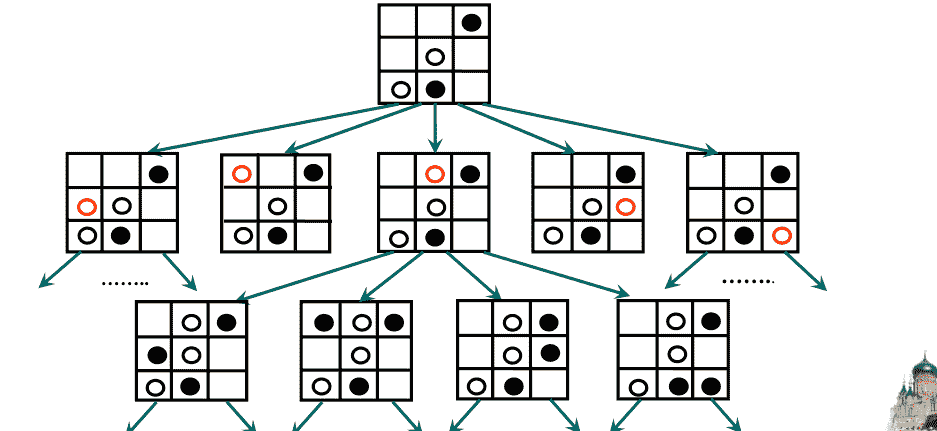

## 1.2 研究对象与基本概念(Cont.)

### 例3 教学计划编排问题——图结构

如何表示课程之间的先修关系？

| 编号 | 课程名称 | 先修课 |
|------|----------|--------|
| C₁ | 高等数学 | 无 |
| C₂ | 计算机导论 | 无 |
| C₃ | 离散数学 | C₁ |
| C₄ | 程序设计 | C₁, C₂ |
| C₅ | 数据结构 | C₃, C₄ |
| C₆ | 计算机原理 | C₂, C₄ |
| C₇ | 数据库原理 | C₄, C₅, C₆ |

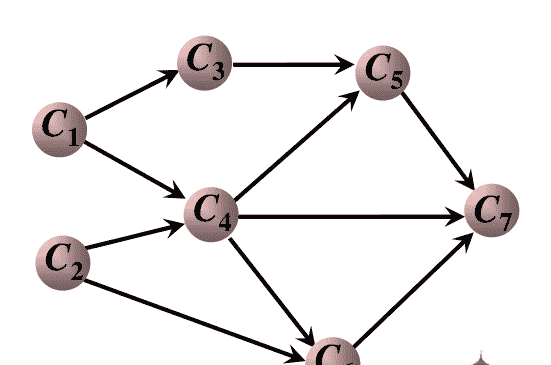

## 1.2 研究对象与基本概念(Cont.)

### 数据结构的基本概念

- 数据：一切能输入到计算机中并能被计算机程序识别和处理的符号集合。
  - 数值数据：整数、实数等
  - 非数值数据：图形、图象、声音、文字等

- 数据元素：数据的基本单位，在计算机程序中通常作为一个整体进行考虑和处理。

- 数据项：构成数据元素的不可分割的最小单位。

- 数据对象：具有相同性质的数据元素的集合。

- 结点：数据元素在计算机内的位串表示。

- 域（字段）：数据元素中数据项在计算机内的表示

- 信息表：是数据对象在计算机内的表示。

## 1.2 研究对象与基本概念(Cont.)

### 数据结构

- 数据元素之间的相互关系，这种关系是抽象的，即并不涉及数据元素的具体内容。是数据元素及其相互间的关系的数学描述。
- 相互之间存在一定关系的数据元素的集合。
- 按照视点的不同，数据结构分为逻辑结构和存储结构。

### 数据的逻辑结构

- 数据元素之间的抽象关系，数据元素之间逻辑关系的整体
  - 学籍管理问题中，表项之间的逻辑关系指的是什么？
  - 人机对弈问题中，格局之间的逻辑关系指的是什么？
  - 教学计划编排问题中，课程之间的逻辑关系指的是什么？
- 数据的逻辑结构是从具体问题抽象出来的数据模型。

## 1.2 研究对象与基本概念(Cont.)

### 数据的存储结构

- 又称物理结构，是数据及其逻辑结构在计算机中的表示。
- 实质上是内存分配，以确定元素及元素之间关系的表示。
- 在具体实现时，依赖于计算机语言。

## 1.2 研究对象与基本概念(Cont.)

数据结构从逻辑上分为四类：

即四种基本的逻辑结构

- 集合：数据元素之间就是“属于同一个集合”；
- 数据线性结构：数据元素之间存在着一对一的线性关系；

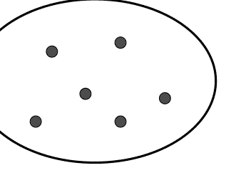


## 1.2 研究对象与基本概念(Cont.)

数据结构从逻辑上分为四类：

即四种基本的逻辑结构

- 集合：数据元素之间就是“属于同一个集合”；
- 数据线性结构：数据元素之间存在着一对一的线性关系；
- 树型结构：数据元素之间存在着一对多的层次关系；
- 图结构：数据元素之间存在着多对多的任意关系。

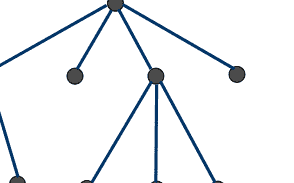

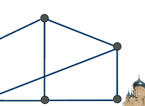


## 1.2 研究对象与基本概念(Cont.)

两种基本的存储结构

顺序存储结构

用一组连续的存储单元依次存储数据元素，数据元素之间的逻辑关系由元素的存储位置来表示。

例：（bat, cat, eat）

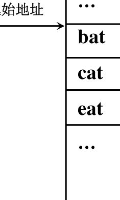

## 1.2 研究对象与基本概念(Cont.)

- 两种基本的存储结构
  - 顺序存储结构
    - 用一组连续的存储单元依次存储数据元素，数据元素之间的逻辑关系由元素的存储位置来表示。
  - 链接存储结构
    - 用一组任意的存储单元存储数据元素，数据元素之间的逻辑关系用指针来表示。

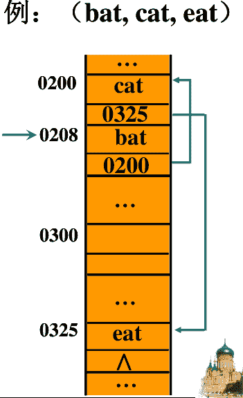

## 1.2 研究对象与基本概念(Cont.)

### 逻辑结构与存储结构的关系

- 数据的逻辑结构属于用户视图，是面向问题的，反映了数据内部的构成方式；数据的存储结构属于具体实现的视图，是面向计算机的。
- 一种数据的逻辑结构可以用多种存储结构来存储，而采用不同的存储结构，其数据处理的效率往往是不同的。

### 数据结构与算法的学习内容

- 数据对象的结构形式,各种数据结构的性质(逻辑结构);
- 数据对象和“关系”在计算机中的表示(物理结构/存储结构);
- 数据结构上定义的基本操作(算法)及其实现;
- 算法的效率（时间和空间）;
- 数据结构的应用,如数据分类,检索等.


## 1.3 抽象数据类型

## 抽象数据类型（Abstract Data Type）

定义：一个数学模型和在该模型上定义的操作集合的总称

- ADT是程序设计语言中数据类型概念的进一步推广和进一步抽象。
- 例4： ADT int=({x|x∈Z}, {+,-,*,/,% ,≤,==})
- 同一数学模型上定义不同的操作集，则它们代表不同的 ADT;

实现：用适当的数据结构来表示ADT中的数学模型,并用一组函数（方法）来实现该模型上的各种操作。

## 1.3 抽象数据类型(Cont.)

## 数据类型、数据结构和ADT

## 各自含义：

- 数据类型是一组值的集合
- 数据结构则是数据元素之间的抽象关系；
- 抽象数据类型是一个数学模型及在该模型上定义的操作集合的总称。

## 相互关系

- 数据型是根据数据结构分类的,同类型的数据元素的数据结构相同。
- 数据结构则是抽象数据类型中数学模型的表示；
- ADT是数据类型的进一步推广和进一步抽象。

## 1.4 算法及算法分析

## 算法的相关概念

- 算法（Algorithm）：是对特定问题求解步骤的一种描述，是指令的有限序列。
- 算法的五大特性：
  - 输入：一个算法有零个或多个输入。
  - 输出：一个算法有一个或多个输出。
  - 有穷性：一个算法必须总是在执行有穷步之后结束，且每一步都在有穷时间内完成。
  - 确定性：算法中的每一条指令必须有确切的含义，对于相同的输入只能得到相同的输出。
  - 可行性：算法描述的操作可以通过已经实现的基本操作执行有限次来实现。

## 1.4 算法及算法分析(Cont.)

例5：欧几里德算法——辗转相除法求两个自然数 *m* 和 *n* 的最大公约数。

- 自然语言描述
  - ①输入*m* 和 *n*；
  - ②求*m*除以*n*的余数*r*；
  - ③若*r*等于0，则*n*为最大公约数，算法结束；否则执行第④步；
  - ④将*n*的值放在*m*中，将*r*的值放在*n*中；
  - ⑤重新执行第②步。
- 优点：容易理解
- 缺点：冗长、二义性

## 1.4 算法及算法分析(Cont.)

例5: 欧几里德算法——辗转相除法求两个自然数 m 和 n 的最大公约数。

```
1. r = m % n;
2. 循环直到 r 等于0
   2.1 m = n;
   2.2 n = r;
   2.3 r = m % n;
3. 输出 n ;
```

表达能力强，抽象性强，容易理解

## 1.4 算法及算法分析(Cont.)

评价算法效率的方法

- 事后统计：将算法实现，测算其时间和空间开销。
- 优点：准确的实测值
- 缺点：
  - 编写程序实现算法将花费较多的时间和精力；
  - 所得实验结果依赖于计算机的软、硬件等环境因素。
- 事前分析：对算法所消耗资源的一种估算方法。

算法分析：对算法所需要的计算机资源——时间和空间进行估算。

- 时间复杂度（Time Complexity）
- 空间复杂度（Space Complexity）


## 1.4 算法及算法分析(Cont.)

算法分析----时间复杂度分析

算法的执行时间=每条语句执行时间之和

每条语句执行次数之和

基本语句的执行次数

执行次数×执行一次的时间

单位时间

指令系统、编译的代码质量

```
例： for (i=1; i<=n; i++)
    for (j=1; j<=n; j++)
        x++;
```

## 1.4 算法及算法分析(Cont.)

## 算法分析----算法的时间复杂度（性）

算法的执行时间，是基本（操作）语句重复执行的次数，它是问题规模的一个函数。我们把这个函数的渐近阶称为该算法的时间复杂度。

- 问题规模：输入量的多少。
- 基本语句：是执行次数与整个算法的执行次数成正比的操作指令。

```
例：for (i=1; i<=n; i++)
        for (j=1; j<=n; j++)
            x++;
```

- 问题规模： n
- 基本语句： x++
- 时间复杂性： O（n²）

## 1.4 算法及算法分析(Cont.)

算法分析---大O符号

定义 若存在两个正的常数c和n₀，对于任意n≥n₀，都有 T(n)≤c×f(n)，则称T(n)=O(f(n))

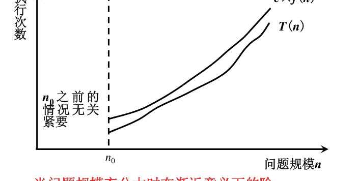

当问题规模充分大时在渐近意义下的阶

## 1.4 算法及算法分析(Cont.)

算法分析---大O符号

- 定理：若 A(n)=a_m n^m + a_{m-1} n^{m-1} + ... + a_1 n + a_0 是一个 m 次多项式，则 A(n)=O(n^m)。
- 说明：在计算算法时间复杂度时，可以忽略所有低次幂（低阶）项和最高次幂（最高阶）项的系数。
- 例：

```
for (i=1; i<=n; ++i)
    for (j=1; j<=n; ++j)
    {
        c[i][j]=0;
        for (k=1; k<=n; ++k)
            c[i][j]+=a[i][k]*b[k][j];
    }
```

问题规模： n
基本语句： *
复杂度： O(n³)

## 1.4 算法及算法分析(Cont.)

算法分析---最好情况、最坏情况、平均情况

例：在一维整型数组A[n]中顺序查找与给定值k相等的元素（假设该数组中有且仅有一个元素值为k）。

```
int Find(int A[], int n)
{
    for (i=0; i<n; i++)
        if (A[i]==k) break;
    return i;
}
```

- 基本语句的执行次数是否只和问题规模有关？
- 结论：如果问题规模相同，时间代价与输入数据（的分布）有关，则需要分析最好情况、最坏情况、平均情况

## 1.4 算法及算法分析(Cont.)

算法分析---常见的时间复杂度

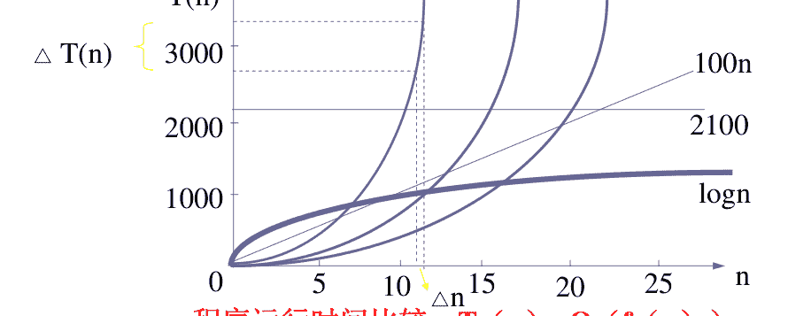

程序运行时间比较 T(n)=O(f(n))

- 常见阶的比较:
- O(1) < O(log₂n) < O(n) < O(n log₂n) < O(n²) < O(n³) < ... < O(2ⁿ) < O(n!)

## 1.4 算法及算法分析(Cont.)

算法分析——时间复杂性分析的基本方法

- 时间复杂性的运算规则
  设 T₁(n)=O( f(n) )，T₂(n)=O( g(n) )，则
  - ①加法规则: T₁(n)+T₂(n)= O(max{ f(n), g(n) })
  - ②乘法规则: T₁(n)*T₂(n)= O( f(n) · g(n) )
- 时间复杂性的分析方法
  - 首先求出程序中各语句、各模块的运行时间，
  - 再求整个程序的运行时间。
  - 各种语句和模块分析应遵循的规则是：

## 1.4 算法及算法分析(Cont.)

算法分析----各种语句和模块分析应遵循的规则

- (1) 赋值语句或读/写语句：
  - 运行时间通常取O(1)。有函数调用的除外，此时要考虑函数的执行时间。
- (2) 语句序列：
  - 运行时间由加法规则确定，即该序列中耗时最多的语句的运行时间。
- (3) 分支语句：
  - 运行时间由条件测试（通常为O(1)）加上分支中运行时间最长的语句的运行时间
- (4) 循环语句：

## 1.4 算法及算法分析(Cont.)

算法分析——各种语句和模块分析应遵循的规则

- (4) 循环语句：
- 运行时间是对输入数据重复执行n次循环体所耗时间的总和
- 每次重复所耗时间包括两部分：一是循环体本身的运行时间；二是计算循环参数、测试循环终止条件和跳回循环头所耗时间。后一部分通常为O(1)。
- 通常，将常数因子忽略不计，可以认为上述时间是循环重复次数n和m的乘积，其中m是n次执行循环体当中时间消耗最多的那一次的运行时间(乘法规则)
- 当遇到多重循环时，要由内层循环向外层逐层分析。因此，当分析外层循环的运行时间是，内层循环的运行时间应该是已知的。此时，可以把内层循环看成是外层循环的循环体的一部分。


## 1.4 算法及算法分析(Cont.)

算法分析——各种语句和模块分析应遵循的规则

- (5) 函数调用语句：
- ① 若程序中只有非递归调用，则从没有函数调用的被调函数开始，计算所有这种函数的运行时间。然后考虑有函数调用的任意一个函数P，在P调用的全部函数的运行时间都计算完之后，即可开始计算P的运行时间。
- ② 若程序中有递归调用，则令每个递归函数对应于一个未知的开销函数T(n)，其中n是该函数参数的大小，之后列出关于T的递归方程并求解之。

## 1.4 算法及算法分析(Cont.)

算法分析----例:分析下述“气泡”排序程序的时间复杂度。

```
void BubbleSort( int A[], int n )
{
    int i, j, temp;
    for (i=0; i<n-1; i++)
        for (j=n-1; j>=i+1; j--)
            if (A[j-1]>A[j]) {
                temp=A[j-1];
                A[j-1]=A[j];
                A[j]=temp;
            }
}
```

O(∑_{i=0}^{n-2} (n - i - 1)) ≤ O(n(n - 1)/2) = O(n²)

## 1.4 算法及算法分析(Cont.)

算法分析——例：编写求 n! 的程序，并分析其时间复杂性。

### 求 n! 的递归算法

```
long fact ( int n)
{
    if ( n==0 || ( n ==1 )
        return( 1 );
    else
        return( n * fact(n-1));
}
```

### 时间复杂性的递归方程

$$T(n)=\begin{cases} C, & \text{当 } n=0,\ n=1 \\ G+T(n-1), & \text{当 } n>1 \end{cases}$$

### 解递归方程：

$$T(n)=G+T(n-1)$$
$$T(n-1)=G+T(n-2)$$
$$T(n-2)=G+T(n-3)$$
……
$$T(2)=G+T(1)$$
$$+\ T(1)=C$$
因此：
$$T(n)=G(n-1)+C$$

取 $f(n)=n$
∴ $T(n)=O(f(n))$
　　 $=O(n)$

## 1.4 算法及算法分析(Cont.)

### 算法分析---空间复杂性

- 算法的空间复杂性是指算法在执行过程中的存储量需求
- 一个算法的存储量需求除了存放算法本身所有的指令、常数、变量和输入数据外，还包括对数据进行操作的工作单元和存储实现计算所需信息的辅助空间
- 算法的存储量需求与输入的规模、表示方式、算法采用的数据结构、算法的设计以及输入数据的性质有关
- 算法的执行的不同时刻，其空间需求可能是不同的
- 算法的空间复杂性是指算法在执行过程中的最大存储量需求

### 空间复杂性的渐近表示---空间复杂度

```
T(n) = O(f(n)) 其中，n为问题的输入规模
```

## 1.5 逐步求精的程序设计方法

- 1. 模型化（建模）
  - 对实际问题进行分析，选择适当的模型来描述问题，即建模；
- 2. 确定算法
  - 根据模型，找出解决问题的办法，即算法；
- 3. 逐步求精
  - 对用自然语言等描述的算法逐步细致化、精确化和形式化，这一阶段可能包括多步求精。
  - 当逐步求精到某一步时，根据程序中所使用的数据形式，定义若干 ADT，并且用 ADT 中的操作代替对应的非形式语句。
- 4. ADT 的实现
  - 对每个 ADT，选择适当的数据结构表示数学模型，并用相应的函数实现每个操作。

## 1.5 逐步求精的程序设计方法(Cont.)

例:交叉路口的交通安全管理问题

问题描述：

一个具有多条通路的交叉路口，当允许某些通路上的车辆在交叉路口“拐弯”时，必须对其他一些通路上面的车辆加以限制，不允许同时在交叉路口“拐弯”，以免发生碰撞。所有这些可能的“拐弯”组成一个集合。

基本要求：

把这个集合分成尽可能少的组，使得每组中所有的“拐弯”都能同时进行而不发生碰撞。这样，每组对应一个指挥灯，因而实现了用尽可能少的指挥灯完成交叉路口的 管理。

实例：

有一5条路组成的交叉路口，其中有2条路是单行道，把从一条路到另一条路的通称为“拐弯”，有的“拐弯”可以同时通过，有的“拐弯”不能同时通过，共有13个“拐弯”。要求：

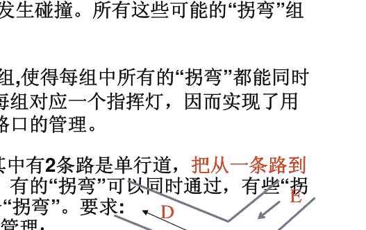

- 1. 设置一组交通灯，实现安全管理；
- 2. 使交通灯的数目最少。

## 1.5 逐步求精的程序设计方法(Cont.)

例:交叉路口的交通安全管理问题

- 1.模型化:
  - 用图作为交叉路口的数学模型;
  - 每个“拐弯”对应图中的一个顶点;
  - 若两个“拐弯”不能同时进行,则用用一条边把这两个“拐弯”所对应的两个结点连接起来,并且说这两个顶点是相邻的。

## 1.5 逐步求精的程序设计方法(Cont.)

1 模型化：

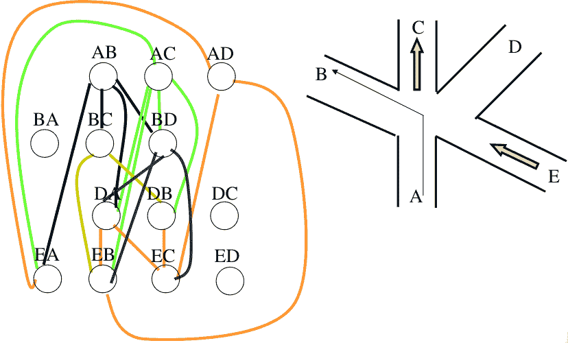

## 1.5 逐步求精的程序设计方法(Cont.)

- (1)穷举法;(2)试探法;(3)贪心法

“贪心”算法的思想是首先用第一种颜色对图中尽可能多的顶点着色(尽可能多表现出“贪心”),然后用第二种颜色对余下的顶点中尽可能多的顶点着色 如此等等, 直至所有的顶点都着完色。

## 1.5 逐步求精的程序设计方法(Cont.)

### 2.确定算法：

贪心法

## 1.5 逐步求精的程序设计方法(Cont.)

用C语言描述的"贪心"算法如下：

```
void greedy(GRAPH G, SET newclr)
/*把G中可以着同一色的顶点放入newclr*/
{
(1)    newclr=Φ
(2)    while (G中有未着色的顶点v)
(3)        if(v不与newclr中的任何顶点相邻){
(4)            对v着色;
(5)            将v放入newclr; }
}
```

其中，G是被着色的图，newclr的初值为空，算法执行的结果形成可以着相同颜色的顶点的集合newclr。只要重复调用greedy算法，直到图中的所有顶点都被着色为止，即可求出问题的解。

## 1.5 逐步求精的程序设计方法(Cont.)

```
void greedy(GRAPH G, SET newclr)
{ newclr=0 ; int found;
 v=G中第一个未着色的顶点;
 while (v!=0){ /*G中还有未着色的顶点v*/
 found=0;
 w=newclr中的第一个顶点; /*newclr中的顶点还没取尽*/
 while(w!=0){ /*newclr中的顶点还没取尽*/
 if(v和w相邻)
 found=1;
 w=newclr中的下一个顶点;
 }
 if(found==0){
 对v着色;
 将v放入newclr;
 }
 v=G中下一个未着色的顶点;
 }
}
```

## 1.5 逐步求精的程序设计方法(Cont.)

- 3.逐步求精：第三步求精：

由上一步求精的结果可见，算法中大部分操作都归结为对图和集合的操作。设G和S分别是抽象数据类型GRAPH和SET的实例，我们在G上规定如下操作：

- (1)FIRSTG(G)返回G中的第一个未加标记的（未着色的）元素；若G中没有这样的元素存在，则返回NULL。
- (2)EDGE(v,w,G)若v和w在G中相邻，则返回true，否则返回false
- (3)MARK(v,G)标记G中的元素v。
- (4)ADDG(v,G)将元素v放入G中。
- (5)NEXTG(G)返回G中下一个未标记得元素，若G中没有这样的元素存在，则返回NULL。

在S上规定如下操作：

- (1)MAKENULL(S)将集合S置空。
- (2)FIRSTS(S)返回S中的第一个元素；若S为空集，则返回NULL。
- (3)NEXTS(S)返回S中的下一个元素；若S中没有下一个元素，则返回NULL。
- (4)ADDS(v,S)将v放入S中。

## 1.5 逐步求精的程序设计方法(Cont.)

- 3.逐步求精：第三步求精：

```
void greedy(GRAPH G, SET newclr)
/*类型GRAPH和SET有待说明*/
{
    int found;
    elementtype v,w;/*elementtype可以自定义*/
    MAKENULL(newclr);
    v=FIRSTG(G);
    while(v!=NULL){
        found=0;
        w=FIRSTS(newclr);
        while(w!=NULL){
            if(EDGE(v,w,G))
                found=1;
            w=NEXTS(newclr);
        }
        v=NEXTG(G);
    }
}
```

### 4.ADT的实现：

按上述函数，最后一步工作就是给出类型elementtype的定义和实现抽象数据类型GRAPH及SET。此后，上述函数就是可执的程序了。


## 本章小结

- 数据结构的基本概念、相关术语和研究对象
- 抽象数据类型定义和实现
- 算法及其复杂性分析
- 解决问题的一般过程和算法的逐步求精方法

数据结构与算法的五个方面

数据的逻辑结构
  线性结构
    线性表
    栈
    队列
  非线性结构
    树形结构
    图形结构
数据的存储结构
  顺序存储
  链式存储
  散列存储
  索引存储
数据的操作(算法): 检索、排序、插入、删除、修改等
时间和空间效率
数据结构与算法的应用


## 第2章 线性表


## 学习目标

- 掌握线性表的逻辑结构，线性表的顺序存储结构和链式存储结构的描述方法；熟练掌握线性表在顺序存储结构和链式存储结构的结构特点以及相关的查找、插入、删除等基本操作的实现；并能够从时间和空间复杂性的角度综合比较两种存储结构的不同特点

- 掌握栈和队列的结构特性和描述方法，熟练掌握栈和队列的基本操作的实现，并且能够利用栈和队列解决实际应用问题

- 掌握串的结构特性以及串的基本操作，掌握针对字符串进行操作的常用算法和模式匹配算法

- 掌握多维数组的存储和表示方法，掌握对特殊矩阵进行压缩存储时的下标变换公式，了解稀疏矩阵的压缩存储表示方法及适用范围

- 了解广义表的概念和特征

## 本章主要内容

- 2.1 线性表的逻辑结构
- 2.2 线性表的存储结构
- 2.3 栈（Stack）
- 2.4 队列（Queue）
- 2.5 串（String）
- 2.6 数组（Array）
- 2.7 广义表（Generalized List）
- 本章小结

## 2.1 线性表的逻辑结构

## 线性表的定义：

- 是由 n（n≥0）个性质（类型）相同的元素组成的序列。

- 记为：
  L = （a₁， a₂， a₃， ……aᵢ₋₁， aᵢ， aᵢ₊₁， ……， aₙ）

- aᵢ（1≤i≤n）称为数据元素；
  下标 i 表示该元素在线性表中的位置或序号。

- n为线性表中元素个数，称为线性表的长度；
  当 n=0 时，为空表，记为 L=（ ）。

- 图示表示：
  线性表 L=（a₁， a₂， …aᵢ， ……， aₙ）的图形表示如下：

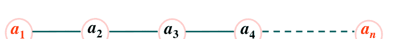

## 2.1 线性表的逻辑结构（Cont.）

逻辑特征： L=（a₁， a₂， a₃， ……aᵢ₋₁， aᵢ， aᵢ₊₁， …… ， aₙ

- 有限性：
  - 线性表中数据元素的个数是有穷的。

- 相同性：
  - aᵢ为线性表中的元素元素类型相同

- 相继性：
  - a₁为表中第一个元素，无前驱元素； aₙ为表中最后一个元素，无后继元素；
  - 对于…aᵢ₋₁,aᵢ,aᵢ₊₁…(1<i<n)，称aᵢ₋₁为aᵢ的直接前驱， aᵢ₊₁为aᵢ的直接后继。
  - 中间不能有缺项。

## 2.1 线性表的逻辑结构（Cont.）

定义在线性表的操作（算法）：

设L是类型为LIST线性表实例，x 的型为ElemType的元素实例，p 为位置变量。所有操作描述为：

- ① Insert(x, p, L)
- ② Locate(x, L)
- ③ Retrieve(p, L)
- ④ Delete(p, L)
- ⑤ Previous(p, L)
- ⑥ Next(p, L)
- ⑦ MakeNull( L)
- ⑧ First( L)
- ⑨ END（L）

## 2.1 线性表的逻辑结构（Cont.）

ADT应用举例：

- 设计函数 DeleteVal（LIST &L, ElemType d），其功能为删除 L 中所有值为 d 的元素。

```
void DeleteVal( LIST &L, ElemType d )
{
    position p;
    p = First( L );
    while ( p != End( L ) )
    {
        if ( Same( Retrieve( p, L ), d ))
            Delete(p, L );
        else
            p = Next(p, L );
    }
}
```

## 2.2线性表的存储结构---顺序表

## 2.2.1 顺序表：

- 把线性表的元素按照逻辑顺序依次存放在数组的连续单元内；
- 再用一个整型量表示最后一个元素所在单元的下标，即表长。

## 存储结构特点：

- 元素之间逻辑上的相继关系，用物理上的相邻关系来表示（用物理上的连续性刻画逻辑上的相继性）
- 是一种随机存取结构，也就是可以随机存取表中的任意元素，其存储位置可由一个简单直观的公式来表示。

|  |  |
|---|---|
| 0 | //// |
| 1 | 第1个元素 a₁ |
| 2 | 第2个元素 a₂ |
|  | ... |
|  |  |
| i | 第i个元素 aᵢ |
|  | ... |
|  |  |
| last | 最后一个元素 aₙ |
|  |  |
| max-1 |  |
|  | elements |
表
空单元

## 2.2线性表的存储结构---顺序表（Cont.）

存储结构定义：

类型定义：

```
#define max 100
struct LIST{
    ElemType elements[max];
    int last;
};
```

位置类型：

```
typedef int position;
```

线性表的实例L： LIST L;

元素和长度：

```
L.elements[p] // L的第p个元素
L.last L的长度，最后元素的位置
```

|  |  |
|---|---|
|0|////|
|1|第1个元素a₁|
|2|第2个元素a₂|
|...|...|
|i|第i个元素aᵢ|
|...|...|
|last|最后一个元素aₙ|
| | |
|max-1| |
|elements| |

表

空单元

## 2.2线性表的存储结构的顺序表（Cont.）

操作的实现----插入操作

- 操作接口 void Insert (ElemType x, position p, LIST &L)

- 插入前：(a₁, …, aₚ₋₁, aₚ, …, aₙ)

- 插入后：(a₁, …, aₚ₋₁, x, aₚ, …, aₙ)

aₚ₋₁和aₚ之间的逻辑关系发生了变化

顺序存储要求存储位置反映逻辑关系

存储位置要反映这个变化

## 第2章 线性表

## 2.2线性表的存储结构---顺序表（Cont.）

例：（35，12，24，42），在p=2的位置上插入33。

| 1 | 2 | 3 | 4 | 5 |  |  | M-1 | last |
|---|---|---|---|---|---|---|---|---|
| a₁
35 | a₂
33 | a₃
24 | a₄
44 | 42 |  |  | 4
5 |

33

什么时候不能插入？

- 表满时： last >=Max
- 合理的插入位置： 1<=i<=last+1

注意边界条件

## 2.2线性表的存储结构---顺序表（Cont.）

```
① void Insert ( ElemType x, position p, LIST &L)
{ position q ;
    if (L.last >= Max - 1)
        cout<< " 表满 ";
    else if (( p > L.last +1 ) || ( p < 1 ))
        cout<< " 指定位置不存在 ";
    else {
        for ( q = L.last; q >= p; q -- )
            L.elements[ q+1 ] = L.elements[ q ];
        L.elements[ p ] = x ;
        L.last = L.last + 1 ;
    }
}
```

|  |  |
|---|---|
| 0 | //// |
| 1 | a₁ |
| 2 | a₂ |
|  | .... |
|  |  |
| i | aᵢ |
|  | .... |
|  |  |
| last | aₙ |
|  |  |
| max-1 |  |


## 2.2线性表的存储结构---顺序表（Cont.）

时间性能分析

- 基本语句？
- 最好情况（ i=n+1 ）：
  - 基本语句执行0次，时间复杂度为 O(1)。
- 最坏情况（ i=1 ）：
  - 基本语句执行 n+1 次，时间复杂度为 O(n)。
- 平均情况（ 1≤i≤n+1 ）：
  - ∑_{i=1}^{n+1} p_i (n - i +1)= 1/(n+1) ∑_{i=1}^{n+1} (n - i +1)= n/2 =O(n)
- 时间复杂度为 O(n)。

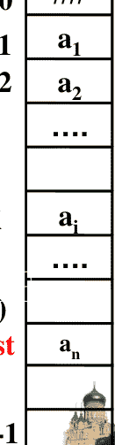

## 2.2线性表的存储结构---顺序表（Cont.）

操作的实现----删除操作

- 操作接口： void Delete( position p, LIST &L)

- 删除前： (a₁, …, aₚ₋₁, aₚ, aₚ₊₁, …, aₙ)

- 删除后： (a₁, …, aₚ₋₁, aₚ₊₁, …, aₙ)

例： (35, 33, 12, 24, 42)，删除p=2的数据元素。

| 1 | 2 | 3 | 4 | 5 |
|---|---|---|---|---|
| a₁ | a₂ | a₃ | a₄ | a₅ |
| 35 | 33 | 12 | 24 | 42 |
| last | 5 → 4 |

- 分析边界条件？

- 操作算法的实现

- 时间性能分析

## 2.2线性表的存储结构---顺序表（Cont.）

```
④ void Delete( position p, LIST &L)
{ position q;
    if (( p > L.last ) || ( p < 1 ))
        cout<< "指定位置不存在" ;
    else{
        L.last = L.last - 1;
        for ( q = p ; q <= L.last ; q ++ )
            L.elements[ q ] = L.elements[ q + 1 ];
    }
}
```

最好、最坏和平均移动元素个数：

时间复杂度： O(n)

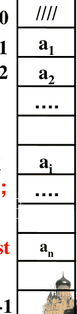

## 2.2线性表的存储结构---顺序表（Cont.）

其他操作的实现

```
position Locate ( Elementtype x , LIST L ) //②
{ position q ;
    for ( q = 1; q <= L.last ; q++ )
        if ( L.elements[ q ] == x )
            return ( q );
    return ( L.last + 1 );
} //时间复杂度： O(n)
```

```
ElemType Retrieve ( position p , LIST L ) //③
{ if ( p > L.last )
    cout<< "指定元素不存在" ;
  else
    return ( L.elements[ p ] );
} //时间复杂度： O(1)
```

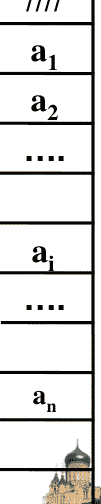

## 2.2线性表的存储结构----顺序表（Cont.）

### 其他操作的实现

```
position Previous( position p , LIST L ) //⑤
{
    if ( ( p <= 1 ) || ( p > L.last ) )
        cout<< “前驱元素不存在”;
    else
        return ( p - 1 );
} //时间复杂性： O(1)
```

```
position Next( position p , LIST L ) //⑥
{
    if ( ( p < 1 ) || ( p >= L.last ) )
        cout<< “前驱元素不存在”;
    else
        return ( p + 1 );
} //时间复杂性： O(1)
```

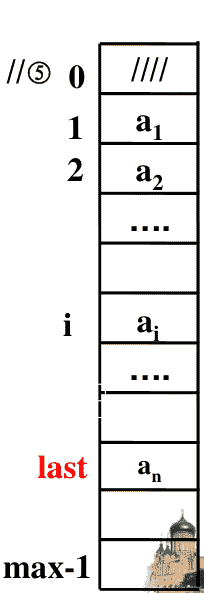

## 2.2线性表的存储结构---顺序表（Cont.）

其他操作的实现

```
position MakeNull( LIST &L ) //⑦
{  L.last = 0;
    return ( L.last +1 );
} //时间复杂度： O(1)
```

```
position First( LIST L ) //⑧
{ if ( L.last>0 )  return ( 1 );
  else cout<<“表为空”
} //复杂度： O(1)
```

```
position End( LIST L )  //⑨
{ return( L.last + 1 );
} // O(1)
```

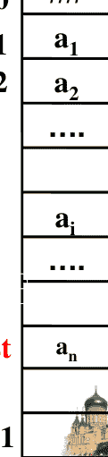

## 2.2线性表的存储结构---链表

### 2.2.2 单链表

### 单链表：

- 一个线性表由若干个结点组成，每个结点均含有两个域：存放元素的信息域和存放其后继结点的指针域，这样就形成一个单向链接式存储结构，简称单向链表或单链表。

- 例： (a1, a2 ,a3, a4)的存储示意图

### 存储结构特点

- 逻辑次序和物理次序不一定相同；
- 元素之间的逻辑关系用指针表示；
- 需要额外空间存储元素之间的关系
- 非随机存取结构

## 2.2线性表的存储结构----链按表（Cont.）

存储结构定义：

结点结构：

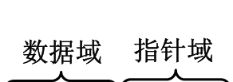

存储结构类型定义

```
struct celltype {
    ElemType element;
    celltype *next;
}; /*结点型*/
typedef celltype *LIST; /*线性表的型*/
typedef celltype *position; /*位置型*/
```

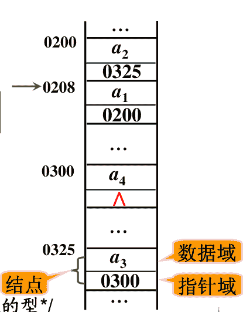

## 2.2线性表的存储结构----链接表（Cont.）

存储结构定义：

- 单链表图示：
- 带表头结点的单链表

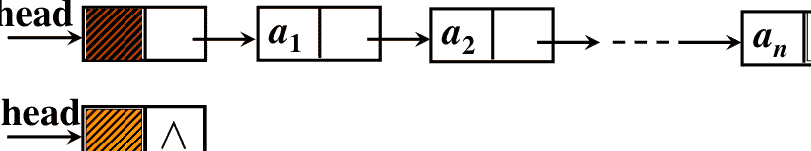

- 不带表头结点的单链表


first==NULL;

## 2.2线性表的存储结构----链接表（Cont.）

表头节点的作用：

- 空表和非空表表示统一
- 在任意位置的插入或者删除的代码统一
- 注意：是否带表头节点在存储结构定义中无法体现，由操作决定

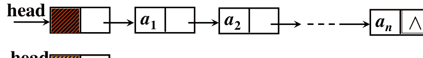

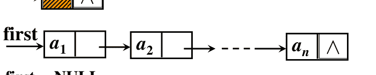

## 2.2 线性表的存储结构----链接表（Cont.）

操作的实现---- ①插入操作

- q = new celltype ;
- q-> data = x ;
- q-> next = p-> next ;
- p-> next = q ;

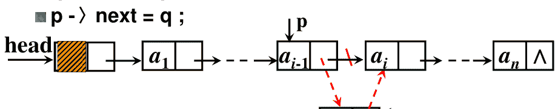

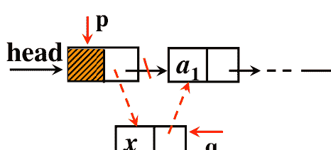

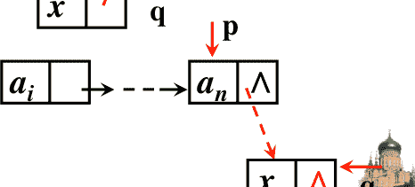

## 2.2线性表的存储结构----链表（Cont.）

操作的实现---- ①插入操作

```
① void Insert ( ElemType x, position p, LIST &L )
{
    position q;
    q = new celltype;
    q → data = x;
    q → next = p → next;
    p → next = q;
} //时间复杂性：O(1)
```


## 2.2 线性表的存储结构---链接表（Cont.）

操作的实现----④删除操作

- q = p→next ;
- p→next = q→next ;
- delete q ;

```
void Delete ( position p, LIST &L )
{
  position q;
  if ( p→next != NULL ) {
    q = p →next ;
    p →next = q →next ;
    delete q ;
  }
}
```

时间复杂度： O（1）

（a）删除第一个元素

（b）删除中间元素

（c）删除表尾元素


## 2.2线性表的存储结构----链表（Cont.）
操作的实现---- ② Locate（ElemType x, LIST L）

```
position Locate ( Elementtype x, LIST L )
{
    position p;
    p = L;
    while ( p→next != NULL )
        if ( p→next→data == x )
            return p;
        else
            p = p→next;
    return p;
} //时间复杂性：O(n)
```


## 2.2线性表的存储结构---链接表（Cont.）
操作的实现---- ③ElemType Retrieve(position p , LIST L)

```
ElemType Retrieve ( position p , LIST L )
{
    return ( p → next → data );
} //时间复杂度： O(1)
```


## 2.2线性表的存储结构---链接表（Cont.）
操作的实现--- ⑤ position Previous(position p,LIST L)

```
position Previous ( position p, LIST L )
{ position q;
    if ( p == L→next )
        cout << “不存在前驱元素”；
    else {
        q = L;
        while ( q→next != p ) q = q→next ;
        return q;
    }
} //时间复杂度： O(n)
```

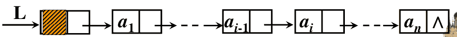

## 2.2线性表的存储结构----链表表（Cont.）
操作的实现----⑥ position Next( position p, LIST L )

```
position Next( position p, LIST L )
{
  position q ;
  if ( p→next == NULL )
    cout<< "不存在后继元素";
  else {
    q = p →next;
    return q ;
  }
} //时间复杂度：O(1)
```

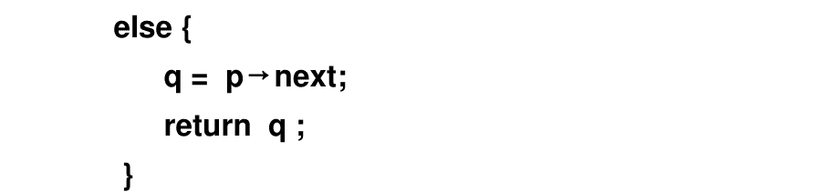

## 2.2线性表的存储结构---链接表（Cont.）
操作的实现--- ⑦ position MakeNull ( LIST &L )

```
position MakeNull ( LIST &L )
{
    L = new celltype;
    L→next = NULL;
    return L;
} //时间复杂度： O(1)
```

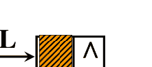

操作的实现--- ⑧ position First ( LIST L )

```
position First ( LIST L )
{
    return L;
} //时间复杂度： O(1)
```

## 2.2线性表的存储结构---链接表（Cont.）
操作的实现---- ⑨ position End ( LIST L)

+   position End ( LIST )

```
position End ( LIST )
{
  position q;
  q = L;
  while ( q→next != NULL )  q = q→next ;
  return ( q );
} //时间复杂度: O(n)
```

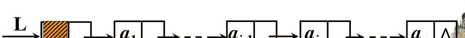

## 2.2线性表的存储结构---链接表（Cont.）
例：设计一个算法，遍历线性表，即按照线性表中元素的顺序，依次访问表中的每一个元素，每个元素只能被访问一次。

```
struct celltype {
    ElemType data;
    celltype *next;
}; /*节点型*/
typedef celltype *LIST;
/*线性表的型*/
typedef celltype *position;
/*位置型*/
```

```
void Travel( LIST L )
{
    position p;
    p = L->next;
    while ( p != NULL ) {
        cout << p->data;
        p = p->next;
    }
}
```

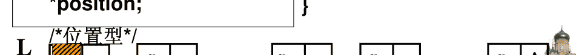

## 2.2线性表的存储结构---链接表（Cont.）

## 顺序表 与 链表 的 比较

## 顺序表 与 单链表 的 比较

## 顺序存储

## 比较参数

## 链式存储

- 固定，不易扩充
- 随机存取
- 插入删除费时间
- 估算表长度，浪费空间

- ←表的容量→
- ←存取操作→
- ←时间→
- ←空间→

- 灵活，易扩充
- 顺序存取
- 访问元素费时间
- 实际长度，节省空间

## 2.2 线性表的存储结构---静态链表

## 2.2.3 静态链表

静态链表：

- 举例：
  - 线性表： L= ( a, b, c )
  - 线性表： M= ( d, e )
  - 空闲表： avail=9

把线性表的元素存放在数组的单元中（不一定按逻辑顺序连续存放），每个单元不仅存放元素本身，而且还要存放其后继元素所在的数组单元的下标（游标）。

|   | data | next |
|---|------|------|
| 0 | d | 6 |
| 1 |  | 5 |
| 2 | c | -1 |
| 3 | /--/ | 0 |
| 4 | a | 10 |
| 5 |  | 8 |
| 6 | e | -1 |
| 7 | /--/ | 4 |
| 8 |  | -1 |
| 9 | /--/ | 11 |
| 10 | b | 2 |
| 11 |  | 12 |
| 12 |  | 1 |

L=7

M=3

avail=9

SPACE

## 2.2 线性表的存储结构---静态链表（Cont.）
操作的实现--- ②可用空间的分配操作

```
Cursor GetNode() //q=new spacestr;
{
    Cursor p;
    if (SPACE[avail].next ==-1)
        p=-1;
    else {
        p= SPACE[avail].next ;
        SPACE[avail].next =
            SPACE[ p ].next ;
    }
    return p;
} /*从存储池SPACE中删除结点*/
```

|   | data | next |
|---|------|------|
| 0 | d    | 6    |
| 1 |      | 5    |
| 2 | c    | -1   |
| 3 | /--/ | 0    |
| 4 | a    | 10   |
| 5 |      | 8    |
| 6 | e    | -1   |
| 7 | /--/ | 4    |
| 8 |      | -1   |
| 9 | /--/ | 11   |
| 10| b    | 2    |
| 11|      | 12   |
| 12|      | 1    |
SPACE

L=7
M=3
avail=9

## 2.2 线性表的存储结构---静态链表（Cont.）
操作的实现--- ③可用空间的回收操作

```
void FreeNode(Cursor q) //delete q;
{
    SPACE [ q ].next =
        SPACE[avail].next ;
    SPACE[avail].next = q ;
} /*放回池中*/
```

|   | data | next |
|---|------|------|
| 0 | d    | 6    |
| 1 |      | 5    |
| 2 | c    | -1   |
| 3 | /--/ | 0    |
| 4 | a    | 10   |
| 5 |      | 8    |
| 6 | e    | -1   |
| 7 | /--/ | 4    |
| 8 |      | -1   |
| 9 | /--/ | 11   |
| 10| b    | 2    |
| 11|      | 12   |
| 12|      | 1    |
SPACE

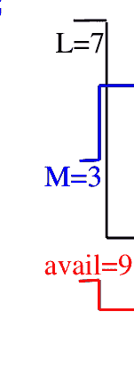


## 2.2 线性表的存储结构---静态链表（Cont.）

操作的实现--- ④插入操作

```
void Insert( ElemType x, position p, spacestr *SPACE )
{  position q;
  q = GetNode();
  SPACE[ q ].data = x;
  SPACE[ q ].next=SPACE[p ].next ;
  SPACE[ p ].next = q;
}
```

```
q = new celltype ;
q→data = x ;
q→next = p→next ;
p→next = q ;
```

|   | data | next |
|---|------|------|
| 0 | d    | 6    |
| 1 |      | 5    |
| 2 | c    | -1   |
| 3 | /--/ | 0    |
| 4 | a    | 10   |
| 5 |      | 8    |
| 6 | e    | -1   |
| 7 | /--/ | 4    |
| 8 |      | -1   |
| 9 | /--/ | 11   |
|10 | b    | 2    |
|11 |      | 12   |
|12 |      | 1    |
SPACE

L=7
M=3
avail=9

## 2.2 线性表的存储结构---静态链表（Cont.）

操作的实现--- ⑤删除操作

```
void Delete(position p, spacestr *SPACE)
{ position q ;
if ( SPACE[ p ].next != -1 ) {
    q = SPACE[ p ].next ;
    SPACE[ p ].next = SPACE[ q ].next ;
    FreeNode( q );
}
}
```

p→next !=NULL
q = p→next ;
p→next = q→next ;
delete q ;

|   | data | next |
|---|---|---|
| 0 | d | 6 |
| 1 |  | 5 |
| 2 | c | -1 |
| 3 | /--/ | 0 |
| 4 | a | 10 |
| 5 |  | 8 |
| 6 | e | -1 |
| 7 | /--/ | 4 |
| 8 |  | -1 |
| 9 | /--/ | 11 |
| 10 | b | 2 |
| 11 |  | 12 |
| 12 |  | 1 |
SPACE

L=7

M=3

avail=9

## 2.2 线性表的存储结构---双向链表

### 2.2.4 双向链表

双链表：

在单链表的各结点中再设置一个指向其前驱结点的指针域

示例：

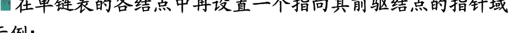

结点结构：


优点：

- 实现双向查找（单链表不易做到）
- 表中的位置i可以用指示含有第i个结点的指针表示。

缺点：空间开销大。

## 2.2 线性表的存储结构----双向链表（Cont.）

存储结构定义：

```
struct dcelltype {
    ElemType data ;
    dcelltype *next, *prior ;
}; /* 节点类型 */
/* 表和位置的类型 */
typedef dcelltype *DLIST ;
typedef dcelltype *position ;
```

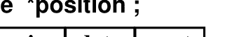

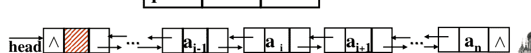

## 2.2 线性表的存储结构---双向链表（Cont.）

插入操作：在带头结点的表中，在位置p插入元素x：

```
void Insert( ElemType x, position p, DLIST &L )
{
    s = new dcelltype;
    s->data = x;
    s->prior=p;
    s->next=p->next;
    p->next->prior=s;
    p->next=s;
}
```

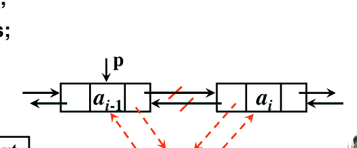

| prior | data | next |

## 2.2 线性表的存储结构----单向环形链表

### 2.2.5 单向环形链表

## 单向环形链表

- 在(不带表头结点)的单向链表中，使末尾结点的指针域指向头结点，得到一个环形结构；用指向末尾结点的指针标识这个表。
- 示例： 空表R=NULL

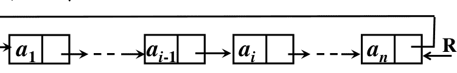

## 结点结构：

- 同单链表

## 存储结构定义：

- 同单链表

## 2.2 线性表的存储结构----单向环形链表(Cont.)

在表左端插入节点 LInsert(x,R) → Insert(x,First(R),R)

```
void LInsert( Elementtype x , LIST &R )
{
    celltype *p;
    p = new celltype;
    p→data = x;
    if ( R == NULL )
    { p→next = p; R = p; }
    else
    { p→next = R→next; R→next = p; }
}
```

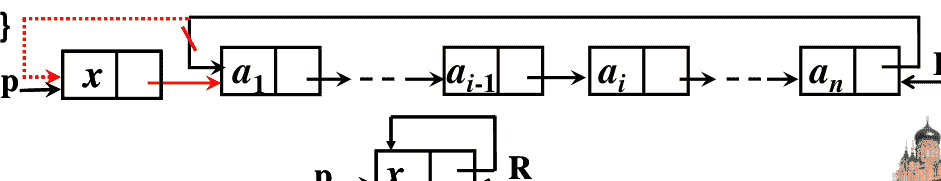

## 2.2 线性表的存储结构----单向环形链表(Cont.)

在表右端插入节点 RInsert(x,R) → Insert(x,End(R), R)

```
void RInsert( ElemType x , LIST R )
{ LInsert ( x , R );
    R = R→next ;
}
```

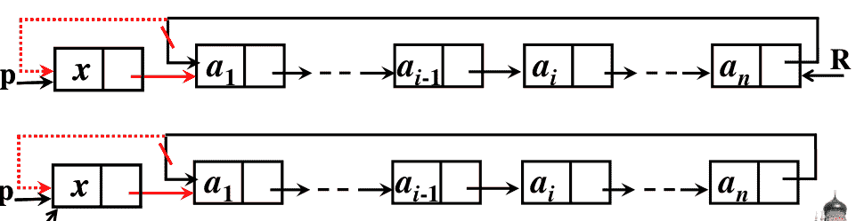

## 2.2 线性表的存储结构----一元多项式

### 2.2.6 多项式的代数运算

多项式：$p(x)=3x^{14}+2x^8+1$

存储表示：采用单链表表示

示例：


存储结构定义：

```
struct polynode {
    int coef;  //系数
    int exp;   //指数
    polynode *link;  //指向下一项的指针
}; //结点类型

typedef polynode *polypointer;  //多项式的类型
```

| coef | exp | link |
|---|---|---|

## 2.2 线性表的存储结构----一元多项式(Cont.)

算法Attch(c, e, d):

- 建立一个新结点，其系数coef=c，指数exp=e；并把它链到 d 所指结点之后，返回该结点指针。

```
polypointer Attch ( int c , int e , polypointer d )
{
  polypointer x ;
  x = new polynode ;
  x→coef = c ;
  x→exp = e ;
  d→link = x ;
  return x ;
}
```

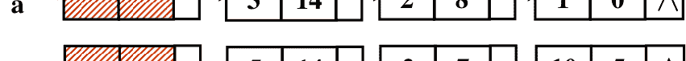

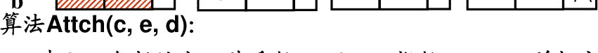

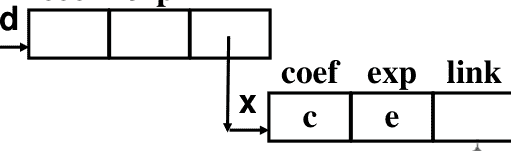

## 2.2 线性表的存储结构----一元多项式(Cont.)

多项式加法：

```
polypointer PolyAdd( polypointer a , polypointer b )
{  polypointer p, q, d, c ;
    int y ;
    p = a→link ;  q = b→link ;
    c = new polynode ;  d = c ;
    while ( (p != NULL) && (q != NULL) )
        switch ( Compare ( p→exp, q→exp ) )
        { case ‘=’ :
                y = p→coef + q→coef ;
                if ( y )  d = Attch( y, p→exp, d ) ;
                p = p→link ; q = q→link ;
                break ;
            case ‘>’ :
                d = Attch( p→coef, p→exp, d );
```


## 第2章 线性表

### 2.2 线性表的存储结构——一元多项式

```c
p = p->link;
break;
case '<':
    d = Attch(q->coef, q->exp, d);
    q = q->link;
    break;
}
while (p != NULL)
{
    d = Attch(p->coef, p->exp, d);
    p = p->link;
}
while (q != NULL)
{
    d = Attch(q->coef, q->exp, d);
    q = q->link;
}
```

### 2.3 特殊的线性表——栈

- **栈：**限定仅在表尾进行插入和删除操作的线性表。
- **空栈：**不含任何数据元素的栈。
- **栈顶和栈底：**允许插入（入栈、进栈、压栈）和删除（出栈、弹栈）的一端称为栈顶，另一端称为栈底。

**栈的示意图**

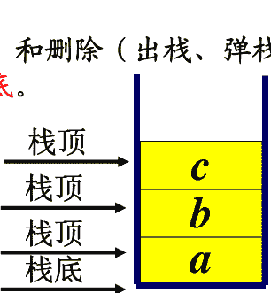

**栈的操作**

- 1. `MakeNull(S)`
- 2. `Top(S)`
- 3. `Pop(S)`
- 4. `Push(x, S)`
- 5. `Empty(S)`

**栈的特性：**后进先出

#### 2.3.1 栈的数组实现——顺序栈

栈的顺序存储结构及实现

如何改造数组实现栈的顺序存储？

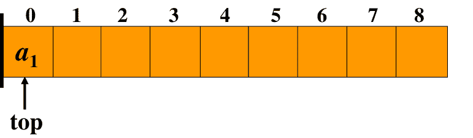

确定用数组的哪一端表示栈底。

附设指针 top 指示栈顶元素在数组中的位置。

- 进栈：top 加1
- 栈空：top = -1
- 出栈：top 减1
- 栈满：top = MAX_SIZE

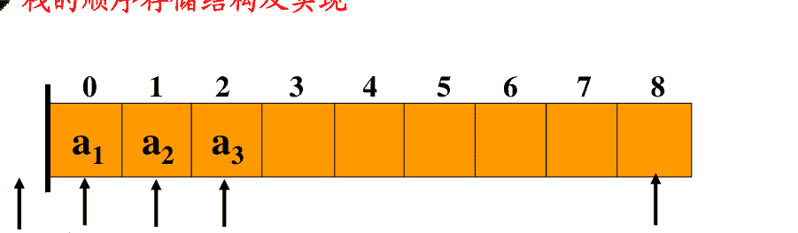

**栈的顺序存储结构定义**

```c
typedef struct {
    ElemType elements[max];
    int top;
} STACK;

STACK S;
```

- 栈的容量：max - 1；
- 栈顶指针：S.top
- 栈顶元素：S.elements[S.top]；
- 栈空：S.top = -1；
- 栈满：S.top = max - 1；

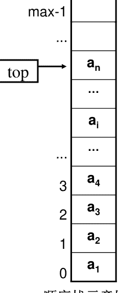

**栈的操作的实现**

**① void MakeNull(STACK &S)**

```c
void MakeNull(STACK &S)
{
    S.top = -1;
}
```

**② Boolean Empty(STACK S)**

```c
Boolean Empty(STACK S)
{
    if (S.top < 0)
        return TRUE;
    else
        return FALSE;
}
```

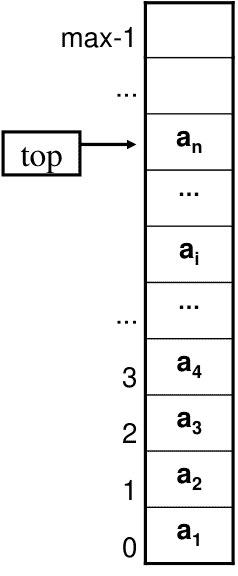

**③ ElemType Top(STACK S)**

```c
ElemType Top(STACK S)
{
    if (Empty(S))
        return NULL;
    else
        return (S.elements[S.top]);
}
```

**④ void Pop(STACK &S)**

```c
void Pop(STACK &S)
{
    if (Empty(S))
        cout << "栈空";
    else
        S.top = S.top - 1;
}
```

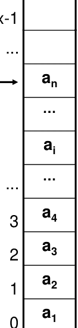

top

max-1

**⑤ void Push(ElemType x, STACK &S)**

```c
void Push(ElemType x, STACK &S)
{
    if (S.top == max - 1)
        cout << "栈满";
    else
    {
        S.top = S.top + 1;
        S.elements[S.top] = x;
    }
}
```

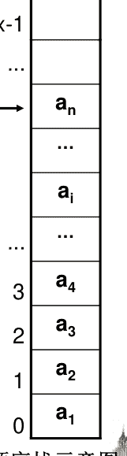

#### 2.3.2 栈的指针实现——链栈

栈的链接存储结构及实现

- 链栈：栈的链接存储结构

如何改造链表实现栈的链接存储？

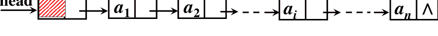

将哪一端作为栈顶？将链表首端作为栈顶，方便操作。

链栈需要加头结点吗？表头结点的作用与链表相同。

**栈的链式存储结构定义**

```c
struct node {
    ElemType data;
    node *next;
}; // 结点的"型"
typedef node *STACK; // 栈的"型"
```

两种示意图在内存中对应同一种状态

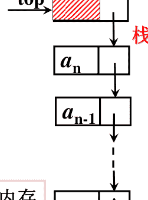


**栈的操作的实现**

**① STACK MakeNull()**

```c
STACK MakeNull()
{
    STACK s;
    s = new node;
    /* s = (node *)malloc(sizeof(node)); */
    s->next = NULL;
    return s;
}
```

**② Boolean Empty(STACK stk)**

```c
Boolean Empty(STACK stk)
{
    if (stk->next)
        return FALSE;
    else
        return TRUE;
}
```


**④ void Pop(STACK stk)**

```c
void Pop(STACK stk)
{
    STACK s;
    if (stk->next) { /* stk->next != NULL */
        s = stk->next;
        stk->next = s->next;
        delete s;  /* free(s) */
    }
}
```


#### 2.3.3 栈与递归调用

**递归调用的定义**

子程序（或函数）直接调用自己或通过一系列调用语句间接调用自己。是一种描述问题和解决问题的基本方法。

**递归的基本思想**

把一个不能或不好求解的大问题转化为一个或几个小问题，再把这些小问题进一步分解成更小的小问题，直至每个小问题都可以直接求解。

**递归的要素**

- 递归边界条件：确定递归到何时终止，也称为递归出口；
- 递归模式：大问题是如何分解为小问题的，也称为递归体

**递归调用举例**

**求阶乘的函数**

```text
n! = { 1 当 n=1 时
       n * (n - 1)! 当 n≥1 时 }
```

**递归算法**

```c
long fact(int n)
{
    if (n == 0) return 1;
    else return n * fact(n - 1);
}
```

**求解阶乘 n! 的过程**

```text
递归调用
计算 fact(4)
计算 4*fact(3)
计算 3*fact(2)
计算 2*fact(1)
计算 fact(1)

回求值
返回 24
返回 6
返回 2
返回 1
```

- 递归过程在实现时，需要自己直接或间接调用自己。
- 层层向下递归，返回次序正好相反：


## 2.3.3 栈与递归调用(Cont.)

递归过程与递归工作记录

+   每一次递归调用时，需要为过程中使用的参数、局部变量和返回地址等另外分配存储空间。
+   每层递归调用需分配的空间形成递归工作记录，按后进先出的栈组织。


## 2.3.3 栈与递归调用(Cont.)

### 递归函数的内部执行过程

+   (1) 运行开始时，首先为递归调用建立一个工作栈，其结构包括值参、局部变量和返回地址；
+   (2) 每次执行递归调用之前，把递归函数的值参和局部变量的当前值以及调用后的返回地址压栈；
+   (3) 每次递归调用结束后，将栈顶元素出栈，使相应的值参和局部变量恢复为调用前的值，然后转向返回地址指定的位置继续执行。


## 2.3.3 栈与递归调用(Cont.)

### 汉诺塔问题——递归的经典问题

在世界刚被创建的时候有一座钻石宝塔（塔A），其上有64个金碟。所有碟子按从大到小的次序从塔底堆放至塔顶。紧接着这座塔有另外两个钻石宝塔（塔B和塔C）。从界创始之日起，婆罗门的牧师们就一直在试图把塔A上的碟子移动到塔C上去，其间借助于塔B的帮助。每次只能动一个碟子，任何时候都不能把一个碟子放在比它小的碟子上面。当牧师们完成任务时，世界末日也就到了。


## 2.3.3 栈与递归调用(Cont.)

汉诺塔问题的递归求解：

+   - 如果 n = 1，则将这一个盘子直接从 塔A移到塔 C 上。
+   - 否则，执行以下三步：
+     - 将塔A上的n-1个碟子借助塔C先移到塔B上；
+     - 把塔A上剩下的一个碟子移到塔C上；
+     - 将n-1个碟子从塔B借助于塔A移到塔C上。

## 2.3.3 栈与递归调用(Cont.)

汉诺塔问题的递归求解：

```
void Hanoi(int n, char A, char B, char C)
{
    if (n==1) Move(A, C);
    else {
        Hanoi(n-1, A, C, B);
        Move(A, C);
        Hanoi(n-1, B, A, C);
    }
}
```


## 2.3.3 栈与递归调用(Cont.)

### 递归函数的运行轨迹

+   - 写出函数当前调用层执行的各语句，并用有向弧表示语句的执行次序；
+   - 对函数的每个递归调用，写出对应的函数调用，从调用处画一条有向弧指向被调用函数入口，表示调用路线，从被调用函数末尾处画一条有向弧指向调用语句的下面，表示返回路线；
+   - 在返回路线上标出本层调用所得的函数值。

## 第2章 线性表

Hanio(3,A,B,C)

Hanio(2,A,C,B)

Hanio(2,A,C,B)

Hanio(1,A,B,C)

Move (A,B)

Hanio(1,A,B,C)

Move (A,C)

Hanio(1,C,A,B)

Hanio(1,C,A,B)

Move (C,B)

Move (A,C)

Hanio(2,B,A,C)

结束

Hanio(2,B,A,C)

Hanio(1,B,C,A)

Move (B,C)

Hanio(1,B,C,A)

Move (B,A)

Hanio(1,A,B,C)

Hanio(1,A,B,C)

Move (A,C)

## 2.3.4 栈的应用

数制转换----是计算机实现计算的基本问题。

+   方法：除留余数法。例 如对输入的任意非负十进制整数,打印输出与其等值的八进制制数。

```
void main()
{
 STACK s=NEWSTACK();
 cin>>n;
 while(n){
 Push(n%8,s);
 n/=8;
 }
 while(! Empty(s)) {
 cout<<Top(s);
 POP(s) ;
 }
}
```

## 2.3.4 栈的应用(Cont.)

### 迷宫求解问题

一个迷宫可用下图所示方阵[m,n]表示，0表示能通过，1表示不能通过。现假设耗子从左上角[1,1]进入迷宫，设计算法，寻求一条从右下角[m,n]出去的路径。


010001100011111
100011011100111
011000011100111
110111101101100
110100101111111
001101110100111
011110011111111
001101101111101
110001101100000
001111100011110
010011111011110

11×15→m×n

## 2.3.4 栈的应用(Cont.)

迷宫求解问题

N:(i-1, j)
NW:(i-1, j-1)
NE:(i-1, j+1)
W:(i, j-1)
E:(i, j+1)
SW:(i+1, j-1)
SE:(i+1, j+1)
S:(i+1, j)

| V | i | j | 说明 |
|---|---|---|------|
| 1 | 0 | 1 | E |
| 2 | 1 | 1 | SE |
| 3 | 1 | 0 | S |
| 4 | 1 | -1 | SW |
| 5 | 0 | -1 | W |
| 6 | -1 | -1 | NW |
| 7 | -1 | 0 | N |
| 8 | -1 | 1 | NE |

从(i, j)到(g, h)且 v = 2 (东南) 则有：

```
g = i + move[2, 1] = i + 1;
h = j + move[2, 2] = j + 1;
```


## 2.3.4 栈的应用(Cont.)

为避免时时监测边界状态，可把二维数组maze[1:m, 1:n]扩大为maze[0:m+1, 0:n+1]，且令0行和0列、m+1行和n+1列的值为1。


迷宫示例

## 2.3.4 栈的应用(Cont.)

采用试探的方法，当到达某个位置且周围八个方向走不通时需要回退到上一个位置，并换一个方向继续试探；为解决回退问题，需设一个栈，当到达一个新位置时将（v, i, j）进栈，回退时退栈。

每次换方向寻找新位置时，需测试该位置以前是否已经经过，对已到达的位置，不能重复试探，为此设矩阵 mark，其初值为0，一旦到达位置(i, j)时，置 mark[i, j] = 1;

## 2.3.4 栈的应用(Cont.)

### 算法描述

+   (1) 耗子在(1, 1)进入迷宫，并向正东（v=1）方向试探
+   (2) 监测下一方位(g, h)。若(g, h)=(m, n)且maze[m, n]=0，则耗子到达出口，输出走过的路径；程序结束。
+   (3) 若(g, h) ≠ (m, n)，但(g, h)方位能走通且第一次经过，则记下这一步，并从(g, h)出发，再向东试探下一步。否则仍在(i, j)方位换一个方向试探。
+   (4) 若(i, j)方位周围8个方位阻塞或已经过，则需退一步，并换一个方位试探。若(i, j)=(1, 1)则到达入口，说明迷宫走不通。

## 2.3.4 栈的应用(Cont.)

算法求精

```
void GETMAZE( maze , mark ,move ,s )
{ (i, j, v) = (1,1,1);  mark[1, 1] = 1;  top = 0 ;
    do { g = move[v, 1] ; h = move[v, 2] ;
        if (( g == m) && ( h == n) && (maze[m, n] == 0 ))
            { output( S ) ; return ; }
        if ((maze[g, h] ==0) && mark[g, h] == 0))
            { mark[g, h] = 1; Push( i, j, v, s ) ; (i, j,v) = (g, h,1) ; }
        else if ( v < 8 )
            v = v + 1 ;
        else { while (( s.v == 8) && (!Empty(s))) POP( s ) ;
            if ( top > 0 )
                (i, j, v + +) = Pop( s ) ;  };
    } while (( top ) && ( v != 8 )) ;
    cout << “路径不存在！ ” ;
}
```


## 2.3.4 栈的应用(Cont.)

表达式求值

表达式：
{ 前缀表达式（波兰式）
中缀表达式
后缀表达式（逆波兰式） }

例如：
(a + b) * (a − b) {
*+ab−ab
(a + b) * (a − b)
ab+ab−* }

高级语言中，采用类似自然语言的中缀表达式，但计算机对中缀表达式的处理是很困难的，而对后缀或前缀表达式则显得非常简单。

后缀表达式的特点：

- 在后缀表达式中，变量（操作数）出现的顺序与中缀表达式顺序相同。
- 后缀表达式中不需要括号规定计算顺序，而由运算符的位置来确定运算顺序。

## 2.3.4 栈的应用(Cont.)

( a + b ) * ( a − b ) ⟹ ab+ab−*

## I 将中缀表达式转换成后缀表达式

- 对中缀表达式从左至右依次扫描，由于操作数的顺序保持不变，当遇到操作数时直接输出；
- 为调整运算顺序，设立一个栈用以保存操作符，扫描到操作符时，将操作符压入栈中，
- 进栈的原则是保持栈顶操作符的优先级要高于栈中其他操作符的优先级；
- 否则，将栈顶操作符依次退栈并输出，直到满足要求为止；
- 遇到“(”进栈，当遇到“)”时，退栈输出直到“)”为止。

## 2.3.4 栈的应用(Cont.)

( a + b ) * ( a − b ) ⟹ ab+ab−*

## Ⅱ 由后缀表达式计算表达式的值

- 对后缀表达式从左至右依次扫描，与 I 相反，遇到操作数时，将操作数进栈保存；
- 当遇到操作符时，从栈中退出两个操作数并作相应运算，将计算结果进栈保存；直到表达式结束，栈中唯一元素即为表达式的值。

## 2.4.1 队列的指针实现

队列的链接存储结构及实现

- 链队列：队列的链接存储结构
- 如何改造单链表实现队列的链接存储？


- 队首指针即为链表的头结点指针
- 增加一个指向队尾结点的指针

## 2.4.1 队列的指针实现(Cont.)

- 队列的链接存储结构及实现
  - 非空队列：


- 空队列：


## 2.4.1 队列的指针实现(Cont.)

队列的链接存储结构及实现

## 存储结构定义

//结点的类型：

队列的类型：

```
struct celltype {
    ElemType data;
    celltype *next;
};
```

```
struct QUEUE {
    celltype *front;
    celltype *rear;
};
```


## 2.4.1 队列的指针实现(Cont.)

队列的链接存储结构及实现

操作的实现----初始化和判空

```
① void MakeNull( QUEUE &Q )
{
    Q.front = new celltype ;
    Q.front -> next = NULL ;
    Q.rear = Q.front ;
}
```

```
② Boolean Empty(QUEUE &Q)
{ if ( Q.front == Q.rear )
    return TRUE ;
else
    return FALSE ;
}
```


## 2.4.1 队列的指针实现(Cont.)

队列的链接存储结构及实现

操作的实现----入队

```
③ void EnQueue(ElemType x, QUEUE &Q)
{

q=new celltype;
q->data=x ;
q->next=NULL;
Q.rear->next=q;
Q.rear=q;
}
```


如何没有头结点会怎样？

## 第2章 线性表

## 2.4.1 队列的指针实现(Cont.)

- 队列的链接存储结构及实现
- 操作的实现---出队

```
void DeQueue(QUEUE &Q)
{
    if (Q.rear==Q.front) cout<<"队空";
    p=Q.front->next;
    Q.front->next=p->next;
    if (p->next==NULL) Q.rear=Q.front;
    delete p;
}
```

考虑边界情况：队列中只有一个元素？

## 2.4.2 队列的指针实现(Cont.)

队列的链接存储结构及实现

操作的实现---返回队首元素


```
③ ElemType Front ( QUEUE Q )
{
    if ( Q.front->next )
        return Q.front->next-> data ;
}
```


## 2.4.3 队列的数组实现

队列的链接存储结构及实现

如何改造数组实现队列的顺序存储？

- a₁ a₂ a₃ a₄ 依次入队


出队操作时间性能为O(1)

## 2.4.3 队列的数组实现(Cont.)

## 队列的链接存储结构及实现

如何改造数组实现队列的顺序存储？

- a₁a₂依次出队


## 2.4.3 队列的数组实现(Cont.)

队列的链接存储结构及实现

- 如何改造数组实现队列的顺序存储？
- a₁ a₂ 依次出队


## 2.4.3 队列的数组实现(Cont.)

队列的链接存储结构及实现

- 如何改造数组实现队列的顺序存储？
  - a₁ a₂ 依次出队


出队操作时间性能为 O(n)

## 第2章 线性表

## 2.4.3 队列的数组实现(Cont.)

队列的链接存储结构及实现

如何改进出队的时间性能？

- 所有元素不必存储在数组的前 n 个单元；
- 只要求队列的元素存储在数组中连续单元；
- 设置队头、队尾两个指针。

例： a₁ a₂ a₃ a₄ 依次入队


## 2.4.3 队列的数组实现(Cont.)

队列的链接存储结构及实现

- 如何改进出队的时间性能？
- a₁a₂依次出队


入队操作时间性能提高为 O(1)

## 2.4.3 队列的数组实现(Cont.)

## 队列的链接存储结构及实现

队列的移动有什么特点？


继续入队会出现什么情况？

## 假溢出：

- 当元素被插入到数组中下标最大的位置上之后，队列的空间就用尽了，但此时数组的低端还有空闲空间，这种现象叫做假溢出。

## 2.4.3 队列的数组实现(Cont.)

队列的链接存储结构及实现

如何避免假溢出？


循环数组：将数组最后一个单元的下一个单元看成是0号单元，即把数组头尾相接----按模加一。

循环队列：用循环数组表示的队列。

## 2.4.3 队列的数组实现(Cont.)

队列的链接存储结构及实现

如何判断循环队列队空和队满？

队空时，front和rear的相对位置


队空： front==rear


## 2.4.3 队列的数组实现(Cont.)

队列的链接存储结构及实现

如何判断循环队列队空和队满？

队满时，front和rear的相对位置


队满： front==rear

## 2.4.3 队列的数组实现(Cont.)

队列的链接存储结构及实现

+ 如何区分队空、队满的判定条件？

+ 方法一：增设一个存储队列中元素个数的计数器count，当front==rear 且count==0时，队空；当且count==MaxSize时，队满；

+ 方法二：设置标志flag，当front==rear且flag==0时为队空；当front==rear且flag==1时为队满。

+ 方法三：保留队空的判定条件：front==rear；把队满判定条件修改为：((front+1)%MaxSize==rear)。

+ 代价：浪费一个元素空间，队满时数组中有一个空闲单元；

## 2.4.3 队列的数组实现(Cont.)

存储结构的定义

```
struct QUEUE {
	ElemType data [MaxSize ];
	int front ;
	int rear ;
};
```


## 2.4.3 队列的数组实现(Cont.)

队列的链接存储结构及实现

+ 操作的实现---- ①队列初始化

```
void MakeNull ( QUEUE &Q)
{
    Q.front = MaxSize-1;
    Q.rear  = MaxSize-1;
}
```


## 2.4.3 队列的数组实现(Cont.)

队列的链接存储结构及实现

+ 操作的实现---- ②队列判空

```
bool Empty( QUEUE Q )
{   if ( Q.rear == Q.front )
    return TRUE ;
  else
    return FALSE;
}
```


## 2.4.3 队列的数组实现(Cont.)

队列的链接存储结构及实现

操作的实现---- ③返回队首元素

```
ElemType Front( QUEUE Q )
{ if ( Empty( Q ) ) return NULL ESE ;
else { Q.front=(Q.front+1)%MaxSize ;
return (Q.data[ Q. front ]);
}
}
```


## 2.4.3 队列的数组实现(Cont.)

队列的链接存储结构及实现

操作的实现---- ④入队

```
void EnQueue ( ElemType x, QUEUE &Q )
{
    if ( (Q.rear+1)%MaxSize == Q.front )
        cout<< "队列满";
    else{    Q.rear=(Q.rear+1)%MaxSize ;
        Q.data[ Q.rear ] = x ;
}
```


## 2.4.3 队列的数组实现(Cont.)

队列的链接存储结构及实现

操作的实现---- ⑤ 出队

```
void DeQueue( QUEUE Q );
{
    if( Empty( Q ) )
        cout<< "空队列" <<endl;
    else
        Q.front = (Q.front+1)%MaxSize ;
}
```


## 2.4.4 队列的应用

+ - 队列使用的原则
+ - 凡是符合先进先出原则的
+ - 服务窗口和排号机、打印机的缓冲区、分时系统、树型结构的遍历、图的广度优先搜索等等

+ - 举例
+ - 约瑟夫出圈问题：n个人排成一圈，从第一个开始报数，报到m的人出圈，剩下的人继续开始从1报数，直到所有人都出圈为止。
+ - 舞伴问题：假设在周末舞会上，男士们和女士们进入舞厅时，各自排成一队。跳舞开始时，依次从男队和女队的队头上各出一人配成舞伴。若两队初始人数不相同，则较长的那一队中未配对者等待下一轮舞曲。现要求写算法模拟上述舞伴配对问题。

## 2.5.1 串的逻辑结构

## 串的操作

+ - string MakeNull();
+ - bool IsNull ( S );
+ - void In( S, a );
+ - int Len( S );
+ - void Concat( S1, S2 );
+ - string Substr( S, m, n );
+ - bool Index( S, S1 );

与其他线性结构相比，串的操作对象有什么特点？

+ - 串的操作通常以 串的整体 作为操作对象。

## 2.5.2 串的存储结构

## 顺序串：

用数组来存储串中的字符序列。

## 非压缩形式


## 压缩形式


## 2.5.2 串的存储结构(Cont.)

如何表示串的长度？

+ - 方法一： 用一个变量来表示串的实际长度， 同一般线性表
+ - 方法二： 在串尾存储一个不会在串中出现的特殊字符作为串的终结符，表示串的结尾。

| 0 | 1 | 2 | 3 | 4 | 5 | 6 | ... ... | Max-1 |
|---|---|---|---|---|---|---|---|---|
| c | h | i | n | e | s | e | 空闲 | 7 |

| 0 | 1 | 2 | 3 | 4 | 5 | 6 | 7 | ... ... | Max- |
|---|---|---|---|---|---|---|---|---|---|
| c | h | i | n | e | s | e | \0 | 空闲 |

## 2.5.2 串的存储结构(Cont.)

## 链接串：

用链接存储结构来存储串。

## 非压缩形式

## 压缩形式

假设地址值4四个字节，每个字符一个字节。

## 2.5.3 模式匹配

## 模式匹配：

给定主串 S="s₁s₂…sₙ" 和模式 T="t₁t₂…tₘ"，在 S 中寻找 T 的过程称为模式匹配。如果匹配成功，返回 T 在 S 中的位置 如果匹配失败，返回 0。

假设串采用顺序存储结构，串的长度存放在数组的 0 号单元，串值从 1 号单元开始存放。

## 朴素模式匹配算法(Brute-Force算法)：枚举法

## 基本思想

从主串 S 的第一个字符开始和模式 T 的第一个字符进行比较，若相等，则继续比较两者的后续字符；否则，从主串 S 的第二个字符开始和模式 T 的第一个字符进行比较，重复上述过程，直到 T 中的字符全部比较完毕，则说明本趟匹配成功；或 S 中字符全部比较完，则说明匹配失败。

## 2.5.3 模式匹配(Cont.)

设主串S= “abab cabcacbab”，模式串T= “abcac”

第1趟匹配 主串 ababcabcacbab i=3
模式串 abc j=3 匹配失败

第2趟匹配 主串 ababcabcacbab i=2
模式串 abc j=1 匹配失败

第3趟匹配 主串 ababcabcacbab i=7
模式串 abcac j=5 匹配失败

第4趟匹配 主串 ababcabcacbab i=4
模式串 abc j=1 匹配失败

第5趟匹配 主串 ababcabcacbab i=5
模式串 abc j=1 匹配失败

第6趟匹配 主串 ababcabcacbab i=6
模式串 abcac j=6 匹配成功

特点:主串指针需回溯，模式串指针需复位。

## 2.5.3 模式匹配(Cont.)

## BF算法实现的详细步骤：

+ 1. 在串S和串T中设比较的起始下标i和j;
+ 2. 循环直到S或T的所有字符均比较完;
+ 2.1 如果S[i]=T[j]，继续比较S和T的下一个字符;
+ 2.2 否则，将i和j回溯，准备下一趟比较;
+ 3. 如果T中所有字符均比较完，则匹配成功，返回匹配的起始比较下标；否则，匹配失败，返回0;


## 2.5.3 模式匹配(Cont.)

主串S长n，模式串T长m。可能匹配成功的位置 (1~n-m+1)。

①最好的情况下，模式串的第1个字符失配

设匹配成功在S的第i个字符，则在前i-1趟匹配中共比较了 i-1次，第i趟成功匹配共比较了 m次，总共比较了 (i-1+m)次 。所有匹配成功的可能共有 n-m+1种，所以在等概率情况下的平均比较次数数：

\sum_{i=1}^{n-m+1} p_i (i-1+m) = \frac{1}{n-m+1} \sum_{i=1}^{n-m+1} (i-1+m) = \frac{1}{2} (m+n)

最好情况下算法的平均时间复杂度 O(n+m)。

## 2.5.3 模式匹配(Cont.)

### Brute-Force算法的时间复杂度

主串S长n, 模式串T长m。可能匹配成功的位置（1~n-m+1）。

②最坏的情况下，模式串的最后一个字符失配

设匹配成功在S的第i个字符，则在前i-1趟匹配中共比较了 (i-1)*m次，第i趟成功匹配共比较了m次，总共比较了(i*m)次。共需要n-m+1趟比较，所以在等概率情况下的平均比较次数：

∑_{i=1}^{n-m+1} p_i (i×m) = m/(n−m+1) ∑_{i=1}^{n-m+1} i = 1/2 m(n−m+2)

设n>>m，最坏情况下的平均时间复杂度为O(n*m)。

## 2.5.3 模式匹配(Cont.)

### KMP算法----改进的模式匹配算法

- 为什么BF算法时间性能低？
- 在每趟匹配不成功时存在大量回溯，没有利用已经部分匹配的结果。

- 如何在匹配不成功时主串不回溯？
- 主串不回溯，模式就需要向右滑动一段距离。

- 如何确定模式的滑动距离？
- 利用已经得到的“部分匹配”的结果
- 将模式向右“滑动”尽可能远的一段距离 (next [j])后，继续进行比较

## 2.5.3 模式匹配(Cont.)

假设主串 ababcabcacbab, 模式 abcac (01112), 改进算法的匹配过程如下：

第1趟匹配
↓ i=3
a b a b c a b c a c b a b
a b c
↑ j=3

第2趟匹配
↓ i=3---7
a b a b c a b c a c b a b
a b c a c
↑ j=1

第3趟匹配
↓ i=7---11
a b a b c a b c a c b a b
a b c a c
↑ j=2---6

## 2.5.3 模式匹配(Cont.)

### 思考的开始：

- 假设主串为 S₁S₂…Sₙ，模式串为 T₁T₂…Tₘ

- 无回溯匹配问题变为：当主串中的第 i 个字符和模式串中第 j 个字符出现不匹配，主串中的第 i 个字符应该与模式串中的哪个字符匹配（无回溯）？

### 进一步思考

- 假设主串中第 i 个字符与模式串第 k 个字符相比较，则应有
  - T₁T₂…Tₖ₋₁ = Sᵢ₋₍ₖ₋₁₎Sᵢ₋₍ₖ₋₂₎…Sᵢ₋₁
  - 问题可能有多个 k，取哪一个？

- 而根据已有的匹配，有
  - Tⱼ₋₍ₖ₋₁₎Tⱼ₋₍ₖ₋₂₎…Tⱼ₋₁ = Sᵢ₋₍ₖ₋₁₎Sᵢ₋₍ₖ₋₂₎…Sᵢ₋₁

- 因此
  - T₁T₂…Tₖ₋₁ = Tⱼ₋₍ₖ₋₁₎Tⱼ₋₍ₖ₋₂₎…Tⱼ₋₁

## 2.5.3 模式匹配(Cont.)

T₁T₂⋯T_{k-1} = T_{j-(k-1)} T_{j-(k-2)} ⋯ T_{j-1} 说明了什么？

- k 与 j 具有函数关系，由当前失配位置 j，可以计算出滑动位置 k（即比较的新起点）
- 滑动位置 k 仅与模式串自身 T 有关，而与主串无关。

T₁T₂⋯T_{k-1} = T_{j-(k-1)} T_{j-(k-2)} ⋯ T_{j-1} 的物理意义是什么？

- 从第 1 位往右数 k-1 位
- 从 j-1 位往左数 k-1 位

模式应该向右滑多远才是最高效率的？

- k = max { k | 1<k<j 且 T₁T₂⋯T_{k-1} = T_{j-(k-1)} T_{j-(k-2)} ⋯ T_{j-1} }

## 2.5.3 模式匹配(Cont.)

令 k = next[ j ]，则：

next[ j ] = { 0 当 j = 1 时 //不比较 max { k | 1<k<j 且 T1…Tk-1 = Tj-(k-1)…Tj-1 } 1 其他情况 }

k = next[ j ] 实际上是找 T1 T2 … Tj-1 中的最长相同的 前缀 (T1 T2 … Tk-1) 和 后缀 (Tj-(k-1) Tj-(k-2) … Tj-1)。

模式中相似部分越多，则 next[] 函数越大

- 表示模式 T 字符之间的相关度越高，
- 模式串向右滑动得越远，
- 与主串进行比较的次数越少，时间复杂度就越低。

仍是一个模式匹配的过程, 只是主串和模式串在同一个串 T 中

## 2.5.3 模式匹配(Cont.)

计算next[j]的方法：

- 当j=1时， next[j]=0;
  //next[j]=0表示根本不进行字符比较

- 当j>1时， next[j]的值为：模式串的位置从1到j-1构成的串中所出现的首尾相同的子串的最大长度加1。

- 当无首尾相同的子串时next[j]的值为1。
  //next[j]=1表示从模式串头部开始进行字符比较

## 2.5.3 模式匹配(Cont.)

函数k=next[]的实现

```
void GetNext(char* t, int Next[])
{
    int j= 1,k= 0; Next[1]= 0;
    while ( j < t[0] )
        if (k==0||T[j]==T[k]){
            j++; k++;  Next[j]= k;
        }
        else k=Next[k];
}
//时间复杂度： O(m)
```

## 2.5.3 模式匹配(Cont.)

计算next[j]的方法：

模式串 T: a b a a b c a c
可能失配位 j: 1 2 3 4 5 6 7 8
新匹配位 k=next[j]: 0 1 1 2 2 3 1 2

j=1时, next[j] = 0;

j=2时, next[j] = 1;

j=3时, T₁≠T₂, 因此, k=1;

j=4时, T₁=T₃, 因此, k=2;

j=5时, T₁=T₄, 因此, k=2;

以此类推。

## 2.5.3 模式匹配(Cont.)

KMP算法实现步骤：

- 1. 在串S和串T中分别设比较的起始下标i和j；
- 2. 循环直到S中所剩字符长度小于T的长度或T中所有字符均比较完毕
  - 2.1 如果S[i]=T[j]，继续比较S和T的下一个字符；否则
  - 2.2 将j向右滑动到next[j]位置，即j=next[j]；
  - 2.3 如果j=0，则将i和j分别加1，准备下趟比较；
- 3. 如果T中所有字符均比较完毕，则返回匹配的起始下标；否则返回0；

## 2.5.3 模式匹配(Cont.)

### KMP算法的实现

```
int Index_KMP(char* S, char* T, int pos=1)
{ /*S为主串T为模式，串的第0位置存放串长度；串采用顺序存储结构*/
    i = pos;   j = 1;                     // 从第一个位置开始比较
    while (i<=S[0] && j<=T[0]) {
        if (S[i] == T[j]) {++i; ++j;}      // 继续比较后继字符
        else j = Next[j];                 // 模式串向右移
    }
    if (j > T[0]) return i-T[0];          // 返回与模式第一字符相等
    else return 0;    // 匹配不成功          // 的字符在主串中的序号
}
```

## 2.6 (多维)数组

### 数组：

- 是由下标（index）和值（value）组成的序对（index, value）的集合。
- 也可以定义为是由相同类型的数据元素组成有限序列。
- 每个元素受n(n≥1)个线性关系的约束，每个元素在n个线性关系中的序号i1、i2、…、in称为该元素的下标，并称该数组为n维数组。

### 数组的特点：

- 元素本身可以具有某种结构，属于同一数据类型；
- 数组是一个具有固定格式和数量的数据集合。

### 示例：


## 第2章 线性表

### 2.6（多维）数组（Cont.）

#### 数组的基本操作

- 初始化：`Create()`
  - 建立一个空数组；
  - `int A[][]`
- 存取：`Retrieve(array, index)`
  - 给定一组下标，读出对应的数组元素；
  - `A[i][j]`
- 修改：`Store(array, index, value)`
  - 给定一组下标，存储或修改与其相对应的数组元素；
  - `A[i][j] = 8`

无需插入和删除操作。

#### 数组的存储结构

数组没有插入和删除操作，所以不用预留空间，适合采用顺序存储。

#### 数组的顺序存储

- 用一组连续的存储单元来实现（多维）数组的存储。
- 高维数组可以看成是由多个低维数组组成的。

#### 二维数组的存储与寻址

常用的映射方法有两种：

- 按行优先：先行后列，先存储行号较小的元素，行号相同者先存储列号较小的元素。
- 按列优先：先列后行，先存储列号较小的元素，列号相同者先存储行号较小的元素。

#### 按行优先存储的寻址——二维数组

每行元素个数为 n，整行数为 i，本行中 $a_{ij}$ 前面的元素个数为 j。

$a_{ij}$ 前面的元素个数 = 整行数 × 每行元素个数 + 本行中 $a_{ij}$ 前面的元素个数 = $i \times n + j$

$$Loc(a_{ij}) = Loc(a_{00}) + (i \times n + j) \times c$$

#### 按行优先存储的寻址——多维数组

n（n>2）维数组一般也采用按行优先和按列优先两种存储方法。


$$Loc(a_{ijk}) = Loc(a_{000}) + (i \times m_2 \times m_3 + j \times m_3 + k) \times c$$

#### 特殊矩阵的压缩存储

- 特殊矩阵：矩阵中很多值相同的元素，并且它们的分布有一定的规律。
- 稀疏矩阵：矩阵中有很多零元素。

压缩存储的基本思想是：

- 为多个值相同的元素只分配一个存储空间；
- 对零元素不分配存储空间。

#### 对称矩阵的压缩存储

- 对称矩阵特点：$a_{ij}=a_{ji}$；
- 只存储下三角部分的元素。

$$A = \begin{pmatrix} 3 & 6 & 4 & 7 & 8 \\ 6 & 2 & 8 & 4 & 2 \\ 4 & 8 & 1 & 6 & 9 \\ 7 & 4 & 6 & 0 & 5 \\ 8 & 2 & 9 & 5 & 7 \end{pmatrix}$$


$a_{ij}$ 在一维数组中的序号为 $i \times (i+1)/2 + j + 1$。

因为一维数组下标从 0 开始，所以 $a_{ij}$ 在一维数组中的下标为：

$$k = i \times (i+1)/2 + j \quad (i \ge j)$$

$$k = j \times (j+1)/2 + i \quad (i < j)$$

#### 三角矩阵的压缩存储——下三角矩阵

- 只存储下三角部分的元素。
- 对角线上方的常数只存一个。

$$A = \begin{pmatrix} 3 & c & c & c & c \\ 6 & 2 & c & c & c \\ 4 & 8 & 1 & c & c \\ 7 & 4 & 6 & 0 & c \\ 8 & 2 & 9 & 5 & 7 \end{pmatrix}$$


矩阵中任意一个元素 $a_{ij}$ 在一维数组中的下标 $k$ 与 $i$、$j$ 的对应关系：

$$k = i \times (i+1)/2 + j \quad (i \ge j)$$

$$k = n \times (n+1)/2 \quad (i < j)$$

#### 稀疏矩阵的压缩存储——三元组顺序表

如何只存储非零元素？

- 稀疏矩阵中的非零元素的分布没有规律。
- 将稀疏矩阵中的每个非零元素表示为：
  - （行号，列号，非零元素值）——三元组表

```c
typedef struct {
    int i, j;
    ElemType v;
} Triple;

typedef struct {
    Triple data[MaxSize+1];
    int mu, nu, tu;
} TSMatrix;
```

如何存储三元组表？

按行优先的顺序排列成一个线性表。

$$A = \begin{pmatrix} 15 & 0 & 0 & 22 & 0 & -15 \\ 0 & 11 & 3 & 0 & 0 & 0 \\ 0 & 0 & 0 & 6 & 0 & 0 \\ 0 & 0 & 0 & 0 & 0 & 0 \\ 91 & 0 & 0 & 0 & 0 & 0 \end{pmatrix}$$

| row | col | item |
|-----|-----|------|
| 0   | 0   | 15   |
| 0   | 3   | 22   |
| 0   | 5   | -15  |
| 1   | 1   | 11   |
| 1   | 2   | 3    |
| 2   | 3   | 6    |
| 4   | 0   | 91   |

表中未列出的 data 数组位置为空闲，直至 M-1。

- 7（非零元个数）
- 5（矩阵的行数）
- 6（矩阵的列数）

#### 稀疏矩阵的压缩存储——十字链表

采用链接存储结构存储三元组表，每个非零元素对应的三元组存储为一个链表结点，结构为：

| row | col | item |
|:---:|:---:|:----:|
| down | right |      |

- row：存储非零元素的行号
- col：存储非零元素的列号
- item：存储非零元素的值
- right：指针域，指向同一行中的下一个三元组
- down：指针域，指向同一列中的下一个三元组


$$M = \begin{pmatrix} 3 & 0 & 0 & 5 \\ 0 & 1 & 0 & 0 \\ 2 & 0 & 0 & 0 \end{pmatrix}$$

### 2.7 广义表

广义表：n（n≥0）个数据元素的有限序列，记作：

$$LS = (a_1, a_2, \ldots, a_n)$$

其中：LS 是广义表的名称，$a_i$（1≤i≤n）可以是单个的数据元素，也可以是一个广义表，分别称为 LS 的单元素（或原子）和子表。

- 长度：广义表 LS 中的直接元素的个数；
- 深度：广义表 LS 中括号的最大嵌套层数；
- 表头：广义表 LS 非空时，称第一个元素为 LS 的表头；
- 表尾：广义表 LS 中除表头外其余元素组成的广义表。

#### 广义表示例

- $A = (a, (b, a, b), (), c, (((2))))$
- $B = ()$
- $C = (e)$
- $D = (A, B, C)$
- $E = (a, E)$

#### 广义表性质

- 广义表的元素可以是子表，子表的元素还可以是子表，……，广义表是一个多层次的结构（层次性）；
- 一个广义表可以被其他广义表所共享（共享性）；
- 广义表可以是其本身的子表（递归性）。

#### 广义表基本操作

1. **Car(L)**：返回广义表 L 的第一个元素
2. **Cdr(L)**：返回广义表 L 除第一个元素以外的所有元素
3. **Append(L, M)**：返回广义表 L + M
4. **Equal(L, M)**：判广义表 L 和 M 是否相等
5. **Length(L)**：求广义表 L 的长度

#### 广义表存储结构

A = (a, (b, c))

B = (A, A, ())

```c
struct listnode {
    listnode *link;
    boolean tag;
    union {
        char data;
        listnode *dlink;
    };
};
typedef listnode *listpointer;
```

C = (a, C)


## 2.7 广义表(Cont.)

## 广义表操作的实现

```
bool Equal( listpointer S, listpointer T )
{ boolean x, y;
    y = FALSE ;
    if ( ( S == NULL ) && ( T == NULL ) )
        y = TRUE ;
    else if ( ( S != NULL ) && ( T != NULL ) )
        if ( S→tag == T→tag )
        { if ( S→tag == FALSE
            { if ( S→element.data == T→element.data )
                x = TRUE ;
            else
                x = FALSE ;
        else
            x = Equal( S→element.data, T→element.data );
        if ( x== TRUE )
            y = Equal( S→link, T→link ) ;
        }
    return y ;
} //S和T均为非递归的广义表
```

## 本章小结

- 知识点：
  - 线性表、栈、队列、串、（多维）数组、广义表
  - 知识点体系结构


## 本章小结

知识点总结

线性表

逻辑结构

存储结构

基本概念

抽象数据类型定义

顺序存储

链接存储

其他存储

+   (1)线性表定义
+   (2)逻辑特征

+   (1)ADT定义
+   (2)基本操作

+   (1)顺序表的特点
+   (2)顺序表类定义
+   (3)基本操作的实现及时间性能

+   (1)单链表的特点
+   (2)单链表类定义
+   (3)基本操作的实现及时间性能

+   (1)循环链表
+   (2)双链表
+   (3)静态链表
+   (4)间接寻址

比较

## 本章小结

## 知识点总结

特殊线性表

栈

队列

串

逻辑结构

存储结构

逻辑结构

存储结构

逻辑结构

存储结构

+   (1)栈的定义
+   (2)操作特性
+   (3)ADT定义

+   (1)队列定义
+   (2)操作特性
+   (3)ADT定义

+   (1)串的定义
+   (2)基本概念
+   (3)ADT定义

顺序栈

链栈

循环队列

链队列

顺序存储

链接存储

+   (1)基本操作的实现
+   (2)时间性能

+   (1)基本操作的实现
+   (2)时间性能

模式匹配

比较

比较

## 本章小结

## 知识点总结

广义线性表

多维数组

广义表

逻辑结构

存储结构

逻辑结构

存储结构

(1)数组的定义
(2)基本操作
(3)ADT定义

顺序存储

压缩存储

(1)基本概念
·广义表定义
·表头、表尾
·长度、深度
(2)ADT定义

链接存储

按行优先

按列优先

特殊矩阵
·对称矩阵
·三角矩阵
·对角矩阵

稀疏矩阵

十字链表

转置算法

寻址的计算方法

# 数据结构与算法

# Data Structures and Algorithms

张岩

哈工大计算机科学与技术学院

# 第3章 树与二叉树


## 学习目标

- 树型结构是一种非线性结构，反映了结点之间的层次关系，在计算机科学与软件工程中有着广泛的应用。
- 掌握掌握树和二叉树的定义及其相关的术语；
- 重点掌握二叉树的结构、性质，存储表示和四种遍历算法；二叉树线索化的实质及线索化的过程；
- 了解树的结构性质、存储表示方法和遍历算法；
- 掌握森林(树)与二叉树的对应关系和相互转换方法；
- 了解树的应用，重点掌握哈夫曼树的概念和构造方法，哈夫曼编码和译码的原理及实现方法。

## 本章主要内容

- 3.1 树与二叉树的基本术语
- 3.2 二叉树
- 3.3 堆
- 3.4 选择树
- 3.5 树
- 3.6 森林（树）与二叉树的相互转换
- 3.7 树的應用
- 本章小结

# 本章的知识结构

- 基本的数据结构（ADT）
  - 二叉树、树

# 知识点结构

ADT 基本数据结构
ADT
基本
数据
结构
ADT定义
逻辑结构
定义及相关术语
逻辑结构及其特征
基本操作（算法）
静态的结构
动态的操作
ADT实现
存储结构
存储结构（描述）
存储结构特点
存储结构的定义
操作（算法）实现
算法的性能
静态的结构
动态的操作
应用

遍历算法是最核心的算法

# 3.1 树与二叉树的基本术语

树的构造性递归定义：

- 一个节点 X 组成的集合{ X }是一棵树，这个节点 X 称为这棵树的根（root）。
- 假设 X 是一个节点，T₁，T₂，…，Tₖ是 k棵互不相交的树，可以构造一棵新树：令 x 为根，并有k 条边由 X 指向树T₁，T₂，…，Tₖ。这些边也叫做分支，T₁，T₂，…，Tₖ称作根 为X 的树之子树（SubTree）。

说明：

- 递归定义，但不会产生循环定义；
- 构造性定义便于树型结构的建立；
- 一株树的每个节点都是这株树的某株子树的根；


# 3.1 树与二叉树的基本术语（Cont.）

树的构造性递归定义：


# 3.1 树与二叉树的基本术语（Cont.）

树的逻辑结构特点：

- 除根节点之外，每棵子树的根节点有且仅有一个直接前驱，但可以有0个或多个直接后继。
- 即一对多的关系，反映了节点之间的层次关系。


# 3.1 树与二叉树的基本术语（Cont.）

树型结构的应用示例----文件（目录）结构：


# 3.1 树与二叉树的基本术语（Cont.）

树型结构的应用示例----(无公共子式的)表达式的表示：


a+b*(c-d)-e/f

# 3.1 树与二叉树的基本术语（Cont.）

## 基本术语：

- **节点的度：** 节点所具有的子树的个数。
- **树的度：** 树中各节点度的最大值。
- **叶子节点：** 度为0的节点，也称为终端节点。
- **分支节点：** 度不为0的节点，也称为非终端节点。


# 3.1 树与二叉树的基本术语（Cont.）

基本术语：

- **节点孩子、双亲：** 树中某节点子树的根节点称为这个节点的孩子节点（子节点、儿子），这个节点称为它孩子节点的双亲节点（父节点）；
- **兄弟：** 具有同一个双亲的孩子节点互称为兄弟。


# 3.1 树与二叉树的基本术语（Cont.）

## 基本术语：

路(径)和路(径)长度：如果树的结点序列 n₁, n₂, ..., nₖ 有如下关系：结点 nᵢ 是 nᵢ₊₁ 的双亲（1<=i<k），则把 n₁, n₂, ..., nₖ 称为一条由 n₁ 至 nₖ 的路径；路径上经过的边的个数称为路径长度。

祖先、子孙：在树中，如果有一条路径从结点 x 到结点 y，那么 x 就称为 y 的祖先，而 y 称为 x 的子孙。


# 3.1 树与二叉树的基本术语（Cont.）

基本术语：

- **节点的层数：** 根节点的层数为1；对其余任何节点，若某节点在第k层，则其孩子节点在第k+1层。
- **树的深度：** 树中所有节点的最大层数，也称高度。


## 3.1 树与二叉树的基本术语

### 基本术语

- 有序树、无序树：如果一棵树中结点的各子树从左到右是有次序的，称这棵树为有序树；反之，称为无序树。
- 森林：m (m≥0) 棵互不相交的树的集合。


### 树型结构和线性结构的比较

| 线性结构 | 树型结构 |
|:--|:--|
| 第一个数据元素无前驱 | 根结点（只有一个）无双亲 |
| 最后一个数据元素无后继 | 叶子结点(可以有多个)无孩子 |
| 其它数据元素一个前驱,一个后继 | 其它结点一个双亲,多个孩子 |
| 一对一 | 一对多 |

## 3.2 二叉树

### 二叉树(Binary Tree)的定义

二叉树是一个 n（n≥0）个结点的有限集合，该集合或者为空（称为空二叉树）；或者是由于一个根结点和两棵互不相交的、分别称为左子树和右子树的二叉树组成。

**结构特点：**

- 每个结点最多只有两棵子树，即结点的度不大于2
- 子树有左右之别，子树的次序(位置)不能颠倒
- 即使某结点只有一棵子树，也有左右之分


### 二叉树的基本形态

- Φ 空二叉树
- 只有一个根结点
- 根结点只有右子树
- 根结点只有左子树
- 根结点同时有左右子树

### 具有3个结点的树和二叉树的不同构形态


树的**不同构形态**


二叉树的**不同构形态**

### 特殊的二叉树——斜树

- 左斜树：所有结点都只有左子树的二叉树称为左斜树；
- 右斜树：所有结点都只有右子树的二叉树称为右斜树；
- 斜树：左斜树和右斜树统称为斜树。

**斜树的结构特点：**

- 在斜树中，每一层只有一个结点；
- 斜树的结点个数与其高度相同。


### 特殊的二叉树——满二叉树

**定义：** 高度为K且有2^K-1个结点的二叉树称为满二叉树。

**结构特点：**

- 分支结点都有两棵子树
- 叶子结点都在最后一层

满二叉树在相同高度的二叉树中，结点数、分支结点数和叶子结点数都是最多的。


### 特殊的二叉树——完全二叉树

**定义：** 称满足下列性质的二叉树(假设高度为k)为完全二叉树：

1. 所有的叶都出现在k或k-1层；
2. k-1层的所有叶都在非终结结点的右边；
3. 除了k-1层的最右非终结结点可能有一个（只能是左分支）或两个分支之外，其余非终结结点都有两个分支。


**结构特点：**

1. 叶子结点只能出现在最下两层，且最下层的叶子结点都集中在二叉树的左部；
2. 完全二叉树中如果有度为1的结点，只可能有一个，且该结点只有左孩子。
3. 深度为k的完全二叉树在k-1层上一定是满二叉树。


### 二叉树的性质

**性质1：**

二叉树的第 i 层最多有 2^{i-1} 个结点。(i ≥ 1)

证明(数学归纳法):

当 i=1 时，第1层只有一个根结点，而 2^{i-1}=2^{0}=1，结论成立。

假定 i=k (1≤k<i) 时结论成立，即第 k 层上至多有 2^{k-1} 个结点，则 i=k+1 时，因为第 k+1 层上的结点是第 k 层上结点的孩子，而二叉树中每个结点最多有 2 个孩子，故在第 k+1 层上最大结点个数为第 k 层上的最大结点个数的二倍，即 2×2^{k-1}=2^{k}。结论成立。

**性质2：**

高度为 k (k ≥ 1) 的二叉树最多有 2^k - 1 个结点，最少有 k 个结点。

证明：由性质1可知，高度为k的二叉树中结点个数最多 = Σ_{i=1}^{k} (第i层上结点的最大个数) = 2^0 + 2^1 + 2^2 + ... + 2^{k-1} = 2^k -1；另外，每一层至少要有一个结点，因此，高度为k的二叉树，至少有k个结点。

- 高度为k且具有2^k-1个结点的二叉树一定是满二叉树。
- 高度为k且具有k个结点的二叉树不一定是斜树。

**性质3：**

在非空二叉树中，如果叶子结点数为 $n_0$，度为2的结点数为 $n_2$，则有：$n_0 = n_2 + 1$，而与度数为1的结点数 $n_1$ 无关。

证明：设 $n$ 为二叉树的结点总数，则有：

$n = n_0 + n_1 + n_2$

在 $n$ 个结点的二叉树中，共有 $n - 1$ 条分支(边)；在这些分支中，度为1和度为2的结点分别提供1条和2条分支。所以有：

$n - 1 = n_1 + 2n_2$

因此可以得到：$n_0 = n_2 + 1$。与度数1的结点数 $n_1$ 无关。

在有 $n$ 个结点的满二叉树中，有多少个叶子结点？

**性质4：**

具有 n(n≥0) 个结点的完全二叉树的高度为 ⌈log₂(n+1)⌉ 或 ⌊log₂ n⌋+1

证明：设完全二叉树的高度为 k，则根据性质2有：


### 完全（满）二叉树的性质

**完全二叉树的顺序存储结构：**

如果把一棵完全二叉树的具有 n 个结点自顶向下，同一层自左向右连续编号：1, 2, ..., n，且使该编号对应于数组的下标，即编号为 i（1≤i≤n）的结点存储在下标为 i 的数组单元中，则这种存储表示方法称为完全（满）二叉树的顺序存储结构。


### 完全二叉树的顺序存储结构的性质

- 若 i = 1, 则 i 是根结点，无父结点；若 i > 1, 则 i 的父结点为 ⌊i/2⌋
- 若 2*i ≤ n, 则 i 有左儿子且为 2*i; 否则，i 无左儿子。
- 若 2*i+1 ≤ n, 则 i 有右儿子且为 2*i+1; 否则，i 无右儿子
- 若 i 为偶数, 且 i ≤ n, 则其右兄弟为 i + 1。
- 若 i 为奇数, 且 i ≤ n && i != 1, 则其左兄弟为 i-1

|   | A | B | C | D | E | F | G | H | I | J |
|:--|:--|:--|:--|:--|:--|:--|:--|:--|:--|:--|
| 0 | 1 | 2 | 3 | 4 | 5 | 6 | 7 | 8 | 9 | 10 |


### 二叉树的遍历操作

遍历的定义：根据某种策略，按照一定的次序访问二叉树中的每一个结点，使每个结点被访问一次且只被访问一次。这个过程称为二叉树的遍历。

二叉树：

- 根结点 D
- 左儿子 L
- 右儿子 R

三个结点的可能顺序：

DLR   LDR   LRD  
DRL   RDL   RLD

遍历的结果是二叉树结点的线性序列。非线性结构线性化。

- 策略：左孩子结点一定要在右孩子结点之前访问
- 次序：先序（根）遍历、中序（根）遍历、后序（根）遍历和层序（次）遍历
- 访问：抽象操作，可以是对结点进行的各种处理，这里简化为输出结点的数据。


## 3.2 二叉树（Cont.）

### 二叉树遍历的定义

- 先序（根）遍历二叉树
- 若二叉树为空，则返回；否则，
- ①访问根结点；
- ②先序遍历根结点的左子树；
- ③先序遍历根结点的右子树；
- 所得到的线性序列分别称为先序（根）序列。

先序遍历序列为： A B D G C E F


### 二叉树遍历的定义

### 中序（根）遍历二叉树

- 若二叉树为空，则返回；否则，
- 1. 中序遍历根结点的左子树；
- 2. 访问根结点；
- 3. 中序遍历根结点的右子树；

所得到的线性序列分别称为中序（根）序列。

中序遍历序列为：**D G B A E C F**


### 二叉树遍历的定义

- 后序（根）遍历二叉树

若二叉树为空，则返回；否则，

- ① 后序遍历根节点的右子树；
- ② 后序遍历根节点的左子树；
- ③ 访问根节点；

所得到的线性序列分别称为后序（根）序列。

后序遍历序列为： G D B E F C A


### 二叉树遍历的定义

- 层次（次）遍历二叉树

- 从二叉树的第 一层（即根结点）开始，从上至下逐层遍历，在同一层中，则按从左到右的顺序对结点进行访问。

- 所得到的线性序列分别称为层序序列。

层序遍历序列为： A B C D E F G


### 二叉树的基本操作

- ① **Empty（BT）**：建立一株空的二叉树。
- ② **IsEmpty (BT)**：判断二叉树是否为空,若为空则返回**TRUE**; 否则返回**FALSE**。
- ③ **CreateBT（V, LT, RT）**：建立一株新的二叉树。这棵新二叉树根结点的数据域为V,其左右子树分别为LT，RT。
- ④ **Lchild（BT）**：返回二叉树BT的左儿子。若无左儿子，则返回空。
- ⑤ **Rchild（BT）**：返回二叉树BT的右儿子。若无右儿子，则返回空。
- ⑥ **Data（BT）**：返回二叉树BT的根结点的数据域的值。

利用二叉树的基本操作，写出前三种遍历算法的递归形式

### 先序遍历算法

```
void PreOrder (BTREE BT)
{
    if ( ! IsEmpty ( BT ) )
    {
        visit ( Data ( BT ) );
        PreOrder ( Lchild ( BT ) );
        PreOrder ( Rchild ( BT ) );
    }
}
```


先序序列： - + a * b - c d / e f

### 中序遍历算法

- 中序遍历算法

```
void InOrder (BTREE BT)
{
    if ( ! IsEmpty ( BT ) )
    {
        InOrder ( Lchild ( BT ) );
        visit ( Data ( BT ) );
        InOrder ( Rchild ( BT ) );
    }
}
```


中序序列： a + b * c - d - e / f

### 后序遍历算法

- 后序遍历算法

```
void PostOrder (BTREE BT )
{
	if (! IsEmpty ( BT ))
	{
		PostOrder ( Lchild ( BT ));
		PostOrder ( Rchild ( BT ));
		visit ( Data ( BT ));
	}
}
```


a+b*(c-d)-e/f

- 后序序列: a b c d - * + e f / -

### 二叉树的存储结构

- 二叉树的顺序存储结构
  - 完全（满）二叉树---参见“完全二叉树的顺序存储结构”
  - 采用一维数组，按层次顺序依次存储二叉树的每一个节点。如下图所示：


|  | A | B | C | D | E | F | G | H | I | J |
|---|---|---|---|---|---|---|---|---|---|---|
| 0 | 1 | 2 | 3 | 4 | 5 | 6 | 7 | 8 | 9 | 10 |

### 一般二叉树的顺序存储结构

- 通过虚设部分结点，使其变成相应的完全二叉树。
- 根据性质5，如已知某结点的层序编号i,则可求得该结点的双亲结点、左孩子结点和右孩子结点，然后检测其值是否为虚设的特殊结点$。


### 一般二叉树的顺序存储结构

- 一棵斜树的顺序存储会怎样呢？
- 高度为 k 的右斜树， k 个结点需分配 2^k − 1 个存储单元。
- 需增加很多空结点，造成存储空间的浪费。


### 二叉树的左右链存储结构---动态二叉链表

- 二叉树左右链表示：每个节点除了存放节点数据信息外，还设置两个指示左、右孩子的指针，如果该节点没有左或右孩子，则相应的指针为空。并用一个指向根节点的指针标识这个二叉树。

### 节点结构：

| lchild | data | rchild |

- data：数据域，存放该节点的数据信息；
- lchild：左指针域，存放指向左孩子的指针；
- rchild：右指针域，存放指向右孩子的指针。

二叉树的左右链存储结构---动态二叉链表

示例：


具有n个结点的二叉链表中，有多少个空指针？有多少指向孩子结点的指针？

二叉树的左右链存储结构---动态二叉链表

## 存储结构定义：

```
struct node {
    struct node *lchild;
    struct node *rchild;
    datatype data;
};
typedef struct node * BTREE;
```


### 二叉树的左右链存储结构(二叉链表)的建立

- 方法1:

```
BTREE CreateBT(datatype v, BTREE ltree , BTREE rtree )
{
    BTREE root ;
    root = new node ;
    root → data = v ;
    root → lchild = ltree ;
    root → rchild = rtree ;
    return root ;
}
```


方法2：按先序序列建立二叉树的左右链存储结构。

- 如由图所示二叉树,输入:ABDH##I##E##CF#J##G##
- 其中：#表示空

```
void CreateBT(BTREE & T)
{ cin >> ch ;
    if ( ch == ‘#’ ) T = NULL ;
    else{
        T → data = ch ;
        CreateBT ( T → lchild ) ;
        CreateBT ( T → rchild ) ;
    }
}
```


## 第3章 树与二叉树

### 3.2 二叉树（Cont.）

#### 方法3：建立二叉树的左右链存储结构的非递归算法。

```c
struct node *s[max]; /* 辅助指针数组，存放二叉树结点指针 */
BTREE CreateBT()
{
    int i, j;
    datatype ch;
    struct node *bt, *p; /* bt为根，p用于建立结点 */
    cin >> i >> ch;
    while (i != 0 && ch != 0) {
        p = new node;
        p->data = ch;
        p->lchild = NULL;
        p->rchild = NULL;
        s[i] = p;
        if (i == 1) bt = p;
        else {
            j = i / 2; /* 父结点的编号 */
            if (i % 2 == 0) s[j]->lchild = p; /* i是j的左儿子 */
            else            s[j]->rchild = p; /* i是j的右儿子 */
        }
        cin >> i >> ch;
    }
}
```


二叉树左右链存储结构下的递归遍历算法。

#### 先序遍历

```c
void PreOrder(BTREE BT)
{
    if (BT != NULL)
    {
        cout << BT->data;
        PreOrder(BT->lchild);
        PreOrder(BT->rchild);
    }
}
```


#### 中序遍历

```c
void InOrder(BTREE BT)
{
    if (BT != NULL)
    {
        InOrder(BT->lchild);
        cout << BT->data;
        InOrder(BT->rchild);
    }
}
```


#### 后序遍历

```c
void PostOrder(BTREE BT)
{
    if (BT != NULL)
    {
        PostOrder(BT->lchild);
        PostOrder(BT->rchild);
        cout << BT->data;
    }
}
```


#### 二叉树左右链存储结构下的非递归遍历算法

#### 二叉树的遍历轨迹


#### 先序遍历非递归算法

- 1. 栈s初始化；
- 2. 循环直到root为空且栈s为空
  - 2.1 当root不空时循环
    - 2.1.1 输出root->data;
    - 2.1.2 将指针root的值保存到栈中；
    - 2.1.3 继续遍历root的左子树
  - 2.2 如果栈s不空，则
    - 2.2.1 将栈顶元素弹出至root;
    - 2.2.2 准备遍历root的右子树;


#### 中序遍历非递归算法

```c
void InOrder(BTREE root)
{
    top = -1; //采用顺序栈，并假定不会发生上溢
    while (root != NULL || top != -1) {
        while (root != NULL) {
            s[++top] = root;
            root = root->lchild;
        }
        if (top != -1) {
            root = s[top--];
            cout << root->data;
            root = root->rchild;
        }
    }
}
```


#### 后序遍历非递归算法

- 1. 栈s初始化；
- 2. 循环直到root为空且栈s为空
  - 2.1 当root非空时循环
    - 2.1.1 将root连同标志flag=1入栈；
    - 2.1.2 继续遍历root的左子树；
  - 2.2 当栈s非空且栈顶元素的标志为2时，出栈并输出栈顶结点；
  - 2.3 若栈非空，将栈顶元素的标志改为2，准备遍历栈顶结点的右子树；


```c
void PostOrder(BTREE root)
{
    top = -1; //采用顺序栈，并假设栈不会发生上溢
    while (root != NULL || top != -1) {
        while (root != NULL) {
            top++;
            s[top].ptr = root;
            s[top].flag = 1;
            root = root->lchild;
        }
        while (top != -1 && s[top].flag == 2) {
            root = s[top--].ptr;
            cout << root->data;
        }
        if (top != -1) {
            s[top].flag = 2;
            root = s[top].ptr->rchild;
        }
    }
}
```


#### 层序遍历算法

基本思想：按层次顺序遍历二叉树的原则是先被访问的结点的左、右儿子结点先被访问，因此，在遍历过程中需利用具有先进先出特性的队列结构。

#### 实现步骤：

- 1. 队列Q初始化；
- 2. 如果二叉树非空，将根指针入队；
- 3. 循环直到队列Q为空
  - 3.1 q=队列Q的队头元素出队；
  - 3.2 访问结点q的数据域；
  - 3.3 若结点q存在左孩子，则将左孩子指针入队；
  - 3.4 若结点q存在右孩子，则将右孩子指针入队；


```c
void LevelOrder(BTREE root)
{
    front = rear = 0; //采用顺序队列，并假设不会发生上溢
    if (root == NULL) return;
    Q[++rear] = root;
    while (front != rear) {
        q = Q[++front];
        cout << q->data;
        if (q->lchild != NULL) Q[++rear] = q->lchild;
        if (q->rchild != NULL) Q[++rear] = q->rchild;
    }
}
```


#### 遍历算法应用举例

- 二叉树的遍历是二叉树各种操作和算法的基础，遍历算法中对每个结点的“访问”操作可以是对结点进行的各种处理
- 根据遍历算法的框架，适当修改访问操作的内容，可以派生出很多关于二叉树的应用程序算法。
- 因此，二叉树遍历算法是有关于二叉树算法中最核心的算法。

#### 计算二叉树结点个数的递归算法。

```c
int Count(BTREE T)
{
    if (T == NULL) return 0;
    else return 1 + Count(T->lchild) + Count(T->rchild);
}
```

```c
struct node {
    struct node *lchild;
    struct node *rchild;
    datatype data;
};
typedef node *BTREE;
```


## 3.2 二叉树 (Cont.)

```
void Count(BiNode *root)
{//n为全局量并已初始化为0
if (root) {
Count(root->lchild);
n++;
Count(root->rchild);
}
}
```

求二叉树高度的递归算法

```
int Height (BTREE T )
{ 
if ( T == NULL ) return 0;
else {int m = Height ( T->lchild );
int n = Height ( T->rchild );
return (m > n) ? (m+1) : (n+1);
}
}
```

删除二叉树的递归算法

```
void Destroy (BTREE T)
{
if ( T != NULL ) {
Destroy ( T->lchild );
Destroy ( T->rchild );
delete T;
}
}
```

```
struct node {
struct node *lchild;
struct node *rchild;
datatype data;
};
typedef node * BTREE;
```

## 3.2 二叉树（Cont.）

交换二叉树所有结点子树的算法.

```
void Exchange( BTREE T )
{ Node *p = T, *tmp;
    if ( p != NULL ) {
        tmp = p->lchild;
        p->lchild = p->rchild;
        p->rchild = tmp;
        Exchange( p->lchild );
        Exchange( p->rchild );
    }
}
```

```
struct node {
    struct node *lchild ;
    struct node *rchild ;
    datatype data ;
};
typedef node * BTREE;
```

## 3.2 二叉树（Cont.）

```
void Exchange ( BTREE T )
{
    struct node *p,*tmp;
    top = -1;    //采用顺序栈，并假定不会发生上溢
    if ( T != NULL ) {
        s[++top] = T;
        while ( top != -1 ) {
            p = s[top--]; //栈中退出一个结点
            tmp = p->lchild; //交换子女
            p->lchild = p->rchild;
            p->rchild = tmp;
            if ( p->lchild != NULL )
                s[++top] = p->lchild;
            if ( p->rchild != NULL )
                s[++top] = p->rchild;
        }
    }
}
使用栈消去递归算法中的两个递归语句
```

```
struct node {
    struct node *lchild ;
    struct node *rchild ;
    datatype data ;
};
typedef node * BTREE ;
```

## 3.2 二叉树（Cont.）

按先序次序打印二叉树中的叶子结点的算法.

```
void PreOrder(BTREE T)
{
    if (T) {
        if (!T->lchild && !T->rchild)
            cout<<T->data;
        PreOrder(T->lchild);
        PreOrder(T->rchild);
    }
}
```

```
struct node {
    struct node *lchild ;
    struct node *rchild ;
    datatype data ;
};
typedef node * BTREE;
```

## 3.2 二叉树（Cont.）

二叉树的其他链式存储结构----动态三叉链表

在二叉链表的基础上增加了一个指向双亲的指针域。


二叉树

动态二叉链表

动态三叉链表

## 3.2 二叉树（Cont.）

二叉树的其他链式存储结构----静态二叉链表和三叉链表


|  | data | parent | lchild | rchild |
|---:|:---:|---:|---:|---:|
| 0 | A | -1 | 1 | -1 |
| 1 | B | 0 | 2 | 3 |
| 2 | C | 1 | -1 | -1 |
| 3 | D | 1 | 4 | 5 |
| 4 | E | 3 | -1 | -1 |
| 5 | F | 3 | 1 | 1 |

静态二叉链表和三叉链表

## 3.2 二叉树（Cont.）

### 二叉树的线索链表存储结构----线索二叉树

- 二叉链表的空间利用情况如何？

在n（n≥1）个结点的二叉树左右链表表示中，只有n-1个指向子树的指针，却有n+1个空指针域。

- 在二叉链表中如何找某个结点的某种遍历的前驱和后继？

每次都要从根结点进行遍历

- 如何遍历二叉链表表示的二叉树？

利用栈或队列，能否不用？

- 如何表示二叉链表的遍历序列？

- 如何利用空指针域解决上述问题？


动态二叉链表

## 3.2 二叉树（Cont.）

### 二叉树的线索链表存储结构---线索二叉树

- 若节点p有左孩子，则p->lchild指向其左孩子结点，否则令其指向其（先序、中序、后序、层序）前驱；
- 若节点p有右孩子，则p->rchild指向其右孩子结点，否则令其指向其（先序、中序、后序、层序）后继；

如何区分指针是指向其左/右孩子的指针还是指向某种遍历的前驱/后继？

- 在每个结点中增加两个标志位，以区分该结点的的两个链域是指向其左/右孩子还是指向某种遍历的前驱/后继。

## 第3章 树与二叉树

## 3.2 二叉树（Cont.）

二叉树的线索链表存储结构----线索二叉树


二叉树


中序线索二叉树

# 结点结构

| lchild | ltag | data | rchild | rtag |

p->ltag = { TRUE   p->lchild 指向左孩子
FALSE   p->lchild 指向（中序）前驱 }

p->rtag = { TRUE   p->rchild 指向右孩子
FALSE   p->rchild 指向（中序）后继 }

## 3.2 二叉树（Cont.）

### 二叉树的线索链表存储结构---线索二叉树


二叉树


中序线索二叉树

- 线索：将结点的空指针域指向其前驱/后继的指针被称为线索；
- 线索化：结点的空链域存放其前驱/后继的过程称为线索化；
- 线索二叉树：线索化的二叉树称为线索二叉树。

## 3.2 二叉树（Cont.）

### 二叉树的线索链表存储结构---线索二叉树


二叉树


# 中序线索二叉树

二叉树的遍历方式有4种，故有4种意义下的前驱和后继，相应的有4种线索二叉树：

- (1) 先序线索二叉树； (2) 中序线索二叉树；
- (3) 后序线索二叉树； (4) 层序线索二叉树。

## 3.2 二叉树（Cont.）

线索链表的存储结构定义

```
struct node {
    datatype data ;
    struct node *lchild, *rchild;
    bool ltag, rtag;
};
typedef struct node * THTREE;
```

结点结构

| lchild | ltag | data | rchild | rtag |


## 3.2 二叉树（Cont.）

带表头节点的中序线索二叉树


| lchild | ltag | data | rchild | rtag |

```
非空二叉树：
head->lchild = T;    （根）
head->ltag = TRUE ;
head->rchild = head ;
head->rtag = TRUE ;
```

```
空二叉树：
head->lchild = head ;
head->ltag = FALSE ;
head->rchild = head ;
head->rtag = TRUE ;
```

## 3.2 二叉树（Cont.）

## 线索二叉树的若干算法

- 算法1： 在中序线索二叉树中求一个结点p的中序后继p$
- 分析：
- (1) 当 p->rtag==FALSE 时， p->rchild 即为所求(线索)。
- (2) 当 p->rtag==TRUE 时， p$ 为 p 的右子树的最左结点。
- 算法实现：

```
THTREE InNext( THTREE p)
{
    THTREE Q;
    Q=p->rchild ;
    if (p->rtag == TRUE )
        while( Q->ltag == TRUE )
            Q = Q->lchild ;
    return ( Q );
}
```


## 3.2 二叉树（Cont.）

算法2：利用 InNext 算法，中序遍历线索二叉树

算法实现：

```
void ThInOrder(TH TREE HEAD)
{ THTREE tmp;

tmp = HEAD ;

do {

tmp = InNext ( tmp );

if ( tmp != HEAD )
    visit ( tmp -> data );
} while ( tmp != HEAD );
}
```

```
head->lchild = T
head->rchild = head ;
head->ltag = TRUE ;
head->rtag = TRUE ;
```


## 3.2 二叉树（Cont.）

算法3：求中序线索二叉树中结点p 的先序顺序后继结点p*

分析：
- (1) p 的左子树不空时，p 的左孩子 p->lchild 即为 p*；
- (2) p 的左子树空但右子树不空时，p 的 p->rchild 为 p*；
- (3) p 的左右子树均空时，右线索序列中第一个有右孩子结点的右儿子或头结点即为 p*。


## 3.2 二叉树（Cont.）

算法3：求中序线索二叉树中结点p 的先序顺序后继结点p*

算法实现：

```
THTREE PreNext( THTREE p)
{ THTREE Q;
    if (p->ltag == TRUE )
        Q=p->lchild ;
    else{ Q = p;
        while(Q->rtag == FALSE)
            Q = Q->rchild ;
        Q = Q->rchild ;
    } return ( Q );
}
```

## 3.2 二叉树（Cont.）

## 线索二叉树的若干算法

算法4：中序线索二叉树的插入算法

分析：如将结点 R 插入作为结点 S 的右孩子结点。
- （1）若 S 的右子树为空，直接插入；
- （2）若 S 的右子树非空，则 R 插入后，原来 S 的右子树作为 R 的右子树


## 第3章 树与二叉树

## 3.2 二叉树（Cont.）

```
void RInsert (THTREE S ,THTREE R)
{ THTREE  W ;
R->rchild = S->rchild;
R->rtag = S->rtag ;
R->lchild = S ;//--
R->ltag = FALSE ;//--
S->rchild = R ;
S->rtag = TRUE ;
if (R->rtag==TRUE) {
    w = InNext( R ) ;
    w->lchild = R ; }
}
```


## 3.2 二叉树（Cont.）

算法5：二叉树的（中序）线索化算法------递归算法

基本思想：

二叉树线索化，只要按某种次序遍历二叉树，在遍历过程中用线索取代空指针即可。为此，附设一个指针pre---始终指向刚刚访问过的结点，而指针p 指示当前正在访问的结点。显然，结点*pre是结点*p 的前驱，而 *p是结点*pre 的后继。


二叉树


动态二叉链表

## 3.2 二叉树（Cont.）

算法5：二叉树的（中序）线索化算法------递归算法

实现步骤：
- 1 如果二叉链表root为空，则返回；否则，
- 2 对root的左子树建立线索；
- 3 对根节点root建立线索；
- 4 对root的右子树建立线索。
- 3.1 若root没有左孩子，则为root加上前驱线索；
- 3.2 若root没有右孩子，则将root右标志置为FALSE；
- 3.3 若节点pre右标志为FALSE，则为pre加上后继线索；
- 3.4 令pre指向刚刚访问的节点root；

## 3.2 二叉树（Cont.）

```
BTREE *pre=NULL; //全局量
void InOrderTh(BTREE *p)//将二叉树 p 中序线索化
{ if( p ){ //p 非空时，当前访问的结点是 p
InOrderTh( p->lchild ); //左子树线索化
p->ltag=( p->lchild ) ? TRUE : FALSE; //左(右)孩子非空
p->rtag=( p->rchild )? TRUE : FALSE; //时,标志1,否:0
if ( pre ) { //若*p 的前驱*pre 存在
if ( pre->rtag == FALSE) // *p的前驱右标志为线索
pre->rchild=p; //令 *pre 的右线索指向中序后继
if ( p->ltag == FALSE) // *p的左标志为线索
p->lchild=pre; //令 *p的左线索指向中序前驱
}
pre = p; //令pre 是下一个访问的中序前驱
InOrderTh( p->rchild ); //右子树线索化
}
}
```

## 3.2 二叉树（Cont.）

## 二叉树的复制

- 两株二叉树具有相同结构指：
- （1）它们都是空的；
- （2）它们都是非空的，且左右子树分别具有相同结构。

“形状”相同

- 相似二叉树:具有相同结构的二叉树为相似二叉树。
- 相似且对应结点包含相同信息的二叉树称为等价二叉树。
- 判断两株二叉树是否等价的算法：

```
struct node {
    struct node *lchild ;
    struct node *rchild ;
    datatype data ;
};
typedef struct node * BTREE;
```

## 3.2 二叉树（Cont.）

```
int Equal( BTREE firstbt, BTREE seconddbt )
{  int x;
    x = 0;
    if ( IsEmpty(firstbt) && IsEmpty(seconddbt) )
        x = 1;
    else if ( !IsEmpty( firstbt ) && ! IsEmpty( seconddbt ) )
        if ( Data( firstbt ) == Data( seconddbt ) )
            if ( Equal( Lchild( firstbt ), Lchild( seconddbt ) ) )
                x= Equal( Rchild( firstbt ), Rchild( seconddbt ) )
    return( x );
} /* Equal */
```


## 3.2 二叉树 (Cont.)

```
BTREE Copy(BTREE oldtree )
{
 //二叉树的复制
BTREE  temp ;
if ( oldtree != NULL ) {
temp = new Node ;
temp -> data = oldtree->data ;
temp -> lchild = Copy( oldtree->lchild ) ;
temp -> rchild = Copy( oldtree->rchild ) ;
return ( temp );
}
return ( NULL ) ;
} /* Copy */
```

## 3.5 树

### 树的基本操作

- **Parent( n , T )** 求结点 n 的双亲
- **LeftMostChild( n , T )** 返回结点 n 的最左儿子
- **RightSibling( n , T )** 返回结点 n 的右兄弟
- **Data( n , T )** 返回结点 n 的信息
- **CreateK k (v , T1 , T2 , ...... , Tk ) , k = 1 , 2 , ......**
  - 建立 data 域值为 v 的根结点 r , 有 k 株子树 T1 , T2 , ...... , Tk ，且自左至右排列；返回 r 。
- **Root( T )** 返回树 T 的根结点

### 树的遍历操作

从根结点出发，按照某种次序访问树中所有结点，使得每个结点被访问一次且仅被访问一次。

## 3.5 树（Cont.）

### 树的遍历操作

树通常有先序（根）遍历、后序（根）遍历和层次（次）遍历三种方式。

### 先序遍历的定义

- (1) 访问根节点；
- (2) 按照从左到右的顺序先序遍历根节点的每一棵子树

先序遍历序列： A B D E H I F C G

### 后序遍历的定义

- (1) 按照从左到右的顺序后序遍历根节点的每一棵子树；
- (2) 访问根节点。

后序遍历序列： D H I E F B G C A


## 3.5 树（Cont.）

用树的基本操作写先序遍历的递归算法

```
void PreOrder(node n, TREE T)
{
    node c;
    visit( Data( T ) );
    c = LeftMostChild( n , T );
    while ( c != NULL ) {
        PreOrder( c , T );
        c = RightSibling( c , T );
    }
}
```

先序遍历树 T： PreOrder（Root(T)， T）


## 3.5 树（Cont.）

### 树的存储结构

➤ 双亲表示法（单链表示、父链表示）

- 每个结点（根结点除外）都有唯一的双亲结点
- 因此，可以把各个结点（一般按层序）存储一维数组中的同时，记录其唯一双亲结点在数组中的下标。

|  | 1 | 2 | 3 | 4 | 5 | 6 | 7 | 8 | 9 |
|---|---|---|---|---|---|---|---|---|---|
| data | A | B | C | D | E | F | G | H | I |
| parent | 0 | 1 | 1 | 2 | 2 | 2 | 3 | 3 | 5 |

- 结点结构定义

```
struct node {
    T data;        // 数据域
    int parent;    // 指针域，双亲在数组中的下标
};                 // 树的双亲表示法实质上是一个静态链表
```


## 3.5 树（Cont.）

双亲表示法（单链表表示、父链表示）

### 存储特点：

- 每个结点均保存父结点所在的数组单元下标
- 兄弟结点的编号连续。

如何查找双亲结点和祖先？ 时间性能？

如何查找孩子结点？ 时间性能？

如何查找兄弟结点？ 时间性能？

|  | 1 | 2 | 3 | 4 | 5 | 6 | 7 | 8 | 9 |
|---|---|---|---|---|---|---|---|---|---|
| data | A | B | C | D | E | F | G | H | I |
| parent | 0 | 1 | 1 | 2 | 2 | 2 | 3 | 3 | 5 |
| firstchild | 2 | 4 | 7 | 7 | 9 | 0 | 0 | 0 | 0 |
| rightsib | 0 | 3 | 0 | 5 | 6 | 0 | 8 | 0 | 0 |


## 3.5 树（Cont.）

### 树的存储结构

### 孩子链表表示法（邻接表表示）

- 把每个结点的孩子看成是一个线性表，且以单链表存储，则 n 个结点共有 n 个孩子链表。
- 再把每个单链表的表首结点指针，组织成一个线性表，为了便于进行查找采用顺序存储。
- 最后，将存放 n 个表首结点指针的数组和存放 n 个结点的数组结合起来，构成孩子链表的表头数组。

## 第3章 树与二叉树

## 3.5 树（Cont.）

### 孩子链表表示法（邻接表表示）


## 3.5 树 (Cont.)

孩子链表表示法（邻接表表示）

```
struct CTNode {
	int child ;
	CTNode *next ;
};
struct CTBox{
	DataType data ;
	CTNode *firstchild ;
};
struct {
	CTBox nodes[MaxSize] ;
	int n,r ;
} CTree ;
```


## 3.5 树（Cont.）

### 孩子链表表示法（邻接表表示）

- 如何查找孩子结点？时间性能？
- 如何查找双亲结点？时间性能？

| 下标 | data | firstchild |
|---|---|---|
| 1 | A | 2 |
| 2 | B | 4 |
| 3 | C | 7 |
| 4 | D | ∧ |
| 5 | E | 9 |
| 6 | F | ∧ |
| 7 | G | ∧ |
| 8 | H | ∧ |
| 9 | I | ∧ |


## 3.5 树（Cont.）

双亲孩子表示法

|  | data | parent | firstchild |
|---|---|---|---|
| 1 | A | 0 |  |
| 2 | B | 1 |  |
| 3 | C | 1 |  |
| 4 | D | 2 | ∧ |
| 5 | E | 2 |  |
| 6 | F | 2 | ∧ |
| 7 | G | 3 | ∧ |
| 8 | H | 3 | ∧ |
| 9 | I | 5 | ∧ |


## 3.5 树（Cont.）

### 二叉链表表示法（（左）孩子-（右）兄弟链表表示）

- 某节点的右兄弟是唯一的
- 设置两个分别指向该节点的第一孩子和右兄弟的指针


节点结构：

| firstchild | data | rightsib |

树的二叉树表示

## 第3章 树与二叉树

## 3.5 树（Cont.）

二叉链表表示法


| 遍历 | 树 | 二叉树 |
|---|---|---|
| 先序 | ABEFCGKL DHIMJ | ABEFCGKL DHIMJ |
| 中序 | EBFAKGLCHDMIJ | EFBKLGCHMIJDA |
| 后序 | EFBKLGCHMIJDA | FELKGMJI HDCBA |


## 3.5 树（Cont.）

## 二叉链表表示法（（左）孩子 - （右）兄弟链表表示）

- 节点结构： firstchild data rightsib

- 类型定义：

```
struct CSNode { //动态存储结构
  DataType data;
  CSNode *firstchild, *rightsib ;
};
typedef struct CSNode *CSTREE ;
```


## 第3章 树与二叉树

## 3.6 森林(树)与二叉树间的转换

树与二叉树中结点的对应关系结点关系

从树的二叉链表可以看出：

|  | 树 | 二叉树 |
|---|---|---|
| 节点关系 | 兄弟关系 | 双亲和右孩子 |
| 节点关系 | 双亲和长子 | 双亲和左孩子 |


## 第3章 树与二叉树

## 3.6 森林(树)与二叉树间的转换

## 森林(树)转换成二叉树

- 连线：
  - 把每株树的各兄弟结点连起来；
  - 把各株树的根结点连起来（视为兄弟）

- 抹线：
  - 对于每个结点，只保留与其最左儿子的连线，抹去该结点与其其它结点之间的连线

- 旋转：
  - 按顺时针旋转45度角（左链竖画，右链横画）

## 3.6 森林( 树)与二叉树间的转换（Cont.）

森林( 树)转换二叉树

连线：

抹线：

旋转：


## 3.6 森林(树)与二叉树间的转换（Cont.）

二叉树转换成森林(树)

- 连线：
  若某个结点 k 是其双亲结点的左孩子，则将该结点 k 的右孩子以及（当且仅当）连续地沿着右孩子的右链不断搜索到的所有右孩子，都分别与结点 k 的双亲结点相连；

- 抹线：
  把二叉树中的所有结点与其右孩子的连线以及（当且仅当）连续地沿着右孩子的右链不断搜索到的所有右孩子的连线全部抹去；

- 旋转：
  按逆时针旋转45度角（即把结点按层次排列）

## 3.6 森林(树)与二叉树间的转换（Cont.）

加线

抹线

层次调整


## 3.6 森林(树)与二叉树间的转换（Cont.）

## 森林（树）与二叉树之间的对应关系

- - 将一株树转换为二叉树，二叉树一定没有右子树(原因？)
- - 一般结论：森林中的任何没有右兄弟的结点在对应的二叉树中，该没有右子树；
- - 任何一个森林（树）对应唯一的一株二叉树，反之亦然。
  - 且第一株树的根对应二叉树的根；
  - 第一株树的所有子树森林对应二叉树的左子树；
  - 其余子树森林对应二叉树的右子树；

## 3.6 森林(树)与二叉树间的转换（Cont.）

## 森林（树）转换成二叉树的递归算法

- - F={T1,T2, …,Tn}  二叉树B(F)
- - 若n=0，则B(F)为空；否则，n＞0，则
  - B(F)的根就是root（T1）；
  - B(F)的左子树是F的第一棵树T1的子树森林；
  - B(F)的右子树F的其余子树森林。

## 二叉树转换成森林(树)的递归算法

- - 若B为空，则F为空；若B不空，则
  - F中的第一棵树T1的根对应二叉树B的根；
  - T1中根结点的子树森林F1是由B的左子树转换来的；
  - F中除T1之外其余子树组成的森林F’={T2,…Tn}是由B的右子树转换而来的。

## 3.6 森林(树)与二叉树间的转换（Cont.）

## 非空森林的基本遍历

- - 先根遍历
  - 访问第一棵树的根结点；
  - 按先根顺序遍历第一棵树的子树森林；
  - 按先根顺序遍历其余子树森林。

- - 后根遍历
  - 按后根顺序遍历第一棵树的子树森林；
  - 访问第一棵树的根结点；
  - 按后根顺序遍历其余子树森林。

| 遍历 | 森林 | 树 | 二叉树 |
|---|---|---|---|
| 先序 | ✓ | ✓ | ✓ |
| 中序 | × | × ✓ | ✓ |
| 后序 | ✓ | ✓ | ✓ |


## 3.7 树型结构的应用

## 用树结构表示集合

## ADT集合MFSET

- - 集合：
  - 性质相同的元素所组成的整体（有限且互不相交）

- - 集合上的基本操作
  - Union( Si, Sj, S ): If Si ∩ Sj == Φ,  S = Si ∪ Sj;
  - Find( i, S ): 求包含i的集合;
  - Initial( A, x ): 建立集合A，使之只包含x。

例如，S1={1, 7, 8, 9}, S2={2, 5, 10 }, S3={3, 4, 6}, 则S1 ∪ S2={1, 2, 5, 7, 8, 9, 10}

## 第3章 树与二叉树

## 3.7 树型结构的应用（Cont.）

## 用树结构表示集合

## ADT集合MFSET的实现

## 集合的树结构表示（父链表示）

- - 集合的元素对应于数组的下标，
- - 而相应的元素值表示其父结点所对应的数组单元下标。
- - “并”：把其中之一当成另一棵树的子树即可。
- - “包含”：求元素所在的树根。


数组下标：代表元素名
根结点的下标：集合名

## 3.7 树型结构的应用（Cont.）

用树结构表示集合

- 集合的存储结构

```
#define n 元素的个数
typedef int MFSET[n+1];
/* 集合的“型”为MFSET,元素的“型”为int */
```

- 基本操作的实现

```
void Union(int i, int j ,MFSET parent)
{ parent[i]=j;/* 归并，结果树之根为j */
}//O(1)
```


## 3.7 树型结构的应用（Cont.）

用树结构表示集合

基本操作的实现

```
int Find(int i, MFSET parent)
{
    int tmp=i;
    while(parent[tmp]!=-1) /* >0, 未到根 */
        tmp=parent[tmp]; /* 上溯 */
    return tmp;
}//O(n)
```

```
void Initial(int x,MFSET parent)
{
    parent[x]=0;
}//O(1)
```


## 3.7 树型结构的应用（Cont.）

用树结构表示集合

性能分析：看下列操作序列

- - Union(1, 2, parent), Find(1, parent)
- - Union(2, 3, parent), Find(1, parent)
- - Union(3, 4, parent), Find(1, parent)
- - ……
- - Union(n-1,n, parent), Find(1, parent)

> 原因：在“并”操作时，将结点多的并入结点少的，从而形成单链树。

|  | 0 | 1 | 2 | 3 | 4 | 5 | 6 | 7 | 8 | 9 | parent |
|---|---|---|---|---|---|---|---|---|---|---|--------|
|  |  | 2 | 3 | 4 | 5 | 6 | 7 | 8 | 9 | 0 |  |


每次执行Union的时间都是O(1)，共n-1次，所需时间O(n)；而每个Find(1, parent)，需要从1开始找到根，当1位于第i层时，Find(1, parent)所需时间为O(i)，共n-2次，所需时间为O(Σi)=O(n²)。


## 3.7 树型结构的应用（Cont.）

用树结构表示集合

+   改进的ADT MFSET的实现

+   基本想法：
+   - 改进“并”操作的原则，即将结点少的并入结点多的；
+   - 相应的存储结构也要提供支持—以加权规则压缩高度。

+   存储结构：

```
typedef struct{
    int father;
    int count; /* 加权 */
} MFSET[ n+1 ];
```

+   基本操作的实现：

## 3.7 树型结构的应用（Cont.）

用树结构表示集合

+   改进的ADT MFSET的实现

```
void Union(int A,int B,MFSET C)
{ if(C[A].count > C[B].count) {/* |B|<|A| */
    C[B].father = A; /* 并入A */
    C[A].count += C[B].count;
}
else { /*|A|<|B|*/
    C[A].father = B; /* 并入B */
    C[B].count += C[A].count;
}
}
```

## 3.7 树型结构的应用（Cont.）

用树结构表示集合

+   改进的ADT MFSET的实现

```
int Find(int x, MFSET C)
{
    int tmp=x;
    while(C[tmp].father!=0)/*>0,未到根 */
        tmp=C[tmp].father; /* 上溯 */
    return tmp;
}
```

```
void Initial(int A ,MFSET C)
{
    C[x].father=0;
    C[x].count=1;
}
```

## 3.7 树型结构的应用（Cont.）

用树结构表示集合

## 集合的等价分类

+   - **等价关系：** 集合S上具有自反性、对称性和传递性的二元关系R.

+   - **等价类：** x∈S, y∈S, x≡y ⇔ (x, y)∈R或 xRy。

+   - 集合S上的一个等价关系唯一确定一个等价类的集合 S / R(商集)。

+   - **等价分类：** 把一个集合分成若干个等价类的过程(分清、分净)

+   - **等价分类算法：**
+     例如集合S = {1,2,3,4,5,6,7}的等价对分别是： 1≡2 , 5≡6, 3≡4, 1≡4

## 3.7 树型结构的应用（Cont.）

用树结构表示集合

## 集合的等价分类

## 等价分类算法：

+   1. 令 S 中的每一个元素自身构成一个等价类，S1,S2,...S7

+   2. 重复读入等价对（i, j）

+   2.1 对每个读入的等价对(i, j)，求出 i 和 j 所在的集合 Sk 和 Sm（不失一般性）

+   2.2 若 Sk ≠ Sm，则将 Sk 并入 Sm，并将 Sk 置空。

当所有的等价对处理过后，S1,S2,...S7中的非空集合即为 S 的 R 等价类

```
void Equivalence (MFSETS) /*等价分类算法*/
{
    int i ,j ,k ,m;
    for(i=1; i<=n+1;i++)
        Initial(i,S);            /*使集合S只包含元素i*/
    cin>>i>>j;                  /* 读入等价对*/
    while(!(i==0&&j==0)){ /* 等价对未读完*/
        k=Find(i,S);            /*求i的根*/
        m=Find(j,S);            /* 求j的根*/
        if(k!=m)                /*if k==m,i,j已在一个树中，不需合并*/
            Union(i,j,S);       /*合并*/
        cout<<i<<j;
    }
}
```

## 3.7 树型结构的应用（Cont.）

## 判定树

+   - 八枚硬币问题：
+     - 假定有八枚硬币 a、b、c、d、e、f、g、h，已知其中1枚是伪造的假币，假币的重量与真币不同，或重或轻。要求以天平为工具，用最少的比较次数挑出假币。

## 八枚硬币问题的判定树

## 3.7 树型结构的应用（Cont.）

判定树

+   八枚硬币问题的判定树


H—假币重于真币； L—假币轻于真币

## 3.7 树型结构的应用（Cont.）

## 判定树

判定树的特点：

+   - 一个判定树是一个算法的描述；
+   - 每个内部结点对应一个部分解；
+   - 每个叶子对应一个解；
+   - 每个内部结点连接与一个获得新信息的测试；
+   - 从每个结点出发的分支标记着不同的测试结果；
+   - 一个解决过程的执行对应于通过根到叶的一条路
+   - 一个判定树是所有可能的解的集合

## David Huffman---淡泊名利的科学家


在他的一生中，对于有限状态自动机，开关电路，异步过程和信号设计有杰出的贡献。

他发明的哈夫曼编码能够使通常的数据传输数量减少到最小。这个编码的发明和这个算法一样十分引人入胜。他的算法也广泛应用于传真机，图象压缩和计算机安全领域。但是哈夫曼却从未为此算法申请过专利或其它相关能够为他带来经济利益的东西，他将他全部的精力放在教学上，以他自己的话来说，“我所要带来的就是我的学生。”

1950年，哈夫曼在MIT的信息理论与编码研究生班学习。Robert Fano教授让学生们自己决定是参加期末考试还是做一个大作业。哈夫曼选择了后者，原因很简单，因为解决一个大作业可能比期末考试更容易通这个大作业促使了哈夫曼算法的诞生。

## David Huffman

## 3.7 树型结构的应用（Cont.）

## 哈夫曼（Huffman）树及其应用

相关术语：

## 叶子节点的权值：

+   对叶子节点赋予的一个有意义的数值量。

## 二叉树的带权路径长度：

设二叉树具有 n 个带权值的叶子节点，从根节点到各个叶子节点的路径长度与相应叶子节点权值的乘积之和。记为：

WPL = Σ (k=1 to n) w_k l_k

从根节点到第 k 个叶子的路径长度

第 k 个叶子的权值；

## 3.7 树型结构的应用（Cont.）

相关术语：

例：给定4个叶子结点，其权值分别为{2，3，4，7}，可以构造出形状不同的二叉树


哈夫曼树：给定一组具有确定权值的叶子结点，带权路径长度最小的二叉树，亦称最优二叉树。

## 3.7 树型结构的应用（Cont.）

## 哈夫曼树的特点：

+   - 权值越大的叶子节点越靠近根节点，而权值越小的叶子节点越远离根节点。（构造哈夫曼树的核心思想）

+   - 只有度为0（叶子节点）和度为2（分支节点）的节点，不存在度为1的节点。

+   - n个叶节点的哈夫曼树的节点总数为2n-1个。

+   - 哈夫曼树不唯一，但WPL唯一。


## 3.7 树型结构的应用（Cont.）

## 哈夫曼树的构造方法：

+   1. **初始化**：由给定的$n$个权值$\{w_1，w_2，…，w_n\}$构造$n$棵只有一个根结点、左右子树均为空的二叉树，从而得到一个二叉树集合$F=\{T_1，T_2，…，T_n\}$；
+   2. **选取与合并**：在$F$中选取根结点的权值**最小**的两棵二叉树分别作为左、右子树构造一棵新的二叉树，这棵新二叉树的根结点的权值为其左、右子树根结点的权值之和；
+   3. **删除与加入**：在$F$中删除作为左、右子树的两棵二叉树，并将新建立的二叉树加入到$F$中；
+   4. **重复**(2)、(3)两步，当集合$F$中只剩下一棵二叉树时，这棵二叉树便是哈夫曼树。

## 3.7 树型结构的应用（Cont.）

哈夫曼树的构造示例：  W = {2, 3, 4, 11}

初始化：  F = {②, ③, ④, ⑪}


选取与合并：

删除与加入：  F = {②, ⑤, ③, ④, ⑪}


重复：  F = {⑨, ⑪}


## 3.7 树型结构的应用（Cont.）

### 哈夫曼树的存储结构——静态三叉链表

```c
typedef struct {          /* 结点型 */
    double weight;        /* 权值 */
    int lchild;           /* 左孩子链 */
    int rchild;           /* 右孩子链 */
    int parent;           /* 双亲链 */
} HTNODE;
typedef HTNODE HuffmanT[2*n-1];
```

|  | weight | parent | lchild | rchild |
|---|---|---|---|---|
| 0 |  |  |  |  |
| 1 |  |  |  |  |
| 2 |  |  |  |  |
|  |  |  |  |  |
|  |  |  |  |  |
|  |  |  |  |  |
| (2n-1)-1 |  |  |  |  |

`HuffmanT T;`

### 哈夫曼树构造算法的实现步骤

- 1. 初始化：将 T[0], ..., T[2n-2] 共 2n-1 个结点的三个链域均置空(-1)，权值为 0；
- 2. 输入权值：读入 n 个叶子的权值存于 T 的前 n 个单元 T[0], ..., T[n-1]，它们是 n 个独立的根结点上的权值；
- 3. 合并：对二叉树集合进行 n-1 次合并：
  - 3.1 在二叉树集合 T[0], ..., T[i-1] 中选取权值最小和次最小的两个根结点 T[p1] 和 T[p2] 作为合并对象，这里 0≤p1，p2≤i-1；
  - 3.2 将根为 T[p1] 和 T[p2] 的两棵二叉树作为左、右子树合并为一棵新二叉树，新二叉树的根结点为 T[i]。

### 哈夫曼树构造算法的实现示例

7 5 2 4

|  | weight | parent | lchild | rchild |
|---|---|---|---|---|
| 0 | 7 | -1 | -1 | -1 |
| 1 | 5 | -1 | -1 | -1 |
| 2 | 2 | -1 | -1 | -1 |
| 3 | 4 | -1 | -1 | -1 |
| 4 |  | -1 | -1 | -1 |
| 5 |  | -1 | -1 | -1 |
| 6 |  | -1 | -1 | -1 |

初始化

|  | weight | parent | lchild | rchild |
|---|---|---|---|---|
| 0 | 7 | -1 | -1 | -1 |
| 1 | 5 | -1 | -1 | -1 |
| 2 | 2 | 4 | -1 | -1 |
| 3 | 4 | 4 | -1 | -1 |
| 4 | 6 | -1 | 2 | 3 |
| 5 |  | -1 | -1 | -1 |
| 6 |  | -1 | -1 | -1 |

过程


|  | weight | parent | lchild | rchild |
|---|---|---|---|---|
| 0 | 7 | -1 | -1 | -1 |
| 1 | 5 | 5 | -1 | -1 |
| 2 | 2 | 4 | -1 | -1 |
| 3 | 4 | 4 | -1 | -1 |
| 4 | 6 | 5 | 2 | 3 |
| 5 | 11 | -1 | 1 | 4 |
| 6 |  | -1 | -1 | -1 |

p1 p2 i

过程


|  | weight | parent | lchild | rchild |
|---|---|---|---|---|
| 0 | 7 | 6 | -1 | -1 |
| 1 | 5 | 5 | -1 | -1 |
| 2 | 2 | 4 | -1 | -1 |
| 3 | 4 | 4 | -1 | -1 |
| 4 | 6 | 5 | 2 | 3 |
| 5 | 11 | 6 | 1 | 4 |
| 6 | 18 | -1 | 0 | 5 |

过程

### 哈夫曼树构造算法的实现

```c
void CreateHT(HuffmanT T)   // 构造 Huffman 树，T[2*n-2] 为其根
{
    int i, p1, p2;
    InitHT(T);                       // 1. 初始化
    InputW(T);                       // 2. 输入权值
    for (i = n; i < 2*n-1; i++) {    // 3. n-1 次合并
        SelectMin(T, i-1, &p1, &p2); // 3.1
        T[p1].parent = T[p2].parent = i;   // 3.2
        T[i].lchild = p1;
        T[i].rchild = p2;
        T[i].weight = T[p1].weight + T[p2].weight;
    }
}
```

### 哈夫曼树的应用——哈夫曼编码

#### 相关术语

- **(二进制)编码**：是指将一组对象(如字符集)中的每个对象用唯一的一个二进制位串表示。如，ASCII，指令系统。
- **解码(译码)**：将二进制串转换为对应对象(字符)的过程。
- **等长编码**：表示一组对象的二进制位串的长度相等。
- **不等长编码**：表示一组对象的二进制位串的长度不相等。
- 等长编码什么情况下空间效率高？
- 不等长编码什么情况下空间效率高？
- **编码的前缀性**：如果一组编码中任意一个编码都不是其它任何一个编码的前缀，则称这种编码具有前缀性，简称前缀码。
- 前缀编码保证了在解码(译码)时的唯一性。
- 等长编码具有前缀性；
- 变长编码可能使译码产生二义性，即不具有前缀性。
  - 如，E(00)，T(01)，W(0001)，则译码时无法确定二进制串0001是ET还是W。
- 平均编码长度：
  - 对于给定的字符集（一组对象），可能存在多种编码方案，但应选择最优的。
  - **平均编码长度**：设每个（对象）字符 cᵢ 的出现的概率为 pᵢ，其二进制位串长度（码长）为 lᵢ，则 ∑pᵢ·lᵢ 表示该组对象（字符）的平均编码长度。
  - **最优前缀码**：使得平均编码长度 ∑pᵢ·lᵢ 最小的前缀编码称为最优的前缀码。

#### 哈夫曼编码问题

对于给定的字符集及其每个字符出现的概率（使用频率），求该字符集的最优的前缀编码——哈夫曼编码问题。

#### 用哈夫曼算法求字符集最优前缀编码的算法

- 使字符集中的每个字符对应一棵只有叶结点的二叉树，叶的权值为对应字符的使用频率——初始化。
- 利用 Huffman 算法来构造一棵 Huffman 树——构造算法。
- 对 Huffman 树上的每个结点，左支附以 0，右支附以 1（或者相反），则从根到叶的路上的 0、1 序列就是相应字符的编码——哈夫曼编码。


## 第3章 树与二叉树
### 3.7 树型结构的应用（Cont.）
### 哈夫曼编码示例

| 字符 | a | b | c | d | e | f | 平均码长 |
|---|---|---|---|---|---|---|---|
| 概率 | 0.45 | 0.13 | 0.12 | 0.16 | 0.09 | 0.05 | |
| 等长 | 000 | 001 | 010 | 011 | 100 | 101 | 3 |
| 变长 | 0 | 101 | 100 | 111 | 1101 | 1100 | 2.24 |

= ⌈log₂|C|⌉
= Σ pⱼ·lⱼ


ch bits
0 a 0
1 b 101
2 c 100
3 d 111
4 e 1101
5 f 1100

编码表 H

### 3.7 树型结构的应用（Cont.）
哈夫曼编码表的存储结构

```
typedef struct{
    char ch;  //存储被编码的字符
    char bits[n+1]; //字符编码位串
}CodeNode;
typedef CodeNode HuffmanCode[n];
HuffmanCode H;
```

|   | ch | bits |
|---|----|------|
| 0 | a  | 0\0 |
| 1 | b  | 1 0 1 \0 |
| 2 | c  | 1 0 0 \0 |
| 3 | d  | 1 1 1 \0 |
| 4 | e  | 1 1 0 1 \0 |
| 5 | f  | 1 1 0 0 \0 |
编码表 H

### 3.7 树型结构的应用（Cont.）
### 哈夫曼编码算法的实现

```
void CreateHuffmanEncoding (HuffmanT T, HuffmanCode H)
{
    /*根据Huffman树T 求Huffman编码表H*/
    int c, p, i;          /* c和p分别指示T中孩子和双亲的位置 */
    char cd[n+1];         /* 临时存放编码 */
    int start;            /* 指示编码在cd中的位置 */
    cd[n]='\0';           /* 编码结束符 */
    for(i =0; i<n; i++)  /* 依次求叶子T[i]的编码 */
        H[i].ch=getchar(); /* 读入叶子T[i]对应的字符 */
        start=n;           /* 编码起始位置的初值 */
        c =i;              /* 从叶子T[i]开始上溯 */
        while( (p=T[c].parent)>=0) { /* 直到上溯到T[c]是树根位置 */
            cd[--start]=(T[p].lchild==c)? '0':'1';
            /* 若T[c]是T[p]的左孩子，则生成代码0，否则生成代码1 */
            c=p;            /* 继续上溯 */
        }
        strcpy(H[i].bits, &cd[start]); /*复制编码为串于编码表H*/
    }
}
```

|  | ch | bits |
|---|---|---|
| 0 | a | 0 0 |
| 1 | b | 1 0 1 |
| 2 | c | 1 0 0 |
| 3 | d | 1 1 1 |
| 4 | e | 1 0 1 |
| 5 | f | 1 1 0 0 |

编码表 H

### 3.7 树型结构的应用（Cont.）
利用Huffman编码对数据文件编码和译码

编码：依次读入文件的字符c，在huffman编码表H 中找到此字符，若H[i].ch==c，则将c 转换为H[i].bits中的编码串

译码：依次读入文件的二进制码，在huffman树中从根结点T[m-1]出发，若读入0，则走左支，否则，走右支，一旦到达某叶结点T[i]时便译出相应的字符H[i].ch。然后重新从根出发继续译码，直到文件结束。

哈夫曼编码一定具有前缀性；

哈夫曼编码是最小冗余码；

哈夫曼编码方法，使出现概率大的字符对应的码长较短；

哈夫曼编码不唯一，可以用于加密；

哈夫曼编码译码简单唯一，没有二义性。

## 第3章 树与二叉树
### 3.7 树型结构的应用（Cont.）
### 树的应用—表达式求值

- 用树结构表示表达式----表达式树
  - 叶结点表示操作数；
  - 非叶结点表示运算符：
    - 二元运算符有两棵子树对应于它的操作数；
    - 一元运算符有一棵子树对应于它的操作数。


### 3.7 树型结构的应用（Cont.）
### 树的应用—表达式求值
### 表达式求值方法

- 把中缀表达式转换为后缀表达式（栈结构、树结构）；根据后缀表达式计算表达式的值

- 利用后序遍历算法，先计算左子树的值，然后再计算该结点的值。当到达某结点时，该结点的左右操作数都已求出。


## 本章小结

- 知识点：二叉树、树

- 知识点体系结构

ADT 基本数据结构

ADT定义
逻辑结构
定义及相关术语
逻辑结构及其特征
基本操作（算法）

静态的结构
动态的操作

ADT实现
存储结构
存储结构（描述）
存储结构特点
存储结构的定义
操作（算法）实现
算法的性能

静态的结构
动态的操作

应用
集合表示
判定树
哈夫曼树
表达式求值

哈夫曼树及其构造
哈夫曼编码与译码

## 本章小结

知识点总结


## 数据结构与算法
## Data Structures and Algorithms

张岩

哈工大计算机科学与技术学院

## 图论——欧拉


欧拉1707年出生在瑞士的巴塞尔城，19岁开始发表论文，直到76岁。几乎每一个数学领域都可以看到欧拉的名字，从初等几何的欧拉线，多面体的欧拉定理，立体解析几何的欧拉变换公式，四次方程的欧拉解法到数论中的欧拉函数，微分方程的欧拉方程，级数论的欧拉常数，复分析的欧拉方程，复变函数的欧拉公式等等。据统计他那不倦的一生，共写下了886本书籍和论文，其中分析、代数、数论占40%，几何占18%，物理和力学占28%，天文学占11%，弹道学、航海学、建筑学等占3%。1733年，年仅26岁的欧拉担任了彼得堡科学院数学教授。1741年到柏林担任科学院物理数学所所长，直到1766年，重回彼得堡，没有多久，完全失明。欧拉在数学上的建树很多，对著名的哥尼斯堡七桥问题的解答开创了图论的研究。

## 哥尼斯堡七桥问题


能否从某个地方出发，穿过所有的桥仅一次后再回到出发点

## 学习目标

- 图结构是一种非线性结构，反映了数据对象之间的任意关系，在计算机科学、数学和工程中有着非常广泛的应用。

- 了解图的定义及相关的术语，掌握图的逻辑结构及其特点；

- 了解图的存储方法，重点掌握图的邻接矩阵和邻接表存储结构；

- 掌握图的遍历方法，重点掌握图的遍历算法的实现；

- 了解图的应用，重点掌握最小生成树算法、最短路径算法、拓扑排序和关键路径算法的基本思想、算法原理和实现过程。

## 本章主要内容

- - 4.1 图的基本概念
- - 4.2 图的存储结构
- - 4.3 图的遍历
- - 4.4 最小生成树算法
- - 4.5 最短路径算法
- - 4.6 拓扑排序算法
- - 4.7 关键路径算法
- - 本章小结

## 本章的知识结构

- 基本的 数据结构（ADT）

图（无向图、有向图；加权图----网络）

- 知识点结构

ADT 基本 数据结构
逻辑结构
ADT定义
定义及相关术语
逻辑结构及其特征
基本操作（算法） → 动态的操
静态的结
ADT实现
存储结构
存储结构（描述）
存储结构特点
静态的结
存储结构的定义
操作（算法）实现 → 动态的操
算法的性能
应用:最小生成树,最短路径,拓扑排序和关键路径

图的遍历(搜索)算法是有关于图问题的重要核心算法


## 4.1 基本定义

### 定义1 图(Graph)

图是由顶点（vertex）的有穷非空集合和顶点之间边（edge）的集合组成的一种数据结构，通常表示为：

```
G = (V, E)
```

其中： G表示一个图， V是图G中顶点的集合， E是图G中顶点之间的边的集合。

顶点表示数据对象； 边表示数据对象之间的关系。


## 4.1 基本定义(cont.)

### 定义1 图


### 无向图:

- 若顶点 $v_i$ 和 $v_j$ 之间的边没有方向，则称这条边为无向边，表示为 $(v_i, v_j)$。
- 如果图的任意两个顶点之间的边都是无向边，则称该图为无向图。


### 有向图:

- 若顶点 $v_i$ 和 $v_j$ 之间的边都有方向，则称这条边为有向边(弧)，表示为 $\langle v_i, v_j \rangle$。
- 如果图的任意两个顶点之间的边都是有向边，则称该图为有向图。

## 4.1 基本定义(cont.)

无向完全图：在无向图中，如果任意两个顶点之间都存在边，则称该图为无向完全图。

有向完全图：在有向图中，如果任意两个顶点之间都存在方向相反的两条弧，则称该图为有向完全图。


- 含有n个顶点的无向完全图有多少条边？
- 含有n个顶点的有向完全图有多少条弧？

## 4.1 基本定义(cont.)

### 定义1 图

### 邻接、依附


在无向图中，对于任意两个顶点 v_i 和顶点 v_j，若存在边(v_i，v_j)，则称顶点 v_i 和顶点 v_j 相邻，互为邻接点，同时称边(v_i，v_j)依附于顶点 v_i 和顶点 v_j。

如：v2 的邻接点： v1，v3，v5


在有向图中，对于任意两个顶点 v_i 和顶点 v_j，若存在有向边<v_i，v_j>，则称顶点 v_i 邻接到顶点 v_j，顶点 v_j 邻接于顶点 v_i，同时称弧<v_i，v_j>依附于顶点 v_i 和顶点 v_j。

如：v1 的邻接到 v2， v1 邻接于 v4

## 4.1 基本定义(cont.)

### 定义2 度(Degree)


在具有 n 个顶点、 e 条边的无向图 G 中，各顶点的度之和与边数之和的关系？

```
∑_{i=1}^{n} D(v_i) = 2e
```

在具有 n 个顶点、 e 条边的有向图 G 中，各顶点的入度之和与各顶点的出度之和的关系？与边数之和的关系？

```
∑_{i=1}^{n} ID(v_i) = ∑_{i=1}^{n} OD(v_i) = e
```

## 4.1 基本定义(cont.)

### 定义3 路径（Path）和路径长度、简单路和简单回路

- 在无向图G=(V,E)中，若存在一个顶点序列v_p, v_i1, v_i2, ... v_im, v_q，使得 (v_p, v_i1), (v_i1, v_i2), ..., (v_im, v_q) ∈ E(G)，则称顶点v_p路到v_q有一条路径。
- 在有向图G=(V,E)中，若存在一个顶点序列v_p, v_i1, v_i2, ..., v_im, v_q，使得有向边<v_p, v_i1>, <v_i1, v_i2>, ..., <v_im, v_q> ∈ E(G)，则称顶点v_p路到v_q有一条有向路径。
- 非带权图的路径长度是指此路径上边的条数。
- 带权图的路径长度是指路径上各边的权之和。
- 简单路径：若路径上各顶点 v1, v2, ..., vm 均互不相同，则称这样的路径为简单路径。
- 简单回路：若路径上第一个顶点 v1 与最后一个顶点 vm 重合，则称这样的简单路径为简单回路或环。

## 4.1 基本定义(cont.)

### 定义4 图的连通性

◆ 连通图与连通分量

- **顶点的连通性：** 在无向图中，若从顶点 $v_i$ 到顶点 $v_j$（$i\ne j$）有路径，则称顶点 $v_i$ 与 $v_j$ 是连通的。
- **连通图：** 如果一个无向图中任意一对顶点都是连通的，则称此图是连通图。
- **连通分量：** 非连通图的极大连通子图叫做连通分量。


- 连通分量：
  1. 含有极大顶点数；
  2. 依附于这些顶点的所有边。

## 4.1 基本定义(cont.)

### 定义4 图的连通性

### 强连通图与强连通分量

顶点的强连通性：在有向图中，若对于每一对顶点 vᵢ 和 vⱼ (i≠j)，都存在一条从 vᵢ 到 vⱼ 和从 vⱼ 到 vᵢ 的有向路径，则称顶点 vᵢ 与 vⱼ 是强连通的。

强连通图：如果一个有向图中任意一对顶点都是强连通的，则称此有向图是强连通图。

强连通分量：非强连通图的极大强连通子图叫做强连通分量


## 4.1 基本定义(cont.)

### 图的操作

设图G=(V,E)，图上定义的基本操作如下：

- **NEWNODE ( G )**: 建立一个新顶点， V=V∪{v}
- **DELNODE ( G, v )**: 删除顶点v以及与之相关联的所有边
- **SETSUCC ( G, v1, v2 )**: 增加一条边， E = E∪(v1,v2), V=V
- **DELSUCC ( G, v1, v2 )**: 删除边（v1,v2）,V不变
- **SUCC ( G, v1, v2 )**: 求出v的所有直接后继结点
- **PRED ( G, v )**: 求出v的所有直接前导结点
- **ISEEDGE ( G, v1, v2 )**: 判断（v1,v2）∈E
- **FirstAdjVex( G , v )**: 顶点v 的第一个邻接顶点
- **NextAdjVex( G, v, w )**: 顶点v 的某个邻接点w的下一个邻接顶点。

## 4.1 基本定义(cont.)

### 不同逻辑结构之间的比较


- 在 线性结构中，数据元素之间仅具有线性关系(1:1);
- 在 树型结构中，结点之间具有层次关系(1:m);
- 在 图型结构中，任意两个顶点之间都可能有关系(m:n)。

## 4.1 基本定义(cont.)

### 不同逻辑结构之间的比较


- 在线性结构中，元素之间的关系为前驱和后继；
- 在树型结构中，节点之间的关系为双亲和孩子；
- 在图型结构中，顶点之间的关系为邻接。

## 4.2 图的存储结构

### 是否可以采用顺序存储结构存储图？

- 图的特征：顶点之间的关系是 m:n，即任何两个顶点之间都可能存在关系（边），无法通过存储位置表示这种任意的逻辑关系，所以，图无法采用顺序存储结构。

### 如何存储图？

- 考虑图的定义，图是由顶点和边组成的；
- 分别考虑如何存储顶点、如何存储边----顶点之间的关系。


## 4.2 图的存储结构(cont.)

### 邻接矩阵（Adjacency Matrix）表示（数组表示法）

#### 基本思想：

- 用一个一维数组存储图中顶点的信息，用一个二维数组（称为邻接矩阵）存储图中各顶点之间的邻接关系。
- 假设图G=(V, E)有n个顶点，则邻接矩阵是一个n×n的方阵，定义为：
  edge[i][j] = { 1 若 (i,j)∈E 或 <i,j>∈E
  0 否则 }


## 4.2 图的存储结构(cont.)

### 邻接矩阵（Adjacency Matrix）表示（数组表示法）

无向图的邻接矩阵：


vertex= v1 v2 v3 v4 v5
edge = 
      v1 v2 v3 v4 v5
v1    0  1  0  1  0
v2    1  0  1  0  1
v3    0  1  0  1  1
v4    1  0  1  0  0
v5    0  1  1  0  0

存储结构特点：

- 主对角线为 0 且一定是对称矩阵；
- 如何求顶点 vi 的度？
- 如何判断顶点 vi 和 vj 之间是否存在边？
- 如何求顶点 vi 的所有邻接点？

## 4.2 图的存储结构(cont.)

### 邻接矩阵（Adjacency Matrix）表示（数组表示法）

有向图的邻接矩阵：


vertex= v1 v2 v3 v4 v5
edge = 
      v1 v2 v3 v4 v5
v1    0  1  0  0  0
v2    0  0  1  0  0
v3    0  0  0  1  1
v4    1  0  1  0  1
v5    0  1  0  1  0

存储结构特点：

- 有向图的邻接矩阵一定不对称吗？
- 如何求顶点 vi 的出度？如何求顶点 vi 的出度？
- 如何判断顶点 vi 和 vj 之间是否存在有向边？
- 如何邻接于顶点 vi 的所有顶点？
- 如何邻接到顶点 vi 的所有顶点？

## 第4章 图结构及其应用算法

## 4.2 图的存储结构(cont.)

### 邻接矩阵（Adjacency Matrix）表示（数组表示法）

存储结构定义：假设图G有n个顶点e条边，则该图的存储需求为O(n+n²)=O(n²)，与边的条数e无关。

```
typedef struct {
    VertexData vertex[NumVertices]; //顶点表
    EdgeData edge[NumVertices][NumVertices];
    //邻接矩阵—边表，可视为边之间的关系
    int n, e; //图的顶点数与边数
} MTGraph;
```


vertex v1 v2 v3 v4 v5

edge =

|   | v1 | v2 | v3 | v4 | v5 |   |
|---|----|----|----|----|----|---|
| v1 | 0 | 1 | 0 | 0 | 0 | v1 |
| v2 | 0 | 0 | 1 | 0 | 0 | v2 |
| v3 | 0 | 0 | 0 | 1 | 1 | v3 |
| v4 | 1 | 0 | 1 | 0 | 1 | v4 |
| v5 | 0 | 1 | 0 | 1 | 0 | v5 |

## 4.2 图的存储结构(cont.)

存储结构的建立---算法实现步骤：

- 1. 确定图的顶点个数n和边数；
- 2. 输入顶点信息存储在一维数组vertex中；
- 3. 初始化邻接矩阵；
- 4. 依次输入每条边存储在邻接矩阵edge中；
  - 4.1 输入边依附的两个顶点的序号i, j；
  - 4.2 将邻接矩阵的第i行第j列的元素值置为1；
  - 4.3 将邻接矩阵的第j行第i列的元素值置为1。


## 4.2 图的存储结构(cont.)

存储结构的建立算法的实现：

```
void CreateMGraph (MTGraph *G) //建立图的邻接矩阵
int i,j,k,w;
cin>>G->n>>G->e; //1.输入顶点数和边数
for (i=0; i<G->n; i++) //2.读入顶点信息，建立顶点表
G->vexlist[i]=getchar();
for (i=0; i<G->n; i++)
for (j=0;j<G->n;j++)
G->edge[i][j]=0; //3.邻接矩阵初始化
for (k=0; k<G->e; k++) //4.读入e条边建立邻接矩阵
cin>>i>>j>>w; // 输入边 (i,j) 上的权值w
G-> edge[i][j]=w; G-> edge[j][i]=w;
} //时间复杂度: T = O( n+ n² +e) 。 当e < n, T = O( n² )
```

## 4.2 图的存储结构(cont.)

无向图的邻接表存储的特点：

- 边表中的结点表示什么？
- 如何求顶点 v_i 的度？
- 如何判断顶点 v_i 和顶点 v_j 之间是否存在边？
- 如何求顶点 v_i 的所有邻接点？
- 空间需求 O(n+2e)


## 4.2 图的存储结构(cont.)

### 邻接表（Adjacency List）表示

### 有向图的邻接表——正邻接表

- 对于有向图的每个顶点 v_i，将邻接于 v_i 的所有顶点链成一个单链表，称为顶点 v_i 的出边表；
- 再把所有出边表的指针和存储顶点信息的一维数组构成顶点表。


# vertex firstedge

# adjvex next

| | vertex | firstedge |
|0|v0|→ 1 ∧|
|1|v1|→ 2 ∧|
|2|v2|→ 3 → 4 ∧|
|3|v3|→ 4 → 2 → 0 ∧|
|4|v4|→ 3 → 1 ∧|

# 顶点表

# 出边表

## 4.2 图的存储结构(cont.)

有向图的正邻接表的存储特点

- 出边表中的结点表示什么
- 如何求顶点 v_i 的出度？如何求顶点 v_i 的入度？
- 如何判断顶点 v_i 和顶点 v_j 之间是否存在有向边？
- 如何求邻接于顶点 v_i 的所有顶点？
- 如何求邻接到顶点 v_i 的所有顶点？
- 空间需求:O(n+e)


## 4.2 图的存储结构(cont.)

### 邻接表（Adjacency List）表示

### 有向图的邻接表——逆邻接表

- 对于有向图的每个顶点 v_i，将邻接到 v_i 的所有顶点链成一个单链表，称为顶点 v_i 的入边表；
- 再把所有入边表的指针和存储顶点信息的一维数组构成顶点表。


vertex firstedge
0 v0 3
1 v1 4
2 v2 3
3 v3 4
4 v4 3
adjvex next
3 ∧
4 0 ∧
3 1 ∧
4 2 ∧
3 2 ∧
顶点表 入边表

# vertex firstedge

# adjvex next

# 顶点表

# 入边表

## 4.2 图的存储结构(cont.)

### 有向图的逆邻接表的存储特点

- 出边表中的结点表示什么
- 如何求顶点 v_i 的入度？如何求顶点 v_i 的出度？
- 如何判断顶点 v_i 和顶点 v_j 之间是否存在有向边？
- 如何求邻接到顶点 v_i 的所有顶点？
- 如何求邻接于顶点 v_i 的所有顶点？
- 空间需求:O(n+e) vertex firstedge


## 4.2 图的存储结构(cont.)

## 邻接表存储结构的定义

```
typedef struct node {//边表结点
    int adjvex;        //邻接点域（下标）
    EdgeData cost;     //边上的权值
    struct node *next; //下一边链接指针
} EdgeNode;
```

```
typedef struct {        //顶点表结点
    VertexData vertex; //顶点数据域
    EdgeNode * firstedge;//边链表头指针
} VertexNode;
```

```
typedef struct {        //图的邻接表
    VertexNode vexlist [NumVertices];
    int n, e;            //顶点个数与边数
} AdjGraph;
```

## 边表结点

| adjvex | cost | next |

## 顶点表结点

| vertex | firstedge |

## 4.2 图的存储结构(cont.)

## 邻接表存储结构的定义

```
typedef struct node
int adjvex;
EdgeData cost;
node *next;
} EdgeNode;
typedef struct {
VertexData vertex;
EdgeNode * firstedge;
} VertexNode;
typedef struct {
VertexNode vexlist [NumVertices];
int n, e;
} AdjGraph;
```


vertex firstedge

顶点表

出边表

adjvex next

## 4.2 图的存储结构(cont.)

邻接表存储结构建立算法实现的步骤：

- 1. 确定图的顶点个数和边的个数；
- 2. 建立顶点表：
  - 2.1 输入顶点信息；
  - 2.2 初始化该顶点的边表；
- 3. 依次输入边的信息并存储在边表中：
  - 3.1 输入边所依附的两个顶点的序号tail和head和权值w；
  - 3.2 生成邻接点序号为head的边表结点p；
  - 3.3 设置边表结点p；
  - 3.4 将结点p插入到第tail个边表的头部；


## 4.2 图的存储结构(cont.)

邻接表存储结构建立算法的实现：

```
void CreateGraph (AdjGraph G)
{ cin >> G.n >> G.e;                 //1.输入顶点个数和边数
    for ( int i = 0; i < G.n; i++) {        //2.建立顶点表
        cin >> G.vexlist[i].vertex;         //2.1输入顶点信息
        G.vexlist[i].firstedge = NULL; } //2.2边表置为空表
    for ( i = 0; i < G.e; i++) {            //3.逐条边输入,建立边表
        cin >> tail >> head >> weight;          //3.1输入
        EdgeNode * p = new EdgeNode;            //3.2建立边结点
        p->adjvex = head;  p->cost = weight; //3.3设置边结点
        p->next = G.vexlist[tail].firstedge;    //3.4链入第 tail 号链表的前端
        G.vexlist[tail].firstedge = p;
        p = new EdgeNode;
        p->adjvex = tail;  p->cost = weight;
        p->next = G.vexlist[head].firstedge; //链入第 head 号链表的前端
        G.vexlist[head].firstedge = p; }
} //时间复杂度： O(2e+n)
```


## 4.2 图的存储结构(cont.)

图的存储结构的比较——邻接矩阵和邻接表

|  | 空间性能 | 时间性能 | 适用范围 | 唯一性 |
|---|---|---|---|---|
| 邻接矩阵 | O（n²） | O（n²） | 稠密图 | 唯一 |
| 邻接表 | O（n+e） | O（n+e） | 稀疏图 | 不唯一 |

## 4.3 图的搜索（遍历）

## 1986年图灵奖获得者

约翰·霍普克洛夫特1939年生于西雅图。美国国家科学院和工程院院士、康奈尔大学智能机器人实验室主任。1962和1964年获斯坦福大学硕士和博士学位。先后在普林斯顿大学、斯坦福大学等工作，也曾任职于一些科学研究机构如NSF和NRC。著作很多如《算法设计与分析基础》《数据结构与算法》《自动机理论、语言和计算导论》《形式语言及其与自动机的关系》

罗伯特·塔扬普林斯顿大学计算机科学系教授，1948年4月30日生于加利福尼亚州。1969年本科毕业，进入斯坦福大学研究生院，1972年获得博士学位。平面图测试的高效算法；合并-搜索问题；“分摊”算法的概念；八字形树；持久性数据结构

## John Edward Hopcroft

## Robert Endre Tarjan


## 4.3 图的搜索（遍历） (cont.)

- - 在图中，如何选取遍历的起始顶点？
  **解决办法：** 从编号小的顶点开始。

- - 从某个起点始可能到达不了所有其它顶点，怎么办？
  **解决办法：** 多次调用从某顶点出发遍历图的算法。

- - 图中可能存在回路，且图的任一顶点都可能与其它顶点“相通”，在访问完某个顶点之后可能会沿着某些边又回到了曾经访问过的顶点。如何避免某些顶点可能会被重复访问？
  **解决办法：** 附设访问标志数组visited[n] 。

- - 在图中，一个顶点可以和其它多个顶点相连，当这样的顶点访问过后，如何选取下一个要访问的顶点？
  **解决办法：** 深度优先搜索（Depth First Search）和广度优先搜索（Breadth First Search）。

## 4.3 图的搜索（遍历）(cont.)

深度优先遍历----类似于树结构的前序遍历

- 设图G的初态是所有顶点都“未访问过（False）”，在G中任选一个顶点 v 为初始出发点(源点)，则深度优先搜索可定义为：

- ①首先访问出发点 v，并将其标记为“访问过（True）”；

- ②然后，从 v 出发，依次考察与 v 相邻（邻接于或邻接到 v）的顶点 w；若 w “未访问过（False）”，则以 w 为新的出发点递归地进行深度优先搜索，直到图中所有与源点 v 有路径相通的顶点（亦称从源点可到达的顶点）均被访问为止；

- ③若此时图中仍有未被访问过的顶点，则另选一个“未访问过”的顶点作为新的搜索起点，重复上述过程，直到图中所有顶点都被访问过为止。

## 4.3 图的搜索（遍历）(cont.)

深度优先遍历示例

深度优先遍历序列?入栈序列?出栈序列?


栈


生成森林

遍历序列: v1 v2 v4 v5 v8 v3 v6 v7

## 4.3 图的搜索（遍历）(cont.)

- 深度优先遍历特点：
  - 是递归的定义，是尽可能对纵深方向上进行搜索，故称先深或深度优先搜索。

- 先深或深度优先编号。
  - 搜索过程中，根据访问顺序给顶点进行的编号，称为先深或深度优先编号。

- 先深序列或DFS序列：
  - 先深搜索过程中，根据访问顺序得到的顶点序列，称为先深序列或DFS序列。

- 生成森林（树）：
  - 有原图的所有顶点和搜索过程中所经过的边构成的子图。

- 先深搜索结果不唯一
  - 即图的DFS序列、先深编号和生成森林不唯一。


## 4.3 图的搜索（遍历） (cont.)

深度优先遍历主算法：

```
bool visited[NumVertices]; //访问标记数组是全局变量
int dfn[NumVertices]; //顶点的先深编号
void DFSTraverse (AdjGraph G)   //主算法
/* 先深搜索一邻接表表示的图G； 而以邻接矩阵表示G时，算法完全相同 */
{
    int i, count = 1;
    for ( int i = 0; i < G.n; i++ )
        visited [i] =FALSE;  //标志数组初始化
    for ( int i = 0; i < G.n; i++ )
        if ( ! visited[i] )
            DFSX ( G, i ); //从顶点 i 出发的一次搜索， BFSX(G, i)
}
```

从一个顶点出发的一次深度优先遍历算法：

实现步骤：

- 1. 访问顶点v; visited[v]=1;
- 2. w=顶点v的第一个邻接点;
- 3. while (w存在)
- 3.1 if (w未被访问) 从顶点w出发递归执行该算法;
- 3.2 w=顶点v的下一个邻接点;

从一个顶点出发的一次深度优先遍历算法：

```
void DFS1(AdjGraph* G, int i)
//以vᵢ为出发点时对邻接表表示的图G进行先深搜索
{
    EdgeNode *p;
    cout<<G->vexlist[i].vertex;    //访问顶点vᵢ;
    visited[i]=TRUE;               //标记vᵢ已访问
    dfn[i]=count++;                //对vᵢ进行编号
    p=G->vexlist[i].firstedge;     //取vᵢ边表的头指针
    while(p) {  //依次搜索vᵢ的邻接点vⱼ,这里j=p->adjvex
        if(!visited[p->adjvex])  //若vⱼ尚未访问
            DFS1(G, p->adjvex);  //则以vⱼ为出发点先深搜索
        p=p->next;
    }
} //DFS1
```

从一个顶点出发的一次深度优先遍历算法：

```
void DFS1 (AdjGraph* G, int i)
//以v_i为出发点时邻接表表示的图G进行先深搜索
{
    EdgeNode *p;
    cout<<G->vexlist[i].vertex;
    visited[i]=TRUE;
    dfn[i]=count++;
    p=G->vexlist[i].firstedge;
    while( p ) {
        if( !visited[ p->adjvex ] )
            DFS1(G, p->adjvex);
        p=p->next;
    }
} //DFS1
```


从一个顶点出发的一次深度优先遍历算法：

```cpp
void DFS2(MTGraph *G, int i)
//以vi为出发点对邻接矩阵表示的图G进行深度优先搜索
{
 int j;
 cout<<G->vexlist[i]; //访问定点vi
 visit[i]=TRUE; //标记vi已访问
 dfn[i]=count; //对vi进行编号
 count ++; //下一个顶点的编号
 for( j=0; j<G->n; j++ ) //依次搜索vi的邻接点
 if ( (G->edge[i][j] == 1)&&! visited[j] ) //若vj尚未访问
 DFS2( G, j );
}//DFS2
```

|   | v₁ | v₂ | v₃ | v₄ | v₅ |
| --- | --- | --- | --- | --- | --- |
| v₁ | 0 | 1 | 0 | 1 | 0 |
| v₂ | 1 | 0 | 1 | 0 | 1 |
| v₃ | 0 | 1 | 0 | 1 | 1 |
| v₄ | 1 | 0 | 1 | 0 | 0 |
| v₅ | 0 | 1 | 1 | 0 | 0 |


广度优先遍历----类似于树结构的层序遍历

- 设图G的初态是所有顶点都“未访问过（False）”，在G中任选一个顶点 v 为源点，则广度优先搜索可定义为：

- ①首先访问出发点 v，并将其标记为“访问过（True）”；

- ②接着依次访问所有与 v 相邻的顶点 w₁， w₂…wₜ；

- ③然后依次访问与 w₁， w₂… wₜ相邻的所有未访问的顶点；

- ④依次类推，直至图中所有与源点v有路相通的顶点都已访问过为止；

- ⑤此时，从 v 开始的搜索结束，若G是连通的，则遍历完成；否则在G中另选一个尚未访问的顶点作为新源点，继续上述搜索过程，直到G中的所有顶点均已访问为止。

广度优先遍历示例

广度优先遍历序列？入队序列？出队序列？

遍历序列：v₀ v₁ v₂ v₃ v₄ v₅ v₆ v₇ v₈

生成森林


- - 广度优先遍历特点：
  - 尽可能横向上进行搜索，并使“先被访问的顶点的邻接点”先于“后被访问的顶点的邻接点”被访问，故称先广搜索或广度优先搜索。

- - 先广或广度优先编号：
  - 搜索过程中，根据访问顺序给顶点进行的编号，称为先广或广度优先编号

- - 先广序列或BFS序列：
  - 先广搜索过程中，根据访问顺序得到的顶点序列，称为先广序列或BFS序列。

- - 生成森林（树）：
  - 有原图的所有顶点和搜索过程中所经过的边构成的子图。

- - 先广搜索结果不唯一：
  - 即图的BFS序列、先广编号和生成森林不唯一。

广度优先遍历主算法：

```
bool visited[NumVertices]; //访问标记数组是全局变量
int dfn[NumVertices]; //顶点的先深编号
void BFSTraverse (AdjGraph G)   //主算法
/* 先广搜索一邻接表表示的图G； 而以邻接矩阵表示G时，算法完全相同 */
{
    int i, count = 1;
    for ( int i = 0; i < G.n; i++ )
        visited [i] = FALSE;  //标志数组初始化
    for ( int i = 0; i < G.n; i++ )
        if ( ! visited[i] )
            BFSX ( G, i ); //从顶点 i 出发的一次搜索， DFSX (G, i)
}
```

◀ 从一个顶点出发的一次广度优先遍历算法：

- ■ 实现步骤：
- 1. 初始化队列Q;
- 2. 访问顶点v; visited [v]=1; 顶点v入队Q;
- 3. while (队列Q非空)
- 3.1 v=队列Q的队头元素出队;
- 3.2 w=顶点v的第一个邻接点;
- 3.3 while (w存在)
- 3.3.1 如果w 未被访问，则
- 访问顶点w; visited[w]=1; 顶点w入队列Q;
- 3.3.2 w=顶点v的下一个邻接点;

```
void BFS1 (AdjGraph *G, int k)//这里没有进行先广编号
{
 int i; EdgeNode *p; QUEUE Q; MAKENULL(Q);
 cout << G->vexlist[ k ].vertex; visited[ k ] = TRUE;
 ENQUEUE (k, Q); //进队列
 while ( ! Empty (Q) ) { //队空搜索结束
 i=DEQUEUE(Q); //v_i出队
 p =G->vexlist[ i ].firstedge; //取v_i的边表头指针
 while ( p ) { //若vi的邻接点 vj (j= p->adjvex)存在,依次搜索
 if (!visited[ p->adjvex ]) { //若vj未访问过
 cout << G->vexlist[ p->adjvex ].vertex; //访问vj
 visited[ p->adjvex ]=TRUE; //给vj访问过标记
 ENQUEUE ( p->adjvex , Q ); //访问过的vj入队
 }
 p = p->next; //找vi的下一个邻接点
 } // 重复检测 vi的所有邻接顶点
 } //外层循环，判队列空否
}//以vk为出发点时对用邻接表表示的图G进行先广搜索
```


## 第4章 图结构及其应用算法

### 4.3 图的搜索（遍历）

```cpp
void BFS2(MTGraph *G, int k) //这里没有进行先广编号
{
    int i, j; QUEUE Q; MAKENULL(Q);
    cout << G->vexlist[ k ]; //访问vₖ
    visited[ k ] = TRUE; //给vₖ作访问过标记
    ENQUEUE( k, Q ); // vₖ进队列
    while ( ! Empty( Q ) ) { //队空时搜索结束
        i=DEQUEUE(Q); //vᵢ出队
        for(j=0; j<G->n; j++) { //依次搜索vᵢ的邻接点 vⱼ
            if ( G->edge[ i ][ j ] ==1 && !visited[ j ] ) { //若vⱼ未访问过
                cout << G->vexlist[ j ]; //访问vⱼ
                visited[ j ]=TRUE; //给vⱼ作访问过标记
                ENQUEUE( j, Q ); //访问过的vⱼ入队
            }
        } //重复检测 vᵢ的所有邻接顶点
    } //外层循环，判队列空否
} //以vₖ为出发点时对用邻接矩阵表示的图G进行先广搜索
```

### 4.4 最小生成树算法

#### 生成树的代价

- 设 G=(V,E) 是一个无向连通网，E 中每一条边 (u,v) 上的权值 c(u,v)，称为 (u,v) 的边长。
- 图 G 的生成树上各边的权值（边长）之和称为该生成树的代价。

#### 最小生成树(Minimum-Cost Spanning Tree, MST)

- 在图 G 所有生成树中，代价最小的生成树称为最小生成树。

最小生成树的概念可以应用到许多实际问题中。

- 例如，在 n 个教室之间建造局域网络，至少要架设 n-1 条通信线路，而每两个教室之间的距离可能不同，从而架设通信线路的造价也是不一样的，那么如何设计才能使得总造价最小？

#### 最小生成树的性质

假设 G=(V,E) 是一个连通网，U 是顶点 V 的一个非空子集。若 (u,v) 是一条具有最小权值（代价）的边，其中 u∈U，v∈V−U，则必存在一棵包含边 (u,v) 的最小生成树。

此性质保证了 Prim 和 Kruskal 贪心算法的正确性。


#### MST性质的证明

[反证]假设 G 的任何一棵最小生成树都不包含 (u,v)，设 T 是连通网上的一棵最小生成树，当将边 (u,v) 加入到 T 中时，由生成树的定义，T 中必包含一条 (u,v) 的回路。另一方面，由于 T 是生成树，则在 T 上必存在另一条边 (u',v')，且 u 和 u'、v 和 v' 之间均有路径相通。删去边 (u',v') 便可消去上述回路，同时得到另一棵最小生成树 T'。但因为 (u,v) 的代价不高于 (u',v')，则 T' 的代价亦不高于 T，T' 是包含 (u,v) 的一棵最小生成树。


#### 普里姆（Prim）算法

## 基本思想

- ① 首先从集合 V 中任取一顶点（如顶点 v₁）放入集合 U 中。这时 U={v₁}，TE={}
- ② 然后找出权值最小的边 (u,v)，且 u∈U，v∈(V-U)，将边加入 TE，并将顶点 v 加入集合 U
- ③ 重复上述操作直到 U=V 为止。这时 TE 中有 n-1 条边，T=(U,TE) 就是 G 的一棵最小生成树

##### 如何找到连接U和V-U的最短边

利用 MST 性质，可以用下述方法构造候选最短边集：对于 V-U 中的每个顶点，保存从该顶点到 U 中的各顶点的最短边。

#### 普里姆（Prim）算法示例


(a)

(b)

(c)

(d)

(e)

(f)

#### 普里姆（Prim）算法的实现

- 数据结构
  - 数组 LOWCOST[n]：用来保存集合 V-U 中各顶点与集合 U 中顶点最短边的权值，LOWCOST[v]=infinity 表示顶点 v 已加入最小生成树中；
  - 数组 CLOSEST[n]：用来保存依附于该边的（集合 V-U 中各顶点与集合 U 中顶点的最短边）在集合 U 中的顶点。
- 如何用数组 LOWCOST[n] 和 CLOSEST[n] 表示候选最短边集？
  - LOWCOST[i]=w 表示顶点 v_i 和顶点 v_k 之间的权值为 w，其中：v_i ∈ V-U 且 v_k ∈ U
  - CLOSEST[i]=k
- 如何更新？
  - LOWCOST[j]=min { cost (v_k, v_j) | v_k ∈ U }
  - CLOSEST[j]=k

##### 实现步骤

- 1. 初始化两个辅助数组 LOWCOST 和 CLOSEST；
- 2. 输出顶点 v₁，将顶点 v₁ 加入集合 U 中；
- 3. 重复执行下列操作 n-1 次
  - 3.1 在 LOWCOST 中选取最短边，取 CLOSEST 中对应的顶点序号 k；
  - 3.2 输出顶点 k 和对应的权值；
  - 3.3 将顶点 k 加入集合 U 中；
  - 3.4 调整数组 LOWCOST 和 CLOSEST；

```cpp
{
LOWCOST[j]=min { cost (v_k, v_j) | v_k ∈ U }
CLOSEST[j]=k
}
```

```cpp
void Prim(Costtype C[n+1][n+1])
{ costtype LOWCOST[n+1]; int CLOSEST[n+1]; int i,j,k; costtype min;
    for( i=2; i<=n; i++ )
    { LOWCOST[i] = C[1][i]; CLOSEST[i] = 1; }
    for( i = 2; i <= n; i++ )
    { min = LOWCOST[i];
      k = i;
      for( j = 2; j <= n; j++ )
        if ( LOWCOST[j] < min )
        { min = LOWCOST[j]; k=j; }
      cout << "(" << k << "," << CLOSEST[k] << ")" << endl;
      LOWCOST[k] = infinity ;
      for ( j = 2; j <= n; j++ )
        if ( C[k][j] < LOWCOST[j] && LOWCOST[j] < infinity )
        { LOWCOST[j]=C[k][j]; CLOSEST[j]=k; }
    }
} /* 时间复杂度： O(|V|^2) */
```

#### 克鲁斯卡尔（Kruskal）算法

## 基本思想

- 设无向连通网为 G=(V,E)，令 G 的最小生成树为 T=(U,TE)，其初态为 U=V，TE={ }；
- 然后，按照边的权值由小到大的顺序，依次考察 G 的边集 E 中的各条边。
- 若被考察的边连接的是两个不同连通分量，则将此边作为最小生成树的边加入到 T 中，同时把两个连通分量连接为一个连通分量；
- 若被考察的边连接的是同一个连通分量，则舍去此边，以免造成回路；
- 如此下去，当 T 中的连通分量个数为 1 时，此连通分量便为 G 的一棵最小生成树。

##### 实现步骤

- 1. 初始化：U=V；TE={ }；
- 2. 循环直到 T 中的连通分量个数为 1
  - 2.1 在 E 中寻找最短边 (u,v)；
  - 2.2 如果顶点 u、v 位于 T 的两个不同连通分量，则
    - 2.2.1 将边 (u,v) 并入 TE；
    - 2.2.2 将这两个连通分量合为一个；
  - 2.3 在 E 中标记边 (u,v)，使得 (u,v) 不参加后续最短边的选取

| 边 | (v₁,v₃) | (v₄,v₆) | (v₂,v₅) | (v₃,v₆) | (v₁,v₄) | (v₃,v₄) | (v₂,v₃) | (v₁,v₂) | (v₃,v₅) | (v₅,v₆) |
| --- | --- | --- | --- | --- | --- | --- | --- | --- | --- | --- |
| 权值 | 1 | 2 | 3 | 4 | 5 | 5 | 5 | 6 | 6 | 6 |

O(|E|*log|E|)

(0) (1) (2) (3) (4) (5)


## 4.5 最短路径算法

### 最短路径(Shortest Path)问题

+ 如果图中从一个顶点可以到达另一个顶点，则称这两个顶点间存在一条路径。
+ 从一个顶点到另一个顶点间可能存在多条路径，而每条路径上经过的边数并不一定相同。
+ 如果图是一个带权图，则路径长度为路径上各边的权值的总和，两个顶点间路径长度最短的那条路径称为两个顶点间的最短路径，其路径长度称为最短路径长度。
+ 如何找到一条路径使得沿此路径上各边上的权值总和达到最小？
+ 集成电路设计、GPS导航、路由选择、铺设管线等

## 4.5 最短路径算法(cont.)

+ - 边上权值非负情形的单源最短路径问题
  — Dijkstra算法 √
+ - 边上权值为任意值的单源最短路径问题
  — Bellman和Ford算法 ×
+ - 所有顶点之间的最短路径问题
  — Floyd算法 √

问题描述: 给定一个带权有向图G= ( V, E ) 与源点 v ∈ V , 求从 v 到G中其它顶点的的最短路径。限定各边上的权值大于或等于0。

## 4.5 最短路径算法(cont.)

艾兹格·W·迪科斯彻 (Edsger Wybe Dijkstra，1930年5月11日~2002年8月6日)荷兰人。计算机科学家，毕业就职于荷兰Leiden大学，早年钻研物理及数学，而后转为计算学。曾在1972年获得过素有计算机科学界的诺贝尔奖之称的图灵奖，之后，他还获得过1974年 AFIPS Harry Goode Memorial Award、1989年ACM SIGCSE计算机科学教育教学杰出贡献奖、以及2002年ACM PODC最具影响力论文奖。

+ 1 提出“goto有害论”;结构程序设计之父
+ 2 提出信号量和PV原语;
+ 3 解决了有趣的“哲学家聚餐”问题;
+ 4 最短路径算法（SPF）的创造者;
+ 5 第一个Algol 60编译器的设计者和实现者;
+ 6 THE操作系统的设计者和开发者;
+ 7 提出银行家算法，解决操作系统中资源分配问题
+ 与D. E. Knuth并称为我们这个时代最伟大的计算机科学家。


## 4.5 最短路径算法(cont.)

+ - Dijkstra提出按路径长度的递增次序，逐步产生最短路径的贪心算法---Dijkstra算法 (SPF算法) 。
+ - 首先求出长度最短的一条最短路径,再参照它求出长度次短的一条最短路径，依次类推，直到从顶点v到其它各顶点的最短路径全部求出为止。


| 源点S | 中间结点 | 终点 | 路径长度 |
|-------|----------|------|----------|
| 1 |  | 2 | 10 |
| 1 |  | 4 | 30 |
| 1 | 4 | 3 | 50 |
| 1 | 4 3 | 5 | 60 |

## 4.5 最短路径算法(cont.)

### Dijkstra算法的数据结构

假设带权有向图 G=(V，E)，其中 V={1，2，...n}，顶点 1 为源点。图 G 的存储结构：采用带权的邻接矩阵 C 表示。

一维数组 D[n]：D[i] 表示源点 1 到顶点 i 的当前最短路径长度，初始时，D[i]=C[1][i]；

一维数组 P[n]：P[i] 表示源点 1 到顶点 i 的当前最短路径上，最后经过的顶点，初始时，P[i]=1（源点）；

S[n]：存放源点和已生成的终点，其初态为只有一个源点 v


邻接矩阵 C：

|   | 1 | 2 | 3 | 4 | 5 |
|---|---:|---:|---:|---:|---:|
| 1 | ∞ | 10 | ∞ | 30 | 100 |
| 2 | ∞ | ∞ | 50 | ∞ | ∞ |
| 3 | ∞ | ∞ | ∞ | 20 | 10 |
| 4 | ∞ | ∞ | 20 | ∞ | 60 |
| 5 | ∞ | ∞ | ∞ | ∞ | ∞ |

D、P、S 初始状态：

|   | 1 | 2 | 3 | 4 | 5 |
|---|---:|---:|---:|---:|---:|
| D |   | 10 | ∞ | 30 | 100 |
| P |   | 1 | 1 | 1 | 1 |
| S | T | F | F | F | F |

## 4.5 最短路径算法(cont.)

Dijkstra算法实现步骤：

+ 1. 将V分为两个集合S（最短路径已经确定的顶点集合）和V-S（最短路径尚未确定的顶点集合。初始时，S={1}，D[i]=C[1][i]（i=2,3,...n），P[i]=1(源点，i≠1)。
+ 2. 从S之外即V-S中选取一个顶点w，使D[w]最小（即选这样的w，D[w]=min{ D[i]| i∈V-S }），于是从源点到达w只通过S中的顶点，且是一条最短路径（选定路径），并把w加入集合S。
+ 3. 调整D中记录的从源点到V-S中每个顶点的最短距离，即从原来的D[v]和D[w]+C[w][v]中选择最小值作为D[v]的新值，且P[v]=w。
+ 4. 重复2和3，直到S中包含V的所有顶点为止。结果数组D就记录了从源到V中各顶点的最短距离（数组P记录最短路径）。

## 第4章图结构及其应用算法

## 4.5 最短路径算法(cont.)

➤ Dijkstra算法示例


| 循环 | S | w | D[2] | D[3] | D[4] | D[5] | P[2] | P[3] | P[4] | P[5] |
|---|---|---:|---:|---:|---:|---:|---:|---:|---:|---:|
| 初态 | {1} | - | 10 | ∞ | 30 | 100 | 1 | 1 | 1 | 1 |
| 1 | {1,2} | 2 | 10 | 60 | 30 | 100 | 1 | 2 | 1 | 1 |
| 2 | {1,2,4} | 4 | 10 | 50 | 30 | 90 | 1 | 4 | 1 | 4 |
| 3 | {1,2,4,3} | 3 | 10 | 50 | 30 | 60 | 1 | 4 | 1 | 3 |
| 4 | {1,2,4,3,5} | 5 | 10 | 50 | 30 | 60 | 1 | 4 | 1 | 3 |

## 4.5 最短路径算法(cont.)

### Dijkstra算法的实现

```
void Dijkstra(GRAPH C, costtype D[n+1], int P[n+1], bool S[n+1])
{
  for ( i=1 ; i<=n; i++ )
  {
    D[i]=C[1][i]; S[i]=FALSE ;}
  S [1]= TRUE ;
  for( i=1; i<n; i++)
  { w=MinCost ( D, S );
    S[w]=TRUE ;
    for ( v=2 ; v<= n ; n++ )
      if ( S[v]!=TRUE )
      {  sum=D[w] + C[w][v] ;
        if (sum < D[v]){D[v] = sum ; P[v]=w;}}
  }
}// 时间复杂度： O (n²)
```

```
costtype MinCost (D, S)
{
temp = INFINITY ;
w = 2 ;
for ( i=2 ; i<=n ; i++ )
  if (!S[i]&&D[i]<temp)
  { temp = D[i] ;
    w = i ;
  }
return w ;
}
```

## 4.5 最短路径算法(cont.)

### 其它最短路径问题及解法

### 单目标最短路径问题:

+ - 找出图中每个顶点 v 到某个指定结点 c 最短路径
+ - 只需每边取反?

### 单结点对间最短路径问题:

+ - 对于某对顶点 u 和 v, 找出 u 到 v 的一条最短路径
+ - 以 u 为源点

### 所有顶点间的最短路径问题:

+ - 对图中每对顶点 u 和 v，找出 u 到 v 的最短路径
+ - 以每个顶点为源点
+ - 直接用 Floyd 算法

## 4.5 最短路径算法(cont.)

任意两个顶点之间的最短路径

问题描述：已知一个带权的有向图G=（V，E），对每一对顶点v_i，v_j ∈ V，（i≠j），要求求出v_i与v_j之间的最短路径和最短路径长度。限制条件：不允许有负长度的环路。

Floyd算法的基本想法：动态规划算法

+ 如果v_i与v_j之间有有向边，则v_i与v_j之间有一条路径，但不一定是最短的；也许经过某些中间点会使路径长度更短。
+ 经过哪些中间点会使路径长度缩短呢？经过哪些中间点会使路径长度最短呢？
+ 只需尝试在原路径中间加入其它顶点作为中间顶点。
+ 如何尝试？
+ 系统地在原路径中间加入每个顶点，然后不断地调整当前路径(长度)


## 4.5 最短路径算法(cont.)

### 示例：

`<2,1>5 <2,0><0,1> 4 a[2][1]=a[2][0]+a[0][1]` 调整

注意：考虑 v₀ 做中间点可能还会改变其它顶点间的距离：

`<2,0,3>7 <2,3>8 a[2][3]=a[2][0]+a[0][3]`

`<2,3>：<2,0><0,3>：<2,0><0,1><1,3>=<2,0,1,3> a[2][3]=6` 调整

注意：有时加入中间顶点后的路径比原路径长，保持


|  | 0 | 1 | 2 | 3 |
|---|---:|---:|---:|---:|
| 0 | ∞ | 1 | ∞ | 4 |
| 1 | ∞ | ∞ | 9 | 2 |
| 2 | 3 | 5 | ∞ | 8 |
| 3 | ∞ | ∞ | 6 | ∞ |

## 第4章图结构及其应用算法

## 4.5 最短路径算法(cont.)

### Floyd算法的基本思想：

- 假设求顶点 v_i 到顶点 v_j 的最短路径。如果从 v_i 到 v_j 存在一条长度为 C[i][j] 的路径，该路径不一定是最短路径，尚需进行 n 次试探。
- 首先考虑路径 (v_i, v_0, v_j) 是否存在。如果存在，则比较 (v_i, v_j) 和 (v_i, v_0, v_j) 的路径长度取长度较短者为从 v_i 到 v_j 的中间顶点的序号不大于 0 的最短路径。
- 假设在路径上再增加一个顶点 v_1，也就是说，如果 (v_i, ..., v_1) 和 (v_1, ..., v_j) 分别是当前找到的中间顶点的序号不大于 0 的最短路径，那么 (v_i, ..., v_1, ..., v_j) 就是有可能是从 v_i 到 v_j 的中间顶点的序号不大于 1 的最短路径。将它和已经得到的从 v_i 到 v_j 中间顶点序号不大于 0 的最短路径相比较，从中选出中间顶点的序号不大于 1 的最短路径，再增加一个顶点 v_2 继续进行试探。
- 一般情况下，若 (v_i, ..., v_k) 和 (v_k, ..., v_j) 分别是从 v_i 到 v_k 和从 v_k 到 v_j 的中间顶点序号不大于 k-1 的最短路径，则将 (v_i, ..., v_k, ..., v_j) 和已经得到的从 v_i 到 v_j 且中间顶点序号不大于 k-1 的最短路径相比较，其长度较短者便是从 v_i 到 v_j 的中间顶点的序号不大于 k 的最短路径。

## 4.5 最短路径算法(cont.)

### Floyd算法的数据结构

### 图的存储结构：

带权的有向图采用邻接矩阵 C[n][n] 存储

### 数组 A[n][n]:

存放在迭代过程中求得的最短路径长度。迭代公式：
{ D₋₁[i][j] = C[i][j] 
{ Dₖ[i][j] = min{ Dₖ₋₁[i][j], Dₖ₋₁[i][k] + Dₖ₋₁[k][j] } 0 ≤ k ≤ n-1

### 数组 P[n][n]:

存放在从 vᵢ 到 vⱼ 求得的最短路径。初始时, P[i][j] = -1

## 4.5 最短路径算法(cont.)

### Floyd算法的实现

```
void Floyd( costtype A[][], costtype C[][], int P[][], int n)
{ for ( i = 0; i < n; i++ )
    for ( j = 0; j < n; j++ ){
        A[i][j] = C[i][j];
        P[i][j] = -1; }
    for ( k = 0; k < n; k++ )
    for ( i = 0; i < n; i++ )
    for ( j = 0; j < n; j++ )
        if ( A[i][k] + A[k][j] < A[i][j] ) {
            A[i][j] = A[i][k] + A[k][j];
            P[i][j] = k;}
}
/* 时间复杂度： O(n³) */
```

Warshall算法

求有向图邻接矩阵C的传递闭包A

A[i][j]=A[i][j]∪(A[i][k]∩A[k][j])；

可以判定有向图任意两点间是否存在有向路。

## 4.5 最短路径算法(cont.)

### Floyd算法的应用----求有向图的中心点

- 顶点的偏心度：

设G=(V, E)是一个带权有向图，d[i][j]表示从 i 到 j 的最短距离。对任意一个顶点k, E(k) = max{ d[i][k] | i ∈ V }称作顶点k的偏心度。

- 图G的中心点：

称具有最小偏心度的顶点为图G的中心点。


| 顶点 | 偏心度 |
| --- | --- |
| a | ∞ |
| b | 6 |
| c | 8 |
| d | 5 |
| e | 7 |

## 4.6 拓扑排序算法

- 无环路有向图：不存在环路的有向图的简称。
- 注意：无环路的有向图对应的无向图可能存在环路。
- 无环路的有向图可以描述含有公共子式的表达式(节省空间)。
- 无环路的有向图可用于表示偏序集。

公共子式
b
(c+d)
(c+d)*e

((a+b)*(b*(c+d))+(c+d)*e)*((c+d)*e)


## 4.6 拓扑排序算法(cont.)

偏序关系：若集合X上的关系R是自反的、反对称的和传递的

- 自反性：任意x∈X, (x, x) ∈R
- 反对称性：任意x、y∈X，若(x, y)∈R且(y, x)∈R，则x=y
- 传递性：任意x, y, z∈X, (x, y)∈R且(y, z)∈R，则(x, z)∈R

则称R是集合X上的偏序关系。

全序关系：

- 设R是集合X上的偏序关系，如果对每个x、y∈X，必有(x, y)∈R或(y, x)∈R，则称R是集合X上的全序关系

直观上，偏序指集合上只有部分元素之间可比较，而全序是指全体元素均可比较。

## 4.6 拓扑排序算法(cont.)

### AOV网示例:

课程及课程间的先修关系是偏序关系，可以用AOV网表示

| 课程代号 | 课程名称 | 先修课代号 |
|---|---|---|
| 1 | 计算机原理 | 8 |
| 2 | 编译原理 | 4,5 |
| 3 | 操作系统 | 4,5 |
| 4 | 程序设计 | 无 |
| 5 | 数据结构 | 4,6 |
| 6 | 离散数学 | 9 |
| 7 | 形式语言 | 6 |
| 8 | 电路基础 | 9 |
| 9 | 高等数学 | 无 |
| 10 | 计算机网络 | 1 |


## 4.6 拓扑排序算法(cont.)

利用AOV网进行拓扑排序的基本思想：

- (1) 从AOV网中选择一个没有前驱的顶点并且输出它；
- (2) 从AOV网中删去该顶点和所有以该顶点为尾的弧；
- (3) 重复上述两步，直到全部顶点都被输出，或AOV网中不存在没有前驱的顶点。


任何无环路的AOV网，其顶点都可以排成一个拓扑序列，并且其拓扑序列不一定是唯一的。

## 4.6 拓扑排序算法(cont.)

拓扑排序算法——实质是广度优先搜索算法

输入：有向图的邻接表，输出：所有顶点组成的拓扑序列

算法实现步骤：（使用队列）

- 1. 建立入度为零的顶点排队
- 2. 扫描顶点表，将入度为0的顶点入队；
- 3. while（队列不空）{
- 输出队头结点；
- 记下输出结点的数目；
- 删除与之关联的出边；
- 若有入度为0的结点，入队
- }
- 4. 若输出结点个数小于n，则输出有环路；否则拓扑排序正常结束。

图中还有未输出的顶点，但已跳出循环处理。说明图中还剩下一些顶点，它们都有直接前驱。这时网络中必存在有向环；或

全部顶点均已输出，拓扑有序序列形成，拓扑排序完成。

## 4.6 拓扑排序算法(cont.)

拓扑排序算法——实质是广度优先搜索算法

```
void Topologicalsort( AdjGraph G )
{ QUEUE Q ; nodes = 0 ;
    MAKENUILL( Q ) ;
    for( v=1; v<=G.n ; ++v )
        if ( indegree[v] ==0 ) ENQUEUE( v, Q ) ;
    while ( !EMPTY( Q ) ) {
        v = FRONT(Q) ;
        DEQUEUE( Q ) ;
        cout << v ;  nodes ++ ;
        for( 邻接于 v 的每个顶点 w )
            if( !(--indegree[w])) ENQUEUE(w,Q) ;
    }
    if ( nodes < n ) cout<<"图中有环路" ;
}
```


## 4.6 拓扑排序算法(cont.)

## 关于广度优先拓扑排序的几点说明

- 与先广搜索的差别：
  - 搜索起点是入度为0的顶点；
  - 需判断是否有环路；
  - 需对访问并输出的顶点计数（引入计数器nodes）。
  - 需删除邻接于 v 的边（引入数组indegree[]或在顶点表中增加一个属性域indegree）。

- 也可以采用栈数据结构进行广度优先拓扑排序。

- 亦可采用无后继顶点优先的拓扑排序算法

- 也可以利用DFS遍历进行拓扑排序

## 4.6 拓扑排序算法(cont.)

利用栈结构进行拓扑排序

输入：有向图的邻接表，输出：所有顶点组成的拓扑序列

算法实现步骤：（使用栈）

- 1. 建立入度为零的顶点栈
- 2. 扫描顶点表，将入度为0的顶点栈；
- 3. while（栈不空）{
- 输出队头结点；
- 记下输出结点的数目；
- 删去与之关联的出边；
- 若有入度为0的结点，入栈
- }
- 4. 若输出结点个数小于n，则输出有环路；否则拓扑排序正常结束。

## 4.6 拓扑排序算法(cont.)

## 基于DFS的拓扑排序

```
void topodfs ( v )
{ PUSH( v ,S );
mark[v]=TRUE;
for ( L[v] 中的每一个顶点w )
    if ( mark[w] = FALSE )
        topodfs ( w );
printf ( top( S ) );
POP ( S );
}
```

```
void dfs-topo ( GRAPH L )
{ MAKENULL( S );
for( u=1;u<=n;u++ )
    mark[u]=FALSE;
for( u=1;u<=n;u++ )
    if ( !mark[u] )
        topodfs( u );
}
```

思想：借助栈，在DFS中，把第一次遇到的顶点入栈，到达某一顶点递归返回时，从栈中弹出顶点并输出。

## 4.7 关键路径算法

## AOE网（Activity On Edge Network）

- 在带权的 有向图中，用结点表示事件，用边表示活动，边上权表示活动的开销（如持续时间），则称此有向图为边表示活动的网络，简称AOE网。

- 下图是有11项活动，9个事件的AOE网，每个事件表示在它之前的活动已经完成，在它之后的活动可以开始。


## 第4章图结构及其应用算法

## 4.7 关键路径算法(cont.)

## AOE网的性质

- - 只有在某个顶点所代表的事件发生后，从该顶点出发的各有向边代表的活动才能开始；
- - 只有在进入某一顶点的各有向边代表的活动已经结束，该顶点所代表的事件才能发生；
- - 表示实际工程计划的AOE网应该是无环的，并且存在唯一的入度为0的开始顶点（源点）和唯一的出度为0的结束点（汇点）。


## 4.7 关键路径算法(cont.)

## AOE网研究的主要问题：

如果用AOE 网表示一项工程，那么仅仅考虑各个子工程之间的优先关系还不够，更多地是关心整个工程完成的最短时间是多少，哪些活动的延迟将影响整个工程进度，而加速这些活动能否提高整个工程的效率，因此AOE网有待研究的问题是：

- (1)完成整个工程至少需要多少时间？

- (2)哪些活动是影响工程进度的关键活动？


## 4.7 关键路径算法(cont.)

路径长度、关键路径、关键活动：

- 路径长度：是指从源点到汇点路径上所有活动的持续时间之和。

- 关键路径：在AOE网中，由于有些活动可以并行，所以完成工程的最短时间是从源点到汇点的最大路径长度。因此，把从源点到汇点具有最大长度的路径称为关键路径。

- 一个AOE中，关键路径可能不只一条。

- 关键活动：关键路径上的活动称为关键活动。


## 4.7 关键路径算法(cont.)

关键路径和关键活动性质分析------与计算关键活动有关的量

- ① 事件 Vj 的最早可能发生时间 VE(j)
  ● 是从源点 V1 到顶点 Vj 的最长路径长度：…→ Vj — a_i → Vk

- ② 活动 a_i 的最早可能开始时间 E(k)
  ● 设活动 a_i 在边 < Vj , Vk > 上，则 E(i) 也是从源点 V1 到顶点 Vj 的最长路径长度。这是由于事件 Vj 发生表明以 Vj 为起点的所有活动 ai 可以立即开始。因此，
  ● E(i) = VE(j) ............ (1)

- ③ 事件 Vk 的最迟发生时间 VL(k)
  ● 是在保证汇点 Vn 在 VE(n) 时刻完成的前提下，事件 Vk 的允许的最迟开始时间。
  ● 在不推迟工期的情况下，一个事件最迟发生时间 VL(k) 应该等于汇点的最早发生时间 VE(n) 减去从 Vk 到 Vn 的最大路径长度。

## 4.7 关键路径算法(cont.)

关键路径和关键活动性质分析------与计算关键活动有关的量

- ④ 活动 aᵢ 的最迟允许开始时间 L(i)

是指在不会引起工期延迟的前提下，活动 aᵢ 允许的最迟开始时间。

因为事件 Vₖ 发生表明以 Vₖ 为终点的入边所表示的所有活动均已完成，所以事件 Vₖ 的最迟发生时间 VL(k) 也是所有以 Vₖ 为终点的入边 < Vⱼ, Vₖ > 所表示的活动 aᵢ 可以最迟完成时间。

显然，为不推迟工期，活动 aᵢ 的最迟开始时间 L(i) 应该是 aᵢ 的最迟完成时间 VL(k) 减去 aᵢ 的持续时间，即

- L(i) = VL(k) - ACT[j][k] ..............(2)

其中，ACT[j][k] 是活动 aᵢ 的持续时间（< Vⱼ, Vₖ > 上的权）。

## 4.7 关键路径算法(cont.)

关键路径和关键活动性质分析------与计算关键活动有关的量

- ⑤时间余量 L(i) - E(i)

L(i) - E(i)表示活动 aᵢ 的最早可能开始时间和最迟允许开始时间的时间余量。

- 关键路径上的活动都满足： L(i) = E(i) ............( 3 )

- L(i) = E(i)表示活动是没有时间余量的关键活动。

- 由上述分析知，为找出关键活动，需要求各个活动的E(i)与 L(i)，以判别一个活动aᵢ是否满足L(i) = E(i)。

- E(i)和L(i)可有公式 (1)和(2)计算得到。而VE(k) 和VL(k)可由拓扑分类算法得到。

关键路径和关键活动分析计算示例：

## 4.7 关键路径算法(cont.)

源点 起始点

汇点 结束点

| 顶点 | VE[j] | VL[k] | 活动 | E[i] | L[i] | L[i] - E[i] |
|---|---|---|---|---|---|---|
| V₁ | 0 | 0 | a₁ | 0 | 0 | 0 |
| V₂ | 6 | 6 | a₂ | 0 | 2 | 2 |
| V₃ | 4 | 6 | a₃ | 0 | 3 | 3 |
| V₄ | 5 | 8 | a₄ | 6 | 6 | 0 |
| V₅ | 7 | 7 | a₅ | 4 | 6 | 2 |
| V₆ | 7 | 10 | a₆ | 5 | 6 | 1 |
| V₇ | 16 | 16 | a₇ | 7 | 7 | 0 |
| V₈ | 14 | 14 | a₈ | 7 | 7 | 0 |
| V₉ | 18 | 18 | a₉ | 7 | 10 | 3 |
|  |  |  | a₁₀ | 16 | 16 | 0 |
|  |  |  | a₁₁ | 14 | 14 | 0 |
| 事件的最早发生时间 |  | 事件的最迟发生时间 | 活动的最早开始时间 |  | 活动的最晚开始时间 | 时间余量 |


## 4.7 关键路径算法(cont.)

利用拓扑排序算法求关键路径和关键活动

（1）前进阶段：从源点 V₁ 出发，令 VE(1) = 0，按拓扑序列次序求出其余各顶点事件的最早发生时间：

$$VE(k)=\max_{j\in T}\{VE(j)+ACT[j][k]\}$$

- 其中 T 是以顶点 Vₖ 为尾的所有边的头顶点的集合（2≤k≤n）

- 如果网中有回路，不能求出关键路径则算法中止；否则转（2）

（2）回退阶段：从汇点 Vₙ 出发，令 VL(n) = VE(n)，按逆拓扑有序求其余各顶点的最晚发生时间：

$$VL(j)=\min_{k\in S}\{VL(k)+ACT[j][k]\}$$

- 其中 S 是以顶点 Vⱼ 为头的所有边的尾顶点的集合（2≤j≤n-1）


# 4.7 关键路径算法(cont.)

利用拓扑排序算法求关键路径和关键活动

+   （3）计算E(i)和L(i)

求每一项活动aᵢ的最早开始时间：
E(i) = VE(j)

求每一项活动aᵢ的最晚开始时间：
L(i) = VL(k) - ACT[j][k]

+   （4）若某条边满足E(i)=L(i)，则它是关键活动。

为了简化算法，可以在求关键路径之前已经对各顶点实现拓扑排序，并按拓扑有序的顺序对各顶点重新进行了编号。

不是任意一个关键活动的加速一定能使整个工程提前。

想使整个工程提前，要考虑各个关键路径上所有关键活动。

# 本章的知识点结构

+   基本的 数据结构（ADT）
+   图（无向图、有向图；加权图----网络）

# 知识点结构

ADT 基本 数据结构

+   逻辑结构
+   ADT定义
+   定义及相关术语
+   逻辑结构及其特征
+   基本操作（算法） → 动态的操作
+   静态的结构

+   存储结构
+   ADT实现
+   存储结构（描述）
+   存储结构特点
+   存储结构的定义
+   静态的结构
+   操作（算法）实现 → 动态的操作
+   算法的性能

应用:最小生成树,最短路径,拓扑排序和关键路径

# 图的遍历(搜索)算法是有关于图问题的重要核心算法！

## 本章小结

## 知识点总结


# 数据结构与算法

# Data Structures and Algorithms

张岩

哈工大计算机科学与技术学院

# 第5章 查找


## 学习目标

+   查找是指在某种数据结构上找出满足给定条件的数据元素，又称检索，是数据处理中常见的重要操作。
+   了解不同数据结构上的查找方法。
+   掌握各种查找结构的性质、在静态和动态环境下的查找算法的设计思想和实现方法。
+   掌握各种查找方法的时间性能(平均查找长度)的分析方法。
+   能够根据具体情况选择适合的方法解决实际问题。

## 本章主要内容

+   - 5.1 基本概念和术语
+   - 5.2 线性查找
+   - 5.3 折半（二分）查找
+   - 5.4 分块查找
+   - 5.5 BST——二叉查找树
+   - 5.6 AVL树
+   - 5.7 B-树与B+树
+   - 5.8 散列技术
+   - 本章小结

# 第5章 查找

# 5.1 基本概念和术语

+   - 查找表：由同一类型的数据元素(或记录)构成的集合(文件)。
+   - 关键字：可以标识一个记录的某个数据项或数据项组合。
+   - 键值：关键字的取值。
+   - 主键：可以唯一地标识一个记录的关键字。
+   - 次关键字：不能唯一地标识一个记录的关键字。
+   - 查找：在查找表中找出（确定）一个关键字值等于给定值的数据元素（或记录）。
+   - 查找结果：若在查找集合中找到了与给定值相匹配的数据元素记录，则称查找成功；否则，称查找失败。

| 学号 | 姓名 | 性别 | 年龄 | 入学成绩 |
|------|------|------|------|----------|
| 0001 | 张亮 | 男 | 19 | 625 |
| 0002 | 张亮 | 女 | 28 | 617 |
| 0003 | 刘楠 | 女 | 19 | 623 |
| ... | ... | ... | ... | ... |

# 5.1 基本概念和术语（Cont.）

查找的分类:

+   - 根据查找方法取决于记录的键值还是记录的存储位置？
+     - 基于关键字比较的查找
+       - 顺序查找、折半查找、分块查找、BST&AVL、和B+树
+     - 基于关键字存储位置的查找
+       - 散列法
+   - 根据被查找的数据集合存储位置
+     - 内查找：整个查找过程都在内存进行；
+     - 外查找：若查找过程中需要访问外存，如B-树和B+树

# 5.1 基本概念和术语（Cont.）

查找的分类：

+   - 根据查找方法是否改变数据集合？
+     - 静态查找：
+       - 查找+提取数据元素属性信息
+       - 被查找的数据集合经查找之后并不改变，就是说，既不插入新的记录，也不删除原有记录。
+     - 动态查找：
+       - 查找+（插入或删除元素）
+       - 被查找的数据集合经查找之后可以改变，就是说，可以插入新的记录，也可以删除原有记录。

# 5.1 基本概念和术语（Cont.）

# 查找表的操作

+   - **SEARCH（k，F）：**
+     - 在数据集合（查找表、文件）F 中查找关键字值等于 k 的数据元素（记录）。若查找成功，则返回包含 k 的记录的位置；否则，返回一个特定的值。
+   - **INSERT（R，F）：**
+     - 在动态环境下的插入操作。在 F 中查找记录 R，若查找不成功，则插入 R；否则不插入 R。
+   - **DELETE(k，F)：**
+     - 在动态环境下的删除操作。在 F 中查找关键字值等于 k 的数据元素（记录）。若查找成功，则删除关键字值等于 k 的记录，否则不删除任何记录。

# 5.1 基本概念和术语（Cont.）

# 查找（表）结构：

+   - 面向查找操作的数据结构，即查找所使用的数据结构。
+   - 查找结构决定查找方法。
+   - 主要的查找结构：
+   - 集合 → 线性表、树表、散列表
+   - **线性表**：适用于静态查找，主要采用线性（顺序）查找技术、折半查找技术。
+   - **树表**：静态和动态查找均适用，主要采用BST和AVL树的查找技术。
+   - **散列表**：静态和动态查找均适用，主要采用散列技术。


# 5.1 基本概念和术语（Cont.）

查找表结点（数据元素、记录）的类型定义：

```
struct records{
  keytype key;
  fields other;
};
```

# 查找的性能

+   查找算法时间性能由关键字比较次数来度量。
+   同一查找集合、同一查找算法，关键字的比较次数与哪些因素有关呢？
+   查找算法的时间复杂度是问题规模n和待查关键字在查找集合中的位置k的函数，记为T(n, k)。

# 5.1 基本概念和术语（Cont.）

# 查找的性能

# 平均查找长度：

+   把给定值与关键字进行比较的次数的期望值称为查找算法在查找成功时的平均查找长度--ASL(Average Search Length)。
+   计算公式：假设查找集合中的记录个数为n，p_i为查找表中第i个记录的概率，Σ p_i =1，c_i为查找第i个记录所进行的比较次数，则 AS L = Σ_{i=1}^{n} p_i c_i
+   在等概率情况下，即 p_i = 1/n 时， AS L = (1/n) Σ_{i=1}^{n} c_i

# 5.2 线性查找（Cont.）

顺序表上的查找——适合于静态查找

# 顺序表的类型定义

```
typedef records LIST[MaxSize];
LIST F;
```

# SEARCH操作的实现: k=35


INSERT操作的实现

DELETE操作的实现

不适合顺序表

# 5.2 基本概念和术语（Cont.）

```
int SEARCH(keytype k, int last, LIST F)
/* 在F[1]...F[last]中查找关键字为k的记录，若找到，则返回该记录所在的下标，否则返回 0 */
{
    int i;
    F[0].key = k;  /* F[0]为伪记录或哨兵 */
    i = last;
    while ( F[i].key != k )
        i = i - 1;
    return i;
}
/* 时间复杂度 O(n)； ASL成功=(n+1)/2， ASL失败=n+1 */
```

# 5.2 线性查找（Cont.）

单向表上的查找——也适合于动态查找

+   - 单向表的类型定义

```
struct celltype {
    records data ;
    celltype * next ;
};
typedef celltype *LIST ;
```

+   - INSERT操作的实现
+   - DELETE操作的实现

```
LIST SEARCH(keytype k, LIST F)
/*在不带表头的单向链表中查找关键字为k 的记录，返回其指针*/
{
    LIST p = F ;
    while ( p != NULL )
        if ( p->data.key == k )
            return p ;
        else
            p = p->next ;
    return p ;
}
```

+   - 时间复杂度 O(n)； ASL成功=(n+1)/2， ASL失败=n+1


## 5.3 折半查找

折半查找（也称二分查找）的要求：

- 查找表（被查找的数据集合）必须采用顺序式存储结构；
- 查找表中的数据元素（记录）必须按关键字有序。

|   | 1 | 2 | 3 | 4 | 5 | 6 | 7 | 8 | 9 | 10 | 11 |
|---|---|---|---|---|---|---|---|---|---|----|----|
| F | 05 | 13 | 19 | 21 | 37 | 56 | 64 | 75 | 80 | 88 | 92 |

- F[0].key ≤ F[1].key ≤ F[2].key ≤ ... ≤ F[last].key
- 或 F[0].key ≥ F[1].key ≥ F[2].key ≥ ... ≥ F[last].key

注意：折半查找只适合于静态查找！

### 折半查找的基本思想：

在有序表中，取中间记录作为比较对象，若给定值与中间记录的键码相等，则查找成功；若给定值小于中间记录的键码，则在中间记录的左半区继续查找；若给定值大于中间记录的键码，则在中间记录的右半区继续查找。不断重复上述过程，直到查找成功，或所查找的区域无记录，查找失败。

```
mid=(1+n)/2
```

[ k1 …… k_mid-1 ] r_mid [ k_mid+1 …… k_n ]

如果 k < k_mid
查找左半区

如果 k > k_mid
查找右半区

折半查找的示例：

k = 21
1 2 3 4 5 6 7 8 9 10 11
05 13 19 21 37 56 64 75 80 88 92 F
low=1
low=1
mid=3
low=mid=4 up=5
up=5
mid=6
up=11

k = 85
1 2 3 4 5 6 7 8 9 10 11
05 13 19 21 37 56 64 75 80 88 92 F
low=1
mid=6
low=7
mid=9
up=11
up=11
low=mid=10 up=11
low=10 up=9

折半查找的非递归算法实现步骤

- 1. **初始化**：令 `low`、`up` 分别表示查找范围的上、下界，初始时 `low = 0, up = last;`
- 2. **折半**：令 `mid = (low+up)/2`，取查找范围中间位置元素下标；
- 3. **比较**：`k` 与 `F[mid].key`
  - 3.1 若 `F[mid].key == k`，查找成功，返回 `mid`；
  - 3.2 若 `F[mid].key > k`，`low` 不变，调整 `up = mid - 1`，查找范围缩小一半；
  - 3.3 若 `F[mid].key < k`，调整 `low = mid + 1`，`up` 不变，查找范围缩小一半；
- 4. **重复** 2～3 步。当 `low > up` 时，查找失败，返回 `0`。

折半查找的非递归算法实现

```
int BinSearch1(keytype k, LIST F)
{
    int low, up, mid;
    low = 1; up = last;
    while ( low <= up ) {
        mid = ( low + up ) / 2;
        if ( F[mid].key == k )    return mid;
        else if ( F[mid].key > k )    up = mid - 1;
        else                        low = mid + 1;
    }
    return 0;
} /* F必须是顺序有序表(此处为增序);时间复杂度 :O(log₂ n) */
```

### 折半查找的递归算法实现步骤

- 1. 初态化：设置查找范围的上界up和下界low;
- 2. 测试查找范围：如果low > up，则查找失败；否则，
- 3. 取查找范围中间位置元素下标令mid = (low+up)/2； 比较k与F[mid].key:
  - 3.1 若F[mid].key == k，查找成功，返回 mid;
  - 3.2 若F[mid].key > k，，递归地在左半部分查找（low 不变，调整up = mid − 1）;
  - 3.3 若F[mid].key < k，递归地在右半部分查找（调整 low = mid + 1， up不变。

折半查找的递归算法实现

```
int BinSearch2(LIST F, int low, int up, keytype k)
{ if (low>up) return 0;
    else {
        mid=(low+up)/2;
        if (k < F[mid].key )
            return BinSearch2(F, low, mid-1, k);
        else if (k>F[mid].key)
            return BinSearch2(F, mid+1, up, k);
        else return mid;
    }
} /* F必须是顺序有序表(此处为增序);时间复杂度 :O(log₂ n) */
```

### 折半查找的判定树：

- 折半查找的过程可以用二叉树来描述，树中的每个结点对应有序表中的一个记录，结点的值为该记录在表中的位置。通常称这个描述折半查找过程的二叉树为折半查找判定树，简称判定树。

### 折半查找的判定树的构造

- 当 n=0 时，折半查找判定树为空；
- 当 n>0 时，折半查找判定树的根结点是有序表中序号为 mid=(n+1)/2 的记录，根结点的左子树是与有序表 F[1] ~ F[mid-1] 相对应的折半查找判定树，根结点的右子树是与 F[mid+1] ~ F[n] 相对应的折半查找判定树。

| 1 | 2 | 3 | 4 | 5 | 6 | 7 | 8 | 9 | 10 | 11 |
| --- | --- | --- | --- | --- | --- | --- | --- | --- | --- | --- |
| 05 | 13 | 19 | 21 | 37 | 56 | 64 | 75 | 80 | 88 | 92 |


- 内部结点---查找成功
- 外部结点---失败结点

### 折半查找的ASL

- 若有n个关键字，则判定树的失败结点数为n+1个
- ASL成功 = (1*1+2*2+3*4+4*4) /11 = 25/11
- ASL失败 = (3*4+4*8) /12 = 44/12


- 折半查找的判定树高度
- $ASL_{bs}=\sum_{i=1}^{n} p_i \cdot c_i \quad /* p_i=1/n */$
- $= 1/n \cdot \sum_{j=1}^{h} j \cdot 2^{j-1} \quad /* S=2S - S */$
- $= (n+1)/n \cdot \log_2(n+1)-1$

当n 很大时，$ASL_{bs} \approx \log_2(n+1)-1$作为查找成功时的平均查找长度。

在查找不成功和最坏情况下查找成功所需关键字的比较次数都不超过判定树的高度。

因为判定树的中度小于2 的结点只能出现在下面两层上，所以n 个结点的判定树高度和n 个结点的完全二叉树的高度相同，即$\lceil \log_2(n+1) \rceil$。由此可见，折半查找的最坏性能与平均性能相当接近。


## 5.4 分块查找（Cont.）

```
int index_search(keytype k, int last, int blocks, INDEX ix, LIST F, int L )
{ int i =0, j;
    while (( k > ix[i])&&( i < blocks)) /*查索引表,确定k 所在块i*/
        i++ ;
    if( i<blocks ) {
        j = i*L;  /* 第i 块的起始下标 */
        while(( k != F[j].key )&&( j <= (i+1)*L-1 )&&( j < last ))
            j = j + 1;
        if( k == F[ j ].key ) return  j ; /* 查找成功 */
    }
    return  -1 ; /* 查找失败 */
}
```


## 5.4 分块查找（Cont.）

## 分块查找性能分析

- 设长度为n 的表分成b 块，每块长度为L，则b=⌈n / L⌉，又设表中每个元素的查找概率相等，则每块查找的概率为1/b，块中每个元素的查找概率为1/L。于是，
- 索引表的ASL_ix = Σᵢ=1ᵇ pᵢ·cᵢ = 1/b Σᵢ=1ᵇ i
- 块内的平均查找长度：ASL_blk = Σⱼ=1ᴸ pᵢ·cᵢ = 1/L Σⱼ=1ᴸ j
- 所以分块查找平均长度为：
- ASL(L)=ASL_ix + ASL_blk = (b+1)/2 + (L+1)/2 = (n/L + L)/2 + 1
- 令ASL’(L)=0，知当L= n 时，ASL(L)= n + 1（最小值）。

## 5.4 分块查找（Cont.）

## 分块查找局限性和改进

- 只适合静态查找；
- 改进：
  - 在索引表中保存各块的下标范围，此时不必均匀分块
  - 各块存放在不同的向量（一维数组）中；
  - 把同一块中的元素组织成一个链表。

## 动态环境的分块查找

- 带索引表的链表
- 算法的实现
  - 数据结构定义
  - 三个算法的实现


## 5.5 二叉查找树BST

二叉查找树——二叉搜索树、二叉分类（排序）树

二叉查找树或者是空树，或者是满足下列性质的二叉树：

- 若它的左子树不空，则左子树上所有结点的关键字的 值都小于根结点关键字的 值；
- 若它的右子树不空，则右子树上所有结点的关键字的 值都大于根结点关键字的 值；
- 它的左、右子树本身又是一个二叉查找树。


## 5.5 二叉查找树BST（Cont.）

## 二叉查找树的结构特点：

- 任意一个结点的关键字，都大于(小于)其左(右)子树中任意结点的关键字，因此各结点的关键字互不相同
- 按中序遍历二叉查找树所得的中序序列是一个递增的有序序列，因此，二叉查找树可以把无序序列变为有序序列。
- 同一个数据集合，可按关键字表示成不同的二叉查找树，即同一数据集合的二叉查找树不唯一；但中序序列相同。


## 5.5 二叉查找树BST（Cont.）

## 二叉查找树的结构特点：

每个结点X的右子树的最左结点Y，称为X的继承结点。有如下性质：

- 1. 在此右子树中，其关键字值最小，但大于X的关键字
- 2. 最多有一个右子树，即没有左子树。

## 二叉查找树的存储结构：

```
typedef struct celltype {
    records data ;
    struct celltype *lchild,*rchild ;
} BSTNode;

typedef BSTNode * BST;
```


## 5.5 二叉查找树BST（Cont.）

二叉查找树的查找操作：

在F 中查找关键字为k 的记录如下：

- 若F = NULL，则查找失败；否则，
- k ==F->data.key，则查找成功；否则，
- k < F->data.key，则递归地在F 的左子树查找k；否则
- k > F->data.key，则递归地在F 的右子树查找k。


## 5.5 二叉查找树BST（Cont.）

二叉查找树的查找操作：

```
BSTNode * SearchBST( keytype k, BST F )
{  BSTNode * p = F;
    if( p == NULL || k == p->data.key ) /* 递归终止条件 */
        return  p;
    if( k < p->data.key )
        return ( SearchBST ( k, p->lchild ) ); /* 查找左子树 */
    else
        return ( SearchBST ( k, p->rchild ) ); /* 查找右子树 */
}
```

## 5.5 二叉查找树BST（Cont.）

二叉查找树的插入操作

- 若二叉排序树为空树，则新插入的结点为根结点；
- 否则，新插入的结点必为一个新的叶结点。

新插入的结点一定是查找不成功时，查找路径上最后一个结点的左儿子或右儿子。

```
void InsertBST(records R, BST F)
{ if( F ==NULL ){
    F = new BSTNode ;
    F->data = R ;
    F->lchild = NULL ;
    F->rchild = NULL ;
}else if( R.key < F->data.key )
    InsertBST( R , F->lchild );
else if( R.key > F->data.key )
    InsertBST( R , F->rchild );
} //若R.key==F->data.key,则返回
```

## 5.5 二叉查找树BST（Cont.）

二叉查找树的建立

```
BST CreateBST ( void )
{ BST F = NULL; /*初始时F为空*/
    keytype key;
    cin>>key>>其他字段;/*读入一个记录*/
    while( key ) { /*假设key=0是输入结束标志*/
        InsertBST( R , F ); /* 插入记录R */
        cin>>key>>其他字段 ;/*读入下个记录*/
    }
    return  F;/*返回建立的二叉查找树的根*/
}
```

注意：在建立二叉查找树时，若按关键字有序顺序输入各记录，则产生退化的二叉查找树—单链表

如何防止？
随机输入各结点
在建立、插入和删除各结点过程中平衡相关结点的左、右子树。

## 5.5 二叉查找树BST（Cont.）

二叉查找树的删除操作

删除某节点，并保持二叉排序树特性，分三种情况处理：

- 1）如果删除的是叶节点，则直接删除；
- 2）如果删除的节点只有一株左子树或右子树，则直接继承：将该子树移到被删结点位置；
- 3）如果删除的节点有两株子树，则用继承节点代替被删结点，这相当于删除继承节点——按1）或2）处理继承节点。


## 5.5 二叉查找树BST（Cont.）

## 二叉查找树的删除操作的实现

```
records deletemin(BST &F)
{ records tmp ; BST p ;
    if ( F->lchild == NULL ) {
        p = F ;
        tmp = F->data ;
        F = F->rchild ;
        delete p ;
        return tmp ;
    }
    else
        return(deletemin( F->lchild ) ;
}
```

```
void DeleteB( keytype k, BST &F )
{ if ( F != NULL )
    if ( k < F->data.key )
        DeleteB( k, f->lchild ) ;
    else if ( k > F->data.key )
        DeleteB( k, f->rchild );
    else
        if ( F->rchild == NULL )
            F = F->lchild ;
        else if( F->lchild == NULL )
            F = F->rchild ;
        else
            F->data =deletemin(F->rchild);
}
```

## 5.5 二叉查找树BST（Cont.）

## 二叉查找树的查找性能

- 二叉排序树的查找性能取决于二叉排序树的形态，在 O(log₂n) 和 O(n) 之间。
- 在最坏情况下，二叉查找树是通过把有序表的 n 个结点依次插入而生成的，此时所得到的二叉查找树退化为一株高度为 n 的单支树，它的平均查找长度和单链表上的顺序查找相同，(n+1)/2。
- 在最好情况下，二叉查找树的形态比较均匀，最终得到一株形态与折半查找的判定树相似，此时的平均查找长度约为 log₂ n。
- 二叉查找树的平均高度为 O(log₂ n)。因此平均情况下，三种操作的平均时间复杂度为 O(log₂ n)
- 就平均性能而言，二叉查找树上的查找和二分查找差不多
- 就维护表的有序性而言，二叉查找树更有效。


## 5.6 AVL树

### AVL树（Balanced Binary Tree or Height-Balanced Tree）

AVL树或者是空二叉树，或者是具有如下性质的BST：

- 根节点的左、右子树高度之差的绝对值不超过1；
- 且根节点左子树和右子树仍然是AVL树。

### 节点的平衡因子BF（Balanced Factor）

一个节点的左子树与右子树的高度之差。

AVL树中的任意节点的BF只可能是-1，0和1。

AVL树的ASL可保持在O(log₂n)

### AVL树的查找操作

- 与BST的相同


## 5.6 AVL树（Cont.）

### AVL树的平衡化处理

- 向AVL树插入结点可能造成不平衡，此时要调整树的结构，使之重新达到平衡
- 我们希望任何初始序列构成的二叉树都是AVL树
- 示例: 假设25, 27, 30, 12, 11, 18, 14, 20, 15, 22是一关键字序列，并以上述顺序建立AVL树。


### AVL树的平衡化处理

示例：假设25，27，30，12，11，18，14，20，15，22是一关键字序列，并以上述顺序建立AVL树。


### AVL树的平衡化处理

示例：假设25，27，30，12，11，18，14，20，15，22是一关键字序列，并以上述顺序建立AVL树。


### AVL树的平衡化处理

示例：假设25，27，30，12，11，18，14，20，15，22是一关键字序列，并以上述顺序建立AVL树。


### AVL树的平衡化处理

示例：假设25，27，30，12，11，18，14，20，15，22是一关键字序列，并以上述顺序建立AVL树。


### AVL树的平衡化处理

示例：假设25，27，30，12，11，18，14，20，15，22是一关键字序列，并以上述顺序建立AVL树。


### AVL树的平衡化处理

- 在一棵AVL树上插入结点可能会破坏树的平衡性，需要平衡化处理恢复平衡，且保持BST的结构性质。
- 若用Y表示新插入的结点，A表示离新插入结点Y最近的，且平衡因子变为±2的祖先结点。
- 可以用4种旋转进行平衡化处理：
① LL型：新结点Y 被插入到 A 的左子树的左子树上（顺）
② RR型：新结点Y 被插入到 A 的右子树的右子树上（逆）
③ LR型：新结点Y 被插入到 A 的左子树的右子树上（逆、顺）
④ RL型：新结点Y 被插入到 A 的右子树的左子树上（顺、逆）

### AVL树的平衡化处理

- LL型：新结点Y被插入到A的左子树的左子树上（顺）


(a)AVL树

(b)D子树中插入结点

(c)右向旋转后的AVL树

### AVL树的平衡化处理

- RR型：新结点Y被插入到A的右子树的右子树上（逆）

(a)AVL树

(b)E子树中插入结点

(c)左向旋转后的AVL树


### AVL树的平衡化处理

- LR型：新结点Y被插入到 A 的左子树的右子树上(逆,顺)


## 5.6 AVL树 (Cont.)

### AVL树的插入操作与建立

- ■ 对于一组关键字的输入序列，从空开始不断地插入结点，最后构成AVL树
- ■ 每插入一个结点后就应判断从该结点到根的路径上有无结点点发生不平衡
- ■ 如有不平衡问题，利用旋转方法进行树的调整，使之平衡化
- ■ 建AVL树过程是不停插入结点和必要时进行平衡化的过程

### AVL树的性能分析

- 令 N_h 是高为 h 的 AVL 树中结点个数的最小值，在最稀疏情况下，这棵 AVL 树的一棵子树的高度为 h-1，而另一棵子树的高度为 h-2，这两棵子树也都是 AVL 树。
- 因此， N_h = N_{h-1} + N_{h-2} + 1，其中 N_0 = 0， N_1 = 1， N_2 = 2。
- 可以发现， N_h 的递归定义与 Fibonacci 数的定义 F_n = F_{n-1} + F_{n-2}（其中 F_0 = 0， F_1 = 1）相似
- 可以用数学归纳法证明， N_h = F_{h+2} - 1 （h ≥ 0）
- F_h ≈ φ^h / √5, 其中 φ = (1 + √5)/2，所以， N_h ≈ φ^{h+2} / √5 - 1
- 所以，一棵包含 n 个结点的 AVL 树，其高度 h 至多为 log_φ((n+1)) - 2
- 因此，对于包含 n 个结点的 AVL 树，其最坏情况下的插入时间为 O(log n)

## 5.7 B-树和B⁺树（Cont.）

当符号表的大小超过内存容量时，由于必须从磁盘等辅助存储设备上去读取这些查找树结构中的结点，每次只能根据需要读取一个结点 因此，AVL树性能就不是很高

在AVL树在结点高度上采用相对平衡的策略，使其平均性能接近于BST的最好情况下的性能。

如果保持查找树在高度上的绝对平衡，而允许查找树结点的子树个数（分支个数）在一定范围内变化，能否获得很好的查找性能呢？

基于这样的想法，人们设计了许多在高度上保持绝对平衡，而在宽度上保持相对平衡的查找结构

如B-树及其各种变形结构，这些查找结构不再是二叉结构而是m-路查找树（m-way search tree），且以其子树保持等高为其基本性质，在实际中都有着广泛的应用。

### m-路查找树：

一棵 m-路查找树或者是一棵空树，或者是满足如下性质的树：

- 根结点最多有 m 棵子树，并具有如下的结构：
- n, A₀, (K₁, A₁), (K₂, A₂), ..., (Kᵢ, Aᵢ), ..., (Kₙ, Aₙ)
其中，Aᵢ是指向子树的指针，0 ≤ i ≤ n < m；Kᵢ是关键字值，1 ≤ i ≤ n < m。Kᵢ < Kᵢ₊₁, 1 ≤ i < n。
- 子树 Aᵢ 中所有的关键字值都小于 Kᵢ₊₁ 而大于 Kᵢ。0 < i < n。
- 子树 Aₙ 中所有的关键字值都大于 Kₙ；
- 子树 A₀ 中的所有关键字值都小于 K₁。
- 每棵子树 Aᵢ 也是 m-路查找树，0 ≤ i ≤ n


### B-树示例

包含其子节点的块号

指针

在同一层上

终端结点

叶子结点

查找失败的结点

外结点

∑_{h=0}^{h-1} m^i = (m^h - 1)/(m - 1)


# 5.7 B-树和B+树（Cont.）

## B-树高度h与关键字个数N之间的关系

+ 设 m 阶B-树的高度为h，失败结点位于第 h+1 层，在这棵B-树中关键字个数 N 最小能达到多少？
+ 从B-树的定义知，
+ 1层 1 个结点
+ 2层 至少 2 个结点
+ 3层 至少 2⌈m / 2⌉ 个结点
+ 4层 至少 2⌈m / 2⌉² 个结点
+ 如此类推，……
+ h 层 至少有 2⌈m / 2⌉^{h-2} 个结点。
+ 上述的所有结点都不是失败结点。

+ 设 m 阶 B-树中关键字有 N 个，则失败结点数为 N + 1，即 N + 1 = 失败结点数 = 
= 位于第 h + 1 层的结点数 ≥ 2⌈m / 2⌉^{h - 1}
N ≥ 2⌈m / 2⌉^{h - 1} - 1
- 反之，如果在一棵 m 阶 B-树中有 N 个关键字，则
h - 1 ≤ log_{⌈m / 2⌉}((N + 1) / 2)
- 例，若 B-树的阶数 m = 199，关键字总数 N = 1999999，则 B-树的高度 h 不超过
log_{⌈199 / 2⌉}((1999999 + 1) / 2) + 1 = log_{100} 1000000 + 1 = 4
- 若 B-树的阶数 m = 3，高度 h = 4，则关键字总数至少为
N = 2⌈3 / 2⌉^{4 - 1} - 1 = 15

## B-树的阶 m 值的选择

+ 如果提高 B-树的阶数 m，可以减少树的高度，从而减少读入结点的次数，因而可减少读磁盘的次数。
+ 但是，m 受到内存可使用空间的限制。当 m 很大超出内存工作区容量时，结点不能一次读入到内存，增加了读盘次数，也增加了结点内查找的难度。
+ m 值的选择：应使得在 B-树中找到关键字 x 的时间总量达到最小
+ 这个时间由两部分组成：
  - 从磁盘中读入结点所用时间
  - 在结点中查找 x 所用时间

## B-树的查找操作

+ B-树的查找过程是一个**顺指针查找结点**和**在结点中查找交替**进行的过程。
+ 因此，B-树的**查找时间**与
  - B-树的**阶数**$m$和
  - B-树的**高度**$h$
  直接有关，必须加以权衡。
+ 在B-树上进行查找，
  - **查找成功**所需的时间取决于**关键字值所在的层次**；
  - **查找不成功**所需的时间取决于**树的高度**。

## B-树的插入操作与建立

+ B-树是从空树起，逐个插入关键字而生成的。
+ 在B-树，每个非失败结点的关键字个数都在 [⌈m/2⌉-1, m-1] 之间。
+ 插入操作，首先执行查找操作以确定可以插入新关键字的终端结点 p；
+ 如果在关键字插入后，结点中的关键字个数超出了上界 m-1，则结点需要“分裂”，否则可以直接插入。
+ 实现结点“分裂”的原则是：设结点 p 中已经有 m-1 个关键字，当再插入一个关键字后结点中的状态为： (m, A0, K1, A1, K2, A2, …… , Km, Am) 其中 Ki < Ki+1, 1 ≤ i < m

此时必须把结点 p 分裂成两个结点 p 和 q，它们包含的信息分别为：

结点 p：
（⌈m/2⌉-1 A₀, K₁, A₁, …… , K⌈m/2⌉-1, A⌈m/2⌉-1）

结点 q：
（m - ⌈m/2⌉, A⌈m/2⌉, K⌈m/2⌉+1, A⌈m/2⌉+1, …… , Kₘ, Aₘ）

位于中间的关键字 K⌈m/2⌉ 与指向新结点 q 的指针形成一个二元组（K⌈m/2⌉, q），插入到这两个结点的双亲结点中去。

在插入该二元组之前，先将结点 p 和 q 写到磁盘上。

例：从空树开始逐个加入关键字建立3阶B-树


在插入新关键字时，需要自底向上分裂结点，最坏情况下从被插关键字所在叶结点到根的路径上的所有结点都要分裂。

B-树的删除操作：在B-树上删除一个关键字时，

+ 首先，要找到这个关键字 x 所在的结点 p，从中删去这个关键字。若该结点不是终端结点，且被删关键字为 Kᵢ，1 ≤ i ≤ n，则在删去该关键字之后，以该结点中 Aᵢ 所指示子树中的最小关键字（如在结点 q）或者 Aᵢ₋₁ 所指示子树中的最大关键字来代替被删关键字 Kᵢ；
+ 然后在 q 所在的终端结点中删除 x。把删除操作转换为终端结点上的删除操作。


B-树的删除操作：在终端结点上的删除分 4 种情况：

+ 被删关键字所在终端结点 p 同时又是根结点，若删除后该结点中至少有一个关键字，则直接删去该关键字并将修改后的结点写回磁盘。否则，删除以后，B-树为空。

对于以下 3 种情况，p 都不是根结点：

+ 被删关键字所在终端结点 p 不是根结点，且删除前该结点中关键字个数 n ≥ ⌈m/2⌉，则直接删去该关键字并将修改后的结点写回磁盘，删除结束。


被删关键字x所在的终端结点p删除前关键字个数 n = ⌈m/2⌉-1，若此时其右兄弟（或左兄弟）q的关键字个数 n ≥ ⌈m/2⌉，则可按以下步骤调整结点p、右兄弟（或左兄弟）q和其双亲结点r，以达到新的平衡。

+ 将双亲结点r中大于(或小于)被删的关键字最小(最大)关键字 K_i(1 ≤ i ≤ n)下移至结点p；
+ 将右兄弟（或左兄弟）结点中的最小（或最大）关键码上移到双亲结点r的 K_i 位置；
+ 将右兄弟（或左兄弟）结点中的最左（或最右）子树指针平移到被删关键字所在结点 p 中最后（或最前）子树指针位置；
+ 在右兄弟（或左兄弟）结点q中，将被移走的关键字和指针位置用剩余的关键字和指针填补、调整。再将结点q中的关键字个数减1。


被删关键字x所在的终端结点p删除前关键字个数 n = ⌈m/2⌉ -1 若此时其右兄弟(或左兄弟)结点q的关键字个数 n = ⌈m/2⌉ -1，则按以下步骤合并这两个结点。

+ 将双亲结点 r 中相应关键字 Kᵢ 下移到选定保留的结点中。若要合并 r 中的子树指针 Aᵢ₋₁ 与 Aᵢ 所指的结点，且保留 Aᵢ₋₁ 所指结点，则把 r 中的关键字 Kᵢ 下移到 Aᵢ₋₁ 所指的结点中。
+ 把 r 中子树指针 Aᵢ 所指结点中的全部指针和关键字都拷贝到 Aᵢ₋₁ 所指结点的后面。删去 Aᵢ 所指的结点。
+ 在结点 r 中用后面剩余的关键字和指针填补关键字 Kᵢ 和指针 Aᵢ。
+ 修改结点 r 和选定保留结点的关键字个数。

B-树的删除操作：在终端结点上的删除分 4 种情况：

+ 在合并节点的过程中，双亲节点中的关键码个数减少了。
+ 若双亲节点是根节点且节点关键码个数减到 0，则该双亲节点应从树上删去，合并后保留的节点成为新的根节点；否则将双亲节点与合并后保留的节点都写回磁盘，删除处理结束。
+ 若双亲节点不是根节点，且关键码个数减到 ⌈m/2⌉-2，又要与它自己的兄弟节点合并，重复上面的合并步骤。最坏情况下这种节点合并处理要自下向上直到根节点。


# 第5章 查找

# 5.7 B-树和B+树（Cont.）

B-树的删除操作：在终端结点上的删除分 4 种情况：

## 删除非叶结点

删除 50

用55取代

## 结点合并与调整

删除55

用58取代

合并 f,g


## 第5章 查找

### 5.7 B-树和B+树

B-树的删除操作：在终端结点上的删除分4种情况：


调整 f、c、h


B+树：可以看作是B-树的一种变形，在实现文件索引结构方面比B-树使用得更普遍。

它与B-树的差异在于：

- (1) 有k个子结点的结点必然有k个关键字；
- (2) 非终端结点仅具有索引作用，与记录有关的信息均存放在叶结点中。

B+树的查找与B-树的查找类似，但是也有不同。

- 由于与记录有关的信息存放在叶结点中，查找时若在上层已找到待查的键码，并不停止，而是继续沿指针向下一直查到叶结点层的键码。
- B+树的所有叶结点构成一个有序链表，可以按照键码排序的次序遍历全部记录。上面两种方式结合起来，使得B+树非常适合范围检索。

B+树的插入与B-树的插入过程类似。

- 不同的是B+树在叶结点上进行；
- 如果叶结点中的关键码个数超过m，就必须分裂成关键码数目大致相同的两个结点，并保证上层结点中有这两个结点的最大关键码。

B+树中的关键码在叶结点层删除后，其在上层的副本可以保留，作为一个“分界关键码”存在，如果因为删除而造成结点中关键码数小于⌈m/2⌉，其处理过程与B-树的处理一样。

B-树只适合随机检索，但B+树同时支持随机检索和顺序检索，在实际中应用比较多。

- 叶结点中存放的是对实际数据对象的索引。
- 在B+树中有两个头指针：一个指向B+树的根结点，一个指向关键字最小的叶结点。可对B+树进行两种查找操作：一种是沿叶结点链顺序查找，另一种是从根结点开始，进行自顶向下，直至叶结点的随机查找。


### 5.8 散列技术

**查找操作要完成什么任务？**

- 对于待查值$k$，通过比较，确定$k$在存储结构中的位置。

**基于关键字比较的查找的时间性能如何？**

- 其时间性能为O(log n) ~ O(n)。
- 实际上用判定树可以证明，基于关键字比较的查找的平均和最坏情况下的比较次数的下界是log n + O(1)，即 Ω(log n)。
- 要想突破此下界，就不能仅依赖于基于比较来进行查找。

**能否不用比较，通过关键字的取值直接确定存储位置？**

- 在关键字值和存储位置之间建立一个确定的对应关系。

**散列技术的基本思想**

- 把记录（元素）的存储位置和该记录的关键字的值之间建立一种映射关系。关键字的值在这种映射关系下的像，就是相应记录在表中的存储位置。
- 散列技术在理想情况下，无需任何比较就可以找到待查的关键字，其查找的期望时间为 **O(1)**。


**散列技术的相关概念**

设 U 表示所有可能出现的关键字集合，K 表示实际出现（实际存储）的关键字集合，即 K ⊆ U，F[0..B−1] 是一个数组，其中 B = O(|K|)。则，

- 从 U 到表 F[0..B−1] 下标集合上的一个映射 h：U→{0, 1, 2, ..., B−1} 称为散列函数（哈希函数，杂凑函数）。


- 数组 F 称为散列表（Hash表，杂凑表）。数组 F 中的每个单元称为桶（bucket）。
- 对于任意关键字 k ∈ U，函数值 h(k) 称为 k 的散列地址（Hash地址，散列值，存储地址，桶号）。


- 将结点（记录）按其关键字的散列地址存储到散列表中的过程称为散列。
- 不同的关键字具有相同散列地址的现象称为散列冲突（碰撞，collision）。而发生冲突的两个关键字称为同义词（synonym）。


散列表

- **散列技术仅仅是一种查找技术吗？**
  - 散列既是一种查找技术，也是一种存储技术。

- **散列是一种完整的存储结构吗？**
  - 散列只是通过记录的关键字的值定位该记录，没有表达记录之间的逻辑关系，所以散列主要是面向查找的存储结构。

- **散列技术适用于何种场合？**
  - 通常用于实际出现的关键字的数目远小于关键字所有可能取值的数量。

- **散列技术适用于哪种类型的查找？**
  - 不适用于允许多个记录有同样关键字值的情况。
  - 也不适用于范围查找，如在散列表中，找最大或最小关键字值的记录，也不可能找到在某一范围内的记录。

- 散列技术最适合回答的问题是：如果有的话，哪个记录的关键字的值等于待查找值。

**散列技术需解决的关键问题：**

- 散列函数的构造。
  - 如何设计一个简单、均匀、存储利用率高的散列函数
- 冲突的处理
  - 如何采取合适的处理冲突方法来解决冲突。
- 散列结构上的查找、插入和删除

**散列函数的构造**

**散列函数的构造原则：**

- 计算简单：散列函数不应该有很大的计算量，否则会降低查找效率。
- 分布均匀：散列函数值即散列地址，要尽量均匀分布在地址空间，这样才能保证存储空间的有效利用并减少冲突。

**散列函数的构造方法——直接定址法**

- 散列函数是关键字值的线性函数，即： $h(key)=a \times key + b$ （$a$、$b$为常数）
- 示例：关键字的取值集合为{10, 30, 50, 70, 80, 90}，选取的散列函数为$h(key)=key/10$，则散列表为：

| 0 | 1 | 2 | 3 | 4 | 5 | 6 | 7 | 8 | 9 |
|---|---|---|---|---|---|---|---|---|---|
|   | 10 |   | 30 |   | 50 |   | 70 | 80 | 90 |

- 适用情况：事先知道关键字的值，关键字取值集合不是很大且连续性较好。

**散列函数的构造方法——质数除余法**

- 散列函数为： $h(key)=key \bmod m$
- 一般情况下，选 $m$ 为小于或等于表长 B 的最大质数。
- 示例：关键字取值集合为{14, 21, 28, 35, 42, 49, 56, 63}，表长B=11。则选取 $m=11$，散列函数为 $h(key)=key \bmod 11$，则散列表为：

| 0 | 1 | 2 | 3 | 4 | 5 | 6 | 7 | 8 | 9 | 10 |
|---|---|---|---|---|---|---|---|---|---|---|
|   | 56 | 35 | 14 |   | 49 | 28 |   | 63 | 42 | 21 |

- 适用情况：质数除余法是一种最简单、也是最常用的构造散列函数的方法，并且不要求事先知道关键码的分布。

**散列函数的构造方法——平方取中法**

- 取 key² 的中间的几位数作为散列地址。
- 扩大相近数的差别，然后根据表长取中间几位作为散列值，使地址值与关键字的每一位都相关。
- 散列地址的位数要根据 B 来确定，有时要设一个比例因子，限制地址越界。
- 适用情况：事先不知道关键码的分布且关键码的位数不是很大。

| 记录 | key | key² | Hash |
|---|---|---|---|
| A | 0100 | 0 010 000 | 010 |
| I | 1100 | 1 210 000 | 210 |
| J | 1200 | 1 440 000 | 440 |
| I0 | 1160 | 1 370 400 | 370 |
| P1 | 2061 | 4 310 541 | 310 |
| P2 | 2062 | 4 314 704 | 314 |
| Q1 | 2161 | 4 734 741 | 734 |
| Q2 | 2162 | 4 741 304 | 741 |
| Q3 | 2163 | 4 745 651 | 745 |


## 5.8 散列技术（Cont.）

### 散列函数的构造

散列函数的构造方法----折叠法

若关键字位数较多，可根据B的位数将关键字分割成位数相同的若干段（最后一段位数可以不同），然后将各段叠加和(舍去进位)作为散列地址。

示例：图书编号：0-442-20586-4
5864      5864      左：移位叠加
4220      0224      Hash( key ) = 0088
+   04    +   04      右：间界叠加
10088     6092      Hash( key ) = 6092

适用情况：关键码位数很多，事先不知道关键码的分布。

## 5.8 散列技术（Cont.）

### 散列函数的构造

### 散列函数的构造方法----数字分析法

根据关键字值在各个位上的分布情况，选取分布比较均匀的若干位组成散列地址。

示例：
假设散列表长为100₁₀，可取中间四位中的两位为散列地址。

| 8 | 1 | 3 | 4 | 6 | 5 | 3 | 2 |
| 8 | 1 | 3 | 7 | 2 | 2 | 4 | 2 |
| 8 | 1 | 3 | 8 | 7 | 4 | 2 | 2 |
| 8 | 1 | 3 | 0 | 1 | 3 | 6 | 7 |
| 8 | 1 | 3 | 2 | 2 | 8 | 1 | 7 |
| 8 | 1 | 3 | 3 | 8 | 9 | 6 | 7 |
| 8 | 1 | 3 | 5 | 4 | 1 | 5 | 7 |
| 8 | 1 | 3 | 6 | 8 | 5 | 3 | 7 |
| 8 | 1 | 4 | 1 | 9 | 3 | 5 | 5 |
| ① | ② | ③ | ④ | ⑤ | ⑥ | ⑦ | ⑧ |

适用情况：若事先知道关键字集合，且关键字的位数比散列表的地址位数多

## 5.8 散列技术（Cont.）

散列函数的构造

散列函数的构造方法----随机数法

- 选择一个随机函数，取关键字的随机函数值作为散列地址，即 Hash(key) = random(key)

其中random是某个伪随机函数，且函数值在0, ..., B-1之间。

- 适用情况：通常，当关键字长度不等时采用此法较恰当

小结：构造Hash函数应注意以下几个问题：

- 计算Hash函数所需时间
- 关键字的长度
- 散列表的大小
- 关键字的分布情况
- 记录的查找频率

计算简单

分布均匀

## 5.8 散列技术（Cont.）

冲突处理的方法——开放定址法

### 基本思想：

当冲突发生时，使用某些探测技术在散列表中形成一个探测序列，沿此序列逐个单元查找，直到找到给定的关键字或者碰到一个开放地址（即该空的地址单元、空桶）或者既未找到给定的关键字也没碰到一个开放地址为止。

### 常用的探测技术——如何寻找下一个空的散列地址？

- 线性探测法
- 线性补偿探测法
- 二次探测法
- 随机探测法

闭散列表：用开放定址法处理冲突得到的散列表叫闭散列表。

## 5.8 散列技术（Cont.）

冲突处理的方法----开放定址法----线性探测法(c=1)

基本思想：当发生冲突时，从冲突位置的下一个位置起，依次寻找空的散列地址。

探测序列：设关键字值key的散列地址为h(key)，闭散列表的长度为B，则发生冲突时，寻找下一个散列地址的公式为：
h_i=(h(key)+d_i) % B  （d_i=1，2，...，m-1）

示例：关键字取值集合为 {47, 7, 29, 11, 16, 92, 22, 8, 3}，散列函数为h(key)=key %11，用线性探测法处理冲突，则散列表为：

| 0 | 1 | 2 | 3 | 4 | 5 | 6 | 7 | 8 | 9 |
|---|---|---|---|---|---|---|---|---|---|
| 11 | 22 |  | 47 | 92 | 16 | 3 | 7 | 29 | 8 |
| 22 |  |  | 3 | 3 | 3 |  | 29 | 8 |  |

堆积现象：在处理冲突的过程中出现的非同义词之间对同一个散列地址争夺的现象。

## 5.8 散列技术（Cont.）

冲突处理的方法----开放定址法

线性补偿探测法：当发生冲突时，寻找下一个散列地址的公式为：

$$h_i = (h(key) + d_i) \% B \quad (d_i = 1c,\ 2c,\ ... )$$

二次探测法：当发生冲突时，寻找下一个散列地址的公式为：

$$h_i = (h(key) + d_i) \% B$$

$(d_i = 1^2,\ -1^2,\ 2^2,\ -2^2,\ ...,\ q^2,\ -q^2 且 q \le B/2)$

随机探测法：当发生冲突时，下一个散列地址的位移量是一个随机数列，即寻找下一个散列地址的公式为：

$$h_i = (h(key) + d_i) \% B$$

（其中，$d_1, d_2, ..., d_{B-1}$ 是 $1, 2, ..., B-1$ 的随机序列。）

注意：插入、删除和查找时，要使用同一个随机序列。

## 5.8 散列技术（Cont.）

冲突处理的方法----开放定址法----线性探测法(c=1)的的实现

- 查找算法实现

- 存储结构定义

```
struct records{
    keytype key;
    fields other;
};
typedef records HASH[B];
```

- Search算法的实现

- Insert算法的实现

- Delete算法的实现

```
int Search(keytype k, HASH F)
{
    int locate=first= h(k),rehash=0;
    while((rehash<B)&&(F[locate].key!=empty)){
        if(F[locate].key==k)
            return locate;
        else
            rehash=rehash+1;
            locate=(first+rehash)%B
    }
    return -1;
}/*Search*/
```

## 5.8 散列技术（Cont.）

冲突处理的方法----开放定址法----线性探测法(c=1)的的实现

查找算法实现

Insert算法的实现

Delete算法的实现

```
void Delete(keytype k,HASH F)
{
    int locate;
    locate = Search(k,F);
    if( locate != -1 )
        F[locate].key = deleted;
}/*Delete*/
```

```
void Insert(records R, HASH F)
{ int locate = first=h(k), rehash= 0;
    while((rehash<B)&&
        (F[locate].key!=R.key)) {
        locate=(first+rehash)%B;
        if((F[locate].key==empty)||
            (F[locate].key==deleted))
            F[locate]=R;
        else
            rehash+=1; }
    if(rehash>=B)
        cout<<"hash table is full!";
} /*Insert */
```

## 5.8 散列技术（Cont.）

冲突处理的方法----带溢出表的内散列法

基本思想：扩充散列表中的每个桶，形成带溢出表的散列表。每个桶包括两部分：一部分是主表元素；另一部分或者为空或者由一个链表组成溢出表，其首结点的指针存入主表的链域。主表元素的类型与溢出表的类型相同。

示例：关键字取值集合为 {47, 7, 29, 11, 16, 92, 22, 8, 3}，散列函数为 h(key)=key %11，用带溢出表的内散列法处理冲突，则散列表为：

特点：

- 主表及其溢出表元素的散列地址相同。
- 空间利用率不高；


## 第5章 查找

## 5.8 散列技术（Cont.）

冲突处理的方法----带溢出表的内散列法

- 查找算法的实现：
  - 存储结构的定义

```
typedef struct celltype{
    records data;
    celltype next;
} HASH[ B ];
```

- 查找算法：
  - 插入：当发生冲突时，把新元素插入溢出表；
  - 查找：要查看同一散列地址的主表和溢出表；
  - 删除：若被删除的是主表元素，则要溢出表的首结点移入主表，删除首结点。

|  |  |  |
|---|---|---|
|0|11|→ 22 ∧|
|1| |∧|
|2| |∧|
|3|47|→ 3 ∧|
|4| |∧|
|5|16|→ 92 ∧|
|6| |∧|
|7|7|→ 29 ∧|
|8|8|∧|
|9| |∧|
| | |溢出表|


## 5.8 散列技术（Cont.）

## 冲突处理的方法----拉链法（链地址法）

- 基本思想：将所有散列地址相同的记录，即所有同义词的记录存储在一个单链表中（称为同义词子表），在散列表中存储的是所有同义词子表的头指针。
- 开散列表：用拉链法处理冲突构造的散列表叫做开散列表。
- 示例：关键字取值集合为 {47, 7, 29, 11, 16, 92, 22, 8, 3}，散列函数为 h(key)=key %11，用链地址法处理冲突，则散列表为：
- 设 n 个记录存储在长度为 B 的散列表中，则同义词子表的平均长度为 n / B。


## 5.8 散列技术（Cont.）

冲突处理的方法----拉链法（链地址法）

- 开散列表的实现
- 存储结构定义

```
struct celltype{
    records data;
    celltype *next;
};/*链表结点类型*/
typedef celltype *cellptr;
/*开散列表类型，B为桶数*/
typedef cellptr HASH[B];
```


## 5.8 散列技术（Cont.）

冲突处理的方法----拉链法（链地址法）

- 开散列表的实现
- 查找算法

```
cellptr Search(keytype k, HASH F)
{
    cellptr bptr;
    bptr=F[h(k)];
    while(bptr!=NULL)
        if(bptr->data.key==k)
            return bptr;
        else
            bptr=bptr->next;
    return bptr;//没找到
}/*Search*/
```


## 5.8 散列技术（Cont.）

冲突处理的方法----拉链法（链地址法）

- 开散列表的实现
- 插入算法

```
void Insert(records R, HASH F)
{
    int bucket;
    cellptr oldheader;
    if( SEARCH(R.key,F)==NULL){
        bucket=h(R.key);
        oldheader=F[bucket];
        F[bucket]=new celltype;
        F[bucket]->data=R;
        F[bucket]->next=oldheader;
    }
}/*Insert
```


## 第5章 查找

## 5.8 散列技术（Cont.）

冲突处理的方法----拉链法
（链地址法）

- 开散列表的实现
- 删除算法

```
void Delete(keytype k, HASH F)
{ int bucket=h(k); celltype bptr, p;
if(F[bucket] != NULL)//可能在表中
if(F[bucket]->data.key==k)//首元素就是
bptr= F[bucket];
F[bucket]=F[bucket]->next;
free (bptr);
}else{//可能在中间或不存在
bptr=F[bucket];
while(bptr->next!=NULL)
if(bptr->next->data.key==k){
p=bptr->next;
bptr->next=p->next;
free( p);
}else
bptr=bptr->next;
}
}/* Delete */
```


## 5.8 散列技术（Cont.）

## 散列查找的性能分析

- - 由于冲突的存在，产生冲突后的查找仍然是给定值与关键码进行比较的过程。
- - 在查找过程中，关键码的比较次数取决于产生冲突的概率。而影响冲突产生的因素有：
- - 散列函数是否均匀
- - 处理冲突的方法
- - 散列表的装载因子
  α = 表中填入的记录数 / 表的长度

## 5.8 散列技术（Cont.）

散列查找的性能分析

- 几种不同处理冲突方法的平均查找长度

|  | ASL | 查找成功时 | 查找不成功时 |
|---|---|---|---|
| 处理冲突方法 |  |  |  |
| 线性探测法 |  | $\frac{1}{2}\left(1+\frac{1}{(1-\alpha)^2}\right)$ | $\frac{1}{2}\left(1+\frac{1}{1-\alpha^2}\right)$ |
| 二次探测法 |  | $-\frac{1}{\alpha}\ln(1+\alpha)$ | $\frac{1}{1-\alpha}$ |
| 拉链法 |  | $1+\frac{\alpha}{2}$ | $\alpha+e^{-\alpha}$ |

## 5.8 散列技术（Cont.）

散列查找的性能分析

- 开散列表与闭散列表的比较

|  | 堆积现象 | 结构开销 | 插入/删除 | 查找效率 | 估计容量 |
|---|---|---|---|---|---|
| 开散列表 | 不产生 | 有 | 效率高 | 效率高 | 不需要 |
| 闭散列表 | 产生 | 没有 | 效率低 | 效率低 | 需要 |

## 本章小结

冬夜读书示子聿（其三）

陆游

古人学问无遗力，
少壮工夫老始成。
纸上得来终觉浅，
绝知此事要躬行。

- - 做学问就要竭尽全力。只有少年的时候加倍努力，将来才能成就一番事业。
- - 做学问应当持之以恒。趁着年少精力旺盛，抓住美好时光奋力拼搏，莫让青春年华付诸东流。
- - 从书本得来的知识比较浅薄，只有经过亲身实践，才能变成自己的东西。
- - 学习过程中要“躬行”，获取知识后还要“躬行”。通过亲身实践化为己有，转为己用。在实践中是书本知识夯实并进一步获得升华。

## 数据结构与算法

## Data Structrues and Algorithms

张岩

哈工大计算机科学与技术学院

## 第6章 内部排序


## 学习目标

- 掌握排序的基本概念和常用术语
- 熟练掌握插入排序、希尔排序；气泡排序、快速排序；选择排序、堆排序；归并排序；基数排序的基本思想、算法原理、排序过程和算法实现。
- 掌握各种排序算法的性能及其分析方法，以及各种排序方法的比较和选择等。

## 本章主要内容

- - 6.1 基本概念
- - 6.2 气泡排序
- - 6.3 快速排序
- - 6.4 直接选择排序
- - 6.5 堆排序
- - 6.6 （直接）插入排序
- - 6.7 希尔排序
- - 6.8 （二路）归并排序
- - 6.9 基数排序
- - 本章小结

## 6.1 基本概念

## 排序（sorting）也称分类：

假设给定一组n个记录序列{r₁, r₂, ......, rₙ}，其相应的关键字序列为{k₁, k₂, ......, kₙ}。排序是将这些记录排列成顺序为{rₛ₁, rₛ₂, ......, rₛₙ}的一个序列，使得相应的关键字的
值满足kₛ₁ ≤ kₛ₂ ≤ ...... ≤ kₛₙ（称为升序）或
kₛ₁ ≥ kₛ₂ ≥ ...... ≥ kₛₙ（称为降序）。

## 排序的目的：方便查询和处理。

## 排序算法的稳定性：

假设在待排序的记录集中，存在多个具有相同关键字值的记录，若经过排序，这些记录的相对次序仍然保持不变，即在原序列中，kᵢ=kⱼ且rᵢ在rⱼ之前，而在排序后的序列中，rᵢ仍在rⱼ之前，则称这种排序算法是稳定的；否则称为不稳定的。

## 6.1 基本概念（cont.）

## 排序分类：

- 按照排序时排序对象存放的设备，分为，
- 内部排序: 排序过程中数据对象全部在内存中的排序。
- 外部排序: 排序过程数据对象并非完全在内存中的排序
- 按照排序是的基本操作是否基于关键字的比较？分为，
- 基于比较：基本操作——关键字的比较和记录的移动，其最差时间下限已经被证明为 Ω（nlog₂n）。
- 交换排序（气泡、快速排序）；选择排序（直接选择、堆排序）；插入排序（直接插入、折半插入、希尔排序）、归并排序（二路归并排序）。
- 不基于比较：根据根据组成关键字的的分量及其分布特征，如基数排序。


## 6.1 基本概念（cont.）

+   排序算法的性能:
+   - 基本操作。内排序在排序过程中的基本操作:
+     - 比较：关键字之间的比较；
+     - 移动：记录从一个位置移动到另一个位置。
+   - 辅助存储空间。
+     - 辅助存储空间是指在数据规模一定的条件下，除了存放待排序记录占用的存储空间之外，执行算法所需要的其他额外存储空间。
+   - 算法本身的复杂度。

## 6.1 基本概念（cont.）

排序算法及其存储结构：

+   从操作角度看，排序是线性结构的一种操作，待排序记录可以用顺序存储结构或链接存储结构存储。我们假定采用顺序存储结构：

```
struct records {
    keytype key;
    fields other;
};
typedef records LIST[maxsize];
```

+   Sort（ int n , LIST &A）:对n个记录的数组按照关键字不减的顺序进行排序。

## 6.2 气泡排序

### 算法的基本思想：

+   将待排序的记录看作是竖着排列的“气泡”，关键字较小的记录比较轻，从而要往上浮。

+   对这个“气泡”序列进行n-1遍（趟）处理。所谓一遍（趟）处理，就是自底向上检查一遍这个序列，并注意两个相比较的关键字顺序是否正确。如果发现顺序不对，即“轻”的记录在下面，就交换它们的位置。

+   显然，处理1遍之后，“最轻”的记录就浮到了最高位置；处理2遍之后，“次轻”的记录就浮到了次高位置。在作第二遍处理时，由于最高位置上的记录已是“最轻”的，所以不必检查。一般地，第i遍处理时，不必检查第i高位置以上的记录的关键字，因为经过前面i-1遍的处理，它们已正确地排好序。

## 6.2 气泡排序（cont.）

算法的实现：

```
void BubbleSort( int n , LIST &A )
{ for( int i =1; i <= n-1; i++ )
    for( int j =n; j >= i+1; j-- )
        if( A[j].key < A[j-1].key )
            swap(A[j], A[j-1])
}
```

```
void swap(records &x, records &y)
{ records w;
    w = x;   x = y;   y = w;
}
```

## 6.2 气泡排序（cont.）

算法（时间）性能分析：

+   最好情况（正序）：
+   - 比较次数： n-1
+   - 移动次数： 0
+   - 时间复杂度： O(n);

+   最坏情况（反序）：
+   - 比较次数： Σ_{i=1}^{n-1} (n-i) = n(n-1)/2
+   - 移动次数： Σ_{i=1}^{n-1} 3(n-i) = 3n(n-1)/2
+   - 时间复杂度： O(n²);

空间复杂度： O(1)。

+   平均情况： 时间复杂度为 O(n²)。

## 6.3 快速排序

快速算法是对气泡排序的改进，改进的着眼点：

+   在气泡排序中，记录的比较和移动是在相邻单元中进行的，记录每次交换只能上移或下移一个单元，因而总的比较次数和移动次数较多。

减少总的比较次数和移动次数

增大记录的比较和移动距

较大记录从前面直接移动到后面
较小记录从后面直接移动到前面

## 6.3 快速排序（cont.）

### 算法的基本思想：

+   是C.R.A.Hoare 1962年提出的一种划分交换排序。采用的是分治策略(一般与递归技术结合使用)，以减少排序过程中的比较次数。

+   通过一趟排序将要排序的数据分割成独立的两部分，其中一部分的所有数据都比另外一不部分的所有数据都要小，然后再按此方法对这两部分数据分别进行快速排序，整个排序过程可以递归进行，以此达到整个数据变成有序序列。

### 分治法的基本思想

+   分解(划分): 将原问题分解为若干个与原问题相似的子问题;

+   求解: 递归地求解子问题。若子问题的规模足够小，则直接求解

+   组合: 将每个子问题的解组合成原问题的解。

## 6.3 快速排序（cont.）

### 算法的实现步骤：

设被排序的无序区为 A[i],......,A[j]

+   1. **基准元素选取**：选择其中的一个记录的关键字 v 作为基准元素(控制关键字);(怎么选择？)

+   2. **划分**：通过基准元素 v 把无序区 A[i],......,A[j] 划分成左、右两部分，使得左边的各记录的关键字都小于 v；右边的各记录的关键字都大于等于 v；（如何划分？）

+   3. **递归求解**：重复(1)~(2)，分别对左边和右边部分递归地进行快速排序；

+   4. **组合**：左、右两部分均有序，整个序列有序。

| 3 | 1 | 4 | 1 | 5 | 9 | 2 | 6 | 5 | 3 |

## 6.3 快速排序（cont.）

基准元素的选取：

| 3 | 1 | 4 | 1 | 5 | 9 | 2 | 6 | 5 | 3 |

+   - 基准元素的选取是任意的，但不同的选取方法对算法性能影响很大；

+   - 一般原则：是每次都能将表划分为规模相等的两部分（最佳情况）。此时，划分次数为log₂n，全部比较次数nlog₂n，交换次数(n/6)log₂n。

+   - 设 FindPivot(i ,j)是求A[i].key,...,A[j].key的基准元素 v=A[k]，返回其下标k。

+   - v = (A[i].key， A[(i+j)/2].key， A[j].key的中值)

+   - v = 从A[i].key到A[j].key最先找到的两个不同关键字中的最大者。（若A[i].key,...A[j].key之中至少有两个关键字不相同）优点：若无两个关键字不同，则A[i]到A[j]已有序，排序结束。

## 6.3 快速排序（cont.）

```
int FindPivot(int i, int j) /*设A是外部数组*/
/*若A[i],...A[j]的关键字全部相同，则返回0;
否则，左边两个不同关键字中的较大者的下标。*/
{
    keytype firstkey = A[i].key; /*第1个关键字的值A[i].key*/
    int k;                     /*从左到右查找不同的关键字*/
    for ( k=i+1 ; k<=j; k++ ) /*扫描不同的关键字*/
        if ( A[k].key > firstkey ) /*选择较大的关键字*/
            return k;
        else if ( A[k].key < firstkey )
            return i;
    return 0;
}
```

| 3 | 1 | 4 | 1 | 5 | 9 | 2 | 6 | 5 | 3 |

## 6.3 快速排序（cont.）

无序区划分（分割）：

设被排序的无序区为A[i],......,A[j]

### (1) 扫描：

| 3 | 1 | 4 | 1 | 5 | 9 | 2 | 6 | 5 | 3 |

+   令游标 l 从左端(初始时 l = i) 开始向右扫描，越过关键字小于 v 的所有记录，直到遇到 A[l].key ≥ v；

+   又令游标 r 从右端(初始时 r = j) 开始向左扫描，越过关键字大于等于 v 的所有记录，直到遇到 A[r].key < v；

(2) 测试 l 和 r： 若 l < r，则转(3)；否则(l > r，即 l = r +1)转(4)

(3) 交换： 交换 A[l] 和 A[r]，转(1)；（目的是使 l 和 r 都至少向其前进方向前进一步）

(4) 此时 A[i],...A[j] 被划分成为满足条件的两部分 A[i],...A[l -1] 和 A[l],...,A[j]。

## 6.3 快速排序（cont.）

```
int Partition ( int i , int j , keytype pivot )
/*划分A[i],...,A[j]，是关键字 < pivot 的在左子序列，
关键字>=pivot 的在右子序列，返回有子序列的起始下标*/
{ int l , r ;
    do{
        for( l = i ; A[l].key < pivot ; l++ ) ;
        for( r = j ; A[r].key >= pivot ; r-- ) ;
        if( l < r ) swap(A[l],A[r]);
    } while( l <= r );
    return  l ;
}
```

| 3 | 1 | 4 | 1 | 5 | 9 | 2 | 6 | 5 | 3 |

## 6.3 快速排序（cont.）

快速排序的实现：/*对外数组A 的元素A[i],...,A[j]进行快速排序*/

```
void QuickSort ( int i , int j )
{
    keytype pivot;
    int k; //关键字大于等于pivot的记录在序列中的起始下标
    int pivotindex ; //关键字为pivot的记录在数组A中的下标
    pivotindex = FindPivot ( i , j );
    if( pivotindex != 0 ) { //递归终止条件
        pivot=A[pivotindex].key;
        k=Partition ( i , j , pivot );
        QuickSort ( i , k-1 );
        QuickSort ( k , j );
    }
} //对数组A[1],...,A[n]进行快速排序可调用QuickSort(1,n)实现


## 6.3 快速排序（cont.）

示例


### 快速排序（时间）性能分析

+ 最好情况：
+ 每一次划分后，划分点的左侧子表与右侧子表的长度相同，则有，为 O(n log₂ n)。
+ T(n) ≤ 2T(n/2) + n
+ ≤ 2(2T(n/4) + n/2) + n = 4T(n/4) + 2n
+ ≤ 4(2T(n/8) + n/4) + 2n = 8T(n/8) + 3n
+ … … …
+ ≤ nT(1) + n log₂ n = O(n log₂ n)

+ 时间复杂度为 O(n log₂ n)

+ 空间复杂度为 O(log₂ n)

### 快速排序（时间）性能分析

最坏情况：

- 每次划分只得到一个比上一次划分少一个记录的子序（另一个子序列长度为1），则有
  $$\sum_{i=1}^{n}(n-i)=\frac{1}{2}n(n-1)=O(n^2)$$

- 时间复杂度为 $O(n^2)$

- 空间复杂度为 $O(n)$

### 快速排序（时间）性能分析

+ 平均情况：

+ 快速排序的递归执行过程可以用递归树描述。

+ 例如，序列 {38, 27, 55, 50, 13, 49, 65} 的快速排序递归如下：


+ 时间复杂度为 O(n log₂ n)

+ 空间复杂度为 O(log₂ n)

## 6.4 直接选择排序

### 算法的基本思想

- 选择排序的主要操作是选择，其主要思想是：每趟排序在当前待排序序列中选出关键字值最小（最大）的记录，添加到有序序列中。

- 直接选择排序，对待排序的记录序列进行n-1遍的处理，1遍处理是将A[1...n]中最小者与A[1]交换位置，第2遍处是将A[2...n]中最小者与A[2]交换位置，......，第i遍处理是将A[i...n]中最小者与A[i]交换位置。这样，经过i遍处理之后，前i个记录的位置就已经按照从小到大的顺序排列好了。

- 直接选择排序与气泡排序的区别在：气泡排序每次比较后，如果发现顺序不对立即进行交换，而选择排序不立即进行交换，而是找出最小关键字记录后再进行交换。

### 算法的实现

```
void SelectSort (int n, LIST A )
{
	keytype lowkey; //当前最小关键
	int i,j,lowindex; //当前最小关键的下标
	for(i=1; i<n; i++) { //在A[i...n]中选择最小的关键，与A[i]交换
		lowindex = i ;
		lowkey = A[i].key ;
		for ( j = i+1; j<=n; j++)
			if (A[j].key<lowkey) { //用当前最小关键与每个关键比较
				lowkey=A[j] ;
				lowindex = j ;
			}
		swap(A[i], A[lowindex]) ;
	}
}
```

### 性能分析

- 移动次数：
  - 最好情况（正序）：0次
  - 最坏情况：3(n−1)次
- 比较次数：
  $$\sum_{i=1}^{n}(n-i)=\frac{1}{2}n(n-1)=O(n^2)$$
- 时间复杂度为$O(n^2)$。
- 空间复杂度为$O(1)$。

## 6.5 堆排序

堆排序是对直接选择排序的改进，改进的着眼点：

如何减少关键字之间的比较次数。若能利用每趟比较后的结果，也就是在找出关键值最小记录的同时，也找出关键值较小的记录，则可减少后面选择中所用的比较次数，从而提高整个排序过程的效率。

> 减少关键字之间的比较次

> 查找最小的同时，找出较小

把具有如下性质的数组A表示的完全二叉树称为（最小）堆：

- ■ (1) 若2*i < n ，则A[i].key ≤ A[2*i].key ；
- ■ (2) 若2*i+1 < n ，则A[i].key ≤ A[2*i+1].key 。

把具有如下性质的数组A表示的完全二叉树称为（最大）堆：

- ■ (1) 若2*i < n ，则A[i].key ≥ A[2*i].key ；
- ■ (2) 若2*i+1 < n ，则A[i].key ≥ A[2*i+1].key 。


### 堆的性质

- 对于任意一个非叶结点的关键字，都不大于其左、右孩子结点的关键字。即 A[i/2].key ≤ A[i].key  1 ≤ i/2 < i ≤ n。

- 在堆中，以任意结点为根的子树仍然是堆。特别地，每个叶结点也可视为堆。每个结点都代表(是)一个堆。

- 以堆（的数量）不断扩大的方式进行初始建堆。

- 在堆中（包括各子树对应的堆），其根结点的关键字是最小的。去掉堆中编号最大的叶结点后，仍然是堆。

- 以堆的规模逐渐缩小的方式进行堆排序。

### 堆排序的基本思想：

- 首先将待排序的记录序列用完全二叉树表示；
- 然后完全二叉树构造成为一个堆，此时，选出了堆中所有记录关键字的最小者；
- 最后将关键字最小者从堆中移走，并将剩余的记录再调整成堆，这样又找出了次小的关键字记录，以此类推，直到堆中只有一个记录。

待排序记录序 表

完全二叉树 整

堆(初建堆) 排

按关键字有的记录序列

### 堆排序的实现步骤：

- 把待排序的记录序列用完全二叉树的数组存储结构A表示

- 初始建堆：把数组所对应的完全二叉树以堆不断扩大的方式整理成堆。令 i = n/2,...,2,1 并分别把以 n/2 ,...,2,1 为根的完全二叉树整理成堆，即执行算法 PushDown(i , n)。

- 堆排序：令 i = n, n-1 ,..., 2

  1. 交换：把堆顶元素(当前最小的)与位置 i(当前最大的叶结点下标)的元素交换，即执行 swap(A[1],A[i]);

  2. 整理：把剩余的 i-1 个元素整理成堆，即执行 PushDown(1 , i-1);

  3. 重复执行完这一过程之后，则 A[1],A[2],...,A[n] 是按关键字不增顺序的有序序列。

### 堆排序的实现：

```
void HeapSort ( int n , LIST A )
{
    int i;
    for( i=n/2; i<=1; i++ ) /*初始建堆，从最右非叶结点开始*/
        PushDown( i, n ); /*整理堆，把以i为根，最大下标的叶为n*/
    for( i=n; i<=2; i-- ) {
        swap(A[1],A[i]); //堆顶与当前堆中的下标最大的叶结点交换
        PushDown( 1, i-1 );
        /*整理堆把以1为根，最大叶下标为i-1的完全二叉树整理成堆*/
    }
}
```

### 整理堆算法： PushDown( first , last )

把以A[first]为根，以A[last]为最右边叶结点的完全二叉树整理成堆。根据堆的定义，它要完成的功能是，把完全二叉树中的关键字最小的元素放到堆顶，而把原堆顶元素下推到适当的位置，使(A[first],...,A[last])成为堆。

那么，怎样把关键字最小的元素放到堆顶，把堆顶元素下推到适当位置呢？

具体操作(要点)如下：

+ 把完全二叉树的根或者子树的根与其左、右儿子比较 如果它比其左/右儿子大，则与其中较小者交换（若、右儿子相等，则与其左儿子交换）。重复上述过程 直到以A[ first]为根的完全二叉树是堆为止。

PushDown( first , last)算法实现如下：

```
void PushDown(int first,int last)
{
    /*整理堆:A是外部数组,把A[first]下推到完全二叉树的适当位置*/
    int r=first; /* r是被下推到的适当位置, 初始值为根first*/
    while(r<=last/2) /* A[r]不是叶, 否则是堆 */
        if((r==last/2) && (last%2==0)) {/* r有一个孩子在2*r上且为左孩子*/
            if(A[r].key>A[2*r].key)
                swap(A[r],A[2*r]);/*下推*/
            r=last; /*A[r].key小于等于A[2*r].key或者"大于", 交换后到叶, 循环结束*/
        } else if((A[r].key>A[2*r].key)&&(A[2*r].key<=A[2*r+1].key)) {
            /*根大于左孩子, 且左孩子小于或等于右孩子*/
            swap(A[r],A[2*r]);    /*与左孩子交换*/
            r=2*r;               /*下推到的位置也是下次考虑的根*/
        } else if((A[r].key>A[2*r+1].key)&&(A[2*r+1].key<A[2*r].key)) {
            /*根大于右孩子, 且右孩子小于左孩子*/
            swap(A[r],A[2*r+1]);  /*与右孩子交换*/
            r=2*r+1;             /*下推到的位置也是下次考虑的根*/
        } else /*A[r]符合堆的定义, 不必整理, 循环结束*/
            r=last;
}/*PushDown*/
```


## 第6章 内部排序

初始建堆过程

堆排序

### 6.5 堆排序（cont.）

### 算法性能分析

- PutDown函数中，执行一次while循环的时间是一个常数。因为r每次至少为原来的两倍，假设while循环执行次数为i，则当r从first变为first*2^i时循环结束。此时r=first*2^i >last/2，即 i > log₂(last/first)-1。所以while循环体最多执行log₂(last/first)次，即PushDown时间复杂度 O(log(last/first))=O(log₂n)。
- 所以，HeapSort时间复杂度： O(log₂n)。
- 这是堆排序的最好、最坏和平均的时间代价。
- HeapSort空间复杂度： O(1)。

### 6.6 （直接）插入排序

### 算法的基本思想：

- 插入排序的主要操作是插入，其基本思想是：每次将一个待排序的记录按其关键字的大小插入到一个已经排好序的有序序列中，直到全部记录排好序为止。
- 经过i-1遍处理后，A[1...i-1]已排好序。第i遍处理仅将A[i]插入A[1...i-1,i]的适当位置，使得A[1...i]又是排好序的序列。要达到这个目的，可以用顺序比较的方法。首先比较A[i]和A[i-1]的关键字，如果A[i-1].key ≤ A[i].key，由于A[1...i]已排好序，第i遍处理就结束了；否则交换A[i]与A[i-1]的位置，继续比较A[i-1]和A[i-2]的关键字，直到找到某一个位置j(1 ≤ j ≤ i-1)，使得A[j].key ≤ A[j+1].key时为止。

### 6.6 （直接）插入排序（cont.）

### 算法的实现

```
void InsertSort (int n, LIST A)
{
    int i, j;
    A[0].key = -∞; //哨兵
    for(i=1; i<=n; i++) {
        j=i;
        while(A[j].key<A[j-1].key) { //不必检查当前位置是否为1
            swap(A[j],A[j-1]);
            j=j-1;
        }
    }
}
```

### 算法的性能分析

- 最好情况下（正序）：
  - 比较次数： n-1
  - 移动次数： 2(n-1)
  - 时间复杂度为 O(n)。
- 最坏情况下（反序）：
  - 比较次数：
  - 移动次数：
  - 时间复杂度为 O(n²)。

∑_{i=2}^{n} i = (n+2)(n-1)/2

∑_{i=2}^{n} (i+1) = (n+4)(n-1)/2

- 平均情况下（随机排列）
  - 比较次数：
  - 移动次数：
  - 时间复杂度为 O(n²)。

∑_{i=2}^{n} i/2 = (n+2)(n-1)/4

∑_{i=2}^{n} (i+1)/2 = (n+4)(n-1)/4

- • 空间复杂度：O(1)
  
- • 直接插入排序算法简单、容易实现，适用于待排序记录基本有序或待排序记录较小时。
  
- • 当待排序的记录个数较多时，大量的比较和移动操作使直接插入排序算法的效率降低。

- • 直接插入排序，在插入第 i (i>1) 个记录时，前面的 i-1 个记录已经排好序，则在寻找插入位置时，可以用折半查找来代替顺序查找，从而较少比较次数。
  
- • 请大家自己写出这个改进的直接插入排序算法，并分析时间性能。

### 6.7 希尔排序----分组插入排序

希尔排序是对直接插入排序的改进，改进的着眼点：

- - 若待排序记录按关键字值基本有序时，直接插入排序的效率可以大大提高；
- - 由于直接插入排序算法简单，则在待排序记录数量 n 较小时效率也很高。

希尔排序的基本思想：

- - 将整个待排序记录分割成若干个子序列，在子序列内分别进行直接插入排序，待整个序列中的记录基本有序时，对全体记录进行直接插入排序。

需解决的关键问题？

- - 分组：应如何分割待排序记录，才能保证整个序列逐步向基本有序发展？
- - 组内直接插入排序：子序列内如何进行直接插入排序？

### 6.7 希尔排序----分组插入排序（cont.）

示例：缩小增量排序

|  | 1 | 2 | 3 | 4 | 5 | 6 | 7 | 8 | 9 |
|---|---|---|---|---|---|---|---|---|---|
| 初始序列 | 40 | 25 | 49 | 25* | 16 | 21 | 08 | 30 | 13 |
| d = 4 | 40 | 25 | 49 | 25* | 16 | 21 | 08 | 30 | 13 |
|  | 13 | 21 | 08 | 25* | 16 | 25 | 49 | 30 | 40 |
| d = 2 | 13 | 21 | 08 | 25* | 16 | 25 | 49 | 30 | 40 |
|  | 08 | 21 | 13 | 25* | 16 | 25 | 40 | 30 | 49 |
| d = 1 | 08 | 21 | 13 | 25* | 16 | 25 | 40 | 30 | 49 |
|  | 08 | 13 | 16 | 21 | 25* | 25 | 30 | 40 | 49 |

### 算法的实现

```
void ShellSort(int n, LIST A)
{
    int i, j, d;
    for (d=n/2; d>=1; d=d/2) {
        for (i=d+1; i<=n; i++) { //将A[i]插入到所属的子序列中
            A[0].key= A[i].key;   //暂存待插入记录
            j=i-d;               //j指向所属子序列的最后一个记录
            while (j>0 && A[0].key< A[j].key) {
                A[j+d]= A[j]; //记录后移d个位置
                j=j-d;   //比较同一子序列的前一个记录
            }
            A[j+d]= A[0];
        }
    }
}
```

### 6.8 （二路）归并排序

### 归并排序

- - 归并：将两个或两个以上的有序序列合并成一个有序序列的过程。
- - 归并排序的主要操作是归并，其主要思想是：将若干有序序列逐步归并，最终得到一个有序序列。

### 如何将两个有序序列合成一个有序序列？（二路归并基础）

- - 设相邻的按关键字有序序列为A[s] ~ A[m]和A[m+1] ~ A[t]，归并成一个按关键字有序序列B[s] ~ B[t]


### 6.8 （二路）归并排序（cont.）

```
void Merge (int s , int m , int t , LIST A , LIST B)
/*将有序序列A[s],...,A[m]和A[m+1],...,A[t]合并为一个有序序列 B[s],...,B[t]*/
{ int i = s; j = m+1 , k = s;//置初值
    /* 两个序列非空时，取小者输出到B[k]上 */
    while ( i <= m && j <= t )
        B[k++] = ( A[i].key <= A[j].key ) ? A[i++] : A[j++] ;
    /* 若第一个子序列非空(未处理完)，则复制剩余部分到B */
    while ( i <= m )  B[k++] = A[i++] ;
    /* 若第二个子序列非空(未处理完)，则复制剩余部分到B */
    while ( j <= t )  B[k++] = A[j++] ;
}/*时间复杂度： O(t−s+1)；    空间复杂度： O(t−s+1) */
```

### 二路归并排序的基本思想（自底向上的非递归算法）

- - 将一个具有 n 个待排序记录的序列看成是 n 个长度为 1 的有序序列；
- - 然后进行两两归并，得到 ⌈n/2⌉ 个长度为 2 的有序序列；
- - 再进行两两归并，得到 ⌈n/4⌉ 个长度为 4 的有序序列；
- - ……，
- - 直至得到 1 个长度为 n 的有序序列为止。

{26} {5} {77} {1} {61} {11} {59} {15} {48} {19}

{ 5  26 } { 1  77 } { 11  61 } { 15  59 } { 19  48 } #

{ 1  5  26  77 } { 11  15  59  61 } { 19  48 } #

{ 1  5  11  15  26  59  61  77 } { 19  48 } *

{ 1  5  11  15  19  26  48  59  61  77 }


## 第6章 内部排序

### 6.8 （二路）归并排序

怎样完成一趟归并？

```c
/*把A中长度为 h 的相邻序列归并成长度为 2h 的序列*/
void MergePass(int n, int h, LIST A, LIST B)
{
    int i, t;
    for (i = 1; i + 2 * h - 1 <= n; i += 2 * h)
        Merge(i, i + h - 1, i + 2 * h - 1, A, B); // 归并长度为 h 的两个有序子序列
    if (i + h - 1 < n) /* 尚有两个子序列，其中最后一个长度小于 h */
        Merge(i, i + h - 1, n, A, B); /* 归并最后两个子序列 */
    else /* 若 i <= n 且 i + h - 1 >= n 时，则剩余一个子序列轮空，直接复制 */
        for (t = i; t <= n; t++)
            B[t] = A[t];
} /* Mpass */
```

（二路）归并排序算法：如何控制二路归并的结束？

```c
void MergeSort(int n, LIST A)
{
    /* 二路归并排序 */
    int h = 1; /* 当前归并子序列的长度，初始为 1 */
    LIST B;
    while (h < n) {
        MergePass(n, h, A, B);
        h = 2 * h;
        MergePass(n, h, B, A); /* A、B互换位置 */
        h = 2 * h;
    }
} /* MergeSort */
```


#### （二路）归并排序算法性能分析

- 时间性能：

一趟归并操作是将 A[1]~A[n] 中相邻的长度为 h 的有序序列进行两两归并，并把结果存放到 B[1]~B[n] 中，这需要 O(n) 时间。整个归并排序需要进行 ⌈log₂ n⌉ 趟，因此，总的时间代价是 O(n log₂ n)。这是归并排序算法的最好、最坏、平均的时间性能。

- 空间性能：

算法在执行时，需要占用与原始记录序列同样数量的存储空间，因此空间复杂度为 O(n)。

#### （二路）归并排序分治算法

- 分解：将当前待排序的序列 A[low], ..., A[high] 一分为二，即求分裂点 mid = (low + high) / 2；
- 求解：递归地对序列 A[low], ..., A[mid] 和 A[mid+1], ..., A[high] 进行归并排序；
- 组合：将两个已排序子序列归并为一个有序序列。
- 递归出口是子序列长度为 1，因为一个记录自然有序。

```c
void MergeSort(LIST A, LIST B, int low, int high)
/* 用分治法对 A[low], ..., A[high] 进行二路归并 */
{
    int mid = (low + high) / 2;
    if (low < high) { /* 区间长度大于 1，high - low > 0 */
        MergeSort(A, B, low, mid);
        MergeSort(A, B, mid + 1, high);
        Merge(low, mid, high, A, B);
    }
} /* MergeSort */
```

### 6.9 基数排序——多关键字排序

理论上可以证明，对于基于关键字之间比较的排序，无论用什么方法都至少需要进行 log₂(n!) 次比较。

由 Stirling 公式可知，log₂(n!) ≈ n log₂ n - 1.44n + O(log₂ n)。所以基于关键字比较的排序时间的下界是 O(n log₂ n)。因此不存在时间复杂度低于此下界的基于关键字比较的排序！

只有不通过关键字比较的排序方法，才有可能突破此下界。

**基数排序（时间复杂度可达到线性级 O(n)）**

- 不比较关键字大小，而根据构成关键字的每个分量的值，排列记录顺序的方法，称为分配法排序（基数排序）。
- 而把关键字各个分量所有可能取值范围的最大值称为基数或桶或箱，因此基数排序又称为桶排序。

#### 基数排序的适用范围

- 显然，要求关键字分量的取值范围必须是有限的，否则可能要无限个箱。

#### 算法的基本思想

设待排序的序列的关键字都是位数相同的整数（不同时，取位数的最大值），其位数为 `figure`，每个关键字可以含有 `figure` 个分量，每个分量的取值范围为 0, 1, ..., 9，即基数为 10。依次从低位考查每个分量。

首先把全部数据装入一个队列 A，然后按下列步骤进行：

1. **初态**：设置 10 个队列，分别为 Q[0], Q[1], ..., Q[9]，并且均为空。
2. **分配**：依次从队列 A 中取出每个数据 `data`；第 `pass` 遍处理时，考查 `data.key` 右起第 `pass` 位数字，设其为 `r`，把 `data` 插入队列 `Q[r]`；取尽 A，则全部数据被分配到 Q[0], Q[1], ..., Q[9]。
3. **收集**：从 Q[0] 开始，依次取出 Q[0], Q[1], ..., Q[9] 中的全部数据，并按照取出顺序，把每个数据插入队列 A。
4. **重复步骤 1、2、3**，对关键字中有 `figure` 位数字的数据进行 `figure` 遍处理，即可得到按关键字有序的序列。

- 321 986 123 432 543 018 765 678 987 789 098 890 109 901 210 012

| Q | Numbers |
| --- | --- |
| Q[0] | 890 210 |
| Q[1] | 321 901 |
| Q[2] | 432 012 |
| Q[3] | 123 543 |
| Q[4] |  |
| Q[5] | 765 |
| Q[6] | 986 |
| Q[7] | 987 |
| Q[8] | 018 678 098 |
| Q[9] | 789 109 |

- 890 210 321 901 432 012 123 543 765 986 987 018 678 098 789 109

| Q | Numbers |
| --- | --- |
| Q[0] | 901 109 |
| Q[1] | 210 012 018 |
| Q[2] | 321 123 |
| Q[3] | 432 |
| Q[4] | 543 |
| Q[5] |  |
| Q[6] | 765 |
| Q[7] | 678 |
| Q[8] | 986 987 789 |
| Q[9] | 890 098 |

- 901 109 210 012 018 321 123 432 543 765 678 986 987 789 890 098

| Q | Numbers |
| --- | --- |
| Q[0] | 012 018 098 |
| Q[1] | 109 123 |
| Q[2] | 210 |
| Q[3] | 321 |
| Q[4] | 432 |
| Q[5] | 543 |
| Q[6] | 678 |
| Q[7] | 765 789 |
| Q[8] | 890 |
| Q[9] | 901 986 987 |

- 012 018 098 109 123 210 321 432 543 678 765 789 890 901 986 987

#### 算法实现

```c
void RadixSort(int figure, QUEUE &A)
{
    QUEUE Q[10];
    record data;
    int pass, r, i;
    for (pass = 1; pass <= figure; pass++) {
        for (i = 0; i <= 9; i++) /* 置空队列 */
            MAKENULL(Q[i]);
        while (!EMPTY(A)) { /* 分配 */
            data = FRONT(A);
            DEQUEUE(A);
            r = Radix(data.key, pass);
            ENQUEUE(data, Q[r]);
        }
        for (i = 0; i <= 9; i++) /* 收集 */
            while (!EMPTY(Q[i])) {
                data = FRONT(Q[i]);
                DEQUEUE(Q[i]);
                ENQUEUE(data, A);
            }
    }
}
```

```c
/* 求整数 k 的第 p 位 */
int Radix(int k, int p)
{
    int power = 1;
    for (int i = 1; i <= p - 1; i++)
        power = power * 10;
    return ((k % (power * 10)) / power);
}
```

```c
for (i = 0; i <= 9; i++) {
    Concatenate(Q[1], Q[i]);
    A = Q[0];
} /* 大大缩短收集操作的时间 */
```


# 6.9 基数排序---多关键字排序（cont.）

## 算法的改进：

由于每个桶（箱）存放多少个关键字分量相同的记录个数无法预料，即队列Q[0]，Q[1]，..., Q[9]长度很难确定，故桶一般设计成链式排队，两个排队链在一起的方法如下：

```
void Concatenate(QUEUE Q1, QUEUE Q2)
{
    if (!EMPTY(Q2)) {
        Q1.rear->next=Q2.front->next;
        Q1.rear=Q2.rear;
    }
}
```


# 6.9 基数排序---多关键字排序（cont.）

## 算法性能分析

- n----记录数，d----关键字（分量）个数，r----基数
- 时间复杂度：分配操作：O（n）,收集操作O(r)，需进行d趟分配和收集。时间复杂度：O(d(n+r))
- 空间复杂度：所需辅助空间为队首和队尾指针2r个，此外还有为每个记录增加的链域空间n个。空间复杂度O((n+r))

## 算法的推广

- 若被排序的数据关键字由若干域组成，可以把每个域看成一个分量按照每个域进行基数排序。
- 若关键字各分量不是整数，则把各分量所有可以取值与一组自然数对应。

# 本章小结--各种排序方法的比较

→ 对排序算法应该从以下几个方面综合考虑：
(1)时间复杂度;
(2)空间复杂度;
(3)稳定性;
(4)算法简单性;
(5)待排序记录个数n的大小;
(6)记录本身信息量的大小;
(7)关键字值的分布情况。

# 本章小结--各种排序方法的比较(Cont.)

(2)空间复杂度比较和(3)稳定性比较：

| 排序方法 | 辅助空间 | 稳定性/不稳定举例 |
|---|---|---|
| 直接插入排序 | O(1) | 是 |
| 希尔排序 | O(1) | 否/3,2,2'(d=2,d=1) |
| 起泡排序 | O(1) | 是 |
| 快速排序 | O(log₂n)~O(n) | 否/2,2',1 |
| 直接选择排序 | O(1) | 否/2,2',1 |
| 堆排序 | O(1) | 否/1,2,2'(最小堆) |
| (二路)归并排序 | O(n) | 是 |
| 基数排序 | O(n+r) | 是 |

# 本章小结--各种排序方法的比较(Cont.)

(4)算法简单性比较：从算法简单性看，

- 一类是简单算法，包括直接插入排序、直接选择排序和起泡排序；
- 另一类是改进后的算法，包括希尔排序、堆排序、快速排序和归并排序，这些算法都很复杂。

(5)待排序的记录个数比较：从待排序的记录个数n的大小看，

- n越小，采用简单排序方法越合适；
- n越大，采用改进的排序方法越合适。
- 因为n越小，O(n²)同O(nlog₂n)的差距越小，并且输入和调试简单算法比输入和调试改进算法要少用许多时间。

# 本章小结--各种排序方法的比较(Cont.)

(6)记录本身信息量比较：

记录本身信息量越大，移动记录所花费的时间就越多，所以对记录的移动次数较多的算法不利。

| 排序方法 | 最好情况 | 最坏情况 | 平均情况 |
|---|---|---|---|
| 直接插入排序 | O(n) | O(n²) | O(n²) |
| 起泡排序 | O | O(n²) | O(n²) |
| 直接选择排序 | O | O(n) | O(n) |

# 本章小结--各种排序方法的比较(Cont.)

## (7)关键字值的分布情况比较：

当待排序记录按关键的值有序时，

- 插入排序和起泡排序能达到 $O(n)$ 的时间复杂度；
- 对于快速排序而言，这是最坏的情况，此时的时间性能蜕化为 $O(n^2)$；
- 选择排序、堆排序和归并排序的时间性能不随记录序列中关键字的分布而改变。

# 数据结构与算法

# Data Structures and Algorithms

张岩

哈工大计算机科学与技术学院

# 第7章 文件与外排序


## 学习目标

- 掌握文件的相关概念；文件的各种组织方法及特点；查询、更新操作及其算法。
- 掌握外部排序的一般过程，熟练掌握适合外存特点的归并排序的相关技术。

## 本章主要内容

- 7.1 文件及文件操作
- 7.2 文件组织
- 7.3 磁盘文件的归并排序
- 7.4 磁带文件的归并排序
- 本章小结

# 7.1 文件及文件操作

- 文件的逻辑结构和物理结构
- 逻辑结构：呈现给用户，描述记录间的逻辑关系；
- 物理结构：存储结构，记录在存储器中的组织，连续，链式等
- 文件操作
- 操作： INSERT  DELETE  MODIFY  RETRIEVE
- 检索方式：实时 or 成批
- 更新方式：实时 or 成批
- 查询方式：
- Q1:简单查询    Q2:范围查询
- Q3:函数查询    Q4:布尔查询

# 7.2 文件的组织

- 文件的组织方式
- 顺序方式、索引方式、散列方式、链接方式
- 顺序方式：
- 文件的各个记录按逻辑顺序存放在外存的连续区内
- 记录的顺序往往是按主关键字的大小排列的
- 适合于Q1型查询，且检索与更新是成批进行的
- 适合磁带或磁盘
- 磁盘文件：
- 由柱面和磁道组成


# 7.2 文件的组织

## 索引方式：

- “索引”指的是记录的关键字值与记录驻留在外存的地址组成数对的集合。每个数对称为一个索引项。
- 索引文件在存储器上分两区：索引区和数据区
- 查找记录：分两步进行
- 删除记录：只删除索引
- 插入记录：先存数据，然后登记索引并重新排序
- 建立文件：按数据存入先后顺序建立索引，最后索引排序

### 示例：

人事档案示意文件

| 序号 | 姓名 | 记录内容 | 记录位置 |  |
|---|---|---|---|---|
|  |  |  | 柱面号 | 盘面号 |
| 1 | An Cai | ... | 1 | 1 |

柱面索引

| 柱面的最大关键字 | 柱面号 |
|---|---|
| Cai Long | 1 |

盘面索引

| 盘面的最大关键字 | 盘面号 |
|---|---|
| Pi Hong | 1 |

# 7.2 文件的组织

## 散列方式：

用散列（HASH）法组织的文件。特点是用一个散列函数 H(key)，将关键字 key 映射为记录的地址，即
记录地址 = HASH(key)

## 基本步骤：

- 确定记录数
- 存储单位（桶）记录数
- 确定桶数
- 设计 HASH(key) 函数


链接方式：多重索引，在记录中保存链接

倒排方式：在索引中保存链接

# 7.3 磁盘文件的归并排序

## 外部排序的概念

- 是指在排序的过程中，数据的主要部分存在外存储器上，借助内存储器(作为工作单元)，来调整外存储器上数据的位置。

## 外部归并排序重点研究的问题

- 如何进行多路归并以减少文件的归并遍数；
- 如何巧妙地运用内存的缓冲区使I/O和CPU尽可能并行工作
- 根据外存的特点选择较好的产生初始归并段的方法。

## 分类：

- 磁盘和磁带归并排序
- 磁盘是随机存储设备；磁带是顺序存储设备

# 7.3 磁盘文件的归并排序

外部排序归并方法的一般过程：分两个阶段

- 首先，将文件中的数据分段输入到内存，在内存中采用内部排序方法对其进行排序（排序完的文件，称为归并段run），
- 然后将有序段写回外存。
- 整个文件经过在内存逐段排序又逐段写回外存，这样在外存中形成多个初始的归并段。
- 对这些初始归并段采用某种归并排序方法，进行多遍归并，最后形成整个文件的单一归并段（整个文件有序）。

# 7.3 磁盘文件的归并排序

示例：设有一个包含4500个记录的输入文件。现用一台其内存最多可容纳750个记录的计算机对该文件进行排序。输入文件放在磁盘上，磁盘每个页块可容纳250个记录，这样全部记录可存储在 4500 / 250 = 18 个页块中。输出文件也放在磁盘上，用以存放归并结果。

由于内存中可用于排序的存储区域能容纳750个记录，因此内存中恰好能存3个页块的记录。

在外排序一开始，把18块记录，每3块一组，读入内存。利用某种内排序方法进行内排序，形成初始归并段，再写回外存。总共可得到6个初始归并段。然后一趟一趟进行归并排序。


## 7.3 磁盘文件的归并排序

+   若把内存区域等份地分为 3 个缓冲区。其中的两个为输入缓冲区，一个为输出缓冲区，可以在内存中利用简单 2 路归并函数 mergesort( ) 实现 2 路归并。

+   首先，从参加归并排序的两个输入归并段 R1 和 R2 中分别读入一块，放在输入缓冲区1 和输入缓冲区2 中。然后在内存中进行 2 路归并，归并结果顺序存放到输出缓冲区中。

+   当输出缓冲区装满250个记录时，就输出到磁盘。

+   如果归并期间某个输入缓冲区空了，就立即向该缓冲区继续装入所对应归并段的一块记录信息，使之于另一个输入缓冲区的剩余记录归并，直到R1和R2归并为R12、R3和R4归并为R34、R5和R6归并为R56为止。

+   再把R12和R34归并为R1234，最后把R1234和R56归并为R123456（如下页图示）

输入缓冲区 1

输入缓冲区 2

输出缓冲区

初始归并段

R1 750 R2 750 R3 750 R4 750 R5 750 R6 750

第一趟归并结果

R12 1500 R34 1500 R56 1500

第二趟归并结果

R1234 3000

第三趟归并结果

R123456 4500

## 7.3 磁盘文件的归并排序

归并的趟数

层数
[log₂m]+1

遍数
[log₂m]

m 个归并段的归并过程

+   m个初始段进行2路归并，需要⌈log₂m⌉趟归并；
+   一般地，m个初始段，采用K路归并，需要⌈log_K m⌉趟归并。
+   显然，K越大，归并遍数越少，可提高归并的效率。


## 7.3 磁盘文件的归并排序

### 多路归并——减少归并遍数

在K路归并时，从K个关键字中选择最小记录时，要比较K-1次。若记录总数为n，每遍要比较n*(K-1)次，⌈log_K m⌉遍要比较的次数为：

n*(K-1)⌈log_K m⌉ = n*(K-1)⌈log₂m/log₂K⌉

可以看出，随着K增大，(K-1)/log₂K也增大，当归并路数多时，CPU处理的时间也随之增多。当K值增大到一定程度时，可能使CPU处理时间大于因K值增大而减少归并遍数所节省的时间。

为此可以

+   - (1) 选择好的排序方法，以减少排序中比较次数;
+   - (2) 选择好的初始归并段形成方法，增大归并段长度提高排序的效率。

## 第7章 文件与外排序

## 7.3 磁盘文件的归并排序

### K 路平衡归并与败者树----过程&分析：

+   第一次建立选择树的比较所花时间为：
+   O(K-1) = O(K)

+   而后每次重新建造选择树所需时间为：O(log₂K)

+   n 个记录处理时间为初始建立选择树的时间加上 n-1 次重建选择树的时间
+   O((n-1)·log₂K)+O(K) = O(n·log₂K)

+   这就是 K 路归并一遍所需的 CPU 处理时间。归并遍数为 logₖm，总时间为
+   O(n·log₂K·logₖm) = O(n·log₂m)

(K 路归并 CPU 时间与 K 无关---选择树太好了)


## 7.3 磁盘文件的归并排序

并行操作的缓冲区处理----使I/O和 CPU 处理尽可能重叠

+   对k个归并段进行k路归并至少需要k个输入和1个输出缓冲区。要使输入、输出和归并同时进行，k+1个缓冲区是不够的，需要2(k+1)个缓冲区实现并行操作。


## 7.3 磁盘文件的归并排序

并行操作的缓冲区处理——使 I/O 和 CPU 处理尽可能重叠


## 7.3 磁盘文件的归并排序

### 初始归并段的生成

+   任何内部排序算法都可作为生成初始归并段的算法
+   初始归并段的长度 > 缓冲区的长度？！

### 选择树法

假设初始待排序文件为输入文件FI，初始归并段文件为输出文件FO，内存缓冲区为W，可容纳P个记录。FO,W初始为空，则置换-选择如下：

+   (1) 从FI输入P个记录到缓冲区W;
+   (2) 从W中选择出关键字最小的记录MIN;
+   (3) 将MIN记录输出到FO中去;
+   (4) 若FI不空，则从FI输入下一个记录到W;
+   (5) 从W中所有关键字比MIN关键字大的记录中选出最小关键字记录，作为新的MIN;
+   (6) 重复(3)~(5)，直到在W中选不出新的MIN为止。得到一个初始归并段，输出归并段结束标志到FO中
+   (7) 重复(2)~(6)，直到W为空，由此得到全部初始归并段。

## 7.3 磁盘文件的归并排序

示例: 缓冲区的长度P=4，输入序列为：
15 19 04 83 12 27 11 25 16 34 26 07 10 90 06 …

注意：如果新输入记录的关键词小于最后输出记录的关键词，则新输入记录不能成为当前归并短的一部分；他要等待生成下一个归并段时供选择。

| 步 | 1 | 2 | 3 | 4 | 5 | 6 | 7 | 8 | 9 | 10 | 11 | 12 | 13 | ... |
|---|---|---|---|---|---|---|---|---|---|---|---|---|---|---|
| 缓冲区内容 | 15 | 15 | 15 | (11) | (11) | (11) | (11) | (11) | (11) | 11 | 11 | (06) | ... | ... |
|  | 19 | 19 | 19 | 19 | 25 | (16) | (16) | (16) | (16) | 16 | 16 | 16 | ... | ... |
|  | 04 | 12 | 27 | 27 | 27 | 27 | 34 | (26) | (26) | 26 | 26 | 26 | ... | ... |
|  | 83 | 83 | 83 | 83 | 83 | 83 | 83 | 83 | (07) | 10 | 90 | 90 | ... | ... |

输出结果
04 12 15 19 25 27 34 83 07 10 11 16 ...
R₁                          R₂

采用选择树法生成初始归并段的平均长度是缓冲区长度的两倍。

## 7.4 磁带文件的归并排序

与磁盘不同，磁带是顺序存储设备，读取信息块的时间与信息块的位置有关。研究磁带排序，需要了解信息块的分布。

### K路平衡归并排序

+   - 磁带机数量：2K

输入： T₁， T₂， ......， Tₖ 输出↑
输出： Tₖ₊₁， Tₖ₊₂， ......， T₂ₖ 输入↑

| 磁带机 | T₁ | T₂ | ... | Tₖ |
| 归并段 | R₁ | R₂ | ... | Rₖ |
|  | Rₖ₊₁ | Rₖ₊₂ | ... | R₂ₖ |
|  | ... | ... | ... | ... |
|  | Rₘₖ₊₁ | ... | ... | ... |

T₁:R₁(1000),R₃(1000),R₅(1000)
T₂:R₂(1000),R₄(1000),R₆(1000)
T₃:∅
T₄:∅

T₁:∅
T₂:∅
T₃:R₁(2000),R₃(2000)
T₄:R₂(2000)

T₁:R₁(4000)
T₂:R₂(2000)
T₃:∅
T₄:∅

T₁:∅
T₂:∅
T₃:R₁(6000)
T₄:∅

## 第7章 文件与外排序

## 7.4 磁带文件的归并排序

多阶段归并排序

K+1台磁带机，实现k路归并

```
F_n^{(k)} = 0

F_n^{(k)} = 1

F_n^{(k)} = F_{n-1}^{(k)} + F_{n-2}^{(k)} + \dots + F_{n-k}^{(k)}

t_1^j = F_{j+k-2}^{(k)}

t_2^j = F_{j+k-3}^{(k)} + F_{j+k-2}^{(k)}

\dots

t_{k-1}^j = F_j^{(k)} + F_{j+1}^{(k)} + \dots + F_{j+k-2}^{(k)}

t_k^j = F_{j-1}^{(k)} + F_j^{(k)} + \dots + F_{j+k-2}^{(k)}

F_{G(j+k-2)}^{(k)} = t_1^j + t_2^j + \dots + t_{j+k-2}^{(k)}
```

| i 遍后 | t₁ | t₂ | t₃ |
|--------|-----|-----|-----|
| 0 | 13(1L) | 21(L) | 空 |
| 1 | 空 | 8(1L) | 13(2L) |
| 2 | 8(3L) | 空 | 5(2L) |
| 3 | 3(3L) | 5(5L) | 空 |
| 4 | 空 | 2(5L) | 3(8L) |
| 5 | 2(13L) | 空 | 1(8L) |
| 6 | 1(13L) | 1(21L) | 空 |
| 7 | 空 | 空 | 1(34L) |

| 步 | t1 | t2 | t3 | 总数数 |
| --- | --- | --- | --- | --- |
| n | 0 | 0 | 1 | 1 |
| n-1 | 1 | 1 | 0 | 2 |
| n-2 | 2 | 0 | 1 | 3 |
| n-3 | 0 | 2 | 3 | 5 |
| n-4 | 3 | 5 | 0 | 8 |
| n-5 | 8 | 0 | 5 | 13 |
| n-6 | 0 | 8 | 13 | 21 |
| n-7 | 13 | 21 | 0 | 34 |


## 本章小结
### 基本概念
- 文件、属性和域、关键字、主关键字、次关键字
- 文件的逻辑结构
- 文件的物理结构
- 文件的操作
- 检索方式和更新方式
- 文件的组织方式包括那些？各有什么特点？适合什么场合？

## 本章小结
- 内部排序过程中不涉及数据的内、外存交换，待排序的记录全部存放在内存中；
- 若待排序的文件很大，就无法将整个文件的所有记录同时调入内存进行排序；
- 外部排序的实现，主要是依靠数据的内、外存交换和“内部归并”。
- 外部排序基本上包括相对独立的两个阶段：初始归并段的形成；多路归并。
- 外部排序主要研究的技术问题是：
  - 如何进行多路归并以减少文件的归并遍数；
  - 如何运用内存的缓冲区使I/O和CPU尽可能并行工作；
  - 根据外存的特点选择较好的产生初始归并段的方法。
