# 哈工大离散数学课件（屈婉玲）


## 1.1 命题符号化及联结词

- 命题与真值
- 原子命题
- 复合命题
- 命题常项
- 命题变项
- 联结词

### 命题与真值

- 命题：判断结果惟一的陈述句
- 命题的真值：判断的结果
- 真值的取值：真与假
- 真命题：真值为真的命题
- 假命题：真值为假的命题

注意：感叹句、祈使句、疑问句都不是命题
陈述句中的悖论以及判断结果不惟一确定的也不是命题

### 例 下列句子中那些是命题？

- (1) √2 是无理数.      真命题
- (2) 2 + 5 = 8.        假命题
- (3) x + 5 > 3.        真值不确定
- (4) 你有铅笔吗？      疑问句
- (5) 这只兔子跑得真快呀！  感叹句
- (6) 请不要讲话！      祈使句
- (7) 我正在说谎话.    悖论

(3)~(7)都不是命题

### 命题的分类

简单命题(原子命题)：
简单陈述句构成的命题

复合命题：
由简单命题与联结词按一定规则复合而成的命题

### 简单命题符号化

用小写英文字母 $p, q, r, \ldots, p_i, q_i, r_i\ (i\geq 1)$ 表示简单命题

用“1”表示真，用“0”表示假

例如，令

$p$：$\sqrt{2}$ 是有理数，则 $p$ 的真值为 0

$q$：$2+5=7$，则 $q$ 的真值为 1

### 联结词与复合命题

#### 1. 否定式与否定联结词“¬”

**定义** 设$p$为命题，复合命题“非$p$”（或“$p$的否定”）称为$p$的否定式，记作¬$p$，符号¬称作**否定联结词**，并规定¬$p$为真当且仅当$p$为假。

#### 2. 合取式与合取联结词“∧”

**定义** 设$p$，$q$为二命题，复合命题“$p$并且$q$”（或“$p$与$q$”）称为$p$与$q$的合取式，记作$p∧q$，∧称作**合取联结词**，并规定$p∧q$为真当且仅当$p$与$q$同时为真。

**注意：** 描述合取式的灵活性与多样性

### 例 将下列命题符号化。

- (1) 王晓既用功又聪明。
- (2) 王晓不仅聪明，而且用功。
- (3) 王晓虽然聪明，但不用功。
- (4) 张辉与王丽都是三好生。
- (5) 张辉与王丽是同学。

解 令 p：王晓用功，q：王晓聪明，则

- (1) p ∧ q
- (2) p ∧ q
- (3) p ∧ ¬q.

### 例 (续)

令 r: 张辉是三好学生, s: 王丽是三好学生
(4) r∧s.
(5) 令 t: 张辉与王丽是同学, t 是简单命题。

说明：

- (1)~(4)说明描述合取式的灵活性与多样性。
- (5) 中 “与” 联结的是句子的主语成分，因而(5) 中句子是简单命题。

### 联结词与复合命题(续)

#### 3.析取式与析取联结词 “∨”

定义 设 p,q 为二命题，复合命题 “p 或 q” 称作 p 与 q 的析取式，记作 p ∨ q， ∨ 称作析取联结词，并规定 p ∨ q 为假当且仅当 p 与 q 同时为假。

例 将下列命题符号化

- (1) 2或4是素数.
- (2) 2或3是素数.
- (3) 4或6是素数.
- (4) 小元元只能拿一个苹果或一个梨.
- (5) 王晓红生于1975年或1976年.

解令 p:2是素数, q:3是素数, r:4是素数, s:6是素数, 则 (1), (2), (3) 均为相容或。
分别符号化为： p∨r, p∨q, r∨s, 它们的真值分别为 1, 1, 0.

而 (4), (5) 为排斥或。
令 t:小元元拿一个苹果, u:小元元拿一个梨, 则 (4) 符号化为 (t∧¬u) ∨ (¬t∧u).
令 v:王晓红生于1975年, w:王晓红生于1976年, 则 (5) 既可符号化为 (v∧¬w) ∨ (¬v∧w), 又可符号化为 v∨w, 为什么?

### 联结词与复合命题(续)

#### 4. 蕴涵式与蕴涵联结词 “→”

定义 设 p,q 为二命题，复合命题 “如果 p,则 q” 称作 p 与 q 的蕴涵式，记作 p→q，并称 p 是蕴涵式的前件，q 为蕴涵式的后件. → 称作蕴涵联结词，并规定，p→q 为假当且仅当 p 为真 q 为假.

### 联结词与复合命题(续)

p→q 的逻辑关系：q 为 p 的必要条件

“如果 p，则 q”的不同表述法很多：

- 若 p，就 q
- 只要 p，就 q
- p 仅当 q
- 只有 q 才 p
- 除非 q，才 p 或 除非 q，否则非 p，

当 p 为假时，p→q 为真

常出现的错误：不分充分与必要条件

### 例 设 p:天冷， q:小王穿羽绒服，

将下列命题符号化

- (1) 只要天冷，小王就穿羽绒服.  p→q
- (2) 因为天冷，所以小王穿羽绒服.  p→q
- (3) 若小王不穿羽绒服，则天不冷.  p→q
- (4) 只有天冷，小王才穿羽绒服.  q→p
- (5) 除非天冷，小王才穿羽绒服.  q→p
- (6) 除非小王穿羽绒服，否则天不冷.  p→q
- (7) 如果天不冷，则小王不穿羽绒服.  q→p
- (8) 小王穿羽绒服仅当天冷的时候.  q→p

注意： p→q 与 ¬p→¬q 等值（真值相同）

### 联结词与复合命题(续)

#### 5.等价式与等价联结词 “↔”

定义 设p，q为二命题，复合命题 “p当且仅当q”称作p与q的等价式，记作p↔q，↔称作等价联结词. 并p↔q规为真当且仅当p与q同时为真或同时为假.

说明：

- (1) p↔q 的逻辑关系:p与q互为充分必要条件
- (2) p↔q为真当且仅当p与q同真或同假

### 例 求下列复合命题的真值

- (1) $2+2=4$ 当且仅当 $3+3=6$。
- (2) $2+2=4$ 当且仅当 $3$ 是偶数。
- (3) $2+2=4$ 当且仅当太阳从东方升起。
- (4) $2+2=4$ 当且仅当美国位于非洲。
- (5) 函数 $f(x)$ 在 $x_0$ 可导的充要条件是它在 $x_0$ 连续。

它们的真值分别为 $1，0，1，0，0$。

### 联结词与复合命题(续)

以上给出了5个联结词：¬, ∧, ∨, →, ↔，组成一个联结词集合{¬, ∧, ∨, →, ↔}，

联结词的优先顺序为：¬, ∧, ∨, →, ↔; 如果出现的联结词同级，又无括号时，则按从左到右的顺序运算；若遇有括号时，应该先进行括号中的运算。

注意：本书中使用的括号全为圆括号。

## 1.2 命题公式及分类

- 命题变项与合式公式
- 公式的赋值
- 真值表
- 命题的分类
  - 重言式
  - 矛盾式
  - 可满足式

### 命题变项与合式公式

命题常项：简单命题

命题变项：真值不确定的陈述句

定义 合式公式(命题公式, 公式) 递归定义如下：

- (1) 单个命题常项或变项 p,q,r,...,p_i,q_i,r_i,...,0,1 是合式公式
- (2) 若 A 是合式公式，则 (¬A) 也是合式公式
- (3) 若 A, B 是合式公式，则 (A∧B), (A∨B), (A→B), (A↔B) 也是合式公式
- (4) 只有有限次地应用(1)~(3)形成的符号串才是合式公式

说明: 元语言与对象语言，外层括号可以省去

### 合式公式的层次

#### 定义

- (1) 若公式 $A$ 是单个的命题变项, 则称 $A$ 为 0 层公式.
- (2) 称 $A$ 是 $n+1$ ($n\ge0$) 层公式是指下面情况之一：
  - (a) $A = \lnot B$, $B$ 是 $n$ 层公式；
  - (b) $A = B \land C$, 其中 $B, C$ 分别为 $i$ 层和 $j$ 层公式, 且 $n = \max(i, j)$;
  - (c) $A = B \lor C$, 其中 $B, C$ 的层次及 $n$ 同 $(b)$;
  - (d) $A = B \rightarrow C$, 其中 $B, C$ 的层次及 $n$ 同 $(b)$;
  - (e) $A = B \leftrightarrow C$, 其中 $B, C$ 的层次及 $n$ 同 $(b)$.


### 公式的赋值

定义 给公式A中的命题变项 p₁, p₂, …, pₙ 指定 一组真值称为对A的一个赋值或解释

成真赋值: 使公式为真的赋值

成假赋值: 使公式为假的赋值

说明：

赋值 α=α₁α₂…αₙ 之间不加标点符号， αᵢ=0或1.

A中仅出现 p₁, p₂, …, pₙ，给A赋值 α₁α₂…αₙ 是指 p₁=α₁, p₂=α₂, …, pₙ=αₙ

A中仅出现 p, q, r, …, 给A赋值 α₁α₂α₃…是指 p=α₁, q=α₂, r=α₃…

含 n 个变项的公式有 2ⁿ 个赋值.

### 真值表

真值表: 公式A在所有赋值下的取值情况列成的表

例 给出公式的真值表

A= (q→p) ∧q→p 的真值表

| p | q | q→p | (q→p)∧q | (q→p)∧q→p |
| 0 | 0 | 1 | 0 | 1 |
| 0 | 1 | 0 | 0 | 1 |
| 1 | 0 | 1 | 0 | 1 |
| 1 | 1 | 1 | 1 | 1 |

### 实例

例 $B = ¬(¬p ∨ q) ∧ q$ 的真值表

| p | q | ¬p | ¬p ∨ q | ¬(¬p ∨ q) | ¬(¬p ∨ q) ∧ q |
|---|---|---|---|---|---|
| 0 | 0 | 1 | 1 | 0 | 0 |
| 0 | 1 | 1 | 1 | 0 | 0 |
| 1 | 0 | 0 | 0 | 1 | 0 |
| 1 | 1 | 0 | 1 | 0 | 0 |

### 例 C= (p∨q) →¬r 的真值表

| p | q | r | p∨q | ¬r | (p∨q)→¬r |
|---|---|---|-----|----|-----------|
| 0 | 0 | 0 | 0 | 1 | 1 |
| 0 | 0 | 1 | 0 | 0 | 1 |
| 0 | 1 | 0 | 1 | 1 | 1 |
| 0 | 1 | 1 | 1 | 0 | 0 |
| 1 | 0 | 0 | 1 | 1 | 1 |
| 1 | 0 | 1 | 1 | 0 | 0 |
| 1 | 1 | 0 | 1 | 1 | 1 |
| 1 | 1 | 1 | 1 | 0 | 0 |

### 公式的类型

定义 设A为一个命题公式

- 1. 若A无成假赋值，则称A为重言式（也称永真式）
- 2. 若A无成真赋值，则称A为矛盾式（也称永假式）
- 3. 若A不是矛盾式，则称A为可满足式

注意：重言式是可满足式，但反之不真。

上例中A为重言式，B为矛盾式，C为可满足式

$A=(q\to p)\land q\to p,\quad B=\neg(\neg p\lor q)\land q,\quad C=(p\lor q)\to\neg r$

## 1.3 命题逻辑等值演算

- 等值式
- 基本等值式
- 等值演算
- 置换规则

### 等值式

定义 若等价式 A↔B 是重言式，则称 A 与 B 等值，记作 A⇔B，并称 A⇔B 是等值式

说明：定义中，A,B,⇔ 均为元语言符号, A 或 B 中可能有哑元出现。

例如，在 (p→q) ⇔ ((¬p∨q)∨ (¬r∧r)) 中，r 为左边公式的哑元。

用真值表可验证两个公式是否等值

请验证：p→(q→r) ⇔ (p∧q) →r
p→(q→r) ⇔ (p→q) →r

### 基本等值式

双重否定律： ¬¬A ⇔ A

等幂律： A ∨ A ⇔ A, A ∧ A ⇔ A

交换律： A ∨ B ⇔ B ∨ A, A ∧ B ⇔ B ∧ A

结合律： (A ∨ B) ∨ C ⇔ A ∨ (B ∨ C)
(A ∧ B) ∧ C ⇔ A ∧ (B ∧ C)

分配律： A ∨ (B ∧ C) ⇔ (A ∨ B) ∧ (A ∨ C)
A ∧ (B ∨ C) ⇔ (A ∧ B) ∨ (A ∧ C)

### 基本等值式(续)

德·摩根律： ¬(A∨B)⇔¬A∧¬B

¬(A∧B)⇔¬A∨¬B

吸收律： A∨(A∧B)⇔A,  A∧(A∨B)⇔A

零律： A∨1⇔1,  A∧0⇔0

同一律： A∨0⇔A,  A∧1⇔A

排中律： A∨¬A⇔1

矛盾律： A∧¬A⇔0

### 基本等值式(续)

- 蕴涵等值式： $A \rightarrow B \Leftrightarrow \lnot A \lor B$
- 等价等值式： $A \leftrightarrow B \Leftrightarrow (A \rightarrow B) \land (B \rightarrow A)$
- 假言易位： $A \rightarrow B \Leftrightarrow \lnot B \rightarrow \lnot A$
- 等价否定等值式： $A \leftrightarrow B \Leftrightarrow \lnot A \leftrightarrow \lnot B$
- 归谬论： $(A \rightarrow B) \land (A \rightarrow \lnot B) \Leftrightarrow \lnot A$

注意：

*A,B,C*代表任意的命题公式

牢记这些等值式是继续学习的基础

### 等值演算与置换规则

等值演算：
由已知的等值式推演出新的等值式的过程

置换规则：若 A⇔B, 则 Φ(B)⇔Φ(A)

等值演算的基础：

- (1) 等值关系的性质：自反、对称、传递
- (2) 基本的等值式
- (3) 置换规则

### 应用举例——证明两个公式等值

例1 证明 $p→(q→r) ⇔ (p∧q)→r$
证 $p→(q→r)$
$⇔ ¬p ∨ (¬q ∨ r)$ （蕴涵等值式，置换规则）
$⇔ (¬p ∨ ¬q) ∨ r$ （结合律，置换规则）
$⇔ ¬(p ∧ q) ∨ r$ （德摩根律，置换规则）
$⇔ (p ∧ q) → r$ （蕴涵等值式，置换规则）

说明：也可以从右边开始演算（请做一遍）

因为每一步都用置换规则，故可不写出

熟练后，基本等值式也可以不写出

### 应用举例——证明两个公式不等值

例2 证明: $p→(q→r) \nLeftrightarrow (p→q)→r$

用等值演算不能直接证明两个公式不等值,证明两个公式不等值的基本思想是找到一个赋值使一个成真,另一个成假。

方法一 真值表法（自己证）

方法二 观察赋值法. 容易看出000, 010等是左边的成真赋值, 是右边的成假赋值。

方法三 用等值演算先化简两个公式, 再观察。

### 应用举例——判断公式类型

例3 用等值演算法判断下列公式的类型

(1) q∧¬(p→q)

解  q∧¬(p→q)
⇔ q∧¬(¬p∨q)    （蕴涵等值式）
⇔ q∧(p∧¬q)    （德摩根律）
⇔ p∧(q∧¬q)    （交换律，结合律）
⇔ p∧0          （矛盾律）
⇔ 0            （零律）
由最后一步可知，该式为矛盾式。

### 例3 (续)

(2) $(p→q)↔(¬q→¬p)$
解  $(p→q)↔(¬q→¬p)$
↔ $(¬p∨q)↔(q∨¬p)$  （蕴涵等值式）
↔ $(¬p∨q)↔(¬p∨q)$  （交换律）
↔ 1
由最后一步可知，该式为重言式.
问：最后一步为什么等值于1？

### 例3 (续)

(3) ((p∧q)∨(p∧¬q))∧r
解  ((p∧q)∨(p∧¬q))∧r
⇔ (p∧(q∨¬q))∧r      （分配律）
⇔ p∧1∧r            （排中律）
⇔ p∧r               （同一律）
这不是矛盾式，也不是重言式，而是非重言式的可满足式。如101是它的成真赋值，000是它的成假赋值。

总结：A为矛盾式当且仅当A⇔0
A为重言式当且仅当A⇔1

说明：演算步骤不惟一，应尽量使演算短些

## 1.4 联结词全功能集

- 复合联结词
  - 排斥或
  - 与非式
  - 或非式
- 真值函数
- 联结词全功能集

### 复合联结词

排斥或：$p \veebar q \Leftrightarrow (p \land \lnot q) \lor (\lnot p \land q)$

与非式：$p \uparrow q \Leftrightarrow \lnot (p \land q)$

或非式：$p \downarrow q \Leftrightarrow \lnot (p \lor q)$

### 真值函数

问题：含 *n* 个命题变项的所有公式共产生多少个互不相同的真值表？

答案为 $2^{2^n}$ 个，为什么？

定义 称定义域为{00...0, 00...1, ..., 11...1}，值域为{0,1}的函数是 *n* 元真值函数，定义域中的元素是长为 *n* 的 0,1 串. 常用 *F*:{0,1}^*n*→{0,1} 表示 *F* 是 *n* 元真值函数.

共有 $2^{2^n}$ 个 *n* 元真值函数.

例如 *F*:{0,1}^2→{0,1}，且 *F*(00)=*F*(01)=*F*(11)=0, *F*(01)=1，则 *F* 为一个确定的 2 元真值函数.


### 命题公式与真值函数

对于任何一个含 *n* 个命题变项的命题公式 *A*，都存在惟一的一个 *n* 元真值函数 *F* 为 *A* 的真值表。

等值的公式对应的真值函数相同。

下表给出所有 2 元真值函数对应的真值表，每一个含 2 个命题变项的公式的真值表都可以在下表中找到。

例如： *p*→*q*, ¬*p*∨*q*, (¬*p*∨*q*)∨(¬(*p*→*q*)∧*q*) 等都对应表中的 *F*₁₃⁽²⁾

### 2元真值函数对应的真值表

| p q | F₀⁽²⁾ | F₁⁽²⁾ | F₂⁽²⁾ | F₃⁽²⁾ | F₄⁽²⁾ | F₅⁽²⁾ | F₆⁽²⁾ | F₇⁽²⁾ |
|---|---|---|---|---|---|---|---|---|
| 0 0 | 0 | 0 | 0 | 0 | 0 | 0 | 0 | 0 |
| 0 1 | 0 | 0 | 0 | 0 | 1 | 1 | 1 | 1 |
| 1 0 | 0 | 0 | 1 | 1 | 0 | 0 | 1 | 1 |
| 1 1 | 0 | 1 | 0 | 1 | 0 | 1 | 0 | 1 |
| p q | F₈⁽²⁾ | F₉⁽²⁾ | F₁₀⁽²⁾ | F₁₁⁽²⁾ | F₁₂⁽²⁾ | F₁₃⁽²⁾ | F₁₄⁽²⁾ | F₁₅⁽²⁾ |
| 0 0 | 1 | 1 | 1 | 1 | 1 | 1 | 1 | 1 |
| 0 1 | 0 | 0 | 0 | 0 | 1 | 1 | 1 | 1 |
| 1 0 | 0 | 0 | 1 | 1 | 0 | 0 | 1 | 1 |
| 1 1 | 0 | 1 | 0 | 1 | 0 | 1 | 0 | 1 |

### 联结词的全功能集

定义 在一个联结词的集合中，如果一个联结词可由集合中的其他联结词定义，則称此联结词为冗余的联结词，否则称为独立的联结词。

例如，在联结词集{¬, ∧, ∨, →, ↔}中，由于 p→q↔¬p∨q, 所以，→为冗余的联结词; 类似地，↔也是冗余的联结词. 又在{¬, ∧, ∨}中，由于 p∧q↔¬(¬p∨¬q), 所以，∧是冗余的联结词. 类似地，∨也是冗余的联结词.

### 联结词的全功能集实例

- 1. $S_1=\{¬, ∧, ∨, →\}$
- 2. $S_2=\{¬, ∧, ∨, →, ↔\}$
- 3. $S_3=\{¬, ∧\}$
- 4. $S_4=\{¬, ∨\}$
- 5. $S_5=\{¬, →\}$
- 6. $S_6=\{↑\}$
- 7. $S_8=\{↓\}\{¬, ∧\}$

而{∨},{∧}等则不是联结词全功能集。

## 1.5 对偶与范式

- 对偶式与对偶原理
- 析取范式与合取范式
- 主析取范式与主合取范式

### 析取范式与合取范式

文字: 命题变项及其否定的总称

简单析取式: 有限个文字构成的析取式

如 p, ¬q, p∨¬q, p∨q∨r, ...

简单合取式: 有限个文字构成的合取式

如 p, ¬q, p∧¬q, p∧q∧r, ...

析取范式: 由有限个简单合取式组成的析取式

A₁∨A₂∨...∨Aᵣ, 其中A₁,A₂,...,Aᵣ是简单合取式

合取范式: 由有限个简单析取式组成的合取式

A₁∧A₂∧...∧Aᵣ, 其中A₁,A₂,...,Aᵣ是简单析取式

### 析取范式与合取范式(续)

范式: 析取范式与合取范式的总称

公式A的析取范式: 与A等值的析取范式

公式A的合取范式: 与A等值的合取范式

说明:

单个文字既是简单析取式，又是简单合取式

形如 p∧¬q∧r, ¬p∨q∨¬r 的公式既是析取范式，又是合取范式 (为什么?)

### 命题公式的范式

定理 任何命题公式都存在着与之等值的析取范式与合取范式。

求公式A的范式的步骤：

- (1) 消去A中的→, ↔（若存在）
- (2) 否定联结词¬的内移或消去
- (3) 使用分配律
  - ∧对∨分配（析取范式）
  - ∨对∧分配（合取范式）

公式的范式存在，但不惟一，这是它的局限性

### 求公式的范式举例

例 求下列公式的析取范式与合取范式
(1) $A=(p→¬q)∨¬r$
解  $(p→¬q)∨¬r$
⇔ $(¬p∨¬q)∨¬r$      （消去→）
⇔ $¬p∨¬q∨¬r$      （结合律）
这既是$A$的析取范式（由3个简单合取式组成的析取式），又是$A$的合取范式（由一个简单析取式组成的合取式）

### 求公式的范式举例(续)

(2) B=(p→¬q)→r

解  (p→¬q)→r

⇔ (¬p∨¬q)→r      (消去第一个→)

⇔ ¬(¬p∨¬q)∨r      (消去第二个→)

⇔ (p∧q)∨r          (否定号内移——德摩根律)

这一步已为析取范式（两个简单合取式构成）

继续：      (p∧q)∨r

⇔ (p∨r)∧(q∨r)      (∨对∧分配律)

这一步得到合取范式（由两个简单析取式构成）

### 极小项与极大项

定义 在含有 $n$ 个命题变项的简单合取式(简单析取式)中，若每个命题变项均以文字的形式在其中出现且仅出现一次，而且第 $i$ ($1\le i\le n$) 个文字出现在左起第 $i$ 位上，称这样的简单合取式(简单析取式)为极小项(极大项)。

说明： $n$ 个命题变项产生 $2^n$ 个极小项和 $2^n$ 个极大项

$2^n$ 个极小项(极大项)均互不等值

用 $m_i$ 表示第 $i$ 个极小项，其中 $i$ 是该极小项成真赋值的十进制表示. 用 $M_i$ 表示第 $i$ 个极大项，其中 $i$ 是该极大项成假赋值的十进制表示, $m_i$($M_i$)称为极小项(极大项)的名称.

$m_i$ 与 $M_i$ 的关系： $\lnot m_i \Leftrightarrow M_i$, $\lnot M_i \Leftrightarrow m_i$

### 极小项与极大项(续)

由p, q两个命题变项形成的极小项与极大项

| 极小项 |  |  | 极大项 |  |  |
|---|---|---|---|---|---|
| 公式 | 成真赋值 | 名称 | 公式 | 成假赋值 | 名称 |
| ¬p ∧ ¬q | 0 0 | m₀ | p ∨ q | 0 0 | M₀ |
| ¬p ∧ q | 0 1 | m₁ | p ∨ ¬q | 0 1 | M₁ |
| p ∧ ¬q | 1 0 | m₂ | ¬p ∨ q | 1 0 | M₂ |
| p ∧ q | 1 1 | m₃ | ¬p ∨ ¬q | 1 1 | M₃ |

### 由p, q, r三个命题变项形成的极小项与极大项

| 极小项 |  |  | 极大项 |  |  |
|---|---|---|---|---|---|
| 公式 | 成真赋值 | 名称 | 公式 | 成假赋值 | 名称 |
| ¬p ∧ ¬q ∧ ¬r | 0 0 0 | m₀ | p ∨ q ∨ r | 0 0 0 | M₀ |
| ¬p ∧ ¬q ∧ r | 0 0 1 | m₁ | p ∨ q ∨ ¬r | 0 0 1 | M₁ |
| ¬p ∧ q ∧ ¬r | 0 1 0 | m₂ | p ∨ ¬q ∨ r | 0 1 0 | M₂ |
| ¬p ∧ q ∧ r | 0 1 1 | m₃ | p ∨ ¬q ∨ ¬r | 0 1 1 | M₃ |
| p ∧ ¬q ∧ ¬r | 1 0 0 | m₄ | ¬p ∨ q ∨ r | 1 0 0 | M₄ |
| p ∧ ¬q ∧ r | 1 0 1 | m₅ | ¬p ∨ q ∨ ¬r | 1 0 1 | M₅ |
| p ∧ q ∧ ¬r | 1 1 0 | m₆ | ¬p ∨ ¬q ∨ r | 1 1 0 | M₆ |
| p ∧ q ∧ r | 1 1 1 | m₇ | ¬p ∨ ¬q ∨ ¬r | 1 1 1 | M₇ |

### 主析取范式与主合取范式

主析取范式：由极小项构成的析取范式

主合取范式：由极大项构成的合取范式

例如， n=3, 命题变项为p, q, r时，

(¬p∧¬q∧r)∨(¬p∧q∧r) ⇔ m₁∨m₃ 是主析取范式

(p∨q∨¬r)∧(¬p∨q∨¬r) ⇔ M₁∧M₅ 是主合取范式

A的主析取范式：与A等值的主析取范式

A的主合取范式：与A等值的主合取范式。

### 主析取范式与主合取范式(续)

定理 任何命题公式都存在着与之等值的主析取范式和主合取范式,并且是惟一的.

用等值演算法求公式的主范式的步骤：

- (1) 先求析取范式（合取范式）
- (2) 将不是极小项（极大项）的简单合取式（简单析取式）化成与之等值的若干个极小项的析取（极大项的合取），需要利用同一律（零律）、排中律（矛盾律）、分配律、幂等律等.
- (3) 极小项（极大项）用名称 m_i（M_i）表示，并按角标从小到大顺序排序.


### 求公式的主范式

例 求公式 $A=(p\to\neg q)\to r$ 的主析取范式与主合取范式。

(1) 求主析取范式

$(p\to\neg q)\to r$

$\Leftrightarrow (p\land q)\lor r$，（析取范式）①

$(p\land q)$

$\Leftrightarrow (p\land q)\land(\neg r\lor r)$

$\Leftrightarrow (p\land q\land\neg r)\lor(p\land q\land r)$

$\Leftrightarrow m_6\lor m_7$，②

$r$

$\Leftrightarrow (\neg p\lor p)\land(\neg q\lor q)\land r$

$\Leftrightarrow (\neg p\land\neg q\land r)\lor(\neg p\land q\land r)\lor(p\land\neg q\land r)\lor(p\land q\land r)$

$\Leftrightarrow m_1\lor m_3\lor m_5\lor m_7$ ③

②、③代入①并排序，得

$(p\to\neg q)\to r\Leftrightarrow m_1\lor m_3\lor m_5\lor m_6\lor m_7$（主析取范式）

(2) 求 $A$ 的主合取范式

$(p\to\neg q)\to r$

$\Leftrightarrow (p\lor r)\land(q\lor r)$，（合取范式）①

$p\lor r$

$\Leftrightarrow p\lor(q\land\neg q)\lor r$

$\Leftrightarrow (p\lor q\lor r)\land(p\lor\neg q\lor r)$

$\Leftrightarrow M_0\land M_2$，②

$q\lor r$

$\Leftrightarrow (p\land\neg p)\lor q\lor r$

$\Leftrightarrow (p\lor q\lor r)\land(\neg p\lor q\lor r)$

$\Leftrightarrow M_0\land M_4$ ③

②、③代入①并排序，得

$(p\to\neg q)\to r\Leftrightarrow M_0\land M_2\land M_4$（主合取范式）

### 主范式的用途——与真值表相同

(1) 求公式的成真赋值和成假赋值

例如 $(p\to\neg q)\to r\Leftrightarrow m_1\lor m_3\lor m_5\lor m_6\lor m_7$，其成真赋值为 001、011、101、110、111，其余的赋值 000、010、100 为成假赋值。类似地，由主合取范式也可立即求出成假赋值和成真赋值。

(2) 判断公式的类型

设 $A$ 含 $n$ 个命题变项，则

- $A$ 为重言式 $\Leftrightarrow A$ 的主析取范式含 $2^n$ 个极小项 $\Leftrightarrow A$ 的主合取范式为 1。
- $A$ 为矛盾式 $\Leftrightarrow A$ 的主析取范式为 0 $\Leftrightarrow A$ 的主合取范式含 $2^n$ 个极大项。
- $A$ 为非重言式的可满足式 $\Leftrightarrow A$ 的主析取范式中至少含一个且不含全部极小项 $\Leftrightarrow A$ 的主合取范式中至少含一个且不含全部极大项。

(3) 判断两个公式是否等值

例 用主析取范式判断下述两个公式是否等值：

(1) $p\to(q\to r)$ 与 $(p\land q)\to r$

(2) $p\to(q\to r)$ 与 $(p\to q)\to r$

解 $p\to(q\to r)=m_0\lor m_1\lor m_2\lor m_3\lor m_4\lor m_5\lor m_7$

$(p\land q)\to r=m_0\lor m_1\lor m_2\lor m_3\lor m_4\lor m_5\lor m_7$

$(p\to q)\to r=m_1\lor m_3\lor m_4\lor m_5\lor m_7$

显见，(1)中的两公式等值，而(2)的不等值。

说明：

- 由公式 $A$ 的主析取范式确定它的主合取范式，反之亦然。
- 用公式 $A$ 的真值表求 $A$ 的主范式。

例 某公司要从赵、钱、孙、李、周五名新毕业的大学生中选派一些人出国学习。选派必须满足以下条件：

- 1. 若赵去，钱也去；
- 2. 李、周两人中至少有一人去；
- 3. 钱、孙两人中有一人去且仅去一人；
- 4. 孙、李两人同去或同不去；
- 5. 若周去，则赵、钱也去。

试用主析取范式法分析该公司如何选派他们出国？

解此类问题的步骤为：

- ① 将简单命题符号化
- ② 写出各复合命题
- ③ 写出由②中复合命题组成的合取式
- ④ 求③中所得公式的主析取范式

解 ① 设 $p$：派赵去，$q$：派钱去，$r$：派孙去，$s$：派李去，$u$：派周去。

② (1) $p\to q$

(2) $s\lor u$

(3) $(q\land\neg r)\lor(\neg q\land r)$

(4) $(r\land s)\lor(\neg r\land\neg s)$

(5) $u\to(p\land q)$

③ (1)～(5) 构成的合取式为

$A=(p\to q)\land(s\lor u)\land((q\land\neg r)\lor(\neg q\land r))\land((r\land s)\lor(\neg r\land\neg s))\land(u\to(p\land q))$

④ $A\Leftrightarrow(\neg p\land\neg q\land r\land s\land\neg u)\lor(p\land q\land\neg r\land\neg s\land u)$

结论：由④可知，$A$ 的成真赋值为 00110 与 11001，因而派孙、李去（赵、钱、周不去）或派赵、钱、周去（孙、李不去）。

$A$ 的演算过程如下：

$A\Leftrightarrow(\neg p\lor q)\land((q\land\neg r)\lor(\neg q\land r))\land(s\lor u)\land(\neg u\lor(p\land q))\land((r\land s)\lor(\neg r\land\neg s))$（交换律）

$B_1=(\neg p\lor q)\land((q\land\neg r)\lor(\neg q\land r))$

$\Leftrightarrow(\neg p\land q\land\neg r)\lor(\neg p\land\neg q\land r)\lor(q\land\neg r)$（分配律）

$B_2=(s\lor u)\land(\neg u\lor(p\land q))$

$\Leftrightarrow(s\land\neg u)\lor(p\land q\land s)\lor(p\land q\land u)$（分配律）

$B_1\land B_2$

$\Leftrightarrow(\neg p\land q\land\neg r\land s\land\neg u)\lor(\neg p\land\neg q\land r\land s\land\neg u)\lor(q\land\neg r\land s\land\neg u)\lor(p\land q\land\neg r\land s)\lor(p\land q\land\neg r\land u)$

再令 $B_3=(r\land s)\lor(\neg r\land\neg s)$，得

$A\Leftrightarrow B_1\land B_2\land B_3\Leftrightarrow(\neg p\land\neg q\land r\land s\land\neg u)\lor(p\land q\land\neg r\land\neg s\land u)$

注意：在以上演算中多次用矛盾律。

要求：自己演算一遍。

## 1.6 命题逻辑的推理理论

- 推理的形式结构
- 判断推理是否正确的方法
- 推理定律与推理规则
- 构造证明法

### 推理的形式结构——问题的引入

推理举例：

- (1) 正项级数收敛当且仅当部分和上有界。
- (2) 若 $A\cup C\subseteq B\cup D$，则 $A\subseteq B$ 且 $C\subseteq D$。

推理：从前提出发推出结论的思维过程。

上面 (1) 是正确的推理，而 (2) 是错误的推理。

证明：描述推理正确或错误的过程。

### 推理的形式结构

定义 若对于每组赋值，$A_1\land A_2\land\cdots\land A_k$ 均为假，或当 $A_1\land A_2\land\cdots\land A_k$ 为真时，$B$ 也为真，则称由 $A_1,A_2,\dots,A_k$ 推 $B$ 的推理正确，否则推理不正确（错误）。

“$A_1,A_2,\dots,A_k$ 推 $B$”的推理正确，当且仅当 $A_1\land A_2\land\cdots\land A_k\to B$ 为重言式。

推理的形式结构：$A_1\land A_2\land\cdots\land A_k\to B$，或

- 前提：$A_1,A_2,\dots,A_k$
- 结论：$B$

若推理正确，则记作：$A_1\land A_2\land\cdots\land A_k\Rightarrow B$。

### 实例

例 判断下面推理是否正确。

(1) 若今天是1号，则明天是5号。今天是1号。所以明天是5号。

解 设 $p$：今天是1号，$q$：明天是5号。

证明的形式结构为：$(p\to q)\land p\to q$。

证明（用等值演算法）

$(p\to q)\land p\to q$

$\Leftrightarrow\neg((\neg p\lor q)\land p)\lor q$

$\Leftrightarrow\neg p\lor\neg q\lor q$

$\Leftrightarrow 1$

得证推理正确。

(2) 若今天是1号，则明天是5号。明天是5号。所以今天是1号。

解 设 $p$：今天是1号，$q$：明天是5号。

证明的形式结构为：$(p\to q)\land q\to p$。

证明（用主析取范式法）

$(p\to q)\land q\to p$

$\Leftrightarrow(\neg p\lor q)\land q\to p$

$\Leftrightarrow\neg((\neg p\lor q)\land q)\lor p$

$\Leftrightarrow\neg q\lor p$

$\Leftrightarrow(\neg p\land\neg q)\lor(p\land\neg q)\lor(p\land\neg q)\lor(p\land q)$

$\Leftrightarrow m_0\lor m_2\lor m_3$

结果不含 $m_1$，故 01 是成假赋值，所以推理不正确。

### 推理定律——重言蕴涵式

### 重要的推理定律

- $A\Rightarrow(A\lor B)$ 附加律
- $(A\land B)\Rightarrow A$ 化简律
- $(A\to B)\land A\Rightarrow B$ 假言推理
- $(A\to B)\land\neg B\Rightarrow\neg A$ 拒取式
- $(A\lor B)\land\neg B\Rightarrow A$ 析取三段论
- $(A\to B)\land(B\to C)\Rightarrow(A\to C)$ 假言三段论
- $(A\leftrightarrow B)\land(B\leftrightarrow C)\Rightarrow(A\leftrightarrow C)$ 等价三段论
- $(A\to B)\land(C\to D)\land(A\lor C)\Rightarrow(B\lor D)$ 构造性二难


### 推理定律 (续)

```
(A→B)∧(¬A→B)∧(A∨¬A) ⇒ B
```

构造性二难 (特殊形式)

```
(A→B)∧(C→D)∧(¬B∨¬D) ⇒ (¬A∨¬C)
```

破坏性二难

说明:

A, B, C为元语言符号

若某推理符合某条推理定律，则它自然是正确的

A↔B产生两条推理定律: A ⇒ B, B ⇒ A

### 推理规则

- (1) 前提引入规则
- (2) 结论引入规则
- (3) 置换规则
- (4) 假言推理规则
A → B
A
----
∴ B
- (5) 附加规则
A
----
∴ A ∨ B

- (6) 化简规则
A ∧ B
----
∴ A
- (7) 拒取式规则
A → B
¬B
----
∴ ¬A
- (8) 假言三段论规则
A → B
B → C
----
∴ A → C

### 推理规则（续）

(9) 析取三段论规则
A ∨ B
¬B
——
∴ A

(10) 构造性二难推理规则
A → B
C → D
A ∨ C
——
∴ B ∨ D

(11) 破坏性二难推理规则
A → B
C → D
¬B ∨ ¬D
——
∴ ¬A ∨ ¬C

(12) 合取引入规则
A
B
——
∴ A ∧ B

### 构造证明——直接证明法

例 构造下面推理的证明：
若明天是星期一或星期三，我就有课. 若有课，今天必备课. 我今天下午没备课. 所以，明天不是星期一和星期三.
解 设 p: 明天是星期一，q: 明天是星期三，
    r: 我有课，s: 我备课
形式结构为
前提：(p∨q)→r，r→s，¬s
结论：¬p∧¬q

### 直接证明法（续）

证明

+   ① $r\to s$　　前提引入  
+   ② $\neg s$　　前提引入  
+   ③ $\neg r$　　①②拒取式  
+   ④ $(p\lor q)\to r$　　前提引入  
+   ⑤ $\neg(p\lor q)$　　③④拒取式  
+   ⑥ $\neg p\land\neg q$　　⑤置换

### 构造证明——附加前提证明法

欲证明

前提：$A_1, A_2, \ldots, A_k$

结论：$C\to B$

等价地证明

前提：$A_1, A_2, \ldots, A_k, C$

结论：$B$

理由：

$(A_1\land A_2\land\cdots\land A_k)\to(C\to B)$

$\Leftrightarrow\neg(A_1\land A_2\land\cdots\land A_k)\lor(\neg C\lor B)$

$\Leftrightarrow\neg(A_1\land A_2\land\cdots\land A_k\land C)\lor B$

$\Leftrightarrow(A_1\land A_2\land\cdots\land A_k\land C)\to B$

### 附加前提证明法 (续)

例 构造下面推理的证明：
2是素数或合数. 若2是素数，则√2是无理数.
若√2是无理数，则4不是素数. 所以，如果4是素数，则2是合数.

用附加前提证明法构造证明

解 设 p: 2是素数, q: 2是合数,
r: √2是无理数, s: 4是素数

形式结构

前提: p∨q, p→r, r→¬s

结论: s→q

### 构造证明——归谬法（反证法）

欲证明

前提： $A_1, A_2, ..., A_k$

结论： $B$

将¬$B$加入前提，若推出矛盾，则得证推理正确。

理由：

$A_1 \land A_2 \land ... \land A_k \rightarrow B$

$\Leftrightarrow \lnot(A_1 \land A_2 \land ... \land A_k) \lor B$

$\Leftrightarrow \lnot(A_1 \land A_2 \land ... \land A_k \land \lnot B)$

括号内部为矛盾式当且仅当 $(A_1 \land A_2 \land ... \land A_k \rightarrow B)$ 为重言式

### 归谬法 (续)

例 构造下面推理的证明
前提: ¬(p∧q)∨r, r→s, ¬s, p
结论: ¬q
证明（用归谬法）

+   ① q 结论否定引入
+   ② r→s 前提引入
+   ③ ¬s 前提引入
+   ④ ¬r ②③拒取式

### 归谬法 (续)

⑤ ¬(p∧q)∨r        前提引入
⑥ ¬(p∧q)            ④⑤析取三段论
⑦ ¬p∨¬q            ⑥置换
⑧ ¬p                ①⑦析取三段论
⑨ p                 前提引入
⑩ ¬p∧p             ⑧⑨合取
请用直接证明法证明之

## 第2章 一阶逻辑

- - 一阶逻辑基本概念、命题符号化
- - 一阶逻辑公式、解释及分类
- - 一阶逻辑等值式、前束范式
- - 一阶逻辑推理理论

## 2.1 一阶逻辑基本概念

- - 个体词
- - 谓词
- - 量词
- - 一阶逻辑中命题符号化

### 基本概念——个体词、谓词、量词

个体词（个体）: 所研究对象中可以独立存在的具体或抽象的客体

- - 个体常项：具体的事务，用 *a, b, c* 表示
- - 个体变项：抽象的事物，用 *x, y, z* 表示
- - 个体域: 个体变项的取值范围
- - 有限个体域，如 {*a, b, c*}, {1, 2}
- - 无限个体域，如 *N, Z, R, ...*
- - 全总个体域：宇宙间一切事物组成

### 基本概念 (续)

谓词：表示个体词性质或相互之间关系的词

谓词常项： F: ...是人， F(a): a是人

谓词变项： F: ...具有性质F， F(x): x具有性质F

一元谓词：表示事物的性质

多元谓词(n元谓词, n≥2)：表示事物之间的关系

如 L(x,y)： x与y有关系L， L(x,y)： x≥y， ...

0元谓词：不含个体变项的谓词, 即命题常项或命题变项

### 基本概念(续)

量词: 表示数量的词

全称量词∀: 表示任意的,所有的,一切的等

如 ∀x 表示对个体域中所有的x

存在量词∃: 表示存在,有的,至少有一个等

如 ∃x 表示在个体域中存在x

### 一阶逻辑中命题符号化

### 例1 用0元谓词将命题符号化

要求: 先将它们在命题逻辑中符号化，再在一阶逻辑中符号化

(1) 墨西哥位于南美洲

在命题逻辑中, 设 p: 墨西哥位于南美洲

符号化为 p, 这是真命题

在一阶逻辑中, 设a: 墨西哥, F(x): x位于南美洲

符号化为F(a)

### 例1(续)

(2)√2是无理数仅当√3是有理数
在命题逻辑中，设 p: √2是无理数， q: √3是有理数.
符号化为 p → q, 这是假命题
在一阶逻辑中, 设 F(x): x是无理数, G(x): x是有理数
符号化为 F(√2) → G(√3)
(3) 如果2>3，则3<4
在命题逻辑中, 设 p: 2>3, q: 3<4.
符号化为 p→q, 这是真命题
在一阶逻辑中, 设 F(x,y): x>y, G(x,y): x<y,
符号化为 F(2,3)→G(3,4)

### 一阶逻辑中命题符号化(续)

例2 在一阶逻辑中将下面命题符号化
(1) 人都爱美；(2) 有人用左手写字
分别取(a) D为人类集合，(b) D为全总个体域。
解：(a) (1) 设G(x)： x爱美, 符号化为 ∀x G(x)
(2) 设G(x)： x用左手写字, 符号化为 ∃x G(x)
(b) 设F(x)： x为人， G(x)： 同(a)中
(1) ∀x (F(x)→G(x))
(2) ∃x (F(x)∧G(x))
这是两个基本公式, 注意这两个基本公式的使用。

### 一阶逻辑中命题符号化(续)

例3 在一阶逻辑中将下面命题符号化

-   (1) 正数都大于负数
-   (2) 有的无理数大于有的有理数

解 注意:题目中没给个体域,一律用全总个体域

(1) 令F(x): x为正数, G(y): y为负数, L(x,y): x>y
∀x(F(x)→∀y(G(y)→L(x,y))) 或
∀x∀y(F(x)∧G(y)→L(x,y)) 两者等值

(2) 令F(x): x是无理数, G(y): y是有理数,
L(x,y): x>y
∃x(F(x)∧∃y(G(y)∧L(x,y)))
或 ∃x∃y(F(x)∧G(y)∧L(x,y)) 两者等值

### 一阶逻辑中命题符号化(续)

几点注意：

-   1. 1元谓词与多元谓词的区分
-   2. 无特别要求，用全总个体域
-   3. 量词顺序一般不要随意颠倒
-   4. 否定式的使用

思考：

-   1. 没有不呼吸的人
-   2. 不是所有的人都喜欢吃糖
-   3. 不是所有的火车都比所有的汽车快

以上命题应如何符号化？


## 2.2 一阶逻辑公式及解释

- 字母表
- 合式公式(简称公式)
- 个体变项的自由出现和约束出现
- 解释
- 永真式（逻辑有效式）
- 矛盾式（永假式）
- 可满足式

### 字母表

定义 字母表包含下述符号：

- (1) 个体常项： a, b, c, ..., a_i, b_i, c_i, ..., i ≥1
- (2) 个体变项： x, y, z, ..., x_i, y_i, z_i, ..., i ≥1
- (3) 函数符号： f, g, h, ..., f_i, g_i, h_i, ..., i ≥1
- (4) 谓词符号： F, G, H, ..., F_i, G_i, H_i, ..., i ≥1
- (5) 量词符号： ∀, ∃
- (6) 联结词符号： ¬, ∧, ∨, →, ↔
- (7) 括号与逗号： (, ), ,

### 项

定义 项的定义如下：

- (1) 个体常项和个体变项是项。
- (2) 若 φ(x₁, x₂, ..., xₙ) 是任意的 n 元函数， t₁,t₂,...,tₙ 是任意的 n 个项，则 φ(t₁, t₂, ..., tₙ) 是项。
- (3) 所有的项都是有限次使用 (1), (2) 得到的。

其实, 个体常项、变项是项, 由它们构成的 n 元函数和复合函数还是项

### 原子公式

定义 设 R(x₁, x₂, ..., xₙ) 是任意的 n 元谓词， t₁, t₂, ..., tₙ 是任意的 n 个项，则称 R(t₁, t₂, ..., tₙ) 是原子公式。

其实，原子公式是由项组成的 n 元谓词。

例如， F(x,y), F(f(x₁,x₂),g(x₃,x₄)) 等均为原子公式

### 合式公式

定义 合式公式（简称公式）定义如下：

- (1) 原子公式是合式公式.
- (2) 若A是合式公式，则(¬A)也是合式公式
- (3) 若A, B是合式公式，则(A∧B), (A∨B), (A→B), (A↔B)也是合式公式
- (4) 若A是合式公式，则∀xA, ∃xA也是合式公式
- (5) 只有有限次地应用(1)~(4)形成的符号串才是合式公式.

请举出几个合式公式的例子。

### 个体变项的自由出现与约束出现

定义 在公式 ∀x A 和 ∃x A 中，称 x 为指导变元，A 为相应量词的辖域. 在 ∀x 和 ∃x 的辖域中，x 的所有出现都称为约束出现，A 中不是约束出现的其他变项均称为是自由出现的.

例如, 在公式 ∀x(F(x,y)→G(x,z)) 中，
A=(F(x,y)→G(x,z)) 为 ∀x 的辖域，
x 为指导变元, A 中 x 的两次出现均为约束出现，
y 与 z 均为自由出现.

闭式: 不含自由出现的个体变项的公式.

### 公式的解释与分类

给定公式 $A = ∀x(F(x) → G(x))$

成真解释: 个体域 $N$, $F(x)$: $x>2$, $G(x)$: $x>1$

代入得 $A = ∀x(x>2 → x>1)$      真命题

成假解释: 个体域 $N$, $F(x)$: $x>1$, $G(x)$: $x>2$

代入得 $A = ∀x(x>1 → x>2)$      假命题

问: $∀xF(x) ∧ ∃x¬F(x)$ 有成真解释吗？

$∃xF(x) ∨ ∀x¬F(x)$ 有成假解释吗？

### 解释

定义 解释I由下面4部分组成：

- (a) 非空个体域 D_I
- (b) D_I 中一些特定元素的集合 { a̅₁, …, a̅_i, … }
- (c) D_I 上特定函数集合 { f̅_i^n | i, n ≥ 1 }
- (d) D_I 上特定谓词的集合 { F̅_i^n | i, n ≥ 1 }

说明：

在解释的定义中引入了元语言符号，如 a̅_i, f̅_i^n, F̅_i^n 等

被解释的公式 A 中的个体变项均取值于 D_I

若 A 中含个体常项 a_i，就解释成 a̅_i

### 解释 (续)

f_i^n 为第 i 个 n 元函数. 例如, f_1^2 表示第一个二元函数, 它出现在解释中, 可能是 f̅1(x,y)=x²+y², g̅1(x,y)=2xy 等, 一旦公式中出现 f1(x,y) 就解释成 f̅1(x,y), 出现 g1(x,y) 就解释成 g̅1(x,y)

F_i^n 为第 i 个 n 元谓词. 例如, F_2^3 表示第 2 个 3 元谓词, 它可能以 F̅2(x,y,z) 的形式出现在解释中, 公式 A 中 若出现 F2(x,y,z) 就解释成 F̅2(x,y,z)

被解释的公式不一定全部包含解释中的4部分.

闭式在任何解释下都是命题,

注意不是闭式的公式在某些解释下也可能是命题.

### 公式的分类

永真式（逻辑有效式）：无成假赋值

矛盾式（永假式）：无成真赋值

可满足式：至少有一个成真赋值

几点说明：

永真式为可满足式，但反之不真

判断公式是否永真式不是易事

某些代换实例可判公式类型

### 代换实例

定义 设A₀是含命题变项p₁, p₂, …, pₙ的命题公式，A₁, A₂, …, Aₙ是n个谓词公式，用Aᵢ处处代替A₀中的pᵢ (1≤i≤n)，所得公式A称为A₀的代换实例。

例如：

F(x)→G(x), ∀xF(x)→∃yG(y) 等都是p→q的换实例，∀x(F(x)→G(x)) 等不是 p→q 的代换实例。

定理 重言式的代换实例都是永真式，矛盾式的代换实例都是矛盾式。

### 代换实例(续)

例1 给定解释 I 如下：

- (a) 个体域 D=N
- (b) ā = 2
- (c) f̄(x, y) = x + y, ḡ(x, y) = xy
- (d) 谓词 F̄(x, y): x = y

说明下列公式在 I 下的涵义,并讨论真值

- (1) ∀x F(g(x,a),x)
∀x(2x=x)      假命题
- (2) ∀x∀y(F(f(x,a),y)→F(f(y,a),x))
∀x∀y(x+2=y→y+2=x)      假命题

### 例1(续)

(3) ∀x∀y∃zF(f(x,y),z)
∀x∀y∃z (x+y=z)      真命题

(4) ∃xF(f(x,x),g(x,x))
∃x(2x=x²)      真命题

(5) ∃x∀y∀zF(f(y,z),x)
∃x∀y∀z (y+z=x)      假命题

两点说明：

5个小题都是闭式,在I下全是命题

(3)与(5)说明，量词顺序不能随意改变

### 代换实例(续)

例2 证明下面公式既不是永真式，也不是矛盾式

- (1) ∀x(F(x) → G(x))
- (2) ∃x(F(x) ∧ G(x))
- (3) ∀x∀y(F(x) ∧ G(y) → H(x,y))

不难对每一个公式给一个成假解释和一个成真解释，从而证明它们既不是永真式，也不是矛盾式。

## 2.3 一阶逻辑等值式

- 等值式
- 基本等值式
- 量词否定等值式
- 量词辖域收缩与扩张等值式
- 量词分配等值式
- 前束范式

### 等值式与基本等值式

定义 若 $A \leftrightarrow B$ 为逻辑有效式，则称 A 与 B 是等值的，记作 $A \Leftrightarrow B$，并称 $A \Leftrightarrow B$ 为等值式。

#### 基本等值式：

命题逻辑中16组基本等值式的代换实例

如， $\forall x F(x) \rightarrow \exists y G(y) \Leftrightarrow \neg \forall x F(x) \vee \exists y G(y)$

$\neg(\forall x F(x) \vee \exists y G(y)) \Leftrightarrow \neg \forall x F(x) \wedge \neg \exists y G(y)$ 等

消去量词等值式      设 $D = \{a_1, a_2, ..., a_n\}$

$\forall x A(x) \Leftrightarrow A(a_1) \wedge A(a_2) \wedge ... \wedge A(a_n)$

$\exists x A(x) \Leftrightarrow A(a_1) \vee A(a_2) \vee ... \vee A(a_n)$

## Function Call Memory

Why do AI assistants repeatedly fail at the same tasks? More often than not, they lack the ability to remember and learn from past function call experiences.

This project introduces a Function Call Memory - a middleware layer to enable LLM agents to store and reuse past successful call trajectories.

Key Benefits:

- **Reduce errors**: avoid repeated mistakes by recalling prior outcomes
- **Speed up** execution by skipping redundant reasoning

To see how this works, let's walk through an example scenario: building and deploying an e-commerce order handler with memory-enabled agent interactions.

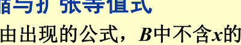

The architecture above demonstrates the interaction flow between the LLM Core and Memory Store.

```
```python
memory = FunctionCallMemory()
# register a successful tool call
memory.save_tool_call("get_order_status", args={"order_id": 123})
```
```

The next time the agent needs order status, it can instantly retrieve the saved response.

| Tool Name        | Memory Hit | Latency Reduction |
|------------------|------------|-------------------|
| get_order_status | ✅         | 84%               |
| create_refund    | ✅         | 78%               |
| update_inventory | ✅         | 91%               |

Deployment is simple—no heavy infrastructure required. Install with pip:

```
```bash
pip install function-call-memory
```
```

And you're ready to start building resilient agents today.

> > "Memory is the missing piece in modern AI workflows." - Project Lead


### 基本的等值式(续)

**量词分配等值式**

∀x(A(x)∧B(x)) ⇔ ∀xA(x) ∧ ∀xB(x)

∃x(A(x)∨B(x)) ⇔ ∃xA(x) ∨ ∃xB(x)

注意：∀对∨无分配律，∃对∧无分配律

### 基本的等值式(续)

例 将下面命题用两种形式符号化

+   (1) 没有不犯错误的人
+   (2) 不是所有的人都爱看电影

解 (1) 令 F(x): x 是人， G(x): x 犯错误.
¬∃x(F(x) ∧ ¬G(x))
⇔ ∀x(F(x) → G(x))
请给出演算过程，并说明理由.

(2) 令 F(x): x 是人， G(x): 爱看电影.
¬∀x(F(x) → G(x))
⇔ ∃x(F(x) ∧ ¬G(x))
给出演算过程，并说明理由.

### 公式的前束范式

定理（前束范式存在定理）一阶逻辑中的任何公式都存在与之等值的前束范式

注意：

+   公式的前束范式不惟一
+   求公式的前束范式的方法：利用重要等值式、置换规则、换名规则、代替规则进行等值演算。

### 换名规则与代替规则

换名规则：将量词辖域中出现的某个约束出现的个体变项及对应的指导变项，改成另一个辖域中未曾出现过的个体变项符号，公式中其余部分不变，则所得公式与原来的公式等值。

代替规则：对某自由出现的个体变项用与原公式中所有个体变项符号不同的符号去代替，则所得公式与原来的公式等值。

### 公式的前束范式(续)

例 求下列公式的前束范式
(1) ¬∃x(M(x)∧F(x))
解  ¬∃x(M(x)∧F(x))
⇔ ∀x(¬M(x)∨¬F(x))      （量词否定等值式）
⇔ ∀x(M(x)→¬F(x))
两步结果都是前束范式，说明前束范式不惟一。

### 例 (续)

(2) ∀xF(x)∧¬∃xG(x)
解  ∀xF(x)∧¬∃xG(x)
⇔∀xF(x)∧∀x¬G(x)    （量词否定等值式）
⇔∀x(F(x)∧¬G(x))    （量词分配等值式）
另有一种形式
    ∀xF(x)∧¬∃xG(x)
⇔∀xF(x)∧∀x¬G(x)
⇔∀xF(x)∧∀y¬G(y)    （代替规则）
⇔∀x∀y(F(x)∧¬G(y))    （量词辖域扩张）
两种形式是等值的

### 例（续）

**(3)** ∃xF(x)∨¬∀xG(x)

解　∃xF(x)∨¬∀xG(x)

⇔∃xF(x)∨∃x¬G(x)

⇔∃x(F(x)∨¬G(x))　　（为什么？）

或 ⇔∃x∃y(F(x)∨¬G(y))　　（为什么？）

**(4)** ∀xF(x)→∃y(G(x,y)∧¬H(y))

解　∀xF(x)→∃y(G(x,y)∧¬H(y))

⇔∀zF(z)→∃y(G(x,y)∧¬H(y))　　（换名规则）

⇔∃z¬∃y(F(z)→(G(x,y)∧¬H(y)))　　（为什么？）

### 例 (续)

或

⇔ ∀x F(x) → ∃y (G(z,y) ∧ ¬H(y))      （代替规则）
⇔ ∃x ∃y (F(x) → (G(z,y) ∧ ¬H(y)))
(5) ∀x (F(x,y) → ∃y (G(x,y) ∧ H(x,z)))
解 用换名规则, 也可用代替规则, 这里用代替规则

∀x (F(x,y) → ∃y (G(x,y) ∧ H(x,z)))
⇔ ∀x (F(x,u) → ∃y (G(x,y) ∧ H(x,z)))
⇔ ∀x ∃y (F(x,u) → G(x,y) ∧ H(x,z))
注意： ∀x 与 ∃y 不能颠倒

## 2.4 一阶逻辑推理理论

+   - 推理的形式结构
+   - 判断推理是否正确的方法
+   - 重要的推理定律
+   - 推理规则
+   - 构造证明
+   - 附加前提证明法

### 推理

推理的形式结构有两种：

第一种  $A_1 \land A_2 \land ... \land A_k \rightarrow B$  (*)

第二种  前提：$A_1$, $A_2$, ..., $A_k$
结论：$B$

其中 $A_1, A_2, ..., A_k, B$ 为一阶逻辑公式。

若(*)为永真式，则称推理正确，否则称推理不正确。

判断方法：

真值表法，等值演算法，主析取范式法及构造证明法。前3种方法采用第一种形式结构，构造证明法采用第二种形式结构。

### 重要的推理定律

### 第一组 命题逻辑推理定律代换实例

如 ∀xF(x)∧∃yG(y)⇒∀xF(x)为化简律代换实例。

### 第二组 由基本等值式生成

如 由 ¬∀xA(x)⇔∃x¬A(x) 生成

¬∀xA(x)⇒∃x¬A(x), ∃x¬A(x)⇒¬∀xA(x), ...

### 第三组

∀xA(x)∨∀xB(x)⇒∀x(A(x)∨B(x))

∃x(A(x)∧B(x))⇒∃xA(x)∧∃xB(x)

### 推理规则（续）

(12) 全称量词消去规则（简记为UI规则或UI）

```
∀xA(x) 或 ∀xA(x)
∴ A(y)          ∴ A(c)
```

两式成立的条件是：

在第一式中，取代x的y应为任意的不在A(x)中约束出现的个体变项。

在第二式中，c为任意个体常项。

用y或c去取代A(x)中的自由出现的x时，一定要在x自由出现的一切地方进行取代。

### 推理规则 (续)

(13) 全称量词引入规则（简记为UG规则或UG）
A(y)
∴ ∀x A(x)
该式成立的条件是：
无论A(y)中自由出现的个体变项y取何值，A(y)应该均为真。
取代自由出现的y的x，也不能在A(y)中约束出现。

### 推理规则（续）

**(15) 存在量词消去规则（简记为 EI 规则或 EI）**

\[
\exists xA(x)
\]
\[
\therefore A(c)
\]

该式成立的条件是：

- $c$ 是使 $A$ 为真的特定的个体常项。
- $c$ 不在 $A(x)$ 中出现。
- 若 $A(x)$ 中除自由出现的 $x$ 外，还有其他自由出现的个体变项，此规则不能使用。

### 构造推理证明

例1 证明苏格拉底三段论：“人都是要死的，苏格拉底是人，所以苏格拉底是要死的。”

令 F(x): x是人，G(x): x是要死的，a: 苏格拉底

前提： ∀x(F(x)→G(x))， F(a)

结论： G(a)

证明： ① F(a) 前提引入 ② ∀x(F(x)→G(x)) 前提引入 ③ F(a)→G(a) ②UI ④ G(a) ①③假言推理

注意：使用UI时，用a取代x。

## # 构造推理证明（续）

> > 例2 乌鸦都不是白色的. 北京鸭是白色的. 因此，北京鸭不是乌鸦。  
> > 令 $F(x)$：$x$ 是乌鸦，$G(x)$：$x$ 是北京鸭，  
> > $H(x)$：$x$ 是白色的  
> > 前提：$\forall x(F(x)\rightarrow\neg H(x))$，$\forall x(G(x)\rightarrow H(x))$  
> > 结论：$\forall x(G(x)\rightarrow\neg F(x))$

### 例2(续)

证明：
① ∀x(F(x)→¬H(x))    前提引入
② F(y)→¬H(y)    ①UI
③ ∀x(G(x)→H(x))    前提引入
④ G(y)→H(y)    ③UI
⑤ ¬H(y)→¬G(y)    ④置换
⑥ F(y)→¬G(y)    ②⑤假言三段论
⑦ G(y)→¬F(y)    ⑥置换
⑧ ∀x(G(x)→¬F(x))    ⑦UG

## # 构造推理证明(续)

例3 构造下述推理证明

前提： ∀x(F(x)→G(x)), ∃xF(x)

结论： ∃xG(x)

+   证明：
+   ① ∃xF(x) 前提引入
+   ② ∀x(F(x)→G(x)) 前提引入
+   ③ F(c) ①EI
+   ④ F(c)→G(c) ②UI
+   ⑤ G(c) ③④假言推理
+   ⑥ ∃xG(x) ⑤EG

注意：必须先消存在量词

## # 构造推理证明（续）

**例4 构造下述推理证明**

**前提：** ∃xF(x)→∀xG(x)

**结论：** ∀x(F(x)→G(x))

**证明：**

① ∃xF(x)→∀xG(x)　　前提引入
② ∀x∀y(F(x)→G(y))　　①置换
③ ∀x(F(x)→G(z))　　②UI
④ F(z)→G(z)　　③UI
⑤ ∀x(F(x)→G(x))　　④UG

**说明：**

不能对∃xF(x)→∀xG(x)消量词，因为它不是前束范式。
对此题不能用附加前提证明法。

### 构造推理证明（续）

### 例5 构造下述推理证明

前提: ∀x(F(x)→G(x))

结论: ∀xF(x)→∀xG(x)

### 证明:

+   1. ∀xF(x)
+   2. F(y)
+   3. ∀x(F(x)→G(x))
+   4. F(y)→G(y)
+   5. G(y)
+   6. ∀xG(x)

附加前提引入

+   1. UI
+   2. UI
+   3. 假言推理
+   4. UG

本题可以使用附加前提证明法


## 集合论

### 集合论部分

- 第3章 集合的基本概念和运算
- 第4章 二元关系和函数

## 第3章 集合的基本概念和运算

- 3.1 集合的基本概念
- 3.2 集合的基本运算
- 3.3 集合中元素的计数

### 3.1 集合的基本概念

- 集合的定义与表示
- 集合与元素
- 集合之间的关系
- 空集
- 全集
- 幂集

#### 集合定义与表示

集合没有精确的数学定义。

理解：一些离散个体组成的全体。

组成集合的个体称为它的元素或成员。

集合的表示：

列元素法：A = { a, b, c, d }

谓词表示法：B = { x | P(x) }

B 由使得 P(x) 为真的 x 构成。

常用数集：

N, Z, Q, R, C 分别表示自然数、整数、有理数、实数和复数集合，注意 0 是自然数。

#### 集合与元素

元素与集合的关系：隶属关系。

属于 ∈，不属于 ∉。

实例：

A = { x | x∈R ∧ x²−1=0 }, A = {−1, 1}

1∈A, 2∉A

注意：对于任何集合 A 和元素 x（可以是集合），x∈A 和 x∉A 两者成立其一，且仅成立其一。

#### 隶属关系的层次结构

例 3.1

A = { a, {b,c}, d, {{d}} }

{b,c}∈A

b∉A

{{d}}∈A

{d}∉A

d∈A

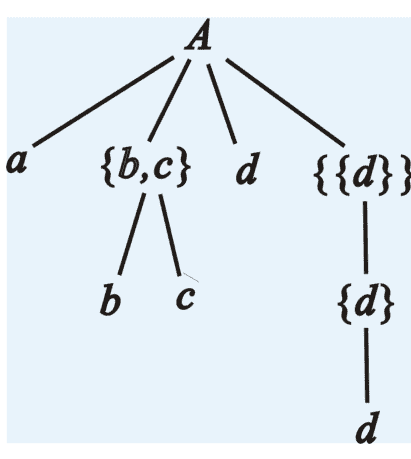

#### 集合之间的关系

包含（子集）：A ⊆ B ⇔ ∀x (x∈A → x∈B)

不包含：A ⊈ B ⇔ ∃x (x∈A ∧ x∉B)

相等：A = B ⇔ A ⊆ B ∧ B ⊆ A

不相等：A ≠ B

真包含：A ⊂ B ⇔ A ⊆ B ∧ A ≠ B

不真包含：A ⊄ B

思考：≠ 和 ⊄ 的定义。

注意：∈ 和 ⊆ 是不同层次的问题。

#### 空集与全集

空集 ∅：不含任何元素的集合。

实例：{x | x²+1=0 ∧ x∈R} 就是空集。

定理：空集是任何集合的子集。

∅ ⊆ A ⇔ ∀x (x∈∅ → x∈A) ⇔ T

推论：空集是惟一的。

证：假设存在 ∅₁ 和 ∅₂，则 ∅₁⊆∅₂ 且 ∅₂⊆∅₁，因此 ∅₁=∅₂。

全集 E。

相对性：在给定问题中，全集包含任何集合，即 ∀A (A⊆E)。

### 3.2 集合的基本运算

- 集合基本运算的定义
  - ∪ ∩ − ∼ ⊕
- 文氏图（John Venn）
- 例题
- 集合运算的算律
- 集合包含或恒等式的证明

#### 集合基本运算的定义

并：$A \cup B = \{ x \mid x \in A \lor x \in B \}$

交：$A \cap B = \{ x \mid x \in A \land x \in B \}$

相对补：$A - B = \{ x \mid x \in A \land x \notin B \}$

对称差：$A \oplus B = (A - B) \cup (B - A)$  
$= (A \cup B) - (A \cap B)$

绝对补：$\sim A = E - A$

#### 文氏图表示

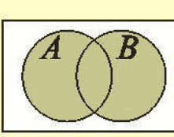

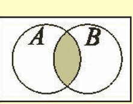

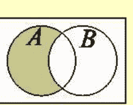

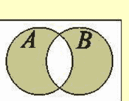

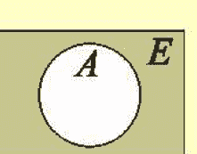

#### 关于运算的说明

- 运算顺序：∼ 和幂集优先，其他由括号确定。
- 并和交运算可以推广到有穷个集合上，即
  - $A_1 \cup A_2 \cup ... \cup A_n = \{x \mid x \in A_1 \lor x \in A_2 \lor ... \lor x \in A_n\}$
  - $A_1 \cap A_2 \cap ... \cap A_n = \{x \mid x \in A_1 \land x \in A_2 \land ... \land x \in A_n\}$
- 某些重要结果
  - $\varnothing \subseteq A - B \subseteq A$
  - $A \subseteq B \Leftrightarrow A - B = \varnothing$（后面证明）
  - $A \cap B = \varnothing \Leftrightarrow A - B = A$

### 例1

F：一年级大学生的集合　　S：二年级大学生的集合  
R：计算机系学生的集合　　M：数学系学生的集合  
T：选修离散数学的学生集合  
L：爱好文学学生的集合　　P：爱好体育运动学生的集合

所有计算机系二年级学生都选修离散数学。

数学系一年级的学生都没有选修离散数学。

数学系学生或爱好文学或爱好体育运动。

只有一、二年级的学生才爱好体育运动。

除去数学和计算机系二年级学生外都不选修离散数学。

T ⊆ (M ∪ R) ∩ S

R ∩ S ⊆ T

(M ∩ F) ∩ T = ∅

M ⊆ L ∪ P

P ⊆ F ∪ S

S − (M ∪ R) ⊆ P

#### 集合运算的算律

| | ∪ | ∩ | ⊕ |
|---|---|---|---|
| 交换 | A∪B=B∪A | A∩B=B∩A | A⊕B=B⊕A |
| 结合 | (A∪B)∪C = A∪(B∪C) | (A∩B)∩C = A∩(B∩C) | (A⊕B)⊕C = A⊕(B⊕C) |
| 幂等 | A∪A=A | A∩A=A |  |

| | ∪与∩ | ∩与⊕ |
|---|---|---|
| 分配 | A∪(B∩C)=(A∪B)∩(A∪C)；A∩(B∪C)=(A∩B)∪(A∩C) | A∩(B⊕C)=(A∩B)⊕(A∩C) |
| 吸收 | A∪(A∩B)=A；A∩(A∪B)=A |  |

吸收律的前提：∪、∩ 可交换。

#### 集合运算的算律（续）

| | - | ∼ |
|---|---|---|
| *D.M 律* | $A-(B\cup C)=(A-B)\cap(A-C)$<br>$A-(B\cap C)=(A-B)\cup(A-C)$ | $\sim(B\cup C)=\sim B\cap\sim C$<br>$\sim(B\cap C)=\sim B\cup\sim C$ |
| 双重否定 |  | $\sim\sim A=A$ |

| | ∅ | E |
|---|---|---|
| 补元律 | $A\cap\sim A=\varnothing$ | $A\cup\sim A=E$ |
| 零律 | $A\cap\varnothing=\varnothing$ | $A\cup E=E$ |
| 同一律 | $A\cup\varnothing=A$ | $A\cap E=A$ |
| 否定 | $\sim\varnothing=E$ | $\sim E=\varnothing$ |

#### 集合包含或相等的证明方法

- 证明 $X \subseteq Y$
  - 命题演算法
  - 包含传递法
  - 等价条件法
  - 反证法
  - 并交运算法
- 证明 $X = Y$
  - 命题演算法
  - 等式代入法
  - 反证法
  - 运算法

以上的 $X, Y$ 代表集合公式。

#### 命题演算法证 X⊆Y

任取 x，

x∈X ⇒ ... ⇒ x∈Y

例3 证明 A⊆B ⇔ P(A)⊆P(B)

任取 x

x∈P(A) ⇒ x⊆A ⇒ x⊆B ⇒ x∈P(B)

任取 x

x∈A ⇒ {x}⊆A ⇒ {x}∈P(A) ⇒ {x}∈P(B)

⇒ {x}⊆B ⇒ x∈B

#### 包含传递法证 X⊆Y

找到集合 $T$ 满足 $X \subseteq T$ 且 $T \subseteq Y$，从而有 $X \subseteq Y$。

例4 $A - B \subseteq A \cup B$

证：$A - B \subseteq A$，$A \subseteq A \cup B$，所以 $A - B \subseteq A \cup B$。


## 反证法证 $X \subseteq Y$

欲证 $X \subseteq Y$, 假设命题不成立, 必存在 $x$ 使得 $x \in X$ 且 $x \notin Y$. 然后推出矛盾.

例6 证明 $A \subseteq C \land B \subseteq C \Rightarrow A \cup B \subseteq C$

证 假设 $A \cup B \subseteq C$ 不成立,

则 $\exists x\ (x \in A \cup B \land x \notin C)$

因此 $x \in A$ 或 $x \in B$, 且 $x \notin C$

若 $x \in A$, 则与 $A \subseteq C$ 矛盾;

若 $x \in B$, 则与 $B \subseteq C$ 矛盾.

### 利用已知包含式并交运算

由已知包含式通过运算产生新的包含式
X⊆Y ⇒ X∩Z⊆Y∩Z, X∪Z⊆Y∪Z

例7 证明 A∩C⊆B∩C ∧ A−C⊆B−C ⇒ A⊆B

证 A∩C⊆B∩C， A−C⊆B−C

上式两边求并，得

(A∩C)∪(A−C) ⊆ (B∩C)∪(B−C)

⇒ (A∩C)∪(A∩~C) ⊆ (B∩C)∪(B∩~C)

⇒ A∩(C∪~C) ⊆ B∩(C∪~C)

⇒ A∩E ⊆ B∩E

⇒ A ⊆ B

### 命题演算法证明 X=Y

任取 x，
 x∈X ⇒ ... ⇒ x∈Y
 x∈Y ⇒ ... ⇒ x∈X
 或者
 x∈X ⇔ ... ⇔ x∈Y

例8 证明 A∪(A∩B)=A （吸收律）

证 任取 x，

x∈A∪(A∩B) ⇔ x∈A ∨ x∈A∩B

⇔ x∈A ∨ (x∈A ∧ x∈B) ⇔ x∈A

### 等式替换证明X=Y

不断进行代入化简，最终得到两边相等

例9 证明 A∪(A∩B)=A （吸收律）

证 （假设交换律、分配律、同一律、零律成立）

A∪(A∩B)

=(A∩E)∪(A∩B)      同一律

=A∩(E∪B)      分配律

=A∩(B∪E)      交换律

=A∩E      零律

=A      同一律

### 反证法证明X=Y

假设 X=Y 不成立，则存在 x 使得 x∈X 且 x∉Y，或者存在 x 使得 x∈Y 且 x∉X，然后推出矛盾。

### 例10 证明以下等价条件

A⊆B ⇔ A∪B=B ⇔ A∩B=A ⇔ A−B=∅
(1)      (2)      (3)      (4)

证明顺序：

(1) ⇒(2), (2) ⇒(3), (3) ⇒(4), (4) ⇒(1)

(1) ⇒ (2)

显然 $B \subseteq A \cup B$，下面证明 $A \cup B \subseteq B$。

任取 $x$，

$x \in A \cup B \Leftrightarrow x \in A \lor x \in B \Rightarrow x \in B \lor x \in B \Leftrightarrow x \in B$

因此有 $A \cup B \subseteq B$。综合上述（2）得证。

(2) ⇒ (3)

$A = A \cap (A \cup B) \Rightarrow A = A \cap B$

（将 $A \cup B$ 用 $B$ 代入）

(3) ⇒(4)
假设 A−B≠∅, 即 ∃x∈A−B, 那么 x∈A 且 x∉B. 而
x∉B ⇒ x∉A∩B.
从而与 A∩B=A 矛盾.

(4) ⇒(1)
假设 A⊆B 不成立, 那么
∃x (x∈A ∧ x∉B) ⇒ x∈A−B ⇒ A−B≠∅
与条件（4）矛盾.

### 集合运算法证明 X=Y

由已知等式通过运算产生新的等式
X=Y ⇒ X∩Z=Y∩Z, X∪Z=Y∪Z, X-Z=Y-Z

例11 证明 A∩C=B∩C ∧ A∪C=B∪C ⇒ A=B

证 由 A∩C=B∩C 和 A∪C=B∪C 得到

(A∪C)-(A∩C)=(B∪C)-(B∩C)

从而有 A⊕C=B⊕C

因此

A⊕C=B⊕C ⇒ (A⊕C)⊕C=(B⊕C)⊕C

⇒ A⊕(C⊕C)=B⊕(C⊕C) ⇒ A⊕∅=B⊕∅ ⇒ A=B

## 3.3 集合中元素的计数

- 集合的基数与有穷集合
- 包含排斥原理
- 有穷集的计数

### 集合的基数与有穷集合

集合 A 的基数: 集合A中的元素数, 记作 cardA

有穷集 A: cardA=|A|=n, n为自然数.

有穷集的实例:

A={ a,b,c}, cardA=|A|=3;

B={ x | x²+1=0, x∈R}, cardB=|B|=0

无穷集的实例:

N, Z, Q, R, C 等

### 包含排斥原理

定理 设 S 为有穷集，P₁, P₂, ..., Pₘ 是 m 种性质，Aᵢ 是 S 中具有性质 Pᵢ 的元素构成的子集，i=1, 2, ..., m. 则 S 中不具有性质 P₁, P₂, ..., Pₘ 的元素数为

|Ā₁ ∩ Ā₂ ∩ ... ∩ Āₘ|
= |S| - Σᵢ₌₁ᵐ |Aᵢ| + Σ₁≤i<j≤m |Aᵢ ∩ Aⱼ| - Σ₁≤i<j<k≤m |Aᵢ ∩ Aⱼ ∩ Aₖ| + ...
+ (-1)ᵐ |A₁ ∩ A₂ ∩ ... ∩ Aₘ|

### 证明

证明要点：任何元素 x，如果不具有任何性质，则对等式右边计数贡献为 1，否则为 0

证 设 x 不具有性质 P₁, P₂, ..., Pₘ,
    x ∉ Aᵢ, i = 1, 2, ..., m
    x ∉ Aᵢ ∩ Aⱼ, 1 ≤ i < j ≤ m
    ...
    x ∉ A₁ ∩ A₂ ∩ ... ∩ Aₘ,
    x 对右边计数贡献为
    1 − 0 + 0 − 0 + ... + (−1)ᵐ · 0 = 1

### 证明（续）

设 $x$ 具有 $n$ 条性质，$1\le n\le m$

- $x$ 对 $|S|$ 贡献为 $1$
- $x$ 对 $\sum_{i=1}^{m}|A_i|$ 贡献为 $C_n^1$
- $x$ 对 $\sum_{1\le i<j\le m}|A_i\cap A_j|$ 贡献为 $C_n^2$
- ⋯⋯
- $x$ 对 $|A_1\cap A_2\cap\cdots\cap A_m|$ 贡献为 $C_n^m$

$x$ 对右边计数贡献为

$$1-C_n^1+C_n^2-\cdots+(-1)^mC_n^m=\sum_{i=0}^{n}C_n^i=0$$

### 推论

S中至少具有一条性质的元素数为

$$\left|A_1\cup A_2\cup\cdots\cup A_m\right|$$

$$=\sum_{i=1}^{m}|A_i|-\sum_{1\le i<j\le m}|A_i\cap A_j|+\sum_{1\le i<j<k\le m}|A_i\cap A_j\cap A_k|+\cdots$$

$$+(-1)^{m-1}|A_1\cap A_2\cap\cdots\cap A_m|$$

证明

$$\left|A_1\cup A_2\cup\cdots\cup A_m\right|$$

$$=|S|-|\overline{A_1\cup A_2\cup\cdots\cup A_m}|$$

$$=|S|-|\overline{A_1}\cap\overline{A_2}\cap\cdots\cap\overline{A_m}|$$

将定理 1 代入即可

### 应用

例1 求1到1000之间（包含1和1000在内）既不能被 5 和6 整除，也不能被 8 整除的数有多少个？

解： S = { x | x∈Z, 1 ≤ x ≤1000 },
如下定义 S 的 3 个子集 A, B, C:

A = { x | x∈S, 5 | x },

B = { x | x∈S, 6 | x },

C = { x | x∈S, 8 | x }

### 例1（续）

对上述子集计数：

$|S|=1000,$

$|A|=\lfloor1000/5\rfloor=200,\quad |B|=\lfloor1000/6\rfloor=133,$

$|C|=\lfloor1000/8\rfloor=125,$

$|A\cap B|=\lfloor1000/30\rfloor=33,\quad |B\cap C|=\lfloor1000/40\rfloor=25,$

$|A\cap C|=\lfloor1000/40\rfloor=25,$

$|A\cap C|=\lfloor1000/24\rfloor=41,$

$|A\cap B\cap C|=\lfloor1000/120\rfloor=8,$

代入公式

$N=1000-(200+133+125)+(33+25+41)-8=600$

### 文氏图法

求1到1000之间（包含1和1000在内）既不能被5和6整除，也不能被8整除的数有多少个？

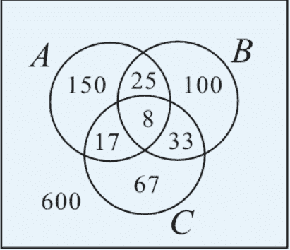


### 例2

24名科技人员，每人至少会1门外语。

英语：13；日语：5；德语：10；法语：9

英日：2；英德：4；英法：4；法德：4

会日语的不 会法语、德语

求：只会1种语言人数，会3种语言人数

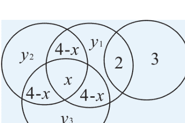

x+2(4-x)+y1+2=13
x+2(4-x)+y2=10
x+2(4-x)+y3=9
x+3(4-x)+y1+y2+y3=19
x=1, y1=4, y2=3, y3=2

## 第4章 二元关系与函数

- 4.1 集合的笛卡儿积与二元关系
- 4.2 关系的运算
- 4.3 关系的性质
- 4.4 关系的闭包
- 4.5 等价关系和偏序关系
- 4.6 函数的定义和性质
- 4.7 函数的复合和反函数

## 4.1 集合的笛卡儿积和二元关系

- 有序对
- 笛卡儿积及其性质
- 二元关系的定义
- 二元关系的表示

### 有序对

定义 由两个客体 x 和 y，按照一定的顺序组成的二元组称为有序对，记作<x,y>

实例：点的直角坐标(3,-4)

有序对性质

有序性 <x,y>≠<y,x>（当x≠y时）

<x,y>与<u,v>相等的充分必要条件是

<x,y>=<u,v> ⇔ x=u ∧ y=v

例1 <2, x+5> = <3y−4, y>，求 x, y.

解 3y−4 = 2, x+5 = y ⇒ y = 2, x = −3

### 有序 n 元组

定义 一个有序 n (n≥3) 元组 <x₁, x₂, …, xₙ> 是一个有序对，其中第一个元素是一个有序 n-1 元组，即

<x₁, x₂, …, xₙ> = < <x₁, x₂, …, xₙ₋₁>, xₙ>

当 n=1 时, <x> 形式上可以看成有序 1 元组.

实例 n 维向量是有序 n 元组.

### 笛卡儿积

设A,B为集合, A和B的笛卡儿积记作A×B, 即 A×B ={<x,y> | x∈A ∧ y∈B }

A={1,2,3}, B={a,b,c}

A×B = {<1,a>,<1,b>,<1,c>,<2,a>,<2,b>,<2,c>, <3,a>,<3,b>,<3,c>}

B×A = {<a,1>,<b,1>,<c,1>,<a,2>,<b,2>,<c,2>, <a,3>,<b,3>,<c,3>}

A={∅}, P(A)×A={<∅,∅>, <{∅},∅>}

### 笛卡儿积的性质

不适合交换律  A×B≠B×A  (A≠B, A≠∅, B≠∅)

不适合结合律  (A×B)×C≠A×(B×C)  (A≠∅, B≠∅)

对于并或交运算满足分配律

A×(B∪C)=(A×B)∪(A×C)

(B∪C)×A=(B×A)∪(C×A)

A×(B∩C)=(A×B)∩(A×C)

(B∩C)×A=(B×A)∩(C×A)

若A或B中有一个为空集，则A×B就是空集。

A×∅=∅×B=∅

若|A|=m, |B|=n, 则 |A×B|=mn

### 性质的证明

证明  A×(B∪C)=(A×B)∪(A×C)
证 任取<x,y>
<x,y>∈A×(B∪C)
⇔ x∈A∧y∈B∪C
⇔ x∈A∧(y∈B∨y∈C)
⇔ (x∈A∧y∈B)∨(x∈A∧y∈C)
⇔ <x,y>∈A×B∨<x,y>∈A×C
⇔ <x,y>∈(A×B)∪(A×C)
所以有A×(B∪C)=(A×B)∪(A×C).

### 例题

例3 (1) 证明 $A=B \land C=D \Rightarrow A\times C=B\times D$
(2) $A\times C=B\times D$ 是否推出 $A=B \land C=D$？为什么？

解 (1) 任取 $\langle x,y\rangle$
$\langle x,y\rangle \in A\times C \iff x\in A \land y\in C$
$\iff x\in B \land y\in D \iff \langle x,y\rangle \in B\times D$

(2) 不一定. 反例如下：
$A=\{1\},\ B=\{2\}, C=D=\varnothing$, 则 $A\times C=B\times D$ 但是 $A\neq B$.

### 二元关系的定义

定义 如果一个集合满足以下条件之一：

- （1）集合非空,且它的元素都是有序对
- （2）集合是空集

则称该集合为一个二元关系,简称为关系,记作R.
如<x,y>∈R,可记作 xRy；如果<x,y>∉R,则记作x∉R y

实例： R={<1,2>,<a,b>}, S={<1,2>,a,b}.
R是二元关系,当a,b不是有序对时，S不是二元关系
根据上面的记法，可以写 1R2, aRb, a∉R c 等.

### 从A到B的关系与A上的关系

定义 设A,B为集合，A×B的任何子集所定义的二元关系叫做从A到B的二元关系，当A=B时则叫做A上的二元关系。

例4 A={0,1}, B={1,2,3}, R₁={<0,2>}, R₂=A×B, R₃=∅, R₄={<0,1>}. 那么 R₁, R₂, R₃, R₄是从A到B的二元关系, R₃和R₄同时也是A上的二元关系。

计数 |A|=n, |A×A|=n², A×A的子集有2ⁿ²个. 所以A上有2ⁿ²个不同的二元关系.

例如 |A|=3, 则A上有=512个不同的二元关系.

### A上重要关系的实例

设 $A$ 为任意集合，
$\varnothing$ 是 $A$ 上的关系，称为空关系
$E_A, I_A$ 分别称为全域关系与恒等关系，定义如下：

$E_A=\{\langle x,y\rangle\mid x\in A\land y\in A\}=A\times A$

$I_A=\{\langle x,x\rangle\mid x\in A\}$

例如，$A=\{1,2\}$，则

$E_A=\{\langle1,1\rangle,\langle1,2\rangle,\langle2,1\rangle,\langle2,2\rangle\}$

$I_A=\{\langle1,1\rangle,\langle2,2\rangle\}$

### A上重要关系的实例（续）

小于等于关系 $L_A$, 整除关系 $D_A$, 包含关系 $R_\subseteq$ 定义：

$L_A = \{\langle x,y\rangle \mid x,y \in A \land x \le y\}, \ A \subseteq R, \ R \text{为实数集合}$

$D_B = \{\langle x,y\rangle \mid x,y \in B \land x \text{整除} y\}$,
$B \subseteq Z^*, \ Z^* \text{为非0整数集}$

$R_\subseteq = \{\langle x,y\rangle \mid x,y \in A \land x \subseteq y\}, \ A \text{是集合族.}$

类似的还可以定义大于等于关系, 小于关系, 大于关系, 真包含关系等等.

### 实例

例如 $A = \{1, 2, 3\}$, $B = \{a, b\}$, 则

$L_A = \{<1,1>, <1,2>, <1,3>, <2,2>, <2,3>, <3,3>\}$

$D_A = \{<1,1>, <1,2>, <1,3>, <2,2>, <3,3>\}$

$A = P(B) = \{\varnothing, \{a\}, \{b\}, \{a,b\}\}$, 则 $A$ 上的包含关系是

$R_\subseteq = \{<\varnothing,\varnothing>, <\varnothing,\{a\}>, <\varnothing,\{b\}>, <\varnothing,\{a,b\}>, <\{a\},\{a\}>, $
$<\{a\},\{a,b\}>, <\{b\},\{b\}>, <\{b\},\{a,b\}>, <\{a,b\},\{a,b\}>\}$

### 关系的表示

表示方式：关系的集合表达式、关系矩阵、关系图

关系矩阵：若 A={x₁, x₂, …, xₘ}，B={y₁, y₂, …, yₙ}，R是从A到B的关系，R的关系矩阵是布尔矩阵 M_R = [r_ij]_{m×n}，其中 r_ij = 1 ⇔ <x_i, y_j> ∈ R.

关系图：若 A={x₁, x₂, …, xₘ}，R是从A上的关系，R的关系图是 G_R=<A, R>，其中A为结点集，R为边集。如果<x_i, x_j>属于关系R，在图中就有一条从 x_i 到 x_j 的有向边。

注意：A, B为有穷集，关系矩阵适于表示从A到B的关系或者A上的关系，关系图适于表示A上的关系

### 实例

A={1,2,3,4},

R={<1,1>,<1,2>,<2,3>,<2,4>,<4,2>},

R的关系矩阵 M_R 和关系图 G_R 如下：

M_R = [[1 1 0 0],[0 0 1 1],[0 0 0 0],[0 1 0 0]]

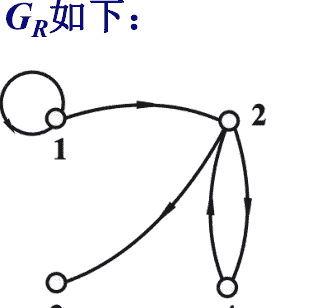


## 4.2 关系的运算

- 基本运算定义
  - 定义域、值域、域
  - 逆、合成、限制、像
- 基本运算的性质
- 幂运算
  - 定义
  - 求法
  - 性质

### 关系的基本运算定义

#### 定义域、值域和域

domR = { x | ∃y (<x,y> ∈ R) }
ranR = { y | ∃x (<x,y> ∈ R) }
fldR = domR ∪ ranR

例1 R = {<1,2>, <1,3>, <2,4>, <4,3>}, 则
domR = {1, 2, 4}
ranR = {2, 3, 4}
fldR = {1, 2, 3, 4}

### 关系的基本运算定义（续）

逆与合成

$R^{-1} = \{<y,x> \mid <x,y>\in R\}$

$R \circ S = \{<x,z> \mid \exists y\ (<x,y>\in R \land <y,z>\in S)\}$

例2 $R=\{<1,2>, <2,3>, <1,4>, <2,2>\}$
$S=\{<1,1>, <1,3>, <2,3>, <3,2>, <3,3>\}$
$R^{-1}=\{<2,1>, <3,2>, <4,1>, <2,2>\}$
$R \circ S =\{<1,3>, <2,2>, <2,3>\}$
$S \circ R =\{<1,2>, <1,4>, <3,2>, <3,3>\}$

### 合成运算的图示方法

利用图示（不是关系图）方法求合成
R∘ S = {<1,3>, <2,2>, <2,3>}
S∘ R = {<1,2>, <1,4>, <3,2>, <3,3>}

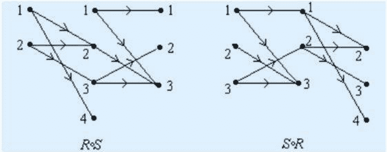

### 限制与像

定义 F 在 A 上的限制
F↾ A = {<x,y> | x F y ∧ x ∈ A}
A 在 F 下的像
F[A] = ran(F↾ A)

实例 R = {<1,2>, <2,3>, <1,4>, <2,2>}
R↾ {1} = {<1,2>, <1,4>}
R[{1}] = {2,4}
R↾ ∅ = ∅
R[{1,2}] = {2,3,4}

注意： F↾ A ⊆ F, F[A] ⊆ ran F

### 关系基本运算的性质

定理1 设F是任意的关系, 则
(1) (F⁻¹)⁻¹ = F
(2) dom F⁻¹ = ran F, ran F⁻¹ = dom F
证 (1) 任取<x,y>, 由逆的定义有
<x,y> ∈ (F⁻¹)⁻¹ ⇔ <y,x> ∈ F⁻¹ ⇔ <x,y> ∈ F
所以有 (F⁻¹)⁻¹ = F
(2) 任取x,
 x ∈ dom F⁻¹ ⇔ ∃y(<x,y> ∈ F⁻¹)
 ⇔ ∃y(<y,x> ∈ F) ⇔ x ∈ ran F
所以有 dom F⁻¹ = ran F. 同理可证 ran F⁻¹ = dom F.

### 关系基本运算的性质（续）

定理2 设F, G, H是任意的关系, 则

- (1) (F∘ G)∘ H = F∘ (G∘ H)
- (2) (F∘ G)^{-1} = G^{-1}∘ F^{-1}

证 (1) 任取<x,y>,

<x,y> ∈ (F∘ G)∘ H

⇔ ∃t(<x,t> ∈ F∘ G ∧ <t,y> ∈ H)

⇔ ∃t (∃s(<x,s> ∈ F ∧ <s,t> ∈ G) ∧ <t,y> ∈ H)

⇔ ∃t ∃s (<x,s> ∈ F ∧ <s,t> ∈ G ∧ <t,y> ∈ H)

⇔ ∃s (<x,s> ∈ F ∧ ∃t (<s,t> ∈ G ∧ <t,y> ∈ H))

⇔ ∃s (<x,s> ∈ F ∧ <s,y> ∈ G∘ H)

⇔ <x,y> ∈ F∘ (G∘ H)

所以 (F∘ G)∘ H = F∘ (G∘ H)

### 关系基本运算的性质（续）

(2) 任取<x,y>,
<x,y> ∈ (F ∘ G)⁻¹
⇔ <y,x> ∈ F ∘ G
⇔ ∃t (<y,t> ∈ F ∧ (t,x) ∈ G)
⇔ ∃t (<x,t> ∈ G⁻¹ ∧ (t,y) ∈ F⁻¹)
⇔ <x,y> ∈ G⁻¹ ∘ F⁻¹
所以 (F ∘ G)⁻¹ = G⁻¹ ∘ F⁻¹

### A上关系的幂运算

设R为A上的关系, n为自然数, 则 R 的 n次幂定义为:

- (1) R⁰ = {<x,x> | x∈A} = I_A
- (2) Rⁿ⁺¹ = Rⁿ ∘ R

注意：

对于A上的任何关系R₁和R₂都有
R₁⁰ = R₂⁰ = I_A

对于A上的任何关系 R 都有
R¹ = R

### 幂的求法（续）

R⁰, R¹, R², R³,...的关系图如下图所示

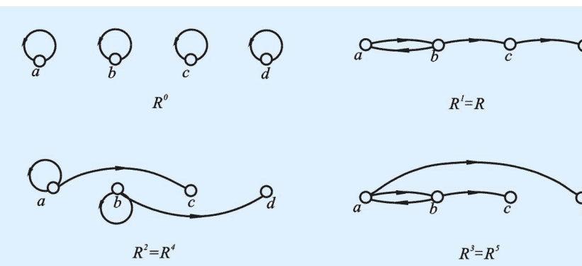

### 幂运算的性质

定理3 设A为n元集, R是A上的关系, 则存在自然数 s 和 t, 使得 R^s = R^t.

证 R为A上的关系, 由于|A|=n, A上的不同关系只有 2^{n^2}个。

当列出 R 的各次幂
R^0, R^1, R^2, ..., , ...,
必存在自然数 s 和 t 使得 R^s = R^t.

### 幂运算的性质（续）

（接上页证明）

（2）对于任意给定的 m∈N，归纳于 n。

若 n=0，则有

（R^m）^0 = I_A = R^0 = R^m × 0

假设（R^m）^n = R^{mn}，则有

（R^m）^{n+1} = （R^m）^n ∘ R^m = （R^{mn}）∘ R^m = R^{mn+m} = R^{m(n+1)}

所以对一切 m,n∈N 有（R^m）^n = R^{mn}。

## 4.3 关系的性质

- 自反性
- 反自反性
- 对称性
- 反对称性
- 传递性

### 自反性与反自反性

定义 设*R*为*A*上的关系，
(1) 若 ∀x(x ∈ A → <x,x> ∈ R)，则称*R*在*A*上是自反的。
(2) 若 ∀x(x ∈ A → <x,x> ∉ R)，则称*R*在*A*上是反自反的。

实例：
反关系：*A*上的全域关系*E_A*，恒等关系*I_A*
小于等于关系*L_A*，整除关系*D_A*
反自反关系：实数集上的小于关系
幂集上的真包含关系

### 实例

例1  A={1,2,3}, R₁, R₂, R₃是A上的关系,其中
R₁={<1,1>,<2,2>}
R₂={<1,1>,<2,2>,<3,3>,<1,2>}
R₃={<1,3>}

R₂自反，
R₃反自反，
R₁既不是自反也不是反自反的

### 对称性与反对称性

**定义** 设 $R$ 为 $A$ 上的关系，

(1) 若 $\forall x\forall y(x,y\in A\land\langle x,y\rangle\in R\rightarrow\langle y,x\rangle\in R)$，则称 $R$ 为 $A$ 上**对称**的关系。

(2) 若 $\forall x\forall y(x,y\in A\land\langle x,y\rangle\in R\land\langle y,x\rangle\in R\rightarrow x=y)$，则称 $R$ 为 $A$ 上的**反对称**关系。

- **实例：**
  
  - 对称关系：$A$ 上的全域关系 $E_A$，恒等关系 $I_A$ 和空关系 $\varnothing$。
  - 反对称关系：恒等关系 $I_A$，空关系是 $A$ 上的反对称关系。

### 实例

例2 设A={1,2,3}, R₁, R₂, R₃和R₄都是A上的关系, 其中

R₁={<1,1>,<2,2>},    R₂={<1,1>,<1,2>,<2,1>}

R₃={<1,2>,<1,3>},    R₄={<1,2>,<2,1>,<1,3>}

R₁ 对称、反对称。

R₂ 对称，不反对称。

R₃ 反对称，不对称。

R₄ 不对称、也不反对称。

### 传递性

定义 设*R*为*A*上的关系，若
∀x∀y∀z(x,y,z∈A ∧ <x,y>∈R ∧ <y,z>∈R → <x,z>∈R),
则称*R*是*A*上的传递关系。

实例：

*A*上的全域关系*E_A*,恒等关系*I_A*和空关系∅
小于等于关系, 小于关系, 整除关系, 包含关系,
真包含关系

### 实例

例3 设A={1,2,3}, R₁, R₂, R₃是A上的关系,其中
R₁={<1,1>,<2,2>}
R₂={<1,2>,<2,3>}
R₃={<1,3>}

R₁和R₃是A上的传递关系
R₂不是A上的传递关系


### 关系性质的充要条件

设*R*为*A*上的关系, 则

+   (1) *R*在*A*上自反当且仅当 $I_A \subseteq R$
+   (2) *R*在*A*上反自反当且仅当 $R \cap I_A = \varnothing$
+   (3) *R*在*A*上对称当且仅当 $R = R^{-1}$
+   (4) *R*在*A*上反对称当且仅当 $R \cap R^{-1} \subseteq I_A$
+   (5) *R*在*A*上传递当且仅当 $R \circ R \subseteq R$

### 关系性质判别

|  | 自反 | 反自反 | 对称 | 反对称 | 传递 |
|---|---|---|---|---|---|
| 表达式 | $I_A \subseteq R$ | $R \cap I_A = \varnothing$ | $R = R^{-1}$ | $R \cap R^{-1} \subseteq I_A$ | $R \circ R \subseteq R$ |
| 关系矩阵 | 主对角线元素全是1 | 主对角线元素全是0 | 矩阵是对称矩阵 | 若 $r_{ij}=1$, 且 $i \neq j$, 则 $r_{ji}=0$ | 对 $M^2$ 中 1 所在位置, $M$ 中相应位置都是 1 |
| 关系图 | 每个顶点都有环 | 每个顶点都没有环 | 如果两个顶点之间有边, 是一对方向相反的边 (无单边) | 如果两点之间有边, 是一条有向边 (无双向边) | 如果顶点 $x_i$ 连通到 $x_k$, 则从 $x_i$ 到 $x_k$ 有边 |

### 实例

例8 判断下图中关系的性质,并说明理由。

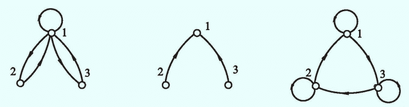

+   (1)不自反也不反自反；对称,不反对称；不传递。
+   (2)反自反, 不是自反的；反对称, 不是对称的；是传递的。
+   (3)自反, 不反自反；反对称, 不是对称；不传递。

### 对称性证明

证明模式 证明*R*在*A*上对称
任取<*x*, *y*>
<*x*,*y*>∈*R* ⇒................................ ⇒ <*y*,*x*>∈*R*
前提              推理过程              结论

例5 证明若 *R*=*R*⁻¹，则*R*在*A*上对称。

证  任取<*x*,*y*>
<*x*,*y*>∈*R* ⇒ <*y*,*x*>∈*R*⁻¹ ⇒ <*x*,*y*>∈*R*

因此 *R* 在 *A* 上是对称的。

### 反对称性证明

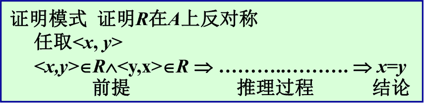

例6　证明若 $R\cap R^{-1}\subseteq I_A$，则 $R$ 在 $A$ 上反对称。

证　任取 $\langle x,y\rangle$

$\langle x,y\rangle\in R\land\langle y,x\rangle\in R\Rightarrow\langle x,y\rangle\in R\land\langle x,y\rangle\in R^{-1}$

$\Rightarrow\langle x,y\rangle\in R\cap R^{-1}\Rightarrow\langle x,y\rangle\in I_A\Rightarrow x=y$

因此 $R$ 在 $A$ 上是反对称的。

### 传递性证明

证明模式 证明 R 在 A 上传递
任取 <x, y>, <y, z>
<x, y> ∈ R ∧ <y, z> ∈ R ⇒ ............... ⇒ <x, z> ∈ R
前提               推理过程          结论

例7 证明若 R°R ⊆ R，则 R 在 A 上传递.
证  任取 <x, y>, <y, z>
<x, y> ∈ R ∧ <y, z> ∈ R ⇒ <x, z> ∈ R°R ⇒ <x, z> ∈ R
因此 R 在 A 上是传递的.

### 运算与性质的关系

|  | 自反性 | 反自反性 | 对称性 | 反对称性 | 传递性 |
|---|---|---|---|---|---|
| $R_1^{-1}$ | √ | √ | √ | √ | √ |
| $R_1 \cap R_2$ | √ | √ | √ | √ | √ |
| $R_1 \cup R_2$ | √ | √ | √ | × | × |
| $R_1 - R_2$ | × | √ | √ | √ | × |
| $R_1 \circ R_2$ | √ | × | × | × | × |

## 4.4 关系的闭包

+   - 闭包定义
+   - 闭包的构造方法
+   - 集合表示
+   - 矩阵表示
+   - 图表示
+   - 闭包的性质

### 闭包定义

定义 设 $R$ 是非空集合 $A$ 上的关系, $R$ 的自反（对称或传递）闭包是 $A$ 上的关系 $R'$，使得 $R'$ 满足以下条件：

+   （1） $R'$ 是自反的（对称的或传递的）
+   （2） $R \subseteq R'$ 
+   （3） 对 $A$ 上任何包含 $R$ 的自反（对称或传递）关系 $R''$ 有 $R' \subseteq R''$。

一般将 $R$ 的自反闭包记作 $r(R)$，对称闭包记作 $s(R)$，传递闭包记作 $t(R)$。

### 闭包的构造方法

定理1 设R为A上的关系,则有

+   (1) r(R) = R ∪ R⁰
+   (2) s(R) = R ∪ R⁻¹
+   (3) t(R) = R ∪ R² ∪ R³ ∪ ...

说明：

+   • 对于有穷集合A (|A|=n) 上的关系, (3)中的并最多不超过 Rⁿ.
+   • 若 R 是自反的, 则 r(R)=R; 若 R 是对称的, 则 s(R)=R; 若 R 是传递的, 则 t(R)=R.

### 闭包的构造方法（续）

设关系 R, r(R), s(R), t(R) 的关系矩阵分别为 M, M_r, M_s 和 M_t, 则

```
M_r = M + E
M_s = M + M'
M_t = M + M² + M³ + ...
```

E 是和 M 同阶的单位矩阵, M' 是 M 的转置矩阵. 注意在上述等式中矩阵的元素相加时使用逻辑加.

### 闭包的构造方法（续）

设关系R, r(R), s(R), t(R)的关系图分别记为G, G_r, G_s, G_t, 则G_r, G_s, G_t的顶点集与G的顶点集相等. 除了G的边以外, 以下述方法添加新边：

考察G的每个顶点, 如果没有环就加上一个环, 最终得到G_r.

考察G的每条边, 如果有一条 x_i 到 x_j 的单向边, i≠j, 则在G中加一条 x_j 到 x_i的反向边, 最终得到G_s.

考察G的每个顶点 x_i, 找从 x_i出发的每一路径, 如果从 x_i到路径中任何结点 x_j 没有边, 就加上这条边. 当检查完所有的顶点后就得到图G_t.

### 实例

例1 设A={a,b,c,d}, R={<a,b>,<b,a>,<b,c>,<c,d>, <d,b>}, R和 r(R), s(R), t(R)的关系图如下图所示。

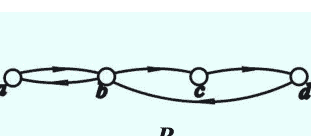

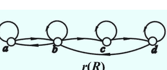

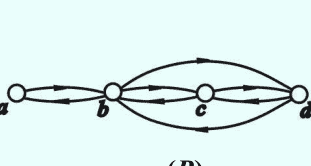

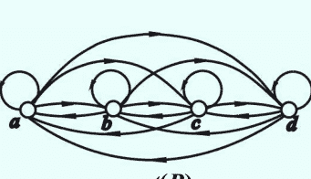

## 4.5 等价关系与偏序关系

+   - 等价关系的定义与实例
+   - 等价类及其性质
+   - 商集与集合的划分
+   - 等价关系与划分的一一对应
+   - 偏序关系
+   - 偏序集与哈斯图
+   - 偏序集中的特定元素

### 等价关系的验证

验证模 3 相等关系 R 为 A 上的等价关系, 因为

∀x∈A, 有 x ≡ x(mod 3)

∀x, y ∈A, 若 x ≡ y(mod 3), 则有 y ≡ x(mod 3)

∀x, y, z ∈A, 若 x ≡ y(mod 3), y ≡ z(mod 3),
则有 x≡z(mod 3)

自反性、对称性、传递性得到验证

### A上模3等价关系的关系图

设 $A=\{1,2,...,8\}$, $R=\{\langle x,y\rangle\mid x,y\in A\land x\equiv y\pmod 3\}$

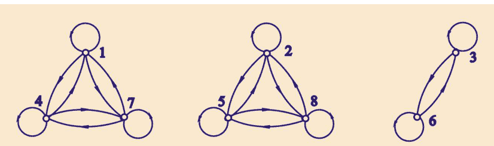


### 等价类

定义 设 *R* 为非空集合 *A* 上的等价关系, ∀*x*∈*A*, 令

[*x*]_R = { *y* | *y*∈*A* ∧ *xRy* }

称 [*x*]_R 为 *x* 关于 *R* 的等价类, 简称为 *x* 的等价类, 简记为 [*x*].

实例 A={ 1, 2, ..., 8 }上模 3 等价关系的等价类:

[1]=[4]=[7]={1,4,7}

[2]=[5]=[8]={2,5,8}

[3]=[6]={3,6}

### 等价类的性质

定理1 设 *R* 是非空集合 *A* 上的等价关系，则

- (1) ∀x∈A, [x] 是 A 的非空子集。
- (2) ∀x, y∈A, 如果 x R y, 则 [x]=[y]。
- (3) ∀x, y∈A, 如果 x ∉R y, 则 [x] 与 [y] 不交。
- (4) ∪{ [x] | x∈A }=A, 即所有等价类的并集就是 A。

### 实例

A={ 1, 2, ..., 8 }上模 3 等价关系的等价类：
[1]=[4]=[7]={1,4,7},
[2]=[5]=[8]={2,5,8},
[3]=[6]={3,6}
以上3 类两两不交,
{1,4,7}∪{2,5,8}∪{3,6} = {1,2, ...,8}

### 商集

定义 设 $R$ 为非空集合 $A$ 上的等价关系, 以 $R$ 的所有等价类作为元素的集合称为 $A$ 关于 $R$ 的商集, 记做 $A/R$, $A/R = \{[x]_R \mid x \in A\}$

实例 $A = \{1,2,...,8\}$, $A$ 关于模 $3$ 等价关系 $R$ 的商集为 $A/R = \{\{1,4,7\}, \{2,5,8\}, \{3,6\}\}$

$A$ 关于恒等关系和全域关系的商集为:
$A/I_A = \{\{1\},\{2\},...,\{8\}\}$
$A/E_A = \{\{1,2,...,8\}\}$

### 集合的划分

定义 设A为非空集合, 若A的子集族π(π⊆P(A)) 满足下面条件:

- (1) ∅ ∉ π
- (2) ∀x∀y (x,y ∈ π ∧ x≠y → x∩y=∅)
- (3) ∪π=A

则称π是A的一个划分, 称π中的元素为A的划分块。

### 例题

例1 设 A = {a, b, c, d}, 给定 π₁, π₂, π₃, π₄, π₅, π₆ 如下：

π₁ = { {a, b, c}, {d} },    π₂ = { {a, b}, {c}, {d} }

π₃ = { {a}, {a, b, c, d} }, π₄ = { {a, b}, {c} }

π₅ = { ∅, {a, b}, {c, d} }, π₆ = { {a, {a}}, {b, c, d} }

则 π₁ 和 π₂ 是 A 的划分, 其他都不是 A 的划分. 为什么？

### 等价关系与划分的一一对应

商集 A/R 就是 A 的一个划分
不同的商集对应于不同的划分
任给 A 的一个划分 π, 如下定义 A 上的关系 R:
R = {<x,y> | x,y ∈ A ∧ x 与 y 在 π 的同一划分块中}
则 R 为 A 上的等价关系, 且该等价关系确定的商集就是 π.

例2 给出 A = {1,2,3} 上所有的等价关系
求解思路：先做出 A 的所有划分, 然后根据划分写出对应的等价关系.

### 等价关系与划分之间的对应

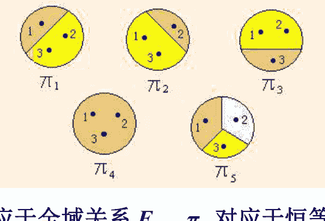

π₄ 对应于全域关系 E_A，π₅ 对应于恒等关系 I_A

π₁,π₂ 和 π₃ 分别对应等价关系 R₁, R₂ 和 R₃。

R₁ = {<2,3>,<3,2>} ∪ I_A， R₂ = {<1,3>,<3,1>} ∪ I_A

R₃ = {<1,2>,<2,1>} ∪ I_A

### 实例

例3 设 A={1, 2, 3, 4}, 在 A×A 上定义二元关系 R: <<x,y>,<u,v>>∈R ⇔ x+y = u+v, 求 R 导出的划分.

解 A×A={<1,1>, <1,2>, <1,3>, <1,4>, <2,1>, <2,2>, <2,3>,<2,4>, <3,1>, <3,2>, <3,3>, <3,4>, <4,1>, <4,2>, <4,3>, <4 ,4>}

### 实例（续）

根据 <x,y> 的 x + y = 2,3,4,5,6,7,8 将 A×A 划分成 7 个等价类：

(A×A)/R = { {<1,1>}, {<1,2>,<2,1>},
{<1,3>, <2,2>, <3,1>},
{<1,4>, <2,3>, <3,2>, <4,1>},
{<2,4>, <3,3>, <4,2>},
{<3,4>, <4,3>}, {<4,4>} }

### 偏序关系

**定义** 非空集合 $A$ 上的自反、反对称和传递的关系，称为 $A$ 上的**偏序关系**，记作 $\preceq$。设 $\preceq$ 为偏序关系，如果 $\langle x,y\rangle\in\preceq$，则记作 $x\preceq y$，读作 $x$“小于或等于”$y$。

### 实例

集合 $A$ 上的恒等关系 $I_A$ 是 $A$ 上的偏序关系。
小于或等于关系，整除关系和包含关系也是相应集合上的偏序关系。

### 相关概念

x与y可比：设R为非空集合A上的偏序关系，
    x,y∈A，x与y可比 ⇔ x≼ y ∨ y≼ x。

结论：任取两个元素x和y，可能有下述情况：
    x< y (或y< x)，x=y，x与y不是可比的。

全序关系：
R为非空集合A上的偏序，∀x,y∈A，x与y都是可比的，则称R为全序（或线序）

实例：数集上的小于或等于关系是全序关系
整除关系不是正整数集合上的全序关系

### 相关概念（续）

覆盖：设 R 为非空集合 A 上的偏序关系，x, y ∈ A，如果 x < y 且不存在 z ∈ A 使得 x < z < y，则称 y 覆盖 x.

实例：{ 1, 2, 4, 6 }集合上的整除关系，

- 2 覆盖 1,
- 4 和 6 覆盖 2.
- 4 不覆盖 1.

### 偏序集与哈斯图

定义 集合A和A上的偏序关系< 一起叫做偏序集, 记作 <A,≤ >.

实例：整数集和小于等于关系构成偏序集<Z,≤>, 幂集P(A)和包含关系构成偏序集<P(A),R⊆>.

哈斯图: 利用偏序自反、反对称、传递性简化的关系图

特点：每个结点没有环，两个连通的结点之间的序关系通过结点位置的高低表示，位置低的元素的顺序在前，具有覆盖关系的两个结点之间连边

### 哈斯图实例

例4 <{ 1, 2, 3, 4, 5, 6, 7, 8, 9 }, R整除>
<P({a, b, c}), R⊆>

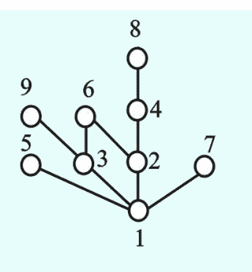

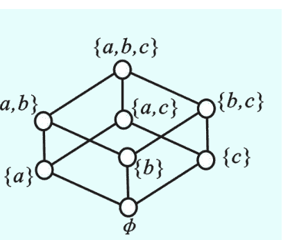

### 哈斯图实例（续）

例5
已知偏序集<A,R>
的哈斯图如右图所示,
试求出集合A和关系
R的表达式。

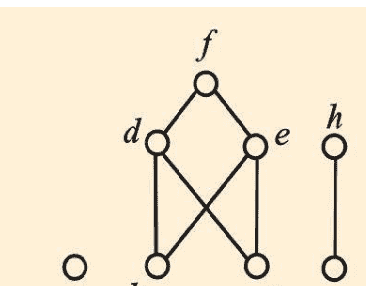

A={a, b, c, d, e, f, g, h}

R={<b,d>,<b,e>,<b,f>,<c,d>, <c,e>,<c,f>,<d,f>,<e,f>,<g,h>} ∪ I_A

### 偏序集的特定元素

定义 设 <A, ≤> 为偏序集, B ⊆ A, y ∈ B.

- (1) 若 ∀x (x ∈ B → y ≤ x) 成立, 则称 y 为 B 的最小元.
- (2) 若 ∀x (x ∈ B → x ≤ y) 成立, 则称 y 为 B 的最大元.
- (3) 若 ¬∃x (x ∈ B ∧ x < y) 成立, 则称 y 为 B 的极小元.
- (4) 若 ¬∃x (x ∈ B ∧ y < x) 成立, 则称 y 为 B 的极大元.

### 特殊元素的性质

- 对于有穷集，极小元和极大元必存在，可能存在多个。
- 最小元和最大元不一定存在，如果存在一定惟一。
- 最小元一定是极小元；最大元一定是极大元。
- 孤立结点既是极小元，也是极大元。

### 偏序集的特定元素(续)

定义 设<A, ≤>为偏序集, B⊆A, y∈A.

- (1) 若∀x(x∈B→x≤ y)成立, 则称 y 为B的上界.
- (2) 若∀x(x∈B→y≤ x)成立, 则称 y 为B的下界.
- (3) 令C={y | y为B的上界}, 则称C的最小元为B的最小上界或上确界.
- (4) 令D={y | y为B的下界}, 则称D的最大元为B的最大下界或下确界.


### 特殊元素的性质

- 下界、上界、下确界、上确界不一定存在
- 下界、上界存在不一定惟一
- 下确界、上确界如果存在，则惟一
- 集合的最小元就是它的下确界，最大元就是它的上确界；反之不对。

### 实例

例6 设偏序集<A,≪>如下图所示，求 A 的极小元、最小元、极大元、最大元. 设 B={b,c,d}, 求 B 的下界、上界、下确界、上确界.

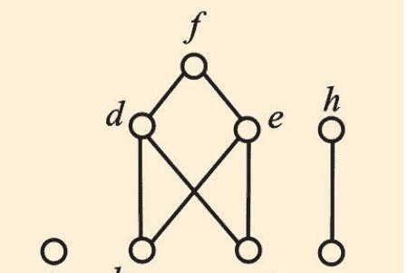

极小元： a, b, c, g;
极大元： a, f, h;
没有最小元与最大元.
B的下界和最大下界都不存在, 上界有 d 和 f,
最小上界为 d.

## 4.6 函数的定义与性质

- 函数的定义
  - 函数定义
  - 从A到B的函数
  - 函数的像
- 函数的性质
  - 函数的单射、满射、双射性
  - 构造双射函数

### 函数定义

定义 设 $F$ 为二元关系, 若 $\forall x \in \mathrm{dom}F$ 都存在唯一的 $y \in \mathrm{ran}F$ 使 $xFy$ 成立, 则称 $F$ 为函数. 对于函数 $F$, 如果有 $xFy$, 则记作 $y=F(x)$, 并称 $y$ 为 $F$ 在 $x$ 的值.

例1    $F_1 = \{\langle x_1,y_1\rangle, \langle x_2,y_2\rangle, \langle x_3,y_2\rangle\}$
$F_2 = \{\langle x_1,y_1\rangle, \langle x_1,y_2\rangle\}$
$F_1$ 是函数, $F_2$ 不是函数

### 函数相等

定义 设 $F$, $G$ 为函数, 则
$F = G \Leftrightarrow F \subseteq G \land G \subseteq F$

如果两个函数 $F$ 和 $G$ 相等, 一定满足下面两个条件：

- (1) dom$F$ = dom$G$
- (2) $\forall x \in$ dom$F$ = dom$G$ 都有 $F(x) = G(x)$

实例 函数

$F(x) = (x^2 - 1)/(x + 1)$, $G(x) = x - 1$

不相等, 因为 dom$F \subset$ dom$G$.

### 从 A 到 B 的函数

定义 设A, B为集合, 如果
f为函数
domf = A
ranf ⊆ B,
则称 f为从A到B的函数, 记作 f: A→B.

实例
f: N→N, f(x)=2x 是从 N 到 N 的函数
g: N→N, g(x)=2 也是从 N 到 N 的函数

### B上A

定义 所有从 A 到 B 的函数的集合记作 B^A，读作 “B上A”，符号化表示为 B^A = { f | f: A→B }

计数：

|A|=m, |B|=n, 且 m, n>0, |BA|=n^m.

A=∅, 则 B^A = B^∅ = {∅}.

A≠∅且 B=∅, 则 B^A = ∅^A = ∅.

### 实例

例2 设 $A = \{1, 2, 3\}$, $B = \{a, b\}$, 求 $B^A$.

解 $B^A = \{f_0, f_1, \dots, f_7\}$, 其中
$f_0 = \{<1,a>,<2,a>,<3,a>\}$, $f_1 = \{<1,a>,<2,a>,<3,b>\}$
$f_2 = \{<1,a>,<2,b>,<3,a>\}$, $f_3 = \{<1,a>,<2,b>,<3,b>\}$
$f_4 = \{<1,b>,<2,a>,<3,a>\}$, $f_5 = \{<1,b>,<2,a>,<3,b>\}$
$f_6 = \{<1,b>,<2,b>,<3,a>\}$, $f_7 = \{<1,b>,<2,b>,<3,b>\}$

### 函数的像

定义 设函数 f: A→B, A₁⊆A.

A₁在f下的像： f(A₁) = { f(x) | x∈A₁ }

函数的像 f(A)

注意：

函数值 f(x)∈B, 而像 f(A₁)⊆B.

例3 设 f: N→N, 且 f(x) = { x/2 若x为偶数
x+1 若x为奇数 }

令 A={0,1}, B={2}, 那么有

f(A) = f({0,1}) = { f(0), f(1) } = {0, 2}

### 函数的性质

**定义** 设 $f:A\to B$，

- 1. 若 $\operatorname{ran}f=B$，则称 $f:A\to B$ 是**满射**的。
- 2. 若 $\forall y\in\operatorname{ran}f$ 都存在唯一的 $x\in A$ 使得 $f(x)=y$，则称 $f:A\to B$ 是**单射**的。
- 3. 若 $f:A\to B$ 既是满射又是单射的，则称 $f:A\to B$ 是**双射**的。

$f$ 满射意味着：$\forall y\in B$，都存在 $x\in A$ 使得 $f(x)=y$。

$f$ 单射意味着：$f(x_1)=f(x_2)\Rightarrow x_1=x_2$

### 实例

### 例4

判断下面函数是否为单射,满射,双射的,为什么？

- (1) f: R→R, f(x) = -x^2+2x-1
- (2) f: Z+→R, f(x) = lnx, Z+为正整数集
- (3) f: R→Z, f(x) = ⌊x⌋
- (4) f: R→R, f(x) = 2x+1
- (5) f: R+→R+, f(x)=(x^2+1)/x, 其中R+为正实数集.

### 实例（续）

解 (1) f: R→R, f(x)=-x²+2x-1
在x=1取得极大值0. 既不单射也不满射.

解 (2) f: Z+→R, f(x)=lnx
单调上升, 是单射. 但不满射, ranf={ln1, ln2, ...}.

解 (3) f: R→Z, f(x)=⌊x⌋
满射, 但不单射, 例如 f(1.5)=f(1.2)=1.

解 (4) f: R→R, f(x)=2x+1
满射、单射、双射, 因为它是单调的并且ranf=R.

解 (5) f: R+→R+, f(x)=(x²+1)/x
有极小值f(1)=2. 该函数既不单射也不满射.

### 构造从A到B的双射函数

### 有穷集之间的构造

例5  A=P({1,2,3}),  B={0,1}^{1,2,3}

解  A={∅,{1},{2},{3},{1,2},{1,3},{2,3},{1,2,3}}.

B={f₀,f₁,…,f₇},其中

f₀={<1,0>,<2,0>,<3,0>},  f₁={<1,0>,<2,0>,<3,1>},

f₂={<1,0>,<2,1>,<3,0>},  f₃={<1,0>,<2,1>,<3,1>},

f₄={<1,1>,<2,0>,<3,0>},  f₅={<1,1>,<2,0>,<3,1>},

f₆={<1,1>,<2,1>,<3,0>},  f₇={<1,1>,<2,1>,<3,1>}.

令  f: A→B,

f(∅)=f₀, f({1})=f₁, f({2})=f₂, f({3})=f₃,

f({1,2})=f₄, f({1,3})=f₅, f({2,3})=f₆, f({1,2,3})=f₇

### 构造从A到B的双射函数（续）

实数区间之间构造双射

构造方法：直线方程

例6 A=[0,1]

B=[1/4,1/2]

构造双射 f:A→B

解

令 f: [0,1]→[1/4,1/2]

f(x)=(x+1)/4

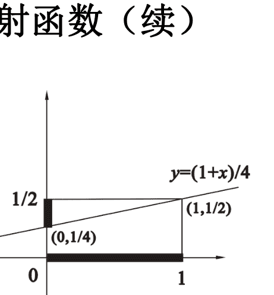

### 构造从A到B的双射函数（续）

### A 与自然数集合之间构造双射

方法：将A中元素排成有序图形，然后从第一个元素开始按照次序与自然数对应

例7 A=Z, B=N, 构造双射 f: A→B

将Z中元素以下列顺序排列并与N中元素对应：

Z: 0 -1 1 -2 2 -3 3...

N: 0 1 2 3 4 5 6...

则这种对应所表示的函数是：

f: Z → N, f(x) = { 2x    ≥ 0
                  -2x -1  x < 0 }

### 常函数、恒等函数、单调函数

- 1. 设 $f: A \to B$, 若存在 $c \in B$ 使得 $\forall x \in A$ 都有 $f(x)=c$, 则称 $f: A \to B$ 是常函数.
- 2. 称 $A$ 上的恒等关系 $I_A$ 为 $A$ 上的恒等函数, 对所有的 $x \in A$ 都有 $I_A(x)=x$.
- 3. 设 $f: R \to R$, 如果对任意的 $x_1, x_2 \in R$, $x_1 < x_2$, 就有 $f(x_1) \le f(x_2)$, 则称 $f$ 为单调递增的；如果对任意的 $x_1, x_2 \in A$, $x_1 < x_2$, 就有 $f(x_1) < f(x_2)$, 则称 $f$ 为严格单调递增的。
- 类似可以定义单调递减和严格单调递减的函数。


### 自然映射

5. 设 \( R \) 是 \( A \) 上的等价关系，令
\[ g: A \to A/R \]
\[ g(a) = [a], \forall a \in A \]
称 \( g \) 是从 \( A \) 到商集 \( A/R \) 的自然映射。

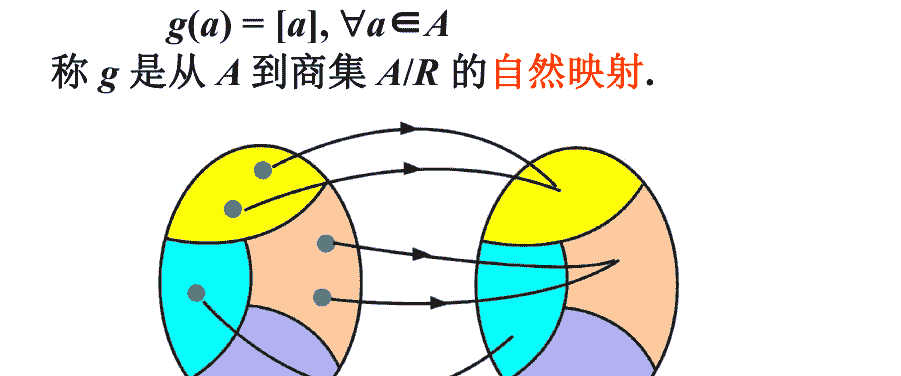

### 实例

例8 (1) A的每一个子集A'都对应于一个特征函数, 不同的子集对应于不同的特征函数. 例如
A={a, b, c}, 则有
χ_∅ = {<a,0>, <b,0>, <c,0> },
χ_{{a,b}} = {<a,1>, <b,1>, <c,0>}

(2) 给定集合 A, A 上不同的等价关系确定不同的自然映射, 其中恒等关系确定的自然映射是双射, 其他的自然映射一般来说是满射. 例如
A={1, 2, 3}, R={<1,2>, <2,1>} ∪ I_A 
g(1) = g(2) = {1,2}, g(3) = {3}

### 函数复合的定理

定理 设F, G是函数, 则F∘ G也是函数, 且满足
(1) dom(F∘G)={ x | x∈domF ∧ F(x)∈domG}
(2) ∀x∈dom(F∘ G) 有 F∘ G(x)= G(F(x))

推论1 设F, G, H为函数, 则 (F∘ G)∘ H 和 F∘ (G∘ H)
都是函数, 且 (F∘ G)∘ H = F∘ (G∘ H)

推论2 设 f: A→B, g: B→C, 则 f∘ g: A→C, 且 ∀x∈A 都有 f∘ g(x)= g(f(x)).

### 函数复合运算的性质

定理 设 f: A→B, g: B→C.

- (1) 如果 f: A→B, g: B→C 都是满射的, 则 f° g: A→C 也是满射的.
- (2) 如果 f: A→B, g: B→C 都是单射的, 则 f° g: A→C 也是单射的.
- (3) 如果 f: A→B, g: B→C 都是双射的, 则 f° g: A→C 也是双射的.

证 (1) ∀c∈C, 由 g: B→C 的满射性, ∃b∈B 使得 g(b)=c. 对这个 b, 由 f: A→B 的满射性, ∃a∈A 使得 f(a)=b. 由合成定理有 f° g(a)=g(f(a))=g(b)=c 从而证明了 f° g: A→C 是满射的.

### 函数复合运算的性质

(2) 假设存在 x₁, x₂ ∈ A 使得 f° g(x₁) = f° g(x₂)
由合成定理有 g(f(x₁)) = g(f(x₂)).
因为 g: B→C 是单射的, 故 f(x₁) = f(x₂). 又由于 f: A→B 也是单射的, 所以 x₁ = x₂. 从而证明 f° g: A→C 是单射的.
(3) 由 (1) 和 (2) 得证.

定理 设 f: A→B, 则
f = f° I_B = I_A° f

### 反函数存在的条件

任给函数 F, 它的逆 F^{-1} 不一定是函数, 是二元关系.

实例： F={<a,b>,<c,b>},   F^{-1}={<b,a>,<b,c>}

任给单射函数 f: A→B, 则 f^{-1} 是函数, 且是从 ran f 到 A 的双射函数, 但不一定是从 B 到 A 的双射函数.

实例： f: N→N, f(x)=2x,

f^{-1}: ran f→N, f^{-1}(x)=x/2

### 反函数

定理 设 $f: A \to B$ 是双射的, 则 $f^{-1}: B \to A$ 也是双射的.

证 因为 $f$ 是函数, 所以 $f^{-1}$ 是关系, 且

$\operatorname{dom} f^{-1} = \operatorname{ran} f = B, \quad \operatorname{ran} f^{-1} = \operatorname{dom} f = A,$

对于任意的 $y \in B = \operatorname{dom} f^{-1}$, 假设有 $x_1, x_2 \in A$ 使得

$\langle y, x_1 \rangle \in f^{-1} \land \langle y, x_2 \rangle \in f^{-1}$

成立, 则由逆的定义有

$\langle x_1, y \rangle \in f \land \langle x_2, y \rangle \in f$

根据 $f$ 的单射性可得 $x_1 = x_2$, 从而证明了 $f^{-1}$ 是函数, 且是满射的. 下面证明 $f^{-1}$ 的单射性.

若存在 $y_1, y_2 \in B$ 使得 $f^{-1}(y_1) = f^{-1}(y_2) = x$, 从而有

$\langle y_1, x \rangle \in f^{-1} \land \langle y_2, x \rangle \in f^{-1}$

$\Rightarrow \langle x, y_1 \rangle \in f \land \langle x, y_2 \rangle \in f \Rightarrow y_1 = y_2$

### 反函数的定义及性质

对于双射函数 $f$: $A \to B$, 称 $f^{-1}$: $B \to A$ 是它的反函数.

### 反函数的性质

定理 设 $f$: $A \to B$ 是双射的, 则
$f^{-1} \circ f = I_B$, $f \circ f^{-1} = I_A$

对于双射函数 $f$: $A \to A$, 有
$f^{-1} \circ f = f \circ f^{-1} = I_A$

### 函数复合与反函数的计算

例 f: R→R, g: R→R

f(x) = \begin{cases} x^2 & x \geq 3 \\ -2 & x < 3 \end{cases}
g(x) = x + 2

求 f∘g, g∘f. 如果 f 和 g 存在反函数, 求出它们的反函数.

f∘g: R→R

f∘g(x) = \begin{cases} x^2 + 2 & x \geq 3 \\ 0 & x < 3 \end{cases}
g∘f: R→R

g∘f(x) = \begin{cases} (x+2)^2 & x \geq 1 \\ -2 & x < 1 \end{cases}

f: R→R不是双射的, 不存在反函数. g: R→R是双射的, 它的反函数是 g^{-1}: R→R, g^{-1}(x)=x-2

## 代数结构

### 代数结构部分

- 第5章 代数系统的一般性质
- 第6章 几个典型的代数系统

## 第5章 代数系统的一般性质

- 5.1 二元运算及其性质
- 5.2 代数系统及其子代数和积代数
- 5.3 代数系统的同态与同构

## 5.1 二元运算及其性质

- 二元运算定义及其实例
- 一元运算定义及其实例
- 运算的表示
- 二元运算的性质
  - 交换律、结合律、幂等律、消去律
  - 分配律、吸收律
- 单位元
- 零元
- 可逆元素及其逆元

### 二元运算的定义及其实例

**定义** 设 $S$ 为集合，函数 $f:S\times S\to S$ 称为 $S$ 上的二元运算，简称为**二元运算**。也称 $S$ 对 $f$ **封闭**。

### 例1

- 1. $N$ 上的二元运算：加法、乘法。
- 2. $Z$ 上的二元运算：加法、减法、乘法。
- 3. 非零实数集 $R^*$ 上的二元运算：乘法、除法。
- 4. 设 $S=\{a_1,a_2,\ldots,a_n\}$，$a_i\circ a_j=a_i$，$∘$ 为 $S$ 上二元运算。

### 二元运算的实例（续）

(5) 设 $M_n(R)$ 表示所有 $n$ 阶 $(n\ge2)$ 实矩阵的集合，即

$M_n(R)=\left\{\begin{bmatrix}a_{11}&a_{12}&\cdots&a_{1n}\\a_{21}&a_{22}&\cdots&a_{2n}\\\cdots\\a_{n1}&a_{n2}&\cdots&a_{nn}\end{bmatrix}\Bigg|\ a_{ij}\in R,\ i,j=1,2,...,n\right\}$

矩阵加法和乘法都是 $M_n(R)$ 上的二元运算。

(6) 幂集 $P(S)$ 上的二元运算： $\cup,\cap,-,\oplus.$

(7) $S^S$ 为 $S$ 上的所有函数的集合：合成运算。

### 一元运算的定义与实例

定义 设 S 为集合，函数 f: S→S 称为 S 上的一元运算，简称为一元运算。

- 例2 (1) Z, Q 和 R 上的一元运算: 求相反数
- (2) 非零有理数集 Q*, 非零实数集 R* 上的一元运算: 求倒数
- (3) 复数集合 C 上的一元运算: 求共轭复数
- (4) 幂集 P(S) 上, 全集为 S: 求绝对补运算 ~
- (5) A 为 S 上所有双射函数的集合, A⊆S^S: 求反函数
- (6) 在 M_n(R) ( n≥2 ) 上, 求转置矩阵


### 二元与一元运算的表示

算符：○ , * , · , ⊕, ⊗ 等符号

表示二元或一元运算

对二元运算○，如果 x 与 y 运算得到 z，记做 x○ y = z;

对一元运算○，x 的运算结果记作 ○ x

表示二元或一元运算的方法：

公式、 运算表

注意：在同一问题中不同的运算使用不同的算符

### 二元与一元运算的表示（续）

#### 公式表示

例3 设 R 为实数集合，如下定义 R 上的二元运算 * ：

∀x, y ∈ R, x * y = x.

那么 3 * 4 = 3

0.5 * (-3) = 0.5

#### 运算表（表示有穷集上的一元和二元运算）

### 运算表的形式

| ∘ | a₁ | a₂ | ... | aₙ |
|---|---|---|---|---|
| a₁ | a₁∘a₁ | a₁∘a₂ | ... |  |
| a₂ | a₁∘aₙ | a₂∘a₁ | a₂∘a₂ | ... |
| . | a₂∘aₙ |  | ... |  |
| . |  | ... |  |  |
| . |  | ... |  |  |
| aₙ |  | ... |  |  |

|  | ∘ aᵢ |
|---|---|
| a₁ | ∘ |
| a₂ | a₁ |
| . | ∘ |
| . | a₂ |
| . | . |
| aₙ | . |
|  | . |

### 运算表的实例

例4 A = P({a, b}), ⊕, ~ 分别为对称差和绝对补运算
({a,b}为全集)

#### ⊕ 的运算表

#### ~ 的运算表

| ⊕ | ∅ | {a} | {b} | {a,b} |
|---|---|---|---|---|
| ∅ | ∅ | {a} | {b} |  |
| {a} | {a,b} |  |  |  |
| {b} | {a} | ∅ | {a,b} |  |
| {a,b} | {b} | {b} | {a,b} | ∅ |

| X | ~ X |
|---|---|
| ∅ | {a,b} |
| {a} | {a} |
| {b} | {b} |
| {a,b} | ∅ |

### 运算表的实例（续）

例5 Z₅ = { 0, 1, 2, 3, 4 }, ⊕, ⊗ 分别为模 5 加法与乘法

#### ⊕ 的运算表

| ⊕ | 0 | 1 | 2 | 3 | 4 |
|---|---|---|---|---|
| 0 | 0 | 1 | 2 | 3 | 4 |
| 1 | 1 | 2 | 3 | 4 | 0 |
| 2 | 2 | 3 | 4 | 0 | 1 |
| 3 | 3 | 4 | 0 | 1 | 2 |
| 4 | 4 | 0 | 1 | 2 | 3 |

#### ⊗ 的运算表

| ⊗ | 0 | 1 | 2 | 3 | 4 |
|---|---|---|---|---|
| 0 | 0 | 0 | 0 | 0 | 0 |
| 1 | 0 | 1 | 2 | 3 | 4 |
| 2 | 0 | 2 | 4 | 1 | 3 |
| 3 | 0 | 3 | 1 | 4 | 2 |
| 4 | 0 | 4 | 3 | 2 | 1 |

### 实例分析

Z, Q, R分别为整数、有理数、实数集； Mₙ(R)为 n 阶实矩阵集合, n≥2； P(B)为幂集； Aᴬ为 A上A， |A|≥2。

| 集合 | 运算 | 交换律 | 结合律 | 幂等律 |
|---|---|---|---|---|
| Z, Q, R | 普通加法+ | 有 | 有 | 无 |
|  | 普通乘法× | 有 | 有 | 无 |
| Mₙ(R) | 矩阵加法+ | 有 | 有 | 无 |
|  | 矩阵乘法× | 无 | 有 | 无 |
| P(B) | 并∪ | 有 | 有 | 有 |
|  | 交∩ | 有 | 有 | 有 |
|  | 相对补− | 无 | 无 | 无 |
|  | 对称差⊕ | 有 | 有 | 无 |
| Aᴬ | 函数符合∘ | 无 | 有 | 无 |

### 二元运算的性质（续）

定义 设 ∘ 和 * 为 S 上两个不同的二元运算，

- (1) 如果 ∀ x, y, z ∈ S 有
  (x * y) ∘ z = (x ∘ z) * (y ∘ z)
  z ∘ (x * y) = (z ∘ x) * (z ∘ y)
  则称 ∘ 运算对 * 运算满足分配律.

- (2) 如果 ∘ 和 * 都可交换, 并且 ∀ x, y ∈ S 有
  x ∘ (x * y) = x
  x * (x ∘ y) = x
  则称 ∘ 和 * 运算满足吸收律.

### 二元运算的特异元素

#### 单位元

定义 设 ∘ 为 S 上的二元运算，如果存在 e_l（或 e_r）∈ S，使得对任意 x ∈ S 都有

e_l ∘ x = x（或 x ∘ e_r = x），
则称 e_l（或 e_r）是 S 中关于 ∘ 运算的 左（或右）单位元。

若 e ∈ S 关于 ∘ 运算既是左单位元又是右单位元，则称 e 为 S 上关于 ∘ 运算的 单位元。

单位元也叫做 幺元。

### 二元运算的特异元素（续）

#### 零元

设 ∘ 为 S 上的二元运算, 如果存在 θₗ (或 θᵣ) ∈ S, 使得对任意 x ∈ S 都有

θₗ ∘ x = θₗ (或 x ∘ θᵣ = θᵣ),

则称 θₗ (或 θᵣ) 是 S 中关于 ∘ 运算的 左 (或右) 零元.

若 θ ∈ S 关于 ∘ 运算既是左零元又是右零元, 则称 θ 为 S 上关于运算 ∘ 的 零元.

### 二元运算的特异元素（续）

#### 可逆元素及其逆元

令 e 为 S 中关于运算 ∘ 的单位元. 对于 x∈S, 如果存在 yₗ（或 yᵣ）∈S 使得

    yₗ ∘ x = e（或 x ∘ yᵣ = e），

则称 yₗ（或 yᵣ）是 x 的 左逆元（或右逆元）.
关于 ∘ 运算，若 y∈S 既是 x 的左逆元又是 x 的右逆元，则称 y 为 x 的逆元.
如果 x 的逆元存在，就称 x 是可逆的.

### 实例分析

| 集合 | 运算 | 单位元 | 零元 | 逆元 |
|---|---|---|---|---|
| $Z$, $Q$, $R$ | 普通加法 $+$ | 0 | 无 | $X$ 的逆元 $-x$ |
|  | 普通乘法 $\times$ | 1 | 0 | $X$ 的逆元 $x^{-1}$ ($x^{-1}$ 属于给定集合) |
| $M_n(R)$ | 矩阵加法 $+$ | $n$ 阶全 0 矩阵 | 无 | $X$ 逆元 $-X$ |
|  | 矩阵乘法 $\times$ | $n$ 阶单位矩阵 | $n$ 阶全 0 矩阵 | $X$ 的逆元 $X^{-1}$ ($X$ 是可逆矩阵) |
| $P(B)$ | 并 $\cup$ | $\varnothing$ | $B$ | $\varnothing$ 的逆元为 $\varnothing$ |
|  | 交 $\cap$ | $B$ | $\varnothing$ | $B$ 的逆元为 $B$ |
|  | 对称差 $\oplus$ | $\varnothing$ | 无 | $X$ 的逆元为 $X$ |

### 惟一性定理

定理 设 。 为 S 上的二元运算， $e_l$ 和 $e_r$ 分别为 $S$ 中关于运算的左和右单位元，则 $e_l = e_r = e$ 为 $S$ 上关于 。 运算的惟一的单位元。

证 $e_l = e_l \circ e_r = e_l \circ e_r = e_r$

所以 $e_l = e_r$，将这个单位元记作 $e$。假设 $e'$ 也是 $S$ 中的单位元，则有

$e' = e \circ e' = e$.

惟一性得证。

类似地可以证明关于零元的惟一性定理。

注意：当 $|S| \ge 2$，单位元与零元是不同的；
当 $|S| = 1$ 时，这个元素既是单位元也是零元。

### 惟一性定理（续）

定理 设。 为 S 上可结合的二元运算, e 为该运算的单位元, 对于 x∈S 如果存在左逆元 y_l 和右逆元 y_r, 则有 y_l = y_r = y, 且 y 是 x 的惟一的逆元.

证 由 y_l ° x = e 和 x ° y_r = e 得

y_l = y_l ° e = y_l ° (x ° y_r) = (y_l ° x) ° y_r = e ° y_r = y_r

令 y_l = y_r = y, 则 y 是 x 的逆元.

假若 y'∈S 也是 x 的逆元, 则

y' = y' ° e = y' ° (x ° y) = (y' ° x) ° y = e ° y = y

所以 y 是 x 惟一的逆元.

### 消去律

定义 设。 为V上二元运算，如果∀ x, y, z∈V，
若 x° y = x° z，且 x不是零元，则 y = z
若 y° x = z° x，且 x不是零元，则 y = z
那么称。 运算满足 消去律。
实例: Z, Q, R 关于普通加法和乘法满足消去律。
M_n(R) 关于矩阵加法满足消去律，但是关于矩阵乘法不满足消去律。
Z_n 关于模 n 加法满足消去律，当 n 为素数时关于模 n 乘法满足消去律. 当 n 为合数时关于模 n 乘法不满足消去律。


### 例题分析

例6 设 ° 运算为 Q 上的二元运算，
∀x, y ∈ Q, x ° y = x + y + 2xy,

+   (1)。运算是否满足交换和结合律？说明理由。

+   (2) 求。运算的单位元、零元和所有可逆元。

解 (1)。运算可交换，可结合。任取 x, y ∈ Q,

x ° y = x + y + 2xy = y + x + 2yx = y ° x,

任取 x, y, z ∈ Q,

(x ° y) ° z = (x + y + 2xy) + z + 2(x + y + 2xy) z
= x + y + z + 2xy + 2xz + 2yz + 4xyz

x ° (y ° z) = x + (y + z + 2yz) + 2x(y + z + 2yz)
= x + y + z + 2xy + 2xz + 2yz + 4xyz

### 例题分析（续）

（2）设。运算的单位元和零元分别为 $e$ 和 $\theta$，则对于任意 $x$ 有 $x \circ e = x$ 成立，即 $x+e+2xe = x \Rightarrow e = 0$ 由于。运算可交换，所以 $0$ 是么元。

对于任意 $x$ 有 $x \circ \theta = \theta$ 成立，即 $x+\theta+2x\theta = \theta \Rightarrow x+2x\theta = 0 \Rightarrow \theta = -1/2$

给定 $x$，设 $x$ 的逆元为 $y$，则有 $x \circ y = 0$ 成立，即 $x+y+2xy = 0 \Rightarrow y = -\dfrac{x}{1+2x} \quad (x \neq -1/2)$ 因此当 $x \neq -1/2$ 时， $y = -\dfrac{x}{1+2x}$ 是 $x$ 的逆元。

### 例题分析（续）

例7 (1) 说明那些运算是交换的、可结合的、幂等的. (2) 求出运算的单位元、零元、所有可逆元素的逆元.

| * | a | b | c |
|---|---|---|---|
| a | c | a | b |
| b | a | b | c |
| c | b | c | a |

| ○ | a | b | c |
|---|---|---|---|
| a | a | a | a |
| b | b | b | b |
| c | c | c | c |

| ● | a | b | c |
|---|---|---|---|
| a | a | b | c |
| b | b | c | c |
| c | c | c | c |

解 (1) * 满足交换、结合律； ○ 满足结合、幂等律； ● 满足交换、结合律.

(2) * 的单位元为 b, 没零元, a⁻¹ = c, b⁻¹ = b, c⁻¹ = a

○ 的单位元和零元都不存在, 没有可逆元素.

● 的单位元为 a, 零元为 c, a⁻¹ = a. b, c 不可逆.

### 例题分析（续）

例8 设 $A = \{ a, b, c \}$，构造 $A$ 上的二元运算 $*$ 使得 $a*b = c$, $c*b = b$, 且 $*$ 运算是幂等的、可交换的，给出关于 $*$ 运算的一个运算表，说明它是否可结合，为什么？

| * | a | b | c |
|---|---|---|---|
| a | a | c |  |
| b | c | b | b |
| c |  | b | c |

根据幂等律和已知条件 $a*b = c$, $c*b = b$ 得到运算表
根据交换律得到新的运算表
方框 可以填入 $a, b, c$ 中任一选定的符号，完成运算表

不结合，因为 $(a*b)*b = c*b = b$, $a*(b*b) = a*b = c$

### 由运算表判别算律的一般方法

+   - 交换律：运算表关于主对角线对称
+   - 幺等律：主对角线元素排列与表头顺序一致
+   - 消去律：所在的行与列中没有重复元素
+   - 单位元：所在的行与列的元素排列都与表头一致
+   - 零元：元素的行与列都由该元素自身构成
+   - $A$ 的可逆元：$a$ 所在的行中某列 (比如第 $j$ 列) 元素为 $e$，且第 $j$ 行 $i$ 列的元素也是 $e$，那么 $a$ 与第 $j$ 个元素互逆
+   - 结合律：除了单位元、零元之外，要对所有 3 个元素的组合验证表示结合律的等式是否成立

## 5.2 代数系统及其子代数、积代数

+   - 代数系统定义
+   - 同类型与同种的代数系统
+   - 子代数
+   - 积代数

### 代数系统定义与实例

#### 定义

非空集合 $S$ 和 $S$ 上 $k$ 个一元或二元运算 $f_1$, $f_2$, …, $f_k$ 组成的系统称为一个代数系统, 简称代数, 记做 $V=<S, f_1, f_2$, …, $f_k>$.

$S$ 称为代数系统的载体, $S$ 和运算叫做代数系统的成分. 有的代数系统定义指定了 $S$ 中的特殊元素, 称为代数常数, 例如二元运算的单位元. 有时也将代数常数作为系统的成分.

### 实例

<N,+,>, <Z,+,·>, <R,+,·>是代数系统,
+ 和 · 分别表示普通加法和乘法.

<M_n(R),+,·>是代数系统,
+ 和 · 分别表示n阶 (n≥2) 实矩阵的加法和乘法.

<Z_n,⊕,⊗>是代数系统, Z_n = {0, 1, ..., n-1}

⊕ 和 ⊗ 分别表示模 n 的加法和乘法, ∀x,y∈Z_n,

x⊕y = (x+y) mod n, x⊗y = (xy) mod n

<P(S), U,∩,~> 也是代数系统,

U和∩为并和交, ~为绝对补

### 同类型与同种代数系统

定义 (1) 如果两个代数系统中运算的个数相同，对应运算的元数相同，且代数常数的个数也相同，则称它们是 同类型的 代数系统.

(2) 如果两个同类型的代数系统规定的运算性质也相同，则称为 同种的 代数系统.

例1  V₁ = <R, +, ·, 0, 1>,
V₂ = <Mₙ(R), +, ·, θ, E>,
θ 为 n 阶全 0 矩阵，E 为 n 阶单位矩阵
V₃ = <P(B), ∪, ∩, ∅, B>

### 同类型与同种代数系统（续）

| $V_1$ | $V_2$ | $V_3$ |
|---|---|---|
| + 可交换, 可结合<br>· 可交换, 可结合<br>+ 满足消去律<br>· 满足消去律<br>· 对 + 可分配<br>+ 对 · 不可分配<br>+ 与 · 没有吸收律 | + 可交换, 可结合<br>· 可交换, 可结合<br>+ 满足消去律<br>· 满足消去律<br>· 对 + 可分配<br>+ 对 · 不可分配<br>+ 与 · 没有吸收律 | ∪ 可交换, 可结合<br>∩ 可交换, 可结合<br>∪ 不满足消去律<br>∩ 不满足消去律<br>∩ 对 ∪ 可分配<br>∪ 对 ∩ 可分配<br>∪ 与 ∩ 满足吸收律 |

$V_1, V_2, V_3$ 是同类型的代数系统

$V_1, V_2$ 是同种的代数系统

$V_1, V_2$ 与 $V_3$ 不是同种的代数系统

### 子代数

定义 设 V=<S, f₁, f₂, …, fₖ> 是代数系统，B 是 S 的非空子集，如果 B 对 f₁, f₂, …, fₖ 都是封闭的，且 B 和 S 含有相同的代数常数，则称 <B, f₁, f₂, …, fₖ> 是 V 的子代数系统，简称 子代数. 有时将子代数系统简记为 B.

实例 N 是 <Z,+> 和 <Z,+,0> 的子代数. N−{0} 是 <Z,+> 的子代数，但不是 <Z,+,0> 的子代数

#### 说明：

+   子代数和原代数是同种的代数系统
+   对于任何代数系统 V，其子代数一定存在.

### 关于子代数的术语

最大的子代数 就是 V 本身. 如果 V 中所有代数常数构成集合 B，且 B 对 V 中所有运算封闭，则 B 就构成了 V 的最小的子代数. 最大和最小子代数称为 V 的平凡的子代数. 若 B 是 S 的真子集，则 B 构成的子代数称为 V 的真子代数.

例2 设 V=<Z,+,0>，令 nZ = { nz | z∈Z}，n 为自然数，则 nZ 是 V 的子代数，当 n = 1 和 0 时，nZ 是 V 的平凡的子代数，其它的都是 V 的非平凡的真子代数.

### 积代数

定义 设 $V_1 = \langle S_1, \circ \rangle$ 和 $V_2 = \langle S_2, * \rangle$ 是代数系统，其中 $\circ$ 和 $*$ 是二元运算. $V_1$ 与 $V_2$ 的 积代数 是 $V = \langle S_1 \times S_2, \circ \rangle$, $\forall \langle x_1, y_1 \rangle, \langle x_2, y_2 \rangle \in S_1 \times S_2$, $\langle x_1, y_1 \rangle \cdot \langle x_2, y_2 \rangle = \langle x_1 \circ x_2, y_1 * y_2 \rangle$

例3 $V_1 = \langle \mathbb{Z}, + \rangle$, $V_2 = \langle M_2(\mathbb{R}), \cdot \rangle$, 积代数 $\langle \mathbb{Z} \times M_2(\mathbb{R}), \circ \rangle$ $\forall \langle z_1, M_1 \rangle, \langle z_2, M_2 \rangle \in \mathbb{Z} \times M_2(\mathbb{R})$, $\langle z_1, M_1 \rangle \circ \langle z_2, M_2 \rangle = \langle z_1 + z_2, M_1 \cdot M_2 \rangle$ $\langle 5, \begin{pmatrix} 1 & 0 \\ 1 & 1 \end{pmatrix} \rangle \circ \langle -2, \begin{pmatrix} 2 & -1 \\ 0 & 1 \end{pmatrix} \rangle = \langle 3, \begin{pmatrix} 2 & -1 \\ 2 & 0 \end{pmatrix} \rangle$


### 积代数的性质

定理 设 V₁=<S₁,o>和 V₂=<S₂,*>是代数系统，其中 o 和 *是二元运算. V₁ 与 V₂ 的积代数 V=<S₁×S₂;>

- (1) 若 o 和 * 运算是可交换的，那么· 运算也是可交换的
- (2) 若 o 和 * 运算是可结合的，那么· 运算也是可结合的
- (3) 若 o 和 * 运算是幂等的，那么· 运算也是幂等的
- (4) 若 o 和 * 运算分别具有单位元 e₁ 和 e₂，那么· 运算 也具有单位元<e₁,e₂>
- (5) 若 o 和 * 运算分别具有零元 θ₁ 和 θ₂，那么· 运算 也具有零元<θ₁,θ₂>
- (6) 若 x 关于 o 的逆元为 x^{-1},y 关于 * 的逆元为 y^{-1}, 那么<x,y>关于· 运算也具有逆元<x^{-1},y^{-1}>

## 5.3 代数系统的同态与同构

- 同态映射的定义
- 同态映射的分类
  - 单同态、满同态、同构
  - 自同态
- 同态映射的性质

### 同态映射的定义

定义 设 $V_1=\<S_1,\circ\>$ 和 $V_2=\<S_2,*\>$ 是代数系统，其中 $\circ$ 和 $*$ 是二元运算. $f: S_1\to S_2$, 且 $\forall x,y\in S_1$, $f(x\circ y)=$ $f(x)*f(y)$. 则称 $f$ 为 $V_1$ 到 $V_2$ 的同态映射. 简称同态.

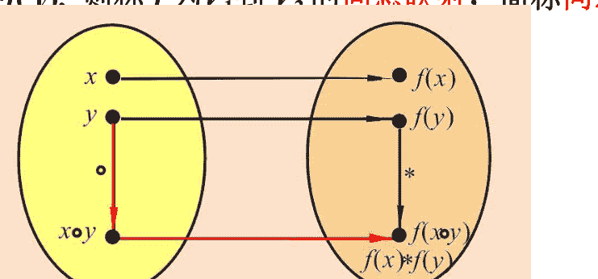

### 更广泛的同态映射定义

定义 设 V₁=<S₁,∘,·>和 V₂=<S₂,*,◇>是代数系统，其中∘和*是二元运算. f: S₁→S₂, 且∀x,y∈S₁
f(x∘y)=f(x)*f(y), f(x·y)=f(x)◇f(y)
则称 f为V₁到 V₂的同态映射，简称同态.

设 V₁=<S₁,∘,·,Δ>和 V₂=<S₂,*,◇,∇>是代数系统，其中∘和*是二元运算. Δ和∇是一元运算，f: S₁→S₂, 且∀x,y∈S₁
f(x∘y)=f(x)*f(y), f(x·y)=f(x)◇f(y), f(Δx)=∇f(x)
则称 f为V₁到 V₂的同态映射，简称同态.

### 例题

例1 V=<R*,.>, 判断下面的哪些函数是V的自同态？

- (1) f(x)=|x| (2) f(x)=2x (3) f(x)=x² (4) f(x)=1/x (5) f(x)=-x (6) f(x)=x+1

解 (2),(5),(6) 不是自同态。

(1) 是同态， f(x,y) = |x y| = |x| · |y| = f(x) · f(y)

(3) 是同态， f(xy) = (xy)² = x² · y² = f(x) · f(y)

(4) 是同态， f(xy) = 1/(x y) = 1/x · 1/y = f(x) · f(y)

### 特殊同态映射的分类

同态映射如果是单射，则称为单同态；
如果是满射，则称为满同态，这时称 V₂ 是 V₁ 的同态像，记作 V₁~V₂；
如果是双射，则称为同构，也称代数系统 V₁ 同构于 V₂，记作 V₁≅V₂。
对于代数系统 V，它到自身的同态称为自同态。
类似地可以定义单自同态、满自同态和自同构。

### 同态映射的实例

例2 设 V=<Z,+>， ∀a∈Z， 令

f_a: Z→Z, f_a(x)=ax

那么 f_a 是 V 的自同态。

因为 ∀x,y∈Z， 有

f_a(x+y)=a(x+y)=ax+ay=f_a(x)+f_a(y)

当 a=0 时称 f0 为零同态；

当 a=±1 时，称 f_a 为自同构；

除此之外其他的 f_a 都是单自同态。

### 同态映射的实例（续）

例3 设 V₁=<Q,+>, V₂=<Q*,·>, 其中 Q*=Q−{0}, 令

f: Q→Q*, f(x)=eˣ

那么 f 是 V₁ 到 V₂ 的同态映射，因为 ∀x, y∈Q 有

f(x+y)=eˣ⁺ʸ=eˣ·eʸ=f(x)·f(y).

不难看出 f 是单同态。

### 同态映射的实例（续）

例4 $V_1=\langle Z,+\rangle$, $V_2=\langle Z_n,\oplus\rangle$, $Z_n=\{0,1,...,n-1\}$, $\oplus$是模 $n$ 加. 令

$f: Z\to Z_n$, $f(x)=(x)\text{mod } n$

则 $f$ 是 $V_1$ 到 $V_2$ 的满同态. $\forall x,y\in Z$ 有

$f(x+y)=(x+y)\text{mod } n$
$= (x)\text{mod } n \oplus (y)\text{mod } n$
$= f(x) \oplus f(y)$

### 同态映射的实例（续）

例5 设 $V=\langle Z_n,\oplus\rangle$，可以证明恰有 $n$ 个 $G$ 的自同态，
$f_p:\ Z_n\to Z_n,$
$f_p(x) = (p x)\bmod n,\ \ p = 0,1,\dots , n-1$
例如 $n = 6$，那么
$f_0$ 为零同态；
$f_1$ 与 $f_5$ 为同构；
$f_2$ 与 $f_4$ 的同态像是 $\{0, 2, 4\}$；
$f_3$ 的同态像是 $\{0, 3\}$。

### 同态映射保持运算的算律

设 V₁, V₂ 是代数系统。 o, * 是 V₁ 上的二元运算， o', *' 是 V₂ 上对应的二元运算，如果 f: V₁ → V₂ 是满同态，那么

- (1) 若 o 运算是可交换的（可结合、幂等的），则 o' 运算也是可交换的（可结合、幂等的）。

- (2) 若 o 运算对 * 运算是可分配的，则 o' 运算对 *' 运算也是可分配的；若 o 和 * 运算是可吸收的，则 o' 和 *' 运算也是可吸收的。

### 同态映射保持运算的特异元素

(3) 若 e 为 ∘ 运算的单位元，则 f(e) 为 ∘' 运算的单位元。

(4) 若 θ 为 ∘ 运算的零元，则 f(θ) 为 ∘' 运算的零元。

(5) 设 u ∈ V₁，若 u⁻¹ 是 u 关于 ∘ 运算的逆元，则 f(u⁻¹) 是 f(u) 关于 ∘' 运算的逆元。

### 同态映射的性质

说明：
上述性质仅在满同态时成立，如果不是满同态，那么相关性质在同态像中成立。

同态映射不一定能保持消去律成立。

例如 f: Z→Zₙ 是 V₁=<Z,·> 到 V₂=<Zₙ,⊗> 的同态，f(x)=(x)mod n, V₁ 中满足消去律，但是当 n 为合数时, V₂ 中不满足消去律。

### 例题

例3 设 $V_1=\langle Q,+\rangle$, $V_2=\langle Q^*,\cdot\rangle$, 其中 $Q$ 为有理数集合, $Q^*=Q-\{0\}$, $+$ 和 $\cdot$ 分别表示普通加法和乘法. 证明不存在 $V_2$ 到 $V_1$ 的同构.

证 假设 $f$ 是 $V_2$ 到 $V_1$ 的同构, 那么有 $f: V_2\to V_1$, $f(1)=0$. 于是有

$f(-1)+f(-1)=f((-1)(-1))=f(1)=0$

从而 $f(-1)=0$, 又有 $f(1)=0$, 这与 $f$ 的单射性矛盾.

## 6.1 半群与群

### 半群与独异点

- □ 半群定义与性质
- □ 交换半群与独异点
- □ 半群与独异点的子代数和积代数
- □ 半群与独异点的同态

### 群

- □ 群的定义与性质
- □ 子群与群的直积
- □ 循环群
- □ 置换群

### 半群的定义与实例

定义 设 V=<S, o> 是代数系统，o为二元运算，如果 o运算是可结合的，则称 V为半群.

- 实例
- （1）<Z⁺,+>,<N,+>,<Z,+>,<Q,+>,<R,+>都是半群，+是普通加法.
- （2）设 n 是大于1的正整数，<Mₙ(R),+>和<Mₙ(R),·>都是半群，其中+和·分别表示矩阵加法和矩阵乘法.
- （3）<P(B),⊕>为半群，其中⊕为集合的对称差运算.
- （4）<Zₙ,⊕>为半群，其中 Zₙ={0,1,...,n-1}，⊕为模 n 加法.
- （5）<Aᴬ,o>为半群，其中 o为函数的复合运算.
- （6）<R*,o>为半群，其中 R*为非零实数集合，o运算定义如下：∀x,y∈R*, x o y = y

### 元素的幂运算性质

### 元素的幂运算定义

设 V=<S, ∘> 为半群，对任意 $x\in S$，规定：

$x^1=x$

$x^{n+1}=x^n\circ x,\quad n\in\mathbb{Z}^+$

### 幂运算规则：

$x^n\circ x^m=x^{n+m}$

$(x^n)^m=x^{nm},\quad m,n\in\mathbb{Z}^+$

证明方法：数学归纳法


### 特殊的半群

定义 设 V = <S, ∘> 是半群

+   (1) 若 ∘ 运算是可交换的，则称 V 为交换半群。
+   (2) 若 e ∈ S 是关于 ∘ 运算的单位元，则称 V 是含么半群，也叫做独异点。

独异点 V 记作 V = <S, ∘, e>

### 独异点的幂

独异点的幂运算定义

x⁰ = e

xⁿ⁺¹ = xⁿ o x,      n ∈ N

幂运算规则

xⁿ o xᵐ = xⁿ⁺ᵐ

(xⁿ)ᵐ = xⁿᵐ      m, n ∈ N

### 交换半群和独异点的实例

例1 （1）<Z⁺,+,0>,<N,+,0>,<Z,+,0>,<Q,+,0>,<R,+,0>都是交换半群，也是独异点，+是普通加法。

（2）设 n 是大于 1 的正整数，<Mₙ(R),+>和<Mₙ(R),·>都是独异点，其中+和·分别表示矩阵加法和矩阵乘法. 加法构成交换半群，乘法不是交换半群。

（3）<P(B),⊕,∅>为交换半群和独异点，其中⊕为集合的对称差运算。

（4）<Zₙ,⊕,0>为交换半群与独异点，其中 Zₙ = {0, 1, ..., n-1}，⊕ 为模 n 加法。

（5）<Aᴬ,∘,Iₐ>为独异点，不是交换半群，其中∘为函数的复合运算。

### 半群与独异点的子代数

定义 半群的子代数称为子半群，独异点的子代数称为子独异点

判断方法

设 V=<S, o>为半群，T是V的子半群当且仅当T对运算封闭. 设 V=<S, o, e>为独异点，T是V的子独异点当且仅当T对运算封闭，且 e∈T

实例：

<Z⁺,+>, <N,+>是<Z,+>的子半群，<N,+>是<Z,+>的子独异点，<Z⁺,+>不是<Z,+>的子独异点.

### 半群与独异点的积代数

定义 设 $V_1 = \langle S_1, \circ \rangle$, $V_2 = \langle S_2, * \rangle$ 是半群(或独异点)，令 $S = S_1 \times S_2$，定义 $S$ 上的 $\cdot$ 运算如下：

$\forall \langle a,b \rangle, \langle c,d \rangle \in S,$

$\langle a,b \rangle \cdot \langle c,d \rangle = \langle a \circ c, b * d \rangle$

称 $\langle S, \cdot \rangle$ 为 $V_1$ 和 $V_2$ 的积半群（直积），记作 $V_1 \times V_2$。若 $V_1 = \langle S_1, \circ, e_1 \rangle$ 和 $V_2 = \langle S_2, *, e_2 \rangle$ 是独异点，则 $V_1 \times V_2 = \langle S_1 \times S_2, \cdot, \langle e_1, e_2 \rangle \rangle$ 也是独异点，称为独异点的积独异点(直积)。

### 半群和独异点的同态

定义 (1) 设 $V_1 = \langle S_1, \circ \rangle$, $V_2 = \langle S_2, * \rangle$ 是半群，$\varphi: S_1 \to S_2$。若对任意的 $x, y \in S_1$ 有

$\varphi(x \circ y) = \varphi(x) * \varphi(y)$

则称 $\varphi$ 为半群 $V_1$ 到 $V_2$ 的同态映射，简称 同态。

(2) 设 $V_1 = \langle S_1, \circ, e_1 \rangle$, $V_2 = \langle S_2, *, e_2 \rangle$ 是独异点，$\varphi: S_1 \to S_2$。若对任意的 $x, y \in S_1$ 有

$\varphi(x \circ y) = \varphi(x) * \varphi(y)$ 且 $\varphi(e_1) = e_2$, 

则称 $\varphi$ 为独异点 $V_1$ 到 $V_2$ 的同态映射，简称 同态。

### 同态的实例

例2 设半群 $V_1 = \langle S, \cdot \rangle$，独异点 $V_2 = \langle S, \cdot, e \rangle$。其中 $\cdot$ 为矩阵乘法，$e$ 为 2 阶单位矩阵，

$S = \left\{ \begin{pmatrix} a & 0 \\ 0 & d \end{pmatrix} \mid a, d \in R \right\}$

令 $\varphi: S \to S$, $\varphi\left(\begin{pmatrix} a & 0 \\ 0 & d \end{pmatrix}\right) = \begin{pmatrix} a & 0 \\ 0 & 0 \end{pmatrix}$, $\varphi$ 是半群 $V_1$ 的自同态, 不是独异点 $V_2$ 的自同态, 因为它没有将 $V_2$ 的单位元映射到 $V_2$ 的单位元.

### 群的定义与性质

- 群的定义与实例
- 群中的术语
  - 有限群、无限群与群的阶
  - Abel群
  - 群中元素的幂
  - 元素的阶
- 群的性质
  - 幂运算规则
  - 群方程的解
  - 消去律
  - 群的运算表的排列

### Klein四元群

设 $G = \{ e, a, b, c \}$，$G$ 上的运算由下表给出，
称为 Klein四元群

|   | e | a | b | c |
|---|---|---|---|---|
| e | e | a | b | c |
| a | a | e | c | b |
| b | b | c | e | a |
| c | c | b | a | e |

运算表特征：

- 对称性---运算可交换
- 主对角线元素都是幺元
  - 每个元素是自己的逆元
- $a, b, c$ 中任两个元素运算都等于第三个元素。

### 群中的术语

若群 $G$ 是有穷集，则称 $G$ 是有限群，否则称为无限群。

群 $G$ 的基数称为群 $G$ 的 阶

有限群 $G$ 的阶记作 $|G|$。

若群 $G$ 中的二元运算是可交换的，则称 $G$ 为交换群 或 阿贝尔(Abel)群。

### 实例

<Z,+> 和 <R,+> 是无限群

<Zₙ,⊕> 是有限群，也是 n 阶群

Klein四元群 G = {e, a, b, c} 是 4 阶群

上述群都是交换群

n 阶 (n≥2) 实可逆矩阵集合关于矩阵乘法构成的群是非交换群。

### 群中的术语（续）

定义 设 G 是群， x ∈ G， n ∈ Z，则 x 的 n 次幂 x^n 定义为

x^n = { e          n = 0
          x^{n-1} x   n > 0
          (x^{-1})^m  m = -n, n < 0 }          n ∈ Z

实例

在 <Z₃, ⊕> 中有 2⁻³ = (2⁻¹)³ = 1³ = 1 ⊕ 1 ⊕ 1 = 0

在 <Z, +> 中有 (-2)⁻³ = 2³ = 2 + 2 + 2 = 6

### 群中的术语（续）

设 G 是群， x∈G，使得等式 x^k = e 成立的最小正整数 k 称为 x 的阶（或周期），记作 |x| = k，称 x 为 k 阶元. 若不存在这样的正整数 k，则称 x 为 无限阶元。

在 <Z₆,⊕> 中，2 和 4 是 3 阶元，3 是 2 阶元，1 和 5 是 6 阶元，0 是 1 阶元

在 <Z,+> 中，0 是 1 阶元，其它整数的阶都不存在。

### 群的性质---幂运算规则

定理1 设 $G$ 为群, 则 $G$ 中的幂运算满足：

+   (1) $\forall x \in G,\ (x^{-1})^{-1}=x.$
+   (2) $\forall x, y \in G,\ (xy)^{-1}=y^{-1}x^{-1}.$
+   (3) $\forall x \in G,\ x^{n}x^{m}=x^{n+m},\ n, m \in \mathbb{Z}.$
+   (4) $\forall x \in G,\ (x^{n})^{m}=x^{nm},\ n, m \in \mathbb{Z}.$

### 注意

$(xy)^{n}=(xy)(xy)...(xy)$, 是 $n$ 个 $xy$ 运算，$G$ 为交换群，才有 $(xy)^{n}=x^{n}y^{n}$。

$(x_{1}x_{2}...x_{n})^{-1}=x_{n}^{-1}x_{n-1}^{-1}...x_{2}^{-1}x_{1}^{-1}$

### 群的性质---群方程存在唯一解

定理2 G为群，∀a,b∈G，方程 ax=b 和 ya=b 在G中有解且仅有惟一解。

a⁻¹b 是 ax=b 的解. ba⁻¹ 是 ya = b 的唯一解.

例 设 G=<P({a,b}),⊕>，其中⊕为对称差.群方程

{a} ⊕ X = ∅,      Y ⊕ {a,b} = {b}

的解 X = {a}⁻¹⊕∅ = {a}⊕∅ = {a},

Y = {b}⊕{a,b}⁻¹ = {b}⊕{a,b} = {a}


### 群的性质---消去律

定理3 G为群，则G适合消去律，即∀a,b,c∈G有
(1) 若 ab = ac，则 b = c.
(2) 若 ba = ca，则 b = c.

例 设 G = {a₁, a₂, ..., aₙ} 是 n 阶群，令 aᵢG = { aᵢ aⱼ | j = 1,2, ..., n } 证明 aᵢG = G.

证 由群中运算的封闭性有 aᵢG ⊆ G. 假设 aᵢG ⊂ G，即 |aᵢG| < n. 必有 aⱼ, aₖ ∈ G 使得 aᵢ aⱼ = aᵢ aₖ (j≠k) 由消去律得 aⱼ = aₖ, 与 |G| = n 矛盾.

### 群的性质---运算表排列规则

定理4 设 G 为有限群，则 G 的运算表中每行每列都是 G 中元素的一个置换，且不同的行（或列）的置换都不相同。

注意：必要条件，用于判断一个运算表不是群。

|  | a | b | c | d |
|---|---|---|---|---|
| a | b | c | d | a |
| b | b | a | c | d |
| c | c | d | b | a |
| d | d | b | a | c |

|  | a | b | c | d |
|---|---|---|---|---|
| a | a | b | c | d |
| b | c | d | a | b |
| c | b | c | d | a |
| d | d | a | b | c |

### 子群的定义

定义 设 $G$ 是群， $H$ 是 $G$ 的非空子集，如果 $H$ 关于 $G$ 中的运算构成群，则称 $H$ 是 $G$ 的子群, 记作 $H\le G$. 若 $H$ 是 $G$ 的子群，且 $H\subset G$，则称 $H$ 是 $G$ 的真子群, 记作 $H<G$.

实例 $nZ$ ($n$ 是自然数) 是整数加群 $\langle Z,+\rangle$ 的子群. 当 $n\ne1$ 时, $nZ$ 是 $Z$ 的真子群.

对任何群 $G$ 都存在子群. $G$ 和 $\{e\}$ 都是 $G$ 的子群, 称为 $G$ 的平凡子群.

## 子群判定定理

#### 判定定理

设 $G$ 为群， $H$ 是 $G$ 的非空子集. $H$ 是 $G$ 的子群当且仅当 $\forall x, y \in H$ 有 $xy^{-1} \in H.$

证明 $H$ 为 $G$ 的子群的步骤：

- 通过给出 $H$ 中的元素说明 $H$ 是 $G$ 的非空子集
- 任取 $x, y$ 属于 $H$，证明 $xy^{-1}$ 属于 $H$

### 重要子群

#### 生成子群

定义 设 $G$ 为群，$a \in G$，令 $H = \{ a^k \mid k \in \mathbb{Z} \}$，则 $H$ 是 $G$ 的子群，称为由 $a$ 生成的子群，记作 $\langle a \rangle$。

证 首先由 $a \in \langle a \rangle$ 知道 $\langle a \rangle \neq \emptyset$。任取 $a^m, a^l \in \langle a \rangle$，则 $a^m (a^l)^{-1} = a^m a^{-l} = a^{m-l} \in \langle a \rangle$

根据判定定理可知 $\langle a \rangle \le G$。

### 实例

整数加群<Z,+>,

由 2 生成的子群是 <2> = { 2k | k∈Z } = 2Z

模 6 加群 <Z₆,⊕>中

由 2 生成的子群 <2> = { 0, 2, 4 }

Klein四元群 G = { e, a, b, c } 的所有生成子群是：

<e> = { e },

<a> = { e, a }, <b> = { e, b }, <c> = { e, c }.

### 重要子群（续）

#### 群$G$的中心$C$

设 $G$ 为群, 令 $C = \{ a \mid a \in G \land \forall x \in G (ax = xa) \}$, 则 $C$ 是 $G$ 的子群, 称为 $G$ 的中心.

证 $e \in C$. $C$ 是 $G$ 的非空子集.

任取 $a, b \in C$, 证明 $ab^{-1}$ 与 $G$ 中所有的元素都可交换.

$\forall x \in G$, 有

$(ab^{-1})x = ab^{-1}x = ab^{-1}(x^{-1})^{-1} = a(x^{-1}b)^{-1} = a(bx^{-1})^{-1}$
$= a(xb^{-1}) = (ax)b^{-1} = (xa)b^{-1} = x(ab^{-1})$

由判定定理可知 $C \leq G$.

### 循环群的定义

定义 设 G 是群，若存在 a∈G 使得
G = { a^k | k∈Z }
则称 G 是循环群，记作 G=<a>，称 a 为 G 的生成元。

实例

整数加群 G = <Z,+> = <1> = <-1>

模 6 加群 G = <Z₆,⊕> = <1> = <5>

### 循环群的分类

设循环群 $G = \langle a \rangle$，根据生成元 $a$ 的阶可以分成两类： $n$ 阶循环群和无限循环群。
设 $G = \langle a \rangle$ 是循环群，若 $a$ 是 $n$ 阶元，则
$G = \{ a^0 = e, a^1, a^2, \dots, a^{n-1} \}$
那么 $|G| = n$，称 $G$ 为 $n$ 阶循环群。
若 $a$ 是无限阶元，则
$G = \{ a^{\pm 0} = e, a^{\pm 1}, a^{\pm 2}, \dots \}$
这时称 $G$ 为无限循环群。

### 循环群的生成元

设 G = <a> 是循环群.

- 1. 若G是无限循环群，则 G 只有 a 和 a^{-1} 两个生成元。
- 2. 若 G 是 n 阶循环群，则 a^r 是 G 的生成元当且仅当 r 是小于等于 n 且与 n 互质的正整数.

### 生成元的实例

(1) 设 G={e, a, ..., a¹¹} 是 12 阶循环群，则小于或等于 12 且与 12 互素的数是 1, 5, 7, 11，由定理可知 a, a⁵, a⁷ 和 a¹¹ 是 G 的生成元。

(2) 设 G=<Z₉, ⊕> 是模 9 的整数加群，则小于或等于 9 且与 9 互素的数是 1, 2, 4, 5, 7, 8. 根据定理，G 的生成元是 1, 2, 4, 5, 7 和 8.

(3) 设 G=3Z={3z | z∈Z}, G 上的运算是普通加法。那么 G 只有两个生成元：3 和 −3.

### 循环群的子群

### 定理

设 $G=\langle a\rangle$ 是循环群。

- (1) 设 $G=\langle a\rangle$ 是循环群，则 $G$ 的子群仍是循环群。
- (2) 若 $G=\langle a\rangle$ 是无限循环群，则 $G$ 的子群除 $\{e\}$ 以外都是无限循环群。
- (3) 若 $G=\langle a\rangle$ 是 $n$ 阶循环群，则对 $n$ 的每个正因子 $d$，$G$ 恰好含有一个 $d$ 阶子群。

### 子群的实例

(1) $G=\langle Z,+\rangle$ 是1无限循环群，对于自然数 $m \in N$, 1 的 $m$ 次幂是 $m$, $m$ 生成的子群是 $mZ$, $m \in N$. 即 $\langle 0 \rangle = \{ 0 \} = 0Z$ $\langle m \rangle = \{ mz \mid z \in Z \} = mZ, \quad m>0$

(2) $G=Z_{12}$ 是12阶循环群. 12的正因子是1, 2, 3, 4, 6 和 12，因此 $G$ 的子群是:

1 阶子群 $\langle 12 \rangle = \langle 0 \rangle = \{0\}$, 2 阶子群 $\langle 6 \rangle = \{0,6\}$

3 阶子群 $\langle 4 \rangle = \{0,4,8\}$, 4 阶子群 $\langle 3 \rangle = \{0,3,6,9\}$

6 阶子群 $\langle 2 \rangle = \{0,2,4,6,8,10\}$, 12 阶子群 $\langle 1 \rangle = Z_{12}$

### n元置换的定义

定义 设 S = { 1, 2, ..., n }, S 上的双射函数 σ:S→S 称为 S 上的 n元置换. 一般将 n 元置换 σ 记为

σ = ( 1   2   ...   n )
      ( σ(1) σ(2) ... σ(n) )

例如 S = { 1, 2, 3, 4, 5 }, 则

σ = ( 1 2 3 4 5 )
      ( 3 5 4 1 2 ),    τ = ( 1 2 3 4 5 )
                         ( 5 4 1 3 2 )

都是 5元置换.


### k 阶轮换与对换

定义 设 σ 是 S = {1, 2, ..., n} 上的 n 元置换. 若 σ(i₁)=i₂, σ(i₂)=i₃, ..., σ(iₖ₋₁)=iₖ, σ(iₖ)=i₁ 且保持 S 中的其他元素不变，则称 σ 为 S 上的 k 次轮换，记作 (i₁ i₂ ... iₖ). 若 k=2，称 σ 为 S 上的对换. 例如 5 元置换

σ = ( 1 2 3 4 5 ; 2 3 4 5 1 ), τ = ( 1 2 3 4 5 ; 3 2 1 4 5 )

分别是 4 阶和 2 阶轮换 σ=(1 2 3 4), τ=(1 3), 其中 τ 也叫做对换

### n元置换分解为轮换

设 $S=\{1,2,\ldots,n\}$，对于任何 $S$ 上的 $n$ 元置换 $\sigma$，一定存在着一个有限序列 $i_1,i_2,\ldots,i_k$，$k\geq 1$，（可以取 $i_1=1$）使得 $\sigma(i_1)=i_2,\sigma(i_2)=i_3,\ldots,\sigma(i_{k-1})=i_k,\sigma(i_k)=i_1$，令 $\sigma_1=(i_1\ i_2\ \ldots\ i_k)$，它是从 $\sigma$ 中分解出来的第一个轮换。根据函数复合定义可将 $\sigma$ 写作 $\sigma_1\sigma'$，其中 $\sigma'$ 作用于 $S-\{i_1,i_2,\ldots,i_k\}$ 上的元素。继续对 $\sigma'$ 进行类似的分解。由于 $S$ 中只有 $n$ 个元素，经过有限步以后，必得到 $\sigma$ 的轮换分解式

$\sigma=\sigma_1\ \sigma_2\ \ldots\ \sigma_t$

### 分解实例

例 设 S = { 1, 2, ..., 8 },
σ = ( 1 2 3 4 5 6 7 8 )
    ( 5 3 6 4 2 1 8 7 ),   τ = ( 1 2 3 4 5 6 7 8 )
                               ( 8 1 4 2 6 7 5 3 )

从 σ 中分解出来的第一个轮换式 (1 5 2 3 6)；第二个轮换为 (4)；第三个轮换为 (7 8)。σ 的轮换表示式

σ = (1 5 2 3 6) (4) (7 8) = (1 5 2 3 6) (7 8)

用同样的方法可以得到 τ 的分解式

τ = (1 8 3 4 2) (5 6 7)

注意：在轮换分解式中，1 阶轮换可以省略。

### $n$元置换的乘法与求逆

两个 $n$ 元置换的**乘法**就是函数的复合运算
$n$ 元置换的求**逆**就是求反函数。

例 设
$$
\sigma=\begin{pmatrix}1&2&3&4&5\\5&3&2&1&4\end{pmatrix},\quad
\tau=\begin{pmatrix}1&2&3&4&5\\4&3&1&2&5\end{pmatrix}
$$

$$
\sigma\tau=\begin{pmatrix}1&2&3&4&5\\5&1&3&4&2\end{pmatrix},\quad
\tau\sigma=\begin{pmatrix}1&2&3&4&5\\1&2&5&3&4\end{pmatrix}
$$

$$
\sigma^{-1}=\begin{pmatrix}5&3&2&1&4\\1&2&3&4&5\end{pmatrix}
=\begin{pmatrix}1&2&3&4&5\\4&3&2&5&1\end{pmatrix}
$$

使用轮换表示是：

$$
\sigma\tau=(1\ 5\ 4)(2\ 3)(1\ 4\ 2\ 3)=(1\ 5\ 2)
$$
$$
\tau\sigma=(1\ 4\ 2\ 3)(1\ 5\ 4)(2\ 3)=(3\ 5\ 4)
$$
$$
\sigma^{-1}=(1\ 5\ 4)^{-1}(2\ 3)^{-1}=(4\ 5\ 1)(2\ 3)=(1\ 4\ 5)(2\ 3)
$$

### n元置换群及其实例

考虑所有的 n 元置换构成的集合 Sₙ
Sₙ关于置换的乘法是封闭的。置换的乘法满足结合律。恒等置换(1)是 Sₙ 中的单位元。对于任何 n元置换 σ∈Sₙ，逆置换σ⁻¹是σ 的逆元。这就证明了 Sₙ关于置换的乘法构成一个群，称为 n元对称群。n元对称群的子群称为 n元置换群。

例 设 S = {1, 2, 3}，3元对称群
S₃ = {(1), (1 2), (1 3), (2 3), (1 2 3), (1 3 2)}

### S₃ 的运算表

|  | (1) | (1 2) | (1 3) | (2 3) | (1 2 3) | (1 3 2) |
|---|---|---|---|---|---|---|
| (1) | (1) | (1 2) | (1 3) | (2 3) | (1 2 3) | (1 3 2) |
| (1 2) | (1 2) | (1) | (1 2 3) | (1 3 2) | (1 3) | (2 3) |
| (1 3) | (1 3) | (1 3 2) | (1) | (1 2 3) | (2 3) | (1 2) |
| (2 3) | (2 3) | (1 2 3) | (1 3 2) | (1) | (1 2) | (1 3) |
| (1 2 3) | (1 2 3) | (2 3) | (1 2) | (1 3) | (1 3 2) | (1) |
| (1 3 2) | (1 3 2) | (1 3) | (2 3) | (1 2) | (1) | (1 2 3) |

### S₃的子群

S₃ = {(1), (1 2), (1 3), (2 3), (1 2 3), (1 3 2)},
A₃ = <(1 2 3)> = {(1), (1 2 3), (1 3 2)},
<(1)> = {(1)}
<(1 2)> = {(1), (1 2)},
<(1 3)> = {(1), (1 3)},
<(2 3)> = {(1), (2 3)}

## 6.2 环与域

- 环的定义与实例
- 特殊的环
  - 交换环
  - 含幺环
  - 无零因子环
  - 整环
  - 域

### 环的定义

定义 设<R,+ ,·>是代数系统，+和·是二元运算。

如果满足以下条件：

- （1）<R,+>构成交换群
- （2）<R,·>构成半群
- （3）·运算关于+运算适合分配律

则称<R,+ ,·>是一个环。

### 环中的术语

通常称+运算为环中的加法，·运算为环中的乘法。
环中加法单位元记作 0
乘法单位元（如果存在）记作 1。
对任何元素 x，称 x 的加法逆元为负元，记作 -x。
若 x 存在乘法逆元的话，则称之为逆元，记作 x⁻¹。

### 环的实例

(1) 整数集、有理数集、实数集和复数集关于普通的加法和乘法构成环，分别称为整数环Z，有理数环Q，实数环R和复数环C。

(2) n(n≥2)阶实矩阵的集合M_n(R)关于矩阵的加法和乘法构成环，称为n阶实矩阵环。

(3) 集合的幂集P(B)关于集合的对称差运算和交运算构成环。

(4) 设Z_n={0,1,...,n-1}, ⊕和⊗分别表示模n的加法和乘法，则<Z_n,⊕,⊗>构成环，称为模n的整数环。

### 特殊的环

定义 设<R,+ ,·>是环，

- (1) 若环中乘法·适合交换律，则称 R 是交换环。
- (2) 若环中乘法·存在单位元，则称 R 是含么环。
- (3) 若 ∀a, b ∈ R, a b = 0 ⇒ a = 0 ∨ b = 0，则称 R 是无零因子环。
- (4) 若 R 既是交换环、含么环，也是无零因子环，则称 R 是整环。
- (5) 若 R 为整环，|R| > 1, 且 ∀a ∈ R* = R - {0}, a⁻¹ ∈ R，则称 R 为域。

### 零因子的定义与存在条件

设<R,+ ,.>是环，若存在 ab =0，且 a≠0, b≠0，称 a 为左零因子，b为右零因子，环 R 不是无零因子环。

实例 <Z₆,⊕,⊗>，其中 2⊗3=0，2 和 3 都是零因子。

无零因子环的条件：

可以证明： ab = 0 → a=0 ∨ b=0 ⇔ 消去律

### 特殊环的实例

(1)整数环Z、有理数环Q、实数环R、复数环C都是交换环、含幺环、无零因子环和整环。其中除Z之外都是域

(2)令2Z={2z | z∈Z}，则<2Z,+ ,·>构成交换环和无零因子环。但不是含幺环和整环。

(3)设n∈Z, n≥2，则n阶实矩阵的集合 Mₙ(R)关于矩阵加法和乘法构成环，它是含幺环，但不是交换环和无零因子环，也不是整环。

(4)<Z₆,⊕,⊗>构成环，它是交换环、含幺环，但不是无零因子环和整环。

注意：对于一般的n, Zₙ是整环且是域 ⇔ n是素数。

### 例题

判断下列集合和给定运算是否构成环、整环和域。

- (1) $A = \{a + bi \mid a, b \in Q\}$, $i^2 = -1$, 运算为复数加法和乘法。
- (2) $A = \{2z + 1 \mid z \in Z\}$, 运算为普通加法和乘法
- (3) $A = \{2z \mid z \in Z\}$, 运算为普通加法和乘法
- (4) $A = \{x \mid x \ge 0 \land x \in Z\}$, 运算为普通加法和乘法。
- (5) $A = \{a + b\sqrt[4]{5} \mid a, b \in Q\}$, 运算为普通加法和乘法

解 (2), (4), (5) 不是环. 为什么？

- (1) 是环, 是整环, 也是域。
- (3) 是环, 不是整环和域。


### 环的性质

定理 设<R,+ ,·>是环，则

- (1) ∀a∈R,    a·0 = 0·a = 0
- (2) ∀a,b∈R,    (−a)b = a(−b) = −ab
- (3) ∀a,b∈R,    (−a)(−b) = ab
- (4) ∀a,b,c∈R,  a(b−c) = ab−ac,    (b−c)a = ba−ca

### 环中的运算

例 在环中计算 $(a+b)^3$, $(a-b)^2$
解 $(a+b)^3 = (a+b)(a+b)(a+b)$
$= (a^2+ba+ab+b^2)(a+b)$
$= a^3+ba^2+aba+b^2a+a^2b+bab+ab^2+b^3$
$(a-b)^2 = (a-b)(a-b)=a^2-ba-ab+b^2$

## 6.3 格与布尔代数

- - 格的定义与实例
- - 格的性质
  - 对偶原理
  - 交换律、结合律、幂等律、吸收律
- - 格的等价定义
- - 子格
- - 格的同构
- - 特殊的格：分配格、有界格、有补格、布尔格

### 格的定义

定义 设<S, ≤>是偏序集，如果∀x,y∈S，{x,y}都有

最小上界和最大下界，则称S关于偏序< 作成一个格。

由于最小上界和最大下界的惟一性，可以把求{x,y}的最小上界和最大下界看成x与y的二元运算∨和∧，即x∨y和x∧y分别表示x与y的最小上界和最大下界。

注意：这里出现的∨和∧符号只代表格中的运算，而不再有其他的含义。

### 格的实例

例 设 $n$ 是正整数， $S_n$ 是 $n$ 的正因子的集合. $D$ 为整除关系，则偏序集 $<S_n, D>$ 构成格. $\forall x, y \in S_n$, $x \vee y$ 是 $\operatorname{lcm}(x, y)$，即 $x$ 与 $y$ 的最小公倍数. $x \wedge y$ 是 $\operatorname{gcd}(x, y)$，即 $x$ 与 $y$ 的最大公约数.
下图给出了格 $<S_8, D>$, $<S_6, D>$ 和 $<S_{30}, D>$ 。

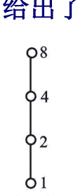

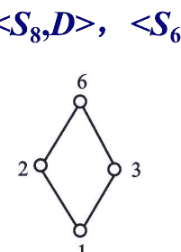

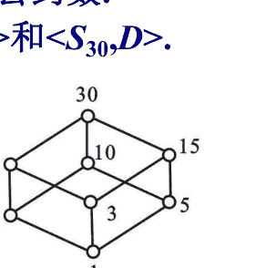

### 格的实例（续）

例 判断下列偏序集是否构成格，并说明理由。

- (1) <P(B),⊆>，其中P(B)是集合B的幂集。
- (2) <Z, ≤>，其中Z是整数集，≤为小于等于关系。
- (3) 偏序集的哈斯图分别在下图给出。

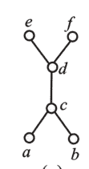

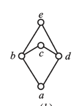

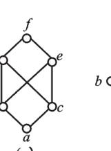

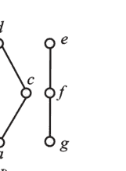

解 (1) 是格. 称<P(B),⊆>为B的幂集格。

(2) 是格。

(3) 都不是格。

### 格的性质：对偶原理

定义 设 $f$ 是含有格中元素以及符号 $=$, $\le$, $\ge$, $\vee$ 和 $\wedge$ 的命题. 令 $f^*$ 是将 $f$ 中的 $\le$ 替换成 $\ge$, $\ge$ 替换成 $\le$, $\vee$ 替换成 $\wedge$, $\wedge$ 替换成 $\vee$ 所得到的命题. 称 $f^*$ 为 $f$ 的对偶命题.

例如, 在格中: $f$ 是 $(a \vee b) \wedge c \le c$, $f^*$ 是 $(a \wedge b) \vee c \ge c$.

格的对偶原理: 设 $f$ 是含格中元素以及符号 $=$, $\le$, $\ge$, $\vee$ 和 $\wedge$ 等的命题. 若 $f$ 对一切格为真, 则 $f$ 的对偶命题 $f^*$ 也对一切格为真.

例如, 若对一切格 $L$ 都有 $\forall a,b \in L, a \wedge b \le a$, 那么对一切格 $L$ 都有 $\forall a,b \in L, a \vee b \ge a$

### 格的性质：算律

定理 设<L, ≤ >是格,则运算∨和∧适合交换律、结合律、幂等律和吸收律,即

- (1) ∀a,b∈L 有
- a∨b=b∨a,  a∧b=b∧a

- (2) ∀a,b,c∈L 有
- (a∨b)∨c=a∨(b∨c),
- (a∧b)∧c=a∧(b∧c)

- (3) ∀a∈L 有
- a∨a=a,  a∧a=a

- (4) ∀a,b∈L 有
- a∨(a∧b)=a,  a∧(a∨b)=a

### 算律的证明

证 (1) 交换律.

a∨b 是 {a,b} 的最小上界

b∨a 是 {b,a} 的最小上界

{a,b} = {b,a}

⇒ a∨b = b∨a.

由对偶原理, a∧b = b∧a 得证.

### 算律的证明（续）

(2) 结合律. 由最小上界的定义有
(a∨b)∨c ≥ a∨b ≥ a    (I)
(a∨b)∨c ≥ a∨b ≥ b    (II)
(a∨b)∨c ≥ c          (III)
由式 (II) 和 (III) 有
(a∨b)∨c ≥ b∨c        (IV)
由式 (I) 和 (IV) 有 (a∨b)∨c ≥ a∨(b∨c). 同理可证 (a∨b)∨c ≤ a∨(b∨c). 根据偏序的反对称性得到 (a∨b)∨c = a∨(b∨c). 由对偶原理, (a∧b)∧c = a∧(b∧c) 得证.

### 算律的证明（续）

(3) 幂等律。显然 $a \leq a \vee a$，又由 $a \leq a$ 得 $a \vee a \leq a$。

由反对称性 $a \vee a = a$。用对偶原理，$a \wedge a = a$ 得证。

(4) 吸收律。显然有

$$a \vee (a \wedge b) \geq a \quad (V)$$

由 $a \leq a$，$a \wedge b \leq a$ 可得

$$a \vee (a \wedge b) \leq a \quad (VI)$$

由式 (V) 和 (VI) 可得 $a \vee (a \wedge b)=a$

根据对偶原理，$a \wedge (a \vee b)=a$ 得证。

### 格作为代数系统的定义

**定理** 设 `<S,*,∘>` 是具有两个二元运算的代数系统，若对于 `*` 和 `∘` 运算适合交换律、结合律、吸收律，则可以适当定义 `S` 中的偏序 `≼`，使得 `<S,≼>` 构成格，且 `∀a,b∈S` 有 `a∧b=a*b`，`a∨b=a∘b`。

根据定理，可以给出格的另一个等价定义。

**定义** 设 `<S,*,∘>` 是代数系统，`*` 和 `∘` 是二元运算，如果

`*` 和 `∘` 运算满足交换律、结合律和吸收律，则 `<S,*,∘>`

### 子格的定义及判别

定义 设<L,∧,∨>是格, S是L的非空子集, 若S关于L中运算∧和∨仍构成格, 则称S是L的子格.

例 设格 L 如图所示. 令
S₁={a, e, f, g},
S₂={a, b, e, g}
S₁不是L的子格,
S₂是L的子格. 因为对于 e, f∈S₁, e∧f∉S₁.

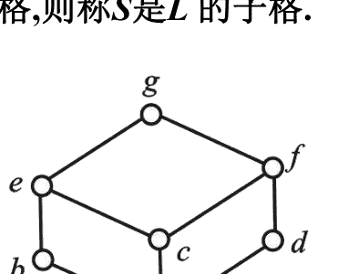

### 格同态

定义 设 $L_1$ 和 $L_2$ 是格, $f: L_1 \to L_2$, 若 $\forall a,b \in L_1$ 有

$f(a \land b) = f(a) \land f(b)$,

$f(a \lor b) = f(a) \lor f(b)$

成立, 则称 $f$ 为格 $L_1$ 到 $L_2$ 的同态映射, 简称格同态。

### 分配格定义

定义 设<L,∧,∨>是格, 若∀a, b, c∈L, 有
 a∧(b∨c) = (a∧b)∨(a∧c)
 a∨(b∧c) = (a∨b)∧(a∨c)
 则称 L 为分配格.

注意：以上条件互为充分必要条件

在证明L为分配格时, 只须证明其中的一个等式即可.

### 分配格的定义（续）

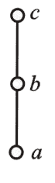

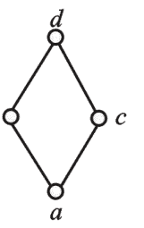

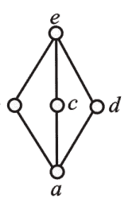

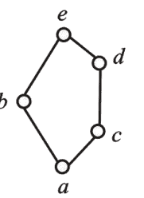

L₁和 L₂是分配格, L₃和 L₄不是分配格。

在 L₃中， b∧(c∨d)=b， (b∧c)∨(b∧d)=a

在 L₄中， c∨(b∧d)=c， (c∨b)∧(c∨d)=d

称 L₃为钻石格, L₄为五角格。


### 分配格的判定及其性质

**定理** 设 $L$ 是格，则 $L$ 是分配格当且仅当 $L$ 不含有与钻石格或五角格同构的子格。

证明省略。

**定理** 格 $L$ 是分配格当且仅当 $\forall a,b,c\in L,$
$$a\wedge b=a\wedge c\ 且\ a\vee b=a\vee c\Rightarrow b=c.$$

**推论**

1. 小于五元的格都是分配格。
2. 任何一条链都是分配格。

### 分配格的判定（续）

例 说明图中的格是否为分配格,为什么？

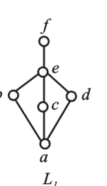

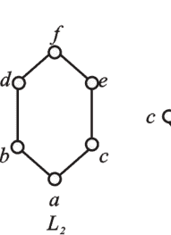

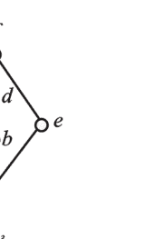

解 L1, L2和 L3都不是分配格。

{ a, b, c, d, e }是 L1的子格,并且同构于钻石格；

{ a, b, c, e, f }是 L2的子格,并且同构于五角格；

{ a, c, b, e, f }是 L3的子格,也同构于钻石格。

### 全上界与全下界

定义 设 L 是格，

若存在 a∈L 使得 ∀x∈L 有 a ≤ x, 则称 a 为 L 的全下界；

若存在 b∈L 使得 ∀x∈L 有 x ≤ b, 则称 b 为 L 的全上界。

说明：

格 L 若存在全下界或全上界, 一定是惟一的。

一般将格 L 的全下界记为 0, 全上界记为 1。

### 有界格定义及其性质

定义 设 L 是格,若 L 存在全下界和全上界,则称 L 为有界格,全下界记为0, 全上界记为1. 有界格 L 记为 <L,∧,∨,0,1>.

注意：有限格 L={a₁,a₂,...,aₙ}是有界格，a₁∧a₂∧...∧aₙ是 L 的全下界,a₁∨a₂∨...∨aₙ是全上界. 0 是关于∧运算的零元,∨运算的单位元. 1 是关于∨运算的零元,∧运算的单位元.

对于涉及有界格的命题,如果其中含有全下界0或全上界1,求其对偶命题时,必须将0与1互换。

### 实例：求补元

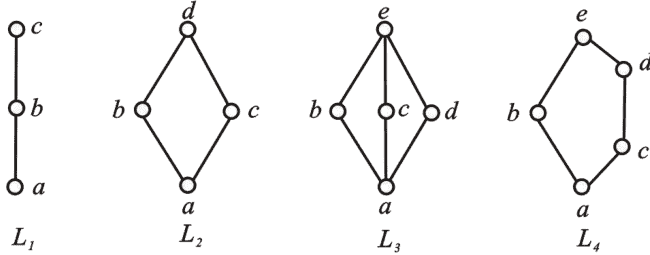

解：$L_1$ 中 $a,c$ 互补，$b$ 没补元。

$L_2$ 中 $a,d$ 互补，$b,c$ 互补。

$L_3$ 中 $a,e$ 互补，$b$ 的补元是 $c$ 和 $d$，$c$ 的补元是 $b$ 和 $d$，$d$ 的补元是 $b$ 和 $c$。

$L_4$ 中的 $a,e$ 互补，$b$ 的补元是 $c$ 和 $d$，$c$ 的补元是 $b$，$d$ 的补元是 $b$。

### 有界分配格中补元惟一性

定理 设<L,∧,∨,0,1>是有界分配格. 若L中元素 a 存在补元, 则存在惟一的补元.

证 假设 b, c 是 a 的补元, 则有
$a \vee c = 1, a \wedge c = 0,$
$a \vee b = 1, a \wedge b = 0$

从而得到 $a \vee c = a \vee b, a \wedge c = a \wedge b$, 由于 L 是分配格, $b = c.$

### 有补格的定义

定义 设<L,∧,∨,0,1>是有界格, 若 L 中所有元素都有补元存在, 则称 L 为有补格。

例如, 下图中的 L₂, L₃ 和 L₄ 是有补格, L₁ 不是有补格。

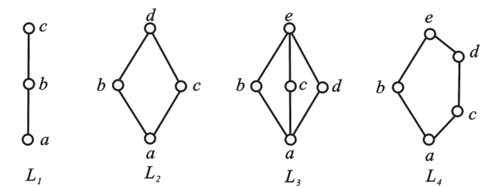

### 布尔代数的定义

#### 定义

如果一个格是有补分配格,则称它为布尔格或布尔代数。

在布尔代数中，如果一个元素存在补元, 则是惟一的. 可以把求补元的运算看作是布尔代数中的一元运算. 布尔代数标记为<B,∧,∨,',0,1>, 其中' 为求补运算

### 布尔代数的实例

例设 $S_{110}=\{1, 2, 5, 10, 11, 22, 55, 110\}$ 是110的正因子集合。

gcd 表示求最大公约数的运算

lcm表示求最小公倍数的运算.

则 $\<S_{110}, \text{gcd}, \text{lcm}\>$ 是否构成布尔代数？

### 布尔代数的等价定义

定义 设<B, *, ∘>是代数系统, * 和∘是二元运算. 若 * 和∘运算满足交换律、结合律、幂等律、吸收律, 即

(1) ∀a,b∈B 有 a* b = b* a, a∘b = b∘a
(2) ∀a,b,c∈B 有 a* (b∘c) = (a* b)∘(a* c), a∘(b* c) = (a∘b) * (a∘c)
(3) 即存在0,1∈B, 使得∀a∈B 有 a* 1 = a, a∘0 = a
(4) ∀a∈B, 存在 a'∈B 使得 a* a' = 0, a∘a' = 1

则称<B, *, ∘>是一个布尔代数.

可以证明，布尔代数的两种定义是等价的.

### 布尔代数的性质

定理 设<B, ∧,V, ', 0, 1>是布尔代数,则

(1) ∀a∈B, (a')'=a .

(2) ∀a, b∈B,

(3) (a∧b)'=a'∨b', (a∨b)'=a'∧b' （德摩根律）

注意：德摩根律对有限个元素也是正确的.

### 证明

证 (1) $(a')'$是 $a'$的补元. $A$ 是 $a'$ 的补元. 由补元惟一性得 $(a')'=a$.

(2) 对任意 $a, b \in B$ 有

$(a \land b) \lor (a' \lor b') = (a \lor a' \lor b') \land (b \lor a' \lor b')$

$= (1 \lor b') \land (a' \lor 1) = 1 \land 1 = 1,$

$(a \land b) \land (a' \lor b') = (a \land b \land a') \lor (a \land b \land b')$

$= (0 \land b) \lor (a \land 0) = 0 \lor 0 = 0.$

所以 $a' \lor b'$ 是 $a \land b$ 的补元, 根据补元惟一性可得 $(a \land b)' = a' \lor b'$.

同理可证 $(a \lor b)' = a' \land b'$.

### 有限布尔代数的表示定理

定理 设 L 是有限布尔代数，则 L 含有 2^n 个元素 (n∈N)，且 L 与 <P(S),∩,∪,~,∅,S> 同构，其中 S 是一个 n 元集合。

结论：含有 2^n 个元素的布尔代数在同构意义下只有一个。

## 图论

### 图论部分

- 第7章 图的基本概念
- 第8章 一些特殊的图
- 第9章 树

## 第7章 图的基本概念

7.1 无向图及有向图

7.2 通路、回路、图的连通性

7.3 图的矩阵表示

## 7.1 无向图及有向图

- 无向图与有向图
- 顶点的度数
- 握手定理
- 简单图
- 完全图
- 子图
- 补图

### 无向图与有向图

**多重集合**：元素可以重复出现的集合

**无序积**：$A\&B=\{(x,y)\mid x\in A\land y\in B\}$

**定义 无向图** $G=\langle V,E\rangle$，其中

1. $V\ne\varnothing$ 为顶点集，元素称为**顶点**
2. $E$ 为 $V\&V$ 的多重子集，其元素称为**无向边**，简称**边**。

例如，$G=\langle V,E\rangle$ 如图所示，
其中 $V=\{v_1,v_2,\ldots,v_5\}$，
$E=\{(v_1,v_1),(v_1,v_2),(v_2,v_3),(v_2,v_3),(v_2,v_5),(v_1,v_5),(v_4,v_5)\}$

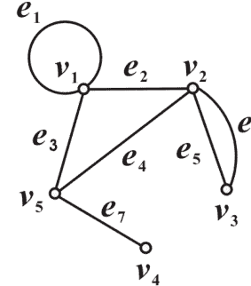

### 无向图与有向图(续)

定义 有向图 D=<V,E>，其中

(1) V同无向图的顶点集，元素也称为顶点

(2) E为V×V的多重子集，其元素 称为有向边，简称边。

用无向边代替D的所有有向边 所得到的无向图称作D的基图

右图是有向图，试写出它的V和E

注意：图的数学定义与图形表示，在同构(待叙)的意义下是一一对应的

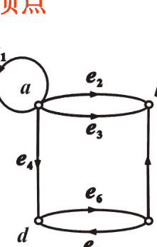

### 无向图与有向图(续)

通常用 $G$ 表示无向图, $D$ 表示有向图, 也常用 $G$ 泛指无向图和有向图, 用 $e_k$ 表示无向边或有向边。
$V(G)$, $E(G)$, $V(D)$, $E(D)$: $G$ 和 $D$ 的顶点集, 边集。

- **n 阶图**: $n$ 个顶点的图
- **有限图**: $V$, $E$ 都是有穷集合的图
- **零图**: $E = \varnothing$
- **平凡图**: 1 阶零图
- **空图**: $V = \varnothing$


### 顶点和边的关联与相邻

定义 设 $e_k = (v_i, v_j)$ 是无向图 $G = \<V, E\>$ 的一条边, 称 $v_i, v_j$ 为 $e_k$ 的端点, $e_k$ 与 $v_i (v_j)$ 关联. 若 $v_i \neq v_j$, 则称 $e_k$ 与 $v_i (v_j)$ 的关联次数为 1; 若 $v_i = v_j$, 则称 $e_k$ 为环, 此时称 $e_k$ 与 $v_i$ 的关联次数为 2; 若 $v_i$ 不是 $e_k$ 端点, 则称 $e_k$ 与 $v_i$ 的关联次数为 0. 无边关联的顶点称作孤立点.

定义 设无向图 $G = \<V, E\>$, $v_i, v_j \in V$, $e_k, e_l \in E$, 若 $(v_i, v_j) \in E$, 则称 $v_i v_j$ 相邻; 若 $e_k, e_l$ 至少有一个公共端点, 则称 $e_k, e_l$ 相邻.

对有向图有类似定义. 设 $e_k = \<v_i, v_j\>$ 是有向图的一条边, 又称 $v_i$ 是 $e_k$ 的起点, $v_j$ 是 $e_k$ 的终点, $v_i$ 邻接到 $v_j$, $v_j$ 邻接于 $v_i$.

### 邻域和关联集

设无向图 G, v ∈ V(G)

v的邻域 N(v) = {u | u ∈ V(G) ∧ (u, v) ∈ E(G) ∧ u ≠ v}

v的闭邻域 N̄(v) = N(v) ∪ {v}

v的关联集 I(v) = {e | e ∈ E(G) ∧ e 与 v 关联}

设有向图 D, v ∈ V(D)

v的后继元集 Γ⁺_D(v) = {u | u ∈ V(D) ∧ <v, u> ∈ E(G) ∧ u ≠ v}

v的先驱元集 Γ⁻_D(v) = {u | u ∈ V(D) ∧ <u, v> ∈ E(G) ∧ u ≠ v}

v的邻域 N_D(v) = Γ⁺_D(v) ∪ Γ⁻_D(v)

v的闭邻域 N̄_D(v) = N_D(v) ∪ {v}

### 顶点的度数

设 G=<V,E> 为无向图, v∈V,

+   v 的度数(度) d(v): v 作为边的端点次数之和
+   悬挂顶点: 度数为1的顶点
+   悬挂边: 与悬挂顶点关联的边
+   G 的最大度 Δ(G)=max{d(v)| v∈V}
+   G 的最小度 δ(G)=min{d(v)| v∈V}

例如 d(v5)=3, d(v2)=4, d(v1)=4, Δ(G)=4, δ(G)=1, v4 是悬挂顶点, e7 是悬挂边, e1 是环

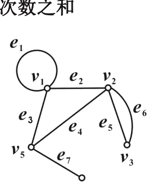

### 顶点的度数(续)

设D=<V,E>为有向图, v∈V,

v的出度 d⁺(v): v作为边的起点次数之和

v的入度 d⁻(v): v作为边的终点次数之和

v的度数(度) d(v): v作为边的端点次数之和

d(v)= d⁺(v)+ d⁻(v)

D的最大出度Δ⁺(D),最小出度δ⁺(D)

最大入度Δ⁻(D),最小入度δ⁻(D)

最大度Δ(D),最小度δ(D)

例如 d⁺(a)=4, d⁻(a)=1, d(a)=5,

d⁺(b)=0, d⁻(b)=3, d(b)=3,

Δ⁺(D)=4, δ⁺(D)=0, Δ⁻(D)=3,

δ⁻(D)=1, Δ(D)=5, δ(D)=3.

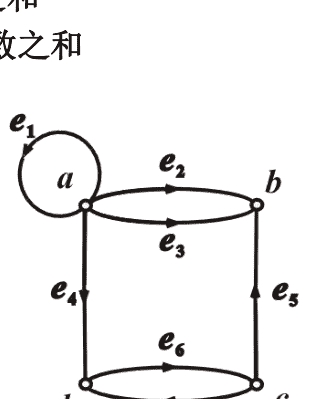

### 握手定理(续)

推论 在任何无向图和有向图中，奇度顶点的个数必为偶数。

证 设 $G=<V,E>$ 为任意图，令

$V_1 = \{v \mid v \in V \land d(v) \text{为奇数}\}$

$V_2 = \{v \mid v \in V \land d(v) \text{为偶数}\}$

则 $V_1 \cup V_2 = V$, $V_1 \cap V_2 = \varnothing$, 由握手定理可知

$2m = \sum_{v \in V} d(v) = \sum_{v \in V_1} d(v) + \sum_{v \in V_2} d(v)$

由于 $2m$, $\sum_{v \in V_2} d(v)$ 均为偶数，所以 $\sum_{v \in V_1} d(v)$ 也为偶数，但因为 $V_1$ 中顶点度数都为奇数，所以 $|V_1|$ 必为偶数。

### 图的度数列

设无向图G的顶点集V={v₁, v₂, ..., vₙ}

G的度数列: d(v₁), d(v₂), ..., d(vₙ)

如右图度数列:4,4,2,1,3

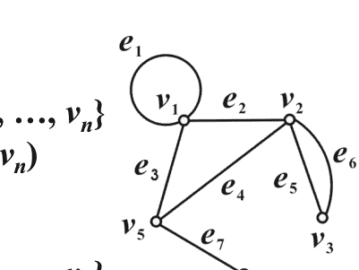

设有向图D的顶点集V={v₁, v₂, ..., vₙ}

D的度数列: d(v₁), d(v₂), ..., d(vₙ)

D的出度列: d⁺(v₁), d⁺(v₂), ..., d⁺(vₙ)

D的入度列: d⁻(v₁), d⁻(v₂), ..., d⁻(vₙ)

如右图度数列:5,3,3,3

出度列:4,0,2,1

入度列:1,3,1,2

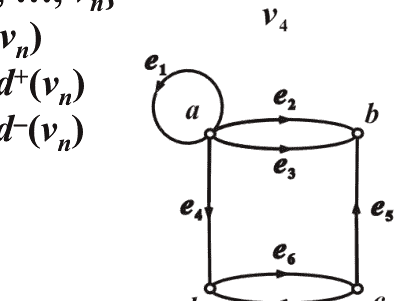

### 握手定理的应用

例1 (3,3,3,4), (2,3,4,6,8)能成为图的度数列吗？
解 不可能. 它们都有奇数个奇数.

例2 已知图G有10条边, 4个3度顶点, 其余顶点的度数均小于2, 问G至少有多少个顶点？

解 设G有n个顶点. 由握手定理,
4×3+2×(n-4)≥2×10

解得    n≥8

### 握手定理的应用(续)

例3 证明不存在具有奇数个面且每个面都具有奇数条棱的多面体。

证 用反证法. 假设存在这样的多面体,
作无向图 G=<V,E>，其中 V={v | v为多面体的面}，
E={(u,v) | u,v∈V ∧ u与v有共同的棱 ∧ u≠v}.
根据假设，|V|为奇数且 ∀v∈V, d(v)为奇数. 这与握手定理的推论矛盾。

### 多重图与简单图(续)

例如


e5和e6是平行边
重数为2
不是简单图

e2和e3是平行边,重数为2
e6和e7不是平行边
不是简单图

### 图的同构

定义 设 $G_1 = \langle V_1, E_1 \rangle$, $G_2 = \langle V_2, E_2 \rangle$ 为两个无向图(有向图), 若存在双射函数 $f: V_1 \to V_2$, 使得对于任意的 $v_i, v_j \in V_1$, 

$(v_i, v_j) \in E_1$ ($\langle v_i, v_j \rangle \in E_1$) 当且仅当 

$(f(v_i), f(v_j)) \in E_2$ ($\langle f(v_i), f(v_j) \rangle \in E_2$), 

并且, $(v_i, v_j)$ ($\langle v_i, v_j \rangle$) 与 $(f(v_i), f(v_j))$ ($\langle f(v_i), f(v_j) \rangle$) 的重数相同, 则称 $G_1$ 与 $G_2$ 是同构的, 记作 $G_1 \cong G_2$.

### 图的同构(续)

几点说明：

图之间的同构关系具有自反性、对称性和传递性。

能找到多条同构的必要条件,但它们都不是充分条件：

+   ① 边数相同，顶点数相同
+   ② 度数列相同(不计度数的顺序)
+   ③ 对应顶点的关联集及邻域的元素个数相同，等等

若破坏必要条件，则两图不同构

至今没有找到判断两个图同构的多项式时间算法

### 图的同构（续）


(1)


度数列不同
不同构

### 例2 (续)

(2)

(3)

不同构
入(出)度列不同

度数列相同
但不同构
为什么？


### 完全图与正则图

*n*阶无向完全图*Kₙ*: 每个顶点都与其余顶点相邻的*n*阶无向简单图。

简单性质: 边数*m*=*n*(*n*-1)/2, Δ=δ=*n*-1

*n*阶有向完全图: 每对顶点之间均有两条方向相反的有向边的*n*阶有向简单图。

简单性质: 边数*m*=*n*(*n*-1), Δ=δ=2(*n*-1), Δ⁺=δ⁺=Δ⁻=δ⁻=*n*-1

*n*阶*k*正则图: Δ=δ=*k* 的*n*阶无向简单图

简单性质: 边数*m*=*n*k*/2

### 完全图与正则图(续)

- (1) 为5阶完全图K₅
- (2) 为3阶有向完全图
- (3) 为彼得森图, 它是3 正则图


### 子图

定义 设 $G=\langle V,E\rangle$, $G'=\langle V',E'\rangle$ 是 2 个图

- (1) 若 $V'\subseteq V$ 且 $E'\subseteq E$, 则称 $G'$ 为 $G$ 的子图, $G$ 为 $G'$ 的母图, 记作 $G'\subseteq G$
- (2) 若 $G'\subseteq G$ 且 $V'=V$, 则称 $G'$ 为 $G$ 的生成子图
- (3) 若 $V'\subset V$ 或 $E'\subset E$, 称 $G'$ 为 $G$ 的真子图
- (4) 设 $V'\subseteq V$ 且 $V'\neq\varnothing$, 以 $V'$ 为顶点集, 以两端点都在 $V'$ 中的所有边为边集的 $G$ 的子图称作 $V'$ 的导出子图, 记作 $G[V']$
- (5) 设 $E'\subseteq E$ 且 $E'\neq\varnothing$, 以 $E'$ 为边集, 以 $E'$ 中边关联的所有顶点为顶点集的 $G$ 的子图称作 $E'$ 的导出子图, 记作 $G[E']$

### 子图 (续)

例 画出 K₄ 的所有非同构的生成子图

| m | 0 | 1 | 2 | 3 | 4 | 5 | 6 |  |
|---|---|---|---|---|---|---|---|---|
|   | • • • • | — | — — | △ • | □ | □ / | ✕ |  |

### 补图

定义 设 G=<V,E> 为 n 阶无向简单图，以 V 为顶点集，所有使 G 成为完全图 K_n 的添加边组成的集合为边集的图，称为 G 的补图，记作 \bar{G}。若 G ≅ \bar{G}，则称 G 是自补图。

例 对上一页 K_4 的所有不同子图, 指出互为补图的每一对子图, 并指出哪些是自补图。

## 7.2 通路、回路与图的连通性

- 简单通(回)路, 初级通(回)路, 复杂通(回)路
- 无向连通图, 连通分支
- 弱连通图, 单向连通图, 强连通图
- 点割集与割点
- 边割集与割边(桥)

### 通路与回路

定义 给定图 G=<V,E>（无向或有向的），G 中顶点与边的交替序列 Γ=v₀e₁v₁e₂…eₗvₗ，
(1) 若 ∀i(1≤i≤l)，v_{i-1}, v_i 是 e_i 的端点(对于有向图,要求 v_{i-1} 是始点, v_i 是终点), 则称 Γ 为通路, v₀ 是通路的起点, vₗ 是通路的终点, l 为通路的长度. 又若 v₀=vₗ, 则称 Γ 为回路.
(2) 若通路(回路)中所有顶点(对于回路,除 v₀=vₗ)各异, 则称为初级通路(初级回路).初级通路又称作路径, 初级回路又称作圈.
(3) 若通路(回路)中所有边各异, 则称为简单通路(简单回路), 否则称为复杂通路(复杂回路).

### 通路与回路(续)

说明：

- 表示方法
  - ① 用顶点和边的交替序列(定义), 如Γ=v₀e₁v₁e₂...eₗvₗ
  - ② 用边的序列, 如Γ=e₁e₂...eₗ
  - ③ 简单图中, 用顶点的序列, 如Γ=v₀v₁...vₗ
  - ④ 非简单图中, 可用混合表示法, 如Γ=v₀v₁e₂v₂e₅v₃v₄v₅

- 环是长度为1的圈, 两条平行边构成长度为2的圈。

- 在无向简单图中, 所有圈的长度≥3; 在有向简单图中, 所有圈的长度≥2。

### 通路与回路 (续)

- 在两种意义下计算的圈个数
  - ① 定义意义下
  - 在无向图中，一个长度为 l(l≥3) 的圈看作 2l 个不同的圈。如 v₀v₁v₂v₀，v₁v₂v₀v₁，v₂v₀v₁v₂ 看作 3 个不同的圈。
  - 在有向图中，一个长度为 l(l≥3) 的圈看作 l 个不同的圈。
  - ② 同构意义下
  - 所有长度相同的圈都是同构的，因而是 1 个圈。

### 通路与回路(续)

定理 在$n$阶图$G$中，若从顶点$v_i$到$v_j$ ($v_i\neq v_j$) 存在通路，则从$v_i$到$v_j$存在长度小于等于$n-1$的通路。

推论 在$n$阶图$G$中，若从顶点$v_i$到$v_j$ ($v_i\neq v_j$) 存在通路，则从$v_i$到$v_j$存在长度小于等于$n-1$的初级通路。

定理 在一个$n$阶图$G$中，若存在$v_i$到自身的回路，则一定存在$v_i$到自身长度小于等于$n$的回路。

推论 在一个$n$阶图$G$中，若存在$v_i$到自身的简单回路，则一定存在长度小于等于$n$的初级回路。

### 无向图的连通性

设无向图 $G=\langle V,E\rangle$,

$u$与$v$连通: 若$u$与$v$之间有通路. 规定$u$与自身总连通.

连通关系 $R=\{\langle u,v\rangle\mid u,v\in V且u\sim v\}$是$V$上的等价关系

连通图: 平凡图, 任意两点都连通的图

连通分支: $V$关于$R$的等价类的导出子图

设 $V/R=\{V_1,V_2,\dots,V_k\}$, $G[V_1]$, $G[V_2]$, ..., $G[V_k]$是$G$的连通分支, 其个数记作$p(G)=k.$

$G$是连通图 $\Leftrightarrow$ $p(G)=1$

### 短程线与距离

u与v之间的短程线: u与v之间长度最短的通路
(u与v连通)

u与v之间的距离d(u,v): u与v之间短程线的长度
若u与v不连通, 规定d(u,v)=∞.

性质：

d(u,v)≥0, 且d(u,v)=0 ⇔ u=v

d(u,v)=d(v,u)

d(u,v)+d(v,w)≥d(u,w)

### 点割集

记 $G - v$: 从$G$中删除$v$及关联的边
$G - V'$: 从$G$中删除$V'$中所有的顶点及关联的边
$G - e$: 从$G$中删除$e$
$G - E'$: 从$G$中删除$E'$中所有边

定义 设无向图$G = <V, E>$, $V' \subset V$, 若$p(G - V') > p(G)$且 $\forall V'' \subset V'$, $p(G - V'') = p(G)$, 则称$V'$为$G$的点割集. 若${v}$为点割集, 则称$v$为割点.

### 点割集(续)

例 {v₁,v₄}, {v₆}是点割集, v₆是割点.
{v₂,v₅}是点割集吗？


### 边割集

定义 设无向图 $G=\<V,E\>$, $E'\subseteq E$, 若 $p(G-E')>p(G)$ 且 $\forall E''\subset E'$, $p(G-E'')=p(G)$, 则称 $E'$ 为 $G$ 的边割集. 若 $\{e\}$ 为边割集, 则称 $e$ 为割边或桥.

在上一页的图中, $\{e_1,e_2\}$, $\{e_1,e_3,e_5,e_6\}$, $\{e_8\}$ 等是边割集, $e_8$ 是桥, $\{e_7,e_9,e_5,e_6\}$ 是边割集吗?

几点说明:

- $K_n$ 无点割集
- $n$ 阶零图既无点割集, 也无边割集.
- 若 $G$ 连通, $E'$ 为边割集, 则 $p(G-E')=2$
- 若 $G$ 连通, $V'$ 为点割集, 则 $p(G-V')\ge 2$

### 有向图的连通性

设有向图 D=<V,E>
*u可达v*: u到v有通路. 规定u到自身总是可达的.
可达具有自反性和传递性

*D弱连通(连通)*: 基图为无向连通图

*D单向连通*: ∀u,v∈V, u可达v 或v可达u

*D强连通*: ∀u,v∈V, u与v相互可达

强连通⇒单向连通⇒弱连通


### 有向图的连通性(续)

定理(强连通判别法) D强连通当且仅当D中存在经过每个顶点至少一次的回路

定理(单向连通判别法) D单向连通当且仅当D中存在经过每个顶点至少一次的通路

例 下图(1)强连通，(2)单连通，(3)弱连通


## 7.3 图的矩阵表示

- 无向图的关联矩阵
- 有向图的关联矩阵
- 有向图的邻接矩阵
- 有向图的可达矩阵

### 无向图的关联矩阵

定义 设无向图 G=<V,E>, V={v₁, v₂, ..., vₙ}, E={e₁, e₂, ..., eₘ}, 令 mᵢⱼ 为 vᵢ 与 eⱼ 的关联次数, 称 (mᵢⱼ)ₙ×ₘ 为 G 的关联矩阵, 记为 M(G).

性质

- (1) ∑ᵢ=1ⁿ mᵢⱼ = 2  (j = 1,2,...,m)
- (2) ∑ⱼ=1ᵐ mᵢⱼ = d(vᵢ)  (i = 1,2,...,n)
- (3) ∑ᵢ,ⱼ mᵢⱼ = 2m
- (4) 平行边的列相同

### 有向图的关联矩阵

定义 设无环有向图 $D=\langle V,E\rangle$, $V=\{v_1, v_2, ..., v_n\}$, $E=\{e_1, e_2, ..., e_m\}$, 令

$m_{ij}=\begin{cases}1, & v_i\text{为}e_j\text{的始点}\\0, & v_i\text{与}e_j\text{不关联}\\-1, & v_i\text{为}e_j\text{的终点}\end{cases}$

则称 $(m_{ij})_{n\times m}$ 为 $D$ 的关联矩阵，记为 $M(D)$.

### 有向图的关联矩阵(续)

性质

- (1) ∑_{i=1}^{n} m_{ij} = 0      (j = 1,2,...,m)
- (2) ∑_{j=1}^{m} (m_{ij} = 1) = d⁺(v_i),
      ∑_{j=1}^{m} (m_{ij} = -1) = d⁻(v_i),   i = 1,2,...,n
- (3) ∑_{i,j} m_{ij} = 0
- (4) 平行边对应的列相同

### 有向图的邻接矩阵

定义 设有向图 D=<V,E>, V={v₁, v₂, ..., vₙ}, E={e₁, e₂, ..., eₘ}, 令 aᵢⱼ⁽¹⁾ 为顶点 vᵢ 邻接到顶点 vⱼ 边的条数, 称 aᵢⱼ⁽¹⁾ )ₘₓₙ 为 D 的邻接矩阵, 记作 A(D), 简记为 A.

性质

- (1) ∑ⱼ=1ⁿ aᵢⱼ⁽¹⁾ = d⁺(vᵢ),  i = 1,2,...,n
- (2) ∑ᵢ=1ⁿ aᵢⱼ⁽¹⁾ = d⁻(vⱼ),  j = 1,2,...,n
- (3) ∑ᵢ,ⱼ aᵢⱼ⁽¹⁾ = m --- D 中长度为 1 的通路数
- (4) ∑ᵢ=1ⁿ aᵢᵢ⁽¹⁾ --- D 中长度为 1 的回路数

### D中的通路及回路数

定理 设A为n阶有向图D的邻接矩阵，则A^(l)(l≥1)中元素

a_ij^(l) 为D中v_i到v_j长度为l的通路数，

a_ii^(l) 为v_i到自身长度为l的回路数，

∑_{i=1}^n ∑_{j=1}^n a_ij^(l) 为D中长度为l的通路总数，

∑_{i=1}^n a_ii^(l) 为D中长度为l的回路总数.

### D中的通路及回路线(续)

推论 设$B_I=A+A^2+...+A^I(I\geq1)$, 则$B_I$中元素

$\sum_{i=1}^n \sum_{j=1}^n b_{ij}^{(I)}$ 为D中长度小于或等于$I$的通路数,

$\sum_{i=1}^n b_{ii}^{(I)}$ 为D中长度小于或等于$I$的回路线数.

例 有向图D如图所示,求$A,A^2,A^3,A^4$, 并回答诸问题:

- (1) D中长度为1, 2, 3, 4的通路各有多少条? 其中回路分别为多少条?
-   
- (2) D中长度小于或等于4的通路为多少条? 其中有多少条回路?


### 例(续)

$$A = \begin{bmatrix}1 & 0 & 0 & 0 \\ 2 & 0 & 1 & 0 \\ 1 & 0 & 0 & 1 \\ 1 & 0 & 1 & 0\end{bmatrix}\quad A^2 = \begin{bmatrix}1 & 0 & 0 & 0 \\ 3 & 0 & 0 & 1 \\ 2 & 0 & 1 & 0 \\ 2 & 0 & 0 & 1\end{bmatrix}$$ 

$$A^3 = \begin{bmatrix}1 & 0 & 0 & 0 \\ 4 & 0 & 1 & 0 \\ 3 & 0 & 0 & 1 \\ 3 & 0 & 1 & 0\end{bmatrix}\quad A^4 = \begin{bmatrix}1 & 0 & 0 & 0 \\ 5 & 0 & 0 & 1 \\ 4 & 0 & 1 & 0 \\ 4 & 0 & 0 & 1\end{bmatrix}$$ 

| 长度 | 通路 | 回路 |
|---|---|---|
| 1 | 8 | 1 |
| 2 | 11 | 3 |
| 3 | 14 | 1 |
| 4 | 17 | 3 |
| 合计 | 50 | 8 |

### 有向图的可达矩阵

定义 设 D=<V,E> 为有向图, V={v₁, v₂, …, vₙ}, 令

pᵢⱼ = { 0,  vᵢ 可达 vⱼ
          1,  否则 }

称 (pᵢⱼ)ₙ×ₙ 为 D 的可达矩阵, 记作 P(D), 简记为 P.

性质：

P(D) 主对角线上的元素全为 1.

D 强连通当且仅当 P(D) 的元素全为 1.

### 有向图的可达矩阵(续)

例 右图所示的有向图D的可达矩阵为

P = 
\begin{bmatrix}
1 & 0 & 0 & 0 \\
1 & 1 & 1 & 1 \\
1 & 0 & 1 & 1 \\
1 & 0 & 1 & 1
\end{bmatrix}


## 第8章 一些特殊的图

- 8.1 二部图
- 8.2 欧拉图
- 8.3 哈密顿图
- 8.4 平面图

## 8.1 二部图

- 二部图
- 完全二部图
- 匹配
- 极大匹配
- 最大匹配
- 匹配数
- 完备匹配

### 二部图

定义 设无向图 $G=<V,E>$, 若能将 $V$ 分成 $V_1$ 和 $V_2$ ($V_1 \cup V_2=V$, $V_1 \cap V_2=\varnothing$), 使得 $G$ 中的每条边的两个端点都一个属于 $V_1$, 另一个属于 $V_2$, 则称 $G$ 为二部图, 记为 $<V_1,V_2,E>$, 称 $V_1$ 和 $V_2$ 为互补顶点子集. 又若 $G$ 是简单图, 且 $V_1$ 中每个顶点均与 $V_2$ 中每个顶点都相邻, 则称 $G$ 为完全二部图, 记为 $K_{r,s}$, 其中 $r=|V_1|$, $s=|V_2|$.

注意: $n$ 阶零图为二部图.

### 二部图的判别法

定理 无向图G=<V,E>是二部图当且仅当G中无奇圈

例 下述各图都是二部图


### 匹配

设 $G = \langle V, E \rangle$,

匹配(边独立集): 任2条边均不相邻的边子集

极大匹配: 添加任一条边后都不再是匹配的匹配

最大匹配: 边数最多的匹配

匹配数: 最大匹配中的边数, 记为 $\beta_1$

例 3个图的匹配数 依次为3, 3, 4.


### 匹配（续）

设*M*为*G*中一个匹配

*v_i*与*v_j*被*M*匹配: (*v_i*,*v_j*)∈*M*

*v*为*M*饱和点: *M*中有边与*v*关联

*v*为*M*非饱和点: *M*中没有边与*v*关联

*M*为完美匹配: *G*的每个顶点都是*M*饱和点

例 关于*M₁*, *a*,*b*,*e*,*d*是饱和点

*f*,*c*是非饱和点

*M₁*不是完美匹配

*M₂*是完美匹配


### 二部图中的匹配

定义 设 G=<V₁,V₂,E> 为二部图, |V₁|≤|V₂|, M 是 G 中最大匹配, 若 V₁ 中顶点全是 M 饱和点, 则称 M 为 G 中 V₁ 到 V₂ 的完备匹配. 当 |V₁|=|V₂| 时, 完备匹配变成完美匹配.

例 图中红边组成各图的一个匹配, (1)为完备的, 但不是完美的; (2)不是完备的, 其实(2)中无完备匹配; (3) 是完美的.


### Hall定理

定理(Hall定理) 设二部图 G=<V₁,V₂,E> 中，|V₁|≤|V₂|。G中存在从 V₁ 到 V₂ 的完备匹配当且仅当 V₁ 中任意 k 个顶点至少与 V₂ 中的 k 个顶点相邻 (k=1,2,...,|V₁|)。

由 Hall 定理不难证明, 上一页图(2)没有完备匹配。

定理 设二部图 G=<V₁,V₂,E> 中, 如果存在 t≥1, 使得 V₁ 中每个顶点至少关联 t 条边, 而 V₂ 中每个顶点至多关联 t 条边, 则 G 中存在 V₁ 到 V₂ 的完备匹配。

Hall 定理中的条件称为 “相异性条件”, 第二个定理中的条件 称为 t 条件. 满足 t 条件的二部图一定满足相异性条件.

### 一个应用实例

例 某课题组要从 a, b, c, d, e 5 人中派 3 人分别到上海、广州、香港去开会. 已知 a 只想去上海，b 只想去广州，c, d, e 都表示想去广州或香港. 问该课题组在满足个人要求的条件下，共有几种派遣方案？

解 令 G = <V₁, V₂, E>，其中 V₁ = {s, g, x}，V₂ = {a, b, c, d, e}，
E = {(u, v) | u ∈ V₁, v ∈ V₂, v 想去 u}，
其中 s, g, x 分别表示上海、广州和香港.

G 如图所示.

G 满足相异性条件，因而可给出派遣方案，共有 9 种派遣方案 (请给出这 9 种方案).


## 8.2 欧拉图

- 欧拉通路
- 欧拉回路
- 欧拉图
- 半欧拉图

### 哥尼斯堡七桥问题


欧拉图是能一笔画出的边不重复的回路。

### 欧拉图

- 欧拉通路：图中行遍所有顶点且恰好经过每条边一次的通路。
- 欧拉回路：图中行遍所有顶点且恰好经过每条边一次的回路。
- 欧拉图：有欧拉回路的图。
- 半欧拉图：有欧拉通路而无欧拉回路的图。

几点说明：

- 上述定义对无向图和有向图都适用。
- 规定平凡图为欧拉图。
- 欧拉通路是简单通路，欧拉回路是简单回路。
- 环不影响图的欧拉性。

### 欧拉图(续)

例 图中，(1)，(4)为欧拉图；(2)，(5)为半欧拉图；(3)，(6)既不是欧拉图，也不是半欧拉图。
在(3)，(6)中各至少加几条边才能成为欧拉图？


### 欧拉图的判别法

定理 无向图G为欧拉图当且仅当G连通且无奇度顶点。
无向图G是半欧拉图当且仅当G连通且恰有两个奇度顶点。

定理 有向图D是欧拉图当且仅当D连通且每个顶点的入度都等于出度。
有向图D具有欧拉通路当且仅当D连通且恰有两个奇度顶点，其中一个入度比出度大1，另一个出度比入度大1，其余顶点的入度等于出度。

### 实例

例1 哥尼斯堡七桥问题


例2 下面两个图都是欧拉图。
从A点出发，如何一次成功地走出一条欧拉回路来？


## 8.3 哈密顿图

- 哈密顿通路
- 哈密顿回路
- 哈密顿图
- 半哈密顿图

### 哈密顿周游世界问题


### 哈密顿图的定义

- 哈密顿通路：经过图中所有顶点一次且仅一次的通路。
- 哈密顿回路：经过图中所有顶点一次且仅一次的回路。
- 哈密顿图：具有哈密顿回路的图。
- 半哈密顿图：具有哈密顿通路而无哈密顿回路的图。

几点说明：
平凡图是哈密顿图。
哈密顿通路是初级通路，哈密顿回路是初级回路。
环与平行边不影响图的哈密顿性。

### 实例

例图中，(1)、(2)是哈密顿图；(3)是半哈密顿图。
(4)既不是哈密顿图，也不是半哈密顿图，为什么？


### 无向哈密顿图的一个必要条件

定理 设无向图 G=<V,E> 是哈密顿图, 则对于任意 V₁ ⊂ V 且 V₁ ≠ ∅, 均有 p(G−V₁) ≤ |V₁|.

证 设 C 为 G 中一条哈密顿回路, 有 p(C−V₁) ≤ |V₁|. 又因为 C ⊆ G, 故 p(G−V₁) ≤ p(C−V₁) ≤ |V₁|.

几点说明

定理中的条件是哈密顿图的必要条件, 但不是充分条件.

可利用该定理判断某些图不是哈密顿图.

由定理可知, K_{r,s} 当 s ≥ r+1 时不是哈密顿图.

当 r ≥ 2 时, K_{r,r} 是哈密顿图, 而 K_{r,r+1} 是半哈密顿图.

### 实例

例 设 $G$ 为 $n$ 阶无向连通简单图, 若 $G$ 中有割点或桥, 则 $G$ 不是哈密顿图.

证 (1) 设 $v$ 为割点, 则 $p(G-v) \ge 2 > |\{v\}|=1$. 根据定理, $G$ 不是哈密顿图.

(2) 若 $G$ 是 $K_2$ ($K_2$ 有桥), 它显然不是哈密顿图. 除 $K_2$ 外, 其他的有桥连通图均有割点. 由 (1), 得证 $G$ 不是哈密顿图.

### 无向哈密顿图的一个充分条件

### 定理

设*G*是*n*阶无向简单图, 若任意两个不相邻的顶点的度数之和大于等于*n*−1, 则*G*中存在哈密顿通路.

当*n*≥3时, 若任意两个不相邻的顶点的度数之和大于等于*n*, 则*G*中存在哈密顿回路, 从而*G*为哈密顿图.

### 哈密顿通路(回路)的存在性(续)

定理中的条件是存在哈密顿通路(回路)的充分条件, 但不是必要条件.

例如, 设G为长度为n-1(n≥4)的路径, 它不满足定理中哈密顿通路的条件, 但它显然存在哈密顿通路. 设G是长为n的圈, 它不满足定理中哈密顿回路的条件, 但它显然是哈密顿图.

由定理, 当n≥3时, Kₙ均为哈密顿图. 判断某图是否为哈密顿图至今还是一个难题

### 判断是否是哈密顿图的可行方法

- 观察出一条哈密顿回路

例如 右图(周游世界问题)中红边给出一条哈密顿回路, 故它是哈密顿图.
注意, 此图不满足定理的条件.


- 满足充分条件

例如 当 n≥3 时, K_n 中任何两个不同的顶点 u,v, 均有 d(u)+d(v)=2(n-1)≥n, 所以 K_n 为哈密顿图.

### 判断是否是哈密顿图的可行方法(续)

- 不满足必要条件

例 1/4 国际象棋盘(4×4方格)上的跳马问题: 马是否能恰好经过每一个方格一次后回到原处?


解 每个方格看作一个顶点, 2个顶点之间有边当且仅当马可以从一个方格跳到另一个方格, 得到16阶图G, 如左图红边所示. 取V1={a, b, c, d}, 则p(G−V1)=6>|V1|, 见右图. 由定理, 图中无哈密顿回路, 故问题无解. 在国际象棋盘(8×8)上, 跳马问题是否有解?


### 应用实例

例 某次国际会议8人参加，已知每人至少与其余7人中的4人有共同语言，问服务员能否将他们安排在同一张圆桌就座，使得每个人都能与两边的人交谈？

解 图是描述事物之间关系的最好的手段之一. 作无向图 G=<V,E>, 其中 V={v|v为与会者}, E={(u,v) | u,v∈V, u与v有共同语言, 且 u≠v}. G为简单图. 根据条件, ∀v∈V, d(v)≥4. 于是, ∀u,v∈V, 有 d(u)+d(v)≥8. 由定理可知 G为哈密顿图. 服务员在 G中找一条哈密顿回路 C, 按 C中相邻关系安排座位即可.

由本題想到的：哈密顿图的实质是能将图中的所有的顶点排在同一个圈中.

## 8.4 平面图

- 平面图与平面嵌入
- 平面图的面、有限面、无限面
- 面的次数
- 极大平面图
- 极小非平面图
- 欧拉公式
- 平面图的对偶图

### 平面图和平面嵌入

定义 如果能将图G除顶点外边不相交地画在平面上，则称G是平面图。这个画出的无边相交的图称作G的平面嵌入。没有平面嵌入的图称作非平面图。

例如 下图中(1)~(4)是平面图, (2)是(1)的平面嵌入, (4)是(3)的平面嵌入. (5)是非平面图.


### 平面图和平面嵌入(续)

- 按定义, 平面图不一定是平面嵌入. 但今后讨论性质时, 通常是针对平面嵌入的. 今后平面图均指它的一个平面嵌入.
- $K_5$和$K_{3,3}$是非平面图
- 设$G'\subseteq G$, 若$G$为平面图, 则$G'$也是平面图; 若$G'$为非平面图, 则$G$也是非平面图.
- $K_n(n\ge5)$, $K_{3,n}(n\ge3)$都是非平面图.
- 平行边与环不影响图的平面性.


### 平面图的面与次数

设 $G$ 是一个平面嵌入

- **$G$ 的面**: 由 $G$ 的边将平面划分成的每一个区域
- **无限面(外部面)**: 面积无限的面, 用 $R_0$ 表示
- **有限面(内部面)**: 面积有限的面, 用 $R_1$, $R_2$, ..., $R_k$ 表示
- **面 $R_i$ 的边界**: 包围 $R_i$ 的所有边构成的回路组
- **面 $R_i$ 的次数**: $R_i$ 边界的长度, 用 $\deg(R_i)$ 表示

说明: 构成一个面的边界的回路组可能是初级回路, 简单回路, 也可能是复杂回路, 甚至还可能是非连通的回路之并.

**定理** 平面图各面的次数之和等于边数的 2 倍.

### 平面图的面与次数(续)

例1 右图有4个面, deg(R₁)=1, deg(R₂)=3, deg(R₃)=2, deg(R₀)=8. 请写各面的边界.


例2 左边2个图是同一个平面图的平面嵌入. R₁在(1)中是外部面, 在(2)中是内部面; R₂在(1)中是内部面, 在(2)中是外部面. 其实, 在平面嵌入中可把任何面作为外部面.

### 极大平面图

定义 若 $G$ 是简单平面图, 并且在任意两个不相邻的顶点之间加一条新边所得图为非平面图, 则称 $G$ 为极大平面图.

### 性质

- 若简单平面图中已无不相邻顶点，则是极大平面图。如 $K_1, K_2, K_3, K_4$ 都是极大平面图。
- 极大平面图必连通。
- 阶数大于等于3的极大平面图中不可能有割点和桥。
- 设 $G$ 为 $n(n\ge3)$ 阶极大平面图, 则 $G$ 每个面的次数均为3。
- 任何 $n(n\ge4)$ 阶极大平面图 $G$ 均有 $\delta(G)\ge3$。

### 实例

3个图都是平面图,但只有右边的图为极大平面图。


### 极小非平面图

定义 若 $G$ 是非平面图，并且任意删除一条边所得图都是平面图，则称 $G$ 为极小非平面图。

说明：

$K_5$, $K_{3,3}$ 都是极小非平面图

极小非平面图必为简单图

下面4个图都是极小非平面图


### 欧拉公式

定理8.11 (欧拉公式) 设$G$为$n$阶$m$条边$r$个面的连通平面图，则 $n-m+r=2$.

证 对边数$m$做归纳证明。

$m=0$, $G$为平凡图, 结论为真。

设$m=k(k\ge1)$结论为真, $m=k+1$时分情况讨论如下：

- (1) $G$中无圈, 则$G$必有一个度数为1的顶点$v$, 删除$v$及它关联的边, 记作$G'$. $G'$连通, 有$n-1$个顶点, $k$条边和$r$个面. 由归纳假设, $(n-1)-k+r=2$, 即$n-(k+1)+r=2$, 得证$m=k+1$时结论成立.

- (2) 否则, 删除一个圈上的一条边, 记作$G'$. $G'$连通, 有$n$个顶点, $k$条边和$r-1$个面. 由归纳假设, $n-k+(r-1)=2$, 即$n-(k+1)+r=2$, 得证$m=k+1$时结论也成立. 证毕.

### 与欧拉公式有关的定理

定理 设G为n阶连通平面图，有m条边，且每个面的次数不小于l(l≥3)，则 $m \le \frac{l}{l-2}(n-2)$

证 由定理(各面次数之和等于边数的2倍)及欧拉公式得 $2m \ge lr = l(2+m-n)$ 可解得所需结论。

推论 $K_5$ 和 $K_{3,3}$ 不是平面图。

证 用反证法，假设它们是平面图，则 $K_5$：$n=5$, $m=10$, $l=3$ $K_{3,3}$：$n=6$, $m=9$, $l=4$ 与定理8.11矛盾。


### 与欧拉公式有关的定理(续)

定理8.11 的推广：设G为有 p (p≥2) 个连通分支的平面图，且每个面的次数不小于 l (l≥3)，则
m ≤ l/(l-2) (n - p -1)

定理8.12 设G为简单平面图，则δ(G)≤5.

### 同胚与收缩

消去2度顶点v 如上图从(1)到(2)

插入2度顶点v 如上图从(2)到(1)

G₁与G₂同胚: G₁与G₂同构, 或经过反复插入、或消去2度顶点后同构

收缩边e 如下图从(1)到(2)


### 库拉图斯基定理

定理8.13  G是平面图⇔G中不含与K₅同胚的子图，也不含与K₃,₃同胚的子图。

定理8.14  G是平面图⇔G中无可收缩为K₅的子图，也无可收缩为K₃,₃的子图。

### 非平面图证明

例 证明2个图均为非平面图.


证


图中红色部分分别与K₃,₃和K₅同胚


### 平面图的对偶图

定义 设平面图 $G$, 有 $n$ 个顶点, $m$ 条边和 $r$ 个面, 构造 $G$ 的对偶图 $G^* = \langle V^*, E^* \rangle$ 如下：

在 $G$ 的每一个面 $R_i$ 中任取一个点 $v_i^*$ 作为 $G^*$ 的顶点，
$V^* = \{ v_i^* \mid i=1,2,...,r \}.$

对 $G$ 每一条边 $e_k$, 若 $e_k$ 在 $G$ 的面 $R_i$ 与 $R_j$ 的公共边界上, 则作边 $e_k^* = (v_i^*, v_j^*)$, 且与 $e_k$ 相交; 若 $e_k$ 为 $G$ 中的桥且在面 $R_i$ 的边界上, 则作环 $e_k^* = (v_i^*, v_i^*).$

$E^* = \{ e_k^* \mid k=1,2,...,m \}.$

### 平面图的对偶图（续）

例 黑色实线为原平面图, 红色虚线为其对偶图


### 平面图的对偶图(续)

性质：

- **G***是平面图，而且是平面嵌入。
- **G***是连通图
- 若边*e*为*G*中的环，则*G**与*e*对应的边*e**为桥；若*e*为桥，则*G**中与*e*对应的边*e**为环。
- 在多数情况下，*G**含有平行边。
- 同构的平面图的对偶图不一定同构。

上面两个平面图是同构的,但它们的对偶图不同构。

### 平面图的对偶图(续)

平面图与对偶图的阶数、边数与面数之间的关系：
设 $G^*$ 是平面图 $G$ 的对偶图， $n^*, m^*, r^*$ 和 $n, m, r$ 分别为 $G^*$ 和 $G$ 的顶点数、边数和面数，则

- (1) $n^* = r$
- (2) $m^* = m$
- (3) $r^* = n - p + 1$, 其中 $p$ 是 $G$ 的连通分支数
- (4) 设 $G^*$ 的顶点 $v_i^*$ 位于 $G$ 的面 $R_i$ 中, 则 $d(v_i^*) = \deg(R_i)$

## 第9章 树

- 9.1 无向树及生成树
- 9.2 根树及其应用

## 9.1 无向树及生成树

- 无向树、森林
- 树枝、弦、余树
- 生成树
- 基本回路与基本回路系统
- 基本割集与基本割集系统
- 最小生成树

### 无向树

- 无向树: 连通无回路的无向图
- 平凡树: 平凡图
- 森林: 每个连通分支都是树的非连通的无向图
- 树叶: 树中度数为1的顶点
- 分支点: 树中度数≥2的顶点

右图为一棵12阶树.

声明:本章中所讨论的回路均指简单回路或初级回路


### 无向树的性质

定理9.1 设 G=<V,E> 是 n 阶 m 条边的无向图，则下面各命题是等价的：

- （1） G 是树(连通无回路)；
- （2） G 中任意两个顶点之间存在惟一的路径；
- （3） G 中无回路且 m=n−1；
- （4） G 是连通的且 m=n−1；
- （5） G 是连通的且 G 中任何边均为桥；
- （6） G 中没有回路，但在任何两个不同的顶点之间加一条新边后所得图中有惟一的一个含新边的圈。

### 无向树的性质(续)

定理9.2 设 $T$ 是 $n$ 阶非平凡的无向树，则 $T$ 中至少有两片树叶。

证 设 $T$ 有 $x$ 片树叶，由握手定理及定理9.1可知，

$2(n-1)=\sum d(v_i)\ge x+2(n-x)$

由上式解出 $x\ge2$.

### 例题

例1 已知无向树T中，有1个3度顶点，2个2度顶点，其余顶点全是树叶.试求树叶数，并画出满足要求的非同构的无向树。

解 用树的性质 m=n−1 和握手定理。
设有 x 片树叶，于是 n=1+2+x=3+x，
2m=2(n−1)=2×(2+x)=1×3+2×2+x
解出 x=3，故 T 有 3 片树叶。
T 的度数列为 1, 1, 1, 2, 2, 3
有 2 棵非同构的无向树，如图所示


### 例题

例2 已知无向树 T 有5片树叶, 2度与3度顶点各1个, 其余顶点的度数均为4. 求 T 的阶数 n, 并画出满足要求的所有非同构的无向树.

解 设 T 的阶数为 n, 则边数为 n-1, 4度顶点的个数为 n-7. 由握手定理得

2m=2(n-1)=5×1+2×1+3×1+4(n-7)

解出 n=8, 4度顶点为1个.

T 的度数列为1,1,1,1,1,2,3,4

有3棵非同构的无向树


### 生成树

设G为无向连通图

G的生成树: G的生成子图并且是树

生成树T的树枝: G在T中的边

生成树T的弦: G不在T中的边

生成树T的余树 T̄ : 所有弦的集合的导出子图

注意: T̄不一定连通, 也不一定不含回路.

右图黑边构成生成树

红边构成余树


### 生成树的存在性

定理 任何无向连通图都有生成树。

证 用破圈法. 若图中无圈, 则图本身就是自己的生成树。

否则删去圈上的任一条边, 这不破坏连通性, 重复进行直到无圈为止, 剩下的图是一棵生成树。

推论1 设 $n$ 阶无向连通图有 $m$ 条边, 则 $m \ge n-1$.

推论2 设 $n$ 阶无向连通图有 $m$ 条边, 则它的生成树的余树有 $m-n+1$ 条边。

推论3 设 $\overline{T}$ 为 $G$ 的生成树 $T$ 的余树, $C$ 为 $G$ 中任意一个圈, 则 $C$ 与 $\overline{T}$ 一定有公共边。

### 基本回路与基本回路系统

定义 设*T*是*n*阶*m*条边的无向连通图*G*的一棵生成树，设*e*₁′,*e*₂′,...,*e*′_{m-n+1}为*T*的弦. 设*C*_r为*T*添加弦*e*'_r产生的*G*中惟一的圈(由*e*'_r和树枝组成), 称*C*_r为对应弦*e*'_r的基本回路或基本圈, *r*=1, 2, ..., *m*−*n*+1. 称{*C*₁, *C*₂, ..., *C*_{m-n+1}}为对应*T*的基本回路系统.

求基本回路的算法: 设弦*e*=(u,v), 先求*T*中*u*到*v*的路径Γ_uv, 再并上弦*e*, 即得对应*e*的基本回路.

### 基本割集与基本割集系统

定义 设 $T$ 是 $n$ 阶连通图 $G$ 的一棵生成树，$e'_1, e'_2, ...,$ $e'_{n-1}$ 为 $T$ 的树枝，$S_i$ 是 $G$ 的只含树枝 $e'_i$，其他边都是弦的割集，称 $S_i$ 为对应生成树 $T$ 由树枝 $e'_i$ 生成的基本割集，$i=1, 2, ..., n-1$. 称 $\{S_1, S_2, ..., S_{n-1}\}$ 为对应 $T$ 的基本割集系统.

求基本割集的算法: 设 $e'$ 为生成树 $T$ 的树枝，$T-e'$ 由两棵子树 $T_1$ 与 $T_2$ 组成，令

$S_{e'} = \{e \mid e \in E(G) 且 e 的两个端点分别属于 T_1 与 T_2\}$
则 $S_{e'}$ 为 $e'$ 对应的基本割集.

### 实例

例 图中红边为一棵生成树，
求对应它的基本回路系统
与基本割集系统

解 弦e,f,g对应的基本回路分别为
Cₑ=e b c, C_f=f a b c, C_g=g a b c d,
C_基={Cₑ, C_f, C_g}.

树枝a,b,c,d对应的基本割集分别为
S_a={a, f, g}, S_b={b, e, f, g}, S_c={c, e, f g}, S_d={d, g},
S_基={S_a, S_b, S_c, S_d}.


### 无向图与最小生成树

对无向图或有向图的每一条边e附加一个实数w(e), 称作边e的权. 图连同附加在边上的权称作带权图, 记作G=<V,E,W>. 设G'是G的子图, G'所有边的权的和称作G'的权, 记作W(G').

最小生成树: 带权图权最小的生成树

求最小生成树的算法——避圈法 (Kruskal)

设G=<V,E,W>, 将非环边按权从小到大排序: e₁, e₂, ..., eₘ.

- (1) 取e₁在T中
- (2) 检查e₂, 若e₂与e₁不构成回路, 则将e₂加入T中, 否则弃去e₂.
- (3) 检查e₃,..., 重复进行直至得到生成树为止.


### 实例

例 求图的一棵最小生成树


W(T)=38

## 9.2 根树及其应用

- 有向树
- 根树、树根、树叶、内点、分支点
- 家族树、根子树、有序树
- *r*元树（*r*元有序树）
- *r*元正则树（*r*元有序正则树）
- *r*元完全正则树（*r*元有序完全正则树）
- 最优2元树与Huffman算法
- 前缀码与最佳前缀码
- 中序行遍法、前序行遍法、后续行遍法
- 波兰符号法与逆波兰符号法

### 有向树与根树的定义

有向树: 基图为无向树的 有向图

根树: 有一个顶点入度为0, 其余的入度均为1的非平凡的有向树

树根: 有向树中入度为0的顶点

树叶: 有向树中入度为1, 出度为0的顶点

内点: 有向树中入度为1, 出度大于0的顶点

分支点: 树根与内点的总称

顶点v的层数: 从树根到v的通路长度

树高: 有向树中顶点的最大层数

### 根树（续）

根树的画法：树根放上方，省去所有有向边上的箭头
如右图所示

- $a$是树根
- $b,e,f,h,i$是树叶
- $c,d,g$是内点
- $a,c,d,g$是分支点
- $a$为0层；1层有$b,c$；2层有$d,e,f$；3层有$g,h$；4层有$i$。
- 树高为4


### 家族树

定义 把根树看作一棵家族树：

- (1) 若顶点 $a$ 邻接到顶点 $b$, 则称 $b$ 是 $a$ 的儿子, $a$ 是 $b$ 的父亲；
- (2) 若 $b$ 和 $c$ 为同一个顶点的儿子, 则称 $b$ 和 $c$ 是兄弟；
- (3) 若 $a \neq b$ 且 $a$ 可达 $b$, 则称 $a$ 是 $b$ 的祖先, $b$ 是 $a$ 的后代。

设 $v$ 为根树的一个顶点且不是树根, 称 $v$ 及其所有后代的导出子图为以 $v$ 为根的根子树。

### 最优2元树

定义 设2元树T有t片树叶v₁, v₂, ..., vₜ 树叶的权分别为为w₁, w₂, ..., wₜ, 称W(t)=∑ᵢ₌₁ᵗ wᵢ l(vᵢ)为T的权, 记作W(T), 其中l(vᵢ)是vᵢ的层数. 在所有有t片树叶, 带权w₁, w₂, ..., wₜ的2元树中, 权最小的2元树称为最优2元树.

### 求最优树

Huffman算法：

给定实数 $w_1, w_2, ..., w_t$,

- ① 作$t$片树叶, 分别以$w_1, w_2, ..., w_t$为权.
- ② 在所有入度为0的顶点(不一定是树叶)中选出两个权最小的顶点, 添加一个新分支点, 以这2个顶点为儿子, 其权等于这2个儿子的权之和.
- ③ 重复②, 直到只有1个入度为0的顶点为止.
- $W(T)$等于所有分支点的权之和

### 实例

例 求带权为1, 1, 2, 3, 4, 5的最优树.
解题过程由下图给出，W(T)=38


### 前缀码

设α=α₁α₂...αₙ₋₁αₙ是长度为n的符号串

α的前缀: α₁α₂...αₖ, k=1,2,...,n-1

前缀码: {β₁, β₂, ..., βₘ}, 其中β₁, β₂, ..., βₘ为非空字符串, 且任何两个互不为前缀

2元前缀码: 只出现两个符号(如0与1)的前缀码

如 {0,10,110, 1111}, {10,01,001,110}是2元前缀码

{0,10,010, 1010} 不是前缀码

### 前缀码(续)

一棵2元树产生一个二元前缀码：
对每个分支点，若关联2条边，则给左边标0，右边标1；
若只关联1条边，则可以给它标0(看作左边)，也可以标1(看作右边). 将从树根到每一片树叶的通路上标的数字组成的字符串记在树叶处，所得的字符串构成一个前缀码。

如右图所示


### 最佳前缀码

例 在通信中，设八进制数字出现的频率如下：

0: 25%    1: 20%    2: 15%    3: 10%
4: 10%    5: 10%    6: 5%     7: 5%

采用2元前缀码, 求传输数字最少的2元前缀码 (称作最佳前缀码), 并求传输10^n(n≥2)个按上述比例出现的八进制数字需要多少个二进制数字? 若用等长的 (长为3) 的码字传输需要多少个二进制数字?

解 用Huffman算法求以频率(乘以100)为权的 最优2元树. 这里 w₁=5, w₂=5, w₃=10, w₄=10, w₅=10, w₆=15, w₇=20, w₈=25. 最优2元树如图所示.

- 编码:
- 0---01
- 1---11
- 2---001
- 3---100
- 4---101
- 5---0001
- 6---00000
- 7---00001


传100个按比例出现的八进制数字所需二进制数字的个数为 W(T)=285.
传10^n(n≥2)个所用二进制数字的个数为2.85×10^n, 而用等长码(长为3)需要用 3×10^n个数字.

### 波兰符号法与逆波兰符号法

**行遍(周游)根树T**：对T的每个顶点访问且仅访问一次。
行遍2元有序正则树的方式：

- ① 中序行遍法：左子树、根、右子树
- ② 前序行遍法：根、左子树、右子树
- ③ 后序行遍法：左子树、右子树、根


例如，对图所示根树按中序、前序、后序行遍访问结果分别为：

中序：$b\ a\ (f\ d\ g)\ c\ e$

前序：$a\ b\ (c\ (d\ f\ g)\ e)$

后序：$b\ ((f\ g\ d)\ e\ c)\ a$

带下划线的是(子)树根，一对括号内是一棵子树

### 波兰符号法与逆波兰符号法(续)

用2元有序正则树表示算式: 最高层次运算放在树根上,然后依次将运算符放在根子树的根上,数放在树叶上,规定被除数、被减数放在左子树树叶上。

例如, 右图表示算式
((b+(c+d))*a)÷((e*f)-(g+h)*(i*j))


### 波兰符号法与逆波兰符号法(续)

波兰符号法(前缀符号法): 按前序行遍历法访问表示算式的2元有序正则树，其结果不加括号，规定每个运算符与其后面紧邻两个数进行运算。

例如，对上页中树的访问结果为
÷ * + b + c d a − * e f * + g h * i j

逆波兰符号法(后缀符号法): 按后序行遍历法访问，规定每个运算符与前面紧邻两数运算。

例如，对上页中树的访问结果为
b c d + + a * e f * g h + i j * * − ÷

## 组合分析

### 组合分析部分

- 第10章 组合分析初步

## 第10章组合分析初步

- 10.1 加法法则和乘法法则
  - 加法法则与乘法法则
  - 应用实例
- 10.2 基本排列组合的计数方法
  - 排列组合问题的分类
  - 集合的排列与组合
  - 多重集的排列与组合

### 应用实例

例1 设 A, B, C 是 3 个城市，从 A 到 B 有 3 条道路，从 B 到 C 有 2 条道路，从 A 直接到 C 有 4 条道路，问从 A 到 C 有多少种不同的方式？

解 N = 3×2 + 4 = 10

例2 求 1400 的不同的正因子个数

解 1400 = 2³ 5² 7
正因子为：2ⁱ 5ʲ 7ᵏ，其中 0 ≤ i ≤ 3, 0 ≤ j ≤ 2, 0 ≤ k ≤ 1
N = (3+1)(2+1)(1+1) = 24

### 排列组合的分类

选取问题：设 $n$ 元集合 $S$，从 $S$ 中选取 $r$ 个元素。根据是否有序，是否允许重复可将该问题分为四个子类型

|  | 不重复 | 重复 |
|---|---|---|
| 有序 | 集合排列 $P(n,r)$ | 多重集排列 |
| 无序 | 集合组合 $C(n,r)$ | 多重集组合 |


### 集合的排列

从 $n$ 元集 $S$ 中有序、不重复选取的 $r$ 个元素称为 $S$ 的一个 $r$ 排列，$S$ 的所有 $r$ 排列的数目记作 $P_n^r$

$P_n^r = \begin{cases} \dfrac{n!}{(n-r)!} = \dfrac{n!}{(n-r)!} & n \ge r \\ 0 & n < r \end{cases}$

$S$ 的 $r$-环排列数 $= \dfrac{P_n^r}{r} = \dfrac{n!}{r(n-r)!}$

### 集合的组合

从 n 元集 S 中无序、不重复选取的 r 个元素称为 S 的一个 r 组合，S 的所有 r 组合的数目记作 Cₙʳ

Cₙʳ = { Pₙʳ / r! = n! / [r! (n - r)!]   n ≥ r
0   n < r }

证明方法：

- 公式代入
- 组合证明（一一对应）

### 基本计数公式的应用

例1 从1—300中任取3个数使得其和能被3整除有多少种方法？

解 令 A={1, 4, ..., 298}, B={2, 5, ..., 299}

C={3, 6, ..., 300}

将方法分类：

分别取自 A, B, C： 各 C³₁₀₀

A, B, C各取1个： C¹₁₀₀

N = 3C³₁₀₀ + (C¹₁₀₀)³ = 1485100

### 基本计数公式的应用（续）

### 例2 求1000！的末尾有多少个0？

解　1000! = 1000 × 999 × 998 × … × 2 × 1

将上面的每个因子分解，若分解式中共有 $i$ 个5，$j$ 个2，那么 $\min\{i,j\}$ 就是0的个数。

1，…，1000中有

- 500个是2的倍数，$j>500$；
- 200个是5的倍数，
- 40个是25的倍数（多加40个5），
- 8个是125的倍数（再多加8个5），
- 1个是625的倍数（再多加1个5）。

$i=200+40+8+1=249$。$\min\{i,j\}=249$。

### 多重集的排列

多重集 $S = \{n_1\cdot a_1,\ n_2\cdot a_2,\ ...,\ n_k\cdot a_k\},\ \ 0 < n_i \le +\infty$

(1) 全排列 $r = n,\ n_1 + n_2 + ... + n_k = n$

$N = \dfrac{n!}{n_1!\,n_2!\,...\,n_k!}$

证明：分步选取，先放 $a_1$，有 $C_n^{n_1}$ 种方法；再放 $a_2$，有 $C_{n-n_1}^{n_2}$ 种方法，...，放 $a_k$ 有 $C_{n-n_1-n_2-...-n_{k-1}}^{n_k}$ 种方法

$N = C_n^{n_1} C_{n-n_1}^{n_2} ... C_{n-n_1-...n_{k-1}}^{n_k} = \dfrac{n!}{n_1!\,n_2!\,...\,n_k!}$

(2) 若 $r \le n_i$ 时，每个位置都有 $k$ 种选法，得 $k^r$.

### 多重集的组合

当 $r \le n_i$，多重集 $S = \{ n_1\cdot a_1,\ n_2\cdot a_2,\ \dots,\ n_k\cdot a_k \}$ 的组合数为 $N = \frac{(r+k-1)!}{r!(k-1)!} = C_{k+r-1}^r$

证明 一个 $r$ 组合为 $\{ x_1\cdot a_1,\ x_2\cdot a_2,\ \dots,\ x_k\cdot a_k \}$，其中 $x_1 + x_2 + \dots + x_k = r$，$x_i$ 为非负整数. 这个不定方程的非负整数解对应于下述排列

1...1 0 1...1 0 1...1 0 ...... 0 1...1
$x_1$ 个   $x_2$ 个   $x_3$ 个          $x_k$ 个

$r$ 个 1，$k-1$ 个 0 的全排列数为 $N = \frac{(r+k-1)!}{r!(k-1)!} = C_{k+r-1}^r$

### 实例

例3 $r$ 个相同的球放到 $n$ 个不同的盒子里，每个盒子球数不限，求放球方法数。

解：设盒子的球数依次记为 $x_1, x_2, ..., x_n$，则满足下述方程：

$x_1 + x_2 + ... + x_n = r$, $x_1, x_2, ..., x_n$ 为非负整数

该方程的解的个数为：

$N = \frac{(r + k - 1)!}{r!(k - 1)!} = C_{k + r - 1}^{r}$

### 实例

例4 排列 26个字母，使得 a 与 b 之间恰有7个字母，求方法数。

解：固定 a 和 b 中间选7个字母，有 2P²⁴₇ 种方法 将它看作大字母与其余 17个全排列有18！种，

N = 2P²⁴₇ · 18!

### 实例（续）

例5

- (1) 10个男孩，5个女孩站成一排，若没女孩相邻，有多少种方法？
- (2) 如果站成一个圆圈，有多少种方法？

解：

- (1) $P_{10}^{10} P_{11}^{5}$
- (2) $\frac{1}{10} P_{10}^{10} P_{10}^{5}$

### 实例（续）

例6 把 2n 个人分成 n 组，每组2人，有多少分法？

解：相当于 2n 不同的球放到 n 个相同的盒子，每个盒子 2个，放法为

N = (2n)! / ((2!)^n n!) = (2n)! / (2^n n!)

### 实例（续）

例7 9本不同的书，其中4本红皮，5本白皮。

- (1) 9本书的排列方式数有多少？
- (2) 若白皮书必须放在一起，那么有多少方法？
- (3) 若白皮书必须放在一起，红皮书也必须放在一起，那么有多少方法？
- (4) 若把皮和红皮书必须相间，有多少方法？

解：

- (1) 9!
- (2) 5! 5!
- (3) 5! 4! 2!
- (4) 5! 4!

## 形式语言和
自动机初步

## 第11章 形式语言和自动机初步

- 11.1 形式语言和形式文法
- 11.2 有穷自动机
- 11.3 有穷自动机和正则文法的等价性
- 11.4 图灵机

## 11.1 形式语言与形式文法

- 字符串和形式语言
- 形式文法
- 形式文法的分类
  - 0型文法
  - 1型文法 或上下文有关文法
  - 2型文法 或上下文无关文法
  - 3型文法 或正则文法

### 语言的基本要素

- 汉语
- 字符:汉字和标点符号
- 字符集:合法字符的全体
- 句子:一串汉字和标点符号
- 语法:形成句子的规则

- 形式语言
- 字符
- 字母表
- 字符串
- 形式文法

### 字符串

字母表Σ: 非空的有穷集合

字符串: Σ中符号的有穷序列

如 Σ={a,b}

a, b, aab, babb

字符串ω的长度|ω|: ω中的字符个数

如 |a|=1, |aab|=3

空字符串ε: 长度为0, 即不含任何符号的字符串

aⁿ : n个a组成的字符串

Σ*: Σ上字符串的全体

### **子字符串(子串):**

字符串中若干连续符号组成的字符串

**前缀:** 最左端的子串

**后缀:** 最右端的子串

例如 ω = abbaab

a,ab,abb是ω的前缀

aab,ab,b是ω的后缀

ba是ω的子串, 但既不是前缀, 也不是后缀

ω本身也是ω的子串, 且既是前缀, 也是后缀

ε也是ω的子串, 且既是前缀, 也是后缀

### 形式语言

定义: Σ* 的子集称作字母表 Σ 上的形式语言，简称 语言

例如 Σ={a,b}
A={a,b,aa,bb}
B={a^n | n∈N}
C={a^n b^m | n,m≥1}
D={ε}
空语言 Ø

### 形式文法

```
一个例子——标识符
<标识符> : <字母> | <下划线> | <标识符><字母> |
<标识符><下划线> | <标识符><数字>
<字母> : a | b | ... | z | A | B | ... | Z
<下划线> : _
<数字> : 0 | 1 | ... | 9
```

### 形式文法的定义

定义 形式文法是一个有序4元组 G=<V,T,S,P>，

其中

- (1) V是非空有穷集合，V 的元素称作变元或非终极符

- (2) T是非空有穷集合且 V∩T=∅，T 的元素称作终极符

- (3) S∈V 称作起始符

- (4) P是非空有穷集合，P的元素称作产生式或改写规则，形如 α→β，其中 α,β∈(V∪T)* 且 α≠ε。


### 文法生成的语言

设文法 $G = <V,T,S,P>$, $\omega, \lambda \in (V \cup T)^*$,

$\omega \Rightarrow \lambda$: 存在 $\alpha \rightarrow \beta \in P$ 和 $\xi,\eta \in (V \cup T)^*$, 使得

$\omega = \xi \alpha \eta$, $\lambda = \xi \beta \eta$

称 $\omega$ 直接派生出 $\lambda$.

$\omega \Rightarrow^* \lambda$: 存在 $\omega_1, \omega_2, ..., \omega_m$, 使得

$\omega = \omega_1 \Rightarrow \omega_2 \Rightarrow ... \Rightarrow \omega_m = \lambda$

称 $\omega$ 派生出 $\lambda$.

恒有 $\omega \Rightarrow^* \omega$ （当 $m=1$ 时）

$\Rightarrow^*$ 是 $\Rightarrow$ 的自反传递闭包

### 文法生成的语言

定义 设文法 $G = \langle V, T, S, P \rangle$, $G$ 生成的语言

$L(G) = \{ \omega \in T^* \mid S \Rightarrow^* \omega \}$

$L(G)$ 由所有满足下述条件的字符串组成：

- (1) 仅含终结符；
- (2) 可由起始符派生出来。

定义 如果 $L(G_1) = L(G_2)$, 则称文法 $G_1$ 与 $G_2$ 等价。

### 举例

例1 文法 $G_1 = \langle V,T,S,P \rangle$,其中 $V = \{S\}$, $T = \{a,b\}$, 
$P$: $S \rightarrow aSb \mid ab$ 
$L(G_1) = \{a^n b^n \mid n>0\}$ 
例2 文法 $G_2 = \langle V,T,S,P \rangle$,其中 $V = \{A,B,S\}$, $T = \{0,1\}$, 
$P$: $S \rightarrow 1A$, $A \rightarrow 0A \mid 1A \mid 0B$, $B \rightarrow 0$ 
$L(G_2) = \{1x00 \mid x \in \{0,1\}^*\}$ 
例3 文法 $G_3 = \langle V,T,S,P \rangle$,其中 $V = \{A,B,S\}$, $T = \{0,1\}$, 
$P$: $S \rightarrow B0$, $B \rightarrow A0$, $A \rightarrow A1 \mid A0$, $A \rightarrow 1$ 
$L(G_3) = L(G_2)$, $G_3$与$G_2$等价

### 举例（续）

例4 G=<V,T,S,P>,其中V={S,A,B,C,D,E}, T={a},
P: (1) S→ACaB   (2) Ca→aaC   (3) CB→DB
   (4) CB→E     (5) aD→Da     (6) AD→AC
   (7) aE→Ea     (8) AE→ε
试证明：∀i≥1, S ⇒* a^{2^i}
证：a²和a⁴的派生过程
S ⇒ ACaB          (1)
⇒ AaaCB           (2)
⇒ AaaE            (4)
⇒ AEaa            2次 (7)
⇒* a²             (8)

### 例4(续)

先用归纳法证明 ∀i≥1, S ⇒* Aa²ⁱ CB

当 i=1 时结论成立, 假设对 i 结论成立,

S ⇒* Aa²ⁱ CB        (3)

⇒ Aa²ⁱ DB        2ⁱ次(5)

⇒* ADa²ⁱ B

⇒ ACa²ⁱ B        (6)

⇒* Aa²ⁱ⁺¹ CB        2ⁱ次(2)

得证对 i+1 结论成立, 故对所有的 i 成立.

### 例4 (续)

于是, ∀i≥1,

S ⇒* Aa^{2^i}CB
⇒ Aa^{2^i}E          (4)
⇒* AEa^{2^i}    2^i 次(7)
⇒ a^{2^i}        (8)

可以证明:

L(G) = { a^{2^i} | i≥1 }

### 形式文法的分类
—Chomsky谱系

0型文法(短语结构文法,无限制文法)

1型文法(上下文有关文法):

所有产生式α→β, 满足 |α|≤|β|

另一个等价的定义: 所有的产生式形如

ξAη→ξαη

其中A∈V, ξ,η,α∈(V∪T)*,且α≠ε

2型文法(上下文无关文法):

所有的产生式形如 A→α

其中A∈V,α∈(V∪T)*,

### 形式文法的分类 (续)

3型文法(正则文法): 右线性文法和左线性文法的统称

右线性文法: 所有的产生式形如

A→αB 或 A→α

左线性文法: 所有的产生式形如

A→Bα 或 A→α

其中A,B∈V,α∈T*

例1是上下文无关文法

例2是右线性文法,例3是左线性文法,都是正则文法

例4是0型文法

### 描述算术表达式的文法

G={{E,T,F},{a,+,-,*,/, (, )},E,P}
其中E:算术表达式, T:项,
F:因子, a:数或变量
P: E → E+T | E-T | T
T → T*F | T/F | F
F → (E) | a
这是上下文无关文法

### 左、右线性文法的等价性

定理 设G是右(左)线性文法,则存在左(右)线性文法G'使得L(G')=L(G).

证明: G'用模拟G

G= <V,T,S,P>          G'= <V U {S'},T,S',P'>
P: A→aB               P': B→Aa
A→a                    S'→Aa
                       S→ε

### 一个实例——模拟例2中的G₂

G₂ = <V,T,S,P>          G₂' = <V',T',S',P'>
V = {A,B,S}             V' = {A,B,S,S'}
T = {0,1}               T' = {0,1}
P: S → 1A              P': A → S1
    A → 0A              A → A0
    A → 1A              A → A1
    A → 0B              B → A0
    B → 0               S' → B0
                        S → ε

可删去G₂′中的S, 这实际上就是G₃

## 11.2 有穷自动机

- - 确定型有穷自动机(DFA)
- - 非确定型有穷自动机(NFA)
- - 带ε转移的NFA(ε-NFA)

### 确定型有穷自动机

定义 确定型有穷自动机(DFA)是一个有序5元组

M = ⟨Q, Σ, δ, q₀, F⟩, 其中

- (1) 状态集合 Q: 非空有穷集合
- (2) 输入字母表 Σ: 非空有穷集合
- (3) 状态转移函数 δ: Q×Σ→Q
- (4) 初始状态 q₀∈Q
- (5) 终结状态集 F⊆Q


### DFA接受的语言

把δ扩张到Q×Σ*上 δ*:Q×Σ*→Q, 递归定义如下

∀q∈Q, a∈Σ和w∈Σ*

δ*(q,ε)=q

δ*(q,wa)=δ(δ*(q,w),a)

定义 ∀w∈Σ*, 如果δ*(q₀,w)∈F, 则称 M接受w.

M接受的字符串的全体称作M接受的语言,记作 L(M), 即

L(M)={ w∈Σ* | δ*(q₀,w)∈F }

### DFA接受的语言(续)

例1 $M=\langle\{q_0, q_1\},\{a\},\delta,q_0,\{q_1\}\rangle$

$\delta(q_0, a)=q_1,\ \delta(q_1, a)=q_0$

$\delta^*(q_0,a^n)=\begin{cases}q_1,\ n\text{为奇数}\\q_0,\ n\text{为偶数}\end{cases}$

$\delta^*(q_1,a^n)=\begin{cases}q_0,\ n\text{为奇数}\\q_1,\ n\text{为偶数}\end{cases}$

$L(M)=\{a^{2k+1}\mid k\in N\}$


### 非确定型有穷自动机

定义 非确定型有穷自动机 (NFA)

M = ⟨ Q,Σ,δ,q₀,F ⟩ ,

其中 Q,Σ, q₀, F 的定义与 DFA 的相同, 而

δ: Q ×Σ→P(Q)

### 实例

例2 一台NFA

| δ | →q₀ | q₁ | *q₂ | q₃ | *q₄ |
|---|---|---|---|---|---|
| 0 | {q₀, q₃} | ∅ | {q₂} | {q₄} | {q₄} |
| 1 | {q₀, q₁} | {q₂} | {q₂} | ∅ | {q₄} |


### NFA接受的语言

δ*:Q×Σ*→Q 递归定义如下: ∀q∈Q, a∈Σ 和 w∈Σ*

δ*(q,ε)={q}

δ*(q,wa)= ⋃_{p∈δ*(q,w)} δ(p,a)

定义 ∀w∈Σ*, 如果 δ*(q₀,w)∩F≠∅, 则称 M 接受 w.

M 接受的字符串的全体称作 M 接受的语言, 记作 L(M), 即

L(M)={ w∈Σ* | δ*(q₀,w)∩F≠∅ }

### 例2 (续)

| w | δ*(q0,w) |
| --- | --- |
| 1 | {q0, q1} |
| 10 | {q0, q3} |
| 101 | {q0, q1} |
| 1011 | {q0, q1, q2} |
| 10110 | {q0, q2, q3} |


L(G) = { x00y, x11y | x,y∈{0,1}* }

### DFA与NFA的等价性

定理 对每一个NFA $M$ 都存在DFA $M'$使得 $L(M)=L(M')$

用$M'=\langle Q',\Sigma,\delta',q_0',F'\rangle$ 模拟 $M=\langle Q,\Sigma,\delta,q_0,F\rangle$

$Q'=P(Q),\ q_0'={q_0}$

$F'={A\in Q\mid A\cap F\neq\varnothing}$

$\forall A\in Q$ 和 $a\in\Sigma,$

$\delta'(A,a)=\bigcup_{p\in A}\delta(p,a)$

### 模拟实例

#### NFA M

| δ | 0 | 1 |
|---|---|---|
| →q₀ | {q₀, q₁} | {q₀} |
| q₁ | {q₂} | ∅ |
| *q₂ | ∅ | ∅ |

#### DFA M'

| δ' | 0 | 1 |
|---|---|---|
| →{q₀} | {q₀, q₁} | {q₀} |
| {q₁} | {q₂} | ∅ |
| *{q₂} | ∅ | ∅ |
| {q₀,q₁} | {q₀,q₁,q₂} | {q₀} |
| *{q₀,q₂} | {q₀,q₁} | {q₀} |
| *{q₁,q₂} | {q₂} | ∅ |
| *{q₀,q₁,q₂} | {q₀,q₁,q₂} | {q₀} |
| ∅ | ∅ | ∅ |


### 模拟实例（续）

**不可达状态**：从初始状态出发永远不可能达到的状态，删去所有的不可达状态，不会改变FA接受的语言。
如 $M$ 中的 $\{q_1\},\{q_2\},\{q_0,q_2\},\{q_1,q_2\}$ 和 $\varnothing$ 都是不可达状态，删去这些状态得到 $M''$

| $\delta''$ | 0 | 1 |
|---|---|---|
| $\rightarrow\{q_0\}$ | $\{q_0,q_1\}$ | $\{q_0\}$ |
| $\{q_0,q_1\}$ | $\{q_0,q_1,q_2\}$ | $\{q_0\}$ |
| $*\{q_0,q_1,q_2\}$ | $\{q_0,q_1,q_2\}$ | $\{q_0\}$ |


### 带ε转移的非确定型有穷自动机

ε转移：不读如何符号，自动转移状态。

ε-NFA: δ:Q×(Σ∪{ε})→P(Q)

定理 对每一个ε-NFA M 都存在DFA M' 使得
L(M)=L(M')

DFA, NFA 和 ε-NFA 接受同一个语言类

### 用DFA模拟ε-NFA

设ε-NFA M=⟨Q,Σ,δ,q₀,F⟩, q∈Q

q的ε闭包E(q): 从q出发, 经过ε转移能够到达的所有状态, 递归定义如下

+   (1) E(q)包含q;
+   (2) 如果p∈E(q), 则δ(p, ε)⊆E(q).

### 例3 ε-NFA M

| δ | 0 | 1 | ε |
|---|---|---|---|
| →q₀ | {q₁} | ∅ | {q₂} |
| q₁ | ∅ | {q₂} | ∅ |
| *q₂ | ∅ | ∅ | {q₀} |

| q | E(q) |
|---|------|
| q₀ | {q₀,q₂} |
| q₁ | {q₁} |
| q₂ | {q₀,q₂} |

### 用DFA模拟ε-NFA(续)

模拟的方法与用DFA模拟不带ε的NFA的方法基本相同，只是要用E(q)代替q。

用DFA M'=<Q',Σ,δ',q0',F'>模拟ε-NFA M=<Q,Σ,δ,q0,F>
Q'=P(Q), q0'=E(q0)
F'={A∈Q | A∩F≠∅}
∀A∈Q和a∈Σ,
δ'(A,a)=⋃_{q∈A}{r∈E(t) | ∃p,t使p∈E(q),t∈δ(p,a)}

构造DFA M'时不需要对不可达状态进行计算,做法如下:从q0'=E(q0)开始,对每一个a∈Σ计算δ'的值,然后对每一个新出现的子集计算δ'的值,重复进行,直至没有新的子集出现为止.

### 模拟实例——例3(续)

#### ε-NFA M

#### DFA M′

| δ | 0 | 1 | ε |
|---|---|---|---|
| →q₀ | {q₁} | ∅ | {q₂} |
| q₁ | ∅ | {q₂} | ∅ |
| *q₂ | ∅ | ∅ | {q₀} |

| δ′ | 0 | 1 |
|---|---|---|
| →*{q₀,q₂} | {q₁} | ∅ |
| {q₁} | ∅ | {q₀,q₂} |
| ∅ | ∅ | ∅ |


L(M)=L(M′)={ (01)ⁿ | n≥0 }

## 11.3 有穷自动机和正则文法的等价性

+   - 用ε-NFA模拟右线性文法
+   - 用右线性文法模拟DFA

### 有穷自动机和正则文法的等价性

定理 设 $G$ 是右线性文法, 则存在 $\varepsilon$-NFA $M$ 使得 $L(M)=L(G)$; 设 $M$ 是 DFA, 则存在右线性文法 $G$ 使得 $L(G)=L(M)$.

定理 下述命题是等价的：

+   (1) $L$ 是正则语言；
+   (2) 语言 $L$ 能由右线性文法生成；
+   (3) 语言 $L$ 能由左线性文法生成；
+   (4) 语言 $L$ 能被 DFA 接受；
+   (5) 语言 $L$ 能被 NFA 接受；
+   (6) 语言 $L$ 能被 $\varepsilon$-NFA 接受。

### 用ε-NFA模拟右线性文法

设右线性文法 G=⟨V,T,S,P⟩
ε-NFA M=⟨Q,Σ,δ, q₀, F⟩构造如下：
Q=V∪{q_f},  q₀={S},  F={q_f},
Σ={ α∈T* -{ε} | 存在A→αB∈P或A→α∈P }
∀A∈V和α∈Σ∪{ε},
若A→αB∈P, 则δ(A, α)中含有B;
若A→α∈P, 则δ(A, α)中含有q_f;
∀α∈Σ∪{ε},  δ(q_f,α)=∅

### 模拟实例

G=⟨V,T,S,P⟩
V={A,S}
T={0,1}
P: S→11S
  S→11A
  A→0A
  A→ε

ε-NFA M=⟨Q,Σ,δ,S,{q_f}⟩
Q={A,S,q_f}
Σ={11,0}

| δ | 11 | 0 | ε |
|---|---|---|---|
| →S | {S,A} | ∅ | ∅ |
| A | ∅ | {A} | {q_f} |
| *q_f | ∅ | ∅ | ∅ |


L(G)=L(M)={ (11)^m 0^n | m≥1, n≥0 }


### 用右线性文法模拟DFA

设DFA M=<Q,Σ,δ,q₀,F>
右线性文法G=<V,T,S,P>构造如下：
V=Q, T=Σ, S=q₀
∀q∈Q和a∈Σ,
若δ(q,a)=p,则有产生式q→ap
若q∈F,则有产生式q→ε

### 模拟实例

### DFA M

### G = ⟨V,T,S,P⟩

| δ | 0 | 1 |
|---|---|---|
| →q₀ | q₁ | q₀ |
| q₁ | q₂ | q₁ |
| *q₂ | q₀ | q₂ |

V={q₀,q₁,q₂}, T={0,1}, S=q₀
P: q₀→0q₁    q₀→1q₀
   q₁→0q₂    q₁→1q₁
   q₂→0q₀    q₂→1q₂
   q₂→ε


L(M)=L(G)，它们是所有含3k+2 (k≥0)个0的0,1串组成的集合

## 11.4 图灵机

- - 图灵机的基本模型
- - 图灵机接受的语言
  ——递归可枚举语言
- - 用图灵机计算函数
  ——部分可计算函数与可计算函数

### 问题的提出

1900年 D. Hilbert 在巴黎第二届数学家大会上提出著名的23个问题.

第10个问题:如何判定整系数多项式是否有整数根? 要求使用“有限次运算的过程”

1970 年证明不存在这样的判定算法, 即这个问题是不可判定的, 或不可计算的.

### 计算模型

从20世纪30年代先后提出
图灵机 A.M.Turing, 1936年
λ转换演算 A.Church, 1935年
递归函数 K.Gödel, 1936年
正规算法 A.A.Markov, 1951年
无限寄存器机器 J.C.Shepherdson, 1963年
...

### Church-Turing论题

已经证明这些模型都是等价的,即它们计算的函数类(识别的语言类)是相同的.

Church-Turing论题: 直观可计算的函数类就是图灵机以及任何与图灵机等价的计算模型可计算(可定义)的函数类

### 图灵机的基本模型


定义 图灵机(TM) M=⟨Q,Σ,Γ,δ,q₀,B,A⟩, 其中

+   (1) 状态集合 Q: 非空有穷集合;
+   (2) 输入字母表 Σ: 非空有穷集合;
+   (3) 带字母表 Γ: 非空有穷集合且 Σ⊂Γ;
+   (4) 初始状态 q₀∈Q;

### 图灵机的基本模型(续)

+   (5) 空白符 $B \in \Gamma - \Sigma$;
+   (6) 接受状态集 $A \subseteq Q$;
+   (7) 动作函数 $\delta$ 是 $Q \times \Gamma$ 到 $\Gamma \times \{L,R\} \times Q$ 的部分函数，即 $\mathrm{dom}\delta \subseteq Q \times \Sigma$.

$\delta(q,s) = (s',R,q')$ 的含义：当处于状态 $q$，读写头扫描符号 $s$ 时，$M$ 的下一步把状态转移到 $q'$，读写头把这个 $s$ 改写成 $s'$，并向右移一格；

$\delta(q,s) = (s',L,q')$ 的含义类似，只是读写头向左移一格；若 $\delta(q,s)$ 没有定义，则 $M$ 停机。

### 一个TM M的实例（例1）

| δ | 0 | 1 | B |
|---|---|---|---|
| →q₀ | (0,R,q₀) | (1,R,q₀) | (B,L,q₁) |
| q₁ | (B,L,q₂) | (1,R,q₀) | (B,R,q₀) |
| q₂ | (B,L,q₃) | — | — |
| *q₃ | — | — | — |


### 图灵机的计算

布局: 带的内容, 当前的状态和读写头扫视的方格
σ = αqβ, 其中 α,β∈Γ*, q∈Q

初始格局 σ₀ = q₀w, 其中 w∈Σ* 是输入字符串

接受格局 σ = αqβ : q∈A

停机格局 σ = αqsβ : δ(q,s)没有定义

σ₁ ⊢ σ₂: 从 σ₁ 经过一步能够到达 σ₂, 称 σ₂ 是 σ₁ 的后继

σ₁ ⊢* σ₂: 从 σ₁ 经过若干步能够到达 σ₂

### 图灵机的计算(续)

**计算：** 一个有穷的或无穷的格局序列，序列中的每一个格局都是前一个格局的后继。

$\forall w\in\Sigma^*$，$M$ 从 $\sigma_0=q_0w$ 开始的计算有3种可能：

+   1. 停机在接受格局，即计算为 $\sigma_0,\sigma_1,\ldots,\sigma_n$，其中 $\sigma_n$ 是接受的停机格局；
+   2. 停机在非接受格局，即计算为 $\sigma_0,\sigma_1,\ldots,\sigma_n$，其中 $\sigma_n$ 是非接受的停机格局；
+   3. 永不停机，即计算为 $\sigma_0,\sigma_1,\ldots,\sigma_n,\ldots$

### 图灵机接受的语言

**定义**  ∀w∈Σ\*, 如果M从σ₀=q₀w开始的计算停机在接受格局，则称M接受输入串w。M接受的语言L(M)是M接受的所有输入串，即L(M)={w∈Σ\* | M接受w}。

**例1（续）** M关于输入w=10100的计算：

q₀10100B ⊢ 1q₀100B ⊢ 10q₀100B ⊢ 101q₀00B ⊢ 1010q₀0B
⊢ 10100q₀B ⊢ 1010q₁0B ⊢ 101q₂0BB ⊢ 101Bq₃BB

由于停机在接受格局，故M接受10100。

$$L(M)=\{w00\mid w\in\{0,1\}^*\}$$

### 图灵机接受的语言(续)

定义 能被图灵机接受的语言称作递归可枚举的, 记作r.e.

定理 语言L是r.e.当且仅当 L是 0 型语言.

图灵机与 0 型文法是等价的

### 用图灵机计算函数

Σ上的m元部分字函数: (Σ*)^m的某个子集到Σ*的部分函数

TM M计算的m元部分字函数f: 设输入字母表为Σ,

∀x₁,...,xₘ∈Σ*, 如果M从初始格局σ₀= q₀x₁B...xₘB开始的计算停机(不管是否停机在接受状态), 从停机时带的内容中删去Σ以外的字符, 得到字符串y, 则 f(x₁,x₂,...,xₘ)=y; 如果M从初始格局σ₀开始的计算永不停机, 则f(x₁,x₂,...,xₘ)没有定义, 记作 f(x₁,x₂,...,xₘ)↑.

例1(续) M计算函数: ∀x∈{0,1}*, f(x)= { w, 若x = w00
w1, 若x = w10
↑, 否则 }

### 数论函数

数论函数: 自然数集合N上的函数

N上的m元部分函数

N上的m元全函数: 在N^m的每一点都有定义

例如 x+y是全函数, x-y是部分函数, 当x<y时, x-y↑

一进制表示: 用1^x表示自然数x

例如 111表示3, 空串ε表示0

数论函数的一进制表示:字母表{1}上的字函数, 用一进制表示自然数

例如 x+y 可表成 f(1^x,1^y)=1^{x+y}

### 递归函数

定义 设$f$是$N$上的$m$元部分函数，如果图灵机$M$计算$f$的一进制表示，即$M$的输入字母表为$\{1\}$，$\forall x_1,...,x_m\in N$，从初始格局$\sigma_0 = q_0 1^{x_1} B 1^{x_2} B \cdots 1^{x_m} B$开始，若$f(x_1,...,x_m)=y$，则$M$的计算停机，且停机时带的内容(不计$\{1\}$以外的字符)为$1^y$；若$f(x_1,...,x_m)\uparrow$，则$M$永不停机，那么称$M$以一进制方式计算$f$。

定义 图灵机$M$以一进制方式计算的$N$上的$m$元部分函数称作部分递归函数，或部分可计算函数；部分递归的全函数称作递归函数，或可计算函数。

### 递归函数(续)

例1(续) *M*以一进制方式计算

f(x) = { x / 4, 若 x 被 4 整除
x / 2, 若 x 被 2 整除, 但不被 4 整除
↑, 否则 }

这是一个部分递归函数.
