# 哈工大编译原理（辛明影）


## 课程性质与特点

- **课程性质**
  - 技术基础
- **基础知识要求**
  - 高级程序设计语言，数据结构与算法，形式语言与自动机, 汇编语言
- **主要特点**
  - 既有理论，又有实践，是一门理论实践并重的课
  - 面向系统设计
  - 涉及程序的自动生成技术

## 教学目的——《编译原理》是一门非常好的课程

- Alfred V.Aho：编写编译器的原理和技术具有十分普遍的意义，以至于在每个计算机科学家的研究生涯中，本课程中的原理和技术都会反复用到
- 本课程将兼顾语言的描述方法、设计与应用(形式化)
  - 能形式化就能自动化（抽象→符号化→机械化）
  - 可以使学生对程序设计语言具有更加深刻的理解
  - 体验实现自动计算的乐趣
- 涉及的是一个比较适当的抽象层面上的数据变换（既抽象又实际，既有理论又有实践）
- 一个相当规模的系统的设计
  - 总体结构
  - 若干具体的表示和变换算法

## 教学目的(续)

- 在系统级上认识算法、系统的设计
  - 具有把握系统的能力
  - 局部最优 vs. 全局最优 (木桶效用)
  - “自顶向下” 和 “自底向上” 的系统设计方法
    - 对其思想、方法、实现的
全方位讨论
- 进一步培养 “计算思维能力”
  - 深入理解软件系统的非物理性质
  - 培养抽象思维能力和逻辑思维能力
  - 训练对复杂数据结构的设计和操纵能力

## 教学目的(续)

- 计算机专业最为恰当、有效的知识载体之一

- 综合运用下列课程所学知识

- 高级程序设计语言

- 汇编语言

- 数据结构与算法

- 算法设计与分析

- 形式语言与自动机

- 计算机组成原理

- 集合论与图论

## 教学要求——课程要求

## 知识要求

> 掌握编译程序的总体结构、编译程序各个组成部分的任务、编译过程各个阶段的工作原理、编译过程各个阶段所要解决的问题及其采用的方法和技术

## 能力要求

1. 掌握程序变换基本概念、问题描述和处理方法
2. 增强理论结合实际能力
3. 掌握“问题、形式化描述、计算机化”的问题求解过程
4. 使学生在系统级上认识算法和系统的设计，培养系统能力

## 教学要求——实验要求

- 实验题目：一个小型编译器的设计与实现
  实验学时 24 学时

- 实验内容
  - 词法分析器的设计与实现
  - 语法分析器的设计与实现
  - 语义分析与中间代码生成
  - 代码优化的设计与实现
  - 代码生成阶段的实现

## 教学要求——实验要求

- 分析、设计、编写、调试、测试程序
- 撰写实验报告
- 答辩
- 实验要求：纵向深入，横向拓展

## 教学要求——实验目的

- 实验贯穿于理论、抽象和设计过程；
- 实验对软件的设计和实现、测试原理和方法起示范作用；
- 实验不仅仅是对理论的验证，重要的是技术训练和能力培养，包括动手能力、分析问题解决问题能力、表达能力、写作能力等的培养；
- 教学活动是教师和学生不断交流的过程，实验是实现这个过程的桥梁，可以弥补课堂教学的不足，加深对理论过程的理解，启发学生深入思考，敢于创新，达到良好的理论联系实际的教学效果。

## 教学要求——考试要求

- 题型
  - 选择、填空、判断、简答、证明、论述、设计、计算等
- 重点和难点
  - 会在各章的开始点明
- 考试权重
  - 平时和作业占10%（随堂小测）
  - 实验占20%
  - 期末考试占70%
- 考前答疑
  - 考试前两天

## 教学方法

- 围绕一条主线展开
  - 编译过程的各个阶段
- 面向系统
  - 从系统的角度，引导大家逐步建立系统观和工程观，并学会折衷
- 启发式
  - 问题驱动，引导大家理解问题和方法的直观背景
  - 以学生为中心，注重课堂交互，鼓励大家多发问
- 面向应用
  - 引导大家了解技术、方法的应用背景
- 注重实践
  - 以编写一个小型语言编译器为目标

## 寄语

- 要主动学习
  - 不要苛求课程、老师和环境，他/她/它们只是资源
  - 目标确定后要善于利用各种资源
- 注重对自己能力的培养
- 学会做人，乐于助人，多为别人着想，可以获取友谊
  - 朋友是资源，可以终生受益
- 学会安排自己的时间
  - 时间就像海绵里的水，只要肯挤，总会有的。贵在恒。
- 学会利用各种资源提高自己
  - 学校的、家庭的、社会的......
  - 上学期间利用资源的唯一目的就是提高自己

## 主要内容

1. 引论
2. 高级语言及其文法
3. 词法分析
4. 自顶向下的语法分析
5. 自底向上的语法分析
6. 语法制导翻译与属性文法
7. 语义分析与中间代码生成
8. 符号表管理
9. 运行时的存储组织
10. 代码优化
11. 代码生成

## Alfred V. Aho

Alfred V. Aho博士是哥伦比亚大学的劳伦斯科斯曼计算机科学教授，于普林斯顿大学获得博士学位，IEEE、ACM Fellow，美国科学与艺术学院及国家工程学院院士，曾获得IEEE的冯·诺伊曼奖。“龙书”的第一作者，AWK是一种用于处理文本的编程语言工具(Alfred Aho、Peter Weinberger 和 Brian Kernighan)的发明者之一。他目前的研究方向为量子计算、程序设计语言、编译器和算法等。他还赢得了2003年大学毕业生社群的最佳教师奖

```
assume cs:code, ds:data
data segment
    dw 1234h,5678h
data ends
code segment
start:  mov ax, data
        mov ds, ax
        mov ax, ds:[0]
        mov bx, ds:[2]
        mov cx, 0
        add cx, ax
        add cx, bx
        mov cx, ds:[4]
        mov ax, 4c00h
        int 21h
code ends
end start
```

```
int main
{
    int a,b,c;
    a=1234h;
    b=5678h;
    c=a+b;
    return 0;
}
```

A10
000 1011 0000 1110 0000 0010
000 0000 (8B1E0200)
011 1001 0000 0000 0000 0000
B90000)
000 0011 1100 1000 (03C8)
000 0011 1100 1011 (03CB)
000 1011 0000 1110 0000 0100
000 0000 (8B0E0400)
1011 1000 0000 0000 0100 1100
(B8004C)
1100 1101 0010 0001 (CD21)

如UNIX上的sh

## 程序设计语言的分类

- 申述式语言（Declarative Language）
  - 着重描述要处理什么，而非如何处理的非命令式语言
  - 函数(应用)式语言(Functional Language)
    - 基本运算单位是函数，如LISP、ML......
  - 逻辑式(基于规则)语言(Logical Language)
    - 基本运算单位是谓词，如Prolog，Yacc......


## 程序设计语言的分类

- 面向对象语言（Object-Oriented Language）
  - 以对象为核心，如 Smalltalk、C++、Java、Ada（程序包）……
  - 具有封装性（对象）、类别性（类）、多态性和继承性

## 1.2 程序设计语言的翻译

- 翻译程序（Translator）

  将某一种语言描述的程序（源程序——Source Program）翻译成等价的另一种语言描述的程序（目标程序——Object Program）的程序。

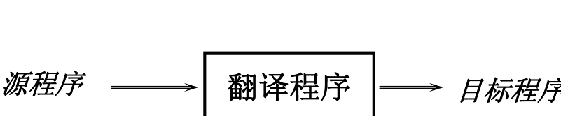

- 解释程序（Interpreter）
  - 一边解释一边执行的翻译程序
  - 口译与笔译（单句提交与整篇提交）


- S——Source
- O——Object
- P——Program
- RS——Run Sys.（支撑环境、运行库等）

编译系统（Compiling System）

编译系统 = 编译程序 + 运行系统

- 其它翻译程序：
  - 汇编程序（Assembler）
  - 交叉汇编程序（Cross Assembler）
  - 反汇编程序（Disassembler）
  - 交叉编译程序（Cross Compiler）
  - 反编译程序（Decompiler）
  - 可变目标编译程序（Retargetable Compiler）
  - 并行编译程序（Parallelizing Compiler）
  - 诊断编译程序（Diagnostic Compiler）
  - 优化编译程序（Optimizing Compiler）

### 1.2 程序设计语言的翻译——汇总

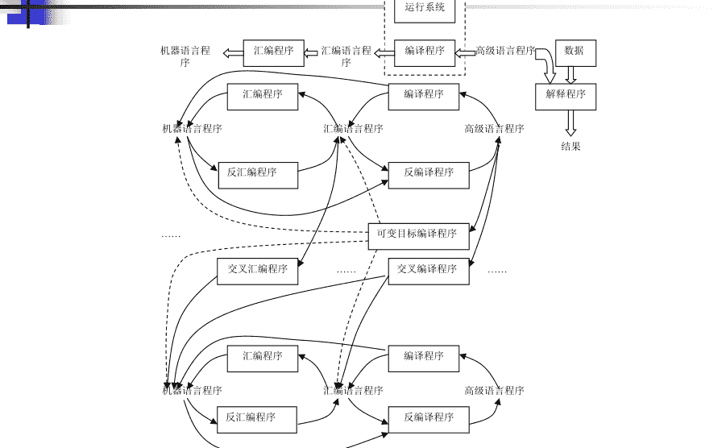

图1.5 主要翻译程序汇总

## 1.3 编译程序总体结构

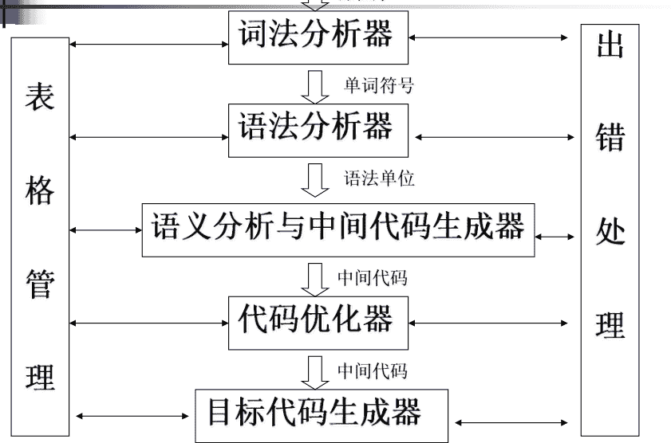

### 1、词法分析

- 例：`sum = (10 + 20) * (num + square);`

**结果：**

- (标识符, sum)
- (赋值号, =)
- (左括号, ( )
- (整常数, 10)
- (加号, +)
- (整常数, 20)
- (右括号, ) )
- (乘号, *)
- (左括号, ( )
- (标识符, num)
- (加号, +)
- (标识符, square)
- (右括号, ) )
- (分号, ; )

- 词法分析由词法分析器（Lexical Analyzer）完成，词法分析器又称为扫描器（Scanner）。
- 词法分析器的任务：
  1. 从左到右扫描组成源程序的字符串；
  2. 识别有效单词并将其表示成记号形式记法；
  3. 查词法错误；
  4. 进行标识符登记——符号表管理；
  5. 删除无用符号。

输入：字符串

输出：（种别码，属性值）——序对

种别码——用整数来表示单词的种类

属性值——token 的机内表示

### 2、语法分析

- 语法分析由语法分析器（Syntax Analyzer）完成，语法分析器又叫 Parser。
- 功能：
  - Parser 实现“组词成句”
    - 将词组成各类语法成分：表达式、因子、项、语句、子程序……
  - 构造分析树
  - 指出语法错误
  - 制导翻译
- 输入：token 序列
- 输出：语法成分

### 3、语义分析

- 语义分析（semantic analysis）一般和语法分析同时进行，称为语法制导翻译（syntax-directed translation）。
- 功能：分析由语法分析器识别出来的语法成分的语义。
  - 获取标识符的属性：类型、作用域等
  - 语义检查：运算的合法性、取值范围等
  - 子程序的静态绑定：代码的相对地址
  - 变量的静态绑定：数据的相对地址

### 4、中间代码生成

- 中间代码（intermediate code）
- 例：`sum = (10 + 20) * (num + square);`

后缀表示（逆波兰 Anti-Polish Notation）

```text
sum 10 20 + num square + * =
```

前缀表示（波兰 Polish Notation）

```text
= sum * + 10 20 + num square
```

四元式表示（三地址码）

```text
(+, 10, 20, T1)
(+, num, square, T2)
(*, T1, T2, T3)
(=, T3, , sum)
```

三元式表示

```text
(+, 10, 20)
(+, num, square)
(*, (1), (2))
(=, sum, (3))
```

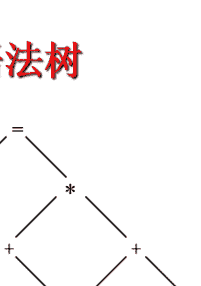

- 中间代码的特点
  - 简单规范
  - 与机器无关
  - 易于优化与转换

三地址码的另一种表示形式：

- T₁ = 10 + 20
- T₂ = num + square
- T₃ = T₁ * T₂
- sum = T₃

其它类型的语句：

例：`printf("hello")`

- `x := s`（赋值）
- `param x`（参数）
- `call f`（函数调用）

注释：
- s 是 hello 的地址
- f 是函数 printf 的地址

### 5、代码优化

代码优化（optimization）是指对中间代码进行优化处理，使程序运行能够尽量节省存储空间，更有效地利用机器资源，使得程序的运行速度更快、效率更高。当然这种优化变换必须是等价的。

### 与机器无关的优化

- 局部优化
  - 常量合并：常数运算在编译期间完成，如 `8 + 9 * 4`
  - 公共子表达式的提取：在基本块内进行的
- 循环优化
  - 强度削减
    - 用较快的操作代替较慢的操作
  - 代码外提
    - 将循环不变计算移出循环

### 与机器有关的优化

- 寄存器的利用
  - 将常用量放入寄存器，以减少访问内存的次数
- 体系结构
  - MIMD、SIMD、SPMD、向量机、流水机
- 存储策略
  - 根据算法访存的要求安排：Cache、并行存储体系——减少访问冲突
- 任务划分
  - 按运行的算法及体系结构，划分子任务（MPMD）

### 6、目标代码生成

- 将中间代码转换成目标机上的机器指令代码或汇编代码
  - 确定源语言的各种语法成分的目标代码结构（机器指令组/汇编语句组）
  - 制定从中间代码到目标代码的翻译策略或算法
- 目标代码的形式
  - 具有绝对地址的机器指令
  - 汇编语言形式的目标程序
  - 模块结构的机器指令（需要链接程序）

### 7、表格管理

- 管理各种符号表（常数、标号、变量、过程、结构……），查、填（登记、查找）源程序中出现的符号和编译程序生成的符号，为编译的各个阶段提供信息。
  - 辅助语法检查、语义检查
  - 完成静态绑定、管理编译过程
- Hash 表、链表等各种表的查、填技术
- “数据结构与算法”课程的应用

符号表是一个数据结构。

每个标识符在符号表中都有一条记录。

例：`int a, b;`

| 名字 | 记号 | 类型 | 种属 | …… | addr |
| --- | --- | --- | --- | --- | --- |
| a | id1(25) | int | 简变 |  | 0 |
| b | id2(25) | int | 简变 |  | 4 |

### 8、错误处理

- 进行各种错误的检查、报告、纠正，以及相应的继续编译处理（如：错误的定位与局部化）
  - 词法：拼写……
  - 语法：语句结构、表达式结构……
  - 语义：类型不匹配、参数不匹配……


## 模块分类

- 分析：词法分析、语法分析、语义分析
- 综合：中间代码生成、代码优化、目标代码生成
- 辅助：符号表管理、出错处理
- 8项功能对应8个模块

## 语句sum=(10+20)*(num+square);的翻译过程

T₁=10+20 T₂=num+square T₃=T₁*T₂ sum=T₃

语法分析器 中间代码生成器 目标代码生成器

T₁=10+20 左部=sum 赋值号= 表达式 sum=T₃

(标识符,sum)(赋值号,=)(左括号,())(整常数,10)(加号,+)(整常数,20)(右括号,))

MOV R1,10 MOV R2,20 ADD R1,R1,R2 MOV R3,num ADD R3,R3,square MOV R4,10 ADD R4,R4,20 MUL R4,R4,R3 MOV sum,R4

## 1.4 编译程序的组织

- 根据系统资源的情况、运行目标的要求……等，可以将一个编译程序设计成多遍（Pass）扫描的形式，在每一遍扫描中，完成不同的任务。
  - 如：首遍构造语法树，二遍处理中间表示，增加信息等。
- 遍可以和阶段相对应，也可以和阶段无关
- 单遍代码不太有效
- 编译程序的设计目标
  - 规模小、速度快、诊断能力强、可靠性高、可移植性好、可扩充性好
  - 目标程序也要规模小、执行速度快
- 编译系统规模较大，因此可移植性很重要
  - 为了提高可移植性，将编译程序划分为前端和后端
- 前端
  - 与源语言有关、与目标机无关的部分
  - 词法分析、语法分析、语义分析与中间代码生成、与机器无关的代码优化
- 后端
  - 与目标机有关的部分
  - 与机器有关的代码优化、目标代码生成

## 1.5 编译程序的生成

- 如何实现编译器?
  - 直接用可运行的代码编制——太费力！
  - 自举-使用语言提供的功能来编译该语言自身。
  - “第一个编译器是怎样被编译的？”

### 1. T形图

- 表示语言翻译的 T 形图

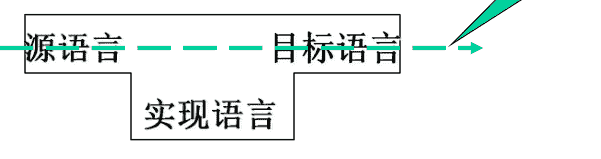

### 2. 自展

- 问题一：如何直接在一个机器上实现C语言编译器？
- 解决：
  1. 用汇编语言实现一个C子集的编译程序（P₀—人）
  2. 用汇编程序（P₁）处理该程序，得到（P₂：可直接运行）
  3. 用C子集编制C语言的编译程序（P₃—人）
  4. 用P₂编译P₃，得到P₄

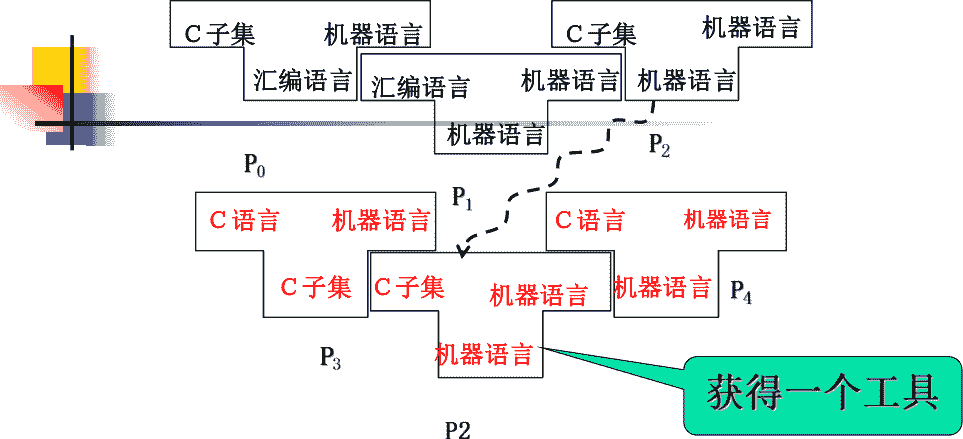

### 3. 移植

问题二：A机上有一个C语言编译器，是否可利用此编译器实现B机上的C语言编译器？

- 条件：A机有C语言的编译程序
- 目的：实现B机的C语言的编译

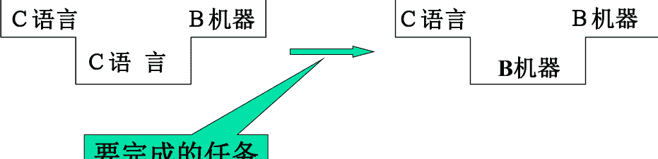

#### 1) 问题的分析

要完成的任务

需要一个工具

#### 2) 问题的解决办法

获得一个工具

1. （人）用C语言编制B机的C编译程序P₀(C→B)
2. （A机的C编译P₁）编译P₀，得到在A机上可运行的P₂(C→B)
3. （A机的P₂）编译P₀，得到在B机上可运行的P₃(C→B)

获得的工具

### 4. 本机编译器的利用

- 问题三： A机上有一个C语言编译器，现要实现一个新语言NEW的编译器？ 能利用交叉编译技术么？
- 用C编写NEW的编译器，并用C编译器编译它

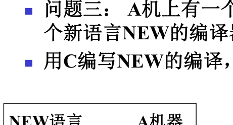


### 5. 编译程序的自动生成

#### 1) 词法分析器的自动生成程序

词法规则说明 → LEX → 词法分析程序
(C程序)

- 输入：
  - 词法（正规表达式）
  - 识别动作（C程序段）
- 输出：
  - yylex() 函数

#### 2) 语法分析器的自动生成程序

语法规则说明 → YACC → 语法分析程序
(C程序)

- 输入：
  - 语法规则（产生式）
  - 语义动作（C程序段）
- 输出：
  - yyparse() 函数

#### 例1-1

DOS 命令 date 的输出格式

例：9-3-1993、09-03-1993、9-03-93

**语法**

date → month - day - year

**词法**

month → DIGIT DIGIT | DIGIT

day → DIGIT DIGIT | DIGIT

year → DIGIT DIGIT | DIGIT DIGIT DIGIT DIGIT

#### 例1-1 (续)

year(年)、month(月)、day(日)

- 0 < month.value < 13
- 0 < day.value < 32, 31, 30
- 0 < year.value < 10000

## 1.6 本章小结

- 编译原理是一门非常好的课
- 程序设计语言及其发展
- 程序设计语言的翻译
- 编译程序的总体结构
- 编译程序的各个阶段
- 编译程序的组织与生成

## 第二章 高级语言及其文法

重点：文法的定义与分类，程序设计语言的定义及设计基础。

难点：程序设计语言的语义定义及设计基础。


- 2.1 语言概述
- 2.2 程序语言的定义
- 2.3 程序设计语言的设计基础
- 2.4 本章小结

### 2.1 语言概述

语言是人们用来进行信息交流的工具。

- 信息交流的基础是什么？
  - 按照共同约定的生成规则和理解规则去生成“句子”和理解“句子”
  - 例：
    - “今节日上课始开译第一编”
    - I am a せんせい。
    - “今日开始上第一节编译课”
    - I am a teacher.
- 语言的特征
  - 自然语言(Natural Language)
    - 是人与人的通讯工具
    - 语义(semantics):环境、背景知识等等
  - 计算机语言(Computer Language)
    - 计算机系统间、人机间通讯工具
    - 严格的语法(Grammar)、语义(semantics)——易于形式化：严格
- 语言的描述方法——现状
  - 自然语言：自然、方便-非形式化
  - 数学语言（符号）：严格、准确-形式化
  - 形式化描述
    - 高度的抽象，严格的理论基础和方便的计算机表示。
- 语言——形式化的内容提取
- 语言(Language): 满足一定条件的句子的集合
- 句子(Sentence): 满足一定规则的单词序列
- 单词(Token): 满足一定规则的字符 (Character)串
- 语言是字和组合字的规则
- 例（自然语言: 第译始二天课今开编上节）
- 今天开始上第二节编译课

程序设计语言——形式化的内容提取

- 程序设计语言(Programming Language): 组成程序的所有语句的集合。
- 程序(Program): 满足语法规则的语句序列。
- 语句(Sentence): 满足语法规则的单词序列。
- 单词(Token): 满足词法规则的字符串。

例: 变量:=表达式

- if 条件表达式 then 语句
- while 条件表达式 do 语句
- call 过程名(参数表)


## 2.1 语言概述

- 描述形式——文法
  - 语法——语句的组成规则
    - 描述方法：巴科斯BNF范式、上下文无关文法
  - 词法——单词的组成规则
    - 描述方法：巴科斯BNF范式、正则文法

## 形式语言与自动机理论的产生与作用

- 语言学家Chomsky最初从产生语言的角度研究语言。
- 1956年，通过抽象，他将语言形式地定义为是由一个字母表中的字母组成的一些串的集合。可以在字母表上按照一定的规则定义一个文法（Grammar），该文法所能产生的所有句子组成的集合就是该文法产生的语言。

## 形式语言与自动机理论的产生与作用

- 克林（Kleene）在1951年到1956年间，从识别语言的角度研究语言，给出了语言的另一种描述。

- 克林是在研究神经细胞中，建立了自动机，他用这种自动机来识别语言：对于按照一定的规则构造的任何一个自动机，该自动机就定义了一个语言，这个语言由该自动机所能识别的所有句子组成。

## 形式语言与自动机理论的产生与作用

- 1959年，Chomsky通过深入研究，将他本人的研究成果与克林的研究成果结合了起来，不仅确定了文法和自动机分别从生成和识别的角度去表达语言，而且证明了文法与自动机的等价性。

- 这就是我们编译的基础

- 生成-----编写程序的过程

- 识别-----编译程序的过程

## 2.2 程序语言的定义

如何实现语言结构的

形式化描述？

考虑赋值语句的形式：
左部量 = 右部表达式

```
a = a+a
b = m[3]+b
m[1] = a+m[2]
```

## 句子的组成规则

- <赋值语句>→<左部量>=<右部表达式>
- <左部量>→<简单变量>
- <左部量>→<下标变量>
- <简单变量>→a
- <简单变量>→b
- <简单变量>→c
- <下标变量>→m[1]
- <下标变量>→m[2]
- <下标变量>→m[3]
- <右部表达式>→<简单变量><运算符><简单变量>
- <右部表达式>→<简单变量><运算符><下标变量>
- <右部表达式>→<下标变量><运算符><简单变量>
- <右部表达式>→<下标变量><运算符><下标变量>
- <运算符>→+
- <运算符>→-

## 程序语言的定义

- 语言的定义决定了程序设计语言具有

- 什么样的语言功能

- 什么样的数据结构

- 什么样的程序结构

- 以及具体的使用形式等细节问题。

## 程序语言的定义

对于语言用户来说：程序语言定义就是一本用户手册。

- 对于编译程序设计者来说：程序语言定义就是具体实现的理论依据,通常是以文法形式来进行描述。

## 2.2.1 程序语言定义的规则

程序语言的定义是指这样一组规则，利用它就可以产生一个程序。

规则：

- 词法规则：标识符、常数等
- 语法规则：程序结构、语句构成等

## 2.2.1 程序语言定义的规则

字母表就是一个有穷字符集。

- C语言的字母表为：
- Σ={a---z , A—Z , 0—9 , ( , ) , [ , ] , → ... ! ~ , + , - , * , / , & , % , < , > , = , ^ , | , ? , , ; }

## 一. 词法规则

词法规则是指示单词符号的形成规则

在程序语言中，单词符号一般包括：

- 各类的常数、标识符、关键字、算符和界符等

正则文法和有穷自动机是描述词法结构和进行词法分析的有效工具

## 一．词法规则

例：C语言标识符的文法描述

L(G)={w/w为字母或‘_’打头的字母数字串}

解：P：I → aB　　I → _B　　I → a
B → aB　　B → dB　　B → a　　B → d

识别L（G）的自动机

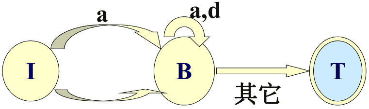

## 一. 词法规则

- 例: C语言实常数的文法描述

- 文法:

- S →dA A →dA A →eD

- A →.B B →dC C →dC

- C →eD D →-E D →+E

- D →dF E →dF F →dF

- F →d

## 例：C语言实常数的自动机描述

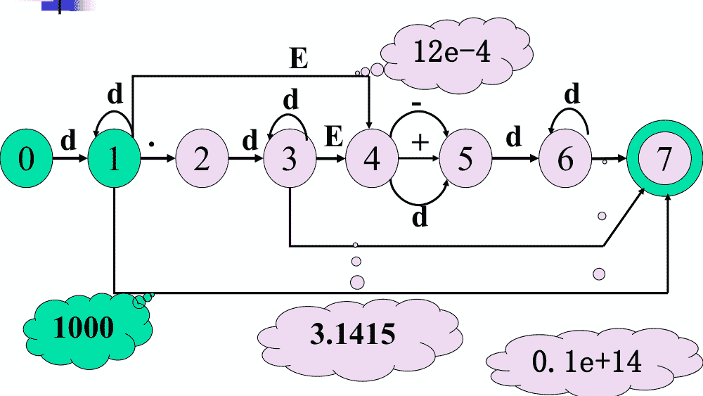

## 二、语法规则

语法规则规定了如何从单词符号形成更大的结构（即语法单位），换言之，语法规则是语法单位的形成规则

一般的程序设计语言的语法单位有：

- 表达式、语句、分程序、函数、过程和程序等

下推自动机理论和上下文无关文法是我们讨论语法分析的理论基础

## 三、主要语言成分的文法描述

- 1、表达式
- `G[E]:`
- `E → E + E`
- `E → E − E`
- `E → E * E`
- `E → E / E`
- `E → (E)`
- `E → id`

```
G[E]:
E→E+T
E→E−T
E→T
T→T*F
T→T/F
T→F
F→(E)
F→id
```

## 2、布尔表达式G（B）

- B→ B or B
- B→ B and B
- B→ not B
- B→(E)
- B→ id relop id
- B→ true
- B→ false

## 3、描述语句

- G[S]:
- S → id=E
- S → if B then S
- S → if B then S else S
- S → while B do S
- S → { L }
- L → L ;S
- L → S

## 4、调用语句G（S）

- S→call id(Elist)
- Elist →Elist,E
- Elist →E | ε

## 5 类型说明和过程说明语句G（P）

P→ D
D→ D;D
D→ id:T
D→id（Elist） D ; S
T →int
T → float

## 6、数组说明语句G（L）：

L→ id[Elist]

Elist→ Elist,E

Elist→ E

## 2.2.2 语义

对于编译程序来说，只有了解程序的语义，才知道应把它翻译成什么样的目标指令代码

所谓语言的语义是指这样一组规则，使用它可以定义一个程序的意义。

```
E→E1+E2
```

```
{E.place=E1.place+E2.place}
```

```
S→id:=E
```

```
{ p:=lookup(id.name);
if p<>nil then emit(p= E.place)
else error }
```

## 2.3 设计基础

## 2.3.1 典型程序结构简介

一个高级语言程序通常由若干子程序段（过程、函数等）组成，许多语言还引入了类、程序包等更高级的结构

## 1 FORTRAN

一个FORTRAN 程序由一个主程序和若干个辅助程序段组成

```
PROGRAM MAIN
.
END
SUBROUTINE SUB1
.
.END
FUNCTION FUN1
.
END
```

它的定义是并列的

## FORTRAN 的构成特点：

同一名字在不同的程序段中一般都代表不同的对象，也就是说代表不同的存储单元

```
PROGRAM MAIN
.Int x
X=100
END
```

X 100

```
SUBROUTINE SUB1
char x
X='y'
.END
```

X y

一个名字对应多个对象

## 但是不同程序段里的同名公用块却代表同一个存贮区域

```
PROGRAM MAIN

Int  a,b
common a,b
A=100
B=50
END

SUBROUTINE SUB1
Int x,y
common x,y
X=x+y
END
```

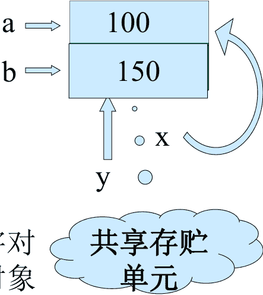

多个名字对应一个对象

共享存贮单元

## 二、 Pascal

Pascal的

程序结构

Pascal 允许

子程序嵌套

定义

也允许并列

定义

```
Program main
```

```
Procedure P1
```

```
过程部分P1
```

```
Begin
end
```

```
Begin
end
```

```
Begin 可执行部分
end
```

```
end
```

```
Procedure P2
```

```
Begin
end
```

```
Begin
```

```
end
```


## 关于名号的作用域的规定：

标识符X的任意一次出现（除去说明语句中）都意味着对某个说明语句中说明的这个变量X的引用

```
Procedure P1
int X;
Begin
X=100;
end
```

引用变量和说明这个变量的语句应该共处一个最小程序单位中：

P1中说明的X只在P1中有效

对于允许嵌套结构的程序设计语言,还要解决内部过程引用外部过程中定义的量的问 题

## Procedure P1

```
Int x;
```

## Procedure P11

```
Begin
```

```
x=x+1;
```

```
end
```

```
Begin
```

```
end
```

## 三.java

Java语言是一种面向对象的高级语言，它很重要的一方面是类和继承的概念，同时支持多态性和动态绑定等特性

```
Class car{
Int color_benz extends car
Int door_num;
Int speed;
Double price;
Void ABS()
Void push_break()
Void add_oil()
}
```

一个类把有关的数据及其操作封装在一起构成一个抽象数据类型

一个子类继承其父类的所有数据和方法，并且可以加入自己新的定义

在java中，变量和方法的定义之前可以加上public、private、protected等修饰词，以限制其它类的对象对于这些变量和方法的 使用

## 2.3.2 设计基础

## 一. 名字

程序设计语言的对象：存储单元

常用能反映其本质的、有助于记忆的名字来表示——符号空间

特性：一个名字对应一个对象

多个名字对应一个对象

一个名字对应多个对象

## 一.名字

- 名字具有属性，通常由说明语句给出
- 一个名字的属性，包括:类型和作用域等

类型:决定了它有什么样的值，计算机内的表示，以及对它能施加什么样的运算

作用域:规定了值的存在范围

## 二. 数据类型

## 1. 初等数据类型

- ① 数值数据：整形、实型、双精度等，可施行算术运算
- ② 逻辑数据：可施行逻辑运算
- ③ 字符数据：
- ④ 指针类型：

## 三. 数据结构

- 1. 数组

从逻辑上讲，一个数组是由同类型数据所组成的n维矩形结构

一个数组所需的储存空间大小在编译时就已知道的，则称此数组是一个确定的数组；否则称为可变数组

```
设 int A[l1···u1][l2···u2].....[ln···un] 为n维数组
```

各维的长度: di=ui−li+1 (1≤i≤n)

## 任一数组元素A[i₁, i₂, ……, iₙ]的地址为:

D=a+(i₁-1) d₂d₃……dₙ
+(i₂-1) d₂ d₂ …… dₙ
……
+(iₙ-1-1) dₙ + (iₙ-1) dₙ + (iₙ-1) dₙ

整理后C= (... (l₁ d₂ +l₂) d₃+ l₃) d₄+ … + l_{n-1}) d_{n+ l_n

C是数组计算中不变的部分

## 1. 数组

变量部分: v=(...(i₁ d₂ +i₂) d₃+ i₃) d₄+ ......
            + iₙ₋₁) dₙ+ iₙ

任一数组元素A[i₁, i₂, ......iₙ]的地址:

addr=a-c+v

这样我们就解决了数组元素的寻址问题

在编译具体实现时，当遇到数组说明时，必须把数组的有关信息记录在一个“内情向量”之中，用于数组元素的地址计算。

数组的内情向量包括：

维数，各维的上下限，首地址及数组的类型

| l1 | u_n | d1 |
| l2 | u_n | d2 |
| ...... | ...... | ...... |
| l_n | u_n | d_n |
| N维数 | C常数 | T类型 | A首地址 |

## 1. 数组

对于确定数组来说，内情向量可登记在符号表中；

例:Int a[10], b;

| 名字 | 记号 | 类型 | 种属 | ...... | addr |
|---|---|---|---|---|---|
| a |  | ↑ | 数组 |  | 0 |
| b |  | int | 简变 |  | 40 |

## 1. 数组

对于可变数组，内情向量的信息
在编译时无法全部知道，只有到运行
阶段才能全部确定下来，存储分配也
要等到运行时方能进行

## 2. 记录（结构）

从逻辑上讲，记录是由已知的数据组合起来的一种结构

```
Struct student
{
    char name[20];
    boolean partmember;
    int age;
} stu;
```

## 记录结构最简单的存贮方式是连续存放

上述的变量stu共占7个字，共28个字节

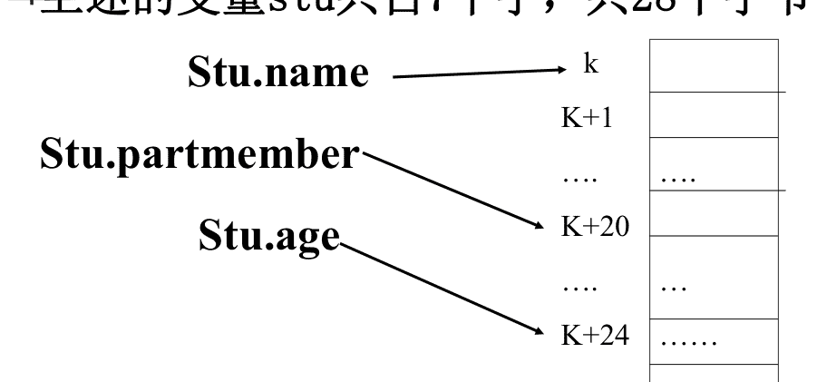

## 3. 字符串、表格和队列

## 四.抽象数据类型

一个抽象数据类型包括：

- (1)数据对象的一个集合
- (2)作用于这些数据对象的抽象运算的集合
- (3)这种类型对象的封装
- C++、 Java语言通过类对抽象类型提供支持

## 五.语句与控制结构

## 1.表达式

要解决的问题：

- ①优先级
- ②结合率

## 2.语句

语句可分为：

- ①说明语句： 定义各种不同数据类型的变量和运算
- ②可执行语句： 描述语句的动作

执行语句分为：赋值、控制和I/O语句

## (1)说明语句

说明语句用于定义名字的性质。

编译程序把这些性质登记在符号表中，并检查程序中名字的引用和说明是否一致。

许多说明语句不产生目标代码

但有的说明语句，如过程说明和可变数组说明，则要产生相应的目标代码

## （2）赋值句

A=B。


名字的左值指它所代表的存贮单元地址


名字的右值指该单元的内容

## (3)控制语句

无条件转移语句： Goto lable

条件语句： If B then S

If B then S else S

循环语句： While B do S

Repeat S until B

For I=e₁ to e₂ step e₃

过程调用语句： Call P(x₁, x₂,....xₙ)

返回语句： Return(E)

## (4)简单句和复合句

简单句是指不包含其它语句成分的基本句。赋值、 goto语句等

复合句则指那些句中有句的语句

```
If (x==0) then x=1
```

```
{x=1;y=2;goto l1;}
```

## 六. 参数传递

```
program reference (input, output);
var a, b: integer;
procedure swap (x, y: integer);
var temp: integer;
begin temp := x;
    x := y;
    y := temp end;
begin a := 1; b := 2;
    swap(a, b);
    writeln('a=', a, ' b=', b)
end.
```


## 参数的传递方式：

- 传值调用（call-by-value）
- 引用调用（call-by-reference）
- 复制恢复（copy-restore）
- 传名调用（call-by-name）

## 1. 传值调用

主调过程计算实参，并把它们的值放入到形式参数的存储空间中。

子程序为每一个形参开辟一个存储单元，用于存放相应实参的值。

子程序执行时，每当访问形参时，就直接访问形参单元。

实参：

形参：

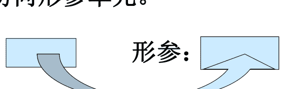

## 1. 传值调用

使用传值的方法，调用swap（a, b）等价于下面几步：

```
x: = a
y: = b
temp: = x
x: = y
y: = temp
```

## 1. 传值调用

主调程序把实在参数的地址传递给相应的形式参数。

在被调用过程中对形式参数的一次引用，就成为对传递给被调用过程的地址的一次间接引用。

也就是对形参的访问，实际上是发生在实参的存贮单元上


## 2. 引用调用（传地址）

- 主调程序把实在参数的地址传递给相应的形式参数。
- 在被调用过程中对形式参数的一次引用，就成为对传递给被调用过程的地址的一次间接引用。
- 也就是对形参的访问，实际上是发生在实参的存储单元上

- 具体实现时：
- 被调过程为每个形参开辟一个存储单元，用于存放相应实参的地址。
- 当实参为表达式或常数时,先将表达式和常数的值计算出来后,存放到临时单元,然后将临时单元的地址传给形参单元
- 被调过程执行时,间址方式访问这些形参单元

## 图示如下：

实参：地址

形参：

```
Temp:=x;
x:=y;
y:=temp;
```

```
temp:=↑a;
↑a:= ↑b;
↑b:=temp;
```

## 3. 复制恢复（传值结果）

- 实现：
- 1. 在控制进入被调过程之前, 主调程序将实参的值和地址传递给形参
- 2. 当控制从被调过程返回时，被调过程把形参的值传递给相应的实参
- 具体实现时, 被调过程为每个形参分配两个存贮单元 B1 和 B2，B1 用于存放实参地址，B2 用于存放实参值。

执行被调过程时，对B2单元使用直接访问形式；返回前，按B1中的地址把B2中的值存入主调程序的实参单元中。

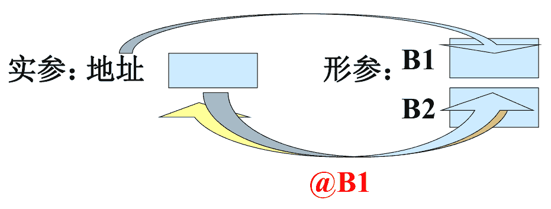

## 4. 传名调用

- 在主调程序中设置计算实参地址和实参值的形实替换子程序THUNK
- 子程序中为每个形参开辟一个存贮单元，用于存放THUNK子程序的入口地址。

执行时，每当要对某形参进行访问时，就调用THUNK子程序，以获得相应实参地址或值

```
例：有程序段：
Begin
procedure p(x,y,z)
    a=2;
    begin
    b=3;
    y=y+1;
    c=4;
    z=z+x;
    P(a,b,c);
    end
    print a,b,c;
    end
```

## 传值：

实参

形参

a 2

b 3

c 4

x 2

y 4

z 6

```
P(a,b,c);
```

```
Z=z+x;
```

输出： 2 3 4

## 传地址：

| 实参 | 形参 |
|------|------|
| a | 2 |
| b | 4 |
| c | 6 |
| x | &a |
| y | &b |
| z | &c |

```
P(a,b,c);
```

```
Z=z+x;
@z=@z+@x
```

输出： 2 4

## 传值结果：

实参

形参

a 2

b 4

c 6

X—B1 &a

B2 2

Y—B1 &b

B2 4

Z—B1 &c

B2 6

按@B1地址返回B2 的值

输出： 2 4 6

## 传名：

### 实参

### 形参

a 2

b 4

c 6

x &thunk

y &thunk

z &thunk

```
Z=z+x;
JSR Thunk
Z→c,x→a
```

```
y=y+1;
JSR Thunk
Y→b
```

## 传值：

| 实参 | 值 | 形参 | 值 |
|---|---:|---|---:|
| a | 2 | x | 5 |
| b | 3 | y | 3 |
| a+b | 5 | z | 7 |

```
z=z+x;
```

输出：2

## 传名：

实参

形参

a 9

b 3

x &thunk

y &thunk

z &thunk

输出：

```
P(a+b,a,a);
Z=z+x;
JSR Thunk
Z → a, x → a+b
```

## 本章小结

- 语言及其描述
- 常见程序结构
- 参数传递方式

## 第三章 词法分析

重点： 词法分析器的输入、输出，用于识别符号的状态转移图的构造

难点： 根据状态转移图实现词法分析器的设计

## 第3章 词法分析

### 3.1 词法分析器的功能

### 3.2 单词的描述

### 3.3 词法分析程序的自动生成

### 3.4 本章小结

## 3.1 词法分析器的功能

功能：输入源程序，输出单词符号(token)。
即：把构成源程序的字符串转换成“等价的”单词(记号)序列

- 根据词法规则识别及组合单词
- 对数字常数完成数字字符串到二进制数值的转换
- 查填符号表
- 删去空格字符和注释
- 错误检查

## 3.1.1 单词的分类与表示 & 3.1.2 词法分析器的输出

### 一、单词的种类

- 1. 关键字:也称基本字，begin、end、for、do...
- 2. 标识符:由用户定义，表示各种名字
- 3. 常量:整常数、实常数、布尔常数、字符串常数等
- 4. 运算符:算术运算符+、-、*、/等；逻辑运算符not、or 与and等；关系运算符=、<>、>=、<=、>和<等
- 5. 分界符: , 、 ; 、 (、 ) ...

## 二、单词的中间代码

| 种别 | 属性值 |

表示单词的种类，可用整数编码或记忆符表示

不同的单词不同的值

种别码是一种自主设计的编码方案，可以将一类单词编为一码,如所有关键字为一码,所有算符为一码；也可以根据单词的特性进行编码,如一个关键字一码,一个算符一个码

属性值指的是单词在计算机内的存放形式，通常会是一个指针，用于进行单词间的区分

## 1、种别码--按单词种类分类

| 单词名称 | 类别编码 | 单词值 |
|---|---|---|
| 标识符 | 1 | 内部字符串 |
| 无符号常数(整) | 2 | 整数值 |
| 无符号浮点数 | 3 | 数值 |
| 布尔常数 | 4 | 0 或 1 |
| 字符串常数 | 5 | 内部字符串 |
| 关键字 | 6 | 保留字或内部编码 |
| 分界符 | 7 | 分界符或内部编码 |
| 算符 | 8 | 算符或内部编码 |

## 2、种别码--按单词特性编码

| 单词名称 | 类别编码 | 单词值 |
|---|---|---|
| 标识符 | 1 | 内部字符串 |
| 无符号常数(整) | 2 | 整数值 |
| 无符号浮点数 | 3 | 数值 |
| 布尔常数 | 4 | 0 或 1 |
| 字符串常数 | 5 | 内部字符串 |
| FOR | 6 | - |
| DO | 7 | - |
| IF | 8 | - |
| ELSE | 9 | - |
| THEN | 10 | - |
| INT | 11 | - |
| CHAR | 12 | - |
| FLOAT | 13 | - |
| WHILE | 14 | - |
| ...... |  | ...... |

标识符常数:
一类一码

关键字:
一字一码

## 2、种别码--按单词特性编码

| 单词名称 | 类别编码 | 单词值 |
|---|---|---|
| ........ | .... | ...... |
| + | 20 | - |
| - | 21 | - |
| * | 22 | - |
| / | 23 | - |
| ) |  |  |
| , |  |  |
| ; |  | 29 |
| > | 30 | - |
| >= | 31 | - |
| == | 32 | - |
| ...... | ...... | ...... |

界符和算符：
一字一码

用属性值来互相区分

题： 单词和串词之间怎么区别？

## 例3.1 语句if count>7 then result := 100; 的单词符号序列

- (9, 0)
- (1, 指向count 的符号表入口)
- (30, 0)
- (11, 7)
- (10, 0)
- (1, 指向result的符号表入口)
- (24, 0)
- (11, 100)
- (29, 0)

> 跟实现有关

- 词法分析后:
- 1. 数字化表示
- 2. 对同类单词进行了合并
- 3. 打破了原来的关系

## 例3.1 语句if count>7 then result := 3.14; 的单词符号序列

(IF, 0)

(ID, 指向count 的符号表入口)

(>, 0)

(INT, 7)

(THEN, 0)

(ID, 指向result的符号表入口)

(=, 0)

(REAL, 3.14)

(;, 0)

记号表示

- IF----9
- ID----1
- >----30
- INT----11
- THEN----10
- =----24
- REAL----11
- ;----29


## 关于单词的自身属性值

对于常数，其单词自身的属性常用其在常数表中的入口指针来表示

a = b + c * d

为例，假设按方案分析后的结果为：

| Token字 |
|<1,  >|
|<24, ------ >|
|<1,  >|
|<20, ------ >|
|<1,  >|
|<22, ------ >|
|<1,  >|

| 符号表 |
| a 1 |
| b 1 |
| c 1 |
| d 1 |

## 3.1.3 源程序的输入缓冲与预处理

+   - 超前搜索和回退
+     - 双字符运算符（**，/*，:=，…）
+     - `DO 90 k=1,10`
+     - `DO 90 k=1.10`

+   - 缓冲区
+     - 假定源程序存储在磁盘上，这样每读一个字符就需要访问一次磁盘，效率显然是很低的。

+   - 空白字符的剔除
+     - 剔除源程序中的无用符号、空格、换行、注释等

## 3.1.4 词法分析阶段的错误处理

+   1. 非法字符检查
+   2. 关键字拼写错误检查
+   3. 不封闭错误检查
+   4. 重复说明检查
+   5. 错误恢复与续编译

紧急方式恢复(panic-mode recovery)

反复删掉剩余输入最前面的字符，直到词法分析器能发现一个正确的单词为止。

## 3.1.5 词法分析器的位置

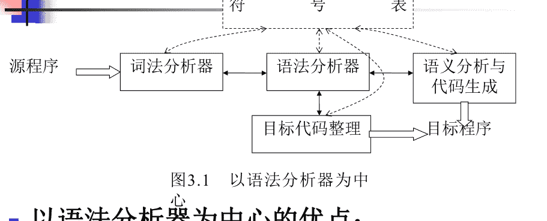

图3.1 以语法分析器为中心

+   以语法分析器为中心的优点：
+   - 简化编译器的设计。
+   - 提高编译器的效率。
+   - 增强编译器的可移植性。

## 设计成一个独立程序，完成词法分析的任务，结果以文件的形式组织，做为语法分析的输入


## 图3.2 设计成独立的程序

## 3.2 词法分析阶段的设计与实现

+   - 为了构造词法分析器，要研究构词法、每种词类的结构模式以及识别它的数学模型——有穷自动机。

+   - 一. 构造识别单词的DFA

+   - 二. 编写词法分析程序

## 词法分析程序的设计框图

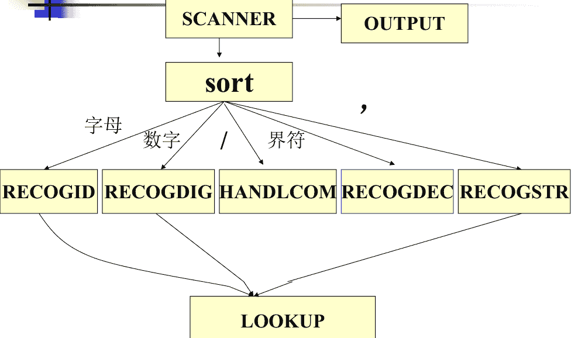

## 一. 识别单词的DFA

C语言的标识符

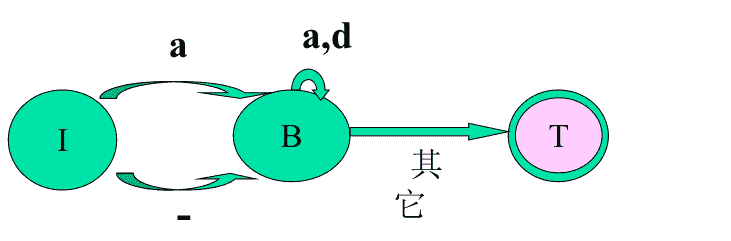

## C语言实常数的文法描述

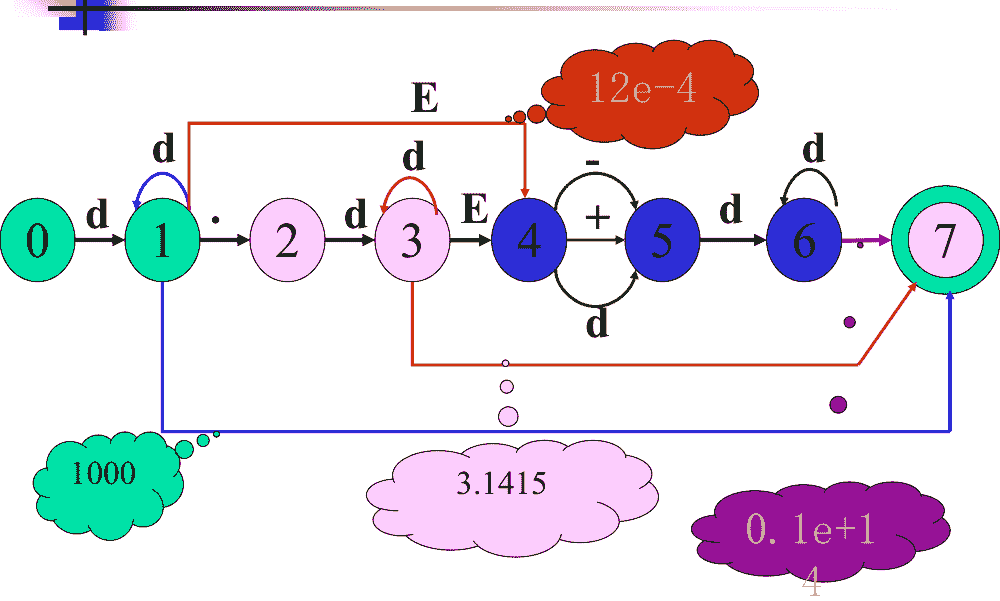

```
program SCANNER;

Begin  initiate符号表, 字符串表, 行, 列计数器;

Open 源文件, TOKEN文件

Repeat

    FIRSTCH(CH);

    if CH!=EOL then

            call SORT(CH)

    else   RDLINE;

until CH=EOF;

把符号表, 字符串表做成文件;

close源文件, TOKEN文件;

call OUTPUTR;
```

## 模块0：

扫描器主控

```
单词分类模块(SORT)输入：
CH内含单词首符；
procedure SORT(CH);
{  case CH of ‘字母’ :
    ‘字母’ :  call RECOGID(CH, TOKEN);
    ‘/’ :      call HANDLECOM(CH, TOKEN);
    ‘数字’ :  call RECOGDIG(CH, TOKEN);
    ‘,’ ‘  call RECOGSTR(CH, TOKEN);
    otherwise call RECOGDEL(CH, TOKEN);
end case;
write TOKEN into TOKEN文件;
Return  }
```

```
procedure RECOGID(CH, TOKEN);
{ WORD:= ' ';
    WORD:=WORD||CH;
Repeat {
    call GETCH(CH);
    if CH是字母或数字 then
    WORD:=WORD||CH; } until CH!=字母或数字;
if CH是非法的字符 then
    call PRINTERR('非法字符')
else 列计数-1;
if WORD 是关键字
    then TOKEN:=(关键字词类编码,_)
else { call LOOPUP(WORD,'标识符',ENTRY)
    TOKEN:=(标识符字词类编码,ENTRY)};
    Return };
```

识别标识符；
输入：CH中含标识符的首字母；
输出：TOKEN(二元式形式)；

```
procedure HANDLECOM(TOKEN);
{  call GETCH(CH);
if CH!='*' then
{  列计数-1;
    TOKEN=('/'的输入类编码','_的TOKEN字或空TOKEN字;
    return  };
TOKEN='-1';
GETCH(CH);
while 列计数<=行长-1  do
{  CH1:=CH;
    call GETCH(CH);
    if CH1='*' and CH='/'  then
TOKEN:=' ';  }
if TOKEN!=' ' then call PRINTERR('注解未完');
TOKEN:=' ';    return  }
```

处理注解 (HANDLECOM)；
输入： '/' ;进入该模块之前已扫描了一个字符 '/'

```
识别界限符(RECOGDEL)
输入：CH内含单界限符；
输出：各种界符的TOKEN字；
procedure RECOGDEL(CH, TOKEN);
{ case CH of
    '+' :  TOKEN := ('+'的词类编码, _);
    ')' :  TOKEN := (')'的词类编码, _);
    '<' :  { call GETCH(CH);
            if CH='=' then  TOKEN := ('<='的词类编码, _)
            else if CH='>' then TOKEN := ('<>'的词类编码, _)
                   else {列计数-1;TOKEN := ('<'的词类编码, _)}
          }
    ......
    endcase;
return }
```

## 3.3.1 Lex源程序

声明部分
（正规定义式）
%%

%{
常量定义
%}
正规定义

识别规则部分
（识别规则）
%%

辅助过程部分

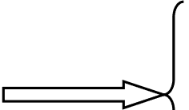

+   %{
+   • #include <stdio.h>
+   • #include "y.tab.h"
+   • #define ID 1
+   • #define INT 2
+   • #define EXP 3
+   • #define MULTI 4
+   • #define COLON 5
+   • #define EQ 6
+   • #define NE 7
+   • #define LE 8
+   • #define GE 9
+   • #define LT 10
+   • #define GT 11
+   • #define PLUS 12
+   • #define MINUS 13
+   • #define RDIV 14
+   • #define COMMA 15
+   • #define SEMIC 16
+   • #define RELOP 17
+   • #define ASSGIN 18
+   • int line_no = 1; %}

+   • delim [\t\n]
+   • ws [delim]+
+   • letter [a-zA-Z]
+   • digit [0-9]
+   • id {letter}({letter}|{digit})*
+   • number {digit}+
+   • %%
+   • {ws} ;
+   • begin return(BEGIN);
+   • end return(END);
+   • if return(IF);
+   • then return(THEN);
+   • else return(ELSE);
+   • do return(DO);
+   • program return(PROGRAM);
+   • {id} {yyval = install_id(); return(ID);}
+   • {number} {yyval = install_num(); return(INT);}


+   - "<" {yyval=LT; return(RELOP);}
+   - "<=" {yyval=LE; return(RELOP);}
+   - "=" {yyval=EQ; return(RELOP);}
+   - ">" {yyval=GT; return(RELOP);}
+   - ">=" {yyval=GE; return(RELOP);}
+   - "<>" {yyval=NE; return(RELOP);}
+   - "+" return(PLUS);
+   - "-" return(MINUS);
+   - "*" return(MULTI);
+   - "/" return(RDIV);
+   - "**" return(EXP);
+   - ":" return(COLON);
+   - ":=" return(ASSIGN);
+   - "," return(COMMA);
+   - ";" return(SEMIC);
+   - \n line_no++;
+   - . { fprintf(stderr,""%c' (0%o): illegal character at line %d\n", yytext[0], yytext[0], line_no); }
+   - %%
+   - install_id()
+   - {...}
+   - install_num()
+   - {...}

## LEX二义性问题的两条原则

如:begin:=

+   1. 最长匹配原则
+   在识别单词过程中，有一字符串根据最长匹配原则，应识别为这是一个符合 $P_k$ 规则的单词，而不是 $P_j$ 和 $P_i$ 规则的单词。

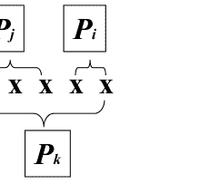

+   2. 优先匹配原则
+   如果有一字符串有两条规则可以同时匹配时，那么用规则序列中位于前面的规则相匹配，所以排列在最前面的规则优先权最高。

## 三点说明

+   1) 以上是Lex的构造原理，虽然是原理性的，但据此就不难将Lex构造出来。

+   2) 所构造出来的Lex是一个通用的工具，用它可以生成各种语言的词法分析程序，只需要根据不同的语言书写不同的LEX源文件就可以了。

+   3) Lex不但能自动生成词法分析器，而且也可以产生多种模式识别器及文本编辑程序等

## 本章小结

+   - 词法分析器接收表示源程序的“平滑字符流”，输出与之等价的单词序列；
+   - 单词被分成多个种类，并被表示成(种别，属性值)的二元组形式；
+   - 为了提高效率，词法分析器使用缓冲技术，而且在将字符流读入缓冲区时，是经过剔除注解、无用空白符等预处理后的结果；

## 本章小结

+   - 单词的识别相当于正则语言的识别；
+   - 词法的等价描述形式有正则文法、有穷状态自动机、正则表达式，其中有穷状态自动机可以用状态转换图表示；
+   - 实现词法分析器时状态转换图是一个很好的设计工具，根据该图，容易构造出相应的分析程序；
+   - 使用恰当的形式化描述，可以实现词法分析器的自动生成，Lex就是一种自动生成工具。

## 第四章 自顶向下的语法分析

重点： 自顶向下分析的基本思想，预测分析器总体结构，预测分析表的构造，递归下降分析法基本思想，简单算术表达式的递归下降分析器。

难点： FIRST 和 FOLLOW 集的求法，对它们的理解以及在构造 LL(1) 分析表时的使用。递归子程序法中如何体现分析的结果。

## 第4章 自顶向下的语法分析

+   4.1 语法分析概述
+   4.2 自顶向下的语法分析面临的问题
+   与解决方法
+   4.3 预测分析法
+   4.4 递归下降分析法
+   4.5 本章小结

## 语法分析的功能和位置

语法分析(syntax analysis)是编译程序的核心部分，其任务是检查词法分析器输出的单词序列是否是源语言中的句子，亦即是否符合源语言的语法规则。

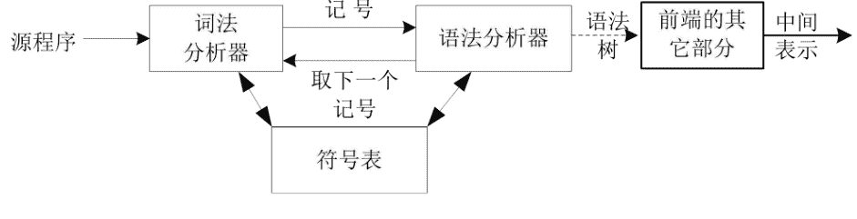

图4.1 语法分析器在编译器中的位置

## 4.1 语法分析概述

用到的是推导技术

- 自顶向下
Top Down

递归子程序法

预测分析法 (LL(1))

从根开始，逐步为某语句构造一棵语法树

用到的是归约技术

- 自底向上
Bottom Up

算符优先分析法

LR(0)、SLR(1)、LR(1)、LALR(1)

相反，将一句子归约为开始符号

问题：解决确定性问题！
假定文法是压缩的：即删除了单位产生式和无用产生式。

## 4.2 自顶向下的语法分析用到的技术、面临的问题及解决方法

+   - 自顶向下语法分析的基本思想
+     - 从文法的开始符号出发，为输入符号串寻求一个最左推导。
+     - 从树根S开始，构造所给输入符号串的语法树
+   - 例:设有G: S→xAy A→**|*，输入串： x**y

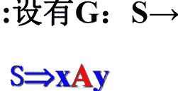

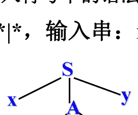

## 4.2.1 自顶向下分析用到的技术

+   - 最左推导(Left-most Derivation)
+     - 每次推导都施加在句型的最左边的语法变量上。——与最右归约对应
+   - 最右推导(Right-most Derivation)
+     - 每次推导都施加在句型的最右边的语法变量上。——与最左归约（规范规约）对应的规范(Canonical)句型

## 语法树——语法分析的结果

Parse Tree

+   - 用树的的形式表示句型的生成

+   - 树根： 开始符号

+   - 中间结点： 非终结符

+   - 叶结点： 终结符或者非终结符

+   - 每个推导对应一个中间结点及其儿子——一个二级子树

+   - 又称为分析树(parse tree)、推导树(derivation tree)、派生树(derivation tree)

## 语法树具有如下特性：

+   1. 树根标记为开始符号S
+   2. 每个叶结点由终结符或者 ε 标记
+   3. 每个内结点由一个非终结符标记
+   4. 如果A是某个内结点的非终结符标记，A1, A2, ...... An是该结点从左到右排列的所有子结点的标记，则A→ A1 A2...... An是一个产生式

## 例 句子结构的表示

(文法E→E+E|E*E|(E)|a)

E⇒E*E⇒E+E*E⇒a+E*E⇒a+a*E⇒a+a*a

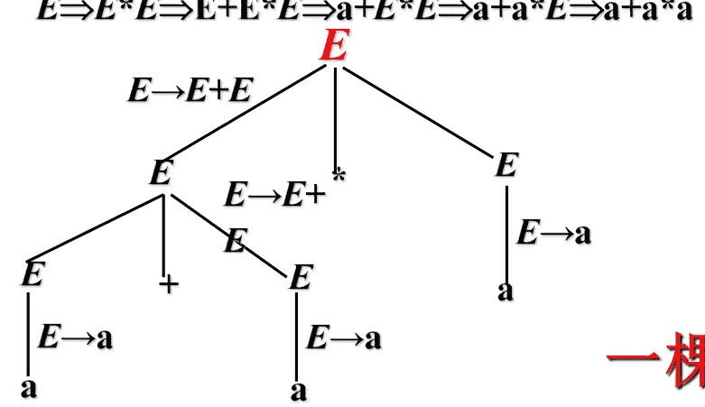

一棵树！

### 关于语法树的几点结论

短语：一棵子树的 所有叶子自左至右 排列起来形成一个 相对于子树根的短语。

短语：

a, a, a,

a+a, a+a*a

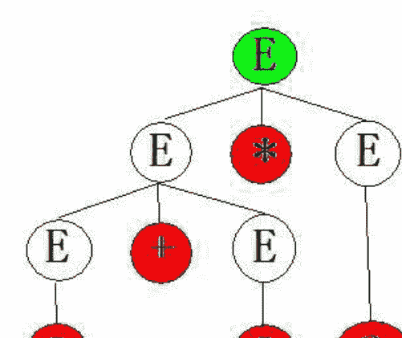

### 关于语法树的几点结论

直接短语：仅有父子两代的一棵子树，它的所有叶子自左至右排列起来所形成的符号串。

直接短语：

a, a, a,

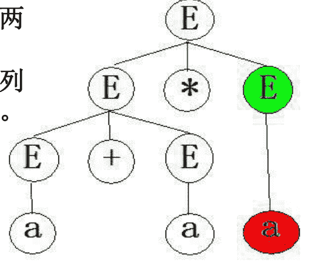

### 关于语法树的几点结论

+   句柄：一个句型的分析树中最左面的直接短语

句柄： a

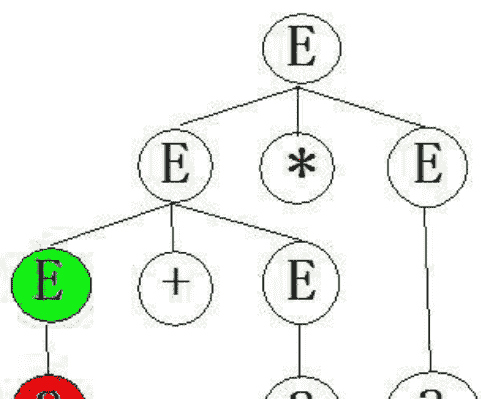

### 关于语法树的几点结论

句子：语法树的叶点从左到右的排列，刚好是这个文法所生的语言的一个句子

句子： a+a*a

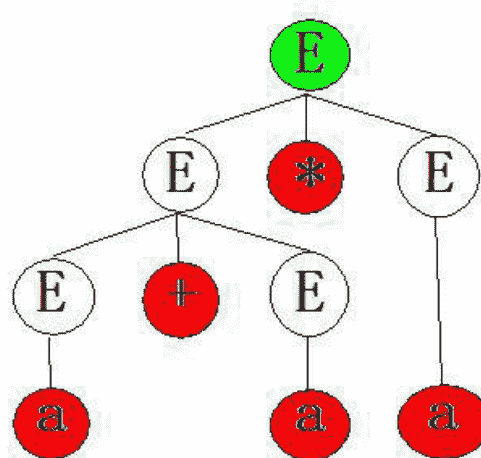

### 关于语法树的几点结论

+   - 一个文法生成的语言就是它的某个语法树所生成的所有句子的集合
+   - 为给定的终结字符串（句子）构造一棵语法树的过程称为这个串（句子）的语法分析（parsing）

## 4.2.2 自顶向下分析面临的问题

## 1. 文法的二义性

考虑表达式下面的文法 G[E],其产生式如下：

```
E→E+E | E*E | (E) | a
```

对于句子a+a*a, 有如下两个最左推导：

```
E⇒E+E ⇒a+E ⇒a+E*E ⇒a+a*E ⇒a+a*a
```

```
E ⇒E*E ⇒E+E*E ⇒a+E*E ⇒a+a*E ⇒a+a*a
```

E ⇒ E + E ⇒ a + E
⇒ a + E * E ⇒ a + a * E
⇒ a + a * a

E ⇒ E * E ⇒ E + E * E
⇒ a + E * E ⇒ a + a * E
⇒ a + a * a

## 最左推导

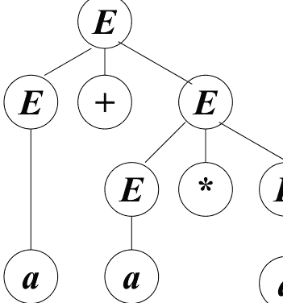

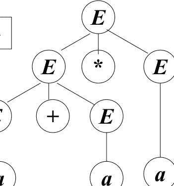


E⇒E+E ⇒E+E*E
⇒E+E*a ⇒E+a*a
⇒a+a*a

E ⇒E*E⇒E*a
⇒E+E*a⇒E+a*a
⇒a+a*a

## 最右推导

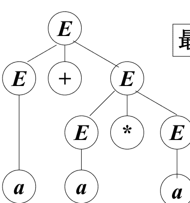

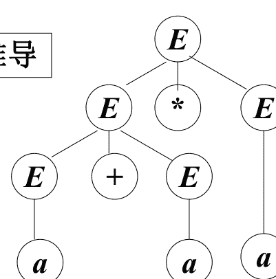

## if e₁ then if e₂ then s₁ else s₂的语法树

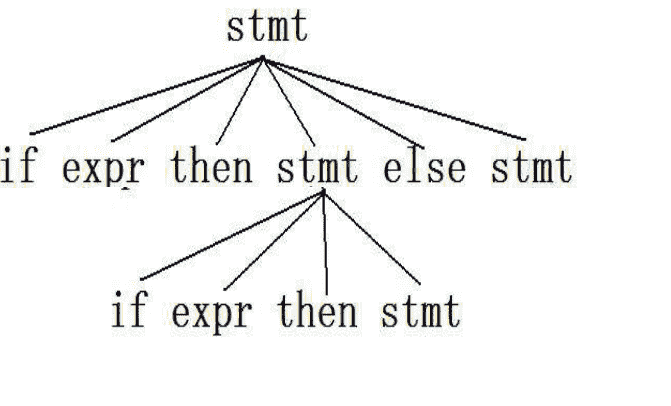

## if e₁ then if e₂ then s₁ else s₂的语法树

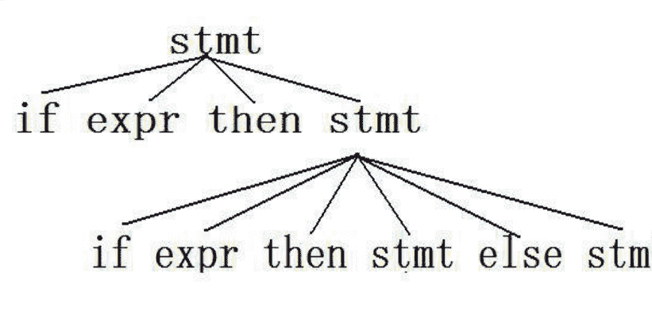

## 二义性（ambiguity）的定义

对于文法G，如果L(G)中存在一个具有两棵或两棵以上分析树的句子，则称G是二义性的。也可以等价地说：如果L(G)中存在一个具有两个或两个以上最左(或最右)推导的句子，则G是二义性文法。

如果一个文法G是二义性的，假设w∈L(G)且w存在两个最左推导，则在对w进行自顶向下的语法分析时，语法分析程序将无法确定采用w的哪个最左推导。

## 4.2.1 自顶向下分析面临的问题

## 2.回溯问题

- 文法中每个语法变量A的产生式右部称为A的候选式
- 如果A有多个候选式存在公共前缀，则自顶向下的语法分析程序将无法根据当前输入符号准

- 当...需要...到...步指导，看A是否还有其它的候选式，这就是回溯 (backtracking)。

## 4.2.2 自顶向下分析面临的问题

文法： S→ if expr then S
| if expr then S else S
| other

为句子 if E1 then S1 else S2 构造一棵语法树

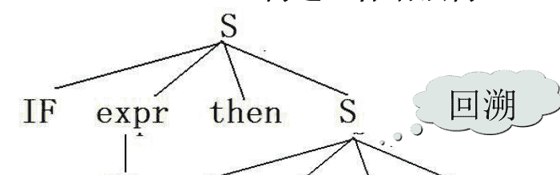

## 4.2.2 自顶向下分析面临的问题

- 造成这种情况的原因是产生式具有相同的首符号，

- S → if expr then S
  | if expr then S else S
  | other

对于句子if E1 then S1 else S2来说
从而导致不清楚该用哪个来替换非终结符

## 4.2.2 自顶向下分析面临的问题

可通过改写产生式来推迟这种决定，直到看见足够多的输入符号，可以作出正确选择为止

- 具体将采用提取左因子的办法来改造文法，以便减少推导过程中回溯现象的发生

## 4.2.2 自顶向下分析面临的的问题

- 上例语法可改为：

```
S → if expr then S S' / S
```

```
S' → else S / ε
```

句子if E1 then S1 else S2具有唯一的语法树

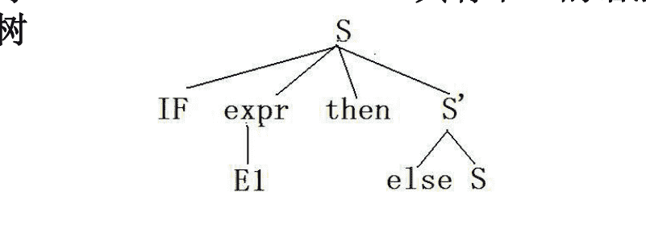

## 4.2.2 自顶向下分析面临的问题

3. 左递归

假设 A 是文法 G 的某个语法变量，如果存在推导
A ⇒⁺ α A β，则称文法 G 是递归的，
当 α = ε 时，即 A ⇒⁺ A β 称之为左递归；
如果 A ⇒⁺ α A β 至少需要两步推导，则称文法 G 是间接递归的，当 α = ε 时称之为间接左递归
如果文法 G 中存在形如 A → α A β 的产生式，则称文法 G 是直接递归的，当 α = ε 时称之为直接左递归。

## 例：下面是描述算术表达式的算法

- E→E+T|T
- T→T*F|F
- F→(E)|id
- 为句子 **id*id+id**
- 构造分析树
- 左递归会让分析进入到无限循环之中

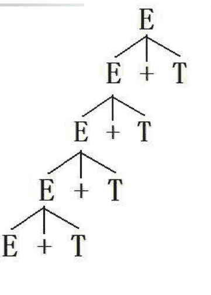

## 4.2.3 对上下文无关文法的改造

## 1.消除二义性

- 改造的方法就是通过引入新的语法变量等，使文法含有更多的信息。

其实，许多二义性文法是由于概念不清，即语法变量的定义不明确导致的

此时通过引入新的语法变量即可消除文法的二义性。

## 描述算术表达式的二义文法

文法 G[E]:

- E→E+E | E-E | E*E | E/E | (E) | a

- 造成二义性的原因是：文法中没有体现出结合率和优先级

解决办法：改造文法，引入新的文法变量

```
Gexp:
E→E+T | E-T | T
T→T*F | T/F | F
F→a | (E)
```

## 描述IF语句的二义文法

- `<stmt> → if <expr> then <stmt>`
- `| if <expr> then <stmt> else <stmt>`
- `| other`　　　　　　　　　　　　　　　　　`(4.7)`

- 根据if语句中else与then配对情况将其分为配对的语句和不配对的语句两类。

- 上述if语句的文法没有对这两个不同的概念加以区分，只是简单地将它们都定义为`<stmt>`，从而导致该文法是二义性的。

## 4.2.3 对上下文无关文法的改造

引入语法变量<unmathched_stmt>来表示不配对语句，<matched_stmt>表示配对语句

- <stmt>→ <matched_stmt>
  | <unmathched_stmt>

- <matched_stmt>→ if <expr> then <matched_stmt> else <matched_stmt>
  | other

- <unmathched_stmt>→ if <expr> then <stmt>
  | if <expr> then <matched_stmt> else <unmathched_stmt>

## 4.2.3 对上下文无关文法的改造

## 2. 消除左递归

消除简单左递归的方法：

对于含有左递归的产生式 A→A α | β

可用下面的非左递归的产生式 代替：

A→ β A’
A’ → αA’ | ε

## 4.2.3 对上下文无关文法的改造

- $E \rightarrow E + T \mid T$
- $T \rightarrow T * F \mid F$
- $F \rightarrow (E) \mid id$ 替换为：
- $E \rightarrow T E'$ 
- $E' \rightarrow + T E' \mid \varepsilon$
- $T \rightarrow F T'$ 
- $T' \rightarrow * F T' \mid \varepsilon$
- $F \rightarrow (E) \mid id$

## 4.2.3 对上下文无关文法的改造

对于一般情况而言，若某一文法G的产生式具有如下形式：

A→A α₁ | A α₂ | ... | A αₘ | β₁ | β₂ ... | βₙ

则可用如下方法消除左递归：

A→β₁A' | β₂A' | ... | βₙA'

A' → α₁A' | α₂A' | ... | αₘA' | ε

很容易证明改造前后的文法是等价的

## 4.2.3 对上下文无关文法的改造

算法4.1 消除左递归。

输入：不含循环推导和ε-产生式的文法 G；

输出：与 G 等价的无左递归文法；

步骤：

- 1. 将 G 的所有语法变量排序(编号)，假设排序后的语法变量记为 A₁, A₂, ..., Aₙ；
- 2. for i←1 to n {
- 3.   for j←1 to i-1 {
- 4.     Aⱼ→α₁|α₂|...|αₖ 是所有的当前 Aⱼ 产生式,将其代入每个形如 Aᵢ→Aⱼβ 的产生式，得到产生式: Aᵢ→α₁β|α₂β|...|αₖβ；
- 5.   }
- 6.   消除 Aᵢ 产生式中的所有直接左递归
- 7. }

## 对如下文法消除左递归：

- 1. 将非终结符排序为R、Q、S

```
S→Qc | c
Q → Rb | b
R → Sa | a
```

2.R不存在左递归, 将R代入Q:

```
Q → Sab | ab | b
```

3. Q不存在左递归, 将Q代入S

```
S → Sabc | abc | bc | c
```

4. 消除直接左递归后，得文法：

## 5. 化简文法

S→abcS′| bcS′| cS′
S′→abcS′| ε
Q → Rb|b
R → Sa|a

## 5. 化简文法

S→abcS′| bcS′| cS′
S′→abcS′| ε


## 4.2.3 对上下文无关文法的改造

+   3. 提取左因子

+   对每个语法变量A，找出它的两个或更多候选式的最长公共前缀α。

+   如果α≠ε，则对A的所有产生式提取左因子
+   A→αβ₁|αβ₂|…|αβₙ|γ₁|γ₂|…|γₙ，其中γ1，γ2，…，γn表示所有不以α开头的候选式：
+   A→αA′|γ₁|γ₂|…|γₙ
+   A′→β₁|β₂|…|βₙ

+   其中，A′是新引入的语法变量。

+   反复应用上述变换，直到任意语法变量都没有两个候选式具有公共前缀为止。

+   例：文法 G（P）：
+   P → (Q) | aP | a

+   Q → Q , P | P

+   消除左递归、消除回溯

+   解：消除左递归

+   Q → P Q'

+   Q' → , P Q' | ε

+   消除回溯

+   P → (Q) | a P'

+   P' → P | ε

## 4.2.4 LL(1)文法

问题：

什么样的文法才能进行确定的自顶向下分析？

+   - 确定的自顶向下分析首先从文法的开始符号S出发，
+   - 每一步推导都根据当前句型的最左语法变量A和当前输入符号a，选择A的某个候选式α来替换A
+   - 并使得从α推导出的第一个终结符恰好是a。

## 4.2.4 LL(1)文法

## 问题：

+   - 当A有多个候选式时，当前选中的候选式必须是惟一的。

第一个符号很重要

+   - 第一个终结符是指符号串的第一个符号，并且是终结符号，可以称为首终结符号。
+   - 在自顶向下的分析中，它对选取候选式具有重要的作用。
+   - 为此引入首符号集的概念。

## FIRST集的定义

+   1. 假设α是文法G=(V, T, P, S)的符号串，即α∈(V∪T)*，从α推导出的串的首符号集记作FIRST(α):
+   FIRST(α)={a|α ⇒* aβ, a∈T, β∈(V∪T)*}。
+   2. 如果α ⇒* ε，则ε∈FIRST(α)。
+   应用. 如果文法G中的所有A产生式为A→α₁|α₂|...|αₘ，且ε∉FIRST(α₁)∪FIRST(α₂)∪...∪FIRST(αₙ)且对∀i, j, 1≤i, j≤m; i≠j, 均有FIRST(αᵢ)∩FIRST(αⱼ)=∅成立，则可以对G的句子进行确定的自顶向下分析

## FOLLOW集的定义

选择A→ε做推导的依据是什么？

如果存在A→ε这样的产生式，则需定义FOLLOW(A)

∀A∈V定义A的后续符号集为：

+   1. FOLLOW(A)={a|S ⇒* αA a β, a∈T, α,β∈(V∪T)*}
+   2. 如果A是某个句型的最右符号，则将结束符#添加到FOLLOW(A)中

应用：如果α_j ⇒* ε，则如果对∀i(1≤i≤m; i≠j)，FIRST(α_i)∩FOLLOW(A)=∅均成立，则可以对G的句子进行确定的自顶向下分析

## First和 Follow 的用处

例：

A→ aA      FIRST(aA)={a}

A→ bA      FIRST(bA)={b}

A→ cAB      FIRST(cA)={c}

A→ ε      FIRST( ε )={ ε }

B → dC      FOLLOW(A)={d}

……

对句子abcd.....进行分析

A=>aA =>abA =>abcAB=>abcB =>abcdC

## 4.2.4 LL(1)文法

如果G的任意两个具有相同左部的产生式

A→α|β

满足下列条件：

+   1. 如果α、β均不能推导出ε，则FIRST(α)∩FIRST(β)=∅；
+   2. α和β至多有一个能推导出ε；
+   3. 如果β⇒* ε，则FIRST(α)∩FOLLOW(A)=∅

则称G为LL(1)文法。

第一个L代表从左向右扫描输入符号串，第二个L代表产生最左推导，1代表在分析过程中执行每步推导都要向前查看一个输入符号

## 求FIRST(X)集的算法

算法4.2 计算FIRST(X)。
输入：文法G=(V, T, P, S), X∈(V∪T);
输出：FIRST(X);

## 求FIRST(X)集的算法

步骤：

+   1. FIRST(X)= ∅;
+   2. if (X∈T) then FIRST(X):= {X} ;
+   3. if X∈V then
+      a. if (X→ε∈P) then FIRST(X):= FIRST(X) ∪ {ε}
+      b. if (X→ε∉P) then FIRST(X):= FIRST(X) ∪ {a|X→a...∈P and a∈T};
+   4. 对∀X∈V，重复如下a-c，直到所有FIRST集不变为止。
+      a. if (X→Y..∈P and Y∈V and Y→ε∉P) then FIRST(X):= FIRST(X) ∪ (FIRST(Y)-{ε});
+      b. if (X→Y1...Yn ∈P and Y1...Yi-1 * ε) then FIRST(X):= FIRST(X) ∪ (FIRST(Yi)-{ε});
+      c. if Y1...Yn * ε then FIRST(X):=FIRST(X) ∪ {ε};

## LL(1)文法的判定

算法4.3 计算FIRST(α)。
输入：文法 G=(V, T, P, S), α∈(V∪T)*, α= X1...Xn;
输出：FIRST(α);
步骤：

+   1. 计算FIRST(X1);
+   2. FIRST(α):= FIRST(X1)-{ε};
+   3. k:=1;
+   4. while (ε∈FIRST(Xk) and k<n) do begin
+   5. FIRST(α):= FIRST(α) ∪ (FIRST(Xk+1)-{ε});
+   6. k:=k+1 end
+   7. if (k=n and ε∈FIRST(Xk)) then FIRST(α):=FIRST(α) ∪ {ε};

## 例　表达式文法的语法符号的FIRST集

FIRST(F)={ ( , id}

FIRST(T)=FIRST(F)={ ( , id}

FIRST(E)=FIRST(T)={ ( , id}

FIRST(E′)={+, ε}

FIRST(T′)={*, ε}

FIRST(+)={+}, FIRST(*)={*}

FIRST( ( )={ ( }

FIRST( ) )={ ) }

FIRST(id)={id}

```
E→TE′
E′→+TE′|ε
T→FT′
T′→*FT′|ε
F→(E)|id
```

## LL(1)文法的判定

算法4.4 计算FOLLOW集。

输入： 文法 G=(V, T, P, S)， A∈V；

输出： FOLLOW(A)；

步骤：

+   1. 对∀X∈V， FOLLOW(S) := ∅；
+   2. FOLLOW(S) := {#}， #为句子的结束符；
+   3. 对∀X∈V，重复下面的第4步到第5步，直到所有 FOLLOW集不变为止。
+   4. 若 A→αBβ∈P，则 FOLLOW(B):=FOLLOW(B)∪FIRST(β)−{ε}；
+   5. 若 A→αB 或 A→αBβ∈P，且 β⇒ ε， A≠B，则 FOLLOW(B):=FOLLOW(B)∪FOLLOW(A)；

## 例 表达式文法的语法变量的 FOLLOW 集

E→TE'   E'→+TE'|ε
T→FT'   T'→*FT'|ε
F→(E)|id

FIRST(F)={ (,id}
FIRST(T)=FIRST(F)={ (,id}
FIRST(E)=FIRST(T)={ (,id}
FIRST(E')={+, ε}
FIRST(T')={*,ε}

FOLLOW(E) = { #, ) }

FOLLOW(E')= FOLLOW( E ) = { #, ) }

FOLLOW(T) = FIRST(E') ∪ FOLLOW(E) ∪ FOLLOW(E') = {+,),#}

FOLLOW(T')= FOLLOW(T)= {+,),#}

FOLLOW(F) = FIRST(T') ∪ FOLLOW(T) ∪ FOLLOW(T') = {*,+,),#}

## 4.3 预测分析法

+   - 系统维持一个分析表和一个分析栈，根据当前扫描到的符号，选择当前语法变量（处于栈顶）的候选式进行推导——希望找到相应输入符号串的最左推导。
+   - 一个通用的控制算法
+   - 一个分析栈，#为栈底符号
+   - 一个输入缓冲区，#为输入串结束符
+   - 一个统一形式的分析表M
+   - 不同语言使用内容不同的分析表

## 4.3.1 预测分析器的构成

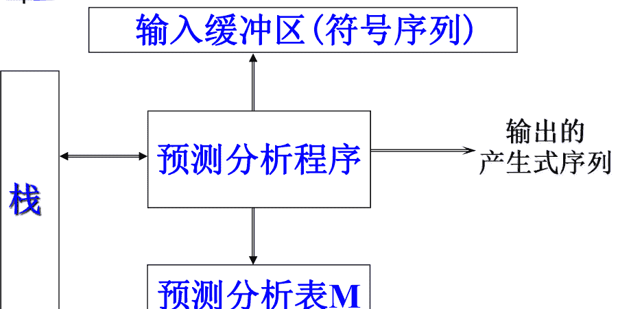


## 系统的执行与特点

- 在系统启动时，输入指针指向输入串的第一个字符，分析栈中存放着栈底符号#和文法的开始符号。
- 根据栈顶符号A和读入的符号a，查看分析表M，以决定相应的动作。
- 优点：
  1）效率高
  2）便于维护、自动生成
- 关键——分析表M的构造

## 预测分析程序的总控程序

算法4.5 预测分析程序的总控程序。

输入：输入串 w 和文法 G=(V, T, P, S) 的分析表 M;

输出：如果 w 属于 L(G)，则输出 w 的最左推导，否则报告错误；

步骤：

+ 1. 将栈底符号 # 和文法开始符号 S 压入栈中；
+ 2. repeat
+ 3. X := 当前栈顶符号；
+ 4. a := 当前输入符号；
+ 5. if X ∈ T ∪ {#} then
+ 6. if X = a then
+ 7. {if X ≠ # then begin
+ 8. 将 X 弹出栈；
+ 9. 前移输入指针
+ 10. end}
+ 11. else error
+ 12. else
+ 13. if M[X, a] = X → Y₁Y₂...Yₖ then begin
+ 14. 将X弹出栈;
+ 15. 依次将Yₖ, ..., Y₂, Y₁压入栈;
+ 16. 输出产生式X→Y₁Y₂...Yₖ
+ 17. end
+ 18. else error
+ 19. until X=#

## 例4.10 考虑简单算术表达式文法的实现

FOLLOW(E')={ }, # }

FOLLOW(T')={ +, ), # }

FIRST(TE')={(, id}

FIRST(+TE')={+}

FIRST(FT')={(, id}

FIRST(*FT')={*}

FIRST((E))={( 

FIRST(id)={id}

E→TE'   E'→+TE'|ε   T→FT'

T'→*FT'|ε   F→(E)|id

### 预测分析表

| 非终结符 | 输入符号 |  |  |  |  |  |
|---|---|---|---|---|---|---|
| 非终结符 | id | + | * | ( | ) | # |
| E | E→TE' |  |  | E→TE' |  |  |
| E' |  | E'→+TE' |  |  | E'→ε | E'→ε |
| T | T→FT' |  |  | T→FT' |  |  |
| T' |  | T'→ε | T'→*FT' |  | T'→ε | T'→ε |
| F | F→id |  |  | F→(E) |  |  |

## 对输入串id+id*id进行分析的过程
（在黑板上同时画出语法树）

| 栈 | 输入缓冲区 | 输出 |
|---|---|---|
| #E | id+id*id# | |
| #E’ T | id+id*id# | E→TE’ |
| #E’ T’ F | id+id*id# | T→FT’ |
| #E’ T’ id | id+id*id# | F→id |
| #E’ T’ | +id*id# | |
| #E’ | +id*id# | T’→ε |
| #E’ T+ | +id*id# | E’→+TE’ |
| #E’ T | id*id# | |

| Input | Stack | Production |
|-------|-------|------------|
| #E' T' F | id*id# | T→FT' |
| #E' T' id | id*id# | F→id |
| #E' T' | *id# | T' → *FT' |
| #E' T' F | id# | F→id |
| #E' T' | # | T' → ε |
| #E' | # | E' → ε |

## 输出的产生式序列形成了最左推导对应的分析树

如何实现推导？

## 4.3.2 预测分析表的构造算法

算法4.6 预测分析表(LL(1)分析表)的构造算法。

输入： 文法G；

输出： 分析表M；

步骤：

+ 1. 对G中的任意一个产生式A→α, 执行第2步和第3步；
+ 2. for ∀a∈FIRST(α), 将A→α填入M[A, a]；
+ 3. if ε∈FIRST(α) then ∀a∈FOLLOW(A),将A→ε填入M[A, a]；
     if ε∈FIRST(α)&#∈FOLLOW(A) then将A→ε填入M[A, #]；
+ 4. 将所有无定义的M[A, b]标上出错标志。

### 预测分析表

| 非终结符 | 输入符号 |  |  |  |  |  |
|  | id | + | * | ( | ) | # |
| E | `FOLLOW` / `FIRST(T) = {(, id}` |  |  |  |  |  |
| E’ | `FIRST(F) = {(, id}` |  |  |  |  |  |
| T | `T → F T’` |  |  |  |  |  |
| T’ |  | `T’ → ε` | `T’ → * F T’` |  | `T’ → ε` | `T’ → ε` |
| F | `F → id` |  |  | `F → (E)` |  |  |

## 预测分析法的实现步骤

+ 1. 构造文法
+ 2. 改造文法：消除二义性、消除左递归、提取左因子
+ 3. 求每个候选式的FIRST集和变量的FOLLOW集
+ 4. 检查是不是 LL(1) 文法
     若不是 LL(1),说明文法的复杂性超过自顶向下方法的分析能力，需要附加新的“信息”
+ 5. 构造预测分析表
+ 6. 实现预测分析器

## 4.3.3预测分析的错误恢复

+ 1、发现错误

+ ①栈顶的终结符与当前输入符不匹配

+ ②非终结符A位于栈顶，面临的输入符为a，但分析表M的M[A, a]为空

+ 2、“应急”恢复策略

跳过输入串中的一些符号直至遇到“同步符号”为止。

## 3、同步符号的选择

+ ① 把FOLLOW (A) 中的所有符号作为A的同步符号。跳过输入串中的一些符号直至遇到这些“同步符号”，把A从栈中弹出，可使分析继续

+ ② 把FIRST (A) 中的符号加到A的同步符号集，当FIRST (A) 中的符号在输入中出现时，可根据A恢复分析

③可以把表示语句开始的一些关键字加入到同步记号集中

④如果栈顶的终结符不能被匹配，就可以弹出该终结符，此时相当于把所有的符号都看作同步符号

用 **synch** 表示由相应非终结符的 FOLLOW 集得到的同步符号，则前面的预测分析表变为：

FOLLOW(F) = FIRST(E’) ∪ FIRST(T’)
= { +, ), *, ε }

FOLLOW(T’) = FOLLOW(T)
= FIRST(E’) ∪ FOLLOW(E)
= { +, ), # }

FOLLOW(T) = FIRST(E’) ∪ FOLLOW(E)
= { +, ), # }

FOLLOW(E’) = FOLLOW(E) = { ), # }

## 加入错误处理的分析表

| 非终结符 | 输入符号 |  |  |  |  |  |
|  | **id** | **+** | **\*** | **(** | **)** | **#** |
| **E** | E→TE’ |  |  | E→TE’ | synch | synch |
| **E’** |  | E’→+TE’ |  |  | E’→ε | E’→ε |
| **T** | T→FT’ | synch |  | T→FT’ | synch | synch |
| **T’** |  | T’→ε | T’→*FT’ |  | T’→ε | T’→ε |
| **F** | F→id | synch | synch | F→(E) | synch | synch |

## 句子)id+*id的分析过程

| 栈 | 输入 | 备注 |
|---|---|---|
| #E | )id+*id# | 错误，跳过) |
| #E | id*+id# | id在FIRST(E)中 |
| #E'T | id*+id# |  |
| #E'T'F | id*+id# |  |
| #E'T'id | id*+id# |  |
| #E'T' | *+id# |  |
| #E'T'F* | *+id# |  |
| #E'T'F | +id# | 错误,M[F,+]=synch |
| #E'T' | +id# | F已被弹出 |
| #E' | +id# |  |
| #E'T+ | +id# |  |
| #E'T | id# |  |
| #E'T'F | id# |  |
| #E'T'id | id# |  |
| #E'T' | # |  |
| #E' | # |  |
| # | # |  |


## 4.4 递归下降分析法—一个设想

+ 1. 为每个非终结符，编写一个可以递归调用的处理子程序，名字就是该非终结符
+ 
+ A→X₁ X₂ ... Xₖ ... Xₙ
+ 2. 程序体按产生式的右端来编写
+ (1) 当遇到Xₖ是终结符号时直接进行匹配；
+ (2) 当遇到Xₖ是语法变量时就调用X对应的处理子程序。

## 4.4.1 递归下降分析法的基本思想

例4.14 对于产生式E'→+TE', 与E'对应的子程序可以按如下方式来编写：

```
procedure E'
begin
match('+');
T; /*调用识别T的过程*/
E'; /*调用识别E'的过程*/
end;
```

```
E→TE'
E'→+TE'|ε
T→FT'
T'→*FT'|ε
F→(E)|id
```

其中，服务子程序match用来匹配当前的输入记号，其代码为：

```
procedure match(t:token);
begin
    if lookahead=t then
        lookahead:=nexttoken;
    else error        /*调用出错处理程序*/
end;
```

## 4.4.2 语法图和递归子程序法

+ 状态转换图（语法图）是非常有用的设计工具
+ 语法分析器和词法分析器的状态转换图不同
+ 每个非终结符对应一个状态转换图，边上的标记是记号和非终结符
+ 记号上的转换意味着如果该记号是下一个输入符号，就应进行转换
+ 非终结符A上的转换是对与A对应的过程的调用

+ 从文法构造语法图，对每个非终结符A执行如下操作
+ 创建一个开始状态和一个终止状态（返回状态）
+ 对每个产生式A→X₁X₂ … Xₙ，创建一条从开始状态到终止状态的路径，边上的标记分别为X₁，X₂，…，Xₙ

## 例4.15 简单表达式文法的语法图

E→TE‘
E‘→+TE‘|ε
T→FT‘
T‘→*FT‘|ε
F→(E)|id

## 4.4.3 基于语法图的语法分析器工作方式

+ 初始时，分析器进入状态图的开始状态，输入指针指向输入符号串的第一个符号。
+ 如果经过一些动作后，它进入状态s，且从状态s到状态t的边上标记了终结符$a$，此时下一个输入符又正好是$a$，则分析器将输入指针向右移动一位，并进入状态t。

另一方面，如果边上标记的是非终结符A，则分析器进入A的初始状态，但不移动输入指针。一旦到达A的终态，则立刻进入状态t，事实上，分析器从状态s转移到状态t时，它已经从输入符号串“读”了A（调用A对应的过程）。

最后，如果从s到t有一条标记为 ε 的边，那么分析器从状态s直接进入状态t而不移动输入指针。

## 4.4.4 语法图的化简与实现

+ (1) 左因子提取
+ 将形如 A→YX|YZ 的产生式替换为 A→Y(X|Z);
+ (2) 右因子提取
+ 将形如 A→YX|ZX 的产生式替换为 A→(Y|Z)X;
+ (3) 尾递归消除
+ 将形如 X→YX|Z 的产生式替换为 X→Y*Z。

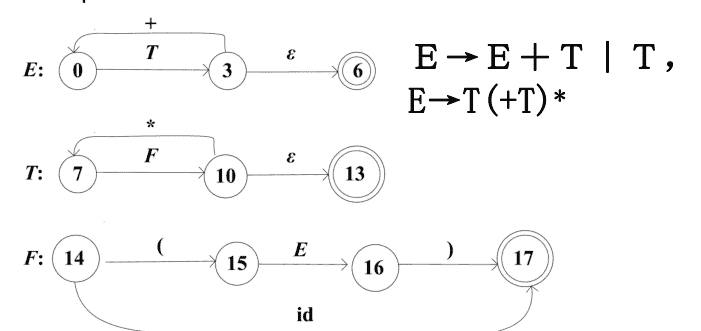

## 例4.16 简单算术表达式的语法分析器

+ E的子程序(E→T(+T)*)

```
procedure E;

  begin

    T;                         T的过程调用

    while lookahead='+' do     当前符号等于+时
      begin
        match('+');             处理终结符+
        T                        T的过程调用
      end
  end;

  lookahead:  当前符号
```

## T 的子程序 (T→F (*F)*)

```
procedure T;
begin
  F;              F 的过程调用
  while lookahead='*' then
  begin            当前符号等于 * 时
    match('*');    处理终结符 *
    F              F 的递归调用
  end
end;
```

## F 的子程序(F→(E)|id)

```
procedure F;
begin
  if lookahead='(' then
  begin          当前符号等于（
    match('(');   处理终结符（
    E;             E 的递归调用
    match(')');   处理终结符）
  end
  else if lookahead=id then
    match(id)      处理终结符id
  else error      出错处理
end
```

## 主程序

```
begin
  lookahead:=nexttoken;  调词法分析程序
  E                     E 的过程调用
end
```

## 服务子程序

```
procedure match(t: token);
begin
  if lookahead=t then
    lookahead:=nexttoken
  else error          出错处理程序
end;
```

## 4.4.5 递归子程序法的实现步骤

+ 1) 构造文法；
+ 2) 改造文法：消除二义性、消除左递归、提取左因子；
+ 3) 求每个候选式的FIRST集和语法变量的FOLLOW集；
+ 4) 检查G是不是 LL(1) 文法，若G不是 LL(1)文法，说明文法G的复杂性超过了自顶向下方法的分析能力，需要附加新的“信息”；
+ 5) 按照LL(1)文法画语法图；
+ 6) 化简语法图；
+ 7) 按照语法图为每个语法变量设置一个子程序。

## 递归子程序法的优缺点分析

+ 优点：
+ 1) 直观、简单、可读性好
+ 2) 便于扩充
+ 缺点：
+ 1) 递归算法的实现效率低
+ 2) 处理能力相对有限
+ 3) 通用性差，难以自动生成
+ 从递归子程序法及FIRST与FOLLOW集看如何进一步用好当前的输入符号？

## 本章小结

+ 1. 自顶向下分析法和自底向上分析法分别寻找输入串的最左推导和最左归约
+ 2. 自顶向下分析会遇到二义性问题、回溯问题、左递归引起的无穷推导问题，需对文法进行改造：消除二义性、消除左递归、提取公共左因子
+ 3. *LL(1)* 文法是一类可以进行确定分析的文法，利用 FIRST 集和 FOLLOW 集可以判定某个上下文无关文法是否为 *LL(1)* 文法
+ 4. *LL(1)* 文法可以用 *LL(1)* 分析法进行分析。
+ 5. 递归下降分析法根据各个候选式的结构为每个非终结符编写一个子程序。
+ 6. 使用语法图可以方便地进行递归子程序的设计。

## 例：文法G[A]:

A→[B
B→X|BA
X→Xa|Xb|a|b
构造其
LL（1）分析表

## 消除左递归 FIRST

A→[B { | }
B→X|B’ {a,b}
B’→AB’ { | }
B’→ε {ε}
X→aX’ {a}
X→bX’ {b}
X’→aX’ {a}
X’→bX’ {b}
|X’→ε {ε}

## 是不是LL (1) 文法？

+ FIRST(A)={[]}
+ Follow(A)={[,#]}
+ FIRST(B)={a,b}
+ Follow(B)={[,#]}
+ FIRST(B')={[, ε}
+ Follow(B')={[,#]}
+ FIRST(X)={a,b}
+ Follow(X)={[]}
+ FIRST(X')={a,b, ε}
+ Follow(X')={[]}

结论： 不是LL (1) 文法

## LL（1）分析表

|  | a | b | [ | ] | # |
|---|---|---|---|---|---|
| A |  |  | A→[B |  |  |
| B | B→X]B' | B→X]B' |  |  |  |
| B' |  |  | B'→AB'\nB'→ε |  | B'→ε |
| X | X→aX' | X→bX' |  |  |  |
| X' | X'→aX' | X'→bX' |  | X'→ε |  |

所有的文法都能构造出LL（1）分析表，只有LL（1）文法的分析表不存在冲突


School of Computer Science & Technology
Harbin Institute of Technology

## 第五章 自底向上的语法分析

**重点：** 自底向上分析的基本思想，算符优先分析法的基本思想，简单算符优先分析法。LR 分析器的基本构造思想，LR 分析算法，规范句型活前缀及其识别器——DFA，LR(0) 分析表的构造，SLR(1) 分析表的构造，LR(1) 分析表的构造。

**难点：** 规范句型活前缀，LR 项目集闭包与项目集规范族。

- 5.1 自底向上的语法分析概述
- 5.2 算符优先分析法
- 5.3 LR 分析法
- 5.4 语法分析程序的自动生成工具 Yacc
- 5.5 本章小结

## 5.1 自底向上的语法分析概述

### 思想

自左向右逐个扫描输入串，一边把输入符号移入分析栈，一边检查位于栈顶的一串符号是否与某个产生式的右部相同。如果相同，就把栈顶的这串符号归约为左部的非终结符；不同，则继续移入输入符号，进行判断。上述过程一直重复到输入串结束，栈内恰好为 S。

概括为：移进——归约

### 核心

- 寻找句型中的当前归约对象——“句柄”进行归约，用不同的方法寻找句柄，就可获得不同的分析方法
- 算符优先分析法
- 状态法

### 例5.1 一个简单的归约过程

设文法 G 为：

S→aABe   A→Ab|b   B→d

句子分析：

abbde  
← aAbde  
← aAde  
← aABe  
← S

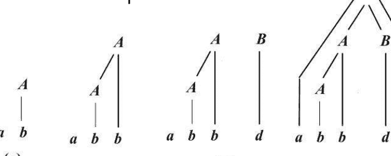

语法树的形成过程

### 句子 abbde 的归约过程（最左归约）

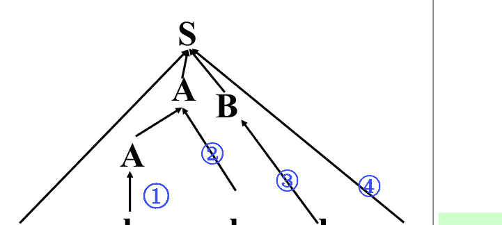

对应的最右推导：

S⇒aABe⇒aAde⇒aAbde⇒abbde

栈

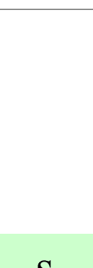

### 例5.1 一个简单的归约过程

**存在的问题：**

在第②步归约时，分析栈的情况如图：

有两种可能：

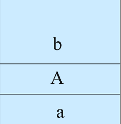

A→Ab 和 A→b

### 现在看看用 A→b 归约的情况

正确地选择归约的符号串很重要——句柄

### 关于语法树的几点结论

**短语：** 一棵子树的所有叶子自左至右排列起来形成一个相对于子树根的短语。

短语：

a, a, a,

a+a, a+a*a

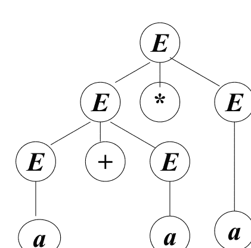

**直接短语：** 仅有父子两代的一棵子树，它的所有的叶子自左至右排列起来所形成的字符串。

直接短语：

a, a, a,

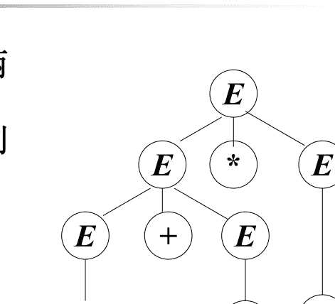

**句柄：** 一个句型的分析树中最左面的直接短语。

句柄：a

句柄就是我们要找的可归约串。

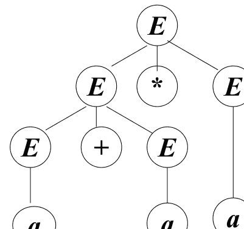

### 例5.2：证明 T/(E-T)*F+i 是句型，并指出其所包含的短语、直接短语和句柄

直接短语：

E-T，i

句柄：

E-T

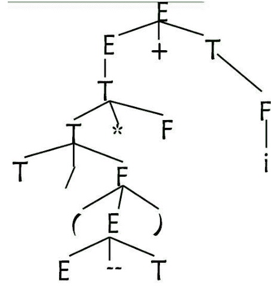

### 5.1.1 移进-归约分析

#### 系统框架

- 采用表驱动的方式实现
- 输入缓冲区：保存输入符号串
- 分析栈：保存语法符号——已经得到的部分分析结果
- 控制程序：控制分析过程，输出分析结果——产生式序列
- 格局：栈 + 输入缓冲区剩余内容 = “句型”

#### 移进-归约语法分析器的总体结构

```
输入缓冲区
id + id * id #

栈
+ E #

移进-归约控制程序

输出产生式序列

分析表 M

栈内容 + 输入缓冲区内容 = # “当前句型” #
```

#### 移进-归约分析的工作过程

- 系统运行
  - 开始格局：栈： #；输入缓冲区：w#
  - 存放已经分析出来的结果，并将读入的符号送入栈，一旦句柄在栈顶形成，就将其弹出进行归约，并将结果压入栈
    - 问题：系统如何发现句柄在栈顶形成？
  - 正常结束：栈中为 #S，输入缓冲区只有 #

#### 例5.3

考虑文法：

E→E+T|T  
T→T*F|F  
F→(E)|id

id1*id2+id3 的分析过程如下：

| 步骤 | 符号栈 | 输入串 | 动作 |
| --- | --- | --- | --- |
| 0 | # | id1*id2+id3 # | 初始化 |
| 1 | #id1 | *id2+id3 # | 移进 |
| 2 | #F | *id2+id3 # | 归约 F→id |
| 3 | #T | *id2+id3 # | 归约 T→F |
| 4 | #T* | id2+id3 # | 移进 |
| 5 | #T*id2 | +id3 # | 移进 |
| 6 | #T*F | +id3 # | 归约 F→id |
| 7 | #T | +id3 # | 归约 T→T*F |
| 8 | #E | +id3 # | 归约 E→T |
| 9 | #E+ | id3 # | 移进 |
| 10 | #E+id3 | # | 移进 |
| 11 | #E+F | # | 归约 F→id |
| 12 | #E+T | # | 归约 T→F |
| 13 | #E | # | 归约 E→E+T |
| 14 | #E | # | 接受 |

#### 分析器的四种动作

1. 移进：将下一输入符号移入栈
2. 归约：用产生式左侧的非终结符替换栈顶的句柄（某产生式右部）
3. 接受：分析成功
4. 出错：出错处理

？？ 决定移进和归约的依据是什么——回头看是否可以找到答案

#### 移进-归约分析中的问题

1. 移进-归约冲突
   - 例5.3中的 3) 可以移进 `*` 或按产生式 E→T 归约
2. 归约-归约冲突
   - 例5.3中的 6) 可以按产生式 T→T*F 归约，也可以按产生式 T→F 归约
   - 存在两个可用的产生式
   - 各种分析方法处理冲突的方法不同

### 5.1.2 优先法

- 根据归约的先后次序为句型中相邻的文法符号规定优先关系
  - 句柄内相邻符号同时归约，是同优先的
  - 句柄两端符号的优先级要高于句柄外与之相邻的符号
- a₁…aᵢ₋₁ ≺ aᵢ ≡ aᵢ₊₁ ≡ … ≡ aⱼ₋₁ ≡ aⱼ ≻ aⱼ₊₁…aₙ
- 定义了这种优先关系之后，语法分析程序就可以通过 aᵢ₋₁ ≺ aᵢ 和 aⱼ ≻ aⱼ₊₁ 这两个关系来确定句柄的头和尾了

### 5.1.3 状态法

- 根据句柄的识别状态（句柄是逐步形成的）
  - 用状态来描述不同时刻下形成的句柄部分
  - 因为句柄是产生式的右部，可用产生式来表示句柄的不同识别状态
- 例如：S→bBB 可分解为如下识别状态
  - S→.bBB 移进 b
  - S→b.BB 等待归约出 B
  - S→bB.B 等待归约出 B
  - S→bBB. 归约
- 采用这种方法，语法分析程序根据当前的分析状态就可以确定句柄的头和尾，并进行正确的归约

## 5.2 算符优先分析法

- 算术表达式分析的启示
- 算符优先关系的直观意义
  - `+ < *`：+ 的优先级低于 *
  - `( ≡ )`：( 的优先级等于 )
  - `+ > +`：+ 的优先级高于 +
- 方法
  - 将句型中的终结符号当作“算符”，借助于算符之间的优先关系确定句柄

### 算符文法

如果文法 G=（V，T，P，S）中不存在形如 A→αBCβ 的产生式，则称之为算符文法（OG——Operator Grammar）。

即：如果文法 G 中不存在具有相邻非终结符的产生式，则称为算符文法。

### 相邻

若 S⇒...ab... 或 S⇒...aQb...，称 a、b 相邻。

例：

```
E⇒E+T ⇒T+T ⇒F+T ⇒a +T
⇒a + T * F
⇒a +F*F ⇒a + a *F ⇒a + a * a
```

只有相邻的终结符之间才会有关系。


## 5.2.1 算符优先文法

- 定义5.1 假设G是一个不含ε-产生式的文法，A、B和C均是G的语法变量，G的任何一对终结符a和b之间的优先关系定义为：
  - (1) a≡b，当且仅当文法G中含有形如A→...ab...或A→...aBb...的产生式；
  - (2) a< b，当且仅当文法G中含有形如A→...aB...的产生式，而且B=>b...或B=>Cb...；
  - (3) a> b，当且仅当文法G中含有形如A→...Bb...的产生式，而且B=>...a或B=>...aC；
  - (4) a与b无关系，当且仅当a与b在G的任何句型中都不相邻。

- #后于所有的终结符归约

### 问题：什么是算符优先文法？

设G= (V, T, P, S) 为OG, 如果∀ a,b∈V_T, a≡b, a≠ b, a>b b 至多有一个成立，则称之为算符优先文法(OPG —Operator Precedence Grammar)

## 5.2.2 算符优先矩阵的构造

- 优先关系的确定
  - 根据优先关系的定义
    - a ≺ b ⇔ A → ...aB... ∈ P 且 (B ⇒⁺ b... 或者 B ⇒⁺ C b...)
    - 需要求出非终结符 B 派生出的第一个终结符集
    - a ≻ b ⇔ A → ...B b... ∈ P 且 (B ⇒⁺ ...a 或者 B ⇒⁺ ...a C)
    - 需要求出非终结符 B 派生出的最后一个终结符集
- 设 G = (V, T, P, S) 为 OG，则定义
  - FIRSTOP(A) = {b | A ⇒⁺ b... 或者 A ⇒⁺ B b..., b ∈ T, B ∈ V}
  - LASTOP(A) = {b | A ⇒⁺ ...b 或者 A ⇒⁺ ...b B, b ∈ T, B ∈ V}

### 算符优先关系矩阵的构造

- A→...ab...；A→...aBb..., 则 a ≡ b
- A→...aB...,则对∀b ∈ FIRSTOP(B), a < b
- A→...Bb...,则对∀a ∈ LASTOP(B), a > b
- 求FIRSTOP的算法
  - 1.若有产生式，A→a... 或 A→Ba..., 则
    a∈FIRSTOP(A)
  - 2.if A→B... ∈ P, then FIRSTOP(B) ⊆ FIRSTOP(A)
- 同理，可构造LASTOP的算法

文法 G(E): E→E+T\|E-T\|T
T→T*F\|T/F
F→(E)\|i

FIRSTOP(E)={+, -, *, /, (, i}
FIRSTOP(T)={*, /, (, i}
FIRSTOP(F)={(, i}

LASTOP(E)={+, -, *, /, ), i}
LASTOP(T)={*, /, ), i}
LASTOP(F)={), i}

## 构造算符优先关系矩阵的算法

A → X₁X₂...Xₙ

- ① 如果X_i X_{i+1} ∈ TT则: X_i ≡ X_{i+1}
- ② 如果X_i X_{i+1} X_{i+2} ∈ TVT则: X_i ≡ X_{i+2}
- ③ 如果X_i X_{i+1} ∈ TV则: ∀a ∈ FIRSTOP(X_{i+1}), X_i < a
- ④ 如果X_i X_{i+1} ∈ VT则: ∀a ∈ LASTOP(X_i), a > X_{i+1}

|   | a | + | ( | ) |
|---|---|---|---|---|
| a |   | > | > | > |
| + | < | > | < | > |
| ( | < | < | < | = |
| ) | > | > | > | > |

> A → A+S¹
> +<. FIRSTOP(S) = {a, () }

文法G(E):E→E+T|E-T|T
T→T*F|T/F|F
F→(E)|i

FIRSTOP(E)={+, -, *, /, (, i}
FIRSTOP(T)={*, /, (, i}
FIRSTOP(F)={(, i}

LASTOP(E)={+, -, *, /, ), i}
LASTOP(T)={*, /, ), i}
LASTOP(F)={), i}

## 例 5.5 表达式文法的算符优先关系

|   | + | - | * | / | ( | ) | id | # |
|---|---|---|---|---|---|---|---|---|
| + | ≻ | ≻ | ≺ | ≺ | ≺ | ≻ | ≺ | ≻ |
| - | ≻ | ≻ | ≺ | ≺ | ≺ | ≻ | ≺ | ≻ |
| * | ≻ | ≻ | ≻ | ≻ | ≺ | ≻ | ≺ | ≻ |
| / | ≻ | ≻ | ≻ | ≻ | ≺ | ≻ | ≺ | ≻ |
| ( | ≺ | ≺ | ≺ | ≺ | ≺ | ≡ | ≺ |  |
| ) | ≻ | ≻ | ≻ | ≻ |  | ≻ |  | ≻ |
| id | ≻ | ≻ | ≻ | ≻ |  | ≻ |  | ≻ |
| # | ≺ | ≺ | ≺ | ≺ | ≺ |  | ≺ | acc |

## #号的优先级处理

- #号的优先级后于所有的终结符
- 填表时也要考虑#与终结符的相邻
- 具体：在开始符号的产生式两端加上#
- 例5.4：文法G（S）： 改造后：
  - S → （A） | a   S → # （A） # | #a#
  - A→A+S | S   A→A+S | S

- 例5.4： 改造后：
  - S →# (A) # | #a#
  - A→A+S | S
  - #<(
  - )>#
  - #<a
  - a>#

|  | a | + | ( | ) | # |
|---|---|---|---|---|---|
| a |  | > |  | > | > |
| + | < | > | < | > |  |
| ( | < | < | < | = |  |
| ) |  | > |  | > | > |
| # | < |  | < |  | = |

| 栈 | 关系 | 输入 | 动作 | 序号 |
|---|---|---|---|---|
| # | `<·` | `id+id*id#` | 移进 | 0 |
| # id | `·>` | `+id*id#` | 归约 | 1 |
| # F | `<·` | `+id*id#` | 移进 | 2 |
| # F+ | `<·` | `id*id#` | 移进 | 3 |
| # F+id | `·>` | `*id#` | 归约 | 4 |
| # F+F | `<·` | `*id#` | 移进 | 5 |
| # F+F * | `<·` | `id#` | 移进 | 6 |
| # F+F * id | `·>` | `#` | 归约 | 7 |
| # F+F * F | `·>` | `#` | 归约 | 8 |
| # F+T | `·>` | `#` | 归约 | 9 |
| # E |  | `#` | 接受 | 10 |

## 问题

- 有时未归约真正的句柄（F）
- 不是严格的最左归约
- 归约的符号串有时与产生式右部不同
- 仍能正确识别句子的原因
  - OPG未定义非终结符之间的优先关系，不能识别由单非终结符组成的句柄
  - 定义算符优先分析过程识别的“句柄”为最左素短语LPP（Leftmost Prime Phase）

## 素短语与最左素短语

- 什么是素短语？ 当前我们要找什么样的短语？
  - ①它首先是一个短语
  - ②至少含有一个终结符
  - ③除自身外，不再含有其它的素短语

## 例

E→E+T|T  T→T*F|F  F→(E)|id

句型 T+T*F+i 的短语有

T  T*F  i  T+T*F  T+T*F+i

句柄：T

其中的素短语为

T*F  i

T*F为最左素短语，是被归约的对象

问题：按照文法E→E+E|E*E|(E)|id，求i+E*i+i的短语和素短语

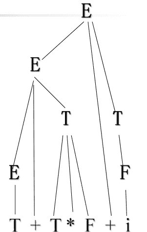

文法： E→E+E|E*E
E→(E)|id
句型i+E*i+i的短语

i i E*i i
i+E*i i+E*i+i
其中的素短语为
i i i

问题：归约过程中如何发现“中间句型”的最左素短语？

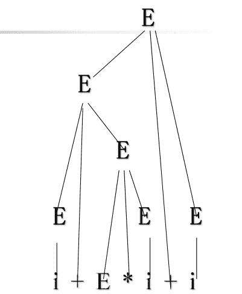


## 素短语与最左素短语

设句型的一般形式为

#N₁a₁N₂a₂...Nₙaₙ# (Nᵢ ∈ V ∪ {ε}, aᵢ ∈ Vₜ)

它的最左素短语是满足下列条件的最左子串

NᵢaᵢNᵢ₊₁aᵢ₊₁...NⱼaⱼNⱼ₊₁

其中： aᵢ₋₁ ≺ aᵢ ,

aᵢ ≡ aᵢ₊₁ ≡ ... ≡ aⱼ₋₁ ≡ aⱼ ,

aⱼ ≻ aⱼ₊₁

## 算符优先分析的实现

- 系统组成
  - 移进归约分析器 + 优先关系表
- 分析算法
  - 参照输入串、优先关系表，完成一系列归约，生成语法分析树——输出产生式

## 算符优先分析算法

算法5.3 算符优先分析算法。

输入： 文法 G=(V, T, P, S)，输入字符串 w 和优先关系表；

输出： 如果 w 是一个句子则输出一个分析树架子，否则指出错误；

步骤：

```
begin  S[1]:='#';  i:=1;
    repeat 将下一输入符号读入 R;
        if S[i] ∈ T then j:=i else j:=i-1;
        while S[j] > R do begin
            repeat  Q:=S[j];
                    if S[j-1] ∈ T then j:=j-1 else j:=j-2
            until S[j] < Q;
            将 S[j+1]...S[i] 归约为 N; i:=j+1; S[i]:=N end;
        if S[j] < R or S[j] ≡ R then begin i:=i+1; S[i]:=R end
        else error
    until i=2 and R='#' end;
```

## id+id*id 的分析过程

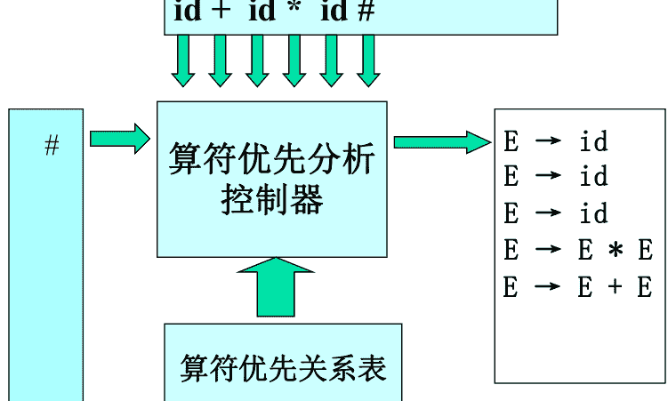

## 5.2.4 优先函数

- 为了节省存储空间（n² → 2n）和便于执行比较运算，用两个优先函数f和g，它们是从终结符号到整数的映射。对于终结符号a和b选择f和g，使之满足：
  - f(a)<g(b)，如果 a ≺ b
  - f(a)=g(b)，如果 a ≡ b
  - f(a)>g(b)，如果 a ≻ b。

- 损失
  - 错误检测能力降低
  - 如： id ≻ id 不存在，但 f(id)>g(id) 可比较

## 表5.2 对应的优先函数：

|   | + | - | * | / | ( | ) | id | # |
|---|---|---|---|---|---|---|---|---|
| f | 2 | 2 | 4 | 4 | 0 | 4 | 4 | 0 |
| g | 1 | 1 | 3 | 3 | 5 | 0 | 5 | 0 |

- 1) 构造优先函数的算法不是唯一的。
- 2) 存在一组优先函数，那就在存在无穷组优先函数。

## 优先函数的构造

算法5.4 优先函数的构造。

输入：算符优先矩阵；

输出：表示输入矩阵的优先函数，或指出其不存在；

步骤：

- 1. 对∀a∈T∪{#}，建立以fa和ga为标记的顶点；
- 2. 对∀a, b∈T∪{#}，若a▷ b或者a≡b，则从fa至gb画一条有向弧；若a◁ b或者a≡b，则从gb至fa画一条有向弧；
- 3. 如果构造的有向图中有环路，则说明不存在优先函数；如果没有环路，则对∀a∈T∪{#}，将f(a)设为从fa开始的最长路径的长度，将g(a)设为从ga开始的最长路径的长度。

|   | id | + | * | $ |
|---|---|---|---|---|
| f | 4 | 2 | 4 | 0 |
| g | 5 | 1 | 3 | 0 |

根据G_es的优先矩阵建立的
有向图和优先函数


|   | id | + | * | $ |
|---|---|---|---|---|
| id | >. | >. | >. | >. |
| + | <. | .> | <. | .> |
| * | <. | .> | .> | .> |
| $ | <. | <. | <. |  |

## 5.2.5 算符优先分析的出错处理

(1) 栈顶的终结符号和当前输入符号之间不存在任何优先关系；

(2) 发现被“归约对象”，但该“归约对象”不能满足归约要求。

- 对于第(1)种情况，为了进行错误恢复，必须修改栈、输入或两者都修改。
- 对于优先矩阵中的每个空白项，必须指定一个出错处理程序，而且同一程序可用在多个地方。
- 对于第(2)种情况，由于找不到与“归约对象”匹配的产生式右部，分析器可以继续将这些符号弹出栈，而不执行任何语义动作。

## 算符优先分析法小结

- 优点
  - 简单、效率高
  - 能够处理部分二义性文法
- 缺点
  - 文法书写限制大——强调算符之间的优先关系的唯一性
  - 占用内存空间大
  - 不规范、存在查不到的语法错误
  - 算法在发现最左素短语的尾时，需要回头寻找对应的头

## 5.3 LR分析法

## 5.3.1 LR分析算法

- LR(k) 分析法可分析LR(k) 文法产生的语言
- L：从左到右扫描输入符号
- R：最右推导对应的最左归约
- k：超前读入k个符号，以便确定归约用的产生式
- 使用语言的文法描述内涵解决句柄的识别问题，从语言的形式描述入手，为语法分析器的自动生成提供了前提和基础

## 5.3 LR分析法

LR分析器的工作方式：根据栈中的符号串和向右顺序查看输入串中的k(k≥0)个符号，就能唯一确定分析器的动作是移进还是归约，以及用哪个产生式进行归约。

LR分析方法是当前最广义的无回溯的“移进-归约”方法。

- LR(k)分析技术knuth于1965年首先提出来的
优点：适用范围广；分析速度快；报错准确。

## LR语法分析器的总体结构

输入缓冲区

a₁ ... aᵢ ... aₙ #

状态/符号栈

Sₘ   Xₘ
Sₘ₋₁ Xₘ₋₁
... ...
... ...
... ...
S₁   X₁
S₀   #

LR分析程序

产生式序列

分析表

动作表
action

转移表
goto

## LR语法分析器的总体结构

所有LR分析器的驱动程序都是一样的

不同的语法分析器具有不同的分析表

LR(0)分析器 => LR (0) 分析表
SLR (1) 分析器 => SLR (1) 分析表
LR (1) 分析器 => LR (1) 分析表
LALR (1) 分析器 => LALR (1) 分析表

分析表是LR分析法的核心

## LR 分析表

- 例5.7

文法 G[E']:

```
(0) E' → E
(1) E → E + T
(2) E → T
(3) T → T * F
(4) T → F
```

- 的分析表

## 文法 G（E′）的 SLR（1）分析表

|   | id | + | * | ( | ) | $ | E | T | F |
|---:|---|---|---|---|---|---|---|---|---|
| 0 | s₅ |  |  | s₄ |  |  | 1 | 2 | 3 |
| 1 |  |  |  |  |  | acc |  |  |  |
| 2 |  | r₂ | s₇ |  | r₂ | r₂ |  |  |  |
| 3 |  | r₄ | r₄ | r₄ | r₄ | r₄ |  |  |  |
| 4 | s₅ |  |  | s₄ |  |  | 8 | 2 | 3 |
| 5 |  | r₆ | r₆ | r₆ | r₆ | r₆ |  |  |  |
| 6 | s₅ |  |  | s₄ |  |  |  | 9 | 3 |
| 7 | s₅ |  |  | s₄ |  |  |  |  | 10 |
| 8 |  | s₆ |  | s₄ |  |  |  |  |  |
| 9 |  | r₁ | s₇ |  | r₁ | r₁ |  |  |  |
| 10 |  | r₃ | r₃ | r₃ | r₃ | r₃ |  |  |  |
| 11 |  | r₅ | r₅ | r₅ | r₅ | r₅ |  |  |  |

## LR分析器的过程

布局:(栈中符号序列，剩余输入符号串)

- 1. 初始化

s₀ # a₁a₂…aₙ#
对应“句型”
a₁a₂…aₙ

- 2. 在一般情况下，假设分析器的格局如下：

s₀s₁…sₘ #X₁…Xₘ aᵢaᵢ₊₁…aₙ#
对应“句型” X₁…Xₘaᵢaᵢ₊₁…aₙ


## LR分析器操作

+   1. If action[sₘ,aᵢ]= sⱼ then 格局变为
+   s₀s₁… sₘj #X₁…Xₘaᵢ    aᵢ₊₁…aₙ#
+   对应“句型” X₁…Xₘaᵢaᵢ₊₁…aₙ

+   2. If action[sₘ,aᵢ]= rᵢ then 表示用第i个产生式
+   A→Xₘ₋₍ₖ₋₁₎…Xₘ进行归约，格局变为：

①.归约前：

s₀s₁… sₘ₋ₖ Sₘ₋₍ₖ₋₁₎…Sₘ   #X₁…Xₘ₋ₖ Xₘ₋₍ₖ₋₁₎…Xₘ₋ₖ
    aᵢaᵢ₊₁…aₙ#

## LR分析器的操作

②. 状态栈文法栈同时弹出后，栈内的情况：
S₀S₁… S_{m-k} #X₁…X_{m-k}  a_i a_{i+1}…a_n #

③. 将归约后的非终结符A压入栈：
S₀S₁… S_{m-k} #X₁…X_{m-k} A  a_i a_{i+1}…a_n #

④. 状态栈的变化
查goto表，如果goto[S_{m-k},A]=i then 格局变为
S₀S₁… S_{m-k} i #X₁…X_{m-k} A  a_i a_{i+1}…a_n #

## LR分析器的操作

3.If action[sₘ,aᵢ]=acc then 分析成功

4.If action[sₘ,aᵢ]=err then 出现语法错

## LR分析算法

算法5.5 LR分析算法。

输入：文法G的LR分析表和输入串w；

输出：如果w∈L(G)，则输出w的自底向上分析，否则报错；

步骤：

+   1. 将#和初始状态S0压入栈，将w#放入输入缓冲区；
+   2. 令输入指针ip指向w#的第一个符号；
+   3. 令S是栈顶状态，a是ip所指向的符号；
+   4. repeat
+   5. if action[S,a]=Si then    /* Si表示移进a并转入状态i*/
+   6. begin
+   7. 把符号a和状态i先后压入栈；
+   8. 令ip指向下一输入符号
+   9. end

```
10. elseif action[S,a]=r_i then /* r_i 表示按第i个产生式 A→β 归约 */
11.   begin
12.     从栈顶弹出2*|β|个符号；
13.     令S'是现在的栈顶状态；
14.     把A和goto[S',A]先后压入栈中；
15.     输出产生式 A→β
16.   end
17. elseif action[S,a]= acc then
18.   return
19. else
20.   error();
```

## 例： id+id*id的识别过程

#

r₁ E->E*T
goto[0,E]=1

| | id | + | * | ( | ) | $ | E | T | F |
|---|---|---|---|---|---|---|---|---|---|
| 0 | s₅ |  |  | s₄ |  |  | 1 | 2 | 3 |
| 1 |  | s₆ |  |  |  | acc |  |  |  |
| 2 |  | r₇ | s₇ |  | r₇ | r₇ |  |  |  |
| 3 |  | r₄ | r₄ |  | r₄ | r₄ |  |  |  |
| 4 | s₅ |  |  | s₄ |  |  | 8 | 2 | 3 |
| 5 |  | r₆ | r₆ |  | r₆ | r₆ |  |  |  |
| 6 | s₅ |  |  | s₄ |  |  |  | 9 | 3 |
| 7 | s₅ |  |  | s₄ |  |  |  |  | 10 |
| 8 |  | s₆ |  |  | s₄ |  |  |  |  |
| 9 |  | r₁ | s₇ |  | r₁ | r₁ |  |  |  |
| 10 |  | r₂ | r₂ |  | r₂ | r₂ |  |  |  |
| 11 |  | r₅ | r₅ |  | r₅ | r₅ |  |  |  |

| | |
|---|---|
| | |
| | |
| | |
| | |
| 1 | E |
| 0 | # |

| 栈 | 输入 | 动作 |
|---|---|---|
| 0 | # id+id*id# | s₅ |
| 05 | #id +id*id# | r₆ F→id |
| 0 | #F +id*id# | GOTO[0,F]=3 |
| 03 | #F + id*id# | r4 T→F |
| 0 | #T +id *id# | GOTO[0,T]=3 |
| 02 | #T +id *id# | r2 E→T |
| 0 | #E +id*id# | GOTO[0,E]=1 |
| 01 | #E +id*id # | S₆ |
| 016 | #E+ id*id # | S₅ |
| 0165 | #E+id * id # | r6 F→id |
| 016 | #E+ F * id # | GOTO[6,F]=3 |

| 栈 | 输入 | 动作 |
|---|---|---|
| 0163 | #E+ F   * id # | r₄ T→F |
| 016 | #E+ T   * id # | GOTO[6,T]=9 |
| 0169 | #E+T   * id # | S₇ |
| 01697 | #E+ T*   id # | S₅ |
| 016975 | #E+ T* id   # | r₆ F→id |
| 01697 | #E+ T* F   # |  |
| 0169710 | #E+ T* F   # | r₃ T→T*F |
| 016 | #E+ T   # | GOTO[6,T]=9 |
| 0169 | #E+T   # | r1 |
| E→E+T | #E   # |  |
| 01 | #E   # | accep |

## 5.3.1 LR(0)分析表的构造

## 规范句型活前缀

+   - 分析栈中内容+剩余输入符号=规范句型
+     - 分析栈中内容为某一句型的前缀
+   - 来自分析栈的活前缀(Active Prefix)
+     - 不含句柄右侧任意符号的规范句型的前缀
+   - 例： id + id * id 的分析

0165 #E+id * id # r6 F→id
活前缀

## 规范句型活前缀

对于文法G[S]

+   1. S→vI:T
+   2. I→I,i
+   3. I→i
+   4. T→real

V i,i:real是该文法的一个句子

S=>vI:T=>vI:real
=>vI,i:real
=>v i,i:real

```
V i , i : real #
```

```
# S
```

其活前缀是： S
ε v vi vI vI, vI,i vI vI: vI:real vI:T

## 规范句型活前缀

识别句柄就可以转化为识别活前缀

LR分析器如何识别各规范句型的活前缀？

LR分析器使用有穷自动机DFA识别各规范句型的活前缀

+   - DFA的定义： M = (Q,Σ,δ,q0,Z)
+   - 其中： Q--状态集 Σ—输入字母表
+   - δ --Q x Σ→Q的映射函数
+   - 确切说，就是找Q的过程

## LR(0)项目

+   - LR(0)项目——从产生式寻找归约方法
+     - 右部某个位置标有圆点的产生式称为相应文法的LR(0)项目（Item）
+     - 例 S→.bBB  S→bB.B  S→b.BB S→bBB.
+     - 归约（Reduce）项目：S→aBB.
+     - 移进（Shift）项目：S→.bBB
+     - 待约项目：S→b.BB  S→bB.B

## 拓广(Augmented)文法

+   - 需要一个对“归约成S”的表示（只有一个接受状态）
+   - 文法 G=(V, T, P, S)的拓广文法 G'：
+     - G' = (V ∪ {S'}, T, P ∪ {S'→S}, S')
+     - S'∉V
+     - 对应 S'→.S（分析开始）和 S'→S.（分析成功）
+   - 例5.13，拓广后文法为：
+     0) S'→S
+     1) S→BB
+     2) B→aB
+     3) B→b

## 有效项目集

+   - 定义:(识别活前缀的有效项目)
+   - 如果存在一个规范推导
+   - S ⇐*rm αAw ⇐rm αβ₁β₂w
+   - 项目 A→β₁·β₂ 对识别活前缀 γ=αβ₁
+   - 是有效的。

## 有效项目集

+   有下面的结论：

+   若项目 A→α·Bβ 对识别活前缀 γ =δ α 是有效的,且 B→η∈P,则项目 B→·η 对识别活前缀 γ=δ α 也是有效的。

1.S'→.S
3.S→.BB
对活前缀ε有效

S→B.B
S→.BB
B→.aB
B→.b
对活前缀B有效


## 有效项目集

- 推导如下：
- 若项目 A→α·Bβ 对识别活前缀 γ=δα 是
- 有效，则存在一个规范推导
- S ⇐*rm δA w ⇐rm δα Bβ w
- 设 β w ⇐*rm x w，则对任何 B→η ∈ P，有
- S ⇐*rm δA w ⇐rm δα Bβ w
- ⇐rm δα B x w ⇐rm δα η x w

## 利用对活前缀有效，可以对项目实施合并，得到有效项目集

例：
S’→ S
S→BB
B→aB
B→b
的有效项目集

I₀:
S’→.S
S→.BB
B→.aB
B→.b

I₁:
S’→S.

I₂:
S→B.B
B→.aB
B→.b

I₃:
B→b.

I₄:
B→a.B
B→.aB
B→.b

I₅:
S→BB.

I₆:
B→aB.

LR(0)项目集规范族

## 项目集闭包的计算

## 项目集 I 的闭包（Closure）

CLOSURE(I)=I ∪ {B→.γ | A→α .Bβ ∈ I, B→γ ∈ P}

## 算法

```
J:=I;
repeat
J=J ∪ {B→.η | A→α .Bβ ∈ J, B→η ∈ P}
until J不再扩大
```

## 闭包之间的转移

- 后继项目（Successive Item）
- A→α.Xβ的后继项目是A→αX.β
- 闭包之间的转移
- go(I,X)=CLOSURE({A→αX.β| A→α.Xβ ∈ I})

## 状态转移的计算

- 确定在某状态遇到一个文法符号后的状态转移目标

```
function GO(I, X);
begin
J:=∅;
for I中每个形如A→a.Xβ的项目 do
begin J:=J ∪ {A→aX,β} end;
return CLOSURE(J)
end;
```

## 识别拓广文法所有规范句型活前缀的DFA

识别文法G=(V, T, P, S) 的拓广文法G' 的所有规范句型活前缀的DFA：
M=(C, V∪T, go, I₀, C)

- I₀=CLOSURE({S' →.S}
- C={I₀} ∪ {I|∃J∈C,X∈V∪T,I=go(J,X)}

称为G'的LR(0)项目集规范族(Canonical Collection)

## 计算LR(0)项目集规范族 C

## 即：分析器状态集合

```
begin
C := {closure({ S'→.S})};
repeat
  for ∀I∈C, ∀X∈V∪T
    if go(I,X)≠Φ & go(I,X)∉C then
      C=C∪{go(I,X)}
until C不变化
end.
```

## 识别文法
活前缀的自动机

```
I₀:
S' → .S
S → .BB
B → .aB
B → .b
```

```
I₁:
S' → S.
```

```
I₅:
S → BB.
```

```
I₂:
S → B.B
B → .aB
B → .b
```

```
I₃:
B → b.
```

```
I₄:
B → a.B
B → .aB
B → .b
```

```
I₆:
B → aB.
```

例： S'
→ S
S → BB
B → aB
B → b

## LR(0)文法的定义

假设一个识别文法G活前缀的DFA中的每个状态不存在下述情况：

- 1、既含移进项目又含归约项目
- 2、或者含有多个归约项目

则称文法G是LR（0）文法

## LR(0)分析表的构造算法

算法5.6 LR(0)分析表的构造。

输入： 文法G=(V, T, P, S)的拓广文法G'；

输出： G'的LR(0)分析表，即action表和goto表；

步骤：

- 1. 令I₀ = CLOSURE({S' →·S})，构造G'的LR(0)项目集规范族C={I₀,I₁,...,Iₙ}
- 2. 让Iᵢ对应状态i，I₀对应状态0，0为初始状态。
- 3. for k=0 to n do begin
- (1) if A→α·aβ∈Iₖ & a∈T & GO(Iₖ, a)=Iⱼ then action[k,a]:=Sj;
- (2) if A→α·Bβ∈Iₖ & B∈V & GO(Iₖ, B)=Iⱼ then goto[k,B]:=j;
- (3) if A→α·∈Iₖ & A→α为G的第j个产生式then
- for ∀a∈T∪{#} do action[k,a]:=rj;
- (4) if S'→S·∈Iₖ then action[k,#]:=acc end;
- 4. 上述(1)到(4)步未填入信息的表项均置为error。

## 例：

## 分析表

文法

- 0) S' → S
- 1) S → BB
- 2) B → aB
- 3) B → b

| 状态 | 动作表 action |  |  | 转移表 goto |  |
|---|---|---|---|---|---|
|  | a | b | # | S | B |
| 0 | s3 | s4 |  | 1 | 2 |
| 1 |  |  | acc |  |  |
| 2 | s3 | s4 |  |  | 5 |
| 3 | s3 | s4 |  |  | 6 |
| 4 | r3 | r3 | r3 |  |  |
| 5 | r1 | r1 | r1 |  |  |
| 6 | r2 | r2 | r2 |  |  |

## LR分析表的构造过程

| 状态 | a | b | # | S | B |
|------|---|---|---|----|----|
| 0 | S3 | S4 |  | 1 | 2 |
| 1 |  |  | acc |  |  |
| 2 | S3 | S4 |  |  | 5 |
| 3 | S3 | S4 |  |  | 6 |
| 4 | r3 | r3 | r3 |  |  |
| 5 | r1 | r1 | r1 |  |  |
| 6 | r2 | r2 | r2 |  |  |

## 5.3.2SLR（1）分析表

## LR（0）存在的问题

例：文法G3

- 0.S’→S
- 1.S→a
- 2.S→aAb
- 3.A→1A0
- 4.A→ ε
- 5.S→b
- 6.S→bBa
- 7.B→1B0
- 8.B → ε

## 文法G[s'] 的有效项目集：

| I | Productions |
| --- | --- |
| I₀ | S' → .S
S → .a
S → .aAb
S → .b
S → .bBa |
| I₁ | S' → .S |
| I₂ | S → a.
S → a.Ab
A → .1A0
A → .ε |
| I₃ | S → b.
S → b.Ba
B → .1B0
B → .ε |
| I₄ | S → aA.b |
| I₅ | A → 1.A0
A → .1A0
A → .ε |
| I₆ | S → bB.a |
| I₇ | B → 1.B0
B → .1B0
B → .1B0
B → .ε |
| I₈ | S → aAb. |
| I₉ | A → 1A.0 |
| I₁₀ | S → bBa. |
| I₁₁ | B → 1B.0 |
| I₁₂ | A → 1A0. |
| I₁₃ | B → 1B0. |

## 识别文法G3 活前缀的DFA:


|  | a | b | 0 | 1 | # | S | A | B |
|---|---|---|---|---|---|---|---|---|
| 0 | S₂ | S₃ |  |  |  | 1 |  |  |
| 1 |  |  |  |  | Acc |  |  |  |
| 2 | r₄ | r₄ | r₄ | r₄ / S₅ / r₁ r₄ |  |  | 4 |  |
| 3 | r₈ | r₈ | r₈ | r₈ / S₇ / r₅ r₈ 6 |  |  |  |  |
| 4 |  | S₈ |  |  |  |  |  |  |
| 5 | r₄ | r₄ | r₄ | r₄ / S₅ |  |  | 9 |  |
| • | S₁₀ |  |  |  |  |  |  |  |
| 1 | r₈ | r₈ | r₈ | r₈ / S₇ |  |  | 11 |  |
| 8 | r₂ | r₂ | r₂ | r₂ | r₂ |  |  |  |
| 9 |  |  | S₁₂ |  |  |  |  |  |
| 10 | r₆ | r₆ | r₆ | r₆ | r₆ | GOTO |  |  |
| 2 |  |  | S₁₃ |  |  |  |  |  |
| 12 | r₃ | r₃ | r₃ | r₃ | r₃ |  | ACTION |  |
| 13 | r₇ | r₇ | r₇ | r₇ | r₇ |  |  |  |


## 解决项目集中冲突的方法

解决方法：向前搜索一个输入符号a

- FOLLOW(S) = {#}
- FOLLOW(A) = {0,b}
- FOLLOW(B) = {0,a}
- 对于I2而言，若a=1，则应该执行S5；
- 若a ∈ FOLLOW(S)，则应用S→a.归约；
- 若a ∈ FOLLOW(A)，则应用A→. ε归约

一般而言：假设文法G的某个项目I同时含有m个移进项目： n个归约项目：
A₁ → α₁·a₁ β₁          B₁ → γ₁·
A₂ → α₂·a₂ β₂          B₂ → γ₂·
.                      .
.                      .
Aₘ → αₘ·aₘ βₘ          Bₙ → γₙ·
若{a₁ , aₙ, ... aₘ}与FOLLOW(B₁), FOLLOW(B₂),..., FOLLOW(Bₙ)两两不相交,则项目集I中的冲突可按如下原则解决：

## 面对当前读入符号为a

+ 1. 若 a ∈ {a₁, aₙ, ... aₘ}，则移进。
+ 2. 若 a ∈ FOLLOW(Bᵢ)，则用 Bᵢ → γᵢ 进行归约。
+ 3. 此外，报错。

满足上述条件的文法，就叫 SLR（1）文法

这种解决方法是比较简单的，因此称作 SLR(1) 分析，由此构造的分析表，称作 SLR（1）分析表。

## 文法G3 的 SLR(1)分析表如下：

|  |  |  |  | Acc |  |
|---|---|---|---|---|---|
| 1 |  |  |  | Acc |  |
| 2 |  | r₄ | r₄ | S₅ | r₁ | 4 |
| • | r₈ |  | r₈ | S₇ | r₅ | 6 |
| 2 |  | S₈ |  |  |  | |
| 3 |  | r₄ | r₄ | S₅ |  | 9 |
| • | S₁₀ |  |  |  |  | |
| • | r₈ |  | r₈ | S₇ |  | 11 |
| 8 |  |  |  |  | r₂ | |
| 9 |  |  | S₁₂ |  |  | |
| 10 |  |  |  |  | r₆ | GOTO |
| 1 |  |  | S₁₃ |  |  | |
| 12 |  | r₃ | r₃ | ACTION |  | |
| 13 | r₇ |  | r₇ |  |  | |

## 5.3.3 SLR(1)分析表的构造算法

算法5.6 SLR(1)分析表的构造。

输入： 文法G=(V, T, P, S)的拓广文法G'；
输出： G'的SLR(1)分析表，即action表和goto表；
步骤：

+ 1. 令I₀= CLOSURE({S'→·S})，构造G'的LR(0)项目集规范族 C={I₀,I₁,...,Iₙ}
+ 2. 让Iᵢ对应状态i，I₀对应状态0，0为初始状态。
+ 3. for k=0 to n do begin
+ (1) if A→α·aβ∈Iₖ & a∈T & GO(Iₖ, a)=Iⱼ then action[k,a]:=Sj;
+ (2) if A→α·Bβ∈Iₖ & B∈V & GO(Iₖ, B)=Iⱼ then goto[k,B]:=j;
+ (3) if A→α·∈Iₖ & A→α为G的第j个产生式then
    for ∀a∈FOLLOW(A) do action[k,a]:=rj;
+ (4) if S'→S·∈Iₖ then action[k,#]:=acc end;
+ 4. 上述(1)到(4)步未填入信息的表项均置为error。

## 识别表达式文法的所有活前缀的DFA

## 拓广文法

+ 0) E'→E
+ 1) E→E+T
+ 2) E→T
+ 3) T→T*F
+ 4) T→F
+ 5) F→(E)
+ 6) F→id

I₀:
E'→.E
E→E.+T
E→.T
T→T.*F
T→.F
F→.(E)
F→.id

I₁:
E'→E.
E→E.+T

I₆:
E→E+.T
T→.T*F
T→.F
F→.(E)
F→.id

I₂:
E→T.
T→T.*F

I₉:
E→E+T.
T→T.*F

I₃:
T→F.

I₇:
T→T*.F
F→.(E)
F→.id

I₁₀:
T→T*F.

I₅:
F→id.

I₄:
F→.(E)
E→.E+T
E→.T
T→.T*F
T→.F
F→.(E)
F→.id

I₈:
F→(E.)
E→E.+T

I₁₁:
F→(E).

## 表达式文法的 LR(0)分析表含有冲突

| 状态 | ACTION |  |  |  |  |  |
|---|---|---|---|---|---|---|
|  | id | + | * | ( | ) | # |
| 2 | r2 | r2 | r2/s7 | r2 | r2 | r2 |
| 3 | r4 | r4 | r4 | r4 | r4 | r4 |
| ... |  |  |  |  |  |  |
| 5 | r6 | r6 | r6 | r6 | r6 | r6 |
| ... |  |  |  |  |  |  |
| 9 | r1 | r1 | r1/s7 | r1 | r1 | r1 |
| 10 | r3 | r3 | r3 | r3 | r3 | r3 |
| 11 | r5 | r5 | r5 | r5 | r5 | r5 |

+ - 在状态 2、9 采用归约，出现移进归约冲突

## 表达式文法的SLR(1)分析表

求非终结符的 FIRST 集和 FOLLOW 集

+ - FIRST( F ) = { id, ( }
+ - FIRST( T ) = { id, ( }
+ - FIRST( E ) = { id, ( }
+ - FOLLOW( E ) = { ), +, # }
+ - FOLLOW( T ) = { ), +, #, * }
+ - FOLLOW( F ) = { ), +, #, * }

+ 1) E → E + T
+ 2) E → T
+ 3) T → T * F
+ 4) T → F
+ 5) F → ( E )
+ 6) F → id

| 状态 | ACTION |  |  |  |  |  | GOTO |  |  |
|------|--------|---|---|---|---|---|------|---|---|---|
|      | id | + | * | ( | ) | # | E | T | F |
| 0 | s 5 |  |  | s 4 |  |  | 1 | 2 | 3 |
| 1 |  | s 6 |  |  |  | acc |  |  |  |
| 2 |  | r 2 | s 7 |  | r 2 | r 2 |  |  |  |
| 3 |  | r 4 | r 4 |  | r 4 | r 4 |  |  |  |
| 4 | s 5 |  |  | s 4 |  |  | 8 | 2 | 3 |
| 5 |  | r 6 | r 6 |  | r 6 | r 6 |  |  |  |
| 6 | s 5 |  |  | s 4 |  |  |  | 9 | 3 |
| 7 | s 5 |  |  | s 4 |  |  |  |  | 10 |
| 8 |  | s 6 |  |  | s 11 |  |  |  |  |
| 9 |  | r 1 | s 7 |  | r 1 | r 1 |  |  |  |
| 10 |  | r 3 | r 3 |  | r 3 | r 3 |  |  |  |
| 11 |  | r 5 | r 5 |  | r 5 | r 5 |  |  |  |

si 表示移进到状态i, ri 表示用i号产生式归约

## SLR(1) 分析的特点

+ - 描述能力强于 LL(1)
+ - SLR(1)还考虑Follow集中的符号
+ - LL(1) 仅考虑产生式的首符号
+ - SLR(1) 文法： SLR(1)分析表无冲突的CFG

## SLR(1)分析的局限性

+ - 如果 SLR(1) 分析表仍有多重入口（移进归约冲突或归约归约冲突），则说明该文法不是 SLR(1) 文法；
+ - 说明仅使用 LR(0) 项目集和 FOLLOW 集还不足以分析这种文法

## 5.3.4 LR(1)分析表的构造

+ 例： (0) S' → S

+ (1) S → L = R

+ (2) S → R

+ (3) L → * R

+ (4) L → id

+ (5) R → L

+ FOLLOW(L) = { =, # }

I0:
S'→.S
S→.L=R
S→.R
L→.*R
L→.id
R→.L

I1:
S'→S.

I2:
S→L.=R
R→L.

I3:
S→R.

I4:
L→.*.R
R→.L
L→.*R
L→.id

I5:
L→id .

I6:
S→L=.R
R→.L
L→.*R
L→.id

I7:
L→*R.

I8:
R→L.

I9:
S→L=R.


## SLR分析中的冲突——需要更强的分析方

I₂ = { S → L. = R, R → L. }

+   输入符号为 = 时，出现了移进归约冲突：

S → L. = R ∈ I₂ and go(I₂, =) = I₆

⇒ action[2, =] = S 6

R → L. ∈ I₂ and = ∈ FOLLOW(R) = { =, # }

⇒ action[2, =] = r5

+   说明该文法不是SLR(1)文法，分析这种文法需要更多的信息。

## SLR分析中存在冲突的原因

+   - SLR（1）只孤立地考察输入符号是否属于归约项目 A→α.相关联的集合 FOLLOW（A），而没有考察符号串 α 所在规范句型的“上下文”。
+   - 所以试图用某一产生式 A→α 归约栈顶符号串 α 时，不仅要向前扫描一个输入符号，还要查看栈中的符号串 δα，只有当 δAα 的确构成文法某一规范句型的活前缀时才能用 A→α 归约。亦即要考虑归约的有效性：
+   - 问题：怎样确定 δAα 是否是文法某一规范句型的活前缀

## 5.3.4 LR(1)分析表的构造

+   - LR(0)不考虑后继符(搜索符)，SLR(1)仅在归约时考虑后继符(搜索符)，因此，对后继符(搜索符)所含信息量的利用有限，未考虑栈中内容。
+   - 希望在构造状态时就考虑后继符(搜索符)的作用：考虑对于产生式 A→α的归约，不同使用位置的 A 会要求不同的后继符号

## 如何解决SLR（1）的冲突

解决方法：通过分裂状态，使LR分析器的每个状态能确切知道句柄α后紧跟哪些终结符时才能把α归约成A。

也就是在项目集中增加向前搜索符

## 后继符(搜索符)的概念

+   - 不同的归约中有不同的后继符。
+   - 特定位置的后继符是 FOLLOW集的子集
+   - 增加了搜索符的项目叫 L R(K)项目


## LR(k) 项目

定义5.11

+   [A→α.β, a₁a₂...aₖ]为LR(k)项目，根据圆点所处位置的不同又分为三类：

+   归约项目：[A→α., a₁a₂...aₖ]

+   移进项目：[A→α.aβ, a₁a₂...aₖ]

+   待约项目：[A→α.Bβ, a₁a₂...aₖ]

利用LR(k)项目构造LR(k)分析(器)，

其中a₁a₂...aₖ就是搜索符

## LR(1) 项目

当k=1时，为LR(1)项目，相应的分析叫LR(1)分析(器)

+   - 归约项目： [A→α.,a]
+   - 移进项目： [A→α.aβ,a]
+   - 待约项目： [A→α.Bβ,a]

搜索符a只对归约项目[A→α.，a]起作用，意为只有当[A→α.，a]所属项目集位于栈顶时，且当前输入符号为a时，才能用A→α进行归约。

## LR(1) 项目的有效性

形式上

+   称LR(1)项目 [A→α·β, a] 对活前缀 γ=δα 是有效的，如果存在规范推导

+   S ⇒* δA w ⇒ δαβ w

+   其中 a 为 w 的首字符，如果 w=ε，则 a=#

与LR(0)文法类似，识别文法全部活前缀的DFA的每一状态也是用一个LR(1)项目集来表示，为保证分析时，每一步都在栈中得到规范句型的活前缀，应使每一个LR(1)项目集仅由若干个对相应活前缀有效的项目组成

## 例：考虑文法 G（S）：

$S\to CC$

$C\to cC\mid \varepsilon$


## 因为有规范推导

$S\xRightarrow[r\,m]{*}ccCcd\xRightarrow[r\,m]{ }cccccd$

故项目 $[C\to c\cdot C,\ c]$ 对活前缀 $ccc$ 是有效的。

## 因为有规范推导


$S\xRightarrow[r\,m]{*}CcC\xRightarrow[r\,m]{ }CccC\bullet\bullet$

故项目 $[C\to c\cdot C,\ \#]$ 对活前缀 $Ccc$ 是有效的。

## LR(1) 项目的有效性

一般来说，

若项目[ A→ α·Bβ , a]对活前缀 γ=δ α 是有效的，则存在一个规范推导

S ⇒*_rm δ A a x ⇒*_rm δ α B β a x

假定 β a x ⇒*_rm b y，则对每一个形如 B→ η 的产生式我们有规范推导

S ⇒*_rm δ α B b y ⇒*_rm δ α η b y

## LR(1) 项目的有效性

于是, 项目 [B→·η, b] 对于活前缀 γ=δ α 也是有效的。

注意到b或者是从β推出的第一个终结符号, 或者 β ⇐* ε 而b=a。

这两种可能性结合在一起, 即 b ∈ FIRST(β a)。

## 识别文法全部活前缀的DFA

+   - **LR(1) 项目集族的求法**
+     - **CLOSURE（I）**：求I的闭包，目的是为了合并某些状态，节省空间
+     - **GO（I, X）**：转移函数

## 闭包的计算

```
J:=I;
repeat
J=J ∪ {[B→.η,b]||[A→a.Bβ,a] ∈ J,
b ∈ FIRST(βa)}
until J不再扩大
```

+   当β⇒+ε时，此时b=a叫继承的后继承符，否则叫自生的后继承符

## 状态 I 和文法符号
X 的转移函数

```
go(I,X) =
closure([A→αX.β,a]||[A→α.Xβ,a] ∈ I)
```

后继项目的搜索符是继承来的

## 计算LR(1)项目集规范族 C
即：分析器状态集合

C={I₀} ∪ {I|∃J∈C, X∈V∪T, I=go(J,X)}称为G’的 LR(1)项目集规范族（算法：P181）

```
begin
C:= {closure({ S'→.S,#})};
repeat
    for ∀I∈C, ∀X ∈ V∪T
        if go(I,X)≠Φ & go(I,X)∉C then
            C=C∪go(I,X)
until C不变
end.
```

I₀: [S′ →• S,#]
[S →• CC,#]
[C →• cC,c/d]
[C →• d,c/d]

I₂: [S → C• C,#]
[C →• cC,#]
[C →• d,#]

I₁: [S′ → S•,#]

I₄: [C → d•,c/d]

I₅: [S → CC•,#]

I₃: [C → c• C,c/d]
[C → • cC,c/d]
[C →• d,c/d]

I₆: [C → c• C,#]
[C →• cC,#]
[C →• d,#]

I₇: [C → d•,#]

I₈: [C → cC•,c/d]

I₉: [C → cC•,#]

对于 I₀ 中的项目 [S′ →• S,#] 和产生式 S→CC，由于 FIRST(β a)= #，则 [S→• CC,#] ∈ CLOSURE(I₀)，
同理，对于 [S→• CC,#] 和 [C→cC,c/d]，由于 FIRST(β a)=FIRST(C#)={c, d}，故 [C→• cC,c/d] 和 [C→• d,c/d] 也应属于 CLOSURE(I₀)

## 文法G（S）的GO函数构造如下：

GO(I₀,S)=I₁；　　GO(I₀,O)=I₂；

GO(I₀,C)=I₃；　　GO(I₀,d)=I₄；

GO(I₂,C)=I₅；　　GO(I₂,c)=I₆；

GO(I₂,d)=I₇；　　GO(I₃,C)=I₈；

GO(I₃,C)=I₃；　　GO(I₃,d)=I₄；

GO(I₆,C)=I₉；　　GO(I₆,c)=I₆；

GO(I₆,d)=I₇；

## 识别文法 4.6 的活前缀的 DFA

## LR(1) 分析表的构造

1. 令I₀=CLOSURE({S'→.S}), 构造C={ I₀, I₁, ..., Iₙ}, 即G'的LR(1)项目集规范族。

2. 从Ii构造状态i, 0为初始状态。

```
for k=0 to n do
begin

(1) if [A→α.aβ, b]∈I_k & a∈T & GO(I_k, a)=I_j then action[k,a]:=S_j;
(2) if GO(I_k, B)=I_j & B∈V then goto[k,B]:=j;
(3) if [A→α., a]∈I_k & A→α为G'的第j个产生式 then action[k,a]:=r_j;
(4) if [S'→S., #]∈I_k then action[k,#]:=acc;
end
```

■ 上述(1)到(4)步未填充信息的表项均置为error。


## LR(1) 分析表的构造

- 与LR(0)的不同点主要在归约动作的选择：
  - LR(0) 分析考虑所有终结符
  - SLR(1) 分析参考 FOLLOW 集
  - LR(1) 分析仅考虑 LR(1)项目中的后继符

## LR(1)分析表的构造

- 例： (0) S′→S
- (1) S→L = R
- (2) S→R
- (3) L→* R
- (4) L→id
- (5) R→L

I₀:
S'→.S, #
S→.L=R, #
S→.R, #
L→.*R, =/#
L→.i, =/#
R→.L, #

I₁:S'→S., #

I₂:
S→L.=R, #
R→L., #

I₃:S→R., #

I₄:
L→*.R, =/#
R→.L, =/#
L→.i, =/#
L→.*R, =/#

I₅:L→i., =/#

I₆:
S→L=.R, #
R→.L, #
L→.i, #
L→.*R, #

I₇:L→*R., =/#

I₈:R→L., =/#

I₉:S→L=R., #

I₁₀:R→L., #

I₁₁:L→i., #

I₁₂:
L→*.R, #
R→.L, #
L→i., #
L→.*R, #

I₁₃:L→*R., #

I₂：
S→L=R，#
R→L，#

> 世界是可
> 和平的！

当面临＝时，做移入

当面临#时，做归约


| STA | i | * | = | # | S | L | R |
|---|---|---|---|---|---|---|---|
|  | **ACTION** |  |  |  | **GOTO** |  |  |
|  | S5 | S4 |  |  | 1 | 2 | 3 |
| 1 |  |  |  | acc |  |  |  |
| 2 |  |  | S6 | r5 |  |  |  |
| 3 |  |  |  | r2 |  |  |  |
| 4 | S5 | S4 |  |  |  | 8 | 7 |
| 5 |  |  | r4 | r4 |  |  |  |
| 6 | S11 | S12 |  |  |  | 10 |  |
| 7 |  |  | r3 | r3 |  |  |  |
| 8 |  |  | r5 | r5 |  |  |  |
| 9 |  |  |  | r1 |  |  |  |
| 10 |  |  |  | r5 |  |  |  |
| 11 |  |  |  | r4 |  |  |  |
| 12 |  | S12 |  |  |  | 10 | 13 |
| 13 |  |  |  | r3 |  |  |  |

## 文法G(E)：

- 0. S->E
- 1. E->E+E
- 2. E->T
- 3. T->T*F
- 4. T->F
- 5. F->(E)
- 6. F->id

## 文法G(E)的LR(1) I₀ 项目集如下：

## I₀

- S->.E    #
- E->.E+T.    # ,+
- E->.T    # ,+
- T->.T*F    # ,+ ,*
- T->.F    # ,+ ,*
- F->.(E)    # ,+ ,*
- F->.id    S ,+ ,*

I15 id
E->E+.T  + , ) I16
T->.T*F  + , * , )
T->.F    + , * , )
F->.(E)  + , * , )
F->.id   + , * , )

I14 (
T->F.  + , * , ) I12

E->T.  + , ) I13
T->T.*F + , * , )

T->T*.F  + , * , ) I18
F->.(E)  + , * , )
F->.id   + , * , )

E->E+T.  + , ) I17
T->T.*F  + , * , )

F->.(E)  + , * , ) I14
E->.E+T  + , )
E->.T    + , )
T->.T*F  + , * , )
T->.F    + , * , )
F->.(E)  + , * , )
F->.id   + , * , )

T->T.*F  + , * , ) I19

F->.(E.)  + , * , ) I20
E->E.+T  + , )

F->.(E).  + , * , ) I21

F->id.  + , * , ) I15

## 文法G(E)的LR(1)分析表

| STA | ACTION | | | | | | GOTO | | |
|---|---|---|---|---|---|---|---|---|---|
|  | id | + | * | ( | ) | # | E | T | F |
| 0 | S1 |  |  | S2 |  |  | 3 | 4 | 5 |
| 1 |  | r6 | r6 |  |  | r6 |  |  |  |
| 2 | S15 |  |  | S14 |  |  | 6 | 13 | 12 |
| 3 |  | S7 |  |  |  | acc |  |  |  |
| 4 |  | r2 | S8 |  |  | r2 |  |  |  |
| 5 |  | r4 | r4 |  |  | r4 |  |  |  |
| 6 |  | S16 |  |  | S9 |  |  |  |  |
| 7 | S1 |  |  | S2 |  |  |  | 10 | 5 |
| 8 | S1 |  |  | S2 |  |  |  |  | 11 |
| 9 |  | r5 | r5 |  |  | r5 |  |  |  |
| 10 |  | r1 | S8 |  |  | r1 |  |  |  |
| 11 |  | r3 | r3 |  |  | r3 |  |  |  |

文法G(E)的LR(1)分析表(续)

| STA | ACTION |  |  |  |  |  | GOTO |  |  |
|-----|--------|---|---|---|---|---|------|---|---|
|     | id     | + | * | ( | ) | # | E    | T | F |
| 12  |        | r4| r4|   | r4|   |      |   |   |
| 13  |        | r2| S18|  | r2|   |      |   |   |
| 14  | S15    |   |   | S14|   |   | 20   | 13| 12|
| 15  |        | r6| r6|   | r6|   |      |   |   |
| 16  | S15    |   |   | S14|   |   |      | 17| 12|
| 17  |        | r1| S18|  | r1|   |      |   |   |
| 18  | S15    |   |   | S14|   |   |      |   | 19|
| 19  |        | r3| r3|   | r3|   |      |   |   |
| 20  |        | S16|  |   | S21|  |      |   |   |
| 21  |        | r5| r5|   | r5|   |      |   |   |

## 文法G(E) 的LR(0) 分析表

|   | id | + | * | ( | ) | $ | E | T | F |
|---|----|---|---|---|---|---|---|---|---|
| 0 | s5 |   |   | s4 |   |   | 1 | 2 | 3 |
| 1 |    | s6 |   |    |   | acc |   |   |   |
| 2 |    | r2 | s7 |    | r2 | r2 |   |   |   |
| 3 |    | r4 | r4 |    | r4 | r4 |   |   |   |
| 4 | s5 |    |   | s4 |   |   | 8 | 2 | 3 |
| 5 |    | r6 | r6 |    | r6 | r6 |   |   |   |
| 6 | s5 |    |   | s4 |   |   |   | 9 | 3 |
| 7 | s5 |    |   | s4 |   |   |   |   | 10 |
| 8 |    | s6 |   |    | s4 |   |   |   |   |
| 9 | r1 | r1 | S7/r1 | r1 | r1 | r1 |   |   |   |
| 10 | r3 | r3 | r3 | r3 | r3 | r3 |   |   |   |
| 11 | r5 | r5 | r5 | r5 | r5 | r5 |   |   |   |


## 文法G(E)的SLR(1)分析表

|   | id | + | * | ( | ) | $ | E | T | F |
|---|----|---|---|---|---|---|---|---|---|
| 0 | s5 |   |   | s4 |   |   | 1 | 2 | 3 |
| 1 |    | s6 |   |    |   | acc |   |   |   |
| 2 |    | r2 | s7 |    | r2 | r2 |   |   |   |
| 3 |    | r4 | r4 |    | r4 | r4 |   |   |   |
| 4 | s5 |    |    | s4 |    |    | 8 | 2 | 3 |
| 5 |    | r6 | r6 |    | r6 | r6 |   |   |   |
| 6 | s5 |    |    | s4 |    |    |   | 9 | 3 |
| 7 | s5 |    |    | s4 |    |    |   |   | 10 |
| 8 |    | s6 |    |    | s4 |    |   |   |   |
| 9 |    | r1 | s7 |    | r1 | r1 |   |   |   |
| 10 |   | r2 | r2 |    | r2 | r2 |   |   |   |
| 11 |   | r5 | r5 |    | r5 | r5 |   |   |   |

## 和平的代价有点大


> 都是分析表，差别那么大呢？

## 5.3.5 LALR(1)分析表的构造

## LR(1) 存在的问题：

LR(1) 有效地解决了归约-归约冲突，分析能力比SLR(1)有明显提高。但是LR(1)的缺点也是明显的，分析表过大。

一个C的LR(0)分析表大约有300个状态，而LR(1)的状态达1000个，从而导致时间和空间的开销都急剧上升。

$$\mathrm{SLR}(1)<\mathrm{LALR}(1)<\mathrm{LR}(1)$$

## 5.3.5 LALR(1)分析表的构造

- 问题： 是否可以将某些闭包/状态合并？
- 不同的LR(1)项目闭包可能有相同的LR(0)项目，但后继符可能不同——同心
- 合并后可能带来归约归约冲突
- 合并那些不会带来冲突的同心的LR(1)闭包/状态

(lookahead-LR)

- 在不带来移进归约冲突的条件下，合并状态，重构分析表

## 文法G(E)：

- 0. S→E
- 1. E→E+E
- 2. E→T
- 3. T→T*F
- 4. T→F
- 5. F→(E)
- 6. F→id

文法G(E)的LR(1) I₀ 项目集如下：

## I₀

- S→.E    #
- E→.E+T.    # ,+
- E→.T    # ,+
- T→.T*F    # ,+ ,*
- T→.F    # ,+ ,*
- F→.(E)    # ,+ ,*
- F→.id    $ ,+ ,*

S->.E  #  I0
E->.E+T  # ,+
E->.T  # ,+
T->.T*F  # ,+,*
T->.F  # ,+,*
F->.(E)  # ,+,*
F->.id  # ,+,*

S->E.  #
I3
E->E.+T  # ,+

I1
E->E+.T  # ,+
I7
T->.T*F  # ,+,*
T->.F  # ,+,*
F->.(E)  # ,+,*
F->.id  # ,+,*

I2

I5
T->F.  # ,+,*

I11
T->T*F.  # ,+,*

E->E+T.  # ,+ I10
T->T.*F  # ,+,*

I4
E->T.  # ,+
T->T.*F  # ,+,*

T->T*.F  # ,+,* I8
F->.(E)  # ,+,*
F->.id  # ,+,*

I1

I2

F->.(E)  # ,+,* I2
E->.E+T  + ,)
E->.T  + ,)
T->.T*F  + ,*,)
T->.F  + ,*,)
F->.(E)  + ,*,)
F->.id  + ,*,)

I13

I12

I15

I14

I6
F->(E.)  # ,+,*
E->E.+T  + ,)

I16

I9
F->(E).  # ,+,*

I1
F->id.  # ,+,*

|  |  |  |
|---|---|---|
| E->E+.T | + , ) | I16 |
| T->.T*F | + , * , ) |  |
| T->.F | + , * , ) |  |
| F->.(E) | + , * , ) |  |
| F->.id | + , * , ) |  |

|  |  |  |
|---|---|---|
| E->E+.T | # , + | I7 |
| T->.T*F | # , + , * |  |
| T->.F | # , + , * |  |
| F->.(E) | # , + , * |  |
| F->.id | # , + , * |  |

在两个LR(1)项目集中，如果项目除搜索符号不同外，项目的核心都相同，称这样的两个LR(1)项目为同心集

7/16, 5/12. 10/17, 4/13, 8/18, 2/14, 11/19, 6/20, 1/15和9/21为同心集

## LALR(1)分析法的基本思想：就是将 LR(1)项目集的同心集加以合并，以削减项目集的个数。

所谓合并同心集，就是将每个核相同的 LR(1)项目合并,向前搜索符号取它们的并集。

```
E->E+.T  + , )  I16
T->.T*F  + , * , )
T->.F    + , * , )
F->.(E)  + , * , )
F->.id   + , * , )
```

```
E->E+.T  # , +  I7
T->.T*F  # , + , *
T->.F    # , + , *
F->.(E)  # , + , *
F->.id   # , + , *
```

```
E->E+.T  # , + , )  I7/16
T->.T*F  # , + , * , )
T->.F    # , + , * , )
F->.(E)  # , + , * , )
F->.id   # , + , * , )
```


## DFA的构造：

进入合并前状态的有向边，全部改为进入合并后产生的新状态；由合并前状态引出的有向边，全部改为由合并后的新状态引出

合并同心集后，新的DFA如下：

S->.E # I0
E->.E+T #+
E->.T #+
T->.T*F #+*
T->.F #+*
F->.(E) #+*
F->.id #+*
S->E. #
E->E.+T #+
I1/15
E->E+.T #+) I716
T->.T*F #+*)
T->.F #+*)
F->.(E) #+*)
F->.id #+*)
I2/14
I5/12
T->F. #+*)
I11/19
T->T*F. #+*
I10/17
E->E+T. #+)
T->T.*F #+*)
I4/13
E->T. #+)
T->T.*F #+*)
T->T*.F #+*) I8/18
F->.(E) #+*)
F->.id #+*)
I1/15
I2/14
I4/13
I5/12
I1/15
I12/14
F->.(E) #+*) I2/14
E->.E+T +)
E->.T +)
T->.T*F +*)
T->.F +*)
F->.(E) +*)
F->.id +*)
I6/20
F->(E.) #+*)
E->E.+T +)
I7/16
I9/21
F->(E). #+*)
I1/15
F->id. #+*)

## 构造LALR(1)分析表的算法

对于文法G，经合并同心集后所得的各LR(1)项目集均不含冲突，就称这样的文法为LALR(1)的。

## 构造LALR(1)分析表的算法如下：

- 1、 对已给的拓广文法G’，构造相应的LR(1)项目集族C={I0, I1, ........ In}
- 2、 对C中的项目进行同心集合并，得到新的项目集C’={J0, J1, ....... Jn}，其中含有[S’->.S] 的项目集为DFA的初态

## 3、构造LALR(1)分析表

- a. 用构造LR(1)分析表的方法构造ACTION表
- b. 对于每个X∈V，若GO(JK,X)=Jt,则置GOTO(k,X)=t

文法G(E)的LALR(1)分析表：

## 文法G(E)的LALR(1)分析表

| STA | ACTION |  |  |  |  |  | GOTO |  |  |
|---|---|---|---|---|---|---|---|---|---|
|  | id | + | * | ( | ) | # | E | T | F |
| 0 5/12 | S1/15 |  |  | S2/14 |  |  | 3 | 4/13 |  |
| 1/15 |  | r6 | r6 |  | r6 | r6 |  |  |  |
| 2/14 5/12 | S1/15 |  |  | S2/14 |  |  | 6/20 | 4/13 |  |
| 3 |  | S7/16 |  |  |  | acc |  |  |  |
| 4/13 |  | r2 | S8/18 |  | r2 | r2 |  |  |  |
| 5/12 |  | r4 | r4 |  | r4 | r4 |  |  |  |
| 6/20 |  | S7/16 |  |  | S9/21 |  |  |  |  |
| 7/16 | S1/15 |  |  | S2/14 |  |  |  | 10/17 | 5/12 |
| 8/18 11/19 | S1/15 |  |  | S2/14 |  |  |  |  |  |
| 9/21 |  | r5 | r5 |  | r5 | r5 |  |  |  |
| 10/17 |  | r1 | S8/18 |  | r1 | r1 |  |  |  |

## 5.3.6 二义性文法的应用

任何二义文法都不是LR文法

某些二义文法对语言的说明和实现非常有用，如描述表达式的文法：

规定优先级和结合率

```
E→E+E|E*E|(E)|id
```

## 无二义文法：

```
E→E+T|T
```

```
T→T*F|F
```

```
F→(E)|id
```

## 例：描述if语句的文法：

规定匹配原则

```
stmt → if expr then stmt
/if expr then stmt else stmt
other
```

## 无二义文法

```
stmt → matched_stmt | unmatched_stmt
matched_stmt → if expr then matched_stmt else matched_stmt
| other
unmatched_stmt → if expr then matched_stmt else unmatched_stmt
| if expr then _stmt
```

## 例： E→E+E|E*E|(E)|id

I₀
E′→·E
E→·E+E
E→·E*E
E→·(E)
E→·id

I₁
E′→E·
E→E·+E
E→E·*E

I₂
E→(·E)
E→·E+E
E→·E*E
E→·(E)
E→·id

I₃
E→id·

I₄
E→E+·E
E→·E+E
E→·E*E
E→·(E)
E→·id

I₅
E→E*·E
E→·E+E
E→·E*E
E→·(E)
E→·id

I₆
E→(E·)
E→E·+E
E→E·*E

I₇
E→E+E·
E→E·+E
E→E·*E

I₈
E→E*E·
E→E·+E
E→E·*E

I₉
E→(E)·


FOLLOW(E') = {#}

规定*优先级高于+

FOLLOW(E) = {#, +, *, )}

*、+为左结合率

E→E+E· I₇

E→E·+E

E→E·*E

在I₇状态，遇+，根据左结合率，应对栈内+归约

在I₇状态，遇*，根据优先级，应将*移入栈内

E→E*E· I₈

E→E·+E

E→E·*E

在I₈状态，遇+，根据优先级，应对栈内*归约

在I₈状态，遇*，根据左结合率，应对栈内*归约

## 5.3.6 二义性文法的应用

I₁:
E’→E.
E→E.+E
E→E.*E

I₇:
E→E+E.
E→E.+E
E→E.*E

I₈:
E→E*E.
E→E.+E
E→E.*E

- > 采用二义性文法，可以减少结果分析器的状态数，并能减少对单非终结符（E→T）的归约。
- > 在构造分析表时采用消除二义性的规则(按优先级)

## 文法G(E)的SLR分析表

| id | + | * | ( | ) | $ | E |
| --- | --- | --- | --- | --- | --- | --- |
| 0 |  | S7 |  |  |  | 1 |
|  | S4 | S5 |  |  | acc |  |
| S3 |  |  | S2 |  |  |  |
|  | r4 | r4 |  | r4 | r4 |  |
| S3 |  | S2 |  | r4 | r4 | 8 |
| S3 |  |  | S2 |  |  |  |
|  | S4 | S5 | S9 |  |  |  |
|  | r1 | S5 | r1 | r1 |  |  |
|  | r2 | r2 | r2 | r2 |  |  |
|  | r3 | r3 | r3 | r3 |  |  |

## 悬空else的二义性

描述if语句的文法：

```
stmt→if expr then stmt
|if expr then stmt else stmt
|other
```

用I表示if expr then， e 表示else ,a表示other, 文法可改为：

改写后的文法G(S’)：

```
S’ → S
```

```
S→iSeS|iS|a
```

S' → · S  I₁

S → i S · e S  I₄
S → i S ·

S' → · S  I₀
S → · i S e S
S → · i S
S → · a

S → i · S e S  I₂
S → i · S
S → · i S e S
S → · i S
S → · a

S → i S e · S  I₅
S → · i S e S
S → · i S
S → · a

S → a ·  I₃

S → i S e S ·  I₆

在 I₄ 状态遇 e，栈内符号为 i S，根据最近匹配原则应移入 e

Follow(S)={#,e}

## 5.3.6 二义性文法的应用

```
I₄:
S→iS.eS
S→iS.
```

选择移进else,
以便让它与前面
的then配对

## 文法 G(S) 的 S_LR(1) 分析表（IF）

|   | i | e | a | # | S |
|---|---|---|---|---|---|
| 0 | S₂ |  | S₃ |  | 1 |
| 1 |  |  |  | acc |  |
| 2 |  | R₃ |  | R₃ |  |
| 3 | S₂ |  | S₃ |  | 4 |
| 4 |  | S₅ |  |  |  |
| 5 | S₂ |  | S₃ |  | 6 |
| 6 |  | r₁ |  | r₁ |  |

## 5.3.7 LR分析中的出错处理

- - 出错情况：
- - 栈顶状态为s，当前输入符号为a，查表得 Action[s, a]=err.
- - 这表明语法出错了。
- - 错误处理：
- - 1。向栈内搜索非终结符A，它的归约前状态为S，将A前面的符号全部弹出栈。

## 5.3.7 LR分析中的出错处理

- - 2。不断地读入输入符号，直到读到
- - a ∈Follow(A)集为止,
- - 3。将goto[s, A] 压入栈
- - 整个过程就相当于完成了一次归约，只不过归约的不是句柄
- - 这样处理完后，就相当于从一个新的句子成分开始分析

## 文法G(E)的LR(0)分析表

| 状态 | id | + | * | ( | ) | $ | E | T | F |
|---:|---|---|---|---|---|---|---:|---:|---:|
| 0 | s₅ |  |  | s₄ |  |  | 1 | 2 | 3 |
| 1 |  | s₆ |  |  |  | acc |  |  |  |
| 2 |  | r₂ | s₇ |  | r₂ | r₂ |  |  |  |
| 3 |  | r₄ | r₄ |  | r₄ | r₄ |  |  |  |
| 4 | s₅ |  |  | s₄ |  |  | 8 | 2 | 3 |
| 5 |  | r₆ | r₆ |  | r₆ | r₆ |  |  |  |
| 6 | s₅ |  |  | s₄ |  |  | 9 |  | 3 |
| 7 | s₅ |  |  | s₄ |  |  |  |  | 10 |
| 8 |  | s₆ |  |  | r₄ |  |  |  |  |
| 9 | r₁ | r₁ | s₇/r₁ | r₁ | r₁ | r₁ |  |  |  |
| 10 | r₃ | r₃ | r₃ | r₃ | r₃ | r₃ |  |  |  |
| 11 | r₅ | r₅ | r₅ | r₅ | r₅ | r₅ |  |  |  |


## 文法G(E)的SLR(1)分析表

|   | id | + | * | ( | ) | $ | E | T | F |
|---|----|---|---|---|---|---|---|---|---|
| 0 | s5 |   |   | s4 |   |   | 1 | 2 | 3 |
| 1 |    | s6 |   |    |   | acc |   |   |   |
| 2 |    | r2 | s7 |    | r2 | r2 |   |   |   |
| 3 |    | r4 | r4 |    | r4 | r4 |   |   |   |
| 4 | s5 |    |    | s4 |    |    | 8 | 2 | 3 |
| 5 |    | r6 | r6 |    | r6 | r6 |   |   |   |
| 6 | s5 |    |    | s4 |    |    |   | 9 | 3 |
| 7 | s5 |    |    | s4 |    |    |   |   | 10 |
| 8 |    | s6 |    |    | s4 |    |   |   |   |
| 9 |    | r1 | s7 |    | r1 | r1 |   |   |   |
| 10 |    | r2 | r2 |    | r2 | r2 |   |   |   |
| 11 |    | r5 | r5 |    | r5 | r5 |   |   |   |

## 文法G(E)的LR(1)分析表

| STA | id | + | * | ( | ) | # | E | T | F |
|-----|----|---|---|---|---|---|----|---|---|
| 0   | S1 | r6 | r6 | S2 |   |   | 3 | 4 | 5 |
| 1   |    | r6 | r6 | S14|   |   | 6 |13 |12 |
| 2   | S15|    |   | S14|   |   | 6 |13 |12 |
| 3   | S7 | S8 |   |   |   |acc | r2|10 | 5 |
| 4   | r2 | S8 | S2 |   |   | r2 |   |11 |   |
| 5   | r4 | r4 | r4 |   |   | r4 |   |  |11 |
| 6   | S16| S2 | S9 |   |   |   |  |10 | 5 |
| 7   | S1 | S2 |   |   |   |   |  |10 | 5 |
| 8   | S1 | S2 |   |   |   |   |  |  |11 |
| 9   | r5 | r5 | r5 |   |   | r5 |  |  |  |
| 10  | r1 | S8 | r1 |   |   | r1 |  |  |  |
| 11  | r3 | r3 | r3 |   |   | r3 |  |  |  |

## 文法G(E)的LR(1)分析表(续)

| 状态 | ACTION |  |  |  |  |  | GOTO |  |  |
|---:|:---:|:---:|:---:|:---:|:---:|:---:|:---:|:---:|:---:|
|  | id | + | * | ( | ) | # | E | T | F |
| 12 |  | r4 | r4 |  | r4 |  |  |  |  |
| 13 |  | r2 | S18 |  | r2 |  |  |  |  |
| 14 | S15 |  |  | S14 |  |  | 20 | 13 | 12 |
| 15 |  | r6 | r6 |  | r6 |  |  |  |  |
| 16 | S15 |  |  | S14 |  |  |  | 17 | 12 |
| 17 |  | r1 | S18 |  | r1 |  |  |  |  |
| 18 | S15 |  |  | S14 |  |  |  |  | 19 |
| 19 |  | r3 | r3 |  | r3 |  |  |  |  |
| 20 |  | S16 |  |  | S21 |  |  |  |  |
| 21 |  | r5 | r5 |  | r5 |  |  |  |  |

## 文法G(E)的LALR(1)分析表

| STA | ACTION |  |  |  |  |  | GOTO |  |  |
|---|---|---|---|---|---|---|---|---|---|
|  | id | + | * | ( | ) | # | E | T | F |
| 0 5/12 | S1/15 |  |  | S2/14 |  |  | 3 | 4/13 |  |
| 1/15 |  | r6 | r6 |  | r6 | r6 |  |  |  |
| 2/14 5/12 | S1/15 |  |  | S2/14 |  |  | 6/20 | 4/13 |  |
| 3 |  | S7/16 |  |  |  | acc |  |  |  |
| 4/13 |  | r2 | S8/18 |  | r2 | r2 |  |  |  |
| 5/12 |  | r4 | r4 |  | r4 | r4 |  |  |  |
| 6/20 |  | S7/16 |  |  | S9/21 |  |  |  |  |
| 7/16 | S1/15 |  |  | S2/14 |  |  |  | 10/17 | 5/12 |
| 8/18 11/19 | S1/15 |  |  | S2/14 |  |  |  |  |  |
| 9/21 |  | r5 | r5 |  | r5 | r5 |  |  |  |
| 10/17 |  | r1 | S8/18 |  | r1 | r1 |  |  |  |

## 5.4 语法分析程序的自动生成工具Yacc

## YSP(Yacc Specification)

%{变量定义：头文件和全局变量

%开始符号

词汇表：%Token n₁,n₂,...(自动定义种别码)

%Token n₁,i₁（用户指定种别码）

......

%Token nₕ,iₕ（用户指定种别码）

类型说明  %type

其它说明%}

%%规则部分  给出文法规则的描述

%%程序部分  扫描器和语义动作程序

输出： LALR(1)分析器

## 用Yacc和Lex合建编译程序

Lex源文件

Yacc源程序

Lex

Yacc

lex.yy.c
yylex()

y.tab.c
yyparse()

y.tab.h

C编译连接

其它辅助程序

源程序

编译程序
(宿主机)

目标代码

## 本章小结

+   - 自底向上的语法分析从给定的输入符号串 w 出发，自底向上地为其建立一棵语法分析树。
+   - 移进-归约分析是最基本的分析方式，分为优先法和状态法。
+   - 算符优先分析法是一种有效的方法，通过定义终结符号之间的优先关系来确定移进和归约。
+   - *LR* 分析法有着更宽的适应性。该方法通过构建识别规范句型活前缀的 DFA 来设计分析过程中的状态。可以将 *LR* 分析法分成 *LR*(0)、*SLR*(1)、*LR*(1)、*LALR*(1)。
+   - 通过增加附加的信息可以解决一些二义性问题。
+   - Yacc 是 *LALR*(1) 语法分析器的自动生成工具。

## 总结：

自顶向下分析

+   - 递归下降分析法
+   - LL(1)预测分析法

注意：首先消除左递归和提取左公因子。

自底向上分析

+   - 算符优先分析
+   - LR分析:LR(0), SLR(1), LR(1), LALR(1)

## 文法G:

A→[B

B→X|BA

X→Xa|Xb|a|b

构造其

LL（1）分析表

## 消除左递归

## FIRST

A→[B   { | }

B→X|B’   {a,b}

B’→AB’   { | }

B’→ε   {ε}

X→aX’   {a}

X→bX’   {b}

X’→aX’   {a}

X’→bX’   {b}

X’→ε   {ε}

FIRST(A)={}

FIRST(B)={a,b}

FIRST(B’)= {[, ε}

FIRST(X)={a,b}

FIRST(B)={a,b, ε}

## Follow(A)={[,#}

Follow(B)={[,#}

Follow(B’)= {[,#}

Follow(X)={[]}

Follow(X’)= {[]}

|  | a | b | [ | ] | # |
|---|---|---|---|---|---|
| A |  |  | A→[B |  |  |
| B | B→X]B' | B→X]B' |  |  |  |
| B' |  |  | B'→AB'
B'→ε |  | B'→ε |
| X | X→aX' | X→bX' |  |  |  |
| X' | X'→aX' | X'→bX' |  | X'→ε |  |


## LR(1)分析表

- 拓广文法G(S)：
- 0. S → A
- 1. A→[B
- 2. B→X]
- 3. B → BA
- 4. X→Xa
- 5. X → Xb
- 6. X → a
- 7. X → b

## 项目集规范簇

S → .A  # 0

A → .[B  #

X → a.  ]|a|b  6

B → X] .  #|[  9

A → [.B  #|[  8
B → .X]  #|[ 
B → . BA  #|[ 
X → .Xa  ]|a|b 
X → .Xb  ]|a|b 
X → . a  ]|a|b 
X → . b  ]|a|b

S → A.  #  1

B → X.]  #|[  4
X → X.a  ]|a|b 
X → X.b  ]|a|b

A → [B .  #  3
B → B.A  #|[ 
A → .[B  #|[

X → b.  ]|a|b  5

B → BA.  #|[  7

A → [.B  #  2
B → .X]  #|[ 
B → . BA  #|[ 
X → .Xa  ]|a|b 
X → .Xb  ]|a|b 
X → . a  ]|a|b 
X → . b  ]|a|b

X → Xa.  ]|a|b  10

X → Xb.  ]|a|b  11

A → [B.  #|[  12
B → B.A  #|[ 
A → .[B  #|[

## 识别文法活前缀的DFA


## LR(1)分析表

|  | a | b | [ | ] | $ | A | X | B |
|---|---|---|---|---|---|---|---|---|
| 0 |  |  | S₂ |  |  | 1 |  |  |
| 1 |  |  |  |  | acc |  |  |  |
| 2 | S₆ | S₅ |  |  |  |  | 4 | 3 |
| 3 |  |  | S₈ |  | r₁ | 7 |  |  |
| 4 | S₁₀ | S₁₁ |  | S₉ |  |  |  |  |
| 5 | r₇ | r₇ |  | r₇ |  |  |  |  |
| 6 | r₆ | r₆ |  | r₆ |  |  |  |  |
| 7 |  |  | r₃ |  | r₃ |  |  |  |
| 8 | S₆ | S₅ |  |  |  |  | 4 | 12 |
| 9 |  |  | r₂ |  | r₂ |  |  |  |
| 10 | r₄ | r₄ |  | r₄ |  |  |  |  |
| 11 | r₅ | r₅ |  | r₅ |  |  |  |  |
| 12 |  |  | r₁ / S₈ |  | r₁ | 9 |  |  |

## 练习

文法 G(S):

- S → (L) | aS | a
- L → L,S | S
- 是哪一类文法？

## 第五章 语法制导翻译

重点：语法制导翻译的基本思想，语法制导定义，翻译模式，自顶向下翻译，自底向上翻译。

难点：属性的意义，对综合属性，继承属性，固有属性的理解，属性计算，怎么通过属性来表达翻译。

## 本章主要内容

- 5.1 语法制导翻译概述
- 5.2 语法制导定义
- 5.3 语法树（syntax tree）的构造
- 5.4 S-属性定义及其自底向上的计算
- 5.5 L-属性定义
- 5.6 自顶向下的翻译
- 5.7 L-属性的自下而上计算

## 问题

- ？？ 为什么进行词法和语法分析
- ？？ 用 $A \rightarrow \alpha$ 进行推导或归约时表达的是什么意思
- 看： operand+term
- $E \rightarrow E_1 + T$
- $E_1$ 的值 + $T$ 的值的结果作为 $E$ 的值——即：取来 $E_1$ 的值和 $T$ 的值做加法运算，结果作为 $E$ 的值
- $E.val = E_1.val + T.val$

## 语法制导翻译基本思想

- 翻译的任务
  - 首先是语义分析和正确性检查，若正确，则翻译成中间代码或目标代码。
- 基本思想

将语言结构的语义以属性(attribute)的形式赋予代表此结构的文法符号，

## 语法制导翻译基本思想

对于文法：
E → E₁+T
E → T
T → F
F → id

id·lexval为id的属性；

F.val、T.val、E.val为文法符号F、T、E对应的属性值

## 语法制导翻译基本思想

当id为标识符时， id·lexval为id在符号表中的入口；

当id为常数时， id·lexval为id在常数表中的入口

F. val、 T. val、 E. val 可以看作是中间变量

## 语法制导翻译基本思想

而属性的计算以语义规则(semantic rules)的形式赋予由文法符号组成的产生式；

|  |  |
|---|---|
| F → id | F·val := id·lexval |
| T → F | T·val := F·val |
| E → T | E·val := T·val |
| E → E₁+T | E·val := E₁·val+T·val |

## 语法制导翻译基本思想

在语法分析推导或归约的每一步骤中，
通过语义规则实现对属性的计算，
以达到对语义的处理

## 语法制导翻译的思想

- 语法制导翻译的概念描述
  - 在进行语法分析的同时，完成相应的语义处理
  - $E \rightarrow E_1 + E_2$        $E.val := E_1.val + E_2.val$
- 语法结构具有规定的语义
- 问题：如何根据被识别出的语法成分进行语义处理？
  - 亦即怎样将属性值的计算及翻译工作同产生式相关联？

## 一、语义分析的任务

- 语义检查
  - 例：类型、运算、维数、越界
- 语义处理
  - 例：变量的存储分配
  - 例：表达式的求值
  - 例：语句的翻译（中间代码的生成）
- 总目标：生成等价的中间代码

## 二、代码结构

- 变换：源、目标以及源与目标的对应关系
  - 源——程序中的语句
  - 目标——语句的代码结构

- 语句分类
  - 说明语句——符号表的查填
  - 可执行语句——指令代码

## 三、典型处理方法

- 对应每一个产生式编制一个语义子程序，当一个产生式获得匹配时，就调用相应的语义子程序来实现语义检查与翻译
  - $E\to E_1+T$　　{$E.val:=E_1.val+T.val$}
  - $T\to T_1*F$　　{$T.val:=T_1.val*F.val$}
  - $F\to id$　　　{$F.val:=id.val$}
- 适宜在完成归约的时候进行

## 三、典型处理方法(续)

- 在产生式的右部的适当位置，插入相应的语义动作，按照分析的进程，执行遇到的语义动作

D → T { L.in := T.type } L

T → int { T.type := integer }

T → real { T.type := real }

L → { L1.in := L.in } L1,id{...}

语义——可以看成是相应文法符号—终结符

适宜在进行推导时完成

## 语义翻译的流程

输入符号串

分析树

依赖图

语义规则的计算

实际上，编译中语义翻译的实现并不是按图中的流程处理的；而是随语法分析的进展，识别出一个语法结构，就对它的语义进行分析和翻译。

## 5.2 语法制导定义 (Syntax-directed definitions)

语法制导定义是对上下文无关文法的推广

每个文法符号都有一个相关的属性集。

属性
综合属性: 通过分析树中其子节点的属性值计算出来;
继承属性: 通过其兄弟及父节点的属性值计算出来;

依赖图

语义规则建立了属性之间的依赖关系，这些关系可以用图来表示，这样的图称为依赖图。

## 5.2.1 语法制导定义的形式

在一个语法制导定义中，∀A→α∈P都有与之相关联的一套语义规则，规则形式为

b: = f(c₁, c₂, ..., cₖ)，

f是一个函数，而且或者

- 1. b是A的一个属性,并且c₁, c₂, ..., cₖ是α中的符号的属性，b称做A综合属性

- 2. b是α中某个符号的一个属性，c₁,c₂,...,cₖ是A或α中的任何文法符号的属性，b称做A的继承属性。

这两种情况下，都说属性b依赖于属性c₁, c₂, ..., cₖ。


## 例5.1 台式计算器程序的语法制导定义（图5-2）

| 产生式 | 语义规则 |
| --- | --- |
| $L \rightarrow En$ | $print(E·val)$ (可看作是L的虚属性) |
| $E \rightarrow E_1 + T$ | $E·val := E_1·val + T·val$ |
| $E \rightarrow T$ | $E·val := T·val$ |
| $T \rightarrow T_1 * F$ | $T·val := T_1·val + F·val$ |
| $T \rightarrow F$ | $T·val := F·val$ |
| $F \rightarrow (E)$ | $F·val := E·val$ |
| $F \rightarrow digit$ | $F·val := digit·lexval$ |

## 5.2.2 综合属性

- **S-属性定义**
  - 仅仅使用综合属性的语法制导定义。
  - 结点属性值的计算正好和自底向上分析建立分析树结点同步进行。

- 例5.2

输入： 3*5+4n

id·lexval:=4

F·val:=4

T·val:=4

E·val:=19

(Id,1)
(*, )
(Id,2)
(+, )
(Id,3)

3
4
5

3*5 +4的语法分析过程

19


## 综合属性值的计算方法

- 对于 S-属性定义，通常使用自底向上的分析方法，在建立每一个结点处使用语义规则来计算综合属性值，即在用哪个产生式进行归约后，就执行那个产生式的 S-属性定义计算属性的值，从叶结点到根结点进行计算。

## 5.2.3 继承属性

- 继承属性
- 其值是由此结点的父结点和 / 或兄弟结点的某些属性值来决定的。
- 例5.3

变量说明的属性定义

```
int a,b,c
```

## 表5-2　带有继承属性L.in的语法制导定义

| 产生式 | 语义规则 |
|---|---|
| $D\to TL$ | $L.in:=T.type$ |
| $T\to\mathbf{int}$ | $T.type:=\mathbf{integer}$ |
| $T\to\mathbf{real}$ | $T.type:=\mathbf{real}$ |
| $L\to L_1,\mathbf{id}$ | $L_1.in:=L.in$<br>$addtype(\mathbf{id}.entry,L.in)$ |
| $L\to\mathbf{id}$ | $addtype(\mathbf{id}.entry,L.in)$ |

## 5. 3语义规则

语义规则也叫语义子程序或语义动作

语义规则通常有两种表现形式：

语法制导定义和翻译模式

## 5.3.1 语法制导定义

语法制导定义是关于语言翻译高层次规格说明，它隐藏了具体实现细节，使用户不用显式地说明翻译发生的顺序

## 5.3.2 翻译模式

### 定义

翻译模式是语法制导定义的一种便于翻译的书写形式。其中属性与文法符号相对应，语义规则或语义动作花括号 { } 括起来，可被插入到产生式右部的任何合适的位置上。

这是一种语法分析和语义动作交错的表示法，它表达在按深度优先遍历分析树的过程中何时执行语义动作。

翻译模式给出了使用语义规则进行计算的顺序。

可看成是分析过程中翻译的注释。

## 例5.12　一个简单的翻译模式

将带有+号和-号的中缀表达式翻译成后缀表达式：

```
E→TR
R→addop T {print(addop.lexeme)} R₁|ε
T→num {print(num.val)}
```

把语义动作看成终结符号，输入9-5+2,其分析树如图5-20，当按深度优先遍历它，执行遍历中访问的语义动作，将输出

9 5 - 2 +

它是输入表达式9-5+2的后缀式。

## 图5-10 9-5+2的带语义动作的分析树


## 翻译模式的设计
——根据语法制导定义

## 前提——语法制导定义是L-属性定义

保证语义动作不会引用还没计算出来的属性值

1. 只需要综合属性的情况

为每一个语义规则建立一个包含赋值的动作，并把该动作放在相应的产生式右部的末尾。

例如： T→T₁*F    T·val:=T₁·val*F·val
T→T₁*F{T·val:=T₁·val*F·val}

## 翻译模式的设计
——根据语法制导定义

2. 既有综合属性又有继承属性

- 产生式右边的符号的继承属性必须在这个符号以前的动作中计算出来。
- 一个动作不能引用这个动作右边符号的综合属性。
- 产生式左边非终结符号的综合属性只有在它所引用的所有属性都计算出来以后才能计算。计算这种属性的动作通常可放在产生式右端的末尾。

下面的翻译模式不满足要求：

S→A₁A₂  {A₁·in:=1;    A₂·in:=2}

A→a  { print(A·in) }  /*A.in尚无定义*/

例5.13 从L-属性制导定义建立一个满足上面要求的翻译模式。

使用文法产生的语言是数学排版语言EQN

E sub 1·val

编排结果


*B*是盒子；
*B*→*BB*表示两个盒子的并置；
*B*→*B* sub *B*表示第二个盒子是第一个盒子的下标；
*B.ps*是继承属性，影响公式的高度(磅值)；
正文的实际高度等于正文的标准高度乘以*B.ps*；
*B*的高度由综合属性*B.ht*表示；
text·*h*可根据text的性质查表得到；
*shrink*把*B*₂的尺寸缩小30%；
*disp*把*B*₂向下偏移。

## 图5-22 盒子的的大小和高度的语法制导定义

| 产生式 | 语义规则 |
|--------|----------|
| S→B | B.ps:=10<br>S.ht:=B.ht |
| B → B₁ B₂ | B₁.ps:=B.ps<br>B₂.ps:=B.ps<br>B.ht:=max(B₁.ht,B₂.ht) |
| B → B₁ sub B₂ | B₁.ps:=B.ps<br>B₂.ps:=shrink(B.ps)<br>B.ht:=disp(B₁.ht,B₂.ht) |
| B → text | B.ht:=text.h*B.ps |

## 从图5-22构造的翻译模式

```
S→ {B.ps:=10}
  B {S.ht:=B.ht}
```

```
B→ {B₁.ps:=B.ps}
  B₁ {B₂.ps:=B.ps}
  B₂ {B.ht:=max(B₁.ht,B₂.ht)}
```

```
B→ {B₁.ps:=B.ps}
  B₁
  sub {B₂.ps:=shrink(B.ps)}
  B₂ {B.ht:=disp(B₁.ht,B₂.ht)}
```

```
B→text {B.ht:=text.h*B.ps}
```

## 语法制导定义和翻译模式

语法制导定义只考虑 “做什么、

翻译模式不仅要考虑 “做什么”，还要考虑 “怎么做”

某种意义上说，语法制导定义类似于算法，而翻译模式更象程序

例：文法G的产生式如下：

S→ (L)

S →a

L →L, S

L →S

1. 试写出一个语法制导定义，输出配对括号个数

2. 写一个翻译方案，打印每个a的嵌套深度

解：1.为S，L引入属性h

| 产生式 | 语法制导定义 |
| --- | --- |
| S→(L) | S. h=L. h+1 |
| S→a | S. h=0 |
| L→L1,S | L. h=L1. h+S. h |
| L→S | L. h=S. h |
| S’→S | Print(S. h) |

S.h=0
L.h=0
S.h=0
L.h=0
S.h=1
L.h=1
S.h=2

(a, (a)) 的分析过程

## 2.为S，L引入属性d,翻译方案如下

S’ → {S. d=0} S

S→ ( {L. d=S. d+1} L )

S → a {print(S. d)}

L → [ {L1. d=L. d} L1, {S. d=L. d} S

L → {S. d=L. d} S

## (a, (a))的分析过程


## 5.3.3 依赖图_获得语义规则的计算顺序

依赖图就是一个有向图，用于描述分析树中节点的属性和属性间的相互依赖关系，称为分析树的依赖图

每个属性对应依赖图中的一个结点，如果属性b依赖与属性C，则从C的结点有一条有向边指向属性b的。

属性间的依赖关系是根据相应的语义规则确定的

## 依赖图的构造方法

for 分析树中的每个结点 n do
for 与结点 n 对应的文法符号的每个属性 a do
在依赖图中为 a 构造一个结点；
for 分析树的每个结点 n do
for 结点 n 所用产生式对应的每条
语义规则 b := f (c₁, c₂, ..., cₖ) do
for i := 1 to k do
从结点 cᵢ 到结点 b 构造一条有向边；

## 带有继承属性L.in的翻译方案

```
D→T { L·in:=T·type } L
T→int { T·type :=integer }
T→real { T·type :=real }
L→{L₁·in :=L·in}
    L₁,id{addtype(id·entry,L·in)}
L→id { addtype(id·entry,L·in) }
```

## 例5.3 变量说明的类型定义

int a, b, c

句子int a,b,c的带继承属性的分析树

## Int a, b, c的依赖图


## 5.3.4 计算顺序

## 拓扑排序

一个无环有向图的拓扑排序是图中结点的任何顺序 m₁, m₂, ..., mₖ, 使得边必须是从序列中前面的结点指向后面的结点，也就是说，如果 mᵢ→mⱼ 是 mᵢ 到 mⱼ 的一条边,那么在序列中 mᵢ 必须出现在 mⱼ 的前面。

若依赖图中无环，则存在一个拓扑排序，它就是属性值的计算顺序。

## 5.3.4 计算顺序

- 无前驱的顶点优先拓扑排序法：
- 1。 寻找入度为0的点，输出
- 2。 删除其所有边
- 3。 再找入度为0的点，输出
- 4。 重复上述过程，直到全部输出

## Int a, b, c的依赖图的拓扑排序是：

```
1, 2, 3, 4, 5, 6, 7, 8, 9, 10
$a_4:=real;$
$a_5:=a_4;$
$addtype(id_3.entry, a_5);$
$a_7:=a_5;$
$addtype(id_2.entry, a_7);$
$a_9:=a_7;$
$addtype(id_1.entry, a_9);$
```

## 5.4 语法树（syntax tree）的构造

## ——语法制导定义中的属性计算示例

- 抽象语法（abstract syntax）

从具体语法中抽象出语言结构的本质性的东西，而不考虑语言的具体符号表示，从而可简化语义的形式描述。

在不同的语言中赋值语句有不同的写法：

`x=y;  x:=y;  y→x`

等等，可以用抽象形式

```
assignment (variable, expression)
```

把前面各种具体形式统一起来。

## 5.4.1 语法树

表示程序层次结构的树，它把分析树中对语义无关紧要的成分去掉，是分析树的抽象形式，也称作语法结构树，或结构树。

语法树是常用的一种中间表示形式。

## 5.4.1 语法树(续)

产生式S→if B then S₁ else S₂的语法树

if-then-else
/ | \
B S₁ S₂

赋值语句的语法树

assignment
/ \
variable expression

在语法树中，运算符符号和关键字都不在叶结点，而是内部结点中出现。

## 5.4.2 构造表达式的语法树

构造表达式的语法树使用的函数

- 1. **mknode(op, left, right)** 建立一个标记为op的运算符结点，两个域left和right是指向左右运算对象的指针。
- 2. **mkleaf(id, entry)** 建立一个标记为id的标识符结点，其域entry是指向该标识符在符号表中相应表项的指针。
- 3. **mkleaf(num, val)** 建立一个标记为num的数结点，域val用于保存该数的值。返回指向新建立结点的指针。

## 例 a-4+c的语法树


## 5 4.3 构造语法树的语法制导定义

| 产生式 | 语义规则 |
|---|---|
| $E \rightarrow E_1 + T$ | $E.nptr := mknode('+', E_1.nptr, T.nptr)$ |
| $E \rightarrow E_1 - T$ | $E.nptr := mknode('-', E_1.nptr, T.nptr)$ |
| $E \rightarrow T$ | $E.nptr := T.nptr$ |
| $T \rightarrow (E)$ | $T.nptr := E.nptr$ |
| $T \rightarrow id$ | $T.nptr := mkleaf(id, id.entry)$ |
| $T \rightarrow num$ | $T.nptr := mkleaf(num, num.val)$ |

## 图 a-4+c的语法树的构造


## 5.5 S-属性定义的自底向上计算

在分析栈中使用一个附加的域来存放综合属性值。下图为一个带有综合属性值域的分析栈：

| state | val |
| --- | --- |
| ... | ... |
| X | X.x |
| Y | Y.y |
| Z | Z.z |
| ... | ... |


∀A→α    b:=f(c₁,c₂,...,cₖ)

b是A的综合属性，cᵢ(1≤i≤k)是α中符号的属性。综合属性的值是在自底向上的分析过程中，每次归约之前进行计算的。

A→XYZ    A·a:=f(X·x,Y·y,Z·z)


实现时，将定义式 A.a:=f(X.x, Y.y, Z.z) (抽象)变成 val[ntop]:=f(val[top-2], val[top-1], val[top]) (具体可执行代码)。

在执行代码段之前执行：
    ntop:=top-r+1 ——r是句柄的长度
执行代码段后执行： top:=ntop;


## 例5.1 台式计算器程序的语法制导定义（图5-2）

| 产生式 | 语义规则 |
|---|---|
| $L \rightarrow En$ | $print(E·val)$ (可看作是L的虚属性) |
| $E \rightarrow E_1 + T$ | $E·val := E_1·val + T·val$ |
| $E \rightarrow T$ | $E·val := T·val$ |
| $T \rightarrow T_1 * F$ | $T·val := T_1·val + F·val$ |
| $T \rightarrow F$ | $T·val := F·val$ |
| $F \rightarrow (E)$ | $F·val := E·val$ |
| $F \rightarrow digit$ | $F·val := digit·lexval$ |

## 翻译输入3*5+4n所做的移动

| 输入 | state | val | 使用的产生式 |
|---|---|---|---|
| 3*5+4n | - | - |  |
| *5+4n | 3 | 3 |  |
| *5+4n | F | 3 | F→digit |
| *5+4n | T | 3 | T→F |
| 5+4n | T* | 3- |  |
| +4n | T* 5 | 3-5 |  |
| +4n | T* F | 3-5 | F→digit |

|  |  |  |  |
|---|---|---|---|
| +4n | T | 15 | T→ T*F |
| +4n | E | 15 | E→ T |
| 4n | E+ | 15- |  |
| n | E+4 | 15-4 |  |
| n | E+F | 15-4 | F → digit |
| n | E+T | 15-4 | T→ F |
| n | E | 19 | E→ E+T |
|  | En | 19- |  |
|  | L | 19 | L→ En |


## S-属性定义小结

采用自底向上分析，例如LR分析，首先给出S-属性定义，然后，把S-属性定义变成可执行的代码段，这就构成了翻译程序。象一座建筑，语法分析是构架，归约处有一个“挂钩”，语义分析和翻译的代码段（语义子程序）就挂在这个钩子上。这样，随着语法分析的进行，归约前调用相应的语义子程序，完成翻译的任务。

## 5.6 L-属性定义

- 在语法分析过程中进行语义分析和翻译，属性的计算顺序受到语法分析建立分析树结点顺序的限制。
- 一种自然的计算属性的顺序是按深度优先访问分析树结点的顺序，它适应多种自底向上和自顶向下的翻译方法。
- L-属性定义可用于按深度优先顺序计算属性值。

## L-属性定义

### 定义

一个语法制导定义是L-属性定义，如果 ∀A→X₁X₂...Xₙ∈P，其每一个语义规则中的每一个属性都是一个综合属性，或是Xⱼ(1≤j≤n)的一个继承属性，这个继承属性仅依赖于

- 1. 产生式中Xⱼ的左边符号X₁, X₂, ...Xⱼ₋₁的属性；
- 2. A的继承属性。

每一个S-属性定义都是L-属性定义。

## 不是L-属性定义的语法制导定义

| 生成式 | 语义规则 |
|--------|----------|
| A→LM | L.i:=l(A.i) |
| | M.i:=m(L.s) |
| | A.s:=f(M.s) |
| A → QR | R.i:=r(A.i) |
| | Q.i:=q(R.s) |
| | A.s:=f(Q.s) |

> 因为文法符号Q的继承属性依赖于它右边文法符号R的属性

## 5.7 自顶向下的翻译

- 用翻译模式构造自顶向下的翻译。

### 5.7.1 从翻译模式中消除左递归

对于一个翻译模式，若采用自顶向下分析，必须消除左递归和提取左因子，在改写基础文法时考虑属性值的计算。

对于自顶向下语法分析，假设语义动作是在与之处于同一位置的文法非终结符被展开时执行的，而且**不考虑继承属性的处理（很简单）**。

## S-属性定义的左递归消除

- 设有如下左递归翻译模式：
  
  A→A₁Y {A.a:=g(A₁.a,Y.y)}
  A→X {A.a:=f(X.x)} (5.2)

假设每个非终结符都有一个综合属性，用相应的小写字母表示，g和f是任意函数。

- 消除左递归后，文法转换成
  
  A→X R
  R→Y R|ε (5.3)

## S-属性定义的左递归消除

A→A₁Y {A.a:=g(A₁.a,Y.y)}
A→X {A.a:=f(X.x)}

- 再考虑语义动作，翻译模式变为：

A→X {R.i:=f(X.x)}
R {A.a:=R.s}
R→Y {R₁.i:=g(R.i,Y.y)}
R₁ {R.s:=R₁.s}
R→ε {R.s:=R.i} (5.4)

引入继承属性R.i来收集应用函数g的计算结果。其初始值为 A.a:=f(X.x)

- 经过转换的翻译模式与图5-25中一样,使用R的继承属性i和综合属性s。

(5.2)和(5.4)的结果是一样的，为什么？

引入综合属性R.s在R结束生成Y时复制R.i的值。

输入： X Y₁ Y₂

A·a = g(g(f(X·x), Y₁·y), Y₂·y)

A·a = g(f(X·x), Y₁·y)

A·a = f(X·x)

Y₂

Y₁

X

A→A₁ Y   {A.a:=g(A₁.a, Y.y)}
A→X      {A.a:=f(X.x)}

A

X

R·i=f(X·x)

Y₁

R·i=g(f(X·x),Y₁·y)

Y₂

R·i=g(g(f(X·x),Y₁·y),Y₂·y)

ε

A→X {R·i:=f(X·x)} R {A·a:=R·s} R→Y {R₁·i:=g(R·i,Y·y)} R₁ {R·s:=R₁·s} R→ε {R·s:=R·i}

## 带左递归的文法的翻译模式

例5.14 图5-24的带左递归的文法的翻译模式被转换成图5-25的带右递归的文法的翻译模式。

```
E → E₁ + T   { E·val := E₁·val + T·val }
E → E₁ - T   { E·val := E₁·val - T·val }
E → T        { E.val := T·val }
T → (E)      { T·val := E·val }
T → num      { T·val := num·val }
```

```
E→T {R·i:=T·val}
R {E·val:=R·s}
R→+
```

```
E→E₁+T
E→E₁-T
E→T
T→(E)
T→num
```

```
T {R₁·i:=R.i+T.val}
R₁ {R.s:=R₁·s}
R→-
```

```
E→TR
R→(+T|-T)|ε
T→(E)
T→num
```

```
T {R₁·i:=R.i-T.val}
R₁ {R.s:=R₁·s}
R→ε {R.s:=R.i}
T→(E) {T.val:=E.val}
T→num {T.val:=num.val}
```

继承属性i
综合属性s

经过转换的带有右递归文法的翻译模式

## 图5-26 表达式9-5+2的计算

```
E→T {R·i:=T·val}
R{E·val:=R·s}
R→+T{R₁·i:=R·i+T.val}
R₁{R·s:=R₁·s}
R→-T{R₁·i:=R·i-T.val}
R₁{R·s:=R₁·s}
R→ε {R·s:=R·i}
T→(E){T·val:=E.val}
T→num {T·val:=num.val}
```


## 例5.15 表达式建立语法树的翻译模式

$E\rightarrow E_1+T$

{$E.nptr:=mknode('+',E_1.nptr,T.nptr)$}

$E\rightarrow E_1-T$

{$E.nptr:=mknode('-',E_1.nptr,T.nptr)$}

$E\rightarrow T$　　　　{$E.nptr:=T.nptr$}

从翻译模式中消除左递归，变成图5−28的翻译模式。

```
E→T {R·i:=T·nptr}
    R {E·nptr:=R·s}
R→+
    T {R₁·i:=mknode('+', R·i, T·nptr)}
    R₁ {R·s:=R₁·s}
R→-
    T {R₁·i:=mknode('-', R·i, T·nptr)}
    R₁ {R·s:=R₁·s}
R→ε {R·s:=R·i}
T→(E) {T·nptr:=E·nptr}
T→id {T·nptr:=mkleaf(id, id·entry)}
T→num {T·nptr:=mkleaf(num, num·val)}
```

## 使用继承属性构造语法树


## 5.6.2 递归预测翻译器的设计

### 算法5.1递归预测语法制导翻译器的建立

输入：一个带有适合预测分析的基础文法的语法制导翻译模式。

输出：一个语法制导翻译器的代码。

方法：在预测分析器中加入语义动作代码。

- 1. ∀A∈V_N,建立一个可递归调用的函数过程A。为A的每一个继承属性都设置一个形式参数，函数的返回值是A的综合属性值。A的函数对出现在A产生式中的每个文法符号的每个属性都有一个局部变量。
- 2. 函数过程A的代码（指用符号形式表示的数据和程序）要根据当前的输入符号来决定使用哪一个产生式。

## 5.6.2 预测翻译器的设计(续)

3. 与每一个产生式有关的代码，从左到右根据产生式右部是单词符号、非终结符号还是语义动作，分别是：

- (a) 对于带有综合属性x的单词符号X，把x的值存放 在X.x中； match(X)。
- (b) 对于 B∈V_N，编写一个赋值语句 c: = B (b₁, b₂, ..., b_k) 其中， b₁, b₂, ..., b_k 是 B 的继承属性， c 是 B 的综合属性。
- (c) 对于每个动作，将其代码抄进翻译器中，并把 对属性的引用改为对变量的引用。

## 例5.16

```
R→addop

T { R1.i:=mknode(addop.lexeme,
R.i, T.nptr) }

R1 { R.s:=R1.s }

R→ε { R.s:=R.i }

(5.5)
```

## 递归下降构造语法树

```
function R(in: ↑ syntax-tree-node):
↑ syntax-tree-node;
var npt r,i1,s1,s: ↑syntax-tree-node;
addoplexeme:char;
```


```
{ if lookahead=addop
    then    /*产生式R→addop T R */
    { addoplexeme:=lexval;
      match(addop);
      nptr:=T;
      i1:=mknode(addoplexeme,in,nptr);
      s1:=R(i1);
      s:=s1 ;
    }
    else s:=in; /*产生式R→ε */
    return (s);
}
```

## 本章小结

- 语法制导翻译的框架
  - 语法制导定义
  - 翻译模式
- S-属性定义及其自底向上的计算
- L-属性定义及其自顶向下的计算

## 第7章 语义分析与中间代码生成

**重点：** 三地址码、各种语句的目标代码结构、语法制导定义与翻译模式。

**难点：** 布尔表达式的翻译，对各种语句的目标代码结构、语法制导定义与翻译模式的理解。


## 第7章 语义分析与中间代码生成

- 1. 7.1 中间代码的形式
- 2. 7.2 声明语句的翻译
- 3. 7.3 赋值语句的翻译
- 4. 7.4 类型检查
- 5. 7.5 控制结构的翻译
- 6. 7.6 回填
- 7. 7.7 switch语句的翻译
- 8. 7.8 过程调用和返回语句的翻译
- 9. 7.9 输入输出语句的翻译
- 10. 7.10 本章小结

## 7.1 中间代码的形式

- 中间代码的作用
  - 过渡：经过语义分析被译成中间代码序列

- 中间代码的形式
  - 中间语言的语句

- 中间代码的优点
  - 形式简单、语义明确、独立于目标语言
  - 便于编译系统的实现、移植、代码优化

- 常用的中间代码
  - 语法树(6.3.5节)
  - 逆波兰表示、三地址码(三元式和四元式)、DAG图表示

### 7.1.1 逆波兰表示

- 中缀表达式的计算顺序不是运算符出现的自然顺序，而是根据运算符间的优先关系来确定的，因此，从中缀表达式直接生成目标代码一般比较麻烦。
- 波兰逻辑学家J. Lukasiewicz于1929年提出了后缀表示法，其优点为：表达式的运算顺序就是运算符出现的顺序，它不需要使用括号来指示运算顺序。

### 7.1.1 逆波兰表示

例7.1 下面给出的是一些表达式的中缀、前缀和后缀表示。

| 中缀表示 | 前缀表示 | 后缀表示 |
|---|---|---|
| a+b | +ab | ab+ |
| a*(b+c) | *a+bc | abc+* |
| (a+b)*(c+d) | *+ab+cd | ab+cd+* |
| a:=a*b+c*d | :=a+*ab*cd | abc*bd*+:= |

### 7.1.2 三地址码

所谓三地址码，是指这种代码的每条指令最多只能包含三个地址，即两个操作数地址和一个结果地址。

如x+y*z三地址码为： t1 := y*z t2 := x+t1

三地址码中地址的形式：

名字、常量、编译器生成的临时变量。

### 7.1.2 三地址码

- 例7.2 赋值语句a:=(-b)*(c+d)-(c+d)的三地址码如图7.1所示

```
t₁ := minus b
t₂ := c+d
t₃ := t₁*t₂
t₄ := c+d
t₅ := t₃-t₄
a := t₅
```

图7.1 a:=(-b)*(c+d)-(c+d)的三地址码

## 三地址码的种类

- 1. 形如x:=y op z的赋值指令；
- 2. 形如x:= op y的赋值指令；
- 3. 形如 x := y的复制指令；
- 4. 无条件跳转指令goto L；
- 5. 形如 if x goto L (或if false x goto L)的条件跳转指令；
- 6. 形如if x relop y goto L的条件跳转指令；
- 7. 过程调用和返回使用如下的指令来实现：
  - param x用来指明参数；
  - call p, n和y=call p, n用来表示过程调用和函数调用；
  - return y表示过程返回；
- 8. 形如x := y[i]和x[i] := y的变址复制指令；
- 9. 形如x := &y、 x := *y和*x := y的地址和指针赋值指令。

## 四元式

四元式是一种比较常用的中间代码形式，它由四个域组成，分别称为op、arg1、arg2和result。op是一个一元或二元运算符，arg1和arg2分别是op的两个运算对象，它们可以是变量、常量或编译器生成的临时变量，运算结果则放入result中。

|  | op | arg₁ | arg₂ | result |
|---|---|---|---|---|
| 0 | minus | b |  | t₁ |
| 1 | + | c | d | t₂ |
| 2 | * | t₁ | t₂ | t₃ |
| 3 | + | c | d | t₄ |
| 4 | - | t₃ | t₄ | t₅ |
| 5 | assign | t₅ |  | a |
|  |  | ... |  |  |

图7.2(a) 图7.1中三地址码的四元式表示

## 三元式

为了节省临时变量的开销，有时也可以使用只有三个域的三元式来表示三地址码。三元式的三个域分别称为 op, arg1 和 arg2, op, arg1 和 arg2 的含义与四元式类似，区别只是 arg1 和 arg2 可以是某个三元式的编号(图7.2(b)中用圆括号括起来的数字)，表示用该三元式的运算结果作为运算对象。

|   | op | arg₁ | arg₂ |
|---|----|------|------|
| 0 | minus | b |  |
| 1 | + | c | d |
| 2 | * | (0) | (1) |
| 3 | + | c | d |
| 4 | - | (2) | (3) |
| 5 | assign | a | (4) |
|   | ... |  |  |

图7.2(b) 图7.1中三地址码的三元式表示

## 生成三地址码的语法制导定义

| 产生式 | 语义规则 |
| --- | --- |
| S → id := E | S.code := E.code || gencode(id.addr' := ' E.addr) |
| E → E₁ + E₂ | E.addr := newtemp; E.code := E₁.code || E₂.code || gencode(E.addr' := ' E₁.addr '+' E₂.addr) |
| E → E₁ * E₂ | E.addr := newtemp; E.code := E₁.code || E₂.code || gencode(E.addr' := ' E₁.addr '*' E₂.addr) |
| E → -E₁ | E.addr := newtemp; E.code := E₁.code || genode(E.addr' := '' uminus' E₁.addr) |
| E → (E₁) | E.addr := E₁.addr; E.code := E₁.code |
| E → id | E.addr := id.addr; E.code := '' |
| E → num | E.addr := num.val; E.code := '' |

属性 code 表示生成的代码

### 7.1.3 图表示

- 类似于表达式的抽象语法树一样，在dag(directed acyclic graph)中，每个节点对应一个运算符，代表表达式的一个子表达式，其子节点则与该运算符的运算对象相对应，叶节点对应的是变量或者常量，可以看成是原子运算。

- 利用dag可以很容易地消除公共子表达式

- 例7.3 表达式a+a*(b-c)-(b-c)/d的dag如图7.5所示。


图7.5 a+a*(b-c)-(b-c)/d的dag图

## 生成dag的语法制导定义

| 产生式 | 语义规则 |
|---|---|
| (1) $E \rightarrow E_1 + T$ | $E.node := mknode('+', E_1.node, T.node)$ |
| (2) $E \rightarrow E_1 - T$ | $E.node := mknode('-', E_1.node, T.node)$ |
| (3) $E \rightarrow T$ | $E.node := T.node$ |
| (4) $T \rightarrow T_1 * F$ | $T.node := mknode('*', T_1.node, F.node)$ |
| (5) $T \rightarrow T_1 / F$ | $T.node := mknode('/', T_1.node, F.node)$ |
| (6) $T \rightarrow F$ | $T.node := F.node$ |
| (7) $F \rightarrow (E)$ | $F.node := E.node$ |
| (8) $F \rightarrow id$ | $F.node := mkleaf(id, id.entry)$ |
| (9) $F \rightarrow num$ | $F.node := mkleaf(num, num.val)$ |


## 7.2 声明语句的翻译

- 声明语句的作用
  - 为程序中用到的变量或常量名指定类型

- 类型的作用
  - 类型检查：类型检查的任务是验证程序运行时的行为是否遵守语言的类型的规定，也就是是否符合该语言关于类型的相关规则。
  - 辅助翻译：编译器从名字的类型可以确定该名字在运行时所需要的存储空间。在计算数组引用的地址、加入显式的类型转换、选择正确版本的算术运算符以及其它一些翻译工作时同样需要用到类型信息。

- 编译的任务
  - 在符号表中记录被说明对象的属性(种类、类型、相对地址、作用域......等)，为执行做准备

## 7.2.1 声明语句的文法

- *P* → prog id (input, output) *D* ; *S*
- *D* → *D* ; *D* | *List* : *T* | proc id *D* ; *S*
- *List* → *List1*, id | id
- *T* → integer | real | array *C* of *T*₁ | ↑*T*₁ | record *D*
- *C* → [num] *C* | ε
- *D* ——程序说明部分的抽象
- *S* ——程序体部分的抽象
- *T* ——类型的抽象，需要表示成类型表达式
- *C* ——数组下标的抽象

## 不含嵌套结构的说明语句的文法

- 改造后用于翻译的文法：
- $P \rightarrow D$
- $D \rightarrow D ; D$
- $D \rightarrow id : T$
- $T \rightarrow integer \mid real \mid$
- $T \rightarrow array[ num ] of T_1$
- $T \rightarrow \uparrow T_1$

## 语义属性、辅助过程与全局变量的设置

- 文法变量T(类型)的语义属性
  - type: 类型(表达式)
  - width: 类型所占用的字节数
- 辅助子程序
  - enter: 将变量的类型和地址填入符号表中
  - array: 数组类型处理子程序
- 全局变量
  - offset: 已分配空间字节数，用于计算相对地址

## 7.2.2 过程内声明语句的翻译

P→ { offset := 0 } D

D→D ; D

D→id : T {enter( id.name, T.type, offset );
    offset := offset + T.width}

T→integer {T.type := integer;  T.width := 4}

T→real  {T.type := real;  T.width := 8}

T→array[ num ] of T₁
{T.type := array( num.val, T₁.type);
 T.width := num.val * T₁.width}

T→↑T₁ {T.type := pointer( T₁.type); T.width := 4}

## 例 x:real; i:integer 的翻译

```
P⇒{offset:=0}D
⇒{offset:=0}D;D
⇒{offset:=0}x:T(enter(x,T.type,offset); offset:=offset+T.width);D
⇒{offset:=0}x:real(T.type:=real; T.width:=8){enter(x,T.type,offset);offset:=offset+T.width};D
⇒x:real{(x,real,0);offset:=8};D
⇒x:real{(x,real,0);offset:=8};i:T
    {enter(id.name,T.type,offset); offset:=offset+T.width}
⇒x:real{(x,real,0);offset:=8};i:integer{T.type:=integer; T.width:=4{enter(i,T.type,offset);offset:=offset+T.width}
⇒x:real{(x,real,0)};i:integer{(i,integer,8);offset:=12}
```

## 适合自上而下的翻译模式

P→ { offset := 0 } D

D→D ; D

D→id : T {enter( id.name, T.type, offset );
    offset := offset + T.width}

T→integer {T.type := integer;  T.width := 4}

T→real  {T.type := real;  T.width := 8}

T→array[ num ] of T₁

{T.type := array( num.val, T₁.type);
    T.width := num.val * T₁.width}

T→↑T₁ {T.type := pointer( T₁.type); T.width := 4}

## 将自上而下的翻译模式改造为适合自底向上的翻译模式的方法

```
P→{ offset := 0 } D
```

改写为:

- P→MD
- M→ ε {offset := 0 }

## 适合自上而下的翻译模式

P→MD

M→ ε  {offset := 0 }

D→D ; D

D→id : T {enter( id.name, T.type, offset );
    offset := offset + T.width}

T→integer {T.type := integer;  T.width := 4}

T→real  {T.type := real;  T.width := 8}

T→array[ num ] of T₁
{T.type := array( num.val, T₁.type);
 T.width := num.val * T₁.width}

T→↑T₁ {T.type := pointer( T₁.type); T.width := 4}

## 讨论

- 多程序结构中，如何解决同名变量的存储分配问题？
- 进一步讨论：递归程序结构中，如何解决非局部数据的访问？

### 7.2.3 嵌套过程中声明语句的翻译

- 我们重点讨论语言结构的文法定义如下：

```
P → prog id (input, output) D ; S
D → D ; D | id : T | proc id D ; S
```

## 例 一个带有嵌套的 pascal程序(图7.11)

```
program sort(input,output);
var a:array[0..10] of integer;
x:integer;
procedure readarray;
    var i:integer; begin ...a...end;
procedure exchange(i,j:integer);
    begin x:=a[i];a[i]:=a[j];a[j]:=x;end;
procedure quicksort(m,n:integer);
    var k,v:integer;
    function partition(y,z:integer):integer;
        var i,j:integer;
        begin ...a...
            ...v...
            ...exchange(i,j)...end;
    begin ... end;
begin ... end;
```

### 7.2.3 嵌套过程中声明语句的翻译

嵌套说明的程序结构首先要解决的问题是：非局部数据的访问

综合上述情况，对于程序结构采用分程序结构的程序来说，要解决的问题是：

- 1。局部数据的访问
- 2. 非局部数据的访问

解决方法:为每一个过程建立一个符号表

### 7.2.3 嵌套过程中声明语句的翻译

具体翻译时，每当碰到过程说明 D→proc id;D1;S时, 便创建一张符号表, 并且把D1中的所有说明都填入此符号表中

新表中有 一个指针，指向其直接外围过程符号表, 用于解决非局部数据的访问

过程名 id 作为直接外围过程的局部名字记录在直接外围过程符号表中；

同时还要在直接外围过程符号表中增加一个指向该过程D1符号表的指针

## 嵌套过程的符号表

## sort

Nil

header

x

a

readarray

exchange

quicksort

## readarray

header

i

## exchange

header

## quicksort

Header

I

k

patition

## patition

Header

I

j

### 7.2.3 嵌套过程中声明语句的翻译

- 语义动作用到的两个栈
- table存放过程的符号表指针
- offset存放过程变量所用字节数
- 语义动作用到的函数
  - mktable(previous): 创建一个新的符号表;
  - enter(table, name, type, offset)
  - addwidth(table, width): 符号表的大小;
  - enterproc(table, name, newtable)
在table指向的符号表中为name建立一个新表项;

### 7.2.3 嵌套过程中声明语句的翻译

```
P → prog id (input,output) M D; S {addwidth (top(tblptr), top(offset)); pop(tblptr); pop(offset) }
```

```
M → ε {t := mktable(nil); push(t,tblptr); push(0,offset) }
```

```
D → D₁ ; D₂
```

```
D → proc id ;N D₁; S {t := top(tblptr); addwidth(t,top(offset));pop(tblptr);pop(offset); enterproc(top(tblptr),id.name,t) }
```

```
D→id:T {enter(top(tblptr),id.name,T.type,top(offset)); top(offset): =top (offset) + T.width}
```

```
N → ε {t := mktable(top(tblptr) ); push(t,tblptr); push(0,offset) }
```

top
0
offset

top
tblptr

## sort

| 空 | 表头 |
| --- | --- |
|  |  |
|  |  |
|  |  |
|  |  |
|  |  |

```
M → ε
{t := mktable(nil);
push(t,tblptr); push(0,offset) }
```


| 空 | 表头 |
| a | array | 0 | |
|  |  |  |
|  |  |  |
|  |  |  |
|  |  |  |
|  |  |  |

```
D→id:T
{enter(top(tblptr),id.name,T.type,top(offset));
 top(offset): =top(offset) + T.width}
```

## sort

| | a array 0 | x integer 40 | |
| --- | --- | --- | --- |
| | | | |

```
D→id:T
{
enter(top(tblptr),id.name,T.type,top(offset));
top(offset): =top (offset) + T.width
}
```

top
0
44
offset
top
tblptr
sort
空 表头
a array 0
x integer 40
readarrrary
表头
N → ε
{t := mktable(top(tblptr)); push(t,tblptr); push(0,offset)}


sort

| 空 表头 | a array 0 | x integer 40 |
|--------|----------|-------------|
|        |          |             |

```
D → proc id ;N D1; S
{t := top(tblptr)
addwidth(t,top(offset));
pop(tblptr);pop(offset);
enterproc(top(tblptr),id.name,t) }
```

top 44 offset

top

tblptr

sort

| 空 | 表头 |
| a array 0 |  |
| x integer 40 |  |
| readarray |  |
|  |  |
|  |  |

指向readarray

readarrrary

|  | 表头 4 |
| i integer 0 |  |

```
D → proc id ;N D1; S
{t := top(tblptr)
addwidth(t,top(offset));
pop(tblptr);pop(offset);
enterproc(top(tblptr),id.name,t) }
```


top

0

44

offset

top

tblptr

sort

空 表头

a array 0

x integer 40

readarray

exchange

指向readarray

指向exchange

readarrrary

表头 4

i integer 0

exchange

表头 0

quicksort

表头


top

8

44

offset

top

tblptr

sort

空|表头

a array 0

x integer 40

readarray

exchange

指向readarray

指向exchange

readarrrary

表头 4

i integer 0

exchange

表头 0

quicksort

表头

k integer 0

v integer 4


top

4

8

44

offset

top

tblptr

## sort

空 表头

a array 0

x integer 40

readarray

exchange

指向readarray

指向exchange

readarrrary

表头 4

i integer 0

exchange

表头 0

partition

表头

i integer 0

quicksort

表头

k integer 0

v integer 4

top
8
44
offset

top
tblptr

sort
空 表头
a array 0
x integer 40
readarray
exchange

指向readarray
指向exchange

readarrrary
表头 4
i integer 0

exchange
表头 0

quicksort
表头
k integer 0
v integer 4
partition

partition
表头 8
i integer 0
j integer 4

top 44 offset

top tblptr

sort

空 表头
a array 0
x integer 40
readarray
exchange
quicksort

指向readarray

指向exchange

readarray
表头 4
i integer 0

exchange
表头 0

quicksort
表头 8
k integer 0
v integer 4
partition

partition
表头 8
i integer 0
j integer 4

top

offset

top

tblptr

## sort

| 空 | 表头 44 |
| a array 0 |  |
| x integer 40 |  |
| readarray |  |
| exchange |  |
| quicksort |  |

指向readarray

指向exchange

readarray

| 表头 4 |
| i integer 0 |

exchange

| 表头 0 |

quicksort

| 表头 8 |
| k integer 0 |
| v integer 4 |
| partition |

partition

| 表头 8 |
| i integer 0 |
| j integer 4 |

48


## 7.2.4 记录的翻译

- 空间分配
  - 设置首地址和各元素的相对地址
  - 大于所需的空间 (对齐)
- 例:

```
struct Node {
    int x, y;
    struct node *next;
} node;
```


- 符号表及有关表格处理
  - 为每个记录类型单独构造一张符号表
  - 将域名id的信息(名字、类型、字节数)填入到该记录的符号表中
  - 所有域都处理完后，offset将保存记录中所有数据对象的宽度总和
  - T.type通过将类型构造器record应用于指向该记录符号表的指针获得

T → record D end

T → record L D end

```
{T.type := record(top(tblptr));
T.width := top(offset);
pop(tblptr); pop(offset)}
```

L → ε

```
{t := mktable(nil);
push(t,tblptr);push(0,offset)}
```

## 7.3 赋值语句的翻译

翻译的需求

- 充分了解各种语言现象的语义
  - 包括：控制结构、数据结构、单词
  - 充分了解它们的实现方法
- 目标语言的语义
  - 了解中间代码的语义
  - 了解运行环境

## 辅助子程序与语义属性设置

- 辅助子程序
  - gencode(code)， emit(code): 产生一条中间代码
  - newtemp: 产生新的临时变量
  - lookup: 检查符号表中是否出现某名字

- 语义属性设置
  - 中间代码序列： code
  - 地址： addr
  - 下一条四元式序号： nextquad

## 7.3.1 简单赋值语句的翻译

用于翻译的文法：
S → id := E
E → E₁ + E₂
E → −E₁
E → (E₁)
E → id

```
S → id := E    {p := lookup(id.name);
if p ≠ nil then
gencode(p, ‘:=’, E.addr)
else error }
```

```
E → E₁ + E₂ {E.addr := newtemp;
emit(E.addr, ‘:=’, E₁.addr, ‘+’, E₂.addr)}
```

```
E → −E₁ {E.addr := newtemp;
emit(E.addr, ‘:=’, ‘uminus’, E₁.addr)}
```

```
E → (E₁) {E.addr := E₁.addr }
```

```
E → id  {p := lookup(id.name);
if p ≠ nil then E.addr := p else error }
```

## 临时名字的重用

- 大量临时变量的使用对优化有利
- 大量临时变量会增加符号表管理的负担
- 也会增加运行时临时数据占的空间

E → E₁ + E₂ 的动作产生的代码的一般形式为
计算 E₁ 到 t₁
计算 E₂ 到 t₂
t₃ := t₁ + t₂      (())((()())())
临时变量的生存期像配对括号那样嵌套或并列

## 基于临时变量生存期特征的三地址代码

x := a * b + c * d - e * f

| 语句 | 计数器c的值 |
| --- | --- |
|  | 0 |
| $0 := a * b | 1 |
| $1 := c * d | 2 |
| $0 := $0 + $1 | 1 |
| $1 := e * f | 2 |
| $0 := $0 - $1 | 1 |
| x := $0 | 0 |

引入一个计数器c，它的初值为0。每当临时变量仅作为运算对象使用时，c减去1；每当要求产生新的临时名字时，使用$c并把c增加1。

## 7.3.2 数组元素的寻址

- 数组说明的翻译
- 符号表及有关表格(内情向量)的处理
- 维数、下标上界、下标下界、类型等
- 首地址、需用空间计算
- 按行存放、按列存放——影响具体元素地址的计算
- 数组元素引用的翻译
  - 完成上下界检查
  - 生成完成相对地址计算的代码

回顾一下数组地址的计算过程

任一数组元素A[i₁, i₂, ...... iₙ]的地址为：
D = a + (i₁ - l₁) d₂ d₃ ...... dₙ
    + (i₂ - l₂) d₂ d₂ ...... dₙ
    ......
    + (iₙ₋₁ - lₙ₋₁) dₙ + (iₙ - lₙ)

整理后不变的部分：

C= (... (l₁ d₂ + l₂) d₃+ l₃) d₄+ ...+ lₙ₋₁) dₙ+ lₙ

变量部分：

v= (... (i₁ d₂ + i₂) d₃+ i₃) d₄+ ...+ iₙ₋₁) dₙ+ iₙ

任一数组元素A[i₁,i₂,......iₙ]的地址：

addr=a-c+v

## 数组地址计算中变量部分存在的递归关系：

A [i₁]地址： v= i₁

A [i₁, i₂]地址： v= i₁ d₂ + i₂ = a[i₁] d₂ + i₂

A [i₁, i₂, i₃]地址：

v= (i₁ d₂ + i₂) d₃+ i₃ = A[i₁, i₂] d₃+ i₃

A [i₁, i₂, i₃, …, iₙ]地址：

v= (...(i₁ d₂ + i₂) d₃+ i₃) d₄+ ...+ iₙ₋₁) dₙ+ iₙ

= A[i₁, i₂, i₃, …, iₙ₋₁] dₙ+ iₙ

## 7.3.2 数组元素的寻址

1. x:=a[i₁, ..., iₙ]的代码结构：

```
t1: =v

t2:=base-c

t3:=t2[t1]

x:=t3
```

## 2、数组类型的信息组织：

```
VAR a:ARRAY [1..10,1..20] OF int;
```

符号表中的信息可组织如下：

a 类型 相对地址

内情向量

C=84
l₁=1
u₁=10
d₁=10
l₂=1
u₂=20
d₂=20
基类型

int
标准类型
4

## 数组元素地址计算的翻译方案设计

下标变量访问的产生式

L → id[Elist] | id

Elist → Elist, E | E

为了使数组各维的长度n在我们将下标表达式合并到Elist时是可用的，需将产生式改写为：

L → Elist ] | id

Elist → Elist, E | id[E

## 数组元素地址计算的翻译方案设计

### 属性

- **Elist.array**，用来记录指向符号表中相应数组名字表项的指针。
- **Elist.ndim**，用来记录Elist中下标表达式的个数，即数组的维数。
- **Elist.addr**，用来临时存放Elist的下标表达式计算出来的值。

### 函数

- **limit(array, j)**，返回数组array第j维的维长n_j

- L有两个属性值：
- L.addr和L.offset

- L.addr:如果L为一个简单名字，则L.addr为指向该名字在符号表中的入口的指针；
- 如果L是一个数组元素名字，则L.addr为数组计算中的常数部分，base-c

- L.offset=null:表示L为一个简单名字

- L.offset不为空，表示数组元素引用,里面存放的是数组地址变量部分

## 7.3.3 带有数组引用的赋值语句的翻译

S → L := M E

E → E + E

E → (E)

E → L

L → Elist]

L → id

Elist → Elist,E

Elist → id[E

M → ε

## 7.3.3 带有数组引用的赋值语句的翻译

翻译模式如下：

- 2. E→E1+E2
  {E.addr: =newtemp;
  emit（E.addr=E₁.addr+E₂.addr）}

- 3. E→（E1）
  {E.addr : =E1.addr}

## 7.3.3 带有数组引用的赋值语句的翻译

8. Elist→id[E

```
{ Elist.addr=E.addr;
Elist.ndim=1:
Elist.array=id.addr }
```


## 应用递归公式扫描下一个下标表达式

+   7. **Elist→Elist1,E**

```
{
    t = newtemp;
    m = Elist1.ndim + 1;
    emit (t = Elist1.addr *
              limit (Elist1.array,m));
    emit (t = t + E.addr);
    Elist.array = Elist1.array;
    Elist.addr = t;
    Elist.ndim = m
}
```


## 7.3.3 带有数组引用的赋值语句的翻译

```
5. L→Elist
{
L.addr=newtemp;
emit (L.addr=Elist.array— c)
L.offset=newtemp;
emit (L.offset=w*Elist.addr)}
```

## 7.3.3 带有数组引用的赋值语句的翻译

一个空的offset表示一个简单的名字：

6. L→id
{ L.addr=id.addr;
  L.offset=null }

使用索引来获得地址L. addr[L. offset] 的内容：

4. E→L
{if L.offset=null then
  E.addr:=L.addr
else
  emit(E.addr=L.addr[L.offset])
}

0. M→ε
{S.addr: =L.addr;
S.offset=L.offset}

1. S→L : = ME
{if S. offset=null
then emit(S.addr=E.addr) else
emit (S.addr[S.offset]= E. addr) }

例：设A为一个10*20的数组，即n1=10, n2= 20;

+   - C=（（I1*n2）+I2）*w
+   - =(1*20 +1) *4=84。
+   - 求X=A[y,z]的地址

对赋值语句x: = A[y, z]的带注释的分析树如图所示。


## 该赋值语句在由底向上的分析中被翻译成如下三地址语句序列：

```
t1: = y*20
 t1: = t1+z
 t2: = A-84
 t3: = 4*t1
 t4: = t2[t3]
 x: = t4
```

注意：20、84、4都是编译中引入的常量。

## 7.5 控制结构的翻译

+   - 高级语言的控制结构
+     - 顺序结构 begin 语句; ... ; 语句 end
+     - 分支结构 if_then_else、 if_then
+       switch、 case
+     - 循环结构 while_do、 do_while
+       for、 repeat_until
+     - goto语句

+   - 三地址码
+     - goto n
+     - if x relop y goto n

(j, _, _, n)

(jrelop, x, y, n)

## 7.5.1 布尔表达式的翻译

+   基本文法

B → B₁ or B₂ | B₁ and B₂ | not B₁ | (B₁) | E₁ relop E₂ | true | false

+   处理方式

+   数值表示法(与算术表达式的处理类似)

+   真： B.addr = 1

+   假： B.addr = 0

+   真假出口表示法(作为其他语句的条件改变控制流程，隐含着程序中的位置)

+   真出口： B.true

+   假出口： B.false

## 用数值表示布尔值的翻译

+   - a or b and not c
+     - t₁ := not c
+     - t₂ := b and t₁
+     - t₃ := a or t₂
+   - a < b
+     - 100: if a < b goto 103
+     - 101: t := 0
+     - 102: goto 104
+     - 103: t := 1
+     - 104

## 用数值表示布尔值的翻译

*nextquad*是下一条三地址码指令的序号，每生成一条三地址码指令*gencode*便会将*nextquad*加1

```
B → B₁ or B₂  {B.addr := newtemp;
    gencode(B.addr':='B₁.addr'or'B₂.addr)}
```

```
B → B₁ and B₂  {B.addr := newtemp;
    gencode(B.addr':='B₁.addr'and'B₂.addr)}
```

```
B → not B₁  {B.addr := newtemp;
    gencode(B.addr':=' 'not'B₁.addr)}
```

## 用数值表示布尔值的翻译

B → ( B₁ ) {B.addr:= B₁.addr}

B → E₁ relop E₂ {B.addr := newtemp;
gencode('if'E₁.addr relop.op E₂.addr'goto'nextquad+3);
gencode(B.addr ':=' '0');
gencode('goto'nextquad+2);
gencode(B.addr ':=' '1')}

B → true  {B.addr:= newtemp; gencode(B.addr ':=' '1')}

B → false  {B.addr:= newtemp; gencode(B.addr ':=' '0')}

## 例：布尔表达式 a<b and c<d and e<f对应的语法树


语义动作执行顺序： ③ ③ ① ③ ①

例：布尔表达式 a<b  and  c<d and e<f 可以生成如下的三地址码

```
100:if a<b goto 103
101:t1=0
102:goto 104
103:t1=1
104:if c<d goto 107
105:t2=0
106:goto 108
107:t2=1
108:t3=t1 and t2
109:if e<f goto 112
110:t4=0
111:goto 113
112:t4=1
113:t5=t3 and t4
```

## 例7.8 对a<b and c<d and e<f的翻译

```
100:    if a<b goto 103    107:  t2 := 1
101:    t1:= 0            108: t3=t1 and t2
102:    goto 104          109: if e<f goto 112
103:    t1 := 1           110: t4=0
104:    if c<d  goto 107  111: goto 113
105:    t2 := 0           112: t4=1
106:    goto  108          113: t5=t3 and t4
```

## 7.5.2 常见控制结构的翻译

+   - 文法
+     - *S* → if *B* then *S1*
+     - *S* → if *B* then *S1* else *S2*
+     - *S* → while *B* do *S1*
+     - *S* → begin *Slist* end
+     - *Slist* → *Slist*; *S* | *S*

+   - **B**是控制结构中的布尔表达式

+   - 函数newlabel返回一个新语句标号

+   - 属性B.true和B.false分别用于保存B为真和假时控制流要转向的语句标号

## 7.5.2 常见控制结构的翻译

+   翻译 S 时允许控制从 S.code 中跳转到紧接在 S.code 之后的那条三地址码指令，但在某些情况下，紧跟 S.code 的指令是跳转到某个标号 L 的跳转指令，用继承属性 S.next 可以避免从 S.code 中跳转到一条跳转指令这样的连续跳转。 S.next 的值是一个语句标号，它是 S 的代码执行后应执行的第一个三地址码指令的标号。

+   while 语句中用 S.begin 保存语句的开始位置

## 7.5.2 常见控制结构的翻译


## 7.5.2 常见控制结构的翻译

S → if B then S₁

```
{B.true := newlabel;
B.false := S.next;
S₁.next := S.next;
S.code:=B.code||gencode(B.true,‘:’)||S₁.code }
```


## 7.5.2 常见控制结构的翻译

S → if B then S₁ else S₂

```
{B.true := newlabel;
B.false := newlabel;
S₁.next := S.next;
S₂.next := S.next;
S.code :=B.code||gen(B.true,':')||S₁.code ||
gen('goto',S.next)||gen(B.false,':')||S₂.code}
```


(b) if-then-else

## 7.5.2 常见控制结构的翻译

S → while B do S₁

```
{S.begin:= newlabel;
B.true := newlabel;
B.false := S.next;
S₁.next := S.begin;
S.code:=gencode(S.begin,‘:’)||B.code||
gencode(B.true,‘:’)||S₁.code||
gencode(‘goto’,S.begin)}
```


(c) while-do

## 7.5.2 常见控制结构的翻译

S → S₁; S₂

```
{S₁.next:=newlabel;S₂.next:=S.next;
S.code:=S₁.code||gencode(S₁.next,':')||S₂.code}
```


## 7.5.3 布尔表达式的控制流翻译

- 属性 (继承属性)
  - B.true， B为真时控制到达的位置；
  - B.false， B为假时控制到达的位置。

- a<b
  - if a<b goto B.true
  - goto B.false

- B→B₁ or B₂
  - 如果B₁为真，则立即可知B为真，即B₁.true与B.true相同；
  - 如果B₁为假，则必须计算B₂的值，令B₁.false为B₂的开始
  - B₂的真假出口分别与B的真假出口相同

## 简单布尔表达式的翻译示例

例7.9  a<b or c<d and e<f

```
if a<b goto Ltrue
goto L₁
L₁:if c<d goto L₂
goto Lfalse
L₂:if e<f goto Ltrue
goto Lfalse
```

## 7.5.3 布尔表达式的控制流翻译

B → B₁ or B₂ {B₁.true:=B.true; B₁.false:=newlabel; B₂.true=B.true; B₂.false:=B.false; B.code := B₁.code||gencode(B₁.false’:’)||B₂.code}

B → B₁ and B₂ {B₁.true:= newlabel; B₁.false:= B.false; B₂.true=B.true; B₂.false:=B.false; B.code := B₁.code||gencode(B₁.true’:’)||B₂.code}

B → not B₁ {B₁.true:=B.false; B₁.false:=B.true; B.code :=B₁.code}

## 7.5.3 布尔表达式的控制流翻译

```
B → ( B₁ ) {B₁.true:=B.true; B₁.false:=B.false; B.code:=B₁.code}
```

```
B → E₁ relop E₂
{B.code:=gencode('if'E₁.addr relop E₂.addr 'goto'B.true); || gencode('goto' B.false)}
```

```
B → true  {B.code:=gencode( 'goto' B.true)}
```

```
B → false  {B.code:=gencode( 'goto' B.false)}
```

## 例7.10：翻译下列语句

```
while a < b do
    if c < d then
        x := y + z
    else
        x := y - z
```


## while a<b do if c<d then x:=y+z else x:=y-z

## 生成的三地址代码序列

```
L₁: if a < b goto L₂
    goto Lnext
L₂: if c < d goto L₃
    goto L₄
L₃: t₁ := y + z
    x := t₁
    goto L₁
L₄: t₂ := y-z
    x := t₂
    goto L₁
Lnext:
```

B₁.code

B₂.code

S₁.code

S₂.code

S₃.code

## 7.5.4 混合模式的布尔表达式翻译

```
E → E₁ relop E₂ | E₁ + E₂ | E₁ and E₂ | id
```

- E₁ + E₂、id 产生算术结果
- E₁ relop E₂、E₁ and E₂产生布尔值
- E₁ and E₂: E₁和E₂必须都是布尔型的
- 引入语义属性
  - E.type: arith 或者 bool
  - E.true, E.false
  - E.addr

## 7.5.4 混合模式的布尔表达式翻译

E → E₁ relop E₂

```
{E.code := E₁.code||E₂.code||
gencode(‘if’E₁.addr relop E₂.addr ‘goto‘E.true)||
gencode('goto'E.false)}
```

## 7.5.4混合模式的布尔表达式翻译

```
E → E₁ + E₂    {E.type:=arith;
if E₁.type = arith and E₂.type=arith then begin
    E.addr:=newtemp; E.code:= E₁.code ||E₂.code||
    gencode(E.addr':='E₁.addr '+'E₂.addr) end
else if E₁.type = arith and E₂.type=bool then begin
    E.addr:=newtemp;E₂.true:=newlabel; E₂.false:=newlabel;
    E.code:=E₁.code ||E₂.code|| gencode(E₂.true':'E.addr ':='E₁.addr+1)||gencode('goto' nextquat+2) ||
    gencode(E₂.false':'E.addr ':='E₁.addr)
else if ......}
```

## 混合模式布尔表达式的翻译示例

例如： 4+a>b-c and d

```
t₁=4+a
t₂=b-c
if t₁>t₂ goto L₁
goto Lfalse
L₁: if d goto Ltrue
goto Lfalse
```

## 7.6 回填

- 两遍扫描
  - 从给定的输入构造出一棵语法树；
  - 对语法树按深度优先进行遍历,在遍历过程中执行语法制导定义中给出的翻译动作
  - 效率较低

## 7.6 回填

## 一遍扫描—语法制导翻译技术

If a<b then a=1 else b=1

- 先产生暂时没有填写目标标号的转移指令

- if a<b goto ____

- goto ____

- 对于每一条这样的指令作适当的记录，建一个链表

- B.truelist

- B.falselist

- 一旦确定了目标标号,再将它 “回填” 到相应的指令中

## 7.6 回填

翻译模式用到如下三个函数：

1. **makelist(i)**: 创建一个只包含i的新表，i是四元式数组的一个索引(下标)，或者说i是四元式代码序列的一个标号。
2. **merge(p1, p2)**: 合并由指针p1和p2指向的两个表并且返回一个指向合并后的表的指针。
3. **backpatch(p, i)**: 把i作为目标标号回填到p所指向的表中的每一个转移指令中去。

此处的“表”都是为“回填”所拉的链


②. merg(p1, p2)：连接由指针p1和p2指向的两个表并且返回一个指向连接后的表的指针。
Merg(p1, p2) = { P1  p2=0
P2  p2≠0 }

## 代码描述：

``` 
function MERG(P1, P2) :POINTER
{
  IF P2=0
  THEN MERG=P1
  ELSE {  P=P2
    while 四元式P的第4分量不为0  do
      { P=四元式P的第4分量内容}
    把P1填入四元式P的第4分量
    MERG=P2
  }
}
```

100  (j<, a, b, 102)
101  (j ,   ,   , )

P1

102  (j< , c , d , 104)
103  (j   ,   ,   , 101)

P2

P

③. backpatch (p, t)：把t作为目标标号回填到p所指向的表中的每一个转移指令中去。此处的“表”都是为“反填”所拉的链.

## 代码描述：

``` 
Procedure BACKPATCH(P, t)
{Q=P

    while Q ≠0 do
        {L=四元式Q的第4分量内容;
        把t填入四元式Q的第4分量;
        Q=L;    }

}
```

100 (j<, a, b, 102)
101 (j, , , t)

102 (j<, c, d, 104 )
103 (j, , , t )

104 (j<, e , f, )
105 (j, , , t )

Q

P

If a<b and c<d and e<f then s1 else s2

## 7.6.1 布尔表达式的回填式翻译

B → B₁ or M B₂
{backpatch(B₁.falselist, M.quad);
B.truelist:=merge(B₁.truelist, B₂.truelist);
B.falselist := B₂.falselist}


M → ε
{M.quad:=nextquad
M.truelist:=B.truelist;
M.falselist := B.falselist}

``` 
B → B₁ and M B₂
{backpatch(B₁.truelist, M.quad);
B.truelist := B₂.truelist;
B.falselist:=merge(B₁.falselist, B₂.falselist);}
```


``` 
B → not B₁

{B.truelist := B₁.falselist;
B.falselist := B₁.truelist;}
```

B → (B₁)

``` 
{B.truelist := B₁.truelist;
B.falselist := B₁.falselist;}
```

``` 
B → E₁ relop E₂

{ B.truelist:=makelist(nextquad);
B.falselist:=makelist(nextquad+1);
gencode('if'E₁.addr relop E₂.addr 'goto-');
gencode('goto-') }
```

``` 
B → true

{B.truelist := makelist(nextquad);
gencode('goto-')}
```

B → false

``` 
{B.falselist := makelist(nextquad);
gencode('goto-')}
```

## 重新考虑表达式a<b and c<d and e<f

一棵作了注释的分析树如下图所示


E. truelist= k+4
E. falselist= k+5

k:
k+1:
k+2:
k+3:
k+4:
k+5:

(j<, a, b, k+2)
(j, , , )

(j<, c, d, k+4)
(j, , , k+1)

(j<, e, f, )
(j, , , k+3)

M. quad:= k+4
M. truelist= k+2
M. falselist= k+3

2 E→E₁ and M E₂
{backpatch(M.truelist,M.quad);
E.truelist:=E₂.truelist;
E.falselist:=merge(M.falselist,E₂.falselist);}

最终产生的代码序列为：
k      (j<, a , b , k+2 )
k+1    (j , , , )
k+2    (j<, c , d , k+4 )
k+3    (j , , , k+1 )
k+4    (j<, e , f , )  → E.truelist
k+5    (j , , , k+3 )  → E.falselist

## 7.6.2 常见控制结构的回填式翻译

``` 
S → if B then M S₁
| if B then M₁ S₁ N else M₂ S₂
| while M₁ B do M₂ S₁
| S₁; M S₂
```

``` 
M → ε {M.quad := nextquad}
```

``` 
N → ε {N.nextlist:=makelist(nextquad);
gencode('goto -')}
```

## if-then语句的回填式翻译

S → if B then M S₁

``` 
{backpatch(B.truelist, M.quad)
S.nextlist:=merge(B.falselist, S₁.nextlist)}
```

## if-then-else语句的回填式翻译


``` 
S → if B then M₁ S₁ N else M₂ S₂
{
backpatch(B.truelist, M₁.quad);
backpatch(B.falselist, M₂.quad);
S.nextlist := merge(S₂.nextlist,merge(N.nextlist,S₁.nextlist))}
```

## while语句的回填式翻译

S → while M₁ B do M₂ S₁

``` 
{backpatch(S₁.nextlist,M₁.quad);
backpatch(B.truelist,M₂.quad);
S.nextlist:=B.falselist;
gencode('goto'M₁.quad)}
```


## 语句序列的回填式翻译


S → S₁; M S₂

``` 
{backpatch(S₁.nextlist, M.quad);
S.nextlist:=S₂.nextlist}
```

## 例7.12 翻译下列语句

``` 
while a < b do
    B₁
    if c < 5 then
        B₂
    S₁ while x > y do z := x + 1;
    else
        S₂ x := y
```

B.t代表B.truelist
B.f代表B.falselist
M.q代表M.quad
S.n代表S.nextlist

while M₁.q:={100} do M₂.q:={102} S₁.n:={105,109}

S.n:={101}
B.t := {100}
B.f := {101}
a < b

if B.t := {102} B.f := {103} then M₁.q:={104} N.n:={109} else M₂.q:={110} S₂.n:=nil
c < 5

S₁.n:={105}
while M₁.q:={104} B.t := {104} B.f := {105} do M₂.q:={106} S.n:=nil
x > y
z := B.addr=t₁
x + 1

## while a<b do if c<5 then while x>y do z:=x+1 else x:=y

## 生成的四元式序列

+   100: (j<,a,b,102)
+   101: (j,-,-,112)
+   102: (j<,c,5,104)
+   103: (j,-,-,110)
+   104: (j>,x,y,106)
+   105: (j,-,-,100)
+   106: (+,x,1,t₁)
+   107: (:=, t₁,-,z)
+   108: (j,-,-,104)
+   109: (j,-,-,100)
+   110: (:=,y,-,x)
+   111: (j,-,-,100)
+   112:


## 7.6.3 for循环语句的回填式翻译

for循环语句的目标结构

S → for id := E1 to E2 step E3 do M S1

S → for id := E₁ to E₂ step E₃ do M S₁

```
{backpatch(S₁.nextlist, M.again,);
gencode('goto', -, -, M.again);
S.nextlist := M.nextlist;}
```

M→ε

```
{M.addr := entry(id); gencode(':=', E₁.addr, -, M.addr);
T₁:=newtemp; gencode(':=', E₂.addr, -, T₁);
T₂:=newtemp; gencode(':=', E₃.addr, -, T₂);
q:=nextquad; gencode('goto', -, -, q+2);
M.again:=q+1; gencode('+', M.addr, T₂, M.addr);
M.nextlist:=nextquad;
gencode('if' M.addr '>' T₁ 'goto -');}
```

## 7.6.4 repeat语句的回填式翻译


```
S→repeat M S₁ until N B
```

```
{backpatch(B.falselist,M.quad);
S.nextlist:=B.truelist}
```

```
M→ε {M.quad := nextquad}
```

```
N→ε {backpatch(S₁.nextlist, nextquad)}
```

2022-11-3

130

## 7.7 switch语句的翻译

- switch语句的文法

*S→switch (E) Clist*

*Clist→case V :S Clist*

*Clist→default : S*

S→switch (E)


## 7.7.2 switch语句的语法制导翻译

S→switch (E){i:=0; Sᵢ.nextlist:=0; push Sᵢ.nextlist; push E.addr; push i; q:=0; push q}

Clist{pop q;pop i;pop E.addr;pop Sᵢ.nextlist;S.nextlist:=merge(Sᵢ.nextlist, q); push S.nextlist}

//i--表达式分量的计数

q——指向下一个('if' E.addr '≠' Vᵢ 'goto' Lᵢ);

```
Clist→case V :{pop q; pop i; i:=i+1; pop E.addr;
if nextquad ≠0 then backpatch(q, nextquad);
q:=nextquad;
gencode('if' E.addr '≠' V_i 'goto' L_i); //下一表达式分量入口
push E.addr; push i;
push q}S{pop q; pop i; pop E.addr; pop S_{i-1}.nextlist;
p:=nextquad; gencode('goto -'); gencode(L_i':');
S_i.nextlist:=merge(S_i.nextlist, p);
S_i.nextlist:=merge(S_i.nextlist, S_{i-1}.nextlist);
push S_i.nextlist; push E.addr; push i; push q}Clist
```

## 例7.14 翻译如下的switch语句

```
switch E
  begin
    case V₁: S₁
    case V₂: S₂
    ...
    case Vₙ₋₁: Sₙ₋₁
    default: Sₙ
  end
```

## E的代码

```
if E.addr ≠ V1 goto L1
S1的代码
goto S.nextlist

L1:
if E.addr ≠ V2 goto L2
S2的代码
goto S.nextlist

L2:
...
...

Ln-2:
if E.addr ≠ Vn-1 goto Ln-1
Sn-1的代码
goto S.nextlist

Ln-1:
Sn的代码

S.nextlist :
```

## 7.8 过程调用和返回语句的翻译

过程调用时，主调程序任务设计：

- ① 把实在参数的信息传递到被调用过程的可取的指定位置；
- ② 建立环境指针以便被调用过程能存取非局部过程的数据；
- ③ 保留调用过程的运行状态
- ④ 返回地址应存入指定的单元中
- ⑤ 应生成一条转移指令转移到被调用过程的代码的开始位置。

从过程返回时：

- ① 如果被调用过程是一个函数，则需将返回的结果值存放在一个指定的位置上
- ② 调用过程的活动记录需要恢复；
- ③ 应生成一条转移指令转移到调用过程的返回地址；

调用语句的文法：

S → call id (Elist)
Elist → Elist, E
Elist → E
S → return E

## 过程调用id(E₁, E₂, ..., Eₙ) 的中间代码结构

```
E₁.addr := E₁的代码
E₂.addr := E₂的代码
...
Eₙ.addr := Eₙ的代码
param E₁.addr
param E₂.addr
...
param Eₙ.addr
call id.addr, n
```

## 此时参数是左结合还是右结合？

Elist → E
{初始化queue，然后将E.addr加入到queue的队尾}

Elist → Elist, E
{将E.addr添加到queue的队尾}

S → call id (Elist)
{ n :=0;
repeat n:=n+1; 从queue的队首取出一个实参地址p;
gencode('param', -, -, p);
until queue为空;
gencode('call', id.addr, n, -)}

S → return E{if 需要返回结果 then
gencode(':=', E.addr, -, F);
gencode('ret', -, -, -)}

## 7.9 输入输出语句的翻译

```
S → (write| writeln) (Elist); { n:=0;
repeat
  move(Queue, iₙ);
  gencode('par', 'out', -, -);
  n:=n+1;
until Queue为空;
  gencode('call', 'SYSOUT', n, 'w')}
/*n为输出参数个数，w是输出操作类型*/
```

EList → E, K (ε|EList)

M → ε {gencode('prog', id, y, -)} /*y的值表示input,output或两者皆有*/

N → ε {设置一个语义队列Queue}

L → ε {T:=entry(id); add(Queue, T)}

K → ε {T:= E.addr; add(Queue, T)}

## 7.10 类型检查

- 类型检查具有发现程序错误的能力，为了进行类型检查，编译程序需要为源程序的每个语法成分赋予一个类型表达式，名字的类型表达式保存在符号表中，其他语法成分(如表达式E或语句S)的类型表达式则作为文法符号的属性保存在语义栈中。
- 类型检查的任务就是确定这些类型表达式是否符合一定的规则，这些规则的集合通常称为源程序的类型系统

## 7.10.1 类型检查的规则

- 类型综合
  - 从子表达式的类型确定表达式的类型
  - 要求名字在引用之前必须先进行声明
  - if *f* 的类型为 *s*→*t* and *x* 的类型为 *s* then 表达式 *f(x)* 的类型为 *t*

- 类型推断
  - 根据语言结构的使用方式来确定其类型
  - 经常被用于从函数体推断函数类型
  - if *f(x)* 是一个表达式 then 对某些两个类型变量 *α* 和 *β*, *f* 具有类型 *α*→*β* and *x* 具有类型 *α*


## 7.10.2 类型转换

x := y + i * j
（x和y的类型是real， i和j的类型是integer）

中间代码

```
t₁ := i int× j
t₂ := inttoreal t₁
t₃ := y real+ t₂
x := t₃
```

## 7.10.2 类型转换

E → E₁ + E₂ 的语义子程序

```
{E.addr := newtemp
if E₁.type = integer and E₂.type = integer then begin
gencode(E.addr=E₁.addr int+E₂.addr);
E.type = integer
end
else if E₁.type = integer and E₂.type = real then begin
u := newtemp;
gencode(u=inttoreal E₁.addr);
gencode(E.addr=u real+ E₂.addr);
E.type = real
end ...}
```

## 本章小结

- 典型的中间代码有逆波兰表示、三地址码、图表示；
- 声明语句的主要作用是为程序中用到的变量或常量名指定类型。类型可以具有一定的层次结构，可以用类型表达式来表示；
- 声明语句的翻译工作就是将名字的类型及相对地址等有关信息填加到符号表中；
- 赋值语句的语义是将赋值号右边算术表达式的值保存到左边的变量中，其翻译主要是算术表达式的翻译。要实现数组元素的寻址，需要计算该元素在数组中的相对位移；

## 本章小结

- 类型检查在于解决运算中类型的匹配问题，根据一定的规则来实现类型的转换；
- 控制语句的翻译中既可以通过根据条件表达式改变控制流程，也可以通过计算条件表达式的逻辑值的方式实现条件转移的控制；
- 回填技术是解决单遍扫描的语义分析中转移目标并不总是有效的问题；

## 本章小结

- **switch**语句的翻译通过对分支的实现来完成；
- 过程调用与返回语句的翻译主要在于实现参数的有效传递和相应的存储管理；
- **I/O**语句要求输出参数都是有效的。

## 写出下面语句的翻译结果

```
int x[10,10]

i=0;
if a<b then while i<10 do
{i=i+1; y=x[i,j];}
else y=0;
i=1000
```

## 第8章 符号表管理

重点： 符号表的作用, 符号表的组织结构, 符号表与作用域。

难点： 符号表的组织结构及其性能评价。


## 第8章 符号表管理

- 8.1 符号表的作用
- 8.2 符号表中存放的信息
- 8.3 符号表的组织结构
- 8.4 符号表与作用域
- 8.5 本章小结

## 8.1 符号表的作用

- 编译的各个阶段都有可能会用到符号表中登记的信息
  - 协助进行语义检查(如检查一个名字的引用和之前的声明是否相符)和中间代码生成
  - 在目标代码生成阶段，当需要为名字分配地址时，符号表中的信息将是地址分配的主要依据
  - 编译器用符号表来记录、收集和查找出现在源程序中的各种名字及其语义信息。

## 8.1 符号表的作用

- 符号表是以名字为关键字来记录其信息的数据结构，其上支持的两个最基本操作应该是填加表项和查找表项，这两个操作必须是高效的

## 8.2 符号表中存放的信息

- 记录源程序中出现的各种名字及其属性信息是符号表的首要任务。
- 虽然同一个名字在一段程序中应该表示同一个对象，即同一个符号表中不能出现相同的名字，因此名字可以作为符号表的关键字。于是，每一个符号表表项中需要存放的基本信息就是符号的名字及其属性。

|  | 名字 | 属性 |
|---|---|---|
| 符号表表项1 | **abc** | ... |
| 符号表表项2 | **i** | ... |
| ⋮ | ... | ... |
| 符号表表项*n* | ... | ... |


## 8.2.1 符号表中的名字

- 名字字段长度固定
  - 名字项的长度大小取决于标识符允许的最大长度
  - 不适于标识符长度变化范围较大的语言
  - 空间浪费
- 名字字段长度可变
  - 标识符的长度没有限制
  - 符号表上的操作复杂而低效
- 引入一个单独的字符串表，将符号表中的全部标识符集中放在这个字符串表中，而在符号表表项的名字部分只要给出相应标识符的首字符在字符串表中的位置即可

## 8.2.1 符号表中的名字

(a)标识符长度放在符号表中


## 8.2.1 符号表中的名字


(b) 标识符长度放在字符串中

## 8.2.1 符号表中的名字


(c) 用’ \0’表示标识符的结束

## 8.2.2 符号表中的属性

- 符号所表达的含义不同，符号表中需要存放的属性也就不同
  - 数组名字需要存放的属性信息应该包括数组的维数、各维的维长等
  - 函数(或过程)的名字应该存放其参数个数、各参数的类型、返回值的类型等

## 8.2.2 符号表中的属性

名字

基本属性

扩展属性

|  | 名字 | 符号种类 | 类型 | 地址 | 扩展属性指针 |
|---|---|---|---|---|---|
| 符号表表项1 | abc | 变量 | int | 0 | NULL |
| 符号表表项2 | i | 变量 | int | 4 | NULL |
| 符号表表项3 | myarray | 数组 | int | 8 |  |
|  | ... |  | ... |  |  |

| 维数 | 各维维长 |
|---|---|
| 2 | 3 4 |

图8.3 多种符号共用符号表的一种实现结构

## 8.2.2 符号表中的属性

| 名字 | 基本属性 |  |  |  |
|---|---|---|---|---|
|  | 符号种类 | 类型 | 地址 | 扩展属性指针 |
| 符号表表项1 | swap | 函数 | int |  |  |
| 符号表表项2 | a | 形参 | int * |  |  |
| 符号表表项3 | b | 形参 | int * |  | NULL |
|  | ... |  | ... |  |  |

图8.4 用扩展属性链组织函数形参的符号表

## 8.2.3 符号的地址属性

- 如果采用静态存储分配策略，则符号x绑定的地址等于静态分配的基址*base*加上符号x的偏移量*offset*
- 如果采用的是栈式存储分配或堆式存储分配等动态分配策略，则符号是在程序执行过程中和地址动态绑定的。
  - 如栈式存储分配时，i的地址是以栈指针*sp*为基址加上i相对于活动记录起始地址的偏移量*offseti*
- 符号表中各符号的地址属性就是该符号相对于第一个符号的偏移地址

## 8.3 符号表的组织结构

### 8.3.1 符号表的线性表实现

- 用线性表实现符号表较为直观
  - 数组实现：插入 $n$ 个符号、执行 $e$ 次查找操作的时间复杂度为 $T(n,e)=O(n(n+e))$
  - 有序数组实现：插入 $n$ 个符号、执行 $e$ 次查找操作的时间复杂度为 $T(n,e)=e\times\log n+\sum_{i=1}^{n}(\log i)+\sum_{i=1}^{n}i\leq(n+e)\log n+O(n^2)$
  - 有序符号表结构只有在下面的情况下才能取得较好效果：和插入操作次数相比，符号表表项上的查找操作次数占绝对多数，即 $e\gg n$。

## 8.3.2 符号表的散列表实现

- 引入散列表不仅可以提高 *lookup* 操作的效率，同时也可以提高 *insert* 操作的效率，所以在许多实际编译器的符号表实现中均采用了散列技术


图8.6 一个符号表的散列表实现


## 8.3.2 符号表的散列表实现

- 插入*n*个符号，查找*e*个符号的*lookup*操作和*insert*操作的时间复杂度*T(n,e)*还将与*m*有关，记为*T(n,e,m)*， *T(n,e,m)≈n(n+e)/m*
- *S(n,m)=O(n)*
- 散列函数应在满足 的前提下，使达到最小
  ∑_{j=1}^m b_j = n
  ∑_{j=1}^m b_j × (b_j +1)/2

## 8.4 符号表与作用域

```
int main()
{
    int abc;
    abc = 1;
    {
        int abc;
        abc = 2;
        printf("abc is %d\n", abc);
    }
    printf("abc is %d\n", abc);
}
```

运行结果为：
abc is 2
abc is 1
说明abc在不同的范围内有效。
这个有效范围就是符号的作用域

## 8.4.1 程序块结构的符号表

变量的作用域满足最近嵌套原则

```
(1) int main()
(2) {
(3)     int a=0;
(4)     int b=0;
(5)     {
(6)         int b=1;
(7)         {
(8)             int a=2;
(9)             printf("%d  %d\n", a, b);
(10)        }
(11)        {
(12)            int b=3;
(13)            printf("%d  %d\n", a, b);
(14)        }
(15)        printf("%d  %d\n", a, b);
(16)    }
(17)    printf("%d  %d\n", a, b);
(18) }
```

图8.10 一个C语言程序块实例

## 8.4.1 程序块结构的符号表

为每个程序块建立一个符号表，程序块内的符号记录在该程序块所对应的符号表中,还要建立起这些符号表之间的联系,以刻画出符号的嵌套作用域


图8.11 图8.10中的程序所对应的符号表

## 8.4.2 程序块结构符号表的其他实现

将所有块的符号表放在一个大数组中，然后再引入一个程序块表来描述各程序块的符号表在大数组中的位置及其相互关系

| 外层块 | 符号个数 | 起始指针 |
|---|---:|---:|
| 0 | -1 | 2 |
| 1 | 0 | 1 |
| 2 | 1 | 1 |
| 3 | 1 | 1 |

程序块表

| 名字 | 属性 |
|---|---|
| a |  |
| b |  |
| b |  |
| b |  |
| a |  |

符号表


图8.12 图8.10的另一种符号表结构

## 8.4.2 程序块结构符号表的其他实现

- 将符号所归属程序块的编号放在符号表表项中。查找某个符号的名字name时，只有当name和符号表中的名字字符串完全匹配，且符号表表项中的块编号和当前处理的块编号完全相同时才算查找成功，否则要新建一个名字为name且块号为当前块编号的符号表表项。

- 程序块编号可以通过在语法制导定义中的块开始处和块结束处添加适当的语义规则计算得出。

## 8.4.2 程序块结构符号表的其他实现

- 程序块满足最近嵌套原则
  - 内层程序块中的局部变量只有全部处理完成之后才进入外层块
  - 一旦进入外层程序块，内层块的局部变量就不会再使用了，可以从符号表中将这些符号删除
  - 符号表中最前面的符号一定是当前正在处理的块中的局部变量
  - 符号表表项中可以不用存放块编号，而是根据符号表表项在符号表中的位置来判断。

## 8.4.2 程序块结构符号表的其他实现

对图8.10中的程序


(a) 处理到语句(5)时的符号表


(b) 处理到语句(7)时的符号表

## 8.4.2 程序块结构符号表的其他实现

对图8.10中的程序

(c) 处理到语句(9)时的符号表

(d) 处理到语句(13)时的符号表

## 8.4.3 C语言的符号表

如果采取将每个函数分别编译成目标代码然后连接装配成一个可执行程序的处理方式，则每个函数中的符号经一遍处理即可，而且源程序中的多个函数是一个接一个处理的，不会出现交叉，此时可以按图8.16的方式组织符号表。


图8.16 一个完整C程序的符号表

## 8.4.4 嵌套过程的符号表

Pascal等允许在过程中嵌套定义其它过程

```
program sort(input, output);
procedure readarray;
    begin ... end{ readarray };
procedure exchange( i, j : integer );
    begin ... end{ exchange };
procedure quicksort( m, n : integer );
    function partition( x, y : integer );
        begin ... end{ partition };
    begin ... end{ quicksort };
begin ... end{ sort };
```

## 8.4.4 嵌套过程的符号表


## 本章小结

- 符号表用来存放编译器各阶段收集来的各种名字的类型和特征等有关信息，并供编译程序用于语法检查、语义检查、生成中间代码及生成目标代码等；
- 源程序中会出现各种各样的名字，如函数名、函数参数名、函数中的局部变量名、全局变量名、数组名、结构名、文件名等，相应的属性可以是种属、类型、地址等。
- 根据符号所需的属性个数和类型的不同，可以组成不同的符号表，也可以组成统一的符号表，在组成统一符号表时，需要采用恰当的组织结构，以便可以对其进行高效处理。

## 本章小结

- 随着程序规模的扩大，符号名的数量会很大，因而必须关注符号表的组织和高效管理。无序线性符号表、有序线性符号表、散列表示符号表具有不同性能的组织形式。
- 符号表管理中必须关注到语言所规定的符号的作用域，特别是在嵌套结构的程序中，符号的作用域是分层的。
- C语言符号表的管理。

## 第9章 运行时的存储组织

重点：符号表的内容、组织，过程调用实现，静态存储分配、动态存储分配的基本方法。

难点：参数传递，过程说明语句代码结构，过程调用语句的代码结构，过程调用语句的语法制导定义，栈式存储分配。


## 第9章 运行时的存储组织

- 9.1 与存储组织有关的源语言概念与特征
- 9.2 存储组织
- 9.3 静态存储分配
- 9.4 栈式存储分配
- 9.5 栈中非局部数据的访问
- 9.6 堆管理
- 9.7 本章小结

## 9.1 与存储组织有关的源语言概念与特征

- 编译程序必须准确地实现包含在源程序中的各种抽象概念，如名字、作用域、数据类型、操作符、过程、参数和控制流结构等，这些概念反映了源语言所具有的一些特征，对它们的支持往往会影响运行时的存储组织和分配策略

- 给定一个源程序，编译程序必须根据源语言的特征(规定)为源程序中的许多问题做出决策，包括何时、怎样为名字分配内存地址。
  - 静态策略：在编译时即可做出决定的策略
  - 动态策略：直到程序执行时才能做出决定的策略

## 9.1.1 名字及其绑定

“名字”、“变量”和“标识符”的区别与关系

- 名字和变量分别表示编译时的名字和运行时该名字所代表的内存位置。
- 标识符则是一个字符串，用于指示数据对象、过程、类或对象的入口。
- 所有标识符都是名字，但并不是所有的名字都是标识符，名字还可以是表达式。例如，名字x.y可能表示x所代表结构的域y。
- 同一标识符可以被声明多次，但每个声明都引入一个新的变量。即使每个标识符只被声明一次，局属于某个递归过程的标识符在不同的运行时刻也将指向不同的内存位置。


## 名字的绑定

- 从名字到值的两步映射
  - 环境把名字映射到左值，而状态把左值映射到右值
  - 赋值改变状态，但不改变环境。
- 如果环境将名字x映射到存储单元s，我们就说x被绑定到s

环境
状态
名字
内存位置
(变量)
值

## 9.1.2 声明的作用域

- x的声明的作用域是程序中的这样一段区域，在该区域中，x的引用均指向x的这一声明。对于某种程序设计语言，如果只通过考察其程序就可以确定某个声明的作用域，则称该语言使用静态作用域；否则称该语言使用动态作用域。

- C++、Java和C#等还提供了对作用域的显式控制，其方法是使用public、private和protected这样的关键字。

- 声明的作用域是通过符号表进行管理的

## 9.1.3 过程及其活动

- 将“过程、函数和方法”统称为“过程”
- 过程定义是一个声明，它的最简单形式是把一个标识符和一个语句联系起来。该标识符是过程名，而这个语句是过程体。
- 当过程名出现在可执行语句中时，称相应的过程在该点被调用。过程调用就是执行被调用过程的过程体。注意，过程调用也可以出现在表达式中。

- 出现在过程定义中的某些标识符具有特殊的意思，称为该过程的形式参数，简称为形参。调用过程时，表达式作为实在参数(或实参)传递给被调用的过程，以替换出现在过程体中的对应形式参数。9.1.4节将讨论实参和形参的结合方法。
- 过程体的每次执行叫做该过程的一个活动。过程p的一个活动的生存期是从过程体执行的第 一步到最后一步，包括执行被p调用的过程的时间，以及再由这样的过程调用其它过程所花的时间，等等。

- 如果*a*和*b*是过程的活动，那么它们的生存期或者不交迭，或者嵌套。也就是说，如果在a结束之前b就开始了，那么b必须在a结束之前结束。
- 如果同一个过程的一次新的活动可以在前一次活动结束前开始，则称这样的过程是递归的。递归过程p也可以间接地调用自己。
- 如果某个过程是递归的，则在某一时刻可能有它的几个活动同时活跃，这时必须合理组织这些同时活跃着的活动的内存空间。

## 9.1.4 参数传递方式

当一个过程调用另一个过程时，它们之间交换信息的方法通常是通过非局部名字和被调用过程的参数来实现的。

- 传值
- 传地址
- 传值结果
- 传名

其主要区别在于实参所代表的究竟是左值、右值还是实参的正文本身

## 编译程序组织存储空间时必须考虑的问题

- 过程能否递归？

- 当控制从过程的活动返回时，局部变量的值是否要保留？

- 过程能否访问非局部变量？

- 过程调用的参数传递方式？

- 过程能否作为参数被传递？

- 过程能否作为结果值传递？

- 存储块能否在程序控制下动态地分配？

- 存储块是否必须显式地释放？

## 9.2 存储组织

- 9.2.1 运行时内存的划分
- 9.2.2 活动记录
- 9.2.3 局部数据的组织
- 9.2.4 全局存储分配策略

## 7.2.1 运行时内存的划分


## 9.2.2 活动记录

- 过程的每个活动所需要的信息用一块连续的存储区来管理，这块存储区叫做活动记录
- 假定语言的特点为:允许过程递归调用、允许过程含有可变数组，过程定义允许/不允许嵌套。
- 采用栈式存储分配机制
- 活动记录：运行时，每当进入一个过程就有相应的活动记录压入栈顶。活动记录一般含有连接数据、形式单元、局部变量、局部数组的内情向量和临时工作单元等。

## 每个过程的活动记录内容

## ——非嵌套语言(如C)


对任何局部变量X的引用可表示为变址访问：

dx[SP]

dx：变量X相对于活动记录起点的地址，在编译时可确定。

## 每个过程的活动记录内容


- **形式单元**：存放相应的实在参数的地址或值。
- **局部数据区**：局部变量、内情向量、临时工作单元（如存放对表达式求值的结果）。

## 9.2.3 局部数据的组织

- 字节是可编址内存的最小单位。
- 变量所需的存储空间可以根据其类型而静态确定。
- 一个过程所声明的局部变量，按这些变量声明时出现的次序，在局部数据域中依次分配空间。
- 局部数据的地址可以用相对于某个位置的地址来表示。
- 数据对象的存储安排还有对齐的问题。
  - 整数必须放在内存中特定的位置，如被2、4、8整除的地址

## 9.2.3 局部数据的组织

在SPARC/Solaris工作站上下面两个结构的size 分别是24和16，为什么不一样？

```
typedef struct _a{
    char c1;
    long i;
    char c2;
    double f;
}a;
```

```
typedef struct _b{
    char c1;
    char c2;
    long i;
    double f;
}b;
```

## 9.2.3 局部数据的组织

在SPARC/Solaris工作站上下面两个结构的size 分别是24和16，为什么不一样？

```
typedef struct _a{
    char c1;  0
    long i;  4
    char c2;  8
    double f;  16
}a;
```

```
typedef struct _b{
    char c1;  0
    char c2; 1
    long i;  4
    double f;8
}b;
```

## 9.2.3 局部数据的组织

在X86/Linux机器的结果和SPARC/Solaris工作站不一样，是20和16。

```
typedef struct _a{
char c1; 0
long i; 4
char c2; 8
double f; 12
}a;
```

```
typedef struct _b{
char c1; 0
char c2; 1
long i; 4
double f;8
}b;
```

## 9.2.4 全局存储分配策略

- 静态存储分配策略(FORTRAN)
  如果在编译时能确定数据空间的大小，则可采用静态分配方法：在编译时刻为每个数据项目确定出在运行时刻的存储空间中的位置。

- 动态存储分配策略(PASCAL,C)
  如果在编译时不能确定运行时数据空间的大小，则必须采用动态分配方法。允许递归过程及动态申请、释放内存。
  - 栈式动态存储分配
  - 堆式动态存储分配

## 9.3 静态存储分配策略

如果在编译时就能确定一个程序在运行时所需要的存储空间的大小，则在编译时就能安排好目标程序运行时的全部数据空间，并能确定每个数据项的地址，存储空间的这种分配方法称为静态存储分配。必须满足如下条件：

- 数据对象的长度和它在内存中的位置在编译时必须 是已知的；
- 不允许过程的递归调用，因为一个过程的所有活动 都是用同样的局部名字绑定的；
- 数据结构不能动态建立，因为没有运行时的存储分 配机制。

- ▪ 每个数据区有一个编号，地址分配时，在符号表中，对每个数据名登记其所属数据区编号及在该区中的相对位置。

考虑子程序段：

```
SUBROUTINE SWAP(A,B)
T=A
A=B
B=T
RETURN
END
```

| 名字<br>NAME | 性质<br>ATTRIBUTE | 地址<br>DA | ADDR |
|---|---|---|---|
| SWAP | 子程序，二目 |  |  |
| A | 哑，实变量 | k | a |
| B | 哑，实变量 | k | a+2 |
| T | 实变量 | k | a+4 |


## 静态存储分配策略

- 顺序分配算法（基于调用图）
- 按照程序段出现的先后顺序逐段分配


程序段号/所需数据空间

| 程序段 | 区域 |
| --- | --- |
| 1 | 0~21 |
| 2 | 22~36 |
| 3 | 37~54 |
| 4 | 55~71 |
| 5 | 72~94 |
| 6 | 95~104 |
共需要105个存储单元

能用更少的空间么？


## 分层分配算法

+   允许程序段之间的覆盖（覆盖可能性分析）


| 程序段 | 区域 |
| --- | --- |
| 6 | 0~9 |
| 5 | 0~22 |
| 4 | 0~16 |
| 3 | 23~40 |
| 2 | 17~31 |
| 1 | 41~62 |
| 共需要63个存储单元 |

思考：如何设计分配算法？

## 9.4 栈式存储分配策略

+   - 如果过程允许递归
+     - 某一时刻过程A可能已被自己调用了若干次，但只有最近一次处于执行状态。其余各次等待返回被中断的那次调用
+     - 必须保存每次调用相应的数据区内容（活动记录）
+   - 引入一个运行栈
+     - 让过程的每次执行和过程的活动记录相对应。
+     - 每调用一次过程，就把该过程的活动记录压入栈中，返回时弹出。
+     - 假设寄存器top标记栈顶，局部名字x的相对地址为dx，则x的地址为top+dx 或 dx[top]

## 9.4.1 调用序列和返回序列

+   - 过程调用和过程返回都需要执行一些代码来管理活动记录栈，保存或恢复机器状态等
+   - 过程调用和返回是通过在目标代码中生成调用序列和返回序列来实现的
+     - 调用序列负责分配活动记录，并将相关信息填入活动记录中
+     - 返回序列负责恢复机器状态，使调用过程能够继续执行
+   - 调用序列和返回序列常常都分成两部分，分处于调用过程和被调用过程中

## 9.4.1 调用序列和返回序列

+   - 即使是同一语言，过程调用序列、返回序列和活动记录中各域的排放次序，也会因实现而异
+   - 设计这些序列和活动记录的一些原则：
+     - 以活动记录中间的某个位置作为基地址；
+     - 长度能较早确定的域放在活动记录的中间；
+     - 一般把临时数据域放在局部数据域的后面，以便其长度的改变不会影响数据对象相对于中间那些域的位置；
+     - 用同样的代码来执行各个活动的状态保存和恢复；
+     - 把参数域和可能有的返回值域放在紧靠调用者活动记录的地方。

## 9.4.1 调用序列和返回序列

### 调用者和被调用者之间的任务划分


## 9.4.1 调用序列和返回序列

### 一种可能的调用序列：

+   - 调用者计算实参
+   - 调用者把返回地址和 sp 的旧值存入被调用者的活动记录中，然后将 sp 移过调用者的局部数据域和临时变量域，以及被调用者的参数域和状态域
+   - 被调用者保存寄存器值和其它机器状态信息
+   - 被调用者初始化其局部数据，并开始执行。

## 9.4.1 调用序列和返回序列

过程的参数个数可变的情况

+   - 函数返回值改成用寄存器传递
+   - 编译器产生将这些参数逆序进栈的代码
+   - 被调用函数能准确地知道第一个参数的位置
+   - 被调用函数根据第一个参数到栈中取第二、第三个参数等等
+   - 如C语言的printf

## 9.4.2 C语言的过程调用和返回

过程调用的三地址码：

```
param x₁
param x₂
...
param xₙ
call p, n
```

## 对于par和call产生的目标代码

+   1) 每个 param xᵢ(i=1,2,...n) 可直接翻译成如下指令：
+      (i+3)[top] := xᵢ      （传值）
+      (i+3)[top] := addr(xᵢ) （传地址）

+   2) call p， n 被翻译成如下指令：
+      1[top] := sp （保护现行sp）
+      3[top] := n （传递参数个数）
+      JSR p      （转子指令）

| 临时单元 |
| 内情向量 |
| 局部变量 |
| 形式单元 |
| 参数个数 |
| 返回地址 |
| 老sp |
| 调用过程的活动记录 |

top →

sp →

## 3) 进入过程p后，首先应执行下述指令：

```
sp:=top+1      (定义新的sp)
1[sp]:=返回地址  (保护返回地址)
top:=top+L      (新top)
```

L: 过程P的活动记录所需单元数，在编译时可确定。


## 4) 过程返回时，应执行下列指令：
top:=sp-1 (恢复调用前top)
sp:=0[sp] (恢复调用前SP)
X:=2[top] (把返回地址取到X中)
UJ 0[X] (按X返回)
UJ为无条件转移指令，即按X中的返回地址实行变址转移


## 9.4.3 栈中的可变长数据


图9.13 访问动态分配的数组

## 栈式存储分配策略的局限

栈式分配策略在下列情况下行不通：

+   - 过程活动停止后，局部名字的值还必须维持

+   - 被调用者的活动比调用者的活动的生存期更长，此时活动树不能正确描绘程序的控制流

+   - 不遵守栈式规则的有Pascal语言和C语言的动态变量

+   - Java禁止程序员自己释放空间

## 9.5 栈中非局部数据的访问

### 本节内容

+   - 无嵌套过程的静态作用域的实现（C语言）
+   - 包含嵌套过程的静态作用域的实现（Pascal语言）
+   - 动态作用域的实现（Lisp语言）

## 9.5.1 无过程嵌套的静态作用域

+   - 假定:允许过程递归调用、允许过程含有可变数组，但过程定义不允许嵌套，如C语言。
+   - 过程体中的非局部引用可以直接使用静态确定的地址
+   - 局部变量在栈顶的活动记录中，可以通过sp指针来访问
+   - 无须深入栈中取数据，无须访问链
+   - 过程可以作为参数来传递，也可以作为结果来返回

## 9.5.1 无过程嵌套的静态作用域

C语言的函数声明不能嵌套，函数不论在什么情况下激活，要访问的数据分成两种情况：

+   - 非静态局部变量（包括形式参数），它们分配在活动记录栈顶的那个活动记录中
+   - 外部变量（包括定义在其它源文件中的外部变量）和静态的局部变量，它们都分配在静态数据区

## 全局数据说明

```
main()
{
```

主程序→过程Q→
过程R

## main中的数据说明

```
}
void R()
{
```

## R中的数据

```
}
```

...

```
void Q()
{
```

## Q中的数据说明

```
}
```

+   - 临时单元
+   - 内情向量
+   - 局部变量
+   - 形式单元
+   - 参数个数
+   - 返回地址
+   - 老SP

+   - R的活动记录
+   - Q的活动记录
+   - 主程序活动记录
+   - 全局数据区

## 9.5.2 有过程嵌套的静态作用域

假定语言不仅允许过程的递归调用(和可变数组)，而且允许过程定义的嵌套，如 **PASCAL，PL** 语言。

```
sort
    readarray
    exchange
    quicksort
        partition
```

```
(1) program sort(input, output)
(2) var a: array[0..10] of integer;
(3) procedure readarray;
(4)   var i: integer;
(5) begin
(6)   for i:=1 to 9 do read(a[i])
(7) end;
(8) function partition(y, z:integer):integer;
(9)   var i:integer;
(10) begin ......
(11) end;
```

program sort
procedure readarray
function partition(y
procedure quicksort

```
(12) procedure quicksort(m, n:integer);
(13) var i:integer;
(14) begin
(15) if (n>m) then begin
(16) i:=partition(m, n);
(17) quicksort(m, i-1);
(18) quicksort(i+1, n)
(19) end;
(20) end;
(21) begin
(22) a[0]:=-9999; a[10]:=9999;
(23) readarray;
(24) quicksort(1, 9)
(25) end.
```

program sort
procedure readarray
function partition(y
procedure quicksort


## 9.5.2 有过程嵌套的静态作用域

引入概念： 过程嵌套深度

- sort 1
- readarray 2
- exchange 2
- quicksort 2
- partition 3

变量的嵌套深度：它的声明所在过程的嵌套深度作为该名字的嵌套深度

### 1. 访问链


假设过程$p$的嵌套深度为$n_p$，它引用嵌套深度为$n_a$的变量$a$，$n_a \le n_p$。如何访问$a$的存储单元？

- 从栈顶的活动记录开始, 追踪访问链$n_p - n_a$次。
- 到达$a$的声明所在过程的活动记录。
- 访问链的追踪用间接操作就可完成。

过程p对变量a访问时，a的地址由下面的二元组表示：
表示：
（n_p − n_a， a在活动记录中的偏移）

如何建立访问链

假设嵌套深度为 $n_p$ 的过程 $p$ 调用嵌套深度为 $n_x$ 的过程 $x$

- $n_p < n_x$ 的情况
  - $x$ 必须在 $p$ 中进行定义，否则它对于 $p$ 来说就是不可访问的
  - 被调用过程的访问链必须指向调用过程的活动记录的访问链

假定嵌套深度为 $n_p$ 的过程 $p$ 调用嵌套深度为 $n_x$ 的过程 $x$

- $n_p \ge n_x$ 的情况
- $p$ 和 $x$ 的嵌套深度分别为 1，2，...，$n_x-1$ 的外围过程肯定相同
- 追踪访问链 $n_p - n_x + 1$ 次，到达了静态包围 $x$ 和 $p$ 的且离它们最近的那个过程的最新活动记录
- 所到达的访问链就是 $x$ 的活动记录中的访问链应该指向的那个访问链


### 2.过程型参数的访问链

```
program param(input, output);
```

```
procedure b(function h(n: integer): integer); begin writeln(h(2)) end {b};
```

```
procedure c;
var m: integer;
function f(n: integer): integer;
begin f := m+n end {f};
begin m := 0; b(f) end {c};
```

```
begin
  c
end.
```

过程作为参数传递时，怎样在该过程被激活时建立它的访问链

从b的访问链难以建立f的访问链

激活f

c传递参数时，像调用f一样为f建立一个访问链，该访问链同f一起传递给b。f被激活时用这个访问链建立的活动记录的访问链

```
program param(input, output); （过程作为参数）
procedure b(function h(...
begin writeln(h(2)) end ;
procedure c;
var m: integer;
function f(n: integer)...
begin f := m+n end {f};
begin m := 0; b(f) end {c};
begin
c
end.
```


(a)

(b)

### 3. Display表

Display表是一个指针数组d，在运行过程中，若当前活动的过程的嵌套深度为j，则d[j]中存放当前的活动记录地址，d[j-1],d[j-2],...,d[1]中依次存放着当前活动的过程的直接外层，...，直至最外层（主程序）等每一层过程的最新活动地址。

这样，嵌套深度为j的变量a存放在由d[j]所指的活动记录中。

在运行过程中维护一个Display表实现非局部访问比存取链效率要高。

### Display表的维护（过程不作为参数传递）

当嵌套深度为i的过程的活动记录压在栈顶时：

- (1)在新的活动记录中保存d[i]的值；
- (2)置d[i]指向新的活动记录。

在一个活动结束前， d[i]置成保存的旧值。

用Display表如何访问非局部量？

- 1. Display表是一个数组，开始地址用通用寄存器指出；
- 2. Display表由一组寄存器实现。

```
```pascal
program P;
var a, x : integer;
procedure Q(b: integer);
var r: integer;
  procedure R(u: integer; var v: integer);
  var c, d: integer;
  begin
    if u=1 then R(u+1, v)
    ......
    v:=(a+c)*(b-d);
    ......
  end {R}
begin
  ......
  R(1,x);
  ......
end {Q}
```
```


```
```pascal
procedure S;
  var c, i: integer;
  begin
    a:=1;
    Q(c);
    ......
  end {S}
begin
  a:=0;
  S;
  ......
end. {P}
```
```

## 一、通过静态链访问非局部数据

- **静态链**：指向本过程的直接外层过程的活动记录的起始地址，也称访问链。
- **动态链**：指向本过程的调用过程的活动记录的起始地址，也称控制链。


## ● 主程序P

| 栈位置 | 内容 |
|---|---|
| 4 | x |
| 3 | a |
| 2 | 0 |
| 1 | 返回地址 |
| 0 | 0 |

TOP→

SP→

## ●主程序P→过程 S

问： 第N层过程调用第 N+1层过程，如何确定被调用过程(第 N+1层)的静态链？

答： 调用过程(第N层过程)的最新活动记录的起始地址。

| | |
|---|---| 
| TOP→ | 10 | i |
| | 9 | c |
| | 8 | 0(形参数目) |
| | 7 | 0 |
| | 6 | 返回地址 |
| SP→ | 5 | 0 |
| | 4 | x |
| | 3 | a |
| | 2 | 0 |
| | 1 | 返回地址 |
| | 0 | 0 |
| 动态链 | | 静态链 |

## ●主程序P →过程 S →过程 Q

TOP→
SP→
动态链
静态链

| | |
|16|i|
|15|b(形参)|
|14|1(形参个数)|
|13|0|
|12|返回地址|
|11|5|
|10|i|
|9|c|
|8|0(形参个数)|
|7|0|
|6|返回地址|
|5|0|
|4|x|
|3|a|
|2|0|
|1|返回地址|
|0|0|

## 主程序P → 过程S → 过程Q → 过程R

| 栈位置 | 动态链 | 静态链 |
|---:|---|---|
| 16 | i |  |
| 15 | b(形参) |  |
| 14 | 1(形参个数) |  |
| 13 | 0 |  |
| 12 | 返回地址 |  |
| 11 | 5 |  |
| 10 | i |  |
| 9 | c |  |
| 8 | 0(形参个数) |  |
| 7 | 0 |  |
| 6 | 返回地址 |  |
| 5 | 0 |  |
| 4 | x |  |
| 3 | a |  |
| 2 | 0 |  |
| 1 | 返回地址 |  |
| 0 | 0 |  |

| 栈位置 | 静态链 |
|---:|---|
| 24 | d |
| 23 | c |
| 22 | v(形参) |
| 21 | u(形参) |
| 20 | 2(形参个数) |
| 19 | 11 |
| 18 | 返回地址 |
| 17 | 11 |

TOP → 24

SP → 17

动态链

静态链


## 主程序P →过程 S →过程 Q →过程 R
→过程 R

TOP→

SP→

动态链

静态链

| 16 | i |
| 15 | b(形参) |
| 14 | 1(形参数目) |
| 13 | 0 |
| 12 | 返回地址 |
| 11 | 5 |
| 10 | i |
| 9 | c |
| 8 | 0(形参数目) |
| 7 | 0 |
| 6 | 返回地址 |
| 5 | 0 |
| 4 | x |
| 3 | a |
| 2 | 0 |
| 1 | 返回地址 |
| 0 | 0 |

| 32 | d |
| 31 | c |
| 30 | v(形参) |
| 29 | u(形参) |
| 28 | 2(形参数目) |
| 27 | 11 |
| 26 | 返回地址 |
| 25 | 17 |
| 24 | d |
| 23 | c |
| 22 | v(形参) |
| 21 | u(形参) |
| 20 | 2(形参数目) |
| 19 | 11 |
| 18 | 返回地址 |
| 17 | 11 |

## 主程序P →过程 S →过程 Q →过程 R
→过程 Q

| 16 | i |
| 15 | b(形参) |
| 14 | 1(形参数目) |
| 13 | 0 |
| 12 | 返回地址 |
| 11 | 5 |
| 10 | i |
| 9 | c |
| 8 | 0(形参数目) |
| 7 | 0 |
| 6 | 返回地址 |
| 5 | 0 |
| 4 | x |
| 3 | a |
| 2 | 0 |
| 1 | 返回地址 |
| 0 | 0 |

| 30 | i |
| 29 | b(形参) |
| 28 | 1(形参数目) |
| 27 | 0 |
| 26 | 返回地址 |
| 25 | 17 |
| 24 | d |
| 23 | c |
| 22 | v(形参) |
| 21 | u(形参) |
| 20 | 2(形参数目) |
| 19 | 11 |
| 18 | 返回地址 |
| 17 | 11 |

TOP→

SP→

动态链

静态链

## 9.5.2 有过程嵌套的静态作用域

## 二、通过Display表访问非局部数据

SPₙ为第n层过程数据区首址

| 数组存储区 |
| 本过程所辖分程序存储区 | ...... |
| 第一层分程序序 | 临时工作单元 |
| 局部数组说明 |
| 局部变量 |
| 分程序序TOP |
| 本过程Display |
| 形式单元（m+1个） |
| 连接数据 | 主调分程序TOP |
| 全局Display地址 |
| 返回地址 |
| 主调过程SP |
| 本过程TOP |


SP

令过程R的外层为Q，Q的外层为主程序P，则过程R运行时的DISPLAY表内容为：

|  |  |
|---|---|
| 2 | R的现行活动记录的地址(SP的现值) |
| 1 | Q的最新活动记录的地址 |
| 0 | P的活动记录的地址 |

## 问题：当过程P1调用过程P2而进入P2后，P2应如何建立起自己的display表？


## 问题：当过程P1调用过程P2而进入P2后，P2应如何建立起自己的display表？

P0
P2
P1

从P1的display表中自底而上地取过l2-1个单元（l2为P2的层数）再添上进入P2后新建立的SP值就构成了P2的display表。


## 问题：当过程P1调用过程P2而进入P2后，P2应如何建立起自己的display表？

从P1的display表中自底而上地取过l2-1个单元（l2为P2的层数）再添上进入P2后新建立的SP值就构成了P2的display表。

P0
P1
P2


## 问题：当过程P1调用过程P2而进入P2后，P2应如何建立起自己的display表？

从P1的display表中自底而上地取过l2-1个单元（l2为P2的层数）再添上进入P2后新建立的SP值就构成了P2的display表。

- P0
- P2
- P1


P1的display表

P2的display表

## 问题：当过程P1调用过程P2而进入P2后，P2应如何建立起自己的display表？


答案：从P1的display表中自底而上地取过l2-1个单元（l2为P2的层数）再添上进入P2后新建立的SP值就构成了P2的display表。

把P1的display表地址作为连接数据之一(称为全局display地址)传送给P2就能够建立P2的display表。

## 嵌套过程语言活动记录

|  |  |
|---|---|
| TOP→ | 临时单元 |
| 内情向量 |
| 局部变量 |
| d | Display 表 |
| ... | 形式单元 |
| 3 | 参数个数 |
| 2 | 全局Display |
| 1 | 返回地址 |
| SP→ 0 | 老SP |

- display表在活动记录中的相对地址d在编译时能完全确定。
- 假定在现行过程中引用了某层过程(令其层次为k)的X变量，那么，可用下面两条指令获得X的地址：
  - LD R₁ (d+k)[SP]
  - LD R₂ dx[R₁]

```
program P;
var a, x : integer;
procedure Q(b: integer);
var i: integer;
procedure R(u: integer; var v: integer);
var c, d: integer;
begin
    if u=1 then R(u+1, v)
    .....
    v:=(a+c)*(b-d);
    .....
end {R}
begin
    .....
    R(1,x);
    .....
end {Q}
```

一个例子
主程序P→过程 S →
过程 Q→过程 R →
过程 R

```
procedure S;
var c, i:integer;
begin
    a:=1;
    Q(c);
    .....
end {S}
begin
    a:=0;
    S;
    .....
end. {P}
```

主程序→
过程 S

| 12 | i |
| 11 | c |
| 10 | 5 |
| 9 | 0 |
| 8 | 0(形参数目) |
| 7 | 2(全局display) |
| 6 | 返回地址 |
| 5 | 0 |
| 4 | x |
| 3 | a |
| 2 | 0(display) |
| 1 | 返回地址 |
| 0 | 0 |

TOP→
SP→
动态链

主程序P→
过程 S →
过程 Q

TOP→

SP→

动态链

| 20 | i |
| 19 | 13 |
| 18 | 0 |
| 17 | b(形参) |
| 16 | 1(形参数目) |
| 15 | 9(全局display) |
| 14 | 返回地址 |
| 13 | 5 |
| 12 | i |
| 11 | c |
| 10 | 5 |
| 9 | 0 |
| 8 | 0(形参数目) |
| 7 | 2(全局display) |
| 6 | 返回地址 |
| 5 | 0 |
| 4 | x |
| 3 | a |
| 2 | 0(display) |
| 1 | 返回地址 |
| 0 | 0 |

主程序P→

过程 S→

过程 Q→

过程 R

2022-1动态链

TOP→

SP→

| 20 | i |
| 19 | 13 |
| 18 | 0 |
| 17 | b(形参) |
| 16 | 1(形参数目) |
| 15 | 9(全局display) |
| 14 | 返回地址 |
| 13 | 5 |
| 12 | i |
| 11 | c |
| 10 | 5 |
| 9 | 0 |
| 8 | 0(形参数目) |
| 7 | 2(全局display) |
| 6 | 返回地址 |
| 5 | 0 |
| 4 | x |
| 3 | a |
| 2 | 0(display) |
| 1 | 返回地址 |
| 0 | 0 |

| 31 | d |
| 30 | c |
| 29 | 21 |
| 28 | 13 |
| 27 | 0 |
| 26 | v(形参) |
| 25 | u(形参) |
| 24 | 2(形参数目) |
| 23 | 18(全局display) |
| 22 | 返回地址 |
| 21 | 13 |


## 主程序P

过程 S

过程 Q

过程 R

过程 R

2022-1动态链

|  |  |
|---|---|
|20|i|
|19|13|
|18|0|
|17|b(形参)|
|16|1(形参数)|
|15|9(全局display)|
|14|返回地址|
|13|5|
|12|i|
|11|c|
|10|5|
|9|0|
|8|0(形参数)|
|7|2(全局display)|
|6|返回地址|
|5|0|
|4|x|
|3|a|
|2|0(display)|
|1|返回地址|
|0|0|

|TOP→|  |
|---|---|
|42|d|
|41|c|
|40|32|
|39|13|
|38|0|
|37|v(形参)|
|36|u(形参)|
|35|2(形参数)|
|34|27(全局display)|
|33|返回地址|
|32|21|
|31|d|
|30|c|
|29|21|
|28|13|
|27|0|
|26|v(形参)|
|25|u(形参)|
|24|2(形参数)|
|23|18(全局display)|
|22|返回地址|
|21|13|

TOP→

SP→

## 过程调用、过程进入、过程返回

+   1. 每个 par Tᵢ(i=1,2,...n) 可直接翻译成如下指令：
+   
+      `(i+4)[TOP] := Tᵢ`　（传值）
+   
+      `(i+4)[TOP] := addr(Tᵢ)`　（传地址）


## 过程调用、过程进入、过程返回

2. call P, n 被翻译成：

+   1[TOP]:=SP （保护现行SP）
+   3[TOP]:=SP+d （传送现行display地址）
+   4[TOP]:=n （传递参数个数）
+   JSR （转子指令）

临时单元
内情向量
局部变量

Display 表

形式单元

参数个数

全局Display

返回地址

老SP

调用过程的活动记录

TOP→

SP →

……

## 过程调用、过程进入、过程返回

+   3. 转进过程P后，首先定义新的SP和TOP，保存返回地址。

+   4. 根据"全局display"建立现行过程的display：从全局display表中自底向上地取l-1个单元，在加上进入P后新建立的SP值就构成了P的display。

TOP→

临时单元
内情向量
局部变量

Display 表

形式单元

参数个数

全局Display

返回地址

老SP

SP→

调用过程的活动记录

……

## 过程调用、过程进入、过程返回

5. 过程返回时，执行下述指令：
TOP:=SP-1
SP:=0[SP]
X:=2[TOP]
UJ 0[X]

+   TOP→
+   临时单元
+   内情向量
+   局部变量
+   Display 表
+   形式单元
+   参数个数
+   全局Display
+   返回地址
+   老SP
+   SP →
+   TOP→
+   调用过程的活动记录
+   SP →
+   ……

## 9.5.3 动态作用域的实现

+   从技术上讲，如果作用域策略需要基于程序运行时才能知道的因素，则任何作用域策略都将是动态的。但“动态作用域”这个术语通常是指下面的策略：名字x的引用指向带有x声明的最近被调用的过程中x的这个声明。

+   在某种意义上说，动态作用域规则相对于时间，而静态作用域规则相对于空间。

## 9.5.3 动态作用域

程序运行时，一个名字 a 实施其影响，直到含 a 的声明的一个过程开始执行时暂停，此过程停止时，该影响恢复。

设有下面的的调用序列：

A → B → C → P

过程 P 中有对 x 的非局部引用，沿动态链（红链）查找，最先找到的便是。

## 9.5.3 动态作用域

```
program dynamic(input, output);
var r: real;
procedure show;
begin write(r: 5: 3) end;
procedure small;
var r: real;
begin r := 0.125; show end;
begin
r := 0.25;
show; small; writeln;
show; small; writeln
end.
```

dynamic
show small show
show small show

静态作用域

0.250 0.250
0.250 0.250

## 9.5.3 动态作用域

```
program dynamic(input, output);
var r: real;
procedure show;
  begin write(r: 5: 3) end;
procedure small;
  var r: real;
  begin r := 0.125; show end;
begin
  r := 0.25;
  show; small; writeln;
  show; small; writeln
end.
```

dynamic

show small show small show show

动态作用域

0.250 0.125
0.250 0.125

## 9.5.3 动态作用域

实现动态作用域的方法

+   - 深访问(访问非局部名字时的开销大,易于实现过程类参数)
+     用控制链搜索运行栈，寻找包含该非局部名字的第一个活动记录

+   - 浅访问(活动开始和结束时的开销大)
+     - 将每个名字的当前值保存在静态分配的内存空间中
+     - 当过程 *p* 开始一个新的活动时，*p* 的局部名字 *n* 使用在静态数据区分配给 *n* 的内存单元。*n* 的先前值必须保存在 *p* 的活动记录中，当 *p* 的活动结束时再恢复

## 9.6.1 内存管理器

+   - 内存管理器的基本任务
+     - 空间分配。每当程序为某个变量或对象申请一块内存空间时，内存管理器就产生一块连续的具有被请求大小的堆空间。
+     - 空间回收。内存管理器把回收的空间返还到空闲空间的缓冲池中，用于满足其它的分配请求。

## 9.6.1 内存管理器

+   - 如果下面两个条件成立的话，内存管理将会变得相对简单一些
+     - 所有的分配请求都要求相同大小的块；
+     - 存储空间按照某种可以预见的方式来释放，如先分配者先释放。

## 9.6.1 内存管理器

空间效率。内存管理器应该使程序所需堆区空间的总量达到最小，以便在某个固定大小的虚拟地址空间中运行更大的程序。方法：减少内存碎片的数量。

程序效率。内存管理器应该充分利用内存系统，以便使程序运行得更快。方法：利用程序的“局部性”，即程序在访问内存时具有非随机性聚集的特性。

低开销。由于存储分配和回收在很多程序中都是常用的操作，所以内存管理器应该尽可能地提高这些操作的执行效率，也就是说要尽可能地降低它们的开销。

## 9.6.2 内存体系

+   - 要想做好内存管理和编译器优化，首先要充分了解内存的工作机理。
+   - 内存访问时间的巨大差异来源于硬件技术的局限。


## 图9.21 典型的内存体系

## 9.6.3 程序中的局部性

+   - 程序的局部性
+     - 程序中的大部分运行时间都花费在较少的一部分代码中，而且只是涉及到一小部分数据。
+     - 时间局部性：如果某个程序访问的内存位置有可能在很短的时间内被再次访问
+     - 空间局部性：如果被访问过的内存位置的邻近位置有可能在很短的时间内被再次访问

## 9.6.3 程序中的局部性

+   - 程序的局部性使得我们可以充分利用图9.21所示的内存层次结构，即将最常用的指令和数据放在快而小的内存中，而将其余部分放在慢而大的内存中，这将显著降低程序的平均内存访问时间
+   - 很多程序在对指令和数据的访问方式上既表现出时间局部性，又表现出空间局部性

## 9.6.3 程序中的局部性

+   - 虽然将最近使用过的数据放在最快的内存层中在普通程序中可以发挥很好的作用，但是在某些数据密集型的程序中的作用却并不明显，如循环遍历大数组的程序。将最近使用过的指令放在高速缓存中的策略一般都很有有效。

## 9.6.3 程序中的局部性

+   - 空间局部性：让编译器将可能会连续执行的指令连续存放
+     - 执行一条新指令时，其下一条指令也很有可能被执行
+     - 属于同一个循环或同一个函数的指令也极可能被一起执行

## 9.6.3 程序中的局部性

+   - 通过改变数据布局或计算顺序也可以改进程序中数据访问的时间局部性和空间局部性
+     - 例如，当某些程序反复访问大量数据而每次访问只完成少量计算时，它们的性能就不会很好。我们可以每次将一部分数据从内存层次中的较慢层加载到较快层，并趁它们处于较快层时执行所有针对这些数据的运算，这必将大大提高程序的性能。


## 9.6.4 降低碎片量的堆区空间管理策略

- 空闲块又被称为孔洞
- 如果对孔洞的使用不加管理的话，空闲的内存空间最终就会变成若干碎片，即大量不连续且很小的孔洞。此时就会出现这样的情况：尽管总的空闲空间足够大，却找不到一个足够大的孔洞来满足某个即将到来的分配请求。

- 1. 堆区空间分配策略
- 2. 空闲空间管理策略

## 堆区空间分配策略

- 最佳适应策略
  - 总是将请求的内存分配在满足要求的最小可用孔洞中
  - 倾向于将大孔洞预留起来以便于用来满足后续的更大请求，这是令程序产生最少碎片的一种很好的堆分配策略

## 堆区空间分配策略

- 首次适应策略
  - 将请求的内存分配在第一个满足要求的孔洞中
  - 这种策略在分配空间时所花费的时间较少，但在总体性能上要低于最佳适应策略

## 堆区空间分配策略

- 如果将空闲块按大小不同放入不同的桶中，则可以更有效地实现最佳适应策略
- 桶机制更容易按最佳适应策略找到所需的空闲块：
  - 如果被请求的空闲块尺寸对应有一个专用桶，则从该桶中任意取出一个空闲块即可
  - 如果被请求的空闲块尺寸没有对应的专用桶，则找一个允许存放所需尺寸空闲块的桶。在桶中使用首次适应策略或者最佳适应策略寻找满足要求的空闲块
  - 如果目标桶是空的，或者桶中没有满足要求的空闲块，则需要在稍大的桶中进行搜索

## 空闲空间管理策略

- 如果通过手工方式释放某个对象所占用的内存块，则内存管理器必须将其设置为空闲的，以便它可以被再次分配。为了减少碎片的产生，如果回收的内存块在堆中的相邻块也是空闲的，则需要将它们合并成更大的空闲块。
- 可以使用下面的两种数据结构来接合相邻的空闲块
  - 边界标签
  - 双向链接的空闲块列表

## 空闲空间管理策略

- 边界标签
  - 在每个内存块(已用/空闲)的高低两端均设置一个 free/used标签位，用来标识该块是已用(used)还是空闲(free)，在与free/used位相邻的位置上则存放该块的字节总数。

## 空闲空间管理策略

## 双向链接的空闲块列表

各个空闲块还由一个双向链表链接起来。链表的指针就保存在这些空闲块中，如紧挨某一端边界标签的位置上。于是我们不需要额外的空间来存放该空闲块链表，当然这会给空闲块的大小设置一个下界，即空闲块必须保存两个边界标签和两个指针，即使要保存的对象只有一个字节也得这样。空闲块链表中块的顺序留待用户确定，譬如，可以按块的大小来排序，这样可以支持最佳适应策略。

## 9.6.5 人工回收请求

## 1. 人工回收面临的问题

- ① 一直未能删除不再被引用的数据，又称内存泄露；
  自动垃圾回收通过回收所有的垃圾来消除内存泄露问题。

- ② 引用已被删除的数据，又称悬空引用。
  把沿着某个指针试图使用它所指向的对象的各种操作(如读、写、回收等)都称为对该指针的去引用。

- ③ 还有一种可能的错误形式就是访问非法地址。
  常见的例子包括对空指针的去引用和访问一个超出下标界限的数组元素。存在安全隐患，可以让编译器在每次访问中插入检查代码，以便保证此次访问不会越界。

## 2. 编程规范和工具

- 编程规范和工具可以协助程序员应对存储管理的复杂性

(1) Rational的Purify可以幫助程序员寻找程序中的内存访问错误和内存泄露。

## 2. 编程规范和工具

(3)当某个对象的生命周期需要动态确定时，引用计数将会很有帮助。

其基本思想是给每个动态分配的对象附加一个计数。创建指向该对象的引用时就将该对象的引用计数加一，删除其某个引用时则将其引用计数减一。当某个对象的引用计数变成0时表明该对象将不会再被引用，可以将其删除。然而，该技术不能发现无用的循环数据结构，即使其中的某组对象不会再被引用，但由于它们之间互相引用的原因，其引用计数也不会变成0。因为不存在指向已删除对象的引用，所以引用计数技术可以根除所有的悬空引用。不过，由于引用计数在保存指针的每次运算上增加了额外的开销，所以其运行时代价很大。

## 2. 编程规范和工具

(4)对于其生命周期局限于计算过程中某个特定阶段的对象，可以使用基于区域的分配方法。当被创建的对象只在某计算过程的某个步骤中使用时，我们可以把这些对象分配在同一个区域中。一旦该计算步骤完成后，我们就删除整个区域。基于区域的分配方法具有一定的局限性，但当其可用时又非常高效，这是因为该技术可以成批地一次性删除区域中的所有对象。

## 本章小结

- 存储组织与管理是编译系统的重要组成部分，用来实现目标程序的存储组织与分配。根据程序设计语言的要求，有静态管理策略和动态管理策略
- 名字的绑定要体现名字的声明和作用域约定
- 过程调用中参数的传递方式分为传值、传地址、传值结果和传名4种
- 典型的运行时内存空间包括目标代码、静态数据区和动态数据区

## 本章小结

- 对编译时就能确定其运行时所需要的存储空间的对象实行静态存储分配，对编译时无法确定过程何时运行、运行时所需要存储空间的对象实行动态存储分配
- 静态存储管理方式支持较高的运行效率，利用适当的策略可以提高内存的利用率，但是无法支持动态数据和“过程”的递归调用

## 本章小结

- 栈式动态存储管理策略针对过程的每一次调用在栈顶创建一个栈单元用来存放这次过程调用产生的活动的数据区，访问链和display表可以用来实现相关数据的访问。这种方式支持过程的递归调用
- 堆管理解决活动结束后数据仍需有效的问题，但需要使用内存管理器实现对孔洞的管理
- 对内存的层次体系的有效利用有助于提高目标代码的运行效率

## 第十章 代码优化

重点： 代码优化的任务，局部优化、循环优化、全局优化的基本方法。

难点： 控制流分析，数据流分析。


## 第10章 代码优化

- 10.1 优化的种类
- 10.2 控制流分析
- 10.3 局部优化
- 10.4 循环优化
- 10.5 全局优化
- 10.6 本章小结

## 第10章 代码优化

- 代码优化就是为了提高目标程序的效率，对程序进行等价变换，亦即在保持功能不变的前提下，对源程序进行合理的变换，使得目标代码具有更高的时间效率和/或空间效率。
- 空间效率和时间效率有时是一对矛盾，有时不能兼顾。
- 优化的要求：
  - 必须是等价变换(保持功能)
  - 为优化的努力必须是值得的。
  - 有时优化后的代码的效率反而会下降。

## 代码优化程序的结构

控制流分析 → 数据流分析 → 代码变换

- **控制流分析**的主要目的是分析出程序的循环结构。循环结构中的代码的效率是整个程序的效率的关键。
- **数据流分析**进行数据流信息的收集，主要是变量的值的获得和使用情况的数据流信息。
  - 到达-定义分析；活跃变量分析；可用表达式分析。
- **代码变换**: 根据上面的分析, 对中间代码进行等价变换。

## 10.1 优化的种类

- 机器相关性
  - 机器相关优化：寄存器优化，多处理器优化，特殊指令优化，无用指令消除等。
  - 机器无关优化：
- 优化范围
  - 局部优化：单个基本块范围内的优化，常量合并优化，公共子表达式删除，计算强度削弱和无用代码删除。
  - 全局优化：主要是基于循环的优化：循环不变优化，归纳变量删除，计算强度削减。
- 优化语言级
  - 优化语言级：针对中间代码，针对机器语言。

## 程序例子

本节所用的例子

```
i = m -1; j = n; v = a[n];
while (1) {
  do i = i +1; while(a[i]<v);
  do j = j -1; while (a[j]>v);
  if (i >= j) break;
  x=a[i]; a[i]=a[j]; a[j]=x;
}
x=a[i]; a[i]=a[n]; a[n]=x;
```

- (1) i := m -1
- (2) j := n
- (3) t₁ := 4 * n
- (4) v := a[t₁]
- (5) i := i + 1
- (6) t₂ := 4 * i
- (7) t₃ := a[t₂]
- (8) if t₃ < v goto(5)

## 程序例子

本节所用的例子

```
i = m -1; j = n; v = a[n];
while (1) {
  do i = i +1; while(a[i]<v);
  do j = j -1;while (a[j]>v);
  if (i >= j) break;
  x=a[i]; a[i]=a[j]; a[j]=x;
}
x=a[i]; a[i]=a[n]; a[n]=x;
```

```
(9) j := j -1
(10) t₄ := 4 * j
(11) t₅ := a[t₄]
(12) if t₅>v goto(9)
(13) if i>=j goto(23)
(14) t₆ :=4 * i
(15) x := a[t₆]
. . .
```


## 程序流图


## 10.1.1 公共子表达式删除

### 局部公共子表达式

B₅  x=a[i]; a[i]=a[j]; a[j]=x;

```
t₆ := 4 * i
x := a[t₆]
t₇ := 4 * i
t₈ := 4 * j
t₉ := a[t₈]
a[t₇] := t₉
t₁₀ := 4 * j
a[t₁₀] := x
goto B₂
```

```
t₆ := 4 * i
x := a[t₆]
t₈ := 4 * j
t₉ := a[t₈]
a[t₆] := t₉
a[t₈] := x
goto B₂
```

### 全局公共子表达式

B₅  x=a[i]; a[i]=a[j]; a[j]=x;

```
t₆ := 4 * i
x := a[t₆]
t₇ := 4 * i
t₈ := 4 * j
t₉ := a[t₈]
a[t₇] := t₉
t₁₀ := 4 * j
a[t₁₀] := x
goto B₂
```

```
t₆ := 4 * i
x := a[t₆]
t₈ := 4 * j
t₉ := a[t₈]
a[t₆] := t₉
a[t₈] := x
goto B₂
```

```
i = i + 1
t2 = 4 * i
t3 = a[t2]
if t3 < v goto B2
```

```
j = j - 1
t4 = 4 * j
t5 = a[t4]
if t5 < v goto B3
```

```
x := a[t₂]
t₉ := a[t₄]
a[t₂] := t₉
a[t₄] := x
goto B₂
```

```
x := t₃
a[t₂] := t₅
a[t₄] := x
goto B₂
```

B₆  x = a[i]; a[i] = a[n]; a[n] = x;

```
t₁₁ := 4 * i
x := a[t₁₁]
t₁₂ := 4 * i
t₁₃ := 4 * n
t₁₄ := a[t₁₃]
a[t₁₂] := t₁₄
t₁₅ := 4 * n
a[t₁₅] := x
```

```
x := t₃
t₁₄ := a[t₁]
a[t₂] := t₁₄
a[t₁] := x
```

a[t₁] 能否作为公共子表达式？

把 a[t₁] 作为公共子表达式是不稳妥的：控制离开 B₁ 进入 B₆ 之前可能进入 B₅，而 B₅ 有对 a 的赋值。

```
i = m - 1
j = n
t1 = 4 * n
v = a[t1]
```

B1

```
i = i + 1
t2 = 4 * i
t3 = a[t2]
if t3 < v goto B2
```

B2

```
j = j - 1
t4 = 4 * j
t5 = a[t4]
if t5 < v goto B3
```

B3

```
if i >= j goto B6
```

B4

B5

```
x := t₃
a[t₂] := t₅
a[t₄] := x
goto B₂
```

B6

```
x := t₃
t₁₄ := a[t₁]
a[t₂] := t₁₄
a[t₁] := x
```

## 10.1.2 复制传播

- 形如 `f := g` 的赋值语句叫做复制语句
- 优化过程中会大量引入复制

删除局部公共子表达式期间引进复制：

```
a := d + e

b := d + e

c := d + e

t := d + e
a := t

t := d + e
b := t

c := t
```

- 复制传播变换的思想是在复制语句 `f := g` 之后尽可能用 `g` 代替 `f`
- 复制传播变换本身并不是优化，但它给其它优化带来机会
  - 无用代码删除

```
x := t₃
a[t₂] := t₅
a[t₄] := x
goto B₂
```

```
x := t₃
a[t₂] := t₅
a[t₄] := t₃
goto B₂
```

## 10.1.3 无用代码删除

- 无用代码是指计算结果以后不被引用的语句
- 一些优化变换可能会引入无用代码
- 例：复制传播可能会引入无用代码

```
x := t3
a[t2] := t5
a[t4] := t3
goto B2
```

```
a[t2] := t5
a[t4] := t3
goto B2
```

- 例：

```
debug := true;                 debug := false;
    ...                  测试后改成                  ...
if(debug)print ...              if(debug)print ...
```

## 10.1.4 代码外提

- 结果独立于循环执行次数的表达式称为循环不变计算。如果将循环不变计算从循环中移出到循环的前面，将会减少循环执行的代码总数，大大提高代码的执行效率。这种与循环有关的优化方法称为代码外提。
- 例如，下面的 while 语句中，limit-2 就是循环不变计算。
  - `while (i <= limit - 2) { /*假设循环体中的语句不改变limit的值*/ }`
  - 代码外提将生成如下的等价语句：
    - `t := limit - 2;`
    - `while (i <= t) { /*假设循环体中的语句不改变limit或t*/ }`

## 10.1.5 强度削弱

- 实现同样的运算可以有多种方式。用计算较快的运算代替较慢的运算。
- x² 变成 x*x。
- 2*x 或 2.0*x 变成 x+x
- x/2 变成 x*0.5
- aₙxⁿ + aₙ₋₁xⁿ⁻¹ + ... + a₁x + a₀ 变成 ((...(aₙx + aₙ₋₁)x + aₙ₋₂)...)x + a₁)x + a₀

图10.5 将强度削弱应用到块B3中的4*j

(a) 变换前

```
i := m - 1
j := n
t1 := 4*n
v := a[t1]
```

```
j := j - 1
t4 := 4*j
t5 := a[t4]
if t5 > v goto B3
```

```
if i >= j goto B6
```

(b) 变换后

```
i := m - 1
j := n
t1 := 4*n
v := a[t1]
t4 := 4*j
```

```
j := j - 1
t4 := t4 - 4
t5 := a[t4]
if t5 > v goto B3
```

```
if i >= j goto B6
```


## 10.1.5 归纳变量删除

+ 在围绕B3的循环的每次迭代中，j和t4的值总是同步变化，每次j的值减1，t4的值就减4，这是因为4*j赋给了t4，我们将这样的变量称为归纳变量

+ 如果循环中存在两个或更多的归纳变量，也许可以只保留一个，而去掉其余的，以便提高程序的运行效率。

```
i=i+1
t2=t2+4
t3=a[t2]
if t3<v goto B2
```

```
t2=t2+4
t3=a[t2]
if t3<v goto B2
```

```
j=j-1
t4=t4-4
t5=a[t4]
if t5<v goto B3
```

```
t4=t4-4
t5=a[t4]
if t5<v goto B3
```

> if t2>=t4 goto b6

```
i := m - 1
j := n
t1 := 4*n
v := a[t1]
t2 := 4 * i
t4 := 4 * j
```

```
t2 := t2 + 4
t3 := a[t2]
if t3 < v goto B2
```

```
t4 := t4 - 4
t5 := a[t4]
if t5 > v goto B3
```

```
if t2 >= t4 goto B6
```

```
a[t2] := t5
a[t4] := t3
goto B2
```

```
t14 := a[t1]
a[t2] := t14
a[t1] := t3
```

图10.7 归纳变量删除后的流图

## 10.1.6.循环不变式外提（代码外提）

+ 有些表达式位于循环之内，但是该表达式的值不随着循环的重复执行而改变，该表达式被称为循环的不变表达式。
+ 如果按照前面讲的代码生成方案，每一次循环都将计算一次。
+ 如果把这个表达式提取到循环外面，该计算就只被执行一次。从而可以获得更加好的效率。

## 10.1.6.循环不变式的例子

+ 计算半径为r的从10度到360度的扇形的面积:
+ for(n=1; n<36; n++)
+ {S:=10/360*pi*r*r*n; printf("Area is %f", S); }
+ 显然，表达式10/360*pi*r*r中的各个量在循环过程中不改变。可以修改程序如下:
+ C= 10/360*pi*r*r;
+ for(n=1; n<36; n++)
+ {S:=C*n; printf("Area is %f", S); }
+ 修改后的程序中，C的值只需要被计算一次，而原来的程序需要计算36次。

## 10.1.7.常量合并

+ 例子： l = 2*3.14*r
+ * 2 3.14 t1
+ * t1 r t2
+ = t2 l

+ 2*3.14的值在编译时刻就可以确定。
+ * 6.28 r t2
+ = t2 l

## 10.2 控制流分析

+ 为了对程序进行优化，尤其是对循环进行优化，必须首先分析程序中的控制流程，以便找出程序中的循环结构，这是控制流分析的主要任务。
+ 为此，首先需要将程序划分为基本块集合并转换成流图，然后再从流图中找出循环。

## 10.2.1 基本块

基本块(basic block)是一个连续的语句序列，控制流从它的开始进入，并从它的末尾离开，中间不存在中断或分支(末尾除外)。下面的三地址码序列就形成了一个基本块：

+ t1 := a*a
+ t2 := a*b
+ t3 := 2*t2
+ t4 := t1+t3
+ t5 := b*b
+ t6 := t4+t5

## 基本块的划分算法

+ 算法10.1 基本块的划分。

+ 输入：一个三地址码序列；

+ 输出：一个基本块列表，其中每个三地址码仅在一个块中；

+ 步骤：

+ 1. 首先确定所有的入口(leader)语句，即基本块的第一个语句。确定入口的规则如下：

+ a) 第一个语句是入口语句；

+ b) 任何能由条件转移语句或无条件转移语句转移到的语句都是入口语句；

+ c) 紧跟在转移语句或条件转移后面的语句是入口语句。

## 2、出口语句

+ ① 每一入口语句的上一语句
+ ② 转移语句
+ ③ 停语句

3、基本块由某一入口语句到与之最近的出口语句之间的语句序列组成。

4、凡未被纳入基本块的语句，都是程序控制流程无法到达的语句，应删掉。

## 10.2.2 流图

+ 程序的控制流信息可以用流图表示，流图是一个节点为基本块的有向图。
+ 以程序的第一个语句作为入口语句的节点称为初始节点。
+ 如果在某个执行序列中 $B_2$ 跟随在 $B_1$ 之后，则从 $B_1$ 到 $B_2$ 有一条有向边。
+ 如果从 $B_1$ 的最后一条语句有条件或无条件转移到 $B_2$ 的第一个语句；或者按程序正文的次序 $B_2$ 紧跟在 $B_1$ 之后，并且 $B_1$ 不是结束于无条件转移，则称 $B_1$ 是 $B_2$ 的前驱，而 $B_2$ 是 $B_1$ 的后继。

### 中间代码

```
① read x
② read y
③ r=x mod y
④ if r=0 goto 8
⑤ x=y
⑥ y=r
⑦ goto ③
⑧ write y
⑨ end
```

## 入口语句:

+ ① 、 ③、 ⑤、 ⑧

## 出口语句:

+ ②; ④; ⑦; ⑨;

## 基本块:

+ ①、 ②; ③、 ④; ⑤、 ⑥、 ⑦; ⑧、 ⑨;

## 10. 3局部优化

局部优化是在基本快内完成的

可以使用 的优化技术：

+ 1. 删除公共了表达式
+ 2. 复写传播
+ 3. 删除无用代码
+ 4. 强度削弱
+ 6. 合并已知量

## 基本块优化的实现

+ 基本块内部优化的实现的主要工具为DAG图。
+ 用DAG图表示各个值的计算/依赖关系。

## 10.3.1 基本块的dag表示

+ 1. 叶结点以标识符或常数作为标记，表示该结点的值； addr(A)作标记，表示变量的地址
+ 2. 图中内部结点用运算符作标记，表示用该算符对其后继结点运算后所得结果
   A=6.28*T2
+ 3. 各结点可有一个或多个标记


## 基本块

G

+ ① T0=3.14
+ ② T1=2*T0
+ ③ T2=R+r
+ ④ A=T1*T2
+ ⑤ B=A
+ ⑥ T3=2*T0
+ ⑦ T4=R+r
+ ⑧ T5=T3*T4
+ ⑨ T6=R-r
+ ⑩ B=T5*T6

## 一个DAG 图 的例子


## 二。约定

+ 1。NODE(A)=n为一个结点编号，其上的标记为A

+ 2。中间代码形式：
+ （0）A=B
+ （1）A=op B
+ （2）A=B op C

## 三。构造DAG算法

+ 1。初始DAG为空，无任何结点

+ 2。依次对基本块中的每一条中间代码执行3—5操作

## 3、A= B

如果NODE (B) 没有定义，则建立叶结点，并设置标记B，且让NODE (B)=n 等于该结点；


如果A无定义，则把A附加到结点n上并令 NODE (A)=n；否则先把A从NODE (A) 结点上的附加标识符集中删除，再把A附加到新结点n上并令 NODE (A)=n

## 4、A=op B

如果NODE(B) 没有定义，则建立叶结点，并设置标记B，且让NODE(B)=n 等于该结点；

A=-B


p

-6.28

如果 NODE(B) 是标记为常数的叶结点，
则执行 OP B(合并已知量)，令产生的新常数为P；
如果NODE(P) 无定义，则为P建立一个叶结点，标记为P，n=NODE(P)；
如果NODE(B) 是处理当前中间代码时建立的结点，则删除它。

否则，查看是否存在OP的结点，若存在，且它有唯一的子结点NODE(B)，让n等于找到的结点；
如果不存在，则建立这样的结点，让n等于建立该结点
如果A无定义，则把A附加到结点n上并令
NODE(A)=n；否则先把A从NODE(A)结点上的附加标识符集中删除，再把A附加到新结点n上并令NODE(A)=n


5. 对于A=B op C型中间代码，
如果NODE(B)、 NODE(C)没有定义，则建立叶结点，并设置标记B、C且让NODE(B)、 NODE(C)等于该结点；

③ T2=R+r


如果NODE(B)和NODE(C)都是已知量，则执行 B OP C(合并已知量)，令产生的新常数为P；如果 NODE(P)无定义，则为P建立一个叶结点，标记为P， n=NODE(P)； 如果NODE(B)或NODE(C)是处理当前中间代码时建立的结点，则删除它

② T1=2*T0


否则，查看OP结点，若存在，且其左右子结点为NODE(B), NODE(C)，让n等于找到的结点； 如果不存在，则建立这样的结点，让n等于建立的结点


如果A无定义，则把A附加到结点n上并令NODE(A)=n；
否则则先把A从NODE(A)结点上的附加标识符集中删除，再把A附加到新结点n上并令NODE(A)=n

下面是前面介绍的基本块的DAG生成过程

## DAG 生成过程

+   ① T0=3.14
+   ② T1=2*T0
+   ③ 
+   ④ A=T1*T2
+   ⑤ B=A
+   ⑥ T3=2*T0
+   ⑦ T4=R+r
+   ⑧ T5=T3*T4
+   ⑨ T6=R-r
+   ⑩ B=T5*T6

此时应去掉B

B

n8

A , B , T5

n6

T2 , T4

T6

n5

n7

n3

R

n4

r

n1
T0
3.14

n2
T1 , T3
6.28


## 10.3.2 从DAG重建四元式序列算法

按照DAG图中各个节点的生成次序对每个节点作如下处理：

+   - 若是叶子节点，且附加标识符表为空，不生成四元式。
+   - 若是叶子节点，标记为x，附加标识符为z，生成Z=X
+   - 若是内部节点，附加标识符为z，根据其标记op和子节点数目，生成下列形式的四元式。
+     - op  x  y  z
+     - 只有一个子节点，生成op  x  _  z。

## 从DAG重建四元式序列算法(续)

+   - 若是内部节点，且无附加标识符，则添加一个局部于本基本块的临时性附加标识符，按照上一情况生成。
+   - 如果节点的标识符中包含多个附加标识符z1, z2, ..., zk时:
+     - 若是叶子节点，标记为z，生成一系列四元式
+       - =   z   z1
+       - =   z   z2
+       - ...   ...   ...
+       - =   z   zn
+     - 不是叶子节点，生成四元式序列:
+       - z   A   B   z1
+       - =   z1   z2
+       - ...   ...   ...
+       - =   z1   zk

## 由DAG生成的中间代码G’

+   ① T0=3.14
+   ② T1=2*T0
+   ③ T2=R+r
+   ④ A=T1*T2
+   ⑤ B=A
+   ⑥ T3=2*T0
+   ⑦ T4=R+r
+   ⑧ T5=T3*T4
+   ⑨ T6=R-r
+   ⑩ B=T5*T6

+   ① T0=3.14
+   ② T1=6.28
+   ③ T3=6.28
+   ④ T2=R+r
+   ⑤ T4=T2
+   ⑥ A=6.28*T2
+   ⑦ T5=A
+   ⑧ T6=R-r
+   ⑨ B=A*T6

G’中已合并了已知量② ⑥

⑤为无用赋值，G’已删除

③ ⑦是公共子表达式，删除

## 对DAG图产生的中间代码进行进一步优化处理的应用

假设T0、T1、T2、T3、T4、T5、T6在后面的基本块中都不使用，

在基本块中应用：合并已知量、临时变量改名等优化技术，可将上述代码变换为：

## 对DAG图产生的中间代码进行进一步优化处理的应用

+   - ① T0=3.14
+   - ② T1=6.28
+   - ③ T3=6.28
+   - ④ T2=R+r
+   - ⑤ T4=T2
+   - ⑥ A=6.28*T2
+   - ⑦ T5=A
+   - ⑧ T6=R-r
+   - ⑨ B=A*T6

+   - S1=R+r
+   - A=6.28*S1
+   - S2=R-r
+   - B=A*S2

## 10.3.3 代数恒等式的使用

+   代数恒等式代表基本块上另一类重要的优化方法，下面是一些常见的代数恒等式：

+   x+0 = 0+x = x    x-0 = x    x*1 = 1*x = x
+   x/1 = x

+   另外一类代数优化是局部强度削弱，即用较快的运算符取代较慢的运算符，例如：

+   x**2 = x*x    2.0*x = x+x    x/2 = x*0.5

## 10.3.4 数组引用的dag表示

在dag中表示数组访问的正确方法为：

+   将数组元素赋给其他变量的运算(如x = a[i])用一个新创建的运算符为=[]的节点表示。该节点的左右子节点分别代表数组初始值(本例中为a0)和下标i。变量x则是该节点的附加标记之一。

+   对数组元素的赋值(如a[j]=y)则用一个新创建的运算符为[]=的节点来表示。该节点的三个子节点分别表示a0、j和y。该节点不带任何附加标记。这是因为该节点的创建注销了所有当前已经创建的、其值依赖于a0的节点，而一个被注销的节点不可能再获得任何标记。也就是说，它不可能成为一个公共子表达式。

## 10.3.5 指针赋值和过程调用的dag表示

+   - 当像语句x=*p或*q=y那样通过指针进行间接赋值时，并不知道p和q指向哪里。
+   - x=*p可能是对任意某个变量的引用，而*q=y则可能是对任意某个变量的赋值。因而，运算符=*必须把当前所有带有附加标识符的节点当作其参数。但这么做将会影响无用代码的删除。更为严重的是，*=运算符将把所有迄今为止构造出来的dag中的其他节点全部注销。
+   - 可以进行一些全局指针分析，以便把一个指针在代码中某个位置上可能指向的变量限制在一个较小的的子集内。

## 10.4 循环优化

+   - 循环不变表达式外提（代码外提）
+   - 归纳变量删除
+   - 计算强度削弱

## 10.4 循环优化

一. 代码外提

实行代码处提时，在循环入口处建立一个新结点，称为前置结点

循环中外提的代码将通通外提到前置结点中。

## 10.4 循环优化

对下面程序段：

```
Int a[10, 10]
For I=1 to 10 do
    A[I, 2*j]=A[I, 2*j]+1
```

其生成的中间代码为：

## 程序流程图

```
(1) I=1  B1
(2) if I>10 goto (15)  B2
(3)T1=2*j
(4)T2=10*I
(5)T3=T2+T1
(6)T4=addr(A)-11
(7)T5=2*J
(8)T6=10*I
(9)t7=T6+T5
(10)T8=addr(A)-11
(11)T9=T8[T7]
(12)T4[T3]=T9+1
(13)I=I+1
(14)GOTO B2
```

## 七. 强度削弱

是指把程序中执行时间较长的运算替换为执行时间较短的运算

对于 (4) T2=10*i、(8) T6=10*i 语句，

i每次增1，而T2和T6分别增加一个常量10

因此，可将上述语句变换为：

```
T2=T2+10、T6=T6+10;
```

在前置结点中，为T2和T6设置初值：

```
T2=10*i、    T6=10*i
```

## 强度削弱

+   - (4)T2=10*I
+   - (5)T3=T2+T1
+   - (8)T6=10*I
+   - (9)t7=T6+T5
+   - (11)T9=T8[T7]
+   - (12)T4[T3]=T9+1
+   - (13)I=I+1
+   - (14)GOTO B2

+   (4’)T2=T2+10
+   (5)T3=T2+T1
+   (8’)T6=T6+10
+   (9)t7=T6+T5
+   (11)T9=T8[T7]
+   (12)T4[T3]=T9+1
+   (13)i=i+1
+   (14)GOTO B2


## 强度削弱

+   - (4’)T2=T2+10
+   - (5)T3=T2+T1
+   - (8’)T6=T6+10
+   - (9)t7=T6+T5
+   - (11)T9=T8[T7]
+   - (12)T4[T3]=T9+1
+   - (13)i=i+1
+   - (14)GOTO B2

+   (4’)T2=T2+10
+   (5’)T3=T3+10
+   (8’)T6=T6+10
+   (9’)T7=T7+10
+   (11)T9=T8[T7]
+   (12)T4[T3]=T9+1
+   (13)i=i+1
+   (14)GOTO B2

```
（1） i=1
```

B1

```
（3）T1=2*j
（7）T5=2*j
（4）T2=10*i
（5）T3=T2+T1
```

```
（6）T4=addr(A)-11
（10）T8=addr(A)-11
（8）T6=10*i
（9）t7=T6+T5
```

B2’

代码进行强度削弱后产生的结果

```
（2） if i>10 goto (15)
```

B2

```
（4’）T2=T2+10
（5’）T3=T3+10
（8’）T6=T6+10
（9’）T7=T7+10
（11）T9=T8[T7]
（12）T4[T3]=T9+1
（13）i=i+1
（14）GOTO B2
```

B3

## 三. 删除归纳变量

如果在循环中对变量i只有形如： i=i+C或i=i-C的赋值，且C为循环不变量，则称i为循环中的基本归纳量

如果i是循环中的一个基本归纳变量，而J=C₁*i+C₂， C₁、C₂都是循环不变量，则称J为归纳变量

## 三．删除归约变量

（2） if i≥10 goto (15)

i*10+T1>10*10+T1

↓      ↓
T3     R

测试条件可以改为：

T3>R

```
(4)T2=10*I
(5)T3=T2+T1
(8)T6=10*I
(9)T7=T6+T5
(11)T9=T8[T7]
(12)T4[T3]=T9+1
(13)I=I+1
(14)GOTO B2
```

（1） i=1
B1

（3）T1=2*j
（7）T5=2*j
（4）T2=10*i
（5）T3=T2+T1
（21）R=100+T1
（6）T4=addr(A)-11
（10）T8=addr(A)-11
（8）T6=10*i
（9）t7=T6+T5

B2’

删除归纳变量

（2） if T3>R goto (15)
B2

（11）T9=T8[T7]
（12）T4[T3]=T9+1
（5’）T3=T3+10
（9’）T7=T7+10
（14）GOTO B2
B3

## 循环不变四元式的相对性

对于多重嵌套的循环，循环不变四元式是相对于某个循环而言的。可能对于更加外层的循环，它就不是循环不变式。

例子：

```
for(i = 1; i<10; i++)
for(n=1; n<360/(5*i); n++)
{S:=(5*i)/360*pi*r*r*r*n... }
```

5*i和(5*i)/360*pi*r*r对于n的循环（内层循环）是不变表达式，但是对于外层循环，它们不是循环不变表达式。

## 10.5 窥孔优化

窥孔优化是一种简单有效的局部优化方法，它通过检查目标指令的短序列（称为窥孔），并尽可能用更小更短的指令代替这些指令以提高目标程序的性能。

窥孔是放在目标程序上的一个移动窗口。

窥孔优化的特征是每次改进可能又为进一步的优化带来机会

窥孔是一种可应用于中间代码和目标代码上的优化技术

## 十. 冗余加载与保存

如果有如下指令序列：

+   1. mov R0, a
+   2. mov a ,R0

如果指令在同一基本块中，2指令就可以删掉

如果2前面有标号，就不能保证1总在2之前执行。删掉时要慎重。

## 主. 不可达代码

紧跟在无条件转移指令后的无标号指令为不可达代码，应该删掉。

例如：一 段C代码

```
#define debug 0
....
if (debug) {
显示调试信息
}
```

If 语句可能被翻译成：

```
If  debug=1  goto  L1
```

```
goto L2
```

L1:显示调试信息

L2:

删除goto  L1, 代码改写后：

```
If  debug≠ 1   goto L2
```

显示调试信息

L2:

既然debug在程序的开始被置成0，常量传播会将上式替换为：

If 0≠1 goto L2

显示调试信息

L2:

显示调试信息的语句都是不可能达到的

## 三. 控制流优化

按照前面代码生成方法，常会生成无条件转移到无条件转移的指令、无条件转移到条件转移的指令、条件转移到无条件转移的指令。

```
Goto L1
.....
L1: goto L2
```

```
Goto L2
.....
L1: goto L2
```

例：

x*x实现 x²要比调用一个指数例程快得多用移位操作实现乘以2或除以2的定点运算要更快一些； 浮点数除以常数可以用乘以常数的方法处理

## 六．机器语言的使用

自动加1，自动减1的寻址模式的使用，
可大大提高代码质量

## 10.6 全局优化

+   - 全局公共子表达式删除
+   - 窗孔优化

## 全局公共子表达式消除

+   - 对于循环中某个四元式op x y z，如果在所有到达这个四元式的路径上，已经计算了x op y，且计算之后x, y的值再没有修改过，那么显然我们可以使用以前计算得到的值。
+   - 可用表达式表达的就是这个概念。
+   - 如果有四元式op x y z，且在四元式前，表达式x op y可用，那么我们可以用下面的方法优化：在前面不同的地方计算x op y时，把值记录到同一个临时变量u里面。把这个四元式改变为= u z。

## 全局公共子表达式消除(图示)

## 小结

+   - 一。优化的目的
+     - 时间效率，空间效率
+   - 二。与机器的相关性
+     - 机器无关，机器有关
+   - 三。优化的范围
+     - 局部优化，循环优化，全局优化

## 小结

+   - 主要优化技术
+   - 1. 删除公共了表达式
+   - 2. 复写传播
+   - 3. 删除无用代码
+   - 4. 强度削弱
+   - 5. 删除归纳变量
+   - 6. 代码外提
+   - 7. 合并已知量

## 小结

+   - 基本块
+   - 1．基本块内完成的优化就是局部优化
+   - 2．基本块的划分
+     - 入口语句
+     - 出口语句
+   - 3．程序流图

## 小结

+   - DAG图
+   - 1。 定义
+   - 2。 构造算法
+   - 3。 四元式到DAG图的转换
+   - DAG还原为四元式

## 小结

+   - 循环优化
+   - 用在循环内的主要优化技术
+   - 1。 代码外提
+   - 2。 强度削弱
+   - 3。 删除归纳变量

## 小结

+   - 窥孔技术
+   - 全局优化

## 10.4 循环优化

+   - 循环不变计算的检测
+   - 代码外提
+   - 归纳变量删除和强度削弱

## 10.4.1循环不变计算的检测

算法10.7 循环不变计算检测。

输入：由一组基本块构成的循环L，每个基本块包括一系列的三地址码，且每个三地址码的ud-链均可用；

输出：从控制进入循环L直到离开L，每次都计算同样值的三地址码；

步骤：

+   1. 将如下语句标记为“不变”：它们的运算对象或者是常数，或者它们的所有到达-定义都在循环L的外面。

+   2. 重复步骤(3),直到某次重复没有新的语句可标记为“不变”为止

+   3. 将如下语句标记为“不变”：它们先前没有被标记，而且它们的所有运算对象或者是常数，或者其到达定义都在循环L之外，或者只有一个到达定义，这个定义是循环L中已标记为“不变”的语句。

## 10.4.2 代码外提

将语句s： x:= y+z外提的条件：

+   1. 含有语句s的块是循环中所有出口节点的支配节点，出口节点指的是其后继节点不在循环中的节点

+   2. 循环中没有其它语句对x赋值。如果x是只赋值一次的临时变量，该条件肯定满足，因此不必检查。

+   3. 循环中x的引用仅由s到达，如果x是临时变量，该条件一般也可以满足。

## 10.4.2 代码外提

+   算法10.8 代码外提

+   输入：带有ud-链和支配节点信息的循环L；

+   输出：循环的修正版本，增加了前置首节点，且(可能)有一些语句外提到前置首节点中；

+   步骤：

+   1. 应用算法10.7寻找循环不变语句。

+   2. 对(1)中找出的每个定义x的语句s，检查是否满足下列条件：

+   a) s所在的块支配L的所有出口；

+   b) x在L的其它地方没有被定义，而且

+   c) L中所有x的引用只能由s中x的定义到达。

+   3. 按算法10.7找出的次序，把(1)中找出的满足(2)中3个条件的每个语句移到新的前置首节点。但是，若s的运算对象在L中被定义(由算法10.7的(3)找出这种s)，那么只有这些对象的定义语句外提到前置首节点后，才能外提s。


## 10.4.3 归纳变量删除和强度削弱

算法10.9 归纳变量检测

输入：带有到达定义信息和循环不变计算信息(由算法10.7得到)的循环L；

输出：一组归纳变量，以及与每个归纳变量j相关联的三元组(i, c, d)，其中i是基本归纳变量，c和d是常量，在j的定义点，j的值由c*i+d给出。称j属于i族，基本归纳变量i也属于它自己的族；

步骤：

+   1. 在循环L中找出所有的基本归纳变量，此处需要用到循环不变计算的信息。与每个基本归纳变量i相关联的三元组为(i, 1, 0)。

2. 在L中寻找具有下列形式之一且只被赋值一次的变量k：
k:=j*b,    k:=b*j,    k:=j/b,    k:=j±b,    k:=b±j
其中，b是常数，j是基本的或非基本的归纳变量。

(1)如果j是基本归纳变量，则k在j族中。k的三元组依赖于定义它的语句。例如，如果k是由k:=j*b定义的，则k的三元组为(j, b, 0)。类似地可以定义其他情况的三元组。

(2)如果j不是基本归纳变量，假设j属于i族，则j还要满足如下要求：

- a) 在循环L中对j的唯一赋值和对k的赋值之间没有对i的赋值。
- b) 循环L外没有j的定义可到达k。

此时利用j的三元组(i, c, d)和定义k的语句即可计算k的三元组。例如，定义k:=b*j导致k的三元组为(i, b*c, b*d)。注意，b*c和b*d可以在分析过程中完成计算，因为b, c和d都是常数。

**算法10.10**　用于归纳变量的强度削弱。

**输入：** 循环L，附带有到达定义信息和由算法10.9算出的归纳变量族；

**输出：** 修正后的循环；

**步骤：** 依次考察每个基本归纳变量i。对每个三元组为(i, c, d)的族归纳变量j，执行如下步骤：

+   1. 建立新变量s，但如果变量j₁和j₂具有同样的三元组，则只为它们建立一个新变量。
+   2. 用j := s代替对j的赋值。

3. 在L中紧跟在每个赋值语句i:=i+n之后(n是常数)，添加上如下语句：

```
s := s + c*n
```

其中，表达式c*n的计算结果为一个常数，因为c和n都是常数。将s放入i族，其三元组为(i, c, d)。

4. 必须保证在循环的入口处s的初值为c*i+d，该初始化可以放在前置首节点的末尾，由下面两个语句组成：

```
s := c*i   /* 如果c为1，则为s:=i */
```

```
s := s+d   /* 如果d为0则省略 */
```

注意，s是i族的归纳变量。

**图10.20 强度削弱**

(a)变换前

(b)变换后

```
i := m-1
j := n
t1 := 4 * n
v := a[t1]
```

```
i := i +1
t2 := 4 * i
t3 := a[t2]
if t3 < v goto B2
```

```
j := j -1
t4 := 4 * j
t5 := a[t4]
if t5 > v goto B3
```

```
if i >= j goto B6
```

```
i := m-1
j := n
t1 := 4 * n
v := a[t1]
s2 := 4 * i
s4 := 4 * j
```

```
i := i +1
s2 := s2 +4
t2 := s2
t3 := a[t2]
if t3 < v goto B2
```

```
j := j -1
s4 := s4 -4
t4 := s4
t5 := a[t4]
if t5 > v goto B3
```

```
if i >= j goto B6
```


算法10.11 归纳变量删除

输入： 带有到达-定义信息、循环不变计算信息 (利用算法10.7求得)和活跃变量信息的循环L;

输出： 修正后的循环;

步骤：

1. 考虑每个仅用于计算同族中其它归纳变量和条件分支的基本归纳变量i。取i族的某个j，优先取其三元组(i, c, d)中的c和d尽可能简单的j(即优先考虑c=1和d=0的情况)，把每个包含i的测试语句改成用j代替i。假定下面的c是正的。用下面的语句来代替形如if i relop x goto B的测试语句，其中x不是归纳变量。

```
r:=c*x   / * 如果c等于1, 则为r:=x * /
r:=r+d   / * 如果d为0则省略 * /
if i relop x goto B
```

最后，因为被删除的归纳变量已经没有什么用处，所以从循环中删除所有对它们的赋值。

2. 再考虑由算法10.10为其引入语句j:=s的每个归纳变量j。首先检查在引入的j:=s和任何j的引用之间有没有对s的赋值，应该是没有。一般情况下，j在定义它的块中被引用，这可以简化该检查；否则，需要用到达定义信息，并加上一些对图的分析来实现这种检查。然后用对s的引用代替所有对j的引用，并删除语句j:=s。

## 10.5 全局优化

- 全局公共子表达式的删除
- 复制传播

## 10.5.1 全局公共子表达式删除

算法10.12 全局公共子表达式删除。

输入：带有可用表达式信息的流图；

输出：修正后的流图；

步骤：对每个形如x:=y+z的语句s，如果y+z在s所在块的开始点是可用的，且该块中在语句s之前没有对y或z的定义，则执行下面的步骤：

+   1. 为寻找到达s所在块的y+z的计算，只需沿流图的边从该块开始反向搜索，但不穿过任何计算y+z的块。在遇到的每个块中，对y+z的最后一次计算将是到达s的y+z的计算。
+   2. 建立新变量u。
+   3. 把(1)中找到的每个语句w:=y+z用如下语句代替：
+      u:=y+z
+      w:=u
+   4. 用x:=u代替语句s。

## 10.5.2 复制传播

算法10.12、归纳变量删除算法和其它一些算法都会引入形如x:=y的代码。

如果能找出复制代码s: x:=y中定义x的所有引用点，并用y代替x，则可以删除该复制语句。前提是x的每个引用u必须满足下列条件：

+   1. s必须是到达u的x的唯一定义(即引用u的ud-链只包含s)。
+   2. 在从s到u的每条路径，包括穿过u若干次(但没有第二次穿过s)的路径上，没有对y的赋值。

算法10.13复制传播。

输入：流图G；到达每个块B的定义的ud-链；c_in[B]，即沿着每条路径到达块B的复制语句x:=y的集合，在这些路径上x:=y的最后一次出现之后没有再对x或y进行赋值；每个定义的引用的du-链；

输出：修正后的流图；

步骤：对每个复制s：x:=y执行下列步骤：

+   1. 确定由该x的定义所能到达的那些x的引用。

+   2. 对(1)中找到的每个x的引用，确定s是否在c_in[B]中，其中块B是含有x的本次引用的基本块，而且块B中该引用的前面没有x或y的定义。回想一下，如果s在c_in[B]中，那么s是唯一的到达块B的x的定义。

+   3. 如果s满足(2)中的条件，则删掉s，且把(1)中找出的所有x的引用用y来代替。

## 本章小结

- 代码优化就是对程序进行等价变换，以提高目标程序的效率，通常只对中间代码进行优化，通常包括控制流分析、数据流分析和变换三部分。
- 以程序的基本块为基础，基本块内的优化叫局部优化，跨基本块的优化为全局优化，循环优化是针对循环进行的优化，是全局优化的一部分。
- 公共子表达式的删除、复制传播、无用代码删除、代码外提、强度削弱和归纳变量删除等都是一些常用的针对局部或者全局的代码优化方法。

- 划分基本块、构造并分析表示程序控制流信息的流图是进行控制流分析的基础工作。在对循环的分析中，用到支配节点、回边、自然循环、前置首节点、流图的可约等重要概念。
- 对程序中变量的定义和引用关系的分析称为数据流分析，用数据流方程表达变量的定义、引用等，具体进行到达-定义分析、定义-引用分析、可用表达式分析。

## 第11章 代码生成

重点：代码生成器设计中的问题,目标语言,一个简单的代码生成器,寄存器的分配和指派

难点：寄存器的分配和指派

## 第11章 代码生成

+   11.1 代码生成器设计中的问题
+   11.2 目标语言
+   11.3 一个简单的代码生成器
+   11.4 窗孔优化
+   11.5 寄存器分配与指派
+   11.6 本章小结

- 代码生成是编译的最后一个阶段，由代码生成器完成。其任务是把中间代码转换为等价的、具有较高质量的目标代码，以充分利用目标机器的资源。当然，代码生成器本身也必须具有较高的运行效率。
- 目标代码可以是绝对地址的机器代码，或相对地址的机器代码，也可以是汇编代码。
- 本章用微型机的汇编指令来表示目标代码。


## 11.1 代码生成器设计中的问题

虽然代码生成器的具体实现依赖于目标机器的体系结构、指令系统和操作系统，但存储管理、指令选择、寄存器分配和计算顺序等问题却是设计各种代码生成器都要考虑的问题，本节讨论这类共性问题。

### 11.1.1 代码生成器的输入

- 代码生成器的输入包括中间代码和符号表信息，符号表信息主要用来确定中间代码中的变量所代表的数据对象的运行时地址。
- 假设在代码生成前，编译器的前端已经将源程序扫描、分析和翻译成为足够详细的中间代码，其中变量的值已经可以表示为目标机器能够直接操作的量（位、整数、实数、指针等）；
- 已经完成了必要的类型检查；
- 在需要的地方已经插入了类型转换符；明显的语义错误（如试图把浮点数作为数组下标）也都已经被检测出来了。

### 11.1.2 目标代码的形式

代码生成器的输出是目标代码。目标代码的形式主要有如下 3 种：

- **绝对机器语言代码**。所有地址均已定位，可以立即被执行。适于小程序的编译，因为它们可以迅速地被执行。
- **可重定位的机器语言代码**。允许分别将子程序编译成一组可重定位模块，再由连接装配器将它们和某些运行程序连接起来，转换成可执行的机器语言程序。好处是比较灵活，并能利用已有的程序资源，代价是增加了连接和装配的开销。
- **汇编语言代码**。生成汇编语言代码后还需要经过汇编程序汇编成可执行的机器语言代码，但其好处是简化了代码生成过程并增加了可读性。

### 11.1.3 指令选择

- 所谓**指令选择**是指寻找一个合适的机器指令序列来实现给定的中间代码。
- 目标机器指令系统的性质决定了指令选择的难易程度：
  - 指令系统的一致性和完备性是两个重要的因素。
  - 特殊机器指令的使用和指令速度是另一些重要的因素。

若不考虑目标程序的效率，指令的选择将非常简单。例如，三地址语句 `x := y + z`（x、y 和 z 都是静态分配）可翻译成如下代码序列：

```asm
MOV y, R0    /* 把y装入寄存器R0 */
ADD z, R0    /* z加到R0上 */
MOV R0, x    /* 把R0存入x中 */
```

逐个语句地产生代码，常常得到低质量的代码。

语句序列

```asm
a := b + c
d := a + e
```

的代码如下：

```asm
MOV    b,    R0
ADD    c,    R0
MOV    R0, a   -- 若a不再使用，第三条也多余
MOV    a,    R0 -- 多余的指令
ADD    e,    R0
MOV    R0, d
```

如果目标机器有加指令（INC），则 `a := a + 1` 的最有效实现是：

```asm
INC a
```

而不是

```asm
MOV a, R0
ADD #1, R0
MOV R0, a
```

### 11.1.4 寄存器分配

将运算对象放在寄存器中的指令通常要比将运算对象放在内存中的指令快且短，因此，要想生成高质量的目标代码，必须充分使用目标机器的寄存器。寄存器的使用包括：

- **寄存器分配**：为程序的某一点选择驻留在寄存器中的一组变量。
- **寄存器指派**：确定变量将要驻留的具体寄存器。

选择最优的寄存器指派方案是一个NP完全问题，如果考虑到目标机器的硬件和（或）操作系统对寄存器的使用约束，该问题还会进一步复杂。

### 11.1.5 计算顺序选择

- 计算执行的顺序同样会影响目标代码的效率。后面将会看到，有些计算顺序比其它顺序需要较少的寄存器来保存中间结果，因而其目标代码的效率也要高。
- 选择最佳计算顺序也是一个NP完全问题。为简单起见，只讨论如何按给定的三地址码的顺序生成目标代码。

## 11.2 目标语言

### 11.2.1 目标机模型

选择可作为几种微机代表的寄存器机器。

- 字节寻址，四字节组成一个字，具有 n 个通用寄存器 R0, R1, ..., Rn-1。
- 二地址指令：`op 源，目的`
  - `MOV`：将源移到目的中
  - `ADD`：将源加到目的中
  - `SUB`：从目的中减去源

### 指令实例

- `MOV R0, M`
- `MOV 4(R0), M`：`*contents(4 + contents(R0))`
- `MOV *4(R0), M`：`contents(contents(4 + contents(R0)))`
- `MOV #1, R0`

### 11.2.2 程序和指令的开销

指令开销 = 1 + 源和目的寻址模式的附加开销。

| 指令 | 开销 |
| --- | --- |
| `MOV R0, R1` | 1 |
| `MOV R5, M` | 2 |
| `ADD #1, R3` | 2 |
| `SUB 4(R0), *12(R1)` | 3 |

考虑 `a := b + c`，a、b 和 c 都静态分配内存单元。

```asm
MOV b, R0
ADD c, R0
MOV R0, a
```

开销 = 6

```asm
MOV b, a
ADD c, a
```

开销 = 6

若 R0、R1 和 R2 分别含 a、b 和 c 的地址，则：

```asm
MOV *R1, *R0
ADD *R2, *R0
```

开销 = 2

若 R1 和 R2 分别含 b 和 c 的值，并且 b 的值在这个赋值后不再需要，则：

```asm
ADD R2, R1
MOV R1, a
```

开销 = 3

### 11.2.3 变量的运行时刻地址

- 存储分配策略以及过程的活动记录中局部数据的布局决定了如何访问变量所对应的内存位置。
- 前面假设三地址码中的变量实际上是一个指向符号表表项的指针，在代码生成阶段，变量必须被替换为运行时的内存地址。
- 例 11.1 考虑三地址码 `x := 0`，假设处理完过程的声明部分之后，x 在符号表中的相对地址为 12。
  - 如果 x 被分配在一个地址从 `static` 开始的静态内存区域中，则 x 的运行时刻地址为 `static + 12`。如果静态区从地址 100 开始，`x := 0` 的目标代码为 `MOV #0, 112`。
  - 如果采用栈式存储分配策略，则只有等到运行时刻才能知道一个过程的活动记录位置。此时，`x := 0` 的目标代码为 `MOV #0, 12(SP)`。

## 11.3 一个简单的代码生成器

- 依次考虑基本块的每个语句，为其产生代码。
- 假设三地址语句的每种算符都有对应的目标机器算符。
- 假设计算结果留在寄存器中尽可能长的时间，除非：
  - 该寄存器要用于其它计算，或者
  - 到达基本块末尾。
- 后续的目标代码也要尽可能地引用保存在寄存器中的变量值。

### 11.3.1 后续引用信息

为了在代码生成过程中能充分合理地使用寄存器，应把基本块中还会再被引用的变量的值尽量保留在寄存器中，而把基本块内不会再被引用的变量所占用的寄存器及早释放。为此，对于每个形如 `a := b op c` 的三地址码，需要知道变量 a、b 和 c 在基本块内是否还会再被引用以及会在哪里被引用，这些信息称为“后续引用信息”。

如果在一个基本块中，语句 i 定义了 x，语句 j 要引用 x 的值，且从 i 到 j 之间没有 x 的其它定义，则称 i 中 x 的定义能够到达 j。从 i 的定义所能到达的每一个 x 的引用点都称为 i 定义的变量 x 的后续引用信息，所有这样的引用点（语句 j）所组成的引用链则称为变量 x 的后续引用信息链。

### 后续引用信息的计算

1. 初始时，将基本块中各变量的符号表表项的“后续引用信息”域置为“无后续引用”，并根据该变量在基本块的出口是否活跃，将其“活跃信息”域置为“活跃”或“不活跃”。
2. 从基本块出口向入口反向扫描，并对每个形如 `a := b op c` 的三地址码（设其编号为 i）依次执行如下操作：
   - ① 将符号表中 a 的后续引用信息和活跃信息附加到语句 i 上；
   - ② 将符号表中 a 的后续引用信息和活跃信息分别置为“无后续引用”和“不活跃”；
   - ③ 将符号表中 b 和 c 的后续引用信息和活跃信息附加到语句 i 上；
   - ④ 将符号表中变量 b 和 c 的后续引用信息均置为 i，活跃信息均置为“活跃”。

注意，上述次序不能颠倒，因为 b 和 c 也可能就是 a。此外，因为过程调用可能带来副作用，所以在划分基本块时将过程调用也作为基本块的入口。


## 11.3 一个简单的代码生成器

在没有收集全局信息前，暂且以基本块为单位来生成代码

```
prod := 0
i := 1
B₁
```

```
t₁ := 4* i
t₂ := a[t₁]
t₃ := 4* i
t₄ := b[t₃]
t₅ := t₂ * t₄
t₆ := prod + t₅
prod := t₆
t₇ := i +1
i := t₇
if i <= 20 goto B₂
B₂
```

### 11.3.2 寄存器描述符与地址描述符

例： 对a := b + c

- 如果寄存器Ri含b，Rj含c，且b此后不再活跃
  - 产生ADD Rj, Ri， 结果a在Ri中
- 如果Ri含b，但c在内存单元，b仍然不再活跃
  - 产生ADD c, Ri，或者
  - MOV c, Rj
    ADD Rj, Ri
  若c的值以后还要用,第二种代码比较有吸引力

### 11.3.2 寄存器描述符与地址描述符

在代码生成过程中，需要跟踪寄存器的内容和名字的地址

- **寄存器描述符**记录每个寄存器当前存的是什么
  - 在任何一点，每个寄存器保存若干个（包括零个）名字的值
- **名字的地址描述符**记录运行时每个名字的当前值存放的一个或多个位置
  - 该位置可能是寄存器、栈单元、内存地址或者是它们的某个集合
  - 这些信息可以存放在符号表中
- 这两个描述符在代码生成过程中是变化的。

### 11.3.3 代码生成算法

对每个三地址语句i: x := y op z

- 调用函数getreg(i:x:= y op z)确定可用于保存y op z的计算结果的位置L
- 查看y的地址描述符以确定y值当前的一个位置y'。如果y值当前既在内存单元中又在寄存器中，则选择寄存器作为y'。如果y的值还不在L中，则生成指令 MOV y', L
- 生成指令op z', L，其中z'是z的当前位置之一
- 如果y和/或z的当前值没有后续引用，在块的出口也不活跃，并且还在寄存器中，则修改寄存器描述符以表示在执行了x:=y op z之后，这些寄存器分别不再包含y和(或)z的值。

### 11.3.3 代码生成算法

寄存器选择函数getreg

函数getreg返回保存x := y op z的x的值的位置L

- 如果变量y在R中,且R不含其它变量的值,并且在执行x:=y op z后y不会再被引用,则返回R作为L。
- 否则，返回一个空闲寄存器，如果有的话
- 否则，如果x在块中还会再被引用，或者op是必须使用寄存器的算符，则找一个已被占用的寄存器 R(可能产生MOV R, M指令，并修改M的地址描述符)
- 否则，如果x在基本块中不会再被引用，或者找不到适当的被占用寄存器，则选择x的内存单元作为L。

### 11.3.3 代码生成算法

赋值语句 d := (a − b) + (a − c) + (a − c)

编译产生的三地址码序列为：

- t₁ := a − b
- t₂ := a − c
- t₃ := t₁ + t₂
- d := t₃ + t₂

d 在基本块的出口是活跃的。

### 11.3.3 代码生成算法

语句    生成的代码    寄存器描述符

### 11.3.3 代码生成算法

前三条指令可以修改，使执行代价降低

```
MOV a, R0
SUB b, R0
MOV a, R1
SUB c, R1
... 
```

```
MOV a, R0
MOV R0, R1
SUB b, R0
SUB c, R1
... 
```

### 11.3.4 常用三地址码的代码生成

(1)复制：a:=b

- 如果b的当前值在寄存器R中，则不必生成代码，只要将a添加到R的寄存器描述符中，并把a的地址描述符置为R即可。
- 如果b在基本块中不会再被引用且在基本块的出口也不活跃，则还要从R的寄存器描述符中删除b，并从b的地址描述符中删除R。
- 但若b的当前值只在内存单元中，如果只是简单地将a的地址描述符置为b的内存地址，那么，若不对a的值采取保护措施，a的值将会为b的再次定义所影响。此时，生成一条形如MOV b, R的指令会较为稳妥。

### 11.3.4 常用三地址码的代码生成

（2）一元运算：`a:= op b`

- 与二元运算的处理类似。

（3）数组元素引用：`a:=b[i]`。

- 假设a在基本块中还会再被引用，而且寄存器R是可用的，则将a保留在寄存器R中。于是，如果i的当前值不在寄存器中，则生成如下指令序列：
  
  `MOV i, R`
  
  `MOV b(R), R`　开销=4

- 如果i的当前值在寄存器Rᵢ中，则生成如下指令：
  
  `MOV b(Rᵢ), R`　开销=2

### 11.3.4 常用三地址码的代码生成

(5) 指针引用： a:=*p

- 同样假设a在基本块中还会再被引用，而且寄存器R是可用的，则将a保留在寄存器R中。于是，如果p的当前值不在寄存器中，则生成如下指令：
+   MOV p, R
+   MOV *R, R      开销=3

- 如果p的当前值在寄存器Ri中，则可生成如下指令：
+   MOV *Ri, a      开销=2

### 11.3.4 常用三地址码的代码生成

(6) 指针赋值： *p:=a

- 假设a是静态分配的。如果p的当前值不在寄存器中，则生成如下指令：
+   MOV p, R
+   MOV a, *R    开销=4

- 如果p的当前值在寄存器Ri中，则可生成如下指令：
+   MOV a, *R    开销=2

### 11.3.4 常用三地址码的代码生成

(7) 无条件转移： goto L

- 假设L为三地址语句的序号，则生成指令JMP L'。

- 其中，L'为序号为L的三地址语句的目标代码首址。

### 11.3.4 常用三地址码的代码生成

(8) 条件转移： if a rop b goto L

- 同样假设L为三地址语句的序号，则生成如下的指令序列：
+   CMP a, b
+   CJrop L'

- 其中，L'的含义与(7)中相同，CMP为比较指令，Cjrop为条件码跳转指令，CMP根据rop取>、<或=而将条件码分别置为正、负或零。如果a和/或b的当前值在寄存器中，则在生成目标代码时应尽量使用寄存器寻址模式。

## 11.4 窗孔优化

- 窗孔优化是一种简单有效的局部优化方法，它通过检查目标指令中称为窗孔的短序列，用更小更短的指令序列进行等价代替，以此来提高目标代码的质量。
- 窗孔是放在目标程序上的一个移动的小窗口。孔中的代码不需要是连续的。
- 该技术的特点是每次优化后的结果可能又为进一步的优化带来了机会。所以有时会对目标代码重复进行多遍优化。下面介绍几种典型的窗孔优化技术。

## 11.4 窥孔优化

- 11.4.1 冗余指令消除
- 如果遇到如下的指令序列：
  (1) MOV R0, a
  (2) MOV a, R0      (11.1)
  则可以删除指令(2)。但是，如果(2)带有标号，通常是不能删除的。

## 11.4 窥孔优化

## 11.4.2 不可达代码消除

- 删除紧跟在无条件跳转指令后的无标签指令称为不可达代码删除。

## 11.4 窗孔优化

## 11.4.3 强度削弱

强度削弱是指在目标机器上用时间开销小的等价操作代替时间开销大的操作。例如用x*x实现x2要比调用一个指数过程快很多。用移位操作实现乘以2或除以2的定点运算要更快一些。用乘法实现(近似)浮点除法也可能会更快一些。

## 11.4 窗孔优化

- 11.4.4 特殊机器指令的使用
- 为了提高效率，目标机器有时会使用一些硬件指令来实现某些特定的操作。例如，有一些机器具有自动加1和自动减1的寻址模式。这些模式的运用可以大大提高参数传递过程中压栈和出栈的代码质量，它们还可以用在形如i:=i+1的语句的代码中。

## 11.4 窥孔优化

## 11.4.5 其他处理

- 也可以利用其他一些途径进行窥孔优化。例如，通过删除那些不必要的连续转移；利用代数恒等性质删除形如 `x := x+0` 或 `x := x*1` 的代码的代数冗余。

### 11.5.1 全局寄存器分配

- 由于程序的大多数时间都花在内层循环上，因此一种比较自然的全局寄存器分配方法是在整个循环中将经常引用的值保存在固定的寄存器中。
- 假设已经利用第10章的技术找出了流图中的循环结构，而且知道基本块中计算出的哪些值要在该块外被引用，则有一种简单的全局寄存器分配策略，那就是分配固定数目的寄存器来保存每个内部循环中最活跃的值。
- 不同循环选中的值也会有所不同。
- 未被分配的寄存器可用于存放11.4节讨论的基本块的局部值。
- 该方法的缺点是：固定的寄存器数目对全局寄存器分配来说可能不够用，但实现简单。


## 11.5.2 引用计数

如果 x 在寄存器中，则对 x 的每次引用都将节省一个单元的开销。于是可以采用一种简单的方法来确定执行循环 L 时将变量 x 保存在寄存器中所节省的开销。

计算循环 L 中为 x 分配寄存器所节省开销的近似公式：

`\sum_{L中的块B} (use(x, B) + 2 * live(x, B))`  (11.5)

其中，use(x, B) 是在定义 x 之前，块 B 中对 x 的引用次数。如果 x 在 B 的出口处是活跃的，而且 B 中含有对 x 的赋值，则 live(x, B) 为 1，否则 live(x, B) 为 0。注意，(11.5) 是个近似公式。这是因为循环中的块的迭代次数可能是不一样的，而且我们还假设循环会迭代多次。

### 例11.3

考虑图11.2中内层循环中的基本块，块中的跳转语句均已删除。假设用寄存器 R0、R1 和 R2 来保存循环中的值。为方便起见，图中还列出了在每个块入口和出口活跃的变量。e 和 f 在 B1 的末尾都是活跃的，但只有 e 在 B2 的入口是活跃的，只有 f 在 B3 的入口是活跃的。一般地，块末尾活跃的变量是其后继块入口活跃变量的并集。


首先计算 x=a 时 (11.5) 的值，由于 a 在 B1 的出口是活跃的，B1 中还含有对 a 的赋值，而且 a 在 B3 和 B4 的出口不活跃，因此

因为 a 是在任何引用之前于 B1 中定义的，所以 use(a, B1)=0。同理，use(a, B2)=use(a, B3)=1，并且 use(a, B4)=0，于是

综上，x=a 时 (11.5) 式的值为 4。亦即，将 a 存入某个全局寄存器可以节省 4 个单元的开销。由于 x=b、c、d、e 和 f 时 (11.5) 式的值分别为 6、3、6、4 和 4，因此可以将 a、b 和 d 放入寄存器 R0、R1 和 R2。使用 R0 存放 e 或 f 而不是 a 可以节省相同的开销。

```asm
MOV b, R1
MOV d, R2

MOV R1, R0
ADD c, R0
SUB R1, R2
MOV R0, R3
ADD f, R3
MOV R3, e

MOV R0, R3
SUB R2, R3
MOV R3, f

MOV R2, R1
ADD f, R1
MOV R0, R3
SUB c, R3
MOV R3, e

MOV R2, R1
ADD c, R1

MOV R1, b
MOV R2, d
```

## 11.5.3 外层循环的寄存器指派

- 为内层循环分配了寄存器并生成代码之后，可以将同样的方法应用到外层循环上。
- 如果外层循环 L1 包含内层循环 L2，则在 L2 中分配了寄存器的变量不必再在 L2-L1 中分配寄存器。
- 如果变量 x 是在循环 L1 中而不是在 L2 中分配了寄存器，则必须在 L2 的入口处保存 x，并在离开 L2 进入块 L1-L2 之前装载 x。
- 如果在 L2 而不是 L1 中为 x 分配了寄存器，则必须在 L2 的入口装载 x，并在 L2 的出口保存 x。
- 如果计算时需要寄存器但所有可用的寄存器均被占用，则必须将某个正被使用的寄存器中的内容存放（溢出）到内存中以释放一个寄存器。
- 图染色法是一种简单的用于寄存器分配和寄存器溢出管理的系统技术。

## 本章小结

1. 目标代码的生成需要尽力开发利用机器提供的资源，特别是根据开销选用恰当的指令和寄存器，以提高其执行效率；
2. 稀缺资源寄存器的有效利用涉及到后续引用问题，寄存器描述符用来记录每个寄存器当前的内容；地址描述符记录运行时存放变量当前值的一个或多个位置，用来确定对变量的存取方式；
3. 使用引用计数能够良好地实现寄存器的分配和指派；
4. 不同形式的三地址码对应不同的目标代码，且具有不同的执行代价；
5. 不可达和冗余指令删除、控制流优化、强度削弱、代数化简、特殊指令使用等都是有效的窥孔优化方法；

## 第十一章 目标代码生成


对代码生成器的要求是严格的，它输出的代码必须正确而且质量高，质量高的含义是它应该有效地利用机器的资源，此外，代码生成器本身也应该高效地运行。

## 目标代码生成重点要考虑的问题：

- 生成的目标代码较短
- 充分利用寄存器，减少存储单元访问次数
- 代码生成的输入：中间代码和符号表
- 目标代码的形式：
  - 汇编语言代码
  - 机器语言代码
  - 机器语言模块


## 9.1 基本问题

### 一、代码生成器的输入

已确定的中间代码形式

所有信息已填入符号表

| name | type | kind | val | addr |
|------|------|------|-----|------|
| a | int | var |  | 0 |
| b | real | var |  | 4 |
| c | real | var |  | 12 |
|  | int | const | 100 |  |
| d | int | var |  | 20 |


> 用于产生数据对象的运行时地址

### 二、目标程序

- 绝对机器代码：所有地址均已定位，可立即执行
- 可再定位机器代码：允许子程序单独编译
- 汇编语言：使代码生成变得容易


### 四、存贮管理

把源程序中的名字映射成运行时数据对象的地址是由前端和代码生成器共同完成的


```pascal
PROCEDURE sub(x, y:real);
VAR
    i, j:integer;
    a:ARRAY[1..5] OF real;
    e, f: real;
BEGIN
    ...
    f := e + i * j;
    ...
END;
```

### 中间代码

| 中间代码 | 目标代码 |
| --- | --- |
| `* i j t1` | `* (sp,5) (sp,9) (sp,62)` |
| `+ e t1 t2` | `+ (sp,53) (sp,62) (sp,63)` |
| `itor t2 - t3` | `itor (sp,63) - (sp,64)` |
| `:= t3 - f` | `:= (sp,64) - (sp,61)` |

### 五、寄存器的分配

操作数在寄存器中的指令通常要比操作数在内存中的指令短一些，执行也要快一些。

充分利用寄存器对生成好的代码尤其重要。

需要考虑的问题：

1. 选择要驻留在寄存器中的变量
2. 选出分配给驻留在寄存器中的变量的寄存器


### 六、计算次序的选择

计算执行的次序会影响目标代码的效率

### 七、代码生成方法

评判代码生成器的最重要的准则是产生正确的代码

除此之外，易于实现、测试和维护也是重要的设计目标


## 9.2 目标机器：

熟悉目标机器及其指令是设计一个好的代码生成器的先决条件

- BX、BP—基址寄存器
- SI、DI—变址寄存器
- 1. 转移指令
  - JNZ、JMP、CALL、RET
- 2. 运算指令
  - ADD　R　R/M
  - SUB　R　R/M
  - MUL　R　R/M
  - DIV　R　R/M
  - COMP　R　R/M


## 3.寻址功能：

寄存器寻址：

```
MOV  AX, BX
```

直接寻址：

```
MOV  AX, DATA
```

基址（变址）+位移：

```
MOV  DI, [BX]+20H
```

## 9.3 常用四元式的翻译方法

1. 四元式（program,prg_id，…）
{MAIN SEGMENT: ASSUME
CS:MAIN,DS:MAIN,ES:MAIN}

2. 四元式（ret， ， ，p）
{ JMP   p’ }


## 3.四元式(+, A, B, T)

```
{
 MOV AX, A
 ADD AX, B
 MOV T, AX
}
```

## 4.四元式(-, A, _, T)

```
{
 MOV AX, A
 NEG AX
 MOV T, AX
}
```


7.四元式（ []=, A, ,T1[T2] ）
{ MOV SI, T2
MOV AX,A
MOV [SI]+T1, AX}

8.四元式（ JNZ ,A, , P ）
{ MOV AX, A
JNZ P’ }


## 9. 四元式 ( J, , , P )

```
{ JMP P' }
```

## 10. 四元式 ( J<,A,B, P )

```
{
MOV AX, A
CMP AX,B
JL P'
}
```


## 实验安排

http://blog.hit.edu.cn/jsx

## 一.实验内容

- 本课程要求学生完成一个较为完整的小型编译程序，该编译程序应该满足的基本要求如下：
- 编译程序的基本功能
- 词法分析
- 语法分析
- 语义分析和汇编代码生成
- 符号表管理和存储分配

## 一.实验内容

- 编译程序所处理的源程序的主要成分：
- 声明语句，包括变量声明
- 算术表达式的运算包括加、减、乘、除；
- 赋值语句；
- 布尔表达式；三种典型的控制流语句（顺序，循环、分支）；
- 一维数组的声明和引用；
- 函数声明和函数调用语句。
- 输入、输出语句；

## 二.实验学时安排

| 序号 | 实验项目 | 学时 | 实验类型 | 人数 |
| --- | --- | --- | --- | --- |
| 1 | 词法分析 | 6 | 必修 | 1 |
| 2 | 语法分析 | 6 | 必修 | 1 |
| 3 | 语义分析 | 6 | 必修 | 1 |
| 4 | 代码优化 | 3 | 必修 | 1 |
| 5 | 目标代码生成 | 3 | 必修 | 1 |

## 三.实验指导教师安排

| 时间 | 节次 | 地点 | 班级 | 指导老师 |
|------|------|------|------|----------|
| 周一 | 7-8 | 格物213 | 1003104前15名 | 翟秋瑾 |
| 周一 | 7-8 | 格物213 | 1003104后15名 | 辛明影 |
| 周一 | 7-8 | 格物213 | 1003105前15名 | 苏银 |
| 周一 | 7-8 | 格物213 | 1003105后15名 | 辛明 |
| 周二 | 5-6 | 格物207 | 1003106 | 翟秋瑾 |
| 周二 | 5-6 | 格物207 | 1003202 | 翟秋瑾 |
| 周二 | 5-6 | 格物207 | 1003201 | 辛明影 |
| 周二 | 5-6 | 格物207 | 1036101 | 辛明影 |

## 四.实验要求

- 1.首先完成语言的定义
- 字符集，单词（标识符，常数），数据类型，语句，程序结构等 ==> 报告
- 2.对所定义的语言，写出其文法描述
- 3.根据上面的定义，最终完成编译程序各阶段的程序设计与实现
- 4.最后以大作业的形式，将上述设计组合成一个完整的编译程序
- 具体可参考实验指导书的内容

## 四.实验考核方法

- 鼓励自主定义，自主完成
- 采用分级评定的方法
- 给有能力的同学一个自主发展的空间
- 让全体同学都可以量力完成实验教学内容 指导老师随时验收
- 预祝：实验进展顺利，取得成绩

## 编译原理总复习

## 编译器的各个阶段：

编译器是分阶段执行的。

每个阶段将源程序从一种表示转换成另一种表示

源程序

词法分析器

语法分析器

语义分析器

中间代码生成器

代码优化器

代码生成器

符号管理表

错误处理器

## 第一章 编译简介

- 掌握编译程序的组成
- 掌握各个阶段的任务
- 掌握各个阶段的数据流特点
- 掌握符号表的作用和设计原则

## 第二章 编译基础

- 掌握程序设计语言的单词构成技术
- 掌握常用语句的定义方法
- 掌握典型的程序结构
- 了解程序设计语言的构造基础
- 参数传递方式

## 第三章 词法分析

掌握词法分析程序的任务

掌握词法分析程序的实现技术

## 第四章 语法分析

语法分析的任务：

- ① 对词法分析器产生的单词符号进行处理，输出语法树
- ② 与单词相关的信息记录到符号表中
- ③ 类型检查
- ④ 错误处理

## 语法分析的方法

- 1、 自顶向下分析
  - 递归下降分析法
  - LL（1）预测分析法
- 2. 自底向上分析
  - 算符优先分析法
  - LR分析法

## 自顶向下分析中存在的问题

- 左递归
- 回溯
- FIRST和FOLLOW集

## 自上而下分析方法

- 递归下降分析法的实现原理
- LL(1) 预测分析表的构造
- LL(1) 预测分析表的工作原理

## 自底向上分析方法存在的问题

- 短语、直接短语、句柄、素短语，LPP FIRSTVT和LASTVT
- 项目集规范族的构造
- 识别文法活前缀的DFA

## 自底向上分析方法

- 算符优先矩阵
- 算符优先分析方法的工作原理
- 算符优先分析方法识别句柄的方法
- LR分析表的构造
- LR分析方法的工作原理

## 第五章 语法制导翻译

语法制导翻译思想

翻译方案

语法制导定义

## 第六章　中间代码

掌握常用语句成分的语法制导定义和翻译模式

能用给定的翻译方案对给定的程序段进行语义分析

## 第七章　运行时刻的环境

- 活动、
- 运行栈
- 活动记录、
- 不带嵌套的活动记录
- 带嵌套的活动记录
- 如何实现非局部数据的访问

## 运行时的存贮分配策略

存贮分配策略及适用条件

静态存贮分配策略

栈式存贮分配策略

堆式存贮分配策略

## 第八章 代码优化

- 优化的目的
- 节省时间
- 节省空间

## 优化的主要技术

- 删除公共子表达式
- 复写传播
- 删除无用表达式
- 强度削弱
- 删除归纳变量
- 代码外提

## 第九章 目标代码生成

- 1. 目标代码生成的主要问题
- 2. 目标机器
- 3. 中间代码的转换

## 关于实验

- 5.7 日最后一次验收
- 验收后，还可以继续完善，将成果写入报告中
- 5.20 日以班级为单位上交
- 内容：原代码+设计报告（平时实验报告组成）

## 有文法G(S)：

S→a | (L)

L → L, S | S

- 1. 构造（a, ((a, a), (a, a))) 的分析树
- 2. 构造LL（1）分析表
- 3. 构造算符优先分析表
- 4. 构造SLR（1）分析表
- 5. 构造LR（1）分析表


### 消除左递归：

S → aL（L）

L → SL′

L′ → ,SL′ | ε

### FIRST和FOLLOW集

- FIRST(S)={a,(
- FIRST(L)={a, (
- FIRST(L’ )={, , ε}
- Follow(S)={ ) , $ }
- Follow(L)={ ) , $ }
- Follow(L’ )={ ) }

### LL(1)预测分析表

|  | ( | ) | a | , | $ |
|---|---|---|---|---|---|
| S | S->(L) |  | S->a |  |  |
| L | L->SL’ |  | L->SL’ |  |  |
| L’ |  | S-> ε |  | L’->,SL’ |  |

### FIRSTVT和LASTVT集

- **FIRSTVT (S)** = {a, (}
- **FIRSTVT (L)** = {a, (, , }
- **LASTVT (S)** = {) , a}
- **LASTVT (L)** = {) , a, , }

|  | a | ( | ) | , | $ |
|---|---|---|---|---|---|
| A |  |  | > | > | > |
| ( | < | < | = | < |  |
| ) |  |  | > | > | > |
| , | < | < | > | > |  |
| $ | < | < |  |  |  |

### 求出各非终结符的FOLLOW集

- FOLLOW(S)={ ) , $}
- FOLLOW(L)={), }

## 习题

- if a<b and c<d and e<f then
- X=1
- else X=2;
- while g<h do
- X=3

if a<b and c<d and e<f then X=1 else X=2;

## B → E₁ relop E₂

```
{ B.truelist:=makelist(nextquad);
B.falselist:=makelist(nextquad+1);
gencode('if'E₁.addr relop E₂.addr 'goto-');
gencode('goto-') }
```

+ k (j<,a,b, )

+ k+1 (j , , , )

if B and M c<d and e<f then X=1 else X=2;

```
M → ε
{M.quad:=nextquad}
M.quad=k+2
```

```
B → E₁ relop E₂
{ B.truelist:=makelist(nextquad);
  B.falselist:=makelist(nextquad+1);
  gencode('if'E₁.addr relop E₂.addr 'goto-');
  gencode('goto-') }
```

+ k+2 (j<,c,d, )

+ k+3 (j , , , )

if B and M B and e<f then X=1 else X=2;

B → B₁ and M B₂

```
{backpatch(B₁.truelist, M.quad);
B.truelist := B₂.truelist;
B.falselist:=merge(B₁.falselist, B₂.falselist);}
```

+ ■ k (j<,a,b, k+2)

+ ■ k+1 (j , , , )

+ ■ k+2 (j<,c,d, )

+ ■ k+3 (j , , , k+1)

if B and M e<f then X=1 else X=2;

M → ε

{M.quad:=nextquad}

M.quad=k+4

B → E₁ relop E₂

{ B.truelist:=makelist(nextquad);
B.falselist:=makelist(nextquad+1);
gencode('if'E₁.addr relop E₂.addr 'goto-');
gencode('goto-') }

+ - k+4 (j<,e,f, )

+ - k+5 (j , , , )

if B and M B then X=1 else X=2;

B → B₁ and M B₂
{backpatch(B₁.truelist, M.quad);
B.truelist := B₂.truelist;
B.falselist:=merge(B₁.falselist, B₂.falselist);}

+ - k (j<,a,b, k+2 )
+ - k+1 (j , , , )
+ - k+2 (j<,c,d, k+5 )
+ - k+3 (j , , , k+1 )
+ - k+4 (j<,e,f, )
+ - k+5 (j , , , k+3 )

if B then X=1 else X=2;

```
S → if B then M₁ S₁ N else M₂ S₂
{backpatch(B.truelist, M₁.quad);
backpatch(B.falselist, M₂.quad);
S . n e x t l i s t : = merge(S₂.nextlist,merge(N.nextlist,S₁.nextlist))}
```

M1.quad=k+6
M2.quad=k+8

if B then X=1 else X=2;

+ - k (j<,a,b, k+2 )
+ - k+1 (j , , , k+8 )
+ - k+2 (j<,c,d, k+4 )
+ - k+3 (j , , , k+8 )
+ - k+4 (j<,e,f, k+6 )
+ - k+5 (j , , , k+8 )
+ - k+6 (= ,1 , , x )
+ - k+7 (j , , , )
+ - k+8 (= 2, , , x )

S; while M1 g<h do M2 X=3

B → E₁ relop E₂

M1.quad=k+9

```
{ B.truelist:=makelist(nextquad);
B.falselist:=makelist(nextquad+1);
gencode('if'E₁.addr relop E₂.addr 'goto-');
gencode('goto-') }
```

M2.quad=k+11

+ ■ k+9 (j<,g,h, )

+ ■ k+10 (j , , , )

+ ■ k+11 (= ,3 , , x)

M.quad=k+9

## S → while M₁ B do M₂ S₁

M1.quad=k+9

```
{backpatch(S₁.nextlist,M₁.quad);
backpatch(B.truelist,M₂.quad);
S.nextlist:=B.falselist;
gencode('goto'M₁.quad)}
```

M2.quad=k+11

+ ■ k+9 (j<, g , h, k+11)
+ ■ k+10 (j , , , )
+ ■ k+11 (= , 3 , , x )
+ ■ k+12 (j , , , k+9 )

S; M S

M.quad=k+9

S → S₁;M S₂

```
{backpatch(S₁.nextlist, M.quad);
S.nextlist:=S₂.nextlist}
```

k+7 (j , , , k+9)

试用上述翻译方案，对句子：
while A<C and B<D do
    if A<0 then C=C+1
    else A=A+2 ;
D=A+C
进行分析，以四元式的形式输出分析结果。


## 产生的四无式

+   1 (j< , a , c , 3 )
+   2 (j , , , 11 )
+   3 (j< , b , d , 5 )
+   4 (j , , , 11 )
+   5 (j< , a , 0 , 7 )
+   6 (j , , , 9 )
+   7 (+ , c , 1 , c )
+   8 (j , , , 1 )
+   9 (+ , a , 2 , a )
+   10 (j , , , 1 )
+   11 (+ , a , c , d )

## 复习2.19

## 编译程序总体结构

源程序

词法分析器

表格管理

HOW?

语义

代码

中间代码

目标代码生成器

目标代码

出错处理

## 程序设计语言的定义

Chomsky最初从产生语言的 研究语言。

+   - Kleene从识... 给出了
+     语言的...
+   - Chom...
+     这就...
+   - ...

## 程序设计语言的定义

## 复习2.25

## 程序语言的定义

+   - 语言的定义决定了程序设计语言具有
+   - 什么样的语言功能
+   - 什么样的数据结构
+   - 什么样的程序结构
+   - 以及具体的使⽤形式等细节问题。

+   - 程序设计语言的设计基础
+   - 字符集，标识符，
+   - 程序结构
+   - 数据类型
+   - 语句
+   - 参数传递方式


## 复习三

## 语法分析的功能和位置

一。语法分析(syntax analysis)是编译程序的核心部分，其任务是检查词法分析器输出的单词序列是否是源语言中的句子，亦即是否符合源语言的语法规则。


图4.1 语法分析器在编译器中的位置

## 二.语法分析的分类

+   - 自顶向下
+     - 递归子程序法
+     - 预测分析法 (LL(1))
+     - 算符优先分析法
+   - 自底向上
+     - LR(0)、SLR(1)、LR(1)、LALR(1)

## 三.存在的问题

+   - 1.二义性
+   - 2.左递归
+   - 3.回溯

## 四。三个重要定义：

+   1.短语
+   2.直接短语
+   3.句柄

## 复习四

## 一.存在的问题

+   - 1.二义性
+   - 2.左递归
+   - 3.回溯

## 二.解决方法

+   - 1.二义性：利用语义信息消除
+   - 2.左递归：变左递归为右递归

A→A α₁ | A α₂ |...| A αₘ | β₁ | β₂ |...| βₙ

则可用如下方法消除左递归：

A→β₁A’| β₂A’|...| βₙ A’

A’→ α₁A’| α₂A’|...| αₘA’| ε

## 二.解决方法

+   3. 回溯

A → αβ₁ | αβ₂ | ... | αβₙ | γ₁ | γ₂ | ... | γₙ，其中γ₁，γ₂，...，γₙ表示所有不以α开头的候选式：

A → αA' | γ₁ | γ₂ | ... | γₙ
A' → β₁ | β₂ | ... | βₙ

## 三. FIRST和FOLLOW集

+   - 1.FIRST
+     **FIRST(α)={a|α=>aβ, a∈T, β∈(V∪T)*}**

+   - 2.FOLLOW
+     FOLLOW(A)={a|S => αA aβ, a∈T,α,β∈(V∪T)*}

## 四. L L(1)文法

+   - 1 不含左递归
+   - 2.如果文法G中的所有A产生式为 A→α1|α2|...|αm,
+   - 且对∀i, j, 1≤i, j≤m; i≠j, 均有
+   - FIRST(αi)∩FIRST(αj)=∅成立
+   - 3.如果αj ∈ ε, 则如果对∀i(1≤i≤m; i≠j), FIRST(αi)∩FOLLOW(A)=∅

L L(1)文法适合做确定的自顶向下分析

## 五。LL(1)预测分析法

+   - 工作原理
+   - 栈顶是终结符——匹配
+   - 非终结符——查表，候选式入栈

## 练习：消除左递归、提取公因子

Z->A

A->aB|aC|Ad|Ae

B->bBC|f

C->c

消除左递归：

A->aBA’ | aCA’

A’->dA’ | eA’ | ε

## 再提取公因子：

A’->aA”

A”->BA’

A”->CA’

消除左递归：

A->aBA’ | aCA’

A’->dA’ | eA’ | ε

### 改造后文法为：

+   1、 Z->A
+   2、 A->aA''
+   3、 A''->BA'
+   4、 A''->CA'
+   5、 A'->dA'
+   6、 A'-> eA'
+   7、 A'-> ε
+   8、 B->bBC
+   9、 B->f
+   10、 C->c

### 改造后文法为：

Z->A
A->aA"
A"->BA'
A"->CA'
A'->dA' | eA' | ε
B->bBC|f
C->c

FIRST(Z)={a}
FIRST(A)={a}
FIRST(A")={b,f,c}
FIRST(A')={d,e, ε}
FIRST(B)={b,f}
FIRST(C)={c}

### 改造后文法为：

```
Z->A
A->aA”
A”->BA’
A”->CA’
A’->dA’ | eA’ | ε
B->bBC | f
C->c
```

| 非终结符 | FOLLOW 集 |
|---|---|
| Z | {#} |
| A | {#} |
| A” | {#} |
| A’ | {#} |
| B | {c,d,e,#} |
| C | {c,d,e,#} |

## 是LL(1)吗

FIRST(dA')∩FIRST(eA')=∅;
且FIRST(dA'')∩FOLLOW(A)' =∅ 和 
FIRST(eA'')∩FOLLOW(A)' =∅ ;
又FIRST(bBC)∩FIRST(f)=∅;
所以改造后文法是LL(1)的

## 练习：消除左递归、提取公因子

```
Z->A
A->aB|aC|Ad|Ae
B->bBC|f
C->c
```

## 先提左因子

```
A->aA’|AA”
A’->B|C
A”->d|e
```

## 先提左因子

A->aA’|AA’’
A’->B|C
A’’->d|e

## 消除左递归

A->aA’A’’’
A’’’->A’’ A’’’| ε

## 改造后文法：

Z->A
A->aA’A’’’
A’->B|C
A’’->d|e
A’’’->A’’ A’’’| ε
B->bBC|f
C->c

First(Z)={a}
First(A)={a}
First(A’ )={b,f,c}
First(A’’)={d,e}
First(A’’’ )={d,e, ε}
First(B)={b,f}
First(C)={c}

FOLLOW(Z)={#}

FOLLOW(A)={#}

FOLLOW(A” )={d,e#}

FOLLOW(A’ )={d,e,#}

FOLLOW(A””)={#}

FOLLOW(B)={c,d,e,#}

FOLLOW(C)={c,d,e,#}

## 复习

## 一。预测分析法的实现步骤

+   1. 改造文法：消除二义性、消除左递归、提取左因子

+   2. 求每个候选式的FIRST集和变量的FOLLOW集

+   3. 检查是不是 LL(1) 文法

若不是 LL(1),说明文法的复杂性超过自顶向下方法的分析能力，需要附加新的“信息”

+   4. 构造预测分析表

+   5. 实现预测分析器

## 二。核心——分析表的构造

+   - 非空产生式：看FIRST集
+   - 空产生式：看FOLLOW集

## 预测分析表的构造算法

输入： 文法G；

输出： 分析表M；

步骤：

+   1. 对G中的任意一个产生式A→α, 执行第2步和第3步；

+   2. for ∀a∈FIRST(α), 将A→α填入M[A, a]；

+   3. if ε∈FIRST(α) then ∀a∈FOLLOW(A),将A→ ε填入M[A, a]；
+      if ε∈FIRST(α)& #∉FOLLOW(A) then将A→ ε填入M[A, #]；

+   4. 将所有无定义的M[A, b]标上出错标志。


### 构造文法（Z）的分析表

+   1、 Z->A
+   2、 A->aA''
+   3、 A''->BA'
+   4、 A''->CA'
+   5、 A'->dA'
+   6、 A'->eA'
+   7、 A'->ε
+   8、 B->bBC
+   9、 B->f
+   10、 C->c

### 改造后文法为：

Z->A
A->aA"
A"->BA'
A"->CA'
A'->dA' | eA' | ε
B->bBC|f
C->c

FIRST(Z)={a}
FIRST(A)={a}
FIRST(A")={b,f,c}
FIRST(A')={d,e, ε}
FIRST(B)={b,f}
FIRST(C)={c}

### 改造后文法为：

```
Z->A
A->aA”
A”->BA’
A”->CA’
A’->dA’ | eA’ | ε
B->bBC | f
C->c
```

| 非终结符 | FOLLOW 集 |
|---|---|
| Z | {#} |
| A | {#} |
| A” | {#} |
| A’ | {#} |
| B | {c,d,e,#} |
| C | {c,d,e,#} |

### 预测分析表

| 非终结符 | 输入符号 | a | b | c | d | e | f | $ |
|---|---|---|---|---|---|---|---|---|
| Z | 1 |  |  |  |  |  |  |  |
| A | 2 |  |  |  |  |  |  |  |
| A'' |  | 3 | 4 |  |  |  | 3 |  |
| A' |  |  |  | 5 | 6 |  | 7 |
| B |  | 8 |  |  |  | 9 |  |
| C |  |  | 10 |  |  |  |  |  |

### 递归下降分析法

+   - 1.递归下降过程的命名
+   - 2.递归下降过程函数体的编写
+   - 终结符----匹配
+   - 非终结符——递归调用

## 复习

+   - 编写方法：
+   - 由文法直接写
+   - 由语法图，编写

## 复习

+   - 自底向上的语法分析原理
+   - 移进一归约
+   - 结束标志：
+   - 输入结束
+   - 栈内为 S

## 复习

+   - 核心：
+   - 找归约串——句柄
+   - 对句柄的识别
+   - 优先法
+   - 状态法

## 复习

+   - 1. 算符文法: 非终结符不能挨着
+   - 2. 相邻： 终结符要 “挨着”
+   - 3. 关系： 描述的是归约的时刻
+   - =， <,>
+   - 4. 算符优先文法： 首先是算符文法，其次不冲突

+   1. 算符文法: 非终结符不能挨着

+   2. 相邻： 终结符要 “挨着”

+   3. 关系： 描述的是归约的时刻

+   =， <,>

+   4. 算符优先文法： 首先是算符文法，其次不冲突

## 复习

+   - 5．FIRSTOP 和 LASTOP 集里的元素不是真正的第一和最后
+     - FIRSTOP(A) = {b | A⇒+b... 或者 A⇒+Bb...，b∈T，B∈V}
+     - LASTOP(A) = {b | A⇒+...b 或者 A⇒+...bB，b∈T，B∈V}

+   - 6．求 FIRSTOP 的算法

+   - 1．若有产生式，A→a... 或 A→Ba...，则

a∈FIRSTOP（A）

+   - 2．if A→B...∈P, then FIRSTOP(B)⊆ FIRSTOP(A)

## 复习

+   - 7.找到的优先关系怎么保存：

算符优先矩阵

## 复习

+   - 7.算符优先矩阵
+   - 原则：1.两两比较相邻符号
+   - 2.谁在前，谁做行坐标
+   - 8.为什么归约的不是真正的句柄
+   - 9.素短语

## 复习

+   - 例：方法G(S)： 1.S→a        5.S→b
+   - 2.S→aAb        6.S→bBa
+   - 3.A→1A0        7.B→1B0
+   - 4.A→ ε        8.B → ε
+   - FIRSTOP(s)={a,b} LASTOP(S)={a,b}
+   - FIRSTOP(A)={1} LASTOP(A)={0}
+   - FIRSTOP(B)={1} LASTOP(B)={0}

|   | a | b | 1 | 0 | # |
| - | - | - | - | - | - |
| a |   | = | < | > |   |
| b | = |   | < | > |   |
| 1 |   |   | < | = |   |
| 0 | > | > |   | < |   |
| # | < | < |   |   | = |

## 复习3.22

## LR语法分析器的总体结构

输入缓冲区

$a_1\ \cdots\ a_i\ \cdots\ a_n\ \#$

状态/符号栈

| 状态栈 | 符号栈 |
|---|---|
| $S_m$ | $X_m$ |
| $S_{m-1}$ | $X_{m-1}$ |
| $\cdots$ | $\cdots$ |
| $\cdots$ | $\cdots$ |
| $\cdots$ | $\cdots$ |
| $S_1$ | $X_1$ |
| $S_0$ | $\#$ |

LR分析程序

产生式序列

| 动作表 | 转移表 |
|---|---|
| action | goto |

分析表

## 复习

+   - LR分析法——状态的变迁
+   - 核心——分析表
+   - 栈的特点

## 复习3.26

+   - 项目 —— 刻划了句柄的形成过程
+   - 活前缀 —— 已经识别出的那部分符号
+   - 对活前缀有效 —— 合并项目的条件
+   - 有效项目集
+   - 项目集规范簇 —— 识别文法活前缀的DFA的状态集

## 复习

+   - 后继项目（Successive Item）
+     - A→α.Xβ的后继项目是A→αX.β
+   - 闭包之间的转移
+     - go(I,X)=CLOSURE({A→αX.β| A→α.Xβ∈I}

## 复习

+   - 1、LR（0）和SLR（1）分析法是同族的分析法——都是LR（0）项目集
+   - 所以构造识别文法活前缀的D F A方法都是一样的，
+   - 差别的地方是构造分析表时，仅对归约项目的填写条件不一样
+   - L R(0)：对所有的终结符
+   - S L R(1)：仅对F O L L O W集

## 复习

+   - 1、LR（0）和SLR（1）分析法是同族的分析法——都是LR（0）项目集
+   - 2.LR（1）和LALR（1）是同族的
+   - 3.后者是在前者的基础上通过分裂状态形成的，具体就是增加了搜索符，使归约条件更严格

## 复习

+   - 4.搜索符的确定：
+   - 开始项目的搜索符为#
+   - 后继项目的搜索符是继承来的
+   - 闭包项目的搜索符向待约项目要
+   - 即： FIRST（βa）
+   - β——待约符号后的符号串
+   - a——待约项目的搜索符

## 复习

例：文法G（S）
0.S'→S
1.S→vI:T
2.I→I,i
3.I→i
4.T→real
构造识别方法活前缀的DFA

## 复习

+   - 文法G（S）的项目
+   - S’ →.S      S’ →S.
+   - S→.vl:T    S→v.l:T    S→vl.:T
+   - S→vl:.T    S→vl:T.
+   - I→.I,i     I→I.,i     I→I,.i     I→I,i.
+   - I→.i       I→i.
+   - T→.real    T→real.

## 复习

文法G（S）的项目集规范簇：

I0:S’ →.S
S→.vI:T

I3:S→vI.:T
I→I.,i

I6:I→I,.i

I1:S’ →S.

I7:I→I,i.

I2:S→v.I:T
I→.I,i
I→.i

I4:I→i.

I8:S→vI:T.

I5:S→vI:.T
T→.real

I9:T→real.

## 识别文法G（S）活前缀的DFA为：

I0:S' →.S
S→.vI:T
I3:S→vI.:T
I→I.,i
I8:S→vI:T.
I1:S' →S.
I4:I→I.
I5:S→vI:.T
T→.real
I6:I→I,.I
I2:S→v.I:T
I→.I,I
I→.i
I7:I→I,I.
I9:T→real.


## 文法G（S）的LR（0）分析表


|   | v | i | , | : | r | # | S | I | A |
|---|---|---|---|---|---|---|---|---|---|
| 0 | S₂ |   |   |   |   |   | 1 |   |   |
| 1 |   |   |   |   |   | Acc |   |   |   |
| 2 |   | S₄ |   |   |   |   |   | 3 |   |
| 3 |   |   | S₆ | S₅ |   |   |   |   |   |
| 4 | r₃ | r₃ | r₃ | r₃ | r₃ | r₃ |   |   |   |
| 5 |   |   |   |   | S₉ |   |   |   | 8 |
| 6 |   | S₇ |   |   |   |   |   |   |   |
| 7 | r₂ | r₂ | r₂ | r₂ | r₂ | r₂ |   |   |   |
| 8 | r₁ | r₁ | r₁ | r₁ | r₁ | r₁ |   |   |   |
| 9 | r₄ | r₄ | r₄ | r₄ | r₄ | r₄ |   |   |   |

## 复习 3.28

## 复习

- - 1、LR（0）和SLR（1）分析法是同族的分析法——都是LR（0）项目集
- - 所以构造识别文法活前缀的DFA方法都是一样的，
- - 差别的地方是构造分析表时，仅对归约项目的填写条件不一样
- - LR(0)：对所有的终结符
- - SLR(1)：仅对FOLLOW集

## 复习

SLR(1)的出现是为了冲突，用查看当前输入符号是否在FOLLOW集里来简单的解决了

这种方法是不是能将所有的冲突都解决呢？

世界真的会和平吗？

LR(1)横空出世！

分裂状态———搜索符

## 识别表达式文法的所有活前缀的DFA

## 拓广文法

- 0) E'→E
- 1) E→E+T
- 2) E→T
- 3) T→T*F
- 4) T→F
- 5) F→(E)
- 6) F→id

I0:
E'→.E
E→E+T
E→.T
T→T*F
T→.F
F→.(E)
F→.id

I1:
E'→E.
E→E.+T

I6:
E→E+.T
T→.T*F
T→.F
F→.(E)
F→.id

I2:
E→T.
T→T.*F

I9:
E→E+T.
T→T.*F

I3:
T→F.

I7:
T→T*.F
F→.(E)
F→.id

I10:
T→T*F.

I4:
F→.(E)
E→.E+T
E→.T
T→.T*F
T→.F
F→.(E)
F→.id

I5:
F→id.

I8:
F→(E.)
E→E.+T

I11:
F→(E).

## 表达式文法的 LR(0)分析表含有冲突

| 状态 | ACTION |  |  |  |  |  |
| --- | --- | --- | --- | --- | --- | --- |
|  | id | + | * | ( | ) | # |
| 2 | r2 | r2 | r2 / s7 | r2 | r2 | r2 |
| 3 | r4 | r4 | r4 | r4 | r4 | r4 |
| ... |  |  |  |  |  |  |
| 5 | r6 | r6 | r6 | r6 | r6 | r6 |
| ... |  |  |  |  |  |  |
| 9 | r1 | r1 | r1 / s7 | r1 | r1 | r1 |
| 10 | r3 | r3 | r3 | r3 | r3 | r3 |
| 11 | r5 | r5 | r5 | r5 | r5 | r5 |

- - 在状态 2、9 采用归约，出现移进归约冲突

## 表达式文法的SLR(1)分析表

- - 求非终结符的 FIRST 集合 FOLLOW 集

- - FIRST(F) = { id, ( }

- - FIRST(T) = { id, ( }

- - FIRST(E) = { id, ( }

- - FOLLOW(E) = { ), +, # }

- - FOLLOW(T) = { ), +, #, * }

- - FOLLOW(F) = { ), +, #, * }

- 1) E → E + T

- 2) E → T

- 3) T → T * F

- 4) T → F

- 5) F → (E)

- 6) F → id

| 状态 | ACTION |  |  |  |  |  | GOTO |  |  |
| --- | --- | --- | --- | --- | --- | --- | --- | --- | --- |
|  | i d | + | * | ( | ) | # | E | T | F |
| 0 | s 5 |  |  | s 4 |  |  | 1 | 2 | 3 |
| 1 |  | s 6 |  |  |  | a c c |  |  |  |
| 2 |  | r 2 | s 7 |  | r 2 | r 2 |  |  |  |
| 3 |  | r 4 | r 4 |  | r 4 | r 4 |  |  |  |
| 4 | s 5 |  |  | s 4 |  |  | 8 | 2 | 3 |
| 5 |  | r 6 | r 6 |  | r 6 | r 6 |  |  |  |
| 6 | s 5 |  |  | s 4 |  |  |  | 9 | 3 |
| 7 | s 5 |  |  | s 4 |  |  |  |  | 1 0 |
| 8 |  | s 6 |  |  | s 1 1 |  |  |  |  |
| 9 |  | r 1 | s 7 |  | r 1 | r 1 |  |  |  |
| 1 0 |  | r 3 | r 3 |  | r 3 | r 3 |  |  |  |
| 1 1 |  | r 5 | r 5 |  | r 5 | r 5 |  |  |  |

si 表示移进到状态i, ri 表示用i号产生式归约

I₂:
E→T.
T→T.*F

I₉:
E→E+T.
T→T.*F

应该移入

应该归约

到底该归约还是该移入呢？


## 复习

S L R(1)的出现是为了冲突，用查看当前输入符号是否在F O L L O W集里来简单的解决了

这种方法是不是能将所有的冲突都解决呢？
世界真的会和平吗？让我们拭目以待！

## 复习

- 1、 LR (0) 和SLR (1) 分析法是同类的分析法——都是LR (0) 项目集

- 2.LR (1) 和LALR (1) 是同类的

- 3.后者是在前者的基础上通过分裂状态形成的，具体就是增加了搜索符，使归约条件更严格

## 复习

- - 4.搜索符的确定：
- - 开始项目的搜索符为#
- - 后继项目的搜索符是继承来的
- - 闭包项目的搜索符向待约项目要
- - 即： FIRST（βa）
- - β——待约符号后的符号串
- - a——待约项目的搜索符

## 复习

- - 各种 L R 分析方法是为了解决出现的冲突而产生的
- - 有维和部队的感觉
- - L R(0)<S L R(1)<L A L R(1)<L R(1)
- - L R 分析法，要求文法一定是无二义的
- - 可是改造后的文法都很复杂，而且语义不清楚了

## 复习4.10

## 复习

- - 1. 语法制导的思想
- - 属性——抽象与具体相结合
- - 语义规则——计算属性
- - 计算时刻——推导和归约

## 复习4.9

## 2.属性

综合属性:通过分析树中其子节点的属性值计算出来；

继承属性:通过其兄弟及父节点的属性值计算出来；

## 复习

3.语法制导定义——算法
翻译模式——程序

- S—属性定义——自底向上
- L—属性定义——自顶向下

## 复习4.12

## 1.S-属性定义的自底向上计算

在分析栈中使用一个附加的域来存放综合属性值。下图为一个带有综合属性值域的分析栈：

| state | val |
| --- | --- |
| ... | ... |
| X | X.x |
| Y | Y.y |
| Z | Z.z |
| ... | ... |

top → 指向 Z 行，箭头向下表示栈方向


## 复习

- 2. L-属性定义
- 3. 自顶向下的翻译

## S-属性定义的左递归消除

- 设有如下左递归翻译模式：

A→A₁ Y {A.a:=g(A₁.a,Y.y)}
A→X {A.a:=f(X.x)}    (5.2)

先消除左递归，再考虑语义动作，翻译模式变为：

A→X    {R·i:=f(X·x)}
    R    {A·a:=R·s}
R→Y    {R1·i:=g(R·i,Y·y)}
    R1    {R·s:=R1·s}
R→ε    {R·s:=R·i}

## 复习

- 递归下降分析法的语义实现
- 语法和语义交错的代码设计
- L L(1)语义实现
- 表示语义动作的符号和文法符号一起入栈，遇文法符号则完成完成语法分析的工作；遇语义符号，则调用相应的语义子程序

## 复习4.12

- 1.中间代码
- 2.三地址码
- 3.语句分为二类
- 说明语句——语义在符号表上完成
- 可执行语句——生成目标代码

## 复习

- 说明语句的翻译
- 主要是收集信息并填写到符号表中
- 其目的就是在符号表上完成相对地址分配
- 如何区分各种以标识符为名字的语言成分？
- Int a[10];--内情向量
- Int f(x,y,z);
- Int p,q;

## 复习

- 嵌套说明的翻译
- 局部数据的访问——每个过程一张表
- 非局部数据的访问——内嵌过程和外围过程符号表间建立指针联系
- 什么时候建立符号表？

## 复习

- 掌握在关键位置插入M的方法

## 适合自上而下的翻译模式

P→ { offset := 0 } D

D→D ; D

D→id : T {enter( id.name, T.type, offset );
    offset := offset + T.width}

T→integer {T.type := integer;  T.width := 4}

T→real  {T.type := real;  T.width := 8}

T→array[ num ] of T₁
{T.type := array( num.val, T₁.type);
 T.width := num.val * T₁.width}

T→↑T₁ {T.type := pointer( T₁.type); T.width := 4}

## 将自上而下的翻译模式改造为适合自底向上的翻译模式的方法

P→ { offset := 0 } D

改写为：

- P→MD
- M→ ε {offset := 0 }

## 复习

- 可执行语句：
- 顺序结构
- 选择结构
- 循环结构
- 赋值语句的翻译
- 简单赋值
- 数组赋值： 解决地址计算的程序实现问题

## 数组元素的寻址

- 1. x := a[i₁, ..., iₙ] 的目标代码结构:
- t1 := v
- t2 := base - c
- t3 := t2[t1]
- x := t3

## 数组元素地址计算的翻译方案设计

下标变量访问的产生式

L → id[Elist] | id

Elist → Elist, E | E

改造后的文法：

L → Elist ] | id

Elist → Elist, E | id[E

## 数组元素地址计算的翻译方案设计

- 属性
- Elist.array，用来记录指向符号表中相应数组名字表项的指针。
- Elist.ndim，用来记录Elist中下标表达式的个数，即数组的维数。
- Elist.addr，用来临时存放Elist的下标表达式计算出来的值。
- 函数
- limit(array, j)，返回数组array第j维的维长nⱼ

- L有两个属性值：
- L.addr和L.offset
- L.addr:如果L为一个简单名字，则L.addr为指向该名字在符号表中的入口的指针；
  如果L是一个数组元素名字，则L.addr为数组计算中的常数部分，base-c
- L.offset=null:表示L为一个简单名字
- L.offset不为空，表示数组元素引用,里面存放的是数组地址变量部分

## 复习

- 布尔表达式的表示
- 数值表示——按算术表达式的方法进行处理。
- 特点：一定要全部计算完，才知道最终结果
- 控制表示——设定为B.TRUE和B.FALSE
- 特点：根据运算定义，可提前知道最终结果

作用：用在选择结构、循环结构中做条件

## 复习

- 属性（继承属性）
- B.true， B为真时控制到达的位置；
- B.false， B为假时控制到达的位置。
- a<b
- if a<b goto B.true
- goto B.false
- B→B₁ or B₂
- 如果B₁为真，则立即可知B为真，即B₁.true与B.true相同；
- 如果B₁为假，则必须计算B₂的值，令B₁.false为B₂的开始
- B₂的真假出口分别与B的真假出口相同

## 复习 4 .24

## 复习

- 两遍扫描 —— 先语法后语义
- 一遍扫描 —— 语法和语义同时进行
- 语法制导翻译技术的应用
- 特点：语法决定语义的执行顺序
- 记下不知道转向目标的代码，等到确定的时候，再"回填"
- 相同转向的出口链到一起：
- B.TRUELIST和B.FALSELIST

## 复习

- 目标代码结构——很有用的工具
- 非正常出口——S.nextlist
- if语句里的jmp 0
- while语句中的B.FALSELIST和
- CONTINUE
- S.nextlist的转向为逻辑上的下一个语句,正是利用这一点，把两个语句按逻辑关系连接起来了，成为一系列能连续执行的代码
- S->S;ML

## 复习

- 布尔表达式

`S → if B then M S₁`

`S → if B then M₁ S₁ N else M₂ S₂`

`S → while M₁ B do M₂ S₁`

`S → for id := E₁ to E₂ step E₃ do M S₁`

`S → repeat M S₁ until N B`

`S → S₁ ; M S₂`

`S → switch (E) Clist`

`Clist → case V : S Clist`

`Clist → default : S`

## 习题

- if a<b and c<d and e<f then
- X=1
- else X=2;
- while g<h do
- X=3

if a<b and c<d and e<f then X=1 else X=2;

B → E₁ relop E₂

```
{ B.truelist:=makelist(nextquad);
  B.falselist:=makelist(nextquad+1);
  gencode('if'E₁.addr relop E₂.addr 'goto-');
  gencode('goto-') }
```

- k    (j<,a,b,  )
- k+1 (j , , ,  )

if B and M c<d and e<f then X=1 else X=2;

M → ε

M.quad=k+2

{M.quad:=nextquad}

B → E₁ relop E₂

{ B.truelist:=makelist(nextquad);
  B.falselist:=makelist(nextquad+1);
  gencode('if'E₁.addr relop E₂.addr 'goto-');
  gencode('goto-') }

- k+2    (j<,c,d,  )

- k+3    (j , , ,  )

if B and M B and e<f then X=1 else X=2;

B → B₁ and M B₂
{backpatch(B₁.truelist, M.quad);
B.truelist := B₂.truelist;
B.falselist:=merge(B₁.falselist, B₂.falselist);}

+   - k          (j<,a,b, k+2)
+   - k+1        (j , , , )
+   - k+2        (j<,c,d, )
+   - k+3        (j , , , k+1)

if B and M e<f then X=1 else X=2;

M → ε

{M.quad:=nextquad}

M.quad=k+4

B → E₁ relop E₂

{ B.truelist:=makelist(nextquad);
B.falselist:=makelist(nextquad+1);
gencode('if'E₁.addr relop E₂.addr 'goto-');
gencode('goto-') }

+   - k+4    (j<,e,f,  )
+   - k+5    (j , , ,  )

if B and M B then X=1 else X=2;

B → B₁ and M B₂

{backpatch(B₁.truelist, M.quad);
B.truelist := B₂.truelist;
B.falselist:=merge(B₁.falselist, B₂.falselist);}

+   - k      (j<,a,b,  k+2  )

+   - k+1    (j , , ,      )

+   - k+2    (j<,c,d,  k+5  )

+   - k+3    (j , , ,  k+1  )

+   - k+4    (j<,e,f,      )

+   - k+5    (j , , ,  k+3  )

if B then X=1 else X=2;

S → if B then M₁ S₁ N else M₂ S₂

{backpatch(B.truelist, M₁.quad);
backpatch(B.falselist, M₂.quad);
S.nextlist := merge(S₂.nextlist,merge(N.nextlist,S₁.nextlist))}

M1.quad=k+6

M2.quad=k+8

if B then X=1 else X=2;

+   - k (j<,a,b, k+2 )
+   - k+1 (j , , , k+8 )
+   - k+2 (j<,c,d, k+4 )
+   - k+3 (j , , , k+8 )
+   - k+4 (j<,e,f, k+6 )
+   - k+5 (j , , , k+8 )
+   - k+6 (= ,1 , , x )
+   - k+7 (j , , , )
+   - k+8 (= 2, , , x )

## S; while M1 g<h do M2 X=3

B → E₁ relop E₂

M1.quad=k+9

{ B.truelist:=makelist(nextquad);
B.falselist:=makelist(nextquad+1);
gencode('if'E₁.addr relop E₂.addr 'goto-');
gencode('goto-') }

M2.quad=k+11

+   - k+9    (j<,g,h,      )
+   - k+10   (j , , , )
+   - k+11   (= , 3 , ,  x )

```
S; M while g<h do X=3
```

M.quad=k+9

M1.quad=k+9

S → while M₁ B do M₂ S₁
{
  backpatch(S₁.nextlist,M₁.quad);
  backpatch(B.truelist,M₂.quad);
  S.nextlist:=B.falselist;
  gencode('goto'M₁.quad)
}

M2.quad=k+11

+   - k+9    (j<, g , h, k+11 )
+   - k+10   (j   ,   ,   ,   )
+   - k+11   (=  , 3 ,   ,  x )
+   - k+12   (j   ,   ,   , k+9 )

+   - k (j<, a, b, k+2 )
+   - k+1 (j , , , k+8 )
+   - k+2 (j<, c, d, k+4 )
+   - k+3 (j , , , k+8 )
+   - k+4 (j<, e, f, k+6 )
+   - k+5 (j , , , k+8 )
+   - k+6 (=, 1, , x )
+   - k+7 (j, , , k+9 )
+   - k+8 (=, 2, , x )
+   - k+9 (j<, g, h, k+11 )
+   - k+10 (j , , , )
+   - k+11 (=, 3, , x )
+   - k+12 (j , , , k+9 )

## 复习

- 控制结构的回填式翻译
- 注意：非正常出口的处理
- 语句间的控制链接
- 过程调用和返回语句的翻译
- 这是一个特殊的时刻，控制要离开主调程序还没离开，要进入被调程序，还没进入，是一个控制的“真空”状态
- 主调程序要为被调程序准备好参数
- 被调程序要创建自己的运行环境

## 例7.11

100: if a<b goto -
101: goto 102
102: if c<d goto 104
103: goto -
104: if e<f goto -
105: goto -

B.t代表B.truelist
B.f代表B.falselist
M.q代表M.quad

B.t = {100, 104}
B.f = {103,105}

100: if a<b goto -
101: goto -

B.t := {100}
B.f := {101}

a < b

or

M.q:={102}

ε

B.t = {104}
B.f = {103,105}

100: if a<b goto -
101: goto -
102: if c<d goto 104
103: goto -
104: if e<f goto -
105: goto -

and

M.q:={104}

ε

B.t = {102}
B.f = {103}

102: if c<d goto -
103: goto -

c < d

104: if e<f goto -
105: goto -

B.t = {104}
B.f = {105}

e < f

## 图7.27 a<b or c<d and e<f的注释分析树

## 实验安排

## 一.实验内容

| 序号 | 实验项目 | 学时 | 实验类型 | 人数 |
|---|---|---|---|---|
| 1 | 词法分析 | 6 | 必修 | 1 |
| 2 | 自顶向下的语法分析 | 3 | 必修 | 1 |
| 3 | 自底向上的语法分析 | 3 | 必修 | 1 |
| 4 | 自顶向下的语义分析 | 3 | 必修 | 1 |
| 5 | 自底向上的语义分析 | 3 | 必修 | 1 |
| 6 | 目标代码生成 | 3 | 选修 | 1 |
| 7 | 代码优化 | 3 | 选修 | 1 |

## 二.实验安排

| 时间 | 节次 | 地点 | 班级 | 指导老师 |
|---|---|---|---|---|
| 周一 | 7—8 | 格物208 | 0803105前15名 | 袁浩 |
|  |  |  | 0803105后15名 | 辛明影 |
|  |  |  | 0803106前15名 | 郭颖婕 |
|  |  |  | 0803106后15名 | 辛明影 |
| 周四 | 3—4 | 格物208 | 0803107前15名 | 袁浩 |
|  |  |  | 0803107后15名 | 辛明影 |
|  |  |  | 0803201前15名 | 郭颖婕 |

## 三.实验要求

- 1.首先完成语言的定义
- 字符集，单词（标识符，常数），数据类型，语句，程序结构等 ==> 报告
- 2.对所定义的语言，写出其文法描述
- 3.根据上面的定义，最终完成编译程序各阶段的程序设计与实现
- 4.最后以大作业的形式，将上述设计组合成一个完整的编译程序
- 具体可参考实验指导书的内容

## 四.实验考核方法

- 鼓励自主定义，自主完成
- 采用分级评定的方法
- 给有能力的同学一个自主发展的空间
- 让全体同学都可以量力完成实验教学内容 指导老师随时验收
- 预祝：实验进展顺利，取得成绩


## 实验安排

## 一.实验内容

### 算术表达式编译器的前端实现

- 序号 实验项目 学时 实验类型 人数
- 1 表达式词法分析 3 必修 1
- 2 表达式的语法分析 3 必修 1
- 3 表达式的语法分析 2 必修 1

## 二.实验安排

| 时间 | 节次 | 地点 | 班级 | 指导老师 |
|------|------|------|------|----------|
| 周一 7-8 |  | 格物207 | 0903107 前15名 | 张欣尧 |
|  |  |  | 0903107 后15名 | 史文丽 |
|  |  |  | 0903201 前15名 | 辛明影 |
|  |  |  | 0903201 后15名 | 史文丽 |
|  |  |  | 0903202 前15名 | 辛明影 |
|  |  |  | 0903202 前15名 | 张欣尧 |

- 时间 节次 地点 班级 指导老师
- 周一 9-10 格物207 0903105 前15名 张欣尧
- 0903105 后15名 史文丽
- 0903106 前15名 辛明影
- 0903106 后15名 史文丽
- 0903301前15名 辛明影
- 0903301后15名张欣尧

## 三.实验要求

- 1.首先完成语言的定义
- 字符集，单词（标识符，常数），
- 2.对所定义的语言，写出其文法描述
- 3.根据上面的定义，最终完成编译程序各阶段的程序设计与实现
- 4.每次实验要提交实验报告
- 具体可参考实验指导书的内容

## 四.实验考核方法

- 鼓励自主定义，自主完成
- 采用分级评定的方法
- 给有能力的同学一个自主发展的空间
- 让全体同都可以量力完成实验教学内容 指导老师随时验收
- 预祝：实验进展顺利，取得成绩

## 作业

- 1. 试分析一个简短的 C 程序，找出几个属于语法、词法、语义的语言现象。
- 2. 试分析例 1-1 的 date 输出数据的处理中，应该做哪些词法分析、语法分析、语义处理。
- 3. 理解交叉编译和自展技术

## 作业

- P60 习题10～13
- P62 习题17

## 作业

- P112 练习6，7，24
- 1）构造下列正则式的状态图
  - a((a|b)*|ab*a)*b
- 2）给出下述文法所对应的正则式
  - S → 0 A | 1 B
  - A → 1 S | 1
  - B → 0 S | 0

## 作业

- 3）文法G[<单词>]为：
  - <单词> → <标识符> | <整数>
  - <标识符> → <标识符><字母> | <标识符><数字> | <字母>
  - <整数> → <整数><数字> | <数字>
  - <字母> → A | B | ... | Y | Z
  - <数字> → 1 | 2 | ... | 8 | 9 | 0
  - 将该文法改写为正规文法
- 4）上机题
  - 设计并实现一个词法分析函数，每次返回一个单词种类和属性；编制主程序完成测试（输入和输出）。

## 实验报告要求

- 实验题目
- 实验目的
- 实验内容和要求
  - 给出语言的词法规则描述
  - 标识符、关键字、整常数、字符常数、浮点常数
  - 单界符：＋，－，×，：，...
  - 双界符：/*，:=，...
  - 注释
  - 出错处理：位置、类型等
- 数据结构设计：符号表、关键字等
- 状态转换图和程序框图
- 测试
  - 测试样例
  - 输出结果

## 作业

1、构造如下给定文法的预测分析表

- S → A B
- A → B a | ε
- B → D b | D
- D → d | ε

2、判断下述文法可否改写为 LL(1)文法

- a. S → A | B
- A → aA | a
- B → bB | b
- b. S → i | (E)
- E → E + S | E - S | S

## 作业

3、改写以下文法，消除左递归

- M → M a H | H
- H → b ( M ) | ( M ) | b

4、求以下文法中各非终结符的FIRST集和FOLLOW集

- A → b a B | ε
- B → A b b | a

5、构造如下给定文法的递归子程序

- S → a | ↑ | ( T )
- T → T , S | S

## 作业

- 1、求给定文法的拓广文法的LR(0)项目集规范族，及相应的LR(0)分析表：
  - S → A
  - A → B A | ε
  - B → a B | b

- 2、说明为什么各种 LR 分析方法的分析能力不同？

- 3、已知文法 A → a A d | a A b | ε，判断该文法是否是 SLR(1)文法，如果是SLR(1)文法，则构造分析表；并对输入串 ab# 给出分析过程。

- 4、证明下列文法不是 LR(0) 文法，是 SLR(1) 文法。
  - S → A
  - A → A b | b B a
  - B → a A c | a | a A b

## 作业

6.1 假如有下面的Pascal说明

```
TYPE
atype=ARRAY [0..9,-10..10] OF integer;
cell=RECORD
a,b:integer
END;
pcell=↑cell;
foo=ARRAY [1..100] OF cell;
FUNCTION bar(r:integer;y:cell):pcell;
BEGIN......END;
```

写出atype,cell, pcell,foo和bar的类型表达式。

## 作业

6.2 文法G[P]及其产生式如下：

P→D;E
D→D;D|id:T
T→list of T|char|integer
E→(L)|Literal|num|id
L→E,L|E

这个文法产生一个表。符号的解释和文法(6-3)相同，但增加了类型list，它表示类型T的元素表。写一个类似6.2.1中图6-4的翻译模式，以确定表达式(E)和(L)的类型
(注：表中所有元素的类型都是一样的)。

## 作业

6.3 修改图6-5的翻译方案，使之能够处理：
a) 语句有值。赋值语句的值是赋值号右边的表达式的值。条件语句或while语句的值是语句体的值，语句表的值是表中最后一个语句的值。
b) 布尔表达式。加上逻辑算符and,or和not,还有关系算符的产生式，然后给出适当的翻译规则，计算出这些表达式的类型。

## 作业

6.4 假设类型定义如下：

```
TYPE
link=↑cell;
cell=RECORD
  info:integer;
  next: link
END;
```

下面哪些表达式结构等价？哪些名字等价？

(1)link (2)pointer(cell) (3)pointer(link)
(4)pointer(record(info×integer)
×(next × pointer(cell)))

## 作业

- P249 8, 9, 13
- P302 4
- P304 17
- P305 22-(1)
- P360 8,11
- P397 4,7
- P414 2,4
