# 哈工大计算机系统导论课件


## 课程概述

## CS13104: 计算机系统导论

simple@hit.edu.cn, 新技术楼900室

第1讲, Sep. 3, 2018

## 本章内容提要

- 课程主题
- 五个事例
- 可执行程序的生成与执行
- 计算机系统层次模型
- 本课程在CS/CE课程体系中的地位
- 课程考核与学术诚信

## 回顾:计算机思维导论

- 计算思维（抽象）
- 从计算机学科中提炼出来的一种“普适”思维方式
- 面向所有人、所有领域
- 无需深入了解计算机系统
- 对计算机专业学生来说:必需，但远远不够！

## 系统思维（具体）
（“计算机思维”）

- 从计算机角度去分析问题和解决问题的办法
- 首先取决于对计算机系统的了解

计算之树

## 课程Subject:抽象很好但别忘记具体实际！

- 多数计算机科学/工程的课程都强调抽象
  - 抽象数据(类)型
- 抽象是有局限的
  - 特别是在出现bug(程序缺陷-故障/错误)时
  - 需要理解底层实现的细节

本课程的一个重要论述：
Abstraction Is Good But Don’t Forget Reality
抽象很好，但别忘记具体情况

## 事例1:
int未必是整数, float未必是实数

程序示例:test2

- 例 1: x² ≥ 0?
  - Float’s: Yes!
  - Int’s:
    - 40000 * 40000 = 1600000000
    - 50000 * 50000 ≈?
      ( 2³¹ =2,147,483,648 )

- 例 2: (x + y) + z = x + (y + z)?
  - 无符号/有符号 Int: Yes!
  - 浮点数Float:
    - (1e20 + -1e20) + 3.14 --> 3.14
    - 1e20 + (-1e20 + 3.14) --> ?? 0

理解这个问题需要知道：
机器级数据的表示范围
浮点数的表示与运算规则
高级语言中的运算规则

## 计算机的算术运算

- 不要假设所有的“通常”数学特性
  - 因为数据表示的有限性
  - 整数操作满足“循环”特性
    - 交换律, 结合律, 分配律
  - 浮点操作满足“排序”特性
    - 单调性, 符号值

事实！

## 事例2：
汇编！汇编！

理解该问题需要知道：
编译器如何优化
机器数如何表示
机器指令的含义与执行
除法异常的处理

- 代码一

```
int a= 0x80000000;
int b = a/-1;
printf("%d\n",b);
```

运行结果： -2,147,483,648

通过反汇编得知除以-1被优化成取负指令neg，故未发生除法溢出

- 代码二

```
int a= 0x80000000;
int b = -1;
int c = a/b;
printf("%d\n",c);
```

运行结果为 “floating point exception”，检测出了溢出

a/b采用除法指令idiv实现，但并不生成OF标志，实际是靠除法前的判断，发现超出表示范围，发出“除法错”异常

不同！ Why?

## So, 你不得不懂汇编

- 有可能是, 你永远不用汇编语言写程序
  - 编译器比你更好更耐心
- 但是：汇编是机器级执行模型的关键
  - 了解存在Bug程序的行为
  - 调整程序性能
    - 理解编译器所做或不做的优化
    - 理解程序低效的根源
  - 实现系统软件
  - 编写/对抗 恶意软件 (malware)

事实！

## 事例3：存储引用Bug

```
typedef struct {
    int a[2];
    double d;
} struct_t;

double fun(int i) {
    volatile struct_t s;
    s.d = 3.14;
    s.a[i] = 1073741824; /* Possibly out of bounds */
    return s.d;
}
```

fun(0) -> 3.14
fun(1) -> 3.14
fun(2) -> 3.1399998664856
fun(3) -> 2.00000061035156
fun(4) -> 3.14
fun(6) -> Segmentation fault

- 结果是面向特定系统的

```
typedef struct {
    int a[2];
    double d;
} struct_t;
```

fun(0) -> 3.14
fun(1) -> 3.14
fun(2) -> 3.1399998664856
fun(3) -> 2.00000061035156
fun(4) -> 3.14
fun(6) -> Segmentation fault

注释:

理解该问题需要知道：
机器数表示
栈帧中数据的布局

| Critical State | 6 |
| ? | 5 |
| ? | 4 |
| d7 ... d4 | 3 |
| d3 ... d0 | 2 |
| a[1] | 1 |
| a[0] | 0 |

struct_t

Location accessed by fun(i)

## 关于存储

## RAM随机存储器是一个非物理抽象

事实！

- 存储器不是无限的
  - 存储器需要分配与管理
  - 很多应用是受存储支配/控制的
- 存储引用错误特别致命
  - 在时间和空间上的影响都是深远的
- 存储器性能是不一致的
  - Cache与虚拟存储器的效率会严重影响程序性能
  - 针对存储系统的特点编写程序，会大幅提升程序运行速度

## 存储引用错误

- **C and C++ 不提供任何存储保护**
  - 数组访问的越界
  - 无效指针值
  - 滥用 malloc/free
- **导致令人讨厌的bug**
  - bug造成的任何影响依赖于系统和编译器
  - 可能在bug生成很久才被察觉到
- **怎么办？**
  - 用 Java, Ruby, Python, ML, ...编程
  - 使用或开发工具来发现引用错 (e.g. Valgrind)

## 事例4：存储系统的性能

```
void copyij(int src[2048][2048],
    int dst[2048][2048])
{
    int i,j;
    for (i = 0; i < 2048; i++)
        for (j = 0; j < 2048; j++)
            dst[i][j] = src[i][j];
}
```

```
void copyji(int src[2048][2048],
    int dst[2048][2048])
{
    int i,j;
    for (j = 0; j < 2048; j++)
        for (i = 0; i < 2048; i++)
            dst[i][j] = src[i][j];
}
```

4.3ms
2.0 GHz Intel Core i7 Haswell
81.8ms

两个程序功能一样、算法一样, 时间空间复杂度一样, 执行时间why?

- 存储器的层次化组织
- 性能 依赖于访问模式
  - 包括怎样遍历多维数组

理解该问题需要知道：

- 数组的存放方式
- Cache机制
- 访问局部性

## 为什么性能不同


## 性能比不断增加的复杂性更重要

- 性能无法预测
  - 很容易能看到, 代码编写不同, 会引起10:1 性能变化
  - 一定要多层次优化: 算法, 数据表示, 过程, 循环
- 优化性能一定要理解系统
  - 程序是怎么编译和执行的
  - 怎样测量系统性能和定位瓶颈
  - 不破坏代码的模块化与整体性, 怎么改进性能

事实！

## 第5个事例：
除了执行程序计算机还要做很多

- 进行数据的输入输出
  - I/O系统对程序的可靠性和性能很关键
- 通过网络互相通讯
  - 网络环境下会出现很多系统级问题
    - 多个进程的并发操作
    - 不可靠媒体的拷贝
    - 跨平台的兼容性
    - 复杂的性能问题

上述5个事例表明：需要用“系统思维”分析具体问题


## 课程的视角

- 大多数系统类课程都是以构建为中心
  - 计算机体系结构
    - 用Verilog设计流水线处理器
  - OS
    - 实现OS的示例部分
  - 编译器
    - 编写简单语言的编译器
  - 网络
    - 实现并模拟网络协议

## 本课程的视角

- 本课程是以程序员为中心—程序员的角度认识系统
  - 目标: 通过更多地理解底层系统，成为更高效的程序员
  - 能够发现并有效地排除bug
  - 能理解并调整程序性能
- 为CS/SE的后续系统课程打基础
  - 编译、操作系统、计算机网络、计算机体系结构、嵌入式系统、存储系统等.
- 程序员的角度，最关心
  - 程序是怎么形成的？
  - 程序是怎么运行的？

## 可执行程序是怎么生成的？

经典的 “ hello.c ”C源程序

```
#include <stdio.h>

int main()
{
printf("hello, world\n");
}
```

hello.c的ASCII文本表示

```
# i n c l u d e <sp> < s t d i o .
35 105 110 99 108 117 100 101 32 60 115 116 100 105 111 46
h > \n \n i n t <sp> m a i n ( ) \n {
104 62 10 10 105 110 116 32 109 97 105 110 40 41 10 123
\n <sp> <sp> <sp> <sp> p r i n t f ( " h e l
10 32 32 32 32 112 114 105 110 116 102 40 34 104 101 108
l o , <sp> w o r l d \ n " ) ; \n }
108 111 44 32 119 111 114 108 100 92 110 34 41 59 10 125
```

功能：输出 “hello,world”

计算机不能直接执行hello.c!

以下是GCC+Linux平台中的处理过程

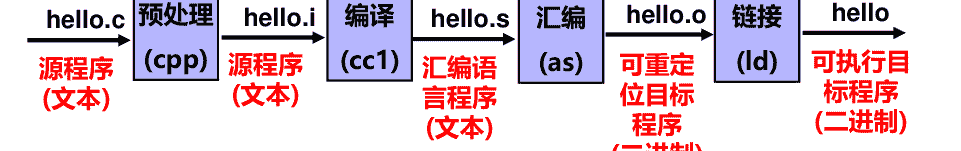

## 可执行程序是怎么执行的？

Red: shell命令行处理
Blue: 可执行文件加载
Cyan: hello程序执行过程

$ ./hello
hello, world
$

CPU
控制器
寄存器堆
ALU
总线接口部件
处理器总线
存储器总线
I/O
桥接器
主存储器
"./hello"
"hello,world/n"

I/O总线
扩展槽
USB控制器
鼠标
键盘
"./hello"
显示适配器
显示器
"hello,world/n"
磁盘控制器
磁盘
hello可执行文件

数据经常在各存储部件间传送。故现代计算机大多采用“缓存”技术！

所有过程都是在CPU执行指令所产生的控制信号的作用下进行的。

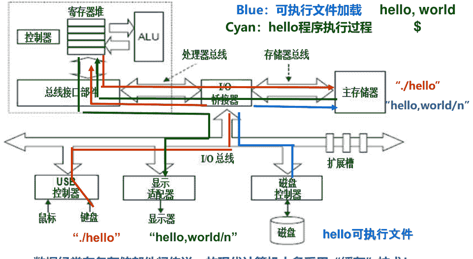

## 计算机系统层次模型

功能转换：上层是下层的抽象，下层是上层的实现
底层为上层提供支撑环境！

程序执行结果
不仅取决于
算法、程序编写
而且取决于
语言处理系统
操作系统
ISA-机器语言
微体系结构

ISA是对硬件的抽象

不同计算机课程
处于不同层次
必须将各层次关联起来解决问题

最高层抽象就是点点鼠标、拖拖图标、敲敲键盘，但这背后有多少层转化啊！

软件

硬件

最终用户

程序员

所有软件功能都建立在ISA之上

架构师

电子工程师

| 应用 (问题) |
| 算法 |
| 编程 (语言) |
| 操作系统虚拟机 |
| 指令集体系结构 (ISA) |
| 微体系结构 |
| 功能部件 |
| 电路 |
| 器件 |

## 本课程在CS/CE 课程体系中的角色

主修专业毕业需4门公共课 辅修专业需再修1门公共课 满足知识覆盖需求

主修专业毕业（外加12学分选修课）

辅修专业毕业（外加36学分选修课）

设计-构造-评价训练

确定主修专业/辅修专业

理解与应用训练

思维与学科

数学基础

数据与算法结构

机器结构

软件结构

## 计算机大类专业课程选择框架（总学分：主修 159.5+辅修 21.0）

| 学校要求 |  |  | 学校大类专业要求 |  |  | 学院毕业要求（学生选择毕业） |  |  |  |
|---|---|---|---|---|---|---|---|---|---|
| 类别 | 课程 | 学期 | 学分 | 类别 | 课程 | 学期 | 学分 | 主修专业 | 类别 | 课程 | 学期 | 学分 |
| 公共基础课 |  |  | 23.0 | 数学与自然科学基础课 |  |  | 8.0 |  | 专业选修课：四类课程中分别选一 |  |  | 12.0 |
|  | 思想道德与通识修养... | 1 秋 | 2.0 |  | 集合与图论 | 1 春 | 4.0 | 限选 1 | 计算理论 | 课程+实验 | 3 秋 | 3.0 |
|  | 中国近现代史纲要 | 1 春 | 2.0 |  | 概率论与数理统计 | 2 秋 | 2.0 | 限选 2 | 编译系统 | 课程+实验 | 3 秋 | 3.0 |
|  | 毛泽东思想...概论 | 2 春 | 4.0 |  | 近世代数 | 2 春 | 2.0 | 限选 3 | 数据库系统 | 课程+实验 | 3 春 | 3.0 |
|  | 马克思主义基本原理 | 2 春 | 3.0 | 专业基础课 |  |  | 30.0 | 限选 4 | 人工智能 | 课程+实验 | 3 春 | 3.0 |
|  | 军事理论与军事训练 | 1 秋 | 3.0 |  | 计科导论专业导论 | 1 秋 | 2.0 | 专业核心方向系列 九大方向之一 参见另表 |  |  |  | 12.0 |
|  | 大学外语 | 1-2 学年 | 6.0 |  | 高级语言程序设计 | 1 秋 | 3.0 | 系列 I/II | 计算机系统 | 课程+P&WIM | 3 秋 | 4.5 |
|  | 体育 | 1-2 学年 | 3.0 |  | 数字逻辑与数字系统设计 | 1 春 | 3.5 | 系列 I/III | 课程+P&WIM | 3 春 | 4.5 |
| 数学与自然科学基础课 |  |  | 24.5 |  | 计算机系统 I-计算机组织 | 2 秋 | 2.5 | 系列 I/III | 课程：按选修程度 | 3 春/4 秋 | 3.0 |
|  | 微积分 | 1 秋 1 春 | 11.0 |  | 计算机系统 II-操作系统 | 2 秋 | 2.5 | 注：P&WIM=Project & Writing Intensive Module, |  |  |  |  |
|  | 代数与几何 | 1 秋 | 4.0 |  | 数据结构与算法 | 2 秋 | 3.5 | 专业核心满足专业方向选修和学分要求 |  |  |  | 12.0 |
|  | 概率论与数理统计 | 2 秋 | 3.0 |  | 算法设计与分析(数值算法) | 2 春 | 4.0 | 专业选修 1 | （学生选择） | 3 秋-4 秋 | 2.0 |
|  | 主体科学素养与应用 | 1 秋 | 1.0 |  | 软硬件 I-编译原理与方法 | 2 春 | 2.5 | 专业选修 2 | （学生选择） | 3 秋-4 秋 | 2.0 |
|  | 大学物理 III | 1 春 | 4.5 |  | 软硬件 II-面向对象软件构造 | 2 春 | 2.5 | 专业选修 3 | （学生选择） | 3 秋-4 秋 | 2.0 |
|  | 大学物理实验 II | 1 春 | 1.0 |  | 形式语言与自动机 | 2 春 | 2.0 | 专业选修 4 | （学生选择 中外 1） | 3 秋-4 秋 | 2.0 |
| 人文与社会科学类课程 |  |  | 10.0 |  | 信息安全概论 | 2 春 | 2.0 | 专业选修 5 | （微专题模型课程选 1） | 3 秋-4 秋 | 2.0 |
|  | （哲学类 1） | 4 秋前 | 1.5 | 跨学科课程 |  |  | 6.0 | 专业选修 6 | （微专题模型课程选 1） | 3 秋-4 秋 | 2.0 |
|  | （城镇与建设类 1） | 4 秋前 | 1.5 |  | （学生选择课程） | 2-3 学年 | 3.0 | 辅修专业核心课程方向系列 |  |  |  | 15.0 |
|  | （工业与经济类 1） | 4 秋前 | 1.5 |  | （学生选择课程） | 2-3 学年 | 3.0 | 限选 | （学生选择） | 3-学年 | 3.0 |
|  | （哲学类 1） | 4 秋前 | 1.5 | 其他课程 | （计入学分） |  | 4.0 | 系列 2/I | 课程+P&WIM | 3 秋 | 4.5 |
|  | （文学艺术与美类 1） | 4 秋前 | 1.5 |  | 企业认识实习 | 2 夏 | 2.0 | 系列 2/II | 课程+P&WIM | 3 春 | 4.5 |
|  | （文学艺术与美类 1） | 4 秋前 | 1.5 |  | 独立学习与技术交流 | 3 夏 | 1.0 | 系列 2/III | 课程：按选修程度 | 3 春/4 秋 | 3.0 |
| 讲座 | 文学类讲座与阅读 | 4 秋前 | 1.0 |  | 领导力训练 | 2-3 学年 | 1.0 | 辅修专业-专业选修模块 |  |  |  | 6.0 |
| 创新创业类 |  |  | 4.0 | 国际课程（不少于 1.0 学分） |  |  |  | 辅修-选修 1 | （学生选择） | 3 秋/夏 | 2.0 |
|  | 年度创新项目实践 | 1 春-2 秋 | 1.0 |  | 与国际类课程共享学分 |  | 1.0 | 辅修-选修 2 | （学生选择） | 3 秋/夏 | 2.0 |
|  | （学生资源管理与实践） | 4 秋前 | 3.0 | 毕业设计 |  |  | 14.0 | 辅修-选修 3 | （微专题模型课程选 1） | 3 秋/4 秋 | 2.0 |
|  |  |  |  | 毕业设计 | 4 春 | 14.0 |  |  |  |  |  |


## 各专业方向-分学期-专业核心课程，暨大学分系列课程

| 专业方向 | 系列课程 | 课程 I（3秋） | 课程 II（3春） | 课程 III（3春/4秋） | 课程 I-III 联合实现的实验-复杂工程问题求解能力训练（3秋、3春或4秋） |
|---|---|---|---|---|---|
| 专业公共课 |  |  |  |  |  |
| 计算机大类/软件工程大类 |  | 计算机网络 | 数据库系统 |  | 仅存在对应各课程的实验，各课程间无联系。 |
|  |  | 编译系统 | 人工智能 |  |  |
| 专业方向 |  |  |  |  |  |
| A1-计算机工程 |  | 计算机组织与体系结构 | 操作系统设计与实现 | 嵌入式系统设计与实现 | 典型嵌入式计算机的设计、实现与分析 |
| A2-计算机科学 |  | 触碰计算 | 触碰算法 | 计算理论 | 典型机器学习处理系统的设计、实现与分析 |
| A3-并行与分布 |  | 并行与分布式系统 | 并行与分布算法 | 云计算 | 典型并行/分布算法的设计、实现与分析 |
| B1-自然语言处理 |  | 机器学习 | 自然语言处理 | 信息检索 | 典型机器学习系统设计、实现与分析 |
| B2-感知信息处理 |  | 视觉感知信号处理 | 模式识别与深度学习 | 视觉感知信息解码 | 典型感知信息系统设计、实现与分析 |
| B3-数据科学与大数据技术 |  | 大数据计算基础 | 大数据分析 | 数据库控制 | 典型大数据系统设计、实现与分析 |
| C1/1-信息安全-网络安全 |  | 密码学原理与应用 | 网络安全 | 软件安全 | 典型内容安全系统的设计、实现与分析 |
| C1/2-信息安全-内容安全 |  | 系统安全 | 信息内容安全 | 逆向分析 | 典型网络安全系统的设计、实现与分析 |
| D1-生物信息学 |  | 生物信息学 | 基因组信息学 | 系统生物学 | 生物信息学算法训练、实现与分析 |
| E1-物联网工程 |  | 信息物理系统-模型与建模 | 信息物理系统-技术与系统 | 信息物理系统-分析与验证 | 典型信息物理系统的设计、实现与分析 |

## 软件工程大类专业课程选择框架（总学分：主修 159.5）

### 学校要求

| 类别 | 课程 | 学期 | 学分 |
|---|---|---|---|
| 公共基础课 |  |  | 23.0 |
|  | 思政课... | 1秋 | 2.0 |
|  | 中国近现代史纲要 | 1春 | 2.0 |
|  | 毛泽东思想...概论 | 2秋 | 4.0 |
|  | 马克思主义基本原理 | 2春 | 3.0 |
|  | 军事理论 | 1秋 | 3.0 |
|  | 大学外语 | 1-2学年 | 6.0 |
|  | 体育 | 1-2学年 | 3.0 |
| 数学与自然科学基础课 |  |  | 24.5 |
|  | 微积分 | 1秋、春 | 11.0 |
|  | 代数与几何 | 1秋 | 4.0 |
|  | 概率与数理统计 | 2秋 | 3.0 |
|  | 生命科学基础与应用 | 1秋 | 1.0 |
|  | 大学物理Ⅲ | 1春 | 4.5 |
|  | 大学物理实验Ⅱ | 1春 | 1.0 |
| 人文与社会科学基础课 |  |  | 8.5 |
|  | （文学艺术与审美素养1） | 1-2学年 | 1.5 |
|  | （文学艺术与审美素养2） | 1-2学年 | 1.5 |
|  | （伦理与修养1） | 1-2学年 | 1.5 |
|  | （体育素养1） | 1-2学年 | 1.5 |
|  | 软件与社会 | 1-2学年 | 1.5 |
| 讲座 | 文化素质教育讲座 | 4秋前 | 1.0 |
| 创新创业课 |  |  | 4.0 |
|  | 年度创新项目实践 | 1春/2秋 | 1.0 |
|  | IT企业创设与管理 | 4秋前 | 1.0 |
|  | （学生选修课程与学分） | 4秋前 | 2.0 |

### 学院-大类专业要求

| 类别 | 课程 | 学期 | 学分 |
|---|---|---|---|
| 数学与自然科学基础 |  |  | 8.0 |
|  | 集合论与图论 | 1春 | 2.0 |
|  | 数理逻辑 | 2秋 | 2.0 |
|  | 计算方法 | 2春 | 2.0 |
|  | 运筹学 | 2春 | 2.0 |
| 专业基础课 |  |  | 26.0 |
|  | 软件工程导论 | 1秋 | 3.0 |
|  | 高级语言程序设计 | 1秋 | 3.0 |
|  | 基于平台的软件开发（选一） | 1春 | 2.5 |
|  | 计算机系统-计算机组织 | 2春 | 2.5 |
|  | 计算机系统-计算机系统 | 2秋 | 2.5 |
|  | 数据结构与算法 | 2秋 | 2.5 |
|  | 算法设计与分析 | 2春 | 3.0 |
|  | 软件构件-面向对象方法 | 2春 | 2.5 |
|  | 软件架构-面向服务的软件构造 | 2春 | 2.5 |
|  | 软件项目管理 | 2春 | 2.0 |
| 商务类课程 |  |  | 7.5 |
|  | （财务与金融管理课程1） | 1-3学年 | 2.0 |
|  | （企业管理类课程1） | 1-3学年 | 2.0 |
|  | （市场营销课程1） | 1-2学年 | 2.0 |
|  | 师资选训 | 1-2学年 | 1.5 |
| 其他课程（计学分） |  |  | 4.0 |
|  | 企业实习 | 2夏 | 2.0 |
|  | 独立学习与技术交流 | 3夏 | 1.0 |
|  | 领导力训练 | 2-3学年 | 1.0 |
| 毕业设计 |  |  | 14.0 |
|  | 毕业设计 | 4春 | 14.0 |

### 学院-专业要求

**主修专业**

| 类别 | 课程（学生选修专业） | 学期 | 学分 |
|---|---|---|---|
| 专业选修课： |  |  | 12.0 |
| 限定1 | 计算机网络（课程+实验） | 3秋 | 3.0 |
| 限定2 | 编译原理（课程+实验） | 3秋 | 3.0 |
| 限定3 | 数据库系统（课程+实验） | 3春 | 3.0 |
| 限定4 | 人工智能（课程+实验） | 3春 | 3.0 |
| 专业核心-必修系列 |  |  | 9.0（或6.0） |
| 系列1/1 | （课程+P&WIM） | 3秋 | 4.5（或3.0） |
| 系列1/1 | （课程+P&WIM） | 3春 | 4.5（或3.0） |
| 专业核心-方向系列（本专业设专业方向） |  |  |  |
| 系列2/1 | （课程+P&WIM） | 3秋 | 3.0（或4.5） |
| 系列2/1 | （课程+P&WIM） | 3春 | 3.0（或4.5） |
| 专业选修课：满足专业方向要求和学分需求 |  |  | 4.0 |
| 专业选修1 | （国际媒体中心1） | 3秋/4秋 | 2.0 |
| 专业选修2 | （视觉和媒体网络1） | 3秋/4秋 | 2.0 |
| 国院课程（不少于2.0学分） |  |  |  |
|  | （与所列课程相关学分） |  | 2.0 |
| 工学实习 |  |  | 9.0 |
|  | 工学实习（在企业） | 4秋 | 9.0 |

注：P&WIM = Project & Writing Intensive Module  
注：两个核心课程系列必须，但只需完成1个系列的P&WIM

## 各专业方向-分学期-专业核心课程，暨大学分系列课程

| 专业方向 | 系列课程 | 课程 I（3秋） | 课程 II（3春） | 课程 I-II 联合实现的实验-复杂工程问题求解能力训练（3秋/3春） |
|---|---|---|---|---|
| 专业公共课 |  |  |  |  |
| 软件工程大类 |  | 计算机网络 | 数据库系统 | 仅存在对应各课程的实验，各课程间无联系。 |
|  |  | 编译系统 | 人工智能 |  |
| 专业方向 |  |  |  |  |
| F1-软件工程（必修） |  | 软件设计与工具 I-需求分析与系统设计<br>软件过程与工具 II-软件过程与配置管理<br>移动开发 | 软件架构与中间件 I-软件体系结构与中间件<br>软件架构与中间件 II-软件测试与质量保障 | 典型教务系统的设计、实现与分析 |
| N1-服务工程（可选一） |  | 面向服务的体系结构 | 服务工程与应用 | 典型服务系统的设计、实现与分析 |
| N2-移动互联网与数字媒体（可选一） |  | 移动互联网技术 | 数字媒体技术 | 面向数字媒体的典型移动系统设计、实现与分析 |
| S-其他学科方向（可选一） |  | 跨学科核心课程 I+P&WIM（要求 I 和 II 必须同一学期） | 跨学科核心课程 II+P&WIM（要求 I 和 II 必须同一学期） | 典型 XX 学科计算系统的设计、实现与分析 |

## 作弊：描述

- 什么是作弊？
  - 共享代码：通过拷贝、重敲、看看或提供文件
  - 口述：一个人向其他人口头描述代码
  - 辅导：一行一行地帮你的朋友写实验
  - 网上搜索答案
  - 从以前的课程或作业中拷贝代码
    - 只被允许使用我们提供的代码，或来自课程网站的代码（CS:APP website）
- 什么不是作弊？
  - 解释怎么使用系统和工具
  - 帮助其他人解决高层次的设计问题

## 作弊：后果

- 对作弊的处罚：
  - 不及格！
  - 会被蔑视
- 作弊的检查：
  - 我们有专业的代码剽窃检查工具
- 不要作弊！
  - 提早动手
  - 实在做不下去可以请教助教

## 教材

- **Randal E. Bryant and David R. O’Hallaron,**
  - *Computer Systems: A Programmer’s Perspective*, **Third Edition**（CS:APP3e）, Pearson, 2016；深入理解计算机系统（第3版）- 机械工业出版社
  - http://csapp.cs.cmu.edu
  - 这本书对这门课很重要！
    - 如何解决实验
    - 练习题中有典型的考试题目
- 计算机系统基础
  - 南京大学 袁春风


## 课程组成
- 大班讲授
  - 概念为主
- 复习-练习-习题
  - 习题检验，代码验证
- 实验 (8次)
  - 课程的心脏
  - 每次1-2 周
  - 提供对系统的某方面的深入理解
  - 编程和测试
- 考试
  - 测试你对概念和原理的理解

## 获得帮助
- 课程 **Web**网站: http://www.cs.cmu.edu/~213
  - 完整的课程资料
  - 课件、作业、测验、答案
  - 作业的说明

## 政策：实验和检查
- 考试
  - 一纸开卷
  - 只占50%

## 评分

| 考核环节 | 建议分值比例 | 考核/评价细则 |
|---|---|---|
| 实验 | 30% | 1. linux 下C工具应用；3学时；2分<br>2. 数据表示；3学时；4分<br>3. 破解：二进制炸弹；3学时；4分<br>4. 漏洞攻击；3学时；4分<br>5. Cache高速缓冲器；3学时；4分<br>6. 链接实验；3学时；4分<br>7. 微壳TinyShell；3学时；4分<br>8. 存储器分配；3学时；4分 |
| 作业 | 10% | 平时作业5次：汇编2次，组原1次，编译连接1次，OS1次 |
| 大作业 | 10% | 大作业3次：汇编3分、组原4分、OS3分，格式为毕设论文的正文。 |
| 期末考试 | 50% | 一纸开卷试卷 |

## 程序与数据
- 主题
  - 位操作,算术预算,汇编语言程序
  - C控制与数据结构的表示
  - 包括体系结构与编译的方面
- 作业
  - L1 (datalab): 位操作
  - L2 (bomblab): 拆除一个二进制炸弹
  - L3 (attacklab):代码注入攻击的基础知识

## 存储器层次
- 主题
  - 存储技术,存储层次, 高速缓冲器, 磁盘, 局部性
  - 包括体系结构与编译的方面
- 作业
  - L4 (cachelab): 建立一个 cache模拟器, 并为局部性进行优化.
  - 学习如何在你的程序中利用局部性.

## 异常控制流
- 主题
  - 硬件异常, 进程, 进程控制, Unix信号, 非局部跳转
  - 包括体系结构、OS与编译的方面
- 作业
  - L5 (tshlab): 编写自己的 Unix 外壳.
    - 第一次引入并发

## Welcome
and Enjoy!

# 第2章 信息的表示和处理 I：位、整数

教师：吴锐
计算机科学与技术学院
哈尔滨工业大学

## 主要内容: 位、字节和整型数
- 信息的位表示
- 位级运算
- 整型数
- 表示: 无符号数和有符号数
- 无符号数和有符号数的转换
- 扩展、截断
- 整数运算: 加、非、乘、移位
- 总结
- 内存、指针、字符串表示

## 为什么用二进制？
- 十进制——适合人类使用
  - 有10个手指的人类
  - 1000年前源自印度、12世纪发展于阿拉伯、13世纪到西方
- 二进制——更适合机器使用
  - 容易表示、存储
    - 打孔纸带上是/否有空
    - 磁场的顺时针/逆时针
  - 容易传输
    - 导线上的电压高/低
    - 可以在有噪声、不精确的电路上可靠传输

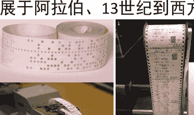
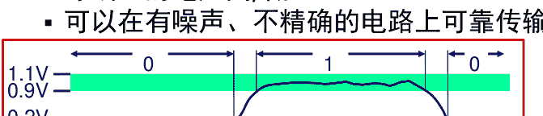
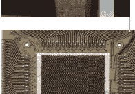

## 位、字节
- 计算机存储、处理的信息：二值信号
- “位” 或 “比特”
  - 最底层的二进制数字（数码）称为位（bit，比特），值为0或1
  - 数字革命的基础
- 位组合
  - 把位组合到一起，采用某种规则进行解读
  - 每个位组合都有意义
- 字节：8-bit块
  - 人物：Dr. Werner Buchholz，1956年7月
  - 事件：IBM Stretch computer的早期设计阶段


## 进制

数的通用表示

10进制：
3721 = 3×10³+7×10²+2×10¹+1×10⁰

N= ± aₙ aₙ₋₁ … a₁ a₀ . b₁ b₂ … bₘ

k进制：
N= ± aₙ × kⁿ + aₙ₋₁ × kⁿ⁻¹ + … + a₁ × k¹ + a₀ × k⁰
+ b₁ × k⁻¹ + b₂ × k⁻² + … + bₘ × k⁻ᵐ

其中 aᵢ，bⱼ 是 0 ~ k-1 中的一个数码

## 二进制数
- 特点：逢二进一，由0和1两个数码组成，基数为2，各个位权以2^i表示
- 二进制数：
  aₙ aₙ₋₁ ... a₁ a₀ . b₁ b₂ ... bₘ =
  aₙ × 2ⁿ + aₙ₋₁ × 2ⁿ⁻¹ + ... + a₁ × 2¹ + a₀ × 2⁰
  + b₁ × 2⁻¹ + b₂ × 2⁻² + ... + bₘ × 2⁻ᵐ
  其中 aᵢ， bⱼ 非0即1
  便于计算机存储、算术运算简单、支持逻辑运算

## 二进制数
- MSB：最高有效位（Most Significant Bit）
- LSB：最低有效位（Least Significant Bit）

MSB
LSB
1 0 1 1 0 0 1 0 1 0 0 1 1 1 0 0
15
0

数字串长、书写和阅读不便

## 十六进制数
- 基数16，逢16进位，位权为16^i，16个数码：
  0, 1, 2, 3, 4, 5, 6, 7, 8, 9, A, B, C, D, E, F
- 十六进制数：
  aₙ aₙ₋₁ … a₁ a₀ . b₁ b₂ … bₘ =
  aₙ × 16ⁿ + aₙ₋₁ × 16ⁿ⁻¹ + … + a₁ × 16¹ + a₀ × 16⁰
  + b₁ × 16⁻¹ + b₂ × 16⁻² + … + bₘ × 16⁻ᵐ
  其中 aᵢ， bⱼ 是 0 ~ F 中的一个数码

## 十六进制数的加减运算
- 十六进制数的加减运算类似十进制
  - 逢16进位1，借1当16
- 二进制和十六进制数之间具有对应关系：
  每4个二进制位对应1个十六进制位

23D9H + 94BEH = B897H
A59FH − 62B8H = 42E7H

00111010B = 3AH， F2H = 11110010B

与二进制数相互转换简单、阅读书写方便

## 进制转换
- 十进制整数转换为k(2、8或16)进制数

整数转换：用除法—除基取余法
- 十进制数整数部分不断除以基数k(2、8或16)，并记下余数，直到商为0为止
- 由最后一个余数起，逆向取各个余数，则为转换成的二进制和十六进制数

126=01111110B  二进制数用后缀字母B
126=7EH  十六进制数用后缀字母H

## 进制转换
- 十进制小数转换为k(2、8或16)进制数...

小数转换：用乘法—乘基取整法
乘以基数k，记录整数部分，直到小数部分为0为止

0.8125=0.1101B
0.8125=0.DH

- 小数转换会发生总是无法乘到为0的情况
- 可选取一定位数（精度）
- 将产生无法避免的转换误差

## 进制转换

例1: (835.6875)₁₀ = (11 0100 0011.1011)₂

整数---- “除基取余，上右下左”
小数---- “乘基取整，上左下右”

简便方法：835=512+256+64+2+1，故结果为 11 0100 0011
0.6875=0.5+0.125+0.0625，故结果为 0.1011

结果为 11 0100 0011.1011

这里有一个问题：小数点在计算机中如何表示？

## 进制转换
- k进制数转换为十进制数
  方法：按权展开
  - 二进制数转换为十进制数
    0011.1010B
    =1×2¹+1×2⁰+1×2⁻¹+0×2⁻²+1×2⁻³ =3.625
  - 十六进制数转换为十进制数
    1.2H =1×16⁰+2×16⁻¹ =1.125
- 2、8、16进制间的转换
  4个2进制位对应1个16进制位
  3个2进制位对应1个8进制位


## 定点数与浮点数

- 计算机中只有0和1，数值数据中的小数点怎么表示呢？
  - 计算机中只能通过约定小数点的位置来表示
    - 小数点位置约定在固定位置的数称为定点数
    - 小数点位置约定为可浮动的数称为浮点数

- 定点小数用来表示浮点数的尾数部分

- 定点整数用来表示整数，分带符号整数和无符号整数

- 任何实数：X = (-1)^s × M × R^E

其中，S取值为0或1，用来决定数X的符号；M是一个二进制定点小数，称为数X的尾数（mantissa）；E是一个二进制定点整数，称为数X的阶或指数（exponent）；R是基数（radix, base），可以为2、4和16等。计算机中只要表示S、M和E三个信息，就能确定X的值，这称为浮点数

结论：要解决数值数据的表示问题，只要解决定点数的编码问题！

| S | E |   | M |
|---|---|---|---|

## 主要内容: 位、字节和整型数

- 信息的位表示
- 位级运算
- 整型数
  - 表示：无符号数和有符号数
  - 无符号数和有符号数的转换
  - 扩展、截断
  - 整数运算：加、非、乘、移位
  - 总结
- 内存、指针、字符串表示

### 2.1.6布尔代数(Boolean Algebra)

- **George Boole(1815-1864)提出**
  逻辑的代数表示
  - 逻辑值 “True(真)” 编码为 1
  - 逻辑值 “False(假)” 编码为 0
- **Claude Shannon(1916-2001)创立信息论**
  - 将布尔代数与数字逻辑关联起来
- **是数字系统设计与分析的重要工具**


## 布尔代数(Boolean Algebra)

## 与(And)

- 当A=1 并且 B=1时， A&B = 1

| & | 0 | 1 |
|---|---|---|
| 0 | 0 | 0 |
| 1 | 0 | 1 |

## 或(Or)

- 当A=1 或 B=1时， A|B = 1

| | 0 | 1 |
|---|---|---|
| 0 | 0 | 1 |
| 1 | 1 | 1 |

## 非(Not)

- 当A=0时， ~A = 1

| ~ |  |
|---|---|
| 0 | 1 |
| 1 | 0 |

## 异或(Exclusive-Or,Xor)

- 当A=1 或 B=1且两者不同时为1， A^B = 1

| ^ | 0 | 1 |
|---|---|---|
| 0 | 0 | 1 |
| 1 | 1 | 0 |

## 一般的布尔代数

- 位向量操作(Operate on Bit Vectors)
  - 按位运算
    01101001 & 01010101
    01000001
    01101001 | 01010101
    01111101
    ~ 01010101
    10101010
    01101001 ^ 01010101
    00111100

- 布尔代数的全部性质均适用
  - 交换律
  - 结合律
  - 分配律：&对|，或者|对&的分配
  - 加法逆元： a^a = 0(加法为^， a的逆元是它本身)

## 示例:集合的表示与运算

- 表示：位向量表示有限集合
  - 宽度 w 个比特的位向量[a_{w-1},..., a_1, a_0]表示集合 {0, ..., w-1} 的子集A
  - a_j = 1 当且仅当 j ∈ A
    - 01101001  {0, 3, 5, 6}
      76543210
    - 01010101  {0, 2, 4, 6}
      76543210

- 运算
  - &  交集(Intersection)  01000001  {0, 6}
  - |  并集(Union)  01111101  {0, 2, 3, 4, 5, 6}
  - ^  对称差集(Symmetric difference)  00111100  {2, 3, 4, 5}
  - ~  补集(Complement)  10101010  {1, 3, 5, 7}

## RGB Color Model

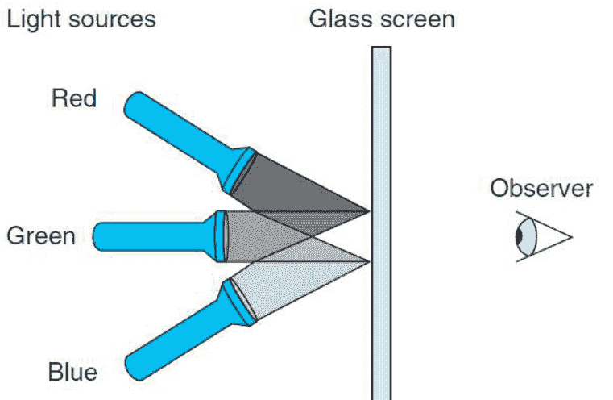

## RGB Color Model


| R | G | B | Color |
|---|---|---|-------|
| 0 | 0 | 0 | Black |
| 0 | 0 | 1 | Blue |
| 0 | 1 | 0 | Green |
| 0 | 1 | 1 | Cyan |
| 1 | 0 | 0 | Red |
| 1 | 0 | 1 | Magenta |
| 1 | 1 | 0 | Yellow |
| 1 | 1 | 1 | White |

## RGB Color Model

- 颜色中的每一种都可以用一个长度为3的位向量表示，从而进行布尔运算
  - 一种颜色的补通过关掉打开的电源和打开关闭的电源形成

- 描述下列颜色的布尔运算的结果：
  - Blue | Green = Cyan蓝绿色（011）
  - Yellow & Cyan = Green绿色（010）
  - Red ^ Magenta = Blue蓝色（001）

### 2.1.7 C语言中的位级运算

- C语言中的位运算： &, |, ~, ^

- 适用于任何整型数据类型： long, int, short, char, unsigned

- 将操作数视为位向量

- 将参数按位运算

## 例子(char 类型)

- ~0x41 → 0xBE

- ~01000001₂ →10111110₂

- ~0x00 → 0xFF

- ~00000000₂ →11111111₂

- 0x69 & 0x55 →0x41

- 01101001₂ & 01010101₂ →01000001₂

- 0x69 | 0x55 →0x7D

- 01101001₂ | 01010101₂ →01111101₂

## 巧用异或

半加器： S = A ⊕ B
C = A B

- 按位异或是一种加的形式
- A ^ A = 0

```
int inplace_swap(int *x, int *y)
{
    *x = *x ^ *y;  /* #1 */
    *y = *x ^ *y;  /* #2 */
    *x = *x ^ *y;  /* #3 */
}
```

A^0 = A
A^1 = ¬ A

| Step | *x | *y |
|---|---|---|
| Begin | A | B |
| 1 | A^B | B |
| 2 | A^B | (A^B)^B = A^(B^B) = A^0 = A |
| 3 | (A^B)^A = (B^A)^A = B^(A^A) = B^0 = B | A |
| End | B | A |

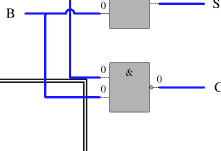

## 巧用异或

/*数组元素首尾两端依次对调*/

```
1 void reverse_array(int a[], int cnt) {
2 int first, last;
3 for (first = 0, last = cnt-1;
4     first <= last;
5     first++,last--)
6     inplace_swap(&a[first], &a[last]);
7 }
```

### 2.1.8 对比: C语言的逻辑运算

- C语言的逻辑运算符： &&, ||, !
- 将0 视作 逻辑“False(假)”
- 所有非0值视作逻辑 “True(真)”
- 计算结果总是0 或 1
- 提前终止(Early termination)、短路求值(short cut)
- 例子(char 数据类型)
- !0x41 → 0x00
- !0x00 → 0x01
- !!0x41 → 0x01
- 0x69 && 0x55 → 0x01
- 0x69 || 0x55 → 0x01
- p && *p (避免空指针访问)


## 主要内容: 位、字节 和 整型数

- 信息的位表示
- 位级运算
- 整型数
  - 表示：无符号数和有符号数
  - 无符号数和有符号数的转换
  - 扩展、截断
  - 整数运算：加、非、乘、移位
  - 总结
- 内存、指针、字符串表示
- 总结

## 计算机内的数值表示——编码

需要考虑的问题

- 1. 编码的长度
- 2. 数的符号
- 3. 数的运算

## 字节值编码

- Byte = 8 bits
- 2进制(Binary) 00000000₂ — 11111111₂
- 10进制(Decimal): 0₁₀ — 255₁₀
- 16进制(Hexadecimal): 00₁₆ — FF₁₆

| Hex | Decimal | Binary |
|------|---------|--------|
| 0 | 0 | 0000 |
| 1 | 1 | 0001 |
| 2 | 2 | 0010 |
| 3 | 3 | 0011 |
| 4 | 4 | 0100 |
| 5 | 5 | 0101 |
| 6 | 6 | 0110 |
| 7 | 7 | 0111 |
| 8 | 8 | 1000 |
| 9 | 9 | 1001 |
| A | 10 | 1010 |
| B | 11 | 1011 |
| C | 12 | 1100 |
| D | 13 | 1101 |
| E | 14 | 1110 |
| F | 15 | 1111 |

## C数据类型的宽度

| C 数据类型 | 32位 | 64位 | x86-64 |
|---|---|---|---|
| char | 1 | 1 | 1 |
| short | 2 | 2 | 2 |
| int | 4 | 4 | 4 |
| long | 4 | 8 | 8 |
| float | 4 | 4 | 4 |
| double | 8 | 8 | 8 |
| long double | – | – | 10/16 |
| pointer | 4 | 8 | 8 |

## 2.2 整数编码(Encoding Integers)

## 无符号数

## 有符号数——补码(Two’s Complement)

B2U(X) = Σᵢ₌₀ʷ⁻¹ xᵢ·2ⁱ

B2T(X) = -x_{w-1}·2^{w-1} + Σᵢ₌₀^{w-2} xᵢ·2ⁱ

```
short int x = 15213;
short int y = -15213;
```

符号位

## C short : 2 字节

| | 10 进制 | 16 进制 | 2 进制 |
|---|---|---|---|
| x | 15213 | 3B 6D | 00111011 01101101 |
| y | -15213 | C4 93 | 11000100 10010011 |

## 符号位

- 对于补码(2’s complement), 最高位表示符号
  - 0 表示非负数（!= 正数），1 表示负数

## 补码示例

x = 15213: 00111011 01101101
 y = -15213: 11000100 10010011

| 权重 | 15213 | -15213 |
|---|---|---|
| 1 | 1 1 | 1 1 |
| 2 | 0 0 | 1 2 |
| 4 | 1 4 | 0 0 |
| 8 | 1 8 | 0 0 |
| 16 | 0 0 | 1 16 |
| 32 | 1 32 | 0 0 |
| 64 | 1 64 | 0 0 |
| 128 | 0 0 | 1 128 |
| 256 | 1 256 | 0 0 |
| 512 | 1 512 | 0 0 |
| 1024 | 0 0 | 1 1024 |
| 2048 | 1 2048 | 0 0 |
| 4096 | 1 4096 | 0 0 |
| 8192 | 1 8192 | 0 0 |
| 16384 | 0 0 | 1 16384 |
| -32768 | 0 0 | 1 -32768 |
| 总计 | 15213 | -15213 |

## 数值范围

- 无符号数值
  - UMin = 0
    000...0
  - UMax = 2^w − 1
    111...1

- 补码数值
  - TMin = −2^(w−1)
    100...0
  - TMax = 2^(w−1) − 1
    011...1
  - -1
    111...1

## 位数W = 16时的数值

| | 十进制 | 16 进制 | 二进制 |
|---|---|---|---|
| UMax | 65535 | FF FF | 11111111 11111111 |
| TMax | 32767 | 7F FF | 01111111 11111111 |
| TMin | -32768 | 80 00 | 10000000 00000000 |
| -1 | -1 | FF FF | 11111111 11111111 |
| 0 | 0 | 00 00 | 00000000 00000000 |

## 不同字长的数值

|  | W |
| 8 | 16 | 32 | 64 |
| UMax | 255 | 65,535 | 4,294,967,295 | 18,446,744,073,709,551,615 |
| TMax | 127 | 32,767 | 2,147,483,647 | 9,223,372,036,854,775,807 |
| TMin | -128 | -32,768 | -2,147,483,648 | -9,223,372,036,854,775,808 |

## 观察

- |TMin| = TMax + 1
- 非对称
- UMax = 2 * TMax + 1

## C语言的常量声明

```
#include <limits.h>
#define INT_MAX 2147483647
#define INT_MIN (-INT_MAX-1)
#define UINT_MAX 0xffffffff
```

## 平台相关

- #define ULONG_MAX
- #define LONG_MAX
- #define LONG_MIN (-LONG_MAX-1)

> Bryant and O'Hallaron, Computer Systems: A Programmer's Perspective, Third Edition

## 无符号数与有符号数编码的值

| X | B2U(X) | B2T(X) |
| --- | --- | --- |
| 0000 | 0 | 0 |
| 0001 | 1 | 1 |
| 0010 | 2 | 2 |
| 0011 | 3 | 3 |
| 0100 | 4 | 4 |
| 0101 | 5 | 5 |
| 0110 | 6 | 6 |
| 0111 | 7 | 7 |
| 1000 | 8 | -8 |
| 1001 | 9 | -7 |
| 1010 | 10 | -6 |
| 1011 | 11 | -5 |
| 1100 | 12 | -4 |
| 1101 | 13 | -3 |
| 1110 | 14 | -2 |
| 1111 | 15 | -1 |

- **相同**
  - 非负数值的编码相同

- **单值性**
  - 每个位模式对应一个唯一的整数值
  - 每个可描述整数有一个唯一编码

- **有逆映射**
  - U2B(x) = B2U^{-1}(x)
  - 无符号整数的位模式
  - T2B(x) = B2T^{-1}(x)
  - 补码的位模式

## 机器数与真值

机器数：最高位0表示非负数，1表示负数。

例如：

0 0 0 1 0 0 1 0

表示真值 +001 0010B = +18

1 0 0 1 0 0 1 0

表示真值 -001 0010B = -18

1 0 1 1 0 1 0 1

表示真值 —011 0101B = -53

## 1. 原码

例  x = + 1010111      y = − 1010111

[x]原 = 0 1010111      [y]原 = 1 1010111
符号 位      绝对值      符号 位      绝对值

“带符号的绝对值”

## 3. 补码

**正数的补码与其原码相同。**

（正数的原码、反码、补码均相同）

**负数的补码为：其反码的最低位加1。**

例　x = + 0110100　　 y = - 0110100

[x]补 = 00110100　　 [y]反 = 11001011

[y]补 = 11001100


## 主要内容: 位、字节 和 整型数

- 信息的位表示
- 位级运算
- 整型数
  - 表示：无符号数和有符号数
  - 无符号数和有符号数的转换
  - 扩展、截断
  - 整数运算：加、非、乘、移位
  - 总结
- 内存、指针、字符串表示

## 有符号/无符号数之间的转换

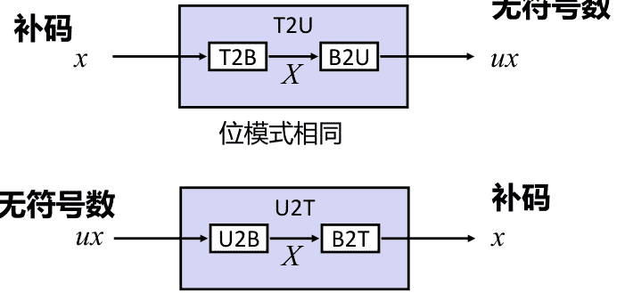

- 有符号数和无符号数转换规则：
  - 位模式不变、数值可能改变（按不同编码规则重新解读）

## 有符号↔无符号数的转换

| Bits | Signed | Unsigned |
|------|--------|----------|
| 0000 | 0 | 0 |
| 0001 | 1 | 1 |
| 0010 | 2 | 2 |
| 0011 | 3 | 3 |
| 0100 | 4 | 4 |
| 0101 | 5 | 5 |
| 0110 | 6 | 6 |
| 0111 | 7 | 7 |
| 1000 | -8 | 8 |
| 1001 | -7 | 9 |
| 1010 | -6 | 10 |
| 1011 | -5 | 11 |
| 1100 | -4 | 12 |
| 1101 | -3 | 13 |
| 1110 | -2 | 14 |
| 1111 | -1 | 15 |

| Bits | Signed | Unsigned |
|------|--------|----------|
| 0000 | 0 | 0 |
| 0001 | 1 | 1 |
| 0010 | 2 | 2 |
| 0011 | 3 | 3 |
| 0100 | 4 | 4 |
| 0101 | 5 | 5 |
| 0110 | 6 | 6 |
| 0111 | 7 | 7 |
| 1000 | -8 | 8 |
| 1001 | -7 | 9 |
| 1010 | -6 | 10 |
| 1011 | -5 | 11 |
| 1100 | -4 | 12 |
| 1101 | -3 | 13 |
| 1110 | -2 | 14 |
| 1111 | -1 | 15 |


## 有符号数和无符号数的关系

补码 x 经 T2U（由 T2B 和 B2U 组成）转换为无符号数 ux。位模式不变。x 的 w−1 位到 0 位中，大的负权值（如-1）变为大的正权值（Umax）。

### 转换的可视化

- 补码→无符号数
  - 顺序倒置
  - 负数 → 大整数

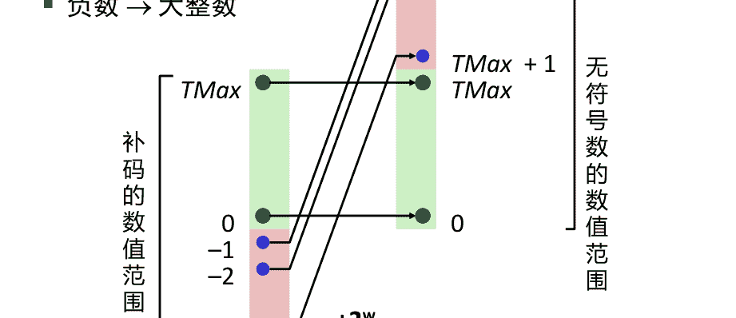

### 2.2.5 C语言中的有符号数和无符号数

数字默认是有符号数，无符号数用后缀 "U"，如 0U, 4294967259U。

```c
int tx, ty;
unsigned ux, uy;
tx = (int) ux;
uy = (unsigned) ty;
```

```c
tx = ux;
uy = ty;
```

## 类型转换的惊喜!

- **表达式计算**
  - 表达式中有符号和无符号数混用时：
    - **有符号数隐式转换为无符号数**
  - 包括比较运算符 `<, >, ==, <=, >=`
  - 例如 `W = 32:`
    - **TMIN = -2,147,483,648**
    - **TMAX = 2,147,483,647**

## 类型转换的惊喜！

| Constant1 | Constant2 | Relation | Evaluation |
|---|---|---|---|
| 0 | 0U | == | unsigned |
| -1 | 0 | < | signed |
| -1 | 0U | > | unsigned |
| 2147483647 | -2147483648 | > | signed |
| 2147483647U | -2147483648 | < | unsigned |
| -1 | -2 | > | signed |
| (unsigned)-1 | -2 | > | unsigned |
| 2147483647 | 2147483648U | < | unsigned |
| 2147483647 | (int) 2147483648U | > | signed |

## C语言中的整数

| 关系表达式 | 类型 | 结果 | 说明 |
|---|---|---|---|
| 0 == 0U | 无 | 1 | 00...0B = 00...0B |
| -1 < 0 | 带 | 1 | 11...1B (-1) < 00...0B (0) |
| -1 < 0U | 无 | 0* | 11...1B (2³²-1) > 00...0B(0) |
| 2147483647 > -2147483647 - 1 | 带 | 1 | 011...1B (2³¹-1) > 100...0B (-2³¹) |
| 2147483647U > -2147483647 - 1 | 无 | 0* | 011...1B (2³¹-1) < 100...0B(2³¹) |
| 2147483647 > (int) 2147483648U | 带 | 1* | 011...1B (2³¹-1) > 100...0B (-2³¹) |
| -1 > -2 | 带 | 1 | 11...1B (-1) > 11...10B (-2) |
| (unsigned) -1 > -2 | 无 | 1 | 11...1B (2³²-1) > 11...10B (2³²-2) |

带*的结果与常规预想的相反！

## 有符号数和无符号数转换的基本原则

- 位模式不变
- 重新解读（按目标编码类型的规则解读）
- 会有意外副作用：数值被 + 或 - 2^w

- 表达式含无符号数和有符号数时
  - 有符号数被转换成无符号数（如 int 转成 unsigned int）

## 主要内容: 位、字节 和 整型数

- 信息的位表示
- 位级运算
- 整型数
  - 表示：无符号数和有符号数
  - 无符号数和有符号数的转换
  - 扩展、截断
  - 整数运算：加、非、乘、移位
  - 总结
- 内存、指针、字符串表示

## 符号扩展

- 任务:
  - 给定 w 位的有符号整型数 x
  - 将其转换为 w+k 位的相同数值的整型数
- 规则:
  - 将最高有效位（符号位）x_{w-1} 复制 k 份:
  - X' = x_{w-1},..., x_{w-1}, x_{w-1}, x_{w-2},..., x_0
    k copies of MSB

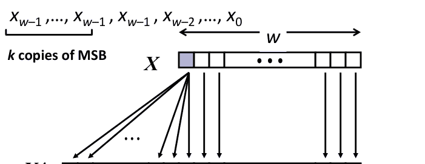

## 符号扩展示例

```c
short int x = 15213;
int     ix = (int) x;
short int y = -15213;
int     iy = (int) y;
```

|  | 十进制 | 16进制 | 二进制 |
|---|---|---|---|
| x | 15213 | 3B 6D | 00111011 01101101 |
| ix | 15213 | 00 00 3B 6D | 00000000 00000000 00111011 01101101 |
| y | -15213 | C4 93 | 11000100 10010011 |
| iy | -15213 | FF FF C4 93 | 11111111 11111111 11000100 10010011 |

从短整数类型向长整数类型转换时，C自动进行符号扩展

## 总结:扩展、截断的基本规则

- 扩展（例如从 short int 到 int 的转换）
  - 无符号数: 填充0
  - 有符号数: 符号扩展
  - 结果都是明确的预期值

- 截断（例如从 unsigned 到 unsigned short 的转换）
  - 无论有/无符号数: 多出的位均被截断
  - 结果重新解读
  - 无符号数: 相当于求模运算
  - 有符号数: 与求模运算相似
  - 对于小整数，结果是明确的预期值

练习题2.24


## 主要内容: 位、字节 和 整型数

- 信息的位表示
- 位级运算
- **整型数**
  - 表示：无符号数和有符号数
  - 无符号数和有符号数的转换
  - 扩展、截断
  - **整数运算：加、非、乘、移位**
- 内存、指针、字符串表示
- 总结

## 无符号数加法

- 操作数: w 位
- 真实和: w+1 位
- 丢弃进位: w 位

UAdd_w(x, y)

- 标准加法功能
  - 忽略进位输出
- 模数加法：相当于增加一个模运算

s = UAdd_w(x, y) = x + y mod 2^w

UAdd_w(x, y) = { x + y          x + y < 2^w
                  x + y - 2^w    x + y ≥ 2^w }

## 整数加法可视化示意图

### 整数加法

- 4-bit 整型数 x, y
- 计算真实值 Add₄(x, y)
- 和随 x 和 y 线性增加
- 表面为斜面形

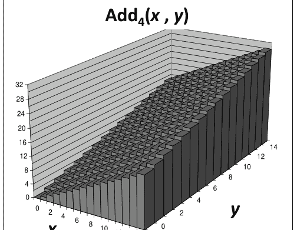

## 无符号数加法可视化示意图

- 数值面有弯折：
  - 当真实和≥ 2^w 时溢出
  - 最多溢出一次

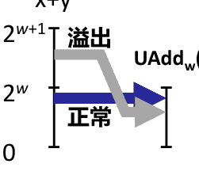

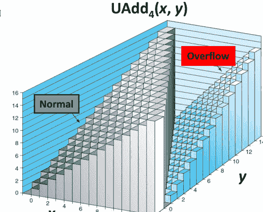

## 补码加法

- 操作数: w 位
- 真实和: w+1 位
- 丢弃进位: w 位

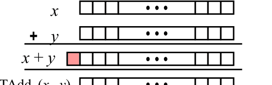

- TAdd 和 UAdd 具有完全相同的位级表现
- C语言中有符号数(补码)与无符号数加法:

```
int s, t, x, y;
s = (int) ((unsigned) x + (unsigned) y);
t = x + y
```

- 将会有 s == t

## 补码加法(Tadd)

### 功能

- 真实和需要w+1位
- 丢弃最高有效位（MSB）
- 将剩余的位视作补码（整数）

TAdd(x, y) = { x + y − 2^w,      TMax_w < x + y      正溢出
                  x + y,      TMin_w ≤ x + y ≤ TMax_w      正常
                  x + y + 2^w,      x + y < TMin_w      负溢出 }

## 补码加法(Tadd)的溢出问题

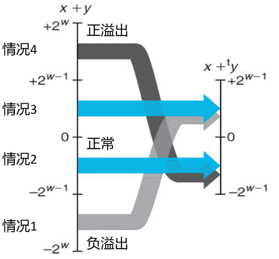

## 补码加法可视化示意图

- 数值
  - 4位补码
  - 数值范围-8 ～ +7
- 弯折——溢出
  - x+y ≥ 2^{w-1} 时
    - 变成负数
    - 最多一次
  - x+y < -2^{w-1}
    - 变成正数
    - 最多一次

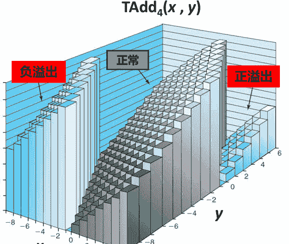

## 乘法

- 目标: 计算w位的两个数x和 y的乘积
  - 有符号数或者无符号数
- 乘积的精确结果可能超过 w 位
  - 乘积的无符号数最多可达 2w 位
    - 结果范围: 0 ≤ x * y ≤ (2^w − 1)^2 = 2^{2w} − 2^{w+1} + 1
  - 补码的最小值 (负数)最多需要2w-1 位
    - 结果范围: x * y ≥ (−2^{w−1})*(2^{w−1}−1) = −2^{2w−2} + 2^{w−1}
  - 补码最大值(正数)最多需要2w 位——值为 (TMin_w)^2
    - 结果范围: x * y ≤ (−2^{w−1})^2 = 2^{2w−2}
- 为获得精确结果可扩展乘积的字长
  - 在需要时用软件方法完成，例如：算术程序包“arbitrary precision”

## C语言的无符号数乘法

- 操作数: w 位
- 真实乘积: 2*w 位
- 丢弃 w 位: 保留低 w 位

x
* y
x · y
UMult_w(x , y)

- 标准乘法功能
  - 忽略高 w 位
- 相当于对乘积执行了模运算
  - UMULT_w(x , y) = x · y mod 2^w

## C语言的有符号数乘法

- 操作数: w 位
- 真实乘积: 2*w 位
- 丢弃 w 位: 保留低 w 位

- 标准乘法功能
  - 忽略高 w 位
  - 有符号数乘、无符号数乘有不同之处
    - 乘积的符号扩展
  - 乘积的低位相同

## 用移位实现“乘以2的幂”

- 无论有符号数还是无符号数：

u << k 可得到 u*2^k

- 操作数: w 位
- 真实乘积: w+k 位
- 丢弃高 k 位: 保留低 w 位

UMult_w(u, 2^k)
TMult_w(u, 2^k)

- 示例
  - u << 3 == u * 8
  - (u << 5) - (u << 3) == u * 24
- 绝大多数机器，移位比乘法快
- 编译器自动生成基于移位的乘法代码

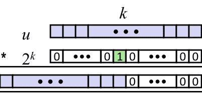

## 用移位实现无符号数 “除以2的幂”

- 无符号数 “除以2的幂” 的商
  - u >> k 得到⌊u / 2^k⌋
  - 使用逻辑右移

操作数：
u
/ 2^k

除法：
u / 2^k

结果：
⌊u / 2^k⌋

二进制小数点

| | Division | Computed | Hex | Binary |
|---|---|---|---|---|
| x | 15213 | 15213 | 3B 6D | 00111011 01101101 |
| x >> 1 | 7606.5 | 7606 | 1D B6 | 00011101 10110110 |
| x >> 4 | 950.8125 | 950 | 03 B6 | 00000011 10110110 |
| x >> 8 | 59.4257813 | 59 | 00 3B | 00000000 00111011 |

## 主要内容: 位、字节 和 整型数

- 信息的位表示
- 位级运算
- 整型数
  - 表示：无符号数和有符号数
  - 无符号数和有符号数的转换
  - 扩展、截断
  - 整数运算：加、非、乘、移位
  - 总结
- 内存、指针、字符串表示

## 算术运算: 基本规则

- 加法:
  - 无/有符号数的加法: 正常加法后再截断, 位级的运算相同
  - 无符号数: 加后对2^w 求模
    - 数学加法 + 可能减去 2^w
  - 有符号数: 修改的加后对 2^w 求模，使结果在合适范围
    - 数学加法 + 可能减去或加上 2^w
- 乘法:
  - 无/有符号数的乘法: 正常乘法后加截断操作, 位级运算相同
  - 无符号数: 乘后对2^w 求模
  - 有符号数: 修改的乘后对 2^w 求模，使结果在合适范围内

## 为何用无符号数？

- 一定要知道隐含的转换规则，否则不要用

- 常见错误

```
unsigned i;
for (i = cnt-2; i >= 0; i--)
    a[i] += a[i+1];
```

- 不易察觉的问题

```
#define DELTA sizeof(int)
int i;
for (i = CNT; i - DELTA >= 0; i -= DELTA)
...
```

## 巧用无符号数：向下计数

- 使用无符号类型循环变量的适当方法

```
unsigned i;
for (i = cnt-2; i < cnt; i--)
    a[i] += a[i+1];
```

- 参考Robert Seacord著《Secure Coding in C and C++》
  - C语言标准确保无符号数加法的行为与模运算类似
    - 0−1 → UMax

- 好方法

```
size_t i;
for (i = cnt-2; i < cnt; i--)
    a[i] += a[i+1];
```

  - size_t定义为长度为计算机字长的无符号数
  - 即便cnt = Umax也能很好工作
  - 若cnt 是有符号数，且值小于0，会如何？


## 主要内容: 位、字节 和 整型数

- 信息的位表示
- 位级运算
- 整型数
  - 表示：无符号数和有符号数
  - 无符号数和有符号数的转换
  - 扩展、截断
  - 整数运算：加、非、乘、移位
  - 总结
- 内存、指针、字符串表示

## 面向字节的内存组织管理

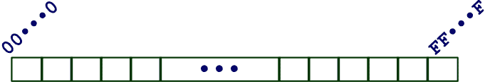

- **程序用地址来引用内存中的数据**
  - 内存可看做巨大的“字节数组”
    - 实际上不是这样，但不妨这样联想
  - 地址就像这个“字节数组”的索引
    - 指针变量可保存地址数值

- **注意：**
  - 操作系统为每个进程提供私有的地址空间
  - 每个进程可访问自己地址空间中的内存数据，彼此不干扰。

## 机器字

- 任何机器都有一个“字长"
  - 整型值数据的名义长度
  - 地址的名义长度
- 1985年intel 386 CPU开始,大多数机器使用32位 (4字节) 字长
  - 地址空间最大4GB (2³² bytes)
- 目前, 64位字长的机器是主流
  - 潜在地, 可以有16 EB (Exabytes) 的可寻址内存
  - 约18.4 X 10¹⁸字节
- 机器依然支持多种数据格式
  - 字长的一部分或几倍长度
  - 始终是整数个字节

## 面向字的内存组织管理

- **地址**：指定字节的位置
  - 字中第一个字节的地址
  - 相邻字的地址相差 4 (32-bit) 或 8 (64-bit)

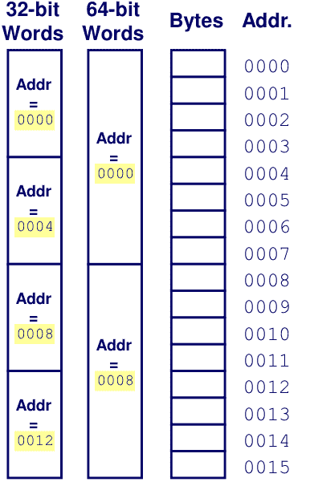

## C数据类型的典型大小(字节数)

| C 数据类型 | 32位 | 64位 | x86-64 |
|---|---|---|---|
| char | 1 | 1 | 1 |
| short | 2 | 2 | 2 |
| int | 4 | 4 | 4 |
| long | 4 | 8 | 8 |
| float | 4 | 4 | 4 |
| double | 8 | 8 | 8 |
| long double | - | - | 10/16 |
| pointer | 4 | 8 | 8 |

## 字节序

- 有多个字节的 “字” (word)，其各个字节在内存中的排列
- 惯例
  - 大端序、大尾序（Big Endian）: Sun, PPC Mac, Internet
    - 最低有效位（LSB）字节的地址最高
  - 小端序、小尾序（Little Endian）: x86、运行Android 的ARM处理器、iOS和Windows
    - 最低有效位（LSB）字节的地址最低
- 双端序(Bi-Endian)
  - 机器可以配置成大端序或小端序
  - 很多新近的处理器均支持双端序

## 字节序示例

- 示例
- 变量x 有4字节数值0x01234567
- 假定x的地址为 0x100

Big Endian


Little Endian


## 整数型的表示

```
十进制: 15213
二进制: 0011 1011 0110 1101
16进制: 3 B 6 D
```

```
int A = 15213;
```

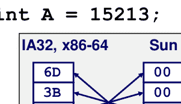

```
地址 long int C = 15213;
```

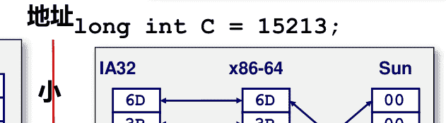

```
int B = -15213;
```

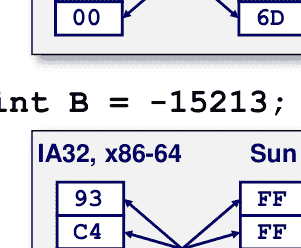

小

大

> 补码表示

> Bryant and O'Hallaron, Computer Systems: A Programmer's Perspective, Third Edition

## 验证数的表示

- 打印数据字节表示的程序代码

- 将指针转换成unsigned char * 类型，从而按字节数组处理

```
typedef unsigned char *pointer;

void show_bytes(pointer start, size_t len){
    size_t i;
    for(i = 0; i < len; i++)
        printf("%0xp\t %.2x\n",start+i, start[i]);
    printf("\n");
}
```

printf 指令:
%p: 打印指针
%x: 16进制格式打印

## show_bytes 的执行实例

```
int a = 15213;
printf("int a = 15213;\n");
show_bytes((pointer) &a, sizeof(int));
```

# Result (Linux x86-64):

```
int a = 15213;
0x7fffb7f71dbc    6d
0x7fffb7f71dbd    3b
0x7fffb7f71dbe    00
0x7fffb7f71dbf    00
```

## 大端/小端举例

假设小端方式机器中某条指令的地址为1000

该指令的汇编形式为：mov AX, 0x12345(BX)

其中操作码mov为40H，寄存器AX和BX的编号分别为0001B和0010B，立即数占32位，则存放顺序为：

若在大端机器上，则存放顺序如何？

只需要考虑指令中立即数的顺序！

## 大端/小端举例

以下是一个由反汇编器生成的一行针对IA-32处理器的机器级代码表示文本：

```
80483d2: 89 85 a0 fe ff ff  mov %eax, 0xfffffea0(%ebp)
```

- 其中，80483d2是十六进制表示的指令地址
- 89 85 a0 fe ff ff 是机器指令
- mov %eax, 0xfffffea0(%ebp) 是对应的汇编指令
- 0xfffffea0是立即数

请问：立即数0xfffffea0的值和所存放地址分别是多少？IA-32是大端还是小端方式？

- 立即数0xfffffea0所存放的地址为0x80483d4；
- 立即数0xfffffea0的值为-10110000B=-176；
- IA-32采用的是小端方式！

## 字符串的表示

- **C字符串**
  - 用字符数组表示
  - 每个字符都是ASCII格式编码
    - 字符集的标准7位编码
    - 字符‘0’的编码是 0x30
      - 数码 *i* 的编码是 0x30 + *i*
  - 字符串以null结尾
    - 最后的字符 = 0
  - 兼容性
    - 字节序不是个事！

```
char S[6] = "18213";
```

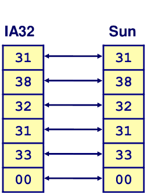

## C的整型数习题 (练习题2.44)

Initialization

```
int x = foo();
int y = bar();
unsigned ux = x;
unsigned uy = y;
```

- x < 0 || ((x*2) < 0)
- ux >= 0
- x & 7 == 7 || (x<<30) < 0
- ux > -1
- x > y || -x < -y
- x * x >= 0
- x > 0 && y > 0 || x + y > 0
- x >= 0 || -x <= 0
- x <= 0 || -x >= 0
- (x|-x)>>31 == -1
- ux >> 3 == ux/8
- x >> 3 == x/8
- x & (x-1) != 0

## 代码范例#2

SUN XDR 函数库

广泛用于机器间传输数据

```
void* copy_elements(void *ele_src[], int ele_cnt, size_t ele_size);
```

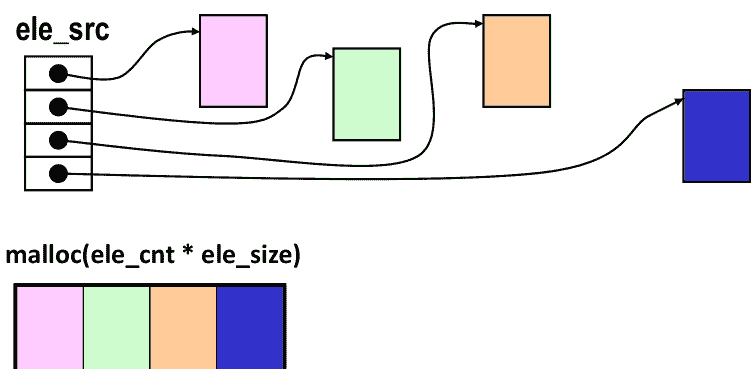

malloc(ele_cnt * ele_size)


## XDR 代码

```
void* copy_elements(void *ele_src[], int ele_cnt, size_t ele_size) {
    /* 为ele_cnt个对象申请缓冲区,每个对象ele_size字节
     * 并从ele_src指定的位置拷贝*/

    void *result = malloc(ele_cnt * ele_size);
    if (result == NULL)
        /* malloc failed */
        return NULL;
    void *next = result;
    int i;
    for (i = 0; i < ele_cnt; i++) {
        /* Copy object i to destination */
        memcpy(next, ele_src[i], ele_size);
        /* Move pointer to next memory region */
        next += ele_size;
    }
    return result;
}
```

## XDR 的弱点

malloc(ele_cnt * ele_size)

+   32位程序，考虑以下情况：

+   ele_cnt = 2^20 + 1

+   ele_size = 4096 = 2^12

+   申请的字节数 = ?

+   赋值元素的个数= ?

+   ....

如何能让这个函数安全？

## 乘法编译生成的代码

```
long mull12(long x)
{
 return x*12;
}
```

## 编译得到的算术运算

```
leaq (%rax,%rax,2), %rax
salq $2, %rax
```

## 解释

t <- x + x*2
return t << 2;

+   - 对于常数的乘法，C编译器自动生成移位和加法代码

## 无符号数除编译生成的代码

## C 函数

```
unsigned long udiv8
    (unsigned long x)
{
    return x/8;
}
```

## 编译生成的数学运算

```
shrq $3, %rax
```

## 解释

```
# Logical shift
return x >> 3;
```

+   无符号数使用逻辑移位

## 常数除法

+   - 对于整数除法运算，由于计算机中除法运算比较复杂，而且不能用流水线方式实现，所以一次除法运算大致需要30个或更多个时钟周期，比乘法指令的时间还要长！
+   - 为了缩短除法运算的时间，编译器在处理一个变量与一个2的幂次形式的整数相除时，常采用右移运算来实现。
+     - 无符号：逻辑右移
+     - 带符号：算术右移
+   - 结果一定取整数
+     - 能整除时，直接右移得到结果，移出的为全0
+       例如，12/4=3：0000 1100 >>2=0000 0011
+       -12/4=-3：1111 0100 >>2=1111 1101
+     - 不能整除时，右移移出的位中有非0，需要进行相应处理

## 常量除法

+   • 不能整除时，采用朝零舍入，即截断方式
+   - 无符号数、带符号正整数（地板）：移出的低位直接丢弃
+   - 带符号负整数（天顶）：加偏移量(2^k-1)，然后再右移 k 位，低位截断（这里 k 是右移位数）

举例：

无符号数 14/4=3 : 0000 1110 >>2=0000 0011

带符号负整数 -14/4=-3

若直接截断，则 1111 0010 >>2=1111 1100=-4 ≠ -3

应先纠偏，再右移: k=2，故(-14+2^2-1)/4=-3

即 : 1111 0010+0000 0011=1111 0101

1111 0101>>2=1111 1101=-3

## 用移位实现有符号数“除以2的幂”

+   - **有符号数“除以2的幂”的商**
+     - `x >> k` 得到 `⌊x / 2^k⌋`
+     - 使用算术右移
+     - 当 `x < 0` 时，舍入方向出错

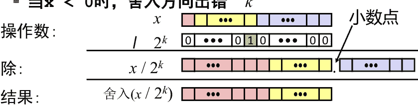

|   | Division | Computed | Hex | Binary |
|---|---:|---:|---|---|
| y | -15213 | -15213 | C4 93 | 11000100 10010011 |
| y >> 1 | -7606.5 | -7607 | E2 49 | 11100010 01001001 |
| y >> 4 | -950.8125 | -951 | FC 49 | 11111100 01001001 |
| y >> 8 | -59.4257813 | -60 | FF C4 | 11111111 11000100 |

## 修正 2 的整数幂除法

## 情况2：有舍入

被除数：

x

+2^k−1

增加了1

除数：

/ 2^k

⌊ x / 2^k ⌋

小数点

增加了1

偏差导致最终结果增加了 1

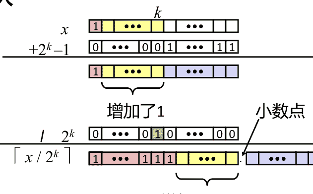

## 编译生成的有符号数除代码

## C 函数

```
long idiv8(long x)
{
    return x/8;
}
```

## 编译生成的结果

```
testq %rax, %rax
js  L4
L3:
    sarq $3, %rax
    ret
L4:
    addq $7, %rax
    jmp  L3
```

## 解释

```
if x < 0
    x += 7;
# Arithmetic shift
return x >> 3;
```

+   - 使用了算术右移

## 算术运算:基本规则

+   - 左移
+     - 无论有/无符号数，都可用逻辑左移实现乘以 2^k
+   - 右移
+     - 无符号数: 逻辑右移,除以 2^k (除法 +向0舍入)
+     - 有符号数: 算术右移
+       - 正整数:除以 2^k (除法 + 向0舍入)
+       - 负整数:除以 2^k (除法 + 远离0舍入)，使用偏移来修正

# 第2章 信息的表示和处理 I：位、整数

教师：吴锐
计算机科学与技术学院
哈尔滨工业大学

## 主要内容: 位、字节和整型数

+   信息的位表示

+   位级运算

+   整型数

+   表示: 无符号数和有符号数

+   无符号数和有符号数的转换

+   扩展、截断

+   整数运算: 加、□、乘、移位

+   总结

+   内存、指针、字符串表示

## 位、字节

+   - 计算机存储、处理的信息：二值信号
+   - “位” 或 “比特”
+     - 最底层的二进制数字（数码）称为位（bit，比特），值为0或1
+     - 数字□命的基础
+   - 位组合
+     - 把位组合到一起，采用某种规则进行解读
+     - 每个位组合都有含义
+   - 字节： 8-bit块
+     - 人物： Dr. Werner Buchholz，1956年7月
+     - 事件： IBM Stretch computer的早期设计阶段


## 进制

数的通用表示

10进制：

3721 = 3×10³+7×10²+2×10¹+1×10⁰

N= ± aₙ aₙ₋₁ … a₁ a₀ . b₁ b₂ … bₘ

k进制：

N= ± aₙ × kⁿ + aₙ₋₁ × kⁿ⁻¹ + … + a₁ × k¹ + a₀ × k⁰

+ b₁ × k⁻¹ + b₂ × k⁻² + … + bₘ × k⁻ᵐ

其中 aᵢ，bⱼ 是 0 ~ k-1 中的一个数码

## 二进制数

+   - 特点：逢二进一，由0和1两个数码组成，基数为2，各个位权以2^i表示

+   - 二进制数：
+     aₙaₙ₋₁…a₁a₀.b₁b₂…bₘ =
+     aₙ × 2ⁿ + aₙ₋₁ × 2ⁿ⁻¹ + … + a₁ × 2¹ + a₀ × 2⁰
+     + b₁ × 2⁻¹ + b₂ × 2⁻² + … + bₘ × 2⁻ᵐ
+     其中aᵢ， bⱼ□0即1

便于计算机存储、算术运算简单、支持逻辑运算

## 十六进制数

+   - 基数16，逢16进位，位权为16^i，16个数码：
+     0, 1, 2, 3, 4, 5, 6, 7, 8, 9, A, B, C, D, E, F

+   - 十六进制数：
+     aₙ aₙ₋₁ … a₁ a₀ . b₁ b₂ … bₘ =
+     aₙ × 16ⁿ + aₙ₋₁ × 16ⁿ⁻¹ + … + a₁ × 16¹ + a₀ × 16⁰
+     + b₁ × 16⁻¹ + b₂ × 16⁻² + … + bₘ × 16⁻ᵐ
+     其中 aᵢ， bⱼ 是 0 ~ F 中的一个数码


## 十六进制数的加减运算

- 十六进制数的加减运算类似十进制
  - 逢16进位1，借1当16
- 二进制和十六进制数之间具有对应关系：
  - 每4个二进制位对应1个十六进制位

23D9H + 94BEH = B897H
A59FH − 62B8H = 42E7H

00111010B = 3AH， F2H = 11110010B

与二进制数相互转换简单、阅读书写方便

## 进制转换

- 十进制整数转换为k(2、8或16)进制数

整数转换：用除法—除基取余法

- 十进制数整数部分不断除以基数k(2、8或16)，并记下余数，直到商为0为止

- 由最后一个余数起，逆向取各个余数，则为转换成的二进制和十六进制数

126=01111110B  二进制数用后缀字母B

126=7EH  十六进制数用后缀字母H

## 进制转换

- 十进制小数转换为k(2、8或16)进制数...
  - 小数转换：用乘法—乘基取整法
  - 乘以基数k，记录整数部分，直到小数部分为0为止
  - 0.8125=0.1101B
  - 0.8125=0.DH

- 小数转换会发生总是无法乘到为0的情况

- 可选取一定位数（精度）

- 将产生无法避免的转换误差

## 计算机内的数值表示——编码

要考虑的问题

- 1. 编码的长度
- 2. 数的符号
- 3. 数的运算

## C数据类型的宽度

| C 数据类型 | 32位 | 64位 | x86-64 |
|---|---|---|---|
| char | 1 | 1 | 1 |
| short | 2 | 2 | 2 |
| int | 4 | 4 | 4 |
| long | 4 | 8 | 8 |
| float | 4 | 4 | 4 |
| double | 8 | 8 | 8 |
| long double | - | - | 10/16 |
| pointer | 4 | 8 | 8 |

## 主要内容: 位、字节和整型数

- 信息的位表示
- 位级运算
- 整型数
  - 表示：无符号数和有符号数
  - 无符号数和有符号数的转换
  - 扩展、截断
  - 整数运算：加、减、乘、移位
  - 总结
- 内存、指针、字符串表示

## 布尔代数(Boolean Algebra)

- George Boole(1815-1864)提出逻辑的代数表示
  - 逻辑值 “True(真)” 编码为 1
  - 逻辑值 “False(假)” 编码为 0
- Claude Shannon(1916-2001)创立信息论
  - 将布尔代数与数字逻辑关联起来
- 是数字系统设计与分析的重要工具


## 布尔代数(Boolean Algebra)

### 与(And)

- 当A=1 并且 B=1时， A&B = 1

| & | 0 | 1 |
|---|---|---|
| 0 | 0 | 0 |
| 1 | 0 | 1 |

### 或(Or)

- 当A=1 或 B=1时， A|B = 1

| | 0 | 1 |
|---|---|---|
| 0 | 0 | 1 |
| 1 | 1 | 1 |

### □(Not)

- 当A=0时， ~A = 1

| ~ | |
|---|---|
| 0 | 1 |
| 1 | 0 |

### 异或(Exclusive-Or,Xor)

- 当A=1 或 B=1且两者不同时为1， A^B = 1

| ^ | 0 | 1 |
|---|---|---|
| 0 | 0 | 1 |
| 1 | 1 | 0 |

## 一般的布尔代数

- 位向量操作(Operate on Bit Vectors)
  - 按位运算
    01101001      01101001      01101001      01101001
    & 01010101  | 01010101  ~ 01010101  ^ 01010101
    01000001    01111101    10101010    00111100
- 布尔代数的全部性质均适用

## 示例:集合的表示与运算

■ 表示: 位向量表示有限集合

宽度 w 个比特的位向量[a_{w-1},..., a_1, a_0]表示集合 {0, ..., w-1} 的子集A

a_j = 1当且仅当j ∈ A

01101001 {0, 3, 5, 6}
76543210

01010101 {0, 2, 4, 6}
76543210

■ 运算

- & 交集(Intersection) 01000001 {0, 6}
- | 并集(Union) 01111101 {0, 2, 3, 4, 5, 6}
- ^ 对称差集(Symmetric difference) 00111100 {2, 3, 4, 5}
- ~ 补集(Complement) 10101010 {1, 3, 5, 7}

## RGB Color Model

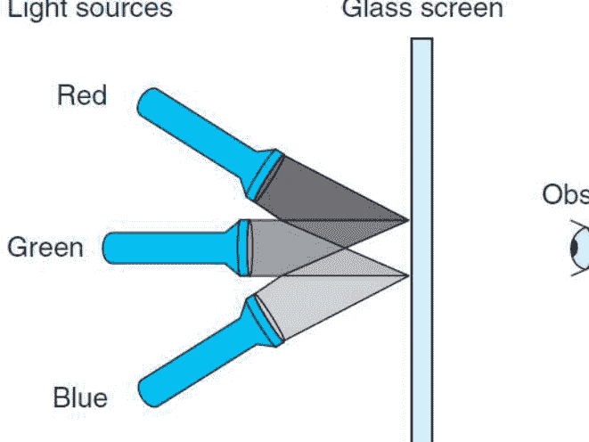

Light sources

Glass screen

Red

Green

Blue

Observer

## RGB Color Model


| R | G | B | Color |
|---|---|---|---|
| 0 | 0 | 0 | Black |
| 0 | 0 | 1 | Blue |
| 0 | 1 | 0 | Green |
| 0 | 1 | 1 | Cyan |
| 1 | 0 | 0 | Red |
| 1 | 0 | 1 | Magenta |
| 1 | 1 | 0 | Yellow |
| 1 | 1 | 1 | White |

## RGB Color Model

- □色中的每一种都可以用一个长度为3的位向量表示，从而进行布尔运算
  - 一种□色的补通过关掉打开的电源同时打开关闭的电源形成

描述下列□色的布尔运算的结果：

- Blue | Green =
- Yellow & Cyan =
- Red ^ Magenta =

## 巧用异或

- 按位异或是一种加的形式
- A ^ A = 0

```
int inplace_swap(int *x, int *y)
{
    *x = *x ^ *y;  /* #1 */
    *y = *x ^ *y;  /* #2 */
    *x = *x ^ *y;  /* #3 */
}
```

| Step | *x | *y |
|---|---|---|
| Begin | A | B |
| 1 | A^B | B |
| 2 | A^B | (A^B)^B = A^(B^B) = A^0 = A |
| 3 | (A^B)^A = (B^A)^A = B^(A^A) = B^0 = B | A |
| End | B | A |

## 巧用异或

```
1 void reverse_array(int a[], int cnt) {
2 int first, last;
3 for (first = 0, last = cnt-1;
4     first <= last;
5     first++,last--)
6     inplace_swap(&a[first], &a[last]);
7 }
```

### 2.1.8 对比: C语言的逻辑运算

- **C语言的逻辑运算符：** `&&`, `||`, `!`
  - 将 `0` 视作逻辑 “False(假)”
  - 所有非 `0` 值视作逻辑 “True(真)”
  - 计算结果总是 `0` 或 `1`
  - 提前终止(Early termination)、短路求值(short cut)

- **例子(char 数据类型)**
  - `!0x41 → 0x00`
  - `!0x00 → 0x01`
  - `!!0x41 → 0x01`
  - `0x69 && 0x55 → 0x01`
  - `0x69 || 0x55 → 0x01`
  - `p && *p`（避免空指针访问）


### 2.1.9 C语言中的移位运算

- 左移： x << y
- 将位向量x向左移动 y位
  - 扔掉左边多出(移出)的位
  - 在右边补0
- 右移： x >> y
- 将位向量x向右移动 y位
  - 扔掉右边多出(移出)的位
- 逻辑右移：在左边补0
- 算术右移：复制左边的最高位(y次)
- 未明确定义
- 移位数量 y< 0 或 y ≥ x 的字长(位数)

| Argument x | 01100010 |
| << 3 | 00010000 |
| Log. >> 2 | 00011000 |
| Arith. >> 2 | 00011000 |

| Argument x | 10100010 |
| << 3 | 00010000 |
| Log. >> 2 | 00101000 |
| Arith. >> 2 | 11101000 |

## 主要内容: 位、字节 和 整型数

- 信息的位表示
- 位级运算
- 整型数
  - 表示：无符号数和有符号数
  - 无符号数和有符号数的转换
  - 扩展、截断
  - 整数运算：加、减、乘、移位
  - 总结
- 内存、指针、字符串表示
- 总结

## 2.2 整数编码(Encoding Integers)

无符号数

有符号数——补码(Two’s Complement)

B2U(X) = Σ_{i=0}^{w-1} x_i · 2^i

B2T(X) = -x_{w-1}·2^{w-1} + Σ_{i=0}^{w-2} x_i·2^i

```
short int x = 15213;
short int y = -15213;
```

符号位

# C short : 2 字节

|  | 10 进制 | 16 进制 | 2 进制 |
|---|---|---|---|
| x | 15213 | 3B 6D | 00111011 01101101 |
| y | -15213 | C4 93 | 11000100 10010011 |

## 符号位

- 对于补码(2’s complement), 最高位表示符号
- 0 表示非负数（!= 正数），1 表示负数

## 带符号数的表示及运算

## 机器数与真值

机器数：最高位 0 表示正数，1 表示负数。

例如：

表示真值：`0 0 0 1 0 0 1 0`，即 `+0010010B = +18`

表示真值：`1 0 0 1 0 0 1 0`，即 `-0010010B = -18`

表示真值：`1 0 1 1 0 1 0 1`，即 `-0110101B = -53`

## 1. 原码

例 2-4   x = + 1010111      y = −1010111

[x]原 = 0 1010111      [y]原 = 1 1010111
符号位 绝对值
符号位 绝对值

## 2. 反码

正数的反码与其原码相同。

负数的反码为：
其原码中符号位不变，其余各位取反。

例2-5  x = +0110100        y = - 0110100

[x]反 = 00110100        [y]反 = 11001011

## 3. 补码

## 正数的补码与其原码相同。

（正数的原码、反码、补码均相同）

## 负数的补码为：其反码的最低位加1。

例 2-6  x = + 0110100      y = - 0110100

[x]补=00110100      [y]反=11001011

[y]补=11001100

## 补码示例

x = 15213: 00111011 01101101
y = -15213: 11000100 10010011

|权重|15213|-15213|
|-----|-----|------|
|1|1|1|
|2|0|1|
|4|1|0|
|8|1|0|
|16|0|1|
|32|1|0|
|64|1|0|
|128|0|1|
|256|1|0|
|512|1|0|
|1024|0|1|
|2048|1|0|
|4096|1|0|
|8192|1|0|
|16384|0|1|
|-32768|0|1|
|总计|15213|-15213|

## 数值范围

- 无符号数值
  - UMin = 0
    000...0
  - UMax = 2^w − 1
    111...1
- 补码数值
  - TMin = −2^{w−1}
    100...0
  - TMax = 2^{w−1} − 1
    011...1
  - -1
    111...1

## 位数W=16时的数值

|  | 十进制 | 16 进制 | 二进制 |
|---|---|---|---|
| UMax | 65535 | FF FF | 11111111 11111111 |
| TMax | 32767 | 7F FF | 01111111 11111111 |
| TMin | -32768 | 80 00 | 10000000 00000000 |
| -1 | -1 | FF FF | 11111111 11111111 |
| 0 | 0 | 00 00 | 00000000 00000000 |

## 不同字长的数值

|  | **W** |  |  |  |
|---|---:|---:|---:|---:|
|  | **8** | **16** | **32** | **64** |
| **UMax** | 255 | 65,535 | 4,294,967,295 | 18,446,744,073,709,551,615 |
| **TMax** | 127 | 32,767 | 2,147,483,647 | 9,223,372,036,854,775,807 |
| **TMin** | -128 | -32,768 | -2,147,483,648 | -9,223,372,036,854,775,808 |

- ■ **观察**
  - \(|TMin| = TMax + 1\)
    - 不对称
  - \(UMax = 2 * TMax + 1\)

- ■ **C 语言的常量声明**
  - `#include <limits.h>`
  - `#define INT_MAX 2147483647`
  - `#define INT_MIN (-INT_MAX-1)`
  - `#define UINT_MAX 0xffffffff`
  - **平台相关**
    - `#define ULONG_MAX`
    - `#define LONG_MAX`
    - `#define LONG_MIN (-LONG_MAX-1)`

## 主要内容: 位、字节 和 整型数

- 信息的位表示
- 位级运算
- 整型数
  - 表示：无符号数和有符号数
  - 无符号数和有符号数的转换
  - 扩展、截断
  - 整数运算：加、减、乘、移位
  - 总结
- 内存、指针、字符串表示

## 有符号/无符号数之间的转换

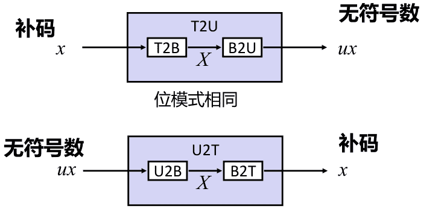

- 有符号数和无符号数转换规则：
  位模式不变、数值可能改变(按不同编码规则重新解读)

## 有符号数→无符号数的转换

| Bits | Signed |
|---|---|
| 0000 | 0 |
| 0001 | 1 |
| 0010 | 2 |
| 0011 | 3 |
| 0100 | 4 |
| 0101 | 5 |
| 0110 | 6 |
| 0111 | 7 |
| 1000 | -8 |
| 1001 | -7 |
| 1010 | -6 |
| 1011 | -5 |
| 1100 | -4 |
| 1101 | -3 |
| 1110 | -2 |
| 1111 | -1 |

| Unsigned |
|---|
| 0 |
| 1 |
| 2 |
| 3 |
| 4 |
| 5 |
| 6 |
| 7 |
| 8 |
| 9 |
| 10 |
| 11 |
| 12 |
| 13 |
| 14 |
| 15 |

T2U

U2T

## 有符号↔无符号数的转换

| Bits |
| --- |
| 0000 |
| 0001 |
| 0010 |
| 0011 |
| 0100 |
| 0101 |
| 0110 |
| 0111 |
| 1000 |
| 1001 |
| 1010 |
| 1011 |
| 1100 |
| 1101 |
| 1110 |
| 1111 |

| Signed |
| --- |
| 0 |
| 1 |
| 2 |
| 3 |
| 4 |
| 5 |
| 6 |
| 7 |
| -8 |
| -7 |
| -6 |
| -5 |
| -4 |
| -3 |
| -2 |
| -1 |

| Unsigned |
| --- |
| 0 |
| 1 |
| 2 |
| 3 |
| 4 |
| 5 |
| 6 |
| 7 |
| 8 |
| 9 |
| 10 |
| 11 |
| 12 |
| 13 |
| 14 |
| 15 |

↔ =

+/- 16 ↔


## 转换的可视化

## 补码→无符号数

+   序倒置

+   负数 → 大整数

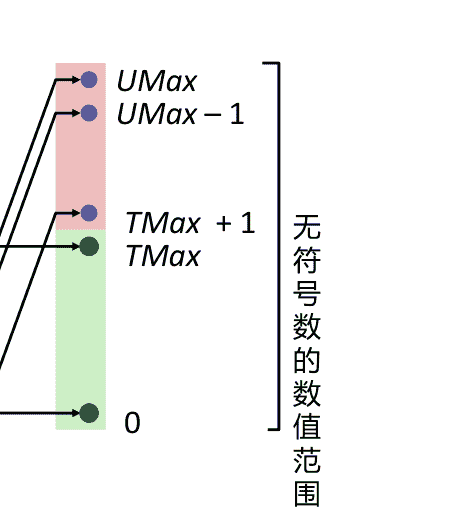

> Bryant and O'Hallaron, Computer Systems: A Programmer's Perspective, Third Edition 44

### 2.2.5 C语言中的有符号数和无符号数

+   - **常量**
+     - 数字默认是有符号数
+     - 无符号数用后缀“U”
+       - `0U, 4294967259U`

+   - **类型转换**
+     - 显示的强制类型转换
+       ```c
+       int tx, ty;
+       unsigned ux, uy;
+       tx = (int) ux;
+       uy = (unsigned) ty;
+       ```
+     - 隐式的类型转换（赋值、函数调用等情况下发生）
+       ```c
+       tx = ux;
+       uy = ty;
+       ```

## 类型转换的惊喜！

+   - 表达式计算
+     - 表达式中有符号和无符号数混用时：
+       有符号数隐式转换为无符号数
+     - 包括比较运算符 <, >, ==, <=, >=
+     - 例如 W = 32:
+       TMIN = -2,147,483,648
+       TMAX =2,147,483,647

## 类型转换的惊喜！

| Constant1 | Constant2 | Relation | Evaluation |
|---|---|---|---|
| 0 | 0U | == | unsigned |
| -1 | 0 | < | signed |
| -1 | 0U | > | unsigned |
| 2147483647 | -2147483648 | > | signed |
| 2147483647U | -2147483648 | < | unsigned |
| -1 | -2 | > | signed |
| (unsigned)-1 | -2 | > | unsigned |
| 2147483647 | 2147483648U | < | unsigned |
| 2147483647 | (int) 2147483648U | > | signed |

## 有符号数和无符号数转换的基本原则

+   - 位模式不变
+   - 重新解读（按目标编码类型的规则解读）
+   - 会意外副作用: 数值被 +或- 2^w

+   - 表达式含无符号数和有符号数时
+     - 有符号数被转换成无符号数（如int 转换成unsigned int）
+     - 当心副作用！！！

## 主要内容: 位、字节和整型数

+   - 信息的位表示

+   - 位级运算

+   - 整型数

+   - 表示: 无符号数和有符号数

+   - 无符号数和有符号数的转换

+   - 扩展、截断

+   - 整数运算: 加、减、乘、移位

+   - 总结

+   - 内存、指针、字符串表示

## 符号扩展

+   - **任务：**
+     - 给定 $w$ 位的有符号整型数 $x$
+     - 将其转换为 $w+k$ 位的相同数值的整型数

+   - **规则：**
+     - 将最高有效位(符号位) $x_{w-1}$ 复制 $k$ 份：
+     - $x' = x_{w-1},\ldots,x_{w-1},x_{w-1},x_{w-2},\ldots,x_0$

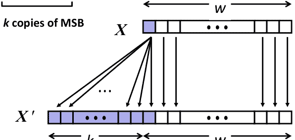

## 符号扩展示例

```
short int x = 15213;
int     ix = (int) x;
short int y = -15213;
int     iy = (int) y;
```

| | 十进制 | 16进制 | 二进制 |
|---|---|---|---|
| x | 15213 | 3B 6D | 00111011 01101101 |
| ix | 15213 | 00 00 3B 6D | 00000000 00000000 00111011 01101101 |
| y | -15213 | C4 93 | 11000100 10010011 |
| iy | -15213 | FF FF C4 93 | 11111111 11111111 11000100 10010011 |

从短整数类型向长整数类型转换时，C自动进行符号扩展

## 总结:扩展、截断的基本规则

+   - 扩展 (例如从short int 到int的转换)
+     - 无符号数: 填充0
+     - 有符号数: 符号扩展
+     - 结果都是明确的预期值

+   - 截断 (例如从unsigned 到unsigned short的转换)
+     - 无论有/无符号数: 多出的位均被截断
+     - 结果重新解读
+     - 无符号数: 相当于求模运算
+     - 有符号数: 与求模运算相似
+     - 对于小整数，结果是明确的预期值

## 主要内容: 位、字节和整型数

+   - 信息的位表示
+   - 位级运算
+   - **整型数**
+     - 表示：无符号数和有符号数
+     - 无符号数和有符号数的转换
+     - 扩展、截断
+     - **整数运算：加、减、乘、移位**
+   - 内存、指针、字符串表示
+   - 总结

## 无符号数加法

操作数: w 位

真实和: w+1 位

丢弃进位: w 位    UAdd_w(x , y)

+   - 标准加法功能
+     - 忽略进位输出
+   - 模数加法：相当于增加一个模运算

s = UAdd_w(x , y) = x + y mod 2^w

UAdd_w(x,y) = { x + y          x + y < 2^w
                x + y - 2^w    x + y ≥ 2^w }

## 整数加法可视化示意图

## 整数加法

+   - 4-bit 整型数 x, y
+   - 计算真实值 Add₄(x, y)
+   - 和随 x 和 y 线性增加
+   - 表格为斜方形

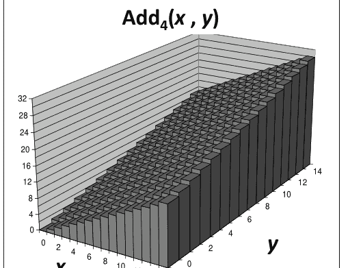

## 无符号数加法可视化示意图

+   - 数值会有弯折：
+     - 当真实和≥ 2^w时溢出
+     - 最多溢出一次

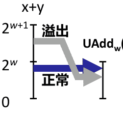

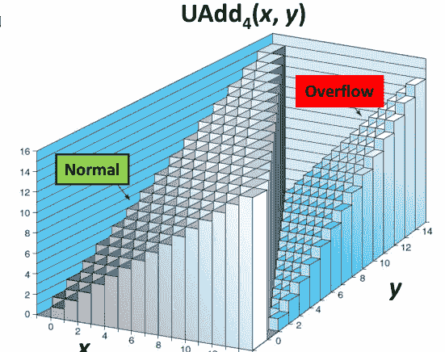

## 补码加法(Tadd)

## 功能

+   - 真实和需要w+1位
+   - 丢弃最有效位（MSB）
+   - 将剩余的位视作补码（整数）

TAdd(x, y) = { x + y − 2^w,      TMax_w < x + y      正溢出
                  x + y,      TMin_w ≤ x + y ≤ TMax_w      正常
                  x + y + 2^w,      x + y < TMin_w      负溢出 }

## 补码加法(Tadd)的溢出问题

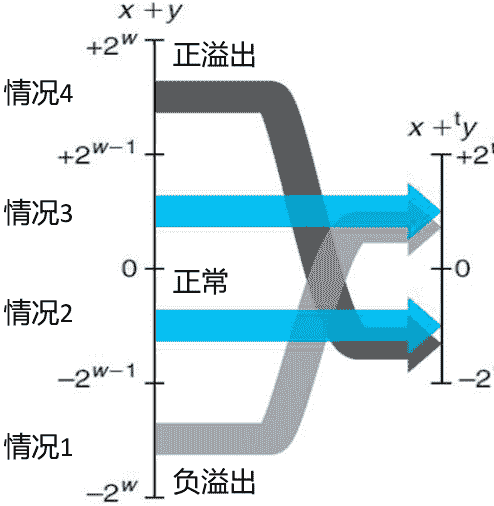

## 补码加法可视化示意图

+   - 数值
+     - 4位补码
+     - 数值范围-8 ～ +7
+   - 弯折——溢出
+     - x+y ≥ 2^{w-1} 时
+       - 变成负数
+       - 最多一次
+     - x+y < -2^{w-1}
+       - 变成正数
+       - 最多一次

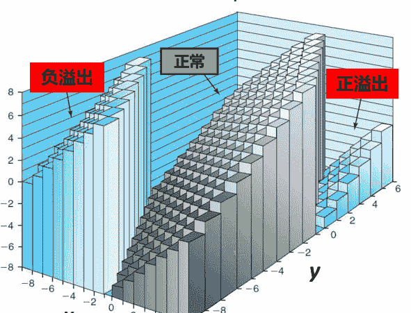

## 乘法

+   - 目标: 计算w位的两个数x和y的乘积
+   - 有符号数或者无符号数

+   - 乘积的精确结果可能超过 w 位
+   - 乘积的无符号数最多可达 2w 位
+     - 结果范围: 0 ≤ x * y ≤ (2^w - 1)^2 = 2^{2w} - 2^{w+1} + 1
+   - 补码的最小值 (负数)最多需要2w-1 位
+     - 结果范围: x * y ≥ (-2^{w-1})*(2^{w-1}-1) = -2^{2w-2} + 2^{w-1}
+   - 补码最大值(正数)最多需要2w 位——值为 (TMin_w)^2
+     - 结果范围: x * y ≤ (-2^{w-1})^2 = 2^{2w-2}

+   - 为获得精确结果可扩展乘积的字长
+   - 在需要时用软件方法完成，例如：算术程序包“arbitrary precision”

> Bryant and O'Hallaron, Computer Systems: A Programmer's Perspective, Third Edition


## C 语言的无符号数乘法

操作数：$w$ 位

真实乘积：$2w$ 位

丢弃 $w$ 位：**保留低 $w$ 位**

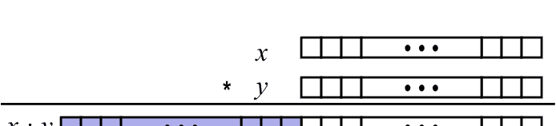

- **标准乘法功能**
  - 忽略 $w$ 位
  - **相当于对乘积执行了模运算**

$\mathrm{UMult}_w(x,y)=x\cdot y\bmod 2^w$

## C 语言的有符号数乘法

操作数: $w$ 位

真实乘积: $2w$ 位

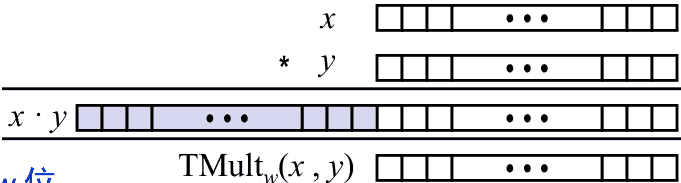

丢弃 $w$ 位: **保留低 $w$ 位**

### 标准乘法功能

- 忽略 $w$ 位
- 有符号数乘、无符号数乘有不同之处
  - 乘积的符号扩展
- 乘积的低位相同

## 用移位实现 “乘以2的幂”

- 无论有符号数还是无符号数：
  - u << k 可得到 u*2^k
  - 操作数: w 位
  - 真实乘积: w+k 位
  - 丢弃 k 位: 保留低 w 位
  - UMULT_w(u, 2^k)
  - TMULT_w(u, 2^k)

- 示例
  - u << 3 == u * 8
  - (u << 5) - (u << 3) == u * 24
  - 绝大多数机器，移位比乘法快
  - 编译器自动生成基于移位的乘法代码

## 用移位实现无符号数 “除以2的幂”

- 无符号数 “除以2的幂” 的商
  - u >> k 得到⌊u / 2^k⌋
  - 使用逻辑右移

操作数：
u
/ 2^k
除法：
u / 2^k
结果：
⌊u / 2^k⌋
二进制小数点

|  | Division | Computed | Hex | Binary |
|---|---|---|---|---|
| x | 15213 | 15213 | 3B 6D | 00111011 01101101 |
| x >> 1 | 7606.5 | 7606 | 1D B6 | 00011101 10110110 |
| x >> 4 | 950.8125 | 950 | 03 B6 | 00000011 10110110 |
| x >> 8 | 59.4257813 | 59 | 00 3B | 00000000 00111011 |

## 主要内容: 位、字节 和 整型数

- 信息的位表示
- 位级运算
- 整型数
  - 表示：无符号数和有符号数
  - 无符号数和有符号数的转换
  - 扩展、截断
  - 整数运算：加、减、乘、移位
  - 总结
- 内存、指针、字符串表示

## 为何用无符号数？

- 一定要知道隐含的转换规则，否则不要用
  - 常见错误
    ```
    unsigned i;
    for (i = cnt-2; i >= 0; i--)
    a[i] += a[i+1];
    ```
  - 不易察觉的问题
    ```
    #define DELTA sizeof(int)
    int i;
    for (i = CNT; i - DELTA >= 0; i -= DELTA)
    ...
    ```

## 巧用无符号数：向下计数

- 使用无符号类型循环变量的适当方法
  ```
  unsigned i;
  for (i = cnt-2; i < cnt; i--)
      a[i] += a[i+1];
  ```

- 参考Robert Seacord著《Secure Coding in C and C++》
  - C语言标准确保无符号数加法的行为与模运算类似
    - 0−1 → UMax

- 好方法
  ```
  size_t i;
  for (i = cnt-2; i < cnt; i--)
      a[i] += a[i+1];
  ```
  - size_t定义为长度为计算机程序相同字长的无符号数
  - 即使cnt = Umax也能很好工作
  - 若cnt 是有符号数，且值小于0，会如何？

## 为何用无符号数？

- 要进行模运算的时候，就用无符号数
  - 多精度的算术运算
- 用二进制制位表示集合时，就用无符号数
  - 逻辑右移、无符号扩展

## 主要内容: 位、字节 和 整型数

- 信息的位表示
- 位级运算
- 整型数
  - 表示：无符号数和有符号数
  - 无符号数和有符号数的转换
  - 扩展、截断
  - 整数运算：加、减、乘、移位
  - 总结
- 内存、指针、字符串表示

## 向字节的内存组织管理

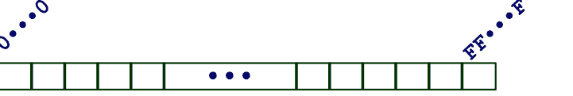

- 程序用地址来引用内存中的数据
  - 内存可看做巨大的 “字节数组”
    - 实际上不是这样，但不妨这样联想
  - 地址就像这个 “字节数组” 的索引
    - 指针变量可保存地址数值
- 注意：
  - 操作系统为每个进程提供私有的地址空间
  - 每个进程可访问自己地址空间中的内存数据，彼此不干扰。

## 机器字

- 任何机器都有一个“字长”
  - 整型值数据的名义长度
    - 地址的名义长度
- 1985年intel 386 CPU开始,大多数机器使用32位 (4字节) 字长
  - 地址空间最大4GB (2³² bytes)
- 目前, 64位字长的机器是主流
  - 潜在地，可以有18 EB (Exabytes) 的可寻址内存
  - 约18.4 X 10¹⁸字节
- 机器依然支持多种数据格式
  - 字长的一部分或几倍长度
  - 始终是整数个字节

## 向字的内存组织管理

- 地址：指定字节的位置
- 字中第一个字节的地址
- 相邻字的地址相差 4 (32-bit) 或 8 (64-bit)

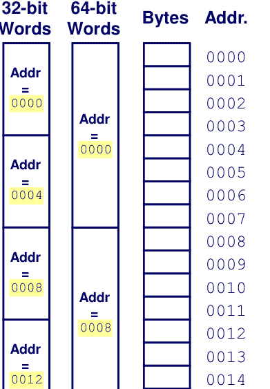

## C数据类型的典型大小(字节数)

| C 数据类型 | 32位 | 64位 | x86-64 |
|---|---|---|---|
| char | 1 | 1 | 1 |
| short | 2 | 2 | 2 |
| int | 4 | 4 | 4 |
| long | 4 | 8 | 8 |
| float | 4 | 4 | 4 |
| double | 8 | 8 | 8 |
| long double | - | - | 10/16 |
| pointer | 4 | 8 | 8 |

## 字节序

- 有多个字节的“字” (word)，其各个字节在内存中的排列
- 惯例
  - 大端序、大尾序（Big Endian）：Sun, PPC Mac, Internet
    - 最低有效位字节的地址最高
  - 小端序、小尾序（Little Endian）：x86、运行Android 的ARM处理器、iOS和Windows
    - 最低有效位字节的地址最低
- 双端序(Bi-Endian)
  - 机器可以配置成大端序或小端序
  - 很多新近的处理器均支持双端序

## 字节序示例

- 示例
- 变量x 有4字节数值0x01234567
- 假定x的地址为 0x100

Big Endian


Little Endian


## 整型数的表示

```
int A = 15213;
```

```
long int C = 15213;
```

```
int B = -15213;
```

十进制: 15213
二进制: 0011 1011 0110 1101
16进制: 3 B 6 D

补码表示

## 补码的表示

- 打印数据字节表示的程序代码
- 将指针转换成unsigned char * 类型，从而按字节数组处理

```
typedef unsigned char *pointer;

void show_bytes(pointer start, size_t len){
    size_t i;
    for(i = 0; i < len; i++)
        printf("%p\t0x%.2x\n",start+i, start[i]);
    printf("\n");
}
```

printf 指令：
%p: 打印指针
%x: 16进制格式打印

## show_bytes 的执行实例

```
int a = 15213;
printf("int a = 15213;\n");
show_bytes((pointer) &a, sizeof(int));
```

### Result (Linux x86-64):

```
int a = 15213;
0x7fffb7f71dbc    6d
0x7fffb7f71dbd    3b
0x7fffb7f71dbe    00
0x7fffb7f71dbf    00
```

## 指针的表示

```
int B = -15213;
int *P = &B;
```

| Value |
|-------|
| EF |
| FF |
| FB |
| 2C |

| Value |
|-------|
| AC |
| 28 |
| F5 |
| FF |

| Value |
|-------|
| 3C |
| 1B |
| FE |
| 82 |
| FD |
| 7F |
| 00 |
| 00 |

不同的编译器、机器会有不同的运行结果。
甚至程序的每次运行结果都不同

## C的整型数习题

Initialization

```
int x = foo();
int y = bar();
unsigned ux = x;
unsigned uy = y;
```

- x < 0  ((x*2) < 0)
- ux >= 0
- x & 7 == 7  (x<<30) < 0
- ux > -1
- x > y  -x < -y
- x * x >= 0
- x > 0 && y > 0  x + y > 0
- x >= 0  -x <= 0
- x <= 0  -x >= 0
- (x|-x)>>31 == -1
- ux >> 3 == ux/8
- x >> 3 == x/8
- x & (x-1) != 0

## 布尔代数的应用

- 广泛应用于数字系统
- 1937 MIT 硕士论文
- 延迟开关网络的推理
  - 闭合开关编码为1, 开关打开编码为 0

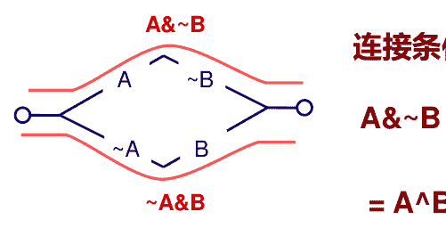

连接条件：
A&~B | ~A&B
= A^B

## 代码安全示例

```
/* 库函数 memcpy的声明 */
void *memcpy(void *dest, void *src, size_t n);
```

```
/*内核内存区域保持用户访问数据*/
#define KSIZE 1024
char kbuf[KSIZE];

/* 从内核内存区域最多拷贝maxlen字节到用户缓冲區 */
int copy_from_kernel(void *user_dest, int maxlen) {
    /*字节数len=min（缓冲區大小,maxlen） */
    int len = KSIZE < maxlen ? KSIZE : maxlen;
    memcpy(user_dest, kbuf, len);
    return len;
}
```

- 与FreeBSD’s的getpeername代码实现相似
- 有很多聪明的人试图在程序中发现漏洞

## 典型用法

```
/* 库函数 memcpy的声明 */
void *memcpy(void *dest, void *src, size_t n);
```

```
/*内核内存区域保持用户访问数据*/
#define KSIZE 1024
char kbuf[KSIZE];

/* 从内核内存区域最多拷贝maxlen字节到用户缓冲区*/
int copy_from_kernel(void *user_dest, int maxlen) {
    /*字节数len=min（缓冲区大小,maxlen） */
    int len = KSIZE < maxlen ? KSIZE : maxlen;
    memcpy(user_dest, kbuf, len);
    return len;
}
```

```
#define MSIZE 528
void getstuff() {
    char mybuf[MSIZE];
    copy_from_kernel(mybuf, MSIZE);
    printf("%s\n", mybuf);
}
```

## 恶意用法

```
/* 库函数 memcpy的声明 */
void *memcpy(void *dest, void *src, size_t n);
```

```
/*内核内存区域保持用户访问数据*/
#define KSIZE 1024
char kbuf[KSIZE];

/* 从内核内存区域最多拷贝maxlen字节到用户缓冲區*/
int copy_from_kernel(void *user_dest, int maxlen) {
    /* 字节数len=min（缓冲區大小,maxlen）*/
    int len = KSIZE < maxlen ? KSIZE : maxlen;
    memcpy(user_dest, kbuf, len);
    return len;
}
```

```
#define MSIZE 528
void getstuff() {
    char mybuf[MSIZE];
    copy_from_kernel(mybuf, - MSIZE);
}
```

改进： size_t int copy_from_kernel(void *user_dest, size_t maxlen)

## Tadd的数学性质

- 与带Uadd加法的无符号数是同构群
- TAdd_w(u , v) = U2T(UAdd_w(T2U(u), T2U(v)))
- 因为两者具有相同的位模式
- 补码加法Tadd构成一个群
- 封闭性、交换性、结合性、0是单位元
- 每个元素都有逆元 TComp_w(u) = { -u    u ≠ TMin_w ; TMin_w    u = TMin_w }

## Tadd的表征

### 功能性

- 真实和需要w+1位
- 舍弃最有效位 MSB
- 将剩余位看做整数的补码表示

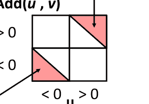

正溢出

负溢出

```
TAdd_w(u,v) = { u + v + 2^w    u + v < TMin_w (负溢出)
                  u + v        TMin_w ≤ u + v ≤ TMax_w
                  u + v - 2^w   TMax_w < u + v (正溢出) }
```

## ~(negation)

- ~(negation)
  变反加一( Complement & Increment)
- 断言: 下式对补码成立
  ~x + 1 == -x
- ~x + x == 1111...111 == -1

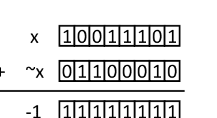

## 示例

x = 15213

|  | Decimal | Hex | Binary |
|---|---|---|---|
| x | 15213 | 3B 6D | 00111011 01101101 |
| ~x | -15214 | C4 92 | 11000100 10010010 |
| ~x+1 | -15213 | C4 93 | 11000100 10010011 |
| y | -15213 | C4 93 | 11000100 10010011 |

x = 0

|  | Decimal | Hex | Binary |
|---|---|---|---|
| 0 | 0 | 00 00 | 00000000 00000000 |
| ~0 | -1 | FF FF | 11111111 11111111 |
| ~0+1 | 0 | 00 00 | 00000000 00000000 |


## 代码范例#2

■ SUN XDR 函数库
  广泛用于机器间传输数据

```
void* copy_elements(void *ele_src[], int ele_cnt, size_t ele_size);
```

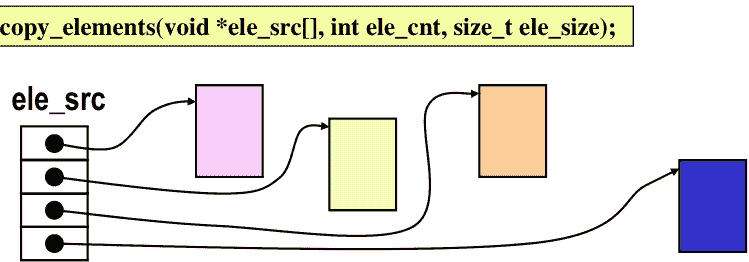

```
malloc(ele_cnt * ele_size)
```


## XDR 代码

```
void* copy_elements(void *ele_src[], int ele_cnt, size_t ele_size) {
    /* 为ele_cnt个对象申请缓冲区,每个对象ele_size字节
     * 并从ele_src指定的位置拷贝 */

    void *result = malloc(ele_cnt * ele_size);
    if (result == NULL)
        /* malloc failed */
        return NULL;
    void *next = result;
    int i;
    for (i = 0; i < ele_cnt; i++) {
        /* Copy object i to destination */
        memcpy(next, ele_src[i], ele_size);
        /* Move pointer to next memory region */
        next += ele_size;
    }
    return result;
}
```

## 乘法编译生成的代码

## C 函数

```
long mul12(long x)
{
    return x*12;
}
```

## 编译得到的算术运算

```
leaq (%rax,%rax,2), %rax
salq $2, %rax
```

## 解释

```
t <- x+x*2
return t << 2;
```

对于常数的乘法，C编译器自动生成移位和加法代码

## 用移位实现有符号数“除以2的幂”

- **有符号数“除以2的幂”的商**
  - `x >> k` 得到 `⌊x / 2^k⌋`
  - 使用算术右移
  - 当 `x < 0` 时，舍入方向出错

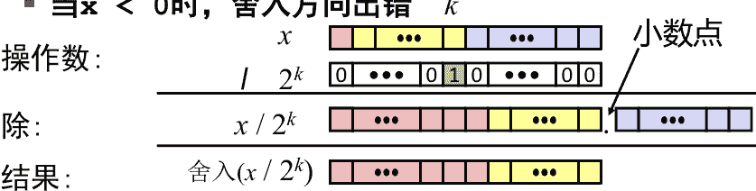

|  | Division | Computed | Hex | Binary |
|---|---:|---:|---|---|
| y | -15213 | -15213 | C4 93 | 11000100 10010011 |
| y >> 1 | -7606.5 | -7607 | E2 49 | 11100010 01001001 |
| y >> 4 | -950.8125 | -951 | FC 49 | 11111100 01001001 |
| y >> 8 | -59.4257813 | -60 | FF C4 | 11111111 11000100 |

## 修正 2 的整数幂除法

- 负数除以 2 的整数幂的商
  - 欲计算 ⌈ x / 2^k ⌉（向 0 舍入）
  - 按 ⌊ (x + 2^k - 1) / 2^k ⌋ 计算
    - C 表达式: ( x + (1<<k) -1 ) >> k
    - 被除数偏差趋向 0

## 情况 1: 无舍入

被除数：

除数：

偏差没影响 ⌈ u / 2^k ⌉

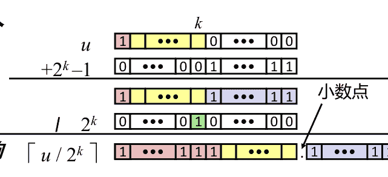

## 编译生成的有符号数除代码

## C 函数

```
long idiv8(long x)
{
    return x/8;
}
```

## 编译生成的结果

```
testq %rax, %rax
js  L4
L3:
    sarq $3, %rax
    ret
L4:
    addq $7, %rax
    jmp L3
```

## 解释

```
if x < 0
    x += 7;
# Arithmetic shift
return x >> 3;
```

- 使用了算术右移

## 算术运算:基本规则

- 无符号整数、补码整数是同构环(isomorphic rings)
  - 同构 = 类型转换 (isomorphism = casting)
- 左移
  - 无论有/无符号数，都可用逻辑左移实现乘以 2^k
- 右移
  - 无符号数: 逻辑右移,除以 2^k (除法 +向0舍入)
  - 有符号数: 算术右移
    - 正整数:除以 2^k (除法 +向0舍入)
    - 负整数:除以 2^k (除法 +远离0舍入), 使用偏置来修正

# 第2章 信息的表示和处理Ⅱ：浮点数

计算机科学与技术学院
哈尔滨工业大学

## 主要内容

- 二进制小数
- IEEE 浮点数标准: IEEE 754
- 舍入模式
- 浮点数运算
- C语言的浮点数

推荐阅读:Ch2.4

## 有理数编码

- 浮点表示很有用
  - 对形如 V = x × 2^y 的有理数进行编码
  - 非常大的数(|V| >> 0)或非常接近0的数(|V| << 1)
  - 实数的近似值
- 从程序员角度看
  - 无趣
  - 晦涩难懂

## 二进制小数

- “小数点”右边的位代表小数部分

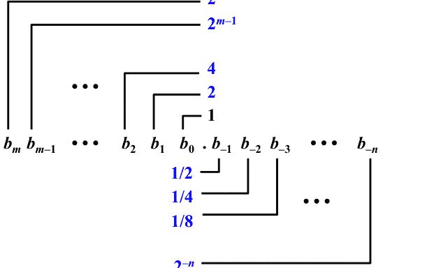

- 表示的有理数： Σ_{i=-n}^{m} b_i × 2^i

## 二进制小数: 例子

| 数值 | 二进制小数 |
| --- | --- |
| 5 ¾ | 101.11₂ |
| 2 7/8 | 10.111₂ |
| 1 7/16 | 1.0111₂ |

- 观察
- 除以2 ➔ 右移 (无符号数)
- 乘以2 ➔ 左移
- 0.111111...₂
  - 1/2 + 1/4 + 1/8 + ... + 1/2ⁱ + ... ➔ 1.0
  - 是最接近1.0的小数
  - 表示为1.0 − ε

## 二进制数的问题

- 在计算机内的实现问题
  - 长度有限的 w 位
  - 只能在 w 位内设置一个二进制小数点
  - 限制了数的范围(非常小？ 非常大？)

## 定点数

- 小数点隐含在 w 位编码的某一个固定位置上
  - 例如 MSB 做符号位，隐含后面是小数点，表示小于 1.0 的纯小数
  - 123.456 怎么办？？？

## 浮点数

- 二进制小数
- IEEE 浮点数标准: IEEE 754
- 浮点数示例
- 舍入、加法与乘法
- C语言的浮点数
- 小结

## 浮点数

对于科学计数法（十进制数）：

mantissa (尾数) 6.02 x 10 21 exponent(阶、指数) 小数点 基 (base, radix)

- ° Normalized form (规格化形式)：小数点前只有一位非0数
- ° 同一个数有多种表示形式。例：对于数 1/1,000,000,000
  - Normalized (规格化形式): 1.0 x 10⁻⁹ 唯一
  - Unnormalized (非规格化形式)：0.1 x 10⁻⁸, 10.0 x 10⁻¹⁰ 不唯一

对于二进制数实数

mantissa (尾数) 1.101 two x 2 -10 exponent (阶、指数) 小数点 基为2

只要对尾数和指数分别编码，就可表示一个浮点数（即：实数）

## 浮点数的表示范围

例：画出下述32位浮点数格式的规格化数的表示范围。

0 1 8 9 31
S 阶码E 尾数M
+/-0.1xxxxx * 2^E

第0位数字S；第1~8位为8位移码表示阶码E（偏移常数为128）；第9~31位为24位二进制原码小数表示的尾数M。规格化尾数的小数点后第一位总是1，故规定第一位默认的“1”不明显表示出来。这样可用23个数字表示24位尾数。

最大正数：0.11...1 x 2^11...1 = (1-2^-24) x 2^127

最小正数：0.10...0 x 2^00...0 = (1/2) x 2^-128

因为原码对称，故其表示范围关于原点对称。

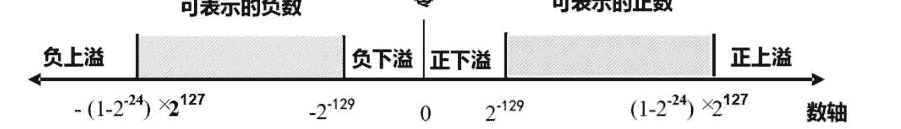

机器0：尾数为0或落在下溢区中的数

浮点数范围比定点数大，但数的个数没变多，故数之间更稀疏，且不均匀


## 浮点数的表示

+   Normal format（规格化数形式）：
+   +/-1.xxxxxxxxx × R^Exponent

为了能表示更多有效数字，通常规定规格化数的小数点前为1！

+   32-bit 规格化数：

| 31 | 0 |
| S | Exponent | Significand |
| 1 bit | ? bits | ? bits |

S 是符号位（Sign）

Exponent 用移码（增码）来表示

Significand 表示 xxxxxxxxxxxxxx（部分尾数）

（基可以是 2/4/8/16，约定信息，无需显式表示）

+   早期的计算机，各自定义自己的浮点数格式

问题：浮点数表示不统一会带来什么问题？

## IEEE 浮点数

+   - IEEE 标准 754
+     - William Kahan 从1976年开始为Intel 设计(1989获图灵奖)
+     - 1985年成为浮点运算的统一标准，快速，易于实现、精度损失小
+     - 优雅、易理解
+     - 所有主流的CPU都支持
+     - 之前有很多不同格式、不太关注精确性


## IEEE 754标准

规格化数：+/-1.xxxxxxxxxx two x 2Exponent

规定：小数点前总是“1”，故可隐含表示。

### Single Precision（单精度）：

| S | Exponent | Significand |
|---|---|---|
| 1 bit | 8 bits | 23 bits |

+   - Sign bit: 1 表示 negative；0 表示 positive

+   - Exponent（阶码）：全0和全1用来表示特殊值！

+   - SP规格化阶码范围为0000 0001 (-126) ~ 1111 1110 (127)

+   - bias为127 (single), 1023 (double) 为什么用127？若用128，则阶码范围为多少？

+   - Significand（部分尾数）：

+   - 规格化尾数最高位总是1，所以隐含表示，省1位

+   - 1 + 23 bits（single），1 + 52 bits（double）

SP: (-1)^S x (1 + Significand) x 2^(Exponent-127) 0000 0001 (-127) ~ 1111 1110 (126)

DP: (-1)^S x (1 + Significand) x 2^(Exponent-1023)

## 精度选项

+   单精度: 32 bits
+   
+   s exp frac
+   1 8-bits 23-bits

+   双精度: 64 bits
+   
+   s exp frac
+   1 11-bits 52-bits

+   扩展精度: 80 bits (Intel)
+   
+   s exp frac
+   1 15-bits 63 or 64-bits

## 规格化数

v = (-1)^s M 2^E

+   - 条件: exp ≠ 000...0 且 exp ≠ 111...1

+   - 阶码(Exponent) 采用偏置值编码: E = Exp − Bias
+     - Exp: exp 字段的无符号数值
+     - 偏置Bias = 2^{k-1} - 1, k 为阶码的位数
+       - 单精度: 127 (Exp: 1...254, E: -126...127)
+       - 双精度: 1023 (Exp: 1...2046, E: -1022...1023)

+   - 尾数(Significand) 编码隐含先导数值1: M = 1.xxx...x2
+     - xxx...x: 是 frac字段的数码
+     - frac=000...0 (M = 1.0)时，为最小值
+     - frac=111...1 (M = 2.0 − ε)时，为最大值
+     - 额外增加了一位的精度（隐含值1）

## 规格化编码示例

> v = (-1)^s M 2^E
> E = Exp - Bias

+   - 数值: float F = 15213.0
+   - 15213_{10} = 11101101101101_{2}
+     = 1.1101101101101_{2} \times 2^{13}

+   - 尾数(Significand)
+   M = 1.1101101101101_{2}
+   frac = 110110110110100000000000_{2}

+   - 阶码(Exponent)
+   E = 13
+   Bias = 127
+   Exp = 140 = 100011100_{2}

| s | exp | frac |
| - | --- | ---- |
| 0 | 100011100 | 110110110110100000000000 |

## 机器数转换为真值

已知float型变量x的机器数为BEE00000H，求x的值是多少？

```
1 011 11101 110 0000 0000 0000 0000 0000
```

(-1)^S x (1 + Significand) x 2^(Exponent-127)

+   • 数符: 1（负数）
+   • 阶（指数）：
+     • 阶码: 0111 1101B = 125
+     • 阶码的值: 125 - 127 = -2
+   • 尾数数值部分:
+     1 + 1x2^-1 + 1x2^-2 + 0x2^-3 + 0x2^-4 + 0x2^-5 +...
+     =1+2^-1 +2^-2 = 1+0.5 +0.25 = 1.75
+   • 真值: -1.75x2^-2 = - 0.4375

为避免混淆，用阶码表示阶的编码，用阶或指数表示阶码的值

## 真值转换为机器数

已知float型变量x的值为-12.75，求x的机器数是多少？

-12.75 = -1100.11B

= -1.10011B x 2³    阶（指数）为3

因此，符号 S = 1

阶码 E = 127 + 3 = 128 + 2 = 1000 0010

显式表示的部分尾数 Significant

= 100 1100 0000 0000 0000 0000

x 的机器数表示为：

1 1000 0010 100 1100 0000 0000 0000 0000

转换为十六进制表示为：C14C0000H

## 规格化数

前面的定义是针对规格化形式（ normalized form ）的数
那么，其他形式的机器数表示什么样的信息呢？

| Exponent | Significand |  |
|---|---|---|
| 1-254 | 任意
小数点前隐含1 | 规格化形式 |
| 0 (全0) | 0 | ? |
| 0 (全0) | nonzero | ? |
| 255 (全1) | 0 | ? |
| 255 (全1) | nonzero | ? |

## 非规格化数

v = (-1)^s M 2^E
E = 1 - Bias

+   - 条件: exp = 000...0
+     - 阶码(Exponent) 值: E = 1 - Bias (instead of E = 0 - Bias)
+     - 尾数(Significand)编码隐含先导数值0: M = 0.xxx...x2
+       - xxx...x:是 frac字段的数码

+   - 情况1: exp = 000...0, frac = 000...0
+     - 表示值0
+     - 注意有不同的数值 +0 和 -0 (why?)

+0: 0 00000000 00000000000000000000000
-0: 1 00000000 00000000000000000000000

Single Precision (单精度) :

| S | Exponent | Significand |
|---|---|---|
| 1 bit | 8 bits | 23 bits |

## 非规格化数

v = (-1)^S M 2^E
E = 1 - Bias

+   - 条件: exp = 000...0
+     - 阶码(Exponent)值: E = 1 - Bias (instead of E = 0 - Bias)
+     - 尾数(Significand)编码隐含先导数值0: M = 0.xxx...x2
+       - xxx...x:是 frac 字段的数码

+   - 情况2: exp = 000...0, frac ≠ 000...0
+     - 最接近0.0的那些数
+     - 间隔均匀

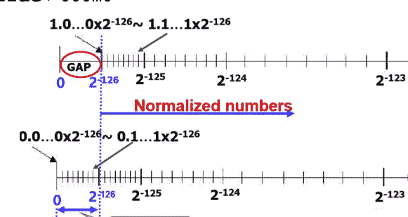

(-1)^S × 0.xx...x × 2^-126


## 特殊值

- 条件: exp = 111...1
- 情况3: exp = 111...1, frac = 000...0
  - 表示 无穷(infinity) ∞
  - 溢出的运算
  - 正无穷、负无穷

浮点数除0的结果是 +/- ∞, 而不是溢出异常。(整数除0为异常)

为什么要这样处理? ∞ : infinity

- 可以利用+∞/-∞作比较。 例如：X/0>Y可作为有效比较

How to represent +/-/-∞?

- Exponent : all ones (11111111B = 255)
- Significand: all zeros

+∞ : 0 11111111 00000000000000000000000
-∞ : 1 11111111 00000000000000000000000

相关操作：

5.0 / 0 = +∞,      -5.0 / 0 = -∞
5+(+∞) = +∞,      (+∞)+(+∞) = +∞
5 - (+∞) = -∞,      (-∞) - (+∞) = -∞      etc

## 特殊值

- 条件: exp = 111...1

- 情况4: exp = 111...1, frac ≠ 000...0

- 表示：不是一个数 Not-a-Number (NaN)

表示没有数值结果（非实数或无穷），例如：
sqrt(-1), ∞ - ∞, ∞ × 0      Sqrt (- 4.0) = ?      0/0 = ?
- 称为 Not a Number (NaN) - “非数”

How to represent NaN

Exponent = 255

Significand: nonzero

NaNs 可以帮助调试程序

相关操作：

sqrt (-4.0) = NaN        0/0 = NaN
op (NaN,x) = NaN        +∞ +(-∞) = NaN
+∞ - (+∞) = NaN        ∞/∞ = NaN
etc.

## 浮点编码总结

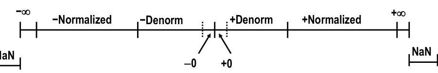

## 浮点数的例子

```
int main()
{
    float f;

    for(;;)
    {
        printf("请输入一个浮点数:");
        scanf("%f",&f);
        printf("这个浮点数的值是:%f\n",f);
        if(f==0) break;
    }
    return 0;
}
```

61.419998和61.420002是两个可表示数，两者之间相差0.000004。当输入数据是一个不可表示数时，机器将其转换为最邻近的可表示数。

运行结果:
Please enter a number: 61.419997
61.419998
Please enter a number: 61.419998
61.419998
Please enter a number: 61.419999
61.419998
Please enter a number: 61.42
61.419998
Please enter a number: 61.420001
61.420002
Please enter a number:

## 浮点数

- 二进制小数
- IEEE 浮点数标准: IEEE 754
- 浮点数示例
- 舍入、加法与乘法
- C语言的浮点数
- 小结

## 小浮点数例子——1字节浮点数

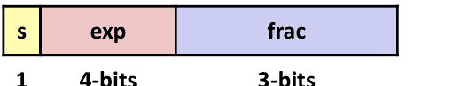

- 8位浮点编码
  - 符号位：最高有效位
  - 阶码(Exponent)4位，偏置为7
  - 小数(frac)3位

- 和IEEE 相同的格式
  - 规格化、非规格化
  - 0、NaN、无穷的表示

## 动态范围(仅正数)

| s exp frac | E | Value | 注记 |
|---|---|---|---|
| 0 0000 000 | -6 | 0 | |
| 0 0000 001 | -6 | 1/8*1/64 = 1/512 | 最接近0 |
| 0 0000 010 | -6 | 2/8*1/64 = 2/512 | |
| ... |  |  | |
| 0 0000 110 | -6 | 6/8*1/64 = 6/512 | |
| 0 0000 111 | -6 | 7/8*1/64 = 7/512 | 最大非规格化数 |
| 0 0001 000 | -6 | 8/8*1/64 = 8/512 | 最小规格化数 |
| 0 0001 001 | -6 | 9/8*1/64 = 9/512 | |
| ... |  |  | |
| 0 0110 110 | -1 | 14/8*1/2 = 14/16 | |
| 0 0110 111 | -1 | 15/8*1/2 = 15/16 | closest to 1 below |
| 0 0111 000 | 0 | 8/8*1 = 1 | |
| 0 0111 001 | 0 | 9/8*1 = 9/8 | closest to 1 above |
| 0 0111 010 | 0 | 10/8*1 = 10/8 | |
| ... |  |  | |
| 0 1110 110 | 7 | 14/8*128 = 224 | |
| 0 1110 111 | 7 | 15/8*128 = 240 | 最大规格化数 |
| 0 1111 000 | n/a | inf | |
| 非规格化数 |  |  | |
| 规格化数 |  |  | |

v = (-1)^s M 2^E
n: E = Exp − Bias
d: E = 1 − Bias

## 数值分布

- 6-bit类 IEEE格式浮点数
  - e：阶码(Exponent) 位数 3
  - f：小数位数 2
  - 偏置 bias = 2^{3-1}-1 = 3


# 注意：数值在趋近于0时变密集


## 数值分布(放大观察)

- 6-bit类 IEEE格式
  - e： 阶码(Exponent) 位数3
  - f： 小数位数 2
  - 偏置bias= 2^{3-1}-1 = 3


## 浮点数

- 二进制小数
- IEEE 浮点数标准: IEEE 754
- 浮点数示例
- 舍入、加法与乘法
- C语言的浮点数
- 小结

## 浮点数运算: 基本思想

- `x +ᶠy = Round(x + y)`
- `x ×ᶠy = Round(x × y)`

- **基本思想**
  - 首先，计算精确结果
  - 然后，变换到指定格式
    - 可能溢出：阶码(Exponent)太大
    - 小数部分可能需要舍入

## 舍入

- 舍入模式(以美元舍入说明)

|  | $1.40 | $1.60 | $1.50 | $2.50 | -$1.50 |
|---|---|---|---|---|---|
| 向0舍入 | $1 | $1 | $1 | $2 | -$1 |
| 向下舍入 (-∞) | $1 | $1 | $1 | $2 | -$2 |
| 向上 (+∞) | $2 | $2 | $2 | $3 | -$1 |
| 向偶数舍入(默认) | $1 | $2 | $2 | $2 | -$2 |

## 细究 “向偶数舍入”

- 默认的舍入模式
  - 很难找到更好的方法
  - 其他方法都有统计偏差
    - 对正整数集合求和时，和将始终被低估或高估（负偏差、正偏差）
- 向偶数舍入
  - 当恰好在两个可能的数值正中间时（中间值）：
    舍入后，最低有效位的数码为偶数
  - 其他时候：向最近的数值舍入
    - 比中间值小向下舍入，比中间值大向上舍入
- 以10进制数向最近的百分位舍入为例：
  - 7.8949999  7.89  （比中间值小：向下舍入）
  - 7.8950001  7.90  （比中间值大：向上舍入）
  - 7.8950000  7.90  （中间值→向上舍入）
  - 7.8850000  7.88  （中间值→向下舍入）


## 二进制制数的舍入

- 二进制小数的舍入
- “偶数”: 最低有效位值为0
- “中间值”: 舍入位置右侧的位都是0，即形如: XXX 100...2

## 例子

| 数值 | 二进制制 | 舍入后 | 舍入动作 | 舍入后的值 |
|------|----------|--------|----------|------------|
| 2 3/32 | 10.000011₂ | 10.00₂ | (<1/2—down) | 2 |
| 2 3/16 | 10.00110₂ | 10.01₂ | (>1/2—up) | 2 1/4 |
| 2 7/8 | 10.11100₂ | 11.00₂ | ( 1/2—up) | 3 |
| 2 5/8 | 10.10100₂ | 10.10₂ | ( 1/2—down) | 2 1/2 |

## 浮点乘法

- $(-1)^{s1} M1\ 2^{E1} \times (-1)^{s2} M2\ 2^{E2}$
- 精确结果: $(-1)^{s} M\ 2^{E}$
  - 符号(Sign) $s$: $s1 \wedge s2$
  - 尾数(Significand) $M$: $M1 \times M2$
  - 阶码(Exponent) $E$: $E1 + E2$

- 修正
  - 如 $M \ge 2$, 将 $M$ 右移(1位), $E$ 加1
  - 如 $E$ 超出范围，则溢出
  - 将 $M$ 舍入，以符合小数部分的要求

- 实现
  - 主要问题：实现尾数(Significand)的乘

## 浮点数加法

- $(-1)^{s1} M1\ 2^{E1} + (-1)^{s2} M2\ 2^{E2}$
  - 假设 $E1 > E2$

- 准确结果: $(-1)^{s} M\ 2^{E}$
  - 符号 $s$, 尾数 $M$:
    - 有符号数对齐、相加的结果
  - 阶码(Exponent) $E$: $E1$

- 修正
  - $M \ge 2$: 将 $M$ 右移(1位), $E$ 加1
  - $M < 1$: 将 $M$ 左移 $k$ 位, $E$ 减 $k$
  - $E$ 超范围: 溢出
  - 将 $M$ 舍入, 以符合小数部分的要求

二进制小数点对齐


## 浮点数

- 二进制小数
- IEEE 浮点数标准: IEEE 754
- 浮点数示例
- 舍入、加法与乘法
- C语言的浮点数
- 小结

## C语言中的浮点数

- C语言中有 **float** 和 **double** 类型，分别对应 IEEE 754 单精度浮点数格式和双精度浮点数格式
- **long double** 类型的长度和格式随编译器和处理器类型的不同而有所不同，IA-32 中是 **80 位扩展精度格式**
- 从 int 转换为 float 时，不会发生溢出，但可能有数据被舍入
- 从 int 或 float 转换为 double 时，因为 double 的有效位数更多，故能保留精确值
- 从 double 转换为 float 和 int 时，可能发生溢出，此外，由于有效位数变少，故可能被舍入
- 从 float 或 double 转换为 int 时，因为 int 没有小数部分，所以数据可能会向 0 方向被截断

## 浮点数习题

- 针对下列c表达式:
- 证明对所有参数值都成立
- 或什么条件下不成立

```
int x = ...;
float f = ...;
double d = ...;
```

假设d和f都不是NaN

- x == (int)(float) x
- x == (int)(double) x
- f == (float)(double) f
- d == (double)(float) d
- f == -(-f);
- 2/3 == 2/3.0
- d < 0.0 ⇒ ((d*2) < 0.0)
- d > f ⇒ -f > -d
- d * d >= 0.0
- (d+f)-d == f

## 浮点数习题答案

- x == (int)(float) x    No: 24 位尾数
- x == (int)(double) x    Yes: 53位尾数
- f == (float)(double) f    Yes: 增加精度
- d == (float) d    No: 损失精度
- f == -(-f);    Yes: 仅仅改变符号位
- 2/3 == 2/3.0    No: 2/3 == 0
- d < 0.0 ⇒ ((d*2) < 0.0)    Yes!
- d > f ⇒ -f < -d    Yes
- d *d >= 0.0    Yes!
- (d+f)-d == f    No: 不具备结合性

## 浮点的悲剧

- 1991年2月25日
- 美国爱国者导弹拦截伊拉克飞毛腿导弹失败
- 后果：飞毛腿导弹炸死28名士兵
- 爱国者导弹的内置时钟计数器N每0.1秒记一次数。
- 时间计算
  T = N × 0.1

程序用24位数来近似表示0.1：

x=0.0001 1001 1001 1001 1001 100

## 浮点的悲剧

- 0.1-x = 0.00000000000000000000[1100][1100]...2
- 0.1-x = 2⁻²⁰ × 0.1 = 9.54 × 10⁻⁸ （约等于）
- 程序运行100 小时后，累计的误差：
  100 × 3600 × 10 × 9.54 × 10⁻⁸ = 0.34344秒
- 飞毛腿速度： 2000 m/s
- 飞毛腿位置的估计误差： 686 m

小故事：实际上，以色列方面已经发现了这个问题并于1991年2月11日知会了美国陆军及爱国者计划办公室（软件制造商）。以色列方面建议重新启动爱国者系统的电脑作为暂时解决方案，可是美国陆军方面却不知道每次需要间隔多少时间重新启动系统一次。1991年2月16日，制造商向美国陆军提供了更新软件，但这个软件最终却在飞毛腿导弹击中军营后的一天才运抵部队。

## 爱国者导弹定位误差改进

- 若x用float型表示，则x的机器数是什么？0.1与x的偏差是多少？系统运行100小时后的时钟偏差是多少？在飞毛腿速度为2000米/秒的情况下，预测的距离偏差为多少？
  - 0.1= 0.0 0011[0011]B=+1.1 0011 0011 0011 0011 0011 00B×2^-4，故x的机器数为0 011 1101 1 100 1100 1100 1100 1100 1100
  - Float型仅有24位有效位数，后面的有效位全被截断，故x与0.1之间的误差为：|x−0.1|=0.000 0000 0000 0000 0000 0000 1100 [1100]...B。这个值等于2^-24×0.1≈5.96×10^-9。100小时后时钟偏差5.96×10^-9×36×10^5≈0.0215秒。距离偏差0.0215×2000≈43米。比爱国者导弹系统精确约16倍。

- 若用32位二进制定点小数x=0.000 1100 1100 1100 1100 1100 1100 1101 B表示0.1，则误差比用float表示误差更大还是更小？
  - 当x=0.000 1100 1100 1100 1100 1100 1100 1101 B时，与0.1之间的误差约为：|x−0.1|=0.000 0000 0000 0000 0000 0000 0000 001100 [1100]...B。这个值等于2^-30×0.1≈9.31×10^-11。100小时后时钟偏差9.31×10^-11×36×10^5≈0.000335秒。预测的距离偏差仅为0.000335×2000≈0.67米。

## 天价 “溢出”

- 代价5亿美元的溢出


## 天价 “溢出”

- 主角： 阿丽亚娜5(Ariane5)型火箭的首次发射
- 时间： 1996.6.4
- 剧情： 发射后仅37秒，偏离路径，解体爆炸
- 代价： 5亿美元
- 原因： 溢出
  - 溢出——将64位浮点数转换成16位有符号整型数时，发生溢出。这个溢出的整型数，用于描述火箭的水平速度
  - Ariane4的水平速度绝对不会超过16位数的范围，因此用了16位整数
  - Ariane5简单复用了这部分代码
  - 问题： Ariane 5 的水平速度是Ariane 4的5倍！！！


## 启示
- Ariana 5火箭和爱国者导弹的例子带来的启示
- 程序员应对底层机器级数据的表示和运算有深刻理解
- 计算机世界里，经常是“差之毫厘，失之千里”，需要细心再细心，精确再精确
- 不能遇到小数就用浮点数表示，有些情况下（如需要将一个整数变量乘以一个确定的小数常量），可先用一个确定的定点整数常量与整数变量相乘，然后再通过移位运算来确定小数点

## 小结
- IEEE 浮点数具有清晰的数学性质
- 表示形如 M × 2ᴱ 的数字
- 对运算进行推理，而不用考虑其实现
  - 就像有完美的精度，然后在进行舍入
- 和实数运算不同
  - 结合性、分配性有冲突

## 有趣的数字
## {single,double}

| Description | exp | frac | Numeric Value |
|---|---|---|---|
| 0 | 00...00 | 00...00 | 0.0 |
| 最小值的后非规格化数 | 00...00 | 00...01 | 2^-{23,52} x 2^-{126,1022} |
| Single ≈ 1.4 x 10^-45 |  |  |  |
| Double ≈ 4.9 x 10^-324 |  |  |  |
| 最大的非规格化数 | 00...00 | 11...11 | (1.0 − ε) x 2^-{126,1022} |
| Single ≈ 1.18 x 10^-38 |  |  |  |
| Double ≈ 2.2 x 10^-308 |  |  |  |
| 最小的后规格化数 | 00...01 | 00...00 | 1.0 x 2^-{126,1022} |
| 刚刚比最大的非规格化数大 |  |  |  |
| 1 | 01...11 | 00...00 | 1.0 |
| 最大的规格化数 | 11...10 | 11...11 | (2.0 − ε) x 2^{127,1023} |
| Single ≈ 3.4 x 10^38 |  |  |  |
| Double ≈ 1.8 x 10^308 |  |  |  |

# 程序的机器级表示 I：基础
Machine-Level Programming

计算机科学与技术学院
哈尔滨工业大学

# 程序的机器级表示 I：基础
- Intel CPU及架构的发展史
- IA32处理器体系结构
- 汇编语言
- Linux汇编程序

## Intel x86 处理器
- 笔记本、台机、服务器市场的统治者
- 进化设计
  - 向后兼容，直至1978年推出的8086CPU
  - 与时俱进：不断引入新特征
- 复杂指令集计算机(Complex instruction set computer,CISC)
  - 指令多、指令格式多
    - Linux程序设计只用到其中较小的子集
  - 性能难与精简指令计算机(Reduced Instruction Set Computers,RISC)相比
  - 但，Intel做到了：主要在速度方面、功耗不低

## Intel x86 进化的里程碑

| 名字 | 时间 | 晶体管数量 | 主频 |
|---|---:|---:|---:|
| 8086 | 1978 | 29K | 5-10 |
| 80286 | 1982 | 134K | 20 |
| 386 | 1985 | 275K | 16-33 |
| Pentium 4E | 2004 | 125M | 2800-3800 |
| Core 2 | 2006 | 291M | 1060-3500 |
| Core i7 | 2008 | 731M | 1700-3900 |

- 8086
  - 第一个16位intel处理器，主要用于IBM PC & DOS
  - 1MB 地址空间，程序可用640KB，8087浮点运算协处理器
- 80286
  - IBM PC-AT & Windows、更多寻址模式
- 386
  - 第一个32位intel处理器，称为IA32
  - 增加“平坦寻址”(flat addressing)，可运行Unix
- Pentium 4E
  - 第一个64位Intel x86处理器，称为 x86-64，超线程(hyperthreading)
- Core 2
  - 第一个多核处理器，不支持超线程（Core酷睿）
- Core i7
  - 4核处理器、支持超线程

## Intel x86 处理器(续...)
## 机器的演变
- 386 1985 0.3M
- Pentium 1993 3.1M
- Pentium/MMX 1997 4.5M
- PentiumPro 1995 6.5M
- Pentium III 1999 8.2M
- Pentium 4 2001 42M
- Core 2 Duo 2006 291M
- Core i7 2008 731M

## 增加的特征
- 支持多媒体计算的指令
- 支持更高效的条件运算指令
- 从32位进化到64位
- 多核


## Intel最新状态
- 2015 Core i7 Broadwell架构: 14nm工艺、低功耗
- 台机： Intel Corei7 6950X
- 10核/20线程25MB（三级缓存）
- 3.0-3.5GHz
- 140W
- 集成显卡
- 服务器： Xeon(至强) E5-2699 v4
- 22核/44线程/55MB/2.2-3.6GHz/145W
- 2016 Xeon E7-8890 v4
- 24核/48线程/60MB/2.2-3.4GHz/ 165w
- 2017 Core i9-7980XE: 18核/36线程


## x86 的克隆: Advanced Micro Devices (AMD)
- 历史
  - AMD 紧随Intel
  - 慢一点点、便宜很多！
- 随后
  - 从Digital Equipment Corp. 和其他发展趋势下降的公司招募顶级电路设计师
  - Opteron（皓龙处理器）: Pentium 4的强劲对手
  - 研发了x86-64, 向64扩展的自主技术
- 近期
  - 与Intel合作,引领世界半导体技术的发展
  - AMD 已经落后

## Intel的64位CPU发展史
- **2001: Intel激进地尝试从IA32跨到IA64**
  - 采用完全不同的架构(Itanium)
  - 仅将运行IA32程序作为一种遗产
  - 性能令人失望
- **2003: AMD采用了进化的解决方案**
  - x86-64 (现在称为 “AMD64”)
- **Intel 被动聚焦于IA64**
  - 难以承认错误或承认AMD更好
- **2004: Intel 宣布了IA32的扩充EM64T**
  - 64位技术的扩展内存
  - 几乎和x86-64一样
- **除了低端x86处理器外，都支持x86-64**
  - 很多程序依旧运行在32位模式

## 摩尔定律(Moor’s Law)
## Intel microprocessor complexity


## 机器级程序设计I: 基础
- Intel CPU及架构的发展史
- IA32处理器体系结构
- 汇编语言
- Linux汇编程序

## IA32处理器体系结构
- 0、概念
- 1、微机的基本结构
- 2、IA32的寄存器
- 3、IA32的内存管理
- 4、指令的执行过程——指令执行周期
- 5、程序是如何运行的
- 6、系统是如何启动的

## 0、概念
- **架构(Architecture)**
  即，指令集体系结构，处理器设计的一部分，理解或编写汇编/机器代码时需要知道。
  - 例如：指令集规范,寄存器
- **微架构(Microarchitecture)**
  架构的具体实现
  - 例如：缓存大小、核心的频率
- **代码格式(Code Forms)**
  - 机器码(Machine Code):处理器接执行的字节级程序
  - 汇编码(Assembly Code):机器码的文本表示
- **指令体系结构(ISA)例子:**
  - Intel: x86, IA32, Itanium（ia64）, x86-64
  - ARM: 广泛用于移动电话


# 1 微机的基本结构


微机的结构示意图

寄存器：计算机中最快的存储单元、通常32/64位长度（IA32/X86-64）

内存

扩展槽：网络适配器等使用

存储在磁盘上的hello 可执行文件

CPU

寄存器文件

PC

ALU

总线接口

系统总线

I/O桥

内存总线

主存储器

I/O总线

USB控制器

鼠标

键盘

图形适配器

显示器

磁盘控制器

磁盘

## 2、IA32的寄存器

### 2.1 基本寄存器

寄存器是CPU内部的高速储存单元，访问速度比常规内存快得多。包括：

- ✓ 8个32位通用寄存器
- ✓ 6个16位段寄存器
- ✓ 一个存放处理器标志的寄存器(EFLAGS)
- ✓ 一个指令指针寄存器(EIP)

### 2.2 系统寄存器

### 2.3 浮点单元

- EAX
- EBX
- ECX
- EDX
- EBP
- ESP
- ESI
- EDI
- EFLAGS
- EIP

16位段寄存器

| CS | ES |
| SS | FS |
| DS | GS |

IA-32处理器的基本寄存器

### 2.1.1 通用寄存器

32位通用寄存器：主要用于算术运算和数据传送


| 32位 | 16位 | 高8位 | 低8位 |
|---|---|---|---|
| EAX | AX | AH | AL |
| EBX | BX | BH | BL |
| ECX | CX | CH | CL |
| EDX | DX | DH | DL |

EBP ESP ESI EDI只有低16位有特别名字，通常在编写实地址模式程序时使用：

| 32位 | 16位 |
| --- | --- |
| EBP | BP |
| ESP | SP |
| ESI | SI |
| EDI | DI |

#### 通用寄存器的特殊用法

- **EAX**：扩展累加寄存器。在乘法和除法指令中被自动使用；
- **ECX**：循环计数器。
- **ESI和EDI**：扩展源指针寄存器和扩展目的指针寄存器。用于内存数据的存取；
- **ESP**：扩展堆栈指针寄存器。一般不用于算术运算和数据传送，而用于寻址堆栈上的数据。
- **EBP**：扩展帧指针寄存器。用于引用堆栈上的函数参数和局部变量；

### 2.1.2 段寄存器

- 在实地址模式下，段寄存器用于存放段的基址；段寄存器包括：CS、SS、DS、ES、FS、GS。
- CS往往用于存放代码段(程序的指令)地址；
- DS存放数据段(程序的变量)地址；
- SS存放堆栈段(函数的局部变量和参数)地址；
- ES、FS和GS则可指向其他数据段。
- 保护模式下，段寄存器存放段描述符表的指针(索引)。

### 2.1.4 EFLAGS寄存器(标志寄存器、条件码寄存器)

- EFLAGS由控制CPU的操作或反映CPU某些运算结果的二进制位构成。
- 处理器标志包括两种类型：状态标志和控制标志。
  - 说某标志被设置意味着使其等于1；被清除意味着使其等于0
  - 程序员可以通过设置EFLAGS中的控制标志控制CPU的操作，如方向和中断标志。
  - 一些机器指令可以测试和控制这些标志，例如：JC 或 STC

### 2.1.4 EFLAGS寄存器...

其中反映CPU执行的算术和逻辑操作结果的状态标志，包括溢出、符号、零、辅助进位、奇偶和进位标志。


#### EFLAGS寄存器的状态标志（条件码）

- **进位标志CF**：在无符号算术运算的结果，无法容纳于目的操作数中时被设置。
- **溢出标志OF**：在有符号算术运算的结果位数太多，而无法容纳于目的操作数中时被设置。
- **符号标志SF**：在算术或逻辑运算产生的结果为负时被设置。
- **零标志ZF**：在算术或逻辑运算产生的结果为零时被设置。
- **辅助进位标志AC**：8位操作数的位3到位4产生进位时被设置,BCD码运算时使用。
- **奇偶标志PF**：结果的最低8位中，为1的总位数为偶数，则设置该标志；否则清除该标志。

### 2.2 系统寄存器

仅允许运行在最高特权级的程序（例如：操作系统内核）访问的寄存器，任何应用程序禁止访问。

- 中断描述符表寄存器 IDTR： 保存中断描述符表的地址。
- 全局描述符表寄存器 GDTR： 保存全局描述符表的地址，全局段描述符表包含了任务状态段和局部描述符表的指针。
- 局部描述符表寄存器 LDTR： 保存当前正在运行的程序的代码段、数据段和堆栈段的指针。
- 任务寄存器： 保存当前执行任务的任务状态段的地址。
- 调试寄存器： 用于调试程序时设置端点。

### 2.3 浮点单元FPU

适合于高速浮点运算，从Intel 486开始集成到主处理器芯片中。

- 8个80位的浮点数据寄存器： st(0) — st(7)
- 2个48位的指针寄存器
- 3个16位的控制寄存器

## 3、IA32的内存管理

### 3.1 实地址模式

- 在实地址模式下，处理器使用20位的地址总线，可以访问1MB(0~FFFFF)内存。
- 8086的模式，只有16位的地址线，不能直接表示20位的地址，采用内存分段的解决方法。
- 段：将内存空间划分为64KB的段Segment;
- 段地址存放于16位的段寄存器中（CS、DS、ES或SS）：
  - CS用于存放16位的代码段基地址
  - DS用于存放16位的数据段基地址
  - SS用于存放16位的堆栈段基地址

段-偏移地址


20位线性地址的计算

例：

08F1: 0100

→ 08F1H*10H + 0100H = 09010H

8000:0250

→ 8000H*10H + 0250H = 80250H

### 3.2 保护模式

- 32位地址总线寻址，每个程序可寻址4GB内存：0~FFFFFFFF
- 段寄存器(CS、 DS、 SS、 ES、 FS和GS)指向段描述符表，操作系统使用段描述符表定位程序使用的段的位置。
- ✓ CS存放代码段描述符的地址
- ✓ DS存放数据段描述符的地址
- ✓ SS存放堆栈段描述符的地址

- 3.2 保护模式...
  - 平坦分段模式
    - 所有段被映射到32位物理地址空间；
    - 程序至少两个段：代码段和数据段；
    - 全局描述符表。
  - 多段模式（Multi-Segment）
  - 分页模式（Paging）
    - 将一个段分割成称为页（Pages）的4KB的内存块

### 3.2.1 平坦分段模式

全局段描述符表(GDT)中的段描述符

| 基址 | 边界 | 访问类型 |
|---|---|---|
| 00000000 | 0040 | ...... |


### 3.2.2 多段模式

局部描述符表 (LDT)

| 基址 | 边界 | 访问类型 |
|---|---|---|
| 00026000 | 0010 | ...... |
| 00008000 | 000A | ...... |
| 00003000 | 0002 | ...... |


## 3、 IA32的内存管理
### 3.2.3 分页模式
- 将内存分割成4KB大小的页面，同时将程序段的地址空间按内存页的大小进行划分。
- 分页模式的基本思想：当任务运行时，当前活跃的执行代码保留在内存中，而程序中当前未使用的部分，将继续保存在磁盘上。当CPU需要执行的当前代码存储在磁盘上时，产生一个缺页错误，引起所需页面的换进(从磁盘载入内存)。
- 通过分页以及页面的换进、换出，一台内存有限的计算机上可以同时运行多个大程序，让人感觉这台机器的内存无限大，因此称为虚拟内存。

## 4、指令执行周期
- 指令执行周期：单条机器指令的执行可以分解成一系列的独立操作，这个操作序列被称为指令执行周期。
- 单条指令的执行有三种基本操作：取指令、解码和执行。
- 程序在开始执行之前必须首先被装入内存。执行过程中，指令指针(IP)包含着要执行的下一条指令的地址，指令队列中包含了一条或多条将要执行的指令。
- 当CPU执行使用内存操作数的指令时，必须计算操作数的地址，将地址放在地址总线上并等待存储器取出操作数。

## 4、指令执行周期
- 如指令使用内存操作数，需要5种基本操作：
  - 取指令：控制单元从指令队列取得指令并增加指令指针EIP的值。
  - 解码：控制单元确定指令要执行的操作，把输入操作数传递给算术逻辑单元ALU，并向ALU发送信号指明要执行的操作。
  - 取操作数：如果使用了内存操作数，控制单元通过读操作，获取操作数，复制到内部寄存器；
  - 执行：算术逻辑单元执行指令，以有名寄存器、内部寄存器为操作数，将运算结果送到输出操作数中(有名寄存器/内存)，并更新反映处理器状态的状态标志。
  - 存储输出操作数：如果输出操作数在存储器中，控制单元就执行一个写操作将数据存储到内存。
- 机器指令的执行至少需要一个时钟周期。

## 5、程序是如何运行的
前提：
计算机(CPU)的工作过程
- （1）从CS:IP/EIP/RIP指向内存单元读取指令，读取的指令进入指令缓冲器；
- （2）令IP/EIP/RIP指向下一条指令：
  IP/EIP/RIP = IP/EIP/RIP + 所读取指令的长度
- （3）执行指令。转到步骤（1），重复这个过程。

## 5、程序是如何运行的
### ■ （1）装入和执行进程
计算机操作系统(OS)加载和运行程序的步骤：
- 用户发出特定程序的命令。
- OS在当前磁盘目录中查找程序文件名，如果未找到就在预先定义的目录列表中查找，如果还是找不到，就发出一条错误信息；
- 如找到程序文件，OS获取磁盘上程序文件的基本信息，如文件大小、在磁盘驱动器上的物理位置等；
- OS确定下一个可用的内存块的地址，并将程序文件载入内存，然后将程序的大小和位置等信息登记在描述符表中；

## 5、程序是如何运行的
### (1) 装入和执行进程(续...)
- 操作系统执行一条分支转移指令，使CPU从程序的第一条机器指令开始执行。一旦程序运行就被称为一个进程，操作系统为进程分配一个唯一的标识号称为进程ID。
- 进程自身开始运行，操作系统的任务就是跟踪进程的执行并响应进程对系统资源的要求。
- 进程终止时，其句柄被删除，使用内存也被释放以便能够由其他程序使用。

操作系统执行一条分支转移指令，使CPU从程序的第一条机器指令开始执行。一旦程序运行就被称为一个进程，操作系统为进程分配一个唯一的标识号称为进程ID。

进程自身开始运行，操作系统的任务就是跟踪进程的执行并响应进程对系统资源的要求。

进程终止时，其句柄被删除，使用内存也被释放以便能够由其他程序使用。

## 5、程序是如何运行的
### (2)多任务
- 操作系统运行的可以是一个进程或一个执行线程。当操作系统能够/同时运行多个任务时，就被认为是多任务的。
  注意：多任务中进程的“同时”运行包含的是并发运行的含义。
- 并发可以看成是在系统中同时有几个进程在活动着，也就是同时存在几个程序的执行过程。如果进程数与处理机数相同，则每个进程占用一个处理机，但更一般的情况是处理机数少于进程数，于是处理机就应被共享，在进程间切换使用。如果相邻两次切换的时间间隔非常短，而观察时间又相当长，那么各个进程都在前进，造成一种宏观上并发运行的效果。

## 5、程序是如何运行的
### ■ 多任务的实现
如何实现处理器在各个进程之间共享？
操作系统的调度程序(scheduler)为每个任务分配一小部分CPU时间(称为时间片), 在时间片内, CPU将执行一部分该任务的指令, 并在时间片结束的时候停止执行, 并迅速切换到下一个任务的指令执行。通过在多个任务之间的快速切换, 给人以同时运行多个任务的假象。

## 6、计算机是如何启动的
### 8086 PC的启动方式
- 在8086CPU加电启动或复位后（即 CPU刚开始工作时）
  CS和IP被设置为CS=FFFFH，IP=0000H，即在8086PC机刚启动时，CPU从内存FFFF0H单元中读取指令执行，FFFF0H单元中的指令是8086PC机开机后执行的第一条指令。
- F0000~FFFFFH:系统ROM，BIOS中断服务例程。

## 简化的奔腾CPU结构图
内存
代码
数据
数据总线
地址总线
代码缓存
指令指针
指令解码器
控制单元
寄存器
ALU
浮点单元
数据缓存

## # 机器级程序设计：基础
- Intel CPU及架构的发展史
- IA32处理器体系结构
- 汇编语言
- Linux汇编程序

## 汇编语言简介
编程语言的发展简中——编年中


## （1）机器语言
- 是一种二进制语言，由二进制数0、1组成的指令代码的集合，机器能直接识别和执行。
- 每一条语句都是二进制形式的代码。
  
  例如：1000 0000（加法）
- 每条指令都简单到能够用相对较少的电子电路单元即可执行。
- 各种机器的指令系统互不相同。

## (1) 机器语言
### ■ 采用穿孔纸带保存程序(1打孔，0不打孔)
优点：
1.速度快
2.占存储空间小
3.翻译质量高
缺点：
1.可移植性差
2.编译难度大
3.直观性差
4.调试困难


## （2）汇编语言
- 汇编语言的产生
- 汇编语言指令——汇编语言的主体
- 汇编指令是机器指令便于记忆和阅读的书写格式——助记符，与人类语言接近，add、mov、sub和call等。
- 用助记符代替机器指令的操作码，用地址符号或标号代替指令或操作数的地址。
机器指令： 1000100111011000
操作： 寄存器bx的内容送到ax中
汇编指令： mov %bx, %ax,
- 汇编指令同机器指令是一一对应的关系。

## （2）汇编语言
- 除汇编指令，汇编语言还包括：
  - 伪指令 （由编译器执行）
  - 其它符号（由编译器识别）
汇编指令是汇编语言的核心，决定汇编语言的特性。

## 汇编语言的程序如何运行？
计算机能读懂的只有机器指令


## (2) 汇编语言
优点：
1. 执行速度快；
2. 占存储空间小；
3. 可读性有所提高。
缺点：
1. 类似机器语言；
2. 可移植性差；
3. 与人类语言还相差很悬殊。

## （3）高级语言
C++和Java等高级语言与汇编语言的关系
C++和Java等高级语言与汇编语言及机器语言之间是一对多的关系。一条简单的C++语句会被扩展成多条汇编语言或者机器语言指令。
```
X = (Y + 4) * 3;
```
```
movl Y,%eax
addl $4, %eax
movl $3, %ebx
imull %ebx
movl %eax, X
```

## （5）汇编语言和高级语言的比较
可移植性：如果一种语言的源程序代码可以在多种计算机系统上编译运行，那么这种语言就是可移植的。
- 汇编语言总是和特定系列的处理器捆绑在一起。
- 当今有多种不同的汇编语言，每种都是基于特定系列的处理器或特定计算机的。
- 汇编语言没有可移植性。
- 高级语言的可移植性好。


## （6）为什么学汇编？

- 深入了解计算机体系结构和操作系统
- 在机器层次思考并处理程序设计中遇到的问题
- 在许多专业领域，汇编语言起主导作用：
  - 嵌入式系统
  - 游戏程序
  - 设备驱动程序
- 软件优化，通过汇编语言使用最新最快的CPU指令，获得最高的处理速度。...速度比较示例
- 后继课程的学习

## Linux汇编程序——两种格式的语法对比

- 两种汇编格式: AT&T 汇编、Intel汇编

- 1、寄存器前缀%
  - AT&T: %eax
  - Intel: eax

- 2、源/目的操作数顺序
  - AT&T: movl %eax,%ebx
  - Intel: mov ebx,eax

- 3、常量/立即数的格式 $
  - AT&T: movl $_value, %ebx #把变量_value的地址放入ebx
  - movl $0xd00d, %ebx
  - Intel: mov eax, offset _value
  - mov ebx,0xd00d

- 4、操作数长度标识符:b-1字节, w-2 字节, l-4 字节,q-8字节
  - AT&T: movw var_x, %bx
  - Intel: mov bx, word ptr var_x

> Bryant and O'Hallaron, Computer Systems: A Programmer's Perspective, Third Edition 59

- 5、寻址方式

  AT&T: imm32(basepointer,indexpointer,indexscale)

  Intel: [basepointer + indexpointer*indexscale + imm32]

  Linux工作于保护模式下，使用32位线性地址，计算地址时不用考虑segment:offset的问题，上式地址为：

  imm32 + basepointer + indexpointer*indexscale

  （1）直接寻址

  AT&T: movl $0xd00d, var # var是一个全局变量

  注意: $var表示变量地址引用, var表示变量值引用

  Intel: mov var, 0xd00d ; mov [var], 0xd00d

  （2）寄存器间接寻址

  AT&T:
      movl (%ebx),%eax
      movl 3(%ebx),%eax

  Intel:
      mov eax, [ebx]
      mov eax, [ebx+3]
      mov eax, 3[ebx]

  （3）变址寻址

```
AT&T: movl %ecx,  var (%eax)
        movl %ecx,  array(, %eax,4)
        movl %ecx,  array(%ebx,%eax,8)
```

```
Intel: mov [eax + var], ecx
       mov [eax*4 + array], ecx
       mov [ebx + eax*8 + array], ecx
```

### 嵌入式汇编

```
asm( "pushl %eax\n\t"
     "movl $0,%eax\n\t"
     "popl %eax");
asm("movl %eax,%ebx");
asm("xorl %ebx,%edx");
asm("movl $0,_booga");
```

## Linux汇编程序： AT&T 格式程序

```
#hello.s
.data # 数据段声明
    msg : .string "Hello, world! ------- AT&T ASM\r\n " # 要输出的字符串
    len = . - msg # 字符串长度
.text # 代码段声明
.global _start # 指定入口函数
_start: # 在屏幕上显示一个字符串
    movl $len, %edx # 参数三： 字符串长度
    movl $msg, %ecx # 参数二： 要显示的字符串
    movl $1, %ebx # 参数一： 文件描述符(stdout)
    movl $4, %eax # 系统调用号(sys_write)
    int $0x80 # 调用内核功能
# 退出程序
    movl $0,%ebx # 参数一： 退出代码
    movl $1,%eax # 系统调用号(sys_exit)
    int $0x80 # 调用内核功能
```

## Linux汇编程序： Intel格式程序

```
; hello.asm
.data ; 数据段声明
    msg db "Hello, world! ------- Intel ASM .", 0xA ; 要输出的字符串
    len equ $ - msg ; 字符串长度
.text ; 代码段声明
global _start ; 指定入口函数
_start: ; 在屏幕上显示一个字符串
    mov edx, len ; 参数三： 字符串长度
    mov ecx, msg ; 参数二： 要显示的字符串
    mov ebx, 1 ; 参数一： 文件描述符(stdout)
    mov eax, 4 ; 系统调用号(sys_write)
    int 0x80 ; 调用内核功能
    ; 退出程序
    mov ebx, 0 ; 参数一： 退出代码
    mov eax, 1 ; 系统调用号(sys_exit)
    int 0x80 ; 调用内核功能
```

## Linux汇编程序——编译、链接

- 两种汇编格式：**AT&T 汇编**、Intel汇编
- 汇编器
  - GAS汇编器——**AT&T汇编格式** Linux 的标准汇编器，GCC 的后台汇编工具
    ```
    as -gstabs -o hello.o hello.s
    ```
    -gstabs：生成的目标代码中包含符号表，便于调试。
  - NASM——**intel汇编格式**
    - 提供很好的宏指令功能，支持的目标代码格式多，包括 bin、a.out、coff、elf、rdf 等。
    - 采用人工编写的语法分析器，执行速度要比 GAS 快
      ```
      nasm -f elf hello.asm
      ```
- 链接器
  - ld 将目标文件链接成可执行程序：
    ```
    ld -o hello hello.o
    ```

# 程序的机器级表示 I：基础

Machine-Level Programming

计算机科学与技术学院
哈尔滨工业大学

- C, 汇编, 机器代码
- 汇编基础: 寄存器、操作数、数据传送
- 算术和逻辑运算

## 程序设计语言的特点

- 高级语言
  - 抽象 (Abstraction)
    - 编程效率高
    - 可靠
  - 拼写检查 (Type checking)
  - 与手写代码同样高效
  - 可在不同的机器上编译后运行
- 汇编语言
  - 管理内存
  - 使用低级（底层）指令完成运算
  - 高度依赖机器

## 为什么？

- 为何要理解汇编代码
- 理解编译器的优化能力
- 分析代码中潜在的低效性
- 有时需要知道程序的运行时行为（数据）。
- 为何要理解编译系统如何工作
- 优化程序性能
- 理解链接时错误
- 避免安全漏洞——缓冲区溢出
- 从写汇编代码到理解汇编代码
- 不同的技能：转换、源代码与汇编代码的关系
- 逆向工程(Reverse engineering)
- 直接从成品分析，获知产品的设计原理/过程。

## 将 C 变为目标代码(Object Code)

- 程序文件: p1.c p2.c
- 编译命令: `gcc -Og p1.c p2.c -o p`
  - 使用基础优化项(-Og) [新版本GCC]
  - 生成二进制结果文件 p


## 编译成汇编

## C 代码 (sum.c)

```
long plus(long x, long y);
void sumstore(long x, long y, long *dest)
{
    long t = plus(x, y);
    *dest = t;
}
```

## 生成的 x86-64汇编代码

```
sumstore:
    pushq   %rbx
    movq    %rdx, %rbx
    call    plus
    movq    %rax, (%rbx)
    popq    %rbx
    ret
```

使用的命令：

```
gcc -Og -S sum.c
```

生成文件：sum.s

gcc版本和选项的不同，生成的结果也会不同

## SMART INVESTING STARTS WITH KNOWLEDGE[1]

这里只能以 'SMART INVESTING STARTS WITH KNOWLEDGE' 代替引用 [1]。具体内容如下：

> Nothing in this presentation should be considered as a recommendation to buy or sell any particular security or to attempt to meet any particular investor objective. Past performance is no guarantee of future results. All investments are subject to risk, including the possible loss of the money you invest. The information contained in this presentation has been generated by Morgan Stanley Wealth Management and is not a recommendation.

### 代码例子

```c
//C code
int accum = 0;
int sum(int x, int y)
{
    int t = x+y;
    accum += t;
    return t;
}
```

编译命令

gcc -O2 -S code.c

汇编文件 code.s

```asm
_sum:
    pushl %ebp
    movl %esp,%ebp
    movl 12(%ebp),%eax
    addl 8(%ebp),%eax
    addl %eax, accum
    movl %ebp,%esp
    popl %ebp
    ret
```


## 从c代码到汇编代码

- **汇编指令**
  - 执行一个具体明确的操作
- **两个有符号整型数相加**
  - C 代码:

    ```
    int t = x+y;
    ```

  - 汇编代码:

    ```
    addl 8(%ebp),%eax
    ```

  - 将两个4字节整型数相加
  - 类似C表达式 x +=y

## 操作数

- 高级语言的操作数
  - 常量、变量，例如： x = y + 4
- 汇编代码的操作数
  - x: 寄存器 %eax
  - y: 内存 M[%ebp+8]
  - 4: 立即数 $4
- 寄存器的特点
  - 寄存器访问速度快
  - 数量少
  - 很多现代指令只能使用寄存器

## 汇编特点: 数据类型

- 整型数：1、2、4 或8字节
  - 数值
  - 地址（无类型指针）
- 浮点数：4, 8, or 10 bytes
- 程序(Code):指令序列的字节编码串
- 没有数组、结构体等聚合类型(aggregate types)
  - 就是内存中连续分配的字节。

## 汇编特点: 运算

- 用寄存器、内存数据完成算术功能
- 在内存和寄存器之间传送（拷贝）数据
  - 从内存载入数据到寄存器
  - 将寄存器数据保存到内存
- 转移控制
  - 无条件跳转到函数或从函数返回
  - 条件分支

## 目标代码

sumstore的代码

```
0x0400595:
0x53
0x48
0x89
0xd3
0xe8
0xf2
0xff
0xff
0xff
0x48
0x89
0x03
0x5b
0xc3
```

- 共14字节
- 每个指令占1, 3, 或 5字节
- 开始地址： 0x0400595

## 汇编器

- 将 .s 翻译成 .o
- 指令的二进制编码
- 几乎完整的可执行代码映像
- 缺少不同文件代码之间的联系

## 连接器

- 解析文件之间的引用
- 与静态运行库相结合
  - 例如, malloc, printf的运行库
- 动态链接库
  - 程序开始执行时，在进行链接

## 机器指令示例

```
*dest = t;
```

```
movq %rax, (%rbx)
```

```
0x40059e: 48 89 03
```

## C 代码

- 将数值t存到 dest指定的地方

## 汇编代码

- 传送 8字节(Quad words)数值到内存
- 操作数:
  - t: 寄存器 %rax
  - dest: 寄存器 %rbx
  - *dest: 内存 M[%rbx]

## 目标代码

- 3字节的指令
- 保存在地址0x40059e处

## 目标代码的反汇编

反汇编结果

```
0000000000400595 <sumstore>:
400595: 53              push    %rbx
400596: 48 89 d3          mov     %rdx,%rbx
400599: e8 f2 ff ff ff    callq  400590 <plus>
40059e: 48 89 03          mov     %rax,(%rbx)
4005a1: 5b              pop     %rbx
4005a2: c3              retq
```

## 反汇编器/反汇编程序(Disassembler)

```
objdump -d sum
```

- 检查目标代码的有用工具
- 分析指令的位模式
- 生成近似的汇编代码表述/译文
- 可处理a.out (完整可执行文件)或 .o 文件

## 什么可以被反汇编？

微软的终端用户许可协议中，明确禁止逆向工程

```
% objdump -d WINWORD.EXE
WINWORD.EXE:  file format pei-i386
No symbols in "WINWORD.EXE".
Disassembly of section .text:
30001000 <.text>:
30001000: 55          push  %ebp
30001001: 8b ec        mov   %esp,%ebp
30001003: 6a ff        push  $0xffffffff
30001005: 68 90 10 00 30 push  $0x30001090
3000100a: 68 91 dc 4c 30 push  $0x304cdc91
```

- 任何可执行代码
- 反汇编程序检查字节，并重构汇编资源

## 机器级程序设计I: 基础

- C, 汇编, 机器代码
- 汇编基础: 寄存器、操作数、数据传送
- 算术和逻辑运算

## x86-64 的整数寄存器

| 64位寄存器 | 32位寄存器 |
| --- | --- |
| %rax | %eax |
| %rbx | %ebx |
| %rcx | %ecx |
| %rdx | %edx |
| %rsi | %esi |
| %rdi | %edi |
| %rsp | %esp |
| %rbp | %ebp |
| %r8 | %r8d |
| %r9 | %r9d |
| %r10 | %r10d |
| %r11 | %r11d |
| %r12 | %r12d |
| %r13 | %r13d |
| %r14 | %r14d |
| %r15 | %r15d |

- 可使用低1、2、4字节


## 历史: IA32的寄存器

## 来源

(大多过时)

| 通用寄存器 | %eax | %ax | %ah | %al | accumulate |
|---|---|---|---|---|---|
|  | %ecx | %cx | %ch | %cl | counter |
|  | %edx | %dx | %dh | %dl | data |
|  | %ebx | %bx | %bh | %bl | base |
|  | %esi | %si |  |  | Source index |
|  | %edi | %di |  |  | Destination index |
|  | %esp | %sp |  |  | Stack pointer |
|  | %ebp | %bp |  |  | Base pointer |

16-位虚拟寄存器 (向后兼容)

## AT&T汇编格式

### 操作数类型和表示

- **立即数(Immediate)**：整型常数，以`$`开头
  - 例子：`$0x400`，`$-533`，`$123`
  - 类似 C 的常数，但编码是1、2或4字节
- **寄存器(Register)**：加前缀`%`
  - 如：`%eax`，`%ebx`，`%rcx`，`%r13`
- **内存(Memory)**：指定内存地址开始的连续字节，地址的指定方式有多种

### 操作数顺序

- 多操作数指令，通常左边是 src 操作数，右边是 dst 操作数

- 操作数长度标识
  - 整数操作数
    - *b*：1字节、*w*：2字节、*l*：4字节、*q*：8字节
  - 浮点型操作数
    - *s*：单精度浮点数、*l*：双精度浮点数
- 指令带操作数长度标识（如需要）

## 数据传送

- 传递指令

  `movx src, dst`

  *x*：空白或b,w,l,q，分别对应1/2/4/8字节操作数

- 操作数类型(三大类)
  - 立即数(Immediate)：整型常数
  - 寄存器(Register)：16个整数寄存器之一
    - 不能用`%rsp`（系统保留）
    - 其他特殊指令专用寄存器
  - 内存(Memory)：多种寻址模式

    ```
    movb $1, %al
    movw $1, %ax
    movl $1, %eax
    movq $1, %rax
    movq $1, %r8
    ```


### mov 的操作数组合

| 指令 | 源 | 目的 | 示例 | C语言模拟 |
|---|---|---|---|---|
| movq | Imm | Reg | movq $0x4, %rax | temp = 0x4; |
| movq | Imm | Mem | movq $-147, (%rax) | *p = -147; |
| movq | Reg | Reg | movq %rax, %rdx | temp2 = temp1; |
| movq | Reg | Mem | movq %rax, (%rdx) | *p = temp; |
| movq | Mem | Reg | movq (%rax), %rdx | temp = *p; |

单条指令不能进行从内存到内存的数据传送

- **条件传送指令**
  - `cmovcc src, dst`
  - `cc`：表示条件
  - `src`：`r16, r32, r64`
  - `dst`：`r/m16, r/m32, r/m64`
- **利用 EFLAGS 中的 CF、OF、PF、SF、ZF 实现条件判断**

- 无符号数的条件传送
  - 用a、b、e、n、c分别表示：大于、小于、等、否、进位
  - CPU用CF、ZF、PF实现判别

| 指令 | 含义 | 条件 |
|---|---|---|
| CMOVA/CMOVNBE | 大于/不小于等于 | (CF或ZF)=0 |
| CMOVAE/CMOVNB | 大于或者等于/不小于 | CF=0 |
| CMOVNC | 无进位 | CF=0 |
| CMOVB/CMOVNAE | 小于/不大于等于 | CF=1 |
| CMOVC | 进位 | CF=1 |
| CMOVBE/CMOVNA | 小于或者等于/不大于 | (CF或ZF)=1 |

| 指令 | 含义 | 条件 |
|---|---|---|
| CMOVE/CMOVZ | 等于/零 | ZF=1 |
| CMOVNE/CMOVNZ | 不等于/不为零 | ZF=0 |
| CMOVP/CMOVPE | 奇偶校验 | PF=1 |

```
cmova %ebx, %eax
```

```
cmoval %ebx, %eax
```

- 有符号数的条件传送
  - 用g、l、e、n、o分别表示：大于、小于、等、否、溢出
  - CPU用SF、ZF、OF实现判别

| 指令 | 含义 | 条件 |
|---|---|---|
| CMOVG/CMOVNLE | 大于/不小于等于 | (ZF=0 and SF=OF) |
| CMOVGE/CMOVNL | 大于等于/不小于 | (SF异或OF)=0 |
| CMOVL/CMOVNGE | 小于/不大于等于 | (SF异或OF)=1 |
| CMOVLE/CMOVNG | 小于等于/不大于 | ((SF异或OF)或ZF)=1 |
| CMOVO | 溢出 | OF=1 |
| CMOVNO | 未溢出 | OF=0 |
| CMOVS | 带符号(负) | SF=1 |
| CMOVNS | 非负 | SF=0 |

```
cmovge %r8, %r9
cmovgeq %r9, %r10
cmovgl %r8d, %r10d
cmovll %r8d, %r10d
```

- 扩展传送指令
  - 符号扩展的传送
    `movsbl S, D`
    SignedExtend(S) → D
  - 零扩展的传送
    `movzbl S, D`
    ZeroExtend(S) → D
- 初始值: `%rax=0xfa4`, `%rbx=0x7654321012345678`

  ```
  movsbl %al, %ebx   # %rbx=0xffffffa4
  movzbl %al, %ebx   # %rbx=0xa4
  ```

### 数据传送的例子

```
初始值： %dh=8d    %eax =98765432
movb  %dh, %al          %eax=9876548d
movsbl  %dh, %eax       %eax=ffffff8d
movzbl  %dh, %eax       %eax=0000008d
movl $0x4050, %eax       immediate   register
movl %ebp, %esp          register   register
movl (%edx, %ecx), %eax  memory     register
movl $-17, (%esp)        immediate   memory
movl %eax, -12(%ebp)     register    memory
```

## 简单的内存寻址模式

形式： (R) 含义： Mem[Reg[R]]

- 寄存器R指定内存地址
- 比较: C语言的指针解引用

```
movq (%rcx), %rax
```

形式： D(R) 含义： Mem[Reg[R]+D]

- 寄存器R指定内存区域的开始地址
- D: 常数位移量 "displacement", 1, 2, or 4 字节指定偏移值 (offset)

```
movq 8(%rbp), %rdx
```

> Bryant and O'Hallaron, Computer Systems: A Programmer's Perspective, Third Edition

### 寻址模式例子

```
void swap(long *xp, long *yp)
{
    long t0 = *xp;
    long t1 = *yp;
    *xp = t1;
    *yp = t0;
}
```

```
swap:
    movq    (%rdi), %rax
    movq    (%rsi), %rdx
    movq    %rdx, (%rdi)
    movq    %rax, (%rsi)
    ret
```


## 理解Swap()

```
void swap
(long *xp, long *yp)
{
long t0 = *xp;
long t1 = *yp;
*xp = t1;
*yp = t0;
}
```


| Register | Value |
|---|---|
| %rdi | xp |
| %rsi | yp |
| %rax | t0 |
| %rdx | t1 |

```
swap:
    movq (%rdi), %rax # t0 = *xp
    movq (%rsi), %rdx # t1 = *yp
    movq %rdx, (%rdi) # *xp = t1
    movq %rax, (%rsi) # *yp = t0
    ret
```

## 理解Swap()

Registers
%rdi 0x120
%rsi 0x100
%rax 
%rdx

Memory
Address
123 0x120
0x118
0x110
0x108
456 0x100

```
swap:
    movq (%rdi), %rax # t0 = *xp
    movq (%rsi), %rdx # t1 = *yp
    movq %rdx, (%rdi) # *xp = t1
    movq %rax, (%rsi) # *yp = t0
    ret
```

## 理解Swap()

Registers
%rdi 0x120
%rsi 0x100
%rax 123
%rdx

Memory
Address
123 0x120
0x118
0x110
0x108
456 0x100

```
swap:
movq (%rdi), %rax # t0 = *xp
movq (%rsi), %rdx # t1 = *yp
movq %rdx, (%rdi) # *xp = t1
movq %rax, (%rsi) # *yp = t0
ret
```

## 理解Swap()

Registers

Memory

Address

```
swap:
  movq  (%rdi), %rax  # t0 = *xp
  movq  (%rsi), %rdx  # t1 = *yp
  movq  %rdx, (%rdi)  # *xp = t1
  movq  %rax, (%rsi)  # *yp = t0
  ret
```

## 理解Swap()

Registers

%rdi 0x120
%rsi 0x100
%rax 123
%rdx 456

Memory

Address
0x120
0x118
0x110
0x108
0x100
456
123

```
swap:
    movq (%rdi), %rax # t0 = *xp
    movq (%rsi), %rdx # t1 = *yp
    movq %rdx, (%rdi) # *xp = t1
    movq %rax, (%rsi) # *yp = t0
    ret
```

## 完整的内存寻址模式

■ 一般形式： D(Rb,Ri,S)

含义：Mem[Reg[Rb]+S*Reg[Ri]+D]

索引化的寻址方式

+   - D——常量，表示位移量(displacement): 1, 2, or 4 字节
+   - Rb——基址寄存器(Base register): 所有16位整数寄存器
+   - Ri——变址寄存器(Index register): 不可用%rsp
+   - S——比例因子(Scale): 1, 2, 4, or 8 *(why these numbers?)*

■ 特殊情况

| 地址形式 | 有效地址 |
|---|---|
| (Rb,Ri) | Mem[Reg[Rb]+Reg[Ri]] |
| D(Rb,Ri) | Mem[Reg[Rb]+Reg[Ri]+D] |
| (Rb,Ri,S) | Mem[Reg[Rb]+S*Reg[Ri]] |

## 数据传送的例子

+   - 全局变量定义：
+   
+   ``` 
+   varx:
+   .int 124,-2345
+   ```

+   - 汇编指令
+   
+   ``` 
+   mov $ -1, %rax  # %rax = 0xffffffff ffffffff = -1
+   movq $varx, %rax  # %rax = 0x4000ac
+   mov varx, %ebx  # %rbx = 0x7c = 124
+   mov varx+4, %ecx  #%rcx = fffff6d7 = -2345
+   mov (%rax), %edx  # %rdx = 0x7c = 124
+   ```

## 地址计算例子：

| %rdx | 0xf000 |
| %rcx | 0x0100 |

| 表达式 | 地址计算 | 地址 |
| 0x8(%rdx) | 0xf000 + 0x8 | 0xf008 |
| (%rdx,%rcx) | 0xf000 + 0x100 | 0xf100 |
| (%rdx,%rcx,4) | 0xf000 + 4*0x100 | 0xf400 |
| 0x80,(%rdx,2) | 0x80 + 2*0xf000 | 0x1e080 |

| 地址 | 值 |
|------|-----|
| 0x100 | 0xFF |
| 0x104 | 0xAB |
| 0x108 | 0x13 |
| 0x10C | 0x11 |

| 寄存器 | 值 |
|--------|-----|
| %eax | 0x100 |
| %ecx | 0x1 |
| %edx | 0x3 |

| 操作数 | 值 |
|--------|-----|
| %eax | 0x100 |
| (%eax) | 0xFF |
| $0x108 | 0x108 |
| 0x108 | 0x13 |
| 260(%ecx, %edx) | (0x108)0x13 |
| (%eax, %edx,4) | (0x10C)0x11 |

## 机器级程序设计：基础

+   - Intel CPU及架构的发展史
+   - IA32处理器体系结构
+   - C, 汇编, 机器代码
+   - 汇编基础: 寄存器、操作数、数据传送
+   - 算术和逻辑运算

## 取地址指令

+   leaq Src, Dst

+   Src 地址模式表达式

+   将表达式对应的地址保存到Dst中

+   用法

+   不内存引用，计算地址

+   例如, 翻译语句 p = &x[i];

+   计算形如 x + k*y 的算术表达式

+   k = 1, 2, 4, or 8

+   Example

C代码

```
long m12(long x)
{
    return x*12;
}
```

编译器生成的ASM

```
leaq (%rdi,%rdi,2), %rax # t ← x+x*2
salq $2, %rax          # return t<<2
```

## 算术运算指令

+   - 注意参数顺序!
+   - 有/无符号数整数之间没差别(why?)

2操作数指令：

| 格式 | 运算 |
| --- | --- |
| addq Src,Dest | #Dest = Dest + Src |
| subq Src,Dest | # Dest = Dest − Src |
| imulq Src,Dest | # Dest = Dest * Src |
| salq Src,Dest | # Dest = Dest << Src 同 shlq |
| sarq Src,Dest | # Dest = Dest >> Src 算术移位 |
| shrq Src,Dest | # Dest = Dest >> Src 逻辑移位 |
| xorq Src,Dest | # Dest = Dest ^ Src |
| andq Src,Dest | # Dest = Dest & Src |
| orq Src,Dest | # Dest = Dest | Src |

## 算术运算指令

■ 单操作数指令

```
incq Dest # Dest = Dest + 1
```

```
decq Dest # Dest = Dest - 1
```

```
negq Dest # Dest = -Dest
```

```
notq Dest # Dest = ~Dest
```

## 算术表达式例子

```
long arith
(long x, long y, long z)
{
    long t1 = x+y;
    long t2 = z+t1;
    long t3 = x+4;
    long t4 = y * 48;
    long t5 = t3 + t4;
    long rval = t2 * t5;
    return rval;
}
```

```
arith:
    leaq    (%rdi,%rsi), %rax
    addq    %rdx, %rax
    leaq    (%rsi,%rsi,2), %rdx
    salq    $4, %rdx
    leaq    4(%rdi,%rdx), %rcx
    imulq   %rcx, %rax
    ret
```

+   - leaq: 取地址
+   - salq: 移位
+   - imulq: 乘,仅用了一次


## 算术表达式例子

```
long arith
(long x, long y, long z)
{
long t1 = x+y;
long t2 = z+t1;
long t3 = x+4;
long t4 = y * 48;
long t5 = t3 + t4;
long rval = t2 * t5;
return rval;
}
```

```
arith:
leaq (%rdi,%rsi), %rax  # t1
addq %rdx, %rax      # t2
leaq (%rsi,%rsi,2), %rdx
salq $4, %rdx        # t4
leaq 4(%rdi,%rdx), %rcx # t5
imulq %rcx, %rax      # rval
ret
```

| 寄存器 | 用途 |
|---|---|
| %rdi | 参数x |
| %rsi | 参数y |
| %rdx | 参数z |
| %rax | t1, t2, rval |
| %rdx | t4 |
| %rcx | t5 |

## 机器级程序设计I: 基础

- Intel CPU及架构的发展史
- IA32处理器体系结构
- C, 汇编, 机器代码
- 汇编基础: 寄存器、操作数、数据传送
- 算术和逻辑运算

## 机器级编程: 小结

- **Intel CPU及架构的发展史**
  - 进化设计导致许多怪癖和假象
- **IA32处理器体系结构**
- **C, 汇编, 机器代码**
  - 可视状态的新形式: 程序计数器、寄存器, ...
  - 编译器必须将高级语言的声明、表达式、过程(函数)翻译成低级(底层)的指令序列
- **汇编基础: 寄存器、操作数、数据传送**
  - x86-64的传送指令涵盖了广泛的数据传送形式
- **算术运算**
  - C编译器将使用不同的指令组合完成计算

## 汇编指令简介

计算机科学与技术学院
哈尔滨工业大学

## 汇编指令简介

- 一、整数算术指令
- 二、布尔和比较指令
- 三、字符串指令

## 一、整数算术指令

- 加、减、乘、除
- 如何使用移位和循环移位指令移动数字的若干位？
- 为什么计算机能实现大整数的加减法？
- 编译器如何将复杂的表达式分解并翻译成独立的机器语言指令的？
- 在将表达式翻译成汇编语言的时候如何使用运算符优先级和寄存器优化规则？

## 一、整数算术指令

- 1. 数据传送、加减指令
- 2. 移位和循环移位指令
- 3. 移位和循环移位的应用
- 4. 乘法和除法指令
- 5. 扩展加法和减法
- 6. 十进制调整指令

## 1.1 数据传送、加减指令

- MOV指令
- MOVZX指令
- MOVSX指令
- LAHF指令
- SAHF指令
- XCHG指令

## LAHF、SAHF指令

- **LAHF（load status flags into AH）**
  - 将EFLAGS寄存器的低字节拷贝至AH，被拷贝的标志包括：符号标志SF、□标志ZF、辅助进位标志AC、奇偶标志PF和进位标志CF。
- **SAHF（store AH into status flags）**
  - 拷贝AH寄存器的值至EFLAGS的低字节
  用如下指令恢复刚才保存在变量中的标志：

```
.data
saveflags : .byte 0
.code
lahf
mov %ah, saveflags
.....
mov saveflags, %ah
sahf
```

## 加法和减法指令

- INC、DEC
- ADD
- SUB
- ADC
- SBB
- NEG

## ADD指令和SUB指令

### ADD

指令将同尺寸的源操作数和目的操作数相加。

**add**源操作数，目的操作数

- 加法操作并不改变源操作数，结果存储在目的操作数中。
- 影响的标志：进位标志CF、零标志ZF、符号标志SF、溢出标志OF、辅助进位标志AF和奇偶标志PF(结果低8位中，数值1的个数是否为偶数)。

## ADD指令和SUB指令

例如：

```
.data
var1: .int 0x10000
var2: .int 0x20000
.text
mov var1, % eax
add  var2, %eax,
```

; eax=30000h,var1=10000h,var2=20000h
; CF=0,SF=0,ZF=0,OF=0

## ADD指令和SUB指令

### SUB

将源操作数从目标的操作数中减掉。

sub 源操作数, 目的操作数

影响的标志： CF、ZF、SF、OF、AF和PF。

```
.data
var1 : .int 0x300000
var2 : .int 0x100000
.text
mov var1, %eax
sub var2, %eax
; eax=20000h
```

CF=0,SF=0,ZF=0,OF=0

## ADC、SBB

- ADC 带进位的加法
  ADC src, dst
  src+dst+CF ➔ dst
- SBB 带借位的减法
  SBB src, dst
  dst-src-CF ➔ dst

```
# example of using the ADC instruction
.section .data
data1:  .quad 7252051615
data2:  .quad 5732348928
output: .asciz "The result is %qd\n"
.section .text
.globl _start
_start:
movl data1, %ebx
movl data1+4, %eax
movl data2, %edx
movl data2+4, %ecx
addl %ebx, %edx
adcl %eax, %ecx
pushl %ecx
pushl %edx
push $output
call printf
addl $12, %esp
pushl $0
call exit
```

## NEG指令

- NEG

将数字转换为对应的二进制补码,从而求得其相反数。影响的标志位同ADD指令。

```
neg  reg
neg  mem
```

## 加减运算示例

```
;Rval = —Xval + (Yval—Zval)
.data
    Rval: .int 0
    Xval: .int 26
    Yval: .int 30
    Zval: .int 40
.text
    mov Xval,%eax
    neg %eax
    mov Yval,%ebx
    sub Zval,%ebx
    add %ebx,%eax
    mov %eax,Rval #eax=0xff ff ff dc   Rval=-36
```

## 1.2 移位和循环移位指令

- SHL/SHR: 逻辑左/右移位
- SAL/SAR: 算术左/右移位
- ROL/ROR: 循环左/右移位
- RCL/RCR: 带进位位CF的循环左/右移位
- SHLD/SHRD: 双精度左/右移位

### 1.2.2 SHR指令

- SHR（shift right）：对目的操作数执行逻辑右移操作，移出的数据位以0填充，最低位被送到CF中

SHR 移位位数,目的操作数

格式： SHR imm8/CL, reg/mem


```
mov al, 0d0h
shr al, 1
```

> 无符号数快速除法：
> 右移n位等价于除以2ⁿ

### 1.2.3 SAL和SAR指令

- SAL指令与SHL指令等价；
- SAR指令：用最□位填充空出的位，最低位拷贝至CF


### 1.2.3 SAL和SAR指令

- ■ 比较SAR与SHR：

```
MOV $0xF0, %AL
SAR $1, %AL
```

```
MOV $0xF0, %AL
SHR $1, %AL
```

> 快速除法（有符号）


### 1.2.4 ROL指令

ROL (rotate left) 指令向左移动，并将最高位同时拷贝到CF和最低位中；


```assembly
MOV $0x40, %AL
ROL $1, %AL
ROL $1, %AL
ROL $1, %AL

MOV $0x26, %AL
ROL $4, %AL
```

交换一个字节的高4位和低4位！

### 1.2.5 ROR指令

ROR（rotate right）指令向右移动，并将最低位同时拷贝到CF和最高位中；


```assembly
MOV $01, %AL
ROR $1, %AL
ROR $1, %AL
```

### 1.2.6 RCL和RCR指令

RCL（rotate carry left）指令按位左移，并将CF拷贝到最低有效位，然后将最高有效位拷贝至CF中；


```assembly
CLC
MOV $0x88, %BL
RCL $1, %BL
RCL $1, %BL
```

```assembly
.data
testval: .byte 0x6a

shrb $1, testval
jc quit
rclb $1, testval
```

RCR (rotate carry right) 指令按位右移，并将CF拷贝到最高有效位，然后将最低有效位拷贝至CF中；


```assembly
STC
MOV $0x10, %AH
RCR $1, %AH
shr/shl/sal/sar/rol/ror/rcl/rcr %rax #移动1位
```

### 1.2.7 SHLD/SHRD指令

- SHLD（shift left double）双精度左移

将目的操作数左移指定的位数；左移空出来的位用源操作数的高位来填充。

SHLD 移位位数，源操作数，目的操作数


- SHRD (shift right double) 双精度右移

将目的操作数右移指定的位数；右移空出来的位用源操作数的低位来填充。

SHRD 目的操作数，源操作数，移位位数


### 指令格式

SHLD/SHRD imm8/CL, reg16, reg16

SHLD/SHRD imm8/CL, reg32, reg32

SHLD/SHRD imm8/CL, reg64, reg64

SHLD/SHRD imm8/CL , reg16, mem16

SHLD/SHRD imm8/CL , reg32, mem32

SHLD/SHRD imm8/CL , reg64, mem64

注意：第二个操作数必须是寄存器，不能是mem

### SHLD/SHRD指令的例子

```assembly
varx: .int 0x12
mov $0x12345678, %eax # eax = 0x12345678
mov $0x98765432, %ecx

shld $4, %ecx, %eax # eax = 0x23456789
shrd $4, %ecx, %eax # eax = 0x22345678

mov $4, %cl
movl $0x01234567, varx # varx =0x01234567
shrd %cl, %eax, varx    # varx =0x80123456
```

### 移位指令汇总

| 移位类型 | 左移 | 右移 |
|---|---|---|
| 逻辑移位 | SHL CF | SHR 0 CF |
| 算术移位 | SAL CF | SAR CF |
| 循环移位 | ROL CF | ROR CF |
| 带有进位循环移位 | RCL CF | RCR CF |
| 双精度移位 | SHLD CF 目的操作数 源操作数 | SHRD 源操作数 目的操作数 CF |

所有指令都影响CF和OF

## 1.3 移位和循环移位的应用

- 多双字移位
- 二进制乘法
- 显示二进制位
- 分离位串

### 数组移位：右移1位(intel 格式)

```assembly
.data
  arraysize = 10
  array dword arraysize dup(76543210h)
.code
main PROC
  mov esi, (arraysize-1)*(type array)
  mov ecx, arraysize
  clc
  lahf

L:
  sahf
  rcr array[esi],1
  lahf
  sub esi,type array
  loop L
  exit
main ENDP
END main
```

将上述intel格式代码改写成ATT格式！

### 二进制乘法

- 为了应用SHL，将任意二进制乘数分解成2的幂的和：
  - X * 36 = X * 32 + X * 4 = X * 2^5 + X * 2^2
- X、Y是word或dword类型，分别如何实现 X*Y？

### 分离位串


- 将要提取的位移位到寄存器的最低部分
- 清除不相关的位。

## 1.4 乘法和除法指令

- 无符号乘法指令MUL
- 有符号乘法指令IMUL
- 无符号除法指令DIV
- 有符号整数除法指令IDIV
- 算术表达式的实现

### MUL指令

- MUL指令：无符号乘法指令、单操作数
- 指令格式：
  - MUL r/m8 ;AX = AL * r/m8
  - MUL r/m16 ;DX:AX = AX * r/m16
  - MUL r/m32 ;EDX:EAX = EAX * r/m32
  - MUL r/m64 ;RDX:RAX = RAX * r/m64

被乘数、积由乘数隐含指定：

| 乘数 | 被乘数 | 积 |
|---|---|---|
| r/m8 | AL | AX |
| r/m16 | AX | DX:AX |
| r/m32 | EAX | EDX:EAX |
| r/m64 | RAX | RDX:RAX |

操作数不可以是立即数！

如果积的高半部分不为0，则 CF=OF=1

```assembly
mov $0x5,%al
mov $0x20,%bl
mul %bl
```

> 被乘数是AL，乘积被放入AX中
> 根据乘积中高半部分是否为0，设置或清除CF位和OF位
> 处理无符号数，只关心CF标志位

AX= 0x00A0

CF = 0、OF=0

```assembly
.data
val1: .short 0x2000
val2: .short 0x0100
.text
mov val1, %ax
mulw val2
```

> 被乘数是AX，乘积被放入DX: AX中；
> 根据乘积中高半部分是否为0，设置或清除CF位和OF位；
> 处理无符号数，只关心CF标志位。

AX=0x0000
DX=0x0020
CF = 1、OF=1

```assembly
mov $0x12345, %eax
mov $0x1000, %ebx
mul %ebx
```

EAX = 0x12345000
EDX = 0x00000000
CF = 0 OF=0

1. 被乘数是EAX，乘积被放入EDX: EAX中；
2. 根据乘积中高半部分是否为0，设置或清除CF位和OF位；
3. 因为处理的是无符号数，所以只关心CF标志位；

### IMUL指令

IMUL指令：有符号乘法指令

#### IMUL指令的单操作数格式

IMUL r/m8 ;AX = AL*r/m8 byte

IMUL r/m16 ;DX:AX = AX*r/m16 word

IMUL r/m32 ;EDX:EAX=EAX* r/m32 double word

IMUL r/m64 ;RDX:RAX=RAX* r/m64 double word

操作数不可以是立即数！

有效位进位到结果的上半部分（低半部分全是数值位），CF 与 OF 标志设置为 1


## IMUL指令的多操作数形式

+ IMUL指令的多操作数格式
+ 双操作数：2个操作数的积保存到第2个操作数
+ IMUL r16/m16/imm8/imm16, r16
+ IMUL r32/m32/imm8/imm32, r32
+ 三操作数：前2个操作数的积保存到第3个操作数
+ IMUL imm8/16, r16/m16, r16
+ IMUL imm8/32, r32/m32, r32

第三个操作数必须是寄存器

会根据目的操作数的大小裁减乘积

如果有效位丢失，则设置CF和OF

需要检查CF、OF，以防结果溢出

## IMUL指令

```
mov $48,%al
mov $4, %bl
imul %bl
```

+ 1. 被乘数是AL，乘积被放入AX中
+ 2. 根据乘积中高半部分是不是低半部分的扩展，设置或清除CF位和OF位
+ 3. 因为处理的是有符号数，所以关心OF标志位

AX=0x00C0
OF = 1

```
mov $-4,%al
mov $ 4,%bl
imul %bl
```

AX=0xFFF0
OF = 0

## IMUL指令

```
mov $-16,%ax
mov $2,%bx
imul %ax,%bx
```

+ 1. 被乘数是BX，乘积被放入BX中
+ 2. 根据乘积中的有效位是否被截减，设置或清除CF位和OF位
+ 3. 因为处理的是有符号数，所以关心OF标志位

BX=-32
OF = 0

```
mov $-32000,%ax
imul $2,%ax
```

AX=0x0600
OF = 1

## DIV指令

DIV指令：无符号除法指令

+ 单操作数指令
+ 执行8、16、32、64位无符号除法

被除数、商以及余数都由除数的大小决定：

| 除数 | 被除数 | 商 | 余数 |
|------|--------|----|------|
| r/m8 | AX | AL | AH |
| r/m16 | DX:AX | AX | DX |
| r/m32 | EDX:EAX | EAX | EDX |
| r/m64 | RDX:RAX | RAX | RDX |

## DIV指令

```
mov $0x0083,%ax
mov $2, %bl
div  %bl
```

+ 1. 除数是8位的，那么被除数就应该放入16位的AX中
+ 2. 商被放入AL中，余数被放入AH中

AL = 0x41
AH = 0x01

## DIV指令

```
mov $0,%dx
mov $0x8003,%ax
mov $0x100, %cx
div  %cx
```

+ 1. 除数是16位时，那么被除数的高16位放入DX中，低16位放入AX中
+ 2. 商被放入AX中，余数被放入DX中

AX = 0x0080
DX = 0x0003

## DIV指令

```
.data
dividend: .quad 0x80030020h
divisor: .int 0x100h
.text
mov dividend+4, %edx
mov dividend, %eax
div divisor
```

EAX = 0x800300
EDX = 0x20

## 有符号数除法

+ IDIV指令
+ CBW、CWD、CDQ、CQO指令
+ 除法溢出

## IDIV指令、整数符号扩展指令

IDIV指令：有符号除法指令，指令格式同DIV，但要对被除数的符号进行扩展：

+ 当执行8位除法指令前必须把AL中的被除数符号扩展到AH中（用CBW指令）；
+ 当执行16位除法指令前必须把AX中的被除数符号扩展到DX中（用CWD指令）；
+ 当执行32位除法指令前必须把EAX中的被除数符号扩展到EDX中（用CDQ指令）；
+ 64位除法？ 用CQO指令

## 整数符号扩展指令

+ **CBW、CWD、CDQ、CQO**指令
+ 用于整数符号扩展：
+ **CBW**：将 AL 中的符号位扩展到 AH 中
+ **CWD**：将 AX 中的符号位扩展到 DX 中
+ **CDQ**：将 EAX 中的符号位扩展到 EDX 中
+ **CQO**：将 RAX 中的符号位扩展到 RDX 中

## 8位有符号除法

```
.data
byteVal: .byte -48
.text
movb byteVal, %al
cbw
mov $5,%bl
idiv %bl
```

+ 1. 必须将被除数的符号位从AL扩展到AH
+ 2. 商被放入AL中，余数被放入AH中

AL = 0xF7 = -9
AH = 0xFD = -3

## 16位有符号除法

```
```asm
.data
wordVal: .short -5000
.text
    mov wordVal, %ax
    cwd
    mov $256, %bx
    idiv %bx
```
```

+ 1. 必须将被除数的符号位从AX扩展到DX
+ 2. 商被放入AX中，余数被放入DX中

AX = FFEDH = -19

DX = FF78H = -136

## 32位有符号除法

```
.data
Val: .int -5000
.text
movl Val, %eax
cdq
mov $256, %ebx
idiv %ebx
```

+ 1. 必须将被除数的符号位从EAX扩展到EDX
+ 2. 商被放入EAX中，余数被放入EDX中

EAX = 0xFFFFFFED = -19
EDX = 0xFFFFFF78 = -136

```
.data
byteVal: .byte -65
wordVal: .int -65
dwordVal: .int -65
```

```
.text
mov $14, %ecx
mov byteVal, %al
cbw
idiv %ch

mov wordVal, %ax
cwd
idiv %cx

mov dwordVal, %eax
cdq
idiv %ecx
```

## 除法溢出

+ ◆ DIV/IDIV执行后，所有算术状态标志均不确定！
+ ◆ 除法的商太大，目的操作数无法容纳→除法溢出；
+ ■ 除法溢出→ CPU触发中断，终止程序运行。

```
mov $0x1000, %ax
mov $0x10, %bl
div %bl # AL 无法容纳结果100h
```

除0运算。

如何防止？

用更多位数的除法、检查除数确定不为0


## 算术表达式的实现

下列内存操作数均为32位整数：

+ `var4 = (var1 + var2) * var3`
+ `var4 = (var1 * 5) / (var2 - 3)`
+ `var4 = (var1 * -5) / (-var2 % var3)`

## 1.6 ASCII和BCD压缩十进制调整指令

+ 十进制数调整指令对二进制运算的结果进行十进制调整，以得到十进制的运算结果
+ 分成非压缩BCD码和压缩BCD码调整

非压缩BCD码用8个二进制位表示一个十进制位，只用低4个二进制位表示一个十进制位0~9，高4位任意，通常默认为0

压缩BCD码就是通常的8421码；它用4个二进制位表示一个十进制位，一个字节可以表示两个十进制位，即00~99

## BCD码（Binary Coded Decimal）

+ 二进制编码的十进制数：一位十进制数用4位二进制编码来表示
+ 压缩BCD码和非压缩BCD码的调整运算

|  | 8 | 64 | 96 |
|---|---|---|---|
| 真值 | 8 | 64 | 96 |
| 二进制编码 | 0x08 | 0x40 | 0x60 |
| 压缩BCD码 | 0x08 | 0x64 | 0x96 |
| 非压缩BCD码 | 0x08 | 0x0604 | 0x0906 |

## 压缩BCD码加法调整指令——AAA

## AAA(ASCII adjust after addition)

**操作内容：**

AL ← 将AL中的加法和调整为非压缩的BCD码(AL低4位清0);

AH ← AH + 调整产生的进位

**用法：**

该指令跟在以al为目的操作数的add或adc指令后，如果调整产生进位，CF = AF = 1,否则CF = AF =0.


## 非压缩BCD码加、减调整指令

（ADD AL,i8/r8/m8）
（ADC AL,i8/r8/m8）
AAA
#AL←将AL的加和调整为
非压缩BCD码
#AH←AH＋调整的进位

（SUB AL,i8/r8/m8）
（SBB AL,i8/r8/m8）
AAS
#AL←将AL的减差调整为
非压缩BCD码
#AH←AH－调整的借位

- 使用AAA或AAS指令前，应先执行以AL为目的操作数的加法或减法指令

- AAA和AAS指令在调整中产生了进位或借位，则AH要加上进位或减去借位，同时CF=AF=1，否则CF=AF=0；它们对其他标志无定义

## 非压缩BCD加法调整指令——AAA

```
mov $0x0608, %ax
#ax=0608h，非压缩BCD码表示真值68
```

```
mov $9, %bl
#bl=09h，非压缩BCD码表示真值9
```

```
add %bl, %al
#二进制加法：al=0x08+0x09=0x11
```

```
aaa
#十进制调整：ax=0x0707
#实现非压缩BCD码加法：68 + 9 = 77
```

## 非压缩BCD减法调整指令——AAS

```
mov $0608, %ax
# ax=0x0608, 非压缩BCD码表示真值68
mov $09, %bl
# bl=0x09, 非压缩BCD码表示真值9
sub %bl, %al
#二进制减法： al=0x08-0x09=0xff
aas
#十进制调整： ax=0x0509
#实现非压缩BCD码减法： 68-9=59
```

## 非压缩BCD码乘、除调整指令

（MUL r8/m8）
AAM
# AX←将AX的乘积调整为非压缩BCD码

AAD
# AX←将AX中非压缩BCD码扩展成二进制数
（DIV r8/m8）

- ◆ AAM指令跟在字节乘MUL之后，将乘积调整为非压缩BCD码

- ◆ AAD指令跟在字节除DIV之前，先将非压缩BCD码的被除数调整为二进制数

- ◆ AAM和AAD指令根据结果设置SF、ZF和PF，但对OF、CF和AF无定义

## 非压缩BCD除法调整指令——AAD

```
mov $0x0608, %ax
```

#ax=0x0608, 非压缩BCD码表示真值68

```
mov $09, %bl
```

# bl=0x09, 非压缩BCD码表示真值9

```
aad
```

#二进制扩展： ax=68=0x0044

```
div %bl
```

#除法运算： 商al=0x07， 余数ah=0x05

#实现非压缩BCD码除法：
68÷9=7（余5）

## 1.7 压缩BCD码加、减调整指令

```
( ADD AL, i8/r8/m8 )
( ADC AL, i8/r8/m8 )
DAA
# AL←将AL的加和调整为压缩BCD码
```

```
( SUB AL, i8/r8/m8 )
( SBB AL, i8/r8/m8 )
DAS
# AL←将AL的减差调整为压缩BCD码
```

- 使用DAA或DAS指令前，应先执行以AL为目的操作数的加法或减法指令

- DAA和DAS指令对OF标志无定义，按结果影响其他标志，例如CF反映压缩BCD码相加或减的进位或借位状态

## 压缩BCD加法调整指令——DAA

```
mov $0x68, %al
#al=0x68 ，压缩BCD码表示真值68
mov $0x28, %bl
#bl=0x28 ，压缩BCD码表示真值28
add %bl, %al
#二进制加法：al=0x68+0x28=0x90
daa #十进制调整：al=0x96
#实现压缩BCD码加法：68 + 28 = 96
```

## 压缩BCD减法调整指令——DAS

```
mov $0x68, %al
#al=0x68，压缩BCD码表示真值68
mov $0x28, %bl
# bl=0x28，压缩BCD码表示真值28
sub %bl,%al
#二进制减法：al=0x68-0x28=0x40
das            #十进制调整：al=0x40
#实现压缩BCD码加法：68-28=40
```

## 压缩BCD减法调整指令—— DAS

```
mov $0x1234, %ax
mov $0x4612,%bx
sub %bl,%al
das          # 34-12 = 22 , CF = 0
xchg %al, %ah
sbb %bh, %al
das          # 12-46 = 66 , CF=1
xchg %al, %ah  # 11234 - 4612 = 6622
```

## 加、减、乘、除指令汇总

| | 加法 | 减法 | 乘法 | 除法 |
|---|---|---|---|---|
| 无符号二进制数 | ADD/ADC | SUB/SBB | MUL | DIV |
| 有符号二进制数 | ADD/ADC | SUB/SBB | IMUL | CBW、CWD、CDQ、CQQ IDIV |
| 非压缩BCD码 | ADD/ADC<br>AAA | SUB/SBB<br>AAS | MUL<br>AAM | AAD<br>DIV |
| 压缩BCD码 | ADD/ADC<br>DAA | SUB/SBB<br>DAS |  |  |

## 移位指令汇总

| 移位类型 | 左移 | 右移 |
|---|---|---|
| 逻辑移位 | SHL CF → 0 | SHR 0 → CF |
| 算术移位 | SAL CF → 0 | SAR ↘ CF |
| 循环移位 | ROL CF | ROR CF |
| 带有进位循环移位 | RCL CF | RCR CF |
| 双精度移位 | SHLD CF 目的操作数 源操作数 | SHRD 源操作数 目的操作数 CF |

所有指令都影响CF和OF

## 2.1 布尔指令——AND

| X | Y | X^Y |
|---|---|---|
| 0 | 0 | 0 |
| 0 | 1 | 0 |
| 1 | 0 | 0 |
| 1 | 1 | 1 |

```
mov $ 0x3b, %al
and  $0x0f, %al
; al=0xb
```

CF=0, OF=0
ZF=0, SF=0, PF=0

## 2.1 布尔指令——AND

- 具体应用举例——字符大小写转换

分析：

'a' (61h) = 0110 0001b

'A' (41h) = 0100 0001b

> and $20, arrayElem
> ??? ; 保留字符元素的第5位，
> ; 以确定其是大写还是小写

## 2.1 布尔指令——OR

OR指令在每对操作数的对应数据位之间执行布尔位“或”操作，并将结果存放在目的操作数中：

```
OR 源操作数, 目的操作数
```

```
OR  reg/mem/imm, reg
```

```
OR  reg/imm, mem
```

- - 总是使得CF=0、OF=0
- - 依据目的操作数的值修改SF、ZF和PF的值

## 2.1 布尔指令——OR

| X | Y | X∨Y |
|---|---|---|
| 0 | 0 | 0 |
| 0 | 1 | 1 |
| 1 | 0 | 1 |
| 1 | 1 | 1 |

```
mov $5, %al
or  $0x30, %al
; al=0x35
```

CF=0, OF=0
ZF=0, SF=0, PF=1

## 2.1 布尔指令——XOR

XOR指令在每对操作数的对应数据位之间执行布尔位 “异或” 操作，并将结果存放在目的操作数中：

```
XOR 源操作数,目的操作数
```

```
XOR reg/mem/imm, reg
```

```
XOR reg/imm, mem
```

- - 总是使得CF=0、 OF=0
- - 依据目的操作数的值修改SF、ZF和PF的值

## 2.1 布尔指令——XOR

| X | Y | X ⊕ Y |
|---|---|---|
| 0 | 0 | 0 |
| 0 | 1 | 1 |
| 1 | 0 | 1 |
| 1 | 1 | 0 |

```
mov $0xb5, %al
xor $0, %al #al=0xb5
mov $0xcc, %al
xor $0, %al #al=0xcc
```

CF=0, OF=0
ZF=0, SF=1, PF=0

CF=0, OF=0
ZF=0, SF=1, PF=1

## 2.1 布尔指令——XOR

- - 利用XOR指令的特性实现简单的数据加密
- - 特性：对数值进行两次“异或”操作后其操作效果将被抵消；
- (X⊕Y) ⊕ Y = X

- - 总是使得CF=0、OF=0
- - 依据目的操作数的值修改SF、ZF和PF的值


## 2.1 布尔指令——NOT

NOT指令将一个操作数的所有数据位取反：

- NOT  reg
- NOT  mem

NOT指令不修改任何状态标志

```
mov $0xf0, %al
not  %al
#al = 0x0f=00001111b
```

## 练习

```
mov $0xf,  %al
and $0x3b, %al
mov $0x6d, %al
and $0x4a, %al
mov $0xf,  %al
or  $0x61, %al
mov $0x94, %al
xor $0x37, %al
```

```
mov $0x7a ,% al
not  %al
mov $0x3d,  % al
and $0x74,  % al
mov $0x9b, % al
or  $0x35, % al
mov $0x72, % al
xor $0xdc,  % al
```

## 2.1 布尔指令——TEST

- TEST指令：执行隐含的“与”操作，并相应设置标志位。
- TEST指令不修改目的操作数；
- 指令格式和AND指令相同；
- 测试操作数某位或某几位是否被设置时特别有用！
- 当所有测试位都为0时，ZF=1

```
mov  $0x0fe, %al
test $0x2e,  %al
```

## 2.2 比较指令—— CMP

+ CMP指令执行隐含的减法操作:目的操作数-源操作数,并设置标志位,但不保存减法的结果,两个操作数都不会被修改:

CMP 源操作数,目的操作数

格式与AND相同, 修改OF、 SF、 ZF、 CF、 AF和PF

## 2.2 比较指令—— CMP

- ■ CMP指令后，操作数大小小判别方法（利用标志位）

| CMP的结果 | ZF | CF |
|------------|---|---|
| 目的 < 源 | 0 | 1 |
| 目的 > 源 | 0 | 0 |
| 目的 = 源 | 1 | 0 |

| CMP的结果 | 标志 |
|------------|------|
| 目的 < 源 | SF≠OF |
| 目的 > 源 | SF = OF |
| 目的 = 源 | ZF = 1 |

## 2.2 比较指令——CMP

将下列Intel格式指令，写成ATT格式

```
mov $5, %ax
cmp $10, %ax
mov $1000, %ax
mov $1000, %cx
cmp %ax, %cx
mov $105, %si
cmp $0, %si
```

```
mov $15, %al
test $2, %al
mov $6, %al
cmp $5, %al
mov $5, %al
cmp $7, %al
```

## 2.3 标志位设置指令

and $0, %al #ZF=1

or $1, %al #ZF=0

or $0x80, %al #SF=1

and $0x7f, %al # SF=0

stc # CF=1

clc # CF=0

CMC;进位标志取反： CF← ~ CF

## 2.4 条件跳转指令

# 跳转依据

- 特定的标志值
- 操作数之间是否相等，或ECX的值
- 根据比较结果
  - 无符号操作数
  - 有符号操作数

Jcond 目的标号

## 2.4 条件跳转指令

# 根据特定标志跳转

- JZ/JNZ
- JC/JNC
- JS/JNS
- JO/JNO
- JP/JNP

```
例1:
    mov   status, %al
    test  $0x20, %al
    jnz   EquipOffline
例2:
    mov   status, %al
    test  $0x13, %al
    jnz   InputDataByte
```

## 2.4 条件跳转指令

# 根据相等比较的跳转指令

- JE/JNE
- JCXZ
- JECXZ

```
例3:
    mov  status, %al
    test $0x8c, %al
    cmp  $0x8c, %al
    je ResetMachine
```

## 2.4 条件跳转指令

- 无符号数比较
- JA/JNA
- JAE/JNAE
- JB/JNB
- JBE/JNBE

```
.data
v1: .short 1
v2: .short 2
v3: .short 3
.text
mov v1, %ax
cmp v2, %ax
jbe L1
mov v2, %ax
L1: cmp v3, %ax
jbe L2
mov v3, %ax
L2:
```

## 2.4 条件跳转指令

- 有符号数比较
  - JG/JNG
  - JGE/JNGE
  - JL/JNL
  - JLE/JNLE

## 2.4 条件跳转指令

- 条件跳转的应用
  - 两个数的较大值
  - 三个数的的最小值
  - 扫描数组查找特定值
  - 字符串加密

## 2.5 位测试指令

- BT（bit test）指令

- 将第一个操作数的第n位拷贝到进位标志CF中

不会被指令所修改！

```
BT n, 位基(bitBase)
```

```
BT r16/imm8, r/m16
```

```
BT r32/imm8, r/m32
```

## 2.5 位测试指令

- **BTC**
  - 将第一个操作数的位n拷贝到进位标志中，同时将位n取反

- **BTR**
  - 将第一个操作数的位n拷贝到进位标志中，同时将位n清0

- **BTS**
  - 将第一个操作数的位n拷贝到进位标志中，同时将位n置位

## 2.6 条件循环指令

# LOOPZ / LOOPE

- 在ZF=1并且ECX ≠ 0时循环
- 目标标号据LOOPZ的下一条指令的距离应该在−128到＋127字节范围内

# LOOPNZ / LOOPNE

- 在ZF=0并且ECX ≠ 0时循环
- 目标标号据LOOPZ的下一条指令的距离应该在−128到＋127字节范围内

## 三、字符串操作指令

- REP、REPZ/REPE、REPNZ/REPNE
- MOVSB、MOVSW、MOVSD、MOVSQ
- CMPSB、CMPSW、CMPSD、CMPSQ
- SCASB、SCASW、SCASD、SCASQ
- LODSB、LODSW、LODSD、LODSQ
- STOSB、STOSW、STOSD、STOSQ

并不局限于字符串，关键看指令执行的操作！

## 三、字符串操作指令

- 数据串(数组): 以字节、字和双字为单位的多个数据存放在连续的主存区域中
- 源操作数：允许段跨越： DS:[ESI]
- 目的操作数：不允许段跨越： ES:[EDI]
- 每执行一次串操作： ESI和EDI自动±1/2/4/8
  - 以字节为单位（用B结尾）操作： 地址指针±1
  - 以字为单位（用W结尾）操作： 地址指针±2
  - 以双字为单位（用D结尾）操作： 地址指针±4
  - 以4字为单位（用Q结尾）操作： 地址指针±8
  - DF=0(执行CLD指令): 地址指针增加（+）
  - DF=1(执行STD指令): 地址指针减小（-）

## 三、字符串操作指令

# 串传送指令

MOVSB|MOVSW|MOVSD|MOVSQ

;串传送： ES:[EDI]←DS:[ESI]
;然后： ESI←ESI±1/2/4,EDI←EDI±1/2/4

[RDI]←[RSI]
RSI←RSI±8,RDI←RDI±8

STOSB|STOSW|STOSD

;串存储： ES:[EDI]←AL/AX/EAX
;然后： EDI←EDI±1/2/4

[RDI]←RAX
RDI←RDI±8

LODSB|LODSW|LODSD

;串读取： AL/AX/EAX←DS:[ESI]
;然后： ESI←ESI±1/2/4

RAX ←[RSI]
RSI←RSI±8

REP
;执行一次串指令，ECX减1；直到ECX=0

## 三、字符串操作指令

# 串检测指令

CMPSB|CMPSW|CMPSD|CMPSQ

;串比较： DS:[ESI] - ES:[EDI] [RSI] - [RDI]

;然后： ESI←ESI±1/2/4,EDI←EDI±1/2/4 RSI←RSI±8,RDI←RDI±8

SCASB|SCASW|SCASD|SCASQ

;串扫描： AL/AX/EAX - ES:[EDI] RAX - [RDI]

;然后： EDI←EDI±1/2/4 RDI←RDI±8

REPE|REPZ

;执行一次串指令，ECX减1；直到ECX=0或ZF=0

REPNE|REPNZ

;执行一次串指令，ECX减1；直到ECX=0或ZF=1


## ① 串拷贝指令

```
.data
string1 : .asciz "this is a example\r\n"
count = . - string1 # 字串长度
.bss
.comm string2, count
.text
cld
mov $string1,%rsi # esi
lea string2,%rdi # edi
mov $count, %ecx
rep movsb
```

- 1. cld/std设定每次执行movsb指令时，rdi/edi, rsi/esi变化的方向；
- 2. rep: □先检测ecx>0?, 如=0则执行下一条指令, 否则ecx--, 执行movsb
- 3. movsb: 会自动将rdi/edi、rsi/esi值增加/减小

## ② 串比较指令

```
.data
source: .int 0x5634
target: .int 0x1278
.text
```

```
lea source,%rsi # esi
lea target , %rdi # edi
cmpsb
ja L1
jmp L2
```

Cmps指令的显示格式：
cmps dword ptr [esi],[edi]
只比较ESI、EDI 指向的内存值

常见错误：
lea source,%eax
lea target , %ebx
cmpsd %eax,%ebx

换成cmpsw 将如何？
比较多个双字：
mov $count, %ecx
cld
repe cmpsd

## ③ 串扫描指令

```
.data
string1 : .ascii "ABCDEFGH"
Len : . - string1
.text
    lea string1, %rdi #%edi
    mov $'F', %al
    mov $Len, %ecx
    cld
    repne scasb
    jnz quit #直到最后都没有找到
    dec %rdi #%edi #找到， rdi/edi需倒退一位(b)
```

将AL/AX/EAX的值同内存中的字节、字或双字比较，目标内存由edi寻址

# 程序的机器级表示Ⅱ: 控制

计算机科学与技术学院
哈尔滨工业大学

## 主要内容

- - 流程控制:条件码(状态标志位)
- - 条件分支
- - 循环结构的实现
- - Switch语句
- - Chap 3.2, 3.3

## 处理器状态(x86-64, 一部分)

- - 当前程序的运行状态信息

- - 临时数据
  (%rax, ...)

- - 运行时栈的位置
  (%rsp)

- - 当前程序控制点位置
  (%rip, ...)

- - 条件码
  - 状态标志位
  - 最近测试的状态
    ( CF, ZF, SF, OF )

Registers

| %rax | %r8 |
| %rbx | %r9 |
| %rcx | %r10 |
| %rdx | %r11 |
| %rsi | %r12 |
| %rdi | %r13 |
| %rsp | %r14 |
| %rbp | %r15 |

当前栈顶

%rip

指令指针

- - CF
- - ZF
- - SF
- - OF

条件码

## 条件码——被隐含赋值

- - 单个位的寄存器
  - CF 进位标志位(Carry Flag, 无符号数)
  - SF 符号标志识(位Sign Flag, 有符号数)
  - ZF 零标志位 ( Zero Flag )
  - OF 溢出标志位( Overflow Flag , 有符号数)

数值由算术运算隐式自动赋值

例: addq Src,Dest ↔ t = a+b

CF=1 如果最高有效位有进位(无符号数溢出), 否则ZF=0

ZF=1 如 t == 0, 否则ZF=0

SF=1 如 t < 0 (结果看做有符号数), 否则SF=0

OF=1 如 有符号数(补码)溢出, 否则OF=0

```
(a>0 && b>0 && t<0) || (a<0 && b<0 && t>=0)
```

- - 指令leaq不设置条件码

## 条件码(隐含赋值: Compare指令)

- - Compare指令对条件码的隐含赋值
  - `cmpq Src1, Src2`
  - `cmpq Src1, Src2` 计算 `Src2 - Src1` 但不改变目的操作数，仅用结果设置条件码

- - `cmpq b, a`
  - CF=1 如果最高有效位有进位(无符号数比较)
  - ZF=1 如 a==b
  - SF=1 如 (a-b) < 0 (结果看做有符号数)
  - OF=1 如补码 (有符号数)溢出

(a>0 && b<0 && (a-b)<0) || (a<0 && b>0 && (a-b)>0)

## 条件码

- - Test指令对条件码的隐含赋值
  - `testq Src2, Src1`
    - 根据Src1 & Src2的数值，设置条件码
    - 常用：一个操作数看做是一个掩码
  - `testq b,a`
    - 计算a&b 的结果后仅用于设置条件码，并不保存
    - ZF=1 如 a&b == 0
    - SF=1 如 a&b < 0

- - 读取条件码： setX 指令
  - 根据条件码组合将目的操作数的低位字节设置为0或1
  - 不改变其余7字节

## 条件码

| 指令 | 同义词 | 作用 | 设置条件 |
|---|---|---|---|
| sete | Setz | ZF | 相等 / 结果为0 |
| setne | setnz | ~ZF | 不相等 / 结果不为0 |
| sets |  | SF | 结果为负数 |
| setns |  | ~SF | 结果为非负数 |
| setl | setnge | SF^OF | 小于 (符号数) |
| setle | setng | (SF^OF)|ZF | 小于等于 (符号数) |
| setg | setnle | ~(SF^OF)&~ZF | 大于 (符号数) |
| setge | setnl | ~(SF^OF) | 大于等于 (符号数) |
| seta | setnbe | ~CF&~ZF | 大于 (无符号数) |
| setae | setnb | ~CF | 大于等于 (无符号数) |
| setb | setnae | CF | 小于 (无符号数) |
| setbe | setna | CF|ZF | 小于等于 (无符号数) |

## x86-64 整型数寄存器

- - 可以引用低位字节

| %rax | %al |
| %rbx | %bl |
| %rcx | %cl |
| %rdx | %dl |
| %rsi | %sil |
| %rdi | %dil |
| %rsp | %spl |
| %rbp | %bpl |

| %r8 | %r8b |
| %r9 | %r9b |
| %r10 | %r10b |
| %r11 | %r11b |
| %r12 | %r12b |
| %r13 | %r13b |
| %r14 | %r14b |
| %r15 | %r15b |

## 读取条件码(续...)

- - **setX 指令:**
  - 根据条件码组合,设置单个字节的数值
- - **可寻址的单字节寄存器**
  - 不改变寄存器其他字节的数值
  - 常用指令 `movzbl` 将单字节值零扩展至整个8字节寄存器
    - 或者用32位指令将寄存器高位置0

```
int gt (long x, long y)
{ return x > y; }
```

```
cmpq %rsi, %rdi # Compare x:y
setg %al # Set when >
movzbl %al, %eax # Zero rest of %rax
ret
```

| 寄存器 | 用途 |
|---|---|
| %rdi | 参数x |
| %rsi | 参数y |
| %rax | 返回值 |

## 主要内容

- - 流程控制:条件码(状态标志位)
- - 条件分支
- - 循环结构的实现
- - Switch语句

## 跳转

jX 指令: 根据条件码跳转

| jX指令 | 条件 | 描述 |
|---|---|---|
| jmp | 1 | 无条件 |
| je | ZF | 相等 / 结果为0 |
| jne | ~ZF | 不相等 / 结果不为0 |
| js | SF | 结果为负数 |
| jns | ~SF | 结果为非负数 |
| jg | ~(SF^OF)&~ZF | 大于 (符号数) |
| jge | ~(SF^OF) | 大于等于 (符号数) |
| jl | (SF^OF) | 小于 (符号数) |
| jle | (SF^OF)|ZF | 小于等于 (符号数) |
| ja | ~CF&~ZF | 大于 (无符号数) |
| jb | CF | 小于 (无符号数) |


## 跳转

### 跳转指令的编码

```
1  movq %rdi, %rax
2  jmp .L2
3  .L3:
4  sarq %rax
5  .L2:
6  testq %rax, %rax
7  jg .L3
8  rep; ret
```

### .o文件的反汇编

```
1 0: 48 89 f8    mov %rdi,%rax
2 3: eb 03       jmp 8 <loop+0x8>
3 5: 48 d1 f8    sar %rax
4 8: 48 85 c0    test %rax,%rax
5 b: 7f f8       jg 5 <loop+0x5>
6 d: f3 c3       repz retq
```

### 链接后的程序反汇编

```
1 4004d0: 48 89 f8    mov %rdi,%rax
2 4004d3: eb 03       jmp 4004d8 <loop+0x8>
3 4004d5: 48 d1 f8    sar %rax
4 4004d8: 48 85 c0    test %rax, %rax
5 4004db: 7f f8       jg 4004d5 <loop+0x5>
6 4004dd: f3 c3       repz retq
```

关键：RIP/EIP的含义？

## 条件分支(旧风格)

- 生成

shark> gcc -Og -S -fno-if-conversion control.c

```
long absdiff(long x, long y)
{
    long result;
    if (x > y)
        result = x-y;
    else
        result = y-x;
    return result;
}
```

| 寄存器 | 用途 |
| --- | --- |
| %rdi | 参数x |
| %rsi | 参数y |
| %rax | 返回值 |

```
absdiff:
    cmpq  %rsi, %rdi # x:y
    jle   .L4
    movq  %rdi, %rax
    subq  %rsi, %rax
    ret
.L4:    # x <= y
    movq  %rsi, %rax
    subq  %rdi, %rax
    ret
```

### 用goto表述

- C 允许使用goto语句
- 跳转到标号指定的位置

```
long absdiff(long x, long y)
{
    long result;
    if (x > y)
        result = x-y;
    else
        result = y-x;
    return result;
}
```

```
long absdiff_j(long x, long y)
{
    long result;
    int ntest = x <= y;
    if (ntest) goto Else;
    result = x-y;
    goto Done;
Else:
    result = y-x;
Done:
    return result;
}
```

### 用分支翻译一般条件表达式

C 代码

```
val = Test ? Then_Expr : Else_Expr;
```

```
val = x>y ? x-y : y-x;
```

使用goto的版本

```
ntest = !Test;
if (ntest) goto Else;
val = Then_Expr;
goto Done;
Else:
  val = Else_Expr;
Done:
...
```

- 为 then 表达式和 else 表达式生成独立的代码段
- 执行合适的代码段

## 条件传送——例子

```
long absdiff (long x, long y)
{
    long result;
    if (x > y)
        result = x-y;
    else
        result = y-x;
    return result;
}
```

| 寄存器 | 用途 |
| --- | --- |
| %rdi | 参数x |
| %rsi | 参数y |
| %rax | 返回值 |

```
absdiff:
movq  %rdi, %rax # x
subq  %rsi, %rax # result = x-y
movq  %rsi, %rdx
subq  %rdi, %rdx # eval = y-x
cmpq  %rsi, %rdi # x:y
cmovle %rdx, %rax # if <=, result = eval
ret
```

## 条件传递的不良案例

### 计算代价大

```
val = Test(x) ? Hard1(x) : Hard2(x);
```

- 两个数值均被计算
- 只有计算非常简单时才有意义。

### 危险的计算

```
val = p ? *p : 0;
```

- 两个数值均被计算
- 可能获得非期望的效果

### 有副作用的计算

```
val = x > 0 ? x*=7 : x+=3;
```

- 两个数值均被计算
- 副作用！

## 主要内容

- 流程控制:条件码(状态标志位)
- 条件分支
- 循环结构的实现
- Switch语句

## "Do-While" 循环示例

- 计算参数x中1的个数 ("popcount")
- 使用条件分支实现继续循环或退出循环

C代码

```
long pcount_do (unsigned long x)
{
    long result = 0;
    do {
        result += x & 0x1;
        x >>= 1;
    } while (x);
    return result;
}
```

goto版本

```
long pcount_goto(unsigned long x)
{
    long result = 0;
loop:
    result += x & 0x1;
    x >>= 1;
    if(x) goto loop;
    return result;
}
```

### “Do-While” 循环的汇编实现

```
long pcount_goto(unsigned long x) {
    long result = 0;
loop:
    result += x & 0x1;
    x >>= 1;
    if(x) goto loop;
    return result;
}
```

| 寄存器 | 用法 |
|--------|------|
| %rdi | 参数 x |
| %rax | 返回值 |

```
movl $0, %eax  # result = 0
.L2:  # loop:
movq %rdi, %rdx
andl $1, %rdx  # t = x & 0x1
addq %rdx, %rax  # result += t
shrq %rdi  # x >>= 1
jne .L2  # if (x) goto loop
rep; ret
```

## “Do-While”的通常实现方法

C代码

```
do
  Body
while ( Test);
```

goto版本

```
loop:
  Body
  if ( Test)
    goto loop
```

Body:

```
{
  语句1;
  语句2;
  ...
  语句n;
}
```

## “While”的实现#1

- “跳到中间”翻译法
- 使用选项 −Og

While版本

```
while (Test)
  Body
```


goto版本

```
goto test;
loop:
  Body
test:
  if (Test)
    goto loop;
done:
```

### While循环实现——例1

C代码

```
long pcount_while(unsigned long x)
{
    long result = 0;
    while (x) {
        result += x & 0x1;
        x >>= 1;
    }
    return result;
}
```

跳到中间版本

```
long pcount_goto_jtm(unsigned long x)
{
    long result = 0;
    goto test;
loop:
    result += x & 0x1;
    x >>= 1;
test:
    if(x) goto loop;
    return result;
}
```

- 与do-while版本的函数比较
- 第一个goto语句跳到test处启动循环


# “While” 的实现#2

- “Do-while” 转换
- 使用选项 -O1

```
while ( Test )
Body
```

```
if (! Test)
goto done;
do
Body
while(Test);
done:
```

```
if (! Test)
goto done;
loop:
Body
if ( Test)
goto loop;
done:
```

> Bryant and O'Hallaron, Computer Systems: A Programmer's Perspective, Third Edition

# While循环——例2

## C代码

```c
long pcount_while
  (unsigned long x) {
  long result = 0;
  while (x) {
    result += x & 0x1;
    x >>= 1;
  }
  return result;
}
```

## Do-While版本

```c
long pcount_goto_dw
  (unsigned long x) {
  long result = 0;
  if (!x) goto done;
loop:
  result += x & 0x1;
  x >>= 1;
  if(x) goto loop;
done:
  return result;
}
```

- 与do-while版本的函数对比
- 初始条件守护循环的入口

# "For" 循环形式

一般形式

```
for(Init, Test, Update)
Body
```

循环初始化(Init)

```
i = 0
```

循环条件测试(Test)

```
i < WSIZE
```

更新(Update)

```
i++
```

循环体(Body)

```
{
  unsigned bit =
    (x >> i) & 0x1;
  result += bit;
}
```

```
#define WSIZE 8*sizeof(int)
long pcount_for(unsigned long x){
size_t i;
long result = 0;
for (i = 0; i < WSIZE; i++) {
  unsigned bit =
    (x >> i) & 0x1;
  result += bit;
}
return result;
}
```

# “For” 循环→ While循环

For版本

```
for (Init; Test; Update)
    Body
```

While版本

```
Init;
while ( Test ) {
    Body
    Update;
}
```

# For-While 转换

循环初始化

```
i = 0
```

循环条件测试

```
i < WSIZE
```

更新

```
i++
```

循环体

```
{
unsigned bit =
(x >> i) & 0x1;
result += bit;
}
```

```
long pcount_for_while
(unsigned long x)
{
size_t i;
long result = 0;
i = 0;
while (i < WSIZE)
{
unsigned bit =
(x >> i) & 0x1;
result += bit;
i++;
}
return result;
}
```

# For 循环的Do-While实现

## goto版本

## C代码

```
long pcount_for(unsigned long x)
{
    size_t i;
    long result = 0;
    for (i = 0; i < WSIZE; i++)
    {
        unsigned bit =
            (x >> i) & 0x1;
        result += bit;
    }
    return result;
}
```

```
long pcount_for_goto_dw(unsigned long x) {
    size_t i;
    long result = 0;
    i = 0; Init
    if (!(i < WSIZE))
        goto done;
    loop:
    {
        unsigned bit = (x >> i) & 0x1; Body
        result += bit;
    }
    i++; Update
    if (i < WSIZE) Test
        goto loop;
    done:
    return result;
}
```

初始化测试被优化删除

# 主要内容

- 流程控制:条件码(状态标志位)
- 条件分支
- 循环结构的实现
- **Switch语句**

# Switch语句

- **多case标号**
  - 本例：5 & 6
- **下穿case语句**
  - 本例：2
- **缺失的case**
  - 本例：4

```
long switch_eg (long x, long y, long z){
    long w = 1;
    switch(x) {
    case 1:
        w = y*z;
        break;
    case 2:
        w = y/z;
        /* 下穿Fall Through */
    case 3:
        w += z;
        break;
    case 5:
    case 6:
        w -= z;
        break;
    default:
        w = 2;
    }
    return w;
}
```

# 跳转表结构

Switch语句

```
switch(x) {
case val_0:
  Block 0
case val_1:
  Block 1
  ...
case val_n-1:
  Block n-1
}
```

JTab:

跳转表


跳转目标


翻译 (Extended C)

```
goto *JTab[x];
```

# Switch语句示例

```
long switch_eg(long x, long y, long z)
{
    long w = 1;
    switch(x) {
    ...
    }
    return w;
}
```

| 寄存器 | 用途 |
| --- | --- |
| %rdi | 参数x |
| %rsi | 参数y |
| %rdx | 参数z |
| %rax | 返回值 |

汇编实现：

```
switch_eg:
    movq  %rdx, %rcx
    cmpq  $6, %rdi  # x:6
    ja    .L8
    jmp   *.L4(, %rdi, 8)
```

注意：此处没有w及初始化

属于default的数值范围？

# Switch语句示例

```
long switch_eg(long x, long y, long z)
{
    long w = 1;
    switch(x) {
        ...
    }
    return w;
}
```

# 跳转表

```
.section .rodata
.align 8
.L4:
    .quad .L8 # x = 0
    .quad .L3 # x = 1
    .quad .L5 # x = 2
    .quad .L9 # x = 3
    .quad .L8 # x = 4
    .quad .L7 # x = 5
    .quad .L7 # x = 6
```

汇编实现：

```
switch_eg:
    movq %rdx, %rcx
    cmpq $6, %rdi   # x:6
    ja  .L8         # Use default
    jmp *.L4(, %rdi, 8) # goto *JTab[x]
```

间接跳转

# 汇编实现的解释

- 表结构
  - 每个目标需8字节
  - 基地址为 .L4

- 跳转指令
  - 直接跳转：jmp .L8
    跳转到标号 .L8处
  - 间接跳转：jmp *.L4(, %rdi, 8)
    跳转表的起始地址：.L4
  - 必须以8为比例因子 (地址是8字节)
  - 0 ≤ x ≤ 6时，从有效地址 .L4 + x*8处获取目标地址

```
跳转表
.section .rodata
.align 8
.L4:
    .quad .L8 # x = 0
    .quad .L3 # x = 1
    .quad .L5 # x = 2
    .quad .L9 # x = 3
    .quad .L8 # x = 4
    .quad .L7 # x = 5
    .quad .L7 # x = 6
```


## 跳转表

跳转表

```
.section .rodata
.align 8
.L4:
.quad .L8 # x = 0
.quad .L3 # x = 1
.quad .L5 # x = 2
.quad .L9 # x = 3
.quad .L8 # x = 4
.quad .L7 # x = 5
.quad .L7 # x = 6
```

```
switch(x) {
case 1:    // .L3
    w = y*z;
    break;
case 2:    // .L5
    w = y/z;
    /* Fall Through */
case 3:    // .L9
    w += z;
    break;
case 5:
case 6:    // .L7
    w -= z;
    break;
default:   // .L8
    w = 2;
}
```

## 代码块(x == 1)

```
```c
switch(x) {
case 1:        // .L3
    w = y*z;
    break;
...
}
```
```

| 寄存器 | 用途 |
|---|---|
| %rdi | 参数x |
| %rsi | 参数y |
| %rdx | 参数z |
| %rax | 返回值 |

```
```asm
.L3:
    movq   %rsi, %rax # y
    imulq  %rdx, %rax # y*z
    ret
```
```

## 处理下穿(Fall-Through)

```
long w = 1;
...
switch(x) {
...
case 2:
    w = y/z;
    /* Fall Through */
case 3:
    w += z;
    break;
...
}
```

```
case 2:
    w = y/z;
    goto merge;
```

```
case 3:
    w = 1;
```

```
merge:
    w += z;
```

## 代码块(x == 2, x == 3)

| 寄存器 | 用途 |
| --- | --- |
| %rdi | 参数x |
| %rsi | 参数y |
| %rdx | 参数z |
| %rax | 返回值 |

```
long w = 1;
...
switch(x) {
...
case 2:
    w = y/z;
    /* Fall Through */
case 3:
    w += z;
    break;
...
}
```

```
.L5:              # Case 2
    movq    %rsi, %rax
    cqto
    idivq   %rcx    # y/z
    jmp     .L6     # goto merge
.L9:                # Case 3
    movl    $1, %eax  # w = 1
.L6:                # merge:
    addq    %rcx, %rax  # w += z
    ret
```

## 代码块(x == 5, x == 6, default)

| 寄存器 | 用途 |
|--------|------|
| %rdi | 参数x |
| %rsi | 参数y |
| %rdx | 参数z |
| %rax | 返回值 |

```
```c
switch(x) {
...
case 5: // .L7
case 6: // .L7
w -= z;
break;
default: // .L8
w = 2;
}
```
```

```
```assembly
.L7:  # Case 5,6
movl $1, %eax # w = 1
subq %rdx, %rax # w -= z
ret
.L8:  # Default:
movl $2, %eax # 2
ret
```
```

## 小结

- **C 控制语句**
  - if-then-else
  - do-while
  - while, for
  - switch
- **汇编控制语句**
  - 条件jump
  - 条件传送
  - 间接跳转(使用跳转表)
  - 汇编器生成代码序列实现复杂的流程控制

## 小结

- **标准技术**
  - 循环结构的实现
    - 转换成do-while
    - 转换成 “跳到中间” 形式
  - 大的Switch语句使用跳转表
  - 稀疏的Switch语句 使用决策树 (if-elseif-elseif-else)

## 小结

- **主要内容**
  - 流程控制:条件码(状态标志位)
  - 条件分支 & conditional moves
  - 循环结构的实现
  - Switch语句
- **下一讲**
  - 栈(Stack)
  - 调用/返回
  - 过程调用的原则

# 程序的机器级表示Ⅲ：过程

计算机科学与技术学院
哈尔滨工业大学

## 过程的机制

- 传递控制
  - 调用：转到过程代码的起始处
  - 结束：回到返回点
- 传递数据
  - 过程参数
  - 返回值
- 内存管理
  - 过程运行期间申请
  - 返回时解除分配
- 该机制全部由机器指令实现
- x86-64 过程的实现只是使用了这些机制

```
P(...) {
  ...
  y = Q(x);
  print(y)
  ...
}
```

```
int Q(int i)
{
  int t = 3*i;
  int v[10];
  ...
  return v[t];
}
```

## 主要内容

- 过程
  - 栈结构
  - 调用约定
    - 传送控制
    - 传送数据
    - 管理局部数据
  - 递归

## x86-64 栈

- 使用栈规则管理的内存区域
- 向低地址方向生长
- 栈指针：寄存器 %rsp
  - 保存栈“顶”元素的地址


## x86-64 入栈指令: push

- 入栈指令 pushq
  - 格式:
    pushq Src
  - 从Src取操作数
  - 将%rsp减8
  - 将操作数写到%rsp指向的地址


## x86-64 出栈指令: pop

- 出栈指令 pushq
- 格式：
- popq Dst
- 从%rsp中保存的地址值读取数值
- 将 %rsp 加 8
- 将数值保存到Dst (必须是寄存器)


## 主要内容

- 过程
  - 栈结构
  - 调用约定
    - 传递控制
    - 传递数据
    - 管理局部数据
  - 递归与指针的解释

## 代码示例

```
void multstore (long x, long y, long *dest) {
    long t = mult2(x, y);
    *dest = t;
}
```

```
0000000000400540 <multstore>:
400540: push  %rbx            # Save %rbx
400541: mov   %rdx,%rbx        # Save dest
400544: callq 400550 <mult2>   # mult2(x,y)
400549: mov   %rax,(%rbx)      # Save at dest
40054c: pop   %rbx             # Restore %rbx
40054d: retq                   # return
```

```
long mult2(long a, long b)
{
    long s = a * b;
    return s;
}
```

```
0000000000400550 <mult2>:
400550: mov   %rdi,%rax# a
400553: imul  %rsi,%rax# a * b
400557: retq                 # return
```


## 过程控制流

- 栈: 支持过程的调用、返回
- 过程调用
  `call func_label`
  - 返回地址入栈(Push)
  - 跳转到`func_label` (函数名字就是函数代码段的起始地址)
- 返回地址:
  - 紧随call指令的下一条指令的地址 (考虑PC——RIP的含义)
- 过程返回
  `ret`
  - 从栈中弹出返回地址(pop)
  - 跳转到返回地址

## 控制流—1

```
0000000000400540 <multstore>:

•
•
•
400544: callq 400550 <mult2>
400549: mov %rax,(%rbx)

•
•
•
```

```
0000000000400550 <mult2>:
400550: mov %rdi,%rax

•
•
400557: retq
```


%rsp 0x120
%rip 0x400544

## 控制流 —2

```
0000000000400540 <multstore>:
•
•
400544: callq 400550 <mult2>
400549: mov  %rax,(%rbx)
•
•
```

```
0000000000400550 <mult2>:
400550: mov  %rdi,%rax
•
•
400557: retq
```


## 控制流 — 3

```
0000000000400540 <multstore>:
•
•
400544: callq 400550 <mult2>
400549: mov %rax,(%rbx)
•
•
```

```
0000000000400550 <mult2>:
  400550: mov %rdi,%rax
•
•
  400557: retq
```


## 控制流 —4

```
0000000000400540 <multstore>:
•
•
400544: callq 400550 <mult2>
400549: mov  %rax,(%rbx)
•
•
```

```
0000000000400550 <mult2>:
400550: mov  %rdi,%rax
•
•
400557: retq
```

0x130
0x128
0x120

%rsp 0x120

%rip 0x400549

## 主要内容

- 过程
  - 栈结构
  - 调用约定
    - 传递控制
  - 传递数据
    - 管理局部数据
  - 递归与指针的解释

## 过程数据流

- 参数传递
  - 前6个参数用寄存器

| %rdi | Arg 1 |
| %rsi | Arg 2 |
| %rdx | Arg 3 |
| %rcx | Arg 4 |
| %r8  | Arg 5 |
| %r9  | Arg 6 |

- 其余参数用栈
  （注意顺序）

| ... |
| Arg n |
| ... |
| Arg 8 |
| Arg 7 |

- 返回值

| %rax |

- 局部变量：仅在需要时申请栈空间

## 数据流示例

```
void multstore (long x, long y, long *dest) {
 long t = mult2(x, y);
 *dest = t;
}
```

```
0000000000400540 <multstore>:
 # x in %rdi, y in %rsi, dest in %rdx
 ...
400541: mov %rdx,%rbx # Save dest
400544: callq 400550 <mult2> # mult2(x,y)
 # t in %rax
400549: mov %rax,(%rbx) # Save at dest
 ...
```

```
long mult2 (long a, long b)
{
 long s = a * b;
 return s;
}
```

```
0000000000400550 <mult2>:
 # a in %rdi, b in %rsi
400550: mov %rdi,%rax # a
400553: imul %rsi,%rax # a * b
 # s in %rax
400557: retq # return
```

## 主要内容

- 过程
  - 栈结构
  - 调用约定
    - 传递控制
    - 传递数据
  - 管理局部数据
  - 递归

## 基于栈的语言

- 支持递归的语言
  - C、Pascal、Java
  - 代码必须可重入“Reentrant”
    - 单个过程有多个并发实例( simultaneous instantiations )
  - 需要保存每个实例的状态
    - 参数
    - 局部变量
    - 返回地址

- 栈的使用原则
  - 有限时间内，保存给定程序的状态：从调用的发生到返回
  - 被调用者先于调用者返回

- 栈分配单位——帧，栈中单个过程实例的状态数据

> Bryant and O'Hallaron, Computer Systems: A Programmer's Perspective, Third Edition

## 调用链示例

```
yoo(...)
{
  •
  •
  who();
  •
  •
}
```

```
who(...)
{
  ...
  amI();
  ...
  amI();
  ...
}
```

过程 amI() 是递归的

```
amI(...)
{
  •
  •
  amI();
  •
  •
}
```

## 调用链示例


## 栈帧

- 返回信息
- 局部存储(如需要)
- 临时空间(如需要)

- 进入过程时申请空间
  - 生成代码——构建栈帧
  - 包括call指令产生的push操作
- 当返回时解除申请
  - 结束代码——清理栈帧
  - 包括ret指令产生的pop操作


## 栈帧示例

```
yoo(...)
{
  •
  •
  who();
  •
  •
}
```


## 栈帧示例


```
yoo() {
  ...
  who(...)
  ...
}
```

`yoo` 调用 `who`，`who` 进一步调用 `amI`；调用关系以箭头表示。


## 栈帧示例


## 栈帧示例


## 栈


## 栈帧示例


## 栈帧示例


## 栈帧示例


## 栈


## 栈帧示例

```
yoo(...)
{
  ...
}
who(...)
{
  ...
  amI();
  ...
  amI();
  ...
}
```


### 栈

yoo

who

%rbp

%rsp


```
yoo(...)
{
  ...
  who();
  ...
}
```


## x86-64/Linux 栈帧

- 当前栈帧（从“顶”到底）
  - “参数建立”：把即将调用函数所需的参数入栈
  - 局部变量
    如果不能用寄存器实现，则在栈中实现
  - 保存的寄存器内容
  - 旧栈帧指针（可选）

- 调用者栈帧
  - 返回地址
    - 由 `call` 指令压入栈
  - 本次调用的参数


## 实例: incr

```c
long incr(long *p, long val) {
    long x = *p;
    long y = x + val;
    *p = y;
    return x;
}
```

```asm
incr:
    movq    (%rdi), %rax
    addq    %rax, %rsi
    movq    %rsi, (%rdi)
    ret
```

| 寄存器 | 用途 |
| --- | --- |
| %rdi | 参数 p |
| %rsi | 参数 val, y |
| %rax | x, 返回值 |

## 实例: 调用 incr #1

```c
long call_incr() {
    long v1 = 15213;
    long v2 = incr(&v1, 3000);
    return v1+v2;
}
```


```asm
call_incr:
    subq $16, %rsp
    movq $15213, 8(%rsp)
    movl $3000, %esi
    leaq 8(%rsp), %rdi
    call incr
    addq 8(%rsp), %rax
    addq $16, %rsp
    ret
```


## 实例: 调用 incr #2

```c
long call_incr() {
    long v1 = 15213;
    long v2 = incr(&v1, 3000);
    return v1+v2;
}
```

```asm
call_incr:
    subq $16, %rsp
    movq $15213, 8(%rsp)
    movl $3000, %esi
    leaq 8(%rsp), %rdi
    call incr
    addq 8(%rsp), %rax
    addq $16, %rsp
    ret
```


| 寄存器 | 用途 |
| --- | --- |
| %rdi | &v1 |
| %rsi | 3000 |

## 实例: 调用 incr #3

```c
long call_incr() {
    long v1 = 15213;
    long v2 = incr(&v1, 3000);
    return v1+v2;
}
```

```asm
call_incr:
    subq $16, %rsp
    movq $15213, 8(%rsp)
    movl $3000, %esi
    leaq 8(%rsp), %rdi
    call incr
    addq 8(%rsp), %rax
    addq $16, %rsp
    ret
```

### 栈结构


| 寄存器 | 用途 |
| --- | --- |
| %rdi | &v1 |
| %rsi | 3000 |

## 实例: 调用 incr #4

```c
long call_incr() {
    long v1 = 15213;
    long v2 = incr(&v1, 3000);
    return v1+v2;
}
```

```asm
call_incr:
    subq $16, %rsp
    movq $15213, 8(%rsp)
    movl $3000, %esi
    leaq 8(%rsp), %rdi
    call incr
    addq 8(%rsp), %rax
    addq $16, %rsp
    ret
```

### 栈结构


| 寄存器 | 用途 |
| --- | --- |
| `%rax` | 返回值 |

### 更新后的栈结构


## 实例: 调用 incr #5

```c
long call_incr() {
    long v1 = 15213;
    long v2 = incr(&v1, 3000);
    return v1+v2;
}
```

```asm
call_incr:
    subq $16, %rsp
    movq $15213, 8(%rsp)
    movl $3000, %esi
    leaq 8(%rsp), %rdi
    call incr
    addq 8(%rsp), %rax
    addq $16, %rsp
    ret
```

### 更新后的栈结构


| 寄存器 | 用途 |
| --- | --- |
| %rax | 返回值 |

### 最终栈结构


## 寄存器保存约定

- 当过程 `yoo` 调用 `who` 时：
  - `yoo` 是调用者（caller）
  - `who` 是被调用者（callee）
- 寄存器能否用于临时存储？

```asm
yoo:
    ...
    movq $15213, %rdx
    call who
    addq %rdx, %rax
    ...
    ret
```

```asm
who:
    ...
    subq $18213, %rdx
    ...
    ret
```

- 寄存器 `%rdx` 的内容被 `who` 覆盖写了
- 这样会有问题，如何解决？
  - 需要调用者（caller）和被调用者（callee）之间的协调

- 当过程 `yoo` 调用 `who` 时：
  - `yoo` 是调用者（caller）
  - `who` 是被调用者（callee）
- 寄存器能否用于临时存储？
- 约定——谁来保存的问题
  - 调用者保存 “Caller Saved”
    - 调用者在调用前，在它的栈帧中保存临时值（寄存器）
  - 被调用者保存 “Callee Saved”
    - 被调用者要先在自己的栈帧中保存，然后再使用（寄存器）
    - 返回到调用者之前，恢复这些保存的值


## x86-64 Linux的寄存器用法#1

- **%rax**
  - 返回值
  - 调用者保存
  - 被调用过程可修改
- **%rdi, ..., %r9**
  - 传递函数参数
  - 调用者保存
  - 被调用过程可修改
- **%r10, %r11**
  - 调用者保存
  - 被调用过程可修改

返回值

参数

调用者保存的临时值


## x86-64 Linux的寄存器用法#2

- %rbx, %r12, %r13, %r14
  - 被调用者保存并恢复
- %rbp
  - 被调用者保存并恢复
  - 可用作栈帧指针
- %rsp
  - 被调用者保存的特殊形式
  - 在离开过程时，恢复为原始值 (CALL之前的值)


## 被调用者保存——实例#1

```c
long call_incr2(long x) {
    long v1 = 15213;
    long v2 = incr(&v1, 3000);
    return x+v2;
}
```

```asm
call_incr2:
    pushq   %rbx
    subq    $16, %rsp
    movq    %rdi, %rbx
    movq    $15213, 8(%rsp)
    movl    $3000, %esi
    leaq    8(%rsp), %rdi
    call    incr
    addq    %rbx, %rax
    addq    $16, %rsp
    popq    %rbx
    ret
```

### 初始化栈结构


### 结果栈结构


## 被调用者保存——实例#2

```
long call_incr2(long x) {
	long v1 = 15213;
	long v2 = incr(&v1, 3000);
	return x+v2;
}
```

```
call_incr2:
	pushq %rbx
	subq $16, %rsp
	movq %rdi, %rbx
	movq $15213, 8(%rsp)
	movl $3000, %esi
	leaq 8(%rsp), %rdi
	call incr
	addq %rbx, %rax
	addq $16, %rsp
	popq %rbx
	ret
```


## # 主要内容

- 过程
  - 栈结构
  - 调用约定
    - 传递控制
    - 传递数据
    - 管理局部数据
  - 递归

## 递归函数

```
/* Recursive popcount */
long pcount_r(unsigned long x) {
    if (x == 0)
        return 0;
    else
        return (x & 1) + pcount_r(x >> 1);
}
```

```
pcount_r:
    movl    $0, %eax
    testq   %rdi, %rdi
    je      .L6
    pushq   %rbx
    movq    %rdi, %rbx
    andl    $1, %ebx
    shrq    %rdi # (by 1)
    call    pcount_r
    addq    %rbx, %rax
    popq    %rbx
.L6:
    rep; ret
```

## 递归函数的终止条件

```
/* Recursive popcount */
long pcount_r(unsigned long x) {
    if (x == 0)
        return 0;
    else
        return (x & 1) + pcount_r(x >> 1);
}
```

```
pcount_r:
    movl $0, %eax
    testq %rdi, %rdi
    je .L6
    pushq %rbx
    movq %rdi, %rbx
    andl $1, %ebx
    shrq %rdi #(by 1)
    call pcount_r
    addq %rbx, %rax
    popq %rbx
.L6:
    rep; ret
```

| 寄存器 | 用途 | 类型 |
| --- | --- | --- |
| %rdi | x | 参数 |
| %rax | 返回值 | 返回值 |

## 递归函数的寄存器保存

```
/* Recursive pcount */
long pcount_r(unsigned long x) {
  if (x == 0)
    return 0;
  else
    return (x & 1) + pcount_r(x >> 1);
}
```

| 寄存器 | 用途 | 类型 |
|---|---|---|
| %rdi | x | 参数 |


```
pcount_r:
  movl   $0, %eax
  testq  %rdi, %rdi
  je     .L6
  pushq  %rbx
  movq   %rdi, %rbx
  andl   $1, %ebx
  shrq   %rdi # (by 1)
  call   pcount_r
  addq   %rbx, %rax
  popq   %rbx
.L6:
  rep; ret
```

## 递归函数的调用创建

```
/* Recursive popcount */
long pcount_r(unsigned long x) {
    if (x == 0)
        return 0;
    else
        return (x & 1) + pcount_r(x >> 1);
}
```

```
pcount_r:
    movl    $0, %eax
    testq   %rdi, %rdi
    je      .L6
    pushq   %rbx
    movq    %rdi, %rbx
    andl    $1, %ebx
    shrq    %rdi # (by 1)
    call    pcount_r
    addq    %rbx, %rax
    popq    %rbx
.L6:
    rep; ret
```

| 寄存器 | 用途 | 类型 |
|---|---|---|
| %rdi | x >> 1 | Rec. 参数 |
| %rbx | x & 1 | Callee-saved |

## 递归函数调用

```
/* Recursive popcount */
long pcount_r(unsigned long x) {
    if (x == 0)
        return 0;
    else
        return (x & 1) + pcount_r(x >> 1);
}
```

| 寄存器 | 用途 | 类型 |
|---|---|---|
| %rbx | x & 1 | 被调用者保存 |
| %rax | 递归调用的返回值 |  |

```
pcount_r:
    movl    $0, %eax
    testq   %rdi, %rdi
    je      .L6
    pushq   %rbx
    movq    %rdi, %rbx
    andl    $1, %ebx
    shrq    %rdi # (by 1)
    call    pcount_r
    addq    %rbx, %rax
    popq    %rbx
.L6:
    rep; ret
```

## 递归函数的完成

```
/* Recursive popcount */
long pcount_r(unsigned long x) {
    if (x == 0)
        return 0;
    else
        return (x & 1) + pcount_r(x >> 1);
}
```

| 寄存器 | 用途 | 类型 |
| --- | --- | --- |
| %rax | 返回值 | 返回值 |

```
pcount_r:
    movl    $0, %eax
    testq   %rdi, %rdi
    je      .L6
    pushq   %rbx
    movq    %rdi, %rbx
    andl    $1, %ebx
    shrq    %rdi # (by 1)
    call    pcount_r
    addq    %rbx, %rax
    popq    %rbx
.L6:
    rep; ret
```


## 递归的观察

- **递归无需特殊处理**
  - 栈帧意味着每个函数调用有私有的存储
    - 保存的寄存器、局部变量
    - 保存的返回地址
  - 寄存器保存约定：防止函数调用损毁其他函数(调用)的数据
    - 除非C代码明确地这样做（如第9课中的缓冲区溢出）。
  - 栈的使用原则：遵循 调用/返回 模式
    - 如 P调用Q, 然后Q在P结束之前返回
    - 后入、先出
- **对互递归同样有效**
  - P调用Q; Q调用P

## 完整汇编函数代码

- 函数示例
  - "functest3.s"

## x86-64 过程总结

- **要点**
  - 栈是实现过程调用/返回所依赖的数据结构
  - 如 P 调用 Q，则 Q 先返回 P 后返回
- **用正常调用约定处理递归（互递归）**
  - 可安全保存数值的地方：栈帧、被调用者保存的寄存器
  - 函数调用前将参数置于栈顶
  - 返回结果在 `%rax` 中
- **指针就是数值的地址：**
  - 在栈中的或是全局的


# 程序的机器级表示IV: 数据

计算机科学与技术学院
哈尔滨工业大学

## 主要内容

- 数组
  - 一维
  - 多维(嵌套)
  - 多层次
- 结构体
  - 内存分配
  - 访问
  - 对齐
- 联合

## 数组的内存分配

- 基本准则
- `T A[L];`
- 数据类型T、长度 L 的数组
- 在内存中连续分配的 L * sizeof(T) 字节

```c
char string[12];
```


```c
int val[5];
```


```c
double a[3];
```


```c
char *p[3];
```

指针型数组


数组元素为指针，指针宽度为8字节

## 数组的访问

### 基本准则

```c
T A[L];
```

- 数据类型T、长度L的数组
- 标识符A可作为数组元素0的指针(常量): Type T*

```c
int val[5];
```


| 引用形式 | 类型 | 数值 |
| --- | --- | --- |
| val[4] | int | 3 |
| val | int * | x |
| val+1 | int * | x + 4 |
| &val[2] | int * | x + 8 |
| val[5] | int | ?? |
| *(val+1) | int | 5 |
| val + i | int * | x + 4 i |

## 数组例子

```c
#define ZLEN 5
typedef int zip_dig[ZLEN];
zip_dig cmu = { 1, 5, 2, 1, 3 };
zip_dig mit = { 0, 2, 1, 3, 9 };
zip_dig ucb = { 9, 4, 7, 2, 0 };
```

zip_dig cmu;

16 20 24 28 32 36

zip_dig mit;

36 40 44 48 52 56

zip_dig ucb;

56 60 64 68 72 76

- 声明 "zip_dig cmu"等价于 "int cmu[5]"
- 示例数组申请20个连续的内存字节(sizeof(cmu) or sizeof(zip_dig))

## 数组访问例子

zip_dig cmu;


```c
int get_digit(zip_dig z, int digit)
{
    return z[digit];
}
```

IA32

```asm
# %rdi = z
# %rsi = digit
movl (%rdi,%rsi,4), %eax  # z[digit]
```

- 寄存器 %rdi 保存数组的起始地址
- 寄存器 %rsi 保存数组元素的下标(索引)
- 期望的数据地址： %rdi + 4*%rsi
- 内存寻址形式 (%rdi,%rsi,4)

## 数组和循环的例子

```c
void zincr(zip_dig z) {
    size_t i;
    for (i = 0; i < ZLEN; i++)
        z[i]++;
}
```

```asm
# %rdi = z
movl    $0, %eax       # i = 0
jmp     .L3            # goto middle
.L4:                    # loop:
    addl    $1, (%rdi,%rax,4) # z[i]++
    addq    $1, %rax          # i++
.L3:                    # middle
    cmpq    $4, %rax           # i:4
    jbe     .L4                # if <=, goto loop
rep; ret
```

## 多维(嵌套)数组

- 声明
  - `T A[R][C];`
  - 数据类型T的两维数组
  - R行, C列
  - 元素类型 T, K字节
- 数组尺寸、sizeof(A)
  - R*C*K 字节
- 存储：行优先排列

```c
T A[R][C];
```


```c
int A[R][C];
```


## 嵌套数组例子

```c
#define PCOUNT 4
zip_dig pgh[PCOUNT] =
{{1, 5, 2, 0, 6},
{1, 5, 2, 1, 3},
{1, 5, 2, 1, 7},
{1, 5, 2, 2, 1}};
```


- "zip_dig pgh[4]"等价于"int pgh[4][5]"
  - 变量pgh: 有4元素的数组, 占用连续内存
  - 每个元素是一个有5个整数的数组，占用连续内存
- 内存排列：行优先

## 嵌套数组行访问

- **行向量**
  - `A[i]` 是 C 个元素的数组
  - 类型 T 的每个元素需要 K 个字节
  - 起始地址 `A + i*(C*K)`

```c
int A[R][C];
```


## 嵌套数组行访问代码


```c
int *get_pgh_zip(int index){
    return pgh[index];
}
```

行索引

返回一个指针，行地址

```asm
# %rdi = index
leaq (%rdi,%rdi,4),%rax      # 5 * index
leaq pgh,(%rax,4),%rax # pgh + (20 * index)
```

- 行向量
- pgh[index]：有5个整数的数组
- 起始地址 pgh+20*index
- 机器代码
- 计算和返回地址: pgh + 4*(index+4*index)

## 嵌套数组元素访问

- 数组元素
- `A[i][j]` 类型为T的元素, 需要K个字节
- 地址: `A + i*(C*K) + j*K = A + (i*C + j)*K`

```c
int A[R][C];
```


## 嵌套数组元素访问代码


```
int get_pgh_digit(int index, int dig)
{ return pgh[index][dig]; }
```

```
leaq (%rdi,%rdi,4), %rax   # 5*index
addl %rax, %rsi           # 5*index+dig
movl pgh,(%rsi,4), %eax   # M[pgh + 4*(5*index+dig)]
```

## 数组元素

- pgh[index][dig] 是 int型
- 地址: pgh + 20*index + 4*dig
  - = pgh + 4*(5*index + dig)

## 多层次数组例子

```
zip_dig cmu = { 1, 5, 2, 1, 3 };
zip_dig mit = { 0, 2, 1, 3, 9 };
zip_dig ucb = { 9, 4, 7, 2, 0 };
```

```
#define UCOUNT 3
int *univ[UCOUNT] = {mit, cmu, ucb};
```

- 变量univ是有3个元素的数组
- 每个元素是指针类型
  - 8 bytes
- 每个指针指向一个整数数组


## 多层次数组元素的访问

```
int get_univ_digit
    (size_t index, size_t digit){
    return univ[index][digit];
}
```


```
salq    $2, %rsi        # 4*digit
addq    univ(, %rdi,8), %rsi # p = univ[index] + 4*digit
movl    (%rsi), %eax        # return *p
ret
```

- 计算
  - 元素访问 `Mem[Mem[univ+8*index]+4*digit]`
  - 需要两次内存读
    - 首先，获取行数组的地址
    - 然后，访问数组内的元素

## 数组元素访问

## 嵌套数组

```
int get_pgh_digit
(size_t index, size_t digit)
{
    return pgh[index][digit];
}
```

## 多层次数组

```
int get_univ_digit
(size_t index, size_t digit)
{
    return univ[index][digit];
}
```


与C相似，但地址的计算方式完全不同：

Mem[pgh+20*index+4*digit]

Mem[Mem[univ+8*index]+4*digit]

## N×N 矩阵

- 固定维数
  - 编译的时候有确定的N值

```
#define N 16
typedef int fix_matrix[N][N];
/* 获得元素a[i][j] */
int fix_ele( fix_matrix a, size_t i, size_t j)
{ return a[i][j]; }
```

- 可变维数：显示索引
  - 动态数组的传统实现方法

```
#define IDX(n, i, j) ((i)*(n)+(j))
/* 获得元素a[i][j] */
int vec_ele(size_t n, int *a, size_t i, size_t j)
{ return a[IDX(n,i,j)];}
```

- 可变维数：隐含索引
  - gcc支持

```
/* 获得元素a[i][j] */
int var_ele(size_t n, int a[n][n], size_t i, size_t j) {
return a[i][j];}
```

## 16 X 16 矩阵的访问

- 数组元素 A[i][j]
- 地址: A + i * (C * K) + j * K
- C = 16, K = 4

```
/* 获得元素a[i][j] */
int fix_ele(fix_matrix a, size_t i, size_t j) {
    return a[i][j];
}
```

```
# a in %rdi, i in %rsi, j in %rdx
salq $6, %rsi        # 64*i
addq %rsi, %rdi      # a + 64*i
movl (%rdi,%rdx,4), %eax # M[a + 64*i + 4*j]
ret
```

## n X n 矩阵的访问

- 数组元素A[i][j]
  - 地址: A + i*(C*K) + j*K
  - C = n, K = 4
  - 必须实现整数乘积

```
/* 获得元素a[i][j] */
int var_ele(size_t n, int a[n][n], size_t i, size_t j) {
    return a[i][j];
}
```

```
# n in %rdi, a in %rsi, i in %rdx, j in %rcx
imulq  %rdx, %rdi        # n*i
leaq   (%rsi,%rdi,4), %rax # a + 4*n*i
movl   (%rax,%rcx,4), %eax # a + 4*n*i + 4*j
ret
```

## 主要内容

- 数组
  - 一维
  - 多维(嵌套)
  - 多层次
- 结构
  - 内存分配
  - 访问
  - 对齐
- 联合

## 结构体表示

```c
struct rec {
    int a[4];
    size_t i;
    struct rec *next;
};
```


- **结构体用内存块来表示**
  - 足够大，可容纳所有字段
- **字段顺序必须与声明一致**
  - 即便其他顺序能使得内存更紧凑——**也不行！**
- **编译器决定总的尺寸和各字段位置**
  - 机器级程序不解读(理解)源代码中的结构体

## 结构体成员地址的生成

```
struct rec {
    int a[4];
    size_t i;
    struct rec *next;
};
```


## 数组元素的地址

- 每个结构体成员的偏移量(Offset)是在编译阶段确定的
- 地址计算形式:
  r + 4*idx

```
int *get_ap
(struct rec *r, size_t idx)
{
    return &r->a[idx];
}
取a[idx]的地址
```

```
# r in %rdi, idx in %rsi
leaq (%rdi,%rsi,4), %rax
ret
```

## 结构体与对齐


- • 基本数据类型需要 K 字节
- • 地址必须是K的倍数


```
struct S1 {
 char c;
 int i[2];
 double v;
} *p;
```

## 对齐的准则

- **对齐后的数据**
  - 基本数据类型需要 k 字节
  - 地址必须是 k 的倍数
  - 一些机器要求，x86-64 机器推荐
- **对齐数据的动机**
  - 内存按 4 字节或 8 字节（对齐的）块来访问（4/8 依赖于系统）
    - 不能高效地装载或存储跨越四字边界的数据
    - 当一个数据跨越 2 个页面时，虚拟内存比较棘手
- **编译器**
  - 在结构体中插入空白，以确保字段的正确对齐


## x86-64对齐

- 1字节: char, ...
  - 对地址无要求

- 2字节: short, ...
  - 低字节地址必须偶数：******0₂

- 4字节: int, float, ...
  - 低字节地址必须是4的倍数:******00₂

- 8字节: double, long, char *, ...
  - 低字节地址必须是8的倍数:******000₂

- 16字节: long double (GCC on Linux)
  - 低字节地址必须是16的倍数：******0000₂

## 结构体的对齐

- 结构体内部
  - 满足每个元素的对齐要求
- 结构体的整体对齐存放
  - 结构体的整体对齐要求值K
    - K = 所有元素的最大对齐要求值
  - 起始地址&结构体长度必须是 K的倍数
- Example: K = 8, 有double型元素

```
struct S1 {
  char c;
  int i[2];
  double v;
} *p;
```


## 满足整体对齐要求

- 最大对齐要求： K
- 结构体整体大小必须是K的倍数

```
struct S2 {
    double v;
    int i[2];
    char c;
} *p;
```


K的倍数(K=8)

## 结构体数组

- 结构体整体大小：K的倍数
- 每个元素都满足对齐要求

```
struct S2 {
    double v;
    int i[2];
    char c;
} a[10];
```


## 访问数组元素

- 计算数组元素的offset: 12*idx
  - sizeof(S3)，包括对齐引入的空白
- 字段j在结构体内的offset: 8
- 汇编器给出的offset: a+8
  - a:链接时确定

```
struct S3 {
    short i;
    float v;
    short j;
} a[10];
```


```
short get_j(int idx)
{
    return a[idx].j;
}
```

```
# %rdi = idx
leaq (%rdi,%rdi,2),%rax # 3*idx
movzwl a+8,(%rax,4),%eax
```

## 空间的节省

- 大尺寸数据类型在前

```
struct S4 {
    char c;
    int i;
    char d;
} *p;
```

```
struct S5 {
    int i;
    char c;
    char d;
} *p;
```

- 节省效果 (K=4)


## 主要内容

- 数组
  - 一维
  - 多维(嵌套)
  - 多层次
- 结构体
  - 内存分配
  - 访问
  - 对齐
- 联合

## 联合的内存分配

- 依据最大成员申请内存
- 同时只能使用一个成员

```
union U1 {
  char c;
  int i[2];
  double v;
} *up;
```

```
struct S1 {
  char c;
  int i[2];
  double v;
} *sp;
```


## 使用联合获取位模式

```
typedef union {
  float f;
  unsigned u;
} bit_float_t;
```


```
float bit2float(unsigned u) {
  bit_float_t arg;
  arg.u = u;
  return arg.f;
}
```

```
unsigned float2bit(float f) {
  bit_float_t arg;
  arg.f = f;
  return arg.u;
}
```

是否和(float)u 相同？

是否和(unsigned)f 相同？

## 字节序

## 想法

- short/long/quad words 在内存中用连续的2/4/8 字节存储
- 哪个字节是最高/低位？
- 在不同机器之间交换顺序，会有问题。

## 大端序(Big Endian)

- 最高有效位在低地址，如sun 的工作站Sparc

## 小端序(Little Endian)

- 最低有效位在低地址，如Intel x86, ARM Android、 IOS

## 双端序(Bi Endian)

- 可配置成大/小端序，如ARM

## 字节序的例子

```
```c
union {
    unsigned char c[8];
    unsigned short s[4];
    unsigned int i[2];
    unsigned long l[1];
} dw;
```
```

| 32-bit | c[0] | c[1] | c[2] | c[3] | c[4] | c[5] | c[6] | c[7] |
|---|---|---|---|---|---|---|---|---|
|  | s[0] | s[0] | s[1] | s[1] | s[2] | s[2] | s[3] | s[3] |
|  | i[0] | i[0] | i[0] | i[0] | i[1] | i[1] | i[1] | i[1] |
|  | l[0] | l[0] | l[0] | l[0] |  |  |  |  |

| 64-bit | c[0] | c[1] | c[2] | c[3] | c[4] | c[5] | c[6] | c[7] |
|---|---|---|---|---|---|---|---|---|
|  | s[0] | s[0] | s[1] | s[1] | s[2] | s[2] | s[3] | s[3] |
|  | i[0] | i[0] | i[0] | i[0] | i[1] | i[1] | i[1] | i[1] |
|  | l[0] | l[0] | l[0] | l[0] | l[0] | l[0] | l[0] | l[0] |

```
int j;
for (j = 0; j < 8; j++)
    dw.c[j] = 0xf0 + j;

printf("Characters 0-7 == [0x%x,0x%x,0x%x,0x%x,0x%x, "
       "0x%x,0x%x,0x%x]\n",
       dw.c[0], dw.c[1], dw.c[2], dw.c[3],
       dw.c[4], dw.c[5], dw.c[6], dw.c[7]);

printf("Shorts 0-3 == [0x%x,0x%x,0x%x,0x%x]\n",
       dw.s[0], dw.s[1], dw.s[2], dw.s[3]);

printf("Ints 0-1 == [0x%x,0x%x]\n",
       dw.i[0], dw.i[1]);

printf("Long 0 == [0x%lx]\n",
       dw.l[0]);
```

## IA32的字节序

小端序

| f0 | f1 | f2 | f3 | f4 | f5 | f6 | f7 |
|---|---|---|---|---|---|---|---|
| c[0] | c[1] | c[2] | c[3] | c[4] | c[5] | c[6] | c[7] |
| s[0] |  | s[1] |  | s[2] |  | s[3] |  |
| i[0] |  |  |  | i[1] |  |  |  |
| l[0] |  |  |  |  |  |  |  |

LSB ← Print → MSB LSB → MSB

输出：

Characters 0-7 == [0xf0,0xf1,0xf2,0xf3,0xf4,0xf5,0xf6,0xf7]
Shorts  0-3 == [0xf1f0,0xf3f2,0xf5f4,0xf7f6]
Ints   0-1 == [0xf3f2f1f0,0xf7f6f5f4]
Long   0  == [0xf3f2f1f0]


## x86-64的字节序

小端

| f0 | f1 | f2 | f3 | f4 | f5 | f6 | f7 |
|---|---|---|---|---|---|---|---|
| c[0] | c[1] | c[2] | c[3] | c[4] | c[5] | c[6] | c[7] |
| s[0] | s[1] | s[2] | s[3] |
| i[0] | i[1] |
| l[0] |

LSB ←→ MSB
Print

## x86-64机器的输出

Characters 0-7 == [0xf0,0xf1,0xf2,0xf3,0xf4,0xf5,0xf6,0xf7]

Shorts  0-3 == [0xf1f0,0xf3f2,0xf5f4,0xf7f6]

Ints    0-1 == [0xf3f2f1f0,0xf7f6f5f4]

Long    0  == [0xf7f6f5f4f3f2f1f0]

## C语言复合类型总结

- 数组
  - 连续分配内存
  - 对齐：满足每个元素对齐要求
  - 数组名是首个元素的指针常量
  - 没有越界检查！
- 结构体
  - 各成员按结构体定义中的顺序分配内容
  - 在中间、末尾填充字节，以满足对齐要求
- 联合
  - 覆盖的声明
  - 规避类型系统对编程束缚的方法

## 理解指针和数组#1

| 声明 | An |  |  | *An |  |  |
|---|---|---|---|---|---|---|
|  | Cmp | Bad | Size | Cmp | Bad | Size |
| `int A1[3]` |  |  |  |  |  |  |
| `int *A2` |  |  |  |  |  |  |

- Cmp: 能通过编译 (Y/N)
- Bad: 可能有错误指针引用(Y/N)
- Size: sizeof()的返回值

## 理解指针和数组#1

| 声明 | An |  |  | *An |  |  |
|---|---|---|---|---|---|---|
|  | Cmp | Bad | Size | Cmp | Bad | Size |
| int A1[3] | Y | N | 12 | Y | N | 4 |
| int *A2 | Y | N | 8 | Y | Y | 4 |


- Cmp: 能通过编译 (Y/N)
- Bad: 可能有错误指针引用(Y/N)
- Size: sizeof()的返回值

## 理解指针和数组#2

| 声明 | An |  |  | *An |  |  | **An |  |  |
|---|---|---|---|---|---|---|---|---|---|
|  | Cmp | Bad | Size | Cmp | Bad | Size | Cmp | Bad | Size |
| int A1[3] |  |  |  |  |  |  |  |  |  |
| int *A2[3] |  |  |  |  |  |  |  |  |  |
| int (*A3)[3] |  |  |  |  |  |  |  |  |  |
| int (*A4[3]) |  |  |  |  |  |  |  |  |  |

- Cmp: 能通过编译 (Y/N)
- Bad: 可能有错误指针引用(Y/N)
- Size: sizeof()的返回值

## 理解指针和数组#2

| 声明 | An |  |  | *An |  |  | **An |  |  |
|---|---|---|---|---|---|---|---|---|---|
|  | Cmp | Bad | Size | Cmp | Bad | Size | Cmp | Bad | Size |
| int A1[3] | Y | N | 12 | Y | N | 4 | N | - | - |
| int *A2[3] | Y | N | 24 | Y | N | 8 | Y | Y | 4 |
| int (*A3)[3] | Y | N | 8 | Y | Y | 12 | Y | Y | 4 |
| int (*A4[3]) | Y | N | 24 | Y | N | 8 | Y | Y | 4 |


分配的指针
未分配的指针
分配的 int
未分配的 int

## 理解指针和数组#3

| 声明 | An |  |  | *An |  |  | **An |  |  |
|------|----|---|---|-----|---|---|------|---|---|
|  | Cmp | Bad | Size | Cmp | Bad | Size | Cmp | Bad | Size |
| int A1[3][5] |  |  |  |  |  |  |  |  |  |
| int *A2[3][5] |  |  |  |  |  |  |  |  |  |
| int (*A3)[3][5] |  |  |  |  |  |  |  |  |  |
| int *(A4[3][5]) |  |  |  |  |  |  |  |  |  |
| int (*A5[3])[5] |  |  |  |  |  |  |  |  |  |

| 声明 | ***An |
|------|-------|
| int A1[3][5] | Cmp | Bad | Size |
| int *A2[3][5] |  |  |  |
| int (*A3)[3][5] |  |  |  |
| int *(A4[3][5]) |  |  |  |
| int (*A5[3])[5] |  |  |  |

- Cmp: 能通过编译器 (Y/N)
- Bad: 可能有错误指针引用 (Y/N)
- Size: sizeof()的返回值

> Bryant and O'Hallaron, Computer Systems: A Programmer's Perspective, Third Edition 46

## 声明

int A1[3][5]

int *A2[3][5]

int (*A3)[3][5]

int *(A4[3][5])

int (*A5[3])[5]

分配的指针

分配的指针指向未分配的int

未分配的指针

分配的int

未分配的int

A1

A2/A4

A3

A5

## 理解指针和数组#3

| 声明 | An |  |  | *An |  |  | **An |  |  |
|---|---|---|---|---|---|---|---|---|---|
|  | Cmp | Bad | Size | Cmp | Bad | Size | Cmp | Bad | Size |
| int A1[3][5] | Y | N | 60 | Y | N | 20 | Y | N | 4 |
| int *A2[3][5] | Y | N | 120 | Y | N | 40 | Y | N | 8 |
| int (*A3)[3][5] | Y | N | 8 | Y | Y | 60 | Y | Y | 20 |
| int *(A4[3][5]) | Y | N | 120 | Y | N | 40 | Y | N | 8 |
| int (*A5[3])[5] | Y | N | 24 | Y | N | 8 | Y | Y | 20 |

- Cmp: 能通过编译 (Y/N)
- Bad: 可能有错误指针引用(Y/N)
- Size: sizeof()的返回值

| 声明 | ***An |  |  |
|---|---|---|---|
|  | Cmp | Bad | Size |
| int A1[3][5] | N | - | - |
| int *A2[3][5] | Y | Y | 4 |
| int (*A3)[3][5] | Y | Y | 4 |
| int *(A4[3][5]) | Y | Y | 4 |
| int (*A5[3])[5] | Y | Y | 4 |

# 程序的机器级表示V：高级主题

计算机科学与技术学院
哈尔滨工业大学


## 主要内容

- 内存布局
- 缓冲区溢出
  - 安全隐患
  - 防护
- 浮点数

## x86-64 Linux 内存布局

- 栈(Stack)
  - 运行栈 (8MB limit)
  - 涉及局部变量
- 堆(Heap)
  - 按需动态分配
  - 时机:调用malloc(), calloc(), new()时
- 数据(Data)
  - 静态分配的内存中保存的数据
  - 全局变量、 static变量、 字符串常量
- 代码/共享库(Text / Shared Libraries)
  - 只读的可执行的机器指令


## 内存分配示例

```c
char big_array[1L<<24]; /* 16 MB */
char huge_array[1L<<31]; /* 2 GB */
int global = 0;
int useless() { return 0; }
int main () 
{
    void *p1, *p2, *p3, *p4;
    int local = 0;
    p1 = malloc(1L << 28); /* 256 MB */
    p2 = malloc(1L << 8); /* 256 B */
    p3 = malloc(1L << 32); /* 4 GB */
    p4 = malloc(1L << 8); /* 256 B */
    /* Some print statements ... */
}
```

程序中各个部分都在哪里？


## x86-64 例子 的 地址

地址范围 ~2^47

- local 0x00007ffe4d3be87c
- p1 0x00007f7262a1e010
- p3 0x00007f7162a1d010
- p4 0x000000008359d120
- p2 0x000000008359d010
- big_array 0x0000000080601060
- huge_array 0x000000000601060
- main() 0x000000000040060c
- useless() 0x0000000000400590


00007F

读写数据段

只读代码段

000000

## 主要内容

- 内存布局
- 缓冲区溢出
  - 安全隐患
  - 防护
- 浮点数

## 回忆: 内存引用的Bug示例

```c
typedef struct {
	int a[2];
	double d;
} struct_t;
double fun(int i) {
	volatile struct_t s;
	s.d = 3.14;
	s.a[i] = 1073741824; /* Possibly out of bounds */
	return s.d;
}
```

- fun(1) → 3.14
- fun(2) → 3.1399998664856
- fun(3) → 2.00000061035156
- fun(4) → 3.14
- fun(6) → Segmentation fault

> 运行结果与系统有关

> Bryant and O'Hallaron, Computer Systems: A Programmer's Perspective, Third Edition

## 内存引用的Bug示例

```c
typedef struct {
int a[2];
double d;
} struct_t;
```

- fun(0) ➔ 3.14
- fun(1) ➔ 3.14
- fun(2) ➔ 3.1399998664856
- fun(3) ➔ 2.00000061035156
- fun(4) ➔ 3.14
- fun(6) ➔ Segmentation fault

解释：

|  |  |
|---|---|
| 临界状态 | 6 |
| ? | 5 |
| ? | 4 |
| d7 ... d4 | 3 |
| d3 ... d0 | 2 |
| a[1] | 1 |
| a[0] | 0 |
struct_t
fun(i)访问的位置

## 这是一个大问题。

- 一般称为“缓冲区溢出”
  - 当超出数组分配的内存大小（范围）
- 为何是大问题？
  - 示例 #1安全隐患的技术原因
    - 示例#1总的原因是用户不知
- 更一般的形式
  - 字符串输入不检查长度
  - 特别是堆栈上的有界字符数组
    - 有时称为堆栈粉碎(stack smashing)

## 字符串库的代码

## Unix函数gets()的实现

```
/* Get string from stdin */
char *gets(char *dest){
    int c = getchar();
    char *p = dest;
    while (c != EOF && c != '\n') {
        *p++ = c;
        c = getchar();
    }
    *p = '\0';
    return dest;
}
```

- 无法设定读入字符串的长度限制

## 其他库函数也有类似问题

- strcpy, strcat: 任意长度字符串的拷贝
- scanf, fscanf, sscanf, 使用 %s 转换符时

## 存在安全隐患的缓冲区代码

```
/* Echo Line */
void echo()
{
 char buf[4]; /* Way too small! */
 gets(buf);
 puts(buf);
}
```

```
void call_echo() {
 echo();
}
```

```
unix> ./bufdemo-nsp
Type a string:012345678901234567890123
012345678901234567890123
```

```
unix> ./bufdemo-nsp
Type a string:0123456789012345678901234
Segmentation Fault
```

> btw, 多大才足够？

## 缓冲区溢出的反汇编

echo:

```
00000000004006cf <echo>:
4006cf:    48 83 ec 18        sub    $0x18,%rsp
4006d3:    48 89 e7           mov    %rsp,%rdi
4006d6:    e8 a5 ff ff ff     callq  400680 <gets>
4006db:    48 89 e7           mov    %rsp,%rdi
4006de:    e8 3d fe ff ff     callq  400520 <puts@plt>
4006e3:    48 83 c4 18        add    $0x18,%rsp
4006e7:    c3                 retq
```

call_echo:

```
4006e8:    48 83 ec 08        sub    $0x8,%rsp
4006ec:    b8 00 00 00 00     mov    $0x0,%eax
4006f1:    e8 d9 ff ff ff     callq  4006cf <echo>
4006f6:    48 83 c4 08        add    $0x8,%rsp
4006fa:    c3                 retq
```

## 缓冲区溢出的例子

调用gets之前

call_echo
的栈帧

返回地址
(8 bytes)

未使用的
20字节

[3][2][1][0] buf__%rsp

```
/* Echo Line */
void echo(){
    char buf[4]; /* Way too small! */
    gets(buf);
    puts(buf);
}
```

```
echo:
    subq $24, %rsp
    movq %rsp, %rdi
    call gets
    ...
```

[2]
[1]
[0] buf__%rsp


## 缓冲区溢出的栈示例

调用gets之前

call_echo 的栈帧

00 00 00 00

00 40 06 f6

未使用的 20字节

[3][2][1][0]

buf ← %rsp

```
void echo(){
  char buf[4];
  gets(buf);
  ...
}
```

```
echo:
  subq $24, %rsp
  movq %rsp, %rdi
  call gets
  ...
```

call_echo:

```
...
4006f1: callq 4006cf <echo>
4006f6: add $0x8,%rsp
...
```

## 缓冲区溢出的栈示例 #1

调用gets之后

call_echo 的栈帧

| 00 | 00 | 00 | 00 |
| 00 | 40 | 06 | f6 |
| 00 | 32 | 31 | 30 |
| 39 | 38 | 37 | 36 |
| 35 | 34 | 33 | 32 |
| 31 | 30 | 39 | 38 |
| 37 | 36 | 35 | 34 |
| 33 | 32 | 31 | 30 |

```
void echo(){
char buf[4];
gets(buf);
...
}
```

```
echo:
subq $24, %rsp
movq %rsp, %rdi
call gets
...
```

```
call_echo:
...
4006f1:  callq 4006cf <echo>
4006f6:  add  $0x8,%rsp
...
```

buf ← %rsp

缓冲区溢出，但没有破坏状态

```
unix> ./bufdemo-nsp
Type a string:01234567890123456789012
01234567890123456789012
```

## 缓冲区溢出的栈示例 #2

调用gets之后

call_echo
的栈帧

| 00 | 00 | 00 | 00 |
| 00 | 40 | 00 | 34 |
| 33 | 32 | 31 | 30 |
| 39 | 38 | 37 | 36 |
| 35 | 34 | 33 | 32 |
| 31 | 30 | 39 | 38 |
| 37 | 36 | 35 | 34 |
| 33 | 32 | 31 | 30 |

```
void echo(){
char buf[4];
gets(buf);
...
}
```

```
echo:
subq $24, %rsp
movq %rsp, %rdi
call gets
...
```

```
call_echo:
...
4006f1:  callq 4006cf <echo>
4006f6:  add  $0x8,%rsp
...
```

buf ← %rsp

```
unix> ./bufdemo-nsp
Type a string: 0123456789012345678901234
Segmentation Fault
```

溢出的缓冲区,返回地址被破坏

## 缓冲区溢出的栈示例 #3

调用gets之后

call_echo
的栈帧

| 00 | 00 | 00 | 00 |
| 00 | 40 | 06 | 00 |
| 33 | 32 | 31 | 30 |
| 39 | 38 | 37 | 36 |
| 35 | 34 | 33 | 32 |
| 31 | 30 | 39 | 38 |
| 37 | 36 | 35 | 34 |
| 33 | 32 | 31 | 30 |

```
void echo(){
char buf[4];
gets(buf);
...
}
```

```
echo:
subq $24, %rsp
movq %rsp, %rdi
call gets
...
```

call_echo:

```
...
4006f1:  callq 4006cf <echo>
4006f6:  add  $0x8,%rsp
...
```

buf ← %rsp

溢出的缓冲区,破坏了返回地址,但程序看起来能工作

```
unix>./bufdemo-nsp
Type a string:012345678901234567890123
012345678901234567890123
```

## 缓冲区溢出的栈示例 #3 —— 解读

调用gets之后


```
register_tm_clones:
...
400600: mov %rsp,%rbp
400603: mov %rax,%rdx
400606: shr $0x3f,%rdx
40060a: add %rdx,%rax
40060d: sar %rax
400610: jne 400614
400612: pop %rbp
400613: retq
```

返回到无关的代码 大多数情况不会修改临界状态，最终执行retq 返回主程序

## 代码注入攻击(Code Injection Attacks)

```
void P(){
    Q();
    ...
}
```

返回地址A

```
int Q() {
    char buf[64];
    gets(buf);
    ...
    return ...;
}
```

gets()写入的数据

调用gets()后的栈


P的栈帧

Q的栈帧

- 输入字符串包含可执行代码的字节序列!
- 将返回地址 A用缓冲区B的地址替换
- 当Q执行ret后，将跳转到B处，执行漏洞利用程序(exploit code)

## 基于缓冲区溢出的漏洞利用程序

- 缓冲区溢出错误允许远程机器在受害者机器上执行任意代码。
- 在程序中常见，令人不安
  - 程序员持续犯相同的错误 😕
  - 最近的措施使这些攻击更加困难。
- 经典案例
  - 原始"互联网蠕虫"(Internet worm),1988
  - 即时通讯战争"IM wars",1999
  - Twilight hack on Wii, 2000s(不改动硬件，直接在Wii上运行自制程序)
- 在相应的实验中会学到一些技巧
  - 希望能说服你永远不要在程序中留下这样的漏洞！ ！

## 例子: 原始互联网蠕虫 (1988)

## 利用漏洞传播

- 指服务器(finger server)的早期版本用gets() 读取客户机发来的参数:
  - `finger droh@cs.cmu.edu`
- 蠕虫利用发送假参数的方法攻击指服务器:
  - `finger "exploit-code padding new-return-address"`
- 利用程序:用直接和攻击者相连的TCP链接，在受害者机器上执行根用户shell

## 例子: 原始互联网蠕虫 (1988)

- 一旦进到机器上，就扫描其他机器攻击
- 几小时内侵入了大概6000台 (互联网机器总数的 10% )
  - 参考Comm. of the ACM在1989年6月的文章
- 年轻的蠕虫作者被起诉......
- 计算机安全应急响应组(Computer Emergency Response Team)成立，...现仍在CMU

## 例2:即时通讯战争

- 1999年7月
- 微软发布了即时通讯系统MSN Messenger
- Messenger 的客户端能获取流行的美国在线(American Online , AOL)即时通讯服务 （AIM）服务器


## 例2:即时通讯战争（续…）

- **1999年8月**
  - 很神秘, Messenger客户端无法再AIM服务器
  - 微软和AOL 开始了即时通讯战争
    - AOL 变动服务器不允许Messenger客户端连接
    - 微软对客户进行更改以挫败AOL的变动
    - 至少有13个这样的⼩冲突
  - 真正发生的到底是什么？
    - AOL 在他们自己的AIM服务器中发现了缓冲区溢出的漏洞
    - 他们利用这个bug检测并阻塞微软: 漏洞利用程序返回一个4字节的签名(在AIM客户端的某些位置存储的)到服务器
    - 当微软改变签名匹配程序时，AOL改变签名的位置

Date: Wed, 11 Aug 1999 11:30:57 -0700 (PDT)
From: Phil Bucking <philbucking@yahoo.com>
Subject: AOL exploiting buffer overrun bug in their own software!
To: rms@pharlap.com

Mr. Smith,

I am writing you because I have discovered something that I think you might find interesting because you are an Internet security expert with experience in this area. I have also tried to contact AOL but received no response.

I am a developer who has been working on a revolutionary new instant messaging client that should be released later this year.

...
It appears that the AIM client has a buffer overrun bug. By itself this might not be the end of the world, as MS surely has had its share. But AOL is now *exploiting their own buffer overrun bug* to help in its efforts to block MS Instant Messenger.
...

Since you have significant credibility with the press I hope that you can use this information to help inform people that behind AOL's friendly exterior they are nefariously compromising peoples' security.

Sincerely,
Phil Bucking
Founder, Bucking Consulting
philbucking@yahoo.com

后来确定这封电子邮件来源于微软内部！


## 旁白：蠕虫和病毒

- **蠕虫(Worm):程序**
  - 可以自行运行
  - 可以将自己的完整版本传播到其他计算机上
- **病毒(Virus): 代码**
  - 将自己添加到别的程序中
  - 不独立运行
- 两者通常都能在计算机之间传播并造成破坏。

## 针对缓冲区溢出攻击，怎么做？

- 避免溢出漏洞
- 使用系统级的防护
- 编译器使用“栈金丝雀”（stack canaries）

## 1. 代码中避免溢出漏洞(!)

```
/* Echo Line */
void echo() {
    char buf[4];   /* Way too small! */
    fgets(buf, 4, stdin);
    puts(buf);
}
```

例如，使用限制字符串长度的库例程

- fgets 代替 gets
- strncpy 代替 strcpy
- 在 scanf 函数中别用 %s
  - 用 fgets 读入字符串
  - 或用 %ns 代替 %s，其中 n 是一个合适的整数

## 2. 系统级防护

### 随机的栈偏移

- 程序启动后，在栈中分配随机数量的空间
- 将移动整个程序使用的栈空间地址
- 黑客很难预测插入代码的起始地址
- 例如：执行5次内存申请代码
  - 每次程序执行，栈都重新定位


## 3. 栈金丝雀(Stack Canaries)

- 想法
  - 在栈中buffer之后的位置放置特殊的值——金丝雀("canary")
  - 退出函数之前，检查是否被破坏
- 用GCC 实现
  - -fstack-protector
- 该选项现在是默认开启的(早期默认关闭)

```
unix> ./bufdemo-sp
Type a string: 0123456
0123456
```

```
unix> ./bufdemo-sp
Type a string: 01234567
*** stack smashing detected ***
```

## 保护缓冲区反汇编

echo:

```
40072f:  sub $0x18,%rsp
400733:  mov %fs:0x28,%rax
40073c:  mov %rax,0x8(%rsp)
400741:  xor %eax,%eax
400743:  mov %rsp,%rdi
400746:  callq 4006e0 <gets>
40074b:  mov %rsp,%rdi
40074e:  callq 400570 <puts@plt>
400753:  mov 0x8(%rsp),%rax
400758:  xor %fs:0x28,%rax
400761:  je 400768 <echo+0x39>
400763:  callq 400580 <__stack_chk_fail@plt>
400768:  add $0x18,%rsp
40076c:  retq
```

## 核对金丝雀

调用gets后

| call_echo 的栈帧 |
| 返回地址 (8 bytes) |
|  |
| 金丝雀 (8 bytes) |
| 00 36 35 34 |
| 33 32 31 30 |

```
/* Echo Line */
void echo(){
    char buf[4]; /* Way too small! */
    gets(buf);
    puts(buf);
}
```

```
echo:
    ...
    movq 8(%rsp), %rax    # Retrieve from stack
    xorq %fs:40, %rax     # Compare to canary
    je   .L6              # If same, OK
    call __stack_chk_fail # FAIL
.L6:
    ...
```

buf ← %rsp

Input: 0123456

## 面向返回的编程攻击（ROP，return oriented programming）

- **挑战(对黑客)**
  - 栈随机化使缓冲区位置难以预测。
  - 标记栈为不可执行，很难插入二进制代码
- **替代策略**
  - 使用已有代码
    - 例如：stdlib的库代码
  - 将片段串在一起以获得总体期望的结果。
  - 不用克服栈金丝雀
- **从小工具构建攻击程序**
  - 以ret结尾的指令序列
    - 单字节编码为0xc3
  - 每次运行，**代码的位置固定**
  - **代码可执行**

## 小工具例子 #1

```
long ab_plus_c(long a, long b, long c)
{
    return a*b + c;
}
```

```
00000000004004d0 <ab_plus_c>:
4004d0: 48 0f af fe      imul %rsi,%rdi
4004d4: 48 8d 04 17      lea (%rdi,%rdx,1),%rax
4004d8: c3              retq
```

rax ← rdi + rdx

小工具地址 = 0x4004d4

- 使用现有功能的尾部

## 小工具例子 #2

```
void setval(unsigned *p) {
    *p = 3347663060u;
}
```

```
<setval>:
4004d9: c7 07 d4 48 89 c7 movl $0xc78948d4,(%rdi)
4004df: c3 retq
```

movq %rax, %rdi的编码

rdi ← rax
小工具地址 = 0x4004dc

- 改变字节码的用途

## 面向返回编程(ROP)的执行


- **ret 指令触发**
  - 将开始运行 Gadget 1
- **每个小工具最终的 ret 将启动下一个小工具**
- **通过小工具序列的运行，达到攻击目的。**

## 主要内容

- 内存布局
- 缓冲区溢出
  - 安全隐患
  - 防护
- 浮点数

## 标量和SIMD操作

标量操作:单精度

```
addss %xmm0,%xmm1
```


SIMD 操作: 单精度

```
addps %xmm0,%xmm1
```


标量操作:双精度

```
addsd %xmm0,%xmm1
```


## 浮点基础

- 参数传递使用： %xmm0, %xmm1, ...
- 返回结果保存： %xmm0
- 所有XMM 寄存器都是调用者保存

```
float fadd(float x, float y)
{
    return x + y;
}
```

```
double dadd(double x, double y)
{
    return x + y;
}
```

```
# x in %xmm0, y in %xmm1
addss  %xmm1, %xmm0
ret
```

```
# x in %xmm0, y in %xmm1
addsd  %xmm1, %xmm0
ret
```

## 浮点数的内存引用

- 单数传递：整数型(包括指针)参数用通用寄存器
- 单数传递：浮点型参数用XMM 寄存器
- 使用不同的mov指令在XMM 寄存器之间、或者内存和 XMM 寄存器之间传送数值

```
double dincr(double *p, double v){
    double x = *p;
    *p = x + v;
    return x;
}
```

```
# p in %rdi, v in %xmm0
movapd  %xmm0, %xmm1  # Copy v
movsd   (%rdi), %xmm0 # x = *p
addsd   %xmm0, %xmm1  # t = x + v
movsd   %xmm1, (%rdi) # *p = t
ret
```


# 浮点数编程

- **指令多**
  - 不同的操作、格式...
- **浮点数比较**
  - `ucomiss` 和 `ucomisd`（单精度数比较和双精度数比较）
  - 设置条件码: CF, ZF和PF
- **常量数值的**使用
  - 寄存器XMM0 清零:
    `xorpd %xmm0, %xmm0`
  - 其他：从内存载入

# 附: 课外资料-----典型的指令系统

- CISC指令系统具有如下特点：
- 指令系统庞大，表现为指令条数较多
- 指令格式多样，表现为指令字长不固定，寻址方式种类较多
- 指令的执行时间差别较大
- 大多数CISC指令系统采用微程序控制器

- RISC指令系统特点：
- 指令条数少，所选取的指令都是使用频率较高的简单指令
- 指令字长固定，且指令格式种类少
- 只有取数/存数指令可以访问存储器，其他指令的操作都在寄存器之间进行

# ARM处理器特点

- 特点
  - 功耗低、成本低、性能高
  - 支持Thumb（16位）/ARM（32位）双指令集
    - Cortex支持Thumb-2（16/32位混合指令系统）
  - 指令长度固定（32位/16位）
  - 大量使用寄存器，指令执行速度更快
  - 寻址方式灵活简单，执行效率高
  - Load-Store体系结构
  - 3地址指令（两个源操作数寄存器和结果寄存器独立设定）
  - 能在单时钟周期执行的单条指令内完成一项普通的移位操作和一项普通的ALU操作
  - 能过协处理器指令集来扩展ARM指令集，包括在编程模式下增加了新的寄存器和数据类型

- ARM微处理器的指令集是Load/Store型
  - 注意：可以使用间接寻址等方式访问存储器，注意和纯RISC处理器的区别
- 1 指令格式
- 2 指令助记符
- 3 指令条件域

# ARM指令格式

- `<opcode>{<cond>}{S} <Rd>, <Rn>{, operand2}`
  - opcode: 指令助记符，如ADD, LDR, STR
  - cond: 执行条件，如NE, EQ
  - S: 是否影响CPSR的值
  - Rd: 目标寄存器
  - Rn: 第一操作数寄存器
  - operand2: 第二操作数
    - 灵活使用第二操作数能够提高代码质量
  - 例子： ADDEQS R0, R1, # 0x3f

# ARM处理器的寄存器

- 37个32位寄存器
  - 31个通用寄存器
  - 6个状态寄存器
- 这些寄存器**不能被同时访问**
  - 取决于处理器的
    - 工作状态
    - 工作模式

# ARM状态下的寄存器组织

| 工作模式： | System&User | FIQ | Supervisor | Abort | IRQ | Undefined |
|---|---|---|---|---|---|---|
| 未分组寄存器 | R0 | R0 | R0 | R0 | R0 | R0 |
|  | R1 | R1 | R1 | R1 | R1 | R1 |
|  | R2 | R2 | R2 | R2 | R2 | R2 |
|  | R3 | R3 | R3 | R3 | R3 | R3 |
|  | R4 | R4 | R4 | R4 | R4 | R4 |
|  | R5 | R5 | R5 | R5 | R5 | R5 |
|  | R6 | R6 | R6 | R6 | R6 | R6 |
|  | R7 | R7 | R7 | R7 | R7 | R7 |
| 分组寄存器 | R8 | *R8_fiq* | R8 | R8 | R8 | R8 |
|  | R9 | *R9_fiq* | R9 | R9 | R9 | R9 |
|  | R10 | *R10_fiq* | R10 | R10 | R10 | R10 |
|  | R11 | *R11_fiq* | R11 | R11 | R11 | R11 |
|  | R12 | *R12_fiq* | R12 | R12 | R12 | R12 |
| 堆栈指针 | R13_usr | *R13_fiq* | *R13_svc* | *R13_abt* | *R13_irq* | *R13_und* |
| 链接寄存器 | R14_usr | *R14_fiq* | *R14_svc* | *R14_abt* | *R14_irq* | *R14_und* |
| 程序计数器 | R15(PC) | R15(PC) | R15(PC) | R15(PC) | R15(PC) | R15(PC) |
| 当前程序状态寄存器 | CPSR | CPSR | CPSR | CPSR | CPSR | CPSR |
| 备份程序状态寄存器 |  | *SPSR_fiq* | *SPSR_svc* | *SPSR_abt* | *SPSR_irq* | *SPSR_und* |

# MIPS

- **MIPS处理器**
  - MIPS计算机公司研发
  - 一种高端嵌入式内核标准
  - MIPS的英文原文：
    - Microprocessor without Interlocked Pipeline Stages
  - 中文意义是内部无互锁流水级微处理器

# MIPS指令格式

所有指令都是32位宽，须按字地址对齐 字地址为4的倍数！

R-Type指令

有三种指令格式

- R-Type
  6 bits 5 bits 5 bits 5 bits 5 bits 6 bits
  两个操作数和结果都在寄存器的运算指令。如： sub rd, rs, rt

- I-Type
  - 运算指令：一个寄存器、一个立即数。如： ori rt, rs, imm16
  - LOAD和STORE指令。如： lw rt, rs, imm16
  - 条件分支指令。如： beq rs, rt, imm16

I-Type指令

- J-Type
  无条件跳转指令。如： j target

J-Type指令

| 31 | 26 | 21 | 16 | 11 | 6 | 0 |
| op | rs | rt | rd | shamt | func |
| 6 bits | 5 bits | 5 bits | 5 bits | 5 bits | 6 bits |

| 31 | 26 | 21 | 16 | 0 |
| op | rs | rt | immediate |
| 6 bits | 5 bits | 5 bits | 16 bits |

| 31 | 26 | 0 |
| op | target address |
| 6 bits | 26 bits |

# MIPS指令字段含义

**OP**: 操作码

**rs**: 第一个源操作数寄存器

**rt**: 第二个源操作数寄存器

**rd**: 结果寄存器

**shamt**: 移位指令的位移量

func: R-Type指令的OP字段是特定的“000000”，具体操作由func字段给定。例如：func=“100000”时，表示“加法”运算。
操作码的不同编码定义不同的含义，操作码相同时，再由功能码定义不同的含义！

**immediate**: 立即数或load/store指令和分支指令的偏移地址

target address: 无条件转移地址的低26位。将PC高4位拼上26位直接地址，最后添2个“0”就是32位目标地址。为什么最后两位要添“0”？指令按字节地址对齐，所以每条指令的地址都是4的倍数（最后两位为0）。


> Bryan and O'Hallaron, Computer Systems: A Programmer's Perspective, Third Edition

# MIPS的算术运算指令

| Instruction | Example | Meaning | Comments |
|---|---|---|---|
| add | add $1,$2,$3 | $1 = $2 + $3 | 3 operands; exception possible |
| subtract | sub $1,$2,$3 | $1 = $2 − $3 | 3 operands; exception possible |
| add immediate | addi $1,$2,100 | $1 = $2 + 100 | + constant; exception possible |
| multiply | mult $2,$3 | Hi, Lo = $2 × $3 | 64-bit signed product |
| divide | div $2,$3 | Lo = $2 ÷ $3, Hi = $2 mod $3 | Lo = quotient, Hi = remainder |
| Move from Hi | mfhi $1 | $1=Hi | get a copy of Hi |
| Move from Lo | mflo $1 | $1=lo |  |

需要判溢出，溢出时发生“异常”


# 第四章 处理器体系结构——流水线实现高级技术

教师：史先俊  
计算机科学与技术学院  
哈尔滨工业大学

### 流水阶段

- 取指
  - 选择当前 PC
  - 读取指令
  - 计算增加的 PC 值
- 译码
  - 读取程序寄存器
- 执行
  - 操作 ALU
- 访存
  - 读取或写入数据存储器
- 写回
  - 更新寄存器文件


### PIPE- 硬件

- 流水线寄存器保存指令执行过程的中间值
- 向上路径
- 值从一个阶段向另一个阶段传递
- 不能跳回到过去的阶段
  - 例如，`valC` 已经经过译码


### 数据相关：两条 Nop 指令

```
# demo-h2.ys
0x000: irmovq $10, %rdx
0x00a: irmovq $3, %rax
0x014: nop
0x015: nop
0x016: addq %rdx, %rax
0x018: halt
```


### 数据相关：无 Nop 指令

```
# demo-h0.ys
0x000: irmovq $10,%rdx
0x00a: irmovq $3,%rax
0x014: addq %rdx,%rax
0x016: halt
```


### 数据相关的暂停

```
# demo-h2.ys
0x000: irmovq $10,%rdx
0x00a: irmovq $3,%rax
0x014: nop
0x015: nop
bubble
0x016: addq %rdx,%rax
0x018: halt
```


- 如果一条指令紧跟写寄存器指令，则将该指令执行速度放慢
- 将指令阻塞在译码阶段
- 在指令执行阶段动态插入 `nop`

### 暂停条件

- 源寄存器
  - 当前指令的 `srcA` 和 `srcB` 都处于译码阶段
- 目的寄存器
  - `dstE` 和 `dstM` 域
  - 处于执行、访存和写回阶段的指令
- 特例
  - 对于 ID 为 15（0xF）的寄存器，不需要暂停
    - 表示无寄存器操作数
    - 或表示失败的条件移动

### 检测暂停条件

```
# demo-h2.ys
0x000: irmovq $10,%rdx
0x00a: irmovq $3,%rax
0x014: nop
0x015: nop
bubble
0x016: addq %rdx,%rax
0x018: halt
```


### 暂停 ×3

```
# demo-h0.ys
0x000: irmovq $10,%rdx
0x00a: irmovq $3,%rax
        bubble
        bubble
        bubble
0x014: addq %rdx,%rax
0x016: halt
```

| 周期 | 1 | 2 | 3 | 4 | 5 | 6 | 7 | 8 | 9 | 10 | 11 |
|---|---|---|---|---|---|---|---|---|---|---|---|
| 指令1 | F | D | E | M | W |  |  |  |  |  |  |
| 指令2 |  | F | D | E | M | W |  |  |  |  |  |
| 指令3 |  |  |  | E | M | W |  |  |  |  |  |
| 指令4 |  |  |  |  | E | M | W |  |  |  |  |
| 指令5 |  |  |  |  |  | E | M | W |  |  |  |
| 指令6 |  |  | F | D | D | D | D | E | M | W |  |
| 指令7 |  |  |  | F | F | F | F | D | E | M | W |

**周期 4**

E  
`e_dstE = %rax`

**周期 5**

M  
`M_dstE = %rax`

**周期 6**

W  
`W_dstE = %rax`

D  
`srcA = %rdx`  
`srcB = %rax`

### 暂停实现


### 流水线控制

- 组合逻辑检测暂停条件
- 为流水线寄存器的更新方式设置模式信号

### 流水线寄存器模式

- 正常
- 暂停
- 气泡

### 数据转发——增加旁路路径解决数据冒险

- 理想的流水线
  - 源寄存器的写要在写回阶段才能进行
  - 操作数在译码阶段从寄存器文件中读入
    - 需要在开始阶段保存在寄存器文件中
- 观察
  - 在执行阶段和访存阶段产生的值
- 转发
  - 将指令生成的值直接传递到译码阶段
  - 需要在译码阶段结束时有效
- 转发源：`e_valE`、`m_valM`、`M_valE`、`W_valM`、`W_valE`
- 转发目的：`valA`、`valB`

### 数据转发示例

```
# demo-h2.ys
0x000: irmovq $10, %rdx
0x00a: irmovq $3, %rax
0x014: nop
0x015: nop
0x016: addq %rdx, %rax
0x018: halt
```

- `irmovq` 处于写回阶段
- 结果值保存到 W 流水线寄存器
- 转发作为 `valB` 提供给译码阶段


### 旁路路径

- 译码阶段
- 转发逻辑选中 `valA` 和 `valB`
  - 通常来自寄存器文件
  - 转发：从后面的流水线阶段获得 `valA` 和 `valB`
- 转发源
  - 执行：`valE`
  - 访存：`valE`、`valM`
  - 写回：`valE`、`valM`


### 数据转发示例 #2

```
# demo-h0.ys
0x000: irmovq $10,%rdx
0x00a: irmovq $3,%rax
0x014: addq %rdx,%rax
0x016: halt
```

- 寄存器 `%rdx`
  - 由 ALU 在前一个周期产生
  - 转发自访存阶段作为 `valA`
- 寄存器 `%rax`
  - 值只能由 ALU 产生
  - 转发自执行阶段作为 `valB`


### 转发优先级

```
# demo-priority.ys
0x000: irmovq $1, %rax
0x00a: irmovq $2, %rax
0x014: irmovq $3, %rax
0x01e: rrmovq %rax, %rdx
0x020: halt
```

### 多重转发选择

- 哪一个应该具有最高优先级
- 匹配串行语义
- 使用从最早的流水线阶段获取的匹配值


### 实现转发

在译码阶段从 E、M 和 W 流水线寄存器中添加额外的反馈路径。

在译码阶段创建逻辑块来从 `valA` 和 `valB` 的多来源中进行选择。


```
## What should be the A value?
int d_valA = [
  # Use incremented PC
  D_icode in { ICALL, IJXX } : D_valP;
  # Forward valE from execute
  d_srcA == e_dstE : e_valE;
  # Forward valM from memory
  d_srcA == M_dstM : m_valM;
  # Forward valE from memory
  d_srcA == M_dstE : M_valE;
  # Forward valM from write back
  d_srcA == W_dstM : W_valM;
  # Forward valE from write back
  d_srcA == W_dstE : W_valE;
  # Use value read from register file
  1 : d_rvalA;
];
```


# 转发的限制

```
# demo-luh.ys
0x000: irmovq $128,%rdx
0x00a: irmovq $3,%rcx
0x014: rmmovq %rcx, 0(%rdx)
0x01e: irmovq $10,%rbx
0x028: mrmovq 0(%rdx),%rax # Load %rax
0x032: addq %rbx,%rax # Use %rax
0x034: halt
```

- 加载-使用 依赖
  - 在周期7译码阶段结束时需要的值
  - 在周期8访存阶段才读取该值


# 检测 加载/使用 冒险


| 条件 | 触发 |
| --- | --- |
| 加载/使用 冒险 | E_icode in { IMRMOVQ, IPOPQ } && E_dstM in { d_srcA, d_srcB } |

# 加载/使用 冒险的控制

```
# demo-luh.ys
```

```
0x000: irmovq $128,%rdx
0x00a: irmovq $3,%rcx
0x014: rmmovq %rcx, 0(%rdx)
0x01e: irmovq $10,%rbx
0x028: mrmovq 0(%rdx),%rax # Load %rax
bubble
0x032: addq %rbx,%rax # Use %rax
0x034: halt
```

- 将指令暂停在取指和译码阶段
- 在执行阶段注入气泡

| 条件 | F | D | E | M | W |
|---|---|---|---|---|---|
| 加载/使用 冒险 | 暂停 | 暂停 | 气泡 | 正常 | 正常 |


# 分支预测错误示例

demo-j.ys

```
0x000:    xorq %rax,%rax
0x002:    jne t            # Not taken
0x00b:    irmovq $1, %rax   # Fall through
0x015:    nop
0x016:    nop
0x017:    nop
0x018:    halt
0x019: t: irmovq $3, %rdx   # Target
0x023:    irmovq $4, %rcx   # Should not execute
0x02d:    irmovq $5, %rdx   # Should not execute
```

- 只能执行最早的8条指令

# 处理预测错误

```asm
#demo-j.ys

0x000: xorq %rax, %rax
0x002: jne target #Not Taken
0x016: irmovq $2, %rdx #target
       bubble
0x020: irmovq $3, %rbx # target+1
       bubble
0x00b: irmovq $1, %rax # Fall through
0x015: halt
```
```


# 作为预测分支

- 取出 2 条目标指令

当预测错误时取消

- **在执行阶段检测到未选择该分支**
- 在紧跟的指令周期中，将处于执行和译码阶段的指令用气泡替换掉
- **此时没有出现副作用**

# 检测分支预测错误


| 条件 | 触发 |
| --- | --- |
| 分支预测错误 | E_icode = IJXX & !e_Cnd |

# 预测错误的控制

```
#demo-j.ys

0x000: xorq %rax, %rax
0x002: jne target #Not Taken
0x016: irmovq $2, %rdx #target
bubble
0x020: irmovq $3, %rbx # target+1
bubble
0x00b: irmovq $1, %rax # Fall through
0x015: halt
```


| 条件 | F | D | E | M | W |
| --- | --- | --- | --- | --- | --- |
| 分支预测错误 | 正常 | 气泡 | 气泡 | 正常 | 正常 |

# Return示例

demo-retb.ys

```
0x000:     irmovq Stack,%rsp   # Initialize stack pointer
0x00a:     call p             # Procedure call
0x013:     irmovq $5,%rsi     # Return point
0x01d:     halt
0x020: .pos 0x20
0x020: p: irmovq $-1,%rdi     # procedure
0x02a:     ret
0x02b:     irmovq $1,%rax     # Should not be executed
0x035:     irmovq $2,%rcx     # Should not be executed
0x03f:     irmovq $3,%rdx     # Should not be executed
0x049:     irmovq $4,%rbx     # Should not be executed
0x100: .pos 0x100
0x100: Stack:                 # Stack: Stack pointer
```

- 之前执行了3条额外的指令

# 正确的Return示例

```
#demo_retb
1: 0x026: ret
2: bubble
3: bubble
4: bubble
5: 0x013: irmovq $5, %rsi #return
```

- 当ret经过流水线时，暂停在取指阶段
  - 当处于译码、执行和访存阶段
- 在译码阶段注入气泡
- 当到达写回阶段释放暂停


# 检测Return


| 条件 | 触发 |
| --- | --- |
| 处理 ret | IRET in { D_icode, E_icode, M_icode } |

# Return的控制

```
# demoretb

0x026:     ret
    bubble
    bubble
    bubble

0x014: irmovq $5, %rsi # Return
```


| 条件 | F | D | E | M | W |
|---|---|---|---|---|---|
| 处理 ret | 暂停 | 气泡 | 正常 | 正常 | 正常 |

# 特殊控制情况

检测

| 条件 | 触发 |
| --- | --- |
| 处理 ret | IRET in { D_icode, E_icode, M_icode } |
| 加载/使用 冒险 | E_icode in { IMRMOVQ, IPOPQ } && E_dstM in { d_srcA, d_srcB } |
| 分支预测错误 | E_icode = IJXX & !e_Cnd |

动作(在下一个周期)

| 条件 | F | D | E | M | W |
| --- | --- | --- | --- | --- | --- |
| 处理 ret | 暂停 | 气泡 | 正常 | 正常 | 正常 |
| 加载/使用 冒险 | 暂停 | 暂停 | 气泡 | 正常 | 正常 |
| 分支预测错误 | 正常 | 气泡 | 气泡 | 正常 | 正常 |

# 实现流水线控制


- 组合逻辑产生流水线控制信号
- 动作发生在每个追随周期开始的时候


## 流水线控制的初始版本

```
bool F_stall =
# Conditions for a load/use hazard
E_icode in { IMRMOVQ, IPOPQ } && E_dstM in
{ d_srcA, d_srcB } ||
# stalling at fetch while ret passes through pipeline
IRET in { D_icode, E_icode, M_icode };
```

```
bool D_stall =
# Conditions for a load/use hazard
E_icode in { IMRMOVQ, IPOPQ } && E_dstM in { d_srcA, d_srcB };
```

```
bool D_bubble = 
# Mispredicted branch
(E_icode == IJXX && !e_Cnd) || 
# stalling at fetch while ret passes through pipeline
IRET in { D_icode, E_icode, M_icode };
```

```
bool E_bubble = 
# Mispredicted branch
(E_icode == IJXX && !e_Cnd) || 
# Load/use hazard
E_icode in { IMRMOVQ, IPOPQ } && E_dstM in { d_srcA, d_srcB };
```

## 控制组合


- 在一个时钟周期内可能出现多个特殊情况
- 组合A
  - 不选择分支
  - 位于分支目标的ret 指令
- 组合B
  - 指令从内存读取到%rsp
  - 紧跟着ret指令

## 控制组合 A


| 条件 | F | D | E | M | W |
|---|---|---|---|---|---|
| 处理ret | 暂停 | 气泡 | 正常 | 正常 | 正常 |
| 分支预测错误 | 正常 | 气泡 | 气泡 | 正常 | 正常 |
| 组合 | 暂停 | 气泡 | 气泡 | 正常 | 正常 |

- 当分支预测错误时应该处理
- 暂停F流水线寄存器
- 但是PC的选择逻辑将会使用M_valM

## 控制组合 B


| 条件 | F | D | E | M | W |
|------|---|---|---|---|---|
| 处理 ret | 暂停 | 气泡 | 正常 | 正常 | 正常 |
| 加载/使用 冒险 | 暂停 | 暂停 | 气泡 | 正常 | 正常 |
| 组合 | 暂停 | 气泡 + 暂停 | 气泡 | 正常 | 正常 |

- 将会尝试插入气泡和暂停流水线寄存器D
- 处理器发出流水线错误信号

## 处理控制组合B


| 条件 | F | D | E | M | W |
|---|---|---|---|---|---|
| 处理ret | 暂停 | 气泡 | 正常 | 正常 | 正常 |
| 加载/使用 冒险 | 暂停 | 暂停 | 气泡 | 正常 | 正常 |
| 组合 | 暂停 | 暂停 | 气泡 | 正常 | 正常 |

- 加载/使用 冒险应该有优先权
- ret指令应该被保持在译码阶段以推迟一个周期

## 正确的流水线控制逻辑

```
bool D_气泡 =
    # Mispredicted branch
    (E_icode == IJXX && !e_Cnd) ||
    # stalling at fetch while ret passes through pipeline
    IRET in { D_icode, E_icode, M_icode }
    # but not condition for a load/use hazard
    && !(E_icode in { IMRMOVQ, IPOPQ }
        && E_dstM in { d_srcA, d_srcB });
```

| 条件 | F | D | E | M | W |
|---|---|---|---|---|---|
| 处理ret | 暂停 | 气泡 | 正常 | 正常 | 正常 |
| 加载/使用 冒险 | 暂停 | 暂停 | 气泡 | 正常 | 正常 |
| 组合 | 暂停 | 暂停 | 气泡 | 正常 | 正常 |

- 加载/使用 冒险应该有优先权
- ret指令应该被保持在译码阶段以推迟一个周期

## 流水线总结

- 数据冒险
  - 大部分使用转发处理
    - 没有性能损失
  - 加载/使用 冒险需要一个周期的暂停
- 控制冒险
  - 将检测到分支预测错误时取消指令
    - 两个时钟周期被浪费
  - 暂停在取指阶段直到ret通过流水线
    - 三个时钟周期被浪费
- 控制组合
  - 必须仔细分析
  - 首个版本有细微的缺陷
    - 只有不寻常的指令组合才会出现

# 第四章 处理器体系结构
——处理器的性能

教 师：史先俊
计算机科学与技术学院
哈尔滨工业大学

## 目录

- PIPE设计总结
  - 异常条件
  - 性能分析
  - 取指阶段的设计
- 现代高性能处理器
  - 乱序执行

## 异常

- 处理器不能继续正常操作的条件
- 原因
  - 停机指令
  - 取指或读数试图访问一个非法地址
  - 非法指令
- 期望行为
  - 完成一些指令
    - 或者当前或者之前，取决于异常类型
  - 抛弃其他指令
  - 调用异常处理程序
    - 类似于异常过程调用
- 我们的实现方法
  - 当指令引起异常时就停机

## 异常例子

- 取指阶段的异常

```
jmp $-1    # 无效跳转目标
```

```
.byte 0xFF    # 无效指令代码
```

```
halt    # 停止指令
```

# 访存阶段的异常

```
irmovq $100,%rax
```

```
rmmovq %rax,0x10000(%rax)  # 无效地址
```

## 流水线处理器中的异常#1

```
# demo-excl1.ys
irmovq $100,%rax
rmmovq %rax,0x10000(%rax)  # 无效地址
nop
.byte 0xFF                 # 无效指令代码
```

0x000: irmovq $100,%rax
0x00a: rmmovq %rax,0x10000(%rax)
0x014: nop
0x015: .byte 0xFF


# 期望的行为

- rmmovq 引起异常
- 其他指令不受它的影响

## 流水线处理器中的异常#2

```
# demo-exc2.ys
0x000:     xorq %rax,%rax     # Set condition codes
0x002:     jne t             # Not taken
0x00b:     irmovq $1,%rax
0x015:     irmovq $2,%rdx
0x01f:     halt
0x020: t: .byte 0xFF         # Target
```

0x000:     xorq %rax,%rax
0x002:     jne t
0x020: t: .byte 0xFF
0x???: (I'm lost!)
0x00b:     irmovq $1,%rax


- 期望的行为
  - 没有异常发生

检测到异常


## 维护异常的顺序


- 为流水线寄存器增加状态字段
- 取指阶段设为 “AOK”，“ADR”（当取指地址错误），“HLT”（停机指令）或者 “INS”（非法指令）
- 解码和执行阶段传递值
- 访存阶段传递或设置为“ADR”
- 当指令进入写回阶段时，异常被触发

## 异常处理逻辑

### 取指阶段

```
# Determine status code for fetched instruction
int f_stat = [
    imem_error: SADR;
    !instr_valid : SINS;
    f_icode == IHALT : SHLT;
    1 : SAOK;
];
```

### 访存阶段

```
# Update the status
int m_stat = [
    dmem_error : SADR;
    1 : M_stat;
];
```

### 写回阶段

```
int Stat = [
    # SBUB in earlier stages indicates bubble
    W_stat == SBUB : SAOK;
    1 : W_stat;
];
```


## 流水线处理器中的副作用

```
# demo-exc3.ys
irmovq $100,%rax
rmmovq %rax,0x10000(%rax) # invalid address
addq %rax,%rax          # Sets condition codes
```

0x000: irmovq $100,%rax
0x00a: rmmovq %rax,0x10000(%rax)
0x014: addq %rax,%rax

| 1 | 2 | 3 | 4 | 5 |
|---|---|---|---|---|
| F | D | E | M | W |
| F | D | E | M |  |
| F | D | E |  |  |

异常检测

条件码设置

### 期望的行为

- rmmovq 指令引起异常
- 其他指令不受影响

### 避免副作用

- 异常出现应该禁止状态更新
  - 非法指令转换为流水线气泡
    - 除非状态指示异常状态
  - 数据不会被写入无效的地址
  - 防止条件码进行无效更新
    - 在访存阶段检测异常
    - 在执行阶段禁止条件码更新
    - 必须在相同的时钟周期内发生
  - 在最后阶段处理异常
    - 当在访存阶段探测到异常时
      - 在下一个时钟周期将气泡插入访存阶段
    - 当在写回阶段探测到异常时
      - 停止异常指令
  - 包含在HCL代码中

## 状态变化的控制逻辑

设置条件码

```
# Should the condition codes be updated?
bool set_cc = E_icode == IOPQ &&
# State changes only during normal operation
!m_stat in { SADR, SINS, SHLT }
&& !W_stat in { SADR, SINS, SHLT };
```

阶段控制

也控制访存阶段的更新

```
# Start injecting bubbles as soon as exception passes through memory stage
bool M_bubble = m_stat in { SADR, SINS, SHLT }
|| W_stat in { SADR, SINS, SHLT };

# stall pipeline register W when exception encountered
bool W_stall = W_stat in { SADR, SINS, SHLT };
```


## 其他实际的异常处理

- 调用异常处理程序
  - 将PC入栈
    - PC指向故障指令或下一条指令
    - 通常和异常状态一起通过流水线传输
  - 跳转到处理程序的入口地址
    - 通常是固定地址
    - 被定义为ISA的一部分
- 实现
  - 尚未实现！ ---OS部分

## 性能评估

- 时钟频率
  - 以GHz计算
  - 阶段功能的划分和电路的设计
    - 保持每个阶段的工作量尽可能的小
- 指令的执行速率
  - CPI: 每指令周期数
  - 平均来说，每条指令需要的时钟周期数
  - 流水线功能设计和基准程序
    - 例如：分支预测错误的频率

## PIPE的CPI

- **CPI ≈ 1.0**
  - 每个周期取一条指令
  - 几乎每个周期都有有效的执行一条新指令
    - 虽然每个单独的指令具有5个周期的延迟
- **CPI > 1.0**
  - 有时必须停顿或取消分支
- **计算 CPI**
  - C：时钟周期
  - I：执行完成的指令数
  - B：插入的气泡个数 (C = I + B)
    CPI = C/I = (I+B)/I = 1.0 + B/I
  - 因子B/I代表因气泡而产生的平均处罚

## PIPE的CPI（续）

B/I = LP + MP + RP

### Typical Values

- LP:由加载/使用冒险停顿产生的处罚
  - 加载指令的比例 0.25
  - 加载指令需要停顿的比例 0.20
  - 每次插入气泡的数量 1
  - ⇒ LP = 0.25 * 0.20 * 1 = 0.05
- MP:由错误的分支预测产生的处罚
  - 条件转移指令的比例 0.20
  - 条件转移预测错误的比例 0.40
  - 每次插入气泡的数量 2
  - ⇒ MP = 0.20 * 0.40 * 2 = 0.16
- RP:由ret指令产生的处罚
  - 返回指令占的比例 0.02
  - 每次插入的气泡数量 3
  - ⇒ RP = 0.02 * 3 = 0.06

- 处罚造成的影响（三种处罚的总和）0.05 + 0.16 + 0.06 = 0.27
  ⇒ CPI = 1.27  (Not bad!)

## 取指逻辑回顾

- 在取指周期期间
  1. 选择PC
  2. 从指令存储器中读取指令
  3. 检查icode确定指令长度
  4. 递增PC
- 时间
  - 第二、四步需要大量时间


## 标准取指时序


- 确保每一部分都顺序执行
- 在确定PC增加多少之后才能计算PC的值

## 快速增加PC的电路


## 调整取指时间


- 64-Bit 增量
- 当PC被选择时立即执行
- 不必等到MUX再输出
- 和存储器读并行执行

## 更实际的取指逻辑


- 取指盒子
- 集成到指令缓存
- 取整个cache块 (16 or 32 bytes)
- 从当前块选择当前指令
- 提前获取下一个块
  - 当到达当前块的末尾
  - 或在分支目标处

## 现代 CPU 设计

### Instruction Control

Retirement Unit
Register File
Fetch Control
Address
Instruction Cache
Instructions
Instruction Decode
Operations
Register Updates
Prediction OK?

### Functional Units

Integer/Branch
General Integer
FP Add
FP Mult/Div
Load
Store
Operation Results
Addr.
Addr
Data
Data
Data Cache
Execution


## 指令控制


- 从内存中获取指令字节
- 当前PC值加预测目标得到预测分支
- 使用硬件动态猜测是否采取/不采取分支
- 将指令转换为操作
- 指令执行所需的基本步骤
- 典型指令需要1-3个操作
- 将寄存器转换为标签
- 抽象的标识符将一个操作的目的和后一个操作的源相连接

## 执行单元


- 多功能单元
- 每一个可以独立操作
- 一旦操作数就绪操作就可以执行
- 不一定依据程序顺序执行
- 受限于功能单元
- 控制逻辑
- 确保执行结果和顺序执行一样

## Intel Haswell CPU的能力

- 多条指令可以并行执行
- 2 load（加载）
- 1 store（存储）
- 4 integer（整型）
- 2 FP multiply（浮点乘）
- 1 FP add / divide（浮点加/除）
- 有些指令花费多于一个周期，但是仍可以流水化

| 指令 | 延迟 | 周期数（周期s/Issue） |
|---|---|---|
| Load / Store | 4 | 1 |
| Integer Multiply | 3 | 1 |
| Integer Divide | 3—30 | 3—30 |
| Double/Single FP Multiply | 5 | 1 |
| Double/Single FP Add | 3 | 1 |
| Double/Single FP Divide | 10—15 | 6—11 |

## Haswell 操作

- 将指令动态转换为 “Uops"
- ~118 bits 宽
- 保持操作，两个源，一个目的
- 使用乱序引擎执行Uops
- 执行Uop当
- 操作数可用
- 功能单元可用
- 执行由 “预约站” 控制
- 跟踪uops之间的数据相关
- 分配资源

## 高性能分支预测

- 影响性能的关键
- 处理预测错误通常需要11-15个周期
- 分支目标缓存
- 512 个目的地址
- 4 bits 用于历史信息
- 自适应算法
- 可以识别重复的模式，例如交替跳转或不跳转
- 处理BTB未命中
- 在第六个周期检测
- 负偏移地址时采用预测，正偏移时不采用预测
- 循环vs条件

## 处理器总结

- 设计技术
- 对所有的指令建立统一的框架
- 便于在指令之间共享硬件
- 将标准逻辑块与控制逻辑位连接起来
- 操作
- 状态被保存在存储器或时钟寄存器
- 组合逻辑进行计算
- 寄存器/存储器时钟用于控制整体的行为
- 提高性能
- 流水化提高了吞吐量和资源利用率
- 必须保证服从ISA行为

# 第四章 处理器体系结构

计算机科学与技术学院
哈尔滨工业大学

## 课程概况

- **背景**
- 指令集
- 逻辑设计
- **串行实现**
- 简单但是是速度较慢的处理器设计
- **流水线**
- 使得更多事务同时进行
- **流水线实现**
- 实现流水线的思想
- **高级话题**
- 性能分析
- 高性能处理器设计

## 内容

- 我们的办法
- 研究对指定指令集的设计
- Y86-64：一个Intel x86-64的简单版本
- 如果你理解一种，那么你基本就了解所有种类
- 研究微体系结构层
- 将各个硬件块聚合成一个处理器结构
- 内存，功能单元等
- 通过控制逻辑来确保每条指令正确的运行
- 用简单的硬件描述语言描述控制逻辑
- 可以扩展和修改
- 通过仿真进行测试
- 通过VHDL进行设计的路线

## 日程安排

- 第一周
- 指令集体系结构
- 逻辑设计
- *作业: 编写并且测试汇编程序*
- 第二周
- 串行实现
- 流水线和初级流水线实现
- *作业: 在串行实现上增加指令集*
- 第三周
- 使流水线运行
- 现代处理器设计
- *作业: 优化程序+流水线的设计使其达到高性能*

# 第四章 处理器体系结构
——指令集体系结构/架构

教师：吴锐
计算机科学与技术学院
哈尔滨工业大学

## 指令集架构

- 汇编语言视角
- 处理器状态
- 寄存器,内存, ...
- 指令
- addq, pushq, ret, ...
- 指令是如何编码成字节的
- 抽象层
- 上: 如何对机器进行编程
- 处理器顺序执行指令
- 下: 什么需要建立
- 用多样的技巧使得机器快速运转
- 比如 同时处理多条指令


## Y86-64 处理器状态

RF: 程序寄存器
(Program registers)

| %rax | %rsp | %r8 | %r12 |
| %rcx | %rbp | %r9 | %r13 |
| %rdx | %rsi | %r10 | %r14 |
| %rbx | %rdi | %r11 |  |

CC: 条件码
(Condition codes)

ZF SF OF

PC

Stat: 程序状态
(Program status)

DMEM: 内存
(Memory)

- 程序寄存器
- 15 个寄存器(除了 %r15)，每个64位
- 条件码
- 由算术指令或逻辑指令设置的1-bit 标识(flag)
- ZF: 零(Zero)    SF:负（Negative）OF: 溢出(Overflow)

## Y86-64 处理器状态

- 程序计数器
- 保存下一条指令的地址
- 程序状态
- 指示是正常操作或一些错误状态
- 内存
- 按字节编址的存储阵列
- 小端字节顺序存储的字

## Y86-64 指令集 1

| 字节 | 0 | 1 | 2 | 3 | 4 | 5 | 6 | 7 | 8 | 9 |
|---|---|---|---|---|---|---|---|---|---|---|
| halt | 0 0 |  |  |  |  |  |  |  |  |  |
| nop | 1 0 |  |  |  |  |  |  |  |  |  |
| cmovXX rA, rB | 2 fn rA rB |  |  |  |  |  |  |  |  |  |
| irmovq V, rB | 3 0 F rB | V |  |  |  |  |  |  |  |  |
| rmmovq rA, D(rB) | 4 0 rA rB | D |  |  |  |  |  |  |  |  |
| mrmovq D(rB), rA | 5 0 rA rB | D |  |  |  |  |  |  |  |  |
| OPq rA, rB | 6 fn rA rB |  |  |  |  |  |  |  |  |  |
| jXX Dest | 7 fn | Dest |  |  |  |  |  |  |  |  |
| call Dest | 8 0 | Dest |  |  |  |  |  |  |  |  |
| ret | 9 0 |  |  |  |  |  |  |  |  |  |
| pushq rA | A 0 rA F |  |  |  |  |  |  |  |  |  |
| popq rA | B 0 rA F |  |  |  |  |  |  |  |  |  |


## Y86-64 指令集

- 格式
  - 1-10字节的信息，从内存读取
    - 根据第一字节可判断指令长度
    - 比x86-64的指令类型少
    - 比x86-64的编码简单
- 每次存取更改程序状态的一些部分

## Y86-64 指令集

| 指令 | 字节0 | 字节1 | 字节2 | 字节3 | 字节4 | 字节5 | 字节6 | 字节7 | 字节8 | 字节9 |
|---|---|---|---|---|---|---|---|---|---|---|
| halt | 0 0 |  |  |  |  |  |  |  |  |  |
| nop | 1 0 |  |  |  |  |  |  |  |  |  |
| cmovXX rA, rB | 2 fn | rA rB |  |  |  |  |  |  |  |  |
| irmovq V, rB | 3 0 | F rB | V (8 bytes) |  |  |  |  |  |  |  |
| rmmovq rA, D(rB) | 4 0 | rA rB | D (8 bytes) |  |  |  |  |  |  |  |
| mrmovq D(rB), rA | 5 0 | rA rB | D (8 bytes) |  |  |  |  |  |  |  |
| OPq rA, rB | 6 fn | rA rB |  |  |  |  |  |  |  |  |
| jXX Dest | 7 fn | Dest (8 bytes) |  |  |  |  |  |  |  |  |
| call Dest | 8 0 | Dest (8 bytes) |  |  |  |  |  |  |  |  |
| ret | 9 0 |  |  |  |  |  |  |  |  |  |
| pushq rA | A 0 | rA F |  |  |  |  |  |  |  |  |
| popq rA | B 0 | rA F |  |  |  |  |  |  |  |  |

- rrmovq: 2 0
- cmovle: 2 1
- cmovl: 2 2
- cmove: 2 3
- cmovne: 2 4
- cmovge: 2 5
- cmovg: 2 6
- jmp: 7 0
- jle: 7 1
- jl: 7 2
- je: 7 3
- jne: 7 4
- jge: 7 5
- jg: 7 6

## 寄存器编码

每个寄存器都有1个4-bit的 ID

| 寄存器 | ID |
|---|---|
| %rax | 0 |
| %rcx | 1 |
| %rdx | 2 |
| %rbx | 3 |
| %rsp | 4 |
| %rbp | 5 |
| %rsi | 6 |
| %rdi | 7 |
| %r8 | 8 |
| %r9 | 9 |
| %r10 | A |
| %r11 | B |
| %r12 | C |
| %r13 | D |
| %r14 | E |
| No Register | F |

- 和在 x86-64 编码一样
- 寄存器 ID 15 (0xF) 意味着“无寄存器”
- 会在硬件设计中的许多地方用到

## 指令示例

- 加法指令


- 将rA中的值加到rB中
- 结果存储到rB中
- 注意Y86-64仅允许在寄存器数据中应用加法
- 根据结果设置条件码
- e.g., addq %rax,%rsi 编码: 60 06
- 两字节编码
  - 第一字节指出指令类型
  - 第二字节指出源和目的寄存器

## 算数和逻辑操作

| 指令 | 指令码 | 功能码 | 字节1 |
|---|---|---|---|
| addq rA, rB | 6 | 0 | rA rB |
| subq rA, rB | 6 | 1 | rA rB |
| andq rA, rB | 6 | 2 | rA rB |
| xorq rA, rB | 6 | 3 | rA rB |

- 通常以“OPq”表述
- 编码区别仅在于“功能码”
  - 指令第一个字节的低4位
- 设置条件码作为指令执行的附带作用

## 传送操作


- 与x86-64中movq指令类似
- 内存地址：更简单的格式
- 赋予不同名称，以保持他们的唯一性

## 传送指令示例

x86-64

```asm
movq $0xabcd, %rdx
```

Y86-64

```asm
irmovq $0xabcd, %rdx
```

编码：`30 f2 cd ab 00 00 00 00 00 00`

```asm
movq %rsp, %rbx
```

```asm
rrmovq %rsp, %rbx
```

编码：`20 43`

```asm
movq -12(%rbp),%rcx
```

```asm
mrmovq -12(%rbp),%rcx
```

编码：`50 15 f4 ff ff ff ff ff ff ff`

```asm
movq %rsi,0x41c(%rsp)
```

```asm
rmmovq %rsi,0x41c(%rsp)
```

编码：`40 64 1c 04 00 00 00 00 00 00`

## 条件传送指令

- 无条件传送：`rrmovq rA, rB` — 编码 `2 0 rA rB`
- 当小于或等于时传送：`cmovle rA, rB` — 编码 `2 1 rA rB`
- 当小于时传送：`cmovl rA, rB` — 编码 `2 2 rA rB`
- 当等于时传送：`cmove rA, rB` — 编码 `2 3 rA rB`
- 当不等于时传送：`cmovne rA, rB` — 编码 `2 4 rA rB`
- 当大于或等于时传送：`cmovge rA, rB` — 编码 `2 5 rA rB`
- 当大于时传送：`cmovg rA, rB` — 编码 `2 6 rA rB`

- 通常表示为“cmovXX”
- 指令编码仅在“功能码”上有区别
- 以条件码的值为依据
- rrmovq 指令的变体
  - (有条件地)从源寄存器复制到目的寄存器

## 跳转指令

- 跳转（有条件地）


- 通常表示为“jXX”
- 指令编码仅在“功能码”上有区别
- 以条件码的值为依据
- 和x86-64中的操作相同
- 对目的地址进行完整编码
  - 和x86-64中的PC相对地址编码不一样

```asm
4004d0: 48 89 f8    mov %rdi,%rax
4004d3: eb 03      jmp 4004d8 <loop+0x8>
4004d5: 48 d1 f8    sar %rax
4004d8: 48 85 c0    test %rax, %rax
4004db: 7f f8      jg 4004d5 <loop+0x5>
4004dd: f3 c3      repz retq
```

## 跳转指令

- 无条件跳转：`jmp Dest` — 编码 `7 0 Dest`
- 当小于或等于时跳转：`jle Dest` — 编码 `7 1 Dest`
- 当小于时跳转：`jl Dest` — 编码 `7 2 Dest`
- 当等于时跳转：`je Dest` — 编码 `7 3 Dest`
- 当不等于时跳转：`jne Dest` — 编码 `7 4 Dest`
- 当大于或等于时跳转：`jge Dest` — 编码 `7 5 Dest`
- 当大于时跳转：`jg Dest` — 编码 `7 6 Dest`

## Y86-64 程序栈


- 存储程序数据的内存区域
- 在 Y86-64 (和 x86-64)中用于支持过程调用
- %rsp指向栈顶
  - 栈顶元素的地址
- 栈向低地址的方向增长
  - 入栈操作必须先减小栈指针
  - 出栈操作后，增加栈指针


## 栈操作


- %rsp 减 8
- 将 rA 中保存的字，存储到内存中 %rsp 处
- 与 x86-64 相似


- 从内存中的 %rsp 位置读取字
- 存放到 rA 中
- %rsp 加 8
- 与 x86-64 相似

## 子程序调用和返回

```
call Dest
80 Dest
```

- 将下一条指令的地址入栈
- 开始执行位于 Dest 的指令
- 与 x86-64 相似

```
ret
90
```

- 从栈中弹出值
- 用作下一条指令的地址
- 与 x86-64 相似

## 其他指令


- 不作任何事


- 停止执行指令
- x86-64 有类似指令，但是不能在用户模式下执行
- 我们将会用这条指令来终止模拟器
- 编码确保：命中初值为 0 的内存时，程序会停止

## 状态条件

| 名字 | 编码 |
| --- | --- |
| AOK | 1 |
| HLT | 2 |
| ADR | 3 |
| INS | 4 |

- 正常操作
- 遇到停止指令 halt
- 遇到错误地址（指令或者数据）
- 遇到无效的指令

### 预期行为

- 如果是 AOK，继续执行
- 否则，停止程序执行

## 编写 Y86-64 代码

### 尽量多用 C 编译器

- 用 C 编码
- 在 x86-64 中用 gcc -Og -S 编译
- 直译到 Y86-64 中
- 现代编译器使得这个过程更加复杂

### 编码示例

- 计算以 0 结尾的列表中元素的个数

```
int len1(int a[]);
```


## Y86-64 代码生成示例

### 首先尝试

- 编写典型的数组代码

```
/* Find number of elements in null-terminated list */
long len(long a[])
{
long len;
for (len = 0; a[len]; len++)
;
return len;
}
```

- 用 gcc -Og -S 编译

### 问题

- 在 Y86-64 上难以做数组的索引
- 因为没有带比例因子的寻址模式

```
L3:
addq $1,%rax
cmpq $0,(%rdi,%rax,8)
jne L3
```

## Y86-64 代码生成示例 2

- 然后尝试
  - 用 C 语言模仿 Y86-64 的代码

```
long len2(long *a){
    long ip = (long) a;
    long val = *(long *) ip;
    long len = 0;
    while (val) {
        ip += sizeof(long);
        len++;
        val = *(long *) ip;
    }
    return len;
}
```

- 结果
  - 编译器生成和之前一模一样的代码
  - 编译器将两个版本转换成相同的中间形式

## Y86-64 代码生成示例 3

```
len:
    irmovq $1, %r8      # Constant 1
    irmovq $8, %r9      # Constant 8
    irmovq $0, %rax     # len = 0
    mrmovq (%rdi), %rdx  # val = *a
    andq %rdx, %rdx     # Test val
    je Done             # If zero, goto Done
Loop:
    addq %r8, %rax      # len++
    addq %r9, %rdi      # a++
    mrmovq (%rdi), %rdx  # val = *a
    andq %rdx, %rdx     # Test val
    jne Loop            # If !0, goto Loop
Done:
    ret
```

| 寄存器 | 用途 |
| --- | --- |
| %rdi | a |
| %rax | len |
| %rdx | val |
| %r8 | 1 |
| %r9 | 8 |

## Y86-64 程序结构 1

```
init:		# Initialization
...
    call Main
    halt
.align 8		# Program data
array:
...
Main:		# Main function
...
    call len
...
len:		# Length function
...
.pos 0x100	# Placement of stack
Stack:
```

- 程序从地址 0 处开始
- 一定要建立栈
  - 位于哪里
  - 指针的值
  - 确保不要覆盖代码区域
- 一定要初始化数据

## Y86-64 程序结构 2

```
init:
    # Set up stack pointer
    irmovq Stack, %rsp
    # Execute main program
    call Main
    # Terminate
    halt
# Array of 4 elements + terminating 0
.align 8
Array:
    .quad 0x000d000d000d000d
    .quad 0x00c000c000c000c0
    .quad 0x0b000b000b000b00
    .quad 0xa000a000a000a000
    .quad 0
```

- 程序从地址 0 处开始
- 一定要建立栈
  - 位于哪里
  - 指针的值
  - 确保不要覆盖代码区域
- 一定要初始化数据
- 可以用符号化名字

## Y86-64 程序结构 3

```
Main:
    irmovq array,%rdi
    # call len(array)
    call len
    ret
```

- 建立对 len 的调用
  - 遵循 x86-64 的过程约定
  - 将数组地址做为实参

## 汇编 Y86-64 程序

```
unix> yas len.ys
```

- 生成“目标代码”文件 len.yo
- 实际上看起来像反汇编程序的输出

```
0x054:
| len:
0x054: 30f80100000000000000 | irmovq $1, %r8      # Constant 1
0x05e: 30f90800000000000000 | irmovq $8, %r9      # Constant 8
0x068: 30f00000000000000000 | irmovq $0, %rax      # len = 0
0x072: 50270000000000000000 | mrmovq (%rdi), %rdx  # val = *a
0x07c: 6222                | andq %rdx, %rdx      # Test val
0x07e: 73a000000000000000  | je Done              # If zero, goto Done
0x087:                     | Loop:
0x087: 6080                | addq %r8, %rax       # len++
0x089: 6097                | addq %r9, %rdi       # a++
0x08b: 50270000000000000000 | mrmovq (%rdi), %rdx  # val = *a
0x095: 6222                | andq %rdx, %rdx      # Test val
0x097: 748700000000000000  | jne Loop             # If !0, goto Loop
0x0a0:                     | Done:
0x0a0: 90                  | ret
```

## CISC 指令集

- 复杂指令集计算机
- IA32 是一个例子

## 基于栈的指令集

- 用栈来传参数, 保存程序计数器
- 明确的入栈、出栈指令

## 算术指令可以访存

- addq %rax, 12 (%rbx,%rcx,8)
- 需要读写内存
- 复杂地址计算

## 条件码

- 算术和逻辑指令的副作用

## 理念

- 添加指令以便执行 “典型” 的编程任务

## RISC 指令集

- 精简指令集计算机
- IBM的内部项目，后来被 Hennessy (斯坦福大学) 和 Patterson (伯克利大学)推广
- **更少、更简单的指令**
  - 需要用更多的指令来完成任务
  - 可以用小且快速的硬件来执行
- **基于寄存器的指令集**
  - 更多（一般32个）的寄存器
  - 用于存储参数、返回指针和临时存储
- **仅加载（load）和存储(store)指令能够访存**
  - 与Y86-64中的 mrmovq 和 rmmovq 类似
- **没有条件码：测试指令用寄存器返回0或1**

## MIPS 寄存器

| 编号 | 名称 | 用途 |
|---|---|---|
| $0 | $0 | 常数0 |
| $1 | $at | 保留（暂时） |
| $2 | $v0 | 函数调用返回值 |
| $3 | $v1 |  |
| $4 | $a0 | 过程参数 |
| $5 | $a1 |  |
| $6 | $a2 |  |
| $7 | $a3 |  |
| $8 | $t0 | 调用者保存暂存单元，被调用函数可覆盖写 |
| $9 | $t1 |  |
| $10 | $t2 |  |
| $11 | $t3 |  |
| $12 | $t4 |  |
| $13 | $t5 |  |
| $14 | $t6 |  |
| $15 | $t7 |  |
| $16 | $s0 | 被调用者保存暂存单元，调用过程不可以覆盖写 |
| $17 | $s1 |  |
| $18 | $s2 |  |
| $19 | $s3 |  |
| $20 | $s4 |  |
| $21 | $s5 |  |
| $22 | $s6 |  |
| $23 | $s7 |  |
| $24 | $t8 | 调用者保存的暂存单元 |
| $25 | $t9 |  |
| $26 | $k0 | 操作系统的保留区域 |
| $27 | $k1 |  |
| $28 | $gp | 全局指针 |
| $29 | $sp | 栈指针 |
| $30 | $s8 | 子程序的临时寄存器 |
| $31 | $ra | 返回地址 |

## MIPS 指令示例

寄存器-寄存器

| Op | Ra | Rb | Rd | 00000 | Fn |

addu $3,$2,$1        # 寄存器加: $3 = $2+$1

寄存器-立即数

| Op | Ra | Rb | Immediate |

addu $3,$2, 3145        # 立即数加: $3 = $2+3145

sll $3,$2,2        # 左移: $3 = $2 << 2

分支 (branch)

| Op | Ra | Rb | Offset |

beq $3,$2,dest # 当 $3 = $2 时分支

加载/存储

| Op | Ra | Rb | Offset |

lw $3,16($2)        # 加载字: $3 = M[$2+16]

sw $3,16($2)        # 存储字: M[$2+16] = $3

## CISC vs. RISC

- **起初的辩论**
  - 激烈的观点
  - CISC 支持者---容易编译, 代码的字节数更少
  - RISC 支持者---能更好地优化编译器, 用简单的芯片设计能快速运行
- **目前的状态**
  - 对于台式机处理器来说，指令集架构的选择不是技术问题
  - 拥有足够的硬件，可以让任何程序快速运行
  - 代码的兼容性更重要
- x86-64吸纳了很多RISC特性
  - 更多的寄存器；用寄存器传递参数
- 对于嵌入式处理器, RISC 更适合
  - 更小、更便宜、功耗更低
  - 大部分手机用ARM处理器

## 总结

- Y86-64 指令集架构
  - 和x86-64类似的状态、指令
  - 更简单的编码
  - 介于CISC 和 RISC 之间
- ISA设计有多重要？
  - 没有以前更重要
  - 拥有足够的硬件资源，几乎可以让任何程序都能快速运行

# 第四章 处理器体系结构
——逻辑设计

计算机科学与技术学院
哈尔滨工业大学

## 逻辑设计概述

- **基本的硬件需求**
  - 通讯
    - 如何将值从一个地方移动到另外一个地方
  - 计算
  - 存储
- **比特是我们的朋友**
  - 全部用0和1表示
  - 通讯
    - 电线上的低或高电压
  - 计算
    - 计算布尔函数
  - 存储
    - 存储信息位

## 数字信号


- 用电压阈值从连续信号中提取离散值
- 最简单版本：1位信号
  - 或者是高位，或者是低位
  - 在高位和低位之间有保护范
- 不会收到噪音或者低质量的电路因素影响
  - 可以使得电路简单、规模小、速度快

## 通过逻辑门进行计算


- 输出是输入的布尔函数
- 连续响应输入的变化
  - 有较小的延迟


## 组合电路


无环网络

主输入

主输出

## 逻辑门无环网络

- 连续响应主输入的变化
- 主输出是主输入的布尔函数（有延迟）

## 位相等


硬件控制语言(HCL)表达式
bool eq = (a&&&b)||(!a&&&!b)

- 如果a和b相等就生成1

## 硬件控制语言(HCL)

- 非常简单的硬件描述语言
  - 布尔操作的语法和C语言逻辑运算相似
- 将用HCL描述处理器的控制逻辑

## 字相等

## 字级表示

## 硬件描述语言表示

```
bool Eq = (A == B)
```

- 64 位字的大小
- 硬件描述语言(HCL)表示
  - 相等操作
  - 生成布尔值(布尔信号)


## 位多路复用器


## 硬件描述语言表示

```
bool out = (s&&a)||(!s&&b)
```

- 控制信号 s
- 数字信号 a 和 b
- 当 s=1 时输出 a，当 s=0 时输出 b

## 字多路复用器


## 字级表示


## 硬件描述语言表示

```text
int Out =[
  s : A;
  1 : B;
];
```

- 根据控制信号 s 来选择输入字 A 或 B
- 硬件控制语言表示
  - 情况表达式(case语句)
  - 一系列二元组“布尔表达式·整数表达式”
  - 第一个求值为1的情况会被选中

## 硬件控制语言(HCL)字级示例

3个字的最小值


```
int Min3 = [
  A < B && A < C : A;
  B < A && B < C : B;
  1         : C;
];
```

- 找到三位输入中最小的字
- HCL情况表达式
- 最后的情况：保证有一个匹配值

4路复用器


```
int Out4 = [
  !s1 && !s0: D0;
  !s1       : D1;
  !s0       : D2;
  1         : D3;
];
```

- 根据两个控制位，从4个输入中选择一个（字）
- HCL情况表达式
- 通过假定顺序地匹配，简化测试


## 算术/逻辑单元(ALU)


- 组合逻辑
  - 连续响应输入（输入改变，输出随之响应）
- 控制信号选择计算函数
  - 对应Y86-64中4种算数/逻辑操作，控制值和操作的功能码对应
  - 也计算条件码的值

## 存储 1 位

## 双稳态元件


q = 0 or 1


## 存储1位 (cont.)

## 双稳态元件


q = 0 or 1

V_in = V_2


稳态 0


亚稳态

## 物理类比

稳态 1

亚稳态

稳态 0

Vin

亚稳态

稳态 左

稳态 右


## 存储、访问1位

## 双稳态元件


q = 0 or 1

## R-S 锁存器


## 重新设置（复位）


## 设置（置位）


## 存储


## 1位锁存器

## D 锁存器


## 锁存 Latching


## 存储


## 透明1位锁存器

## 锁存Latching

## 改变D


- 当在锁存模式时，D的信号会传递给Q+ 和 Q-
- 当C下降时，锁存的值取决于D

## 边缘触发锁存器


- 只在短暂的时间段处于锁存模式
  - 时钟上升沿
- 当时钟上升的时候, 锁存的值取决于数据
- 在其他时候输出保持不变

## 寄存器

结构


时钟


时钟

- 存储字数据
  - 和在汇编代码中看到的程序寄存器不同
- 边缘触发锁存器的集合
- 在时钟上升沿加载输入

## 寄存器操作


- 存储数据位
- 大多数时候作为输入和输出之间的栅栏
- 当时钟上升的时候，加载输入

## 状态机示例

- 累加器示例
- 在每个时钟加载或累加


## 状态机示例


## 状态机示例


## 状态机示例


组合逻辑

输入

加载

Clock

输出

Clock

加载

输入

输出

## 状态机示例


## 状态机示例


## 状态机示例


## 状态机示例


> Bryant and O'Hallaron, Computer Systems: A Programmer's Perspective, Third Edition

## 状态机示例


- 累加器示例
- 在每个时钟加载或累加


## 随机存取存储器


- 存储内存中的多个字
  - 通过输入的地址来决定读/写哪个字
- 寄存器文件
  - 存储程序寄存器的值
  - `%rax, %rsp, 等.`
  - 寄存器标识符作为地址
    - ID 15 (0xF) 表示不执行读写
- 多端口
  - 在每个周期可以读/写多个字
    - 每个端口有单独的地址和数据输入/输出

## 寄存器文件

- **读**
  
  - 类似组合逻辑
  - 根据输入地址产生输出数据,
  - 有延迟
  
- **写**
  
  - 类似寄存器
  - 只在时钟上升沿更新


## 硬件控制语言（HCL）

- 非常简单的硬件描述语言
- 只能描述硬件操作的一部分
  - 那些我们将要研究和修改的部分
- 数据类型
  - bool: 布尔
    - a, b, c, ...
  - int: 字
    - A, B, C, ...
    - 不指定字大小---字节, 64-位 字, ...
- 声明
  - bool a = 布尔表达式 ;
  - int A = 整数表达式 ;


## 硬件描述语言操作

- 通过返回值的类型分类

### 布尔表达式

- 逻辑操作
- a && b, a || b, !a
- 字比较
- A == B, A != B, A < B, A <= B, A >= B, A > B
- 集合成员
- A in { B, C, D }
- 与 A == B || A == C || A == D 一样

### 字表达式

- 情况表达式
- [ a : A; b : B; c : C ]
- 按顺序评估测试表达式 a, b, c, ...
- 对于首次成功测试返回字表达式 A, B, C, ...

## 总结

- **计算**
  - 通过组合逻辑实现
  - 计算布尔函数
  - 连续地对输入变化响应
- **存储**
  - 寄存器
    - 存储单字
    - 当时钟上升时加载
  - 随机存取存储器
    - 存储多字
    - 可能的多个读/写端口
    - 当输入地址变化时读取
    - 当时钟上升时写入

# 第四章 处理器体系结构

——顺序执行的处理器

计算机科学与技术学院  
哈尔滨工业大学

## Y86-64 指令集 1

| 字节 | 0 | 1 | 2 | 3 | 4 | 5 | 6 | 7 | 8 | 9 |
|---|---|---|---|---|---|---|---|---|---|---|
| halt | 0 | 0 |  |  |  |  |  |  |  |  |
| nop | 1 | 0 |  |  |  |  |  |  |  |  |
| cmovXX rA, rB | 2 | fn | rA | rB |  |  |  |  |  |  |
| irmovq V, rB | 3 | 0 | F | rB |  | V |  |  |  |  |
| rmmovq rA, D(rB) | 4 | 0 | rA | rB |  |  | D |  |  |  |
| mrmovq D(rB), rA | 5 | 0 | rA | rB |  |  | D |  |  |  |
| OPq rA, rB | 6 | fn | rA | rB |  |  |  |  |  |  |
| jXX Dest | 7 | fn |  |  |  |  |  |  | Dest |  |
| call Dest | 8 | 0 |  |  |  |  |  |  | Dest |  |
| ret | 9 | 0 |  |  |  |  |  |  |  |  |
| pushq rA | A | 0 | rA | F |  |  |  |  |  |  |
| popq rA | B | 0 | rA | F |  |  |  |  |  |  |

## Y86-64 指令集 2

字节

| 指令 | 0 | 1 | 2 | 3 | 4 | 5 |
|---|---|---|---|---|---|---|
| halt | 0 | 0 |  |  |  |  |
| nop | 1 | 0 |  |  |  |  |
| cmovXX rA, rB | 2 | fn | rA | rB |  |  |
| irmovq V, rB | 3 | 0 | F | rB |  |  |
| rmmovq rA, D(rB) | 4 | 0 | rA | rB |  |  |
| mrmovq D(rB), rA | 5 | 0 | rA | rB |  |  |
| OPq rA, rB | 6 | fn | rA | rB |  |  |
| jXX Dest | 7 | fn | Dest |  |  |  |
| call Dest | 8 | 0 | Dest |  |  |  |
| ret | 9 | 0 |  |  |  |  |
| pushq rA | A | 0 | rA | F |  |  |
| popq rA | B | 0 | rA | F |  |  |

```
rrmovq 2 0
cmovle 2 1
cmovl 2 2
cmove 2 3
cmovne 2 4
cmovge 2 5
cmovg 2 6
```

## Y86-64 指令集 3

| 指令 | 编码 |
|---|---|
| 字节 | 0 1 2 3 4 5 6 7 8 9 |
| halt | 0 0 |
| nop | 1 0 |
| cmovXX rA, rB | 2 fn rA rB |
| irmovq V, rB | 3 0 F rB |
| rmmovq rA, D(rB) | 4 0 rA rB |
| mrmovq D(rB), rA | 5 0 rA rB |
| OPq rA, rB | 6 fn rA rB |
| jXX Dest | 7 fn Dest |
| call Dest | 8 0 Dest |
| ret | 9 0 |
| pushq rA | A 0 rA F |
| popq rA | B 0 rA F |

注：OPq 指令的 fn 字段：addq 6 0, subq 6 1, andq 6 2, xorq 6 3

## Y86-64 指令集 4

| 字节 | 0 | 1 | 2 | 3 | 4 | 5 | 6 | 7 | 8 | 9 |
|---|---|---|---|---|---|---|---|---|---|---|
| halt | 0 | 0 |  |  |  |  |  |  |  |  |
| nop | 1 | 0 |  |  |  |  |  |  |  |  |
| cmovXX rA, rB | 2 | fn | rA | rB |  |  |  |  |  |  |
| irmovq V, rB | 3 | 0 | F | rB |  |  |  |  |  |  |
| rmmovq rA, D(rB) | 4 | 0 | rA | rB |  |  |  |  |  |  |
| mrmovq D(rB), rA | 5 | 0 | rA | rB |  |  |  |  |  |  |
| OPq rA, rB | 6 | fn | rA | rB |  |  |  |  |  |  |
| jXX Dest | 7 | fn |  |  |  |  |  |  | Dest |  |
| call Dest | 8 | 0 |  |  |  |  |  |  | Dest |  |
| ret | 9 | 0 |  |  |  |  |  |  |  |  |
| pushq rA | A | 0 | rA | F |  |  |  |  |  |  |
| popq rA | B | 0 | rA | F |  |  |  |  |  |  |

跳转指令 fn 对应：
- jmp 70
- jle 71
- jl 72
- je 73
- jne 74
- jge 75
- jg 76

## 设计硬件模块

- **组合逻辑**
  - 计算输入的布尔函数
  - 对输入的变化持续做出反应
  - 对数据做出操作并实施控制
- **存储要素**
  - 存储字节
  - 可寻址的内存
  - 不可寻址的寄存器
  - 时钟上升沿触发


## 硬件控制语言

- 非常简单的硬件描述语言
- 只能表达有限的硬件操作
  - 这也是我们想要探索和改进的部分

### 数据类型

- 布尔型: Boolean
  - a, b, c, ...
- 整型: words
  - A, B, C, ...
  - 不指定字长---可以是字节, 32-bit的字,等等

### 声明

- `bool a = 布尔表达式 ;`
- `int A = 整数表达式 ;`

## HCL操作

- 根据返回值的类型分类

### 布尔表达式

- 逻辑操作
  - a && b, a || b, !a
- 字的比较
  - A == B, A != B, A < B, A <= B, A >= B, A > B
- 集合关系
  - A in { B, C, D }
  - 等同于 A == B || A == C || A == D

### 整数表达式

- 表达式实例
  - 情况表达式 [ a : A; b : B; c : C ]
  - 依次测试选择表达式 a, b, c, ...等等
  - 当首个选择表达式测试通过后返回相应的情况 A, B 或 C, ...

## SEQ 硬件结构

- 状态单元
  - 程序计数器 (PC)
  - 条件码寄存器 (CC)
  - 寄存器文件
  - 内存
    - 访问相同的内存空间
    - 数据: 为了读取或写入程序的数据
    - 指令: 为了读指令
- 指令流水
  - 读取由PC指定地址的指令
  - 分多个阶段执行
  - 更新PC


## SEQ各阶段

- 取指
  - 从指令存储器读取指令
- 译码
  - 读程序寄存器
- 执行
  - 计算数值或地址
- 访存
  - 读或写数据
- 写回
  - 写程序寄存器
- 更新PC
  - 更新程序计数器


## 分析指令编码


## 指令格式

- 指令字节 icode:ifun
- 可选的寄存器字节 rA:rB
- 可选的常数字 valC

## 执行 Arith./Logical 操作

```
OPq rA, rB
6 fn rA rB
```

- 取指
  - 读两个字节
- 译码
  - 读操作数寄存器
- 执行
  - 执行操作
  - 设置条件码
- 访存
  - 无操作
- 写回
  - 更新寄存器
- 更新PC
  - PC + 2

## 执行 rmmovq 指令

| rmmovq rA, D(rB) | 4 | 0 | rA | rB | D |

- 取指
  - 读10个字节
- 译码
  - 读操作数寄存器
- 执行
  - 计算有效地址
- 访存
  - 写到内存
- 写回
  - 无操作
- 更新PC
  - PC + 10

## 计算序列: rmmovq

|  | rmmovq rA, D(rB) |  |
|---|---|---|
| 取指 | icode:ifun ← M₁[PC] <br> rA:rB ← M₁[PC+1] <br> valC ← M₈[PC+2] <br> valP ← PC+10 | 读取指令字节 <br> 读寄存器字节 <br> 读偏移量D <br> 计算下一条PC |
| 译码 | valA ← R[rA] <br> valB ← R[rB] | 读操作数A <br> 读操作数B |
| 执行 | valE ← valB + valC | 计算有效地址 |
| 访存 | M₈[valE] ← valA | 把数值写入内存 |
| 写回 |  |  |
| 更新PC | PC ← valP | 更新PC |

- 利用ALU计算内存的有效地址

## 执行 popq

```
popq rA    b 0 rA 8
```

- 取指
  - 读两个字节
- 译码
  - 读栈指针
- 执行
  - 栈指针加8
- 访存
  - 读原来的栈指针（没有加8的）
- 写回
  - 更新栈指针
  - 结果写寄存器
- 更新PC
  - PC+2

## 计算序列: popq

|  | popq rA |  |
|---|---|---|
| 取指 | icode:ifun ← M₁[PC] <br> rA:rB ← M₁[PC+1] <br> valP ← PC+2 | 读指令字节 <br> 读寄存器字节 <br> 计算下一条PC |
| 译码 | valA ← R[%rsp] <br> valB ← R[%rsp] | 读栈指针 <br> 读栈指针 |
| 执行 | valE ← valB + 8 | 栈指针加8 |
| 访存 | valM ← M₈[valA] | 从栈里读数据 |
| 写回 | R[%rsp] ← valE <br> R[rA] ← valM | 更新栈指针 <br> 结果写回 |
| 更新PC | PC ← valP | 更新PC |

- 利用ALU来增加栈指针
- 必须更新两个寄存器
  - 弹出的數據
  - 新的栈指针

## 执行Conditional Move指令

```
cmovXX rA, rB
2 fn rA rB
```

- 取指
  - 读2个字节
- 译码
  - 读操作数寄存器
- 执行
  - 如果条件信号为否，则把目的寄存器设为0xF
- 访存
  - 无操作
- 写回
  - 更新寄存器(或无操作)
- 更新PC
  - PC+2

## 计算序列: Cond. Move

| | cmovXX rA, rB | |
|---|---|---|
| 取指 | icode:ifun ← M₁[PC] <br> rA:rB ← M₁[PC+1] <br> valP ← PC+2 | 读指令字节 <br> 读寄存器字节 <br> 计算下一条PC |
| 译码 | valA ← R[rA] <br> valB ← 0 | 读操作数A |
| 执行 | valE ← valB + valA <br> If ! Cond(CC,ifun) rB ← 0xF | 利用ALU传递数据A <br> (阻止寄存器更新) |
| 访存 |  |  |
| 写回 | R[rB] ← valE | 结果写回 |
| 更新PC | PC ← valP | 更新PC |

- 读rA寄存器并通过ALU传递数据
- 通过将端口值设为0xF来取消数据写入寄存器
  - 如果条件码和传送条件表明无需传送数据

## 执行Jumps指令


- 取指
  - 读9个字节
  - PC+9
- 译码
  - 无操作
- 执行
  - 根据跳转条件和条件码来决定是否选择分支
- 访存
  - 无操作
- 写回
  - 无操作
- 更新PC
  - 如果选择了分支，则把PC值设为分支地址，如果没选择分支，则PC值为增加之后的PC

## 计算序列: Jumps

|  | jXX Dest | 备注 |
|---|---|---|
| 取指 | icode:ifun ← M₁[PC] <br> valC ← M₈[PC+1] <br> valP ← PC+9 | 读指令字节 <br> 读目的地址 <br> Fall through address |
| 译码 |  |  |
| 执行 | Cnd ← Cond(CC,ifun) | 是否选择分支 |
| 访问 |  |  |
| 写回 |  |  |
| 更新PC | PC ← Cnd ? valC : valP | 更新PC |

- 计算两个地址
- 根据条件码和分支条件作出选择

## 执行 call 指令

```
call Dest
8 0        Dest
return: XXXX
target: XXXX
```

- 取指
  - 读9个字节
  - PC+9
- 解码
  - 读栈指针
- 执行
  - 栈指针减8
- 访存
  - 把增加后的PC写到新的栈指针指向的位置
- 写回
  - 更新栈指针
- 更新PC
  - PC设为目的地址

## 计算序列: call

|  | call Dest |  |
|---|---|---|
| 取指 | icode:ifun ← M₁[PC] <br> valC ← M₈[PC+1] <br> valP ← PC+9 | 读指令字节 <br> 读目的地址 <br> 计算返回指针 |
| 译码 | valB ← R[%rsp] | 读栈指针 |
| 执行 | valE ← valB + -8 | 栈指针减8 |
| 访存 | M₈[valE] ← valP | 返回值进栈 |
| 写回 | R[%rsp] ← valE | 更新栈指针 |
| PC更新 | PC ← valC | PC指向目的地址 |

- 利用ALU减少栈指针
- 存储增加后的PC

## 执行 ret指令


- 取指
  - 读一个字节
- 译码
  - 读栈指针
- 执行
  - 栈指针加8
- 访存
  - 通过原栈指针读取返回地址
- 写回
  - 更新栈指针
- 更新PC
  - PC指向返回地址


## 计算序列: ret

|  | ret |  |
|---|---|---|
| 取指 | icode:ifun ← M₁[PC] | 读指令字节 |
| 译码 | valA ← R[%rsp] valB ← R[%rsp] | 读操作数栈指针 读操作数栈指针 |
| 执行 | valE ← valB + 8 | 栈指针增加 |
| 访存 | valM ← M₈[valA] | 读返回地址 |
| 写回 | R[%rsp] ← valE | 更新栈指针 |
| 更新PC | PC ← valM | PC指向返回地址 |

- 利用ALU增加栈指针的值
- 从内存中读取返回地址

## 计算序列

| | | OPq rA, rB |
|---|---|---|
| 取指 | icode,ifun | icode:ifun ← M1[PC] |
|  | rA,rB | rA:rB ← M1[PC+1] |
|  | valC |  |
|  | valP | valP ← PC+2 |
| 译码 | valA, srcA | valA ← R[rA] |
|  | valB, srcB | valB ← R[rB] |
| 执行 | valE | valE ← valB OP valA |
|  | Cond code | Set CC |
| 访存 | valM |  |
| 写回 | dstE | R[rB] ← valE |
|  | dstM |  |
| 更新PC | PC | PC ← valP |

读指令字节
读寄存器字节
[读常数字]
计算下一条PC
读操作数A
读操作数B
执行ALU的操作
设置条件码寄存器
[读写内存]
ALU的运算结果写回
[内存结果写回]
更新PC

- 所有的指令有相同的格式
- 每一步计算的内容有区别

## 计算序列

| | | call Dest |
|---|---|---|
| 取指 | icode,ifun | icode:ifun ← M1[PC] |
|  | rA,rB |  |
|  | valC | valC ← M8[PC+1] |
|  | valP | valP ← PC+9 |
| 译码 | valA, srcA | [读操作数A] |
|  | valB, srcB | valB ← R[%rsp] |
| 执行 | valE | valE ← valB + -8 |
|  | Cond code | [设置条件码寄存器] |
| 访问 | valM | M8[valE] ← valP |
| 写回 | dstE | R[%rsp] ← valE |
|  | dstM | [内存结果写回] |
| 更新PC | PC | PC ← valC |

读指令字节
[读寄存器字节]
读常数字
计算下一条PC
[读操作数A]
读操作数B
执行ALU的操作
[设置条件码寄存器]
内存读写
ALU的运算结果写回
[内存结果写回]
更新PC

- 所有指令遵循同样的一般格式
- 区别在于每一步计算的不同

## 计算的数值

- 取指
  - icode 指令码
  - ifun 指令功能
  - rA 指令寄存器A
  - rB 指令寄存器B
  - valC 指令中的常数
  - valP 增加PC
- 译码
  - srcA 寄存器ID A
  - srcB 寄存器ID B
  - dstE 目的寄存器E
  - dstM 目的寄存器M
  - valA 寄存器值A
  - valB 寄存器值B
- 执行
  - valE ALU运算结果
  - Cnd 分支或转移标识
- 访存
  - valM 内存中的数值

## SEQ 硬件结构

- 说明
  - 浅蓝色方框:
    硬件单元
    - 例如内存、ALU等等
  - 灰色方框:
    控制逻辑
    - 用HCL语言描述
  - 白色的椭圆框:
    信号标识
  - 粗线:
    宽度为字长的数据（64位）
  - 细线:
    宽度为字节或更窄的数据（4-8位）
  - 虚线:
    单个位的数据


## 取指逻辑


## 预定义的单元

- PC: 存储PC的寄存器
- 指令内存: 读十个字节 (PC to PC+9)
  - 发出指令地址不合法的信号
- Split: 把指令字节分为icode和ifun
- Align: 把读出的字节放入寄存器和常数字中

## 取指逻辑


## 控制逻辑

- Instr. Valid: 指令是否有效？
- icode, ifun: 指令地址无效时生成no-op指令
- Need regids: 指令是否有寄存器字节？
- Need valC: 指令是否有常数字？

## HCL描述的取指控制逻辑

```
# Determine instruction code
int icode = [
    imem_error: INOP;
    1: imem_icode;
];

# Determine instruction function
int ifun = [
    imem_error: FNONE;
    1: imem_ifun;
];
```


## HCL描述的取指控制逻辑

nop  0 0

halt  1 0

rrmovl rA, rB  2 0 rA rB

irmovl V, rB  3 0 8 rB  V

rmmovl rA, D(rB)  4 0 rA rB  D

mrmovl D(rB), rA  5 0 rA rB  D

OP1 rA, rB  6 fn rA rB

jXX Dest  7 fn  Dest

call Dest  8 0  Dest

ret  9 0

pushl rA  A 0 rA 8

popl rA  B 0 rA 8

need_regids

## HCL描述的取指控制逻辑

```
bool need_regids = icode in
{ IRRMOVQ, IOPQ, IPUSHQ, IPOPQ,
  IIRMOVQ, IRMMOVQ, IMRMOVQ };
```

```
bool instr_valid = icode in
{ INOP, IHALT, IRRMOVQ, IIRMOVQ,
  IRMMOVQ, IMRMOVQ, IOPQ, IJXX, ICALL,
  IRET, IPUSHQ, IPOPQ };
```

## 译码与写回逻辑

### 寄存器文件

- 读端口 A, B
- 写端口 E, M
- 地址为寄存器的ID 或 15 (0xF) (非法访问)

### 控制逻辑

- srcA, srcB: 读端口地址
- dstE, dstM: 写端口地址

### 信号

- Cnd: 标明是否触发条件转移
- 在执行阶段计算出Cnd条件信号


## srcA

|  | OPq rA, rB |  |
|译码| valA ← R[rA] | 读操作数A |
|  | cmovXX rA, rB |  |
|译码| valA ← R[rA] | 读操作数A |
|  | rmmovq rA, D(rB) |  |
|译码| valA ← R[rA] | 读操作数A |
|  | popq rA |  |
|译码| valA ← R[%rsp] | 读栈指针 |
|  | jXX Dest |  |
|译码|  | 无操作数 |
|  | call Dest |  |
|译码|  | 无操作数 |
|  | ret |  |
|译码| valA ← R[%rsp] | 读栈指针 |

```
int srcA = [
    icode in { IRRMOVQ, IRMMOVQ, IOPQ, IPUSHQ } : rA;
    icode in { IPOPQ, IRET } : RRSP;
    1 : RNONE; # 不需要寄存器
];
```

## dstE

| Instruction | Action | Description |
|-------------|--------|-------------|
| OPq rA, rB | 写回 R[rB] ← valE | 结果写回 |
| cmovXX rA, rB | 写回 R[rB] ← valE | 有条件的写回结果 |
| 写回 | R[rB] ← valE | 无 |
| xm movq rA, D(rB) | 写回 R[rB] ← valE | 无 |
| popq rA | 写回 R[%rsp] ← valE | 更新栈指针 |
| jXX Dest | 写回 | 无 |
| call Dest | 写回 R[%rsp] ← valE | 更新栈指针 |
| ret | 写回 R[%rsp] ← valE | 更新栈指针 |

```
int dstE = [
icode in { IRRMOVQ } && Cnd : rB;
icode in { IRRMOVQ, IOPQ } : rB;
icode in { IPUSHQ, IPOPQ, ICALL, IRET } : RRSP;
1 : RNONE; # 不写任何寄存器
```


## 执行逻辑

- 单元
  - ALU
    - 实现四种所需的功能
    - 生成条件码
  - CC
    - 包含三个条件码位的寄存器
  - cond
    - 计算条件转移或跳转标识
- 控制逻辑
  - Set CC: 是否加载条件码寄存器？
  - ALU A: 数据A送ALU
  - ALU B: 数据B送ALU
  - ALU fun: ALU执行哪个功能？


## 数据A
送ALU

|  |  |  |
|---|---|---|
|  | OPq rA, rB | 执行ALU的操作 |
| 执行 | valE ← valB OP valA |  |
|  | cmovXX rA, rB | 通过ALU传送数据A |
| 执行 | valE ← 0 + valA |  |
|  | rmmovq rA, D(rB) | 计算有效地址 |
| 执行 | valE ← valB + valC |  |
|  | popq rA | 增加栈指针的值 |
| 执行 | valE ← valB + 8 |  |
|  | jXX Dest | 无操作 |
| 执行 |  |  |
|  | call Dest | 减少栈指针的值 |
| 执行 | valE ← valB + -8 |  |
|  | ret | 增加栈指针的值 |
| 执行 | valE ← valB + 8 |  |

```
int aluA = [
    icode in { IRRMOVQ, IOPQ } : valA;
    icode in { IIRMOVQ, IRMMOVQ, IMRMOVQ } : valC;
    icode in { ICALL, IPUSHQ } : -8;
    icode in { IRET, IPOPQ } : 8;
    # 其他指令不需要ALU
];
```

## ALU 操作

- **OPI rA, rB**
  执行 valE ← valB OP valA
  执行ALU的操作

- **cmovXX rA, rB**
  执行 valE ← 0 + valA
  通过ALU传送数据A

- **rmmovl rA, D(rB)**
  执行 valE ← valB + valC
  计算有效地址

- **popq rA**
  执行 valE ← valB + 8
  增加栈指针的值

- **jXX Dest**
  执行 
  无操作

- **call Dest**
  执行 valE ← valB + -8
  减少栈指针的值

- **ret**
  执行 valE ← valB + 8
  增加栈指针的值

```
int alufun = [
  icode == IOPQ : ifun;
  1 : ALUADD;
];
```

> Bryant and O'Hallaron, Computer Systems: A Programmer's Perspective, Third Edition

## 访存逻辑

- 访存
  - 读写内存里的数据字
- 控制逻辑
  - stat: 指令状态是什么?
  - Mem. read: 是否读数据字?
  - Mem. write: 是否写数据字?
  - Mem. addr.: 选择地址
  - Mem. data.: 选择数据


## 指令状态

- 控制逻辑
  - stat: 指令状态是什么？

```
## 决定指令状态
int Stat = [
    imem_error || dmem_error : SADR;
    !instr_valid: SINS;
    icode == IHALT : SHLT;
    1 : SAOK;
];
```


## 读内存

| 访问 | 指令 | 说明 |
|---|---|---|
| 访问 | OPq rA, rB | 无操作 |
| 访问 | rmmovq rA, D(rB) | M₈[valE] ← valA | 数据写入内存 |
| 访问 | popq rA | valM ← M₈[valA] | 从栈里读取数据 |
| 访问 | jXX Dest | 无操作 |
| 访问 | call Dest | M₈[valE] ← valIP | 返回值入栈 |
| 访问 | ret | valM ← M₈[valA] | 读返回地址 |

```
bool mem_read = icode in { IMRMOVQ, IPOPQ, IRET };
```

## 更新PC的逻辑


- 新PC
  - 选取下一个PC的值

## 更新PC

|  | OPq rA, rB |
| 更新PC | PC ← valP |

更新PC

|  | rmmovq rA, D(rB) |
| 更新PC | PC ← valP |

更新PC

|  | popq rA |
| 更新PC | PC ← valP |

更新PC

|  | jXX Dest |
| 更新PC | PC ← Cnd ? valC : valP |

更新PC

|  | call Dest |
| 更新PC | PC ← valC |

PC设为目的地址

|  | ret |
| 更新PC | PC ← valM |

PC设为返回地址

```
int new_pc = [
    icode == ICALL : valC;
    icode == IJXX && Cnd : valC;
    icode == IRET : valM;
    1 : valP;
];
```

## SEQ 操作


- 说明
  - PC寄存器
  - 条件码寄存器
  - 数据内存
  - 寄存器文件
  - 都在时钟上升沿时更新
- 组合逻辑
  - ALU
  - 控制逻辑
  - 读内存
    - 指令内存
    - 寄存器文件
    - 数据内存

## SEQ 操作
#2

时钟

| 周期 | 指令 |
|---|---|
| 周期 1: | 0x000: irmovq $0x100,%rbx # %rbx <-- 0x100 |
| 周期 2: | 0x00a: irmovq $0x200,%rdx # %rdx <-- 0x200 |
| 周期 3: | 0x014: addq %rdx,%rbx  # %rbx <-- 0x300 CC <-- 000 |
| 周期 4: | 0x016: je dest  # Not taken |
| 周期 5: | 0x01f: rmmovq %rbx,0(%rdx) # M[0x200] <-- 0x300 |


- 依据第二条irmovq指令来设置状态
- 组合逻辑开始对状态的变化作出反应

## SEQ 操作
#3

# 时钟

| 周期 1: | 0x000: irmovq $0x100,%rbx # %rbx <-- 0x100 |
| 周期 2: | 0x00a: irmovq $0x200,%rdx # %rdx <-- 0x200 |
| 周期 3: | 0x014: addq %rdx,%rbx   # %rbx <-- 0x300 CC <-- 000 |
| 周期 4: | 0x016: je dest          # Not taken |
| 周期 5: | 0x01f: rmmovq %rbx,0(%rdx) # M[0x200] <-- 0x300 |


- 依据第二条irmovq指令来设置状态
- 组合逻辑为addq指令生成结果


## SEQ 操作
#4

|  |  |
|---|---|
| 周期 1: | 0x000: irmovq $0x100,%rbx # %rbx <-- 0x100 |
| 周期 2: | 0x00a: irmovq $0x200,%rdx # %rdx <-- 0x200 |
| 周期 3: | 0x014: addq %rdx,%rbx  # %rbx <-- 0x300 CC <-- 000 |
| 周期 4: | 0x016: je dest  # Not taken |
| 周期 5: | 0x01f: rmmovq %rbx,0(%rdx) # M[0x200] <-- 0x300 |


- 依据addq指令设置状态
- 组合逻辑开始对状态的变化作出反应

## SEQ 操作 #5

## 时钟

| | |
|---|---|
| 周期 1: | 0x000: irmovq $0x100,%rbx # %rbx <-- 0x100 |
| 周期 2: | 0x00a: irmovq $0x200,%rdx # %rdx <-- 0x200 |
| 周期 3: | 0x014: addq %rdx,%rbx # %rbx <-- 0x300 CC <-- 000 |
| 周期 4: | 0x016: je dest # Not taken |
| 周期 5: | 0x01f: rmmovq %rbx,0(%rdx) # M[0x200] <-- 0x300 |


- 依据addq指令设置状态
- 组合逻辑为je指令生成结果

## SEQ 总结

- **实现**
  - 把每条指令表示成一个特殊的阶段序列
  - 每种指令类型都遵循统一的序列
  - 把寄存器、内存、预设的硬件单元整合到指令的执行过程中
  - 再在这个过程中嵌入控制逻辑
- **不足的地方**
  - 实际使用起来太慢
  - 信号必须在一个周期内传播所有的阶段，其中要经过指令内存、寄存器文件、ALU以及数据内存等
  - 时钟必须非常慢
  - 硬件单元只在时钟周期的一部分时间内被使用

# 第四章 处理器体系结构
——流水线的实现Part I

教 师： 吴锐
计算机科学与技术学院
哈尔滨工业大学

## 目录

- 流水线的通用原则
  - 目标
  - 难点
- 设计流水化的Y86-64处理器
  - 调整SEQ
  - 插入流水线寄存器
  - 数据和控制冒险

## 真实世界的流水线:洗车

## 顺序

## 并行

## 流水化

## 思路：

- 把过程划分为几个独立的阶段
- 移动目标，顺序通过每一个阶段
- 在任何时刻，都会有多个对象被处理


## 计算实例


## 分析

- 计算需要300ps
- 将结果存到寄存器中需要20ps
- 时钟周期至少为320ps

## 3阶段流水线


## 分析

- 将计算逻辑划分为3个部分，每个部分100ps
- 当一个操作结束A阶段后，可以马上开始一个新的操作
  - 即每120 ps可以开始一个新的操作
- 整体延迟时间增加
  - 从开始到结束一共360ps

## 流水线操作


## 局限性: 不一致的延迟


- 吞吐量由花费时间最长的阶段决定
- 其他阶段的许多时间都保持等待
- 将系统计算划分为一组具有相同延迟的阶段是一个严峻的挑战

## 局限性: 寄存器天花板


- 当尝试加深流水线时，将结果载入寄存器的时间会对性能产生显著影响
- 载入寄存器的时间所占时钟周期的百分比：
  - 1阶段流水：6.25% （20/320）
  - 3阶段流水：16.67% （60/360）
  - 6阶段流水：28.57% （120/420）
- 现代高速处理器具有很深的流水线，电路设计者必须很小心的设计流水线寄存器，使其延迟尽可能的小。

## 控制相关


- 分析
  - 每个操作依赖于前一个操作的结果

## 控制冒险


- 结果没有被及时的反馈给下一个操作
- 流水线改变了系统的行为

## 处理器中的数据相关

```
1   irmovq $50, %rax
2   addq %rax, %rbx
3   mrmovq 100(%rbx), %rdx
```

- 一条指令的结果作为另一条指令的操作数
  - 读后写数据相关
- 这些现象在实际程序中很常见
- 必须保证我们的流水线可以正确处理：
  - 得到正确的结果
  - 最小化对性能的的影响

## SEQ 的硬件结构

- 阶段顺序发生
- 一次只能处理一个操作


## SEQ+ 的硬件结构

- 顺序实现
- 重启动PC阶段放在开始
- **PC 阶段**
  - 选择PC执行当前指令
  - 根据前一条指令的计算结果
- **处理器状态**
  - PC不再保存在寄存器中
  - 但是，可以根据其他信息决定PC


## 添加流水线寄存器


## 流水线阶段

- 取指
  - 选择当前PC
  - 读取指令
  - 计算PC的值
- 译码
  - 读取程序寄存器
- 执行
  - 操作ALU
- 访存
  - 读或写存储器
- 写回
  - 更新寄存器文件


## PIPE- 硬件结构

- 流水线寄存器
  保存指令执行的
  中间值
- 前向路径
- 值从一个阶段
  送到下一个阶段
- 不能跳过过去的阶段
  - e.g., valC 通过解码阶段


## 信号命名规则

- S_Field
  - 流水线S阶段的寄存器的相关字段的名称
- s_Field
  - 流水线S阶段的相关字段的相关值


## 反馈路径

- 预测下一个PC
  - 猜测下一个PC的值
- 分支信息
  - 跳转或不跳转
  - 预测失败或成功
- 返回点
  - 从内存中读取
- 寄存器更新
  - 通过寄存器文件写端口


## 预测PC

- 当前指令完成取指后，开始一条新指令的取指
- 没有足够的时间决定下一条指令
- 猜测哪条指令将会被取出
- 如果预测错误，就还原


## 预测策略

- 非转移指令
- 预测PC为valP
- 永远可靠
- 调用指令或无条件转移指令
- 预测PC为valC (调用的入口地址或转移目的地址)
- 永远可靠
- 条件转移指令
- 预测PC为valC (转移目的地址)
- 如果分支被选中则预测正确
- 研究表明成功率大约为60%
- 返回指令
- 不进行预取

## 从预测错误中恢复

- 跳转错误
- 查看分支条件，如果指令进入访存阶段
- 从valA中得到失败的PC
- 返回指令
- 获取返回地址，当ret到达写回阶段


## 流水线示例

```
irmovl $1,%eax #I1→
irmovl $2,%ecx #I2→
irmovl $3,%edx #I3→
irmovl $4,%ebx #I4→
halt           #I5→
```

1 2 3 4 5 6 7 8 9


File: demo-basic.ys

## 数据相关: 3 Nop’s

```
# demo-h3.ys
0x000: irmovq $10, %rdx
0x00a: irmovq $3, %rax
0x014: nop
0x015: nop
0x016: nop
0x017: addq %rdx, %rax
0x019: halt
```


## 数据相关: 2 Nop’s

```
# demo-h2.ys
0x000: irmovq $10, %rdx
0x00a: irmovq $3, %rax
0x014: nop
0x015: nop
0x016: addq %rdx, %rax
0x018: halt
```


## 数据相关: 1 Nop

```
# demo-h1.ys
0x000: irmovq $10, %rdx
0x00a: irmovq $3, %rax
0x014: nop
0x015: addq %rdx, %rax
0x017: halt
```


## 数据相关: No Nop

```asm
# demo-h0.ys
0x000: irmovq $10, %rdx
0x00a: irmovq $3, %rax
0x014: addq %rdx, %rax
0x016: halt
```


## 错误预测追踪

```
# demo -j
0x000:    xorq %rax,%rax
0x002:    jne t # Not taken
0x019: t:  irmovq $3, %rdx # Target
0x023:    irmovq $4, %rcx # Target+1
0x00b:    irmovq $1, %rax # Fall Through
```

| 1 | 2 | 3 | 4 | 5 | 6 | 7 | 8 | 9 |
|---|---|---|---|---|---|---|---|---|
| F | D | E | M | W |   |   |   |   |
|   | F | D | E | M | W |   |   |   |
|   |   | F | D | E | M | W |   |   |
|   |   |   | F | D | E | M | W |   |
|   |   |   |   | F | D | E | M | W |

- 在分支目标处，错误地执行了两条指令


## 返回示例

# demo-ret.ys

```
0x000: irmovq Stack,%rsp # Intialize stack
pointer
0x00a: nop # Avoid hazard on %rsp
0x00b: nop
0x00c: nop
0x00d: call p # Procedure call
0x016: irmovq $5,%rsi # Return point
0x020: halt
0x020: .pos 0x20
0x020: p: nop # procedure
0x021: nop
0x022: nop
0x023: ret
0x024: irmovq $1,%rax # Should not be executed
0x02e: irmovq $2,%rcx # Should not be executed
0x038: irmovq $3,%rdx # Should not be executed
0x042: irmovq $4,%rbx # Should not be executed
0x100: .pos 0x100
0x100: Stack: # Initial stack pointer
```

需要大量的nop指令来避免数据冒险

## 错误的返回示例

```
# demo-ret
0x033: ret
0x034: irmovq $1,%rax # Oops!
0x03e: irmovq $2,%rcx # Oops!
0x048: irmovq $3,%rdx # Oops!
0x052: irmovq $5,%rsi # Return
```

在ret之后，错误地执行了3条指令


## 流水线总结

- **概念**
- 将指令的执行划分为5个阶段
- 在流水化模型中运行指令
- **局限性**
- 当两条指令距离很近时，不能处理指令之间的（数据/控制）相关
- 数据相关
- 一条指令写寄存器，稍后会有一条指令读寄存器
- 控制相关
- 指令设置PC的值，流水线没有预测正确
- 错误分支预测和返回
- **改进流水线**
- 下节再讲

## 要点

- 综述
- 普遍有用的优化方法
- 代码移动/预先计算
- 复杂运算简化Strength reduction
- 公用子表达式的共享
- 去掉不必要的过程调用
- 妨碍优化的因素Optimization Blockers（优化障碍）
- 过程调用
- 存储器别名使用Memory aliasing
- 运用指令级并行
- 处理条件

## 关于性能的现实

- • 性能比渐进复杂度 (asymptotic complexity) 更重要
- • 常数因子也很重要！
- • 代码编写不同，性能差10倍
- • 一定要在多个层次进行优化：
- • 算法, 数据表示, 过程, 循环
- • 优化性能一定要理解“系统”
- • 程序是怎样被编译和执行的
- • 现代处理器+存储系统是怎么运作的
- • 怎样测量程序性能与定位“瓶颈”
- • 在不破坏代码模块化与整体性generality下，怎样改进程序性能

## 具备优化功能的编译器

- 提供程序到机器间的有效映射
- 寄存器分配
- 代码选择与排序（调度） ordering (scheduling)
- 消除死代码
- 消除较小的低效代码 eliminating minor inefficiencies
- (通常)不提高渐进效率 asymptotic efficiency
- 由程序员来选择最佳的总体算法
- 大-O 比常数因子（常常）更重要
- 但常数因子也很重要
- 难以克服“妨碍优化的因素/优化障碍”
- 潜在的内存别名使用 memory aliasing
- 潜在的函数副作用


## 优化编译器的局限性

- **在基本约束条件下运行**
  - 不能引起程序行为的任何改变
    - 例如：可能是程序在使用非标准语言特性
  - 会阻止可能导致病态行为的优化
- **对程序员来说很明显的行为可能会被语言和编码风格混淆**
  - 如,数据范围可能比变量类型建议的范围更小
- **大多数分析只在过程中执行**
  - 在大多数情况下，全程序分析过于昂贵
  - 新版本的GCC在单独的文件中进行了过程间分析
    - 但是,不是在不同文件之间的代码
- **大多数分析都是基于静态信息的**
  - 编译器很难预测运行时输入
- **当有疑问时，编译器必须是保守的**

## 常用的优化手段

- 不考虑具体处理器与编译器
- 代码移动
- 减少计算执行的频率
- 如果它总是产生相同的结果
- 将代码从循环中移出

```c
void set_row(double *a, double *b,long i, long n)
{
 long j;
 for (j = 0; j < n; j++)
 a[n*i+j] = b[j];
}
```

```c
long j;
int ni = n*i;
for (j = 0; j < n; j++)
a[ni+j] = b[j];
```

## 编译器生成的代码移动 (-O1)

```c
void set_row(double *a, double *b,
    long i, long n)
{
    long j;
    for (j = 0; j < n; j++)
        a[n*i+j] = b[j];
}
```

```c
long j;
long ni = n*i;
double *rowp = a+ni;
for (j = 0; j < n; j++)
    *rowp++ = b[j];
```

```asm
set_row:
        testq   %rcx, %rcx             # Test n
        jle     .L1                    # If 0, goto done
        imulq   %rcx, %rdx             # ni = n*i
        leaq    (%rdi,%rdx,8), %rdx    # rowp = A + ni*8
        movl    $0, %eax               # j = 0
.L3:                                    # loop:
        movsd   (%rsi,%rax,8), %xmm0   # t = b[j]
        movsd   %xmm0, (%rdx,%rax,8)   # M[A+ni*8 + j*8] = t
        addq    $1, %rax               # j++
        cmpq    %rcx, %rax              # j:n
        jne     .L3                    # if !=, goto loop
.L1:                                    # done:
        rep ; ret
```

## 复杂运算简化 Reduction in Strength

- 用更简单的方法替换昂贵的操作
- 移位，而不是是乘法或除法
  16*x --> x << 4
- 基于机器的实际运用
- 取决于乘法或除法指令的成本
  - 在Intel Nehalem,整数乘需要3个CPU周期

```c
for (i = 0; i < n; i++) {
  int ni = n*i;
  for (j = 0; j < n; j++)
    a[ni + j] = b[j];
}
```

```c
int ni = 0;
for (i = 0; i < n; i++) {
  for (j = 0; j < n; j++)
    a[ni + j] = b[j];
  ni += n;
}
```

## 共享公用子表达式

- 重用表达式的一部分
- GCC 使用 -O1 做到这个

3 乘法: i*n, (i-1)*n, (i+1)*n

1 乘法: i*n

```c
/* Sum neighbors of i,j */
up =     val[(i-1)*n + j  ];
down =   val[(i+1)*n + j  ];
left =   val[i*n      + j-1];
right =  val[i*n      + j+1];
sum = up + down + left + right;
```

```c
long inj = i*n + j;
up =     val[inj - n];
down =   val[inj + n];
left =   val[inj - 1];
right =  val[inj + 1];
sum = up + down + left + right;
```

```asm
leaq  1(%rsi), %rax  # i+1
leaq  -1(%rsi), %r8  # i-1
imulq %rcx, %rsi     # i*n
imulq %rcx, %rax     # (i+1)*n
imulq %rcx, %r8      # (i-1)*n
addq  %rdx, %rsi     # i*n+j
addq  %rdx, %rax     # (i+1)*n+j
addq  %rdx, %r8      # (i-1)*n+j
```

```asm
imulq  %rcx, %rsi  # i*n
addq   %rdx, %rsi  # i*n+j
movq   %rsi, %rax  # i*n+j
subq   %rcx, %rax  # i*n+j-n
leaq   (%rsi,%rcx), %rcx # i*n+j+n
```

## 妨碍优化的障碍#1: 函数调用

- ■ 将字符串转换为小写的函数

```c
void lower1(char *s)
{
	size_t i;
	for (i = 0; i < strlen(s); i++)
	if (s[i] >= 'A' && s[i] <= 'Z')
		s[i] -= ('A' - 'a');
}
```

## 小写转换性能

- 当字符串长度双倍时，时间增加了四倍
- 二次方（平方）的性能Quadratic performance


## 把循环loop变成 Goto形式

```c
void lower1(char *s)
{
    size_t i = 0;
    if (i >= strlen(s))
        goto done;
    loop:
        if (s[i] >= 'A' && s[i] <= 'Z')
            s[i] -= ('A' - 'a');
        i++;
        if (i < strlen(s))
            goto loop;
    done:
}
```

- strlen每次循环都要重复执行

## 调用Strlen

```c
/* My version of strlen */
size_t strlen(const char *s)
{
    size_t length = 0;
    while (*s != '\0') {
        s++;
        length++;
    }
    return length;
}
```

## Strlen 性能

- 确定字符串长度的唯一方法是扫描它的整个长度，查找null字符

## 整体性能，长度为N的字符串

- N 次调用 strlen
- 需要时间 N, N-1, N-2, ..., 1
- 整体 O(N²) 性能

## 提高性能

```c
void lower2(char *s)
{
    size_t i;
    size_t len = strlen(s);
    for (i = 0; i < len; i++)
        if (s[i] >= 'A' && s[i] <= 'Z')
            s[i] -= ('A' - 'a');
}
```

- 把调用 strlen 移动到循环外
- 因为结果 (strlen的长度) 不会在迭代中变化
- 代码移动的形式


## Lower 小写 转换效率

- 字符串长度2倍时，时间也2倍
- lower2 的线性效率


## 妨碍优化的因素: 函数调用

- 为什么编译器不能将strlen从内部循环中移出呢?
  - 函数可能有副作用
    - 每次都改变了全局变量/状态
  - 对于给定的参数，函数可能不会返回相同的值
    - 依赖于全局状态/变量的其他部分
    - 函数 lower 可能与 strlen 相互作用

- Warning:
  - 编译器将函数调用视为黑盒
  - 在函数附近进行弱优化

- 补救措施Remedies:
  - 使用 inline 内联函数
    - GCC 用 -O1 做到这个
      - 在单一的文件
  - 自己做代码移动

```
size_t lencnt = 0;
size_t strlen(const char *s)
{
    size_t length = 0;
    while (*s != '\0') {
        s++; length++;
    }
    lencnt += length;
    return length;
}
```

## 内存相关妨碍优化

```
/* Sum rows is of n X n matrix a
and store in vector b */
void sum_rows1(double *a, double *b, long n) {
    long i, j;
    for (i = 0; i < n; i++) {
        b[i] = 0;
        for (j = 0; j < n; j++)
            b[i] += a[i*n + j];
    }
}
```

```
# sum_rows1 inner loop
.L4:
    movsd  (%rsi,%rax,8), %xmm0   # FP load
    addsd  (%rdi), %xmm0          # FP add
    movsd  %xmm0, (%rsi,%rax,8)   # FP store
    addq   $8, %rdi
    cmpq   %rcx, %rdi
    jne    .L4
```

- 代码每次循环都更新 b[i]
- 为什么编译器不能优化这个？

## 存储器别名使用 (Memory Aliasing)

```
/* Sum rows is of n X n matrix a
and store in vector b */
void sum_rows1(double *a, double *b, long n) {
    long i, j;
    for (i = 0; i < n; i++) {
        b[i] = 0;
        for (j = 0; j < n; j++)
            b[i] += a[i*n + j];
    }
}
```

```
double A[9] =
{ 0,    1,    2,
  4,    8,   16,
 32,   64,  128};

double B[3] = A+3;

sum_rows1(A, B, 3);
```

# Value of B:

```
init: [4, 8, 16]
```

```
i = 0: [3, 8, 16]
```

```
i = 1: [3, 22, 16]
```

```
i = 2: [3, 22, 224]
```

- 代码每次循环都更新 b[i]
- 必须考虑这些更新会影响程序行为的可能性

## 消除别名使用

```
/* Sum rows is of n X n matrix a
and store in vector b */
void sum_rows2(double *a, double *b, long n) {
    long i, j;
    for (i = 0; i < n; i++) {
        double val = 0;
        for (j = 0; j < n; j++)
            val += a[i*n + j];
        b[i] = val;
    }
}
```

- 不需要存储中间结果

```
# sum_rows2 inner loop
.L10:
    addsd   (%rdi), %xmm0  # FP load + add
    addq    $8, %rdi
    cmpq    %rax, %rdi
    jne     .L10
```

## 妨碍优化的因素: 存储器别名使用

- **别名使用**
  - 两个不同的内存引用指向同一个位置
  - C中很容易发生
    - 允许做地址运算
    - 直接访问存储结构
  - 通常引入局部变量
    - 在循环中累积
  - 编译器不检查存储器别名使用情况

## 利用指令级并行

- 需要理解现代处理器的设计
  - 硬件可以并行执行多个指令

- 性能受限于数据相关性

- 简单的转换就可以带来显著的性能改进
  - 编译器通常无法进行这些转换
  - 浮点运算缺乏结合性和可分配性

## 程序示例: 向量数据结构

```
/* data structure for vectors */
typedef struct{
    size_t len;
    data_t *data;
} vec;
```


## 数据类型

- 使用 data_t的不同声明
- int
- long
- float
- double

```
/* retrieve vector element
and store at val */
int get_vec_element
(*vec v, size_t idx, data_t *val)
{
    if (idx >= v->len)
        return 0;
    *val = v->data[idx];
    return 1;
}
```

## 向量元素的计算

```
void combine1(vec_ptr v, data_t *dest)
{
    long int i;
    *dest = IDENT;
    for (i = 0; i < vec_length(v); i++) {
        data_t val;
        get_vec_element(v, i, &val);
        *dest = *dest OP val;
    }
}
```

合并运算：将向量所有元素合并成一个值。

合并运算OP：和或积

## 数据类型

- 使用 data_t的不同声明
- int
- long
- float
- double

## 操作

- 使用 OP and IDENT 的不同定义
- + / 0
- * / 1

## 程序性能度量标准——每个元素的周期数
(Cycles Per Element, CPE)

- 表示向量或列表操作性能的一种方便的度量方法（重复计算）
- Length = n
- In our case: CPE = cycles per OP
- T = CPE*n + 额外开销
  - CPE 是斜率


## 测试样例的性能

```
```c
void combine1(vec_ptr v, data_t *dest)
{
	long int i;
	*dest = IDENT;
	for (i = 0; i < vec_length(v); i++) {
		data_t val;
		get_vec_element(v, i, &val);
		*dest = *dest OP val;
	}
}
```
```

计算向量元素的和或积

| 方法 | Integer | Double FP |
|------|---------|-----------|
| 操作 OP | + | * | + | * |
| Combine1 未优化 | 22.68 | 20.02 | 19.98 | 20.18 |
| Combine1 -O1 | 10.12 | 10.12 | 10.17 | 11.14 |


## 基本优化

```
void combine4(vec_ptr v, data_t *dest)
{
    long i;
    long length = vec_length(v);
    data_t *d = get_vec_start(v);
    data_t t = IDENT;
    for (i = 0; i < length; i++)
        t = t OP d[i];
    *dest = t;
}
```

- 把函数vec_length移到循环外
- 避免每个循环的边界检查
- 结果累积在临时变量

## 基本优化的效果

```
void combine4(vec_ptr v, data_t *dest)
{
    long i;
    long length = vec_length(v);
    data_t *d = get_vec_start(v);
    data_t t = IDENT;
    for (i = 0; i < length; i++)
        t = t OP d[i];
    *dest = t;
}
```

| 方法 | Integer |  | Double FP |  |
| 操作OP | + | * | + | * |
| Combine1 -O1 | 10.12 | 10.12 | 10.17 | 11.14 |
| Combine4 | 1.27 | 3.01 | 3.01 | 5.01 |

■ 消除循环中的额外开销

## 现代CPU设计


## 超标量处理器

- **定义:** 一个时钟周期执行多条指令. 这些指令是从一个连续的指令流获取的，通常被动态调度的。
- **好处:** 不需要编程的努力,超标量处理器可以利用大多数程序所具有的指令级并行性
- 大多数现代的cpu都是超标量
- Intel: 从Pentium (1993)起

## 流水线功能单元

```
long mult_eg(long a, long b, long c) {
    long p1 = a*b;
    long p2 = a*c;
    long p3 = p1 * p2;
    return p3;
}
```


| | Time |
| | 1 | 2 | 3 | 4 | 5 | 6 | 7 |
| 阶段 1 | a*b | a*c |  |  | p1*p2 |  |  |
| 阶段 2 |  | a*b | a*c |  |  | p1*p2 |  |
| 阶段 3 |  |  | a*b | a*c |  |  | p1*p2 |

- 把计算分解为多个阶段
- 一个阶段又一个阶段地通过各部件计算
- 一旦值传送给阶段 i+1，阶段 i 就能开始新的计算，
- 例如，即使每个乘法需要3个周期，在7个周期里完成3个乘法

## Haswell 架构的Intel CPU

- 8 个功能单元—P359

## 可并行执行多条指令

- 2个加载，带地址计算
- 1个存储，带地址计算
- 4个整数运算
- 2个浮点乘法运算
- 1个浮点加法
- 1个浮点除法

## 某些指令 > 1 周期,但能够被流水

| 指令 | 延迟Latency | 周期/发射 |
|---|---|---|
| Load / Store | 4 | 1 |
| Integer 乘法 | 3 | 1 |
| Integer/Long 除法 | 3-30 | 3-30 |
| Single/Double FP 乘法 | 5 | 1 |
| Single/Double FP 加法 | 3 | 1 |
| Single/Double FP 除法 | 3-15 | 3-15 |

## Combine4 = 串行计算(操作OP = *)


- 计算 (长度=8)
  (((((((((1 * d[0]) * d[1]) * d[2]) * d[3]) * d[4]) * d[5]) * d[6]) * d[7])

- 顺序依赖性 Sequential dependence

- 性能: 由OP的延迟决定

## 循环展开Loop Unrolling 2x1

```
void unroll2a_combine(vec_ptr v, data_t *dest)
{
    long length = vec_length(v);
    long limit = length-1;
    data_t *d = get_vec_start(v);
    data_t x = IDENT;
    long i;
    /* Combine 2 elements at a time */
    for (i = 0; i < limit; i+=2) {
        x = (x OP d[i]) OP d[i+1];
    }
    /* Finish any remaining elements */
    for (; i < length; i++) {
        x = x OP d[i];
    }
    *dest = x;
}
```

每个循环 运行 2倍的更有用的工作

## 循环展开的效果

| 方法 | Integer |  | Double FP |  |
|---|---|---|---|---|
| 操作 | + | * | + | * |
| Combine4 | 1.27 | 3.01 | 3.01 | 5.01 |
| 2x1循环展开 | 1.01 | 3.01 | 3.01 | 5.01 |
| 延迟界限 | 1.00 | 3.00 | 3.00 | 5.00 |

- 对整数 + 有帮助
  - 达到延迟界限
- 其他没有改进. *Why?*
  - 仍然是顺序依赖

```
x = (x OP d[i]) OP d[i+1];
```

## 带重组Reassociation的循环展开 (2x1a)

```
void unroll2aa_combine(vec_ptr v, data_t *dest)
{
    long length = vec_length(v);
    long limit = length-1;
    data_t *d = get_vec_start(v);
    data_t x = IDENT;
    long i;
    /* Combine 2 elements at a time */
    for (i = 0; i < limit; i+=2) {
        x = x OP (d[i] OP d[i+1]);
    }
    /* Finish any remaining elements */
    for (; i < length; i++) {
        x = x OP d[i];
    }
    *dest = x;
}
```

Compare to before

```
x = (x OP d[i]) OP d[i+1];
```

- 能改变运算结果吗？
- 是的，对 FP浮点数. Why?

## 重组的效果

| 方法 | Integer |  | Double FP |  |
|---|---|---|---|---|
| 操作OP |  | + | * | + | * |
| Combine4 | 1.27 | 3.01 | 3.01 | 5.01 |
| 循环展开 2x1 | 1.01 | 3.01 | 3.01 | 5.01 |
| 循环展开 2x1a | 1.01 | 1.51 | 1.51 | 2.51 |
| 延迟界限 | 1.00 | 3.00 | 3.00 | 5.00 |
| 吞吐量界限 | 0.50 | 1.00 | 1.00 | 0.50 |

- 接近 2倍的速度提升： Int *, FP +, FP *
  - 原因: 打破了顺序依赖
  - 为什么？(下一页)

```
x = x OP (d[i] OP d[i+1]);
```

4 个整数加法功能单元
2 个加载功能单元

2个浮点乘法功能单元
2个浮点加载功能单元

## 重组的计算

```
x = x OP (d[i] OP d[i+1]);
```


- 什么改变了:

- 下一个循环的操作可以早一些开始 (没有依赖性)

- 整体性能

- N 个元素, 每个操作D 个周期延迟

- (N/2+1)*D cycles: CPE = D/2


## 循环展开：使用分别的累加器 (2x2)

```
void unroll2a_combine(vec_ptr v, data_t *dest)
{
    long length = vec_length(v);
    long limit = length-1;
    data_t *d = get_vec_start(v);
    data_t x0 = IDENT;
    data_t x1 = IDENT;
    long i;
    /* Combine 2 elements at a time */
    for (i = 0; i < limit; i+=2) {
        x0 = x0 OP d[i];
        x1 = x1 OP d[i+1];
    }
    /* Finish any remaining elements */
    for (; i < length; i++) {
        x0 = x0 OP d[i];
    }
    *dest = x0 OP x1;
}
```

## 重组的不同形式

## 分别累加的效果

| 方法 | Integer + | Integer * | Double FP + | Double FP * |
|---|---|---|---|---|
| Combine4 | 1.27 | 3.01 | 3.01 | 5.01 |
| Unroll 2x1 | 1.01 | 3.01 | 3.01 | 5.01 |
| Unroll 2x1a | 1.01 | 1.51 | 1.51 | 2.51 |
| Unroll 2x2 | 0.81 | 1.51 | 1.51 | 2.51 |
| 延迟界限 | 1.00 | 3.00 | 3.00 | 5.00 |
| 吞吐量界限 | 0.50 | 1.00 | 1.00 | 0.50 |

- 整数加 + 使用了两个加载单元

```
x0 = x0 OP d[i];
x1 = x1 OP d[i+1];
```

- 2倍速度提升：Int *、FP +、FP *

## 分离的累加器

```
x0 = x0 OP d[i];
x1 = x1 OP d[i+1];
```


- **什么改变了：**
  - 两个独立操作的“流水”
- **整体性能**
  - N 个元素，每个操作 D 个周期延迟
  - 应为 (N/2+1)*D cycles:
    CPE = D/2
  - CPE与预测匹配！

What Now?

## 循环展开 & 累加

- **设想 Idea**
  - 能循环展开到任一程度 L吗？
  - 能够并行累加K个结果吗？ Can accumulate K results in parallel
  - L 一定要是 K 的倍数
- **限制**
  - 效果/收益递减 Diminishing returns
    - 不能超出执行单元的吞吐量限制
  - 短长度的大开销 Large overhead for short lengths
    - 顺序地完成循环

## 循环展开 & 累加：Double *

- 案例
  - Intel Haswell
  - Double FP 乘法
  - 延迟界限：5.00. 吞吐量界限：0.50

**FP \*** 循环展开因子 L

| K | 1 | 2 | 3 | 4 | 6 | 8 | 10 | 12 |
|---|---|---|---|---|---|---|---|---|
| 1 | 5.01 | 5.01 | 5.01 | 5.01 | 5.01 | 5.01 | 5.01 |  |
| 2 |  | 2.51 |  | 2.51 |  | 2.51 |  |  |
| 3 |  |  | 1.67 |  |  |  |  |  |
| 4 |  |  |  | 1.25 |  | 1.26 |  |  |
| 6 |  |  |  |  | 0.84 |  |  | 0.88 |
| 8 |  |  |  |  |  | 0.63 |  |  |
| 10 |  |  |  |  |  |  | 0.51 |  |
| 12 |  |  |  |  |  |  |  | 0.52 |

\*Accumulators

## 循环展开 & 累加：Int +

- 案例
  - Intel Haswell
  - Integer 加法
  - 延迟界限：1.00. 吞吐量界限：1.00

**Int +** 循环展开因子 L

| K | 1 | 2 | 3 | 4 | 6 | 8 | 10 | 12 |
|---|---|---|---|---|---|---|---|---|
| 1 | 1.27 | 1.01 | 1.01 | 1.01 | 1.01 | 1.01 | 1.01 |  |
| 2 |  | 0.81 |  | 0.69 |  | 0.54 |  |  |
| 3 |  |  | 0.74 |  |  |  |  |  |
| 4 |  |  |  | 0.69 |  | 1.24 |  |  |
| 6 |  |  |  |  | 0.56 |  |  | 0.56 |
| 8 |  |  |  |  |  | 0.54 |  |  |
| 10 |  |  |  |  |  |  | 0.54 |  |
| 12 |  |  |  |  |  |  |  | 0.56 |

\*Accumulators

## 可达性能

| 方法 | Integer<br>+ | Integer<br>* | Double FP<br>+ | Double FP<br>* |
|---|---|---|---|---|
| 最好 | 0.54 | 1.01 | 1.01 | 0.52 |
| 延迟界限 | 1.00 | 3.00 | 3.00 | 5.00 |
| 吞吐量界限 | 0.50 | 1.00 | 1.00 | 0.50 |

- 只受功能单元吞吐量的限制
- 比原始的、未优化的代码提高了42倍（22.68/0.54）

## 获得高性能

- **好的编译器**
- **别做傻事**
  - 当心隐藏的算法效率低下
  - 编写编译器友好的代码
    - 小心妨碍优化的因素：
      函数调用 & 存储器引用
  - 仔细观察最里层的循环（多数工作在那儿完成）
- **机器级优化**
  - 应用指令级并行
  - 避免不可预测的分支
  - 使代码缓存友好（后续课程覆盖）

# 第6章 存储器层次结构-I

计算机科学与技术学院<br>哈尔滨工业大学

- 存储技术及其趋势
- 局部性
- 存储器层次结构中的高速缓存

## 随机访问存储器（RAM）

- 关键特征
  - RAM封装在芯片上
  - 基本存储单位是一个单元（cell），每单元存储 1 比特
  - 多个RAM芯片一起组成一个存储器
- RAM 分为两类：
  - SRAM（静态RAM）
  - DRAM（动态RAM）

## SRAM vs DRAM一览

|  | 每位晶体管数 | 访问时间 | 需要刷新？ | 需要 EDC？ | 花销 | 应用 |
|---|---|---|---|---|---|---|
| SRAM | 4 或 6 | 1X | 否 | 可能 | 1000x | 高速缓存 |
| DRAM | 1 | 10X | 是 | 是 | 1X | 主存, 帧缓冲区 |

## 增强的DRAMs

自1966年DRAM问世以来，其基本单元就没有变化。Intel 于1970年将其推向市场。

DRAM 集成了更好的接口逻辑与更快的I/O传输接口：

- 同步 DRAM (SDRAM)
  - 使用常见的时钟信号取代异步控制信号
  - 允许行地址复用（比如，RAS、CAS、CAS、CAS）
- 双倍数据速率同步DRAM (DDR SDRAM)
  - 每个时钟周期每个引脚使用两个时钟沿传送控制信号
  - 以预取缓冲区的大小来划分不同类型：
    - DDR (2 bits), DDR2 (4 bits), DDR3 (8 bits)
- 到2010年，多数服务器和桌面系统均支持该标准
- Intel Core i7 支持DDR3 和 DDR4 SDRAM

## 非易失性存储器

DRAM 和 SRAM 是易失性存储器，断电数据丢失。

非易失性存储器断电后，依然保持数据：

- 只读存储器（ROM）：生产时写入程序，只能写一次
- 可编程 ROM（PROM）：可以重新编程一次
- 可擦除 PROM（EPROM）：可用紫外线整块擦除
- 电可擦除 PROM（EEPROM）：可用电子信号整块擦除
- 闪存：基于 EEPROM，以块为单位进行擦除
  - 100,000 次擦除后即磨损坏

非易失性存储器的应用：

- 存储固件程序的 ROM（BIOS、磁盘控制器、网卡、图形加速器、安全子系统……）
- 固态硬盘（U盘、智能手机、MP3播放器、平板电脑、笔记本电脑……）
- 磁盘高速缓存


## 连接CPU和存储器的典型总线结构

- 一条总线(bus)是由多条并排的电线组成的一束线，其传输地址、数据和控制信号
- 多个设备共享多条总线


## 存储器读事务(2)

主存储器从总线上读地址 A，取出字 x，然后将 x 放到总线上。


```
加载操作: movq A, %rax
```

## 存储器读事务(3)

CPU 从总线上读入字 x，并将其放入寄存器 %rax

加载操作: movq A, %rax


## 存储器写事务(1)

CPU 将地址 A 放到总线上，主存储器读地址 A 并等待数据到来。

```
存储操作: movq %rax, A
```

## 存储器写事务(2)

CPU 将字 y 放在总线上。


## 存储器写事务(3)

主存储器从总线上读入字 y，并将其存入地址 A 中。


## 磁盘内部结构


- 传动臂
- 主轴
- 盘片
- 传动轴
- SCSI 接口
- 控制电路（内含主控制芯片、硬盘 BIOS、硬盘缓存等）

## 磁盘结构

- 磁盘由盘片(platter)构成，每个盘片包含两面(surface)。
- 每面由一组称为磁道(track)的同心圆组成。
- 每个磁道划分为一组扇区(sector)，扇区之间由间隙(gap)隔开。


## 磁盘结构(多个盘片)

同一半径上的所有磁道组成一个柱面。


## 磁盘容量

- **容量(Capacity)**：磁盘上可以存储的最大位数(bits)数。
  - 制造商以千兆字节(GB)为单位来表达磁盘容量，这里
    1 GB = 10^9 字节。
- **磁盘容量由以下技术因素决定：**
  - **记录密度(Recording density)**（位/英寸）：磁道一英寸的段中可放入的位数。
  - **磁道密度(Track density)**（道/英寸）：从盘片中心出发半径上一英寸的段内可以有的磁道数。
  - **面密度(Areal density)**（位/平方英寸）：记录密度与磁道密度的乘积。

## 计算磁盘容量

```
容量 = (字节数/扇区) x (平均扇区数/磁道) x (磁道数/面) x (面数/盘片) x (盘片数/磁盘)
```

例：

- 512 字节/扇区
- 300 扇区/磁道 (平均值)
- 20,000 磁道/面
- 2 面/盘片
- 5 盘片/磁盘

```
容量 = 512 x 300 x 20,000 x 2 x 5
= 30,720,000,000
= 30.72 GB
```

## 磁盘操作 (单盘片)

磁盘表面以固定的旋转速率旋转

读/写头连到传动臂的末端，在磁盘表面上一层薄薄的气垫上飞翔

通过在半径方向上移动，传动臂可以将读/写头定位在任何磁道上

主轴


## 磁盘操作(多盘片)


## 磁盘结构 - 单盘片俯视图


- 面由若干磁道构成
- 磁道被划分为若干扇区

## 磁盘访问


读/写头在磁道上方

## 磁盘访问


盘面逆时针旋转

## 磁盘访问 - 读


读完蓝色扇区

## 磁盘访问 - 读


读完蓝色扇区

请求读取红色扇区

## 磁盘访问 - 寻道


读完蓝色扇区

寻找红色扇区

寻找红色扇区所在磁道

## 磁盘访问 - 旋转延迟

读完蓝色扇区

寻找红色扇区

旋转延迟


旋转盘面，使读/写头在红色扇区上方

## 磁盘访问 - 读


读完蓝色扇区

寻找红色扇区

旋转延迟

读完红色扇区

读取红色扇区

## 磁盘访问 - 访问时间构成

读完蓝色扇区

数据传送

寻找红色扇区

寻道

旋转延迟

旋转延迟

读完红色扇区

数据传送


## 磁盘访问时间 - 举例

### 给定条件

- 旋转速率 = 7,200 转/分钟
- 平均寻道时间 = 9 ms
- 平均扇区数/磁道 = 400

### 计算

- 平均旋转延迟 = ?
- 数据传输时间 = ?
- 访问时间 = ?

### 磁盘访问时间

访问目标扇区的平均时间大致为：

- 访问时间 = 寻道时间 + 平均旋转延迟 + 数据传输时间

### 寻道时间(Seek time)

- 读/写头移动到目标柱面所用时间
- 通常寻道时间为：3—9 ms

### 旋转延迟(Rotational latency)

- 旋转盘面使读写头到达目标扇区上方所用时间
- 平均旋转延迟 = 1/2 x 1/RPMs x 60 sec/1 min（RPM：转/分钟）
- 通常（7,200 RPMs），平均旋转延迟 ≈ 4.17 ms

### 数据传输时间(Transfer time)

- 读目标扇区所用时间
- 数据传输时间 = 1/RPM x 1/(平均扇区数/磁道) x 60 secs/1 min

## 磁盘访问时间 - 举例

- **给定条件：**
  - 旋转速率 = 7,200 转/分钟
  - 平均寻道时间 = 9 ms
  - 平均扇区数/磁道 = 400
- **计算结果：**
  - 平均旋转延迟 = 1/2 x (60 secs/7200 RPM) x 1000 ms/sec = 4 ms
  - 数据传输时间 = 60/7200 RPM x 1/400 扇区数/磁道 x 1000 ms/sec = 0.02 ms
  - 访问时间 = 9 ms + 4 ms + 0.02 ms
- **重点：**
  - 访问时间主要由寻道时间和旋转延迟时间组成。
  - 访问扇区首位花费时间较长，其他位较快。
  - SRAM 访问时间大约为 4 ns/双字，DRAM 大约为 60 ns/双字。
    - 磁盘比 SRAM 慢大约 40,000 倍，比 DRAM 慢大约 2,500 倍。


## 逻辑磁盘块

- 现代磁盘以简单的抽象视图来表示复杂的磁盘构造：
  - 磁盘被抽象成b个扇区大小的逻辑块(logical block)序列 (编号为0, 1, 2, ...)
- 逻辑块与物理扇区之间的映射关系
  - 由磁盘控制器维护
  - 磁盘控制器将逻辑块号转换为一个三元组(盘面, 磁道, 扇区)
- 允许磁盘控制器为每个分区预留一组柱面作为备份
  - 区分“格式化容量”与“最大容量”

## I/O 总线


## 读磁盘扇区 (1)

CPU 通过将命令、逻辑块号和目的的内存地址写到与磁盘相关的内存映射地址(port)，发起一个磁盘读操作。


## 读磁盘扇区 (2)

磁盘控制器读扇区，并执行到主存的DMA传送。

CPU 芯片

寄存器文件

ALU

总线接口

主存储器

I/O 总线

USB 控制器

鼠标

键盘

图形适配器

显示器

磁盘控制器

磁盘

## 读磁盘扇区(3)

当DMA传送完成后，磁盘控制器用中断的方式通知CPU（即发送信号到CPU的一个外部引脚上）。

## 固态硬盘 (SSDs)


- 页大小：512B ~ 4KB, 块大小：32 ~ 128页
- 数据以页为单位进行读写
- 只有某页所属块整个被擦除后，才能写该页
- 大约 100,000 次重复写之后，块就会磨损坏。

## SSD 性能特性

| 顺序读吞吐量 | 550 MB/s | 顺序写吞吐量 | 470 MB/s |
| 随机读吞吐量 | 365 MB/s | 随机写吞吐量 | 303 MB/s |
| 平均顺序读访问时间 | 50 us | 平均顺序写访问时间 | 60 us |

- 顺序访问比随机访问快
  - 典型存储器层次结构问题
- 随机写较慢
  - 擦除块需要较长的时间(~1ms)
  - 修改一页需要将块中所有页复制到新的块中
  - 早期SSD 读/写速度之间的差距更大

## SSD vs 机械磁盘

- **优点**
  - 没有移动部件 → 更快、能耗更低、更结实
- **缺点**
  - 会磨损
    - 闪存翻译层中的平均磨损逻辑试图通过将擦除平均分布在所有块上来最大化每个块的寿命
    - 比如，Intel SSD 730 保证能经得起 128 PB (128 x 10¹⁵ 字节) 的写
  - 2015年，SSD每字节比机械磁盘贵大约30倍
- **应用**
  - MP3播放器、智能手机、笔记本电脑
  - 开始在台式机和服务器中应用

## CPU-储存器之间的差距

DRAM、磁盘和CPU速度之间的差距


## 用局部性原理(locality)来解决

解决CPU-存储器之间速度差距的关键是程序中特有的局部性特点。

- 存储技术与趋势
- 局部性
- 存储器层次结构中的高速缓存

## 局部性

- 局部性原理(Principle of Locality): 程序倾向于使用最近一段时间，距离其较近地址的指令和数据。
- 时间局部性(Temporal locality):
  - 当前被访问的信息近期很可能
    还会被再次访问
- 空间局部性(Spatial locality):
  - 在最近的将来将用的信息很可能与
    现在正在使用的信息在空间地址上是临近的


## 局部性举例

```
sum = 0;
for (i = 0; i < n; i++)
    sum += a[i];
return sum;
```

- **对数据的引用**
  - 顺序访问数组元素
    （步长为1的引用模式）
  - 变量 `sum` 在每次循环迭代中被引用一次
- **对指令的引用**
  - 顺序读取指令
  - 重复循环执行 `for` 循环体

空间局部性

时间局部性

空间局部性

时间局部性

## 对局部性的定性评价

- 声明: 能够查看程序代码并对程序局部性有定性的认识，是专业程序员的一项关键技能。
- 问题: 关于数组 a，函数 sum_array_rows 具有良好的局部性吗？

```
int sum_array_rows(int a[M][N])
{
    int i, j, sum = 0;

    for (i = 0; i < M; i++)
        for (j = 0; j < N; j++)
            sum += a[i][j];
    return sum;
}
```

## 局部性举例

- 问题:关于数组 a，函数sum_array_rows具有良好的局部性吗？

```
int sum_array_cols(int a[M][N])
{
    int i, j, sum = 0;

    for (j = 0; j < N; j++)
        for (i = 0; i < M; i++)
            sum += a[i][j];
    return sum;
}
```

## 局部性举例

- 问题: 你能改变下面函数中循环的顺序，使得它以步长为 1 的引用模式扫描三维数组 a (从而函数具有良好的局部性)?

```
int sum_array_3d(int a[M][N][N])
{
    int i, j, k, sum = 0;

    for (i = 0; i < N; i++)
        for (j = 0; j < N; j++)
            for (k = 0; k < M; k++)
                sum += a[k][i][j];
    return sum;
}
```

## 存储器层次结构

- 软硬件的基本稳定特性:
  - 高速存储器技术成本高, 容量小, 且耗电大, 易发热
  - CPU与存储器之间的速度差距越来越大
  - 编写良好的程序往往表现出良好的局部性
- 这些基本特性相互补充
- 以上特性给出一条组织存储器系统的途径 — 存储器层次结构(memory hierarchy).

- 存储技术与趋势
- 引用局部性
- 存储器层次结构中的高速缓存

## 存储器层次结构

更小、
更快、
更贵
(每字节)
的存储设备

更大、
更慢、
更廉价
(每字节)
的存储设备

L0:
寄存器

L1:
L1 高速缓存
(SRAM)

L2:
L2 高速缓存
(SRAM)

L3:
L3 高速缓存
(SRAM)

L4:
主存
(DRAM)

L5:
本地二级存储
(本地磁盘)

L6:
远程二级存储
(分布式文件系统、Web 服务器)

CPU 寄存器保存着从L1高速缓存取出的字

L1 高速缓存保存着从L2高速缓存取出的缓存行

L2 高速缓存保存着从L3高速缓存取出的缓存行

L3 高速缓存保存着从主存取出的缓存行

主存保存着从磁盘取出的磁盘块

本地磁盘保存着从远程服务器磁盘上取出的文件


## 高速缓存

- **高速缓存(Cache):** 一种更小、速度更快的存储设备。作为更大、更慢存储设备的缓存区。
- **存储器层次结构的基本思想:**
  - 对于每个 k，位于 k 层的更快更小存储设备作为位于 k+1 层的更大更慢存储设备的缓存。
- **为什么存储器层次结构行的通？**
  - 因为局部性原理，程序访问第 k 层的数据比访问第 k+1 层的数据要频繁
  - 因此，第 k+1 层的存储设备更慢、容量更大、价格更便宜
- **妙策:** 存储器层次结构构建了一个大容量的存储池，像底层存储器一样廉价，而又可以达到顶层存储器的速度。


## 高速缓存的基本概念

高速缓存

第K层更小、更快、更昂贵的设备缓存着第K+1层块的一个子集

数据以块为传输单元
在层与层之间复制

存储器

第K+1层更大、更慢、更便宜的设备被划分成块

## 高速缓存的基本概念: 命中

缓存

存储器

请求:14

请求块 b 中的数据

块 b 在缓存中: 命中！


## 高速缓存的基本概念:不命中

缓存

请求: 12

请求块b中的数据

块b 不在缓存中:
不命中!

块b 从存储器中取出

请求: 12

存储器

块b 存储在缓存中

- 放置策略(Placement policy): 决定块b放在缓存中的位置
- 替换策略(Replacement policy): 决定该替换存储器中的哪一块

## 高速缓存基本概念：
缓存不命中的种类

- 冷不命中（或强制性不命中）
  - 当缓存为空时，对任何数据请求都会不命中，此类不命中称为冷不命中
- 冲突不命中
  - 大部分缓存将第k+1层的某个块限制在第k层块的一个子集里(有时只是一个块)
    - 例如，第k+1层的块必须放置在第k层的块 (i mod 4) 中
  - 当缓存足够大，但是被引用的对象都映射到同一缓存块中，此种不命中称为冲突不命中
    - 例如，程序请求块 0, 8, 0, 8, 0, 8, .... 这时每次请求都不命中
- 容量不命中
  - 当工作集(working set)的大小超过缓存的大小时，会发生容量不命中

## 存储器层次结构中的缓存

| 缓存类型 | 缓存什么 | 被缓存在何处 | 延迟(周期数) | 由谁管理 |
|---|---|---|---|---|
| 寄存器 | 4-8 字节字 | CPU 核心 | 0 | 编译器 |
| TLB | 地址译码 | 片上 TLB | 0 | 硬件 MMU |
| L1 高速缓存 | 64字节块 | 片上 L1 | 4 | 硬件 |
| L2 高速缓存 | 64字节块 | 片上 L2 | 10 | 硬件 |
| 虚拟内存 | 4KB 页 | 主存 | 100 | 硬件 + OS |
| 缓冲区缓存 | 部分文件 | 主存 | 100 | OS |
| 磁盘缓存 | 磁盘扇区 | 磁盘控制器 | 100,000 | 磁盘固件 |
| 网络缓冲区缓存 | 部分文件 | 本地磁盘 | 10,000,000 | NFS 客户 |
| 浏览器缓存 | Web页 | 本地磁盘 | 10,000,000 | Web浏览器 |
| Web缓存 | Web 页 | 远程服务器磁盘 | 1,000,000,000 | Web代理服务器 |

## 总结

- **CPU**、主存、大容量存储设备之间的速度差距持续扩大
- 编写良好的程序表现出良好的局部性
- 利用局部性特点，基于高速缓存的存储器层次结构有利于缩小速度差距

## 补充

## 传统 DRAM 组织结构

- **d x w DRAM:**
  - DRAM芯片中的单元被分成 d 个超单元，每个超单元都由 w 个 DRAM单元组成。一个 d×w 的DRAM总共存储 dw 位信息。


## 读 DRAM 超单元 (2,1)

Step 1(a): 行访问选通脉冲(RAS) 选中行 2。
Step 1(b): 行 2 的整个内容复制到内部行缓存区。


## 读 DRAM 超单元 (2,1)

Step 2(a): 列访问选通脉冲 (CAS) 选中列 1。

Step 2(b): 超单元 (2,1) 从内部行缓存区复制到 data 线上，最终发送给 CPU。


## 内存模块

addr (row = i, col = j)

■ : 超单元 (i, j)

由8个 8Mx8 DRAM组成的 64 MB内存模块

DRAM0

DRAM7

56-63 位

48-55 位

40-47 位

32-39 位

24-31 位

16-23 位

8-15 位

0-7 位

63 56 55 48 47 40 39 32 31 24 23 16 15 8 7 0

位于主存地址 A 处的64位字

内存控制器

到CPU的64位字


## 存储技术趋势

## SRAM

| 度量标准 | 1985 | 1990 | 1995 | 2000 | 2005 | 2010 | 2015 | 2015:1985 |
|---|---|---|---|---|---|---|---|---|
| 美元/MB | 2,900 | 320 | 256 | 100 | 75 | 60 | 25 | 116 |
| 访问时间 (ns) | 150 | 35 | 15 | 3 | 2 | 1.5 | 1.3 | 115 |

## DRAM

| 度量标准 | 1985 | 1990 | 1995 | 2000 | 2005 | 2010 | 2015 | 2015:1985 |
|---|---|---|---|---|---|---|---|---|
| 美元/MB | 880 | 100 | 30 | 1 | 0.1 | 0.06 | 0.02 | 44,000 |
| 访问时间 (ns) | 200 | 100 | 70 | 60 | 50 | 40 | 20 | 10 |
| 典型的大小 (MB) | 0.256 | 4 | 16 | 64 | 2,000 | 8,000 | 16.000 | 62,500 |

## 磁盘

| 度量标准 | 1985 | 1990 | 1995 | 2000 | 2005 | 2010 | 2015 | 2015:1985 |
|---|---|---|---|---|---|---|---|---|
| 美元/GB | 100,000 | 8,000 | 300 | 10 | 5 | 0.3 | 0.03 | 3,333,333 |
| 访问时间 (ms) | 75 | 28 | 10 | 8 | 5 | 3 | 3 | 25 |
| 典型的大小 (GB) | 0.01 | 0.16 | 1 | 20 | 160 | 1,500 | 3,000 | 300,000 |

## CPU时钟频率

Inflection point in computer history when designers hit the “Power Wall”

|  | 1985 | 1990 | 1995 | 2003 | 2005 | 2010 | 2015 | 2015:1985 |
|---|---|---|---|---|---|---|---|---|
| CPU | 80286 | 80386 | Pentium | P-4 | Core 2 | Core i7(n) | Core i7(h) |  |
| 时钟频率(MHz) | 6 | 20 | 150 | 3,300 | 2,000 | 2,500 | 3,000 | 500 |
| 时钟周期(ns) | 166 | 50 | 6 | 0.30 | 0.50 | 0.4 | 0.33 | 500 |
| 核心数 | 1 | 1 | 1 | 1 | 2 | 4 | 4 | 4 |
| 有效时钟周期(ns) | 166 | 50 | 6 | 0.30 | 0.25 | 0.10 | 0.08 | 2,075 |

(n) Nehalem 处理器
(h) Haswell 处理器

# 第6章 存储器层次结构-II
——高速缓存存储器

计算机科学与技术学院
哈尔滨工业大学

## 今天

- 高速缓存存储器组织结构和操作
- 高速缓存对程序性能的影响
  - 存储器山
  - 重新排列循环以提高空间局部性

## 局部性

- 局部性原理: 程序倾向于使用与最近使用过数据的地址接近或是相同的数据和指令
- 时间局部性:
  - 最近引用的项很可能在不久的将来再次被引用


- 空间局部性:
  - 与被引用项相邻的项有可能在不久的将来再次被引用


## 存储器层次结构

更小
更快和
（每字节）
成本更高的存储设备

更大
更慢和
（每字节）
成本更低的存储设备

L0: 寄存器
CPU寄存器保存着从高速缓存存储器取出的字

L1: 高速缓存 (SRAM)
L1高速缓存保存着从L2高速缓存取出的缓存行

L2: 高速缓存 (SRAM)
L2高速缓存保存着从L3高速缓存取出的缓存行

L3: 高速缓存 (SRAM)
L3高速缓存保存着从主存高速取出 的缓存行

L4: 主存 (DRAM)
主存保存着从本地磁盘取出的磁盘块

L5: 本地二级存储 (本地磁盘)
本地磁盘保存着从远程网络服务器磁盘上取出的文件

L6: 远程二级存储
(分布式文件存储，Web服务器)

## 高速缓存

- **高速缓存(Cache):** 一种更小、速度更快的存储设备。作为更大、更慢存储设备的缓存区。
- **存储器层次结构的基本思想:**
  - 对于每个 k，位于 k 层的更快更小存储设备作为位于 k+1 层的更大更慢存储设备的缓存。
- **为什么存储器层次结构行的通？**
  - 因为局部性原理，程序访问第 k 层的数据比访问第 k+1 层的数据要频繁
  - 因此，第 k+1 层的存储设备更慢、容量更大、价格更便宜
- **巧妙之处:** 存储器层次结构构建了一个大容量的存储池，像底层存储器一样廉价，而又可以达到顶层存储器的速度。

## 高速缓存的基本概念

高速缓存

第K层更小、更快、更昂贵的设备缓存着第K+1层块的一个子集

数据以块为传输单元
在层与层之间复制

存储器

第K+1层更大、更慢、更便宜的设备被划分成块


## 高速缓存的基本概念: 命中


请求块 b 中的数据

块 b 在缓存中: 命中!

## 高速缓存的基本概念:不命中

请求: 12

请求块b中的数据

缓存

块b 不在缓存中:
不命中!

请求: 12

块b 从存储器中取出

存储器

块b 存储在缓存中

- 放置策略(Placement policy): 决定块b放在缓存中的位置
- 替换策略(Replacement policy): 决定该替换存储器中的哪一块


## 高速缓存基本概念：缓存不命中的种类

- 冷不命中（或强制性不命中）
  - 当缓存为空时，对任何数据请求都会不命中，此类不命中称为冷不命中
- 冲突不命中
  - 大部分缓存将第k+1层的某个块限制在第k层块的一个子集里(有时只是一个块)
    - 例如，第k+1层的块必须放置在第k层的块(i mod 4)中
  - 当缓存足够大，但是被引用的对象都映射到同一缓存块中，此种不命中称为冲突不命中
    - 例如，程序请求块 0, 8, 0, 8, 0, 8, .... 这时每次请求都不命中
- 容量不命中
  - 当工作集(working set)的大小超过缓存的大小时，会发生容量不命中

## 存储器层次结构中的缓存

| 缓存类型 | 缓存什么 | 被缓存在何处 | 延迟(周期数) | 由谁管理 |
|---|---|---|---|---|
| 寄存器 | 4-8 字节字 | CPU 核心 | 0 | 编译器 |
| TLB | 地址译码 | 片上 TLB | 0 | 硬件 MMU |
| L1 高速缓存 | 64字节块 | 片上 L1 | 4 | 硬件 |
| L2 高速缓存 | 64字节块 | 片上 L2 | 10 | 硬件 |
| 虚拟内存 | 4KB 页 | 主存 | 100 | 硬件 + OS |
| 缓冲区缓存 | 部分文件 | 主存 | 100 | OS |
| 磁盘缓存 | 磁盘扇区 | 磁盘控制器 | 100,000 | 磁盘固件 |
| 网络缓冲区缓存 | 部分文件 | 本地磁盘 | 10,000,000 | NFS 客户 |
| 浏览器缓存 | Web页 | 本地磁盘 | 10,000,000 | Web浏览器 |
| Web缓存 | Web 页 | 远程服务器磁盘 | 1,000,000,000 | Web代理服务器 |

## 高速缓存存储器

- 高速缓存存储器是小型的、快速的、基于SRAM的存储器，是在硬件中自动管理的
  - 保持经常访问主存的块
- CPU 首先查找缓存中的数据
- 典型的系统结构：


## 回顾课件 ch5:

## 现代 CPU 设计

## 指令控制单元

## 执行单元

退役单元

寄存器文件

取指控制

指令译码

指令高速缓存

指令

操作

寄存器更新

预测 OK?

功能单元

分支

算术运算

算术运算

算术运算

加载

存储

操作结果

地址

地址

数据

数据

数据高速缓存


## 实例

台式机 PC

Source: Dell

CPU (Intel Core i7)

Source: PC Magazine

Source: techreport.com

主板

Source: Dell

主存 (DRAM)

Source: Dell


## 实例(Cont.)


Intel Sandy Bridge Processor Die

L1: 32KB 指令 + 32KB 数据
L2: 256KB
L3: 3-20MB

## Cache 的操作过程

问题：什么情况下，CPU产生访存要求？

执行指令时！

若被访问信息在 cache 中，称为命中(hit)

指令最初给出的是虚拟地址！

如果将虚拟地址转换为主存地址，后面介绍。

若被访问信息不在 cache中，称为缺失或失靶(miss)

Cache 缺失处理


## Cache（高速缓存）的实现

问题：要实现Cache机制需要解决哪些问题？

- 如何分块？
- 主存块和Cache之间如何映射？
- Cache已满时，怎么办？
- 写数据时怎样保证Cache和MM的一致性？
- 如何根据主存地址访问到cache中的数据？......

主存被分成若干大小相同的块，称为主存块(Block)，Cache也被分成相同大小的块，称为Cache行(line)或槽(Slot)。

问题：Cache对程序员(编译器)是否透明？为什么？

是透明的，程序员(编译器)在编写/生成高级或低级语言程序时无需了解Cache是否存在或如何设置，感觉不到cache的存在。

但是，对Cache深入了解有助于编写出高效的程序！

## 高速缓存通用组织(S, E, B)

每组E = 2^e 行

组

行

S = 2^s 组

高速缓存大小:
C = S x E x B 数据字节

有效位

每个高速缓存块有 B = 2^b 字节


## 高速缓存读

每组E = 2^e 行

S = 2^s 组

- 定位组
- 检查集合中的任何行是否有匹配的标记
- 是+ 行有效: 命中中
- 定位从偏移开始的数据

字地址:

t位 s位 b位

标记 组索引 块偏移

数据从这个偏移开始

有效位

v tag 0 1 2 … B-1

每个高速缓存块有 B = 2^b 字节


## 示例：直接映射高速缓存 (E = 1)

直接映射：
每个主存块映射到Cache的固定行
每一组只有一行

假设: 缓存块大小为8字节

S = 2^组

Int地址:
t位 0...01 100
(1) 选择组

直接映射：

每个主存块映射到Cache的固定行

每一组只有一行

假设:缓存块大小为8字节


直接映射:
每个主存块映射到Cache的固定行
每一组只有一行

假设: 缓存块大小为8字节


如果标记不匹配: 旧的行被驱逐和替换

## 直接映射高速缓存模拟

| t=1 | s=2 | b=1 |
| --- | --- | --- |
| x | xx | x |

M=16 字节 (4-位 地址), B=2 字节/块, S=4 组, E=1 行/组

地址跟踪(读, 每读一个字节):

|  |  |  |
| 0 | [000]₂, | 不命中 |
| 1 | [001]₂, | 命中 |
| 7 | [011]₂, | 不命中 |
| 8 | [100]₂, | 不命中 |
| 0 | [000]₂ | 不命中 |

| v | 标记 | 块 |
| 组0 | 1 | 0 | M[0-1] |
| 组1 |  |  |  |
| 组2 |  |  |  |
| 组3 | 1 | 0 | M[6-7] |

## E-路 组相联高速缓存 (E = 2)

E = 2: 每组两行

假设:缓存块大小为8字节

每个主存块映射到Cache固定组中任一行

每组两行

short int地址:

t bits  0..01  100

选择的组

S组


## E-路组相联高速缓存(E = 2)

E = 2:每组两行

假设:缓存块大小为8字节


## E-路 组相联高速缓存(E = 2)

E = 2:每组两行
假设:缓存块大小为8字节


不匹配:

- One 在组中选择1行用于驱逐和替换
- 替换策略: 随机, 最近最少使用(LRU), ...

## 2-路 组相联缓存模拟

| t=2 | s=1 | b=1 |
|---|---|---|
| XX | X | X |

M=16 字节地址, B=2 字节/块, S=2 组, E=2 块/组

地址跟踪(读, 每读一个字节):

- 0  [000₂], 不命中
- 1  [0001₂], 命中
- 7  [0111₂], 不命中
- 8  [1000₂], 不命中
- 0  [0000₂] 命中

v 标记 块

组 0
| v | 标记 | 块 |
|---|---|---|
| 1 | 00 | M[0-1] |
| 1 | 10 | M[8-9] |

组 1
| v | 标记 | 块 |
|---|---|---|
| 1 | 01 | M[6-7] |
| 0 |  |  |

## 关于怎么写？

- 存在多个数据副本:
  - L1, L2, L3, 主存, 磁盘
- 在写命中时要做什么？
  - 直写 (立即写入存储器)
  - 写回 (推迟写入内存直到行要替换)
    - 需要一个修改位 (和内存相同或不同的行)
- 写不命中时要做什么？
  - 写分配 (加载到缓存, 更新这个缓存行)
    - 好处是更多的写遵循局部性
  - 非写分配 (直接写到主存中, 不加载到缓存中)
- 典型的
  - 直写 + 非写分配
  - 写回 + 写分配

## Intel Core i7高速缓存层次结构

处理器封装


L1 指令高速缓存和数据高速缓存:
32 KB, 8-way,
访问时间: 4周期
L2 统一的高速缓存:
256 KB, 8-way,
访问时间: 10 周期
L3 统一的高速缓存:
8 MB, 16-way,
访问时间: 40-75 周期
块大小: 所有缓存都是64 字节

## 例子: Core i7 L1 数据缓存

32 kB 的8路组相联

64 字节/块

47 位地址范围

B =
S = , s =
E = , e =
C =


| Hex | Decimal | Binary |
|---|---|---|
| 0 | 0 | 0000 |
| 1 | 1 | 0001 |
| 2 | 2 | 0010 |
| 3 | 3 | 0011 |
| 4 | 4 | 0100 |
| 5 | 5 | 0101 |
| 6 | 6 | 0110 |
| 7 | 7 | 0111 |
| 8 | 8 | 1000 |
| 9 | 9 | 1001 |
| A | 10 | 1010 |
| B | 11 | 1011 |
| C | 12 | 1100 |
| D | 13 | 1101 |
| E | 14 | 1110 |
| F | 15 | 1111 |

Address of word:


块偏移: .位
组索引: .位
标记: .位

栈地址: 0x00007f7262a1e010

块偏移: 0x??
组索引: 0x??
标记: 0x??

## 例子: Core i7 L1 数据缓存

32 kB 的8路组相联
64字节/块
47位地址范围

- B = 64
- S = 64, s = 6
- E = 8, e = 3
- C = 64 × 64 × 8 = 32,768

Cache size: C = S × E × B data bytes


| Hex | Decimal | Binary |
|-----|---------|--------|
| 0 | 0 | 0000 |
| 1 | 1 | 0001 |
| 2 | 2 | 0010 |
| 3 | 3 | 0011 |
| 4 | 4 | 0100 |
| 5 | 5 | 0101 |
| 6 | 6 | 0110 |
| 7 | 7 | 0111 |
| 8 | 8 | 1000 |
| 9 | 9 | 1001 |
| A | 10 | 1010 |
| B | 11 | 1011 |
| C | 12 | 1100 |
| D | 13 | 1101 |
| E | 14 | 1110 |
| F | 15 | 1111 |

- Block offset: 6 bits
- Set index: 6 bits
- Tag: 35 bits

地址: 0x00007f7262a1e010
块偏移: 0x10
组索引: 0x0
标记: 0x7f7262a1e

## 高速缓存性能指标

- 不命中率
  - 一部分内存引用在缓存中没有找到(不命中 / 访问)
    = 1 − 命中率
  - 典型的数(百分比):
    - 3-10% L1
    - 可以相当小(e.g., < 1%) 根据大小, 等等.
- 命中时间
  - 从高速缓存向处理器发送一行的时间
    - 时间包括行是否在缓存中
  - 典型的数:
    - L1 4个时钟周期
    - L2 10个时钟周期
- 不命中处罚
  - 由于不命中需要额外的时间
  - 通常主存为50-200周期(趋势: 增加！)

## 让我们想想那些数字

- 在命中和不命中之间差距巨大
  - 如果只有L1和主存，那么可以差100倍

- 你会相信99%命中率要比97%好两倍？
  - 思考：
    缓存命中时间为1个周期
    不命中处罚要100个周期
  - 平均访问时间：
    97% 命中率：1 周期 + 0.03 x 100 周期 = 4 周期
    99% 命中率：1 周期 + 0.01 x 100 周期 = 2 周期

- 这就是为什么用“不命中率”而不是“命中率”

1) Improve the average access time
要提高平均访问速度，必须提高命中率！
α HIT RATIO: Fraction of refs found in CACHE.
(1-α) MISS RATIO: Remaining references.
t_avg = α t_c + (1-α)(t_c + t_m) = t_c + (1-α) t_m
2) Transparency (compatibility, programming ease)
Cache对程序员来说是透明的，以方便编程！


## 编写高速缓存友好的代码

- 让常见的情况运行得快
  - 专注在核心函数和内循环上
- 尽量减少每个循环内部的缓存不命中数量
  - 反复引用局部变量是好的——缓存在寄存器文件中（时间局部性）
  - 步长为 1 的引用模式是好的——缓存在连续的块（空间局部性）

关键思想：通过我们对高速缓存存储器的理解来对局部性概念进行量化

## 今天

- 高速缓存的组织结构和运算
- 高速缓存对程序性能的影响
  - 存储器山
  - 重新排列以提升空间局部性

## 存储器山

- **读吞吐量**（读带宽）
  - 每秒从存储系统中读取的字节数（MB/s）
- **存储器山**：测量读带宽作为空间和时间局部性的函数
  - 一种紧凑方式来描述存储系统性能

## 存储器山测试函数

```c
long data[MAXELEMS]; /* Global array to traverse */

/* test - Iterate over first "elems" elements of
 *          array "data" with stride of "stride", using
 *          4x4 loop unrolling.
 */
int test(int elems, int stride) {
    long i, sx2=stride*2, sx3=stride*3, sx4=stride*4;
    long acc0 = 0, acc1 = 0, acc2 = 0, acc3 = 0;
    long length = elems, limit = length - sx4;

    /* Combine 4 elements at a time */
    for (i = 0; i < limit; i += sx4) {
        acc0 = acc0 + data[i];
        acc1 = acc1 + data[i+stride];
        acc2 = acc2 + data[i+sx2];
        acc3 = acc3 + data[i+sx3];
    }

    /* Finish any remaining elements */
    for (; i < length; i++) {
        acc0 = acc0 + data[i];
    }
    return ((acc0 + acc1) + (acc2 + acc3));
}
mountain/mountain.c
```

test() 函数有许多 `elems` 和 `stride` 组合。

对于每个 `elems` 和 `stride`：

1. test() 函数开始预热缓存。
2. 调用 test() 函数之后测量读吞吐量（MB/s）。

## 存储器山

- Core i7 Haswell
- 2.1 GHz
- 32 KB L1 高速缓存
- 256 KB L2 高速缓存
- 8 MB L3 高速缓存
- 64 B 块大小
- 积极预取
- 空间局部性的斜坡
- 时间局部性山脊
- 缓存吞吐量（MB/s）
- 步长（×8 字节）
- 大小（字节）


## 今天

- 高速缓存的组织结构和运算
- 高速缓存对程序性能的影响
  - 存储器山
  - **重新排列以提升空间局部性**

## 矩阵乘法的例子

- 描述：
  - N × N 矩阵相乘
  - 矩阵元素类型是 doubles（8 字节）
  - 总共 O(N³) 个操作
  - A、B 中每个元素都要读 N 次
  - 每个目标元素中都要对 N 个值求和
    - 但也可以保持在寄存器中

```c
/* ijk */
for (i=0; i<n; i++)
    for (j=0; j<n; j++) {
        sum = 0.0;
        for (k=0; k<n; k++)
            sum += a[i][k] * b[k][j];
        c[i][j] = sum;
    }
matmul/mm.c
```

变量 `sum` 保持在寄存器中。

## 矩阵相乘不命中率分析

- 假设：
  - 块大小 = 32B（足够大 4 倍）
  - 矩阵的维数（N）是非常大的
    - 大约 1/N 为 0.0
  - 缓存不足以容纳一行
- 分析方法：
  - 看内循环的访问模式


## 内存中 C 数组的布局（回顾）

- **C 数组分配按行顺序**
  - 每行在连续的内存位置
- **按行扫描：**
  - `for (i = 0; i < N; i++)`
    `sum += a[0][i];`
  - 访问连续的元素
  - 如果块大小（B）> sizeof(a_ij) 字节，利用空间局部性
    - 不命中率 = sizeof(a_ij) / B
- **按列扫描：**
  - `for (i = 0; i < n; i++)`
    `sum += a[i][0];`
  - 访问远隔的元素
  - 没有空间局部性！
    - 不命中率 = 1（即 100%）

## 矩阵乘法（ijk）

```c
/* ijk */
for (i=0; i<n; i++)
    for (j=0; j<n; j++) {
        sum = 0.0;
        for (k=0; k<n; k++)
            sum += a[i][k] * b[k][j];
        c[i][j] = sum;
    }
matmul/mm.c
```

内部循环：


**每次内循环迭代不命中：**

| A | B | C |
| --- | --- | --- |
| 0.25 | 1.0 | 0.0 |

块大小 = 32B（4 doubles）

## 矩阵乘法（jik）

```c
/* jik */
for (j=0; j<n; j++) {
    for (i=0; i<n; i++) {
        sum = 0.0;
        for (k=0; k<n; k++)
            sum += a[i][k] * b[k][j];
        c[i][j] = sum;
    }
}
matmul/mm.c
```

内部循环：


**每次内循环迭代不命中：**

| A | B | C |
| --- | --- | --- |
| 0.25 | 1.0 | 0.0 |

块大小 = 32B（4 doubles）

## 矩阵乘法（kij）

```c
/* kij */
for (k=0; k<n; k++) {
    for (i=0; i<n; i++) {
        r = a[i][k];
        for (j=0; j<n; j++)
            c[i][j] += r * b[k][j];
    }
}
matmul/mm.c
```

内部循环：


**每次内循环迭代不命中：**

| A | B | C |
| --- | --- | --- |
| 0.0 | 0.25 | 0.25 |

块大小 = 32B（4 doubles）

## 矩阵乘法（ikj）

```c
/* ikj */
for (i=0; i<n; i++) {
    for (k=0; k<n; k++) {
        r = a[i][k];
        for (j=0; j<n; j++)
            c[i][j] += r * b[k][j];
    }
}
matmul/mm.c
```

内部循环：


**每次内循环迭代不命中：**

| A | B | C |
| --- | --- | --- |
| 0.0 | 0.25 | 0.25 |

块大小 = 32B（4 doubles）

## 矩阵乘法（jki）

```c
/* jki */
for (j=0; j<n; j++) {
    for (k=0; k<n; k++) {
        r = b[k][j];
        for (i=0; i<n; i++)
            c[i][j] += a[i][k] * r;
    }
}
matmul/mm.c
```

内部循环：


**每次内循环迭代不命中：**

| A | B | C |
| --- | --- | --- |
| 1.0 | 0.0 | 1.0 |

块大小 = 32B（4 doubles）


## 矩阵乘法 (kji)

```
/* kji */
for (k=0; k<n; k++) {
  for (j=0; j<n; j++) {
    r = b[k][j];
    for (i=0; i<n; i++)
      c[i][j] += a[i][k] * r;
  }
}
matmult/mm.c
```

内部循环:


每次内循环迭代不命中:

- A 1.0
- B 0.0
- C 1.0

块大小 = 32B (4 doubles)

## 矩阵乘法总结

```
for (i=0; i<n; i++) {
    for (j=0; j<n; j++) {
        sum = 0.0;
        for (k=0; k<n; k++)
            sum += a[i][k] * b[k][j];
        c[i][j] = sum;
    }
}
```

```
for (k=0; k<n; k++) {
    for (i=0; i<n; i++) {
        r = a[i][k];
        for (j=0; j<n; j++)
            c[i][j] += r * b[k][j];
    }
}
```

```
for (j=0; j<n; j++) {
    for (k=0; k<n; k++) {
        r = b[k][j];
        for (i=0; i<n; i++)
            c[i][j] += a[i][k] * r;
    }
}
```

ijk (& jik):

- 2 加载, 0 存储
- 不命中率/迭代次数 = 1.25

kij (& ikj):

- 2加载, 1存储
- 不命中率/迭代次数 = 0.5

jki (& kji):

- 2加载, 1存储
- 不命中率/迭代次数 = 2.0

## Core i7矩阵乘法性能


## 今天

- 高速缓存的组织结构和运算
- 高速缓存对程序性能的影响
  - 存储器山
  - 重新排列以提升空间局部性
  - 使用块来提高时间局部性

## 例子:矩阵乘法

```
c = (double *) calloc(sizeof(double), n*n);

/* Multiply n x n matrices a and b */
void mmm(double *a, double *b, double *c, int n) {
    int i, j, k;
    for (i = 0; i < n; i++)
        for (j = 0; j < n; j++)
            for (k = 0; k < n; k++)
                c[i*n + j] += a[i*n + k] * b[k*n + j];
}
```


## 缓存不命中分析

- 假设:
  - 矩阵元素类型是doubles
  - 缓存块 = 8 doubles
  - 缓存大小 C << n (比n小的得多)

- 第二次迭代:
  - 再次:
    n/8 + n = 9n/8 不命中率


- 总不命中率:
  - 9n/8 n² = (9/8) n³

## 分块矩阵乘法

```
c = (double *) calloc(sizeof(double), n*n);

/* Multiply n x n matrices a and b */
void mmm(double *a, double *b, double *c, int n)
{ int i, j, k;
for (i = 0; i < n; i+=B) for
(j = 0; j < n; j+=B)
for (k = 0; k < n; k+=B)
/* B x B mini matrix multiplications */
*/ for (i1 = i; i1 < i+B; i++)
for (j1 = j; j1 < j+B; j++) for
(k1 = k; k1 < k+B; k++)
c[i1*n+j1] += a[i1*n + k1]*b[k1*n + j1];
}
```


## 缓存不命中分析

- 假设:
  - 缓存块 = 8 doubles
  - 缓存大小 C << n (比 n 小的得多)
  - 三块 放入缓存: 3B² < C

- 第一次 (块) 迭代:
  - B²/8 每块不命中率
  - 2n/B x B²/8 = nB/4
    (省略矩阵 c)

- 之后在缓存中:
  - (示意图)


## 缓存不命中分析

- 假设:
  - 缓存块 = 8 doubles
  - 缓存大小 C << n (比 n 小得多)
  - 三块 放入缓存: 3B² < C

- 第二次 (块) 迭代:
  - 同第一次迭代 n
  - 2n/B x B²/8 = nB/4

- 总不命中率:
  - nB/4 * (n/B)² = n³/(4B)


## 分块总结

- 不分块: (9/8) n³
- 分块: 1/(4B) n³
- 建议最大可能的块B大小, 限制为 3B² < C!
- 巨大差距的原因:
  - 矩阵乘法有天生的时间局部性:
    - 输入数据: 3n², 计算 2n³
    - 每个数据组元素使用 O(n) 时间!
  - 但是程序必须被恰当的编写

## 高速缓存总结

- 程序的局部性对缓存存储器的性能有明显的影响
- 你可以在你的程序里用这个!
  - 注意力集中在内部循环上，大部分计算和内存访问都发生在这里。
  - 尽量按照数据对象存储在内存中的顺序，以步长为1来读取数据，使得程序的空间局部性最大。
  - 一旦从内存中读入一个数据对象，尽可能多的使用它，使得程序中的时间局部性最大。

# 第7章 链接

计算机科学与技术学院
哈尔滨工业大学

## 要点

- 链接
- 案例学习: 库打桩机制

## 一个典型的程序的转换过程

计算机不能直接执行hello.c !


> Bryant and O'Hallaron, Computer Systems: A Programmer's Perspective, Third Edition

## C程序例子

```
int sum(int *a, int n);

int array[2] = {1, 2};

int main()
{
    int val = sum(array, 2);
    return val;
}

main.c
```

```
int sum(int *a, int n)
{
    int i, s = 0;

    for (i = 0; i < n; i++) {
        s += a[i];
    }
    return s;
}

sum.c
```

每个模块都有自己的代码、数据（初始化全局变量、未初始化全局变量、静态变量、局部变量）

## 静态链接

- 使用编译器驱动程序compiler driver进行程序的翻译和链接:
  - linux> gcc -Og -o prog main.c sum.c
  - linux> ./prog


## 链接的本质

链接本质：合并相同的“节”

可重定位目标文件

| 系统代码 |
|---|
| 系统数据 |

main.o

| main() |
|---|
| `int buf[2] ={1,2}` |

swap.o

| swap() |
|---|
| `int *bufp0 =&buf[0]` |
| `static int *bufp1` |

可执行目标文件


## 为什么用链接器？

- 理由 1: 模块化
  - 程序可以编写为一个较小的源文件的集合, 而不是一个整体巨大的一团.
  - 可以构建公共函数库 (稍后详述)
    - 例如, 数学运算库, 标准C库

## 为什么用链接器?(cont)

- **理由 2: 效率**
  - 时间: 分开编译
    - 更改一个源文件，编译，然后重新链接.
    - 不需要重新编译其他源文件.
  - 空间: 库
    - 可以将公共函数聚合为单个文件...
    - 然而，可执行文件和运行内存映像只包含它们实际使用的函数的代码.

## 链接的步骤

### 步骤 1:符号解析

- 程序定义和引用符号（全局变量和函数）：
  - `void swap() {...}`　 /* define symbol swap */
  - `swap();`　　　　　/* reference symbol swap */
  - `int *xp = &x;`　　/* define symbol xp, reference x */

- 符号定义存储在目标文件中(由汇编器)的符号表中.
  - 符号表示一个结构型的数组
  - 每个条目包括名称、大小和符号的位置.

在**符号解析**步骤中，链接器将每个**符号引用**与一个确定的**符号定义**关联起来。

## 链接的步骤

### 步骤 2: 重定位

- 将多个单独的代码节和数据节合并为单个节
- 将符号从它们的在.o文件的相对位置重新定位到可执行文件的最终绝对内存位置。
- 更新所有对这些符号的引用来反映它们的新位置。

## 链接的步骤

1) 确定符号引用关系（符号解析）
2) 合并相关.o文件
3) 确定每个符号的地址
4) 在指令中填入新地址

重定位


## 链接操作的步骤

- Step 1. 符号解析 ( Symbol resolution )
  - 程序中有定义和引用的符号 (包括变量和函数等)
    - void swap() {...} /* 定义符号swap */
    - swap(); /* 引用符号swap */
    - int *xp = &x; /* 定义符号 xp, 引用符号 x */
  - 编译器将定义的符号存放在一个符号表 ( symbol table ) 中.
    - 符号表是一个结构数组
    - 每个表项包含符号名, 长度和位置等信息
  - 链接器将每个符号的引用都与一个确定的符号定义建立关联
- Step 2. 重定位
  - 将多个代码段与数据段分别合并为一个单独的代码段和数据段
  - 计算每个定义的符号在虚拟地址空间中的绝对地址
  - 将可执行文件中符号引用处的地址修改为重定位后的地址信息

后面我们会更详细地了解这两个步骤....

```
add B
jmp L0
.....
.....
.....
L0 : sub C
.....
```

## 三种目标文件(模块)

- 可重定位目标文件(.o 文件)
  - 包含与其他可重定位目标文件相结合的代码和数据，以形成可执行的目标文件.
    - 每一个.o文件是由一个源(.c)文件生成的
    - 每个.o文件的代码和数据地址都从0开始
- 可执行目标文件(a.out 文件)
  - 包含可以直接复制到内存并执行的代码和数据.
  - 代码和数据地址为虚拟地址空间中的地址
- 共享目标文件(.so 文件)
  - 特殊类型的可重定位目标文件，在加载时或运行时，它可以被动态加载到内存并链接。
  - 在Windows中称为动态链接库.DLL

## 目标文件

```
/* main.c */
int add(int, int);
int main()
{
    return add(20, 13);
}
```

```
/* test.c */
int add(int i, int j)
{
    int x = i + j;
    return x;
}
```

# objdump -d test.o

```
00000000 <add>:
0:   55              push   %ebp
1:   89 e5           mov    %esp,%ebp
3:   83 ec 10         sub    $0x10,%esp
6:   8b 45 0c         mov    0xc(%ebp),%eax
9:   8b 55 08         mov    0x8(%ebp),%edx
c:   8d 04 02         lea    (%edx,%eax,1),%eax
f:   89 45 fc         mov    %eax,-0x4(%ebp)
12:  8b 45 fc         mov    -0x4(%ebp),%eax
15:  c9               leave
16:  c3               ret
```

# objdump -d test

```
080483d4 <add>:
80483d4: 55              push   %ebp
80483d5: 89 e5           mov    %esp,%ebp
80483d7: 83 ec 10         sub    $0x10,%esp
80483da: 8b 45 0c         mov    0xc(%ebp),%eax
80483dd: 8b 55 08         mov    0x8(%ebp),%edx
80483e0: 8d 04 02         lea    (%edx,%eax,1),%eax
80483e3: 89 45 fc         mov    %eax,-0x4(%ebp)
80483e6: 8b 45 fc         mov    -0x4(%ebp),%eax
80483e9: c9               leave
80483ea: c3               ret
```

## 可执行可链接格式 Executable and Linkable Format (ELF)

### 目标文件的标准二进制格式

- DOS操作系统（最简单）：COM格式，文件中仅包含代码和数据，且被加载到固定位置
- System V UNIX早期版本：COFF格式，文件中不仅包含代码和数据，还包含重定位信息、调试信息、符号表等其他信息，由一组严格定义的数据结构序列组成
- Windows：PE格式（COFF的变种），称为可移植可执行（Portable Executable，简称PE）
- Linux等类UNIX：ELF格式（COFF的变种），称为可执行可链接（Executable and Linkable Format，简称ELF）

### 一个统一的格式：

- 可重定位目标文件(.o),
- 可执行目标文件(a.out)
- 共享目标文件(.so)

## Executable and Linkable Format (ELF)

- 两种视图
  - 链接视图（被链接）：可重定位目标文件 (Relocatable object files)
  - 执行视图（被执行）：可执行目标文件（Executable object files）

节 (section) 是 ELF 文件中具有相同特征的最小可处理单位

- .text节: 代码
- .data节: 数据
- .rodata: 只读数据
- .bss: 未初始化数据

由不同的段（segment）组成，描述节如何映射到存储段中，可多个节映射到同一段，如：可合并.data节和.bss节,并映射到一个可读可写数据段中


## ELF目标文件

### 可重定位目标文件格式

- **ELF 头**：包括16字节标识信息、文件类型 (.o, exec, .so)、机器类型（如 IA-32）、节头表的偏移、节头表的表项大小以及表项个数
- **.text 节**：编译后的代码部分
- **.rodata 节**：只读数据，如 printf 格式串、switch 跳转表等
- **.data 节**：已初始化的全局变量
- **.bss 节**：未初始化全局变量，仅是占位符，不占据任何实际磁盘空间。区分初始化和非初始化是为了空间效率

| 节 |
|---|
| ELF 头 |
| .text 节 |
| .rodata 节 |
| .data 节 |
| .bss 节 |
| .symtab 节 |
| .rel.text 节 |
| .rel.data 节 |
| .debug 节 |
| .strtab 节 |
| .line 节 |
| Section header table (节头表) |

- **.symtab 节**
  - 存放函数和全局变量（符号表）信息，它不包括局部变量
- **.rel.text 节**
  - .text节的重定位信息，用于重新修改代码段的指令中的地址信息
- **.rel.data 节**
  - .data节的重定位信息，用于对被模块使用或定义的全局变量进行重定位的信息
- **.debug 节**
  - 调试用符号表 (gcc -g)
- **.strtab 节**
  - 包含symtab和debug节中符号及节名
- **Section header table (节头表)**
  - 每个节的节名、偏移和大小

- **ELF 头**
- **.text 节**
- **.rodata 节**
- **.data 节**
- **.bss 节**
- **.symtab 节**
- **.rel.text 节**
- **.rel.data 节**
- **.debug 节**
- **.strtab 节**
- **.line 节**
- **Section header table (节头表)**

### 节头表（Section Header Table）

- 除ELF头之外，节头表是ELF可重定位目标文件中最重要的部分内容
- 描述每个节的节名、在文件中的偏移、大小、访问属性、对齐方式等
- 以下是32位系统对应的数据结构（每个表项占40B）

```
typedef struct {
    Elf32_Word  sh_name;  节名字符串在.strtab中的偏移
    Elf32_Word  sh_type;  节类型：无效/代码或数据/符号/字符串/...
    Elf32_Word  sh_flags; 节标志：该节在虚拟空间中的访问属性
    Elf32_Addr  sh_addr;  虚拟地址：若可被加载，则对应虚拟地址
    Elf32_Off   sh_offset; 在文件中的偏移地址，对.bss节而言则无意义
    Elf32_Word  sh_size;  节在文件中所占的长度
    Elf32_Word  sh_link;  sh_link和sh_info用于与链接相关的节（如
    Elf32_Word  sh_info;  .rel.text节、.rel.data节、.symtab节等）
    Elf32_Word  sh_addralign; 节的对齐要求
    Elf32_Word  sh_entsize; 节中每个表项的长度，0表示无固定长度表项
} Elf32_Shdr;
```

### 节头表信息举例

$ readelf -S test.o

There are 11 section headers, starting at offset 0x120:

Section Headers:

| [Nr] | Name | Type | Addr | Off | Size | ES | Flg | Lk | Inf | Al |
|---|---|---|---|---|---|---|---|---|---|---|
| [0] |  | NULL | 00000000 | 000000 | 000000 | 00 |  | 0 | 0 | 0 |
| [1] | .text | PROGBITS | 00000000 | 000034 | 00005b | 00 | AX | 0 | 0 | 4 |
| [2] | .rel.text | REL | 00000000 | 000498 | 000028 | 08 |  | 9 | 1 | 4 |
| [3] | .data | PROGBITS | 00000000 | 000090 | 00000c | 00 | WA | 0 | 0 | 4 |
| [4] | .bss | NOBITS | 00000000 | 00009c | 00000c | 00 | WA | 0 | 0 | 4 |
| [5] | .rodata | PROGBITS | 00000000 | 00009c | 000004 | 00 | A | 0 | 0 | 1 |
| [6] | .comment | PROGBITS | 00000000 | 0000a0 | 00002e | 00 |  | 0 | 0 | 1 |
| [7] | .note.GNU-stack | PROGBITS | 00000000 | 0000ce | 000000 | 00 |  | 0 | 0 | 1 |
| [8] | .shstrtab | STRTAB | 00000000 | 0000ce | 000051 | 00 |  | 0 | 0 | 1 |
| [9] | .symtab | SYMTAB | 00000000 | 0002d8 | 000120 | 10 |  | 10 | 13 | 4 |
| [10] | .strtab | STRTAB | 00000000 | 0003f8 | 00009e | 00 |  | 0 | 0 | 1 |

Key to Flags:
W (write), A (alloc), X (execute), M (merge), S (strings)
I (Info), L (link order), G (group), x (unknown)
O (extra OS processing required) o (OS specific), p (processor specific)

可重定位目标文件中，每个可装入节的起始地址总是0


### 节头表信息举例

```
$ readelf -S test.o
```

There are 11 section headers, starting at offset 0x120:

Section Headers:

| [Nr] | Name | Off | Size | ES | Flg | Lk | Inf | Al |
|---|---|---|---|---|---|---|---|---|
| [0] |  | 000000 | 000000 | 00 |  | 0 | 0 | 0 |
| [1] | .text | 000034 | 00005b | 00 | AX | 0 | 0 | 4 |
| [2] | .rel.text | 000498 | 000028 | 08 |  | 9 | 1 | 4 |
| [3] | .data | 000090 | 00000c | 00 | WA | 0 | 0 | 4 |
| [4] | .bss | 00009c | 00000c | 00 | WA | 0 | 0 | 4 |
| [5] | .rodata | 00009c | 000004 | 00 | A | 0 | 0 | 1 |
| [6] | .comment | 0000a0 | 00002e | 00 |  | 0 | 0 | 1 |
| [7] | .note.GNU-stack | 0000ce | 000000 | 00 |  | 0 | 0 | 1 |
| [8] | .shstrtab | 0000ce | 000051 | 00 |  | 0 | 0 | 1 |
| [9] | .symtab | 0002d8 | 000120 | 10 |  | 10 | 13 | 4 |
| [10] | .strtab | 0003f8 | 00009e | 00 |  | 0 | 0 | 1 |

Key to Flags:
W (write), A (alloc), X (execute), M (merge), S (strings)
I (Info), L (link order), G (group), x (unknown)

..........
有4个节将会分配存储空间
.text : 可执行
.data和.bss : 可读可写
.rodata : 可读

### 可重定位目标文件test.o的结构


## ELF目标文件

## 可执行目标文件格式

- 与可重定位文件稍有不同：
  - ELF头中字段e_entry给出执行程序时第一条指令的地址，而在可重定位文件中，此字段为0
  - 多一个程序头表，也称段头表（segment header table），是一个结构数组
  - 多一个.init节，用于定义_init函数，该函数用来进行可执行目标文件开始执行时的初始化工作
  - 少两个.rel节（无需重定位）


## 可执行文件的存储器映射

程序(段)头表描述如何映射

- ELF 头
- 程序（段）头表
- .init 节
- .text 节
- .rodata 节
- .data 节
- .bss 节
- .symtab 节
- .debug 节
- .line 节
- .strtab 节

0xC00000000

内核虚拟存区

用户栈（User stack）
动态生成

%esp
(栈顶)

共享库区域

brk

堆（heap）
(由malloc动态生成)

读写数据段
(.data, .bss)

从可执行文件装入

只读代码段
(.init, .text, .rodata)

未使用

0x08048000

0

0

## 可执行文件中的程序头表

```
typedef struct {
    Elf32_Word  p_type;
    Elf32_Off   p_offset;
    Elf32_Addr  p_vaddr;
    Elf32_Addr  p_paddr;
    Elf32_Word  p_filesz;
    Elf32_Word  p_memsz;
    Elf32_Word  p_flags;
    Elf32_Word  p_align;
} Elf32_Phdr;
```

程序头表描述可执行文件中的节与虚拟空间中的存储段之间的映射关系

- 一个表项（32B）说明虚拟地址空间中一个连续的段或一个特殊的节
- 以下是某可执行目标文件程序头表信息
- 有 8 个表项，其中两个为可装入段（即 Type=LOAD）

Program Headers:    $ readelf -l main

| Type | Offset | VirtAddr | PhysAddr | FileSiz | MemSiz | Flg | Align |
|---|---|---|---|---|---|---|---|
| PHDR | 0x000034 | 0x08048034 | 0x08048034 | 0x00100 | 0x00100 | R E | 0x4 |
| INTERP | 0x000134 | 0x08048134 | 0x08048134 | 0x00013 | 0x00013 | R | 0x1 |
|  |  |  |  |  |  |  | [Requesting program interpreter: /lib/ld-linux.so.2] |
| LOAD | 0x000000 | 0x08048000 | 0x08048000 | 0x004d4 | 0x004d4 | R E | 0x1000 |
| LOAD | 0x0004fc | 0x080494fc | 0x080494fc | 0x00018 | 0x00018 | RW | 0x1000 |
| DYNAMIC | 0x000f20 | 0x08049f20 | 0x08049f20 | 0x000d0 | 0x000d0 | RW | 0x4 |
| NOTE | 0x000148 | 0x08048148 | 0x08048148 | 0x00044 | 0x00044 | R | 0x4 |
| GNU_STACK | 0x000000 | 0x00000000 | 0x00000000 | 0x00000 | 0x00000 | RW | 0x4 |
| GNU_RELRO | 0x000f0c | 0x08049f0c | 0x08049f0c | 0x00014 | 0x00014 | R | 0x1 |

## 可执行文件中的程序头表

Program Headers:

| Type | Offset | VirtAddr | PhysAddr | FileSiz | MemSiz | Flg | Align |
|---|---|---|---|---|---|---|---|
| PHDR | 0x000034 | 0x08048034 | 0x08048034 | 0x00100 | 0x00100 | R E | 0x4 |
| INTERP | 0x000134 | 0x08048134 | 0x08048134 | 0x00013 | 0x00013 | R | 0x1 |
| LOAD | 0x000000 | 0x08048000 | 0x08048000 | 0x004d4 | 0x004d4 | R E | 0x1000 |
| LOAD | 0x000f0c | 0x08049f0c | 0x08049f0c | 0x00108 | 0x00110 | RW | 0x1000 |
| DYNAMIC | 0x000f20 | 0x08049f20 | 0x08049f20 | 0x000d0 | 0x000d0 | RW | 0x4 |
| NOTE | 0x000148 | 0x08048148 | 0x08048148 | 0x00044 | 0x00044 | R | 0x4 |
| GNU_STACK | 0x000000 | 0x00000000 | 0x00000000 | 0x00000 | 0x00000 | RW | 0x4 |
| GNU_RELRO | 0x000f0c | 0x08049f0c | 0x08049f0c | 0x000f4 | 0x000f4 | R | 0x1 |

[Requesting program interpreter: /lib/ld-linux.so.2]

SKIP

第一可装入段：第0x00000~0x004d3字节（包括ELF头、程序头表、.init、.text和.rodata节），映射到虚拟地址0x8048000开始长度为0x4d4字节的区域，按0x1000=2^12=4KB对齐，具有只读/执行权限（Flg=RE），是只读代码段。

第二可装入段：第0x000f0c开始长度为0x108字节的.data节，映射到虚拟地址0x8049f0c开始长度为0x110字节的存储区域，在0x110=272B存储区中，前0x108=264B用.data节内容初始化，后面272-264=8B对应.bss节，初始化为0，按0x1000=4KB对齐，具有可读可写权限（Flg=RW），是可读写数据段。

## 回顾：链接操作的步骤

- Step 1. 符号解析（Symbol resolution）
  - 程序中有定义和引用的符号（包括变量和函数等）
    - void swap() {...} /* 定义符号swap */
    - swap(); /* 引用符号swap */
    - int *xp = &x; /* 定义符号 xp, 引用符号 x */
  - 编译器将定义的符号存放在一个符号表（symbol table）中.
    - 符号表是一个结构数组
    - 每个表项包含符号名、长度和位置等信息
  - 链接器将每个符号的引用都与一个确定的符号定义建立关联
- Step 2. 重定位
  - 将多个代码段与数据段分别合并为一个单独的代码段和数据段
  - 计算每个定义的符号在虚拟地址空间中的绝对地址
  - 将可执行文件中符号引用处的地址修改为重定位后的地址信息

```
add B
jmp L0
L0 : sub C
```

## 链接器符号

- **全局符号**
  - 由模块m定义的，可以被其他模块引用的符号
  - 例如: 非静态 C 函数与非静态全局变量.
- **外部符号**
  - 由模块m引用的全局符号，但由其他模块定义。
- **本地/局部符号**
  - 由模块m定义和仅由m唯一引用的符号
  - 如:使用静态属性定义的C函数和全局变量
  - 本地链接符号不包括非静态本地程序变量

## 步骤 1: 符号解析

目的：将每个模块中引用的符号与某个目标模块中的定义符号建立关联

```
int sum(int *a, int n);
int array[2] = {1, 2};
int main()
{
    int val = sum(array, 2);
    return val;
}
```

```
int sum(int *a, int n)
{
    int i, s = 0;
    for (i = 0; i < n; i++) {
        s += a[i];
    }
    return s;
}
```

引用一个全局符号...

...它在这儿定义

定义一个全局符号

引用全局符号...

链接器不知道 val的任何信息

链接器不知道i和s的任何信息

它在这儿定义

main.c

sum.c


## 链接符号类型举例

```
main.c
int buf[2] = {1, 2};
void swap();

int main()
{
swap();
return 0;
}
```

```
swap.c
extern int buf[];
int *bufp0 = &buf[0];
static int *bufp1;
void swap()
{
int temp;
bufp1 = &buf[1];
temp = *bufp0;
*bufp0 = *bufp1;
*bufp1 = temp;
}
```

你能说出哪些是全局符号？哪些是外部符号？哪些是局部符号？

## 本地符号

### 本地非静态C变量vs.本地静态C变量

- 本地非静态C变量:存储在栈上
- 本地的静态C变量:存储在 .bss 或 .data

```
int f()
{
    static int x = 0;
    return x;
}

int g()
{
    static int x = 1;
    return x;
}
```

编译器在.data为每个x的定义分配空间。

在符号表中创建具有惟一名称的本地符号。如 x.1 与 x.2.

## 全局符号的强弱特性

- 程序符号要么是强符号，要么是弱符号
  - 强: 函数和初始化全局变量
  - 弱: 未初始化的全局变量

```
p1.c
int foo=5;
p1() {
}
```

```
p2.c
int foo;
p2() {
}
```

强符号

强符号

弱符号

强符号

## 链接器谜题

```
int x;
p1() {}
```

```
p1() {}
```

链接时错误:两个强符号(p1)

```
int x;
p1() {}
```

```
int x;
p2() {}
```

对x的引用将是相同的未初始化的 int. 这就是你真正想要的？

```
int x;
int y;
p1() {}
```

```
double x;
p2() {}
```

在p2中写入x可能会覆盖y！ 邪恶！

```
int x=7;
int y=5;
p1() {}
```

```
double x;
p2() {}
```

在p2中写入x将覆盖y！ 讨厌！

```
int x=7;
p1() {}
```

```
int x;
p2() {}
```

对x的引用将指向同名的初始化变量

## 多重定义符号的解析举例

以下程序会发生链接出错吗？

- y一次强定义，一次弱定义
- z两次弱定义
- p1一次强定义，一次弱定义
- main一次强定义

```
```c
# include <stdio.h>
int y=100;
int z;
void p1(void);
int main()
{
z=1000;
p1();
printf( "y=%d, z=%d\n" , y, z);
return 0;
}
```
```

```
```c
int y;
int z;
void p1()
{
y=200;
z=2000;
}
```
```

问题：打印结果是什么？

y=200, z=2000

该例说明：在两个不同模块定义相同变量名，很可能发生意想不到的结果！

## 多重定义符号的解析举例

以下程序会发生链接出错吗？

```
1 #include <stdio.h>
2 int d=100;
3 int x=200;
4 void p1(void);
5 int main()
6 {
7     p1();
8     printf(" d=%d,x=%d\n" ,d,x);
9     return 0;
10 }
```

main.c

问题：打印结果是什么？

d=0,x=1 072 693 248

该例说明：两个重复定义的变量具有不同类型时，更容易出现难以理解的结果！

p1.c

```
1 double d;
2
3 void p1()
4 {
5     d=1.0;
6 }
```

FLD1
FSTP1 &d

p1执行后d和x处内容是什么？

|   | 0 | 1 | 2 | 3 |
|---|---|---|---|---|
| &x | 00 | 00 | F0 | 3F |
| &d | 00 | 00 | 00 | 00 |

1.0 : 0 01111111111 0...0B
=3FF0 0000 0000 0000H

## 多重定义符号的解析举例

```
```c
/* main.c */
1 int d=100;
2 int x=200;
3 int main()
4 {
5   p1();
6   printf("d=%d, x=%d\n", d, x);
7   return 0;
8 }
```
```

```
```c
/* p1.c */
1 double d;
2
3 void p1()
4 {
5   d=1.0;
6 }
```
```

double类型1.0对应的机器数
3FF0 0000 0000 0000H

IA-32是小端方式

2³⁰−1−(2²⁰−1)=2³⁰−2²⁰
=1024*1024*1023
=1 072 693 248


打印结果：
d=0，x=1 072 693 248
Why？

## 多重定义全局符号的问题

- 避免使用全局变量：如果能
- 否则
  - 尽量使用本地变量（static）：如果你能
  - 定义了一个全局变量，就初始化它
  - 使用 extern：如果你引用了一个外部全局符号

多重定义全局变量会造成一些意想不到的错误，而且是默认发生的，编译系统不会警告，并会在程序执行很久后才能表现出来，且远离错误引发处。特别是在一个具有几百个模块的大型软件中，这类错误很难修正。

大部分程序员并不了解链接器如何工作，因而养成良好的编程习惯是非常重要的。

## 回顾：链接操作的步骤

- Step 1. 符号解析（Symbol resolution）
  - 程序中有定义和引用的符号（包括变量和函数等）
    - void swap() {...} /* 定义符号swap */
    - swap(); /* 引用符号swap */
    - int *xp = &x; /* 定义符号 xp, 引用符号 x */
  - 编译器将定义的符号存放在一个符号表（symbol table）中.
    - 符号表是一个结构数组
    - 每个表项包含符号名、长度和位置等信息
  - 链接器将每个符号的引用都与一个确定的符号定义建立关联
- Step 2. 重定位
  - 将多个代码段与数据段分别合并为一个单独的代码段和数据段
  - 计算每个定义的符号在虚拟地址空间中的绝对地址
  - 将可执行文件中符号引用处的地址修改为重定位后的地址信息

```
add B
jmp L0
.....
.....
.....
L0 : sub C
.....
```

## 步骤 2: 重定位

## 可重定位目标文件

## 可执行目标文件

对相同的节进行合并，形成段

## 重定位

符号解析完成后，可进行重定位工作，分三步

- 合并相同的节
  
  - 将集合E的所有目标模块中相同的节合并成新节
  
  例如，所有.text节合并作为可执行文件中的.text节

- 对定义符号进行重定位（确定地址）
  
  - 确定新节中所有定义符号在虚拟地址空间中的地址
  
  例如，为函数确定首地址，进而确定每条指令的地址，为变量确定首地址
  
  - 完成这一步后，每条指令和每个全局或局部变量都可确定地址

- 对引用符号进行重定位（确定地址）
  
  - 修改.text节和.data节中对每个符号的引用（地址）
  
  需要用到在.rel_data和.rel_text节中保存的重定位信息

## 重定位信息

- 汇编器遇到引用时，生成一个重定位条目
- 数据引用的重定位条目在.rel_data节中
- 指令中引用的重定位条目在.rel_text节中
- ELF中重定位条目格式如下：

```
typedef struct {
    int offset;      /*节内偏移*/
    int symbol:24,  /*所绑定符号#*/
    type: 8;         /*重定位类型*/
} Elf32_Rel;
```

- IA-32有两种最基本的重定位类型
  - R_386_32: 绝对地址
  - R_386_PC32: PC相对地址

例如，在rel_text节中有重定位条目
offset: 0x1    offset: 0x6
symbol: B      symbol: L0
type: R_386_32 type: R_386_PC32

重定位条目和汇编后的机器代码在那种目标文件中？
在可重定位目标(.o)文件中！

```
add B
jmp L0
......
L0 : sub 23
......
B : ......
```

```
05 00000000
02 FCFFFFFF
......
L0 : sub 23
......
B : ......
```


# 可重定位条目

```
int array[2] = {1, 2};

int main()
{
    int val = sum(array, 2);
    return val;
}
main.c
```

r.offset = 0xf
r.Symbol = sum
r.Type = R_X86_64_PC32
r.Addend = -4

```
0000000000000000 <main>:
    0:  48 83 ec 08          sub    $0x8,%rsp
    4:  be 02 00 00 00       mov    $0x2,%esi
    9:  bf 00 00 00 00       mov    $0x0,%edi        # %edi = &array
                         a: R_X86_64_32 array    # 可重定位条目
    e:  e8 00 00 00 00       callq  13 <main+0x13> # sum()
                         f: R_X86_64_PC32 sum-0x4 # 可重定位条目
   13:  48 83 c4 08          add    $0x8,%rsp
   17:  c3                   retq
main.o
```

# 可重定位 .text 节

```
00000000004004d0 <main>:
  4004d0:        48 83 ec 08        sub    $0x8,%rsp
  4004d4:        be 02 00 00 00     mov    $0x2,%esi
  4004d9:        bf 18 10 60 00     mov    $0x601018,%edi  # %edi = &array
  4004de:        e8 05 00 00 00     callq  4004e8 <sum>      # sum()
  4004e3:        48 83 c4 08        add    $0x8,%rsp
  4004e7:        c3                  retq

00000000004004e8 <sum>:
  4004e8:        b8 00 00 00 00     mov    $0x0,%eax
  4004ed:        ba 00 00 00 00     mov    $0x0,%edx
  4004f2:        eb 09              jmp    4004fd <sum+0x15>
  4004f4:        48 63 ca           movslq %edx,%rcx
  4004f7:        03 04 8f           add    (%rdi,%rcx,4),%eax
  4004fa:        83 c2 01           add    $0x1,%edx
  4004fd:        39 f2              cmp    %esi,%edx
  4004ff:        7c f3              jl     4004f4 <sum+0xc>
  400501:        f3 c3              repz retq
```

使用PC相对寻址 sum(): 0x4004e8 = 0x4004e3 + 0x5

来源：objdump -dx prog

# 加载可执行目标文件

# 可执行目标文件

ELF 头

段头表(可执行文件)

.init 节

.text 节

.rodata 节

.data 节

.bss 节

.symtab

.debug

.line

.strtab

节头表
(可重定位目标文件)

# Linux内存映像

内核虚拟存储器

用户栈
(运行时创建)

%rsp
(栈指针)

共享库内存映射区

brk

运行时堆
(由malloc创建)

读/写段
(.data, .bss)

只读段
(.init, .text, .rodata)

Unused

用户代码不可见内存

从可执行文件加载

32位系统:
0x8048000

0

0x400000

0

# 常用的函数打包

+   - 如何打包程序员常用的函数?
+     - Math, I/O, 存储管理, 串处理,等等.
+   - 尴尬,考虑到目前的链接器框架:
+     - 选择 1:将所有函数都放入一个源文件中
+       - 程序员将一个很大的目标文件链接到他们的程序中
+       - 时间和空间效率低下
+     - 选择 2:将每个函数放在一个单独的源文件中
+       - 程序员明确地将适当的二进制文件链接到他们的程序中
+       - 更高效, 但对程序员来说是负担

# 传统的解决方案:静态库

+   - 静态库 (.a 存档文件)

+   - 将所有相关的目标模块 (.o) 打包为一个单独的库文件 (a) ，称为静态库文件，也称存档文件 (archive) ．

+   - 使用静态库，增强链接器通过查找一个或多个库文件中定义的符号来解析符号引用.

+   - 如果一个存档成员文件解析了符号引用，就把它链接入可执行文件，且只链接该成员文件

+   - 在gcc命令行中无需明显指定C标准库libc.a(默认库)

# 创建静态库


```
unix> ar rs libc.a \
atoi.o printf.o ... random.o
```

C标准库

+   - 存档文件可以增量更新
+   - 只需重新编译变化的函数，在存档文件中替换.o文件

# 常用用户库

## `libc.a`（C标准库）

+   - 4.6 MB 存档文件：1496 目标文件。
+   - I/O，存储器分配，信号处理，字符串处理，日期和时间，随机数，整数数学运算

## `libm.a`（C数学库）

+   - 2 MB 存档文件：444 object 目标文件
+   - 浮点数学运算（sin, cos, tan, log, exp, sqrt, ...）

```
％ ar -t libc.a | sort
...
fork.o
...
fprintf.o
fpu_control.o
fputc.o
freopen.o
fscanf.o
fseek.o
fstab.o
...
```

```
％ ar -t libm.a | sort
...
e_acos.o
e_acosf.o
e_acosh.o
e_acoshf.o
e_acoshl.o
e_acosl.o
e_asin.o
e_asinf.o
e_asinl.o
...
```

# 与静态库链接

# libvector.a

```
#include <stdio.h>
#include "vector.h"

int x[2] = {1, 2};
int y[2] = {3, 4};
int z[2];

int main()
{
    addvec(x, y, z, 2);
    printf("z = [%d %d]\n", z[0], z[1]);
    return 0;
}
main2.c
```

```
void addvec(int *x, int *y, int *z, int n) {
    int i;
    for (i = 0; i < n; i++)
        z[i] = x[i] + y[i];
}
addvec.c
```

```
void multvec(int *x, int *y, int *z, int n)
{
    int i;
    for (i = 0; i < n; i++)
        z[i] = x[i] * y[i];
}
multvec.c
```

# 与静态库链接

“c” for “编译时 compile-time”

# 使用静态库

+   - 链接器对外部引用的解析算法要点如下:
+     - 按照命令行给出的顺序扫描.o和.a文件
+     - 扫描期间将当前未解析的引用记录到一个列表U中
+     - 每遇到一个新的.o或.a中的模块，都试图用其来解析U中的符号
+     - 如果扫描到最后，U中还有未被解析的符号，则发生错误

+   - 问题和对策
+     - 能否正确解析与命令行给出的顺序有关
+     - 好的做法：将静态库放在命令行的最后

libmine.a 是静态库

假设调用关系：libtest.o→libfun.o(在libmine.a中)
-lxxx=libxxx.a (main) →(libfun)

```
$ gcc -L. libtest.o -lmine
$ gcc -L. -lmine libtest.o
```

扫描libtest.o，将libfun送U，扫描到libmine.a时，用其定义的libfun来解析

```
libtest.o: In function `main':
libtest.o(.text+0x4): undefined reference to `libfun'
```

说明在libtest.o中的main调用了libfun这个在库libmine中的函数，所以，在命令行中，应该将libtest.o放在前面，像第一行中那样！


## 现代的解决方案:共享库

- 静态库有以下缺点:
  - 在保存的可执行文件中存在重复 (每个函数都需要libc)
  - 在运行的可执行文件中重复
  - 系统库的小错误修复要求每个应用程序显式地重新链接

- 现代的解决方案:共享库
  - 包含代码和数据的目标文件，在它们的加载时或运行时，被动态地加载并链接到应用程序中
  - 也称: 动态链接库, DLLs, .so 文件

## 共享库 (cont.)

- 当可执行文件第一次加载和运行时(加载时链接)，动态链接就会出现.
  - Linux的常见情况是，由动态链接器(`ld-linux.so`)自动处理.
  - 标准C库 (`libc.so`)通常采用动态链接的.

- 动态链接也可以在程序启动后进行(运行时链接).
  - 在Linux中，这是通过调用`dlopen()`接口完成的.

- 共享库的例程可以由多个进程共享.
  - 当我们学习虚拟内存时有更多关于这个的内容

## 在加载时的动态链接

main2.c vector.h

翻译器
/cpp, cc1, as/

main2.o

链接器 (ld)

prog21

加载器
/execve/

动态链接器(ld-linux.so)

```
unix> gcc -shared -o \
libvector.so addvec.c multvec.c
```

libc.so
libvector.so

重定位与符号表信息

可重定位
目标文件

可执行目标文件部分被链接

可执行程序在内存中被完全链接

libc.so
libvector.so

代码和数据

## 在运行时的动态链接

```c
#include <stdio.h>
#include <stdlib.h>
#include <dlfcn.h>

int x[2] = {1, 2};
int y[2] = {3, 4};
int z[2];

int main()
{
    void *handle;
    void (*addvec)(int *, int *, int *, int);
    char *error;

    /*动态加载包含addvec()的共享库*/
    handle = dlopen("./libvector.so", RTLD_LAZY);
    if (!handle) {
        fprintf(stderr, "%s\n", dlerror());
        exit(1);
    }
}
```

## 链接汇总

- 链接是一个技术： 允许从多个目标文件创建程序。
- 链接可以在程序的生命周期的不同时间发生:
  - 链接时(当程序被链接时) /GCC时（编译时）
  - 加载时(将程序加载到内存中)
  - 运行时(当程序正在执行时)
- 理解链接可以帮助你避免讨厌的错误，让你成为一个更优秀的程序员。

## 要点

- Linking
- 案例学习: 库打桩机制

## 案例学习: 库打桩机制

- 库打桩机制：强大的链接技术--- 允许程序员截获对任意函数的调用，取而代之执行自己的代码
- 打桩可出现在:
  - 编译时:源代码被编译的时候
  - 链接时:当可重定位目标文件被静态链接形成一个可执行目标文件的时候
  - 加载/运行时:当一个可执行目标文件被加载到内存中，动态链接，然后执行的时候

## 使用打桩机制

- 监控和性能分析
  - 追踪某个特殊函数的调用次数
  - 验证和追踪函数的输入和输出值
  - Malloc 跟踪
    - 检测内存泄露
    - 生成地址痕迹traces

## 程序实例

```
#include <stdio.h>
#include <malloc.h>

int main()
{
    int *p = malloc(32);
    free(p);
    return(0);
}
int.c
```

- 目标:跟踪经过分配和释放的内存块的地址和大小，不破坏程序，也不修改源代码
- 三个解决方案: 在编译时、链接时和加载/运行时对lib malloc和free函数进行打桩

## 编译时打桩

```
#ifdef COMPILE TIME
#include <stdio.h>
#include <malloc.h>

/* malloc wrapper function */
void *mymalloc(size_t size)
{
    void *ptr = malloc(size);
    printf("malloc(%d)=%p\n", (int)size, ptr);
    return ptr;
}

/* free wrapper function */
void myfree(void *ptr)
{
    free(ptr);
    printf("free(%p)\n", ptr);
}
#endif
```

## 编译时打桩

```c
#define malloc(size) mymalloc(size)
#define free(ptr) myfree(ptr)

void *mymalloc(size_t size);
void myfree(void *ptr);
```

```text
linux> make intc
gcc -Wall -DCOMPILETIME -c mymalloc.c
gcc -Wall -I. -o intc int.c mymalloc.o
linux> make runc
./intc
malloc(32)=0x1edc010
free(0x1edc010)
linux>
```

## 链接时打桩

```c
#ifdef LINKTIME
#include <stdio.h>

void *__real_malloc(size_t size);
void __real_free(void *ptr);

/* malloc wrapper function */
void *__wrap_malloc(size_t size)
{
    void *ptr = __real_malloc(size); /* Call libc malloc */
    printf("malloc(%d) = %p\n", (int)size, ptr);
    return ptr;
}

/* free wrapper function */
void __wrap_free(void *ptr)
{
    __real_free(ptr); /* Call libc free */
    printf("free(%p)\n", ptr);
}
#endif
```

## 链接时打桩

```text
linux> make intl
gcc -Wall -DLINKTIME -c mymalloc.c
gcc -Wall -c int.c
gcc -Wall -Wl,--wrap,malloc -Wl,--wrap,free -o intl int.o mymalloc.o
linux> make runl
./intl
malloc(32) = 0x1aa0010
free(0x1aa0010)
linux>
```

- **“--Wl”标志将参数传递给链接器，将每个逗号替换为空格**
- **“--wrap,malloc”参数** 指示链接器以一种特殊的方式解析引用：
  - 对 `malloc` 的引用，必须被解析为 `__wrap_malloc`
  - 对 `__real_malloc` 必须被解析为 `malloc`

## 加载/运行时打桩

```
#ifdef RUNTIME
#define _GNU_SOURCE
#include <stdio.h>
#include <stdlib.h>
#include <dlfcn.h>

/* malloc wrapper function */
void *malloc(size_t size)
{
    void *(*mallocp)(size_t size);
    char *error;

    mallocp = dlsym(RTLD_NEXT, "malloc"); /* Get addr of libc malloc */
    if ((error = dlerror()) != NULL) {
        fputs(error, stderr);
        exit(1);
    }
    char *ptr = mallocp(size); /* Call libc malloc */
    printf("malloc(%d) = %p\n", (int)size, ptr);
    return ptr;
}
mymalloc.c
```

## 加载/运行时打桩

```c
/* free wrapper function */
void free(void *ptr)
{
    void (*freep)(void *) = NULL;
    char *error;

    if (!ptr)
        return;

    freep = dlsym(RTLD_NEXT, "free"); /* Get address of libc free */
    if ((error = dlerror()) != NULL) {
        fputs(error, stderr);
        exit(1);
    }
    freep(ptr); /* Call libc free */
    printf("free(%p)\n", ptr);
}
#endif
```

## Load/Run-time Interpositioning

```
linux> make intr
gcc -Wall -DRUNTIME -shared -fpic -o mymalloc.so mymalloc.c -ldl
gcc -Wall -o intr int.c
linux> make runr
(LD_PRELOAD="./mymalloc.so" ./intr)
malloc(32) = 0xe60010
free(0xe60010)
linux>
```

- LD_PRELOAD环境变量告诉动态链接器，首先通过查看 mymalloc.so，解析未解析的符号引用(例如malloc)。

## 打桩回顾

- - **编译时**
  - 对malloc/free的显式调用将宏扩展到对mymalloc/myfree的调用
- - **链接时**
  - 使用链接技巧trick来获得特殊的符号名解析
    - malloc → __wrap_malloc
    - __real_malloc → malloc
- - **加载/运行时**
  - 实现malloc/free的自定义版本：用不同的名字，使用动态链接来加载库malloc/free

# 第7章 链接

计算机科学与技术学院
哈尔滨工业大学

## 要点

- - 链接
- - 案例学习: 库打桩机制

## 一个典型的程序的转换过程

计算机不能直接执行hello.c !


> Bryant and O'Hallaron, Computer Systems: A Programmer's Perspective, Third Edition

## C程序例子

```
int sum(int *a, int n);

int array[2] = {1, 2};

int main()
{
    int val = sum(array, 2);
    return val;
}

main.c
```

```
int sum(int *a, int n)
{
    int i, s = 0;

    for (i = 0; i < n; i++) {
        s += a[i];
    }
    return s;
}

sum.c
```

每个模块都有自己的代码、数据（初始化全局变量、未初始化全局变量、静态变量、局部变量）

## 静态链接

- 使用编译器驱动程序compiler driver进行程序的翻译和链接:
  - linux> gcc -Og -o prog main.c sum.c
  - linux> ./prog


## 链接的本质

链接本质：合并相同的“节”

可重定位目标文件

| 系统代码 |
|---|
| 系统数据 |

main.o

| main() |
|---|
| `int buf[2] ={1,2}` |

swap.o

| swap() |
|---|
| `int *bufp0 =&buf[0]` |
| `static int *bufp1` |

可执行目标文件


## 为什么用链接器？

- - 理由 1: 模块化
  - 程序可以编写为一个较小的源文件的集合, 而不是一个整体巨大的一团.
  - 可以构建公共函数库 (稍后详述)
    - 例如, 数学运算库, 标准C库

## 为什么用链接器?(cont)

- - **理由 2: 效率**
  - 时间: 分开编译
    - 更改一个源文件，编译，然后重新链接.
    - 不需要重新编译其他源文件.
  - 空间: 库
    - 可以将公共函数聚合为单个文件...
    - 然而，可执行文件和运行内存映像只包含它们实际使用的函数的代码.

## 链接的步骤

### 步骤 1:符号解析

- - 程序定义和引用符号（全局变量和函数）：
  - `void swap() {...}`　 /* define symbol swap */
  - `swap();`　　　　　/* reference symbol swap */
  - `int *xp = &x;`　　/* define symbol xp, reference x
　　　　　　　　　　　　*/

- - 符号定义存储在目标文件中(由汇编器)的符号表中.
  - 符号表示一个结构型的数组
  - 每个条目包括名称、大小和符号的位置.

在**符号解析**步骤中，链接器将每个**符号引用**与一个确定的**符号定义**关联起来。

## 链接的步骤

### 步骤 2: 重定位

- - 将多个单独的代码节和数据节合并为单个节
- - 将符号从它们的在.o文件的相对位置重新定位到可执行文件的最终绝对内存位置。
- - 更新所有对这些符号的引用来反映它们的新位置。

## 链接的步骤

1) 确定符号引用关系（符号解析）
2) 合并相关.o文件
3) 确定每个符号的地址
4) 在指令中填入新地址

重定位


## 链接操作的步骤

- - Step 1. 符号解析 ( Symbol resolution )
  - 程序中有定义和引用的符号 (包括变量和函数等)
    - void swap() {...} /* 定义符号swap */
    - swap(); /* 引用符号swap */
    - int *xp = &x; /* 定义符号 xp, 引用符号 x */
  - 编译器将定义的符号存放在一个符号表 ( symbol table ) 中.
    - 符号表是一个结构数组
    - 每个表项包含符号名, 长度和位置等信息
  - 链接器将每个符号的引用都与一个确定的符号定义建立关联
- - Step 2. 重定位
  - 将多个代码段与数据段分别合并为一个单独的代码段和数据段
  - 计算每个定义的符号在虚拟地址空间中的绝对地址
  - 将可执行文件中符号引用处的地址修改为重定位后的地址信息

后面我们会更详细地了解这两个步骤....

```
add B
jmp L0
.....
.....
.....
L0 : sub C
.....
```

## 三种目标文件(模块)

- - 可重定位目标文件(.o 文件)
  - 包含与其他可重定位目标文件相结合的代码和数据，以形成可执行的目标文件.
    - 每一个.o文件是由一个源(.c)文件生成的
    - 每个.o文件的代码和数据地址都从0开始
- - 可执行目标文件(a.out 文件)
  - 包含可以直接复制到内存并执行的代码和数据.
  - 代码和数据地址为虚拟地址空间中的地址
- - 共享目标文件(.so 文件)
  - 特殊类型的可重定位目标文件，在加载时或运行时，它可以被动态加载到内存并链接。
  - 在Windows中称为动态链接库.DLL

## 目标文件

```c
/* main.c */
int add(int, int);
int main()
{
    return add(20, 13);
}
```

```c
/* test.c */
int add(int i, int j)
{
    int x = i + j;
    return x;
}
```

# objdump -d test.o

```
00000000 <add>:
0:   55              push   %ebp
1:   89 e5           mov    %esp,%ebp
3:   83 ec 10         sub    $0x10,%esp
6:   8b 45 0c         mov    0xc(%ebp),%eax
9:   8b 55 08         mov    0x8(%ebp),%edx
c:   8d 04 02         lea    (%edx,%eax,1),%eax
f:   89 45 fc         mov    %eax,-0x4(%ebp)
12:  8b 45 fc         mov    -0x4(%ebp),%eax
15:  c9               leave
16:  c3               ret
```

# objdump -d test

```
080483d4 <add>:
80483d4: 55              push   %ebp
80483d5: 89 e5           mov    %esp,%ebp
80483d7: 83 ec 10         sub    $0x10,%esp
80483da: 8b 45 0c         mov    0xc(%ebp),%eax
80483dd: 8b 55 08         mov    0x8(%ebp),%edx
80483e0: 8d 04 02         lea    (%edx,%eax,1),%eax
80483e3: 89 45 fc         mov    %eax,-0x4(%ebp)
80483e6: 8b 45 fc         mov    -0x4(%ebp),%eax
80483e9: c9               leave
80483ea: c3               ret
```

## 可执行可链接格式 Executable and Linkable Format (ELF)

## 目标文件的标准二进制格式

- DOS操作系统（最简单）：COM格式，文件中仅包含代码和数据，且被加载到固定位置
- System V UNIX早期版本：COFF格式，文件中不仅包含代码和数据，还包含重定位信息、调试信息、符号表等其他信息，由一组严格定义的数据结构序列组成
- Windows：PE格式（COFF的变种），称为可移植可执行（Portable Executable，简称PE）
- Linux等类UNIX：ELF格式（COFF的变种），称为可执行可链接（Executable and Linkable Format，简称ELF）

## 一个统一的格式：

- 可重定位目标文件(.o),
- 可执行目标文件(a.out)
- 共享目标文件(.so)

## Executable and Linkable Format (ELF)

- 两种视图
  - 链接视图（被链接）：可重定位目标文件 (Relocatable object files)
  - 执行视图（被执行）：可执行目标文件（Executable object files）

节 (section) 是 ELF 文件中具有相同特征的最小可处理单位

- .text节: 代码
- .data节: 数据
- .rodata: 只读数据
- .bss: 未初始化数据

由不同的段（segment）组成，描述节如何映射到存储段中，可多个节映射到同一段，如：可合并.data节和.bss节,并映射到一个可读可写数据段中


## ELF目标文件

## 可重定位目标文件格式

ELF 头

- 包括16字节标识信息、文件类型 (.o, exec, .so)、机器类型（如 IA-32）、节头表的偏移、节头表的表项大小以及表项个数

.text 节

- 编译后的代码部分

.rodata 节

- 只读数据，如 printf 格式串、switch 跳转表等

.data 节

- 已初始化的全局变量

.bss 节

- 未初始化全局变量，仅是占位符，不占据任何实际磁盘空间。区分初始化和非初始化是为了空间效率

| ELF 头 |
| .text 节 |
| .rodata 节 |
| .data 节 |
| .bss 节 |
| .symtab 节 |
| .rel.txt 节 |
| .rel.data 节 |
| .debug 节 |
| .strtab 节 |
| .line 节 |
| Section header table (节头表) |

## ELF目标文件

- **.symtab 节**
  ✓ 存放函数和全局变量（符号表）信息，它不包括局部变量
- **.rel.text 节**
  ✓ .text节的重定位信息，用于重新修改代码段的指令中的地址信息
- **.rel.data 节**
  ✓ .data节的重定位信息，用于对被模块使用或定义的全局变量进行重定位的信息
- **.debug 节**
  ✓ 调试用符号表 (gcc -g)
- **strtab 节**
  ✓ 包含symtab和debug节中符号及节名
- **Section header table (节头表)**
  ✓ 每个节的节名、偏移和大小

- **ELF 头**
- **.text 节**
- **.rodata 节**
- **.data 节**
- **.bss 节**
- **.symtab 节**
- **.rel.txt 节**
- **.rel.data 节**
- **.debug 节**
- **.strtab 节**
- **.line 节**
- **Section header table (节头表)**

## 节头表（Section Header Table）

- 除ELF头之外，节头表是ELF可重定位目标文件中最重要的部分内容
- 描述每个节的节名、在文件中的偏移、大小、访问属性、对齐方式等
- 以下是32位系统对应的数据结构（每个表项占40B）

```
typedef struct {
    Elf32_Word  sh_name;  节名字符串在.strtab中的偏移
    Elf32_Word  sh_type;  节类型：无效/代码或数据/符号/字符串/...
    Elf32_Word  sh_flags; 节标志：该节在虚拟空间中的访问属性
    Elf32_Addr  sh_addr;  虚拟地址：若可被加载，则对应虚拟地址
    Elf32_Off   sh_offset; 在文件中的偏移地址，对.bss节而言则无意义
    Elf32_Word  sh_size;  节在文件中所占的长度
    Elf32_Word  sh_link;  sh_link和sh_info用于与链接相关的节（如
    Elf32_Word  sh_info;  .rel.text节、.rel.data节、.symtab节等）
    Elf32_Word  sh_addralign; 节的对齐要求
    Elf32_Word  sh_entsize; 节中每个表项的长度，0表示无固定长度表项
} Elf32_Shdr;
```

## 节头表信息举例

$ readelf -S test.o

There are 11 section headers, starting at offset 0x120:

Section Headers:

| [Nr] Name | Type | Addr | Off | Size | ES | Flg | Lk | Inf | Al |
|---|---|---|---|---|---|---|---|---|---|
| [0] | NULL | 00000000 | 000000 | 000000 | 00 |  | 0 | 0 | 0 |
| [1] .text | PROGBITS | 00000000 | 000034 | 00005b | 00 | AX | 0 | 0 | 4 |
| [2] .rel.text | REL | 00000000 | 000498 | 000028 | 08 |  | 9 | 1 | 4 |
| [3] .data | PROGBITS | 00000000 | 000090 | 00000c | 00 | WA | 0 | 0 | 4 |
| [4] .bss | NOBITS | 00000000 | 00009c | 00000c | 00 | WA | 0 | 0 | 4 |
| [5] .rodata | PROGBITS | 00000000 | 00009c | 000004 | 00 | A | 0 | 0 | 1 |
| [6] .comment | PROGBITS | 00000000 | 0000a0 | 00002e | 00 |  | 0 | 0 | 1 |
| [7] .note.GNU-stack | PROGBITS | 00000000 | 0000ce | 000000 | 00 |  | 0 | 0 | 1 |
| [8] .shstrtab | STRTAB | 00000000 | 0000ce | 000051 | 00 |  | 0 | 0 | 1 |
| [9] .symtab | SYMTAB | 00000000 | 0002d8 | 000120 | 10 |  | 10 | 13 | 4 |
| [10] .strtab | STRTAB | 00000000 | 0003f8 | 00009e | 00 |  | 0 | 0 | 1 |

Key to Flags:
W (write), A (alloc), X (execute), M (merge), S (strings)
I (info), L (link order), G (group), x (unknown)
O (extra OS processing required) o (OS specific), p (processor specific)

可重定位目标文件中，每个可装入节的起始地址总是0


## 节头表信息举例

```
$ readelf -S test.o
```

There are 11 section headers, starting at offset 0x120:

Section Headers:

| [Nr] Name | Off | Size | ES | Flg | Lk | Inf | Al |
| [ 0] | 000000 | 000000 | 00 |  | 0 | 0 | 0 |
| [ 1] .text | 000034 | 00005b | 00 | AX | 0 | 0 | 4 |
| [ 2] .rel.text | 000498 | 000028 | 08 |  | 9 | 1 | 4 |
| [ 3] .data | 000090 | 00000c | 00 | WA | 0 | 0 | 4 |
| [ 4] .bss | 00009c | 00000c | 00 | WA | 0 | 0 | 4 |
| [ 5] .rodata | 00009c | 000004 | 00 | A | 0 | 0 | 1 |
| [ 6] .comment | 0000a0 | 00002e | 00 |  | 0 | 0 | 1 |
| [ 7] .note.GNU-stack | 0000ce | 000000 | 00 |  | 0 | 0 | 1 |
| [ 8] .shstrtab | 0000ce | 000051 | 00 |  | 0 | 0 | 1 |
| [ 9] .symtab | 0002d8 | 000120 | 10 |  | 10 | 13 | 4 |
| [10] .strtab | 0003f8 | 00009e | 00 |  | 0 | 0 | 1 |

Key to Flags:
W (write), A (alloc), X (execute), M (merge), S (strings)
I (Info), L (link order), G (group), x (unknown)

..........
有4个节将会分配存储空间
.text : 可执行
.data和.bss : 可读可写
.rodata : 可读

# 可重定位目标文件test.o的结构


## ELF目标文件

## 可执行目标文件格式

- 与可重定位文件稍有不同：
  - ELF头中字段e_entry给出执行程序时第一条指令的地址，而在可重定位文件中，此字段为0
  - 多一个程序头表，也称段头表（segment header table），是一个结构数组
  - 多一个.init节，用于定义_init函数，该函数用来进行可执行目标文件开始执行时的初始化工作
  - 少两个.rel节（无需重定位）


## 可执行文件的存储器映射

程序(段)头表描述如何映射

- ELF 头
- 程序（段）头表
- .init 节
- .text 节
- .rodata 节
- .data 节
- .bss 节
- .symtab 节
- .debug 节
- .line 节
- .strtab 节

0xC00000000

内核虚拟存区

用户栈（User stack）
动态生成

%esp
(栈顶)

共享库区域

brk

堆（heap）
(由malloc动态生成)

读写数据段
(.data, .bss)

从可执行文件装入

只读代码段
(.init, .text, .rodata)

未使用

0x08048000

0

0

## 可执行文件中的程序头表

```
typedef struct {
    Elf32_Word  p_type;
    Elf32_Off   p_offset;
    Elf32_Addr  p_vaddr;
    Elf32_Addr  p_paddr;
    Elf32_Word  p_filesz;
    Elf32_Word  p_memsz;
    Elf32_Word  p_flags;
    Elf32_Word  p_align;
} Elf32_Phdr;
```

程序头表描述可执行文件中的节与虚拟空间中的存储段之间的映射关系

- 一个表项（32B）说明虚拟地址空间中一个连续的段或一个特殊的节
- 以下是某可执行目标文件程序头表信息
- 有 8 个表项，其中两个为可装入段（即 Type=LOAD）

Program Headers:    $ readelf -l main

| Type | Offset | VirtAddr | PhysAddr | FileSiz | MemSiz | Flg | Align |
|---|---|---|---|---|---|---|---|
| PHDR | 0x000034 | 0x08048034 | 0x08048034 | 0x00100 | 0x00100 | R E | 0x4 |
| INTERP | 0x000134 | 0x08048134 | 0x08048134 | 0x00013 | 0x00013 | R | 0x1 |
|  |  |  |  |  |  |  | [Requesting program interpreter: /lib/ld-linux.so.2] |
| LOAD | 0x000000 | 0x08048000 | 0x08048000 | 0x004d4 | 0x004d4 | R E | 0x1000 |
| LOAD | 0x0004fc | 0x080494fc | 0x080494fc | 0x00018 | 0x00018 | RW | 0x1000 |
| DYNAMIC | 0x000f20 | 0x08049f20 | 0x08049f20 | 0x000d0 | 0x000d0 | RW | 0x4 |
| NOTE | 0x000148 | 0x08048148 | 0x08048148 | 0x00044 | 0x00044 | R | 0x4 |
| GNU_STACK | 0x000000 | 0x00000000 | 0x00000000 | 0x00000 | 0x00000 | RW | 0x4 |
| GNU_RELRO | 0x000f0c | 0x08049f0c | 0x08049f0c | 0x00014 | 0x00014 | R | 0x1 |

## 可执行文件中的程序头表

Program Headers:

| Type | Offset | VirtAddr | PhysAddr | FileSiz | MemSiz | Flg | Align |
|---|---|---|---|---|---|---|---|
| PHDR | 0x000034 | 0x08048034 | 0x08048034 | 0x00100 | 0x00100 | R E | 0x4 |
| INTERP | 0x000134 | 0x08048134 | 0x08048134 | 0x00013 | 0x00013 | R | 0x1 |
| LOAD | 0x000000 | 0x08048000 | 0x08048000 | 0x004d4 | 0x004d4 | R E | 0x1000 |
| LOAD | 0x000f0c | 0x08049f0c | 0x08049f0c | 0x00108 | 0x00110 | RW | 0x1000 |
| DYNAMIC | 0x000f20 | 0x08049f20 | 0x08049f20 | 0x000d0 | 0x000d0 | RW | 0x4 |
| NOTE | 0x000148 | 0x08048148 | 0x08048148 | 0x00044 | 0x00044 | R | 0x4 |
| GNU_STACK | 0x000000 | 0x00000000 | 0x00000000 | 0x00000 | 0x00000 | RW | 0x4 |
| GNU_RELRO | 0x000f0c | 0x08049f0c | 0x08049f0c | 0x000f4 | 0x000f4 | R | 0x1 |

[Requesting program interpreter: /lib/ld-linux.so.2]

SKIP

第一可装入段：第0x00000~0x004d3字节（包括ELF头、程序头表、.init、.text和.rodata节），映射到虚拟地址0x8048000开始长度为0x4d4字节的区域，按0x1000=2^12=4KB对齐，具有只读/执行权限（Flg=RE），是只读代码段。

第二可装入段：第0x000f0c开始长度为0x108字节的.data节，映射到虚拟地址0x8049f0c开始长度为0x110字节的存储区域，在0x110=272B存储区中，前0x108=264B用.data节内容初始化，后面272-264=8B对应.bss节，初始化为0，按0x1000=4KB对齐，具有可读可写权限（Flg=RW），是可读写数据段。

## 回顾：链接操作的步骤

- Step 1. 符号解析（Symbol resolution）
  - 程序中有定义和引用的符号（包括变量和函数等）
    - void swap() {...} /* 定义符号swap */
    - swap(); /* 引用符号swap */
    - int *xp = &x; /* 定义符号 xp, 引用符号 x */
  - 编译器将定义的符号存放在一个符号表（symbol table）中.
    - 符号表是一个结构数组
    - 每个表项包含符号名、长度和位置等信息
  - 链接器将每个符号的引用都与一个确定的符号定义建立关联
- Step 2. 重定位
  - 将多个代码段与数据段分别合并为一个单独的代码段和数据段
  - 计算每个定义的符号在虚拟地址空间中的绝对地址
  - 将可执行文件中符号引用处的地址修改为重定位后的地址信息

```
add B
jmp L0
L0 : sub C
```

## 链接器符号

- **全局符号**
  - 由模块m定义的，可以被其他模块引用的符号
  - 例如: 非静态 C 函数与非静态全局变量.
- **外部符号**
  - 由模块m引用的全局符号，但由其他模块定义。
- **本地/局部符号**
  - 由模块m定义和仅由m唯一引用的符号
  - 如:使用静态属性定义的C函数和全局变量
  - 本地链接符号不包括非静态本地程序变量

## 步骤 1: 符号解析

目的：将每个模块中引用的符号与某个目标模块中的定义符号建立关联

```
int sum(int *a, int n);
int array[2] = {1, 2};
int main()
{
    int val = sum(array, 2);
    return val;
}
```

```
int sum(int *a, int n)
{
    int i, s = 0;
    for (i = 0; i < n; i++) {
        s += a[i];
    }
    return s;
}
```

引用一个全局符号...

...它在这儿定义

定义一个全局符号

引用全局符号...

链接器不知道 val的任何信息

链接器不知道i和s的任何信息

它在这儿定义

main.c

sum.c


## 链接符号类型举例

```
main.c
int buf[2] = {1, 2};
void swap();

int main()
{
swap();
return 0;
}
```

```
swap.c
extern int buf[];
int *bufp0 = &buf[0];
static int *bufp1;
void swap()
{
int temp;
bufp1 = &buf[1];
temp = *bufp0;
*bufp0 = *bufp1;
*bufp1 = temp;
}
```

你能说出哪些是全局符号？哪些是外部符号？哪些是局部符号？

## 本地符号

## 本地非静态C变量vs.本地静态C变量

- 本地非静态C变量:存储在栈上
- 本地的静态C变量:存储在 .bss 或 .data

```
int f()
{
    static int x = 0;
    return x;
}

int g()
{
    static int x = 1;
    return x;
}
```

编译器在.data为每个x的定义分配空间。

在符号表中创建具有惟一名称的本地符号。如 x.1 与 x.2.

## 全局符号的强弱特性

- 程序符号要么是强符号，要么是弱符号
  - 强: 函数和初始化全局变量
  - 弱: 未初始化的全局变量

```
p1.c
int foo=5;
p1() {
}
```

```
p2.c
int foo;
p2() {
}
```

强符号

强符号

弱符号

强符号

## 链接器谜题

```
int x;
p1() {}
```

```
p1() {}
```

链接时错误:两个强符号(p1)

```
int x;
p1() {}
```

```
int x;
p2() {}
```

对x的引用将是相同的未初始化的 int. 这就是你真正想要的？

```
int x;
int y;
p1() {}
```

```
double x;
p2() {}
```

在p2中写入x可能会覆盖y！ 邪恶！

```
int x=7;
int y=5;
p1() {}
```

```
double x;
p2() {}
```

在p2中写入x将覆盖y！ 讨厌！

```
int x=7;
p1() {}
```

```
int x;
p2() {}
```

对x的引用将指向同名的初始化变量

## 多重定义符号的解析举例

以下程序会发生链接出错吗？

- y一次强定义，一次弱定义
- z两次弱定义
- p1一次强定义，一次弱定义
- main一次强定义

```
```c
# include <stdio.h>
int y=100;
int z;
void p1(void);
int main()
{
z=1000;
p1();
printf( "y=%d, z=%d\n" , y, z);
return 0;
}
```
```

```
```c
int y;
int z;
void p1()
{
y=200;
z=2000;
}
```
```

问题：打印结果是什么？

y=200, z=2000

该例说明：在两个不同模块定义相同变量名，很可能发生意想不到的结果！

## 多重定义符号的解析举例

以下程序会发生链接出错吗？

```
1 #include <stdio.h>
2 int d=100;
3 int x=200;
4 void p1(void);
5 int main()
6 {
7     p1();
8     printf(" d=%d,x=%d\n" ,d,x);
9     return 0;
10 }
```

main.c

问题：打印结果是什么？

d=0,x=1 072 693 248

该例说明：两个重复定义的变量具有不同类型时，更容易出现难以理解的结果！

p1.c

```
1 double d;
2
3 void p1()
4 {
5     d=1.0;
6 }
```

FLD1
FSTP1 &d

p1执行后d和x处内容是什么？

|   | 0 | 1 | 2 | 3 |
|---|---|---|---|---|
| &x | 00 | 00 | F0 | 3F |
| &d | 00 | 00 | 00 | 00 |

1.0 : 0 01111111111 0...0B
=3FF0 0000 0000 0000H

## 多重定义符号的解析举例

```
```c
/* main.c */
1 int d=100;
2 int x=200;
3 int main()
4 {
5   p1();
6   printf("d=%d, x=%d\n", d, x);
7   return 0;
8 }
```
```

```
```c
/* p1.c */
1 double d;
2
3 void p1()
4 {
5   d=1.0;
6 }
```
```

double类型1.0对应的机器数
3FF0 0000 0000 0000H

IA-32是小端方式

2³⁰−1−(2²⁰−1)=2³⁰−2²⁰
=1024*1024*1023
=1 072 693 248


打印结果：
d=0，x=1 072 693 248
Why？

## 多重定义全局符号的问题

- 避免使用全局变量：如果能
- 否则
  - 尽量使用本地变量（static）：如果你能
  - 定义了一个全局变量，就初始化它
  - 使用 extern：如果你引用了一个外部全局符号

多重定义全局变量会造成一些意想不到的错误，而且是默认发生的，编译系统不会警告，并会在程序执行很久后才能表现出来，且远离错误引发处。特别是在一个具有几百个模块的大型软件中，这类错误很难修正。

大部分程序员并不了解链接器如何工作，因而养成良好的编程习惯是非常重要的。

## 回顾：链接操作的步骤

- Step 1. 符号解析（Symbol resolution）
  - 程序中有定义和引用的符号（包括变量和函数等）
    - void swap() {...} /* 定义符号swap */
    - swap(); /* 引用符号swap */
    - int *xp = &x; /* 定义符号 xp, 引用符号 x */
  - 编译器将定义的符号存放在一个符号表（symbol table）中.
    - 符号表是一个结构数组
    - 每个表项包含符号名、长度和位置等信息
  - 链接器将每个符号的引用都与一个确定的符号定义建立关联
- Step 2. 重定位
  - 将多个代码段与数据段分别合并为一个单独的代码段和数据段
  - 计算每个定义的符号在虚拟地址空间中的绝对地址
  - 将可执行文件中符号引用处的地址修改为重定位后的地址信息

```
add B
jmp L0
.....
.....
.....
L0 : sub C
.....
```

## 步骤 2: 重定位

## 可重定位目标文件

## 可执行目标文件

对相同的节进行合并，形成段

## 重定位

符号解析完成后，可进行重定位工作，分三步

- 合并相同的节
  
  - 将集合E的所有目标模块中相同的节合并成新节
  
  例如，所有.text节合并作为可执行文件中的.text节

- 对定义符号进行重定位（确定地址）
  
  - 确定新节中所有定义符号在虚拟地址空间中的地址
  
  例如，为函数确定首地址，进而确定每条指令的地址，为变量确定首地址
  
  - 完成这一步后，每条指令和每个全局或局部变量都可确定地址

- 对引用符号进行重定位（确定地址）
  
  - 修改.text节和.data节中对每个符号的引用（地址）
  
  需要用到在.rel_data和.rel_text节中保存的重定位信息

## 重定位信息

- 汇编器遇到引用时，生成一个重定位条目
- 数据引用的重定位条目在.rel_data节中
- 指令中引用的重定位条目在.rel_text节中
- ELF中重定位条目格式如下：

```
typedef struct {
    int offset;      /*节内偏移*/
    int symbol:24,  /*所绑定符号#*/
    type: 8;         /*重定位类型*/
} Elf32_Rel;
```

- IA-32有两种最基本的重定位类型
  - R_386_32: 绝对地址
  - R_386_PC32: PC相对地址

例如，在rel_text节中有重定位条目
offset: 0x1    offset: 0x6
symbol: B      symbol: L0
type: R_386_32 type: R_386_PC32

重定位条目和汇编后的机器代码在那种目标文件中？
在可重定位目标(.o)文件中！

```
add B
jmp L0
......
L0 : sub 23
......
B : ......
```

```
05 00000000
02 FCFFFFFF
......
L0 : sub 23
......
B : ......
```


## 可重定位条目

```
int array[2] = {1, 2};

int main()
{
    int val = sum(array, 2);
    return val;
}
main.c
```

r.offset = 0xf  
r.Symbol = sum  
r.Type = R_X86_64_PC32  
r.Addend = -4

```
0000000000000000 <main>:
    0:  48 83 ec 08          sub    $0x8,%rsp
    4:  be 02 00 00 00       mov    $0x2,%esi
    9:  bf 00 00 00 00       mov    $0x0,%edi        # %edi = &array
                         a: R_X86_64_32 array    # 可重定位条目
    e:  e8 00 00 00 00       callq  13 <main+0x13> # sum()
                         f: R_X86_64_PC32 sum-0x4 # 可重定位条目
   13:  48 83 c4 08          add    $0x8,%rsp
   17:  c3                   retq
main.o
```

## 可重定位 .text 节

```
00000000004004d0 <main>:
  4004d0:        48 83 ec 08        sub    $0x8,%rsp
  4004d4:        be 02 00 00 00     mov    $0x2,%esi
  4004d9:        bf 18 10 60 00     mov    $0x601018,%edi  # %edi = &array
  4004de:        e8 05 00 00 00     callq  4004e8 <sum>      # sum()
  4004e3:        48 83 c4 08        add    $0x8,%rsp
  4004e7:        c3                  retq

00000000004004e8 <sum>:
  4004e8:        b8 00 00 00 00     mov    $0x0,%eax
  4004ed:        ba 00 00 00 00     mov    $0x0,%edx
  4004f2:        eb 09              jmp    4004fd <sum+0x15>
  4004f4:        48 63 ca           movslq %edx,%rcx
  4004f7:        03 04 8f           add    (%rdi,%rcx,4),%eax
  4004fa:        83 c2 01           add    $0x1,%edx
  4004fd:        39 f2              cmp    %esi,%edx
  4004ff:        7c f3              jl     4004f4 <sum+0xc>
  400501:        f3 c3              repz retq
```

使用PC相对寻址 sum(): 0x4004e8 = 0x4004e3 + 0x5

来源：objdump -dx prog

## 加载可执行目标文件

### 可执行目标文件

- ELF 头
- 段头表 (可执行文件)
- .init 节
- .text 节
- .rodata 节
- .data 节
- .bss 节
- .symtab
- .debug
- .line
- .strtab
- 节头表 (可重定位目标文件)

## Linux内存映像

```
内核虚拟存储器

用户栈
(运行时创建)

%rsp
(栈指针)

共享库内存映射区

brk

运行时堆
(由malloc创建)

读/写段
(.data, .bss)

只读段
(.init, .text, .rodata)

Unused

用户代码不可见内存

从可执行文件加载

32位系统:
0x8048000

0

0x400000

0
```

## 常用的函数打包

- 如何打包程序员常用的函数?
  - Math, I/O, 存储管理, 串处理,等等.
- 尴尬,考虑到目前的链接器框架:
  - 选择 1:将所有函数都放入一个源文件中
    - 程序员将一个很大的目标文件链接到他们的程序中
      - 时间和空间效率低下
  - 选择 2:将每个函数放在一个单独的源文件中
    - 程序员明确地将适当的二进制文件链接到他们的程序中
    - 更高效, 但对程序员来说是负担

## 传统的解决方案:静态库

- 静态库 (.a 存档文件)
- 将所有相关的目标模块 (.o) 打包为一个单独的库文件 (a)，称为静态库文件，也称存档文件 (archive)。
- 使用静态库，链接器通过查找一个或多个库文件中定义的符号来解析符号引用。
- 如果一个存档成员文件解析了符号引用，就把它链接入可执行文件，且只链接该成员文件
- 在gcc命令行中无需明显指定C标准库libc.a(默认库)

## 创建静态库


```
unix> ar rs libc.a \
atoi.o printf.o ... random.o
```

C标准库

- 存档文件可以增量更新
- 只需重新编译变化的函数，在存档文件中替换.o文件

## 常用用户库

### `libc.a`（C标准库）

- 4.6 MB 存档文件：1496 目标文件。
- I/O，存储器分配，信号处理，字符串处理，日期和时间，随机数，整数数学运算

```
% ar -t libc.a | sort
...
fork.o
...
fprintf.o
fpu_control.o
fputc.o
freopen.o
fscanf.o
fseek.o
fstab.o
...
```

### `libm.a`（C数学库）

- 2 MB 存档文件：444 个目标文件
- 浮点数学运算（sin, cos, tan, log, exp, sqrt, ...）

```
% ar -t libm.a | sort
...
e_acos.o
e_acosf.o
e_acosh.o
e_acoshf.o
e_acoshl.o
e_acosl.o
e_asin.o
e_asinf.o
e_asinl.o
...
```

## 自定义一个静态库文件

举例：将myproc1.o和myproc2.o打包生成mylib.a

myproc1.c

```
# include <stdio.h>
void myfunc1() {
    printf("This is myfunc1!\n");
}
```

myproc2.c

```
# include <stdio.h>
void myfunc2() {
    printf("This is myfunc2\n");
}
```

```
$ gcc -c myproc1.c myproc2.c
$ ar rcs mylib.a myproc1.o myproc2.o
```

main.c

```
void myfunc1(void);
int main()
{
    myfunc1();
    return 0;
}
```

```
$ gcc -c main.c
$ gcc -static -o myproc main.o ./mylib.a
```

libc.a无需明显指出！

调用关系：main→myfunc1→printf

问题：如何进行符号解析？

## 链接器中符号解析的全过程

```
$ gcc -c main.c
$ gcc -static -o myproc main.o ./mylib.a
```

libc.a无需明显指出！

调用关系：main→myfunc1→printf

- E 将被合并以组成可执行文件的所有目标文件集合
- U 当前所有未解析的引用符号的集合
- D 当前所有定义符号的集合

```
main.c
void myfunc1(void);
int main()
{
    myfunc1();
    return 0;
}
```

开始E、U、D为空，首先扫描main.o，把它加入E，同时把myfunc1加入U，main加入D。接着扫描到mylib.a，将U中所有符号（本例中为myfunc1）与mylib.a中所有目标模块（myproc1.o和myproc2.o）依次匹配，发现myproc1.o中定义了myfunc1，故myproc1.o加入E，myfunc1从U转移到D。在myproc1.o中发现还有未解析符号printf，将其加到U。不断在mylib.a的各模块上进行迭代以匹配U中的符号，直到U、D都不再变化。此时的U中只有一个未解析符号printf，而D中有main和myfunc1。因为模块myproc2.o没有被加入E中，因而它被丢弃。

接着，扫描默认的库文件libc.a，发现其目标模块printf.o定义了printf，于是printf也从U移到D，并将printf.o加入E，同时把它定义的所有符号加入D，而所有未解析符号加入U。处理完libc.a时，U一定是空的。


## 链接器中符号解析的全过程

$ gcc -static -o myproc main.o ./mylib.a

main→myfunc1→printf

main.c

```
void myfunc1(void);
int main()
{
    myfunc1();
    return 0;
}
```

自定义静态库
mylib.a

标准静态库
Libc.a

转换
(cpp,cc1,as)

转换
(cpp,cc1,as)

转换
(cpp,cc1,as)

main.o

myproc1.o

printf.o及其调用模块

静态链接器(ld)

myproc

完全链接的可执行目标文件

注意：E中无 myproc2.o

解析结果：

E中有main.o、myproc1.o、printf.o及其调用的模块

D中有main、myproc1、printf及其引用的符号

```
```c
void myfunc1(void);
int main()
{
    myfunc1();
    return 0;
}
```
```

main→myfunc1→printf

$ gcc -static -o myproc main.o ./mylib.a

**解析结果：**
库中有 main.o、myproc1.o、printf 及其调用的模块
D中有 main、myproc1、printf 及其引用符号

被连接模块应该调用顺序指定！

若命令为：$ gcc -static -o myproc ./mylib.a main.o，结果怎样？

首先，扫描mylib。因是静态库，应扫描其中是否存在U中未解析符号对应的定义符号来确定哪个。被加入E。因为开始U为空，故其中两个.o模块都不被加入E中而被丢弃。
然后，扫描main.o，将myfunc1加入U，直到最后它都不能被解析。Why？

因此，出现链接错误！

它只能用mylib.a中符号来解析，而mylib中两个.o模块都已被丢弃！

## 使用静态库

- 链接器对外部引用的解析算法要点如下:
  - 按照命令行给出的顺序扫描.o和.a文件
  - 扫描期间将当前未解析的引用记录到一个列表U中
  - 每遇到一个新的.o或.a中的模块，都试图用其来解析U中的符号
  - 如果扫描到最后，U中还有未被解析的符号，则发生错误
- 问题和对策
  - 能否正确解析与命令行给出的顺序有关
  - 好的做法：将静态库放在命令行的最后
  - libmine.a 是静态库

假设调用关系：libtest.o→libfun.o(在libmine.a中)
-lxxx=libxxx.a (main)→(libfun)

```
$ gcc -L. libtest.o -lmine
$ gcc -L. -lmine libtest.o
libtest.o: In function `main':
libtest.o(.text+0x4): undefined reference to `libfun'
```

说明在libtest.o中的main调用了libfun这个在库libmine中的函数，所以，在命令行中，应该将libtest.o放在前面，像第一行中那样！

## 现代的解决方案:共享库

## 静态库有以下缺点:

- 在保存的可执行文件中存在重复 (每个函数都需要libc) (浪费磁盘)
- 在运行的可执行文件中重复 (浪费主存)
- 系统库的小错误修复要求每个应用程序显式地重新链接 (使用不方便)

## 现代的解决方案:共享库

- 包含代码和数据的目标文件，在它们的加载时或运行时，被动态地加载并链接到应用程序中 (磁盘和内存中只有一个备份)
- 也称: 动态链接库, DLLs, .so 文件

## 共享库 (cont.)

## 动态链接的两种方式

- 可执行文件第一次加载和运行时(加载时链接)
  - Linux的常见情况是，由动态链接器(ld-linux.so)自动处理.
  - 标准C库 (libc.so)通常采用动态链接的.

- 在程序启动后进行(运行时链接).
  - 在Linux中，这是通过调用dlopen()接口完成的.

- 共享库的例程可以由多个进程共享.
  - 当我们学习虚拟内存时有更多关于这个的内容

## 自定义一个动态共享库文件

myproc1.c

```
# include <stdio.h>
void myfunc1()
{
    printf("%s", "This is myfunc1!\n");
}
```

PIC : Position Independent Code

位置无关代码

- 1) 保证共享库代码的位置可以是不确定的
- 2) 即使共享库代码的长度发生变化，也不会影响调用它的程序

myproc2.c

```
# include <stdio.h>
void myfunc2()
{
    printf("%s", "This is myfunc2\n");
}
```

gcc -c myproc1.c myproc2.c

gcc -shared -fPIC -o mylib.so myproc1.o myproc2.o

位置无关的共享代码库文件

## 加载时动态链接

gcc -c main.c
libc.so无需明显指出
gcc -o myproc main.o ./mylib.so

调用关系 : main→myfunc1→printf

```
void myfunc1(void);
int main()
{
myfunc1();
return 0;
}
```

加载 myproc 时，加载器发现在其程序头表中有 .interp 段，其中包含了动态链接器路径名 ld-linux.so ，因而加载器根据指定路径加载并启动动态链接器运行。动态链接器完成相应的重定位工作后，再把控制权交给 myproc，启动其第一条指令执行。


> Bryan and O'Hallaron, Computer Systems: A Programmer’s Perspective, Third Edition

## 加载时动态链接

- 程序头表中有 一个特殊的段：INTERP
- 其中记录了动态链接器目录及文件名ld-linux.so

```
Program Headers:
Type          Offset     VirtAddr    PhysAddr    FileSiz MemSiz  Flg Align
PHDR          0x000034   0x08048034  0x08048034  0x00100 0x00100 R E 0x4
INTERP        0x000134   0x08048134  0x08048134  0x00013 0x00013 R   0x1
  [Requesting program interpreter: /lib/ld-linux.so.2]
LOAD          0x000000   0x08048000  0x08048000  0x004d4 0x004d4 R E 0x1000
LOAD          0x000f0c   0x08049f0c  0x08049f0c  0x00108 0x00110 RW  0x1000
DYNAMIC       0x000f20   0x08049f20  0x08049f20  0x000d0 0x000d0 RW  0x4
NOTE          0x000148   0x08048148  0x08048148  0x00044 0x00044 R   0x4
GNU_STACK     0x000000   0x00000000  0x00000000  0x00000 0x00000 RW  0x4
GNU_RELRO     0x000f0c   0x08049f0c  0x08049f0c  0x000f4 0x000f4 R   0x1
```

## 在运行时的动态链接

```
```c
#include <stdio.h>
#include <stdlib.h>
#include <dlfcn.h>

int x[2] = {1, 2};
int y[2] = {3, 4};
int z[2];

int main()
{
    void *handle;
    void (*addvec) (int *, int *, int *, int);
    char *error;

    /*动态装入包含addvec()的共享库文件*/
    handle = dlopen("./libvector.so", RTLD_LAZY);
    if (!handle) {
        fprintf(stderr, "%s\n", dlerror());
        exit(1);
    }
}
```
```

> 可通过动态链接器提供的函数在运行时进行动态链接
> 
> 类UNIX系统中的动态链接器接口定义了相应的函数，如dlopen、dlsym、dlerror、dlclose等，其头文件为dlfcn.h


## 在运行时的动态链接

```
/* 获取我们刚刚加载的addvec()函数的指针 */
addvec = dlsym(handle, "addvec");
if ((error = dlerror()) != NULL) {
    fprintf(stderr, "%s\n", error);
    exit(1);
}

/*现在我们就可以像其他函数一样调用addvec() */
addvec(x, y, z, 2);
printf("z = [%d %d]\n", z[0], z[1]);

/*卸载共享库*/
if (dlclose(handle) < 0) {
    fprintf(stderr, "%s\n", dlerror());
    exit(1);
}
return 0;
}
```

## 位置无关代码（PIC）

- 动态链接用到一个重要概念：
  - 位置无关代码（Position-Independent Code，PIC）
  - GCC选项 -fPIC指示生成PIC代码
- 共享库代码是一种PIC
  - 共享库代码的位置可以是不确定的
  - 即使共享库代码的长度发生变化，也不影响调用它的程序
- 引入PIC的目的
  - 链接器无需修改代码即可将共享库加载到任意地址运行
- 所有引用情况
  1. 模块内的过程调用、跳转，采用PC相对偏移寻址
  2. 模块内数据访问，如模块内的全局变量和静态变量
  3. 模块外的过程调用、跳转
  4. 模块外的数据访问，如外部变量的访问

要实现动态链接，必须生成PIC代码。

要生成PIC代码，主要解决这两个问题。

## 可执行文件的加载

- 通过调用 execve 系统调用函数来调用加载器
- 加载器（loader）根据可执行文件的程序（段）头表中的信息，将可执行文件的代码和数据从磁盘“拷贝”到存储器中（实际上不会真正拷贝，仅建立一种映射，这涉及到许多复杂的过程和一些重要概念，将在后续课上学习）
- 加载后，将PC（EIP）设定指向 Entry point（即符号 _start处），最终执行 main 函数，以启动程序执行

程序被启动，如 `$ ./hello`

调用 fork()

以构造的 argv 和 envp 为参数调用 execve()

execve() 调用加载器进行可执行文件加载，并最终转去执行 main

```
_start: __libc_init_first → _init → atexit → main → _exit
```

## ELF头信息举例

```
$ readelf -h main
```

ELF Header:
Magic: 7f 45 4c 46 01 01 01 00 00 00 ...
Class: ELF32
Data: 2's complement, little endian
Version: 1 (current)
OS/ABI: UNIX - System V
ABI Version: 0
Type: EXEC (Executable file)
Machine: Intel 80386
Version: 0x1
Entry point address: 0x8048580
Start of program headers: 52 (bytes into file)
Start of section headers: 3232 (bytes into file)
Flags: 0x0
Size of this header: 52 (bytes)
Size of program headers: 32 (bytes)
Number of program headers: 8
Size of section headers: 40 (bytes)
Number of section headers: 29
Section header string table index: 26

注意：程序入口地址并不是 0x8048000


## 程序的加载和运行

- UNIX/Linux系统中，可通过调用execve()函数来启动加载器。
- execve()函数的功能是在当前进程上下文中加载并运行一个新程序。execve()函数的用法如下：
  - `int execve(char *filename, char *argv[], char *envp[]);`
  - filename是加载并运行的可执行文件名（如./hello），可带参数列表argv和环境变量列表envp。若错误（如找不到指定文件filename），则返回-1，并将控制权交给调用程序；若函数执行成功，则不返回，最终将控制权传递到可执行目标中的主函数main。
- 主函数main()的原型形式如下：
  - `int main(int argc, char **argv, char **envp);` 或者：
  - `int main(int argc, char *argv[], char *envp[]);`
  - argc指定参数个数，参数列表中第一个总是命令行（可执行文件名）
  - 例如：命令行为 “ld -o test main.o test.o” 时，argc=6

问题：hello程序的加载和运行过程是怎样的？

1. Step1：在shell命令行提示符后输入命令：`$ ./hello[enter]`
2. Step2：shell命令行解释器构造argv和envp

   

3. Step3：调用fork()函数，创建一个子进程，与父进程shell完全相同（只读/共享），包括只读代码段、可读写数据段、堆以及用户栈等。
4. Step4：调用execve()函数，在当前进程（新创建的子进程）的上下文中加载并运行hello程序。将hello中的.text节、.data节、.bss节等内容加载到当前进程的虚拟地址空间（仅修改当前进程上下文中关于存储映射的一些数据结构，不从磁盘拷贝代码、数据等内容）
5. Step5：调用hello程序的main()函数，hello程序开始在一个进程的上下文中运行。

```
int main(int argc, char *argv[], char *envp[])
```

## 链接汇总

- 链接是一个技术：允许从多个目标文件创建程序。

- 链接可以在程序的生命周期的不同时间发生:
  - 链接时（当程序被链接时）/GCC时（编译时）
  - 加载时（将程序加载到内存中）
  - 运行时（当程序正在执行时）

- 理解链接可以帮助你避免讨厌的错误，让你成为一个更优秀的程序员。

## 要点

- Linking
- 案例学习: 库打桩机制

### 案例学习: 库打桩机制

- 库打桩机制：强大的链接技术--- 允许程序员截获对任意函数的调用，取而代之执行自己的代码
- 打桩可出现在：
  - 编译时：源代码被编译的时候
  - 链接时：当可重定位目标文件被静态链接形成一个可执行目标文件的时候
  - 加载/运行时：当一个可执行目标文件被加载到内存中，动态链接，然后执行的时候

### 使用打桩机制

- 监控和性能分析
  - 追踪某个特殊函数的调用次数
  - 验证和追踪函数的输入和输出值
  - Malloc 跟踪
    - 检测内存泄露
    - 生成地址痕迹traces

### 程序实例

```
#include <stdio.h>
#include <malloc.h>

int main()
{
    int *p = malloc(32);
    free(p);
    return(0);
}
int.c
```

目标：跟踪经过分配和释放的内存块的地址和大小，不破坏程序，也不修改源代码。

三个解决方案：在编译时、链接时和加载/运行时对lib malloc和free函数进行打桩。

### 编译时打桩

```
#ifdef COMPILE TIME
#include <stdio.h>
#include <malloc.h>

/* malloc wrapper function */
void *mymalloc(size_t size)
{
    void *ptr = malloc(size);
    printf("malloc(%d)=%p\n", (int)size, ptr);
    return ptr;
}

/* free wrapper function */
void myfree(void *ptr)
{
    free(ptr);
    printf("free(%p)\n", ptr);
}
#endif
```


## 编译时打桩

```
#define malloc(size) mymalloc(size)
#define free(ptr) myfree(ptr)

void *mymalloc(size_t size);
void myfree(void *ptr);

malloc.h
```

```
linux> make intc
gcc -Wall -DCOMPILETIME -c mymalloc.c
gcc -Wall -I. -o intc int.c mymalloc.o
linux> make runc
./intc
malloc(32)=0x1edc010
free(0x1edc010)
linux>
```

## 链接时打桩

```c
#ifdef LINKTIME
#include <stdio.h>

void *__real_malloc(size_t size);
void __real_free(void *ptr);

/* malloc wrapper function */
void *__wrap_malloc(size_t size)
{
    void *ptr = __real_malloc(size); /* Call libc malloc */
    printf("malloc(%d) = %p\n", (int)size, ptr);
    return ptr;
}

/* free wrapper function */
void __wrap_free(void *ptr)
{
    __real_free(ptr); /* Call libc free */
    printf("free(%p)\n", ptr);
}
#endif
```

## 链接时打桩

```
linux> make intl
gcc -Wall -DLINKTIME -c mymalloc.c
gcc -Wall -c int.c
gcc -Wall -Wl,--wrap,malloc -Wl,--wrap,free -o intl
int.o mymalloc.o
linux> make runl
./intl
malloc(32) = 0x1aa0010
free(0x1aa0010)
linux>
```

- “-Wl” 标志将参数传递给链接器，将每个逗号替换为空格
- “--wrap,malloc” 参数 指示链接器以一种特殊的方式解析引用:
  - 对 malloc 的引用，必须被解析为 __wrap_malloc
  - 对 __real_malloc 必须被解析为 malloc

## 加载/运行时打桩

```c
#ifdef RUNTIME
#define _GNU_SOURCE
#include <stdio.h>
#include <stdlib.h>
#include <dlfcn.h>

/* malloc wrapper function */
void *malloc(size_t size)
{
    void *(*mallocp)(size_t size);
    char *error;

    mallocp = dlsym(RTLD_NEXT, "malloc"); /* Get addr of libc malloc */
    if ((error = dlerror()) != NULL) {
        fputs(error, stderr);
        exit(1);
    }
    char *ptr = mallocp(size); /* Call libc malloc */
    printf("malloc(%d) = %p\n", (int)size, ptr);
    return ptr;
}
```

## 加载/运行时打桩

```
/* free wrapper function */
void free(void *ptr)
{
    void (*freep)(void *) = NULL;
    char *error;

    if (!ptr)
        return;

    freep = dlsym(RTLD_NEXT, "free"); /* Get address of libc free */
    if ((error = dlerror()) != NULL) {
        fputs(error, stderr);
        exit(1);
    }
    freep(ptr); /* Call libc free */
    printf("free(%p)\n", ptr);
}
#endif
```

## Load/Run-time Interpositioning

```
linux> make intr
gcc -Wall -DRUNTIME -shared -fpic -o mymalloc.so mymalloc.c -ldl
gcc -Wall -o intr int.c
linux> make runr
(LD_PRELOAD="./mymalloc.so" ./intr)
malloc(32) = 0xe60010
free(0xe60010)
linux>
```

- LD_PRELOAD环境变量告诉动态链接器，首先通过查看 mymalloc.so，解析未解析的符号引用(例如malloc)。

## 打桩回顾

- **编译时**
  - 对malloc/free的显式调用将宏扩展到对mymalloc/myfree的调用
- **链接时**
  - 使用链接技巧trick来获得特殊的符号名解析
    - malloc → __wrap_malloc
    - __real_malloc → malloc
- **加载/运行时**
  - 实现malloc/free的自定义版本：用不同的名字，使用动态链接来加载库malloc/free

# 第8章 异常控制流II:
——信号与非本地跳转

计算机科学与技术学院
哈尔滨工业大学

## 异常控制流发生在系统的所有层次

- 异常
  - 硬件和操作系统内核程序
- 进程上下文切换
  - 硬件定时器和内核程序
- 信号
  - 内核程序和应用程序
- 非本地跳转
  - 应用程序

以前的内容

本节内容

课本和补充资料

## Linux 进程体系


Note: pstree 命令查看进程树

## Shell 程序

- *shell* 是一个交互型应用级程序，代表用户运行其他程序
  - **sh** 最早的shell (Stephen Bourne, AT&T Bell Labs, 1977)
  - **csh/tcsh** 变种
  - **bash** 变种、缺省的Linux shell

```
int main()
{
    char cmdline[MAXLINE]; /* command line */
    while (1) {
        /* read */
        printf("> ");
        Fgets(cmdline, MAXLINE, stdin);
        if (feof(stdin))
            exit(0);
        /* evaluate */
        eval(cmdline);
    }
}
shellex.c
```

*shell执行一系列的读/求值步骤*

读步骤读取用户的命令行，求值步骤解析命令，代表用户运行

## 一个简单的Shell程序：eval函数

```
void eval(char *cmdline)
{
    char *argv[MAXARGS]; /* Argument list execve() */
    char buf[MAXLINE];    /* Holds modified command line */
    int bg;               /* Should the job run in bg or fg? */
    pid_t pid;            /* Process id */

    strcpy(buf, cmdline);
    bg = parseline(buf, argv);
    if (argv[0] == NULL)
        return;  /* Ignore empty lines */

    if (!builtin_command(argv)) {
        if ((pid = Fork()) == 0) {  /* Child runs user job */
            if (execve(argv[0], argv, environ) < 0) {
                printf("%s: Command not found.\n", argv[0]);
                exit(0);
            }
        }

        /* Parent waits for foreground job to terminate */
        if (!bg) {
            int status;
            if (waitpid(pid, &status, 0) < 0)
                unix_error("waitfg: waitpid error");
        }
        else
            printf("%d %s", pid, cmdline);
    }
    return;
}
```

## 简单shell例子的問題

- 在这个例子中shell可以正确等待和回收前台作业
- 但是后台作业呢？
  - 后台作业终止时会成为僵死进程
  - 永远不会被回收，因为shell（通常）不会终止
  - 将导致内存泄漏

## 怎么办？

- 解决办法: 异常控制流
- 在后台进程完成时内核将中断正常处理程序提醒我们
- 在Unix里这种提醒机制叫做信号

## 主要内容

- Shells
- 信号
- 非本地跳转

## Linux信号

signal 就是一条小消息，它通知进程系统中发生了一个某种类型的事件

- 类似于异常和中断
- 从内核发送到 (有时是在另一个进程的请求下) 一个进程
- 信号类型是用小整数ID来标识的(1-30)
- 信号中唯一的信息是它的ID和它的到达

| ID | 名称 | 默认行为 | 相应事件 |
| --- | --- | --- | --- |
| 2 | SIGINT | 终止 | 来自键盘的中断 |
| 9 | SIGKILL | 终止 | 杀死程序(该信号不能被捕捉不能被忽略) |
| 11 | SIGSEGV | 终止 | 无效的内存引用 (段故障) |
| 14 | SIGALRM | 终止 | 来自alarm函数的定时器信号 |
| 17 | SIGCHLD | 忽略 | 一个子进程停止或者终止 |

## 信号术语：发送信号

- 内核通过更新目的进程上下文中的某个状态，发送（递送）一个信号给目的进程

- 发送信号可以是如下原因之一：
  - 内核检测到一个系统事件如除零错误(SIGFPE)或者子进程终止(SIGCHLD)
  - 一个进程调用了kill系统调用，显式地请求内核发送一个信号到目的进程
    - 一个进程可以发送信号给它自己

## 信号术语: 接收信号

- 当目的的进程被内核强迫以某种方式对信号的发送做出反应时，它就接收了信号
- 反应的方式:
  - 忽略这个信号(do nothing)
  - 终止进程(with optional core dump)
  - 通过执行一个称为信号处理程序（signal handler）的用户层函数捕获这个信号
    - 类似于响应异步中断而调用的硬件异常处理程序


## 信号术语: 待处理信号和阻塞信号

- 一个发出而没有被接收的信号叫做待处理信号 (pending)
  - 任何时刻，一种类型至多只有一个待处理信号
  - Important: 信号不会排队等待
    - 如果一个进程有一个类型为k的待处理信号，那么接下来发送到这个进程的类型为k的信号都会被丢弃

- 一个进程可以选择阻塞接收某种信号
- 阻塞的信号仍可以被发送，但不会被接收，直到进程取消对该信号的阻塞

- 一个待处理信号最多只能被接收一次

> Bryant and O'Hallaron, Computer Systems: A Programmer's Perspective, Third Edition

## 信号术语: 待处理位/阻塞位

- 内核为每个进程维护着待处理位向量（pending）和阻塞位向量（blocked）
  - **pending**: 待处理信号的集合
    - 若传送了一个类型为k的信号，内核会设置pending中的第k位
    - 若接收了一个类型为k的信号，内核将清除pending中的第k位
  - **blocked**: 被阻塞信号的集合
    - 通过 `sigprocmask` 函数设置和清除
    - 也称信号掩码

## 发送信号: 进程组

每个进程只属于一个进程组


getpgrp()
返回当前进程的进程组ID

setpgid()
改变自己或其他进程的进程组

## 用 /bin/kill 程序发送信号

- /bin/kill 程序可以向另外的进程或进程组发送任意的信号

- Examples
  - `/bin/kill -9 24818`
    发送信号9（SIGKILL）给进程 24818
  - `/bin/kill -9 -24817`
    发送信号SIGKILL给进程组24817中的每个进程
    （负的PID会导致信号被发送到进程组PID中的每个进程）

```
linux> ./forks 16
Child1: pid=24818 pgrp=24817
Child2: pid=24819 pgrp=24817

linux> ps
  PID TTY           TIME CMD
24788 pts/2    00:00:00 tcsh
24818 pts/2    00:00:02 forks
24819 pts/2    00:00:02 forks
24820 pts/2    00:00:00 ps
linux> /bin/kill -9 -24817
linux> ps
  PID TTY           TIME CMD
24788 pts/2    00:00:00 tcsh
24823 pts/2    00:00:00 ps
linux>
```

## 从键盘发送信号

- 输入 **ctrl-c (ctrl-z)** 会导致内核发送一个 **SIGINT (SIGTSTP)** 信号到前台进程组中的每个作业
  - **SIGINT** – 默认情况是终止前台作业
  - **SIGTSTP** – 默认情况是停止（挂起）前台作业


## 用 kill 函数发送信号

```
void fork12()
{
    pid_t pid[N];
    int i;
    int child_status;

    for (i = 0; i < N; i++)
        if ((pid[i] = fork()) == 0) {
            /* Child: Infinite Loop */
            while(1)
                ;
        }

    for (i = 0; i < N; i++) {
        printf("Killing process %d\n", pid[i]);
        kill(pid[i], SIGINT);
    }

    for (i = 0; i < N; i++) {
        pid_t wpid = wait(&child_status);
        if (WIFEXITED(child_status))
            printf("Child %d terminated with exit status %d\n", wpid, WEXITSTATUS(child_status));
        else
            printf("Child %d terminated abnormally\n", wpid);
    }
}
forks.c
```

## 接收信号

假设内核正在从异常处理程序返回，并准备将控制权传递给进程p


## 接收信号

- 假设内核正在从异常处理程序返回，并准备将控制权传递给进程p
  - 内核检查 `pnb = pending & ~blocked`
    - 进程p 的未被阻塞的待处理信号的集合
  - If (pnb == 0) 如果集合为空
    - 将控制传递到 p 的逻辑控制流中的下一条指令
  - Else 不为空
    - 选择集合pnb中最小的非零位k，强制p 接收信号k
      - 收到信号会触发进程p采取某种行为
    - 对所有的非零k重复
    - 控制传递到p 的逻辑控制流中的下一条指令

## 默认行为

- 每个信号类型都有一个预定义默认行为，是下面中的一种：
  - 进程终止
  - 进程停止（挂起）直到被SIGCONT信号重启
  - 进程忽略该信号


## 设置信号处理程序

- 可以使用 signal函数修改和信号signum相关联的默认行为:
  - handler_t *signal(int signum, handler_t *handler)

- handler的不同取值:
  - SIG_IGN: 忽略类型为signum的信号
  - SIG_DFL: 类型为 signum的信号行为恢复为默认行为
  - 否则，handler 就是用户定义的函数的地址，这个函数称为信号处理程序
    - 只要进程接收到类型为 signum 的信号就会调用信号处理程序
    - 将处理程序的地址传递到signal函数从而改变默认行为，这叫做设置信号处理程序
    - 调用信号处理程序称为捕获信号
    - 执行信号处理程序称为处理信号
    - 当处理程序执行return时，控制会传递到控制流中被信号接收所中断的指令处

## 用信号处理程序捕获SIGINT信号

```
void sigint_handler(int sig) /* SIGINT handler */
{
    printf("So you think you can stop the bomb with ctrl-c, do you?\n");
    sleep(2);
    printf("Well...");
    fflush(stdout);
    sleep(1);
    printf("OK. :-)\n");
    exit(0);
}
int main()
{
    /* Install the SIGINT handler */
    if (signal(SIGINT, sigint_handler) == SIG_ERR)
        unix_error("signal error");

    /* Wait for the receipt of a signal */
    pause();
    return 0;
}
```

## 作为并发流的信号处理程序

- 信号处理程序是与主程序同时运行的独立逻辑流（不是进程）

Process A    Process A    Process B

```
while (1)    handler() {
    ;          ...
            }
```

Time

## 另一个角度看作为并发流的信号处理程序

Process A

Process B

信号发送到A

A接收到信号

用户代码 (main)

内核代码

用户代码 (main)

内核代码

用户代码 (handler)

内核代码

用户代码 (main)

上下文切换

上下文切换

I_curr

I_next


## 嵌套的信号处理程序

- 信号处理程序可以被其他信号处理程序中断


## 阻塞和解除阻塞信号

- • 隐式阻塞机制
  
  • 内核默认阻塞与当前正在处理信号类型相同的待处理信号
  
  • 如，一个SIGINT信号处理程序不能被另一个SIGINT信号中断（此时另一个SIGINT信号被阻塞）

- • 显示阻塞和解除阻塞机制
  
  • sigprocmask 函数及其辅助函数可以明确地阻塞/解除阻塞选定的信号
  
  • 辅助函数
  
    • sigemptyset – 初始化set为空集合
  
    • sigfillset – 把每个信号都添加到set中
  
    • sigaddset – 把指定的信号signum添加到set
  
    • sigdelset – 从set中删除指定的信号signum

> Bryant and O'Hallaron, Computer Systems: A Programmer’s Perspective, Third Edition, page 28

## 临时阻塞接收信号

```
sigset_t mask, prev_mask;

Sigemptyset(&mask);
Sigaddset(&mask, SIGINT);

/* Block SIGINT and save previous blocked set */
Sigprocmask(SIG_BLOCK, &mask, &prev_mask);

    /* Code region that will not be interrupted by SIGINT */
*/

/* Restore previous blocked set, unblocking SIGINT */
Sigprocmask(SIG_SETMASK, &prev_mask, NULL);
```

## 安全的信号处理

- 信号处理程序很麻烦是因为它们和主程序并发地运行并共享全局数据结构
  - 共享数据结构可能被破坏
- 第12章会详细讲述并发编程
- 这里仅给出一些原则

## 编写处理程序的原则

- **G0: 处理程序尽可能简单**
  - e.g., 简单设置全局标志并立即返回
- **G1: 在处理程序中只调用异步信号安全的函数**
  - `printf, sprintf, malloc, and exit are not safe!`
- **G2: 保存和恢复errno**
  - 确保其他处理程序不会覆盖当前的 errno
- **G3: 阻塞所有信号保护对共享全局数据结构的访问**
  - 避免可能的冲突
- **G4: 用volatile声明全局变量**
  - 强迫编译器从内存中读取引用的值
- **G5: 用sig_atomic_t声明标志**
  - 原子型标志: 只适用于单个的读或者写，不适用flag++或flag=flag+10这样的更新(e.g. flag = 1, not flag++)
  - 采用这种方式声明的标志不需要类似其他全局变量的保护

## 异步信号安全

- 函数是异步信号安全的指函数要么是可重入的（如只访问局部变量，见12.7.2节）要么不能被信号处理程序中断
- Posix保证安全的 117 个异步信号安全的函数
  - Source: “man 7 signal”
  - 常见的函数包括:
    - _exit, write, wait, waitpid, sleep, kill
  - 常见的函数里不包括:
    - printf, sprintf, malloc, exit
    - write 函数是信号处理程序中唯一安全的输出函数

## 开发安全的输出函数

- 在处理程序中使用来自csapp.c的可重入 SIO (安全的 I/O 库)

- ssize_t sio_puts(char s[]) /* 输出一个字符串 */

- ssize_t sio_putl(long v) /* 输出一个long类型数 */

- void sio_error(char s[]) /* 打印一条错误信息并终止 */

```
void sigint_handler(int sig) /*sigint.c中SIGINT处理程序的一个安全版本*/
{
    Sio_puts("So you think you can stop the bomb with ctrl-c, do you?\n");
    sleep(2);
    Sio_puts("Well...");
    sleep(1);
    Sio_puts("OK. :-)\n");
    _exit(0);
}
```

## 正确的信号处理

```
int ccount = 0;
void child_handler(int sig) {
    int olderrno = errno;
    pid_t pid;
    if ((pid = wait(NULL)) < 0)
        Sio_error("wait error");
    ccount--;
    Sio_puts("Handler reaped child ");
    Sio_putl((long)pid);
    Sio_puts("\n");
    sleep(1);
    errno = olderrno;
}

void fork14() {
    pid_t pid[N];
    int i;
    ccount = N;
    Signal(SIGCHLD, child_handler);
    for (i = 0; i < N; i++) {
        if ((pid[i] = Fork()) == 0) {
            Sleep(1);
            exit(0); /* Child exits */
        }
    }
    while (ccount > 0) /* Parent spins */
        ;
}
```

- 待处理信号是不排队的
- 对每种信号类型，pending位向量只有1位与之对应
- 因此每种类型最多只能有1个未处理信号。

- 不能用信号来对其他进程中发生的事件计数，如子程序的终止

```
whaleshark> ./forks 14
Handler reaped child 23240
Handler reaped child 23241
```


## 正确的信号处理

- 必须回收所有终止的子进程
- 将 wait 放入一个循环回收所有终止的子进程

```
void child_handler2(int sig)
{
	int olderrno = errno;
	pid_t pid;
	while ((pid = wait(NULL)) > 0) {
		ccount--;
		Sio_puts("Handler reaped child ");
		Sio_putl((long)pid);
		Sio_puts("\n");
	}
	if (errno != ECHILD)
		Sio_error("wait error");
	errno = olderrno;
}
```

```
whaleshark> ./forks 15
Handler reaped child 23246
Handler reaped child 23247
Handler reaped child 23248
Handler reaped child 23249
Handler reaped child 23250
whaleshark>
```

## 同步流以避免竞争（并发错误）

- 具有细微同步错误的简单shell，因为它假定父进程在子进程之前运行

```
int main(int argc, char **argv)
{
    int pid;
    sigset_t mask_all, prev_all;

    Sigfillset(&mask_all);
    Signal(SIGCHLD, handler);
    initjobs(); /* Initialize the job list */

    while (1) {
        if ((pid = Fork()) == 0) { /* Child */
            Execve("/bin/date", argv, NULL);
        }
        Sigprocmask(SIG_BLOCK, &mask_all, &prev_all); /* Parent */
        addjob(pid); /* Add the child to the job list */
        Sigprocmask(SIG_SETMASK, &prev_all, NULL);
    }
    exit(0);
}
```

一个简单shell中的SIGCHLD处理程序

```
void handler(int sig)
{
    int olderrno = errno;
    sigset_t mask_all, prev_all;
    pid_t pid;

    Sigfillset(&mask_all);
    while ((pid = waitpid(-1, NULL, 0)) > 0) { /* Reap child */
        Sigprocmask(SIG_BLOCK, &mask_all, &prev_all);
        deletejob(pid); /* Delete the child from the job list */
        Sigprocmask(SIG_SETMASK, &prev_all, NULL);
    }
    if (errno != ECHILD)
        Sio_error("waitpid error");
    errno = olderrno;
}
```

proc mask1.c

## 消除竞争的正确Shell 程序

```
int main(int argc, char **argv)
{
    int pid;
    sigset_t mask_all, mask_one, prev_one;

    Sigfillset(&mask_all);
    Sigemptyset(&mask_one);
    Sigaddset(&mask_one, SIGCHLD);
    Signal(SIGCHLD, handler);
    initjobs(); /* Initialize the job list */

    while (1) {
        Sigprocmask(SIG_BLOCK, &mask_one, &prev_one); /* Block SIGCHLD */
        if ((pid = Fork()) == 0) { /* Child process */
            Sigprocmask(SIG_SETMASK, &prev_one, NULL); /* Unblock SIGCHLD */
            Execve("/bin/date", argv, NULL);
        }

        Sigprocmask(SIG_BLOCK, &mask_all, NULL); /* Parent process */
        addjob(pid); /* Add the child to the job list */
        Sigprocmask(SIG_SETMASK, &prev_one, NULL); /* Unblock SIGCHLD */
    }
    exit(0);
}
```

## 显式地等待信号

- 处理程序显式地等待SIGCHLD信号到达

```
volatile sig_atomic_t pid;

void sigchld_handler(int s)
{
    int olderrno = errno;
    pid = Waitpid(-1, NULL, 0); /* Main is waiting for nonzero pid */
    errno = olderrno;
}

void sigint_handler(int s)
{
}
```

一个等待前台作业终止的shell

```
int main(int argc, char **argv) {
    sigset_t mask, prev;
    Signal(SIGCHLD, sigchld_handler);
    Signal(SIGINT, sigint_handler);
    Sigemptyset(&mask);
    Sigaddset(&mask, SIGCHLD);

    while (1) {
        Sigprocmask(SIG_BLOCK, &mask, &prev); /* 显式地 Block SIGCHLD */
        if (Fork() == 0) /* Child */
            exit(0);
        /* Parent */
        pid = 0;
        Sigprocmask(SIG_SETMASK, &prev, NULL); /* 显式地 Unblock SIGCHLD */

        /* Wait for SIGCHLD to be received (wasteful!) */
        while (!pid)
            ;
        /* Do some work after receiving SIGCHLD */
        printf(".");
    }
    exit(0);
}
```

- 程序正确，但循环很浪费
- 改进：

```
while (!pid) /* Race! */
    pause();
```

```
while (!pid) /* Too slow! */
    sleep(1);
```

- 合适的解决方法: sigsuspend

## 用 `sigsuspend` 等待信号

- `int sigsuspend(const sigset_t *mask)`
- 等价于下述代码的原子(不可中断的)版本：

```
sigprocmask(SIG_BLOCK, &mask, &prev);
pause();
sigprocmask(SIG_SETMASK, &prev, NULL);
```

```
int main(int argc, char **argv) {
    sigset_t mask, prev;
    Signal(SIGCHLD, sigchld_handler);
    Signal(SIGINT, sigint_handler);
    Sigemptyset(&mask);
    Sigaddset(&mask, SIGCHLD);

    while (1) {
        Sigprocmask(SIG_BLOCK, &mask, &prev); /* Block SIGCHLD */
        if (Fork() == 0) /* Child */
            exit(0);
        /* Wait for SIGCHLD to be received */
        pid = 0;
        while (!pid)
            Sigsuspend(&prev);
        /* Optionally unblock SIGCHLD */
        Sigprocmask(SIG_SETMASK, &prev, NULL);
        /* Do some work after receiving SIGCHLD */
        printf(".");
    }
    exit(0);
}
```


## 主要内容

- Shells
- 信号
- 非本地跳转
  - 参考书本

## 非本地跳转: setjmp/longjmp

- 强大的（但危险的）用户级机制，将控制转移到任意位置
  - 控制转移时不遵守调用/返回规则
  - 对错误恢复和信号处理程序有好处

- `int setjmp(jmp_buf j)`
  - 必须在longjmp之前被调用
  - 保存当前调用环境，供后续longjmp使用
  - 被调用一次，返回多次

- 执行结果:
  - 在j中保存当前调用环境，包括寄存器、栈指针和程序计数器
  - 返回 0

## setjmp/longjmp (cont)

- **void longjmp(jmp_buf j, int i)**
  - 含义：
    - 从缓冲区 j 中恢复调用环境，并触发 `setjmp` 返回非零的返回值 i
  - 在 `setjmp` 之后被调用
  - 被调用一次，从不返回

- **longjmp 的执行：**
  - 从缓冲区 j 中恢复寄存器内容（栈指针、基址指针、程序计数器）
  - 返回值 i 在 `%eax` 中
  - 跳转至保存在缓冲区 j 中的 PC 所指示的位置

## setjmp/longjmp Example

目标:从深层嵌套函数调用中直接返回

```
/* Deeply nested function foo */
void foo(void)
{
    if (error1)
        longjmp(buf, 1);
    bar();
}

void bar(void)
{
    if (error2)
        longjmp(buf, 2);
}
```

## setjmp/longjmp
Example (cont)

```
jmp_buf buf;

int error1 = 0;
int error2 = 1;
void foo(void), bar(void);

int main()
{
    switch(setjmp(buf)) {
    case 0:
        foo();
        break;
    case 1:
        printf("Detected an error1 condition in foo\n");
        break;
    case 2:
        printf("Detected an error2 condition in foo\n");
        break;
    default:
        printf("Unknown error condition in foo\n");
    }
    exit(0);
}
```

## 非本地跳转的局限

- 工作在堆栈规则下
  - 只能跳到被调用但尚未完成的函数环境中

```
jmp_buf env;

P1()
{
    if (setjmp(env)) {
        /* Long Jump to here */
    } else {
        P2();
    }
}

P2()
{ . . . P2(); . . . P3(); }

P3()
{
    longjmp(env, 1);
}
```


## 非本地跳转的局限(cont.)

- 工作在堆栈规则下
  - 只能跳到被调用但尚未完成的函数环境里

```
jmp_buf env;

P1()
{
    P2(); P3();
}

P2()
{
    if (setjmp(env)) {
        /* Long Jump to here */
    }
}

P3()
{
    longjmp(env, 1);
}
```


## 综合：利用ctrl-c来重启自身的程序

```
#include "csapp.h"

sigjmp_buf buf;

void handler(int sig)
{
    siglongjmp(buf, 1);
}

int main()
{
    if (!sigsetjmp(buf, 1)) {
        Signal(SIGINT, handler);
        Sio_puts("starting\n");
    }
    else
        Sio_puts("restarting\n");

    while(1) {
        Sleep(1);
        Sio_puts("processing...\n");
    }
    exit(0); /* Control never reaches here */
}
restart.c
```

greatwhite> ./restart
starting
processing...
processing...
processing...
restarting
processing...
processing...
restarting
processing.
processing...
processing...

## 小结

- 信号提供了进程级的异常处理
  - 可由用户程序产生
  - 可以通过信号处理程序的声明定义信号的行为
  - 要小心书写信号处理程序
- 非本地跳转提供进程内的异常控制流（用户级）
  - 在堆栈规则内

# 第8章 异常控制流——异常和进程
Exceptional Control Flow——Exceptions and Processes

- 计算机科学与技术学院
- 哈尔滨工业大学

## 主要内容

- 异常控制流(Exceptional Control Flow)
- 异常(Exceptions)
- 进程(Processes)
- 进程控制(Processes Control)

## 控制流(Control Flow)

- 处理器只做一件事
  - 处理器从加电到断电，处理器只是简单地读取和执行一个指令序列(一次执行一条指令)
  - 这个指令序列就是处理器的控制流 ( control flow or flow of control)

*Physical control flow*

```
<startup>
inst₁
inst₂
inst₃
...
instₙ
<shutdown>
```


## 改变控制流(Altering the Control Flow)

- 改变控制流的两种机制：
  - 跳转和分支(Jumps and branches)
  - 调用和返回(Call and return)
  能够对(由程序变量表示的)程序状态的变化做出反应
- 不足：难以对系统状态的变化做出反应
  - 磁盘或网络适配器的数据到达
  - 除零错误
  - 用户的键盘输入( Ctrl-C )
  - 系统定时器超时
  *上述系统变化不能用程序变量表示*
- 现代系统通过使控制流发生突变对这些情况做出反应，称为“异常控制流”

## 异常(Exceptions)

异常是指为响应某个事件将控制权转移到操作系统内核中的情况

- 内核指操作系统常驻内存的部分
- 事件示例：被零除、算术运算溢出、缺页、 I/O请求完成、键盘输入


## 异常处理

硬件+软件的配合

异常号

异常表

异常处理程序0的代码

异常处理程序1的代码

异常处理程序2的代码

异常处理程序n-1的代码

- 每种类型的事件有一个唯一的异常号(Exception numbers )k
- 异常号k是到异常表的索引(又名中断向量)
- 任何时候异常k发生，则异常k的处理程序立刻被调用

异常表是一张跳转表，表目k包含异常k的处理程序代码的地址

## 异步异常 Asynchronous Exceptions (中断 Interrupts)

- 处理器外部I/O设备引起
  - 由处理器的中断引脚指示
  - 中断处理程序返回到下一条指令处

- Examples:
  - 时钟中断(Timer interrupt)
  - 定时器芯片每隔几毫秒触发一次中断
  - 内核从用户程序取回控制权

- 外部设备的I/O中断(I/O interrupt from external device)
  - 键盘上敲击一个 Ctrl-C
  - 网络数据包到达
  - 磁盘数据的到达


## 同步异常 (Synchronous Exceptions)

- 执行指令产生的结果：
  - **陷阱 (Traps)**
    - 有意的，执行指令的结果
    - Examples: **系统调用 (System Call)**，用户程序和内核之间的一个接口
    - 陷阱处理程序将控制返回到**下一条**指令


## 同步异常(Synchronous Exceptions)

- 执行指令产生的结果：
  - 故障(Faults)
    - 不是有意的，但可能被修复
    - Examples: 缺页(可恢复),保护故障(protection faults，不可恢复),浮点异常(floating point exceptions)
    - 处理程序要么重新执行引起故障的指令(已修复)，要么终止


## 同步异常(Synchronous Exceptions)

- 执行指令产生的结果:
  - 终止 (Aborts)
    - 非故意，不可恢复的致命错误造成
    - Examples: 非法指令,奇偶校验错误(parity error),机器检查(machine check)
    - 中止当前程序


## 终止（Abort）异常

## kxetray.exe - 应用程序错误

应用程序发生异常 unknown software exception (0xc0000096)，位置为 0x76708665。

要终止程序，请单击“确定”。

0xc00000096为出错ID


## 系统调用(System Call)

每个x86-64系统调用有一个唯一的ID号

Examples(Linux系统调用):

| Number | Name | Description |
|---|---|---|
| 0 | read | Read file |
| 1 | write | Write file |
| 2 | open | Open file |
| 3 | close | Close file |
| 4 | stat | Get info about file |
| 57 | fork | Create process |
| 59 | execve | Execute a program |
| 60 | _exit | Terminate process |
| 62 | kill | Send signal to process |

## 系统调用的例子: 打开文件

- 用户调用函数: open(filename, options)
- 调用__open函数，该函数使用系统调用指令syscall

```
00000000000e5d70 <__open>:
...
e5d79: b8 02 00 00 00    mov $0x2,%eax # open is syscall #2
e5d7e: 0f 05            syscall      # Return value in %rax
e5d80: 48 3d 01 f0 ff ff cmp $0xfffffffffffff001,%rax
...
e5dfa: c3               retq
```


- %rax 包含系统调用号
- 其他参数(最多6个)依次在 %rdi, %rsi, %rdx, %r10, %r8, %r9
- 返回值在 %rax
- 负数返回值表明发生了错误，对应于负的errno

## Fault Example:缺页故障(Page Fault)

- 用户写内存地址(虚拟地址)
- 该地址对应的物理页不在内存，在磁盘中

```
int a[1000];
main ()
{
    a[500] = 13;
}
```

```
80483b7:    c7 05 10 9d 04 08 0d    movl $0xd,0x8049d10
```


## Fault Example:非法内存引用

```
int a[1000];
main ()
{
    a[5000] = 13;
}
```

```
80483b7:    c7 05 60 e3 04 08 0d    movl $0xd,0x804e360
```


- OS发送 SIGSEGV 信号给用户进程(不尝试恢复)
- 用户进程以 “段错误” (segmentation fault)退出

## 异常举例—页故障

假设在IA-32/linux系统中一个C语言源程序 P 如下：

```
1 int a[1000];
2 int x;
3 main()
4 {
5   a[10]=1;
6   a[1000]=3;
7   a[10000]=4;
8 }
```

三条指令在读指令时都不会发生缺页，Why?

它们都位于起始地址为0x08048000（是一个4KB页面的起始位置）的同一个页面，执行这三条指令之前，该页已经调入内存。因为没有其他进程在系统中运行，所以不会因为执行其他进程而使得调入主存的页面被调出到磁盘。因而都不会在取指令时发生页故障。

假设编译、汇编和链接后，第5、6和7行源代码对应的指令序列如下：

```
5 8048300: c7 05 28 90 04 08 01 00 00 00 movl $0x1, 0x8049028
6 8048309: c7 05 a0 9f 04 08 03 00 00 00 movl $0x3, 0x8049fa0
7 8048313: c7 05 40 2c 05 08 04 00 00 00 movl $0x4, 0x8052c40
```

已知页大小为4KB，若在运行P对应的进程时，系统中无其他进程在运行，则：

- (1) 对于上述三条指令的执行，在取指令时是否可能发生页故障？
- (2) 在数据访问时分别会发生什么问题？
- (3) 哪些问题是可恢复的？哪些问题是不可恢复的？

## 异常举例—页故障

假设在IA-32/linux系统中一个C语言源程序 P 如下：

```
1 int a[1000];
2 int x;
3 main()
4 {
5   a[10]=1;
6   a[1000]=3;
7   a[10000]=4;
8 }
```

第5行指令数据访问时是否发生页故障，Why?

对a[10]（地址0x8049028）的访问是对所在页面（首址为0x08049000）的第一次访问，故不在主存，缺页处理结束后，再回到这条movl指令重新执行，再访问数据就没有问题了。

假设编译、汇编和链接后，第5、6和7行源代码对应的指令序列如下：

```
5 8048300: c7 05 28 90 04 08 01 00 00 00  movl  $0x1, 0x8049028
6 8048309: c7 05 a0 9f 04 08 03 00 00 00  movl  $0x3, 0x8049fa0
7 8048313: c7 05 40 2c 05 08 04 00 00 00  movl  $0x4, 0x8052c40
```

已知页大小为4KB，若在运行P对应的进程时，系统中无其他进程在运行，则：

- (1) 对于上述三条指令的执行，在取指令时是否可能发生页故障？
- (2) 在数据访问时分别会发生什么问题？
- (3) 哪些问题是可恢复的？哪些问题是不可恢复的？

## 异常举例—页故障

假设在IA-32/linux系统中一个C语言源程序 P 如下：

```
1 int a[1000];
2 int x;
3 main()
4 {
5     a[10]=1;
6     a[1000]=3;
7     a[10000]=4;
8 }
```

第6行指令数据访问时是否发生页故障，Why?
对a[1000]（地址0x8049fa0）的访问是对所在页面（首址为0x08049000）的第2次访问，故在主存，不会发生缺页。但a[1000]实际不存在，只不过编译器未检查数组边界，0x8049fa0处可能是x的地址，故该指令执行结果可能是x被赋值为3

假设编译、汇编和链接后，第5、6和7行源代码对应的指令序列如下：

```
5 8048300: c7 05 28 90 04 08 01 00 00 00 movl $0x1, 0x8049028
6 8048309: c7 05 a0 9f 04 08 03 00 00 00 movl $0x3, 0x8049fa0
7 8048313: c7 05 40 2c 05 08 04 00 00 00 movl $0x4, 0x8052c40
```

已知页大小为4KB，若在运行P对应的进程时，系统中无其他进程在运行，则：

- (1) 对于上述三条指令的执行，在取指令时是否可能发生页故障？
- (2) 在数据访问时分别会发生什么问题？
- (3) 哪些问题是可恢复的？哪些问题是不可恢复的？


## 异常举例—页故障

假设在IA-32/linux系统中一个C语言源程序 P 如下：

```
1 int a[1000];
2 int x;
3 main()
4 {
5     a[10]=1;
6     a[1000]=3;
7     a[10000]=4;
8 }
```

第7行指令数据访问时是否发生页故障，Why?
地址0x8052c40偏移数组首址0x8049000已达4×10000+4=40004个单元，即偏移了9个页面，很可能超出可读写区范围，故执行该指令时可能会发生保护违例。页故障处理程序发送一个“段错误”信号 (SIGSEGV) 给用户进程，用户进程接受到该信号后就调用一个信号处理程序执行，该信号处理程序根据信号类型，在屏幕上显示“段故障 (segmentation fault)”信息，并终止用户进程。

```
5 8048300: c7 05 28 90 04 08 01 00 00 00  movl $0x1, 0x8049028
6 8048309: c7 05 a0 9f 04 08 03 00 00 00  movl $0x3, 0x8049fa0
7 8048313: c7 05 40 2c 05 08 04 00 00 00  movl $0x4, 0x8052c40
```

已知页大小为4KB，若在运行P对应的进程时，系统中无其他进程在运行，则：

+   (1) 对于上述三条指令的执行，在取指令时是否可能发生页故障？
+   (2) 在数据访问时分别会发生什么问题？
+   (3) 哪些问题是可恢复的？哪些问题是不可恢复的？

## 主要内容

+   - 异常控制流(Exceptional Control Flow)
+   - 异常(Exceptions)
+   - 进程(Processes)
+   - 进程控制(Processes Control)

## 进程(Processes)

定义: A process is an instance of a running program. 一个执行中程序的实例

+   - 计算机科学最深刻的概念之一
+   - 不同于 “程序” 或 “处理器”

程序 (program) 指按某种方式组合形成的代码和数据集合，代码即是机器指令序列，因而程序是一种静态概念。

进程 ( process) 指程序的一次运行过程。更确切说，进程是具有独立功能的一个程序关于某个数据集的一次运行活动，因而进程具有动态含义。同一个程序处理不同的数据就是不同的进程

+   - 进程是OS对CPU执行的程序的运行过程的一种抽象。进程有自己的生命周期，它由于任务的启动而创建，随着任务的完成（或终止）而消亡，它所占用的资源也随着进程的终止而释放。
+   - 一个可执行目标文件（即程序）可被加载执行多次，也即，一个程序可能对应多个不同的进程。  - 例如，用word程序编辑一个文档时，相应的用户进程就是 winword.exe，如果多次启动同一个word程序，就得到多个winword.exe进程，处理不同的数据。

## 进程的概念

+   - 操作系统（管理任务）以外的都属于“用户”的任务。

+   - 计算机处理的所有“用户”的任务由进程完成。

+   - 为强调进程完成的是用户的任务，通常将进程称为用户进程。

+   - 计算机系统中的任务通常就是指进程。例如，

+   - Linux内核中通常把进程称为任务，每个进程主要通过一个称为进程描述符 (process descriptor) 的结构来描述，其结构类型定义为task_struct，包含了一个进程的所有信息。

+   - 所有进程通过一个双向循环链表实现的任务列表 (task list) 来描述，任务列表中每个元素是一个进程描述符。

+   - IA-32中的任务状态段 (TSS)、任务门 (task gate) 等概念中所称的任务，实际上也是指进程。

## task_struct

## mm_struct

## vm_area_struct

## Process virtual memory

mm

pgd

mmap

vm_end
vm_start
vm_prot
vm_flags

Shared libraries

Data

Text

pgd: 全局页目录地址
vm_prot: 访问权限
vm_flags: 共享/本进程私有

task_struct是某个进程（即任务）所有相关信息的描述结构（称进程描述符），其中mm是其虚拟空间的描述结构


## 进程(Processes)

+   - 进程提供给应用程序两个关键抽象
+     - 逻辑控制流 (Logical control flow)
+       - 每个进程似乎独占地使用CPU
+       - 通过OS内核的上下文切换机制提供
+     - 私有地址空间 (Private address space)
+       - 每个进程似乎独占地使用内存系统
+       - OS内核的虚拟内存机制提供

+   - 引入进程的好处
+     - 一个独立的逻辑控制流
+       - 每个进程拥有一个独立的逻辑控制流，使得程序员以为自己的程序在执行过程中独占使用处理器
+     - 一个私有的虚拟地址空间
+       - 每个进程拥有一个私有的虚拟地址空间，使得程序员以为自己的程序在执行过程中独占使用存储器
+     - “进程”的引入简化了程序员的编程以及语言处理系统的处理，即简化了编译、编译、链接、共享和加载等整个过程


## 多重处理:假象(Multiprocessing: The Illusion😊)


+   - 计算机同时运行许多进程
+     - 单/多用户的应用程序
+       - Web 浏览器、 email客户端、编辑器 ...
+     - 后台任务(Background tasks)
+       - 监测网络和 I/O 设备

## 多重处理的例子


+   - 运行“top”
+     - 有185个进程，
+     - 以进程 ID (PID) ...

## 多重处理的真相


+   - 单处理器在并发地执行多个进程
+     - 进程交错执行(multitasking)
+     - 地址空间由虚拟内存系统管理 (later in course)
+     - 未执行进程的寄存器值保存在内存中

## 多重处理的真相


寄存器当前值保存到内存

## 多重处理的真相


+   - 调度下一个进程执行

> Bryant and O'Hallaron, Computer Systems: A Programmer's Perspective, Third Edition

32

## 多重处理的真相


+   - Load saved registers and switch address space (context switch)

## 多重处理的真相


## 多核处理器

+   - 单个芯片有多个CPU
+   - 共享主存、有的还共享cache
+   - 每个核可以执行独立的进程（内核负责处理器的调度）

## 并发进程(Concurrent Processes)

+   - 每个进程是个逻辑控制流
+   - 如果两个逻辑流在时间上有重叠，则称这两个进程是并发的(并发进程)
+   - 否则他们是顺序的


示例（单核CPU）: A & B, A & C是并发关系
B & C是顺序关系

## 逻辑控制流


p1的逻辑控制流为A11～A13、A11～A14、A15～A16，在A12处被打断一次！

逻辑控制流不会因被其他进程打断而改变，还能回到原被打断的“断点”处继续执行。

对于单处理器系统，进程会轮流使用处理器，即处理器的物理控制流由多个逻辑控制流组成。

对于确定的数据集，某进程指令执行地址序列是确定的，称为进程的逻辑控制流。

进程p1的逻辑控制流为A21～A22、A23～A25，在A24处被打断一次！

P3未被打断

不同进程的逻辑控制流在时间上交错或重叠的情况称为并发（concurrency）。
P1和P2、P2和P3是并发执行；
P1和P3不是并发执行。


## 用户角度看并发进程

- 并发进程的控制流物理上是不相交的
- 然而，我们可以认为并发进程是并行运行的


## 上下文切换 (Context Switching)

- 进程由常驻内存的操作系统代码块(称为内核)管理
- ★ 内核不是一个单独的进程，而是作为现有进程的一部分运行
- 控制流通过上下文切换从一个进程传递到另一个进程


## “进程” 与 “上下文切换”

OS通过处理器调度让处理器轮流执行多个进程。实现不同进程中指令交替执行的机制称为进程的上下文切换 (context switching)

```
./hello
hello, world
$
```

“$” 是shell命令行提示符，说明正在运行shell进程。

在一个进程的生命周期中，可能会有其他不同进程在处理器上交替运行！

感觉到的运行时间比真实执行时间要长！

处理器调度等事件会引起用户进程正常执行被打断，因而形成异常控制流。进程的上下文切换机制很好地解决了这类异常控制流，实现了从一个进程安全切换到另一个进程执行的过程。


## “进程” 的 “上下文”

- 进程的物理实体（代码和数据等）和支持进程运行的环境合称为进程的上下文。
- 由进程的程序块、数据块、运行时的堆和用户栈（两者通称为用户堆栈）等组成的用户空间信息被称为用户级上下文；
- 由进程标识信息、进程现场信息、进程控制信息和系统内核栈等组成的内核空间信息被称为系统级上下文；
- 处理器中各寄存器内容被称为寄存器上下文（也称硬件上下文），即进程的现场信息。
- 在进行进程上下文切换时，操作系统把换下进程的寄存器上下文保存到系统级上下文中的现场信息位置。
- 用户级上下文地址空间和系统级上下文地址空间一起构成了一个进程的整个存储器映像


## 进程的地址空间

- IA-32/Linux平台下，每个（用户）进程具有独立的私有地址空间（虚拟地址空间）
- 每个进程的地址空间划分（即存储映像）布局相同（如右图）


## 主要内容

- 异常控制流(Exceptional Control Flow)
- 异常(Exceptions)
- 进程(Processes)
- 进程控制(Processes Control)

### 系统调用错误的处理

- 当Linux系统级函数遇到错误时，通常返回-1并设置全局整数变量 `errno` 来标示出错误原因.
- 硬性规定：
  - 必须检查每个系统级函数的返回状态
  - 只有少数是返回空的函数

Example:

```c
if ((pid = fork()) < 0) {
    fprintf(stderr, "fork error: %s\n",
    strerror(errno));
    exit(0);
}
```

## 报错函数

- 通过定义下面的错误报告函数，能够在某种程度上简化代码：

```c
void unix_error(char *msg) /* Unix-style error */
{
    fprintf(stderr, "%s: %s\n", msg, strerror(errno));
    exit(0);
}
```

对fork的调用：从4行缩减到2行

```c
if ((pid = fork()) < 0)
    unix_error("fork error");
```

### 错误处理包装函数(Error-handling Wrappers)

- 通过使用错误处理包装函数（通常大写）可以更进一步简化代码：

```c
pid_t Fork(void)
{
    pid_t pid;

    if ((pid = fork()) < 0)
        unix_error("Fork error");
    return pid;
}
```

对fork的调用缩减到1行

```c
pid = Fork();
```

## 进程控制—— 创建和终止进程

从程序员的角度，我们可以认为进程总是处于下面三种状态之一

- **运行Running**
  - 进程要么在CPU上执行，要么在等待被执行且最终会被操作系统内核调度
- **停止Stopped**
  - 进程的执行被挂起且不会被调度，直到收到新的信号
- **终止Terminated**
  - 进程永远地停止了

## 进程控制——终止进程

- 进程会因为三种原因终止：
  - 收到一个信号，该信号的默认行为是终止进程
  - 从主程序返回
  - 调用 exit 函数
- void exit(int status)
  - 以 status 退出状态来终止进程
  - 常规的：正常返回状态为 0，错误为非零
  - 另一种设置退出状态的方法是从主程序中返回一个整数值
- exit 函数不返回

## 进程控制——创建进程

- 父进程通过调用fork函数创建一个新的运行的子进程
- int fork(void)
  - 子进程中，fork返回0；父进程中，返回子进程的PID
  - 新创建的子进程几乎但不完全与父进程相同:
    - 子进程得到与父进程虚拟地址空间相同的(但是独立的)一份副本
    - 子进程获得与父进程任何打开文件描述符相同的副本
    - 最大区别：子进程有不同于父进程的PID
- fork函数：被调用一次，返回两次

## fork Example

```c
int main()
{
    pid_t pid;
    int x = 1;

    pid = Fork();
    if (pid == 0) { /* Child */
        printf("child : x=%d\n", ++x);
        exit(0);
    }

    /* Parent */
    printf("parent: x=%d\n", --x);
    exit(0);
}
```
fork.c
子进程修改
父进程修改

```
linux> ./fork
parent: x=0
child : x=2
```

- 调用一次，返回两次
- 并发执行
  - 不能预测父进程与子进程的执行顺序
- 相同但是独立的地址空间
  - fork返回时（第6行），x在父进程和子进程中都为1
  - 后面，父进程和子进程对x所做的任何改变都是独立的
- 共享文件
  - stdout文件在父、子进程是相同的

## 用进程图(Process Graph)刻画fork

- 进程图是捕获并发程序中语句偏序的有用工具:
  - 每个顶点对应一条语句的执行
  - 有向边a -> b 表示语句 a 发生在语句 b 之前
  - 边上可以标记信息如变量的当前值
  - printf 语句的顶点可以标记上printf的输出
  - 每张图从一个没有入边的顶点开始
- 图的任何拓扑排序对应于程序中语句的一个可行的全序排列.
  - 所有顶点的总排序，这些顶点的每条边都是从左到右的

### 进程图

```c
int main()
{
    pid_t pid;
    int x = 1;
    pid = Fork();
    if (pid == 0) { /* Child */
        printf("child : x=%d\n", ++x);
        exit(0);
    }
    /* Parent */
    printf("parent: x=%d\n", --x);
    exit(0);
}
```


### 解释进程图

**Original graph:**


可行的全序排列


**Relabeled graph:**


不可行的全序排列


排列是一个拓扑排序，当且仅当每条边都是从左到右的


# 两个连续的fork

```c
void fork2()
{
    printf("L0\n");
    fork();
    printf("L1\n");
    fork();
    printf("Bye\n");
}
```


# 可能的输出:

- L0
- L1
- Bye
- Bye
- L1
- Bye
- Bye

# 不可能的输出:

- L0
- Bye
- L1
- Bye
- L1
- Bye
- Bye

# 父进程中的嵌套fork调用

```
forks.c

void fork4()
{
    printf("L0\n");
    if (fork() != 0) {
        printf("L1\n");
        if (fork() != 0) {
            printf("L2\n");
        }
    }
    printf("Bye\n");
}
```

可能的输出：
L0
L1
Bye
Bye
L2
Bye

不可能的输出：
L0
Bye
L1
Bye
Bye
L2


# 练习

```
int main()
{
    int x = 1;

    if(Fork() == 0);
        printf("p1: x=%d\n", ++x);
    printf("p2: x=%d\n", --x);
    exit(0);
}
```

# 进程控制 ——
回收子进程(Reaping Child Processes)

- **想法**
  - 当进程终止时，它仍然消耗系统资源
    - Examples: Exit status, various OS tables(占用内存)
  - 称为“僵尸zombie”进程
    - 活着的尸体，半生半死

- **回收 (Reaping)**
  - 父进程执行回收(using wait or waitpid)
  - 父进程收到子进程的退出状态
  - 内核删掉僵死子进程

# 进程控制——
回收子进程(Reaping Child Processes)

- 父进程不回收子进程的后果：
  - 如果父进程没有回收它的僵死子进程就终止了，内核安排init进程去回收它们(init进程PID为1，系统启动时创建，不会终止，是所有进程的祖先)
  - 长时间运行的进程应当主动回收它们的僵死子进程
    - e.g., shells and servers

# 僵死进程

```
void fork7() {
    if (fork() == 0) {        /* Child */
        printf("Terminating Child, PID = %d\n", getpid());
        exit(0);
    } else {
        printf("Running Parent, PID = %d\n", getpid());
        while (1)            ; /* Infinite loop */
    }
}
forks.c
```

```
linux> ./forks7 &
[1] 6639
Running Parent, PID = 6639
Terminating Child, PID = 6640
linux> ps
  PID TTY        TIME CMD
6585 ttyp9    00:00:00 tcsh
6639 ttyp9    00:00:03 forks
6640 ttyp9    00:00:00 forks <defunct>
6641 ttyp9    00:00:00 ps
linux> kill 6639
[1]   Terminated
linux> ps
  PID TTY        TIME CMD
6585 ttyp9    00:00:00 tcsh
6642 ttyp9    00:00:00 ps
```

ps命令显示的子进程标记为“defunct”即，僵死进程

杀死父进程，从而让init回收子进程

# 非终止
子进程

```
void fork8() {
    if (fork() == 0)       /* Child */
        printf("Running Child, PID = %d\n",
               getpid());
        while (1)           ; /* Infinite loop */
    } else {
        printf("Terminating Parent, PID = %d\n",
               getpid());
        exit(0);
    }
}
```

```
linux> ./forks 8
Terminating Parent, PID = 6675
Running Child, PID = 6676
linux> ps
    PID TTY          TIME CMD
   6585 ttyp9    00:00:00 tcsh
   6676 ttyp9    00:00:06 forks
   6677 ttyp9    00:00:00 ps
linux> kill 6676
linux> ps
    PID TTY          TIME CMD
   6585 ttyp9    00:00:00 tcsh
   6678 ttyp9    00:00:00 ps
```

- 父进程终止，但子进程仍处于活动状态
- 必须明确地杀死子进程，否则将无限持续地运行

# 与子进程同步：wait

- 父进程通过wait函数回收子进程
- int wait(int *child_status)
  - 挂起当前进程的执行直到它的一个子进程终止
  - 返回已终止子进程的 pid
  - 如 child status != NULL, 则在该指针指向的整型量中写入关于终止原因和退出状态的信息):
    - 用wait.h头文件中定义的宏来检查
      - WIFEXITED, WEXITSTATUS, WIFSIGNALED, WTERMSIG, WIFSTOPPED, WSTOPSIG, WIFCONTINUED

# 与子进程同步：wait示例1

```
void fork9() {
    int child_status;

    if (fork() == 0) {
        printf("HC: hello from child\n");
        exit(0);
    } else {
        printf("HP: hello from parent\n");
        wait(&child_status);
        printf("CT: child has terminated\n");
    }
    printf("Bye\n");
}
```


forks.c

可能的输出：
HC
HP
CT
Bye

不可能的输出：
HP
CT
Bye
HC

# 与子进程同步：wait示例2

- 子进程完成结束的顺序是任意的（没有固定的顺序）
- 可用宏函数 **WIFEXITED** 和 **WEXITSTATUS** 获取进程的退出状态信息

```
void fork10() {
    pid_t pid[N];
    int i, child_status;
    for (i = 0; i < N; i++)
        if ((pid[i] = fork()) == 0) {
            exit(100+i); /* Child */
        }
    for (i = 0; i < N; i++) { /* Parent */
        pid_t wpid = wait(&child_status);
        if (WIFEXITED(child_status))
            printf("Child %d terminated with exit status %d\n",
                   wpid, WEXITSTATUS(child_status));
        else
            printf("Child %d terminate abnormally\n", wpid);
    }
}
```


## waitpid:等待特定进程

+   pid_t waitpid(pid_t pid, int &status, int options)

+   挂起当前进程直到指定进程终止才返回，有多种选项

```
void fork11() {
  pid_t pid[N];
  int i;
  int child_status;
  for (i = 0; i < N; i++)
    if ((pid[i] = fork()) == 0)
      exit(100+i); /* Child */
  for (i = N-1; i >= 0; i--) {
    pid_t wpid = waitpid(pid[i], &child_status, 0);
    if (WIFEXITED(child_status))
      printf("Child %d terminated with exit status %d\n", wpid, WEXITSTATUS(child_status));
    else
      printf("Child %d terminate abnormally\n", wpid);
  }
}
```

## 进程控制——加载并运行程序：execve

+   - **int execve(char *filename, char *argv[], char *envp[])**
+   - 在当前进程中载入并运行一个新程序:
+     - **filename**: 可执行文件
+       - 目标文件或脚本(用#!指明解释器,如 #!/bin/bash)
+     - **argv**: 参数列表,惯例： **argv[0]==filename**
+     - **envp**: 环境变量列表
+       - "name=value" strings (e.g., USER=droh)
+       - getenv, putenv, printenv
+   - 覆盖当前进程的代码、数据、栈
+     - 保留：有相同的PID, 继承已打开的文件描述符和信号上下文
+   - Called once and never returns(调用一次并从不返回)
+     - ...除非有错误，例如：指定的文件不存在

## 新建程序启动后的栈结构


argv (in %rsi)
argc (in %rdi)
environ (全局变量)
envp (in %rdx)

## execve 示例

+   在子进程中用当前的环境执行 “/bin/ls -lt /usr/include”

(argc == 3)
myargv
myargv[argc] = NULL
myargv[2]
myargv[1]
myargv[0]
"/usr/include"
"-lt"
"/bin/ls"
environ
envp[n] = NULL
envp[n-1]
...
envp[0]
"PWD=/usr/droh"
"USER=droh"

```
if ((pid = Fork()) == 0) { /* Child runs program */
    if (execve(myargv[0], myargv, environ) < 0) {
        printf("%s: Command not found.\n", myargv[0]);
        exit(1);
    }
}
```

## 总结

+   - 异常Exceptions
+     - 需要非常规控制流的事件
+     - 外部产生——中断
+     - 内部产生——陷阱和故障)

+   - 进程Processes
+     - 任何给定的时间，系统中都有多个活动进程
+     - 但是，在单个内核上，一个时刻只能有一个进程执行
+     - 每个进程似乎完全拥有处理器和私有内存空间（的控制）

## 总结(cont.)

+   - 创建进程
+     - `fork`: 1次调用、2次返回
+   - 进程退出
+     - `exit`:1次调用、0次返回
+   - Reaping and waiting for processes
+     - Call `wait` or `waitpid`
+   - 加载和运行程序
+     - `execve` (或exec函数的其他变体)
+     - 一次调用，0次返回（如没有错误）

# 第8章 异常控制流——异常和进程
Exceptional Control Flow——Exceptions and Processes

+   - 计算机科学与技术学院
+   - 哈尔滨工业大学

## 主要内容

+   - 异常控制流(Exceptional Control Flow)
+   - 异常(Exceptions)
+   - 进程(Processes)
+   - 进程控制(Processes Control)

## 控制流(Control Flow)

+   - 处理器只做一件事
+     - 处理器从加电到断电，处理器只是简单地读取和执行一个指令序列(一次执行一条指令)
+     - 这个指令序列就是处理器的控制流 ( control flow or flow of control)

*Physical control flow*

```
<startup>
inst₁
inst₂
inst₃
...
instₙ
<shutdown>
```


## 改变控制流(Altering the Control Flow)

+   - 改变控制流的两种机制：
+     - 跳转和分支(Jumps and branches)
+     - 调用和返回(Call and return)
+     能够对(由程序变量表示的)程序状态的变化做出反应
+   - 不足：难以对系统状态的变化做出反应
+     - 磁盘或网络适配器的数据到达
+     - 除零错误
+     - 用户的键盘输入( Ctrl-C )
+     - 系统定时器超时
+     *上述系统变化不能用程序变量表示*
+   - 现代系统通过使控制流发生突变对这些情况做出反应，称为“异常控制流”

## 异常(Exceptions)

+   - 异常是指为响应某个事件将控制权转移到操作系统内核中的情况
+     - 内核指操作系统常驻内存的部分
+     - 事件示例：被零除、算术运算溢出、缺页、 I/O请求完成、键盘输入


## 异步异常 Asynchronous Exceptions (中断 Interrupts)

+   - 处理器外部I/O设备引起
+     - 由处理器的中断引脚指示
+     - 中断处理程序返回到下一条指令处

+   - Examples:
+     - 时钟中断(Timer interrupt)
+     - 定时器芯片每隔几毫秒触发一次中断
+     - 内核从用户程序取回控制权

+   - 外部设备的I/O中断(I/O interrupt from external device)
+     - 键盘上敲击一个 Ctrl-C
+     - 网络数据包到达
+     - 磁盘数据的到达


## 同步异常 (Synchronous Exceptions)

+   - 执行指令产生的结果：
+     - **陷阱 (Traps)**
+       - 有意的，执行指令的结果
+       - Examples: **系统调用 (System Call)**，用户程序和内核之间的一个接口
+       - 陷阱处理程序将控制返回到**下一条**指令


## 同步异常(Synchronous Exceptions)

+   - 执行指令产生的结果：
+     - 故障(Faults)
+       - 不是有意的，但可能被修复
+       - Examples: 缺页(可恢复),保护故障(protection faults，不可恢复),浮点异常(floating point exceptions)
+       - 处理程序要么重新执行引起故障的指令(已修复)，要么终止


## 同步异常(Synchronous Exceptions)

- 执行指令产生的结果:
  - 终止 (Aborts)
    - 非故意，不可恢复的致命错误造成
    - Examples: 非法指令,奇偶校验错误(parity error),机器检查(machine check)
    - 中止当前程序


## 系统调用(System Call)

每个x86-64系统调用有一个唯一的ID号

- ■ Examples(Linux系统调用):

| Number | Name | Description |
|--------|------|-------------|
| 0 | read | Read file |
| 1 | write | Write file |
| 2 | open | Open file |
| 3 | close | Close file |
| 4 | stat | Get info about file |
| 57 | fork | Create process |
| 59 | execve | Execute a program |
| 60 | _exit | Terminate process |
| 62 | kill | Send signal to process |

## 系统调用的例子: 打开文件

- 用户调用函数: open(filename, options)
- 调用__open函数，该函数使用系统调用指令syscall

```
00000000000e5d70 <__open>:
...
e5d79: b8 02 00 00 00    mov $0x2,%eax # open is syscall #2
e5d7e: 0f 05            syscall      # Return value in %rax
e5d80: 48 3d 01 f0 ff ff cmp $0xfffffffffffff001,%rax
...
e5dfa: c3               retq
```


- %rax 包含系统调用号
- 其他参数(最多6个)依次在 %rdi, %rsi, %rdx, %r10, %r8, %r9
- 返回值在 %rax
- 负数返回值表明发生了错误，对应于负的errno

## Fault Example:缺页故障(Page Fault)

- 用户写内存地址(虚拟地址)
- 该地址对应的物理页不在内存，在磁盘中

```
int a[1000];
main ()
{
    a[500] = 13;
}
```

```
80483b7:    c7 05 10 9d 04 08 0d    movl $0xd,0x8049d10
```


## Fault Example:非法内存引用

```
int a[1000];
main ()
{
    a[5000] = 13;
}
```

| 80483b7: | c7 05 60 e3 04 08 0d | movl $0xd,0x804e360 |


- OS发送 SIGSEGV 信号给用户进程(不尝试恢复)
- 用户进程以 “段错误” (segmentation fault)退出

## 主要内容

- 异常控制流(Exceptional Control Flow)
- 异常(Exceptions)
- 进程(Processes)
- 进程控制(Processes Control)

## 进程(Processes)

- 定义: A process is an instance of a running program. 一个执行中程序的实例
  - 计算机科学最深刻的概念之一
  - 不同于 “程序” 或 “处理器”

- 进程提供给应用程序两个关键抽象
  - 逻辑控制流 (Logical control flow)
    - 每个程序似乎独占地使用CPU
    - 通过OS内核的上下文切换机制提供
  - 私有地址空间 (Private address space)
    - 每个程序似乎独占地使用内存系统
    - OS内核的虚拟内存机制提供


## 多重处理:假象(Multiprocessing: The Illusion😊)


- 计算机同时运行许多进程
  - 单/多用户的应用程序
    - Web 浏览器、 email客户端、编辑器 ...
  - 后台任务(Background tasks)
    - 监测网络和 I/O 设备

## 多重处理的例子

运行“top”

- 有185个进程，
- 以进程ID (PID)

```
top - 20:58:14 up 5:23, 1 user, load average: 1.34, 0.45, 0.20
Tasks: 185 total, 2 ru
%Cpu(s): 42.3 us, 23.7
KiB Mem : 2036780 total
KiB Swap: 2094076 total
PID USER PR NI
14136 linda 20 0
8663 linda 20 0
14018 linda 20 0
7845 root 20 0
8730 linda 20 0
33 root 20 0
6 root 20 0
194 root 0 -20
7665 root 20 0
7796 root 20 0
7894 nobody 20 0
9048 linda 20 0
13894 linda 20 0
1 root 20 0
2 root 20 0
```

## 任务管理器

| 名称 | PID | 状态 | 用户名 | CPU | 内存/专用工 | 描述 |
|---|---|---|---|---|---|---|
| SynTPLpr.exe | 8292 | 正在运行 | simple | 00 | 1,248 K | TouchPad Driver Helper Application |
| SystemSett... | 14512 | 已暂停 | simple | 00 | 128 K | 设备 |
| taskhostw... | 7132 | 正在运行 | simple | 00 | 4,008 K | Windows 任务的主机进程 |
| Taskmgr.exe | 9540 | 正在运行 | simple | 01 | 10,268 K | 任务管理器 |
| TpShocks.exe | 6764 | 正在运行 | simple | 00 | 212 K | Active Protection System |
| TsService.exe | 10468 | 正在运行 | SYSTE... | 00 | 9,468 K | TsService |
| TXPlatform... | 4808 | 正在运行 | simple | 00 | 556 K | 腾讯QQ多客户端管理服务 |
| unsecapp.exe | 3940 | 正在运行 | SYSTE... | 00 | 792 K | Sink to receive asynchronous callback |
| unsecapp.exe | 9664 | 正在运行 | simple | 00 | 820 K | Sink to receive asynchronous callback |
| Video.UI.exe | 5976 | 已暂停 | simple | 00 | 124 K | Video Application |
| wininit.exe | 656 | 正在运行 | SYSTE... | 00 | 620 K | Windows 启动应用程序 |
| winlogon.exe | 2888 | 正在运行 | SYSTE... | 00 | 1,108 K | Windows 登录应用程序 |
| wlanext.exe | 2280 | 正在运行 | SYSTE... | 00 | 1,940 K | Windows Wireless LAN 802.11 Extens |
| WmiPrvSE.exe | 3996 | 正在运行 | SYSTE... | 00 | 1,868 K | WMI Provider Host |
| WmiPrvSE.exe | 9784 | 正在运行 | NETW... | 02 | 4,300 K | WMI Provider Host |
| WRU.exe | 3924 | 正在运行 | simple | 00 | 11,248 K | Intel(R) WiDi Receiver Updater |
| WUDFHost.exe | 1144 | 正在运行 | LOCA... | 00 | 1,480 K | Windows 驱动程序基础 - 用户模式驱动 |
| WUDFHost.exe | 2228 | 正在运行 | LOCA... | 00 | 572 K | Windows 驱动程序基础 - 用户模式驱动 |
| ZeroConfig... | 3144 | 正在运行 | PROSE... | 00 | 2,484 K | Intel(R) PROSet/Wireless Zero Config |
| 系统中断 | - | 正在运行 | SYSTE... | 02 | K | 延迟过编程器和中断例程 |
| 系统和压缩... | 4 | 正在运行 | SYSTE... | 00 | 49,516 K | NT Kernel & System |
| 系统空闲进程 | 0 | 正在运行 | SYSTE... | 92 | 4 K | 处理器空闲时间百分比


## 多重处理的真相


- 单处理器在并发地执行多个进程
  - 进程交错执行(multitasking)
  - 地址空间由虚拟内存系统管理 (later in course)
  - 未执行进程的寄存器值保存在内存中


- 寄存器当前值保存到内存


- 调度下一个进程执行


## 多核处理器

- 单个芯片有多个CPU
- 共享主存，有的还共享cache
- 每个核可以执行独立的进程，kernel 负责处理器的内核调度

## 并发进程(Concurrent Processes)

- 每个进程是个逻辑控制流
- 如果两个逻辑流在时间上有重叠，则称这两个进程是并发的(并发进程)
- 否则它们是顺序的


示例（单核CPU）: A & B、A & C 是并发关系；B & C 是顺序关系

## 用户角度看并发进程

- 并发进程的控制流物理上是不相交的
- 然而，我们可以认为并发进程是并行运行的


## 上下文切换 (Context Switching)

- 进程由常驻内存的操作系统代码块(称为内核)管理
  - ★内核不是一个单独的进程，而是作为现有进程的一部分运行
- 控制流通过上下文切换从一个进程传递到另一个进程


## 主要内容

- 异常控制流(Exceptional Control Flow)
- 异常(Exceptions)
- 进程(Processes)
- 进程控制(Process Control)

## 系统调用错误的处理

- 当Linux系统级函数遇到错误时，通常返回-1并设置全局整数变量 `errno` 来标示出错原因。
- 硬性规定:
  - 必须检查每个系统级函数的返回状态
  - 只有少数函数返回 void
- Example:

```c
if ((pid = fork()) < 0) {
    fprintf(stderr, "fork error: %s\n", strerror(errno));
    exit(0);
}
```

## 报错函数

通过定义下面的错误报告函数，能够在某种程度上简化代码：

```c
void unix_error(char *msg) /* Unix-style error */
{
    fprintf(stderr, "%s: %s\n", msg, strerror(errno));
    exit(0);
}
```

对 fork 的调用：从4行缩减到2行

```c
if ((pid = fork()) < 0)
    unix_error("fork error");
```

## 错误处理包装函数(Error-handling Wrappers)

通过使用错误处理包装函数可以更进一步简化代码：

```c
pid_t Fork(void)
{
    pid_t pid;

    if ((pid = fork()) < 0)
        unix_error("Fork error");
    return pid;
}
```

对 fork 的调用缩减到1行

```c
pid = Fork();
```

## 获取进程ID (Obtaining Process IDs)

- `pid_t getpid(void)`
  - 返回当前进程的PID

- `pid_t getppid(void)`
  - 返回父进程的PID

## 创建和终止进程

从程序员的角度，我们可以认为进程总是处于下面三种状态之一

- **运行（Running）**
  - Process is either executing, or waiting to be executed and will eventually be scheduled (i.e., chosen to execute) by the kernel
  - 进程要么在CPU上执行，要么在等待被执行且最终会被操作系统内核调度

- **停止（Stopped）**
  - 进程的执行被挂起且不会被调度，直到收到新的信号

- **终止（Terminated）**
  - 进程永远地停止了

## 终止进程

- 进程会因为三种原因终止：
  - 收到一个信号，该信号的默认行为是终止进程
  - 从主程序返回
  - 调用exit函数

- **void exit(int status)**
  - 以status退出状态来终止进程
  - 常规的：正常返回状态为0，错误为非零
  - 另一种设置退出状态的方法是从主程序中返回一个整数值

- exit 函数不返回

## 创建进程

- 父进程通过调用 fork 函数创建一个新的运行的子进程
- `int fork(void)`
  - 子进程返回0，父进程返回子进程的PID
  - 新创建的子进程几乎但不完全与父进程相同:
    - 子进程得到与父进程虚拟地址空间相同的(但是独立的)一份副本
    - 子进程获得与父进程任何打开文件描述符相同的副本
    - 子进程有不同于父进程的PID
- fork 函数：被调用一次，却返回两次

## fork Example

```c
int main()
{
    pid_t pid;
    int x = 1;

    pid = Fork();
    if (pid == 0) { /* Child */
        printf("child : x=%d\n", ++x);
        exit(0);
    }

    /* Parent */
    printf("parent: x=%d\n", --x);
    exit(0);
}
```

*fork.c*

- 调用一次，返回两次
- 并发执行
  - 不能预测父进程与子进程的执行顺序
- 相同但是独立的地址空间
  - fork返回时（第6行），x在父进程和子进程中都为1
  - 后面，父进程和子进程对x所做的任何改变都是独立的
- 共享文件
  - stdout文件在父、子进程是相同的

```console
linux> ./fork
parent: x=0
child : x=2
```

## 用进程图(Process Graph)刻画fork

- 进程图是捕获并发程序中语句偏序的有用工具：
  - 每个顶点对应一条语句的执行
  - 有向边 a -> b 表示语句 a 发生在语句 b 之前
  - 边上可以标记信息如变量的当前值
  - `printf` 语句的顶点可以标记上printf的输出
  - 每张图从一个没有入边的顶点开始

- 图的任何拓扑排序对应于程序中语句的一个可行的全序排列。
  - 所有顶点的总排序，这些顶点的每条边都是从左到右的

## 进程图

```c
int main()
{
    pid_t pid;
    int x = 1;

    pid = Fork();
    if (pid == 0) { /* Child */
        printf("child : x=%d\n", ++x);
        exit(0);
    }

    /* Parent */
    printf("parent: x=%d\n", --x);
    exit(0);
}
```

*fork.c*


## 解释进程图

■ Original graph:


■ Relabled graph:


## 两个连续的fork

*forks.c*

```c
void fork2()
{
    printf("L0\n");
    fork();
    printf("L1\n");
    fork();
    printf("Bye\n");
}
```


# 可能的输出：

- L0
- L1
- Bye
- Bye
- L1
- Bye
- Bye

# 不可能的输出：

- L0
- Bye
- L1
- Bye
- L1
- Bye
- Bye

## 父进程中的嵌套fork调用

forks.c

```
void fork4()
{
    printf("L0\n");
    if (fork() != 0) {
        printf("L1\n");
        if (fork() != 0) {
            printf("L2\n");
        }
    }
    printf("Bye\n");
}
```

# 可能的输出:

- L0
- L1
- Bye
- Bye
- L2
- Bye

# 不可能的输出:

- L0
- Bye
- L1
- Bye
- Bye
- L2


## 子进程中的嵌套fork调用

forks.c

```
void fork5()
{
    printf("L0\n");
    if (fork() == 0) {
        printf("L1\n");
        if (fork() == 0) {
            printf("L2\n");
        }
    }
    printf("Bye\n");
}
```


可能的输出：

- L0
- Bye
- L1
- L2
- Bye
- Bye

不可能的输出：

- L0
- Bye
- L1
- Bye
- Bye
- L2

## 回收子进程(Reaping Child Processes)

- 想法
  - 当进程终止时，它仍然消耗系统资源
    - Examples: Exit status, various OS tables(占用内存)
  - 称为“僵尸zombie”进程
    - 活着的尸体，半生半死
- 回收 (Reaping)
  - 父进程执行回收(using wait or waitpid)
  - 父进程收到子进程的退出状态
  - 内核删掉僵死子进程

## 回收子进程(Reaping Child Processes)

- 父进程不回收子进程的后果：
  - 如果父进程没有回收它的僵死子进程就终止了，内核安排 init进程去回收它们(init进程PID为1，系统启动时创建，不会终止，是所有进程的祖先)
  - 长期运行的进程应当主动回收它们的僵死子进程
    - e.g., shells and servers

## 僵死进程

```
void fork7() {
    if (fork() == 0) {        /* Child */
        printf("Terminating Child, PID = %d\n", getpid());
        exit(0);
    } else {
        printf("Running Parent, PID = %d\n", getpid());
        while (1)            ; /* Infinite loop */
    }
}
```

linux> ./forks7 &
[1] 6639
Running Parent, PID = 6639
Terminating Child, PID = 6640
linux> ps
  PID TTY          TIME CMD
 6585 ttyp9    00:00:00 tcsh
 6639 ttyp9    00:00:03 forks
 6640 ttyp9    00:00:00 forks <defunct>
 6641 ttyp9    00:00:00 ps
linux> kill 6639
[1]    Terminated
linux> ps
  PID TTY          TIME CMD
 6585 ttyp9    00:00:00 tcsh
 6642 ttyp9    00:00:00 ps

ps命令现实的子进程标记为“defunct”即，僵死进程

杀死父进程，从而让init回收子进程

## 非终止子进程

```
void fork8() {
    if (fork() == 0) {          /* Child */
        printf("Running Child, PID = %d\n", getpid());
        while (1) ; /* Infinite loop */
    } else {
        printf("Terminating Parent, PID = %d\n", getpid());
        exit(0);
    }
}
forks.c
```

linux> ./forks 8
Terminating Parent, PID = 6675
Running Child, PID = 6676
linux> ps
    PID TTY          TIME CMD
    6585 ttyp9    00:00:00 tcsh
    6676 ttyp9    00:00:06 forks
    6677 ttyp9    00:00:00 ps
linux> kill 6676
linux> ps
    PID TTY          TIME CMD
    6585 ttyp9    00:00:00 tcsh
    6678 ttyp9    00:00:00 ps

父进程终止，但子进程仍处于活动状态

必须明确地杀死子进程，否则将无限持续地运行

## 与子进程同步：wait示例2

- 子进程完成结束的顺序是任意的（没有固定的顺序）
- 可用宏函数WIFEXITED和WEXITSTATUS 获取进程的退出状态信息

```
void fork10() {
    pid_t pid[N];
    int i, child_status;
    for (i = 0; i < N; i++)
        if ((pid[i] = fork()) == 0) {
            exit(100+i); /* Child */
        }
    for (i = 0; i < N; i++) {/* Parent */
        pid_t wpid = wait(&child_status);
        if (WIFEXITED(child_status))
            printf("Child %d terminated with exit status %d\n", wpid, WEXITSTATUS(child_status));
        else
            printf("Child %d terminate abnormally\n", wpid);
    }
}
//forks.c
```

## waitpid:等待特定进程

- pid_t waitpid(pid_t pid, int &status, int options)
- 挂起当前进程直到指定进程终止才返回，有多种选项

```
void fork11() {
    pid_t pid[N];
    int i;
    int child_status;
    for (i = 0; i < N; i++)
        if ((pid[i] = fork()) == 0)
            exit(100+i); /* Child */
    for (i = N-1; i >= 0; i--) {
        pid_t wpid = waitpid(pid[i], &child_status, 0);
        if (WIFEXITED(child_status))
            printf("Child %d terminated with exit status %d\n", wpid, WEXITSTATUS(child_status));
        else
            printf("Child %d terminate abnormally\n", wpid);
    }
}
//forks.c
```

# execve：加载并运行程序

+   - **int execve(char *filename, char *argv[], char *envp[])**
+   - 在当前进程中载入并运行程序：
+     - **filename**: 可执行文件
+       - 目标文件或脚本(用#!指明解释器,如 #!/bin/bash)
+     - **argv**: 参数列表,惯例： **argv[0]==filename**
+     - **envp**: 环境变量列表
+       - "name=value" strings (e.g., USER=droh)
+       - getenv, putenv, printenv
+   - 覆盖当前进程的代码、数据、栈
+     - 保留：有相同的PID, 继承已打开的文件描述符和信号上下文
+   - Called once and never returns(调用一次并从不返回)
+     - ...除非有错误，例如：指定的文件不存在

# 新程序启动后的栈结构

Bottom of stack

Null-terminated
environment variable strings

Null-terminated
command-line arg strings

envp[n] == NULL

envp[n-1]

...

envp[0]

argv[argc] = NULL

argv[argc-1]

...

argv[0]

Stack frame for
libc_start_main

Future stack frame for
main

Top of stack

environ
(global var)

envp
(in %rdx)

argv
(in %rsi)

argc
(in %rdi)

# execve 示例

+   在子进程中用当前的环境执行 “/bin/ls -lt /usr/include”

(argc == 3)
myargv
myargv[argc] = NULL
myargv[2]
myargv[1]
myargv[0]
"/usr/include"
"-lt"
"/bin/ls"
environ
envp[n] = NULL
envp[n-1]
...
envp[0]
"PWD=/usr/droh"
"USER=droh"

```
if ((pid = Fork()) == 0) { /* Child runs program */
    if (execve(myargv[0], myargv, environ) < 0) {
        printf("%s: Command not found.\n", myargv[0]);
        exit(1);
    }
}
```

# 总结

+   - **异常Exceptions**
+     - 需要非常规控制流的事件
+     - 外部产生——中断
+     - 内部产生——陷阱和故障)
+   - **进程Processes**
+     - 任何给定的时间，系统中都有多个活动进程
+     - 但是，在单个内核上，一个时刻只能有一个进程执行
+     - 每个进程似乎完全拥有处理器和私有内存空间（的控制）

# 总结(cont.)

+   - 创建进程
+     - `fork`: 1次调用、2次返回
+   - 进程退出
+     - `exit`:1次调用、0次返回
+   - Reaping and waiting for processes
+     - Call `wait` or `waitpid`
+   - 加载和运行程序
+     - `execve` (或exec函数的其他变体)
+     - 一次调用，0次返回（如没有错误）

# 第9章 虚拟内存：动态内存分配

计算机科学与技术学院
哈尔滨工业大学

# 动态内存分配

+   - 在程序运行时程序员使用动态内存分配器(比如 malloc) 获得虚拟内存.
+     - 数据结构的大小只有运行时才知道.

+   - 动态内存分配器维护着一个进程的虚拟内存区域，称为堆.


# malloc程序包

```
#include <stdlib.h>
```

```
void *malloc(size_t size)
```

+   - 成功:
+     - 返回已分配块的指针，块大小至少 size 字节，对齐方式依赖编译模式：8字节（32位模式），16字节（64位模式）
+     - If size == 0, returns NULL
+   - 出错: 返回 NULL (0)，同时设置 errno

```
void free(void *p)
```

+   - 将p指向的块返回到可用内存池
+   - p 必须 malloc、 realloc 或 calloc 已分配块的起止地址

# Other functions

+   - calloc: malloc的另一版本，将已分配块初始化为0.
+   - realloc: 改变之前分配块的大小.
+   - sbrk: 分配器隐含地扩展或收缩堆

# malloc示例

```
#include <stdio.h>
#include <stdlib.h>

void foo(int n) {
    int i, *p;

    /* Allocate a block of n ints */
    p = (int *) malloc(n * sizeof(int));
    if (p == NULL) {
        perror("malloc");
        exit(0);
    }

    /* Initialize allocated block */
    for (i=0; i<n; i++)
        p[i] = i;

    /* Return allocated block to the heap */
    free(p);
}
```

# 本节中的假设

+   - 内存以字为单位。
+   - 字是int类型的。


# 分配示例

```
p1 = malloc(4)
```


```
p2 = malloc(5)
```


```
p3 = malloc(6)
```


```
free(p2)
```


```
p4 = malloc(2)
```


# 限制

# 应用

+   - 可以处理任意的分配(malloc) 和释放(free) 请求序列

+   - 只能释放已分配的块

# 分配器

+   - 无法控制分配块的数量或大小

+   - 立即响应 malloc 请求

+     - 比如, 不允许分配器重新排列或者缓冲请求

+   - 必须从空闲内存分配块

+   - 必须对齐块, 使得它们可以保存任何类型的数据对象

+     - 8字节 (x86) or 16字节 (x86-64) 对齐在 Linux 上

+   - 只能操作或改变空闲块

+   - 一旦块被分配, 就不再允许修改或移动它了

+     - 比如, 压缩已分配块的技术是不允许使用的

# 性能目标：吞吐量

+   - 假定n个分配和释放请求的某种序列:
+     - R₀, R₁, ..., Rₖ, ..., Rₙ₋₁
+   - 目标: 最大化吞吐量，最大化内存利用率
+     - 这些目标经常是互相矛盾的
+   - 吞吐量Throughput:
+     - 每个单位时间内完成的请求数
+     - 例如:
+       - 10秒内完成5,000个分配请求和5,000个释放请求
+       - 吞吐量是 1,000次操作/秒


## 性能目标：最大化内存利用率

- 给定 n 个分配和释放请求的某种顺序：
  - $R_0, R_1, ..., R_k ..., R_{n-1}$

- 定义：聚集有效载荷 (Aggregate payload) $P_k$
  - `malloc(p)` 分配一个有效载荷 p 字节的块
  - 请求 $R_k$ 完成后，聚集有效载荷 $P_k$ 为当前已分配的块的有效载荷之和

- 定义：堆的当前大小 $H_k$
  - 假设 $H_k$ 是单调非递减的
  - 比如，只有分配器使用 sbrk 时堆才会增大或减小

- 定义：前 k+1 个请求的峰值利用率
  - $U_k = (\max_{i \le k} P_i) / H_k$

## 碎片

- **碎片化**导致内存利用率低
  - *内部*碎片
  - *外部*碎片

## 内部碎片

- 对一个给定块，当有效载荷小于块的大小时会产生内部碎片


- 产生原因
  - 维护数据结构产生的开销
  - 增加块大小以满足对齐的约束条件
  - 显式的策略决定
    - (比如，返回一个大块以满足一个小的请求)

- 只取决于之前请求的模式
  - 易于量化

## 外部碎片

是当空闲内存合计起来足够满足一个分配请求，但是没有一个独立的空闲块足够大可以来处理这个请求时发生的。

```c
p1 = malloc(4)
```


```c
p2 = malloc(5)
```


```c
p3 = malloc(6)
```


```c
free(p2)
```


```c
p4 = malloc(6)
```

Oops! (what would happen now?)

取决于将来的请求模式

- 难以量化

## 实现问题

- 我们如何知道一个指针可以释放多少内存？
- 我们如何记录空闲块？
- 将一个新分配的块放置到某个比较大的空闲块后，我们如何处理这个空闲块中的剩余部分？
- 我们如何选择一个空闲块去分配 – 很多都合适？
- 我们如何处理一个刚刚被释放的块？

## 知道释放多少

- 标准方法
  - 在块的前面的字中记录该块的长度。
  - 这个字被称为头部
  - 每个被分配块都需要一个这样的“字”


## 记录空闲块

- 方法 1：隐式空闲链表 (Implicit list) 通过头部中的大小字段隐含地连接所有块


- 方法 2：显式空闲链表 (Explicit list) 在空闲块中使用指针


- 方法 3：分离的空闲列表 (Segregated free list)
  - 按照大小分类，构成不同大小的空闲链表

- 方法 4：块按大小排序
  - 在每个空闲块中使用一个带指针的平衡树，并使用长度作为权值

## 主要内容

- 基本概念
- 隐式空闲链表

## Method 1: 隐式空闲链表

- 对于每个块我们都需要知道块的大小和分配状态
  - 可以将这些信息存储在两个 words 中：浪费！

- Standard trick 标准技巧
  - 如果块是对齐的，那么一些地址低位总是0
  - 使用这些0位作为一个已分配/未分配的标志
  - 读块大小字段时，必须将其屏蔽掉

1 word

一个简单的堆块的格式


a = 1: 已分配块
a = 0: 空闲块

Size: 块的大小

有效载荷: 应用数据
(只包括已分配的块)

## 用隐式空闲链表法的细节示例

未使用

堆的起始地址


双字对齐

已分配块: 阴影
空闲块: 无阴影的
头部: 标记为（大小(字节)/已分配位）

## 隐式链表法：找到一个空闲块

- 首次适配 (First fit):
  - 从头开始搜索空闲链表，选择第一个合适的空闲块:

```c
p = start;
while ((p < end) &&
      ((*p & 1) ||      // already allocated
       (*p <= len)))    // too small
  p = p + (*p & -2);    // goto next block (word addressed)
```

- 搜索时间与总块数（包括已分配和空闲块）成线性关系
- 在靠近链表起始处留下小空闲块的“碎片”

- 下一次适配 (Next fit):
  - 和首次适配相似，只是从链表中上一次查询结束的地方开始
  - 比首次适应更快：避免重复扫描那些无用块
  - 一些研究表明，下一次适配的内存利用率要比首次适配低得多

- 最佳适配 (Best fit):
  - 查询链表，选择一个最好的空闲块：适配，剩余最少空闲空间
  - 保证碎片最小——提高内存利用率
  - 通常运行速度会慢于首次适配

## 隐式链表----分配空闲块

- 分配空闲块：分割 (splitting)
  - 既然分配块比空闲块小，我们可以把空闲块分割成两部分


`addblock(p, 4)`


```c
void addblock(ptr p, int len) {
    int newsize = ((len + 1) >> 1) << 1;    // round up to even
    int oldsize = *p & -2;                  // mask out low bit
    *p = newsize | 1;                       // set new length
    if (newsize < oldsize)
        *(p+newsize) = oldsize - newsize;   // set length in remaining
                                        //   part of block
}
```

### Implicit List: 释放一个块

- **最简单的实现：**
  - 清除“已分配 (allocated)”标志

```c
void free_block(ptr p) { *p = *p & -2 }
```

- 但有可能会产生“假碎片 (false fragmentation)”


`free(p)`

`malloc(5)` **Oops!**

*已经有足够空间，但是分配器却无法找到它！*

## Implicit List: 合并

- 合并 (*coalesce*)：合并相邻的空闲块
  - 和下一个空闲块合并


```c
void free_block(ptr p) {
    *p = *p & -2;          // clear allocated flag
    next = p + *p;         // find next allocated block
    if ((*next & 1) == 0)
        *p = *p + *next;   // add to this block if
                           //      not allocated
}
```

- 如何与前一块合并呢？


## Implicit List: 双向合并

- 边界标记 ( Boundary tags ) [Knuth73]
- 在空闲块的“底部”标记大小/已分配
- 允许我们反查“链表”，但这需要额外的空间
- 重要且普遍的技术！


Format of allocated and free blocks


## 合并情况

空闲块


## 合并(情况 1)


## 合并 (情况 2)


## 合并(情况 3)


## 边界标记法的缺陷

- 显著的额外内存开销
- 它是最优的么？
- 哪些块需要脚标？
- 有什么作用？

## 关键的分配策略总结

- **Placement policy:放置策略**
- 首次适配, 下一次适配, 最佳适配, 等等.
- 减少碎片以提高吞吐量
- *有趣的观察:* 近似于最佳适配算法, 独立的空闲链表不需要搜索整个空闲链表

- **Splitting policy 分割策略:**
- 我们什么时候开始分割空闲块?
- 我们能够容忍多少内部碎片?

- **Coalescing policy合并策略:**
- *立即合并 (Immediate coalescing):* 每次释放都合并
- *延迟合并 (Deferred coalescing):* 尝试通过延迟合并, 即直到需要才合并来提高释放的性能.例如:
- 为 malloc 扫描空闲链表时可以合并
- 外部碎片达到阈值时可以合并

## 隐式链表：总结

- 实现: 非常简单
- 分配开销:
- 最坏情况线性时间
- Free cost 释放开销:
- 最坏情况常数时间
- 即使合并
- Memory usage 内存使用:
- 取决于分配策略
- 首次适配, 下一次适配或最佳适配
- 由于现行时间分配, 没有用于malloc/free
- 用于许多特殊目的的应用
- 然而, 分割和边界标记合并的概念对于所有的分配器来说都是通用的

# 第9章 虚拟内存: 系统

计算机科学与技术学院
哈尔滨工业大学

## 主要内容

- 一个小内存系统示例
- 案例研究: Core i7/Linux 内存系统
- 内存映射

## Review of Symbols符号回顾

- 基本参数
- N = 2^n: 虚拟地址空间中的地址数量
- M = 2^m: 物理地址空间中的地址数量
- P = 2^p: 页的大小 (bytes)
- 虚拟地址组成部分
- TLBI: TLB索引
- TLBT: TLB 标记
- VPO: 虚拟页面偏移量 (字节)
- VPN: 虚拟页号
- 物理地址组成部分
- PPO:物理页面偏移量 (same as VPO)
- PPN:物理页号
- CO: 缓冲块内的字节偏移量
- CI: Cache 索引
- CT: Cache 标记

## 一个小内存系统示例

- 地址假设
- 14位虚拟地址 (n=14)
- 12位物理地址 (m = 12)
- 页面大小64字节 (P = 64)


> Bryant and O'Hallaron, Computer Systems: A Programmer's Perspective, Third Edition

## 1. 小内存系统的 TLB

- 16 entries 16个条目
- 4-way associative 4路组相联


| 组 | 标记 | PPN | 有效位 | 标记 | PPN | 有效位 | 标记 | PPN | 有效位 | 标记 | PPN | 有效位 |
|---|---|---|---|---|---|---|---|---|---|---|---|---|
| 0 | 03 | — | 0 | 09 | 0D | 1 | 00 | — | 0 | 07 | 02 | 1 |
| 1 | 03 | 2D | 1 | 02 | — | 0 | 04 | — | 0 | 0A | — | 0 |
| 2 | 02 | — | 0 | 08 | — | 0 | 06 | — | 0 | 03 | — | 0 |
| 3 | 07 | — | 0 | 03 | 0D | 1 | 0A | 34 | 1 | 02 | — | 0 |

## 2. 小内存系统的页表

只展示了前16个PTE (out of 256)

| VPN | PPN | 有效位 |
|---|---|---|
| 00 | 28 | 1 |
| 01 | - | 0 |
| 02 | 33 | 1 |
| 03 | 02 | 1 |
| 04 | - | 0 |
| 05 | 16 | 1 |
| 06 | - | 0 |
| 07 | - | 0 |

| VPN | PPN | 有效位 |
|---|---|---|
| 08 | 13 | 1 |
| 09 | 17 | 1 |
| 0A | 09 | 1 |
| 0B | - | 0 |
| 0C | - | 0 |
| 0D | 2D | 1 |
| 0E | 11 | 1 |
| 0F | 0D | 1 |

## 3. 小内存系统的 Cache

- 16个组，每块为4字节
- 通过物理地址中的字段寻址
- 直接映射


| 索引 | 标记位 | 有效位 | 块[0] | 块[1] | 块[2] | 块[3] |
|---|---|---|---|---|---|---|
| 0 | 19 | 1 | 99 | 11 | 23 | 11 |
| 1 | 15 | 0 | - | - | - | - |
| 2 | 1B | 1 | 00 | 02 | 04 | 08 |
| 3 | 36 | 0 | - | - | - | - |
| 4 | 32 | 1 | 43 | 6D | 8F | 09 |
| 5 | 0D | 1 | 36 | 72 | F0 | 1D |
| 6 | 31 | 0 | - | - | - | - |
| 7 | 16 | 1 | 11 | C2 | DF | 03 |

| Idx | Tag | Valid | B0 | B1 | B2 | B3 |
|---|---|---|---|---|---|---|
| 8 | 24 | 1 | 3A | 00 | 51 | 89 |
| 9 | 2D | 0 | - | - | - | - |
| A | 2D | 1 | 93 | 15 | DA | 3B |
| B | 0B | 0 | - | - | - | - |
| C | 12 | 0 | - | - | - | - |
| D | 16 | 1 | 04 | 96 | 34 | 15 |
| E | 13 | 1 | 83 | 77 | 1B | D3 |
| F | 14 | 0 | - | - | - | - |

## 地址翻译 Example #1

虚拟地址: 0x03D4

VPN 0x0F    TLBI 0x3    TLBT 0x03    TLB Hit? Y    Page Fault? N    PPN: 0x0D

# 物理地址

CO 0    CI 0x5    CT 0x0D    Hit? Y    Byte: 0x36


## 地址翻译 Example #2

虚拟地址：0x0020

| VPN | TLBI | TLBT | TLB Hit? | Page Fault? | PPN |
| --- | --- | --- | --- | --- | --- |
| 0x00 | 0 | 0x00 | N | N | 0x28 |

### 物理地址

| CO | CI | CT | Hit? | Byte |
| --- | --- | --- | --- | --- |
| 0 | 0x8 | 0x28 | N | Mem |

## 主要内容

- 一个小内存系统示例
- 案例研究：Core i7/Linux 内存系统
- 内存映射

## Intel Core i7 内存系统

Processor package

- Core x4
  - Registers
  - Instruction fetch
  - MMU（地址翻译）
  - L1 d-cache（32 KB，8-way）
  - L1 i-cache（32 KB，8-way）
  - L1 d-TLB（64 个条目，4 路）
  - L1 i-TLB（128 个条目，4 路）
  - L2 统一高速缓存（256 KB，8 路）
  - L2 统一 TLB（512 个条目，4 路）
- QuickPath 互连
  - 到其他核
  - 到 I/O 桥
- L3 统一高速缓存（8 MB，16 路；所有的核共享）
- DDR3 存储器控制器（所有的核共享）
  - 主存

## Review of Symbols 符号回顾

- N = 2^n：虚拟地址空间中的地址数量
- M = 2^m：物理地址空间中的地址数量
- P = 2^p：页的大小（bytes）
- TLBI：TLB 索引
- TLBT：TLB 标记
- VPO：虚拟页面偏移量（字节）
- VPN：虚拟页号
- PPO：物理页面偏移量（same as VPO）
- PPN：物理页号
- CO：缓冲块内的字节偏移量
- CI：Cache 索引
- CT：Cache 标记

## Core i7 地址翻译


## Core i7 1-3 级页表条目格式

| 63 | 62 | 52 51 | 12 11 | 9 8 | 7 | 6 | 5 | 4 | 3 | 2 | 1 | 0 |
| --- | --- | --- | --- | --- | --- | --- | --- | --- | --- | --- | --- | --- |
| XD | 未使用 | 页表物理基地址 | 未使用 | G | PS |  | A | CD | WT | U/S | R/W | P=1 |

- P=0 时：OS 可用（磁盘上的页表位置）。

每个条目引用一个 4KB 子页表：

- P：子页表在物理内存中（1），不在（0）。
- R/W：对于所有可访问页，只读或者读写访问权限。
- U/S：对于所有可访问页，用户或超级用户（内核）模式访问权限。
- WT：子页表的直写或写回缓存策略。
- A：引用位（由 MMU 在读或写时设置，由软件清除）。
- PS：页大小为 4 KB 或 4 MB（只对第一层 PTE 定义）。
- Page table physical base address：子页表的物理基址的最高 40 位（强制页表 4KB 对齐）。
- XD：能/不能从这个 PTE 可访问的所有页中取指令。

对照书 p578

## Core i7 第 4 级页表条目格式

| 63 | 62 | 52 51 | 12 11 | 9 8 | 7 | 6 | 5 | 4 | 3 | 2 | 1 | 0 |
| --- | --- | --- | --- | --- | --- | --- | --- | --- | --- | --- | --- | --- |
| XD | 未使用 | 页表物理基地址 | 未使用 | G |  | D | A | CD | WT | U/S | R/W | P=1 |

- P=0 时：OS 可用（磁盘上的页表位置）。

每个条目引用一个 4KB 子页表：

- P：子页表在物理内存中（1），不在（0）。
- R/W：对于所有可访问页，只读或者读写访问权限。
- U/S：对于所有可访问页，用户或超级用户（内核）模式访问权限。
- WT：子页表的直写或写回缓存策略。
- A：引用位（由 MMU 在读或写时设置，由软件清除）。
- D：修改位（由 MMU 在读和写时设置，由软件清除）。
- Page table physical base address：子页表的物理基址的最高 40 位（强制页表 4KB 对齐）。
- XD：能/不能从这个 PTE 可访问的所有页中取指令。

对照书 p578

## Core i7 页表翻译


> Bryant and O'Hallaron, Computer Systems: A Programmer's Perspective, Third Edition

## 一个 Linux 进程的虚拟地址空间


## Linux 缺页处理

vm_area_struct

进程虚拟内存

共享库

数据

代码

段错误：
访问一个不存在的页面

正常缺页

保护异常：
例如，违反许可，写一个只读的页面（Linux 报告 Segmentation fault）

vm_end
vm_start
vm_prot
vm_flags
vm_next

vm_end
vm_start
vm_prot
vm_flags
vm_next

vm_end
vm_start
vm_prot
vm_flags
vm_next


## 内存映射

- Linux 通过将虚拟内存区域与磁盘上的对象关联起来以初始化这个虚拟内存区域的内容。
  - 这个过程称为内存映射（*memory mapping*）。
- 虚拟内存区域可以映射的对象（根据初始值的不同来源分）：
  - *磁盘上的普通文件*（e.g.，一个可执行目标文件）
    - 文件区被分成页大小的片，对虚拟页面初始化（执行按需页面调度）
  - *匿名文件*（内核创建，包含的全是二进制零）
    - CPU 第一次引用该区域内的虚拟页面时会分配一个全是零的物理页（*demand-zero page*，请求二进制零的页）
    - 一旦该页面被修改，即和其他页面一样
- 初始化后的页面在内存和交换文件（*swap file*）之间换来换去

## 再看共享对象

一个对象被映射到虚拟内存的一个区域，要么作为共享对象，要么作为私有对象。


- 进程 1 映射了一个共享对象。


- 进程 2 映射了同一个共享对象。
- 两个进程的虚拟地址可以是不同的。
- 物理内存中只有一个该共享对象的副本。

进程 1 对共享对象的任何写操作（在进程 1 的虚拟内存区域中进行）对进程 2 都是可见的。

## 私有的写时复制（Copy-on-write）对象


- 两个进程都映射了私有的写时复制对象。
- 区域结构被标记为私有的写时复制。
- 私有区域的页表条目都被标记为只读。


- 写私有页的指令触发保护故障。
- 故障处理程序创建这个页面的一个新副本。
- 故障处理程序返回时重新执行写指令。
- 尽可能地延迟拷贝（创建副本）。

## 再看 execve 函数

execve 函数在当前进程中加载并运行新程序 a.out 的步骤：

- 删除已存在的用户区域
- 创建新的区域结构
  - 代码和初始化数据映射到 .text 和 .data 区（目标文件提供）
  - .bss 和栈映射到匿名文件
- 设置 PC，指向代码区域的入口点
  - Linux 根据需要换入代码和数据页面


## 用户级内存映射

```
void *mmap(void *start, int len,
    int prot, int flags, int fd, int offset)
```

- 从fd指定的磁盘文件的offset处映射len个字节到一个新创建的虚拟内存区域，该区域从地址start处开始
  - start: 虚拟内存的起始地址，通常定义为NULL
  - prot: 虚拟内存区域的访问权限，PROT_READ, PROT_WRITE, ...
  - flags: 被映射对象的类型，MAP_ANON（匿名对象），MAP_PRIVATE（私有的写时复制对象）, MAP_SHARED（共享对象）, ...
- 返回一个指向映射区域开始处的指针

```
void *mmap(void *start, int len,
int prot, int flags, int fd, int offset)
```


## Example: 使用 mmap 函数拷贝文件

- 拷贝一个文件到 stdout

```
#include "csapp.h"

void mmapcopy(int fd, int size)
{
    /* Ptr to memory mapped area */
    char *bufp;

    bufp = Mmap(NULL, size,
        PROT_READ,
        MAP_PRIVATE,
        fd, 0);
    Write(1, bufp, size);
    return;
}
mmapcopy.c
```

```
/* mmapcopy driver */
int main(int argc, char **argv)
{
    struct stat stat;
    int fd;

    /* Check for required cmd line arg */
    if (argc != 2) {
        printf("usage: %s <filename>\n", argv[0]);
        exit(0);
    }
    /* Copy input file to stdout */
    fd = Open(argv[1], O_RDONLY, 0);
    Fstat(fd, &stat);
    mmapcopy(fd, stat.st_size);
    exit(0);
}
mmapcopy.c
```

# 第9章 虚拟内存：动态内存分配 ——高级概念

计算机科学与技术学院
哈尔滨工业大学

## 主要内容

- 显式空闲链表
- 分离的空闲链表
- 垃圾收集
- 内存相关的风险和陷阱

## 跟踪空闲块

- 方法 1: 隐式空闲链表 通过头部中的大小字段隐含地连接空闲块


- 方法 2: 显式空闲链表 在空闲块中使用指针连接空闲块


- 方法 3: 分离的空闲链表

  - 每个大小类的空闲链表包含大小相等的块

- 方法 4: 按照大小排序的块

  - 可以使用平衡树（例如红黑树），在每个空闲块中有指针，大小作为键。

## 显式空闲链表

已分配块

空闲块


- 保留空闲块链表,而不是所有块
  - “下一个” 空闲块可以在任何地方
    - 因此我们需要存储前/后指针，而不仅仅是大小
  - 还需要合并边界标记
  - 幸运的是，我们只跟踪空闲块，所以我们可以使用有效区域。

## 显式空闲链表

- 逻辑地：


- 物理地:块的顺序是任何的


## 显式空闲链表的分配

分配示意图

分配前

分配后

(with splitting)

```
= malloc(...)
```


## 显式空闲链表释放

- 插入原则: 一个新释放的块放在空闲链表的什么位置？
- LIFO (last-in-first-out) policy 后进先出法
  - 将新释放的块放置在链表的开始处
  - Pro 好处: 简单，常数时间
  - Con 不足: 研究表明碎片比地址排序更糟糕
- Address-ordered policy 地址顺序法
  - 按照地址顺序维护链表:
    addr(祖先) < addr(当前回收块) < addr(后继)
  - Con 不足: 需要搜索
  - Pro 好处: 研究表明碎片要少于 LIFO (后进先出法)

## LIFO (后进先出) 的回收策略 (案例)

将新释放的块放置在链表的开始处


## 显式链表小结

- 与隐式链表相比较：
  - 分配时间从块总数的线性时间减少到空闲块数量的线性时间
    - 当大量内存被占用时快得多
  - 因为需要在列表中拼接块，释放和分配稍显复杂一些
- 额外的空间? 每个块需要两个额外的字
  - 这样会不会增加内部碎片？

- 最常用的链表连接是将分离的空闲链表结合在一起
  - 维护多个不同大小类的或者有可能的话维护多个不同对象类型的链表

## 跟踪空闲块

- 方法 1: 隐式空闲链表 通过头部中的大小字段隐含地连接空闲块


- 方法 2: 显式空闲链表 在空闲块中使用指针连接空闲块


- 方法 3: 分离的空闲链表
  - 每个大小类的空闲链表包含大小相等的块

- 方法 4: 按照大小排序的块
  - 可以使用平衡树（例如红黑树），在每个空闲块中有指针，大小作为键。

## 主要内容

- 显示空闲链表
- 分离的空闲链表
- 垃圾收集
- 内存相关的风险和陷阱

## 分离链表分配器

- 每个大小类中的块构成一个空闲链表


- 通常每个小块都有单独的大小类
- 对于大块: 按照2的幂分类

## 分离适配

- 分配器维护空闲链表数组，每个大小类一个空闲链表
- 当分配器需要一个大小为*n*的块时：
  - 搜索相应的空闲链表，其大小要满足*m* > *n*
  - 如果找到了合适的块：
    - 拆分块，并将剩余部分插入到适当的空闲列表中
  - 如果找不到合适的块，就搜索下一个更大的大小类的空闲链表
  - 直到找到为止。
- 如果空闲链表中没有合适的块：
  - 向操作系统请求额外的堆内存 (使用 `sbrk()` )
  - 从这个新的堆内存中分配出 *n* 字节
  - 将剩余部分放置在适当的大小类中。

## 分离适配

- 释放块：
  - 合并，并将结果放置到相应的空闲链表中

## 分离适配的优势

- 更高的吞吐量
- 更高的内存使用率
  - 对分离空闲链表的简单的首次适配搜索，其内存利用率近似于对整个堆的最佳适配搜索的内存利用率。
  - 极端示例：如果每个块都属于它本身尺寸的大小类，那么就相当于最佳适应算法。


## 关于分配的更多信息

- D. Knuth, “*The Art of Computer Programming*”, 2ⁿᵈ edition, Addison Wesley, 1973
  - 动态存储分配的经典参考
- Wilson et al, “*Dynamic Storage Allocation: A Survey and Critical Review*”, Proc. 1995 Int’l Workshop on Memory Management, Kinross, Scotland, Sept, 1995.
  - 全面的综述
  - 从 CS:APP student site (csapp.cs.cmu.edu) 可以获取

## 主要内容

- 显式空闲链表
- 分离的空闲链表
- 垃圾收集
- 内存相关的风险和陷阱

## 隐式内存管理----垃圾收集

- 垃圾收集: 自动回收堆存储的过程—应用从不显式释放
- 常见于多种动态语言中:
  - Python, Ruby, Java, Perl, ML, Lisp, Mathematica
- “保守的”垃圾收集器为 C 和 C++ 程序提供垃圾收集
  - 然而，它并不能收集所有的垃圾

```
void foo() {
    int *p = malloc(128);
    return; /* p block is now garbage */
}
```

## 垃圾收集

- 内存管理器如何知道何时可以释放内存？
  - 一般我们不知道下一步会遇到什么，因为这取决于具体条件
  - 但是我们知道如果没有指针，有些块就不能被使用
- 必须做些关于指针的假设
  - 内存管理器可以区分指针和非指针
  - 所有指针都指向一个块的起始地址
  - 无法隐藏指针

## 经典的垃圾收集算法

- **Mark-and-sweep collection (McCarthy, 1960) 标记-清除 算法**
  - 不移动块 (除非要 “紧凑”)
- **Reference counting (Collins, 1960) 引用计数**
  - 不移动块 (未讨论)
- **Copying collection (Minsky, 1963) 复制收集**
  - 移动块 (未讨论)
- **Generational Collectors (Lieberman and Hewitt, 1983)**
  - 基于生命期的收集
    - 大部分分配很快就会变成垃圾
    - 因此回收工作的重点应该是刚刚分配的内存区域
- **获得更多信息:**
  Jones and Lins, “Garbage Collection: Algorithms for Automatic Dynamic Memory”, John Wiley & Sons, 1996.

## 将内存当作图

- 将内存看作一张有向图
  - 每个块是图中的一个节点
  - 每个指针是图中的一个边，表示某块中的位置指向另一块中的位置
  - 根节点的位置不在堆中，包含指向堆的指针

（这些位置可以是寄存器、栈里的变量，或者是虚拟内存中读写数据区域的全局变量）


可达节点：存在一条从任意根节点出发并到达该节点的有向路径

不可达节点是垃圾（不能被应用再次使用）

## 标记&清除（Mark-and-sweep）垃圾收集器

- 可以建立在已存在的malloc包的基础上
  - 使用malloc分配直到你“用完了空间”
- 当“用完了空间”：
  - 使用块头部中的 mark bit标记位
  - 标记: 从根节点开始标记所有的可达块
  - 清除: 扫描所有块并释放没有被标记的块

注意: 箭头表示内存引用，而不是空闲链表指针

标记位设置


## 简单实现的假设

- 应用
  - new(n)：返回指向所有位置已被清除的新块的指针
  - read(b,i)：读取 b 块位置 i 的内容到寄存器
  - write(b,i,v)：将内容 v 写入到 b 块位置 i
- 每个块都会有一个包含一个字的头部
  - 对于块b，标记为 b[-1]
  - 用在不同的收集器中，可以起到不同的作用
- 垃圾收集器使用函数的说明
  - is_ptr(p)：判断p是不是指向一个已分配块的指针
  - length(b)：返回块b的以字为单位的长度（不包括头部）
  - get_roots()：返回所有根节点

## Mark and Sweep (cont.)

### Mark（标记）函数

```
ptr mark(ptr p) {
    if (!is_ptr(p)) return;    // 不指向一个已分配块则什么都不做
    if (markBitSet(p)) return;    // 检查是否已标记
    setMarkBit(p);                // 设置标记位
    for (i=0; i < length(p); i++) // 调用mark标记块中的每个字
        mark(p[i]);               // 标记节点p的所有未标记且可达的后继节点
    return;
}
```

### Sweep（清除）函数

```
ptr sweep(ptr p, ptr end) {
    while (p < end) {
        if markBitSet(p)
            clearMarkBit();
        else if (allocateBitSet(p))
            free(p);
        p += length(p);
    }
}
```

释放所有未标记的已分配块（垃圾）

## C程序的保守的Mark & Sweep

- C程序的“保守的”垃圾收集器
  - 通过检查某个字是否指向已分配的内存块来确定该字是否为指针
  - 但是，在C语言中指针可以指向一个块的中间位置


- 如何找到块的起始位置？
  - 可以使用平衡二叉树跟踪所有分配的块
  - 平衡树指针可以存储在每个已分配块的头部（使用两个额外的字left和right）


Left: 较小的地址  Right: 较大的地址

## 主要内容

- 显式空闲链表
- 分离的空闲链表
- 垃圾收集
- 内存相关的风险和陷阱

## 内存相关的风险和陷阱

- 间接引用坏指针
- 读未初始化的内存
- 覆盖内存
- 引用不存在的变量
- 多次释放内存
- 引用空闲堆块中的数据
- 释放内存失败

## C operators

| 运算符 | Associativity |
| --- | --- |
| () [] -> . | 从左到右 |
| ! ~ ++ -- + - * & (type) sizeof | 从右到左 |
| * / % | 从左到右 |
| + - | 从左到右 |
| << >> | 从左到右 |
| < <= > >= | 从左到右 |
| == != | 从左到右 |
| & | 从左到右 |
| ^ | 从左到右 |
| \| | 从左到右 |
| && | 从左到右 |
| \|\| | 从左到右 |
| ?: | 从右到左 |
| = += -= *= /= %= &= ^= \|= <<= >>= | 从右到左 |
| , | 从左到右 |

## C语言中的运算符

| 优先级 | 运算符 | 功 能 | 结合方式 |
| --- | --- | --- | --- |
| 1 | () [] -> . | 括号，数组，两种结构成员访问 | 由左向右 |
| 2 | ! ~ ++ -- + - * & (类型) sizeof | 否定，按位否定，增量，减量，正负号，间接，取地址，类型转换，求大小 | 由右向左 |
| 3 | * / % | 乘，除，取模 | 由左向右 |
| 4 | + - | 加，减 | 由左向右 |
| 5 | << >> | 左移，右移 | 由左向右 |
| 6 | < <= > >= | 小于，小于等于，大于等于，大于 | 由左向右 |
| 7 | == != | 等于，不等于 | 由左向右 |
| 8 | & | 按位与 | 由左向右 |
| 9 | ^ | 按位异或 | 由左向右 |
| 10 | \| | 按位或 | 由左向右 |
| 11 | && | 逻辑与 | 由左向右 |
| 12 | \|\| | 逻辑或 | 由左向右 |
| 13 | ?: | 条件 | 由右向左 |
| 14 | = += -= *= /= %= &= ^= \|= <<= >>= | 各类赋值 | 由右向左 |
| 15 | , | 逗号（序列） | 由左向右 |


## C 指针的使用: 来做个自测吧!

```
int *p
```

p is a pointer to int（P是指针）

```
int *p[13]
```

p is an array[13] of pointer to int（p是指针数组）

```
int *(p[13])
```

p is an array[13] of pointer to int（p是指针数组）

```
int **p
```

p is a pointer to a pointer to an int（p是指针的指针）

```
int (*p)[13]
```

p is a pointer to an array[13] of int（p是数组指针）

```
int *f()
```

f is a function returning a pointer to int（指针函数，返回一个指针）

```
int (*f)()
```

f is a pointer to a function returning int（函数指针）

## 间接引用坏指针

- 经典的scanf错误

```
int val;
...
scanf("%d", val);//应当&val
```

从stdin读一个整数到一个变量val
正确方法：传递变量的地址给scanf

## 读未初始化的内存

- 常见的错误是假设堆内存被初始化为零

```
/* return y = Ax */
int *matvec(int **A, int *x) {
    int *y = malloc(N*sizeof(int));
    int i, j;

    for (i=0; i<N; i++)
        for (j=0; j<N; j++)
            y[i] += A[i][j]*x[j];
    return y;
}
```

## 覆盖内存

- 分配（可能）错误大小的对象

```
int **p;

p = malloc(N*sizeof(int));//int*

for (i=0; i<N; i++) {
    p[i] = malloc(M*sizeof(int));
}
```

假设指向对象的指针和它们所指向的对象是相同大小的（这里p是个指针数组）

## 覆盖内存

- Off-by-one error 错位错误

```
int **p;

p = malloc(N*sizeof(int *));

for (i=0; i<=N; i++) {
    p[i] = malloc(M*sizeof(int));
}
```

这里指针数组大小为N

## 覆盖内存

- 不检查输入串的大小

```
char s[8];
int i;

gets(s);  /* reads "123456789" from stdin */
//复制任意长度的串到缓冲区
```

- 经典缓冲区溢出攻击的基础

## 覆盖内存

- 误解指针运算

```
int *search(int *p, int val) {
    //扫描整型数组p
    while (*p && *p != val)
        p += sizeof(int);

    return p;
}
```

指针的算术操作是以它们指向的对象大小为单位
P++: p指向下一个int元素（p+4）
P+4: p指向下4个int元素_(p+4*4)

## 覆盖内存

- 引用指针而不是它所指向的对象

```
int *BinheapDelete(int **binheap, int *size) {
    int *packet;
    packet = binheap[0];
    binheap[0] = binheap[*size - 1];
    *size--;  // 应当是 (*size)--
    Heapify(binheap, *size, 0);
    return (packet);
}
```

## 引用不存在的变量

- 忘记当函数返回时局部变量将消失

```
int *foo () {
    int val;

    return &val;
}
```

栈帧释放后，val变量已不存在，对函数所返回指针的赋值（*p）将存在风险

## 多次释放

- Nasty!很讨厌

```
x = malloc(N*sizeof(int));
<manipulate x>
free(x);

y = malloc(M*sizeof(int));
<manipulate y>
free(x);
```

运行会报错！空指针可以多次释放

若释放后
x = NULL
free(x)成立

## 引用空闲堆块中的数据

- Evil!很邪恶

```
x = malloc(N*sizeof(int));
<manipulate x>
free(x);
...
y = malloc(M*sizeof(int));
for (i=0; i<M; i++)
    y[i] = x[i]++;//x[i]已被释放，可能已是其他已分配的堆块的部分
```

## 释放失败（内存泄漏）

- Slow, long-term killer!

```
foo() {
    int *x = malloc(N*sizeof(int));
    ...
    return;
}
```

## 释放失败（内存泄漏）

- 释放部分数据

```
struct list {
    int val;
    struct list *next;
};

foo() {
    struct list *head = malloc(sizeof(struct list));
    head->val = 0;
    head->next = NULL;
    <create and manipulate the rest of the list>
    ...
    free(head);
    return;
}
```

# 第9章 虚拟内存:基本概念

计算机科学与技术学院
哈尔滨工业大学

## 主要内容

- 地址空间
- 虚拟内存作为缓存的工具
- 虚拟内存作为内存管理的工具
- 虚拟内存作为内存保护的工具
- 地址翻译

## Why Virtual Memory (VM)?
为什么要使用虚拟内存？

- 有效使用主存
  - 主存作为一个存储在磁盘上的地址空间的缓存（虚存建立在磁盘上，可以很大）
  - 主存中只保存活动区域
- 简化内存管理（一致性）
  - 每个进程都使用统一的线性地址空间
- 独立地址空间（私有的）
  - 一个进程不能影响其他进程的内存
  - 用户程序无法获取特权内核信息和代码

## 一个使用物理寻址的系统


- 在数字信号处理器、嵌入式微控制器中使用物理寻址

## 一个使用虚拟寻址的系统

- 现在处理器使用虚拟寻址,比如笔记本、智能电话等应用
- 计算机科学的伟大思想之一

## 地址空间

- **地址空间:** 非负整数地址的有序集合
  {0, 1, 2, 3 ...}
  如果地址空间中的整数是连续的，称为*线性地址空间*
- **虚拟地址空间:** N = 2ⁿ 个虚拟地址的集合
  {0, 1, 2, 3, ..., N-1}
- **物理地址空间:** M = 2ᵐ 个物理内存地址的集合
  {0, 1, 2, 3, ..., M-1}

## 主要内容

- 地址空间
- 虚拟内存作为缓存的工具
- 虚拟内存作为内存管理的工具
- 虚拟内存作为内存保护的工具
- 地址翻译

## 虚拟内存作为缓存的工具

- 概念上而言，虚拟内存被组织为一个由存放在磁盘上的 **N个连续字节大小的单元组成的数组**.
- 磁盘上数组的内容被缓存在 **物理内存中** (*DRAM cache*)
  - 这些内存块被称为页(每个页面的大小为P = 2^p字节)


## Enabling Data Structure: Page Table 页表

- 页表是一个页表条目 (Page Table Entry, PTE)的数组，将虚拟页地址映射到物理页地址。
  - 虚拟地址空间中的每个页（VP）在页表固定位置有一个PTE
  - PTE由一个有效位和一个n位地址字段组成，有效位表示虚拟页是否被缓存物理内存
  - 有效位为0，空地址（地址为空）表示虚拟页还未分配


## 页命中

Page hit 页命中: 虚拟内存中的一个字存在于物理内存中，即(DRAM 缓存命中)


VM页命中——对VP2中一个字的引用就会命中

## 缺页

- Page fault 缺页: 虚拟内存中的字不在物理内存中 (DRAM 缓存不命中)


## 缺页处理

Page miss causes page fault (an exception)
缺页导致页面出错(缺页异常)


VM缺页（之前）。对VP3中的字的引用不命中，从而触发缺页

> Bryant and O'Hallaron, Computer Systems: A Programmer's Perspective, Third Edition

## 缺页处理

- 缺页导致页面出错(缺页异常)
- 缺页异常处理程序选择一个牺牲页(此例中就是 VP 4)


## 缺页处理

- 缺页导致页面出错 (缺页异常)
- 缺页异常处理程序选择一个牺牲页 (此例中就是 VP 4)


## 缺页处理

- 缺页导致页面出错 (缺页异常)
- 缺页异常处理程序选择一个牺牲页 (此例中就是 VP 4)
- 导致缺页的指令重新启动: 页面命中!


关键点: 当有不命中发生时才换入页面的这种策略称为 按需页面调度

## 分配页面

- 分配一个新的虚拟内存页 (VP 5).
- 如：调用malloc的结果


分配一个新的虚拟页面，内核在磁盘上分配VP5，并且将PTE5指向这个新的位置

## 又是局部性救了我们！

- 虚拟内存看上去效率非常低，但它工作得相当好，这都要归功于“局部性”。
- 在任意时间，程序将趋于在一个较小的活动页面集合上工作，这个集合叫做 工作集 *Working set*
  - 程序的时间局部性越好，工作集就会越小
- 如果 (工作集的大小 < 物理内存的大小)
  - 在初始开销后，对工作集的引用将导致命中。
- 如果 (工作集的大小 > 物理内存的大小)
  - *Thrashing* 抖动: 页面不断地换进换出，导致系统性能崩溃。

## 主要内容

- 地址空间
- 虚拟内存作为缓存的工具
- 虚拟内存作为内存管理的工具
- 虚拟内存作为内存保护的工具
- 地址翻译

## 虚拟内存作为内存管理的工具

- **Key idea**核心观点: 每个进程都拥有一个独立的虚拟地址空间
  - 把内存看作独立的简单线性数组
  - 操作系统为系统中每个进程都维护一个**独立**的页表
    - 也就是一个独立的虚拟地址空间


## 虚拟内存作为内存管理的工具

- **Simplifying memory allocation 简化内存分配**
  - 每个虚拟内存页面都要被映射到一个物理页面
  - 一个虚拟内存页面可以被分配到不同的物理页面（可以不连续）

- **Sharing code and data among processes 简化代码和数据共享**
  - 不同的虚拟内存页面被映射到相同的物理页面 (此例中的 PP 6)


## 简化链接和加载

### Linking 链接

- 独立的地址空间允许每个程序使用相似的虚拟地址空间
- 代码、数据和堆都使用相同的起始地址。

### Loading 加载

- **execve** 为代码段和数据段分配虚拟页，并标记为无效（即未被缓存）
- 每个页面被初次引用时，虚拟内存系统会按照需要自动地调入数据页。


## 虚拟地址空间

Linux在X86上的虚拟地址空间（其他Unix系统的设计类似）

- 内核空间（Kernel）
- 用户栈（User Stack）
- 共享库（Shared Libraries）
- 堆（heap）
- 可读写数据（Read/Write Data）
- 只读数据（Read-only Data）
- 代码（Code）

问题：加载时是否真正从磁盘调入信息到主存？

实际上不会从磁盘调入，只是将虚拟页和磁盘上的数据代码建立对应关系，称为“映射”。

0xC0000000

Kernel virtual memory

User stack
(created at runtime)

%esp
(栈顶)

Memory-mapped region
for shared libraries

brk

Run-time heap
(created by malloc)

Read/write segment
(.data, .bss)

Read-only segment
(.init, .text, .rodata)

0x08048000

Unused

0

可执行文件相关内容“复制”到代码段和数据段

## 主要内容

- 地址空间
- 虚拟内存作为缓存的工具
- 虚拟内存作为内存管理的工具
- 虚拟内存作为内存保护的工具
- 地址翻译

## 虚拟内存作为内存保护的工具

- 在 PTE 上扩展许可位以提供更好的访问控制
- 内存管理单元（MMU）每次访问数据都要检查许可位


## 信息访问中可能出现的异常情况

可能有两种异常情况：

- 1) 缺页（page fault）
  - 产生条件：当Valid（有效位／装入位）为 0 时
  - 相应处理：从磁盘读到内存，若内存没有空间，则还要从内存选择一页替换到磁盘上，替换算法类似于Cache，采用回写法，淘汰时，根据“dirty”位确定是否写磁盘
  - 当前指令执行被阻塞，当前进程被挂起，处理结束回到原指令继续执行

- 2) 保护违例（protection_violation_fault）或访问违例
  - 产生条件：当Access Rights（存取权限）与所指定的具体操作不相符时
  - 相应处理：在屏幕上显示“内存保护错”或“访问违例”信息
  - 当前指令的执行被阻塞，当前进程被终止

Access Rights（存取权限）可能的取值有哪些？

R = Read-only, R/W = read/write, X = execute only

## 主要内容

- 地址空间
- 虚拟内存作为缓存的工具
- 虚拟内存作为内存管理的工具
- 虚拟内存作为内存保护的工具
- 地址翻译

## VM Address Translation 地址翻译

- **Virtual Address Space 虚拟地址空间**
  - $V = \{0, 1, ..., N-1\}$
- **Physical Address Space 物理地址空间**
  - $P = \{0, 1, ..., M-1\}$
- **Address Translation 地址翻译**
  - *MAP: $V \rightarrow P \cup \varnothing$
  - For virtual address **a**:
    - ***MAP(a) = a′** 如果虚拟地址 **a** 处的数据在 **P** 的物理地址 **a′** 处*
    - ***MAP(a) = ∅** 如果虚拟地址 **a** 处的数据不在物理内存中*
      - 不论无效地址还是存储在磁盘上


## 地址翻译使用到的所有符号

+   - **Basic Parameters 基本参数**
+     - N = 2ⁿ: 虚拟地址空间中的地址数量
+     - M = 2ᵐ: 物理地址空间中的地址数量
+     - P = 2ᵖ: 页的大小 (bytes)

+   - **Components of the virtual address (VA) 虚拟地址组成部分**
+     - TLBI: TLB index----TLB索引
+     - TLBT: TLB tag----TLB标记
+     - VPO: Virtual page offset----虚拟页面偏移量（字节）
+     - VPN: Virtual page number----虚拟页号

+   - **Components of the physical address (PA) 物理地址组成部分**
+     - PPO: Physical page offset (same as VPO)----物理页面偏移量
+     - PPN: Physical page number----物理页号

## 基于页表的地址翻译

页表基址寄存器 (PTBR)

虚拟地址

n-1

p p-1

0

虚拟页号 (VPN)

虚拟页偏移量 (VPO)

页表

有效位

物理页号 (PPN)

当前进程的物理页表地址

如果有效位 = 0:
那么页面就不在存储器中（缺页）

有效位 = 1

m-1

p p-1

0

物理页号 (PPN)

物理页偏移量 (PPO)

物理地址

## 地址翻译：页面命中


+   1) 处理器生成一个虚拟地址，并将其传送给MMU
+   
+   2-3) MMU 使用内存中的页表生成PTE地址，高速缓存/主存向MMU返回PTE
+   
+   4) MMU 将物理地址传送给高速缓存/主存
+   
+   5) 高速缓存/主存返回所请求的数据字给处理器

> Bryant and O'Hallaron, Computer Systems: A Programmer's Perspective, Third Edition

## Integrating VM and Cache
结合高速缓存和虚拟内存


VA: virtual address 虚拟地址, PA: physical address 物理地址,
PTE:page table entry 页表条目, PTEA = PTE address 页表条目地址

## Speeding up Translation with a TLB
利用TLB加速地址翻译

每个虚拟地址都需要查PTE！

+   - 页表条目 (PTEs) 恰巧缓存在 L1
+     - PTE 可能被其他数据引用所驱逐
+     - PTE 命中仍然需要1-2周期的延迟

+   - 解决办法: *Translation Lookaside Buffer* (TLB)翻译后备缓冲器——页表的缓存
+     - MMU中一个小的具有较高相联度的缓存
+     - 实现虚拟页面向物理页面的映射
+     - 对于页面数很少的页表可以完全包含在TLB中

## Accessing the TLB 访问TLB

▪ MMU 使用虚拟地址的 VPN 部分来访问TLB:


TLBT 在组里匹配每一行的标记

VPN

T = 2^t sets

| n−1 | p+t | p+t−1 | p | p−1 | 0 |
|---|---|---|---|---|---|
| TLB 标记（TLBT） | TLB 索引（TLBI） | VPO |  |  |  |

Set 0

Set 1

⋮

Set T−1

TLB索引 选择组

## TLB Hit TLB命中

CPU 芯片

处理器

翻译

高速缓存/内存

TLB

VPN

PTE

PA

数据

TLB 命中减少内存访问

## TLB 不命中


# TLB 不命中引发了额外的内存访问

万幸的是, TLB 不命中很少发生。

## TLBs --- Making Address Translation Fast

问题：一次存储器引用要访问几次主存？ 0 / 1 / 2 / 3次？

把经常要查的页表项放到Cache中，这种在Cache中的页表项组成的页表称为 *Translation Lookaside Buffer* or *TLB*（快表）

TLB中的页表项：tag+主存页表项

| Virtual Address (tag) | Physical Address | Dirty | Ref | Valid | Access |
| --- | --- | --- | --- | --- | --- |
|  | 对应物理页框号 |  |  |  |  |

CPU访存时，地址中虚页号被分成tag+index，tag用于和TLB页表项中的tag比较，index用于定位需要比较的表项

TLB全相联时，没有index，只有Tag，虚页号需与每个Tag比较；TLB组相联时，则虚页号高位为Tag，低位为index，用作组索引。

## TLBs --- Making Address Translation Fast


virtual page # | valid | tag | TLB | page frame #

Physical memory

Disk storage

页表

这里的TLB采用何映射方式？
全相联！VP#需要和每个tag比较

先虚页号到TLB中找如何找？

若TLB中的V=0或Tag≠VA，则到页表中找

若页表中的V=0，则缺页，到磁盘中找

主存页表中需要Tag吗？为什么？

问题：引入TLB的目的是什么？

减少到内存查页表的次数！

## Translation Look-Asides Buffers

Miss1:
TLB缺失

Miss2:
缺页

Miss3:
PA 在主存中，但不在Cache中

TLB冲刷指令和Cache冲刷指令都是操作系统使用的特权指令


## 举例：三种不同缺失的组合

| TLB | Page table | Cache | Possible? If so, under what circumstance? |
|---|---|---|---|
| hit | hit | miss | 可能，TLB命中则页表一定命中，但实际上不会查页表 |
| miss | hit | hit | 可能，TLB缺失但页表命中，信息在主存，就可能在Cache |
| miss | hit | miss | 可能，TLB缺失但页表命中，信息在主存，但可能不在Cache |
| miss | miss | miss | 可能，TLB缺失页表缺失，信息不在主存，一定也不在Cache |
| hit | miss | miss | 不可能，页表缺失，信息不在主存，TLB中一定没有该页表项 |
| hit | miss | hit | 同上 |
| miss | miss | hit | 不可能，页表缺失，信息不在主存，Cache中一定也无该信息 |

最好的情况是hit、hit、hit，此时，访问主存几次？ 不需要访问主存！

以上组合中，最好的情况是？ hit、hit、miss和miss、hit、hit 访问1次

以上组合中，最坏的情况是？ miss、miss、miss 需访问磁盘、并访存至少2次

介于最坏和最好之间的是？ miss、hit、miss 不需访问磁盘、但访存至少2次

## Multi-Level Page Tables 多级页表

+   - **假设：**
+     - 4KB (2¹²) 页面，48位地址空间，8字节 PTE

+   - **问题：**
+     - 将需要一个大小为 512 GB 的页表！
+       - 2⁴⁸ * 2⁻¹² * 2³ = 2³⁹ bytes

+   - **常用解决办法：多级页表**

+   - **以二级页表为例：**
+     - 一级页表：每个 PTE 指向一个页表（常驻内存）
+     - 二级页表：每个 PTE 指向一页（需要时创建、调入或调出二级页表）


## A Two-Level Page Table Hierarchy 二级页表的层次结构

一级页表

二级页表

虚拟内存

已分配的 2K 个代码和数据 VM 页

6K 个未分配的 VM 页

1023 个未分配的页

1 个已分配的用做栈的 VM 页

32 位地址, 4KB 页面, 4 字节 PTE

## Translating with a k-level Page Table
## 使用K级页表的地址翻译


页表基址寄存器 (PTBR)

虚拟地址

VPN 1

VPN 2

...

VPN k

VPO

一级页表

二级页表

K级页表

PPN

物理地址

PPN

PPO

## 总结

- **程序员的角度看待虚拟内存**
  - 每个进程拥有自己私有的线性地址空间
  - 不允许被其他进程干扰
- **系统的角度看待虚拟内存**
  - 通过获取虚拟内存页面来有效使用内存
    - 有效只因为“局部性”的原因
  - 简化编程和内存管理
  - 提供方便的标志位来检查权限以简化内存保护

# 第10章 系统级I/O

计算机科学与技术学院
哈尔滨工业大学

## 主要内容

- **Unix I/O**
- 用RIO包健壮地读写
- 读取文件元数据，共享和重定位
- 标准I/O
- 结束语

## Unix I/O

- 一个 Linux 文件就是一个 m 字节的序列:
  - $B_0, B_1, ..., B_k, ..., B_{m-1}$
- 现实情况: 所有的I/O设备都被模型化为文件:
  - `/dev/sda2`（用户磁盘分区）
  - `/dev/tty2`（终端）
- 甚至内核也被映射为文件:
  - `/boot/vmlinuz-3.13.0-55-generic`（内核映像）
  - `/proc` （内核数据结构）

## Unix I/O

- 这种将设备优雅地映射为文件的方式，允许Linux内核引出一个简单、低级的应用接口，称为 *Unix I/O*：
  - 打开和关闭文件
    - `open()` and `close()`
  - 读写文件
    - `read()` and `write()`
  - 改变当前的文件位置（seek）
    - 指示文件要读写位置的偏移量
    - `lseek()`


## 文件类型

- 每个Linux文件都有一个类型（type）来表明它在系统中的角色：
  - 普通文件 (Regular file): 包含任意数据
  - 目录 (Directory): 一组链接文件的索引
  - 套接字 (Socket): 用来与另一个进程进行跨网络通信的文件

- 其他文件类型
  - 命名通道（Named pipes (FIFOs)）
  - 符号链接（Symbolic links）
  - 字符和块设备（Character and block devices）

## 普通文件

- 普通文件包含任意数据
- 应用程序常常要区分文本文件（*text files*）和二进制文件（*binary files*）
  - 文本文件是只包含 ASCII 或 Unicode 字符的普通文件
  - 二进制文件是所有其他文件
    - 比如 目标文件, JPEG 图像文件等等
  - 内核并不知道两者之间的区别
- **Linux 文本文件是文本行的序列**
  - 文本行是一个字符序列，以一个新行符 (`\n`) 结束
  - 新行符为 0xa, 与 ASCII 的换行符 (LF) 是一样的
- **其他系统中的行结束标志**
  - Linux 和 Mac 操作系统: `\n` (0xa)
    - 换行 (LF)
  - Windows 和 因特网络协议: `\r\n` (0xd 0xa)
    - Carriage return (CR) followed by line feed (LF)
    - 回车换行


## 目录

- 目录包含一组链接
  - 每个链接将一个文件名映射到一个文件
- 每个目录至少含有两个条目
  - . 是到该文件自身的链接
  - .. 是到目录层次结构中父目录的链接
- 操作目录命令
  - mkdir: 创建空目录
  - ls: 查看目录内容
  - rmdir: 删除空目录

## 目录层次结构

- 所有文件都组织成一个目录层次结构，由名为 / (斜杠)的根目录确定


- 每个进程的内核中都保存着一个当前工作目录

- 可以用cd命令来修改shell中的当前工作目录

## 路径名

- 目录层次结构中的位置用路径名来指定
  - 绝对路径名 以 ‘/’ 开始，表示从根节点开始的路径
    - /home/droh/hello.c
  - 相对路径名 以文件名开始，表示从当前工作目录开始的路径
    - ../home/droh/hello.c


## 关闭文件

- 关闭文件是通知内核你要结束访问一个文件

```
int fd;      /* file descriptor */
int retval; /* return value */

if ((retval = close(fd)) < 0) {
    perror("close");
    exit(1);
}
```

- 关闭一个已经关闭的文件是导致线程程序灾难的一个因素(稍后详述)

- 好品德: 总是检查返回码，即使是看似良性的函数，比如 close()。

## 读文件

- 读文件从当前文件位置复制字节到内存位置，然后更新文件位置

```
char buf[512];
int fd;      /* file descriptor */
int nbytes;  /* number of bytes read */

/* Open file fd ... */
/* Then read up to 512 bytes from file fd */
if ((nbytes = read(fd, buf, sizeof(buf))) < 0) {
    perror("read");
    exit(1);
}
```

- 返回值表示的是实际传送的字节数量

- 返回类型 ssize_t 是有符号整数
- nbytes < 0 表示发生错误
- 不足值（Short counts）(nbytes < sizeof(buf)) 是可能的，不是错误！

## 写文件

- 写文件从内存复制字节到当前文件位置，然后更新文件位置

```
char buf[512];
int fd;      /* file descriptor */
int nbytes;  /* number of bytes read */

/* Open the file fd ... */
/* Then write up to 512 bytes from buf to file fd */
if ((nbytes = write(fd, buf, sizeof(buf)) < 0) {
    perror("write");
    exit(1);
}
```

- 返回值表示的是从内存向文件fd实际传送的字节数量

- nbytes < 0 表明发生错误

- 同读文件一样,不足值（short counts）是可能的，并不是错误！

## 简单Unix I/O示例

- 一次一个字节地从标准输入复制到标准输出

```
#include "csapp.h"

int main(void)
{
    char c;

    while(Read(STDIN_FILENO, &c, 1) != 0)
        Write(STDOUT_FILENO, &c, 1);
    exit(0);
}
```


## On Short Counts 不足值

+   ■ 出现“不足值”的几种情况：

+   ▪ Encountering (end-of-file) EOF on reads 读时遇到EOF

+   ▪ Reading text lines from a terminal 从终端读文本行

+   ▪ Reading and writing network sockets 读写网络套接字

+   ■ 以下几种情况不会出现“不足值”：

+   ▪ 读磁盘文件 (除了 EOF)

+   ▪ 写磁盘文件

+   ■ 最好的解决办法就是一直允许不足值，反复处理不足值

> Bryant and O'Hallaron, Computer Systems: A Programmer’s Perspective, Third Edition

## 主要内容

+   - Unix I/O
+   - 用RIO包健壮地读写
+   - 读取文件元数据，共享和重定位
+   - 标准I/O
+   - 结束语

## RIO包

RIO 是一个封装体，在像网络程序这样容易出现不足值的应用中，提供 了方便、健壮和高效的I/O

RIO 提供两类不同的函数

+   无缓冲的输入输出函数 Unbuffered input and output of binary data
+   - rio_readn 和 rio_writen

+   带缓冲的输入函数 Buffered input of text lines and binary data
+   - rio_readlineb 和 rio_readnb
+   - 带缓冲的 RIO 输入函数是线性安全的，它在同一个描述符上可以被交错地调用

> 下载地址： http://csapp.cs.cmu.edu/3e/code.html
> → src/csapp.c and include/csapp.h

## RIO的无缓冲的输入输出函数

+   - 使用与 Unix read 和 write 相同的接口
+   - 对于在网络套接字上传输数据特别有用

```
#include "csapp.h"

ssize_t rio_readn(int fd, void *usrbuf, size_t n);
ssize_t rio_writen(int fd, void *usrbuf, size_t n);

Return: num. bytes transferred if OK, 0 on EOF (rio_readn only), -1 on error
```

+   - **rio_readn** 在遇到 EOF时只能返回一个不足值
+     - 只有当确定读取字节数时才使用它
+   - **rio_writen** 绝不会返回不足值
+   - 对同一个描述符，可以任意交错地调用**rio_readn** 和 **rio_writen**

## rio_readn函数

```
/*
 * rio_readn - Robustly read n bytes (unbuffered)
 */
ssize_t rio_readn(int fd, void *usrbuf, size_t n)
{
    size_t nleft = n;
    ssize_t nread;
    char *bufp = usrbuf;

    while (nleft > 0) {
        if ((nread = read(fd, bufp, nleft)) < 0) {
            if (errno == EINTR)  /* Interrupted by sig handler return */
                nread = 0;       /* and call read() again */
            else
                return -1;       /* errno set by read() */
        }
        else if (nread == 0)
            break;               /* EOF */
        nleft -= nread;
        bufp += nread;
    }
    return (n - nleft);      /* Return >= 0 */
}
```

## RIO的带缓冲的输入函数

+   高效地从内部内存缓冲区中缓存的文件中读取文本行和二进制数据

```
#include "csapp.h"

void rio_readinitb(rio_t *rp, int fd);

ssize_t rio_readlineb(rio_t *rp, void *usrbuf, size_t maxlen);
ssize_t rio_readnb(rio_t *rp, void *usrbuf, size_t n);
```

Return: num. bytes read if OK, 0 on EOF, -1 on error

+   rio_readlineb 从文件fd中读取最大长度文本行，并存储在usrbuf

+   对于从网络套接字上读取文本行特别有用

+   停止条件

+   已经读了最大字节数

+   遇到EOF

+   遇到新行符 ('\n')

## RIO的带缓冲的输入函数

```
#include "csapp.h"

void rio_readinitb(rio_t *rp, int fd);

ssize_t rio_readlineb(rio_t *rp, void *usrbuf, size_t maxlen);
ssize_t rio_readnb(rio_t *rp, void *usrbuf, size_t n);

Return: num. bytes read if OK, 0 on EOF, -1 on error
```

+   - **rio_readnb** 从文件 fd 最多读n个字节
+   - 停止条件
+     - 已读最大字节数 **maxlen**
+     - 遇到EOF
+   - 同一个描述符对 **rio_readlineb** 和 **rio_readnb** 的调用可以任意交叉进行
+     - **警告: 不要和 rio_readn 函数交叉使用**

## 带缓冲I/O的应用

+   - 读文件

+   - 文件关联的缓冲区来保存从文件中读取，但是还未被用户代码读取的字节


+   - Unix 文件分层：


## 带缓存的IO：声明

+   结构中包含所有信息


```
typedef struct {
    int rio_fd;                 /* descriptor for this internal buf */
    int rio_cnt;                /* unread bytes in internal buf */
    char *rio_bufptr;           /* next unread byte in internal buf */
    char rio_buf[RIO_BUFSIZE];  /* internal buffer */
} rio_t;
```

## RIO函数示例

+   从标准输入复制一个文本文件到标准输出

```
#include "csapp.h"

int main(int argc, char **argv)
{
    int n;
    rio_t rio;
    char buf[MAXLINE];

    Rio_readinitb(&rio, STDIN_FILENO);
    while((n = Rio_readlineb(&rio, buf, MAXLINE)) != 0)
        Rio_writen(STDOUT_FILENO, buf, n);
    exit(0);
}
cpfile.c
```

## 主要内容

+   - Unix I/O
+   - 用RIO包健壮地读写
+   - 读取文件元数据，共享和重定位
+   - 标准I/O
+   - 结束语

## 读取文件元数据

+   - 元数据(Metadata) 是关于文件的信息
+   - 每个文件的元数据都有内核来保存
+     - 用户通过调用 stat和fstat 函数访问元数据

```
/* Metadata returned by the stat and fstat functions */
struct stat {
    dev_t        st_dev;      /* Device */
    ino_t        st_ino;      /* inode */
    mode_t       st_mode;     /* Protection and file type */
    nlink_t      st_nlink;    /* Number of hard links */
    uid_t        st_uid;      /* User ID of owner */
    gid_t        st_gid;      /* Group ID of owner */
    dev_t        st_rdev;     /* Device type (if inode device) */
    off_t        st_size;     /* Total size, in bytes */
    unsigned long st_blksize; /* Blocksize for filesystem I/O */
    unsigned long st_blocks;  /* Number of blocks allocated */
    time_t       st_atime;    /* Time of last access */
    time_t       st_mtime;    /* Time of last modification */
    time_t       st_ctime;    /* Time of last change */
};
```


## 访问文件元数据示例

```
int main (int argc, char **argv)
{
    struct stat stat;
    char *type, *readok;

    Stat(argv[1], &stat);
    if (S_ISREG(stat.st_mode))        /* Determine file type */
        type = "regular";
    else if (S_ISDIR(stat.st_mode))
        type = "directory";
    else
        type = "other";
    if ((stat.st_mode & S_IRUSR)) /* Check read access */
        readok = "yes";
    else
        readok = "no";

    printf("type: %s, read: %s\n", type, readok);
    exit(0);
}
```
statcheck.c

```
linux> ./statcheck statcheck.c
type: regular, read: yes
linux> chmod 000 statcheck.c
linux> ./statcheck statcheck.c
type: regular, read: no
linux> ./statcheck ..
type: directory, read: yes
```

## Unix内核如何表示打开文件

两个描述符引用两个不同的打开文件。
描述符 1 (stdout) 指向终端, 描述符 4 指向打开磁盘文件。

描述符表
[每个进程一张表]

打开文件表
[所有进程共享]

v-node 表
[所有进程共享]

stdin fd 0
stdout fd 1
stderr fd 2
fd 3
fd 4

File A (terminal)
文件位置
refcnt=1
：

文件访问
文件大小
文件类型
：

Info in stat struct

File B (disk)
文件位置
refcnt=1
：

文件访问
文件大小
文件类型
：

## 共享文件

- 两个不同的描述符通过两个不同的打开文件表表项来共享同一个磁盘文件
  - 例如，以同一个 filename 调用 open 函数两次

描述符表
[每个进程一张表]

打开文件表
[所有进程共享]

v-node 表
[所有进程共享]

stdin fd 0
stdout fd 1
stderr fd 2
fd 3
fd 4

文件 A (磁盘)
文件位置
refcnt=1
：

文件 B (磁盘)
文件位置
refcnt=1
：

文件访问
文件大小
文件类型
：

## 进程如何共享文件：fork

- 子进程继承父进程的打开文件
  - 注意：共享相同的文件位置（使用 `fcntl` 改变位置）

- 调用 `fork` 之前：

描述符表
[一个进程一个表]

打开文件表
[所有进程共享]

v-node 表
[所有进程共享]


- 调用 `fork` 之后：
  - 子进程的表与父进程的表相同，每一个 refcnt +1

描述符表
[一个进程一个表]

打开文件表
[所有进程共享]

v-node 表
[所有进程共享]


## I/O重定向

- 问题: Unix内核如何实现 I/O 重定向?
- `linux> ls > foo.txt`
- 回答: 调用 `dup2(oldfd, newfd)` 函数
  - 复制描述符表表项 oldfd 到描述符表表项 newfd, 覆盖描述符表表项 newfd 以前的内容。

描述符表
调用 dup2(4,1)之前

描述符表
调用 dup2(4,1)之后

## I/O重定向示例

- 步骤 #1: 打开需重定向文件
  - 在调用 dup2(4, 1) 之前

描述符表
[一个进程一个表]

打开文件表
[所有进程共享]

v-node 表
[所有进程共享]

stdin fd 0
stdout fd 1
stderr fd 2
fd 3
fd 4

文件 A (终端)
文件位置
refcnt=1
：

文件访问
文件大小
文件类型
：

File B
文件位置
refcnt=1
：

文件访问
文件大小
文件类型
：

- 步骤 #2: 调用 dup2(4,1)
  - 使得 fd=1 (stdout) 指向 fd=4 所指向的磁盘文件


## 主要内容

- Unix I/O
- 用RIO包健壮地读写
- 读取文件元数据，共享和重定位
- 标准I/O
- 结束语

## 标准I/O函数

- C语言定义了标准I/O库 (libc.so)，为程序员提供了 Unix 标准I/O 的较高级别的替代
  - 详见附录B中K&R的文章
- 标准 I/O 函数示例:
  - 打开和关闭文件 (`fopen` 和 `fclose`)
  - 读和写字节 (`fread` 和 `fwrite`)
  - 读和写字符串 (`fgets` 和 `fputs`)
  - 格式化的读和写 (`fscanf` and `fprintf`)

## 标准I/O流

- 标准 I/O库将一个打开的文件模型化为流
- 对文件描述符和流缓冲区的抽象
- 每个C程序开始时都有三个打开的流（在 stdio.h 中定义）
  - stdin (standard input) 标准输入
  - stdout (standard output) 标准输出
  - stderr (standard error) 标准错误

```c
#include <stdio.h>
extern FILE *stdin; /* standard input (descriptor 0) */
extern FILE *stdout; /* standard output (descriptor 1) */
extern FILE *stderr; /* standard error (descriptor 2) */

int main() {
	fprintf(stdout, "Hello, world\n");
}
```

> Bryant and O'Hallaron, Computer Systems: A Programmer's Perspective, Third Edition

## 带缓冲I/O的动机

- 应用经常同时读/写同一字符
  - getc, putc, ungetc
  - gets, fgets
    - 每次读一行文本，到新行处停止
- 作为昂贵的 Unix I/O 调用执行
  - 读和写需要调用 Unix 内核
    - > 10,000 时钟周期
- 解决: 带缓冲的读
  - 使用 Unix 读获取字符块
  - 用户输入函数每次从缓存取一个字节
    - 当缓存为空时重新填充


## 标准I/O的缓存

- 使用带缓冲的标准 I/O 函数


- 缓冲区刷新到输出 fd，当遇到 "\n"，调用 fflush 或 exit，或从 main 返回。

## 标准I/O缓冲区的作用

通过Linux的 strace 程序观察这种缓冲作用：

```
#include <stdio.h>

int main()
{
    printf("h");
    printf("e");
    printf("l");
    printf("l");
    printf("o");
    printf("\n");
    fflush(stdout);
    exit(0);
}
```

```
linux> strace ./hello
execve("./hello", ["hello"], [/* ... */]).
...
write(1, "hello\n", 6)                = 6
...
exit_group(0)                          = ?
```


## 主要内容

- Unix I/O
- 用RIO包健壮地读写
- 读取文件元数据，共享和重定位
- 标准I/O
- 结束语

## Unix I/O、标准 I/O 和 RIO之间的关系

标准 I/O 和 RIO 是基于较低级的 Unix I/O 函数来实现的。

```text
fopen  fdopen
fread  fwrite
fscanf fprintf
sscanf sprintf
fgets  fputs
fflush fseek
fclose
```

```text
open  read
write lseek
stat  close
```


```text
rio_readn
rio_writen
rio_readinitb
rio_readlineb
rio_readnb
```

我该使用哪些 I/O 函数？

## Linux系统中printf()函数的执行过程

用户空间、运行在用户态

内核空间、运行在内核态

```text
main()
{
...
printf();
...
}
```

用户程序

```text
printf()
{
...
xxxx();
...
}
```

I/O标准库函数

```text
write()
{
...
int $0x80
...
}
```

系统调用封装函数

```text
system_call()
{
...
xxxx();
...
}
```

系统调用处理程序

```text
sys_write()
{
...
...
...
}
```

系统调用服务例程

- 某函数调用了printf()，执行到调用printf()语句时，便会转到C语言I/O标准库函数printf()去执行；
- printf()通过一系列函数调用，最终会调用函数write()；
- 调用write()时，便会通过一系列步骤在内核空间中找到write对应的系统调用服务例程sys_write来执行。

在system_call中如何知道要转到sys_write执行呢？根据系统调用号！

## 标准I/O的优点和缺点

- **Pros 优点：**
  - 通过减少读和写系统调用的次数，有效增加性能
  - 自动处理不足值
- **Cons 缺点：**
  - 没有提供访问文件元数据的函数
  - 标准 I/O 函数不是异步信号安全的，不适合用于信号处理
  - 标准 I/O 不适合网络套接字的输入输出操作
    - 对流的限制和对套接字的限制有时候会互相冲突，而又很少有文档描述这些现象(CS:APP3e, Sec 10.11)

## I/O函数的选择

- 一般规则：使用最高级别的I/O函数
  - 大多数 C 程序员在其整个职业生涯中只使用标准 I/O
  - 但是，你一定要明白你所使用的函数！
- 什么时候使用标准 I/O
  - 当使用磁盘文件和终端文件时
- 什么时候使用 Unix I/O
  - 在信号处理程序中，因为 Unix I/O 是异步信号安全的
  - 在极少数情况下，当你需要绝对最高性能时
- 什么时候使用 RIO
  - 当你准备读、写网络套接字时
  - 避免在套接字上使用标准I/O
