# 哈工大计算机网络课件（聂兰顺）


## 本讲主题

## 应用层

## 本讲内容

- 网络应用体系结构
  - 客户机/服务器
  - P2P
  - 混合结构
- 网络应用的服务需求
  - 可靠性
  - 带宽
  - 时延
- Internet传输层服务模型
  - TCP
  - UDP
- 特定网络应用及协议
  - HTTP
  - SMTP, POP, IMAP
  - DNS
  - P2P应用
- Socket编程
  - TCP
  - UDP


## 谢谢！


## 网络应用的体系结构

## 你使用过哪些网络应用？


## 网络应用有哪些特点？

与单机应用有哪些本质性的不同？


网络应用应采取什么样的体系结构？


## 网络应用的体系结构

- ◆ 客户机/服务器结构(Client-Server, C/S)
- ◆ 点对点结构(Peer-to-peer, P2P)
- ◆ 混合结构(Hybrid)


## 客户机/服务器结构

## 服务器

- 7*24小时提供服务
- 永久性访问地址/域名
- 利用大量服务器实现可扩展性

## 客户机

- 与服务器通信，使用服务器提供的服务
- 间歇性接入网络
- 可能使用动态IP地址
- 不会与其他客户机直接通信

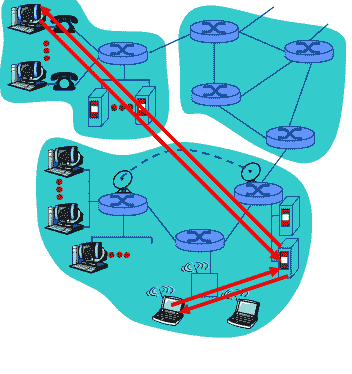

## 纯P2P结构

- 没有永远在线的服务器
- 任意端系统/节点之间可以直接通讯
- 节点间歇性接入网络
- 节点可能改变IP地址
- 优点：高度可伸缩
- 缺点：难于管理

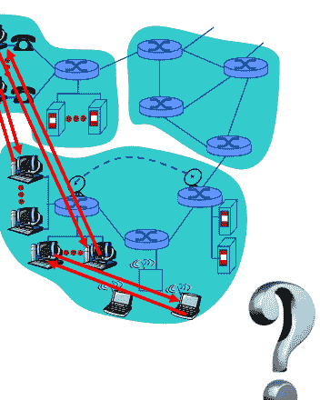

## 思考题

- 为每种体系结构找出5种以上的网络应用
- 从多个方面/角度对比三种体系结构的优缺点

## 哈尔滨工业大学

HARBIN INSTITUTE OF TECHNOLOGY

立足航天，服务国防，面向国民经济主战场

## 谢谢！


## 网络应用进程通信

## 网络应用的基础：进程间通信

- ◆ 进程：
  - 主机上运行的程序
- ◆ 同一主机上运行的进程之间如何通信？
  - 进程间通信机制
  - 操作系统提供
- ◆ 不同主机上运行的进程间如何通信？
  - 消息交换

客户机进程：发起通信的进程
服务器进程：等待通信请求的进程


采用P2P架构的应用是否存在客户机进程/服务器进程之分？

## 套接字: Socket

- 进程间通信利用socket发送/接收消息实现
- 类似于寄信
  - 发送方将消息送到门外邮箱
  - 发送方依赖（门外的）传输基础设施将消息传到接收方所在主机，并送到接收方的门外
  - 接收方从门外获取消息
- 传输基础设施向进程提供API
  - 传输协议的选择
  - 参数的设置

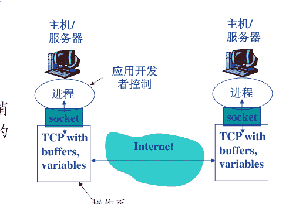

## 应用层协议

网络应用需遵循应用层协议

公开协议

- 由RFC (Request For Comments) 定义
- 允许互操作
- HTTP, SMTP, ……

私有协议

- 多数P2P文件共享应用

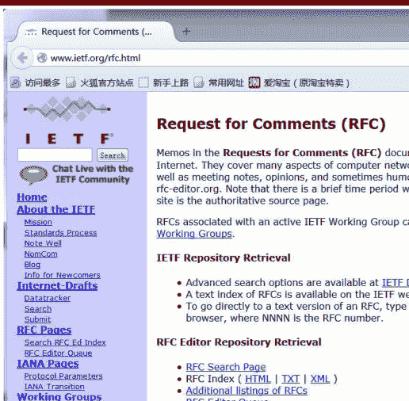

## 应用层协议的内容

- 消息的类型(type)
  - 请求消息
  - 响应消息
- 消息的语法(syntax)/格式
  - 消息中有哪些字段（field）？
  - 每个字段如何描述
- 字段的语义(semantics)
  - 字段中信息的含义
- 规则(rules)
  - 进程何时发送/响应消息
  - 进程如何发送/响应消息

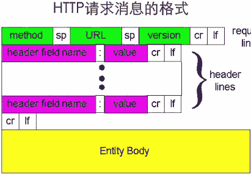

## 哈尔滨工业大学

HARBIN INSTITUTE OF TECHNOLOGY

立足航天，服务国防，面向国民经济主战场

## 谢谢！


## 网络应用的需求与传输层服务

## 典型网络应用对传输服务的需求

| Application | Data loss | Bandwidth | Time Sensitive |
|---|---|---|---|
| file transfer | no loss | elastic | no |
| e-mail | no loss | elastic | no |
| Web documents | no loss | elastic | no |
| real-time audio/video | loss-tolerant | audio: 5kbps-1Mbps<br>video:10kbps-5Mbps | yes, 100's msec |
| stored audio/video | loss-tolerant | same as above | yes, few secs |
| interactive games | loss-tolerant | few kbps up | yes, 100's msec |
| instant messaging | no loss | elastic | yes and no |

## Internet提供的传输服务

## TCP服务

- 面向连接: 客户机/服务器进程间需要建立连接
- 可靠的传输
- 流量控制: 发送方不会发送速度过快，超过接收方的处理能力
- 拥塞控制: 当网络负载过重时能够限制发送方的发送速度
- 不提供时间/延迟保障
- 不提供最小带宽保障

## UDP服务

- 无连接
- 不可靠的数据传输
- 不提供:
  - 可靠性保障
  - 流量控制
  - 拥塞控制
  - 延迟保障
  - 带宽保障


## 课后练习

- 盘点你计算机上的所有网络应用，制作一个清单，包括网络应用的名字、功能、协议等。
- 基于上述清单，制作表格，分析这些网络应用对传输服务的需求。
- 分析这些网络应用所使用的传输服务是TCP还是UDP。


## 哈尔滨工业大学

HARBIN INSTITUTE OF TECHNOLOGY

立足航天，服务国防，面向国民经济主战场

## 谢谢！


## Web应用

## Web与HTTP

## World Wide Web: Tim Berners-Lee

+   - 网页
+   - 网页互相链接

## 网页(Web Page)包含多个对象(objects)

+   - 对象：HTML文件、JPEG图片、视频文件、动态脚本等
+   - 基本HTML文件：包含对其他对象引用的链接

## 对象的寻址(addressing)

+   - URL (Uniform Resource Locator)：统一资源定位器 RFC1738
+   - Scheme://host:port/path

```
www.someschool.edu/someDept/pic.gif
```

host name

path name


## HTTP协议概述(1)

+   ◆ 万维网应用遵循什么协议？
+   ◆ 超文本传输协议
+     - HyperText Transfer Protocol
+   ◆ C/S结构
+     - 客户—Browser: 请求、接收、展示Web对象
+     - 服务器—Web Server: 响应客户的请求，发送对象
+   ◆ HTTP版本:
+     - 1.0: RFC 1945
+     - 1.1: RFC 2068

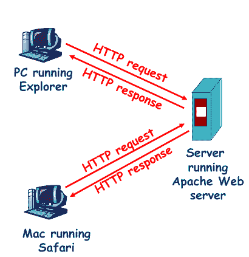

## HTTP概述（2）

## ◆ 使用TCP传输服务

+   - 服务器在80端口等待客户的请求
+   - 浏览器发起到服务器的TCP连接(创建套接字Socket)
+   - 服务器接受来自浏览器的TCP连接
+   - 浏览器(HTTP客户端)与Web服务器(HTTP服务器)交换HTTP消息
+   - 关闭TCP连接

## ◆ 无状态(stateless)

+   - 服务器不维护任何有关客户端过去所发请求的信息


> 有状态的协议更复杂：
> 
> ➢ 需维护状态(历史信息)
> 
> ➢ 如果客户或服务器失效，会产生状态的不一致，解决这种不一致代价高

## 哈尔滨工业大学

HARBIN INSTITUTE OF TECHNOLOGY

立足航天，服务国防，面向国民经济主战场

## 谢谢！


## HTTP连接

## HTTP连接的两种类型

## 非持久性连接(Nonpersistent HTTP)

+   - 每个TCP连接最多允许传输一个对象
+   - HTTP 1.0版本使用非持久性连接

## 持久性连接(Persistent HTTP)

+   - 每个TCP连接允许传输多个对象
+   - HTTP 1.1版本默认使用持久性连接


## 非持久性连接(1)

假设用户在浏览器中输入URL
www.someSchool.edu/someDepartment/home.index

包含文本和指向10个jpeg图片的链接

1a. HTTP客户端向地址为 www.someSchool.edu 的服务器上的HTTP服务器进程(端口80) 发起TCP连接请求。

1b. HTTP服务器在端口80等待TCP连接请求，接受连接并通知客户端。

2. HTTP客户端将HTTP请求消息(包含URL地址)通过TCP连接的套接字发出，消息中所含的URL表明客户端需要对象 someDepartment/home.index

3. HTTP服务器收到请求消息，解析，产生包含所需要对象的响应消息，并通过套接字发给客户端。

时间

## 非持久性连接(2)

+   4. HTTP服务器关闭TCP连接。

+   5. HTTP客户端收到响应消息，解析html文件，显示html文件，发现有10个指向jpeg对象的超连接。

+   6. 为每个jpeg对象重复步骤1-5。

时间

## 响应时间分析与建模

## RTT(Round Trip Time)

+   从客户端发送一个很小的数据包到服务器并返回所经历的时间

## 响应时间(Response time)

+   发起、建立TCP连接：1个RTT

+   发送HTTP请求消息到HTTP响应消息的前几个字节到达：1个RTT

+   响应消息中所含的文件/对象传输时间

+   Total=2RTTs+文件发送时间

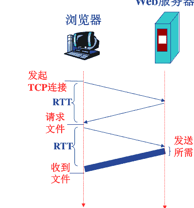

## 持久性HTTP

## 非持久性连接的问题

+   - 每个对象需要2个RTT
+   - 操作系统需要为每个TCP连接开销资源(overhead)
+   - 浏览器会怎么做？
+     - 打开多个并行的TCP连接以获取网页所需对象
+     - 给服务器端造成什么影响呢？

## 持久性连接

+   - 发送响应后，服务器保持TCP连接的打开
+   - 后续的HTTP消息可以通过这个连接发送

## 无流水(pipelining)的持久性连接

+   - 客户端只有收到前一个响应后才发送新的请求
+   - 每个被引用的对象耗时1个RTT

## 带有流水机制的持久性连接

+   - HTTP 1.1的默认选项
+   - 客户端只要遇到一个引用对象就尽快发出请求
+   - 理想情况下，收到所有的引用对象只需耗时约1个RTT

## 哈尔滨工业大学

HARBIN INSTITUTE OF TECHNOLOGY

立足航天，服务国防，面向国民经济主战场

## 谢谢！


## HTTP消息格式

## HTTP请求消息

+   HTTP协议有两类消息
+   - 请求消息(request)
+   - 响应消息(response)

+   请求消息
+   - ASCII：人直接可读

request line (GET, POST, HEAD commands)

header lines

```
GET /somedirectory/page.html HTTP/1.1
Host: www.someschool.edu
User-agent: Mozilla/4.0
Connection: close
Accept-language: fr
```

Carriage return line feed indicates end of message

(extra carriage return, line feed)

## HTTP请求消息的通用格式


## 上传输入的方法

+   POST方法
+   - 网页经常需要填写表格(form)
+   - 在请求消息的消息体(entity body)中上传客户端的输入

+   URL方法
+   - 使用GET方法
+   - 输入信息通过request行的URL字段上传

www.somesite.com/animalsearch?monkeys&banana

## HTTP响应消息

```
HTTP/1.1 200 OK
Connection: close
Date: Thu, 06 Aug 1998 12:00:15 GMT
Server: Apache/1.3.0 (Unix)
Last-Modified: Mon, 22 Jun 1998 12:00:15 GMT
Content-Length: 6821
Content-Type: text/html

data data data data data ...
```

status line (protocol status code status phrase)

header lines

data, e.g., requested HTML file

## HTTP响应状态代码

响应消息的第一行

示例

+   - 200 OK
+   - 301 Moved Permanently
+   - 400 Bad Request
+   - 404 Not Found
+   - 505 HTTP Version Not Supported

## 404 Not Found

nginx

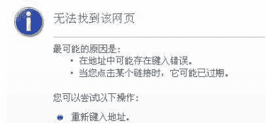


## 体验一下HTTP

- ◆ 利用telnet登录到某个Web服务器
  - ▪ telnet www.hit.edu.cn 80

- ◆ 输入一个HTTP请求
  - ▪ GET /about/profile.htm HTTP/1.1
  - ▪ Host: www.hit.edu.cn

- ◆ 查看HTTP服务器所返回的响应消息


## 哈尔滨工业大学
HARBIN INSTITUTE OF TECHNOLOGY

立足航天，服务国防，面向国民经济主战场

## 谢谢！


## Cookie技术

## 为什么需要Cookie？

HTTP协议无状态

很多应用需要服务器掌握客户端的状态

状态，如网上购物，如何实现？


## Cookie技术

## Cookie技术

- 某些网站为了辨别用户身份、进行session跟踪而储存在用户本地终端上的数据（通常经过加密）。
- RFC6265

## Cookie的组件

- HTTP响应消息的cookie头部行
- HTTP请求消息的cookie头部行
- 保存客户端主机上的cookie文件，由浏览器管理
- Web服务器端的后台数据库

## Cookie的原理

client

server


usual http request msg

usual http response +  
 Set-Cookie: 1678

server creates ID 1678 for user

entry in backend database


usual http request msg  
 cookie: 1678

usual http response msg

cookie-specific action

one week later:


usual http request msg  
 cookie: 1678

usual http response msg

cookie-specific action

## Cookie的作用

## Cookie能够用于：

- 身份认证
- 购物车
- 推荐
- Web e-mail
- ……

## 隐私问题

## cookie时代终结 苹果谷歌微软抢占新标准滩头

腾讯科技 冯 (腾讯) 整理 2013年11月05日16:25 分享

[导航]目前各大厂商已经开始研发或尝试用替代cookie的技术，并把重点放在了移动端。


## 思考题

Cookie能够怎样被用于收集隐私？

能够收集哪些隐私？

你在上网的时候感觉到自己的隐私

被严重侵犯吗？


## 谢谢！


## 本讲主题

## Web缓存/代理服务器技术

## Web缓存/代理服务器技术

## 功能

- 在不访问服务器的前提下满足客户端的HTTP请求。

## 为什么要发明这种技术？

- 缩短客户请求的响应时间
- 减少机构/组织的流量
- 在大范围内(Internet)实现有效的内容分发


## Web缓存/代理服务器技术

## Web缓存/代理服务器

- 用户设定浏览器通过缓存进行Web访问
- 浏览器向缓存/代理服务器发送所有的 HTTP请求
  - 如果所请求对象在缓存中，缓存返回对象
  - 否则，缓存服务器向原始服务器发送HTTP请求，获取对象，然后返回给客户端并保存该对象
- 缓存既充当客户端，也充当服务器
- 一般由ISP(Internet服务提供商)架设

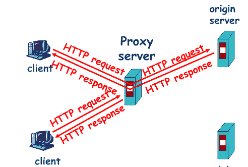

## Web缓存示例(1)

- ❖ 假定:
  - 对象的平均大小=100,000比特
  - 机构网络中的浏览器的平均每秒有15个到原始服务器的请求
  - 从机构路由器到原始服务器的往返延迟=2秒

- ❖ 网络性能分析:
  - 局域网(LAN)的利用率=15%
  - 接入互联网的链路的利用率=100%
  - 总的延迟=互联网上的延迟+访问延迟+局域网延迟=2秒+几分钟+几微秒

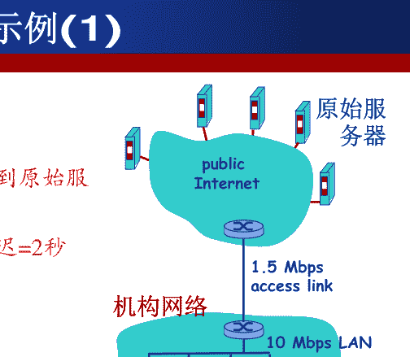

## Web缓存示例(2)

- 解决方案1:
  - 提升互联网接入带宽=10Mbps

- 网络性能分析:
  - 局域网(LAN)的利用率=15%
  - 接入互联网的链路的利用率=15%
  - 总的延迟=互联网上的延迟+访问延迟+局域网延迟=2秒+几微秒+几微秒

- 问题:
  - 成本太高

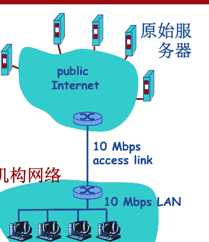

## Web缓存示例(3)

## 解决方案2:

- 安装Web缓存
- 假设缓存命中率是0.4

## 网络性能分析:

- 40%的请求立刻得到满足
- 60%的请求通过原始服务器满足
- 接入互联网的链路的利用率下降到60%，从而其延迟可以忽略不计，例如10微秒
- 总的平均延迟=互联网上的延迟+访问延迟+局域网延迟=0.6×2.01秒+0.4×n微秒<1.4秒

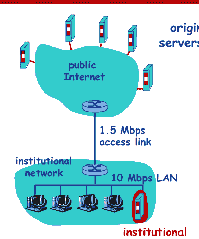

## 条件性GET方法

- ❖ 目标：
  - 如果缓存有最新的版本，则不需要发送请求对象

- ❖ 缓存：
  - 在HTTP请求消息中声明所持有版本的日期
  - If-modified-since: <date>

- ❖ 服务器：
  - 如果缓存的版本是最新的，则响应消息中不包含对象
  - HTTP/1.0 304 Not Modified

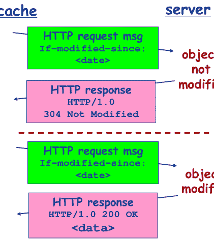

## 课后作业

检索文献，分析、总结Web技术近年来有哪些新进展？其关键思想和技术是什么？


## 哈尔滨工业大学

HARBIN INSTITUTE OF TECHNOLOGY

立足航天，服务国防，面向国民经济主战场

## 谢谢！


## 本讲主题

## Email应用

## Email应用的构成(1)

## Email应用的构成组件

- 邮件客户端(user agent)
- 邮件服务器
- SMTP协议(SMTP协议)


## 邮件客户端

- 读、写Email消息
- 与服务器交互，收、发Email消息
- Outlook, Foxmail, Thunderbird
- Web客户端


## Email应用的构成(2)

## 邮件服务器(Mail Server)

- 邮箱：存储发给该用户的Email
- 消息队列(message queue)：存储等待发送的Email

## SMTP协议

- 邮件服务器之间传递消息所使用的协议
- 客户端：发送消息的服务器
- 服务器：接收消息的服务器

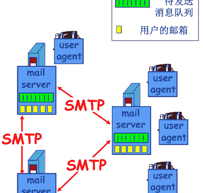


## SMTP协议: RFC 2821

使用TCP进行email消息的可靠传输

端口 25

传输过程的三个阶段

- 握手
- 消息的传输
- 关闭

命令/响应交互模式

- 命令(command): ASCII文本
- 响应(response): 状态代码和语句

Email消息只能包含7位ASCII码

## Email应用示例

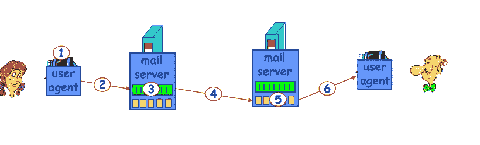

## SMTP交互示例

```
S: 220 hamburger.edu
C: HELO crepes.fr
S: 250 Hello crepes.fr, pleased to meet you
C: MAIL FROM: <alice@crepes.fr>
S: 250 alice@crepes.fr... Sender ok
C: RCPT TO: <bob@hamburger.edu>
S: 250 bob@hamburger.edu ... Recipient ok
C: DATA
S: 354 Enter mail, end with "." on a line by itself
C: Do you like ketchup?
C: How about pickles?
C: .
S: 250 Message accepted for delivery
C: QUIT
S: 221 hamburger.edu closing connection
```

## 动手尝试SMTP交互

- telnet servername 25
- 服务器返回代码220
- 输入以下命令与SMTP服务器交互
  - HELO
  - MAIL FROM
  - RCPT TO
  - DATA
  - QUIT


## SMTP协议

- 使用持久性连接
- 要求消息必须由7位ASCII码构成
- SMTP服务器利用`CRLF.CRLF`确定消息的结束。

与 HTTP 对比：

- HTTP: 拉式(pull)
- SMTP: 推式(push)
- 都使用命令/响应交互模式
- 命令和状态代码都是ASCII码
- HTTP: 每个对象封装在独立的响应消息中
- SMTP: 多个对象在由多个部分构成的消息中发送

Email作为互联网上的古老应用，从出现至今经过了什么样的演变过程？

站在今天的角度看，Email应用有哪些缺点和不足？请查阅资料，给出你的见解。


## 哈尔滨工业大学

HARBIN INSTITUTE OF TECHNOLOGY

立足航天，服务国防，面向国民经济主战场

## 谢谢！


## Email消息格式与POP3协议

## Email消息格式

- SMTP：email消息的传输/交换协议
- RFC 822：文本消息格式标准

- 头部行(header)
  - To
  - From
  - Subject
- 消息体(body)
  - 消息本身
  - 只能是ASCII字符

与SMTP命令不同


## 邮件访问协议


### 邮件访问协议：从服务器获取邮件

- POP: Post Office Protocol [RFC 1939]
  - 认证/授权(客户端←→服务器)和下载
- IMAP: Internet Mail Access Protocol [RFC 1730]
  - 更多功能
  - 更加复杂
  - 能够操纵服务器上存储的消息
- HTTP: 163, QQ Mail等。

## POP协议

- 认证过程
  - 客户端命令
    - User：声明用户名
    - Pass：声明密码
  - 服务器响应
    - +OK
    - -ERR
- 事务阶段
  - List：列出消息数量
  - Retr：用编号获取消息
  - Dele：删除消息
  - Quit

```
S: +OK POP3 server ready
C: user bob
S: +OK
C: pass hungry
S: +OK user successfully logged on

C: list
S: 1 498
S: 2 912
S: .
C: retr 1
S: <message 1 contents>
S: .
C: dele 1
C: retr 2
S: <message 2 contents>
S: .
C: dele 2
C: quit
S: +OK POP3 server signing off
```

## POP协议

- “下载并删除”模式
  - 用户如果换了客户端软件，无法重读该邮件
- “下载并保持”模式：不同客户端都可以保留消息的拷贝
- POP3是无状态的

## IMAP协议

- 所有消息统一保存在一个地方：服务器
- 允许用户利用文件夹组织消息
- IMAP支持跨会话(Session)的用户状态:
  - 文件夹的名字
  - 文件夹与消息ID之间的映射等

## 课后练习

请查阅资料，比较IMAP与POP3的不同，并调研主流Email服务对IMAP协议的支持情况。


## 哈尔滨工业大学

HARBIN INSTITUTE OF TECHNOLOGY

立足航天，服务国防，面向国民经济主战场

## 谢谢！


## DNS概述

## DNS: Domain Name System

- Internet上主机/路由器的识别问题
  - IP地址
  - 域名：`www.hit.edu.cn`

问题：域名和IP地址之间如何映射？

- 域名解析系统DNS
  - 多层命名服务器构成的分布式数据库
  - 应用层协议：完成名字的解析
    - Internet核心功能，用应用层协议实现
    - 网络边界复杂


## DNS

### DNS服务

- 域名向IP地址的翻译
- 主机别名
- 邮件服务器别名
- 负载均衡：Web服务器

### 问题：为什么不使用集中式的DNS？

- 单点失败问题
- 流量问题
- 距离问题
- 维护性问题


## 分布式层次式数据库

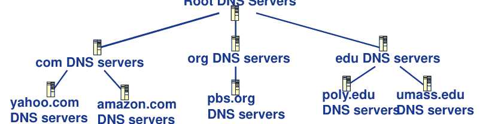

客户端想要查询 `www.amazon.com` 的IP

- 客户端查询根服务器，找到com域名解析服务器
- 客户端查询com域名解析服务器，找到amazon.com域名解析服务器
- 客户端查询amazon.com域名解析服务器，获得www.amazon.com的IP地址

## DNS根域名服务器

- 本地域名解析服务器无法解析域名时，访问根域名服务器
- 根域名服务器
  - 如果不知道映射，访问权威域名服务器
  - 获得映射
  - 向本地域名服务器返回映射

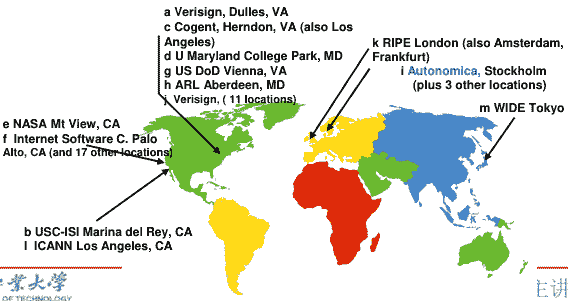

全球有13个根域名服务器

## TLD和权威域名解析服务器

- 顶级域名服务器(TLD, top-level domain): 负责com、org、net、edu等顶级域名和国家顶级域名，例如cn、uk、fr等
  - Network Solutions维护com顶级域名服务器
  - Educause维护edu顶级域名服务器
- 权威(Authoritative)域名服务器: 组织的域名解析服务器，提供组织内部服务器的解析服务
  - 组织负责维护
  - 服务提供商负责维护


## DNS查询示例

Cis.poly.edu的主机想获得 gaia.cs.umass.edu的IP地址

## 迭代查询

- 被查询服务器返回域名解析服务器的名字
- “我不认识这个域名，但是你可以问题这服务器”

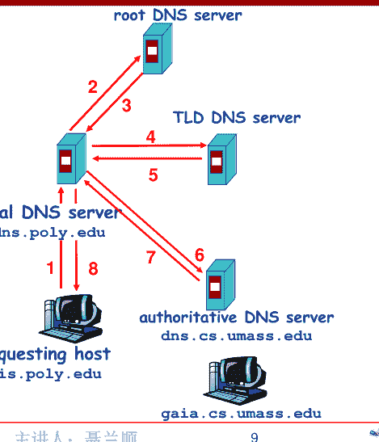

## DNS查询示例

## 递归查询

- 将域名解析的任务交给所联系的服务器

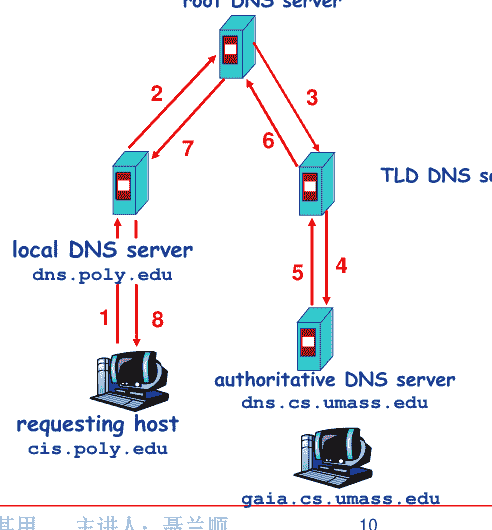


## 例题

如果本地域名服务器无缓存，当采用递归方法解析另一网络某主机域名时，用户主机、本地域名服务器发送的域名请求消息数分别为

- A. 一条、一条
- B. 一条、多条
- C. 多条、一条
- D. 多条、多条

【解析】域名递归解析过程中，主机向本地域名服务器发送DNS查询，被查询的域名服务器代理后续的查询，然后返回结果。所以，递归查询时，如果本地域名服务器无缓存，则主机和本地域名服务器都仅需要发送一次查询，故正确答案为A。

## DNS记录缓存和更新

- 只要域名解析服务器获得域名—IP映射，即缓存这一映射
  - 一段时间过后，缓存条目失效（删除）
  - 本地域名服务器一般会缓存顶级域名服务器的映射
    - 因此根域名服务器不经常被访问

- 记录的更新/通知机制
  - RFC 2136
  - Dynamic Updates in the Domain Name System (DNS UPDATE)

## 思考题

我国没有根域名服务器，是否会影响

我国的网络安全，会有什么影响。

请思考并查阅资料，回答该问题。


## 哈尔滨工业大学

HARBIN INSTITUTE OF TECHNOLOGY

立足航天，服务国防，面向国民经济主战场

## 谢谢！

## 计算机网络之网尽其用

主讲人：聂兰顺

## DNS记录和消息格式

## DNS记录

- 资源记录(RR, resource records)

```
RR format: (name, value, type, ttl)
```

- Type=A
  - Name: 主机域名
  - Value: IP地址

- Type=NS
  - Name: 域(edu.cn)
  - Value: 该域权威域名解析服务器的主机域名

- Type=CNAME
  - Name: 某一真实域名的别名
    - www.ibm.com – servereast.backup2.ibm.com
  - Value: 真实域名

- Type=MX
  - Value是与name相对应的邮件服务器

## DNS协议与消息

- DNS协议：
  - 查询(query)和回复(reply消息)
  - 消息格式相同

- 消息头部
  - Identification: 16位查询编号，回复使用相同的编号
  - flags
    - 查询或回复
    - 期望递归
    - 递归可用
    - 权威回答

| identification | flags |
| number of questions | number of answer RRs |
| number of authority RRs | number of additional RRs |
| questions (variable number of questions) |
| answers (variable number of resource records) |
| authority (variable number of resource records) |
| additional information (variable number of resource records) |

12 bytes

## DNS协议与消息

| identification | flags |
| number of questions | number of answer RRs |
| number of authority RRs | number of additional RRs |

questions (variable number of questions)

answers (variable number of resource records)

authority (variable number of resource records)

additional information (variable number of resource records)

Name, type fields for a query

RRs in response to query

records for authoritative servers

additional "helpful" info that may be used

12 bytes

## 如何注册域名？

- 例子： 你刚刚创建了一个公司 “Network Utopia”

- 在域名管理机构(如Network Solutions)注册域名networkutopia.com

  - 向域名管理机构提供你的权威域名解析服务器的名字和IP地址
  - 域名管理机构向com顶级域名解析服务器中插入两条记录

```
(networkutopia.com, dns1.networkutopia.com, NS)
(dns1.networkutopia.com, 212.212.212.1, A)
```

在权威域名解析服务器中为www.networkutopia.com加入Type A记录，为networkutopia.com加入Type MX记录

## 思考题

请查阅有关资料，找出那些在应用层实现的Internet核心服务，调研它们的协议、消息格式。


## 哈尔滨工业大学

HARBIN INSTITUTE OF TECHNOLOGY

立足航天，服务国防，面向国民经济主战场

## 谢谢！

## 计算机网络之网尽其用

主讲人：聂兰顺

## P2P应用：原理与文件分发

## 纯P2P架构

- • Peer-to-peer
- • 没有服务器
- • 任意端系统之间直接通信
- • 节点阶段性接入Internet
- • 节点可能更换IP地址
- • 以具体应用为例讲解

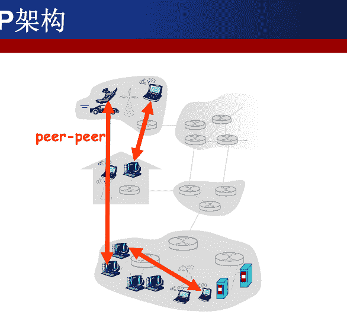

## 文件分发：客户机/服务器 vs. P2P

问题：从一个服务器向N个节点分发一个文件需要多长时间？

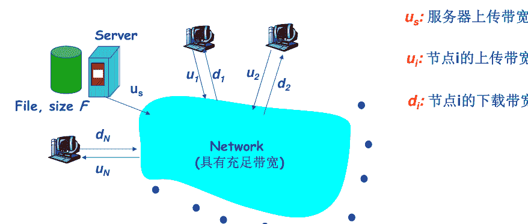

u_s: 服务器上传带宽

u_i: 节点i的上传带宽

d_i: 节点i的下载带宽

## 文件分发：客户机/服务器

- 服务器串行地发送N个副本
  - 时间： NF/u_s
- 客户机需要F/d_i时间下载

Time to distribute F to N clients using = d_cs = max { NF/u_s, F/min_i(d_i) } client/server approach

increases linearly in N (for large N)

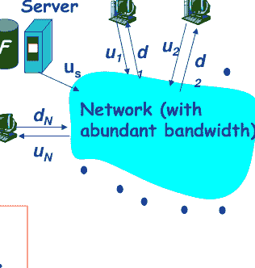

## 文件分发：P2P

- 服务器必须发送一个副本
  - 时间： F/uₛ
- 客户机需要 F/dᵢ 时间下载
- 总共需要下载 NF 比特
- 最快的可能上传速率： uₛ + Σuᵢ

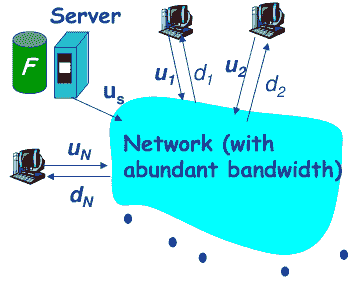

```
d_P2P = max { F/u_s, F/min(d_i), NF/(u_s + Σu_i) }
```

## 客户端/服务器 vs. P2P: 例子

客户端上传速率 = u，F/u = 1小时，u_s = 10u，d_min ≥ u_s

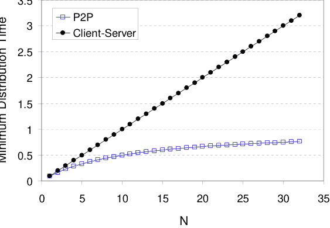


## 文件分发：BitTorrent

tracker: 跟踪参与 torrent的节点

torrent: 交换同一个文件的文件块的节点组

获取节点列表

交换文件块 chunk

peer

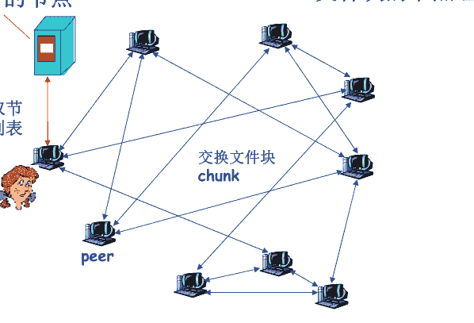

## BitTorrent (1)

- 文件划分为256KB的chunk
- 节点加入torrent
  - 没有chunk，但是会逐渐积累
  - 向tracker注册以获得节点清单，与某些节点（“邻居”）建立连接
- 下载的同时，节点需要向其他节点上传 chunk
- 节点可能加入或离开
- 一旦节点获得完整的文件，它可能（自私地）离开或（无私地）留下

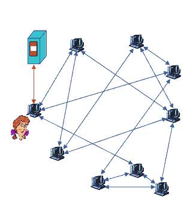

## BitTorrent (2)

### 获取chunk

- 给定任一时刻，不同的节点持有文件的不同chunk集合
- 节点(Alice)定期查询每个邻居所持有的chunk列表
- 节点发送请求，请求获取缺失的chunk
  - 稀缺优先

### 发送chunk: tit-for-tat

- Alice向4个邻居发送chunk: 正在向其发送Chunk，速率最快的4个
  - 每10秒重新评估top 4
- 每30秒随机选择一个其他节点，向其发送chunk
  - 新选择节点可能加入top 4
  - "optimistically unchoke"

## BitTorrent: Tit-for-tat

- (1) Alice "optimistically unchokes" Bob
- (2) Alice becomes one of Bob's top-four providers; Bob reciprocates
- (3) Bob becomes one of Alice's top-four providers

上传速率高，则能够找到更好的交易伙伴，从而更快地获取文件。

## 思考题

BitTorrent技术对网络性能有哪些潜在的危害？


## 哈尔滨工业大学

HARBIN INSTITUTE OF TECHNOLOGY

立足航天，服务国防，面向国民经济主战场

## 谢谢！

## 计算机网络之网尽其用

主讲人：聂兰顺

## P2P应用：索引技术

## P2P: 搜索信息

- ◆ P2P系统的索引：信息到节点位置(IP地址+端口号)的映射
- ◆ 文件共享(电驴)
  - 利用索引动态跟踪节点所共享的文件的位置
  - 节点需要告诉索引它拥有哪些文件
  - 节点搜索索引，从而获知能够得到哪些文件


- ◆ 即时消息(QQ)
  - 索引负责将用户名映射到位置
  - 当用户开启IM应用时，需要通知索引它的位置
  - 节点检索索引，确定用户的IP地址


## 集中式索引

### Napster最早采用这种设计

- 1) 节点加入时，通知中央服务器：
  - IP地址
  - 内容
- 2) Alice查找"Hey Jude"
- 3) Alice从Bob处请求文件

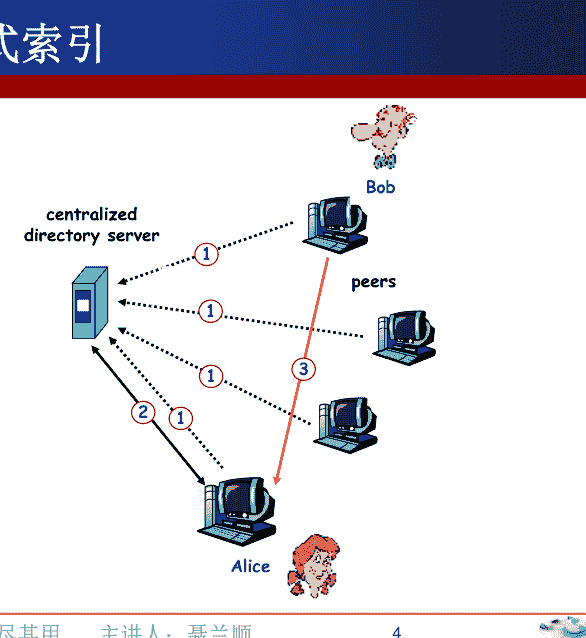

## 集中式索引的问题

内容和文件传输是分布式的，但是内容定位是高度集中式的

- 单点失效问题
- 性能瓶颈
- 版权问题

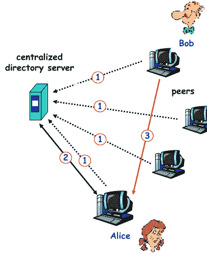

## 洪泛式查询: Query flooding

- 完全分布式架构
- Gnutella采用这种架构
- 每个节点对它共享的文件进行索引，且只对它共享的文件进行索引
- 覆盖网络(overlay network): Graph
- 节点X+Y之间如果有TCP连接，那么构成一个边
- 所有的活动节点和边构成覆盖网络
- 边: 虚拟链路
- 节点一般邻居数少于10个

## 洪泛式查询: Query flooding

- 查询消息通过已有的TCP连接发送
- 节点转发查询消息
- 如果查询命中，则利用反向路径发回查询节点

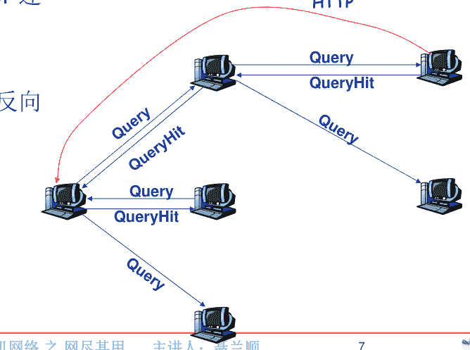

## 层次式覆盖网络

- 介于集中式索引和洪泛查询之间的方法
- 每个节点或者是一个超级节点，或者被分配一个超级节点
  - 节点和超级节点间维持TCP连接
  - 某些超级节点对之间维持TCP连接
- 超级节点负责跟踪子节点的内容

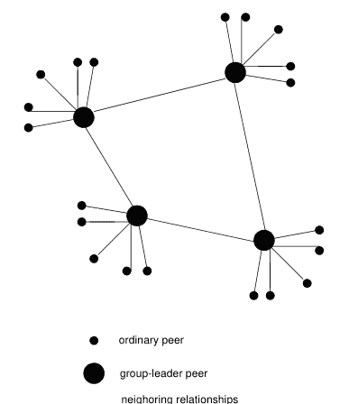

## 哈尔滨工业大学

HARBIN INSTITUTE OF TECHNOLOGY

立足航天，服务国防，面向国民经济主战场

## 谢谢！

## 计算机网络之探颐索隐

主讲人：聂兰顺

## 传输层

## 传输层？

理解传输层服务的基本理论和基本机制

- 复用/分用
- 可靠数据传输机制
- 流量控制机制
- 拥塞控制机制

掌握Internet的传输层协议

- UDP：无连接传输服务
- TCP：面向连接的传输服务
- TCP拥塞控制


## 哈尔滨工业大学
HARBIN INSTITUTE OF TECHNOLOGY

立足航天，服务国防，面向国民经济主战场

## 谢谢！

## 计算机网络之探颐索隐

主讲人：聂兰顺

## 传输层服务和协议

传输层协议为运行在不同Host上的进程提供了一种逻辑通信机制

端系统运行传输层协议

- 发送方：将应用递交的消息分成一个或多个的Segment，并向下传给网络层。
- 接收方：将接收到的segment组装成消息，并向上交给应用层。

传输层可以为应用提供多种协议

- Internet上的TCP
- Internet上的UDP

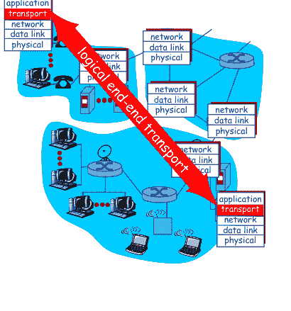

## 传输层 vs. 网络层

网络层：提供主机之间的逻辑通信机制

传输层：提供应用进程之间的逻辑通信机制

- 位于网络层之上
- 依赖于网络层服务
- 对网络层服务进行（可能的）增强

家庭类比:

12个孩子给12个孩子发信

- 应用进程 = 孩子
- 应用消息 = 信封里的信
- 主机 = 房子
- 传输层协议 = 李雷和韩梅梅
- 网络层协议 = 邮政服务


## 哈尔滨工业大学

HARBIN INSTITUTE OF TECHNOLOGY

立足航天，服务国防，面向国民经济主战场

## 谢谢！

## 计算机网络之探赜索隐

## 多路复用和多路分用

## 多路复用/分用

**Why?**

如果某层的一个协议对应直接上层的多个协议实体，则需要复用/分用

**接收端进行多路分用：**

传输层依据头部信息将收到的 Segment 交给正确的 Socket，即不同的进程

**发送端进行多路复用：**

从多个 Socket 接收数据，为每块数据封装上头部信息，生成 Segment，交给网络层


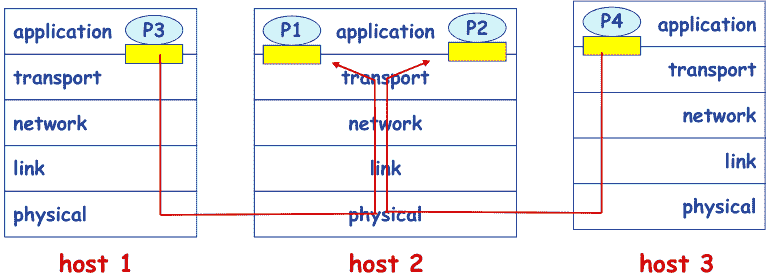


## 分用如何工作？

主机接收到IP数据报(datagram)

- 每个数据报携带源IP地址、目的IP地址。
- 每个数据报携带一个传输层的段(Segment)。
- 每个段携带源端口号和目的端口号

主机收到Segment之后，传输层协议提取IP地址和端口号信息，将Segment导向相应的Socket

- TCP做更多处理

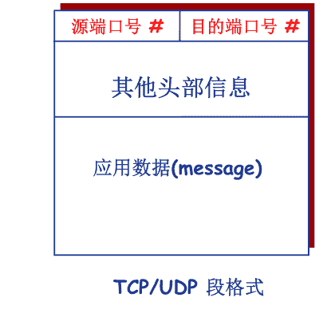

## 无连接分用

利用端口号创建Socket

```
DatagramSocket mySocket1 = new DatagramSocket(99111);
DatagramSocket mySocket2 = new DatagramSocket(99222);
```

UDP的Socket用二元组标识

- (目的IP地址，目的端口号)

主机收到UDP段后

- 检查段中的目的端口号
- 将UDP段导向绑定在该端口号的Socket

来自不同源IP地址和/或源端口号的IP数据包被导向同一个Socket

## 无连接分用

```
DatagramSocket serverSocket = new DatagramSocket(6428);
```

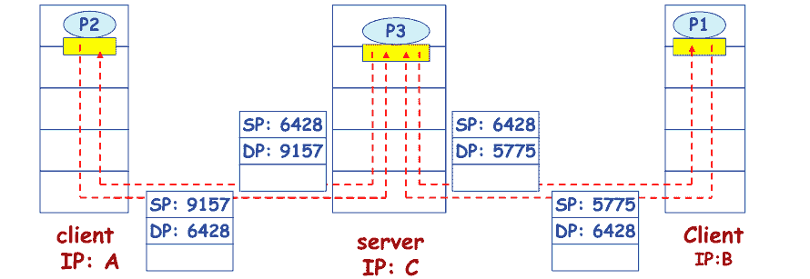

SP 提供 “返回地址”

## 面向连接的分用

- TCP的Socket用四元组标识
  - 源IP地址
  - 源端口号
  - 目的IP地址
  - 目的端口号

接收端利用所有的四个值将 Segment导向合适的Socket

- 服务器可能同时支持多个TCP Socket
  - 每个Socket用自己的四元组标识

Web服务器为每个客户端开不同的Socket

## 面向连接的分用

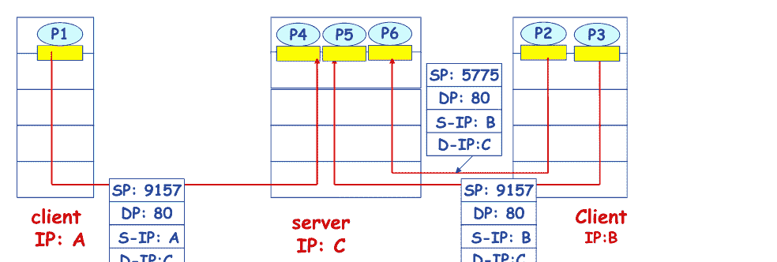

## 面向连接的分用：多线程Web服务器

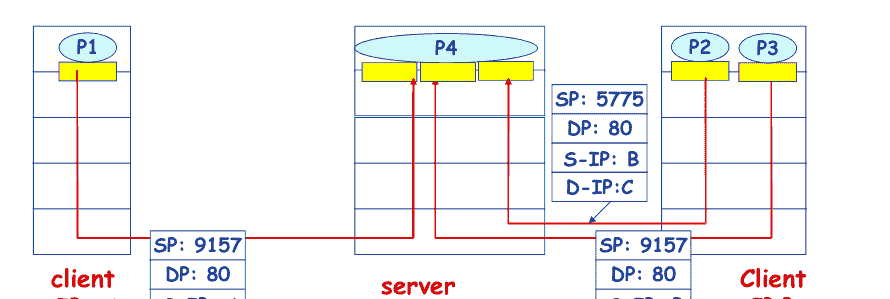

## 谢谢！

## 计算机网络之探赜索隐

主讲人：晏兰顺

## 本讲主题

## UDP

## UDP: User Datagram Protocol [RFC 768]

- 基于Internet3P协议
  - 复用/分用
  - 简单的错误校验
- “Best effort”服务，UDP段可能
  - 丢失
  - 非按序到达
- 无连接
  - UDP发送方和接收方之间不需要握手
  - 每个UDP段的处理独立于其他段

- UDP为什么存在？
  - 无需建立连接(减少延迟)
  - 实现简单：无需维护连接状态
  - 头部开销少
  - 没有拥塞控制：应用可更好地控制发送时间和速率

## UDP: User Datagram Protocol [RFC 768]

- 常用於流媒體應用
  - 容忍丟失
  - 速率敏感

- UDP還用於
  - DNS
  - SNMP

- 在UDP上實現可靠數據傳輸？
  - 在應用層增加可靠性機制
  - 應用特定的錯誤恢復機制

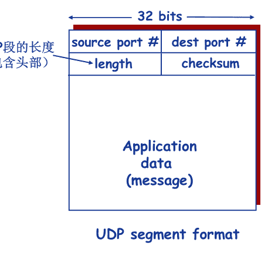

## UDP校验和(checksum)

目的：检测UDP段在传输中是否发生错误（如位翻转）

- 发送方
  - 将段的内容视为16-bit整数
  - 校验和计算：计算所有整数的和，进位加在和的后面，将得到的值按位求反，得到校验和
  - 发送方将校验和放入校验和字段

- 接收方
  - 计算所收到段的校验和
  - 将其与校验和字段进行对比
    - 不相等：检测出错误
    - 相等：没有检测出错误（但可能有错误）

## 校验和计算示例

- 注意：
  - 最高位进位必须被加进去

- 示例：

1 1 1 0 0 1 1 0 0 1 1 0 0 1 1 0

1 1 0 1 0 1 0 1 0 1 0 1 0 1 0 1

wraparound 1 1 0 1 1 1 0 1 1 1 0 1 1 1 0 1 1

sum 1 0 1 1 1 0 1 1 1 0 1 1 1 1 0 0

checksum 0 1 0 0 0 1 0 0 0 1 0 0 0 0 1 1

## 谢谢！

## 计算机网络之探赜索隐

主讲人：晏兰顺

## 可靠数据传输原理

## 可靠数据传输原理

## 什么是可靠？

- 不错、不丢、不乱

## 可靠数据传输协议

- 可靠数据传输对应应用层、传输层、链路层都很重要
- 网络Top-10问题
- 信道的不可靠特性决定了可靠数据传输协议(rdt)的复杂性

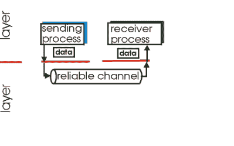

## 可靠数据传输原理

## 什么是可靠？

- 不错、不丢、不乱

## 可靠数据传输协议

- 可靠数据传输对应应用层、传输层、链路层都很重要

- 网络Top-10问题

- 信道的不可靠特性决定了可靠数据传输协议(rdt)的复杂性

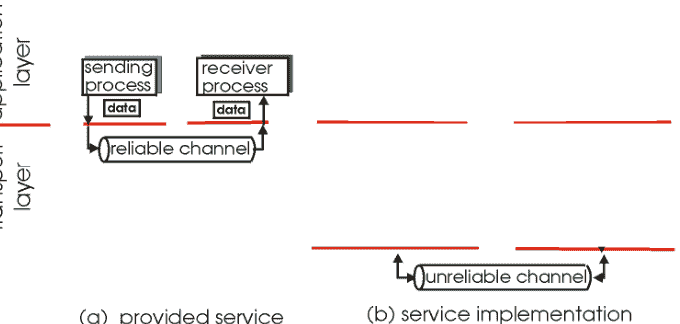

## 可靠数据传输原理

## 什么是可靠？

- 不错、不丢、不乱

## 可靠数据传输协议

- 可靠数据传输对应应用层、传输层、链路层都很重要
- 网络Top-10问题
- 信道的不可靠特性决定了可靠数据传输协议(rdt)的复杂性

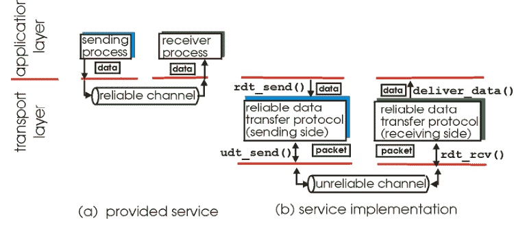

## 可靠数据传输协议基本结构:接口

rdt_send(): 被上次应用调用，将数据交给rdt以发送给对方

deliver_data(): 被rdt调用，向上层应用交付数据

udt_send(): 被rdt调用，在不可靠信道上向接收方传输数据

rdt_rcv(): 当数据包到达接收方信道时被调用

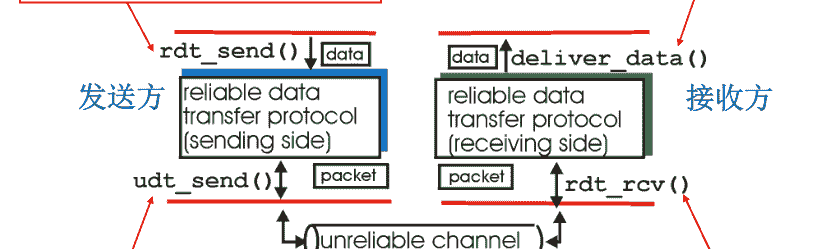

## 可靠数据传输协议

- 渐进地设计可靠数据传输协议的发送方和接收方
- 只考虑单向数据传输
  - 但控制信息双向流动
- 利用状态机(Finite State Machine, FSM)刻画传输协议


## Rdt 1.0: 可靠信道上的可靠数据传输

- 底层信道完全可靠
  - 不会发生错误(bit error)
  - 不会丢弃分组
- 发送方和接收方的FSM独立

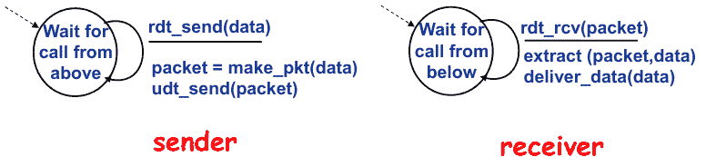

## 哈尔滨工业大学

HARBin INSTITUTE OF TECHNOLOGY

立足航天，服务国防，面向国际民营经济主战场

## 谢谢！

## 计算机网络之探颐索隐

主讲人：聂兰顺

## Rdt 2.0

## Rdt 2.0: 产生位错误的信道

- ◆ 底层信道可能翻转分组中的位(bit)
  - 利用校验和检测位错误
- ◆ 如何从错误中恢复？
  - 确认机制(Acknowledgements, ACK): 接收方显式地告知发送方分组已正确接收
  - NAK:接收方显式地告知发送方分组有错误
  - 发送方收到NAK后，重传分组
- ◆ 基于这种重传机制的rdt协议称为ARQ(Automatic Repeat reQuest)协议
- ◆ Rdt 2.0中引入的新机制
  - 差错检测
  - 接收方反馈控制消息: ACK/NAK
  - 重传


## Rdt 2.0: FSM规约

sender

receiver

停一等协议

rdt_send(data)
sndpkt = make_pkt(data, checksum)
udt_send(sndpkt)

Wait for call from above

Wait for ACK or NAK

rdt_rcv(rcvpkt) && isNAK(rcvpkt)
udt_send(sndpkt)

rdt_rcv(rcvpkt) && isACK(rcvpkt)

rdt_rcv(rcvpkt) && corrupt(rcvpkt)
udt_send(NAK)

Wait for call from below

rdt_rcv(rcvpkt) && notcorrupt(rcvpkt)
extract(rcvpkt,data)
deliver_data(data)
udt_send(ACK)


## Rdt 2.0: 无错误场景

```
rdt_send(data)
sndpkt = make_pkt(data, checksum)
udt_send(sndpkt)
Wait for call from above
Wait for ACK or NAK
rdt_rcv(rcvpkt) && isNAK(rcvpkt)
udt_send(sndpkt)
rdt_rcv(rcvpkt) && isACK(rcvpkt)
rdt_rcv(rcvpkt) && corrupt(rcvpkt)
udt_send(NAK)
Wait for call from below
rdt_rcv(rcvpkt) && notcorrupt(rcvpkt)
extract(rcvpkt,data)
deliver_data(data)
udt_send(ACK)
```

## Rdt 2.0: 有错误场景

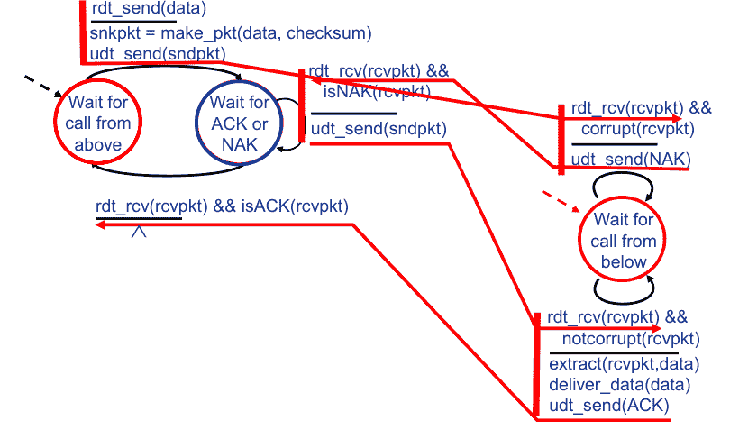

## 谢谢！

## 计算机网络之探赜索隐

主讲人：聂兰顺

## Rdt 2.1和2.2

## Rdt 2.0有什么缺陷？

- 如果ACK/NAK消息发生错误/被破坏(corrupted)会怎么样？
  - 为ACK/NAK增加校验和，检错并纠错
  - 发送方收到被破坏ACK/NAK时不知道接收方发生了什么，添加额外的控制消息
  - 如果ACK/NAK坏掉，发送方重传
  - 不能简单地重传：产生重复分组
- 如何解决重复分组问题？
  - 序列号(Sequence number): 发送方给每个分组增加序列号
  - 接收方丢弃重复分组

`stop and wait`: Sender sends one packet, then waits for receiver response

## Rdt 2.1: 接收方，应对ACK/NAK破坏

```
## Wait for 0 from below
rdt_rcv(rcvpkt) && notcorrupt(rcvpkt) && has_seq0(rcvpkt)
extract(rcvpkt,data)
deliver_data(data)
sndpkt = make_pkt(ACK, chksum)
udt_send(sndpkt)

rdt_rcv(rcvpkt) && corrupt(rcvpkt)
sndpkt = make_pkt(NAK, chksum)
udt_send(sndpkt)

rdt_rcv(rcvpkt) && notcorrupt(rcvpkt) && has_seq1(rcvpkt)
sndpkt = make_pkt(ACK, chksum)
udt_send(sndpkt)

## Wait for 1 from below
rdt_rcv(rcvpkt) && corrupt(rcvpkt)
sndpkt = make_pkt(NAK, chksum)
udt_send(sndpkt)

rdt_rcv(rcvpkt) && notcorrupt(rcvpkt) && has_seq0(rcvpkt)
sndpkt = make_pkt(ACK, chksum)
udt_send(sndpkt)

rdt_rcv(rcvpkt) && notcorrupt(rcvpkt) && has_seq1(rcvpkt)
extract(rcvpkt,data)
deliver_data(data)
sndpkt = make_pkt(ACK, chksum)
udt_send(sndpkt)
```

## Rdt 2.1 vs. Rdt 2.0

### 发送方

- 为每个分组增加了序列号
- 两个序列号(0, 1)就够用，为什么？
- 需校验ACK/NAK消息是否发生错误
- 状态数量翻倍
  - 状态必须“记住”“当前”的分组序列号

### 接收方

- 需判断分组是否是重复
  - 当前所处状态提供了期望收到分组的序列号
- 注意：接收方无法知道ACK/NAK是否被发送方正确收到


## Rdt 2.2: 无NAK消息协议

- 我们真的需要两种确认消息(ACK + NAK)吗？
- 与rdt 2.1功能相同，但是只使用ACK
- 如何实现？
  - 接收方通过ACK告知最后一个被正确接收的分组
  - 在ACK消息中显式地加入被确认分组的序列号
- 发送方收到重复ACK之后，采取与收到NAK消息相同的动作
  - 重传当前分组

## Rdt 2.2 FSM片段

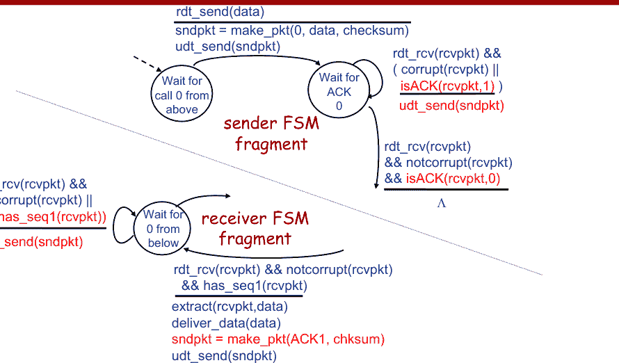


## 哈尔滨工业大学

规格严格，功夫到家，面向国民经济主战场

## 谢谢！


## 计算机网络之探赜索隐

主讲人：聂兰顺

## 本讲主题

## Rdt 3.0

## Rdt 3.0

- 如果信道既可能发生错误，也可能丢失分组，怎么办？
  - “校验和 + 序列号 + ACK + 重传” 够用吗？
- 方法：发送方等待 “合理” 时间
  - 如果没收到ACK，重传
  - 如果分组或ACK只是延迟而不是丢了
    - 重传会产生重复，序列号机制能够处理
    - 接收方需在ACK中显式告知所确认的分组
  - 需要定时器

## Rdt 3.0发送方FSM

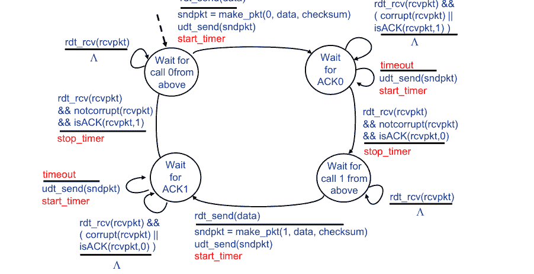

## Rdt 3.0示例(2)

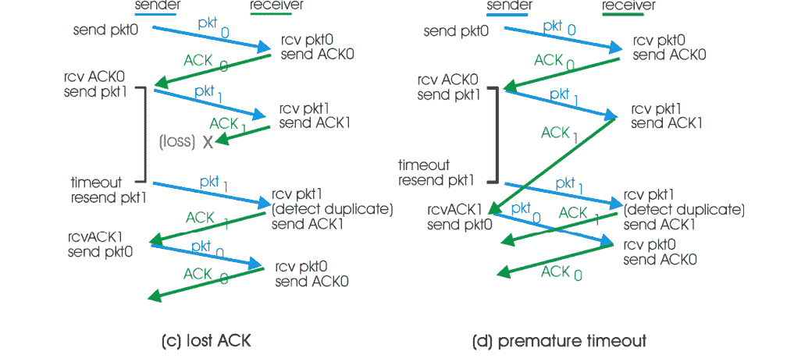

- (c) lost ACK
- (d) premature timeout

## Rdt 3.0性能分析

- ◆ Rdt 3.0能够正确工作，但性能很差
- ◆ 示例：1Gbps链路，15ms端到端传播延迟，1KB分组

```
T_transmit = L (packet length in bits) / R (transmission rate, bps) = 8kb/pkt / 10^9 b/sec = 8 microsec
```

- 发送方利用率：发送方发送时间百分比
- 在1Gbps链路上每30毫秒才发送一个分组→33KB/sec
- 网络协议限制了物理资源的利用

```
U_sender ≈ (L / R) / (RTT + L / R) ≈ .008 / 30.008 ≈ 0.00027
```

## Rdt 3.0: 停等操作

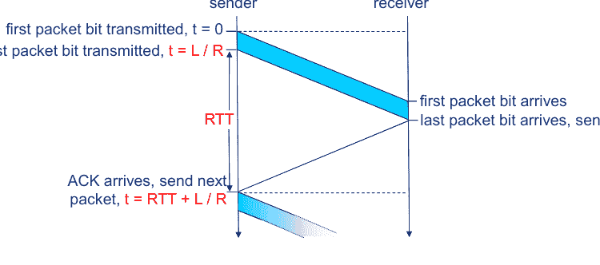

```
U_sender = (L / R) / (RTT + L / R) = .008 / 30.008 ≈ 0.00027
```

## 哈尔滨工业大学

HARBIN INSTITUTE OF TECHNOLOGY

立足航天，服务国防，面向国民经济主战场

## 谢谢！

## 计算机网络之探赜索隐

主讲人：聂兰顺

## Rdt 3.0: 停等操作

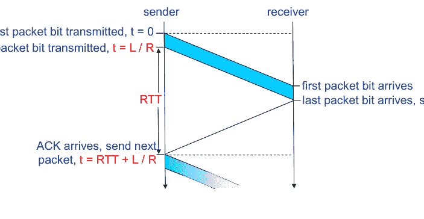

```
U_sender = (L / R) / (RTT + L / R) ≈ .008 / 30.008 ≈ 0.00027
```

## 流水线机制：提高资源利用率

```
sender
receiver
first packet bit transmitted, t = 0
last bit transmitted, t = L / R
RTT
first packet bit arrives
last packet bit arrives, send ACK
ACK arrives, send next packet, t = RTT + L / R
Increase utilization by a factor of 3!
U_sender ≈ 3*L/R / (RTT + L/R) ≈ .024 / 30.008 ≈ 0.0008
```

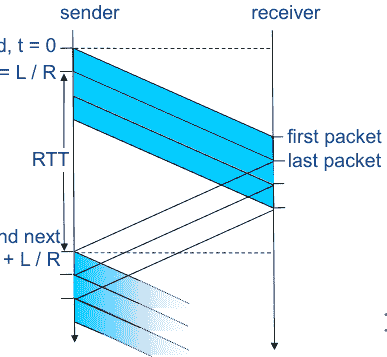


## 流水线协议

允许发送方在收到ACK之前连续发送多个分组

- 更大的序列号范围
- 发送方和/或接收方需要更大的存储空间以缓存分组

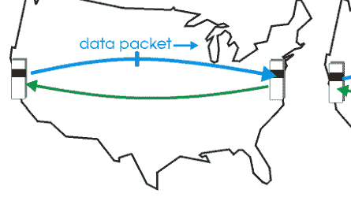

(a) a stop-and-wait protocol in operation


(b) a pipelined protocol in operation

## 滑动窗口协议


- ❖ 滑动窗口协议: Sliding-window protocol
- ❖ 窗口
  - 允许使用的序列号范围
  - 窗口尺寸为N: 最多有N个等待确认的消息
- ❖ 滑动窗口
  - 随着协议的运行，窗口在序列号空间内向前滑动
- ❖ 滑动窗口协议： GBN, SR

## 哈尔滨工业大学

HARBIN INSTITUTE OF TECHNOLOGY

立足航天，服务国防，面向国民经济主战场

## 谢谢！

## 计算机网络之探颐索隐

主讲人：聂兰顺

## Go-Back-N协议

## Go-Back-N(GBN)协议：发送方

- 分组头部包含k-bit序列号

- 窗口尺寸为N，最多允许N个分组未确认


- ACK(n)：确认到序列号n(包含n)的分组均已被正确接收

- 可能收到重复ACK

- 为空中的分组设置计时器(timer)

- 超时Timeout(n)事件：重传序列号大于等于n，还未收到ACK的所有分组

## GBN: 发送方扩展FSM

```
rdt_send(data)
if (nextseqnum < base+N) {
  sndpkt[nextseqnum] = make_pkt(nextseqnum,data,chksum)
  udt_send(sndpkt[nextseqnum])
  if (base == nextseqnum)
    start_timer
  nextseqnum++
}
else
  refuse_data(data)
```

Λ
base=1
nextseqnum=1

rdt_rcv(rcvpkt)
&& corrupt(rcvpkt)


```
timeout
start_timer
udt_send(sndpkt[base])
udt_send(sndpkt[base+1])
...
udt_send(sndpkt[nextseqnum-1])
```

```
rdt_rcv(rcvpkt) &&
notcorrupt(rcvpkt)
base = getacknum(rcvpkt)+1
If (base == nextseqnum)
  stop_timer
else
  start_timer
```

## GBN: 接收方扩展FSM


ACK机制: 发送拥有最高序列号的、已被正确接收的分组的ACK

- 可能产生重复ACK
- 只需要记住唯一的expectedseqnum

乱序到达的分组：

- 直接丢弃→接收方没有缓存
- 重新确认序列号最大的、按序到达的分组

## GBN示例

sender
receiver
send pkt0
send pkt1
send pkt2
(loss)
X
send pkt3
(wait)
rcv pkt0
send ACK0
rcv pkt1
send ACK1
rcv pkt3, discard
send ACK1
rcv ACK0
send pkt4
rcv ACK1
send pkt5
rcv pkt4, discard
send ACK1
rcv pkt5, discard
send ACK1
pkt2 timeout
send pkt2
send pkt3
send pkt4
send pkt5
rcv pkt2, deliver
send ACK2
rcv pkt3, deliver
send ACK3

## 练习题

数据链路层采用后退N帧（GBN）协议，发送方已经发送了编号为0～7的帧。当计时器超时时，若发送方只收到0、2、3号帧的确认，则发送方需要重发的帧数是多少？分别是那几个帧？

解：根据GBN协议工作原理，GBN协议的确认是累积确认，所以此时发送端需要重发的帧数是4个，依次分别是4、5、6、7号帧。

## 哈尔滨工业大学

HARBIN INSTITUTE OF TECHNOLOGY

立足航天，服务国防，面向国民经济主战场

## 谢谢！

## 计算机网络之探颐索隐

主讲人：聂兰顺

## Selective Repeat协议

## Selective Repeat协议

## GBN有什么缺陷？

接收方对每个分组单独进行确认

- 设置缓存机制，缓存乱序到达的分组

发送方只重传那些没收到ACK的分组

- 为每个分组设置定时器

发送方窗口

- N个连续的序列号

- 限制已发送且未确认的分组

## Selective Repeat: 发送方/接收方窗口

send_base

nextseqnum

window size
N

(a) sender view of sequence numbers

already ack'ed

usable, not yet sent

sent, not yet ack'ed

not usable

rcv_base

window size
N

(b) receiver view of sequence numbers

out of order (buffered) but already ack'ed

acceptable (within window)

Expected, not yet received

not usable

## SR协议

sender
data from above :
❖ if next available seq # in window, send pkt
timeout(n):
❖ resend pkt n, restart timer
ACK(n) in [sendbase,sendbase+N]:
❖ mark pkt n as received
❖ if n smallest unACKed pkt, advance window base to next unACKed seq #

receiver
pkt n in [rcvbase, rcvbase+N-1]
□ send ACK(n)
□ out-of-order: buffer
□ in-order: deliver (also deliver buffered, in-order pkts), advance window to next not-yet-received pkt
pkt n in [rcvbase-N,rcvbase-1]
□ ACK(n)
otherwise:
□ ignore

## SR协议示例


## SR协议：困境

- ◆ 序列号: 0, 1, 2, 3

- ◆ 窗口尺寸：3

- ◆ 接收方能区分开右侧两种不同的场景吗？

- ◆ (a)中，发送方重发分组0，接收方收到后会如何处理？

- ◆ 问题：序列号空间大小与窗口尺寸需满足什么关系？

N_S+N_R <= 2^k


## 可靠数据传输原理与协议回顾

- 信道的(不可靠)特性
- 可靠数据传输的需求
- Rdt 1.0
- Rdt 2.0, rdt 2.1, rdt 2.2
- Rdt 3.0
- 流水线与滑动窗口协议
- GBN
- SR

## 哈尔滨工业大学

HARBIN INSTITUTE OF TECHNOLOGY

立足航天，服务国防，面向国民经济主战场

## 谢谢！


## 计算机网络之探颐索隐

主讲人：聂兰顺

## TCP概述

TCP概述: RFCs-793, 1122, 1323, 2018, 2581

- 点对点
  - 一个发送方，一个接收方
- 可靠的、按序的字节流
- 流水线机制
  - TCP拥塞控制和流量控制机制
    设置窗口尺寸
- 发送方/接收方缓存


- 全双工(full-duplex)
  - 同一连接中能够传输双向数据流
- 面向连接
  - 通信双方在发送数据之前必须建立连接。
  - 连接状态只在连接的两端中维护，在沿途节点中并不维持状态。
  - TCP连接包括：两台主机上的缓存、连接状态变量、socket等
- 流量控制机制

## TCP段结构


## TCP：序列号和ACK

## 序列号：

- 序列号指的是segment中第一个字节的编号，而不是segment的编号
- 建立TCP连接时，双方随机选择序列号

## ACKs：

- 希望接收到的下一个字节的序列号
- 累计确认：该序列号之前的所有字节均已被正确接收到

Q: 接收方如何处理乱序到达的Segment？

- A: TCP规范中没有规定，由TCP的实现者做出决策


哈尔滨工业大学

HARBIN INSTITUTE OF TECHNOLOGY

立足航天，服务国防，面向国民经济主战场

谢谢！

## 计算机网络之探颐索隐

主讲人：聂兰顺

## TCP可靠数据传输

## TCP RTT和超时

- **问题：** 如何设置定时器的超时时间？
- **大于RTT**
  - 但是RTT是变化的
- **过短：**
  - 不必要的重传
- **过长：**
  - 对段丢失事件反应慢

- **问题：** 如何估计RTT？
- **SampleRTT：** 测量从段发出去到收到ACK的时间
  - 忽略重传
- **SampleRTT变化**
  - 测量多个SampleRTT，求平均值，形成RTT的估计值 EstimatedRTT

$EstimatedRTT = (1-\alpha)*EstimatedRTT + \alpha*SampleRTT$

指数加权移动平均
典型值：0.125

## 定时器超时时间的设置：

- EstimatedRTT + “安全边界”
- EstimatedRTT变化大⇒较大的边界

## 测量RTT的变化值: SampleRTT与EstimatedRTT的差值

```
DevRTT = (1- β)*DevRTT +
        β *|SampleRTT-EstimatedRTT|

(typically, β = 0.25)
```

## 定时器超时时间的设置：

```
TimeoutInterval = EstimatedRTT + 4*DevRTT
```

## TCP发送方事件

- 从应用层收到数据
  - 创建Segment
  - 序列号是Segment第一个字节的编号
  - 开启计时器
  - 设置超时时间：TimeOutInterval
- 超时
  - 重传引起超时的Segment
  - 重启定时器
- 收到ACK
  - 如果确认此前未确认的Segment
    - 更新SendBase
    - 如果窗口中还有未被确认的分组，重新启动定时器

## TCP发送端程序

```
NextSeqNum = InitialSeqNum
SendBase = InitialSeqNum

loop (forever) {
    switch(event)

    event: data received from application above
        create TCP segment with sequence number NextSeqNum
        if (timer currently not running)
            start timer
        pass segment to IP
        NextSeqNum = NextSeqNum + length(data)

    event: timer timeout
        retransmit not-yet-acknowledged segment with
            smallest sequence number
        start timer

    event: ACK received, with ACK field value of y
        if (y > SendBase) {
            SendBase = y
            if (there are currently not-yet-acknowledged segments)
                start timer
        }
} /* end of loop forever */
```

## TCP重传示例

lost ACK scenario

premature timeout

Host A

Host B

Seq=92, 8 bytes data

ACK=100

loss

Seq=92, 8 bytes data

ACK=100

SendBase = 100

Host A

Host B

Seq=92, 8 bytes data

Seq=100, 20 bytes data

ACK=100

ACK=120

SendBase = 100

SendBase = 120

Seq=92 timeout

Host A

Host B

Seq=92, 8 bytes data

ACK=100

Seq=100, 20 bytes data

X
loss

ACK=120

SendBase
= 120

timeout

time

Cumulative ACK scenario

## TCP ACK生成: RFC 1122, RFC 2581

| Event at Receiver | TCP Receiver action |
| --- | --- |
| Arrival of in-order segment with expected seq #. All data up to expected seq # already ACKed | Delayed ACK. Wait up to 500ms for next segment. If no next segment, send ACK |
| Arrival of in-order segment with expected seq #. One other segment has ACK pending | Immediately send single cumulative ACK, ACKing both in-order segments |
| Arrival of out-of-order segment higher-than-expect seq. # . Gap detected | Immediately send duplicate ACK, indicating seq. # of next expected byte |
| Arrival of segment that partially or completely fills gap | Immediate send ACK, provided that segment starts at lower end of gap |

## 快速重传机制

- TCP的实现中，如果发生超时，超时时间间隔将重新设置，即将超时时间间隔加倍，导致其很大
  - 重发丢失的分组之前要等待很长时间
- 通过重复ACK检测分组丢失
  - Sender会背靠背地发送多个分组
  - 如果某个分组丢失，可能会引发多个重复的ACK
- 如果sender收到对同一数据的3个ACK，则假定该数据之后的段已经丢失
  - 快速重传：在定时器超时之前即进行重传


## 快速重传算法

```
event: ACK received, with ACK field value of y
    if (y > SendBase) {
        SendBase = y
        if (there are currently not-yet-acknowledged segments)
            start timer
    }
    else {
        increment count of dup ACKs received for y
        if (count of dup ACKs received for y = 3) {
            resend segment with sequence number y
        }
    }
```

a duplicate ACK for already ACKed segment

fast retransmit

## 哈尔滨工业大学

HARBIN INSTITUTE OF TECHNOLOGY

立足航天，服务国防，面向国民经济主战场

## 谢谢！

## 计算机网络之探幽索隐

主讲人：聂兰顺

## TCP流量控制

+ 接收方为TCP连接分配buffer


flow control
发送方不会传输的太多、太快以至于淹没接收方
（buffer溢出）

+ 速度匹配机制

+ 上层应用可能处理 buffer中数据的速度较慢

## TCP流量控制


(假设TCP)receiver丢弃乱序的 segments)

+ - Buffer中的可用空间(spare room)
+ = RcvWindow
+ = RcvBuffer - [LastByteRcvd - LastByteRead]

+ - Receiver通过在Segment的头部字段将 RcvWindow 告诉Sender

+ - Sender限制自己已经发送的但还未收到ACK的数据不超过接收方的空闲 RcvWindow 尺寸

+ - Receiver告知Sender RcvWindow=0,会出现什么情况？


## 哈尔滨工业大学

HARBIN INSTITUTE OF TECHNOLOGY

立足航天，服务国防，面向国民经济主战场

## 谢谢！

## 计算机网络之探幽索隐

主讲人：聂兰顺

## TCP连接管理

## TCP连接管理

+ TCP sender和receiver在传输数据前需要建立连接

+ 初始化TCP变量
+ - Seq. #
+ - Buffer和流量控制信息

+ Client: 连接发起者

```
Socket clientSocket = new Socket("hostname","port number");
```

+ Server: 等待客户连接请求

```
Socket connectionSocket = welcomeSocket.accept();
```

## Three way handshake:

+ Step 1: client host sends TCP SYN segment to server
+ - specifies initial seq #
+ - no data

+ Step 2: server host receives SYN, replies with SYNACK segment
+ - server allocates buffers
+ - specifies server initial seq. #

Step 3: client receives SYNACK, replies with ACK segment, which may contain data

## TCP连接管理：建立

Client host

Server host

Connection request

Connection granted

ACK

Time

Time

```
SYN=1, seq=client_isn
```

```
SYN=1, seq=server_isn, ack=client_isn+1
```

```
SYN=0, seq=client_isn+1, ack=server_isn+1
```


## TCP连接管理：关闭

## Closing a connection:

client closes socket: clientSocket.close();

## Step 1: client向server发送TCP FIN 控制segment

## Step 2: server 收到FIN, 回复ACK. 关闭连接, 发送 FIN.

## Step 3: client 收到FIN, 回复ACK.

+ 进入“等待”一如果收到FIN，会重新发送ACK

## Step 4: server收到ACK. 连接关闭.


## TCP连接管理

TCP client lifecycle

TCP server lifecycle


## 哈尔滨工业大学

HARBIN INSTITUTE OF TECHNOLOGY

立足航天，服务国防，面向国民经济主战场

## 谢谢！

## 计算机网络之探幽索隐

主讲人：聂兰顺

## 本讲主题

## 拥塞控制原理(1)

## 拥塞控制

## 拥塞(Congestion)

非正式定义： “太多发送主机发送了太多数据或者发送速度太快，以至于网络无法处理”

表现：

+ - 分组丢失（路由器缓存溢出）
+ - 分组延迟过大（在路由器缓存中排队）

拥塞控制 vs. 流量控制

A top-10 problem.


## 拥塞的成因和代价：场景1

+ 两个senders,两个receivers
+ 一个路由器,无限缓存
+ 没有重传


+ 拥塞时分组延迟太大
+ 达到最大 throughput

## 拥塞的成因和代价：场景2

+ 一个路由器, 有限buffers

+ Sender重传分组


## 拥塞的成因和代价：场景2

+ - 情况a: Sender能够通过某种机制获取路由器buffer信息，有空闲才发 λ_in = λ_out (goodput)
+ - 情况b: 丢失后才重发: λ_in' > λ_out
+ - 情况c: 分组丢失和定时器超时后都重发, λ_in' 变得更大


+ - 对给定的"goodput"，要做更多的工作（重传）
+ - 造成资源的浪费

## 拥塞的成因和代价：场景3

+ - 四个发送方
+ - 多跳
+ - 超时/重传

Q: 随着 λ_in 和 λ'_in 不断增加，会怎么样？


## 哈尔滨工业大学

HARBIN INSTITUTE OF TECHNOLOGY

立足航天，服务国防，面向国民经济主战场

## 谢谢！

## 计算机网络之探赜索隐

主讲人：聂兰顺

## 拥塞控制原理（2）

## 拥塞控制的方法

- 端到端拥塞控制：
  - 网络层不需要显式地提供支持
  - 端系统通过观察 loss、delay 等网络行为判断是否发生拥塞
  - TCP 采取这种方法
- 网络辅助的拥塞控制：
  - 路由器向发送方显式地反馈网络拥塞信息
  - 简单的拥塞指示（1 bit）：SNA、DECbit、TCP/IP ECN、ATM
  - 指示发送方应该采取何种速率

## 案例：ATM ABR 拥塞控制

- **ABR：available bit rate**
  - “弹性服务”
  - 如果发送方路径 “underloaded”
    - 使用可用带宽
  - 如果发送方路径拥塞
    - 将发送速率降到最低保障速率
- **RM（resource management）cells**
  - 发送方发送
  - 交换机设置 RM cell 位（网络辅助）
    - NI bit：rate 不许增长
    - CI bit：拥塞指示
  - RM cell 由接收方返回给发送方


- 在 RM cell 中有显式的速率（ER）字段：两个字节
  - 拥塞的交换机可以将 ER 置为更低的值
  - 发送方获知路径所能支持的最小速率
- 数据 cell 中的 EFCI 位：拥塞的交换机将其设为 1
  - 如果 RM cell 前面的 data cell 的 EFCI 位被设为 1，那么发送方在返回的 RM cell 中置 CI 位

## 哈尔滨工业大学

HARBIN INSTITUTE OF TECHNOLOGY

立足航天，服务国防，面向国民经济主战场

## 谢谢！

## 计算机网络之探赜索隐

主讲人：聂兰顺

## TCP拥塞控制

## TCP拥塞控制的基本原理

Sender 限制发送速率

```
LastByteSent - LastByteAcked <= CongWin
rate ≈ CongWin / RTT Bytes/sec
```

CongWin：

- 动态调整以改变发送速率
- 反映所感知的网络拥塞

问题：如何感知网络拥塞？

Loss 事件 = timeout 或 3 个重复 ACK

发生 loss 事件后，发送方降低速率

如何合理地调整发送速率？

加性增—乘性减：AIMD

慢启动：SS

## 加性增—乘性减：AIMD

原理：逐渐增加发送速率，谨慎探测可用带宽，直到发生 loss

方法：AIMD

- Additive Increase：每个 RTT 将 CongWin 增大一个 MSS——拥塞避免
- Multiplicative Decrease：发生 loss 后将 CongWin 减半

锯齿行为：探测可用带宽


## TCP慢启动：SS

- TCP 连接建立时，CongWin = 1
  - 例：MSS = 500 byte，RTT = 200msec
  - 初始速率 = 20k bps
- 可用带宽可能远远高于初始速率：
  - 希望快速增长
- 原理：
  - 当连接开始时，指数性增长

```
Slow start algorithm
initialize: CongWin = 1
for (each segment ACKed)
    CongWin++
until (loss event OR
    CongWin > threshold)
```

- 指数性增长
  - 每个 RTT 将 CongWin 翻倍
  - 收到每个 ACK 进行操作
- 初始速率很慢，但是快速攀升


## Threshold 变量

Q：何时应该从指数性增长切换为线性增长（拥塞避免）？

A：当 CongWin 达到 Loss 事件前值的 1/2 时。

## 实现方法

- 变量 Threshold
- Loss 事件发生时，Threshold 被设为 Loss 事件前 CongWin 值的 1/2


## Loss 事件的处理

- 3 个重复 ACKs：
  - CongWin 切到一半
  - 然后线性增长
- Timeout 事件：
  - CongWin 直接设为 1 个 MSS
  - 然后指数增长
  - 达到 threshold 后，再线性增长

> **Philosophy:**
>
> - 3 个重复 ACKs 表示网络还能传输一些 segments
> - timeout 事件表明拥塞更为严重

## TCP拥塞控制：总结

- When CongWin is below Threshold, sender in slow-start phase, window grows exponentially.
- When CongWin is above Threshold, sender is in congestion-avoidance phase, window grows linearly.
- When a triple duplicate ACK occurs, Threshold set to CongWin/2 and CongWin set to Threshold.
- When timeout occurs, Threshold set to CongWin/2 and CongWin is set to 1 MSS.

## TCP拥塞控制

| State | Event | TCP Sender Action | Commentary |
|---|---|---|---|
| Slow Start (SS) | ACK receipt for previously unacked data | CongWin = CongWin + MSS, If (CongWin > Threshold) set state to "Congestion Avoidance" | Resulting in a doubling of CongWin every RTT |
| Congestion Avoidance (CA) | ACK receipt for previously unacked data | CongWin = CongWin+MSS * (MSS/CongWin) | Additive increase, resulting in increase of CongWin by 1 MSS every RTT |
| SS or CA | Loss event detected by triple duplicate ACK | Threshold = CongWin/2, CongWin = Threshold, Set state to "Congestion Avoidance" | Fast recovery, implementing multiplicative decrease. CongWin will not drop below 1 MSS. |
| SS or CA | Timeout | Threshold = CongWin/2, CongWin = 1 MSS, Set state to "Slow Start" | Enter slow start |
| SS or CA | Duplicate ACK | Increment duplicate ACK count for segment being acked | CongWin and Threshold not changed |

## TCP拥塞控制算法

```
Th = ?
CongWin = 1 MSS
/* slow start or exponential increase */
While (No Packet Loss and CongWin < Th) {
    send CongWin TCP segments
    for each ACK increase CongWin by 1
}
/* congestion avoidance or linear increase */
While (No Packet Loss) {
    send CongWin TCP segments
    for CongWin ACKs, increase CongWin by 1
}
Th = CongWin/2
If (3 Dup ACKs) CongWin = Th;
If (timeout)  CongWin=1;
```


## 例题

+   一个TCP连接总是以1 KB的最大段长发送TCP段，发送方有足够多的数据要发送。当拥塞窗口为16 KB时发生了超时，如果接下来的4个RTT（往返时间）时间内的TCP段的传输都是成功的，那么当第4个RTT时间内发送的所有TCP段都得到肯定应答时，拥塞窗口大小是多少？

+   解：threshold=16/2=8 KB，CongWin=1 KB，1个RTT后，CongWin=2 KB，2个RTT后，CongWin=4 KB，3个RTT后，CongWin=8 KB，Slowstart is over；4个RTT后，CongWin=9 KB

## 哈尔滨工业大学

HARBIN INSTITUTE OF TECHNOLOGY

立足航天，服务国防，面向国民经济主战场

## 谢谢！

## 计算机网络之探颐索隐

主讲人：聂兰顺

## TCP性能分析

## TCP throughput: 吞吐率

+   给定拥塞窗口大小和RTT，TCP的平均吞吐率是多少？
+   - 忽略掉Slow start

+   假定发生超时时CongWin的大小为W，吞吐率是W/RTT

+   超时后，CongWin=W/2，吞吐率是W/2RTT

+   平均吞吐率为：0.75W/RTT

## 未来的TCP

+   - 举例：每个Segment有1500个byte, RTT是100ms，希望获得10Gbps的吞吐率
+   - throughput = W*MSS*8/RTT, 则
+   - W=throughput*RTT/(MSS*8)
+   - throughput=10Gbps, 则W=83,333
+   - 窗口大小为83,333

## 未来的TCP

+   - CongWin从W/2增加至W时出现第一个丢包，那么一共发送的分组数为
+   W/2+(W/2+1)+(W/2+2)+...+W = 3W²/8+3W/4

+   - W很大时，3W²/8>>3W/4，因此L ≈ 8/(3W²)

W = √(8/(3L))
Throughput = 0.75·MSS · √(8/(3L)) / RTT ≈ 1.22 · MSS / (RTT √L)

L = 2·10^{-10} Wow!!!

高速网络下需要设计新的TCP

## TCP的公平性

## 公平性？

+   - 如果K个TCP Session共享相同的瓶颈带宽R，那么每个Session的平均速率为R/K


## TCP的公平性

## 公平性与UDP

+   - 多媒体应用通常不使用TCP，以避免被拥塞控制机制限制速率
+   - 使用UDP：以恒定速率发送，能够容忍丢失
+   - 产生了不公平

研究： TCP friendly

## 公平性与并发TCP连接

+   - 某些应用会打开多个并发连接
+   - Web浏览器
+   - 产生公平性问题

## 例子：链路速率为R，已有9个连接

+   - 新来的应用请求1个TCP，获得R/10的速率
+   - 新来的应用请求11个TCP，获得R/2的速率

## 哈尔滨工业大学

HARBIN INSTITUTE OF TECHNOLOGY

立足航天，服务国防，面向国民经济主战场

## 谢谢！

## 计算机网络之探颐索隐

主讲人：聂兰顺

## 传输层

## 哈尔滨工业大学

HARBIN INSTITUTE OF TECHNOLOGY

立足航天，服务国防，面向国民经济主战场

## 谢谢！

## 本讲主题

## 网络层服务

## 网络层

+   从发送主机向接收主机传送数据段（segment）

+   发送主机：将数据段封装到数据报（datagram）中

+   接收主机：向传输层交付数据段（segment）

+   每个主机和路由器都运行网络层协议

+   路由器检验所有穿越它的IP数据报的头部域
+   决策如何处理IP数据报


## 网络层核心功能-转发与路由

+   - 转发(forwarding): 将分组从路由器的输入端口转移到合适的输出端口
+   - 路由(routing): 确定分组从源到目的经过的路径
+   - 路由算法（routing algorithms）

路由算法 (routing algorithm)

| 转发表 |  |
|---|---|
| 地址 | 输出链路 |
| 0100 | 3 |
| 0101 | 2 |
| 0111 | 2 |
| 1001 | 1 |

路由算法(协议)确定通过网络的端到端路径

转发表确定在本路由器如何转发分组

地址


## 网络层核心功能-连接建立

某些网络的重要功能：

+   - ATM, 帧中继, X.25

数据分组传输之前两端主机需要首先建立虚拟/逻辑连接

+   - 网络设备（如路由器）参与连接的建立

网络层连接与传输层连接的对比：

+   - 网络层连接: 两个主机之间(路径上的路由器等网络设备参与其中)

+   - 传输层连接: 两个应用进程之间（对中间网络设备透明）


## 网络层服务模型

Q: 网络层为发送端（主机）到接收端（主机）的数据报传送 “通道(channel)” 提供什么样的服务模型(service model)?

| Network Architecture | Service Model | Bandwidth | Loss | Order | Timing | Congestion feedback |
|---|---|---|---|---|---|---|
| Internet | best effort | none | no | no | no | no (inferred via loss) |
| ATM | CBR | constant rate | yes | yes | yes | no congestion |
| ATM | VBR | guaranteed rate | yes | yes | yes | no congestion |
| ATM | ABR | guaranteed minimum | no | yes | no | yes |
| ATM | UBR | none | no | yes | no | no |

## 网络层服务模型

+   无连接服务(connection-less service):
+   - 不事先为系列分组的传输确定传输路径
+   - 每个分组独立确定传输路径
+   - 不同分组可能传输路径不同
+   - 数据报网络(datagram network )

+   连接服务(connection service):
+   - 首先为系列分组的传输确定从源到目的经过的路径（建立连接）
+   - 然后沿该路径（连接）传输系列分组
+   - 系列分组传输路径相同
+   - 传输结束后拆除连接
+   - 虚电路网络(virtual-circuit network )

## 谢谢！

## 计算机网络之探颐索隐

主讲人：李全龙

## 虚电路网络

## 连接服务与无连接服务

+   - 数据报(datagram)网络与虚电路(virtual-circuit)网络是典型两类分组交换网络
+   - 数据报网络提供网络层无连接服务
+   - 虚电路网络提供网络层连接服务
+   - 类似于传输层的无连接服务（UDP）和面向连接服务（TCP），但是网络层服务：
+   - 主机到主机服务
+   - 网络核心实现

## 虚电路 (Virtual circuits)

**虚电路**：一条从源主机到目的主机，**类似于电路**的路径（逻辑连接）

+   - 分组交换
+   - 每个分组的传输利用链路的全部带宽
+   - 源到目的路径经过的网络层设备共同完成虚电路功能


## 虚电路(Virtual circuits)

+   通信过程：
+   - 呼叫建立(call setup)→数据传输→拆除呼叫

每个分组携带虚电路标识(VC ID)，而不是目的主机地址

虚电路经过的每个网络设备（如路由器），维护每条经过它的虚电路连接状态

+   链路、网络设备资源(如带宽、缓存等)可以面向VC进行预分配
+   - 预分配资源=可预期服务性能
+   - 如ATM的电路仿真（CBR）


## VC的具体实现

每条虚电路包括：

1. 从源主机到目的主机的一条路径
2. 虚电路号（VCID），沿路每段链路一个编号
3. 沿路每个网络层设备（如路由器），利用转发表记录经过的每条虚电路

- 沿某条虚电路传输的分组，携带对应虚电路的VCID，而不是目的地址
- 同一条VC，在每段链路上的VCID通常不同
- 路由器转发分组时依据转发表改写/替换虚电路号

## VC转发表

路由器R1的VC转发表：

| 输入接口 | 输入VC # | 输出接口 | 输出VC # |
|---|---|---|---|
| 1 | 12 | 3 | 22 |
| 2 | 63 | 1 | 18 |
| 3 | 7 | 2 | 17 |
| 1 | 97 | 3 | 87 |
| ... | ... | ... | ... |

VC路径上每个路由器都需要维护VC连接的状态信息！


## 哈尔滨工业大学
HARBIN INSTITUTE OF TECHNOLOGY

立足航天，服务国防，面向国民经济主战场

## 谢谢！

## 计算机网络之**探赜索隐**

主讲人：李全龙

## 数据报网络

- 网络层无连接
- 每个分组携带目的地址
- 路由器根据分组的目的地址转发分组
  - 基于路由协议/算法构建转发表
  - 检索转发表
  - 每个分组独立选路

1. 发送数据报
2. 接收数据报


## 数据报转发表

路由算法（routing algorithm）

路由算法（协议）确定通过网络的端到端路径。

转发表确定在本路由器如何转发分组。

| 地址 | 输出链路 |
|---|---|
| 0100 | 3 |
| 0101 | 2 |
| 0111 | 2 |
| 1001 | 1 |

地址 0111

## 数据报转发表

| 目的地地址 | 输出链路 |
|---|---|
| 地址1 | 3 |
| 地址2 | 2 |
| 地址3 | 2 |
| 地址4 | 1 |

路由算法

转发表

40多亿IP地址

IP地址


## 数据报转发表

路由算法

转发表

| 目的地址 | 输出链路 |
|---|---|
| 地址范围 1 | 3 |
| 地址范围 2 | 2 |
| 地址范围 3 | 2 |
| 地址范围 4 | 1 |

列表地址范围（聚合转发表入口）

IP地址

## 数据报转发表

| 目的地址范围 | 链路接口 |
| --- | --- |
| 11001000 00010111 00010000 00000000<br>至<br>11001000 00010111 00010111 11111111 | 0 |
| 11001000 00010111 00011000 00000000<br>至<br>11001000 00010111 00011011 11111111 | 1 |
| 11001000 00010111 00011100 00000000<br>至<br>11001000 00010111 00011111 11111111 | 2 |
| 其他 | 3 |

## 数据报转发表

11001000 00010111 00010000 00000000
至
11001000 00010111 00010111 11111111

11001000 00010111 00011000 00000000
至
11001000 00010111 00011011 11111111

其他

11001000 00010111 00011100 00000000
至
11001000 00010111 00011111 11111111

Q: 如果地址范围划分的不是这么“完美”会怎么样？

## 最长前缀匹配优先

例如：

| 目的地地址范围 | 链路接口 |
|---|---|
| 11001000 00010111 00010*** ********* | 0 |
| 11001000 00010111 00011000 ********* | 1 |
| 11001000 00010111 00011*** ********* | 2 |
| 其他 | 3 |

DA: 11001000 00010111 00010110 10100001 从哪个接口转发？ A:0

DA: 11001000 00010111 00011000 10101010 从哪个接口转发？ A:1

## 最长前缀匹配优先

在检索转发表时，优先选择与分组目的地址匹配前缀最长的入口（entry）。

## 数据报网络 or VC网络？

## Internet（数据报网络）

- 计算机之间的数据交换
  - “弹性”服务，没有严格时间需求
- 链路类型众多
  - 特点、性能各异
  - 统一服务困难
- “智能”端系统（计算机）
  - 可以自适应、性能控制、差错恢复

简化网络，复杂“边缘”

## ATM（VC网络）

- 电话网络演化而来
- 核心业务是实时对话：
  - 严格的时间、可靠性需求
  - 需要有保障的服务
- “哑（dumb）”端系统（非智能）
  - 电话机
  - 传真机

简化“边缘”，复杂网络

## 谢谢！

## 计算机网络之**探赜索隐**

主讲人：李全龙

## Internet网络层

主机、路由器网络层主要功能：

传输层: TCP, UDP

- 路由协议
  - 路径选择
  - RIP, OSPF, BGP
- 转发表（路由表）
- IP协议
  - 寻址规约(conventions)
  - 数据报(分组)格式
  - 分组处理规约
- ICMP协议
  - 差错报告
  - 路由器“信令”

网络层

链路层

物理层

## IP数据报（分组）格式

IP数据报

首部
数据（e.g. TCP、UDP段）

| 位 | 0 | 4 | 8 | 16 | 19 | 24 | 31 |
|---|---|---|---|---|---|---|---|
| 固定首部部分 | 版本号 | 首部长度 | 服务类型(TOS) |  |  | 总长度 |  |
|  |  | 标识 |  | 标志位 |  | 片偏移 |  |
|  | 生存时间(TTL) | 协议 |  |  | 首部检验和 |  |  |
|  |  |  | 源IP地址 |  |  |  |  |
|  |  |  | 目的IP地址 |  |  |  |  |
| 可变部分 | 选项字段（长度可变） |  |  |  |  | 填充 |  |
|  |  | 数据 |  |  |  |  |  |

## IP分组格式

| 位 | 0 | 4 | 8 | 16 | 19 | 24 | 31 |
|---|---|---|---|---|---|---|---|
|  | 版本号 | 首部长度 | 服务类型(TOS) |  | 总长度 |  |  |
|  | 标识 |  | 标志位 | 片偏移 |  |  |  |
|  | 生存时间(TTL) | 协议 |  | 首部检验和 |  |  |  |
|  | 源IP地址 |  |  |  |  |  |  |
|  | 目的IP地址 |  |  |  |  |  |  |
|  | 选项字段（长度可变） | 填充 |  |  |  |  |  |
|  | 数据 |  |  |  |  |  |  |

## IP分组格式

| 位 | 0 | 4 | 8 | 16 | 19 | 24 | 31 |
|---|---|---|---|---|---|---|---|
|  | 版本号 | 首部长度 | 服务类型(TOS) |  | 总长度 |  |  |
|  | 标识 |  | 标志位 | 片偏移 |  |  |  |
|  | 生存时间(TTL) | 协议 |  | 首部检验和 |  |  |  |
|  | 源IP地址 |  |  |  |  |  |  |
|  | 目的IP地址 |  |  |  |  |  |  |
|  | 选项字段（长度可变） | 填充 |  |  |  |  |  |
|  | 数据 |  |  |  |  |  |  |

版本号字段占4位：IP协议的版本号

- E.g. 4→IPv4, 6→IPv6


## IP分组格式

| 位 | 0 | 4 | 8 | 16 | 19 | 24 | 31 |
|---|---|---|---|---|---|---|---|
|  | 版本号 | 首部长度 | 服务类型(TOS) |  | 总长度 |  |  |
|  | 标识 |  | 标志位 |  | 片偏移 |  |  |
|  | 生存时间(TTL) | 协议 |  | 首部检验和 |  |  |  |
|  | 源IP地址 |  |  |  |  |  |  |
|  | 目的IP地址 |  |  |  |  |  |  |
|  | 选项字段（长度可变） |  |  | 填充 |  |  |  |
|  | 数据 |  |  |  |  |  |  |

服务类型(TOS)字段占8位：指示期望获得哪种类型的服务

- 1998 年这个字段改名为区分服务
- 只有在网络提供区分服务(DiffServ)时使用
- 一般情况下不使用，通常IP分组的该字段(第2字节)的值为00H

## IP分组格式

| 位 | 0 | 4 | 8 | 16 | 19 | 24 | 31 |
|---|---|---|---|---|---|---|---|
| 版本号 | 首部长度 | 服务类型(TOS) | 总长度 |
| 标识 | 标志位 | 片偏移 |
| 生存时间(TTL) | 协议 | 首部检验和 |
| 源IP地址 |
| 目的IP地址 |
| 选项字段（长度可变） | 填充 |
| 数据 |

总长度字段占16位：IP分组的总字节数(首部+数据)

- 最大IP分组的总长度：65535B
- 最小的IP分组首部：20B
- IP分组可以封装的最大数据：65535-20=65515B

## IP分组格式

| 位 | 0 | 4 | 8 | 16 | 19 | 24 | 31 |
|---|---|---|---|---|---|---|---|
|  | 版本号 | 首部长度 | 服务类型(TOS) |  | 总长度 |  |  |
|  |  | 标识 |  | 标志位 | 片偏移 |  |  |
|  | 生存时间(TTL) | 协议 |  | 首部检验和 |  |  |  |
|  |  | 源IP地址 |  |  |  |  |  |
|  |  | 目的IP地址 |  |  |  |  |  |
|  | 选项字段（长度可变） |  |  | 填充 |  |  |  |
|  | 数据 |  |  |  |  |  |  |

生存时间（TTL）字段占8位：IP分组在网络中可以通过的路由器数（或跳步数）

- 路由器转发一次分组，TTL减1
- 如果TTL=0，路由器则丢弃该IP分组

## IP分组格式

| 位 | 0 | 4 | 8 | 16 | 19 | 24 | 31 |
|---|---|---|---|---|---|---|---|
|  | 版本号 | 首部长度 | 服务类型(TOS) |  | 总长度 |  |  |
|  | 标识 |  | 标志位 | 片偏移 |  |  |  |
|  | 生存时间(TTL) | 协议 |  | 首部检验和 |  |  |  |
|  | 源IP地址 |  |  |  |  |  |  |
|  | 目的IP地址 |  |  |  |  |  |  |
|  | 选项字段（长度可变） | 填充 |  |  |  |  |  |
|  | 数据 |  |  |  |  |  |  |

协议字段占8位：指示IP分组封装的是哪个协议的数据包

- 实现复用/分解
- E.g. 6为TCP，表示封装的为TCP段；17为UDP，表示封装的是UDP数据报

## IP分组格式

| 位 | 0 | 4 | 8 | 16 | 19 | 24 | 31 |
|---|---|---|---|---|---|---|---|
| 版本号 | 首部长度 | 服务类型(TOS) | 总长度 |
| 标识 | 标志位 | 片偏移 |
| 生存时间(TTL) | 协议 | 首部检验和 |
| 源IP地址 |
| 目的IP地址 |
| 选项字段（长度可变） | 填充 |
| 数据 |

首部校验和字段占16位：实现对IP分组首部的差错检测

- 计算校验和时，该字段置全0
- 采用反码算术运算求和，和的反码作为首部校验和字段
- 逐跳计算、逐跳校验

## IP分组格式

位 0 4 8 16 19 24 31 版本号 首部长度 服务类型(TOS) 总长度 标识 标志位 片偏移 生存时间(TTL) 协议 首部检验和 源IP地址 目的IP地址 选项字段（长度可变） 填充 数据

源IP地址、目的IP地址字段各占32位：分别标识发送分组的源主机/路由器(网络接口)和接收分组的目的主机/路由器（网络接口）的IP地址

## IP分组格式

| 位 | 0 | 4 | 8 | 16 | 19 | 24 | 31 |
|---|---|---|---|---|---|---|---|
|  | 版本号 | 首部长度 | 服务类型(TOS) |  | 总长度 |  |  |
|  | 标识 |  | 标志位 | 片偏移 |  |  |  |
|  | 生存时间(TTL) | 协议 |  | 首部检验和 |  |  |  |
|  | 源IP地址 |  |  |  |  |  |  |
|  | 目的IP地址 |  |  |  |  |  |  |
|  | 选项字段（长度可变） | 填充 |  |  |  |  |  |
|  | 数据 |  |  |  |  |  |  |

选项字段占长度可变，范围在1~40B之间：携带安全、源选路径、时间戳和路由记录等内容

- 实际上很少被使用

## IP分组格式

| 位 | 0 | 4 | 8 | 16 | 19 | 24 | 31 |
|---|---|---|---|---|---|---|---|
| 版本号 | 首部长度 | 服务类型(TOS) | 总长度 |
| 标识 | 标志位 | 片偏移 |
| 生存时间(TTL) | 协议 | 首部检验和 |
| 源IP地址 |
| 目的IP地址 |
| 选项字段（长度可变） | 填充 |
| 数据 |

填充字段占长度可变，范围在0~3B之间：目的是补齐整个首部，符合32位对齐，即保证首部长度是4字节的倍数

## 谢谢！

## 计算机网络之探颐索隐

主讲人：李全龙

## IP协议（2）-IP分片

## 最大传输单元(MTU)

- 网络链路存在MTU (最大传输单元)—链路层数据帧可封装数据的上限
- 不同链路的MTU不同


## IP分片与重组

- 对IP分组向较小MTU链路转发时，可以被“分片”（fragmented）
  - 1个IP分组分为多片IP分组
  - IP分片到达目的主机后进行“重组”（reassembled）
- IP首部的相关字段用于标识分片以及确定分片的相对顺序
  - 总长度、标识、标志位和片偏移


## IP分组格式

| 位 | 0 | 4 | 8 | 16 | 19 | 24 | 31 |
|---|---|---|---|---|---|---|---|
| | 版本号 | 首部长度 | 服务类型(TOS) | 总长度 |
| | 标识(ID) | 标志位 | 片偏移 |
| | 生存时间(TTL) | 协议 | 首部检验和 |
| | 源IP地址 |
| | 目的IP地址 |
| | 选项字段（长度可变） | 填充 |
| | 数据 |

- ◆ 标识字段占16位：标识一个IP分组
  - IP协议利用一个计数器，每产生IP分组计数器加1，作为该IP分组的标识

## IP分组格式

| 位 | 0 | 4 | 8 | 16 | 19 | 24 | 31 |
|---|---:|---:|---:|---:|---:|---:|---:|
|  | 版本号 | 首部长度 | 服务类型(TOS) | 总长度 |  |  |  |
|  | 标识(ID) |  | 标志位 | 片偏移 |  |  |  |
|  | 生存时间(TTL) | 协议 | 首部检验和 |  |  |  |  |
|  | 源IP地址 |  |  |  |  |  |  |
|  | 目的IP地址 |  |  |  |  |  |  |
|  | 选项字段（长度可变） |  |  | 填充 |  |  |  |
|  | 数据 |  |  |  |  |  |  |

- 片偏移字段占13位：一个IP分组分片封装原IP分组数据的相对偏移量
  - 片偏移字段以8字节为单位


## IP分片过程

- 假设原IP分组总长度为 $L$，待转发链路的MTU为 $M$
- 若 $L > M$，且 DF=0，则可以/需要分片
- 分片时每个分片的标识复制原IP分组的标识
- 通常分片时，除最后一个分片，其他分片均分为MTU允许的最大分片
- 一个最大分片可封装的数据应该是8的倍数，因此，一个最大分片可封装的数据为：

  $d = \left\lfloor \frac{M - 20}{8} \right\rfloor \times 8$

- 需要的总片数为：

  $n = \left\lceil \frac{L - 20}{d} \right\rceil$

- 每片的片偏移字段取值为：

  $$F_i = \frac{d}{8} \times (i-1),\quad 1 \le i \le n$$

- 每片的总长度字段为：

  $$L_i = \begin{cases} d + 20 & 1 \le i < n \\ L - (n-1)d & i = n \end{cases}$$

- 每片的MF标志位为：

  $$MF_i = \begin{cases} 1 & 1 \le i < n \\ 0 & i = n \end{cases}$$

## 例如：

- 4000B数据报
- 输出链路MTU = 1500B
- DF=0

1个大数据报分片为3个小数据报（片）

封装1480B数据

片偏移 = 1480/8

## 谢谢！

## 计算机网络之探颐索隐

主讲人：李全龙

## IP协议（3）-IP编址

## IP编址(addressing)

- IP分组：
  - 源地址(SA)-从哪儿来
  - 目的地址(DA)-到哪儿去

- 接口(interface): 主机/路由器与物理链路的连接
  - 实现网络层功能
  - 路由器通常有多个接口
  - 主机通常只有一个或两个接口 (e.g., 有线的以太网接口，无线的802.11接口)


- IP 地址：32 比特(IPv4)
- 编号标识主机、路由器的接口

11011111 00000001 00000001 00000001 =223.1.1.1
223 1 1 1

- IP 地址与每个接口关联

- 怎样为接口分配 IP 地址呢？


## IP子网（Subnets）

IP地址：

- 网络号(NetID) – 高位比特
- 主机号(HostID) – 低位比特

| NetID | HostID |
|-------|--------|


IP子网：

- IP地址具有相同网络号的设备接口
- 不跨越路由器（第三及以上层网络设备）可以彼此物理联通的接口


图中网络有多少个 IP子网？


## 谢谢！

## 计算机网络之探颐索隐

主讲人：李全龙

## IP协议（4）-有类IP 地址

## IP子网（Subnets）

IP地址：

- 网络号(NetID) – 高位比特
- 主机号(HostID) – 低位比特

| NetID | HostID |
|-------|--------|

IP子网：

- IP地址具有相同网络号的设备接口
- 不跨越路由器（第三及以上层网络设备）可以彼此物理联通的接口


## IP地址(Addresses)

“有类”编址：


| 类别 | 占比 | NetID/HostID | 前缀 | 地址范围 |
|------|------|---------------|------|----------|
| A类地址 | 50% | NetID (8位) / HostID (24位) | `0` | 0.0.0.0~127.255.255.255 |
| B类地址 | 25% | NetID (16位) / HostID (16位) | `10` | 128.0.0.0~191.255.255.255 |
| C类地址 | 12.5% | NetID (24位) / HostID (8位) | `110` | 192.0.0.0~223.255.255.255 |
| D类地址 | 6.25% | 32位 | `1110` | 224.0.0.0~239.255.255.255 |
| E类地址 | 6.25% | 32位 | `1111` | 240.0.0.0~255.255.255.255 |

## 特殊IP地址

| NetID | HostID | 作为IP分组源地址 | 作为IP分组目的地址 | 用途 |
|-------|--------|-------------------|---------------------|------|
| 全0 | 全0 | 可以 | 不可以 | 在本网范围内表示本机；在路由表中用于表示默认路由（相当于表示整个Internet网络） |
| 全0 | 特定值 | 不可以 | 可以 | 表示本网内某个特定主机 |
| 全1 | 全1 | 不可以 | 可以 | 本网广播地址（路由器不转发） |
| 特定值 | 全0 | 不可以 | 不可以 | 网络地址，表示一个网络 |
| 特定值 | 全1 | 不可以 | 可以 | 直接广播地址，对特定网络上的所有主机进行广播 |
| 127 | 非0或非1的任何数 | 可以 | 可以 | 用于本地软件回环测试，称为回环地址 |

## 私有（Private）IP地址

| Class | NetIDs | Blocks |
|---|---|---|
| A | 10 | 1 |
| B | 172.16 to 172.31 | 16 |
| C | 192.168.0 to 192.168.255 | 256 |

## 谢谢！

## 计算机网络之探颐索隐

主讲人：李全龙

## IP子网（Subnets）

IP地址：

- 网络号(NetID) – 高位比特
- 主机号(HostID) – 低位比特

| NetID | HostID |
|-------|--------|

IP子网：

- IP地址具有相同网络号的设备接口
- 不跨越路由器（第三及以上层网络设备）可以彼此物理联通的接口


## IP地址(Addresses)

“有类”编址：


| 地址类 | 占比 | 位结构 | 前缀 | 地址范围 |
|---|---|---|---|---|
| A类 | 50% | NetID(8位) HostID(24位) | 0 | 0.0.0.0~127.255.255.255 |
| B类 | 25% | NetID(16位) HostID(16位) | 10 | 128.0.0.0~191.255.255.255 |
| C类 | 12.5% | NetID(24位) HostID(8位) | 110 | 192.0.0.0~223.255.255.255 |
| D类 | 6.25% | 32位 | 1110 | 224.0.0.0~239.255.255.255 |
| E类 | 6.25% | 32位 | 1111 | 240.0.0.0~255.255.255.255 |

## 子网划分(Subnetting)


如何区分一个IP子网？更小范围网络（子网）？

- 子网划分

IP地址：

- 网络号(NetID) – 高位比特
- 子网号(SubID) – 原网络主机号部分比特
- 主机号(HostID) – 低位比特


如何确定是否划分了子网？利用多少位划分子网？

- 子网掩码

## 子网掩码

- 形如IP地址：
  - 32位
  - 点分十进制形式
- 取值：
  - NetID、SubID位全取1
  - HostID位全取0
- 例如：
  - A网的默认子网掩码为：255.0.0.0
  - B网的默认子网掩码为：255.255.0.0
  - C网的默认子网掩码为：255.255.255.0
  - 借用3比特划分子网的B网的子网掩码为：255.255.224.0


## 子网划分

例如：

子网201.2.3.0，255.255.255.0，划分为等长的4个子网：

| 子网地址 | 子网掩码 |
|---|---|
| 201.2.3.0 | 255.255.255.192 |
| 201.2.3.64 | 255.255.255.192 |
| 201.2.3.128 | 255.255.255.192 |
| 201.2.3.192 | 255.255.255.192 |


路由器如何确定应该将IP分组转发到哪个子网？

## 一个C类网络划分子网举例

| 子网 | SubID（二进制） | HostID取值范围（二进制） | 第4个八位组取值范围（十进制） |
|---|---|---|---|
| 1# | 000 | 00000 thru 11111 | .0 thru .31 |
| 2# | 001 | 00000 thru 11111 | .32 thru .63 |
| 3# | 010 | 00000 thru 11111 | .64 thru .95 |
| 4# | 011 | 00000 thru 11111 | .96 thru .127 |
| 5# | 100 | 00000 thru 11111 | .128 thru .159 |
| 6# | 101 | 00000 thru 11111 | .160 thru .191 |
| 7# | 110 | 00000 thru 11111 | .192 thru .223 |
| 8# | 111 | 00000 thru 11111 | .224 thru .255 |

## 谢谢！

## 计算机网络之探赜索隐

主讲人：李全龙

## 本讲主题

## IP协议（6）-CIDR与路由聚合

## CIDR

无类域间路由(CIDR: Classless InterDomain Routing)

- 消除传统的 A 类、B 类和 C 类地址界限
  - NetID+SubID → Network Prefix (Prefix)可以任意长度
- 融合子网地址与子网掩码，方便子网划分
  - 无类地址格式: a.b.c.d/x，其中x为前缀长度
- 例如

```
Prefix                        HostID
11001000 00010111 00010000 00000000
200.23.16.0/23
```

- 子网201.2.3.64, 255.255.255.192 → 201.2.3.64/26

## CIDR与路由聚合

无类域间路由(CIDR: Classless InterDomain Routing)

- 提高IPv4 地址空间分配效率
- 提高路由效率
  - 将多个子网聚合为一个较大的子网
  - 构造超网（supernetting）


- 路由聚合（route aggregation）

## 路由聚合


转发表：

| 目的网络 | 接口 |
|---|---|
| 223.1.0.0/23 | 2 |
| 223.1.2.0/24 | 2 |
| 223.1.3.0/24 | 2 |
| Internet | 1 |

转发表：

| 目的网络 | 接口 |
|---|---|
| 223.1.0.0/22 | 2 |
| Internet | 1 |


层级编址使得路由信息通告更高效：

- 组织0：200.23.16.0/23
- 组织1：200.23.18.0/23
- 组织2：200.23.20.0/23
- ...
- 组织7：200.23.30.0/23


选用更具体的路由：最长前缀匹配优先！

组织0：200.23.16.0/23

组织1：200.23.18.0/23

组织2：200.23.20.0/23

组织7：200.23.30.0/23

Fly-By-Night-ISP

ISPs-R-Us

Internet

“将地址前缀为 200.23.16.0/20 的IP分组发给我”

“将地址前缀为 199.31.0.0/16或200.23.18.0/23 的IP分组发给我”


## 谢谢！

## 计算机网络之探幽索隐

主讲人：李全龙

## DHCP协议

## 如何获得IP地址？

Q: 一个主机如何获得IP地址？

- “硬编码”
- 静态配置


## 动态主机配置协议(DHCP)

- 主机广播 “DHCP discover” (发现报文)
- DHCP服务器利用 “DHCP offer” (提供报文) 进行响应
- 主机请求IP地址: “DHCP request” (请求报文)
- DHCP服务器分配IP地址: “DHCP ack” (确认报文)


新到主机(DHCP客户)需要本网IP地址

## DHCP工作过程示例

DHCP server: 223.1.2.5, 67

arriving client

DHCP discover

src : 0.0.0.0, 68
dest.: 255.255.255.255,67
yiaddr: 0.0.0.0
transaction ID: 654

DHCP offer

src: 223.1.2.5, 67
dest: 255.255.255.255, 68
yiaddr: 223.1.2.4
transaction ID: 654
lifetime: 3600 secs

DHCP request

src: 0.0.0.0, 68
dest:: 255.255.255.255, 67
yiaddr: 223.1.2.4
transaction ID: 655
lifetime: 3600 secs

DHCP ACK

src: 223.1.2.5, 67
dest: 255.255.255.255, 68
yiaddr: 223.1.2.4
transaction ID: 655
lifetime: 3600 secs

## DHCP工作过程示例

## DHCP协议在应用层实现

- 请求报文封装到 UDP数据报中
- IP广播
- 链路层广播 (e.g. 以太网广播)


## DHCP工作过程示例

## DHCP服务器构造
ACK报文

- 包括分配给客户的IP地址、子网掩码、默认网关、DNS服务器地址


## 谢谢！

## 计算机网络之探幽索隐

主讲人：李全龙

## 网络地址转译(NAT)

## 网络地址转换(NAT)

Internet

本地网络
(e.g., 家庭网络)
10.0.0/24

10.0.0.4

138.76.29.7

10.0.0.1

10.0.0.2

10.0.0.3

所有离开本地网络去往 Internet 的数据报的源IP地址需替换为相同的NAT IP地址：138.76.29.7以及不同的端口号

本地网络内通信的IP数据报的源与目的IP地址均在子网10.0.0/24内

## 网络地址转换(NAT)

动机：

- 只需/能从ISP申请一个IP地址
  - IPv4地址耗尽
- 本地网络设备IP地址的变更，无需通告外界网络
- 变更ISP时，无需修改内部网络设备IP地址
- 内部网络设备对外界网络不可见，即不可直接寻址(安全)

## 网络地址转换(NAT)

实现:

- **替换**
  
  • 利用(NAT IP地址,新端口号)替换每个外出IP数据报的(源IP地址,源端口号)

- **记录**
  
  • 将每对(NAT IP地址, 新端口号) 与(源IP地址, 源端口号)的替换信息存储到NAT转换表中

- **替换**
  
  • 根据NAT转换表, 利用(源IP地址, 源端口号)替换每个进入内网IP数据报的(目的IP地址,目的端口号), 即(NAT IP地址, 新端口号)

## 网络地址转换(NAT)

2: NAT路由器将数据报的源地址与端口号修改为138.76.29.7，5001，并记录到NAT转换表中

| NAT转换表 |  |
|---|---|
| WAN端地址 | LAN端地址 |
| 138.76.29.7, 5001 | 10.0.0.1, 3345 |

1: 主机10.0.0.1向128.119.40.186, 80发送数据报

```
S: 10.0.0.1, 3345
D: 128.119.40.186, 80
```

```
S: 138.76.29.7, 5001
D: 128.119.40.186, 80
```

10.0.0.4

138.76.29.7

```
S: 128.119.40.186, 80
D: 138.76.29.7, 5001
```

3: 响应数据报的目的地址与目的端口号为：138.76.29.7, 5001

```
S: 128.119.40.186, 80
D: 10.0.0.1, 3345
```

4: NAT路由器修改数据报的目的地址与目的端口号为：10.0.0.1, 3345，并向内网转发


## 网络地址转换(NAT)

- ❖ 16-bit端口号字段:
  - 可以同时支持60,000多并行连接！
- ❖ NAT主要争议:
  - 路由器应该只处理第3层功能
  - 违背端到端通信原则
    - 应用开发者必须考虑到NAT的存在，e.g., P2P应用
  - 地址短缺问题应该由IPv6来解决

## NAT穿透问题

解决方案2: 利用UPnP (Universal Plug and Play) 互联网络关设备协议 (IGD- Internet Gateway Device ) 自动配置：

- 学习到NAT公共IP地址 (138.76.29.7)
- 在NAT转换表中，增删端口映射


## NAT穿透问题

## 解决方案3: 中继(如Skype)

- NAT内部的客户与中继服务器建立连接
- 外部客户也与中继服务器建立连接
- 中继服务器桥接两个连接的分组


## 谢谢！

## 计算机网络之探幽索隐

主讲人：李全龙

## 互联网控制报文协议(ICMP)

## ICMP报文

| 类型(Type) | 编码(Code) | description |
|---|---|---|
| 0 | 0 | 回声应答 (ping) |
| 3 | 0 | 目的网络不可达 |
| 3 | 1 | 目的主机不可达 |
| 3 | 2 | 目的协议不可达 |
| 3 | 3 | 目的端口不可达 |
| 3 | 6 | 目的网络未知 |
| 3 | 7 | 目的主机未知 |
| 4 | 0 | 源抑制(拥塞控制-未用) |
| 8 | 0 | 回声请求(ping) |
| 9 | 0 | 路由通告 |
| 10 | 0 | 路由发现 |
| 11 | 0 | TTL超时 |
| 12 | 0 | IP首部错误 |

## 例外情况

- 几种不发送 ICMP差错报告报文的特殊情况:
  - 对ICMP差错报告报文不再发送 ICMP差错报告报文
  - 除第1个IP数据报分片外，对所有后续分片均不发送ICMP差错报告报文
  - 对所有多播IP数据报均不发送 ICMP差错报告报文
  - 对具有特殊地址（如127.0.0.0 或 0.0.0.0）的IP数据报不发送 ICMP 差错报告报文

- 几种 ICMP 报文已不再使用
  - 信息请求与应答报文
  - 子网掩码请求和应答报文
  - 路由器询问和通告报文

## ICMP报文的格式

❖ ICMP报文封装到IP数据报中传输


前4个字节都是一样的

0　　　　　　　　　8　　　　　　　　16　　　　　　　　　31

| 类型 | 代码 | 检验和 |
|---|---|---|
| （这4个字节取决于ICMP报文的类型） |  |  |
| ICMP的数据部分（长度取决于类型） |  |  |

ICMP报文

| IP首部 | 数据部分 |
|---|---|

IP数据报


## ICMP差错报告报文数据封装

差错IP数据报

IP数据报首部

8字节

IP数据报的数据字段

ICMP的前8字节

IP数据报首部

8字节

ICMP差错报告报文

首部

ICMP 差错报告报文

装入ICMP 报文的IP数据报

IP 数据报

## ICMP的应用举例：Traceroute

源主机向目的主机发送一系列UDP数据报

- 第1组IP数据报TTL =1
- 第2组IP数据报TTL=2, etc.
- 目的端口号为不可能使用的端口号

当第n组数据报(TTL=n)到达第n个路由器时：

- 路由器丢弃数据报
- 向源主机发送ICMP报文(type=11, code=0)
- ICMP报文携带路由器名称和IP地址信息

当ICMP报文返回到源主机时，记录RTT

## 停止准则：

- UDP数据报最终到达目的主机
- 目的主机返回“目的端口不可达”ICMP报文(type=3, code=3)
- 源主机停止


## 谢谢！

## 计算机网络之探颐索隐

主讲人：李全龙

## 本讲主题

## 略由算法

## 路由与转发

路由算法

路由算法(协议)确定去往目的的网络的最佳路径

转发表

转发表确定在本路由器如何转发分组

| 目的地址 | 输出链路 |
|---|---|
| 地址范围 1 | 3 |
| 地址范围 2 | 2 |
| 地址范围 3 | 2 |
| 地址范围 4 | 1 |

IP地址


## 网络抽象：图


图: G = (N, E)

N = 路由器集合 = { u, v, w, x, y, z }

E = 链路集合 = { (u,v), (u,x), (v,x), (v,w), (x,w), (x,y), (w,y), (w,z), (y,z) }

附注: 图的抽象在网络领域应用很广泛

E.g.:P2P，其中，N是 peers集合，而E是TCP连接集合

## 图抽象：费用(Costs)


c(x, x') = 链路(x,x')的费用
e.g., c(w, z) = 5

每段链路的费用可以总是1，或者是，
带宽的倒数、拥塞程度等

路径费用：(x₁, x₂, x₃, …, xₚ) = c(x₁,x₂) + c(x₂,x₃)+…+c(xₚ₋₁,xₚ)

关键问题: 源到目的（如u到z）的最小费用路径是什么？
路由算法: 寻找最小费用路径的算法

## 路由算法分类

## 静态路由 vs 动态路由？

静态路由：

- 手工配置
- 路由更新慢
- 优先级高

动态路由：

- 路由更新快
  - 定期更新
  - 及时响应链路费用或网络拓扑变化

## 全局信息 vs 分散信息？

全局信息：

- 所有路由器掌握完整的网络拓扑和链路费用信息
- E.g. 链路状态(LS)路由算法

分散(decentralized)信息：

- 路由器只掌握物理相连的邻居以及链路费用
- 邻居间信息交换、运算的迭代过程
- E.g. 距离向量(DV)路由算法

## 谢谢！

## 计算机网络之探颐索隐

主讲人：李全龙

## 本讲主题

## 链路状态路由算法

## 网络抽象：图


图: G = (N, E)

N = 路由器集合 = { u, v, w, x, y, z }

E = 链路集合 = { (u,v), (u,x), (v,x), (v,w), (x,w), (x,y), (w,y), (w,z), (y,z) }

## 链路状态路由算法

## Dijkstra 算法

- 所有结点(路由器)掌握网络拓扑和链路费用
  - 通过“链路状态广播”
  - 所有结点拥有相同信息
- 计算从一个结点（“源”）到达所有其他结点的最短路径
  - 获得该结点的转发表
- 迭代：K次迭代后，得到到达K个目的结点的最短路径

## 符号：

- c(x,y)：结点x到结点y链路费用；如果x和y不直接相连，则=∞
- D(v)：从源到目的v的当前路径费用值
- p(v)：沿从源到v的当前路径，v的前序结点
- N’：已经找到最小费用路径的结点集合

## Dijkstra 算法

```
1 初始化：
2 N' = {u}
3 for 所有结点v
4   if v毗邻u
5     then D(v) = c(u,v)
6   else D(v) = ∞
7 
8 Loop
9  找出不在 N'中的w，满足D(w)最小
10 将w加入N'
11 更新w的所有不在N'中的邻居v的D(v)：
12   D(v) = min( D(v), D(w) + c(w,v) )
13 /*到达v的新费用或者是原先到达v的费用，或者是
14 已知的到达w的最短路径费用加上w到v的费用 */
15 until 所有结点在N'中
```

## Dijkstra 算法:例1

| Step | N' | D(v) p(v) | D(w) p(w) | D(x) p(x) | D(y) p(y) | D(z) p(z) |
|---:|:---|:---|:---|:---|:---|:---|:---|
| 0 | u | 7,u | 3,u | 5,u | ∞\| | ∞\| |
| 1 | uw | 6,w | 5,u | 11,w | ∞\| |
| 2 | uwx | 6,w | 11,w | 14,x |
| 3 | uwxv | 10,v | 14,x |
| 4 | uwxvy | 12,y |
| 5 | uwxvyz |


## Dijkstra 算法:例2

| Step | N' | D(v),p(v) | D(w),p(w) | D(x),p(x) | D(y),p(y) | D(z),p(z) |
|---|---|---|---|---|---|---|
| 0 | u | 2,u | 5,u | 1,u | ∞ | ∞ |
| 1 | ux | 2,u | 4,x |  | 2,x | ∞ |
| 2 | uxy | 2,u | 3,y |  |  | 4,y |
| 3 | uxyv |  | 3,y |  |  | 4,y |
| 4 | uxyvw |  |  |  |  | 4,y |
| 5 | uxyvwz |  |  |  |  |  |


## Dijkstra 算法:例2

u的最终最短路径树：


u的最终转发表：

| 目的 | 链路 |
| --- | --- |
| v | (u,v) |
| x | (u,x) |
| y | (u,x) |
| w | (u,x) |
| z | (u,x) |

## Dijkstra 算法:讨论

算法复杂性: n个结点

- 每次迭代: 需要检测所有不在集合N'中的结点w
- n(n+1)/2次比较: O(n²)
- 更高效的实现: O(nlogn)

存在震荡(oscillations)可能:

- e.g., 假设链路费用是该链路承载的通信量:


## 谢谢！

## 计算机网络之探颐索隐

主讲人：李全龙

## 本讲主题

## 距离向量路由算法(1)

## 距离向量(Distance Vector)路由算法

## Bellman-Ford方程(动态规划)

令：

dₓ(y):=从x到y最短路径的费用（距离）

则：

dₓ(y) = minᵥ {c(x,v) + dᵥ(y)}

从邻居v到达目的y的费用（距离）

x到邻居v的费用

在x的所有邻居v中取最小值


## Bellman-Ford 举例


显然： dᵥ(z) = 5, dₓ(z) = 3, d_w(z) = 3

根据B-F方程：

dᵤ(z) = min { c(u,v) + dᵥ(z),
 c(u,x) + dₓ(z),
 c(u,w) + d_w(z) }
= min {2 + 5,
 1 + 3,
 5 + 3} = 4

重点：节点获得最短路径的下一跳，该信息用于转发中！

## 距离向量路由算法

D_x(y) = 从结点x到结点y的最小费用估计

x维护距离向量(DV): D_x = [D_x(y): y ∈ N ]

结点x:

已知到达每个邻居的费用: c(x,v)

维护其所有邻居的距离向量: D_v = [D_v(y): y ∈ N ]

核心思想:

每个结点不定时地将其自身的DV估计发送给其邻居

当x接收到邻居的新的DV估计时，即依据B-F更新其自身的距离向量估计：

D_x(y) = min_v{c(x,v)+D_v(y)} for each node y ∈ N

D_x(y)将最终收敛于实际的最小费用 d_x(y)

## 距离向量路由算法

## 异步迭代：

+   - 触发每次局部迭代的因素
+     - 局部链路费用改变
+     - 来自邻居的DV更新

## 分布式：

+   - 每个节点只当DV变化时才通告给邻居
+     - 邻居在必要时（其DV更新后发生改变）再通告它们的邻居

## 每个节点：

等待（本地局部链路费用变化或者收到邻居的DV更新）

重新计算 DV估计

如果DV中到达任一目的距离发生改变，通告所有邻居

## 谢谢！

## 计算机网络之探颐索隐

主讲人：李全龙

## 本讲主题

## 距离向量路由算法（2）

## 距离向量路由算法：举例

node x table

| cost to | x | y | z |
|---|---|---|---|
| from x | 0 | 2 | 7 |
| y | ∞ | ∞ | ∞ |
| z | ∞ | ∞ | ∞ |

node y table

| cost to | x | y | z |
|---|---|---|---|
| from x | ∞ | ∞ | ∞ |
| y | 2 | 0 | 1 |
| z | ∞ | ∞ | ∞ |

node z table

| cost to | x | y | z |
|---|---|---|---|
| from x | ∞ | ∞ | ∞ |
| y | ∞ | ∞ | ∞ |
| z | 7 | 1 | 0 |

| cost to | x | y | z |
|---|---|---|---|
| from x | 0 | 2 | 3 |
| y | 2 | 0 | 1 |
| z | 7 | 1 | 0 |

Dx(y) = min{c(x,y) + Dy(y), c(x,z) + Dz(y)} = min{2+0 , 7+1} = 2

Dx(z) = min{c(x,y) + Dy(z), c(x,z) + Dz(z)} = min{2+1 , 7+0} = 3


## 距离向量路由算法：举例

node x table
cost to
x y z
from
x 0 2 7
y ∞ ∞ ∞
z ∞ ∞ ∞

node y table
cost to
x y z
from
x ∞ ∞ ∞
y 2 0 1
z ∞ ∞ ∞

node z table
cost to
x y z
from
x ∞ ∞ ∞
y ∞ ∞ ∞
z 7 1 0

cost to
x y z
from
x 0 2 3
y 2 0 1
z 7 1 0

cost to
x y z
from
x 0 2 7
y 2 0 1
z 7 1 0

cost to
x y z
from
x 0 2 7
y 2 0 1
z 3 1 0

cost to
x y z
from
x 0 2 3
y 2 0 1
z 3 1 0

cost to
x y z
from
x 0 2 3
y 2 0 1
z 3 1 0

cost to
x y z
from
x 0 2 3
y 2 0 1
z 3 1 0


time

## 距离向量DV: 无穷计数问题


坏消息传播慢！ — “无穷计数 (count to infinity)” 问题！

## 距离向量DV: 无穷计数问题

## 毒性逆转(poisoned reverse):

+   如果一个节点(e.g. Z)到达某目的(e.g.X)的最小费用路径是通过某个邻居(e.g.Y)，则：
+   通告给该邻居节点到达该目的的距离为无穷大

毒性逆转能否彻底解决无穷计数问题？


## 距离向量DV: 无穷计数问题

定义最大度量(maximum metric):

+   - 定义一个最大的有效费用值，如15跳步，16跳步表示∞


R1
t0 <192.168.1.0/24, 3>
t1 <192.168.1.0/24, 3>
t2 <192.168.1.0/24, 5>
...
t12 < 192.168.1.0/24, 15>
t13 < 192.168.1.0/24, 15>
t14 < 192.168.1.0/24, 16>
t15 < 192.168.1.0/24, 16>
time

R2
t0 <192.168.1.0/24, 2>
t1 <192.168.1.0/24, 4>
t2 <192.168.1.0/24, 4>
t12 < 192.168.1.0/24, 14>
t13 < 192.168.1.0/24, 16>
t14 < 192.168.1.0/24, 16>
t15 < 192.168.1.0/24, 16>

## 谢谢！

## 计算机网络之探颐索隐

主讲人：李全龙

## 层次路由

## 层次路由

将任意规模网络抽象为一个图计算路由-过于理想化

+   • 标识所有路由器

+   “扁平” 网络

——在实际网络（尤其是大规模网络）中，不可行！

网络规模：考虑6亿目的的结点的网络

+   • 路由表几乎无法存储！

+   • 路由计算过程的信息（e.g. 链路状态分组、DV）交换量巨大，会淹没链路！

管理自治：

+   • 每个网络的管理可能都期望自主控制其网内的路由

+   • 互联网(interent) = 网络之网络(network of networks)

## 层次路由

+   - 聚合路由器为一个区域：自治系统AS (autonomous systems)
+   - 同一AS内的路由器运行相同的路由协议(算法)
+     - 自治系统内部路由协议 ( “intra-AS” routing protocol)
+     - 不同自治系统内的路由器可以运行不同的AS内部路由协议

## 网关路由器(gateway router):

+   - 位于AS “边缘”
+   - 通过链路连接其他AS的网关路由器

## 互连的AS


转发表由AS内部路由算法与AS间路由算法共同配置

+   - AS内部路由算法设置AS内部目的网络路由入口(entries)
+   - AS内部路由算法与AS间路由算法共同设置AS外部目的网络路由入口

## 自治系统间(Inter-AS)路由任务

假设AS1内某路由器收到一个目的地址在AS1之外的数据报：

+   - 路由器应该将该数据报转发给哪个网关路由器呢？

AS1必须：

+   1. 学习到哪些目的网络可以通过AS2到达，哪些可以通过AS3到达
+   2. 将这些网络可达性信息传播给AS1内部路由器

自治系统间路由任务！


## 例: 路由器1d的转发表设置

+   • 假设AS1学习到(通过AS间路由协议): 子网x可以通过AS3 (网关 1c)到达, 但不能通过AS2到达
+   
+     - AS间路由协议向所有内部路由器传播该可达性信息

+   • 路由器1d: 利用AS内部路由信息, 确定其到达1c的最小费用路径接口 /
+   
+     - 在转发表中增加入口: (x, l)


## 例：在多AS间选择

- ◆ 假设AS1通过AS间路由协议学到：子网x通过AS3和AS2均可到达

- ◆ 为了配置转发表，路由器1d必须确定应该将去往子网x的数据报转发给哪个网关？

- ▪ 这个任务也是由AS间路由协议完成!


假设AS1通过AS间路由协议学习到：子网x通过AS3和AS2均可到达

为了配置转发表，路由器1d必须确定应该将去往子网x的数据报转发给哪个网关？

- - 这个任务也是由AS间路由协议完成！

热土豆路由：将分组发送给最近的网关路由器.

通过AS间路由协议学习到：子网x可以通过多个网关到达

利用通过AS内路由协议获得的路由信息确定到达每个网关的最小费用路径的费用

热土豆路由：选择最小费用路径的费用最小的网关

通过转发表，确定去往最小费用网关的接口i. 在转发表中增加入口：(x, i)

## 谢谢！

## 计算机网络之探颐索隐

主讲人：李全龙

## IPv6简介

## IPv6：动机

- ◆ 最初动机: 32位IPv4地址空间已分配殆尽
- ◆ 其他动机: 改进首部格式
  - 快速处理/转发数据报
  - 支持QoS

IPv6数据报格式:

- - 固定长度的40字节基本首部
  - 不允许分片


## IPv6数据报格式

优先级(priority): 标识数据报的优先级
流标签(flow Label): 标识同一“流”中的数据报
下一个首部(next header): 标识下一个选项首部或上层协议首部(如TCP首部)

位 0 4 12 16 24 31
版本 优先级 流标签
载荷长度 下一个首部 跳步限制
源地址 (128 位)
目的地址 (128 位)
载荷（扩展首部+数据）
IPv6 的基本首部 (40 B)
IPv6 的有效载荷 (至 64 KB)

## 其他改变 vs IPv4

- ◆ 校验和(checksum): 彻底移除，以减少每跳处理时间
- ◆ 选项(options): 允许，但是从基本首部移出，定义多个选项首部，通过“下一个首部”字段指示
- ◆ ICMPv6: 新版ICMP
  - 附加报文类型， e.g. “Packet Too Big”
  - 多播组管理功能

## IPv6地址表示形式

- 一般形式: 1080:0:FF:0:8:800:200C:417A

- 压缩形式: FF01:0:0:0:0:0:0:43
  压缩→FF01::43

- IPv4-嵌入形式: 0:0:0:0:0:FFFF:13.1.68.3
  或 ::FFFF:13.1.68.3

- 地址前缀: 2002:43c:476b::/48
  (注: IPv6不再使用掩码!)

- URLs: http://[3FFE:1:800:200C:417A]:8000

## # IPv6基本地址类型

单播(unicast)：

一对一通信


多播(multicast)：

一对多通信


任意播(anycast)：

一对一组之一
（最近一个）通信


## IPv4向IPv6过渡

不可能在某个时刻所有路由器同时被更新为IPv6

- - 不会有“标志性的日期”
  - IPv4和IPv6路由器共存的网络如何运行？

隧道(tunneling): IPv6数据报作为IPv4数据报的载荷进行封装，穿越IPv4网络


## 隧道（tunneling）

逻辑视角：

利用IPv4隧道连接IPv6路由器

物理视角：

A IPv6 B IPv6 E IPv6 F IPv6

A IPv6 B IPv6 C IPv4 D IPv4 E IPv6 F IPv6

A-to-B: IPv6

B-to-C: IPv6 inside IPv4

B-to-C: IPv6 inside IPv4

E-to-F: IPv6

flow: X src: A dest: F data

src:B dest:E Flow: X Src: A Dest: F data

src:B dest:E Flow: X Src: A Dest: F data

flow: X src: A dest: F data

## 谢谢！

## 计算机网络之探颐索隐

主讲人：李全龙

## RIP协议简介

## AS内部路由

Internet采用层次路由

AS内部路由协议也称为内部网络协议 IGP (interior gateway protocols)

最常见的AS内部路由协议：

- - 路由信息协议: RIP(Routing Information Protocol)

- - 开放最短路径优先: OSPF(Open Shortest Path First)

- - 内部网关路由协议: IGRP(Interior Gateway Routing Protocol)

  - Cisco私有协议

## RIP

- - 早于1982年随BSD-UNIX操作系统发布
  - 距离向量路由算法
    - 距离度量：跳步数（max = 15 hops），每条链路1个跳步
    - 每隔30秒，邻居之间交换一次DV，成为通告（advertisement）
    - 每次通告：最多25个目的子网（IP地址形式）

从路由器A到目的子网：


| subnet | hops |
|---|---:|
| u | 1 |
| v | 2 |
| w | 2 |
| x | 3 |
| y | 3 |
| z | 2 |

## RIP: 举例


## 路由器D的路由表

| destination subnet | next router | # hops to dest |
|--------------------|-------------|----------------|
| W                  | A           | 2              |
| Y                  | B           | 2              |
| z                  | B           | 7              |
| x                  | --          | 1              |
| ...                | ...         | ...            |

## RIP：举例

A-to-D advertisement

| dest | next | hops |
|---|---|---|
| w | - | 1 |
| x | - | 1 |
| z | C | 4 |
| .... | .... | .... |


## 路由器D的路由表

| destination subnet | next router | # hops to dest |
|---|---|---|
| w | A | 2 |
| y | B | 2 |
| z | B → A | 7 → 5 |
| x | -- | 1 |
| .... | .... | .... |

## RIP: 链路失效、恢复

如果180秒没有收到通告→邻居/链路失效

- - 经过该邻居的路由不可用
  - 重新计算路由
  - 向邻居发送新的通告
  - 邻居再依次向外发送通告（如果转发表改变）
  - 链路失效信息能否快速传播到全网？
    - 可能发生无穷计数问题
  - 毒性逆转技术用于预防乒乓(ping-pong)环路

  (另外: 无穷大距离 = 16 hops)


## RIP路由表的处理

- RIP路由表是利用一个称作route-d (daemon)的应用层进程进行管理
- 应用进程实现
- 通告报文周期性地通过UDP数据报发送


## 谢谢！

## 计算机网络之探颐索隐

主讲人：李全龙

## 本讲主题

## OSPF协议简介

## OSPF优点(RIP不具备)

- 安全(security): 所有OSPF报文可以被认证
- (预防恶意入侵)
- 允许使用多条相同费用的路径 (RIP只能选一条)
- 对于每条链路，可以针对不同的TOS设置多个不同的费用度量 (e.g., 卫星链路可以针对“尽力”(best effort) ToS设置“低”费用；针对实时ToS设置“高”费用)
- 集成单播路由与多播路由：
  - 多播OSPF协议(MOSPF) 与OSPF利用相同的网络拓扑数据
- OSPF支持对大规模AS分层(hierarchical)

## 分层的OSPF

两级分层：局部区(Area)，主干区(Backbone).

- 链路状态通告只限于区内
- 每个路由器掌握所在区的详细拓扑
- 只知道去往其他区网络的“方向”(最短路径)


## 分层的OSPF

区边界路由器(Area Border Routers): “汇总”到达所在区网络的距离，通告给其他区边界路由器


Backbone

Area Border Routers (ABR)

Area 1

Area 2

Area 3

## 分层的OSPF

主干路由器(Backbone Routers): 在主干区内运行OSPF路由算法.

Backbone Router (BR)

Backbone

Area 1

Area 2

Area 3


## 分层的OSPF

AS边界路由器(AS boundary routers)：连接其他AS。

参考：RFC 2328


AS Boundary Router (ASBR)

Backbone

Area 1

Area 2

Area 3

## 哈尔滨工业大学
HARBIN INSTITUTE OF TECHNOLOGY

立足航天，服务国防，面向国民经济主战场

## 谢谢！

## BGP协议简介 (1)

## Internet AS间路由协议: BGP

- ◆ 边界网关协议BGP (Border Gateway Protocol): 事实上的标准域间路由协议
  - 将Internet “粘合” 为一个整体的关键
- ◆ BGP为每个AS提供了一种手段:
  - eBGP: 从邻居AS获取子网可达性信息.
  - iBGP: 向所有AS内部路由器传播子网可达性信息.
  - 基于可达性信息与策略，确定到达其他网络的“好”路径.
◆ 允许子网向Internet其余部分通告它的存在:
“我在这里！”

## BGP基础

BGP会话(session): 两个BGP路由器（“Peers”）交换BGP报文：

- 通告去往不同目的前缀（prefix）的路径（“路径向量(path vector)”协议）
- 报文交换基于半永久的TCP连接

BGP报文：

- OPEN: 与peer建立TCP连接，并认证发送方
- UPDATE: 通告新路径(或撤销原路径)
- KEEPALIVE: 在无UPDATE时，保活连接；也用于对OPEN请求的确认
- NOTIFICATION: 报告先前报文的差错；也被用于关闭连接

## BGP基础

- 当AS3通告一个前缀给AS1时：
  - AS3承诺可以将数据报转发给该子网
  - AS3在通告中会聚合网络前缀


## 路径属性与BGP路由（route）

- 通告的前缀信息包括BGP属性
  - 前缀+属性=“路由”
- 两个重要属性：
  - **AS-PATH(AS路径)**：包含前缀通告所经过的AS序列：e.g., AS 67, AS 17
  - **NEXT-HOP(下一跳)**：开始一个AS-PATH的路由器接口，指向下一跳AS。
    - 可能从当前AS到下一跳AS存在多条链路


## 谢谢！

## 计算机网络之探颐索隐

主讲人：李全龙

## 本讲主题

## BGP协议简介（2）

## BGP路由选择

网关路由器收到路由通告后，利用其输入策略 (import policy) 决策接受/拒绝该路由

- e.g., 从不将流量路由到 AS x
- 基于策略 (policy-based) 路由

路由器可能获知到达某目的 AS 的多条路由，基于以下准则选择：

1. 本地偏好 (preference) 值属性: 策略决策 (policy decision)
2. 最短 AS-PATH
3. 最近 NEXT-HOP 路由器: 热土豆路由 (hot potato routing)
4. 附加准则

## BGP路由选择策略


图例：

提供商网络

客户网络

- ♦ A,B,C是提供商网络/AS(provider network/AS)
- ♦ X,W,Y是客户网络(customer network/AS)
- ♦ W,Y是桩网络(stub network/AS): 只与一个其他AS相连
- ♦ X是双宿网络(dual-homed network/AS): 连接两个其他AS
- X不期望经过他路由B到C的流量
- ...因此，X不会向B通告任何一条到达C的路由

## BGP路径选择策略


- A向B通告一条路径：AW
- B向X通告路径：BAW
- B是否应该向C通告路径BAW呢？
  - **绝不！** B路由CBAW的流量没有任何“收益”，因为W和C均不是B的客户。
  - B期望强制C通过A向W路由流量
  - B期望只路由去往/来自**其客户的流量**！

## 为什么采用不同的AS内与AS间路由协议？

## 策略(policy):

- inter-AS: 期待能够管理控制流量如何被路由，谁路由经过其网络等.
- intra-AS: 单一管理，无需策略决策

## 规模(scale):

- 层次路由节省路由表大小，减少路由更新流量
- 适应大规模互联网

## 性能(performance):

- intra-AS: 侧重性能
- inter-AS: 策略主导

## 谢谢！

## 计算机网络之探颐索隐

主讲人：李全龙

## 数据链路层服务

## 概述

- **术语：**
- 主机和路由器: 结点(nodes)
- 连接相邻结点的通信信道: 链路(links)
  - 有线链路(wired links)
  - 无线链路(wireless links)
  - 局域网(LANs)
- 链路层(第2层)数据分组: 帧(frame), 封装网络层数据报


> 数据链路层负责通过一条链路从一个节点向另一个物理链路直接相连的相邻节点传送数据报。


## 链路层服务

## 组帧(framing)

- 封装数据报构成数据帧，加首部和尾部
- 帧同步

## 链路接入(link access)

- 如果是共享介质，需要解决信道接入(channel access)
- 帧首部中的 “MAC” 地址，用于标识帧的源和目的
  - 不同于IP地址！

## 相邻节点间可靠交付

- 在低误码率的有线链路上很少采用(如光纤，某些双绞线等)
- 无线链路：误码率高，需要可靠交付

## 链路层服务

## 流量控制(flow control)

- 协调(pacing)相邻的发送结点和接收

## 差错检测(error detection)

- 信号衰减和噪声会引起差错。
- 接收端检测到差错：
  - 通知发送端重传或者直接丢弃帧

## 差错纠正(error correction)

- 接收端直接纠正比特差错

## 全双工和半双工通信控制

- 全双工：链路两端结点同时双向传输
- 半双工：链路两端结点交替双向传输

## 网卡间通信


- 发送端：
  - 将数据报封装成帧
  - 增加差错检测比特，实现可靠数据传输和流量控制等。

- 接收端：
  - 检测差错，实现可靠数据传输和流量控制等
  - 提取数据报，交付上层协议实体

## 谢谢！

## 计算机网络之探颐索隐

主讲人：李全龙

## 差错编码

## 差错检测：差错编码

差错编码基本原理：
D→DR，其中R为差错检测与纠正比特（冗余比特）


差错编码不能保证100%可靠！

## 差错编码的检错能力

- 差错编码可分为检错码与纠错码

- 对于检错码，如果编码集的汉明距离 $d_s = r + 1$，则该差错编码可以检测 $r$ 位的差错


- 例如，编码集 {0000, 0101, 1010, 1111} 的汉明距离 $d_s = 2$，可以 100% 检测 1 比特差错

- 对于纠错码，如果编码集的汉明距离 $d_s = 2r + 1$，则该差错编码可以纠正 $r$ 位的差错


- 例如，编码集 {000000, 010101, 101010, 111111} 的汉明距离 $d_s = 3$，可以纠正 1 比特差错，如 100010 纠正为 101010。

## 奇偶校验码

## 1比特校验位：

- ◆ 检测奇数位差错


## 二维奇偶校验：

- ◆ 检测奇数位差错、部分偶数位差错
- ◆ 纠正同一行/列的奇数位错


## Internet校验和(Checksum)

## 发送端：

- 将“数据”(校验内容)划分为16位的二进制“整数”序列

- 求和(sum)：补码求和(最高位进位的“1”，返回最低位继续加)

- 校验和(Checksum)：sum的反码

- 放入分组(UDP、TCP、IP)的校验和字段

## 接收端：

- 与发送端相同算法计算

- 计算得到的"checksum":

- 为16位全0（或sum为16位全1）：无错

- 否则：有错

## 循环冗余校验码(CRC)

- 检错能力更强大的差错编码
- 将数据比特， D，视为一个二进制数
- 选择一个 r+1 位的比特模式 (生成比特模式)， G
- 目标：选择 r 位的 CRC 比特， R，满足
  - <D,R> 刚好可以被 G 整除 (模 2)
  - 接收端检错：利用 G 除 <D,R>，余式全 0，无错；否则，有错！
  - 可以检测所有突发长度小于 r+1 位差错。
- 广泛应用于实际网络 (以太网， 802.11 WiFi， ATM)

## CRC举例

期望：
D·2ʳ XOR R = nG
相当于：
D·2ʳ = nG XOR R
相当于：
如果利用G去除D·2ʳ，则
余式即为R：
R = 余式[ D·2ʳ / G ]


## 谢谢！

## 计算机网络之探颐索隐

主讲人：李全龙

## 多路访问控制(MAC)协议

## 多路访问控制(MAC)协议

两类“链路”：

- ◆ 点对点链路
  - 拨号接入的PPP
  - 以太网交换机与主机间的点对点链路
- ◆ 广播链路 (共享介质)
  - 早期的总线以太网
  - HFC的上行链路
  - 802.11无线局域网


## 多路访问控制(MAC)协议

- ◆ 单一共享广播信道
- ◆ 两个或者两个以上节点同时传输：干扰(interference)
  ■ 冲突(collision)
  • 节点同时接收到两个或者多个信号→接收失败！

## 多路访问控制协议(multiple access control protocol)

- ◆ 采用分布式算法决定节点如何共享信道，即决策节点何时可以传输数据
- ◆ 必须基于信道本身，通信信道共享协调信息！
  ■ 无带外信道用于协调

## 理想MAC协议

给定： 速率为R bps的广播信道

期望：

- 1. 当只有一个结点希望传输数据时，它可以以速率 R发送。

- 2. 当有M个结点期望发送数据时，每个节点平均发送数据的平均速率是R/M

- 3. 完全分散控制：
  - 无需特定结点协调
  - 无需时钟、时隙同步

- 4. 简单

## MAC协议分类

三大类：

- 信道划分(channel partitioning)MAC协议
  - 多路复用技术
  - TDMA、FDMA、CDMA、WCDMA等
- 随机访问(random access)MAC协议
  - 信道不划分，允许冲突
  - 采用冲突“恢复”机制
- 轮转(“taking turns”)MAC协议
  - 结点轮流使用信道

## 信道划分MAC协议: TDMA

## TDMA: time division multiple access

- “周期性”接入信道
- 每个站点在每个周期, 占用固定长度的时隙(e.g.长度=分组传输时间)
- 未用时隙空闲(idle)
- 例如: 6-站点LAN, 1,3,4传输分组, 2,5,6空闲


## 信道划分MAC协议：FDMA

FDMA: frequency division multiple access

- 信道频谱划分为若干频带(frequency bands)
- 每个站点分配一个固定的频带
- 无传输频带空闲
- 例如: 6站点LAN, 1,3,4频带传输数据, 2,5,6频带空闲。


## 谢谢！

## 计算机网络之探颐索隐

主讲人：李全龙

## 随机访问MAC协议（1）


## 随机访问MAC协议

+   ◆ 当结点要发送分组时：
+   ▪ 利用信道全部数据速率R发送分组
+   ▪ 没有事先的结点间协调

+   ◆ 两个或多个结点同时传输： → “冲突”

+   ◆ 随机访问MAC协议需要定义：
+   ▪ 如何检测冲突
+   ▪ 如何从冲突中恢复 (e.g., 通过延迟重传)

+   ◆ 典型的随机访问MAC协议：
+   ▪ 时隙(slotted)ALOHA
+   ▪ ALOHA
+   ▪ CSMA、CSMA/CD、CSMA/CA

## 时隙ALOHA协议

+   假设：
+   - 所有帧大小相同
+   - 时间被划分为等长的时隙（每个时隙可以传输1个帧）
+   - 节点只能在时隙开始时刻发送帧
+   - 节点间时钟同步
+   - 如果2个或2个以上节点在同一时隙发送帧，节点即检测到冲突

+   运行：
+   - 当节点有新的帧时，在下一个时隙(slot)发送
+     - 如果无冲突：该节点可以在下一个时隙继续发送新的帧
+     - 如果冲突：该节点在下一个时隙以概率p重传该帧，直至成功


+   优点：
+   - 单个结点活动时，可以连续以信道全部速率传输数据
+   - 高度分散化：只需同步时隙
+   - 简单

+   缺點：
+   - 冲突，浪费时隙
+   - 空闲时隙
+   - 结点也许能以远小于分组传输时间检测到冲突
+   - 时钟同步

效率(efficiency): 长期运行时，成功发送帧的时隙所占比例 (很多结点，有很多帧待发送)

+   假设: N个结点有很多帧待传输，每个结点在每个时隙均以概率p发送数据

+   对于给定的一个结点，在一个时隙将帧发送成功的概率 = p(1-p)^{N-1}

+   对于任意结点成功发送帧的概率 = Np(1-p)^{N-1}

+   最大效率: 求得使Np(1-p)^{N-1}最大的p*

+   对于很多结点，求Np*(1-p*)^{N-1}当N趋近无穷时的极限，可得:

最大效率 = 1/e = 0.37

最好情况: 信道被成功利用的时间仅占37%!

## ALOHA协议

+   - 非时隙(纯)Aloha：更加简单，无需同步
+   - 当有新的帧生成时
+     - 立即发送
+   - 冲突可能性增大：
+     - 在t₀时刻发送帧，会与在[t₀-1, t₀+1]期间其他节点发送的帧冲突


P(给定结点成功发送帧) = P(该结点发送) · P(无其他结点在[t₀−1, t₀]期间发送帧) · P(无其他结点在[t₀, t₀+1]期间发送帧) = p · (1−p)^(N−1) · (1−p)^(N−1) = p · (1−p)^(2(N−1))

...n选取最优的p，并令n→∞

= 1/(2e) = 0.18

比时隙ALOHA协议更差！

## 谢谢！

## 计算机网络之探颐索隐

主讲人：李全龙

## 随机访问MAC协议 (2)

## CSMA协议

+   载波监听多路访问协议
+   CSMA (carrier sense multiple access)

+   发送帧之前，监听信道(载波):

+   - 信道空闲：发送完整帧
+   - 信道忙：推迟发送
+     - 1-坚持CSMA
+     - 非坚持CSMA
+     - P-坚持CSMA

+   冲突可能仍然发生：
+   信号传播延迟

载波监听多路访问协议

CSMA (carrier sense multiple access)

发送帧之前，监听信道(载波)：

+   - 信道空闲：发送完整帧
+   - 信道忙：推迟发送
+     - 1-坚持CSMA
+     - 非坚持CSMA
+     - P-坚持CSMA

冲突可能仍然发生：
信号传播延迟

继续发送冲突帧：浪费信道资源

节点空间布局


time
t₀
t₁

## CSMA/CD协议


网络带宽： R bps

数据帧最小长度： L_min (bits)

信号传播速度： V (m/s)

L / R ≥ 2d_max / V

L_min / R = 2d_max / V

L_min / R = RTT_max

## CSMA/CD效率

+   T_prop = LAN中2个结点间的最大传播延迟

+   t_trans = 最长帧传输延迟

效率 = 1 / (1 + 5 t_prop / t_trans)

+   t_prop 趋近于0或者t_trans 趋近于∞时，效率趋近于1

+   远优于ALOHA，并且简单、分散！

## 谢谢！

## 计算机网络之探颐索隐

主讲人：李全龙

## 轮转访问MAC协议

## 轮转访问MAC协议

信道划分MAC协议：

+   - 网络负载重时，共享信道效率高，且公平
+   - 网络负载轻时，共享信道效率低！

随机访问MAC协议：

+   - 网络负载轻时，共享信道效率高，单个节点可以利用信道的全部带宽
+   - 网络负载重时，产生冲突开销

轮转访问MAC协议：

综合两者的优点！

## 轮询(polling):

+   主结点轮流 “邀请” 从属结点发送数据

+   典型应用：
+   “哑(dumb)” 从属设备

## 轮转访问MAC协议

## 轮询(polling):

+   - 主结点轮流“邀请”
     从属结点发送数据
+   - 典型应用：
     “哑(dumb)”从属
     设备
+   - 问题：
     - 轮询开销
     - 等待延迟
     - 单点故障


## 轮转访问MAC协议

## 令牌传递(token passing):

+   - 控制令牌依次从一个节点传递到下一个节点。

+   - 令牌：特殊帧

## 轮转访问MAC协议

令牌传递(token passing):

+   - 控制令牌依次从一个结点传递到下一个结点。
+   - 令牌：特殊帧
+   - 问题：
+     - 令牌开销
+     - 等待延迟
+     - 单点故障

(nothing to send)


## MAC协议总结

+   - 信道划分MAC协议：时间、频带、码片划分
+     - TDMA、FDMA、CDMA

+   - 随机访问MAC协议：
+     - ALOHA, S-ALOHA, CSMA, CSMA/CD
+     - CSMA/CD应用于以太网
+     - CSMA/CA应用802.11无线局域网

+   - 轮转访问MAC协议：
+     - 主节点轮询；令牌传递
+     - 蓝牙、FDDI、令牌环网

## 谢谢！

## 计算机网络之探颐索隐

主讲人：李全龙

## 本讲主题

## ARP协议（1）

## MAC地址

+   - 接口的网络层地址
+   - 用于标识网络层(第3层)分组，支持分组转发

+   - 作用：用于局域网内标识一个帧从哪个接口发出，到达哪个物理相连的其他接口
+   - 48位MAC地址(用于大部分LANs)，固化在网卡的ROM中，有时也可以软件设置
+   - e.g.: 1A-2F-BB-76-09-AD

16进制表示

## 局域网中的每块网卡都有一个唯一的MAC地址

LAN
(wired or wireless)

1A-2F-BB-76-09-AD

71-65-F7-2B-08-53

58-23-D7-FA-20-B0

0C-C4-11-6F-E3-98

网络适配器

## MAC地址

+   - MAC地址由IEEE统一管理与分配
+   - 网卡生产商购买MAC地址空间(前24比特)
+   - 类比：
+     - MAC地址： 身份证号
+     - IP地址： 邮政地址
+   - MAC地址是“平面”地址： → 可“携带”
+     - 可以从一个LAN移到另一个LAN
+   - IP地址是层次地址： → 不可“携带”
+     - IP地址依赖于结点连接到哪个子网


## ARP：地址解析协议

问题：(在同一个LAN内)
如何在已知目的接口的IP地址前提下确定其MAC地址？


ARP表：LAN中的每个IP结点(主机、路由器)维护一个表

- 存储某些LAN结点的IP/MAC地址映射关系：< IP地址; MAC地址; TTL>
- TTL (Time To Live)：经过这个时间以后该映射关系会被遗弃(典型值为20min)

## ARP协议：同一局域网内

- A想要给同一局域网内的B发送数据报
- B的MAC地址不在 A的 ARP 表中。
- A广播ARP查询分组，其中包含B的IP地址
- 目的MAC地址 = FF-FF-FF-FF-FF-FF
- LAN中所有结点都会接收ARP查询
- B接收ARP查询分组，IP地址匹配成功，向A应答B的MAC 地址
- 利用单播帧向A发送应答
- A在其ARP表中，缓存B的IP-MAC地址对，直至超时
- 超时后，再次刷新
- ARP是“即插即用”协议：
- 结点自主创建ARP表，无需干预

## 谢谢！

## 计算机网络之探颐索隐

主讲人：李全龙

## 本讲主题

## ARP协议（2）

## 寻址：从一个 LAN 路由至另一个 LAN

- A构造IP数据报，其中源IP地址是A的IP地址，目的IP地址是B的IP地址
- A构造链路层帧，其中源MAC地址是A的MAC地址，目的MAC地址是R(左)接口的MAC地址，封装A到B的IP数据报。


## 寻址：从一个LAN路由至另一个LAN

- 帧从A发送至R
- R接收帧，提取IP数据报，传递给上层IP协议

MAC dest: E6-E9-00-17-BB-4B
MAC src: 74-29-9C-E8-FF-55
IP src: 111.111.111.111
IP dest: 222.222.222.222

IP
Eth
Phy

A
111.111.111.111
74-29-9C-E8-FF-55

111.111.111.112
CC-49-DE-D0-AB-7D

111.111.111.110
E6-E9-00-17-BB-4B
222.222.222.220
1A-23-F9-CD-06-9B

IP
Eth
Phy

B
222.222.222.222
49-BD-D2-C7-56-2A

222.222.222.221
88-B2-2F-54-1A-0F


## 寻址：从一个LAN路由至另一个LAN

- R转发IP数据报（源和目的IP地址不变！）
- R创建链路层帧，其中源MAC地址是R(右)接口的MAC地址，目的MAC地址是B的MAC地址，封装A到B的IP数据报。


## 寻址：从一个LAN路由至另一个LAN

- R转发IP数据报（源和目的IP地址不变！）
- R创建链路层帧，其中源MAC地址是R（右）接口的MAC地址，目的MAC地址是B的MAC地址，封装A到B的IP数据报。


MAC dest: 49-BD-D2-C7-56-2A
MAC src: 1A-23-F9-CD-06-9B
IP src: 111.111.111.111
IP dest: 222.222.222.222

A
111.111.111.111
74-29-9C-E8-FF-55

111.111.111.112
CC-49-DE-D0-AB-7D

111.111.111.110
E6-E9-00-17-BB-4B

222.222.222.220
1A-23-F9-CD-06-9B

B
222.222.222.222
49-BD-D2-C7-56-2A

222.222.222.221
8B-B2-2F-54-1A-0F

## 寻址：从一个LAN路由至另一个LAN

- R转发IP数据报（源和目的IP地址不变！）
- R创建链路层帧，其中源MAC地址是R（右）接口的MAC地址，目的MAC地址是B的MAC地址，封装A到B的IP数据报。

MAC dest: 49-BD-D2-C7-56-2A
MAC src: 1A-23-F9-CD-06-9B
IP src: 111.111.111.111
IP dest: 222.222.222.222

IP
Eth
Phy

A
111.111.111.111
74-29-9C-E8-FF-55
111.111.111.112
CC-49-DE-D0-AB-7D

R
222.222.222.220
1A-23-F9-CD-06-9B
111.111.111.110
E6-E9-00-17-BB-4B

B
222.222.222.222
49-BD-D2-C7-56-2A
222.222.222.221
88-B2-2F-54-1A-0F

## 谢谢！

## 计算机网络 之 探颐索隐

主讲人：李全龙

## 以太网

## 以太网(ETHERNET)

“统治地位”的有线LAN技术：

- 造价低廉(NIC不足¥100.00)
- 应用最广泛的LAN技术
- 比令牌局域网和ATM等，简单、便宜
- 满足网络速率需求：10 Mbps – 10 Gbps


## 以太网：物理拓扑

- ◆ 总线(bus): 上世纪90年代中期前流行
- 所有节点在同一冲突域(collision domain) (可能彼此冲突)
- ◆ 星型(star): 目前主流网络拓扑
- 中心交换机(switch)
- 每个节点一个单独冲突域(节点间彼此不冲突)


总线(bus): 同轴电缆


交换机(switch)

星型(star)

## 以太网：不可靠、无连接服务

- 无连接(connectionless): 发送帧的网卡与接收帧的网卡间没有“握手”过程
- 不可靠(unreliable): 接收网卡不向发送网卡进行确认
- 差错帧直接丢弃，丢弃帧中的数据恢复依赖高层协议 (e.g., TCP)，否则，发生数据丢失
- 以太网的MAC协议: 采用二进制指数退避算法的CSMA/CD

## 以太网CSMA/CD算法

- 1. NIC从网络层接收数据报，创建数据帧。
- 2. 监听信道：
- 如果NIC监听到信道空闲，则开始发送帧；
- 如果NIC监听到信道忙，则一直等待到信道空闲，然后发送帧。
- 3. NIC发送完整个帧，而没有检测到其他结点的数据发送，则NIC确认帧发送成功！
- 4. 如果NIC检测到其他结点传输数据，则中止发送，并发送堵塞信号 (jam signal)
- 5. 中止发送后，NIC进入二进制指数退避：
- 第m次连续冲突后：
- 取n = Min(m, 10)
- NIC 从{0,1,2, ..., 2^n-1}中随机选择一个数K
- NIC等待K·512比特的传输延迟时间，再返回第2步
- 连续冲突次数越多，平均等待时间越长。

## 以太网帧结构

发送端网卡将IP数据报(或其他网络层协议分组)封装到以太网帧中：


前导码(Preamble)(8B):

- ◆ 7个字节的10101010，第8字节为10101011
- ◆ 用于发送端与接收端的时钟同步

## 以太网帧结构

- 目的MAC地址、源MAC地址(各6B):
- 如果网卡的MAC地址与收到的帧的目的MAC地址匹配，或者帧的目的MAC地址为广播地址(FF-FF-FF-FF-FF-FF)，则网卡接收该帧，并将其封装的网络层分组交给相应的网络层协议。
- 否则，网卡丢弃(不接收)该帧。
- 类型(Type)(2B): 指示帧中封装的是哪种高层协议的分组(如，IP数据报、Novell IPX数据报、AppleTalk数据报等)
- 数据(Data)(46-1500B): 指上层协议载荷。
- R=10Mbps，RTTmax=512μs，Lmin / R = RTTmax
- Lmin=512bits=64B，Datamin=Lmin-18=46B
- CRC(4B): 循环冗余校验码
- 丢弃差错帧

| preamble | dest. address | source address | type | Data(46-1500B) (payload) | CRC |


## 802.3以太网标准：链路与物理层

许多不同的以太网标准

- 相同的MAC协议和帧格式
- 不同速率：2 Mbps, 10 Mbps, 100 Mbps, 1Gbps, 10 Gbps
- 不同物理介质：光纤, 线缆


## 谢谢！

## 计算机网络之探幽索隐

主讲人：李全龙

## 交换机（1）

## 以太网交换机(switch)

- 存储-转发以太网帧
- 检验到达帧的目的MAC地址，选择性(selectively) 向一个或多个输出链路转发帧
- 利用CSMA/CD访问链路，发送帧
- 主机感知不到交换机的存在
- 交换机无需配置

## 交换机: 多端口间同时传输

- 主机利用独享(dedicated)链路直接连接交换机
- 交换机缓存帧
- 交换机在每段链路上利用 CSMA/CD 收发帧，但无冲突，且可以全双工
  - 每段链路一个独立的冲突域
- **交换(switching)：**A-A’ 与 B-B’ 的传输可以同时进行，没有冲突


6个接口交换机
(1,2,3,4,5,6)

## 交换机转发表：交换表

Q: 交换机怎么知道A’ 可以通过接口4到达，而B’ 可以通过接口5到达？

A: 每个交换机有一个交换表 (switch table), 每个入口(entry):

- (主机的MAC地址, 到达主机的接口, 时间戳)
- 看起来很像路由表！

Q: 交换表入口信息如何创建和维护的呢？

- 类似于路由协议？


6个接口交换机 (1,2,3,4,5,6)

## 交换机：自学习

交换机通过自学习，获知到达主机的接口信息

- 当收到帧时，交换机“学习”到发送帧的主机（通过帧的源MAC地址），位于收到该帧的接口所连接的LAN网段
- 将发送主机MAC地址/接口信息记录到交换表中

## 交换表
(初始为空)

| MAC地址 | 接口 | TTL |
|---|---|---|
| A | 1 | 60 |


## 交换机：帧过滤/转发

当交换机收到帧：

1. 记录帧的源MAC地址与输入链路接口
2. 利用目的MAC地址检索交换表
3. if 在交换表中检索到与目的MAC地址匹配的入口(entry)
   then {
      if 目的主机位于收到帧的网段
      then 丢弃帧
      else 将帧转发到该入口指向的接口
   }
   else 泛洪(flood) /* 向除收到该帧的接口之外的所有接口转发 */

## 谢谢！

## 计算机网络之探幽索隐

主讲人：李全龙

## 交换机 (2)

## 自学习与转发过程举例

- ◆ 目的MAC地址A’，位置未知：
  泛洪
- ◆ 目的MAC地址A，位置已知：
  选择性转发

## 交换表
(初始为空)

| MAC地址 | 接口 | TTL |
|---|---|---|
| A | 1 | 60 |
| A’ | 4 | 60 |


## 交换机互联

- 交换机可以互联


Q: 当A向G发送帧时，S₁怎么知道通过S₄转发？S₄又怎么知道通过S₃转发？

- A: 自学习！(工作过程与单一交换机情形相同！)

## 多交换机自学习举例

假设C向H发送帧，H向C发送应答帧


- Q：请给出 S₁、S₂、S₃、S₄ 的交换表，并说明帧的转发过程？

## 组织机构(Institutional)网络

去往外部网络

路由器

mail server

web server

IP子网
(广播域)

## 交换机 vs. 路由器

两者均为存储-转发设备：

- 路由器：网络层设备 (检测网络层分组首部)
- 交换机：链路层设备 (检测链路层帧的首部)

二者均使用转发表：

- 路由器：利用路由算法(路由协议)计算(设置), 依据IP地址
- 交换机：利用自学习、泛洪构建转发表, 依据MAC地址


## 网络设备对比

| 特性 | 集线器 (hub) | 交换机 (switch) | 网桥 (bridge) | 路由器 (router) |
|---|---|---:|---:|---:|---:|
| 层次 | 1 | 2 | 2 | 3 |
| 流量（冲突域）隔离 | no | yes | yes | yes |
| 广播域隔离 | no | no | no | yes |
| 即插即用 | yes | yes | yes | no |
| 优化路由 | no | no | no | yes |
| 直通传输（Cut through） | yes | yes | yes | no |

## 谢谢！

## 计算机网络之探幽索隐

主讲人：李全龙

## 虚拟局域网(VLAN)

## VLANs: 动机


考虑一下情形：

- CS用户迁移到EE，但是希望连接至CS交换机，怎么办？
- 单一广播域：
  - 所有第2层广播流量(ARP, DHCP, 未知目的MAC地址位置)必须穿越整个LAN
  - 安全/隐私、效率问题

## VLANs

虚拟局域网(Virtual Local Area Network)

支持VLAN划分的交换机，可以在一个物理LAN架构上配置、定义多个VLAN

基于端口的VLAN: 分组交换机端口(通过交换机管理软件)，于是，单一的物理交换机 ……

...就像多个虚拟交换机一样运行

Electrical Engineering
(VLAN ports 1-8)

Computer Science
(VLAN ports 9-15)

Electrical Engineering
(VLAN ports 1-8)

Computer Science
(VLAN ports 9-16)


## 基于端口的VLAN

流量隔离(traffic isolation):
去往/来自端口1-8的帧只到达端口1-8

- 也可以基于MAC地址定义VLAN, 而不是交换端口

动态成员: 端口可以动态分配给不同VLAN

在VLAN间转发: 通过路由(就像在独立的交换机之间)
实践中，厂家会将交换机与路由器集成在一起


## 跨越多个交换机的VLAN


Electrical Engineering
(VLAN ports 1-8)

Computer Science
(VLAN ports 9-15)

Ports 2,3,5 belong to EE VLAN
Ports 4,6,7,8 belong to CS VLAN

## 多线缆连接

- 每个线缆连接一个VLAN

## 中继端口(trunk port): 在跨越多个物理交换机定义的VLAN 承载帧

- 为多VLAN转发802.1帧容易产生歧义(必须携带VLAN ID信息)
- 802.1q协议为经过中继端口转发的帧增加/去除额外的首部域

## 802.1Q VLAN帧格式

802.1帧

802.1Q帧

preamble

dest. address

source address

type

data (payload)

CRC

preamble

dest. address

source address

type

data (payload)

CRC

2字节的标记协议ID (Tag Protocol Identifier) (固定值: 0x8100)

2字节的标记控制信息(Tag Control Information) (12bit VLAN ID字段; 3bit优先级字段, 类似于 IP的TOS)

重新计算的CRC


## 谢谢！

## 计算机网络 之 探颐索隐

主讲人：李全龙

## 点对点数据链路控制

+ 一个发送端，一个接收端，一条链路：比广播链路容易
+ - 无需介质访问控制(Media Access Control)
+ - 无需明确的MAC寻址
+ - e.g., 拨号链路, ISDN链路

+ 常见的点对点数据链路控制协议：
+ - HDLC: High Level Data Link Control
+ - PPP (Point-to-Point Protocol)

## PPP无需支持的功能

+ - 无需差错纠正/恢复
+ - 无需流量控制
+ - 不存在乱序交付
+ - 无需支持多点链路

差错恢复、流量控制等由高层协议处理！

## PPP数据帧

+ - **标志(Flag)**：定界符(delimiter)
+ - **地址(Address)**：无效(仅仅是一个选项)
+ - **控制(Control)**：无效；未来可能的多种控制域
+ - **协议(Protocol)**：上层协议（eg, PPP-LCP，IP，IPCP，etc）
+ - **信息(info)**：上层协议分组数据
+ - **校验(check)**：CRC校验，用于差错检测


## 字节填充(Byte Stuffing)

“数据透明传输”需求：数据域必须允许包含标志模式<01111110>

+ - Q: 如何判断该作为数据接收，还是作为标志处理？

发送端: 在数据中的<01111110>和<01111101>字节前添加额外的字节<01111101>“填充(stuffs)”

接收端:

+ - 单个字节<01111101>表示一个填充字节；
+ - 连续两个字节<01111101>：丢弃第1个，第2个作为数据接收
+ - 单个字节<01111110>：标志字节

## 字节填充(Byte Stuffing)

数据中包含标志(flag)字节

数据中的标志(flag)字节前，插入填充字节

## PPP数据控制协议

在交换网络层数据之前，PPP数据链路两端必须：

+ 配置PPP链路
+ - 最大帧长
+ - 身份认证(authentication)
+ - etc.

+ 学习/配置网络层信息
+ - 对于IP协议: 通过交换IPCP协议 (IP Control Protocol) 报文 (IP分组首部的“上层协议”字段取值: 8021), 完成IP地址等相关信息配置


## 谢谢！

## 计算机网络 之 探颐索隐

主讲人：李全龙

## 802.11无线局域网简介（1）

## IEEE 802.11无线局域网

+ 802.11b
+ - 2.4-2.5GHz免费频段 (unlicensed spectrum)
+ - 最高速率：11 Mbps
+ - 物理层采用直接序列扩频 (DSSS)技术
+ - 所有主机使用相同的码片序列

+ 802.11a
+ - 5-6 GHz频段
+ - 最高速率：54 Mbps

+ 802.11g
+ - 2.4-2.5 GHz频段
+ - 最高速率：54 Mbps

+ 802.11n: 多天线(MIMO)
+ - 2.4-2.5 GHz频段
+ - 最高速率：600 Mbps

+ - 均使用CSMA/CA多路访问控制协议
+ - 均有基础设施(基站)网络模式和特定网(自组网)网络模式

## IEEE 802.11体系结构

Internet

集线器(hub)、交换机或路由器

BSS 1

BSS 2

+ 无线主机与基站通信
+ - 基站(base station) = 访问点(access point-AP)

+ 基本服务集BSS(Basic Service Set)，也称为单元(cell)
+ - 基础设施网络模式:
+ - 无线主机
+ - AP: 基站
+ - 自组网(ad hoc)模式:
+ - 只有主机

## 802.11：信道与AP关联

802.11b: 2.4GHz-2.485GHz频谱划分为11个不同频率的信道

+ - 每个AP选择一个频率(信道)
+ - 存在干扰可能: 相邻的AP可能选择相同的信道！

主机: 必须与某个AP关联(associate)

+ - 扫描信道，监听包含AP名称(服务集标识符-SSID)和MAC地址的信标(beacon)帧
+ - 选择一个AP进行关联
+ - 可能需要进行身份认证
+ - 典型情形：运行DHCP获取IP地址等信息

## 谢谢！

## 计算机网络 之 探颐索隐

主讲人：李全龙

## 802.11无线局域网简介（2）

## 802.11：多路访问控制

+ 避免冲突: 2+结点同时传输

+ 802.11: CSMA – 发送数据前监听信道
+ - 避免与正在进行传输的其他结点冲突

+ 802.11: 不能像CSMA/CD那样，边发送、边检测冲突！
+ - 无线信道很难实现
+ - 无法侦听到所有可能的冲突：隐藏站、信号衰落
+ - 目标: 避免冲突(avoid collisions)-CSMA/C(ollision)A(voidance)


## IEEE 802.11 MAC协议: CSMA/CA

## 802.11 sender

+ 1 if 监听到信道空闲了 DIFS 时间 then
+ 发送整个帧(无同时检测冲突，即 CD)

+ 2 if 监听到信道忙 then
+ 开始随机退避计时
+ 当信道空闲时，计时器倒计时
+ 当计时器超时时，发送帧
+ if 没有收到 ACK then
+ 增加随机退避间隔时间
+ 重复第2步

## 802.11 receiver

+ - if 正确接收帧
+ 延迟 SIFS 时间后，向发送端发送 ACK
+ (由于存在隐藏站问题)


## IEEE 802.11 MAC协议: CSMA/CA

基本思想：允许发送端“预约”(reserve)信道，而不是随机发送数据帧，从而避免长数据帧的冲突

+ - 发送端首先利用CSMA向BS发送一个很短的RTS (request-to-send)帧
+ - RTS帧仍然彼此冲突 (但RTS帧很短)
+ - BS广播一个CTS(clear-to-send)帧作为对RTS的响应
+ - CTS帧可以被所有节点接收
+ - 消除隐藏站影响
+ - 发送端可以发送数据帧
+ - 其他节点推迟发送

利用很小的预约帧彻底避免了数据帧冲突！

## 冲突避免(CA): RTS-CTS交换


## IEEE 802.11 MAC帧

字节 2 2 6 6 6 2 6 0 - 2312 4
frame control duration address 1 address 2 address 3 seq control address 4 payload CRC
预留传输上时间 (RTS/CTS)
帧序号 (for RDT)

位 2 2 4 1 1 1 1 1 1 1 1
Protocol version Type Subtype To AP From AP More frag Retry Power mgt More data WEP Rsvd
帧类型 (RTS, CTS, ACK, data)

## IEEE 802.11数据帧地址

+ - 802.11数据帧有4个地址字段
+ - 地址 4 用于自组网络
+ - 地址 1~地址 3:

| 去往 AP (To AP) | 来自 AP (From AP) | 地址 1 | 地址 2 | 地址 3 |
|---|---|---|---|---|
| 0 | 1 | 目的地址 | AP 地址 | 源地址 |
| 1 | 0 | AP地址 | 源地址 | 目的地址 |


## IEEE 802.11数据帧地址


## 谢谢！
