# 哈工大计算理论课件


- Course Outline
- Overview of this course
- Introduction to Mathematical Notations and Terminology

## Course Outline

- Aim of this course
  - Equip students with the knowledge of fundamental properties of computer hardware and software
  - To answer:
    - **What are the capabilities and limitations of computers?**
- Three major subjects in this course
  - Automata and Language
  - Computability
  - Complexity

## Why we need Mathematics?

- Without Mathematics, difficult to **define behavior of an object precisely**
- For software engineering, one still needs mathematical or equivalent model to describe the behavior or functionalities of a software
- **In this course, we define the model of behavior of a computer**

## Relevance to Graduate Students

- When one wants to publish a good journal paper, he/she needs to **define the problem and the solution precisely**
- For comparing two software tools or algorithms, one can not just state that *A* is faster than *B* by 2 seconds in my machine. Instead, you need to state and **compare their computational complexity**
- For a difficult problem, you need to indicate that this problem is very hard, by mathematical analysis, and then propose a simplified algorithm to deal with it
- For problem that is not computable or is highly complex, one should propose an **computable algorithm** with a **reasonable complexity** by trading-off to have sub-optimal solution instead of perfect one

## Course Outline

- Text Book:
  - Michael Sipser, “Introduction to the Theory of Computation”, Second Edition, MIT Press.
- Website:
  - http://miles.hitsz.edu.cn/course/tc0607
- Contact us:
  - C308, 15:00 to 16:00 Wed

## Course Outline

- Grading
  - Attendance 10%
  - 3 Assignments 30%
  - Mid-term Test 25%
  - Final Exam 35%

## Overview

- Automata and Language
- Computability
- Complexity

## Computability

- Determine whether a problem is computable (solvable) or not by a computer algorithm
- e.g. Is it computable?
  - Determining whether a mathematical statement is true or false

## Complexity

- Usually, easy computational problem is preferred
- In Cryptography, hard computational problem is preferred
  - Prevent secret to be accessed without password or secret code

## Automata and Language

- As the theories of computability and complexity require a **precise definition of a computer**, so this is where we begin:
  - What is a computer?
    - We can treat it as a mathematical theory which is complex. Here we call it computational model.
- There are several different computational models, depending on the features we want to focus on.
- Automata theory deals with the definition and properties of computational models.
  - Finite Automaton and Regular Language
  - Context-Free Grammar

## Finite Automaton and Regular Language

- **Finite automata are good models for computers with an extremely limited amount of memory.**
- Example: the controller for an automatic door.
  - Door swing open when sensing a person is in front
  - Controller can hold the door open long enough for the person to pass.
- Applications:
  - Text processing
  - Compiler
  - Hardware Design
- More Detail in Chapter 1.

## Context-Free Grammar and Context-Free Language

Context-Free Grammar is a more powerful **method of describing languages**. It can describe certain features that have a recursive structure.

- Applications:
  - Programming Language
  - Artificial Intelligence

```
G1: A → 0A1, A → B, B → #
```

More Detail in Chapter 1.


## Context-Free Grammar and Context-Free Language

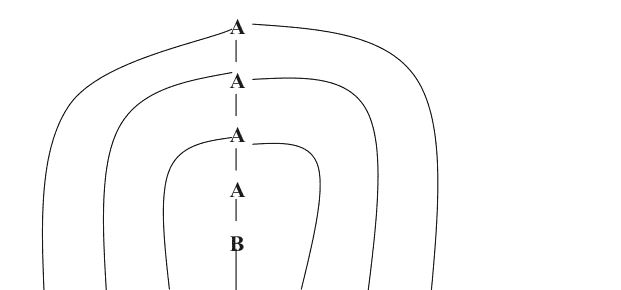

## Mathematical Notations and Terminology

As in any mathematical subject, we begin with the definition of notation and terminology.

- Set and Sequence
- Function and Relation
- Graph
- String and Language
- Boolean Logic
- Definition, Theorem and Proof

## Sets

- A set is a group of objects represented as a unit.
- The set $A$ has three elements: $A = \{1,2,3\}$.
- 1 is a member (or element) of $A$: $1 \in \{1,2,3\}$.
- 4 is not a member of $A$: $4 \notin \{1,2,3\}$.

- The set {1} is a proper subset of A: {1} ⊂ {1,2,3}.
- The set A is a subset of A: {1,2,3} ⊆ {1,2,3}.
- Intersection of two sets: {1,2} ∩ {2,3} = {2}.
- Union of two sets: {1,2} ∪ {2,3} = {1,2,3}.

- **Complement of *A*** denotes all elements that do not belong to set *A*: $4 \in \overline{A}$.
- **Power Set of *A*** denotes the set of all subsets of *A*:
  - Power set of A: $P(A)$ or $2^A = \{\phi, \{1\}, \{2\}, \{3\}, \{1,2\}, \{1,3\}, \{2,3\}, \{1,2,3\}\}$.
- **Empty Set** is a set with zero elements: $\phi = \{ \}$.

- Venn diagram:

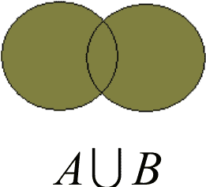

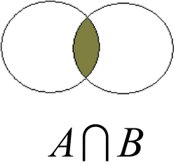

- Cartesian Product of $A$ and $B$ ($A \times B$):

$A = \{1,2,3\}$, $B = \{a,b,c,d\}$

$A \times B = \{(1,a),(1,b),(1,c),(1,d),(2,a),(2,b),(2,c),(2,d),(3,a),(3,b),(3,c),(3,d)\}$

$A \times A \times A = A^3$

## Sequences

- A sequence of objects is a list of these objects in some order.
  - $S = (3,1,2)$
- Sequence $S$ is a 3-tuple.
  - A 2-tuple is also known as a pair.
- A set does not care about the order and repetition of elements, but a sequence does.

## Functions and Relations

- A function ($f$) is an object that sets up an input-output relationship.
  - $x$ is an input value and $y$ is an output value.
  - $f(x) = y$
  - $f: D \to R$

The set ($D$) of all possible inputs of $f$ is called its domain.

The set ($R$) of all possible outputs of $f$ is called its range.

- A function may not necessarily use all the elements of its range.
- $R$ denotes the set of all real numbers.

$abs: R \to R$, $add: R \times R \to R$

Unary function, binary function, n-ary function.

- A predicate or property is a function whose range is {True, False}.
  - $even(4) = TRUE$, $even(5) = FALSE$
- Infix notation: $x + z = y$
- Prefix notation: $add(x, z) = y$
- Binary function, n-ary function.

- An equivalence relation denotes two objects being equal in some feature.
- A binary relation $R$ is an equivalence relation if $R$ satisfies:
  - $R$ is reflexive if for every $x$, $xRx$.
  - $R$ is symmetric if for every $x$ and $y$, $xRy$ implies $yRx$.
  - $R$ is transitive if for every $x$, $y$ and $z$, $xRy$ and $yRz$ implies $xRz$.

### In-class Exercise

- Let $R$ be a binary relation on two integers. For integers $a$ and $b$, $aRb$ if 3 divides $(a - b)$. Is $R$ an equivalence relation?
- E.g., 3 divides (4 - 1), resulting in the integer 1, and thus $4R1$ is true.

## Graph

- An **undirected graph** or **graph** is a set of points with lines connecting some of the points.
- The points are called **nodes** or **vertices**, and the lines are called **edges**.
- The **degree** of a node is the number of edges at this node.

- Representation of graph:
  - Sets: $G = (V, E)$, where $V$ is the set of nodes and $E$ is the set of edges.
    - {{Harbin, Peking, Shenzhen, Hong Kong}, {(Harbin, Peking), (Harbin, Shenzhen), (Peking, Shenzhen), (Shenzhen, Hong Kong)}}
  - Labeled graph:

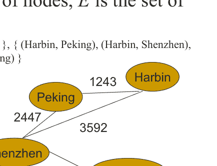

- $G$ is a subgraph of $H$ if the nodes of $G$ are a subset of the nodes of $H$, and the edges of $G$ are the edges of $H$ on the corresponding nodes.

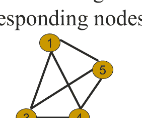

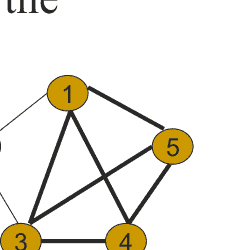


## Graph

- If every two nodes have a path between them, the graph is **connected**.
- A graph is a **tree** if it is connected and has no simple cycles.
  - Root, leaves.
- If the graph has arrows instead of lines, the graph is a directed graph.
  - Outdegree, indegree.
  - Directed path
  - Strongly connected

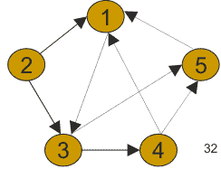

## String and languages

- **Alphabet** is a finite set that is nonempty.
  - Σ₁ = {0,1}
  - Γ₁ = {a,b,c,...,x,y,z}
- The members of the alphabet are the symbols.
- **String** is a finite sequence of symbols from that alphabet, usually written next to one another and not separated by commas.
  - w = w₁w₂...wₙ   |w| = n
  - **Reverse of w**: wᴿ = wₙ wₙ₋₁...w₁
  - **Empty string**: ε
  - String z is a substring of w if z appears consecutively within w.

- $x = x_1 x_2 \dots x_m$, $y = y_1 y_2 \dots y_n$
  - Concatenation of $x$ and $y$ is $xy = x_1 x_2 \dots x_m y_1 y_2 \dots y_n$
  - $x^k = \underbrace{xx\dots x}_{k}$

The lexicographic ordering of strings is the same as the dictionary ordering, except that shorter strings precede longer strings.

- lexicographic ordering over $\Sigma_1 = \{0,1\}$ is $\{\varepsilon,0,1,00,01,10,11,000,\dots\}$

- A language is a set of strings.

## Boolean logic

- Boolean logic is built around {TRUE, FALSE}.
- Boolean operation:
  - Negation (NOT)
    - ¬0=1, ¬1=0
  - Conjunction (AND)
    - 0∧0=0, 0∧1=0, 1∧0=0, 1∧1=1
  - Disjunction (OR)
    - 0∨0=0, 0∨1=1, 1∨0=1, 1∨1=1
  - Exclusive (XOR)
    - 0⊕0=0, 0⊕1=1, 1⊕0=1, 1⊕1=0,
  - Equality(↔)
    - 0↔0=1, 0↔1=0, 1↔0=0, 1↔1=1,
  - Implication(→)
    - 0→0=1, 0→1=1, 1→0=0, 1→1=1,

Equal relations:

- P ∨ Q      ¬(¬P ∧ ¬Q)
- P → Q      ¬P ∨ Q
- P ↔ Q      (P → Q) ∧ (Q → P)
- P ⊕ Q      ¬(P ↔ Q)
- P ∧ (Q ∨ R)      (P ∧ Q) ∨ (P ∧ R)
- P ∨ (Q ∧ R)      (P ∨ Q) ∧ (P ∨ R)

## Definitions, theorems and proofs

- Definition
- Theorem, lemma, corollary
- Proofs:
  - Proof by construction
  - Proof by contradiction
  - Proof by induction

- **Definitions** describe the objects and notions that we used
  - **Precision** is essential to any mathematical definition
  - **Mathematical Statement** state the property of a defined object
- **Proof** is a convincing logical argument that a statement is true
  - In mathematics, argument must be airtight and **convincing in absolute sense**
  - Evidence plays no role and we demand proof beyond any doubt

- **Theorem** is a mathematical statement proved true
- **Lemma** is a statement that we proved to assist in the proof of another more significant statement
- A theorem or its proof may allow us to conclude easily that another related statement is true and it is called **Corollary**
- The only way to determine the truth or falsity of a mathematical statement is with a mathematical proof.

## Proof by construction

- **proof by construction**
  - Many theorem state that a particular type of object exists.
  - One way to prove the theorems that state a particular type of object exists is by demonstrating how to construct the object

- Example 1: Prove for each even number $n$ greater than 2, there exists a 3-regular graph (a graph with degree 3 for all of its nodes) with $n$ nodes.
- Proof: Let $n$ be an even number and $n > 2$. Construct graph $G = (V, E)$ with n nodes as follows. The set of nodes of $G$ is $V = \{0,1,\dots,n-1\}$, and the set of edges of $G$ is the set $E = \{\{i,i+1\} \mid for\ 0 \le i \le n-2\} \cup \{\{n-1,0\}\} \cup \{\{i,i+n/2\} \mid for\ 0 \le i \le n/2-1\}$


## Proof by construction

$$
\{\{i, i+1\} \mid \text{for } 0 \le i \le n-2\} \cup \{\{n-1,0\}\}
$$

These edges are the edges between adjacent pairs around the circle.

$$
\{\{i, i+n/2\} \mid \text{for } 0 \le i \le n/2 - 1\}
$$

These edges are the edges between nodes on opposite sides of the circle.

So this construction satisfies that every node in \(G\) has degree 3.


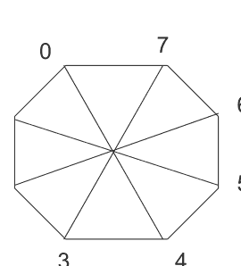

### Example 2

Positive numbers \(a, b, c, A, B, C\) satisfy \(a+A=b+B=c+C=k\). Now prove that:

$$
aB + bC + cA < k^2
$$

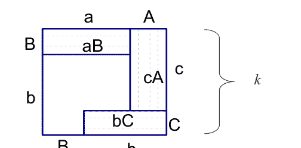

## Proof by contradiction

- **Proof by contradiction:** we assume that the theorem is false and then show that this assumption leads to an obviously false consequence, called a contradiction.

Notice the remark.

### Example: Prove \(\sqrt{2}\) is irrational

**Proof:**

Assume \(\sqrt{2}\) is a rational number such that \(\sqrt{2}=m/n\), where both \(m\) and \(n\) are integers.

If both \(m\) and \(n\) are divisible by the same integer greater than 1, dividing them by that integer does not change the value of the fraction. Now, at least one of \(m\) and \(n\) must be an odd number.

Then, multiply both sides of the equation by \(n\):

$$
n\sqrt{2} = m
$$

and square both sides to obtain:

$$
2n^2 = m^2
$$

Because \(m^2\) is 2 times the integer \(n^2\), we know that \(m^2\) is even. Therefore \(m\) is even. So we can write \(m = 2k\) for some integer \(k\). Thus,

$$
2n^2 = (2k)^2
$$

so

$$
n^2 = 2k^2
$$

So \(n\) is even too. This contradicts the premise that at least one of \(m\) and \(n\) must be an odd number. So \(\sqrt{2}\) cannot be written as a fraction. Therefore \(\sqrt{2}\) is irrational.

## Proof by induction

- Proof by induction is a method used to show that all elements of an infinite set have a specified property.
- Take the infinite set to be the natural numbers, \(N = \{1,2,3,\dots\}\), and say that the property is called \(P\). Our goal is to prove that \(P(k)\) is true for each natural number \(k\).

### Steps

- **Basis:** prove that \(P(1)\) is true.
- **Induction step:** prove that for each \(i \ge 1\), if \(P(i)\) is true, then so is \(P(i+1)\).

### Example: Monthly payments of home mortgages problem

Let \(P\) be the principal, the amount of the original loan; \(I\) be the yearly interest rate; \(Y\) be the monthly payment; and \(M\) be the monthly multiplier (\(M = 1 + I/12\)).

Let \(P_t\) be the amount of loan outstanding after the \(t\)-th month. So we have:

$$
P_0 = P
$$

and

$$
P_t = P_{t-1}M - Y
$$

**To prove:** for each \(t \ge 0\),

$$
P_t = P M^t - Y\left(\frac{M^t - 1}{M - 1}\right)
$$

**Proof:**

**Basis:**

Prove that the formula is true for \(t = 0\), that is (remark: \(M^0 = 1\)):

$$
P_0 = P M^0 - Y\left(\frac{M^0 - 1}{M - 1}\right) = P
$$

This holds true because we have defined \(P_0 = P\). So, we have proved that the basis of the induction is true.

**Induction step:**

For each \(k \ge 0\), assume that the formula is true for \(t = k\) and show that it is true for \(t = k + 1\).

We have:

$$
\begin{aligned}
P_{k+1} &= P_k M - Y \\
&= \left[ P M^k - Y\left(\frac{M^k - 1}{M - 1}\right) \right] M - Y \\
&= P M^{k+1} - Y\left(\frac{M^{k+1} - M}{M - 1}\right) - Y\left(\frac{M - 1}{M - 1}\right) \\
&= P M^{k+1} - Y\left(\frac{M^{k+1} - 1}{M - 1}\right)
\end{aligned}
$$

Thus the formula is correct for \(t = k + 1\), which proves the theorem.


- Finite Automata
- Nondeterminism
- Regular Expressions
- Nonregular Languages

## Review the example

- The controller for an automatic door.
  - Door swings open when sensing that a person is standing in front of it.
  - Controller holds the door open long enough for the person to pass.
- Controller is in either of two states:
  - Open
  - Closed
- Possible input conditions:
  - Front
  - Rear
  - Both
  - Neither
- The controller moves from state to state, depending on the input it receives.


## The controller for an automatic door

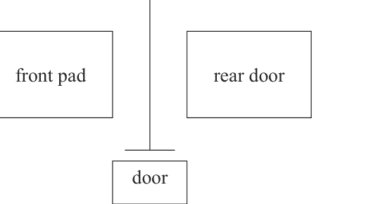

Top view of the system

## The controller for an automatic door

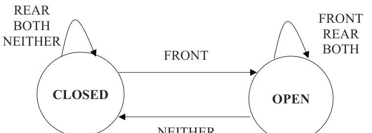

State diagram

## The controller for an automatic door

| state | NEITHER | FRONT | REAR | BOTH |
|---|---|---|---|---|
| CLOSED | CLOSED | OPEN | CLOSED | CLOSED |
| OPEN | CLOSED | OPEN | OPEN | OPEN |

Transition table of the door

## The controller for an automatic door

## Example:

- Start in state **closed**
- Receive the series of input signals FRONT, REAR, NEITHER, FRONT, BOTH, NEITHER, REAR and NEITHER,
- Controller will go through the series of states CLOSED (starting), OPEN, OPEN, CLOSED, OPEN, OPEN, CLOSED, CLOSED, AND CLOSED

## Finite Automata (FA)

- The daily devices that can be demonstrated by FA
  - Accutron (electronic watch):
    - e.g: there four keys on the Accutron, then there are four possible input, and there are some states.
  - Recorder: the transform keys:
    - ▶. ▶▶. ◀◀. ○. ■ are the possible input.
  - TV telecontrol
    - the telecontrol of multilayer menu.
  - Elevator

## Finite Automata

- Briefly, FA:
  - Current State + Input → Next State
- As a computer, FA:
  - can read
  - can not write
  - no memory (only register to store states and input)
  - can not perform reasoning
  - no imagination
  - That is, computation here is to judge the last state.

## Finite Automata

## State diagram:

We use M₁ to denote a FA (NFA: uses N₁)

- States:
  - 3 states: q₁, q₂, q₃

- Start state:
  - indicated by the arrow pointing at it from nowhere :e.g. q₁

- Accept state:
  - the one with a double circle. e.g.: q₂

- Inputs:
  - Strings: a finite list of symbols from alphabet Σ

- Transitions
  - The arrows going from one state to another

- Output:
  - Accept or reject

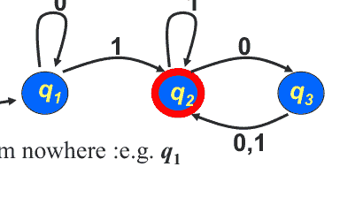

## Finite Automata

- **The process procedure:**
  - Begins in $M_1$'s **start state**
  - Repeat until the last symbol:
    - Read one **symbol** from the input string from left to right in turns.
    - $M_1$ moves from one state to another along the **transition** that has that symbol as its label.
  - $M_1$ produces its output, the output is **accept** if $M_1$ is now in an accept state and **reject** if it is not.

## Finite Automata

E.g.: We input a string 1101 to the FA M₁

The processing proceeds:

- Start in state q₁.
- Read 1, follow transition from q₁ to q₂;
- Read 1, follow transition from q₂ to q₂;
- Read 0, follow transition from q₂ to q₃;
- Read 1, follow transition from q₃ to q₂.
- Accept because M₁ is in an accept state q₂ at the end of the input.

In fact, M₁ accepts any string that ends with a 1, and also any string that ends with an even number of 0s following the last 1.

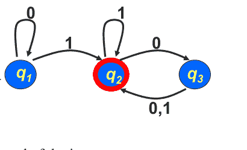

## Formal Definition of FA

- A finite automaton is a 5-tuple ($Q$, $\Sigma$, $\delta$, $q_0$, $F$), where
  1. $Q$ is a finite set called the states,
  2. $\Sigma$ is a finite set called the alphabet,
  3. $\delta : Q \times \Sigma \rightarrow Q$ is the transition function
  4. $q_0 \in Q$ is the start state, and
  5. $F \subseteq Q$ is the set of accept states.

- Transition function is denoted by $\delta$
  - $\delta(x, 1) = y$ means there is a arrow from a state $x$ to a state $y$ labeled with the input symbol 1.

## Formal Definition of FA

E.g. we formally describe M₁ as following:

M₁ = (Q, Σ, δ, q₁, F), where

- 1. Q = {q₁, q₂, q₃}
- 2. Σ = {0, 1}
- 3. δ is described as
- 4. q₁ is the start state, and
- 5. F = {q₂}

|   | 0 | 1 |
|---|---|---|
| q₁ | q₁ | q₂ |
| q₂ | q₃ | q₂ |
| q₃ | q₂ | q₂ |

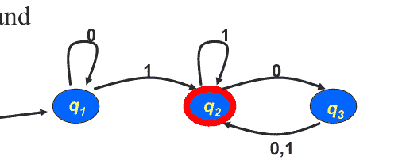

## Formal Definition of FA

- If $A$ is the set of all strings that machine $M$ accepts, we say that $A$ is the language of machine $M$, or $M$ recognizes $A$.

  $L(M)=A$
- If the machine accepts no strings, it still recognizes one language:

  empty language $\emptyset$
- E.g.:
  - $A = \{w\mid w \text{ contains at least one 1 and also an even number of 0s follow the last 1}\}$, Then

    $L(M)=A$, or $M$ recognizes $A$.


## Finite Automata

- On class exercises:
  - Find the transition tables and languages that FAs accept

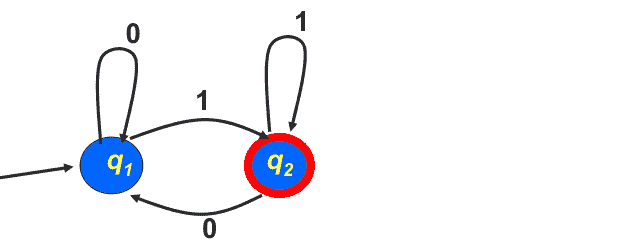

Exercise 1

## Finite Automata

- On class exercise:

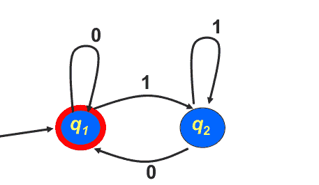

Exercise 2

## Finite Automata

On class exercise:

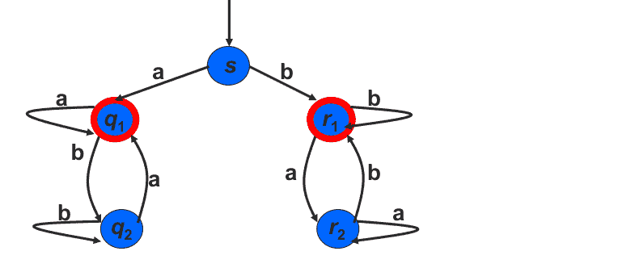

### Exercise 3

## Finite Automata

On class exercise:

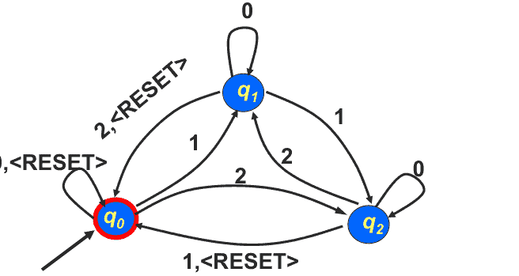

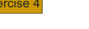

## Formal Definition of Computation

- Let $M = (Q, \Sigma, \delta, q_0, F)$ be a FA and let $w = w_1 w_2 ... w_n$ be a string where each $w_i$ is a member of the alphabet $\Sigma$. Then $M$ accepts $w$ if a sequence of states $r_0, r_1, ... r_n$ in $Q$ exists with three conditions:
  - $r_0 = q_0$
  - $\delta(r_i, w_{i+1}) = r_{i+1}$, for $i = 0, ..., n-1$, and
  - $r_n \in F$
- So we can say that $M$ recognizes language $A$ if $A = \{w \mid M \text{ accepts } w\}$
- A language is called a regular language if some finite automaton recognizes it.

## Designing Finite Automata

- To design a FA, put yourself in the place of the machine you are trying to design, see how you would do to perform the machine’s task.

- So pretending yourself to be the automaton, receive an input string, see the symbols one by one, and then must decide whether the string seen so far is in the language. You (FA) don’t know when the end of the string is coming, so you must always be ready with the answer.

## Designing Finite Automata

How to design a FA:

- A = { w | w composes only 1 or 0, and has odd number of 1s }, design a FA M to recognizes A.

- Pretending to be the automaton, get an input string of 0s and 1s symbol by symbol.

- Remember whether the number of 1s seen so far is even or odd ( two possibilities ), if you read a 1, flip the answer, a 0, leave the answer as is.

- Assign a state to each of the possibilities.

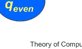

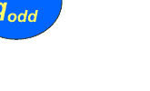

## Designing Finite Automata

- Assign the transitions by seeing how to go from one possibility to another upon reading a symbol.

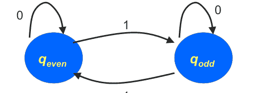

## Designing Finite Automata

- Determine the start state that is get no symbols ( ε ), so that is zero 1, so the start state is q_even
- Determine the accept states to be those corresponding to possibilities where you want to accept the input string, so the accept states is q_odd

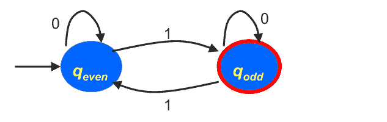

## Designing Finite Automata

- On class exercise:

Design a finite automaton E to recognize the regular language of all strings that contain the string 001 as a substring.

## Regular operations

| | Basic objects | Tools( Operations for manipulating ) |
|---|---|---|
| Arithmetic | Numbers | e.g. +, / |
| Computation theory | Languages | e.g. U, ∘, * |

Let A and B be languages. We define the regular operations union, concatenation, and star as follows.

- Union: A ∪ B = { x | x ∈ A or x ∈ B }

- Concatenation: A ∘ B = { xy | x ∈ A and y ∈ B }

- Star: A* = { x₁ x₂ ... xₙ | k ≥ 0 and each xᵢ ∈ A }

Note: When k = 0, for * operation, empty string ε ∈ A *

## Regular operations

- Example:
- Σ = { a, b, ... , z }, A = { red, blue }, B = { dog, bird, cat }

- A ∪ B = { red, blue, dog, bird, cat }

- A ∘ B = { reddog, redbird, redcat, bluedog, bluebird, bluecat }

- A* = { ε, red, blue, redred, redblue, bluered, blueblue, redredred, redredblue, redbluered, redblueblue, ... }

## Regular operations

- A collection of objects is closed under some operation if applying that operation to members of the collection returns an object still in the collection.
- The collection of regular languages is closed under all three of the regular operations: union, concatenation and star.


## Regular operations
- Theorem: the class of regular languages is closed under the union operation.
- Proof:
  - We prove that if $A_1$ and $A_2$ are regular languages, so is $A_1 \cup A_2$
  - Suppose $M_1$ recognizes $A_1$ and $M_2$ recognizes $A_2$, we demonstrate a FA $M$ to recognize $A_1 \cup A_2$. This is a proof by construction.

## Regular operations
$M_1 = (Q_1, \Sigma, \delta_1, q_1, F_1)$, $M_2 = (Q_2, \Sigma, \delta_2, q_2, F_2)$ and $M = (Q, \Sigma, \delta, q_0, F)$, thus

- 1. $Q = Q_1 \times Q_2 = \{(r_1, r_2) \mid r_1 \in Q_1 \text{ and } r_2 \in Q_2\}$
- 2. We assume $M_1$ and $M_2$ have the same input alphabet $\Sigma$, so for $M$, the alphabet is still $\Sigma$
- 3. For each $(r_1, r_2) \in Q$ and each $a \in \Sigma$, let 
$\delta((r_1, r_2), a) = (\delta_1(r_1, a), \delta_2(r_2, a))$
- 4. $q_0 = (q_1, q_2)$
- 5. $F = (F_1 \times Q_2) \cup (Q_1 \times F_2) = \{(r_1, r_2) \mid r_1 \in F_1 \text{ or } r_2 \in F_2\}$

## Regular operations
- To construct the union operation, we introduce the $\Phi$ (a null state) where we omit in the transition.

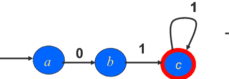

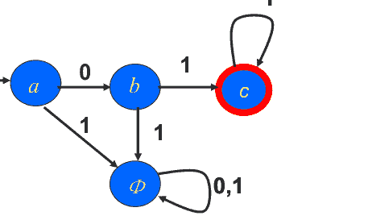

## Regular operations
- $A_1=\{\text{language that the strings are 00 followed with any number of 1s}\}$, construct $M_1$ accepts $A_1$.
- $A_2=\{\text{language that the strings are 01 followed with any number of 1s}\}$, construct $M_2$ accepts $A_2$.
- Now construct $M$ accepts $A_1 \cup A_2$.

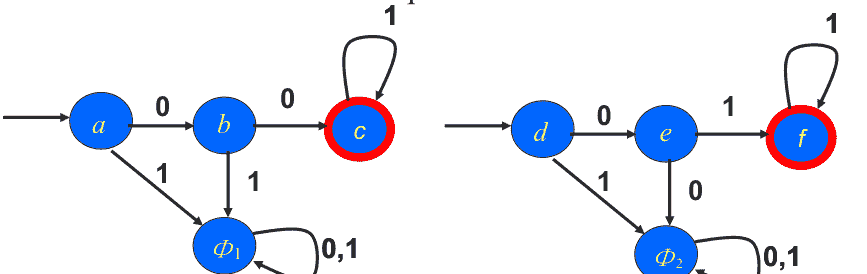

## Regular operations
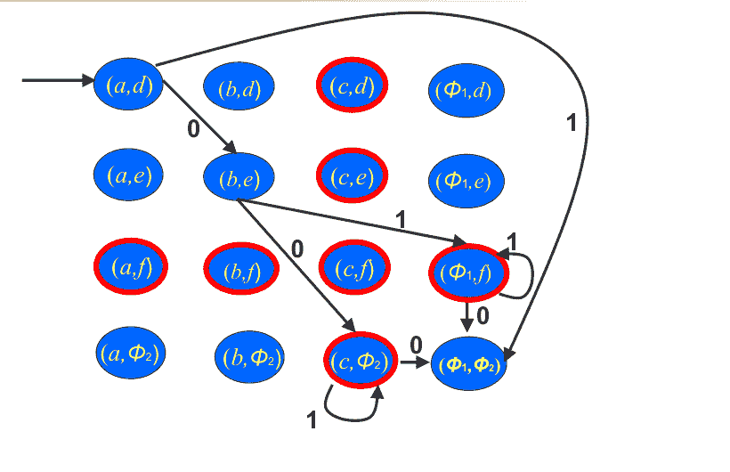

## Regular operations
- Theorem: the class of regular languages is closed under the concatenation operation.
- Proof:
  - Now, instead of constructing automaton $M$ to accept its input if either $M_1$ or $M_2$ accept, it must accept if its input can be broken into two pieces, where $M_1$ accepts the first piece and $M_2$ accepts the second piece. But $M$ does not need to know where to break its input.
  - To solve this problem, we introduce a new technique called nondeterminism.

## Nondeterminism
- The difference between DFA and NFA
  1. Every state of a DFA always has exactly one exiting transition arrow for each symbol in the alphabet.
     A state of a NFA may have zero, one or many exiting arrows for each alphabet symbol.
  2. In a DFA, labels on the transition arrows are symbols from the alphabet, while $\varepsilon$ is added in a NFA.

## Nondeterminism
- NFA running mechanism:
  - When NFA reads a symbol and is at a state with multiple out-going arrows with this symbol, NFA splits into multiple copies of itself. Remember these copies and follows all the possibilities in parallel.
    - If there are subsequent choices, the machine splits again.
    - If the next input symbol doesn’t appear on any of the arrows exiting the state, that copy of the machine dies, along with the branch of the computation associated with it.
    - If any one of these copies of the machine is in an accept state at the end of the input, the NFA accepts the inputs string.
    - If a state with an $\varepsilon$ arrow is encountered, the machine splits into multiple copies without reading any input, one following each of the existing $\varepsilon$ arrow and one staying at the current state.

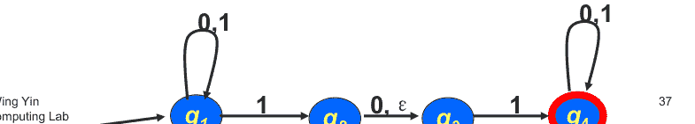

## Nondeterminism
- **NFA running mechanism:**
  - Tree of possibilities.
    - The root of the tree corresponds to the start of the computation.
    - Every branching point in the tree corresponds to a point in the computation at which the machine has multiple choices.
    - The machine accepts if at least one of the computation branches ends in an accept state.

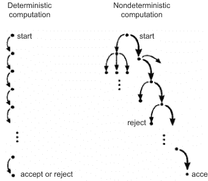

## Nondeterminism
- For input 010110

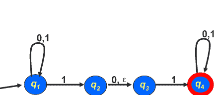

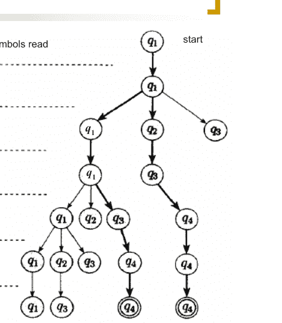

## Nondeterminism
Examples:
- A is the language consisting of all strings over {0,1} containing a 1 in the third position from the end. The following four-state NFA $N_2$ recognizes $A$.

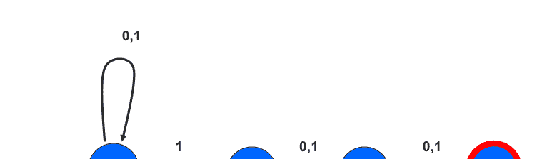


## Nondeterminism

The following eight-state DFA recognizes A too.

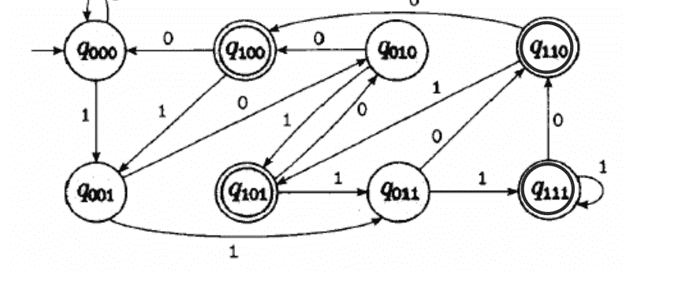

- By comparing diagrams from previous pages, we find that understanding the function of an NFA is much easier.
- What language could the following NFA recognize and what is the corresponding DFA?

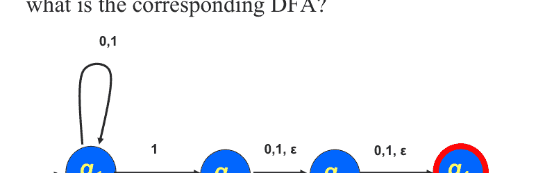

- $A_3$ is the language that has an input alphabet $\{0\}$ and accepts all strings of the form $0^k$ where $k$ is a multiple of 2 or 3. The following NFA $N_3$ recognizes $A_3$.
- We can see the convenience of using $\varepsilon$ arrows.

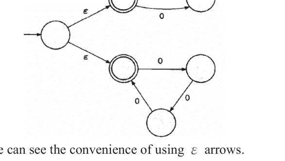

### Formal definition of NFA

- Let $\mathbf{P}(Q)$ be the power set of $Q$, which is the collection of all subsets of $Q$, $\Sigma_\varepsilon = \Sigma \cup \{\varepsilon\}$.
- A nondeterministic finite automaton is a 5-tuple $(Q, \Sigma, \delta, q_0, F)$, where
    1. $Q$ is a finite set of states,
    2. $\Sigma$ is a finite alphabet,
    3. $\delta : Q \times \Sigma_\varepsilon \rightarrow \mathbf{P}(Q)$ is the transition function,
    4. $q_0 \in Q$ is the start state, and
    5. $F \subseteq Q$ is the set of accept states.

**Example:**

$N_1 = (Q, \Sigma, \delta, q_1, F)$, where

1. $Q = \{q_1, q_2, q_3, q_4\}$
2. $\Sigma = \{0, 1\}$
3. $\delta$ is described as

| $\delta$ | 0 | 1 | $\varepsilon$ |
|---|---|---|---|
| $q_1$ | $\{q_1\}$ | $\{q_1, q_2\}$ | $\Phi$ |
| $q_2$ | $\{q_3\}$ | $\Phi$ | $\{q_3\}$ |
| $q_3$ | $\Phi$ | $\{q_4\}$ | $\Phi$ |
| $q_4$ | $\{q_4\}$ | $\{q_4\}$ | $\Phi$ |

4. $q_1$ is the start state, and
5. $F = \{q_4\}$

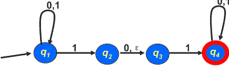

### Formal definition of computation of NFA

- Let $N = (Q, \Sigma, \delta, q_0, F)$ be an NFA and let $w = y_1 y_2 ... y_n$ be a string where each $y_i$ is a member of the alphabet $\Sigma_\varepsilon$. Then $N$ accepts $w$ if a sequence of states $r_0, r_1, ... r_m$ in $Q$ exists with three conditions:
    - $r_0 = q_0$
    - $r_{i+1} \in \delta(r_i, y_{i+1})$, for $i = 0, ..., m-1$, and
    - $r_m \in F$
- So we can say that $N$ recognizes language $A$ if $A = \{w \mid N \text{ accepts } w\}$.

### Equivalence of NFAs and DFAs

- Two machines are equivalent if they recognize the same language.
- Theorem:
    - Every nondeterministic finite automaton has an equivalent deterministic finite automaton.
- Proof:
    - Let $N = (Q, \Sigma, \delta, q_0, F)$ be the NFA recognizing some language $A$. We construct a DFA $M = (Q', \Sigma, \delta', q_0', F')$ recognizing $A$.

Consider the case where $N$ has no $\varepsilon$ arrow.

- $Q' = \mathcal{P}(Q)$
- $\delta'(R, a) = \{ q \in Q \mid q \in \delta(r, a) \text{ for some } r \in R \} = \bigcup_{r \in R} \delta(r, a)$
- $R$ is a state of $M$, it is also a set of states of $N$.
- When $M$ reads a symbol $a$ in state $R$, it shows where $a$ takes each state in $R$.
- Because each state may go to a set of states, we take the union of all these sets.
- $q_0' = \{q_0\}$
- $F' = \{ R \in Q' \mid R \text{ contains an accept state of } N \}$.

- Consider the $\varepsilon$ arrows.
    - For $R \subseteq Q$ (or $R \in \mathbf{P}(Q)$), let $E(R) = \{ q \mid q \text{ can be reached from } R \text{ by traveling along 0 or more } \varepsilon \text{ arrows} \}$.
    - Change
        - $\delta'(R, a) = \{ q \in Q \mid q \in E(\hat{\delta}(r, a)) \text{ for some } r \in R \}$
        - $q_0' = E(\{q_0\})$

- We have now completed the construction of the DFA $M$ that simulates the NFA $N$.

The construction of $M$ obviously works correctly. At every step in the computation of $M$ on an input, it clearly enters a state that corresponds to the subset of states that $N$ could be in at that point. Thus, our proof is complete.

- **Corollary**
    A language is regular if and only if some nondeterministic finite automaton recognizes it.

- Example
- Given the NFA $N_4$ as following, now construct the equivalent DFA $D$.
- Solution:

$N_4 = (Q, \{a,b\}, \delta, 1, \{1\})$, where $Q = \{1, 2, 3\}$

- The states of $D$ are $\mathbf{P}(Q)$:
    - $\{\Phi, \{1\}, \{2\}, \{3\}, \{1,2\}, \{1,3\}, \{2,3\}, \{1,2,3\}\}$
- The start state is $E(\{1\}) = \{1,3\}$
- The accept states are $\{\{1\}, \{1,2\}, \{1,3\}, \{1,2,3\}\}$

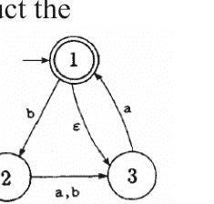

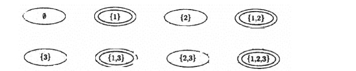


## Equivalence of NFAs and DFAs

- Determine the transition function
  - {2} with a input a,
    - by δ′(R, a) = { q ∈ Q | q ∈ E(δ(r, a)) for some r ∈ R }
      δ′({2}, a) = {2} ∪ {3} = {2, 3}
  - {2} with a input b,
    δ′({2}, b) = {3}

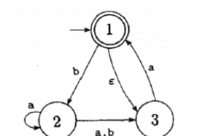

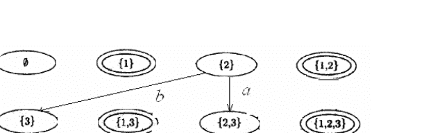

## Equivalence of NFAs and DFAs

- Finally

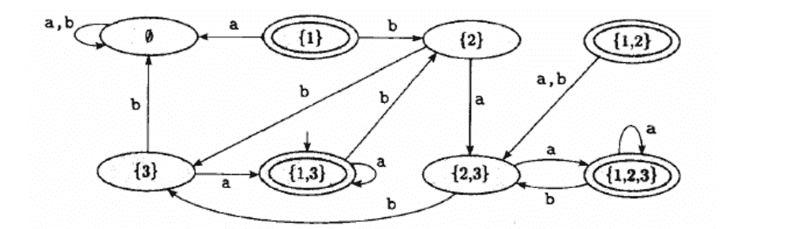

## Equivalence of NFAs and DFAs

- Simplify the machine by removing those nodes with no in-arrow, i.e. states {1}, and {1,2}.

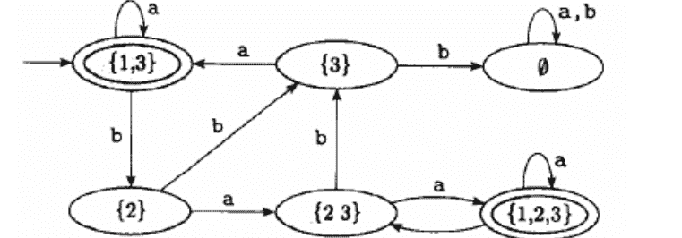

## Equivalence of NFAs and DFAs

- Further simplify the machine by removing some “dead looping node”.

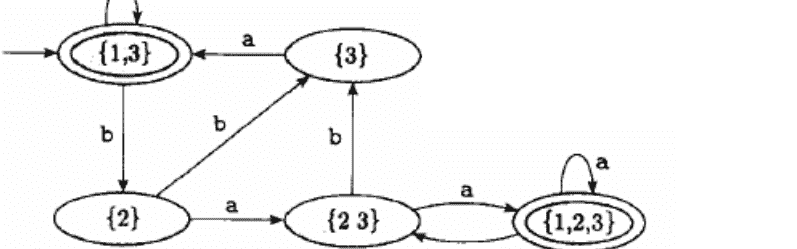

## Equivalence of NFAs and DFAs

- On class exercise
  1. Construct DFA equivalent to the following NFA

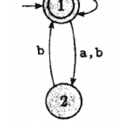

## Equivalence of NFAs and DFAs

2. Construct DFA equivalent to the following NFA

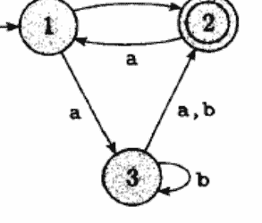


TA: Ms. Sun, Binbin


- Nondeterminism (continued)
- Regular Expressions
- Nonregular Languages

## Closure under the regular operations

- After learnt the powerful NFA, we will proof again the closure under Union operation in a much easier way and complete the proofs for the other two operations

## Closure under the regular operations

- Theorem: The class of regular languages is closed under the union operation.
- Proof:
  - We prove that if $A_1$ and $A_2$ are regular languages, so is $A_1 \cup A_2$
    - Suppose $N_1$ recognizes $A_1$ and $N_2$ recognizes $A_2$, we demonstrate a NFA $N$ to recognize $A_1 \cup A_2$. This is a proof by construction, too.
    - The new machine has a new start state that branches to the start states of the old machines with $\varepsilon$ arrows.

## Closure under the regular operations

In this way the new machine nondeterministically guesses which of the two machines accepts the input. If one of them accepts the input, N will accept it, too.

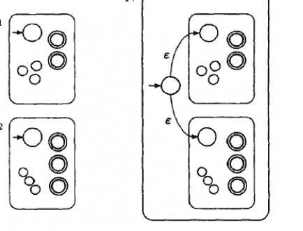

## Closure under the regular operations

N₁ = (Q₁, Σ, δ₁, q₁, F₁), N₂ = (Q₂, Σ, δ₂, q₂, F₂) and N = (Q, Σ, δ, q₀, F), thus

1. Q = {q₀} ∪ Q₁ ∪ Q₂
2. Σ
3. Transition function:
   δ(q, a) = { δ₁(q, a)   q ∈ Q₁
               δ₂(q, a)   q ∈ Q₂
               {q₁, q₂}   q = q₀ and a = ε
               ∅          q = q₀ and a ≠ ε }
4. q₀
5. F = F₁ ∪ F₂

## Closure under the regular operations

- Theorem: The class of regular languages is closed under the concatenation operation.
- Proof:
  - We prove that if $A_1$ and $A_2$ are regular languages, so is $A_1 \circ A_2$

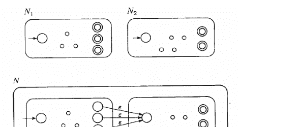

## Closure under the regular operations

$N_1 = (Q_1, \Sigma, \delta_1, q_1, F_1)$, $N_2 = (Q_2, \Sigma, \delta_2, q_2, F_2)$ and $N = (Q, \Sigma, \delta, q_0, F)$ to recognize $A_1 \circ A_2$, thus

1. $Q = Q_1 \cup Q_2$
2. $\Sigma$
3. Transition function:
   $\delta(q,a)=\begin{cases}\delta_1(q,a) & q \in Q_1 \text{ and } \notin F_1 \\ \delta_1(q,a) & q \in F_1 \text{ and } a \neq \varepsilon \\ \delta_1(q,a)\cup\{q_2\} & q \in F_1 \text{ and } a=\varepsilon \\ \delta_2(q,a) & q \in Q_2\end{cases}$
4. $q_0 = q_1$
5. $F = F_2$

## Closure under the regular operations

- Theorem: The class of regular languages is closed under the star operation.
- Proof:
  - We prove that if A₁ is regular language, so is A₁*

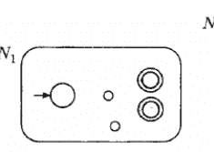

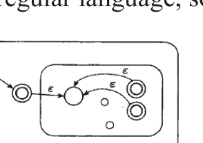


## Closure under the regular operations

N₁ = (Q₁, Σ, δ₁, q₁, F₁) and N = (Q, Σ, δ, q₀, F) to recognize A₁*, thus

+   1. Q = { q₀ } ∪ Q₁
+   2. Σ
+   3. Transition function:
+   δ(q, a) = { δ₁(q, a)      q ∈ Q₁ and q ∉ F₁
+   δ₁(q, a)      q ∈ F₁ and a ≠ ε
+   δ₁(q, a) ∪ {q₁}   q ∈ F₁ and a = ε
+   {q₁}          q = q₀ and a = ε
+   ∅             q = q₀ and a ≠ ε }
+   4. q₀
+   5. F = { q₀ } ∪ F₁

## Regular expressions

|  | operations | expression | value |
|---|---|---|---|
| Arithmetic | e.g. +, / | (6 + 9) / 3 | 5 |
| Computation theory | e.g., ∘, * | (0 U 1) * | Language consisting of all possible strings of 0s and 1s. |

+   - Regular expressions provide a powerful method for describing patterns in which the users may want the strings be.
+     - Applications
+       - modern programming languages, such as PERL
+       - text editors.

## Formal definition of a regular expressions

+   - Say that $R$ is a regular expression if $R$ is
+     - $a$ for some $a$ in the alphabet $\Sigma$
+     - $\varepsilon$
+     - $\emptyset$
+     - $(R_1 \cup R_2)$, where $R_1$ and $R_2$ are regular expressions,
+     - $(R_1 \circ R_2)$, where $R_1$ and $R_2$ are regular expressions, or
+     - $R_1^*$, where $R_1$ is a regular expression.

## Regular expressions

+   Notes:
+   
+   - a and ε represent the languages {a} and {ε}.
+   - Φ represent empty language.
+   - ε is an empty string, and Φ contains no string.
+   - **Parentheses** in an expression may be omitted. If they are, evaluation is done in the precedence order: star, then concatenation, then union.
+   - Let **R⁺** be shorthand for **RR***, so it is the language that has all strings that are 1 or more concatenations of strings from R.
+   
+   **R⁺ ∪ ε = R***
+   - **R^k** is shorthand for the concatenation of k R's with each other.
+   - a regular expression----R
+   the language a regular expression describes---- L(R)

## Regular expressions

+   Exercises:
+   0*10*    {w| w contains a single 1}
+   Σ*1Σ*    {w| w has at least one 1}
+   Σ*001Σ*  {w| w contains the string 001 as a substring}
+   (01+)*   {w| every 0 in w is followed by at least one 1}
+   (ΣΣ)*    {w| w is a string of even length}
+   (ΣΣΣ)*   {w| w the length of w is a multiple of three.}

## Regular expressions

+   - Exercises:
+     - `01\cup 10` — `{w | 01,10}`
+     - `0\Sigma^*0\cup 1\Sigma^*1\cup 0\cup 1` — `{w | w starts and ends with the same symbol}`
+     - `(0\cup\varepsilon)1^*` — `01^*\cup 1^*`
+     - `(0\cup\varepsilon)(1\cup\varepsilon)` — `{\varepsilon, 0, 1, 01}`
+     - `1^*\phi` — `\phi`
+     - `\phi^*` — `{\varepsilon}`

## Regular expressions

Note:
{ R ∪ φ = R
  R ∘ ε = R }

but { R ∪ ε ≠ R    e.g. R = 0, L(R) = {0}, L(R ∪ ε) = {0, ε}
      R ∘ φ ≠ R    e.g. R = 0, L(R) = {0}, L(R ∘ φ) = φ }

## Regular expressions

+   - Elemental objects in a programming language is tokens.
+   - Variable names and constants in programming language are tokens, they can be described with regular expressions.
+   - A numerical constant can be described as a member of the language
+     - (+ ∪ - ∪ ε) (D⁺ ∪ D⁺.D* ∪ D*.D⁺)
+       where D = {0, 1, 2, 3, 4, 5, 6, 7, 8, 9}
+   - Once the syntax of the tokens of the programming language have been described with regular expressions, automatic systems can generate the lexical analyzer, which is part of a compiler processing the input program.

## Regular expressions vs FA

+   - Theorem: A language is regular if and only if some regular expression describes it.
+     - language that a regular expression describe → regular language
+     - regular language → a regular expression can describe it

## Regular expressions

+   - If a language is described by a regular expression, then it is regular.
+   Proof: ( R → NFA → A )

1) R → NFA

We consider the six cases in the formal definition of regular expressions.

+   - R = a, Then L(R) = {a}. The following NFA recognizes L(R)

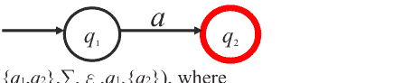

+   - N=({q₁,q₂},Σ,ε,q₁,{q₂}), where

δ(q₁,a) = {q₂}
δ(r,b) = ∅      for r ≠ q₁ or b ≠ a


## Regular expressions

- $R = \varepsilon$. Then $L(R) = \{ \varepsilon \}$, and the following NFA recognizes $L(R)$
  - $N = (\{q_1\}, \Sigma, \varepsilon, q_1, \{q_1\})$, where $\delta(r,b)=\Phi$ for any $r$ and $b$.
- $R = \Phi$. Then $L(R) = \Phi$, and the following NFA recognizes $L(R)$.
  - $N = (\{q_1\}, \Sigma, \varepsilon, q_1, \Phi)$, where $\delta(r,b)=\Phi$ for any $r$ and $b$.
- $R = (R_1 \cup R_2)$,
- $R = (R_1 \circ R_2)$,
- $R = R_1 *$,
  - We can prove by construction as we have done in the proofs of closure.

- By the definition of regular language, we can get NFA → A.
- We finish the proof.

## Regular expressions

- Example to convert $(a \cup b)^*aba$ into an NFA $N$.


## Regular expressions

### Generalized Nondeterministic Finite Automaton (GNFA)

- GNFA is simply nondeterministic finite automata wherein the transition arrows may have any regular expressions as labels, instead of only member of the alphabet or ε.

- A GNFA may have several different ways to process the same input string.


## Regular expressions


DFA


GNFA

## Regular expressions

For the purpose of using GNFA to prove the next theory, we require that GNFA always have the following special form:

- The start state has transition arrows going to every other state but no arrows coming in from any other state.

- There is only a single accept state, and it has arrows coming in from every other state but no arrows going to any other state. Further more, the accept state is not the same as the start state.

- Except for the start and accept states, one arrow goes from every state to every other state and also from each state to itself.

## Regular expressions

- The formal definition of GNFA
  - A generalized nondeterministic finite automaton $G$ is a 5-tuple $(Q, \Sigma, \delta, q_{start}, q_{accept})$, where
    1. $Q$ is a finite set **states**,
    2. $\Sigma$ is the input **alphabet**,
    3. $\delta : (Q - \{q_{accept}\}) \times (Q - \{q_{start}\}) \rightarrow R$ is the **transition function**
    4. $q_{start}$ is the **start state**, and
    5. $q_{accept}$ is the **accept state**.

Note: $R$ is the collection of all regular expressions over the alphabet $\Sigma$

## Regular expressions

- The formal definition of computation of GNFA
  - A GNFA accepts a string *w in* Σ* if *w = w₁ w₂ … wₙ*, where each *wᵢ is in* Σ* a sequence of states *q₀, q₁, … qₖ* exists such that
    1. *q₀ = q_start* is the start state.
    2. *qₖ = q_accept* is the accept state
    3. For each *i*, we have *wᵢ ∈ L(Rᵢ)*, where *Rᵢ = δ̂(qᵢ₋₁, qᵢ)*; in other words, *Rᵢ* is the expression on the arrow from *qᵢ₋₁* to *qᵢ*.

## Regular expressions

- If a language is regular, then it is described by a regular expression.
- Proof: ($A$ → DFA → GNFA → $R$)
  - By the definition of regular language, $A$ → DFA
  - DFA → GNFA
    - Add a new start state with an $\varepsilon$ arrow to the old start state
    - Add a new accept state with an $\varepsilon$ arrows to the old accept states
    - If any arrows have multiple labels (or if there are multiple arrows going between the same two states in the same direction), we replace each with a single arrow whose label is the union of the previous labels.
    - Add arrows labeled $\Phi$ between states that had no arrows.

## Regular expressions


- Note: we can prove by induction that for any GNFA G, CONVERT(G) is equivalent to R. ( p.74 in English version, p. 44 in Chinese version)

- Finish the whole proof.

## Regular expressions

- On class exercise:
  - Convert the DFA into a regular expression.


## Regular expressions

### On class exercise

- Convert the DFAs into regular expressions.


## Nonregular languages

- Finite automata have finite states, so there are some languages that FA can't recognize.
  - E.g., $B = \{0^n1^n \mid n \geq 0\}$
- To prove a language is nonregular, we state a property that a regular language possesses.
- The pumping lemma for regular languages:
  - All strings in a regular language can be "pumped" if they are at least as long as a certain special value, called the pumping length.
- This lemma means that such a string contains a section that can be repeated any number of times with the resulting string remaining in the language.

### Pumping lemma

If $A$ is a regular language, then there is a number $p$ (the pumping length) where, if $s$ is any string in $A$ of length at least $p$, then $s$ may be divided into three pieces, $s = xyz$, satisfying the following conditions:

- For each $i \geq 0$, $xy^iz \in A$
- $|y| > 0$, and
- $|xy| \leq p$

- Note: The complete proof is provided on p. 79-80 in the English version, p. 48 in the Chinese version, and we only provide the idea of the proof in these lecture notes.

- Let $M = (Q, \Sigma, \delta, q_1, F)$ be a DFA that recognizes $A$.
- Assign the pumping length $p$ to be the number of states of $M$.
- We now prove that a string $s$ (with $|s| = n$ and $|s| \geq p$) belonging to $A$ can be divided into 3 pieces $xyz$ satisfying the three conditions.
- Suppose the state sequence is $q_1, q_{k_1}, \ldots, q_{k_n}$, where $q_{k_n} \in F$, so there are $n+1$ states, and since $n \geq p$, we have $n+1 > p$. By the pigeonhole principle, the sequence must contain a repeated state.
- Suppose state $q_9$ is the state that repeats first.


- Let $x = [q_1, q_9]$, $y = [q_{10}, q_9]$, $z = [q_9, q_{13}]$.


- By condition 1, we can see that $M$ accepts $xyyz$, and so does $xy^iz$.
- Obviously $|y| > 0$.
- As state $q_9$ is the state that repeats first, by the pigeonhole principle, the first $p+1$ states in the sequence must contain a repetition. So $|xy| \leq p$.

- Using the pumping lemma to prove a language $B$ is not regular:
  - Assume $B$ is regular to prove by contradiction.
  - Use the pumping lemma to guarantee the existence of a pumping length $p$ such that all strings of length $p$ or greater in $B$ can be pumped.
  - Find a string $s$ in $B$ that has length $p$ or greater but that cannot be pumped.
  - Demonstrate that $s$ cannot be pumped by considering all ways of dividing $s$ into $x$, $y$, and $z$ and, for each such division, finding a value $i$ where $xy^iz \notin B$. Therefore, there is a contradiction.

### Example

- $B = \{0^n1^n \mid n \geq 0\}$ is not regular.
- Proof:
- Assume that $B$ is regular.
- Let $p$ be the pumping length given by the pumping lemma.
- Choose $s$ to be the string $0^p1^p$. Because $s$ is a member of $B$ and $s$ has length more than $p$, the pumping lemma guarantees that $s$ can be split into three pieces, $s = xyz$, where for any $i \geq 0$ the string $xy^iz$ is in $B$.
- $y$ consists only of **0**s. In this case the string $xyyz$ has more **0**s than **1**s and so is not a member of $B$, violating condition 1.
- $y$ consists only of **1**s. In this case the string $xyyz$ has more **1**s than **0**s and so is not a member of $B$, violating condition 1.
- $y$ consists of both **0**s and **1**s. $xyyz$ may have the same number of **0**s and **1**s, but there must be a **1** before **0**, and so is not a member of $B$.
- Thus a contradiction is unavoidable, and $B$ is not regular.

### On class exercise

- Prove that $B_1 = \{0^n 1^n 2^n \mid n \geq 0\}$ is not regular.


## Nonregular languages

On class exercise:

+   Prove that $B_2 = \{ww \mid w \in \{0,1\}^*\}$ is not regular.

## Theory of Computation

Lecture 4: Context-free languages

Lecturer: Dr. Ng, Wing Yin

TA: Ms. Sun, Binbin

**MiLeS Computing Lab,**
Department of Computer Science and Technology,
Harbin Institute of Technology Shenzhen Graduate School.

## Content of Lecture 4

+   - Context-free Grammars
+   - Pushdown Automata
+   - Non-context-free Languages

## Context-free Grammars

+   - Context-free grammars are a more powerful method of describing languages.
+   - Context-free grammars can describe certain features that have a recursive structure.
+   - E.g. human languages: the relationship of terms such as *noun*, *verb*, and *preposition* and their respective *phrases* leads to a natural recursion because *noun* phrases may appear inside *verb* phrases and vice versa. Context-free grammars can capture important aspects of these relationships

## Context-free Grammars

+   E.g. Another important application of context-free grammar is the specification and compilation of programming languages. A grammar for a programming language often appears as a reference for learning the language syntax. So most compilers and interpreters contain parser which extracts the meaning of a program prior to generating the compiled code or performing the interpreted execution.

## Formal Definition of a context-free grammar

+   - A context-free grammar is a 4-tuple (*V*, Σ, *R*, *S*), where
+     - *V* is a finite set called the variables,
+     - Σ is a finite set, disjoint from *V*, called the terminals,
+     - *R* is a finite set of rules (production), with each rule being a variable and a string of variables and terminals, and
+     - *S* ∈ *V* is the start variable.

## Context-free Grammars

+   - If u, v and w are strings of variables and terminals, and A→w is a rule of the grammar, we say that uAv yields u w v, written
+   
+     $uAv \Rightarrow u w v$
+   - If u = v or if a sequence u₁, u₂, ..., uₖ exists for k ≥ 0 and u ⇒ u₁ ⇒ u₂ ⇒ ... ⇒ uₖ ⇒ v we say that u derives v, written
+   
+     $u \stackrel{*}{\Rightarrow} v$

## Context-free Grammars

+   - The collection of languages associated with context-free grammars are context-free languages. So the language of the grammar is {w ∈ Σ* | S ⇒* w}

## Context-free Grammars

+   - The process to generate the strings of the context-free language:
+     1. Write down the start variable.
+     2. Find a variable that is written down and a rule that starts with that variable. Replace the written variable with the right-hand side of that rule.
+     3. Repeat step 2 until no variables remain.

## Context-free Grammars

Example1 : a context-free grammar G₁

```
A → 0A1
A → B
B → #
```

We can present it formally as following:

```
G₁ = (V, Σ, R, S), V={A,B}, Σ={0, 1, #}, the production is
S → 0S1 | B
B → #
```

+   - We abbreviate several rules with the same left-hand variable, into a single line using the symbol “|” as an “or”.
+   - We usually write the start variable on left of the first rule

## Context-free Grammars

We can represent using a parse tree.
E.g. the by grammar G1 generate string 000#111.

S → 0S1 | B
B → #


## Context-free Grammars

## Example 2: a context-free grammar G₂

```
<SENTENCE> → <NOUN-PHRASE><VERB-PHRASE>
```

```
<NOUN-PHRASE> → <CMPLX-NOUN>|<CMPLX-NOUN><PREP-PHRASE>
```

```
<VERB-PHRASE> → <CMPLX-VERB>|<CMPLX-VERB><PREP-PHRASE>
```

```
<PREP-PHRASE> → <PREP><CMPLX-NOUN>
```

```
<CMPLX-NOUN> → <ARTICLE><NOUN>
```

```
<CMPLX-VERB> → <VERB>|<VERB><NOUN-PHRASE>
```

```
<ARTICLE> → a | the
```

```
<NOUN> → boy | girl | flower
```

```
<VERB> → touches | likes | sees
```

```
<PREP> → with
```

## Context-free Grammars

+   Example 3: a context-free grammar $G_3 = (\{S\}, \{a,b\}, R, S)$, with the rule set: $S \to aSb \mid SS \mid \varepsilon$

+   This grammar generates strings such as abab, aaabbb, and aababb.

+   You can see more easily what this language is if you think of **a** as a left parenthesis "(" and **b** as a right parenthesis ")". ( ) ( ), ((( ))), (( ) ( ))

+   So $L(G_3)$ is the language of all strings of properly nested parentheses.


## Context-free Grammars

Example 4: a context-free grammar $G_4=(V, \Sigma,R, <EXPR>)$ where
$V = \{<EXPR>, <TERM>, <FACTOR>\}$,
$\Sigma = \{A, +, \times, (, )\}$,
The rules are
$<EXPR> \rightarrow <EXPR> + <TERM> \mid <TERM>$
$<TERM> \rightarrow <TERM> \times <FACTOR> \mid <FACTOR>$
$<FACTOR> \rightarrow (<EXPR>) \mid a$

## Context-free Grammars

+   a + a × a and (a + a) × a can be generated with grammar $G_4$


## Designing context-free grammars

- For we are more accustomed to programming a machine for specific tasks than we are to describing languages with grammars. So designing a CFG is even harder than a FA.

## Designing context-free grammars

- **Technique one:**
  - To remember the substring:
  - Certain CFLs contain strings with two substrings that require the machine to remember an unbounded amount of information about one of the substring s, in order to verify the corresponding properly to the other substring.
  - Then you can construct a CFG by using a rule of the form
    $R \to uRv$
  - E.g. $\{0^n1^n \mid n \ge 0\}$          $S_1 \to 0S_1 1 \mid \varepsilon$
    here CFG remembers the number of 0s in order to verify that it equals the number of 1s.

## Designing context-free grammars

- Technique two:
  - Break into simpler pieces:
  - Many CFLs are the union of simple CFLs. So break into simpler pieces, then construct individual grammars for each piece. Merge them into a grammar for the original language by combining their rule and then adding the new rule
    $S \rightarrow S_1 | S_2 | ... | S_k$
  - where $S_i$ are the start variables for the individual grammars.

## Designing context-free grammars

- Example:
  - The language {0^n1^n | n ≥ 0} ∪ {1^n0^n | n ≥ 0}
  - For {0^n1^n | n ≥ 0}
    S₁ → 0S₁1 | ε
  - For {1^n0^n | n ≥ 0}
    S₂ → 1S₂0 | ε
  - So adding the new rule, we get
    S → S₁ | S₂
    S₁ → 0S₁1 | ε
    S₂ → 1S₂0 | ε

## Designing context-free grammars

### Technique three:

- For regular language, construct DFA first
- Then, we convert the DFA to a CFG
- Make a variable $R_i$ for each state $q_i$ of the DFA.
- Add the rule $R_i \to aR_j$ to the CFG if $\delta(q_i,a)=q_j$
- Add the rule $R_i \to \varepsilon$ if $q_i$ is an accept state.
- Make $R_0$ the start variable, where $q_0$ is the start state of the DFA

## Designing context-free grammars

- Technique four:
  - Recursive structure.
  - E.g. Example 4, any time the symbol *a* appear, an entire parenthesized expression might appear recursively instead.
  - To achieve this affect, place the variable symbol generating the structure in the location of the rules corresponding to where that structure may recursively appear.

## Designing context-free grammars

- On class exercise:
- Given that Σ=(0,1)
- {w| w starts and ends with the same symbol}

## Designing context-free grammars

- On class exercise:
- {w| w contains at least three 1s }

## Ambiguity

In some grammar, the same string can be generated in several different way (have several different parse trees), so have several different meanings.

Note: two parse trees, not two ways to derive.

If a grammar generates the same string in several different way, we say that the string is derived ambiguously in that grammar.

## Ambiguity

E.g.
<EXPR> → <EXPR> + <EXPR> | <EXPR> × <EXPR> | (<EXPR>) | a

to generate a + a × a


This grammar doesn’t capture the usual precedence relations, but Example 4 does.

## Ambiguity

- E.g
  - Example 2 is an ambiguous grammar too.
  - the girl touches the boy with the flower is ambiguous.


## Ambiguity

- A derivation of a string *w* in a grammar *G* is a leftmost derivation if at every step the leftmost remaining variable is the one being replaced.
- Definition:
  - A string *w* is derived ambiguously in context-free grammar *G* if it has two or more different leftmost derivations.
  - Grammar *G* is ambiguous if it generates some string ambiguously.

## Ambiguity

- If a CFL can be generated only by ambiguous grammars, then it is called inherently ambiguous.

- E.g. {a^i b^j c^k | i = j or i = k}

- Illustrate it later.

## Chomsky normal form

- If we add more constrains to the CFG, then we can design and use it more easily.

- Chomsky normal form:
  - A context-free grammar is in Chomsky normal form if every rule is of the form
    A → BC
    A → a
  - where
    - a is any terminal
    - A, B, and C are any variables---except that B and C may not be the start variable
    - Permit rule S → ε , only when S is the start variable.

## Chomsky normal form

- Theorem: Any context-free language is generated by a context-free grammar in Chomsky normal form.
- Idea:
  - Add a new start variable
  - Eliminate all ε rules of the form A → ε
  - Eliminate all unit rules of the form A → B

## Chomsky normal form

- Proof
to explain with an
example :

1) add a new start variable S₀ and the rule
S₀ → S, where S was the original start variable.

S → ASA | aB
A → B | S
B → b | ε

S₀ → S
S → ASA | aB
A → B | S
B → b | ε

## Chomsky normal form

2) remove $A \to \varepsilon$, where $A$ is not a start variable. For each occurrence of an A on the right, we add a new rule with the deleted occurrence.

$S_0 \to S$
$S \to ASA \mid aB$
$A \to B \mid S$
$B \to b \mid \varepsilon$

Remove rule $B \to \varepsilon$
$S_0 \to S$
$S \to ASA \mid aB \mid a$
$A \to B \mid S \mid \varepsilon$
$B \to b$

## Chomsky normal form

Remove rule $A \to \varepsilon$

$S_0 \to S$

$S \to ASA \mid aB \mid a \mid SA \mid AS \mid S$

$A \to B \mid S$

$B \to b$

## Chomsky normal form

3) remove $A \to B$, when a rule $B \to u$ appears, we add the rule $A \to u$ unless this was a unit rule previously removed.

Remove rule $S \to S$
$S_0 \to S$
$S \to ASA \mid aB \mid a \mid SA \mid AS'$
$A \to B \mid S$
$B \to b$

## Chomsky normal form

Remove rule S₀ → S

S₀ → ASA | aB | a | SA | AS

S → ASA | aB | a | SA | AS

A → B | S

B → b

Remove rule A → B

S₀ → ASA | aB | a | SA | AS

S → ASA | aB | a | SA | AS

A → S | b

B → b

Remove rule A → S

S₀ → ASA | aB | a | SA | AS

S → ASA | aB | a | SA | AS

A → b | ASA | aB | a | SA | AS

B → b

## Chomsky normal form

4) convert all remaining rules into the proper form. Replace rule $A \to u_1 u_2 ... u_k$ with the rules $A \to u_1 A_1, A_1 \to u_2 A_2, ..., A_{k-2} \to u_{k-1} u_k$ together with $U_i \to u_i$

$S_0 \to AA_1 | UB | a | SA | AS$

$S \to AA_1 | UB | a | SA | AS$

$A \to b | AA_1 | UB | a | SA | AS$

$B \to b$

$A_1 \to SA$

$U \to a$

## Chomsky normal form

- Convert the following CFG into equivalent CFG in Chomsky normal form.

A → BAB | B | ε

B → 00 | ε

## Pushdown automata (PDA)

- Pushdown automata are like NFA but have an extra component called a **stack**.
- Stack:
  - Last in, first out (**LIFO**)
  - Operation: push, pop


## Pushdown automata

- DFA and NFA are equivalent
- For PDA, the deterministic PDA and the nondeterministic are not equivalent.
- Nondeterministic PDA recognizes certain languages that no deterministic PDA can recognize (we can’t prove this fact now).
- As we will find that the nondeterministic PDA are equivalent in power to CFG, so we focus on nondeterministic PDA in the following section.


## Formal definition of pushdown automata

- We define a alphabet for stack Γ
- Now for every transition, we will consider the state, the input and the stack state. So the domain is $Q \times \Sigma_{\varepsilon} \times \Gamma_{\varepsilon}$ to determine the next state and the change of stack state $Q \times \Gamma_{\varepsilon}$
- As the nondeterminism in model, finally the transition function has the form:

$\delta : Q \times \Sigma_{\varepsilon} \times \Gamma_{\varepsilon} \rightarrow \mathrm{P}(Q \times \Gamma_{\varepsilon})$

## Formal definition of pushdown automata

### Definition
A pushdown automaton is a 6-tuple $(Q,\Sigma,\Gamma,\delta,q_0,F)$ where $Q,\Sigma,\Gamma$ and $F$ are all finite sets, and
- $Q$ is the set of states,
- $\Sigma$ is the input alphabet,
- $\Gamma$ is the stack alphabet,
- $\delta: Q \times \Sigma_\varepsilon \times \Gamma_\varepsilon \to P(Q \times \Gamma_\varepsilon)$ is the transition function,
- $q_0$ is the start state, and
- $F \subseteq Q$ is the set of accept states.

## Formal definition of pushdown automata

- Example 1: PDA for $L = \{0^n1^n \mid n \ge 0\}$
- $M_1 = (Q, \Sigma, \Gamma, \delta, q_1, F)$
- where $Q = \{q_1, q_2, q_3, q_4\}$
- $\Sigma = \{0,1\}$
- $\Gamma = \{0,\$\}$
- $F = \{q_1, q_4\}$

Transition function is described in the following (blank stands for Φ)

| input | 0 |  |  | 1 |  |  | ε |  |  |
|---|---|---|---|---|---|---|---|---|---|
| stack | 0 | $ | ε | 0 | $ | ε | 0 | $ | ε |
| q1 |  |  |  |  |  |  |  |  | {(q2, $)} |
| q2 |  | {(q2, 0)} |  | {(q3, ε)} |  |  |  |  |  |
| q3 |  |  |  | {(q3, ε)} |  |  |  | {(q4, ε)} |  |
| q4 |  |  |  |  |  |  |  |  |  |

## Example of pushdown automata

- The state graph is as following:
- On the transition arrow, $a,b \to c$ denotes that when the machine is reading an input $a$ from the input, and pop the symbol $b$ from the top of the stack and push $c$ to the stack.


## Example of pushdown automata

| input | 0 |  | 1 |  | ε |  |
|---|---|---|---|---|---|---|
| stack | 0 | $ | ε | 0 | $ | ε | 0 | $ | ε |
| q1 |  |  |  |  |  |  |  |  | {(q2, $)} |
| q2 |  | {(q2, 0)} | {(q3, ε)} |  |  |  |  |  |  |
| q3 |  |  | {(q3, ε)} |  |  |  | {(q4, ε)} |  |  |
| q4 |  |  |  |  |  |  |  |  |  |

We can see the PDA M₁ initially push a special symbol $ on the stack to allow the PDA to test for an empty stack.

## Formal definition of pushdown automata

- Example 2: PDA for
  $L = \{a^i b^j c^k \mid i, j, k \ge 0 \text{ and } i = j \text{ or } i = k\}$
- This is a language that the number of $\boldsymbol{b}$ or $\boldsymbol{c}$ equivalent to the number of $\boldsymbol{a}$. so PDA have to guess whether to match the $\boldsymbol{a}$’s with the $\boldsymbol{b}$’s or with the $\boldsymbol{c}$’s.

## Example of pushdown automata

PDA for

L = {a^i b^j c^k | i, j, k ≥ 0 and i = j or i = k}


## Formal definition of pushdown automata

- Example 3: PDA for $L = \{ w w^{\Re} \mid w \in \{0,1\}^* \}$
- PDA have to guess whether it is reaching the middle of the string.

## Formal definition of pushdown automata

## Example 3: PDA for L = {ww^R | w ∈ {0,1}*}


## PDA is equivalence with CFG

- Theorem: A language is context free if and only if some pushdown automaton recognizes it.
- The proof is partitioned into two parts:
  - If a language is context free, then some pushdown automaton recognizes it.
  - If a pushdown automaton recognizes some language, then it is context free.

## Non-context-free languages

- Pumping lemma for context-free language: every context-free language has a special value called the *pumping length* such that all longer strings in the language can be “pumped.”
- Here the definition means that the string can be divided into five parts so that the second part and the fourth parts may be repeated together any number of times and the resulting string still remains in the language.


## Non-context-free languages

- Pumping lemma for context-free language:
- If $A$ is a context-free language, then there is a number $p$ (the pumping length) where, if s is any string in $A$ of length at least $p$, then s may be divided into five pieces $s = uvxyz$ satisfying the conditions
- for each $i \ge 0$, $uv^i xy^i z \in A$
- $|xy| > 0$, and
- $|vxy| \le p$

## Theory of Computation

Lecture 5: The Church-Turing Thesis

Lecturer: Dr. Ng, Wing Yin
TA: Ms. Sun, Binbin

**MiLeS Computing Lab,**
Department of Computer Science and Technology,
Harbin Institute of Technology Shenzhen Graduate School.

## Content of Lecture 5

- Turing Machines
- Variants of Turing Machines
- The definition of algorithm

## Turing Machines (TM)

- So far have learned **FA** and **PDA**.
- In section 2.3, the pumping lemma for CFL, we conclude that there are some language that is not context-free.
- E.g.  {a^n b^n c^n | n ≥ 0}  is not a context-free language.
- Both of FA and PDA are too restricted to serve as models of general purpose computers.


## Turing Machines

- We know that the Turing model has become the standard model in theoretical computer science.
- In 1936, Alan Turing proposed his abstract model for computation in his article “*On Computable Numbers,*”.
- A Turing machine is a much more accurate model of a general purpose computer. It can do everything that a real computer can do.

## Alan Turing 1912~1954


## Turing Machines

- **A.M. Turing Award** is ACM's most prestigious technical award which is accompanied by a prize of $100,000. It is given to an individual selected for contributions of a technical nature made to the computing community. The contributions should be of lasting and major technical importance to the computer field. Financial support of the Turing Award is provided by the Intel Corporation.

## Turing Machines

- The Turing machine model uses an infinite tape as its unlimited memory.


- There is a tape head that can
  - Read symbols,
  - write symbols, and
  - move around on the tape.

## Turing Machines

- Initially the tape contains only the input string and is blank (␣) every where else.
- Then the machine continues computing until it decides to produce an output.
- The outputs *accepts* and *reject* are obtained by entering designated accepting and rejecting states.
- Therefore, if the machine doesn’t enter accepting or a rejecting state, it will go on forever, never halting.

## Turing Machines

- The differences between FA and TM:
  - A Turing machine can both write on the tape and read from it.
  - The read-write head can move both to the left and to the right.
  - The tape is infinite.
  - The special states for rejecting and accepting take effect immediately.

## Turing Machines

- Example: \(B = \{w#w \mid w \in \{0,1\}^*\}\)
- So when you want to **design a TM \(M_1\)** to recognize \(B\), what should you do?
- We can do it as following:
  - Zigzags to the corresponding places on the two sides of the #
  - Determines whether they match.
  - Crosses off (×) each symbol as it is examined.
  - If it crosses off all symbols, then accept, while if it discovers a mismatch, reject.

## Turing Machines

E.g. a string 011000#011000


## Turing Machines

- In summary, $M_1$’s algorithm is as follows.
- $M_1$ =“On input string $w$:
- Zigzag across the tape to corresponding positions on either positions on either side of the # symbol:
- check whether these positions contain the same symbol.
- If they not, or if no # is found, reject.
- Cross off (×) symbols as they are checked to keep track of which symbols correspond.
- When all symbols to the left of the # have been crossed off, check for any remaining symbols to the right of the #.
- If any symbols remain, reject
- otherwise, accept.”


## Formal definition of a Turing Machines

Note before the definition:

- Though we give the formal definition to a TM, in actuality we almost never give formal descriptions of Turing machines because they tend to be very big.
- For the transition function δ in a TM definition, it takes the form: δ : Q × Γ → Q × Γ × {L, R}
  - where L or R indicates a move to the left or right.
  - E.g. δ(q, a) = (r, b, L) indicates the machine writes the symbol b replacing the a, and goes to state r.

## Formal definition of a Turing Machines

- A Turing machine is a 7-tuple ($Q, \Sigma, \Gamma, \delta, q_0, q_{accept}, q_{reject}$) where $Q, \Sigma$ and $\Gamma$ are all finite sets, and
  - $Q$ is the set of states,
  - $\Sigma$ is the input alphabet not containing the blank symbol $\sqcup$, 
  - $\Gamma$ is the tape alphabet, where $\sqcup \in \Gamma$ and $\Sigma \subseteq \Gamma$
  - $\delta : Q \times \Gamma \to Q \times \Gamma \times \{L, R\}$ is the transition function,
  - $q_0$ is the start state, and
  - $q_{accept} \in Q$ is the accept state, and
  - $q_{reject} \in Q$ is the reject state, where $q_{accept} \neq q_{reject}$

## Formal definition of a Turing Machines

Note behind the definition

- For an input $w = w_1w_2\ldots w_n \in \Sigma^*$, takes the left $n$ places of the tape.
- as $\sqcup \notin \Sigma$, the first blank appearing on the tape marks the end of the input.
- If the read-write head is on the left-hand end of the tape, even the transition function indicates $L$, the head stays in the same place for that move.
- The computation continues until it enters either the accept or reject states at which point it halts. If neither occurs, $M$ goes on forever.

## Formal definition of a Turing Machines

### Configuration

- As a Turing machine computes, a setting of the following three items is called a configuration
  - the current state, the current tape contents, and the current head location

E.g. 1011q7 01111 Represents the configuration when the tape is 101101111, the current state is q7, and the head is currently on the second 0.


## Formal definition of a Turing Machines

### Yields

- Configuration $C_1$ yields configuration $C_2$ if the Turing machine can legally go from $C_1$ to $C_2$ in a single step.
- Formally:
- Suppose that we have $a$, $b$, and $c$ in $\Gamma$, as well as $u$ and $v$ in $\Gamma^*$ and states $q_1$ and $q_2$. In that case $uaq_i bv$ and $uaq_j acv$ are two configurations. Say that

  $uaq_i bv$ yields $uaq_j acv$ if $\delta(q_i,b)=(q_j,c,L)$

  $uaq_i bv$ yields $uacq_jv$ if $\delta(q_i,b)=(q_j,c,R)$

- So for the two ends of the tape

$q_i b v$ yields $q_j c v$  if $\delta(q_i,b)=(q_j,c,L)$

$u a q_i$ yields $u a \sqcup q_j$  if $\delta(q_i,b)=(q_j,c,R)$

note $u a q_i \sqcup$ is equivalent to $u a q_i$

## Formal definition of computation for a TM

- The start configuration of M on input w is the configuration q₀w, which indicates that the machine is in the start state q₀ with its head at the leftmost position on the tape.
- In an accepting configuration the state of the configuration is q_accept .
- In a rejecting configuration the state of the configuration is q_reject .
  - Accepting and rejecting configurations are halting configurations and do not yield further configurations.

## Formal definition of a Turing Machines

- Let $Q'$ be $Q$ without $q_{accept}$ and $q_{reject}$.
- The transition function in definition is changed to
  $$Q' \times \Gamma \rightarrow Q \times \Gamma \times \{L,R\}$$
- A Turing machine $M$ accepts input $w$ if a sequence of configurations $C_1,C_2,\ldots,C_k$ exists, where
  - $C_1$ is the **start configuration** of $M$ on input $w$.
  - Each $C_i$ **yields** $C_{i+1}$, and
  - $C_k$ is an **accepting configuration**.


## Formal definition of a Turing Machines

- The collection of strings that $M$ accepts is the language of $M$, or the language recognized by $M$, denoted $L(M)$
- Call a language Turing-recognizable if some Turing machine recognizes it.

## Formal definition of a Turing Machines

Decide

- Outcomes of a Turing machines may be: accept, reject, loop (here loop means TM doesn’t halt).
- The Turing machine that halt on all inputs, and never loop is called deciders.
- A decider that recognizes some language also is said to decide that language.
- Call a language Turing-decidable or simply decidable if some Turing machine decides it.

## Example of Turing machine

Describe certain Turing machine

- Formal definition
  - Describe all the seven parts of the TM.
  - Big even for a tiny TM.
- Higher level descriptions
  - Precise enough
  - Easier to understand.

## Example of Turing machine

Example 1: $A = \{0^{2^n} \mid n \ge 0\}$
Design a TM $M_2$ to recognize $A$.

High level description:

$M_2 = $ “On input string $w$:

1. Sweep left to right across the tape, crossing off every other 0.

2. If in stage 1 the tape contained a single 0, accept.

3. If in stage 1 the tape contained more than a single 0 and the number of 0s was odd, reject.

4. Return the head to the left-hand end of the tape.

5. Go to stage 1.”

## Example of Turing machine

- Formal definition of $M_2 = (Q, \Sigma, \Gamma, \delta, q_1, q_{accept}, q_{reject})$

$Q = \{q_1, q_2, q_3, q_4, q_5, q_{accept}, q_{reject}\}$,

$\Sigma = \{0\}$,

$\Gamma = \{0, X, \sqcup\}$

We describe $\delta$ with the state diagram.

$q_1, q_{accept}, q_{reject}$ are the start, accept and reject states.

## Example of Turing machine


## Example of Turing machine

The beginning transition:

- Here write a blank symbol over the leftmost 0 on the tape so that it can find the left-hand end of the tape later.

- We would normally use a more suggestive symbol such as # for the left-hand end delimiter, here use the blank here to keep the tape alphabet, and hence the state diagram, small.

## Example of Turing machine

- Example string: 0000

q₁0000
□q₂000
□x q₃00
□x0 q₄0
□x0x q₃ □
□x0 q₅x □
□x q₅0x □

□q₅x0x □
q₅ □x0x □
□q₂x0x □
□x q₂0x □
□xx q₃x □
□xxx q₃ □
□xx q₅x □

□x q₅xx □
□q₅xxx □
q₅ □xxx □
□q₂xxx □
□x q₂xx □
□xx q₂x □
□xxx q₂ □
□xxx □ q_accept

## Example of Turing machine

Example 2: $C = \{a^i b^j c^k \mid i \times j = k, \text{and } i, j, k \ge 1\}$
Design a TM $M_3$ to recognize $B$.

High level description:

$M_3 = $ “On input string $w$:

1. Scan the input from left to right to determine whether it is a member of $a^+ b^+ c^+$ and *reject* if it isn’t.

2. Return the head to the left-hand end of the tape.

3. Cross off an *a* and scan to the right until *ab* occurs. Shuttle between the *b*’s and the *c*’s, crossing off one of each until all *b*’s are gone. If all *c*’s have been crossed off and some *b*’s remain, *reject*.

4. Restore the crossed off *b*’s and repeat stage 3 if there is another *a* to across off. If all *a*’s have been crossed off, determine whether all *c*’s also have been crossed off. If yes, *accept*; otherwise, *reject*.”

## Example of Turing machine

Example 3: element distinctness problem

E = { # x₁ # x₂ # x₃ ... # xₗ | each xᵢ ∈ {0,1} and xᵢ ≠ xⱼ for each i ≠ j }

Design a TM M₄ to recognize E.

High level description:

M₄ = “On input string w:

1. Place a mark on top of the leftmost tape symbol. If that symbol was a blank, accept. If that symbol was a #, continue with the next stage. Otherwise, reject.

2. Scan right to the next # and place a second mark on top of it. If no # is encountered before a blank symbol, only x₁ was present, so accept.

3. By zigzagging, compare the two strings to the right of the marked #s. If they are equal, *reject*.

4. Move the rightmost of the two marks to the next # symbol to the right. If no # symbol is encountered before a blank symbol, move the leftmost mark to the next # to its right and the rightmost mark to the # after that. This time, if no # is available for the rightmost mark, all the strings have been compared, so *accept*.

5. Go to stage 3.”


## Example of Turing machine
- On class exercise:
  {0^n1^n | n ≥ 0}

## Variants of Turing machines
- Variants of Turing machines:
  - Multitape Turing machines,
  - Nondeterminism Turing machines.
  - Enumerators
- Robustness:
  - The original model and its reasonable variants **recognize the same class of languages**.
  - FA and PDA are somewhat robust models.
  - TM have an astonishing degree of robustness.

## Variants of Turing machines
- Think about that the head may **stay put** without moving to the left or right after each step. This model is equivalent to the original one.
- We can convert any TM with the “stay put” feature to one that doesn’t have it. We do so by replacing each stay put transition with two transitions, one that moves to the right and the second back to the left.

## Multitape Turing machines (MTM)
- **MTM have several tapes**.
- Each tape has its own head for reading and writing.
- Initially the input appears on tape 1, and the others start out blank.
- The transition function is changed to allow for reading, writing, and moving the heads on some or all of the tapes simultaneously.
  δ : Q × Γ^k → Q × Γ^k × {L, R, S}^k

## Multitape Turing machines (MTM)
δ(q_i, a_1, a_2, ... a_k) = δ(q_i, b_1, b_2, ... b_k, L, R, ..., L)
means that, if the machine is in state q_i and heads 1 trough k are reading symbols a_1 though a_k, the machine goes to state q_j, writes symbols b_1 through b_k, and directs each head to move left or right, or to stay put, as specified.

## Multitape Turing machines (MTM)
- MTM is more powerful than ordinary Turing machines?
- No!!
- Theorem:
- Every Multitape Turing machine has an equivalent single-tape Turing machine.

## Multitape Turing machines (MTM)
- The proof is to show how to convert a multitape TM M to an equivalent single-tape TM S.
- The key idea is to show how to simulate M with S.
- Read Ep.151, and Cp.93-94

## Multitape Turing machines (MTM)

Key idea is to combine the multiple tapes into a single tape and add a marker to the starting point and current pointer of each tape

## Nondeterministic Turing machines (NTM)
- A **nondeterministic Turing machine** is defined as: at any point in a computation the machine may proceed according to several possibilities.
- The transition function has the form:
  δ : Q × Γ → P(Q × Γ × {L, R})

## Nondeterministic Turing machines (NTM)
Theorem: Every nondeterministic Turing machine has an equivalent deterministic Turing machine.

The key idea is to simulate any NTM N with a deterministic TM D.
- We take D to try all possible branches of N's nondeterministic computation.
- If D ever finds the accept state on one of these branches, D accepts.
- Otherwise, D's simulation will not terminate.

## Nondeterministic Turing machines (NTM)
- A simulation tape is added to record the nondeterministic branches of the NTM


## Enumerators
- Another Turing machine variant which have an attached printer.
- Enumerator can use the printer as an output device to print string.
- The language enumerated by the machine is the collection of all the strings that it eventually prints out.
- It does not intake any input and print can print the strings in the language in any order

## Enumerators
On class exercise:
- Give the formal definition of enumerator!!


## Other equivalent variant
- There are many other models of general purpose computation. Some of these models are very much like TM, but others are quite different.
- All these machines share the essential feature of TM, namely unrestricted access to unlimited memory.
- This essential feature makes these models to be equivalent in power.


## Other equivalent variant

- Example:
  - When we want to write an algorithm, ordinarily we can use the programming language that we are familiar with, such as C, java, Pascal.
  - This means that these programming languages describe exactly the same class of algorithm.
- Any two computational models that satisfy certain reasonable requirements can simulate one another and hence are equivalent in power.

## Definition of Algorithm

- Informally, an algorithm is a collection of simple instructions for carrying out some task.
- E.g.
  - to find the prime numbers,
  - to find the greatest common divisors.
  - To calculate the value of π (Zu Chongzhi)
  - To calculate square roots. (Abū ‘Abd Allāh Muhammed)

## Definition of Algorithm

- Hilbert’s problems
- In 1900, mathematician David Hilbert (1862-1943) delivered a now-famous address at the International Congress of Mathematicians in Paris. In the twenty-three mathematical problems he proposed to be challenge for the coming century, the 10th problem is about algorithms.
- This problem is to devise an algorithm to test whether a polynomial has an integral root.

## Definition of Algorithm

- polynomial
- coefficient
  $6x^3 y z^2 + 7xy - x^4$
- root $6x^3 y z^2 + 7xy - x^4 = 0$
  $x = 0$ is a integral root.

## Definition of Algorithm

- We now know it is impossible to find an algorithm that achieves this.
- To prove that an algorithm does not exist requiring a precise definition of algorithm.
- This is Church-Turing thesis.

| Intuitive notion of algorithms | equals | Turing machine algorithms |

## Definition of Algorithm

- So the Hilbert’s 10th problem can be defined as: whether the set D is decidable.
- D={p | p is a polynomial with an integral root}

## Definition of Algorithm

- Consider a simpler problem: constrain the polynomials to have only a single variable x.
- $D_1 = \{p \mid p \text{ is a polynomial over } x \text{ with an integral root}\}$
- The TM $M_1$ recognizes $D_1$

$M_1 =$ “ The input is polynomial $p$ over the variable $x$.

1. Evaluate $p$ with $x$ set successively to the values 0,1,-1,2,-2,.... If at any point the polynomial evaluates to 0, accept.”

## Definition of Algorithm

- We can design TM *M* that modify the TM *M₁* to test **all possible** setting of its variables to integral values.
- By the Matiyasevic theorem, we can convert *M₁* to be a decider, but can not convert *M*.

## Definition of Algorithm

- **Formal description**
  - $M = (Q, \Sigma, \Gamma, \delta, q_0, q_{accept}, q_{reject})$
  - Lowest level, highly detailed and precise
- **Implementation description**
  - Use English prose to describe the way that the TM moves its head and the way that it stores data on its tape.
- **High-level description**
  - Use English prose to describe an algorithm, ignoring the implementation details. We don’t have to mention how the machine manages its tape or head.

## Definition of Algorithm

- Now the input is changed to be object. So the first step is to convert object to strings.
- ⟨O⟩ stands to convert an object O into a string. If several object O₁, O₂, ... Oₖ into a single string is ⟨O₁, O₂, ... Oₖ⟩

## Definition of Algorithm

- Second describe TM algorithms with an indented segment of text within quotes.
  - Here we can break the algorithm into stages, each involving many individual steps of the TM’s computation.
  - The first line of the algorithm describes the input to the machine.

## Definition of Algorithm

- Example: Let $A$ be the language consisting of all strings representing undirected graphs that are connected. Give the high-level description of the TM $M$ to recognize $A$.

$A = \{\langle G\rangle \mid G \text{ is a connected undirected graph}\}$


## Definition of Algorithm

Solution:

M="On input <G>:

+   1. Select the first node of G and mark it.
+   2. Repeat the following stage until no new nodes are marked:
+      For each node in G, mark it if it is attached by an edge to a node that is already marked.
+   3. Scan all the nodes of G to determine whether they all are marked. If they are, *accept*; otherwise, *reject*."

## Definition of Algorithm

+   - A instance of G.
+   - <G> denotes by the list of nodes <1,2,3,4> followed by the edge pair.


⟨G⟩ = (1,2,3,4)((1,2),(2,3),(3,1),(1,4))

## Theory of Computation

## Lecture 6: Decidability

Lecturer: Dr. Ng, Wing Yin
TA: Ms. Sun, Binbin

**MiLeS Computing Lab,**
Department of Computer Science and Technology,
Harbin Institute of Technology Shenzhen Graduate School.

## Content of Lecture 5

+   - Decidable languages
+   - Halting problem
+     - Diagonalization method
+     - The halting problem is undecidable
+     - A Turing-unrecognizable language

## Decidable language

+   - You should have heard that some famous scientists are not famous for they solve some problem, but for proving that some problem are unsolvable.
+   - Though much of computer science is devoted to solving problems, one should still aware that some problems are unsolvable.
+   - Knowing when a problem is algorithmically unsolvable is useful
+     - You realize that the problem must be simplified or altered before you can find an algorithmic solution.
+     - Cultural: a glimpse of the unsolvable problem can stimulate your imagination and help you gain an important perspective on computation.

## Decidable language

+   - Recall your memory:
+     - Decidable (here means TM-decidable): No loop, always make a decision to accept or reject.
+   - We focus on decidability on the familiar language
+     - Regular language
+     - Context-free language
+   - Notice:
+     - Though automata and grammar can be recognized by limited storage machine, but some of them are not decidable by algorithms.
+     - These two languages have close relation to some applications such as recognizing and compiling programs in a programming language.

## Decidable problems concerning regular languages

## Acceptance problem for automata

+   - To test whether a particular automaton accepts a given string. $A_{***}$ contains the encodings of all automata (****) together with strings that the automata accept. e.g.
+   - Acceptance problem for DFAs
+     $A_{DFA}=\{\langle B,w\rangle\mid B\text{ is a DFA that accepts input string }w\}$
+   - Acceptance problem for NFAs
+     $A_{NFA}=\{\langle B,w\rangle\mid B\text{ is a NFA that accepts input string }w\}$
+   - Acceptance problem for REXs (regular expressions)
+     $A_{REX}=\{\langle R,w\rangle\mid R\text{ is a regular expression that generates string }w\}$

## Decidable problems concerning regular languages

A_DFA = {⟨B, w⟩ | B is a DFA that accepts input string w}

+   Theorem: A_DFA is a decidable language

+   The problem of testing whether a DFA B accepts an input w is the same as the problem of testing whether ⟨B,w⟩ is a member of the language A_DFA .

+   Hence this theorem shows that the problem of testing whether a given finite automaton accepts a given string is decidable.

## Decidable problems concerning regular languages

$A_{DFA}$ is a decidable language.

Proof idea:

We simply need to present a TM $M$ that decides $A_{DFA}$
$M=$“On input $\langle B,\ w\rangle$, where $B$ is a DFA and $w$ is a string:

+   1. Simulate $B$ on input $w$.
+   2. If the simulation ends in an accept state, accept. If it ends in a nonaccepting state, reject.”

## Decidable problems concerning regular languages

Proof:

+   - Examine the input <B, w>. It is a representation of a DFA B together with a string w, where B = (Q, Σ, δ, q₀, F) and w ∈ Σ*

+   - We present a TM M that decides A_DFA. M performs as following:


## Decidable problems concerning regular languages

+   M="On input<B, w>,where B is a DFA and w is a string:
+   
+   1. Simulate B on w with the help of two pointers:
+   
+   Pq ∈ Q for the internal state of the DFA, and
+   
+   Pw ∈ {0,1,...,|w|} for the position on the string.
+   
+   While we increase Pw from 0 to |w|, we change Pq according to the input letter wPw and the transition function value δ(Pq, wPw).
+   
+   2. When M finishes processing the last symbol of w, M accepts the input if B is in an accepting state; M rejects the input if B is in a nonaccepting state."

## Decidable problems concerning regular languages

$A_{NFA} = \{\langle B, w\rangle \mid B \text{ is a NFA that accepts input string } w\}$

Theorem: $A_{NFA}$ is a decidable language

+   - We can also prove it in the way of simulating.
+   - Here we use the simulating TM $M$ in the last proof to construct the TM $N$ (if we demonstrate it in programming language, $M$ is a subroutine of $N$.)

## Decidable problems concerning regular languages

Proof:

We present a TM N that decides A_NFA :

N="On input <B, w>, where B is a NFA and w is a string:

+   1. Convert NFA B to an equivalent DFA C.

+   2. Run TM M from the last proof on input <C, w>.

+   3. If M accepts, accept; otherwise, reject."

## Decidable problems concerning regular languages

$A_{REX} = \{\langle R, w\rangle \mid R \text{ is a regular expression that generates string } w\}$

Theorem: $A_{REX}$ is a decidable language

Proof:

We present a TM $P$ that decides $A_{REX}$ :

$N$=“On input $\langle R, w\rangle$, where $R$ is a regular expression and $w$ is a string:

+   1. Convert regular expression $R$ to an equivalent NFA $A$.
+   2. Run TM $N$ on input $\langle A, w\rangle$.
+   3. If $N$ accepts , accept; otherwise, reject.”

## Decidable problems concerning regular languages

Emptiness testing for automaton:

+   - To test whether a particular automaton accepts none string.
+   - E**** contains the encodings of all automata(****) that recognize none strings.
+   - E.g. E_DFA = {(A)| A is a DFA and L(A) = φ}

## Decidable problems concerning regular languages

$E_{DFA} = \{\langle A\rangle \mid A \text{ is a DFA and } L(A)=\phi\}$

Theorem: $E_{DFA}$ is a decidable language.

+   - Proof:
+   - $T$=“On input $\langle A\rangle$ where $A$ is a DFA:
+   1. Mark the start state of $A$,
+   2. Repeat until no new states get marked:
+      - Mark any state that has a transition coming into it from any state that is already marked.
+   3. If no accept state is marked, *accept*; otherwise, *reject*.

## Decidable problems concerning regular languages

Equivalent testing for automaton:

+   - To test whether two particular automaton accepts the same string.
+   - E.g.
+     $$EQ_{DFA} = \{\langle A, B\rangle \mid A \text{ and } B \text{ are DFAs and } L(A) = L(B)\}$$

## Decidable problems concerning regular languages

$EQ_{DFA} = \{\langle A, B\rangle \mid A \text{ and } B \text{ are DFAs and } L(A)=L(B)\}$

Theorem: $EQ_{DFA}$ is a decidable language.

Proof:

+   - We proof the symmetric difference of $L(A)$ and $L(B)$ are empty instead of proving $L(A)=L(B)$.


## Decidable problems concerning regular languages

F = “On input <A, B> where A and B are DFAs:

+   1. Construct DFA C to recognize the language $(L(A) \cap \overline{L(B)}) \cup (L(B) \cap \overline{L(A)})$.

+   2. Run TM T from the last empty testing theorem on input <C>.

+   3. If T accepts, accept; otherwise, reject.”

## Decidable problems concerning context-free languages

+   - Acceptance problem for context-free grammar.
+   
+     $A_{CFG} = \{\langle G, w\rangle \mid G \text{ is a CFG that generates string } w\}$

+   - Theorem:
+   
+     $A_{CFG}$ is a decidable language.

## Decidable problems concerning context-free languages

+   - We convert the CFG G in the Chomsky normal form.
+   - As we can easily prove that G can be converted into the Chomsky normal form, by which any derivation of w has 2|w|-1 steps.


## Chomsky normal form

### Chomsky normal form:
- A context-free grammar is in Chomsky normal form if every rule is of the form
  $A \to BC$
  $A \to a$
- where
- $a$ is any terminal
- $A$, $B$, and $C$ are any variables---except that $B$ and $C$ may not be the start variable
- Permit rule $S \to \varepsilon$, only when $S$ is the start variable.

## Decidable problems concerning context-free languages

Proof:
- The TM $S$ for $A_{CFG}$ is as following:
- $S$=“On input $<G,w>$, where $G$ is a CFG and $w$ is a string:
  1. Convert $G$ to an equivalent grammar in Chomsky normal form.
  2. List all derivations with $2|w|-1$ steps, except if $|w|=0$, then instead list all derivations with 1 step.
  3. If any of these derivations generate $w$, *accept*; if not, *reject*.”

- This theorem is applicable for the compiler of a programming language.
- This theorem is correct for PDA too, for the equivalence of CFG and PDA.

- Empty problem for context-free grammar.

$E_{CFG} = \{\langle G\rangle \mid G \text{ is a CFG and } L(G)=\phi\}$

Theorem:

$E_{CFG}$ is a decidable language.

- For we have infinite number of *w*, we can’t do as we do in the proof of equivalent of DFA.
- When we present the TM *R*, firstly, we have to mark all the terminal symbols in the grammar. Then, it scan all the rules of the grammar.
- If it ever finds a rule that permits some variable to be replaced by some string of symbols all of which are already marked, the algorithm knows that this variable should be marked, too.

Proof:

R="On input <G>, where G is a CFG:
  1. Mark all terminal symbols in G.
  2. Repeat until no new variables get marked:
     - Mark any variable A where G has a rule A → U₁U₂...Uₖ and each symbol U₁,U₂...,Uₖ has already been marked.
  3. If the start variable is not marked, accept; otherwise, reject."

- Notice:
  $$EQ_{CFG} = \{\langle G,H\rangle \mid G \text{ and } H \text{ are CFGs and } L(G)=L(H)\}$$  
  $EQ_{CFG}$ is not decidable.

- For we can prove the class of context-free language is not closed under complementation or intersection.

- So we can’t prove it as we do for the finite automaton machines.

Theorem:
- Every context-free language is decidable.

Proof:
- We use the TM S that we designed to decide A_CFG.
- Let G be a CFG for A and design a TM M_G that decides A. We build a copy of G into M_G. It works as follows:

M_G = “On input string w:
  1. Run TM S on input<G, w>
  2. If this machine accepts, *accept*; if it rejects, *reject*.”

Notice: from these theorem we can recognize the relations among these languages better


## The halting problem

- The first problem that we will prove undecidability:
- Determining whether a Turing machine accepts a given input string.

$A_{TM} = \{\langle M, w\rangle \mid M \text{ is a TM and } M \text{ accepts input string } w\}$

- Theorem: $A_{TM}$ is not decidable.
- We have to prepare some knowledge before proving this theorem (Halting problem):
  - countable.

We can easily prove that $A_{TM}$ is Turing-recognizable.

- $U=$“On input $<M, w>$, where $M$ is a TM and $w$ is a string:
  1. Simulate $M$ on input $w$.
  2. If $M$ accepts, *accept*; if it rejects, *reject*”


## The halting problem

- We can see that $U$ is not a decider, for it may get into a loop on an input string $w$.
- If the algorithm has some way to determine that $M$ was not halting on $w$, it could reject. Then it is decidable, but it can’t.
- So $A_{TM}$ is called **halting problem**.

## The Diagonalization method

- Diagonalization method is discovered by Georg Cantor in order to solve the problem of measuring the sizes of infinite sets.
- E.g. the set of even integers $E=\{2,4,6,...\}$ and the set of natural numbers $N=\{1,2,3,...\}$, give the relation of $|E|$ and $|N|$.
- $|E| < |N|$????
- Cantor uses “correspondence” to define this problem.

## The Diagonalization method

- Cantor


## The Diagonalization method

Definition:

- Assume that we have sets $A$ and $B$ and a function $f$ from $A$ to $B$.
- Say that $f$ is *one-to-one* if it never maps two different elements to the same place.
  if $f(a) \neq f(b)$ whenever $a \neq b$
- Say that $f$ is *onto* if it hits every elements of $B$
  if for every $b \in B$ there is an $a \in A$ such that $f(a) = b$

## The Diagonalization method

- Say that *A* and *B* are the same size if there is a one-to-one, onto function (correspondence)

  *f* : *A* → *B*

- A function that is both one-to-one and onto is called a *correspondence*. (So in a correspondence every element of *A* maps to a unique element of *B* and each element of *B* has a unique element of *A* mapping to it.)

- A correspondence is simply a way of *pairing the elements of A with the elements of B*.

## The Diagonalization method

- E.g. the set of even integers $E=\{2,4,6,...\}$ and the set of natural numbers $N=\{1,2,3,...\}$, give the relation of $|E|$ and $|N|$.
- Using Cantor’s definition of size:
  - Correspondence:
    $e = f(n) = 2n$ where $n \in N$, $e \in E$
- So $N$ and $E$ have the same size.

| $n$ | $f(n)$ |
| --- | --- |
| 1 | 2 |
| 2 | 4 |
| 3 | 6 |
| $\vdots$ | $\vdots$ |

## The Diagonalization method

Definition:

- A set *A* is *countable* if either it is finite or it has the same size as *N*.

## The Diagonalization method

Example 1:

The set of positive rational numbers **Q** is countable

- We represent **Q** in the fraction form **Q**={ m/n | m,n ∈ **N**}

- List all elements of **Q**, then pair the elements of **Q** with the number of **N**.

- Construct an infinite matrix containing all the positive rational numbers, the *ith row* contains all numbers with numerator *i* and the *jth column* has all numbers with denominator *j*.


## The Diagonalization method

Example 2:

Real number set **R** is uncountable.

Proof: (prove by contradiction)

- Suppose **R** is countable, and there is a correspondence f existed between N and **R**.

- We try to find an element x in **R** that is not paired with any element in N.

- Construct $x$ **by every digit**.
- Choose each digit of $x$ to make $x$ different from one of the real numbers that is paired with an element of $N$.

| $n$ | $f(n)$ |
|---|---|
| 1 | 3.14159... |
| 2 | 55.5555... |
| 3 | 0.12345... |
| 4 | 0.50000... |
| ⋮ | ⋮ |

$x = 0.4641\cdots$

- As x is not f(n) for any n because it differs from f(n) in the nth fractional digit. So x has no corresponding element n in N. There is a contradiction.
- So Real number set is uncountable.

## The Diagonalization method

On class exercise:

- Prove that the set of all infinite binary sequences is uncountable.
  - (note: infinite binary sequence is an unending sequence of 0s and 1s.)

- E.g.

  `0000...., 1000...., 010.....`

  infinite    infinite    infinite


## Turing-unrecognizable language

Corollary:

Some languages are not Turing-recognizable.

Proof:

- The set of all strings Σ* is countable, for any alphabet Σ.
- We may form a list of Σ* by writing down all strings of length 0, length 1, and so on.

## Turing-unrecognizable language

- **The set of all Turing machines is countable.**
  - Each Turing machine M has an encoding into a string ⟨M⟩.
  - Omit those strings that are not legal encodings of Turing machines, we can list all Turing machines.
- **The set of all languages (L) is uncountable.**
  - The set of all infinite binary sequences (B) is uncountable.
  - The correspondence of the set of all languages over alphabet Σ (L) with B.

## Turing-unrecognizable language

- Now prove the correspondence.
- Let Σ* ={s₁,s₂,…}, then each language A∈L has a unique sequence in B by the following method.
- The ith bit of that sequence is a 1 if s_i∈A and is a 0 if s_i∉A . Denoted as X_A, and we call it the characteristic sequence of A.

Σ* = {ε, 0, 1, 00, 01, 10, 11, 000, 001, ⋯};
A = { 0, 00, 01 000 001, ⋯};
χ_A = 0 1 0 1 1 0 0 1 1 .

## Turing-unrecognizable language

- We can’t put the *uncountable* *L* (the set of all languages) into a correspondence with the *countable* *M* (set of all Turing machines).
- So there are some languages that are not recognized by any Turing machine.

## The Halting problem is undecidable

Theorem

$A_{TM}$ is not decidable.

Proof:

- Assume $A_{TM}$ is decidable and prove by contradiction.
- Suppose $H$ is a decider for $A_{TM}$.

## The Halting problem is undecidable

H="On input <M, w>, where M is a TM and w is a string:
1. Simulate M on input w.
2. If M accepts, accept; if it rejects, reject."

## The Halting problem is undecidable

- Construct a new TM *D* with *H* as a subroutine.
- *D* = “On input ⟨*M*⟩, where *M* is a TM
  1. Run *H* on input ⟨*M*, ⟨*M*⟩⟩.
  2. Output the opposite of what *H* outputs; that is, if *H* accepts, *reject* and if *H* rejects, *accept*.”

In summary:

$$D(\langle M\rangle)=\begin{cases}accept & \text{if } M \text{ does not accept } \langle M\rangle \\ reject & \text{if } M \text{ accept } \langle M\rangle\end{cases}$$

## The Halting problem is undecidable

- Take its own description ⟨D⟩ as input:
  
  $D(\langle D\rangle)=\begin{cases} accept & \text{if } D \text{ does not accept } \langle D\rangle \\ reject & \text{if } D \text{ accept } \langle D\rangle \end{cases}$
- No matter what $D$ does, it is forced to do the opposite, which is obviously a contradiction.
- So neither TM $D$ nor TM $H$ can exist.

## The Halting problem is undecidable

‘Acceptance behavior’ of Mᵢ on <Mⱼ>

|  | <M₁> | <M₂> | <M₃> | <M₄> | ... |
|---|---|---|---|---|---|
| M₁ | accept |  | accept |  |  |
| M₂ | accept | accept | accept | accept |  |
| M₃ |  |  |  |  | ... |
| M₄ | accept | accept |  |  |  |
| ... |  |  | ... |  | ... |

## The Halting problem is undecidable

A contradict occurs if we take <D> as input.


## Co-Turing-recognizable language

Definition:

- A language is co-Turing-recognizable if it is the complement of a Turing-recognizable language.

Theorem:

- A language is decidable iff it is Turing-recognizable and co-Turing-recognizable.

## Co-Turing-recognizable language

- → is easy to prove.
- Now show how to prove ←
- Suppose $A$ and $\overline{A}$ are Turing-recognizable. Let $M_1$ be the recognizer of A and $M_2$ be the recognizer of $\overline{A}$.
- Let M be a two-tape Turing machine.

## Co-Turing-recognizable language

- $M$=“On input string $w$:
  1. Run $M_1$ on the first tape, and run $M_2$ on the second tape. (run in parallel)
  2. If $M_1$ accepts, **accept**; if $M_2$ accepts, **reject**.”

- As the string of $A$ will be accepted by $M_1$. And the string not in $A$ will be accepted by $M_2$. So $M$ always halts and is a decider of $A$.


## Co-Turing-recognizable language

- \(\overline{A_{TM}}\) is not Turing-recognizable.
- **Proof:** \(A_{TM}\) is Turing-recognizable. If \(\overline{A_{TM}}\) also were Turing-recognizable, \(A_{TM}\) would be decidable. Since \(A_{TM}\) is not decidable, \(\overline{A_{TM}}\) must not be Turing-recognizable.

## Theory of Computation

### Lecture 7: Reducibility

Lecturer: Dr. Ng, Wing Yin

TA: Ms. Sun, Binbin

**MiLeS Computing Lab,**
Department of Computer Science and Technology,
Harbin Institute of Technology Shenzhen Graduate School.

## Content of Lecture 7

- Undecidable problems from language theory
  - Reduction
  - Computation history
- Post correspondence problem
- Mapping reducibility

## Reducibility

- We have used the proof-by-construction method to prove that some problems are decidable:
  \(A_{DFA}, A_{NFA}, A_{REX}, E_{DFA}, EQ_{DFA}\)
  \(A_{CFG}, E_{CFG}, \text{every CFL}\)
- The problem that we have proved to be undecidable is the halting problem \(A_{TM}\).

- In this chapter we first introduce a method called *reduction*, to prove that some problems are undecidable.
- A reduction is a way of converting one problem \(A\) to another problem \(B\) in such a way that a solution to problem \(B\) can be used to solve problem \(A\).
- When \(A\) is reducible to \(B\), solving \(A\) cannot be harder than solving \(B\), because a solution to \(B\) gives a solution to \(A\).

- **Example:**
  - Problem \(A\): measuring the area of a rectangle.
  - Problem \(B\): measuring the length and width of a rectangle.
  - We can **reduce** \(A\) to \(B\).

- **Example 2:**
  - Problem \(A\): solving a system of linear equations.
  - Problem \(B\): inverting a matrix.
  - We can **reduce** \(A\) to \(B\).

In decidability theory and complexity theory, reducibility is important.

If \(A\) is undecidable and reducible to \(B\), \(B\) is undecidable too. This is key to proving that various problems are undecidable, while we know that the halting problem \(A_{TM}\) is undecidable.

## Undecidable problems from language theory

- \(HALT_{TM} = \{\langle M, w\rangle \mid M \text{ is a TM and } M \text{ halts on input } w\}\)
  So \(HALT_{TM}\) determines whether a Turing machine halts on a given input.

- Prove \(HALT_{TM}\) is undecidable.
  **Proof:** This proof is by contradiction. Assume that \(HALT_{TM}\) is decidable. After showing that \(A_{TM}\) is reducible to \(HALT_{TM}\), we can conclude that \(A_{TM}\) is decidable, so there is a contradiction.

So from now on, we have a common strategy to prove a problem is undecidable, except for the undecidability of \(A_{TM}\) itself, which is proved directly via the diagonalization.

- \(E_{TM} = \{\langle M\rangle \mid M \text{ is a TM and } L(M)=\emptyset\}\)
- So \(E_{TM}\) determines whether a Turing-recognizable language is empty.
- Prove \(E_{TM}\) is undecidable.
  **Proof:** Ordinarily, \(A_{TM}\) means that for the encoding \(\langle M,w\rangle\), we cannot decide whether \(M\) recognizes \(w\). Assume that TM \(R\) decides \(E_{TM}\). Now use \(R\) to construct TM \(S\) to decide \(A_{TM}\). Instead of running \(R\) directly on \(\langle M\rangle\), we run \(R\) on a modification of \(\langle M\rangle\). Since we want to judge emptiness corresponding to recognizing \(w\), we modify \(\langle M\rangle\) to guarantee that the modified machine \(M_1\) rejects all strings except \(w\), and works as usual on input \(w\).

- The modified machine \(M_1\) works as follows:

  \(M_1 =\) “On input \(x\):
  1. If \(x \neq w\), *reject*.
  2. If \(x = w\), run \(M\) on \(w\) and *accept* if \(M\) does.”

- \(S =\) “On input \(\langle M,w\rangle\), an encoding of a TM \(M\) and a string \(w\):
  1. Run TM \(R\) on input \(\langle M_1\rangle\).
  2. If \(R\) accepts, *reject*; if \(R\) rejects, *accept*.”


## Rice’s theorem

- The problem of testing whether the language of a Turing machine is a simpler language (such as regular language, context-free language, decidable language, finite language) is undecidable.
- Rice’s theorem: the problem of testing any property of the languages recognized by Turing machines is undecidable.

## Rice’s theorem

*REGULAR*ₜₘ = {⟨M⟩ | M is a TM and L(M) is a regular language}

- So *REGULAR*ₜₘ determine whether a given Turing machine has a equivalent finite automaton. This kind of problem is to determine whether a given Turing machine recognizes a language that also can be recognized by a simpler computational model.
- Prove *REGULAR*ₜₘ is undecidable.

## Rice’s theorem

Proof:

- Assume that TM $R$ decides $REGULAR_{TM}$, Now use $R$ to construct TM $S$ to decide $A_{TM}$.
- Instead of running $R$ directly on $<M>$, we run $R$ on a modification of $<M>$ so that the resulting TM recognizes a regular language if and only if $M$ accepts $w$. We design $M_2$ to recognize the nonregular language $\{0^n1^n \mid n\ge 0\}$ if $M$ does not accept $w$, and to recognize the regular language $\Sigma^*$ if $M$ accepts $w$.

## Rice’s theorem

- Modified machine $M_2$ works as following:
- $M_2$ = “On input $x$:
  1. If $x$ has the form $0^n1^n$, *accept*.
  2. If $x$ does not have this form, run $M$ on $w$ and *accept* if $M$ does.”

## Rice’s theorem

S="On input <M,w>, an encoding of a TM M and a string w:
1. Run TM R on input <M₂>.
2. If R accepts, *accept*; if R rejects, *reject*."

## Undecidable problems from language theory

- On class exercise:
- Prove that
  $CF_{TM} = \{\langle M \rangle \mid M \text{ is a TM and } L(M) \text{ is a context-free language}\}$
  is undecidable

## Undecidable problems from language theory

So far, we reduce to the halting problem A_TM. And use the method of proving by contradiction to A_TM. Of course we can also reducing from some other undecidable language such as E_TM, which may be more convenient.

## Undecidable problems from language theory

Proof:

- Assume that TM *R* decides *EQ*₍TM₎, now use *R* to construct TM *S* to decide *E*₍TM₎.
- *S*="On input <*M*>, where *M* is a TM:
  1. Run TM *R* on input <*M*, *M*₁>, where *M*₁ is a TM that rejects all inputs.
  2. If *R* accepts, *accept*; if *R* rejects, *reject*."

## Reductions via computation histories

- The computation history for a Turing machine on an input is simply the sequence of configurations that the machine goes through as it processes the input. It is a complete record of the computation of this machine.
- The computation history method is an important technique for proving that $A_{TM}$ is reducible to certain languages. It is often useful when the problem to be shown undecidable involves testing for the existence of something.

## Reductions via computation histories

- Let $M$ be a Turing machine and $w$ an input string. An **accepting computation history** for $M$ on $w$ is a sequence of configurations, $C_1, C_2, ..., C_l,$
  - $C_1$ is the start configuration of $M$ on $w,$
  - $C_l$ is an **accepting configuration** of $M,$
  - each $C_{i+1}$ legally follows from $C_i$ according to the rules of $M.$
- A **rejection computation history** for M on w is defined similarly, except that $C_l$ is a rejecting configuration.
- So accepting computation histories are **finite sequences**.
- If $M$ doesn’t halt on $w$, no accepting or rejecting computation history exists.

## Reductions via computation histories

- A **linear bounded automaton (LBA)** is a **restricted tape** of Turing machine wherein the tape head isn’t permitted to move off the portion of the tape containing the input. **If the machine tries to move its head off either end of the input, the head stays where it is**, in the same way that the head will do as on the left-hand end of an ordinary Turing machine’s tape.


## Reductions via computation histories

- Note:
- LBA is not equivalent to ordinary TM. LBAs, with limited memory, are still quite powerful.
- $A_{DFA}, A_{CFG}, E_{DFA}, E_{CFG}$ and every CFL can be decided by an LBA.

Lemma:

- Let M be an LBA with q states and g symbols in the tape alphabet. There are exactly q n g^n distinct configurations of M for a tape of length n.

Proof:

- As the configuration consists of the state of the control, position of the head and contents of the tape, so it is easy to conclude this lemma.


$A_{LBA} = \{(M, w) \mid M \text{ is an LBA that accepts string } w\}$

- Prove $A_{LBA}$ is decidable.
- Proof:

On LBA M which has finite configuration, when M computes on w, it goes from configuration to configuration. If M ever repeats a configuration it would go on to repeat this configuration over and over again and thus be in a loop. So only a limited amount of time is available to M before it will enter some configuration that it has previously entered. If we test by simulating M for $q n g^n$ steps, we can determine if it is looping.

- $L$ determines $A_{\text{LBA}}$
- $L$ = “On input $\langle M,w\rangle$, an encoding of a LBA $M$ and a string $w$:
  1. Simulate $M$ on $w$ for $q n g^n$ steps or until it halts.
  2. If $M$ has halted, *accept* if it has accepted and *reject* if it has rejected. If it has not halted, *reject*.”

- $E_{LBA} = \{\langle M \rangle \mid M \text{ is an LBA and } L(M) = \phi\}$
- Prove $E_{LBA}$ is undecidable.
- Proof:
- Assume that TM $R$ decides $E_{LBA}$, Now use $R$ to construct TM $S$ to decide $A_{TM}$.

- First, construct a LBA $B$ to test whether $L(B)$ is empty.
- $B$ recognizes all accepting computation histories for $M$ on $w$.
- If $M$ accepts $w$, this language contains one string (the sequence of computation configuration) and so is nonempty.
- If $M$ does not accept $w$, this language is empty.

- Now construct $B$:
- Suppose $x$ is an accepting computation history for $M$ on $w$.
  $x$: $\#_{c_1}\#_{c_2}\#_{c_3}\#\dots\#_{c_t}\#$
- So $B$ will accept $x$ too.

- First, $B$ breaks up $x$ according to the delimiters into strings $C_1$, $C_2$,..., $C_l$. Then B determines whether the $C_i$ satisfy the three conditions of an accepting computation history.
  - $C_1$ is the start configuration of $M$ on $w$,
  - each $C_{i+1}$ legally follows from $C_i$ according to the rules of $M$,
  - $C_l$ is an accepting configuration of $M$.

- B has the string $q_0 w_1 w_2...w_n$ which is the start configuration $C_1$ built in, so the first condition can be checked.
- B can check the third condition by scanning $C_l$ for $q_{accept}$.
- According to the transition function of $M$, B check $C_i$ and $C_{i+1}$ for $i = 1,...n-1$.

- Therefore $S$ computes as following:
- $S=$“On input $<M,w>$, an encoding of a TM $M$ and a string $w$:
  1. Construct LBA $B$ from $M$ and $w$
  2. Run TM $R$ on input $<B>$.
  3. If $R$ accepts, *reject*; if $R$ rejects, *accept*.”

- $ALL_{CFG} = \{\langle G\rangle \mid G \text{ is a CFG and } L(G)=\Sigma^*\}$
- $ALL_{LBA}$ determines whether a context-free grammar generates all possible strings.
- Prove $ALL_{LBA}$ is undecidable.
- Proof:
- Assume that TM $R$ decides $ALL_{LBA}$, Now use $R$ to construct TM $S$ to decide $A_{TM}$.
- Note: the reduction from $A_{TM}$ via computation histories.


## Reductions via computation histories

- Construct a CFG $G$ for a TM $M$ and an input $w$. $G$ generates all strings if and only if $M$ does not accept $w$. This means that $G$ generates all strings that are not accepting computation histories for $M$ on $w$.

- An accepting computation history for $M$ on $w$ appears as $\#C_1\#C_2\#\cdots\#C_k$.

The strings that $G$ recognizes should be tested as follows:

- Test if the string starts with $C_1$. If it does not, *accept*; else
- Test if it ends with an accepting configuration $C_f$. If it does not, *accept*; else
- Test if every $C_i$ properly yields $C_{i+1}$ under the rules of $M$. If it does not, *accept*; else *reject*.

- Instead of actually constructing $G$, we construct a PDA $D$, then we certainly can convert $D$ to $G$.
- Since there are three conditions to test, we have to design $D$ with three copies.
  - One checks whether the beginning of the input string is $C_1$.
  - One checks whether the input string ends with a configuration containing the accept state, $q_{accept}$.
  - One checks whether every $C_i$ properly yields $C_{i+1}$ under the rules of $M$.

The third copy works as follows:

- Scan the input until it nondeterministically decides that it has come to $C_i$.
- Push $C_i$ onto the stack until it comes to the end marked by the $\#$ symbol.
- Pop the stack to compare with $C_{i+1}$. In the comparing process, the symbols popped from the stack are in the reverse order of $C_i$, so modify it by the following method:
- Method 1: in the beginning

  ```
  # ↔ # ↔ # ↔ # ↔ # ... # ↔ #
  C₁   C₂ᴿ   C₃   C₄ᴿ      Cₜ
  ```

- Method 2: in every step
  copy $C_i$ to another stack, then $C_i$ is in its order again.

- $D$ accepts if there is a mismatch or an improper update.

## Post correspondence problem

- The Post correspondence problem (PCP) is in fact an undecidable problem concerning simple manipulations of strings. Here we demonstrate it as a puzzle.
- There is a collection of dominos.


Not these dominos.

- Each domino contains two strings, one on each side.
- E.g., a collection of dominos looks like
- { [b / ca], [a / ab], [ca / a], [abc / c] }
- The task is to list a match, which is a list of these dominos (repetitions permitted), so that the string we get by reading off the symbols on the top is the same as the string of symbols on the bottom.

- A match for this puzzle:

  \[
  \frac{a}{ab}, \frac{b}{ca}, \frac{ca}{a}, \frac{a}{ab}, \frac{abc}{c}
  \]

- Or written as


For some collections of dominos, finding a match may not be possible. For example, the collection (every top string is longer than the corresponding bottom string)

\[
\left\{ \frac{ca}{a}, \frac{acc}{ba}, \frac{abc}{ab} \right\}
\]

Formally, PCP is a collection $P$ of dominos:

\[
P = \{ [t_1 / b_1], [t_2 / b_2], \ldots, [t_k / b_k] \}
\]

and a match is a sequence $i_1, i_2, \ldots, i_\ell$, where

\[
t_{i_1} t_{i_2} \cdots t_{i_\ell} = b_{i_1} b_{i_2} \cdots b_{i_\ell}.
\]

The problem is to determine whether $P$ has a match.

\[
PCP = \{ \langle P \rangle \mid P \text{ is an instance of the Post correspondence problem with a match} \}
\]

- Theorem: *PCP* is undecidable.

**Proof:**

- Assume that TM *R* decides *PCP*. Now use *R* to construct TM *S* to decide $A_{TM}$.
- Let $M = (Q, \Sigma, \Gamma, \delta, q_0, q_{accept}, q_{reject})$.
- Construct an instance of PCP $P$ that has a match iff $M$ accepts $w$.

- Construct an instance $P'$ of MPCP, where

\[
MPCP = \{ \langle P \rangle \mid P \text{ is an instance of the Post correspondence problem with a match that starts with the first domino} \}.
\]

- The following seven parts accomplish the simulation (explained in the example).


## Post correspondence problem

Part 1:

+   Put [# q₀ w₁ w₂ ... wₙ #] into as the first domino [t₁ b₁].


+   The dominos of parts 2,3, and 4 extend the match by adding the next configuration after the current one.

Part 2: (handles head motions to the right)

+   For every $a,b \in \Gamma$ and every $q,r \in Q$ where
+   $q \neq q_{reject}$

if $\delta(q,a) = (r,b,R)$, put $\begin{bmatrix} qa \\ br \end{bmatrix}$ into $P'$

Part 3: (handles head motions to the left)
For every a,b,c ∈ Γ and every q,r ∈ Q where
q ≠ q_reject
if δ(q,a) = (r,b,L), put [cqa / rcb] into P'

Part 4: (handles the tape cells not adjacent to the head)

+   - For every $a \in \Gamma$
+   
+     put $\left[\frac{a}{a}\right]$ into $P'$

Part 5: ( adding the symbol #)

put [ # / # ] and [ # / □# ] into P′

+   - Example:
+     Γ = {0,1,2,□}, w = 0100, δ(q₀,0) = (q₇,2,R)
+   - Part 1:


+   - Part 2: put [q₀ 0 / 2 q₇]
+   - Part 4: put [1 / 1], [0 / 0], [0 / 0]
+   - Part 5: put [# / #]


+   On class exercise:
+   
+   δ(q₇,1) = (q₅,0,R)


+   On class exercise:
+   
+   $\delta(q_7,1) = (q_5,0,R)$


Part 6:

+   - For every $a \in \Gamma$

put $\left[\frac{a q_{accept}}{q_{accept}}\right]$ and $\left[\frac{q_{accept} a}{q_{accept}}\right]$ into $P'$

Part 7:

+   - Finally adding domino

[ q_accept ## / # ] to complete the match: ...

+   - Example:

+   - Part 6:


+   - Part 7:


+   - Now to convert $P'$ to $P$.
+   - Key idea is to build the requirement of string with the first domino directly into the problem.
+   - define $\star u = *u_1 * u_2 * u_3 * ... * u_n$
     $u\star = u_1 * u_2 * u_3 * ... * u_n *$
     $\star u \star = *u_1 * u_2 * u_3 * ... * u_n *$

+   So if $P'$ is the collection
+   
+   $P' = \left\{\left[\frac{t_1}{b_1}\right], \left[\frac{t_2}{b_2}\right], ..., \left[\frac{t_k}{b_k}\right]\right\}$

+   then $P$ is the collection
+   
+   $P = \left\{\left[\frac{\star t_1}{\star b_1 \star}\right], \left[\frac{\star t_2}{b_2 \star}\right], ..., \left[\frac{\star t_k}{b_k \star}\right], \left[\frac{\star \square}{\square}\right]\right\}$

## Mapping reducibility

+   - We will define reduction here.
+   - A simple type of reducibility is mapping reducibility.
+   - Roughly speaking, being able to reduce problem *A* to *B* by using a mapping reducibility means that a computable function exists that converts instances of problem *A* to instances of problem *B*.

+   - A function $f : \Sigma^* \to \Sigma^*$ is a computable function if some Turing machine $M$, on every input $w$, halts with just $f(w)$ on its tape.
+   - All usual arithmetic operations on integers are computable functions.
+   - Then we can design a machine to take input $\langle m,n\rangle$ and give the result $m+n$.

+   - Computable functions may be transformations of machine desritions.
+   - For example, one computable function $f$ takes input $w$ and returns the description of a Turing machine $\langle M' \rangle$ if $w = \langle M \rangle$ is an encoding of a Turing machine $M$. The machine $M'$ is a machine that recognizes the same language as M, but never move its head off the left-hand end of its tape. The function $f$ accomplishes this task by adding several states to the description of $M$. The function returns $\varepsilon$ if $w$ is not a legal encoding of a Turing machine.


## Formal definition of mapping reducibility

+   Language A is mapping reducible to language B, written A ≤_m B, if there is a computable function f:Σ* → Σ* where for every w,
+    w ∈ A ⇔ f(w) ∈ B

+   The function f is called the reduction of A to B.


+   - A mapping reduction of $A$ to $B$ provides a way to convert questions about membership testing in $A$ to membership testing in $B$: to test whether $w \in A$, we use the reduction $f$ to map w to $f(w)$ and test whether $f(w) \in B$.

## Formal definition of mapping reducibility

Theorem: If $A \le_m B$ and $B$ is decidable, then $A$ is decidable.

Proof:

+   - Let $M$ be the decider for $B$ and $f$ be the reduction from $A$ to $B$.
+   - We describe a decider $N$ for $A$ as follows:
+   - $N=$“On input $w$:
+     - Compute $f(w)$.
+     - Run $M$ on input $f(w)$ and output whatever $M$ outputs.”

+   - Example:
+   - Show the mapping reducibility from $A_{\text{TM}}$ to $HALT_{\text{TM}}$.
+   - Design a computable function $f$ that takes input $\langle M,w\rangle$ and returns output $\langle M' ,w' \rangle$, where $\langle M,w\rangle \in A_{\text{TM}}$ if and only if $\langle M' ,w' \rangle \in HALT_{\text{TM}}$.

+   - The following machine F computes $f$:

+   - $F=$“On input $\langle M,w\rangle$:

+   - Construct the following machine $M'$ ,

+   - $M' =$“On input $x$:

+   1. Run $M$ on $x$.
+   2. If $M$ accepts, *accept*.
+   3. If $M$ rejects, enter a loop.

+   - Outputs $\langle M' ,w\rangle$”

## Mapping reducibility

+   - Mapping reducibility is sensitive to complementation operation.
+   - We can use mapping reducibility to prove non-recognizability of certain language.
+     - Note: A language is decidable iff it is Turing-recognizable and co-Turing-recognizable.

+   - Theorem: If $A \le_m B$ and $B$ is Turing-recognizable, then $A$ is Turing-recognizable.
+   - Corollary: If $A \le_m B$ and $A$ is Turing-recognizable, then $B$ is Turing-recognizable.

+   - Theorem: $EQ_{TM}$ is neither Turing-recognizable nor co-Turing-recognizable.
+   - Proof: $EQ_{TM}$ is not Turing-recognizable.
+   - The reducing function $f$ reduce $A_{TM}$ to $\overline{EQ_{TM}}$
+   - $F$=“On input $<M,w>$ where $M$ is a TM,$w$ is a string:
+     - Construct the following two machines $M_1$ and $M_2$, 
+       - $M_1$=“On any input:
+         1. Reject.”
+       - $M_2$=“On any input:
+         1. Run $M$ on $w$. If it accepts, accept.”
+     - Outputs $<M_1 ,M_2>$.”

+   - The reducing function $g$ reduce $A_{TM}$ to $EQ_{TM}$
+   - $G=$“On input $<M,w>$ where $M$ is a TM,$w$ is a string:
+     - Construct the following two machines $M_1$ and $M_2$, 
+       - $M_1=$“On any input:
+         1. *Accept.*
+       - $M_2=$“On any input:
+         1. Run $M$ on $w$. If it accepts, *accept.*
+     - Outputs $<M_1,M_2>$.”

+   - Since $A_{TM} \leq_m \overline{EQ_{TM}}$  
+     So, $\overline{A_{TM}} \leq_m EQ_{TM}$  
+     Therefore, $EQ_{TM}$ is not Turing Recognizable
+   - Since $A_{TM} \leq_m EQ_{TM}$  
+     So, $\overline{A_{TM}} \leq_m \overline{EQ_{TM}}$  
+     Therefore, $\overline{EQ_{TM}}$ is not Turing Recognizable

## Theory of Computation

Lecture 8:
Advanced topics in computability theory

Lecturer: Dr. Ng, Wing Yin
TA: Ms. Sun, Binbin

**MiLeS Computing Lab,**
Department of Computer Science and Technology,
Harbin Institute of Technology Shenzhen Graduate School.

## Recursion theorem

+   - In mathematics, the recursion is defined as:
+     $f(n) = g\left(f(n-1)\right)$
+     where $g(n)$ is a function that not related to $f(n)$
+   - E.g.:
+     Fibonacci sequence:
+     $f(n) = f(n-1) + f(n-2)$
+     where $f(0) = 1, f(1) = 1$


## Recursion theorem

- In the theory of computability, the recursion theorem is important.
- The recursion theorem can be applied to:
  - Theory of mathematical logic
  - Theory of self-producing systems
  - Computer viruses

- A famous paradox:
  - I. Living things are machines.
  - II. Living things can self-reproduce.
  - III. Machines cannot self-reproduce.
- I is correct, as organisms are believed to operate in a mechanistic way.
- II is correct.
- It seemed III is incorrect according to our normal knowledge. But it is true according to the recursion theorem.

## Self-reference

- We now design a Turing machine called *SELF*:
  - Ignore its input
  - Print out a copy of its own description.
- In short, $Q$ accepts $\langle Q\rangle$.

- Recall that we have used the reduction method to prove the undecidability of some problems based on the halting problem $A_{TM}$.
- In fact, we prove the undecidability of $A_{TM}$ using the self-reference method.
- $D = \{ \langle M \rangle \mid \text{TM } M \text{ does not accept } \langle M \rangle \}$


- To describe *SELF*, we introduce the following lemma:
  There is a computable function $q: \Sigma^* \to \Sigma^*$, where if $w$ is any string, $q(w)$ is the description of a Turing machine $P_w$ that prints out $w$ and then halts.
- The proof is easy.

- Proof:
  We can take any string $w$ and construct a Turing machine $P_w$ that builds $w$ into a table, and simply outputs $w$ when started (on any input).
- $Q=$“On input string $w$:
  1. Construct the following Turing machine $P_w$.
     $P_w=$“On any input:
     - Erase input.
     - Write $w$ on the tape.
     - Halt.
  2. Output $\langle P_w\rangle$.”

- The Turing machine *SELF* is in two parts, *A* and *B*.
  - The job of *A* is to print out a description of *B*.
  - The job of *B* is to print out a description of *A*.
- So the job of *SELF* is to print $\langle SELF\rangle = \langle AB\rangle$.

- Construct a Turing machine $P_{\langle B\rangle}$ to define *A*:
  Describe $P_{\langle B\rangle}$ by a computational function $q(\langle B\rangle)$.
- It is easy to see that *A* can finish its job: it prints out $\langle B\rangle$.

- **Circular definition**: to define an object in terms of itself.
- We can’t define *B* (using a computational function $q(\langle A\rangle)$) as we have done to *A*, to avoid the circular definition.
- Define *B* as: *B* computes *A* from the output that *A* produces.
- Since $\langle B\rangle$ is on the tape of machine *A* when *A* halts, we can define $q(\langle B\rangle) = \langle A\rangle$ to get the description of *A*.

Formally:

- $A = P_{\langle B \rangle}$,
- $B =$ “On input $\langle M \rangle$, where $M$ is a portion of a TM:
  1. Compute $q(\langle M \rangle)$.
  2. Combine the result with $\langle M \rangle$ to make a complete TM.
  3. Print the description of this TM and halt.”

The schematic of SELF:


1. First *A* runs. It prints $\langle B\rangle$ on the tape.
2. *B* starts. It looks at the tape and finds its input, $\langle B\rangle$.
3. *B* calculates $q(\langle B\rangle) = \langle A\rangle$ and combines that with $\langle B\rangle$ into a TM description, $\langle SELF\rangle$.
4. *B* prints this description and halts.

Example:

- Print out this sentence.
  - As “this” has no counterpart, this sentence cannot be easily translated into programming language.
- Print out two copies of the following, the second one in quotes: “Print out two copies of the following, the second one in quotes:”
  - In this sentence, the self-reference is replaced with the same construction used to make the TM *SELF*.
  - A: “Print out two copies of the following, the second one in quotes:”
  - B: Print out two copies of the following, the second one in quotes:


## Recursion theorem

- Recursion theorem extends the *SELF* technique to go on computation instead of merely printing.
- Recursion theorem: Let $T$ be a Turing machine that computes a function $t: \Sigma^* \times \Sigma^* \to \Sigma^*$. There is a Turing machine $R$ that computes a function $r: \Sigma^* \to \Sigma^*$, where for every $w$, 
$$r(w)=t(\langle R\rangle, w)$$

The theorem states that construct a machine *T* which receives the description of the machine as an extra input, then construct a new machine *R*, which operates exactly as *T* does but with *R*’s description filled in automatically.

Proof:

- Construct $R$ in three parts: $A$, $B$ and $T$.


- $A = P_{\langle BT\rangle}$ ( defined by $q(\langle BT\rangle)$ ), and after the running of $A$, $w\langle BT\rangle$ is left on the tape.

- $B$ combines $A$, $B$ and $T$ into a single machine and obtains its description $\langle ABT\rangle = \langle R\rangle$.

- Finally, it encodes $\langle R\rangle$ with w, places the resulting string $\langle R , w \rangle$ on the tape, and $T$ runs.

- Recursion theorem is a handy tool for solving certain problems concerning the theory of algorithms.
- Using recursion theorem to design a TM $M$:
  - Print out its own description $\langle M \rangle$ as TM SELF done.
  - Count the number of states in $\langle M \rangle$.
  - Simulate $\langle M \rangle$.

For *SELF*:

- *SELF* = “ on any input:
  1. Obtain, via the recursion theorem, own description <SELF>.
  2. Print <SELF>.

On class exercise:

- Design TM *COUNT* to count the states number in <*COUNT*>.

- Computer virus:
  - Inactive when standing alone as a piece of code
  - When placed in a host computer and it will infect the host computer.
  - And then being activated and transmit copies of themselves to other accessible machines.

Virus: (Autoexec.BAT) copy from disk A to disk B

- Echo This is a Virus program
- IF exist b:\autoexec.bat goto Virus
- Goto No_Virus
- : Virus
- B:
- Rename autoexec.bat auto.bat //replace
- Copy a:\autoexec.bat b: //copy itself
- Echo I am Virus
- Del *.exe //destroyment
- : No_virus
- A:
- \Auto //run “autoexec.bat”, display as if nothing has happened

- Using Recursion theorem to prove the undecidability of $A_{TM}$.

Proof:

- Assume that Turing machine H decides $A_{TM}$, for the purposes of obtaining a contradiction. We construct the following machine B.

- $B = $ “On input $w$:
  1. Obtain, via the recursion theorem, own description $\langle B\rangle$.
  2. Run $H$ on input $\langle B,w\rangle$.
  3. Do the opposite of what $H$ says: *accept* if $H$ rejects and *reject* if $H$ accepts.”
- On $w$ we can see the contradiction of $B$ and $H$. So $H$ cannot be deciding $A_{\text{TM}}$. So $A_{\text{TM}}$ is undecidable.

Minimal Turing machine:

- If $M$ is a Turing machine, then we say that the length of the description $\langle M \rangle$ of $M$ is the number of symbols in string describing $M$. Say that $M$ is minimal if there is no Turing machine equivalent to $M$ that has a shorter description. Let

$MIN_{TM} = \{\langle M \rangle \mid M \text{ is a minimal TM}\}$

On class exercise:

- Prove $MIN_{TM}$ is not Turing-recognizable.

- Proof:
- Assume that some TM $E$ enumerates $MIN_{TM}$ and obtain a contradiction. We construct the following TM $C$.
- $C =$ “On input $w$:
  1. Obtain, via the recursion theorem, own description \<C\>.
  2. Run the enumerator $E$ until a machine $D$ appears with a longer description than that of $C$.
  3. Simulate $D$ on input $w$.”

Remark: This is contradict to our assumption that $E$ enumerates TM with minimum length


## Recursion theorem

- Fixed-point version of recursion theorem:
  A fixed point of a function is a value that isn’t changed by computation of the function.
- Let $t: \Sigma^* \to \Sigma^*$ be a computable function. Then there is a Turing machine $F$ for which $t(\langle F \rangle)$ describes a Turing machine equivalent to $F$. If string isn’t a proper Turing machine encoding, it describes a Turing machine that always rejects immediately.
- $F$ is the fixed point.

## Recursion theorem

- Proof:
- Let F be the following Turing machine:
- F = “On input w:
  1. Obtain, via the recursion theorem, own description <F>.
  2. Compute t (<F>) to obtain the description of a TM G.
  3. Simulate G on w.”
- So <F> and t (<F>) = <G> describe equivalent Turing machines because F simulates G.

## Turing reducibility

- We have learned one kind of reducibility: mapping reducibility, exist computational function $f$:
  $w \in A \Leftrightarrow f(w) \in B$
- But mapping reducibility is not suitable for all cases:
- $A_{\text{TM}}$ and $\overline{A_{\text{TM}}}$ are reducible to one another. But there is not a mapping function from $\overline{A_{\text{TM}}}$ to $A_{\text{TM}}$, as is Turing-recognizable but $\overline{A_{\text{TM}}}$ isn’t.

## Turing reducibility

Reduce $E_{TM}$ to $A_{TM}$.

- Consider an oracle for $A_{TM}$. The Turing machine with an oracle for $A_{TM}$ can decide $A_{TM}$ itself, by querying the oracle about the input. It can also decide $E_{TM}$ as follows:
- $T^{A_{TM}}$ = “On input $\langle M\rangle$, where $M$ is a TM:
  1. Construct the following TM $N$.
     $N$ = “On any input:
     1. Run $M$ in parallel on all strings in [text unclear].
     2. If $M$ accepts any of these strings, *accept.*”

- 2. Query the oracle to determine whether <N,0> ∈ A_TM.
- 3. If the oracle answers NO, *accept*; if YES, *reject*.

- So $T^{A_{TM}}$ decides $E_{TM}$. We say that $E_{TM}$ is decidable relative to $A_{TM}$
- Reduce from the current Turing machine to observe the decidability is Turing reducibility.

## Turing reducibility

Turing reducible:

- Language *A* is Turing reducible to language *B*, written *A* ≤ₜ *B*, if *A* is decidable relative to *B*.

Theorem:

- If *A* ≤ₜ *B* and *B* is decidable, then *A* is decidable.

- Proof: Just replace the oracle for *B* by an actual procedure that decides *B*.

## Turing reducibility

- Turing reducibility is a generalization of mapping reducibility.
  
  $A \le_m B \Rightarrow A \le_T B$

- Turing machine with oracle still can’t decides all languages.

## Definition of information

- Church-Turing thesis gives a universally applicable definition of **algorithm**.
  Turing machine algorithms
- Now consider the corresponding definition of **information**.
  - A=010101010101010101010101010101
  - B=111001010111011101010111110101
  - We believe that *B* is more informative than *A*.

## Definition of information

- Minimal length descriptions: size of object's shortest representation (description) which can be defined as the quantity of information contained in the object.

- Here the description of an object means a precise and unambiguous characterization of the object so that we may recreate it from the description alone.

## Definition of information

Why using the shortest description:

- A description that is significantly shorter than the object implies that the information contained within it can be compressed into a small volume, and so the amount of information can not be very large. So the size of the shortest description determines the amount of information.

## Minimal length descriptions

Using algorithm to describe strings:

- Method I:
  - Construct a TM $M$ that prints out the string $w$ when it is started on a blank tape.
  - Represent that TM itself as a string $\langle M\rangle$.
- The length might be longer than $|w| = n$ itself as there might be $n$ states and $n$ rows in the transition function table which results that the description is excessively long.


## Minimal length descriptions

Method II <M,w> = <M>w:

- We denote the string of which we want to define the length as x.
- We use the TM M and a binary input w to M which results in the string x. <M>w
- When we want to see how x is resulted, we have to separate <M> and w from <M>w. So we use a method to give the boundary of <M> and w.

- We write <M> twice by every bit, that is 0 as 00 and 1 as 11.
- At the boundary add the delimiter 01.
- w stays.

x = <M>w = 11001111001100…1100 01 01101011…010
<M> delimiter w

delimiter

TM as the decoder

string as the key

- Formal definition:
- Let $x$ be a binary string. The minimal description of $x$, written $d(x)$, is the shortest string $\langle M,w\rangle$ where TM $M$ on input $w$ halts with $x$ on its tape. If several such strings exist, select the lexicographically first among them. The descriptive complexity of $x$ written K($x$) is

K($x$) = $|d(x)|$

Theorem: ∃c∀x [K(x) ≤ |x| + c]

Proof:

- Prove by construction.
- Construct TM M and M works as this: halts as soon as it is started. M computes the identity function --- its output is the same as its input.
- Let c be the length of <M>, and the length of description of x is simply <M>w, that is |x|+c.

Theorem: ∃c∀x [K(xx) ≤ K(x) + c]

Proof:

- Prove by construction.

- Construct TM M which expects an input of the form <N,w>, where N is a Turing machine and w is an input for it.

- M = “On input <N,w> where N is a TM and w is a string:
  1. Run N on w until it halts and produces an output string s.
  2. Output the string ss.”

- Let c be the length of <M>, and the length of description of xx is <M>d(w) is |<M>|+|d(w)|= c + |K(x)|.

Theorem: ∃c∀x, y [K(xy) ≤ 2K(x) + K(y) + c]
Proof:

- Construct TM M that breaks its input w into two separate descriptions. The bits of the first description d(x) are all doubled and terminated with string 01. the second description d(y) stays. Run the corresponding machine to output string xy.

- Obviously the length of description of xy is twice the complexity of x plus the complexity of y plus a fixed constant for describing M.

2K(x) + K(y) + c

On class exercise:

- Suggest a method find a smaller upper bound for K(xy).

- We can give the length of d(x) to indicate the position that separate d(x) and d(y).
- Using the method described above to find a smaller bound for K(xy).
- 2 log₂(K(x)) + K(x) + K(y) + c

## Optimality

- The minimal description of string K(x) has an optimality property among all possible ways of defining descriptive complexity with algorithms.
- Consider a general description language to be any computable function $p: \Sigma^* \to \Sigma^*$ and define K(x) with respect to p:
  - written $d_p(x)$ to be the lexicographically shortest string s where $p(s)=x$.
    $$K_p(x)=|d_p(x)|$$

- For example, consider a programming language such as LISP as the description language, and here we use consider the description all in binary bits.
- The $d_{\text{LISP}}(x)$ would be the minimal LISP program that outputs x, and $K_{\text{LISP}}(x)$ would be the length of the minimal program.

Theorem:

- For any description language $p$, a fixed constant $c$ exists that depends only on $p$, where $\forall x\ \left[ K(x) \le K_p(x) + c \right]$

- Take any description language p and consider the following Turing machine M.

```
M="On input w:
1. Output p(w)."
```

- Then <M> d_p(x) is a description of x whose length is at most a fixed constant greater than K_p(x). So the constant is the length of <M>.


## Incompressible string

- Is there some string whose minimal description is actually as long as the string itself?
- Answer is YES.
- Let \(x\) be a string. Say that \(x\) is \(c\)-compressible if \(K(x) \le |x|-c\).
    - If \(x\) is not \(c\)-compressible, we say that \(x\) is incompressible by \(c\).
    - If \(x\) is incompressible by 1, we say that \(x\) is incompressible.

- Notes:
    - If \(x\) has a description that is \(c\) bits shorter than its length, \(x\) is \(c\)-compressible.
    - If \(x\) doesn’t have any description shorter than itself, \(x\) is incompressible.

**Theorem:** Incompressible strings of every length exist.

**Proof:**
- The number of binary strings of length \(n\) is \(2^n\).
- Each description is a binary string, and the number of descriptions of length less than \(n\) is at most the sum of the number of strings of each length up to \(n-1\):
\[
\sum_{0\le i\le n-1} 2^i = 1+2+4+\cdots+2^{n-1}=2^n-1
\]
So there is at least one string of length \(n\) that is incompressible.

**In-class exercise:**
- Prove the following corollary based on the last theorem:
    At least \(2^n - 2^{n-c+1} + 1\) strings of length \(n\) are incompressible by \(c\).

## Randomness

**Theorem:** Let \(f\) be a computable property that holds for almost all strings. Then, for any \(b>0\), the property \(f\) is FALSE on only finitely many strings that are incompressible by \(b\).

**Proof:**
- Let \(M\) be the following algorithm.

```
M = "On input i, a binary integer:
1. Find the i-th string s where f(s) = FALSE, considering the strings ordered lexicographically.
2. Output string s."
```

- So \(M\) can output short descriptions of strings that fail to have property \(f\) as follows.
- For any string \(x\) that fails to have property \(f\), let \(i_x\) be the position (index) of \(x\) on a list of all such strings. Suppose these strings are ordered by length and lexicographically. The length of the description \(\langle M,i_x\rangle\) of \(x\) is \(|i_x|+c\).
- Fix any number \(b>0\), select \(n\) such that at most a \(1/2^{b+c+1}\) fraction of strings of length \(n\) or less fail to have property \(f\).
- Since the index of \(x\) is small and its description is correspondingly short, and since \(f\) holds for almost all strings, all sufficiently large \(n\) satisfy this condition.
- Let \(|x|=n\). There are at most \(2^{n+1}\) strings of length \(n\) or less, so
\[
i_x \le \frac{2^{n+1}}{2^{b+c+1}} \le 2^{n-b-c}.
\]
- \(|i_x|\) is no more than \(n-b-c\), so the length of \(\langle M,i_x\rangle\) is at most \(n-b\).
- Thus every sufficiently long \(x\) that fails to have property \(f\) is compressible by \(b\).
- Hence only finitely many strings that fail to have property \(f\) are incompressible by \(b\).

- Incompressible strings have many properties that we expect to find in randomly chosen strings, e.g.:
    - An incompressible string of length \(n\) has roughly an equal number of 0s and 1s.
    - The length of an incompressible string’s longest run of 0s is approximately \(\log_2 n\), as we would expect to find in a random string of that length.
- A property holds for almost all strings if the fraction of strings of length \(n\) on which it is FALSE approaches 0 as \(n\) grows large.
    - A randomly chosen long string is likely to satisfy a computable property that holds for almost all strings.

**Theorem:** For some constant \(b\), for every string \(x\), the minimal description \(d(x)\) of \(x\) is incompressible by \(b\).

**Proof:**
- Consider the following TM \(M\):
    \(M =\) “On input \(\langle R,y\rangle\), where \(R\) is a TM and \(y\) is a string:
    1. Run \(R\) on \(y\) and reject if its output is not of the form \(\langle S,z\rangle\).
    2. Run \(S\) on \(z\) and halt with its output on the tape.”
- Let \(b\) be \(|\langle M\rangle|+1\). Suppose, to the contrary, that \(d(x)\) is \(b\)-compressible for some string \(x\).
- Since \(d(x)\) is \(b\)-compressible,
\[
|d(d(x))| \le |d(x)| - b.
\]
- But \(\langle M\rangle d(d(x))\) is a description of \(x\), and its length is
\[
|\langle M\rangle d(d(x))| = |\langle M\rangle| + |d(d(x))|
\le (b-1)+(|d(x)|-b)
\le |d(x)|-1.
\]
- This contradicts the minimality of \(d(x)\). So the theorem is proved.


## Theory of Computation

Lecture 9:
Time Complexity
(Part I)
Lecturer: Dr. Ng, Wing Yin
TA: Ms. Sun, Binbin

MiLeS Computing Lab,
Department of Computer Science and Technology,
Harbin Institute of Technology Shenzhen Graduate School.

## Content of Lecture 9

- Big-O and small-o notation
- Analyzing algorithms
- Complexity relationships among models
- Polynomial time
- Example of problems in P

## Complexity theory

- *Complexity theory is ‘the art of counting resources’.* ---- time or memory.
- Time complexity: How many time steps does the computation of a problem cost?
- Space complexity: How many bits of memory are required for the computation?

## Time complexity

- Here we consider the time steps using the Turing machine model.
  - the Turing machine description at a low level
- The number of steps that an algorithm uses on a particular input may depends on several parameters.
- For simplicity we compute the running time of an algorithm as a function of the length of the string representing the input.

## Time complexity

- Worst-case analysis vs. average-case analysis
  - Worst-case analysis: the longest running time of all inputs of a particular length.
  - Average-case analysis: the average of all running time of inputs of a particular length.

## Time complexity

- Let $M$ be a deterministic Turing machine that halts on all inputs. The **running time** (**time complexity**) of $M$ is the function $f:\mathbb{N}\to\mathbb{N}$, where $f(n)$ is the maximum number of steps that $M$ uses on any input of length $n$.
- If $f(n)$ is the running time of $M$, we say that $M$ runs in time $f(n)$ and that $M$ is an $f(n)$ time Turing machine.
- Customarily we use $n$ to represent the length of the input.

## Asymptotic analysis: O(n) and o(n)

- **Asymptotic analysis**
  - Consider only the highest order term of the expression for the running time of the algorithm.
  - Disregard the coefficient of the highest order term and any lower order terms.
- Because the highest order term dominates the other terms on large inputs.

## Asymptotic analysis: $O(n)$ and $o(n)$

- Let $R^+$ be the set of nonnegative real numbers.
  Let $f$ and $g$ be functions $f,g: N \rightarrow R^+$. Say
  that $f(n)=O(g(n))$ if positive integers $c$ and $n_0$
  exist such that for every integer $n \ge n_0$
  $$f(n) \le cg(n)$$

- We say that $g(n)$ is an **asymptotic upper bound** for $f(n)$, where the coefficient of $g(n)$ should be 1.

## Asymptotic analysis: O(n) and o(n)

Example:

```
f₁(n) = 7n¹⁵ + 3n² + 2
f₂(n) = 3³ⁿ + (3n)³
f₃(n) = 3n log₂ n + 5n log₂ log₂ n + n + 1
```

- f₁(n) = O(n¹⁵)
- f₂(n) = 3^{O(n)}
- f₃(n) = O(n log₂ n)

## Asymptotic analysis: O(n) and o(n)

On class exercise:

- Give the asymptotic time complexity of the following expression:

log n, n^n, 2^n, n², n

## Asymptotic analysis: O(n) and o(n)

Notice:

As log_b n = log_2 n / log_2 b

so log_2 n = O(log_b n)

we can ignore the base and just write O(log n)

## Asymptotic analysis: O(n) and o(n)

Notice:

f(n) = 2^{O(log n)}

As n = 2^{log_2 n}

so n^{O(1)} = n^c = 2^{c log_2 n}

so n^{O(1)} = 2^{O(log n)}

## Asymptotic analysis: O(n) and o(n)

On class exercise:

- How about

2ⁿ, kⁿ where k is a constant.

## Asymptotic analysis: $O(n)$ and $o(n)$

- The bounds of the form $n^k$ are called **polynomial bounds**.
- Bounds of the form $2^{n^\delta}$ are called **exponential bounds** when $\delta$ is a real number greater than 0.

## Asymptotic analysis: O(n) and o(n)

- Let f and g be functions f, g: N → R⁺. Say that f(n)=o(g(n)) if

$$\lim_{n\to\infty}\frac{f(n)}{g(n)}=0$$

- f(n)=o(g(n)) means that, for any real number c > 0, a number n₀ exists, where f(n) < c g(n) for all n ≥ n₀.

## Asymptotic analysis: O(n) and o(n)

- Example:
  - \sqrt{n} = o(n).
  - n = o(n log log n).
  - n log log n = o(n log n).
  - n log n = o(n^2).
  - n^2 = o(n^3).
  - f(n) is never o(f(n))


## Analyzing algorithm

Example:
- Analyze the TM algorithm for the language
  $A = \{0^k1^k \mid k \ge 0\}$

**M₁** = “On input string w:
1. Scan across the tape and reject if a 0 is found to the right of a 1.
2. Repeat if both 0s and 1s remain on the tape:
   1. Scan across the tape, crossing off a single 0 and a single 1.
3. If 0s still remain after all the 1s have been crossed off, or if 1s still remain after all the 0s have been crossed off, reject. Otherwise, if neither 0s nor 1s remain on the tape, accept.”

In stage 1, the machine scans across the tape to verify that the input is of the form 0*1*.

Performing this scan uses k (k≤n) steps, and repositioning the head at the left-hand use k steps.

Totally use O(n)

Stage 2 is a judge condition, together with stage 3, the machine repeatedly scan the tape and crossed off a 0 and 1 on each scan.

Each scan uses O(n) steps. The total time is O(n) × O(n)=O(n²)

In stage 4, the machine makes a single scan to check if there are all cross(×) on tape.

Performing this scan uses O(n)

*M*₁ = “On input string *w*:
1. Scan across the tape and *reject* if a 0 is found to the right of a 1.
2. Repeat if both 0s and 1s remain on the tape:
3. Scan across the tape, crossing off a single 0 and a single 1.
4. If 0s still remain after all the 1s have been crossed off, or if 1s still remain after all the 0s have been crossed off, *reject*. Otherwise, if neither 0s nor 1s remain on the tape, *accept*.”

For all, the total time of *M*₁ on an input of length *n* is *O(n)+O(n²)+O(n)=O(n²)*

Now we complete the analysis of this machine.

- Let $t: N \to R^+$ be a function. Define the time complexity class, TIME($t(n)$), to be the collection of all languages that are decidable by an $O(t(n))$ time Turing machine.

- So language $A = \{0^k 1^k \mid k \ge 0\} \in \text{TIME}(t(n))$ because $M_1$ decides $A$ in time $O(n^2)$ and $\text{TIME}(n^2)$ contains all languages that can be decided in $O(n^2)$ time.

Question:
- Is there a machine that decides $A$ asymptotically more quickly?
- That is to say is $A \in \text{TIME}(t(n))$ for $t(n)=o(n)$ and $t(n) \neq O(n^2)$

Answer:
- The following Turing machine $M_2$ shows that $A \in \text{TIME}(n \log n)$

**M₂** = “On input string w:
1. Scan across the tape and *reject* if a 0 is found to the right of a 1.
2. Repeat as long as some 0s and some 1s remain on the tape:
3. Scan across the tape, checking whether the total number of 0s and 1s remaining is even or odd. If it is odd, *reject*.
4. Scan again across the tape, crossing off every other 0 starting with the first 0, and then crossing off every other 1 starting with the first 1.
5. If no 0s and no 1s remain on the tape, *accept*. Otherwise, *reject*.”

On stage 3, the machine repeatedly scan the tape and check on the agreement of the parity of the 0s with the parity of the 1s.

Each scan uses O(n) steps.


## Analyzing algorithm

**$M_2$ = “On input string $w$:**

1. Scan across the tape and reject if a 0 is found to the right of a 1.
2. Repeat as long as both 0s and 1s remain on the tape.
3. Scan across the tape and check whether the total number of 0s and 1s remaining is even or odd. If it is odd, reject.
4. Scan again across the tape, crossing off every other 0 starting with the first 0, and then crossing off every other 1 starting with the first 1.
5. If no 0s and no 1s remain on the tape, accept. Otherwise, reject.

On stage 4, the machine crosses off at least half the 0s and 1s each time it is executed. So at most $\log n$ iterations of the repeat loop occur before all get crossed off.

Each scan uses $O(n)$ steps.


- As the running time of Turing machine $M_2$ is $O(n \log n)$, we find a better bound

  $A \in \text{TIME}(n \log n)$

- This result cannot be further improved on single-tape Turing machines.
- Theorem: Any language that can be decided in $o(n \log n)$ time on a single-tape Turing machine is regular.

### Question

- As the single-tape machine can’t decide $A$ asymptotically more quickly, now try a multitape Turing machine.
- The following two-tape Turing machine $M_3$ shows that

  $A \in \text{TIME}(n)$

**$M_3$ = “On input string $w$ on tape 1:**

1. Scan across the **tape 1** and *reject* if a 0 is found to the right of a 1.
2. Scan across the 0s on **tape 1** until the first 1. At the same time, copy the 0s onto **tape 2**.
3. Scan across the 1s on **tape 1** until the end of the input. For each 1 read on **tape 1**, cross off a 0 on **tape 2**. If all 0s are crossed off before all the 1s are read, *reject*.
4. If all the 0s have now been crossed off, *accept*. If any 0s remain, *reject*.”


- As the running time of Turing machine $M_3$ is $O(n)$, we find a better bound

  $A \in \text{TIME}(n)$

- This result cannot be further improved because $n$ steps are necessary just to read the input.
- We conclude that the complexity of $A$ depends on the model of computation selected.

- Difference between complexity theory and computability theory:
  - Computability theory: the Church-Turing thesis implies that all reasonable models of computation are equivalent (decide the same class of languages).
  - Complexity theory: the choice of computation model affects the time complexity of languages.

- As our aim is to present the fundamental properties of computation, rather than properties of Turing machines or any other special model, complexity theory now shows the relationships among models in order to show that for deterministic models the computation is not sensitive.

## Complexity relationship among models

### Theorem

- Let $t(n)$ be a function, where $t(n) \ge n$. Then every $t(n)$ time multitape Turing machine has an equivalent $O(t^2(n))$ time single-tape Turing machine.
- Proof idea: the same as we have used to convert any multitape TM into a single-tape TM to simulate it.


## Complexity relationship among models

- Let M be a k-tape TM that runs in $t(n)$ time. We construct a single tape TM S that runs in $O(t^2(n))$ time.
- Copy content of $M$'s $k$ tapes on $S$ consecutively, with the positions of $M$'s heads marked on the appropriate squares. This will take $O(n)$ time.

- To simulate each step of M

  I. S scans all the information stored on its tape to determine the symbols under M's tape head

  II. then S makes another pass over its tape to update the tape contents and head position.

Note: if one of M's heads moves rightward onto the previously unread portion of its tape, S must increase the amount of space allocated to this tape. We have to shift a portion of its own tape one cell to the right.

- To finish II, the length of the active portion of S’s tape determines how long S takes to scan it. We take the sum of the lengths of the active portions of M’s k tapes as an upper bound.

M uses t(n) tape cells in t(n) steps if the head moves rightward at every step and fewer if a head ever moves leftward, so each of these active portions has length at most t(n). So a scan of the active portion of S’s tape uses O(t(n))

- For each of M’s step, uses O(t(n)) time for one tape’s shift. So the total k shifts uses O(t(n)) time.
- There are t(n) steps of M, so this part of the simulation uses t(n) × O(t(n)) = O(t²(n)) time.
- Together with the initial stage the simulation uses O(t(n)) + O(t²(n))^{t(n) ≥ n} = O(t²(n)) time.

- Definition of the running time of a nondeterministic Turing machine:
  - Let $N$ be a nondeterministic Turing machine that is a decider. The running time of $N$ is the function $f : N \to N$, where $f(n)$ is the maximum number of steps that $N$ uses on any branch of its computation on any input of length $n$.

Time complexity of deterministic TM and nondeterministic TM:


Theorem:

- Let $t(n)$ be a function, where $t(n) \ge n$. Then every $t(n)$ time nondeterministic single-tape Turing machine has an equivalent $2^{O(t(n))}$ time deterministic single-tape Turing machine.

- Proof idea: the same as we have used to convert any nondeterministic single-tape TM into a deterministic single-tape TM to simulates it.

- Proof:
- Let $N$ be a nondeterministic TM running in $t(n)$ time. Construct a deterministic TM $D$ that simulates $N$ by searching $N$'s nondeterministic computation tree.
- Every branch of $N$'s nondeterministic computation tree has a length of at most $t(n)$. Let $b$ be the maximum number of legal choice given by $N$'s transition function. So every node in the tree can have at most $b$ children, and the total number of leaves in the tree is at most $b^{t(n)}$.

- By the property of tree, the total number of nodes in the tree is less than twice the maximum number of leaves, so the number of nodes are bounded by $O(b^{t(n)})$. Each travel from root to node is $O(t(n))$. Therefore the running time of D is $O(t(n)b^{t(n)}) = 2^{O(t(n))}$.

- Recall TM $D$ is a three-tape TM, by the last theory the running time of the deterministic single-tape TM is $\left(2^{O(t(n))}\right)^2 = 2^{O(2t(n))} = 2^{O(t(n))}$.


## Notice

- There is at most a square or polynomial difference (which is believed to be the minimal) between the time complexity of problems measured on deterministic single-tape and multitape TM.

- But there is an exponential difference (which is believed to be the maximal) between the time complexity of problems on deterministic and nondeterministic TM.

- This introduces the P and NP class problem.


## Complexity relationship among models

This is a graph of problems that we have learned and will learned.


## The class P

- Polynomial vs exponential:
  \[n^3 \text{ vs } 2^n\]
- Let \(n=1000\), a reasonable input to an algorithm.
  - \(n^3\) is 1 billion, a large, but manageable number.
  - \(2^n\) is a number much larger than the number of atoms in the universe.

## The class P

- So exponential time algorithms rarely are useful.
- But it is usually easy to design a algorithm to determine a problem in a exponential time.
  - Brute-force search: when we solve problems by exhaustively searching through a space of solutions.

## The class P

- **polynomials equivalent**: any one of the computational modes can simulate another with only a polynomial increase in running time.
- All reasonable deterministic computational models are **polynomials equivalent**.
- Here reasonable means to contain broad enough models that closely approximate running times on actual computers.

## The class P

- From now on we can focus on aspects of time complexity theory that are unaffected by polynomial differences in running time.
- Ignore the selection of the computation model.
- This is the fundamental properties of computation.

## The class P

class **P** :

- **P** is the class of languages that are decidable in polynomial time on a deterministic single-tape Turing machine. In other words,

  **P** = ⋃ₖ TIME( nᵏ )

## The class P

- Item I means indicates that **P** is a mathematically robust class, and not affected by the particulars of the model of computations.
- Item II indicates that **P** is relevant from a practical standpoint. Once a polynomial time algorithm has been found for a problem that formally appeared to require exponential time, some key insight into it has been gained, and further reductions in its complexity usually follow (often to the point of actual practical utility).

## Example of problems in P

- To show an algorithm runs in polynomial time:
  - Give a polynomial upper bound on the number of stages that the algorithm uses when it runs on an input of length *n*.
  - Examine the individual stages in the description of the algorithm to be sure that each can be implemented in polynomial time on a reasonable deterministic model.

## Example of problems in P

Note:

- We still use <•> to demonstrate the encoding of several strings.
- A reasonable method is one that allows for polynomial time encoding and decoding of objects into natural internal representations or into other reasonable encodings. E.g. in binary bits.
- Example: to present a graph G=<N,E>

## Example of problems in P

- Problem 1: The PATH problem: Is there a path from s to t?
  PATH = {<g,S,T> | G is a directed graph that has a directed path from s to t}
- Prove: PATH ∈ P


## Example of problems in P

Prove idea:

- Brute-force algorithm for *PATH* needs $m^m$ time where $m=|N|$ demonstrate the number of nodes in $G$.
- So we use the graph-searching method such as breadth first search.

## Example of problems in P

Proof:

- A polynomial time algorithm M for PATH operates as follows:
- M = “On input <G,s,t> where G is a directed graph with nodes s and t:
  1. Place a mark on node s.
  2. Repeat the following until no additional nodes are marked:
  3. Scan all the edges of G. If an edge (a,b) is found going from a marked node a to an unmarked node b, mark node b.
  4. If t is marked, accept. Otherwise, reject.”

## Example of problems in P

M = “On input <G,s,t> where G is a directed graph with nodes s and t:

- 1. Place a mark on node s.
- 2. Repeat the following until no additional nodes are marked:
- 3. Scan all the edges of G. If an edge (a,b) is found going from a marked node a to an unmarked node b, mark node b.
- 4. If t is marked, accept. Otherwise, reject.”

Step 1 and 4 executes 1 times.


## Example of problems in P

M = “On input <G,s,t> graph with nodes s and t, do the following:”

- 1. Place a mark on node s.
- 2. Repeat the following until no additional nodes are marked:
- 3. Scan all the edges of G. If an edge (a,b) is found going from a marked node a to an unmarked node b, mark node b.
- 4. If t is marked, accept. Otherwise, reject.

> At stage 3, there is a node to be marked for one iteration, so step 2 and 3 executes at most m times.

Simulate by deterministic model:

- Mark node in step 1 can be implemented in polynomial time on any reasonable deterministic model.
- Scan and judge if nodes are marked in step 3 and 4 can be implemented in polynomial time.
- Judgment in step 4 can be implemented in polynomial time on any reasonable deterministic model.

- Problem 2: relatively prime problem, do x and y share the same divisor s that s ≠ 1.
  $RELPRIME = \{\langle x, y\rangle \mid x \text{ and } y \text{ are relatively prime}\}$

- Prove $RELPRIME \in \mathbf{P}$

Prove idea:

- Brute-force algorithm for **RELPRIME** searches through all possible divisors of both numbers and accepts if none are greater than 1.

- This algorithm has a exponential running time.

Proof:

- *RELPRIME* problem is equal to greatest common divisor of x and y: gcd (x, y) = 1.
- Euclidean algorithm is an algorithm that computing the greatest common divisor..

The algorithm R solves RELPRIME, using E as a subroutine.

```
R = "On input <x,y>, where x and y are natural numbers in binary:
1. Run E on <x,y>.
2. If the result is 1, accept. Otherwise, reject."
```

- Analyse Euclidean algorithm
- E = “On input <x,y> natural numbers in binary

  1. Repeat until y = 0:
  2. Assign x ← x mod y
  3. Exchange x and y
  4. Output x.”

Except the first execution, step 2 cuts the value of x by at least half.

Prove: After step 2, x < y, and after step 3, x > y.
{ x/2 ≥ y   thus (x mod y) < y ≤ x/2
  x/2 < y   thus (x mod y) = x − y < x/2 }

- Analyse Euclidean algorithm
- E = “On input <x,y> natural numbers in binary

  1. Repeat until y = 0:
  2. Assign x ← x mod y
  3. Exchange x and y
  4. Output x.”

Except the first execution, step 2 cuts the value of x by at least half.

So step 2 and 3 execute min(2 log₂ x, 2 log₂ y) time where log₂ x, log₂ y is the length of the binary presents of x and y. So step 2 and 3 run O(n) iteration with each iteration in polynomial times. Therefore step 2 and 3 takes O(n) time.

Problem 3:

- Prove: Every context-free language is a member of P.
- Prove idea: as we have proved that every CFL is decidable, and gave the algorithm to determine each CFL. Now analysis this algorithm runs in polynomial time.

- Let L be a CFL generated by CFG G that is in Chomsky normal form. So given an input string w (|w|=n), the derivation takes 2n-1 steps. The combination of the 2n-1 steps will leads the exponential running time.
- We use the dynamic programming methods which store the solution of subproblems to obtain the polynomial running time.
- Table (i,j) contains the collection of variables that generate the substring w_i w_{i+1}...w_j

## Example of problems in **P**

Proof:

- Let *G* be a CFG in Chomsky normal form generating the CFL *L*. Assume *S* is the start variable. The following algorithm *D* running as following:
  
- *D* = “On input *w* = *w₁w₂⋯wₙ*:
  1. If *w* = ε and *S* → ε is a rule, **accept**.
  2. For *i* = 1 to *n*:
     3. For each variable *A*:
        4. Test whether *A* → *b* is a rule, where *b* = *wᵢ*
        5. If so, place *A* in *table* (*i*, *i*)


## Example of problems in P

D = “On input  w = w₁ w₂ ... wₙ :

1. If w = ε and S → ε is a rule, accept.
2. For i = 1 to n:
3. For each variable A:
4. Test whether A → b is a rule, where b = wᵢ
5. If so, place A in table (i,i)

Steps 4 and 5 run at most v n times, where v is the number of variables in G.

Steps 4 and 5 run O(n) times.

6. For l = 2 to n:
   l is the length of substring.
7. For i = 1 to n−l+1:
   i is the start position of substring.
8. Let j = i+l−1,
   j is the end position of substring.
9. For k = i to j−1:
   k is the split position.
10. For each rule A → BC
11. If table (i,k) contains B and table (k+1,j) contains C, put A in table (i,j).
12. If S is in table (1,n), accept. Otherwise, reject.

Stage 6 runs at most n times.

For each iteration, stage 7 runs at most n times.

For each iteration, stages 8 and 9 run at most n times.

For each iteration, stage 10 runs r times, where r is the number of rules of G.

For each iteration, stage 11 runs O(1) times.

Stage 11, the inner loop of the algorithm, runs O(n³) times.

In total, D executes O(n³) stages.

- So every CFL can be executed in polynomial time, and is a member of P.

## The class NP

- In practice, attempts to avoid brute-force in certain other problems have not been successful, and polynomial time algorithms that solve them are not known to exist.
- Now we will introduce another class problem: class NP.

## Theory of Computation

Lecture 10: Time Complexity (Part II)

Lecturer: Dr. Ng, Wing Yin

TA: Ms. Sun, Binbin

**MiLeS Computing Lab,**

Department of Computer Science and Technology,

Harbin Institute of Technology Shenzhen Graduate School.

## Content of Lecture 10

- NP-completeness
  - Polynomial time reducibility
  - Definition of NP-completeness
  - The Cook-Levin Theorem
- Additional NP-complete Problems
  - The vertex cover problem
  - The Hamiltonian path problem

## Class NP

- We have learned the class P problem last week.
- But avoiding brute-force search (exponential time) is not always achieved. We can’t design an algorithm to solve the problem in polynomial time.
- One remarkable discovery concerning this phenomenon shows that the complexities of such problems are linked. This is the theory of class NP.

There are two examples:

- Hamiltonian path problem:
- HAMPATH = {<G,s,t>| G is a directed graph with a Hamiltonian path from s to t}
- A Hamiltonian path in a directed graph G is a directed path that goes through each node exactly once.

- A Hamiltonian path:

  

- We can brute search the path from s to t, and verify if the potential path is Hamiltonian.
- Nobody knows whether HAMPATH is solvable in polynomial time.

- A *verifier* for a language $A$ is an algorithm $V$, where

  $A = \{ w \mid V \text{ accepts } \langle w,c \rangle \text{ for some string } c \}$

We measure the time of a verifier only in terms of the length of $w$. And $c$ is additional information called a certificate or proof of $A$.

- If there is a path from s to t that is Hamiltonian, we can verify it in polynomial time. So for the HAMPATH problem, a certificate for a string ⟨G,s,t⟩∈HAMPATH is the Hamiltonian path from s to t.
- HAMPATH problem is polynomial verifiable.


## Class NP

Another example:

- *COMPOSITES* problem:
  *COMPOSITES* = {x | x = p q, for integers p, q > 1}

- A natural number x ∈ N is composite if it is the product of two integers greater than 1. This is the opposite concept of prime.

- We can solve by exponential time and verify in polynomial time.

- We can solve by polynomial time while the method is hard.

## Class NP

- Some problems may not be polynomially verifiable.
  - The complement of *HAMPATH* problem: $\overline{HAMPATH}$ where we will have to check all path to verify that they are not Hamiltonian.

## Class NP

Definition:

- **NP** is the class of languages that have polynomial time verifiers.

Theorem:

- A language is in **NP** iff it is decided by some nondeterministic polynomial time Turing machine.

- Term **NP** comes from nondeterministic polynomial time.

## Class NP

The NTM for HAMPATH:

- $N_1 =$ “ On input <G,s,t>, where G is a directed graph with nodes s and t:
  1. Write a list of m numbers, $p_1,...,p_m$, where m is the number of nodes in G. Each number in the list is nondeterministically selected to between 1 and m.
  2. Check for repetitions in the list. If any are found, reject.
  3. Check whether $s = p_1$ and $t = p_m$. If either fail, reject.
  4. For each i between 1 and m-1, check whether $(p_i, p_{i+1})$ is an edge of G. If any are not, reject. Otherwise, all tests have been passed, so accept.”

## Class NP

The NTM for HAMPATH:

- $N_1 =$ “ On input <G,s,t> ... with nodes s and t:
  1. Write a list of m numbers, $p_1,...,p_m$, where m is the number of nodes in G. Each number in the list is nondeterministically selected to between 1 and m.
  2. Check for repetitions in the list. If any are found, reject.
  3. Check whether s = p₁ and t = pₘ. If either fail, reject.
  4. For each i between 1 and m-1, check whether (pᵢ, pᵢ₊₁) is an edge of G. If any are not, reject. Otherwise, all tests have been passed, so accept.”

All stages run in polynomial times, so the algorithm runs in nondeterministic polynomial time.

## Class NP

Now we prove the theorem.

Proof idea:

- Based on the definition of NP, we show how to convert a polynomial time verifier to an equivalent polynomial time NTM and vice versa.

- The NTM simulates the verifier by guessing the certificate.

- The verifier simulates the NTM by using the accepting branch as the certificate.

## Class NP

Proof:

- Assume that V is polynomial time verifier for A and V is a TM that runs in time n^k and construct N as follows:

- N = “On input w of length n:
  1. Nondeterministically select string c of length at most n^k.
  2. Run V on input <w,c>.
  3. If V accepts, accept; otherwise, reject.”

## Class NP

Proof:

- Assume A is decided by a polynomial time NTM N and construct a polynomial time verifier V as following:

- V = “ On input <w,c> where w and c are strings:
  1. Simulate N on input w as we do in the simulating a NTM by a DTM, treating each symbol of c as a description of the nondeterministic choice to make at each step.
  2. If this branch of N’s computation accepts, accept; otherwise, reject.”

## Class NP

- Definition:
  NTIME(t(n)) = { L | L is a language decided by a O(t(n)) time nondeterministic Turing machine }

- Corollary:
  NP = ∪ₖ NTIME(nᵏ)

## Examples of problems in NP

- A clique in an undirected graph is a subgraph, wherein every two nodes are connected by an edge.

- A k-clique is a clique that contains k nodes.

## Examples of problems in NP

*CLIQUE* = {⟨G,k⟩ | G is an undirected graph with a k-clique}

Theorem: *CLIQUE* is in **NP**.

Proof I:

Design a verifier V :

V = “ On input ⟨⟨G,k⟩,c⟩

- 1. Test whether c is a set of k nodes in G.

- 2. Test whether G contains all edges connecting nodes in c.

- 3. If both pass, accept; otherwise, reject.”

## Examples of problems in NP

Proof II:

Design a NTM N:

> N = “ On input ⟨G,k⟩
> 1. Nondeterministically select a subset c of k nodes of G.
> 2. Test whether G contains all edges connecting nodes in c.
> 3. If yes, accept; otherwise, reject.”


## Examples of problems in NP

SUBSET-SUM problem:

- We have a collection of numbers x₁, ..., xₖ
- A target number t.
- We want to determine whether the collection contains a subcollection that adds up to t.

SUBSET-SUM = {⟨S,t⟩ | S = {x₁,...,xₖ} and for some {y₁,...,yₗ} ⊆ {x₁,...,xₖ}, we have Σ yᵢ = t}

## Examples of problems in NP

- Prove *SUBSET-SUM* is in **NP**.
- Proof I:
- Construct a verifier V.
- V = “ On input ⟨⟨s,k⟩,c⟩
  1. Test whether c is a collection of numbers that sum to t.
  2. Test whether S contains all the numbers in c.
  3. If both pass, *accept*; otherwise, *reject*.”

## Examples of problems in NP

- **coNP**: the languages that are *complements* of *languages* in NP.
- Verifying that above languages are coNP is difficulty. $\overline{CLIQUE}$ and $\overline{SUBSET-SUM}$
- Until now, we don’t know whether coNP is different from NP.

## The **P** versus **NP** question

We loosely refer to polynomial time solvable as solvable “quickly”:

- P = the class of languages for which membership can be decided quickly.
- NP = the class of languages for which membership can be verified quickly.

## The P versus NP question

- Now we are unable to prove the existence of a single language in NP that is not in P.

P = NP


## The P versus NP question

- The best known for solving languages in NP deterministically uses exponential time. But can’t improve any more now.

**NP** ⊆ EXPTIME = ∪ₖ TIME(2^{n^k})

## NP-completeness

### NP-completeness problem:

- This problem is erected by Stephen Cook and Leonid Levin.
- Certain problem in **NP** whose individual complexity is related to that of the entire class.
- So if there is a polynomial time algorithm for any of these problems, all problems in NP would be polynomial time solvable.

## NP-completeness

- NP-completeness problem:
- A research trying to show that P≠NP may try to show that any problem in NP requires more than polynomial time to achieve this goal.
- A research trying to prove that P=NP may find a polynomial time algorithm for an NP-complete problem to achieve this goal.
- The phenomenon of NP-completeness may prevent wasting time searching for a nonexistent polynomial time algorithm to solve a particular problem.

## NP-completeness

Satisfiablility problem:

- **Boolean variables**: TRUE(1) and FALSE(0).
- **Boolean operations**: AND(^), OR(∨), and NOT(¬). And ¬x is writtern as x̄
- **Boolean formula** is an expression involving Boolean variables and operations.

φ = (x̄ ∧ y) ∨ (x ∧ ȳ)

## NP-completeness

- A Boolean formula is satisfiable if some assignment of 0s and 1s to the variables makes the formula evaluate to 1.
- Satisfiability problem:
  SAT = {⟨φ⟩ | φ is a satisfiable Boolean formula}
- This is the first NP-complete problem we present.

## Polynomial time reducibility

### Polynomial time computable function:

- A function $f : \Sigma^* \to \Sigma^*$ is a polynomial time computable function if some polynomial time Turing machine $M$ exists that halts with just $f(w)$ on its tape, when started on any input $w$.

## Polynomial time reducibility

Polynomial time reducible:

- Language A is polynomial time mapping reducible, or simply polynomial time reducible, to language B, written $A \le_p B$, if a polynomial time computable function $f : \Sigma^* \to \Sigma^*$ exists, where for every $w$, $w \in A \Leftrightarrow f(w) \in B$

The function $f$ is called the polynomial time reduction of $A$ to $B$.

## Polynomial time reducibility

Theorem:

If A ≤ₚ B and B ∈ P, then A ∈ P.

- If one language is polynomial time reducible to a language already known to have a polynomial time solution, we obtain a polynomial time solution to the original language.


## Polynomial time reducibility

Proof:

- Let $M$ be the polynomial time algorithm deciding $B$ and $f$ be the polynomial time reduction from $A$ to $B$. We describe a polynomial time algorithm $N$ deciding $A$ as follows.
- $N$ = “ On input $w$:
  1. Compute $f(w)$
  2. Run M on input $f(w)$ and output whatever $M$ outputs.”
- So if $w \in A$, then $M$ accept $f(w)$. And N runs in polynomial time because step 1 runs in polynomial time and stage 2 runs in the composition polynomial times which is still a polynomial.

- **Literal** is a Boolean variable or a negated Boolean variable
  - $x$ or $\bar{x}$.
- **Clause** is several literals connected with $\lor$s
  - $x_1 \lor x_2 \lor \bar{x}_3$
- A Boolean formula is in **conjunctive normal form**, called a **cnf-formula**, if it comprises several clauses connected with $\land$s
  - $\left(x_1 \lor x_2 \lor \bar{x}_3\right) \land \left(x_3 \lor \bar{x}_4\right) \land \left(x_1 \lor \bar{x}_3 \lor x_4 \lor x_2\right)$

- It is a 3cnf-formula if all the clauses have three literals.
  $(x_1 \lor x_2 \lor \bar{x}_3) \land (x_3 \lor \bar{x}_3 \lor \bar{x}_4) \land (x_1 \lor \bar{x}_3 \lor x_2)$
- 3SAT:
  $3SAT = (\langle\phi\rangle \, \phi \text{ is a satisfiable 3cnf-formula})$
- Here, in a satisfiable cnf-formula, each clause must contain at least one literal that is assigned 1.

Theorem:

- 3SAT is polynomial time reducible to CLIQUE.

Proof idea:

- Construct the polynomial time reduction from 3SAT to CLIQUE.

Proof:

- Suppose is φ a formula with k clauses such as:
  φ = (a₁ ∨ b₁ ∨ c₁) ∧ (a₂ ∨ b₂ ∨ c₂) ∧ ... ∧ (aₖ ∨ bₖ ∨ cₖ)

- The reduction f generates the string <G,k>, where G is an undirected graph defined as follows.

- The nodes in G are organized into k groups of three nodes each called the triples, t₁,...,tₖ. Each triple corresponds to one of the clauses in φ, and each node in a triple corresponds to a literal in the associated clause.

- The edges of $G$ connect all but two types of pairs of nodes in $G$.
  - No edge is present between nodes in the same triple
  - No edge is present between two nodes with contradictory labels, as in $x$ or $\bar{x}$.

(x₁ ∨ x₁ ∨ x₂) ∧ (x̄₁ ∨ x̄₂ ∨ x̄₂) ∧ (x̄₁ ∨ x₂ ∨ x₂)


- Now we demonstrate that φ is satisfiable iff G has a k-clique.
- By the definition of satisfiable, there is at least one literal is true in every clause of the satisfying assignment.
- In each triple of G, we select one node corresponding to a true literal in the satisfying assignment.
- By the edge construction rule, we know that each pair of selected nodes is joined by an edge.
- Therefore G contains a k-clique.

- We assign truth value to the variables of φ so that each literal labeling a clique node is made true.

- This assignment to the variables satisfies φ because each triple contains a clique node and hence each clause contains a literal that is assigned TRUE.

- So φ is satisfiable.

## Definition of **NP-completeness**

**Definition:**

- A language $B$ is **NP-complete** if it satisfies two conditions:
  1. $B$ is in **NP**, and
  2. Every $A$ in **NP** is polynomial time reducible to $B$.

- We can see the usefulness of **NP-complete**:
  - If $B$ is **NP-complete** and $B \in P$, then $P = NP$.
  - If $B$ is **NP-complete** and $B \leq_P C$ for $C$ in **NP**, then $C$ in **NP-complete**.

- Cook-Levin theorem:
  $SAT \in \mathbf{P}$ iff $\mathbf{P} = \mathbf{NP}$

- By the definition of NP-completeness, we first prove the following theorem:
  $SAT$ is $\mathbf{NP}$-complete.

- Proof idea: construct a polynomial time reduction for each language $A$ in $\mathbf{NP}$ to $SAT$, that is the reduction for $A$ takes a string $w$ and produces a Boolean formula $\phi$ that simulates the $\mathbf{NP}$ machine for $A$ on input $w$.


## Definition of NP-completeness

- Proof:
- It is obvious that $SAT \in \mathbf{NP}$.
- Suppose $A$ is a language that belongs to $\mathbf{NP}$. Let $N$ be a nondeterministic Turing machine that decides $A$ in $n^k$ time (suppose in form of $n^k$-3 for some constant $k$.
- A tableau for $N$ on $w$ is an $n^k \times n^k$ table whose rows are the configurations of a branch of the computation of $N$ on input $w$.

Tableau


start configuration

second configuration

window

cells

n^kth configuration

- For convenience we assume that each configuration starts and ends with a # symbol.
- A tableau is accepting if any row of the tableau is an accepting configuration.

- Construct the reduction $f$ which produces a formula $\phi$.
- Suppose $Q$ and $\Gamma$ are the state and tape alphabet of $N$.
- Let $C = Q \cup \Gamma \cup \{\#\}$, for each $i$ and $j$ between 1 and $n^k$ and for each $s$ in $C$ we have a variable, $x_{i,j,s}$.
- Demonstrate the cell in row $i$ and column $j$ as $cell\ [i,j]$.

- We know that every cell contains a symbol from C. we represent the contents of the cells with the variables of φ. If x_{i,j,s} takes on the value 1, it means that the content of cell [i,j] should be s.

- Now design φ. φ Should satisfy the AND of the four parts φ_cell ∧ φ_start ∧ φ_move ∧ φ_accept.
- φ_cell is defined as:

φ_cell = ∧_{1≤i,j≤n^k} [ (∨_{s∈C} x_{i,j,s}) ∧ (∧_{s,t∈C, s≠t} ¬x_{i,j,s} ∨ ¬x_{i,j,t}) ]

- We can see that φ_cell contains a fragment for each cell in the tableau because i and j range from 1 to n^k.

- Now design φ . φ Should satisfy the AND of the four parts φ_cell ∧ φ_start ∧ φ_move ∧ φ_accept .
- φ_cell is defined as:

```
φ_cell = ∧_{1≤i,j≤n^k} [ (∨_{s∈C} x_{i,j,s}) ∧ (∧_{s,t∈C \ s≠t} (¬x_{i,j,s} ∨ ¬x_{i,j,t})) ]
```

This part constrains that at least one variable is turned on in the corresponding cell.

This part constrains that no more than one variable is turned on in the corresponding

So any assignment to the variables that satisfies must have exactly one variable on for every cell.

- φ_start has to ensures that the first row of the table is the string configuration of N on string w. It is defined as:

φ_start = x_{1,1,#} ∧ x_{1,2,q0} ∧ x_{1,3,w1} ∧ x_{1,4,w2} ∧ ... ∧ x_{1,n+2,w_n} ∧

x_{1,n+3,⊢} ∧ ... ∧ x_{1,n^k-1,⊢} ∧ x_{1,n^k,#}

- φ_accept has to guarantee that an accepting configuration occurs in the tableau. w. It is defined as:

φ_accept = ⋁_{1≤i,j≤n^k} x_{i,j,q_accept}

- φ_move guarantees that each row of the table corresponds to a configuration that legally follows the preceding row’s configuration according to N’s rules.
- If each 2×3 window of cells is legal, then the configuration is legal.


δ(q₁,b)=((q₂,c,L))

δ(q₁,b)=((q₂,a,R))

δ(q₁,a)=((q₁,b,R))


Legal as the two rows are the same

δ(q₁,b)=((q₂,c,L))

δ(q₁,b)=((q₂,c,L))

Example of illegal for N:


## Definition of NP-completeness

Claim:
- If the top row of the table is the start configuration and every window in the table is legal, each row of the table is a configuration that legally follows the preceding one.
- It is obviously true, according to the legal definition of 2×3 window.

## Definition of NP-completeness

- Come to construct.
  
  $\phi_{move} = \bigwedge_{\substack{1 \le i \le n^k, \\ 1 \le j \le n^k}} (\text{the } (i, j) \text{ window is legal})$
  
- We replace the text “the $(i, j)$ window is legal” with the following formula. And the contents of six cells of a window is written as $a_1, ..., a_6$
  
  $\bigvee_{a_1,...,a_6 \text{ is a legal window}} \big( x_{i, j-1, a_1} \wedge x_{i, j-1, a_1} \wedge x_{i, j, a_2} \wedge x_{i, j+1, a_3} \wedge x_{i+1, j-1, a_4} \wedge x_{i+1, j, a_5} \wedge x_{i+1, j+1, a_6} \big)$

## Definition of NP-completeness

- Now demonstrate the reduction can be finished in polynomial time.
- There are $n^k \times n^k$ variables, each is related to $|C|=l$, so the number of variables is $O(n^{2k})$.
- $\phi_{cell} : O(n^{2k})$.
- $\phi_{start} : O(n^{k})$.
- $\phi_{move}$ and $\phi_{accept} : O(n^{2k})$.

## Definition of NP-completeness

- So we get the polynomial reduction from input string *w* to *φ*.
- So *SAT* ∈ **NP**-complete.

## Definition of NP-completeness

- Now we can use the theorem $SAT \in \mathbf{NP}$-complete to reduce a problem is NP-complete.
- We now prove $3SAT \in \mathbf{NP}$-complete which is always easy to be reduced to.

## Definition of NP-completeness

Proof:
- Obviously 3SAT ∈ NP
- We modify the last proof, to directly produces a formula in conjunctive normal form with three literals per clause.

## Definition of NP-completeness

- First we show how to convert a cnf to 3cnf.

- If clause has one or two literals, we replicate one of the literals until the total number is three.

- More than three literals:

- Split it into several clauses

- Add additional variables to preserve the satisfiability or nonsatisfiability of the original.

## Definition of NP-completeness

- Example:
  
  $(a_1 \lor a_2 \lor a_3 \lor a_4) = (a_1 \lor a_2 \lor z) \land (\bar{z} \lor a_3 \lor a_4)$
  
  $(a_1 \lor a_2 \lor ... \lor a_l) = (a_1 \lor a_2 \lor z_1) \land (\bar{z_1} \lor a_3 \lor z_2) \land ... \land (\bar{z_{l-3}} \lor a_{l-1} \lor a_l)$

## Definition of NP-completeness

- Now we make $\phi$ to produce a formula that is the conjunctive of cnf.
- $\phi_{cell}$ is an AND of clauses and so is already in cnf.
- $\phi_{start}$ is an AND of variables (which can be seen as clauses) and so is already in cnf.
- $\phi_{accept}$ is an OR of variables and is a single clause.

## Definition of NP-completeness

- $\phi_{move}$ is a big AND of subformulas.
- By the theorem $(a \lor b) \land c = (a \land c) \lor (b \land c)$
- We can convert $\phi_{move}$ to cnf, with the total size of $\phi_{move}$ increases by a constant factor.
- We finished the proof.

## Additional NP-complete problems

- The practice sense of NP-complete is obviously:
  - If you seek a polynomial time algorithm for a new NP-problem, spending part of your effort attempting to prove it NP-complete is sensible because doing so may prevent you from working to find a polynomial time algorithm that doesn’t exist.

## Additional NP-complete problems

The proof of NP-complete:
- Usually the strategy is to exhibit a polynomial time reduction from 3SAT to the language in question.
- In the reduction process, we look for structures (called gadgets) in that language that can simulate the variables and clauses in Boolean formulas.

## The vertex cover problem

- *VERTEX-COVER* = { <G,k> | G is an undirected graph that has a k-node vertex cover }
- If G is an undirected graph, vertex cover of G is a subset of the nodes where every edge of G touches one of those nodes.
- Prove: *VERTEX-COVER* is **NP**-complete.


## The vertex cover problem

Proof:
- It is easy to prove *VERTEX-COVER* belongs to **NP**.
- We take the certificate as a vertex-cover of length *k*.

## The vertex cover problem

- Now reduce from 3SAT which reduce a 3cnf-formular φ to a graph G and a number k and G has a vertex cover with k nodes.

$3SAT \leq_p VERTEX-COVER$

- That means that for every variable x in , construct a edge connecting two nodes. Then label the node with x and \overline{x}, and set x=TRUE.

## The vertex cover problem

- Each clause gadget is a triple of three nodes that are labeled with the three literals of the clause.
- Connect these three nodes to each other and to the nodes in the variables gadgets that have the identical labels.
- Thus the total number of nodes that appear in $G$ is $2m+3l$, where $\phi$ has $m$ variables and $l$ clauses. And $k=m+2l$.

## The vertex cover problem

Example:

φ = (x₁ ∨ x₁ ∨ x₂) ∧ (x̄₁ ∨ x̄₂ ∨ x̄₂) ∧ (x̄₁ ∨ x₂ ∨ x₂)


## The vertex cover problem

- Now prove that φ is satisfiable iff G has a vertex cover with k nodes.
⇒
- First put the nodes of the variable gadgets that correspond to the true literals in the assignment into the vertex cover.
- We select one true literal in every clause and put the remaining two nodes from every clause gadget into the vertex cover.
- It is obviously that this k nodes cover all edges because
  - Every variable gadget edge is clearly covered
  - All three edges within every clause are covered
  - All edges between variable and clause gadgets are covered.
- Hence G has a vertex cover with k nodes.

## The vertex cover problem

- Example: φ = (x₁ ∨ x₁ ∨ x₂) ∧ (x̄₁ ∨ x̄₂ ∨ x̄₂) ∧ (x̄₁ ∨ x₂ ∨ x₂)
where x₁ = TRUE, x̄₂ = TRUE.


## The vertex cover problem

←
- Now G has a vertex cover with k nodes, we show that φ is satisfiable by constricting the satisfying assignment.
- The vertex cover must contain one node in each variable gadget and two in every clause gadget
  - To cover the edges of the variable gadgets
  - To cover the three edges with the clause gadgets.
- We take the nodes of the variable gadgets that are in the vertex cover an assign the corresponding leterals TRUE.

## The vertex cover problem

- That assignment satisfies because each of the three edges connecting the variable gadgets with each clause gadget is covered and only two nodes of the clause gadget are in the vertex cover.
- So one of the edges must be covered by a node from a variable gadget and so we have finished the proof.

## The Hamiltonian path problem

Prove HAMPATH is NP-complete.

- Proof idea:
- We use the same method in proving VERTEX-COVER problem.
- Here the variable gadget has the form of diamond, and the clause gadget is a node.

## The Hamiltonian path problem

- We have proved *HAMPATH* is **NP**.
$3SAT \le_{P} HAMPATH$

- Construct a directed graph $G$, where a Hamiltonian path exists between $s$ and $t$ iff $\phi$ is satisfiable.

## The Hamiltonian path problem

- Suppose
φ = (a₁ ∨ b₁ ∨ c₁) ∧ (a₂ ∨ b₂ ∨ c₂) ∧ ... ∧ (aₖ ∨ bₖ ∨ cₖ)
- Where each a, b, and c is a literal xᵢ or x̄ᵢ. Let x₁,...,xₗ be the l variables of φ.
- Represent each variable xᵢ with a diamond-shaped structure that contains a horizontal row of nodes.

## The Hamiltonian path problem

- Diamond-shaped structure to present variable.


## The Hamiltonian path problem

- Represent each clause of $\phi$ as a single node.


## The Hamiltonian path problem

- The global structure of G without the connecting of variables to the clauses.


## The Hamiltonian path problem

+   The diamond structure


+   The horizontal row contains 3k+1 nodes in addition to the two nodes on the ends belonging to the diamond.

## The Hamiltonian path problem

+   If variable $x_i$ appears in clause $c_j$, we add two edges from the $j$th pair in the $i$th diamond to the $j$th clause node.

Note the direction


## The Hamiltonian path problem

+   - If variable $\bar{x}_i$ appears in clause $c_j$, we add two edges from the $j$th pair in the $i$th diamond to the $j$th clause node.

> Note the direction


## The Hamiltonian path problem

Now φ is satisfiable iff a Hamiltonian path exists from s to t.

⇒

+   - First ignore the clause nodes:

+   - To hit the horizontal nodes in a diamond, the path

+     - zig-zags from left to right if x_i = TRUE

+     - zag-zigs from right to left x_i = FALSE

## The Hamiltonian path problem

+   - Zig-zag and zag-zig


## The Hamiltonian path problem

+   - If we select $x_i$ in clause $c_j$, we can detour at the $j$th pair in the $i$th diamond.
+   - This is because $x_i = TRUE$, so the path zig-zags from left to right, and based on the connection between clause and variable, we can achieve.


## The Hamiltonian path problem

+   If we select $\overline{x_i}$ in clause $c_j$, we can detour at the $j$th pair in the $i$th diamond.

+   This is because $x_i = FALSE$, so the path zag-zigs from right to left, and based on the connection between clause and variable, we can achieve.


## The Hamiltonian path problem

+   - Notice that in clause $c_j$ there may be two or three literal that is TRUE. Just detour once.

## The Hamiltonian path problem

+   ←
+   - If we have a G which is a Hamiltonian path from s to t (suppose in diamond form), then it goes through the diamonds in order from the top one to the bottom one, except for the detours to the clause nodes.
+     - If the path zig-zags through the diamond, we assign the corresponding variable TRUE.
+     - If the path zag-zigs through the diamond, we assign the corresponding variable FALSE.

## The Hamiltonian path problem

+   - Now shown how Hamiltonian path has the diamond form which is called normal.
+   - Normality may fail only if the path enters a clause from one diamond but returns to another.


## The Hamiltonian path problem

+   - If the situation occurs, either $a_2$ or $a_3$ must be a separator node.
+   - If $a_2$ were a separator node, the only edges entering $a_2$ would be from $a_1$ and $a_3$.
+   - If $a_3$ were a separator node, $a_1$ and $a_2$ would be in the same clause pair, and hence the only edges entering $a_2$ would be from $a_1$ and $a_3$.
+   - So the path could not contain node $a_2$.

## The Hamiltonian path problem

+   - *UHAMPATH* = {<G,s,t> | G is a undirected graph with a Hamiltonian path from s to t}
+   - We can conclude it by reduction from *HAMPATH*.

## Theory of Computation

## Lecture 11:
Space Complexity

Lecturer: Dr. Ng, Wing Yin
TA: Ms. Sun, Binbin

MiLeS Computing Lab,
Department of Computer Science and Technology,
Harbin Institute of Technology Shenzhen Graduate School.

## Content of Lecture 11

+   - Space Complexity
+   - Savitch’s Theorem
+   - PSPACE Class
+   - PSPACE-Completeness
+   - Examples
+   - L and NL Classes
+   - NL-Completeness

## Space Complexity

+   - Instead of time complexity, we discuss complexity in another way to classify the computational difficulty of an algorithm – Space
+     - Amount of space or memory required for computation
+     - Both time and space are important issue when we want to propose an practical solution
+     - Time and Space complexities share many common characteristics


## Space Complexity

### Definition of Space Complexity

- Let $M$ be a **DTM** that halts on all inputs.
  - The space complexity of $M$ is the function $f: \mathbb{N} \to \mathbb{N}$:
    - $f(n)$ is the maximum number of tape cells that $M$ scans on any input of length $n$.
    - If the space complexity of $M$ is $f(n)$, we say that $M$ runs in space $f(n)$.

- Let $M$ be an **NTM** that halts on all inputs.
  - The space complexity of $M$ is the function $f: \mathbb{N} \to \mathbb{N}$:
    - $f(n)$ is the maximum number of tape cells that $M$ scans **on any branch of its computation** for any input of length $n$.

### Space Complexity Classes

Let $f: \mathbb{N} \to \mathbb{R}^+$ be a function.

- $\text{SPACE}(f(n)) = \{L \mid L \text{ is a language decided by an } O(f(n)) \text{ space DTM}\}$
- $\text{NSPACE}(f(n)) = \{L \mid L \text{ is a language decided by an } O(f(n)) \text{ space NTM}\}$

- Recall that SAT is an NP-complete problem; it cannot be solved by any polynomial-time algorithm. But it can be solved using linear space.
  - Space is more powerful than time.
    - Because ... space can be reused.

$M_1 =$ “On input $\langle \phi \rangle$, where $\phi$ is a Boolean function:

1. For each truth assignment to the variables $x_1, \ldots, x_m$ of $\phi$,
2. Evaluate $\phi$ on that truth assignment,
3. If $\phi$ ever evaluates to $1$, *accept*; if not, *reject*.”

$M_1$ runs in linear space because each iteration can reuse the space. So, the space complexity of $M_1$ is $O(m)$, or $O(n)$.

- Another example:
  - $ALL_{NFA} = \{\langle A \rangle \mid A \text{ is an NFA and } L(A) = \Sigma^*\}$
  - This is to determine whether an NFA accepts all strings.
  - Instead of directly implementing an algorithm to deal with it, we implement a nondeterministic linear space algorithm to decide the complement of this language, $\overline{ALL}_{NFA}$.

$N =$ “On input $\langle M \rangle$, where $M$ is an NFA:

1. Place a marker on the start state of the NFA.
2. Repeat $2^q$ times, where $q$ is the number of states of $M$:
   - Nondeterministically select an input symbol and change the positions of the markers on $M$’s states to simulate reading that symbol.
3. If a marker was ever placed on an accept state, *reject*; otherwise *accept*.”

- If $M$ accepts any string, it must accept one of length at most $2^q$, because strings longer than this length contain a repeated substring and the markers are placed repeatedly.
- The repeated part in the string could be removed to obtain a shorter accepted string. Hence, $N$ decides $\overline{ALL}_{NFA}$.
- This algorithm only needs space to store the locations of the markers, and therefore it runs in nondeterministic space $O(n)$.

## Savitch’s Theorem

- One of the earliest results about space complexity.
- This theorem shows that deterministic machines can simulate nondeterministic machines by using a surprisingly small amount of space.
  - For time complexity, Savitch’s theorem shows that a DTM needs an exponential increase in time to simulate an NTM.
  - For space complexity, any NTM that uses $f(n)$ space can be converted to a DTM that uses only $f^2(n)$ space.

### Definition of Savitch’s Theorem

For any function $f: \mathbb{N} \to \mathbb{R}^+$, where $f(n) \ge n$,

$\text{NSPACE}(f(n)) \subseteq \text{SPACE}(f^2(n))$

- We may simulate an $f(n)$ space NTM deterministically.
- The simplest way is to try out all the branches of the NTM computation, one by one.
- Then, we keep track of the branch’s current status to resume this branch later.
- However, each branch uses $f(n)$ space, and each branch may produce other nondeterministic branches.
- We need $2^{O(f(n))}$ space for this approach, too bad.

- Instead, we consider a more general problem:
  - We are given two configurations of the NTM, $c_1$ and $c_2$, and a number $t$. We need to decide whether the NTM can get from $c_1$ to $c_2$ within $t$ steps.
  - We call this problem the **Yieldability Problem**.
  - If $c_1$ is the starting configuration, $c_2$ is the accept configuration, and $t$ is the maximum number of steps in which the nondeterministic machine can get from $c_1$ to $c_2$, then we can determine whether the machine accepts its input.


## Savitch's Theorem

We give a deterministic, recursive algorithm to solve this problem

- It searches an intermediate configuration c_m and recursively testing whether:
  1. c1 can get to c_m within t/2 steps
  2. c_m can get to c2 within t/2 steps

- Each iteration in the loop uses O(f(n)) to store the configuration

- The depth of the recursion is log t, we have t = 2^{O(f(n))} and therefore log t = O(f(n))

- So, the total space needed is O(f^{2}(n))

## Savitch’s Theorem

- Proof:
  - Let $N$ be an NTM deciding a language $A$ in space $f(n)$
  - Then, we construct a DTM $M$ to decide language $A$
  - We use the procedures described in previous slide to build the procedure called CANYIELD
  - Let $w$ be an input string of $N$ and it generates two configurations $c_1$ and $c_2$.
  - CANYIELD$(c_1, c_2, t)$ outputs accept if $N$ can go from $c_1$ to $c_2$ within $t$ steps along some nondeterministic path

## Savitch’s Theorem

CANYIELD = “On input $c_1$, $c_2$ and $t$:
1. If $t = 1$, then test directly whether $c_1 = c_2$ or whether $c_1$ yields $c_2$ in one step by $N$. Accept if either one test succeeds; reject otherwise.
2. If $t > 1$, then for each configuration $c_m$ of $N$ on $w$ using space $f(n)$:
   3. Run CANYIELD($c_1$, $c_m$, $t/2$)
   4. Run CANYIELD($c_m$, $c_2$, $t/2$)
   5. If steps 3 and 4 both accept, then accept
6. If have not yet accepted, reject”

## Savitch’s Theorem

- **M** = “On input **w**:
  1. Output the result of `CANYIELD(c_start, c_accept, 2^{df(n)})`.”

- CANYIELD solves the yieldability problem and hence **M** correctly simulate **N**

- Whenever CANYIELD invokes itself recursively, the current stage number and *c₁*, *c₂* and *t* are stored on a stack for the use after returning from the recursion
  - So, each level uses *O(f(n))* space
  - And the depth of recursion is *O(log₂^{df(n)}) = O(f(n))*

- Therefore, the total space needed is *O(f²(n))*

## The Class PSPACE

- Definition:
  - PSPACE is the class of language that are decidable in polynomial space on a DTM. In other words,
    
    $$\text{PSPACE}=\bigcup_{k}\text{SPACE}(n^{k})$$
  - Interestingly, we do not need to define a counterpart for the NP class. In the light of Savitch’s theorem:
    
    $$\text{PSPACE}=\text{NPSPACE}$$

## The Class PSPACE

- Relationship between classes for time complexity and classes for space complexity:
  - A machine runs quickly can not use a lot of space
  - More precisely, for $t(n) \geqslant n$, any machine that operates in time $t(n)$ can use at most $t(n)$ space because a machine can only explore one cell at each step of its computation

P ⊆ PSPACE

## The Class PSPACE

- Similarly, NP ⊆ NPSPACE and so NP ⊆ PSPACE
- Conversely, for f(n) ≥ n, a TM that uses f(n) space can have at most f(n)2^{O(f(n))} different configurations
  - Remember that a TM that halts may not repeat a configuration
  - So, TM uses f(n) space must run in time f(n)2^{O(f(n))}

PSPACE ⊆ EXPTIME = ⋃ₖ TIME(2^{n^k})

## The Class PSPACE

In summary, we have
P ⊆ NP ⊆ PSPACE = NPSPACE ⊆ EXPTIME

We do not know whether any these containments is actually an equality

Some classes may be merged like the one Savitch’s theorem does

However, P ≠ EXPTIME, so at least one the preceding containments is proper, but we do not know which one

## The Class PSPACE

- Most researchers believe that all containments are proper and have the following relationship


## PSPACE-Completeness

### Definition

- A language *B* is **PSPACE-complete** if it satisfies two conditions:
  1. *B* is in PSPACE and
  2. Every *A* in PSPACE is polynomial time reducible to *B*
- If *B* merely satisfies condition 2, we say that it is **PSPACE-hard**


## PSPACE-Completeness

- Why use polynomial time reducible?
    - Complete problems are important because they are the most difficult problem in the class
    - They are most difficult because all other problems in the class could be reduced to it
    - If one finds a simple solution to it, the solution can also be used to solve entire class’s problems
    - The reduction method must be simple, otherwise the simple solution to a complete problem may not yield a simple solution to other problems in the class

## The TQBF Problem

- TQBF = {< φ > | φ is a true fully quantified Boolean formula}
    - E.g. For the universe of {0, 1}
      φ = ∀x∃y[(x ∨ y) ∧ (x̄ ∨ ȳ)]
    - E.g. For the universe of Natural Numbers
      φ = ∀x(x + 1 > x)          φ = ∃y(y + y = 3)
    - E.g. For the universe of Real Numbers
      φ = ∃y(y + y = 3)
- Theorem:
    - TQBF is PSPACE-complete
- Proof Idea:
    - We give a straightforward algorithm that assigns values to the variables and recursively evaluates the truth of the formula for those values
    - Then, we show every language A in PSPACE reduces to TQBF in polynomial time
        - We begin with a polynomial space-bounded TM for A
    - Then, we give a polynomial time reduction between them
        - The φ will be true iff the machine accepts
- Firstly, we may try to imitate the proof of the Cook-Levin Theorem.
    - We construct a formula φ that simulates M on input w by expressing the requirements for an accepting tableau
    - The width of the tableau is O(n^k), the space used by M
    - But, its height is exponential in n^k because M can run for exponential time
    - So, this is not a good choice
        - A polynomial time reduction can not produce an exponential-size result
- Instead, we use technique related to the proof of Savitch’s Theorem to construct the formula.
    - The formula divides the tableau into halves and employs the universal (∀) quantifier to represent each half with the same part of the formula
- Proof:
    - The polynomial space algorithm deciding TQBF
    - T = “On input < φ >, a fully quantified Boolean formula
        1. If φ contains no quantifier, then it is an expression with only constants, so evaluate φ and *accept* if it is true; otherwise *reject*
        2. If ∃x θ, recursively call T on θ, first with 0 substituted for x and then 1 for x. If *either* result is accept, then *accept*; otherwise *reject*
        3. If ∀x θ, recursively call T on θ, first with 0 substituted for x and then 1 for x. If *both* result is accept, then *accept*; otherwise *reject*”
- Algorithm T decides TQBF.
- Total space needed for T is O(m), where m is the number of variables
    - The depth of recursion is at most the number of variables
    - In every iteration, only one variable is needed to be stored
    - So, T runs in linear space
- Then, we show that TQBF is PSPACE-hard.
- Let $A$ be a language decided by a TM $M$ in space $n^k$ for some constant $k$
- We give a polynomial time reduction from $A$ to TQBF
    - We map a string $w$ to a quantified Boolean formula $\phi$ that is true iff $M$ accepts $w$
- To show how to construct $\phi$, we solve a more general problem
    - Using two collections of variables denoted by configurations $c_1$ and $c_2$ and a number $t > 0$, then we construct the formula $\phi_{c_1,c_2,t}$
    - If we assign actual configurations to $c_1$ and $c_2$, the formula is true iff $M$ can go from $c_1$ to $c_2$ in at most $t$ steps.
    - We can let $\phi$ be the formula $\phi_{c_{start},c_{accept},h}$, where $h = 2^{d f(n)}$ for a constant d chosen so that $M$ has no more than $2^{d f(n)}$ possible configurations on input with length $n$
    - Here, let $f(n) = n^k$


## The TQBF Problem

- The formula encodes the contents of tape cells as we did in the proof of the Cool-Levin Theorem
  - Each cell has several variables associated with it and one for each tape symbol and state, corresponding to the possible settings of that cell
  - Each configuration has $n^k$ cell, so is encoded by $O(n^k)$ variables
  - If $t = 1$, we design the formula to say that either $c_1$ equals $c_2$ or $c_2$ follows from $c_1$ in a single step of $M$
    - **Equality**: Boolean expression for each variables in $c_1$ contains the same values as corresponding variables in $c_2$
    - **Follows**: Boolean expressions stating that the contents of each triple of $c_1$’s cell correctly yields the contents of corresponding triple of $c_2$’s

- If t > 1, we construct φ_{c1,c2,t} recursively
  - Let φ_{c1,c2,t} = ∃m1 ( φ_{c1,m1,t/2} ∧ φ_{m1,c2,t/2} )

  - m1 represent a configuration of M
  - ∃m1 is a shorthand for ∃x1,⋯,xl, where l = O(n^k) and x1,⋯,xl are the variables that encodes m1
  - If M has configuration m1 which can be yielded from c1 within t/2 steps and m1 can go from m1 to c2 within t/2 steps, then we construct the formulas φ_{c1,m1,t/2} and φ_{m1,c2,t/2} recursively
  - The formula φ_{c1,c2,t} has the correct value, i.e. it is true whenever M can go from c1 to c2 within t steps.
  - But, it is too big because it doubles the size of the formula in each recursion

- The method shown in previous slide requires t = 2^{d f(n)}, which is exponential. To reduce the size of the formula, we use the ∀ quantifier in addition to the ∃ quantifier

- Let φ_{c1,c2,t} = ∃m1 ∀(c3,c4) ∈ {(c1,m1),(m1,c2)} ( φ_{c3,c4,t/2} )

- The 2 new configurations allow us to “fold” the two recursive subformulas into a single subformula while preserving the meaning

- ∀(c3,c4) ∈ {(c1,m1),(m1,c2)} means that c3 and c4 may take the values of the variables of c1 and m1 or of m1 and c2, respectively, and the resulting formula φ_{c3,c4,t/2} is true in either case

- Then, we analyze the space used by the new algorithm for the formula φ_{c_start, c_accept, h}, where h = 2^{d f(n)}
  - At each level of recursion, we add a portion to the formula which is linear in the size of the configuration and thus the size is O(f(n))
  - The number of levels of the recursion is log 2^{d f(n)}, or O(f(n))
  - So, the total space used is O(f^2(n))

## Winning Strategies for Games

- **Game** is loosely defined to be a competition in which opposing parties attempt to achieve some goal according to prespecified rules
  - Broad games, chess, economic games, world war...etc..
- Games are closely related to quantifiers
  - One can find correspondence between them
    - This helps us to understand the complexity of the game
    - This also gives us insight into the statement’s meaning

### Formula Game

- Let φ = ∃x₁∀x₂∃x₃⋯Qx_k(θ)
  Q means either ∃ or ∀

- Two players A and E, take turn to select variables x₁, ..., x_k.

- Player A selects values for the variables that are bound to ∀ quantifiers and E selects for those bound to ∃ quantifiers.

- The order of player is the same as the quantifiers at the beginning of the formula

- The end of the game, we use the selected variable to verify θ. If θ is TRUE, E wins, otherwise A wins.

Example:

```
φ₁ = ∃x₁ ∀x₂ ∃x₃ ((x₁ ∨ x₂) ∧ (x₂ ∨ x₃) ∧ (x̄₂ ∨ x̄₃))
```

Start Game:

- 1. E selects x₁ = 1
- 2. A selects x₂ = 0
- 3. E selects x₃ = 1
- 4. Finally, ((x₁ ∨ x₂) ∧ (x₂ ∨ x₃) ∧ (x̄₂ ∨ x̄₃)) = 1

So, E has won the game.

### Winning Strategy

- In fact, E may always win this game when E selects $x_1 = 1$ and then selecting $x_3$ to be the negation of whatever A select for $x_2$.

- If we change the game as followings, A has a winning strategy:

$\phi_2 = \exists x_1\,\forall x_2\,\exists x_3\,((x_1 \lor x_2) \land (x_2 \lor x_3) \land (x_2 \lor \overline{x_3}))$

- No matter what E selects for $x_1$, A may select $x_2 = 0$ and win the game because the whole formula equals to 0


## Winning Strategies for Games

- Then we may ask how to determine which player has a winning strategy in the formula game associated with a particular formula?

### Theorem

- FORMULA-GAME is PSPACE-complete.
- It is the same as TQBF.
- A formula is true in TQBF exactly when Player E has a winning strategy in the associated formula game.

### Proof

The formula $\phi = \exists x_1 \forall x_2 \exists x_3 \cdots (\theta)$ is TRUE when

- some setting for $x_1$ exists,
- such that for any setting of $x_2$,
- a setting of $x_3$ exists,
- and so on...,
- where $\theta$ is TRUE under the settings of the variables.

Similarly, Player E can make the same assignments to make E win the game:

- some setting for $x_1$ exists,
- such that for any setting of $x_2$,
- a setting of $x_3$ exists,
- and so on...,
- where $\theta$ is TRUE under the settings of the variables.

## Generalized Geography

### Geography Game

- A game in which players name a city in turn, and the beginning character of the city must be equal to the last character of the previously named city, with no repetition allowed.
- E.g.:
  1. Shenzhen
  2. Nanjing
  3. Guangzhou
  4. ...
- A player loses the game if he/she cannot go on naming a city according to the rule.

In the **Generalized Geography** game, we take an arbitrary directed graph with a designated start node instead of city names and associations.


- Player I moves first, and then Player II.
  - Player I selects 3 from choices of 2 and 3.


- Player II can only move to 5.


- Player I moves to 6 from choices of 6, 7 and 8.


- Player I moves to 6 from choices of 6, 7 and 8.
- Player II must lose because he must choose 3, which is a repetition.


The problem of determining which player has a winning strategy in a generalized geography game is PSPACE-complete. Let

$$
\text{GG} = \{\langle G, b \rangle \mid \text{Player I has a winning strategy for the generalized geography game on graph } G \text{ starting at node } b\}
$$

### Proof Idea

- We design a recursive algorithm similar to the one used for TQBF to determine which player has a winning strategy.
- To prove that GG is PSPACE-hard, we give a polynomial-time reduction from FORMULA-GAME to GG.
  - This converts a formula game to a GG graph, so that the graph mimics play in the formula game.
  - The selection of movement on the graph is in fact an encoded form of selecting variable values in the formula game.

### Proof

- We give an algorithm that decides whether Player I has a winning strategy in instances of generalized geography, i.e. it decides GG.
- M = “On input $\langle G, b\rangle$, where $G$ is a directed graph and $b$ is a node of $G$:
  1. If $b$ has outdegree 0, reject, because Player I loses immediately.
  2. Remove node $b$ and all connected arrows to get a new graph $G_1$.
  3. For each of the nodes $b_1, b_2, \ldots, b_k$ that $b$ originally pointed to, recursively call M on $\langle G_1, b_i\rangle$.
  4. If all of these accept, Player II has a winning strategy in the original game, so reject. Otherwise, Player I has it, so accept.”
- Every turn, only 1 node is added to the stack, so the space requirement for each step is $O(1)$.


## Generalized Geography

- Proof:
  - We give ... winning ... i.e. it decides geography,
  - M = “On ... and b is a node ...
    1. If b has ... ately
    2. Remove node ... connected arrows to get a new graph G₁
    3. For each of the nodes b₁, b₂, …, bₖ that b originally pointed at, recursively call M on <G₁, bᵢ>
    4. If all of these accept, Player II has a winning strategy in the original game, so reject. Otherwise, Player I has it, so accept”

There are at most m recursion levels as there are only m nodes in the graph, so the total space required is O(m), or O(n)

So, we completed the proof that it runs in polynomial space

### Proof:
- Then, we need to find a polynomial time reduction from FORMULA-GAME to GG
  - To map the formula to an instance of Graph G with node b
  - For simplicity, we assume that the formula begin and end with ∃ and is strictly alternate between ∃ and ∀
    - If the formula is not fulfilling this format, we could convert it by little bit enlarging the formula
  - We also assume that the formula is in cnf
- The reduction constructs a geography game on G where optimal play mimics optimal play of the formula game on θ
- Player I takes the role of Player E and II takes that of A

### Proof:
- The structure of left-part of graph G is shown on right hand side
- Each variable in the formula occupy one diamond in the graph
- Going via left path is corresponding to the choice of TRUE in formula game; and right path for FALSE
- Then, Player II is forced to move and Player I does too...then we arrive the top of the second diamond


### Proof:
- Now, Player II can make his choice of LEFT or RIGHT now, and this corresponding to the first choice of Player A for the formula game
- Then, Players I and II continue the game by alternatively make the choice of the path through each diamond
- After plays passes through all the diamond, the head of path arrives the bottom of the last diamond and Player I must goes to node c


### Proof:
- This point corresponding to the end of the formula game
- The choice of path corresponding to the assignment of variables
- If the formula is TRUE, Player E wins
- If the formula is FALSE, Player A wins


- Unnegated literals are connected to the left side of the diamond of the “left hand side” of the graph
- Negated literals are connected to the right side of the diamond of the “left hand side” of the graph


- If φ is FALSE, Player II may win by selecting the unsatisfied clause,
- then any literal picked by Player I is FALSE
- This is connected to the side that the diamond has not be played
- Then, Player II may select the next node which is not yet selected
- However, the bottom node of this diamond is repeated which Player I forced to select


- If φ is FALSE, Player II may win by selecting the unsatisfied clause,
- then any literal picked by Player I is FALSE
- This is connected to the side that the diamond has not be played
- Then, Player II may select the next node which is not yet selected
- However, the bottom node of this diamond is repeated which Player I forced to select


- If φ is FALSE, Player II may win by selecting the unsatisfied clause,
- then any literal picked by Player I is FALSE
- This is connected to the side that the diamond has not be played
- Then, Player II may select the next node which is not yet selected
- However, the bottom node of this diamond is repeated which Player I forced to select


## Generalized Geography
- If φ is FALSE, Player II may win by selecting the unsatisfied clause, then any literal picked by Player I is FALSE
- This is connected to the side that the diamond has not be played
- Then, Player II may select the next node which is not yet selected
- However, the bottom node of this diamond is repeated which Player I forced to select, he LOSE!


## Generalized Geography
- If $\phi$ is TRUE, Player II loses in this step


## Generalized Geography
- In this theorem, we showed that no polynomial time algorithm exists for optimal play in generalized geography unless P = PSPACE
- E.g. in a 8×8 board game, computer may remember all the possible move and corresponding best next move in a table
  - Then, it can play optimally in linear time
  - The table may be too large to fit inside our galaxy…
  - But…still finite and therefore…
  - We could store it using a TM or FA

## Classes L and NL
- Until now, we consider time and space complexities to be at least linear, i.e. f(n) is at least n
- A smaller one is sublinear space bound
  - In time complexity, it is insufficient to scan once on the entire content on the tape
  - In sublinear space complexity, the machine reads the entire content, but it does not have enough space to store it
  - We introduce a new type of TM which has two tapes
    - Read-only input tape – CD-ROM or DVD-ROM
    - Read/write work tape – RAM
      - Only cells scanned on work tape contribute to space complexity

## Classes L and NL
Usually, CD-ROM or DVD-ROM stores much more data than RAM does.

- We design the sublinear space algorithm to use very few memory

### Definition
L is the class of languages that are decidable in logarithmic space on a DTM

```
L = SPACE(log n)
```

NL is the class of languages that are decidable in logarithmic space on a NTM

```
NL = NSPACE(log n)
```

## Classes L and NL
- We ignore $\sqrt{n}$ and $\log^2 n$, just similar to the reason that we ignore $n^2$, etc, in polynomial time and space bounds
- Logarithmic space is large enough to solve a number of interesting computational problems
- It has attractive Maths. Properties
  - E.g. robustness even when machine model and input encoding method change
  - Pointers into the input may be represented in logarithmic space
    - The power of log space algorithms is to consider the power of a fixed number of input pointers

## Classes L and NL
- Example
  - The language $A = \{0^k1^k \mid k \ge 0\}$ is a member of L
    - Remember that we zigzagging back and forth across the input and crossing off the 0s and 1s as they are matched?
    - This uses linear space to record the positions have been crossed off
    - We may modify it to use only log space
  - Instead, we use our new TM which places the input on the read-only tape
    - The machine counts the number of 0s and, separately, the number of 1s in binary on the work tape
    - Counter uses only logarithmic space
    - So, the algorithm runs in $O(\log n)$ and $A \in L$

## Classes L and NL
- Example
  - Recall the PATH problem
  - PATH is in P, but uses only linear space
  - We may construct a NTM to decide PATH with log space

PATH = {⟨g,S,T⟩ | G is a directed graph that has a directed path from s to t}

- The NTM nondeterministically guesses the path from s to t
- The NTM only records the current node on the path, instead of the entire path
- Then, the NTM nondeterministically select the next node connecting to the current node
- It repeats until it reaches node t and accepts or it has gone on for m (the number of nodes in graph) steps and reject


## Classes L and NL

- Example of PATH
  - So, the new algorithm decides PATH using only log space and therefore PATH is in NL

- Remember that we claimed that any $f(n)$ space bounded TM runs in time $2^{O(f(n))}$?
  - This is no longer true for very small space bounds
  - E.g. a TM uses $O(1)$ space may run for $n$ steps

## Classes L and NL

### Definition

- If $M$ is a TM that has a separate read-only input tape and $w$ is an input, a configuration of $M$ on $w$ is a setting of the state, the work tape, and the positions of the two tape heads. The input $w$ is not a part of the configuration of $M$ on $w$.

- If M runs in $f(n)$ space and length of $w$ is $n$, the number of configuration of $M$ on $w$ is $n2^{O(f(n))}$

- Let M has $c$ states and $g$ tape symbols, the number of possible strings on the work tape is $g^{f(n)}$.

- Input head can be in one of the n positions and working tape head can be in one of the $f(n)$ position

- So the number of configuration is $cnf(n)g^{f(n)}$ or $n2^{O(f(n))}$.

## Classes L and NL

- We focus almost exclusively on space bounds $f(n)$ which are at least log $n$.
- So, our claim of a machine is at most exponential in its space complexity remains true for such bounds because $n2^{O(f(n))}$ is $2^{O(f(n))}$ when $f(n) \geqslant n$

## Classes L and NL

Remember that the Savitch’s theorem shows that we can convert NTM to DTM and increase the space complexity by only a square?

- We extend it to hold for sublinear space bounds down to $f(n) \geqslant \log n$
- The proof is identical to the old one, except we use the new TM with read-only tape
- Storing a configuration of $N$ on $w$ uses $\log(n2^{O(f(n))}) = \log n + O(f(n))$ space
- If $f(n) \geqslant \log n$, *the storage used is $O(f(n))$* and the remainder of the proof remains the same

## NL-Completeness

- As mentioned before, PATH problem is known to be in NL, but not known to be in L
  - We believe that PATH does not belong to L, but know how to prove this conjecture
  - We do not know of problem in NL that can be proven to be outside L
  - Analogous to the question of whether P = NP, we have the question of whether L = NL?
  - As a step forward solving this problem, we exhibit certain language that are NL-Complete
    - Similar to other complexity classes, NL-complete is the most difficult problem in NL class
    - If L and NL are different, all NL-complete languages do not belong to L

## NL-Completeness

- We also define an NL-complete language to be one which is in NL and any other language in NL is reducible to it
- But we do not use polynomial time reducibility here
  - Because ALL problems in NL are solvable in polynomial time
  - Every two problems in NL except NULL and Σ* are polynomial time reducible to one another
  - So, it is too strong to differentiate problems in NL from one another

## NL-Completeness

### Definition

- A **log space transducer** is a TM with a read-only input tape, a write-only output tape, and a read/write work tape.
- The work tape may contain O(log n) symbols.
- A log space transducer M computes a function f: Σ* → Σ*, where f(w) is the string remaining on its input tape after M halts when it is stated with w on its input tape.
- We call f a **log space computable function**.
- Language A is **log space reducible** to language B, written A ≤ₗ B, if A is mapping reducible to B by means of a log space computable function f.

## NL-Completeness

- Definition
  - A **language B is NL-complete** if
    1. $B \in NL$, and
    2. Every $A$ in NL is **log space reducible** to $B$

## NL-Completeness

- Theorem
  - If $A \le_L B$ and $B \in L$, then $A \in L$
  - Proof
    - We may follow the proof for
      If $A \le_P B$ and $B \in P$, then $A \in P$
    - $M_A =$ “ On input $w$:
      1. Compute $f(w)$
      2. Run $M_B$ on input $f(w)$ and output whatever $M_B$ outputs.”
    - However, the storage required is $f(w)$, which is too large for us


## NL-Completeness

- Proof
  - Instead, $A$'s machine $M_A$ computes individual symbols of $f(w)$ as requested by $B$'s machine $M_B$.
  - In the simulation, $M_A$ keeps track of where $M_B$'s input head would be on $f(w)$
  - Every time $M_B$ moves, $M_A$ restarts the computation of $f$ on $w$
  - Doing so may require occasional recompilation of parts of $f(w)$ and so is inefficient in time complexity
  - The advantage is that only a single symbol of $f(w)$ needs to be stored at any point
  - It trades time for space

## NL-Completeness

- Corollary
  - If any NL-complete language is in L, then L = NL

## Searching in Graphs

- PATH is NL-complete
- Proof Idea
  - We had shown that PATH is in NL, so we need to show PATH is NL-hard by showing that every NL language is log space reducible to PATH
  - The key idea is to build a graph that represents the computation of the nondeterministic log space TM for A
  - The reduction maps a w to a graph whose node is corresponding to the configuration of the NTM on w
  - One node points to another node corresponding to the first configuration yields the second one in a single step of the NTM
  - So, NTM accept if a path exists from the node corresponding to the start configuration leads to the node corresponding to the accepting configuration

## Searching in Graphs

- Let’s NTM M decides A in O(log n) space
- Given an input w, we construct <G, s, t> in log space
  - G is a directed graph that contains a path from s to t iff M accepts w
  - The nodes of G are the configurations of M on w
  - For configuration c1 and c2 of M on w, the pair (c1, c2) is an edge of G if c2 is one of the possible next configuration of M starting from c1
  - Node s is the start configuration
  - Machine M is modified to have a unique accept configuration and it is corresponding to node t in G

## Searching in Graphs

- To show that the reduction operates in log space, we give a log space transducer which, on input $w$, outputs a description of $G$. This description comprises:
  - List of $G$'s nodes
    - The list of nodes is the same as the list of configurations of $M$ on $w$
    - Can be represented in $c\log n$ space for some constant $c$
    - The transducer sequentially goes through all possible string of length $c\log n$ and tests whether each is a legal configuration of $M$ on $w$.
    - The transducer outputs those configurations that pass the test
  - List of $G$'s edges
    - Similar to the list of $G$'s nodes

## Searching in Graphs

- Log space is enough to verify does $c_1$ yield $c_2$ of $M$ on $w$
  - The transducer only need to examine the actual tape contents under the head locations given in $c_1$ to determine that M’s transition function would give $c_2$
  - The transducer tries all pair $(c_1, c_2)$ in turn to find which qualify as edges of $G$. Only those qualified are added to the output tape

## Searching in Graphs

- Corollary NL ⊆ P
- Proof
  - We had shown that NL is log space reducible to PATH
  - Recall that TM uses space f(n) runs in time n^{2^{O(f(n))}}, so reducer that runs in log space also runs in polynomial time
  - So, every language in NL is polynomial time reducible to PATH, which in turn is in P
  - Recall that every language that is polynomial time reducible to a language in P is also in P
  - Completed the proof

## NL equals to coNL

### Theorem NL = coNL

- Recall that NP and coNP are generally believed to be different
- NL = coNL seems to be not reasonable
- This shows that our intuition about computation has many gaps

## Proof Idea

- We show that PATH is in NL, thereby establish that every problem in coNL is also in NL
- The NL algorithm M for PATH must have an accepting computation wherever the input graph G does not contain a path from s to t


## NL equals to coNL

### Proof Idea

- Let $c$ be the number of nodes in $G$ that are reachable from $s$.
  - We assume that $c$ is an input to $M$.
- Given $G$, $s$, $t$ and $c$, the machine $M$ operates as follows.
- $M$ goes through **all the $m$ nodes in $G$**, one by one, and guesses whether each one is **reachable from $s$**.
- Whenever a node $u$ is guessed to be reachable, $M$ attempts to verify this guess by guessing a path of length $m$ or less from $s$ to $u$. If a computation branch fails to verify it, reject.
- If a computation branch guesses that $t$ is reachable, reject.
- When a branch goes through all nodes and checks that the number of nodes reachable from $s$ is equal to $c$, accept; otherwise, reject.

### Proof Idea (continued)

- We compute $c$ by a nondeterministic log space procedure.
  - At least one computation branch has the correct value of $c$.
  - All other branches reject.
- For each $i$ from 0 to $m$, we define $A_i$ to be the collection of nodes that are at a distance of $i$ or less from $s$.
- $A_0 = \{s\}$ and each $A_i \subseteq A_{i+1}$.
- $A_m$ contains all nodes that are reachable from $s$.
- Let $c_i$ be the number of nodes in $A_i$.
- To compute $c_{i+1}$ from $c_i$, we go through all the nodes of $G$ and determine whether each is a member of $A_{i+1}$, and count the members.
- $c = c_m$.

### Proof Idea (continued)

- To determine whether a node $v$ is in $A_{i+1}$, we use an inner loop to go through all the nodes of $G$ and guess whether each node is in $A_i$.
- Each positive guess is verified by guessing the path of length at most $i$ from $s$.
- For each node $u$ verified to be in $A_i$, the algorithm tests whether $(u, v)$ is an edge in $G$.
  - If it is an edge, $v$ is in $A_{i+1}$.
- The number of nodes verified to be in $A_i$ is counted.
- At the completion of the inner loop, if the total number of nodes verified to be in $A_i$ is not $c_i$, not all of $A_i$ have been found, so this computation branch is rejected.
- If the count equals $c_i$ and $v$ has not yet been shown to be in $A_{i+1}$, we conclude that it is not in $A_{i+1}$, and then go on to the next $v$ in the outer loop.

### Proof

$M =$ “On input $\langle G, s, t \rangle$:

1. Let $c_0 = 1$.  
   ($A_0 = \{s\}$ has 1 node.)

2. For $i = 0$ to $m - 1$:  
   (compute $c_{i+1}$ from $c_i$)

3. Let $c_{i+1} = 1$.  
   ($c_{i+1}$ counts nodes in $A_{i+1}$)

4. For each node $v \neq s$ in $G$:  
   (check if $v \in A_{i+1}$)

5. Let $d = 0$.  
   ($d$ re-counts $A_i$)

6. For each node $u$ in $G$:  
   (check if $u \in A_i$)

7. Nondeterministically either perform or skip these steps:

8. Nondeterministically follow a path of length at most $i$ from $s$, and reject if it doesn’t end at $u$.  
   (verified that $u \in A_i$)

9. Increment $d$.

10. If $(u, v)$ is an edge of $G$, increment $c_{i+1}$ and go to stage 5 with the next $v$.  
    (verified that $v \in A_{i+1}$)

11. If $d \neq c_i$, then reject.  
    (check whether found all of $A_i$)

Now $c_{i+1}$ is known.

12. Let $d = 0$.  
    ($d$ re-counts $A_m$)

13. For each node $u$ in $G$:  
    (check if $u \in A_m$)

14. Nondeterministically either perform or skip these steps:

15. Nondeterministically follow a path of length at most $m$ from $s$, and reject if it doesn’t end at $u$.  
    (verified that $u \in A_m$)

16. If $u = t$, then reject.  
    (found path from $s$ to $t$)

17. Increment $d$.

18. If $d \neq c_m$, then reject. Otherwise, accept.”  
    (check that found all of $A_m$)

### Summary

- To summarize our present knowledge of the relationships among complexity classes:
  
  $L \subseteq NL = coNL \subseteq P \subseteq PSPACE$

## Theory of Computation

## Lecture 12: Intractability

Lecturer: Dr. Ng, Wing Yin  
TA: Ms. Sun, Binbin

**MiLeS Computing Lab**,  
Department of Computer Science and Technology,  
Harbin Institute of Technology Shenzhen Graduate School.

## Content of Lecture 12

- Hierarchy Theorems
  - Space hierarchy
  - Time Hierarchy
  - EXPSPACE-complete
- Relativization
- Circuit Complexity


## Intractability

- Intractable

We know that some computational problem is solvable in principle...but not in practical

We will try out some examples which can be proven to be intractable

## Hierarchy Theorems

- Common sense may tell us that a TM with more time and more space could solve more problems
  - Is it true that a TM uses time $n^3$ should decide more languages than the one uses time $n^2$?
  - Hierarchy Theorems prove that this intuition is true under some conditions.
    - We will start with the easy one – Space Hierarchy Theorems

## Hierarchy Theorems

### Definition

- A function $f: N \to N$, where $f(n)$ is at least $O(\log n)$, is called **space constructible** if the function that maps the string $1^n$ to the binary representation of $f(n)$ is computable in space $O(f(n))$

- i.e. $f$ is space constructible if some $O(f(n))$ space TM exists that always halts with the binary representation of $f(n)$ on its tape when started on input $1^n$

## Hierarchy Theorems

- All commonly occuring functions that are at least $O(\log n)$ are space constructible, e.g.
  - $\log_2 n$
  - $n \log_2 n$
  - $n^2$

## Hierarchy Theorems

- Example
  - *n² is space constructible* because a machine may take its input 1ⁿ, obtain n in binary by counting the number of 1s and output n² by using any standard method for multiplying n by itself.
  - The total space used is O(n) which is certainly O(n²)

## Hierarchy Theorems

- **Example: *n²* is space constructible**
  - When we show f(n) that are o(n) to be space constructible, we use a separate read-only tape
    - Our DVD-ROM in the definition of sublinear space complexity
  - So, it maps 1ⁿ to the binary representation of log₂ n as follows
    - Count the number of 1s in its input in binary
    - Compute log₂ n by counting the number of bits in binary representation of n on its work tape

## Hierarchy Theorems

- Why we need Space Hierarchy Theorems?
  - If $f(n)$ and $g(n)$ are two space bounds
    - $f(n)$ is asymptotically larger than $g(n)$, TM in $f(n)$ should be able to compute more than the one in $g(n)$
    - If $f(n)$ exceeds $g(n)$ by only a small and hard to compute amount, TM in $f(n)$ may not be able to use extra space profitably
      - Computing the extra space may require more space than it
      - We avoid this situation by stipulating that $f(n)$ is space constructible

## Space Hierarchy Theorem

- For any space constructible function $f: N \to N$. a language $A$ exists that is decidable in $O(f(n))$ space but not in $o(f(n))$ space
- Proof Idea:
  - We first demonstrate that A is decidable in $O(f(n))$
  - Then, we demonstrate that A is not decidable in $o(f(n))$ space

## Space Hierarchy Theorem

- Proof Idea:
  - We describe A by an algorithm D that decides it and runs in O(f(n)) space
  - Then, D guarantees that A is different from any language that is decidable in o(f(n)) space
  - But how?

## Space Hierarchy Theorem

### Proof Idea:

- We design D to implement the diagonalization method that we used to prove the unsolvability of the halting problem A_TM
- If M is a TM that decides a language in o(f(n)) space, D guarantees that A differs from M’s language in at least one place
  - The different place is...the description of M itself!

## Space Hierarchy Theorem

- Proof Idea:
  - Roughly, D takes its input to be the description of a TM M
    - Reject if input is not a description of any TM
  - $D$ runs $M$ on the same input, $<M>$ within the space bound $f(n)$
  - If $M$ halts within that much space, $D$ accepts iff $M$ rejects
  - If M does not halt, reject
  - If M runs within the space bound $f(n)$, $D$ has enough space to ensure that its language is different from $M$'s
  - It is okay that if $D$ does not have enough space to figure out what $M$ does, because $D$ is not required to act differently if $M$ does not run in $o(f(n))$ space

## Space Hierarchy Theorem

- Proof Idea:
  - If M runs in *o(f(n))* space, *D* must guarantee that its language is different from *M*’s
    - However, even *M* runs in *o(f(n))* space, it may uses more than *f(n)* space when *n* is small
      - E.g. 100n²
    - Then *D* will miss the opportunity to avoid *M*’s language
    - To avoid it, instead of running *M* when *D* receives input <M>, it runs *M* when it receives input of the form <M>10*
    - If *M* is really runs in *o(f(n))* space, *D* will have enough space to run it to completion on input <M>10^k for some large k

- Proof Idea:
  - We assumed that $D$ is a decider, so we could reject an input if it runs longer than $2^{o(f(n))}$ time

- Proof:
  - D = “On input w:
    1. Let n be the length of w.
    2. Compute f(n) using space constructability and mark off this much tape, If later stages ever attempt to use more space, reject
    3. If w is not of the form <M>10* for some TM M, reject
    4. Simulate M on w while counting the number of steps used in the simulation. If the count ever exceeds 2^{f(n)}, reject
    5. If M accepts, reject. If M rejects, accept.”

- In stage 4,
  - The simulated TM $M$ has an arbitrary tape alphabet and $D$ has a fixed tape alphabet, so we represent each cell of $M$'s tape with several cells on $D$'s tape
    - So, we introduced a constant overhead in the space used
    - If $M$ runs in $g(n)$ space , then $D$ uses $dg(n)$ space to simulate it
      - So, $d$ is a constant depending on $D$
  - $D$ is a decider because each stage runs in limited time.

- Let $A$ be the language that $D$ decides, $A$ is decidable in space $O(f(n))$ because $D$ does so
  - Then, is it $A$ decidable in $o(f(n))$ space?
    - Assume contrary that some TM $M$ decides $A$ in space $g(n)$ where $g(n)$ is $o(f(n))$
    - As mentioned, $D$ can simulate $M$ using space $dg(n)$ for some constant $d$
    - Some constant $n_0$ exists, where $dg(n) < f(n)$ for all $n \ge n_0$.

- So, D’s simulation of M will run to completion so long as the input has length n₀ or more
  - When D is run on input <M>10^{n₀}. This input is longer than n₀, so simulation in stage 4 will complete
  - Therefore, D will do the opposite of M on the same input
  - Hence, M does not decide A, which contradicts out assumption
  - So, A is not decidable in o(f(n)) space

- Corollary
  - For any two functions $f_1, f_2 : N \to N$, where $f_1(n)$ is $o(f_2(n))$ and $f_2$ is space constructible,
    $$\text{SPACE}(f_1(n)) \subset \text{SPACE}(f_2(n))$$
  - This is also true for rational numbers $c_1$ and $c_2$
    $$\text{SPACE}(f_1(n^{c_1})) \subset \text{SPACE}(f_2(n^{c_2}))$$

- Corollary
  - Observing that two rational numbers are always exist between any two real numbers,

for any two real numbers 0 ≤ ε₁ < ε₂

SPACE(f₁(n^{ε₁})) ⊂ SPACE(f₂(n^{ε₂}))

- Corollary   NL ⊂ PSPACE
  - Savitch’s theorem shows that NL ⊆ SPACE(log² n),
  - the space hierarchy theorem shows that
  - SPACE(log² n) ⊂ SPACE(n)
  - Hence the corollary follows
  - As we observed, this separation allows us to conclude that TQBF ∉ NL because TQBF is PSPACE-complete with respect to log space reducibility

## Time Hierarchy Theorem

- Then, we prove the existence of problems that are decidable in principle but not in practice
  - i.e. problems that are decidable but intractable!
  - Each of the classes SPACE($n^k$) is contained within the class SPACE($n^{\log n}$), which in turn is strictly contained within the class SPACE($2^n$).
  - So, we have EXPSPACE = $\bigcup_k$ SPACE($2^{n^k}$)

PSPACE ⊂ EXPSPACE


## Time Hierarchy Theorem

- PSPACE ⊂ EXPSPACE
- The above corollary establishes the existence of decidable problems that are intractable.
  - Their decision procedures must use more than polynomial space
  - The languages themselves are artificial for the interest of separating complexity classes only.

### Definition

- A function $t: N \to N$, where $t(n)$ is at least $O(n \log n)$, is called time constructible if the function that maps the string $1^n$ to the binary representation of $t(n)$ is computable in time $O(t(n))$
- That is, $t$ is time constructible if some $O(t(n))$ TM $M$ exists that always halts with the binary representation of $t(n)$ on its tape when started on input $1^n$

- All commonly occurring functions that are at least n log n are time constructible, including the functions *n log n*, *n√n*, *n²*, *2ⁿ*
- For example, to show that *n√n* is time constructible, we design a TM to count the number of 1s in binary
  - The TM moves a binary counter along the tape and increment by 1 for every input position until it reaches the end of input

- This takes O(n log n) steps because O(log n) steps are used for each of the n input positions. Then we compute ⌊n√n⌋ in binary from the binary representation of n
- Any reasonable method of doing so will work in O(n log n) time because the length of the numbers involved is O(log n)

- The time hierarchy theorem is an analog for time complexity space hierarchy theorem
- For technical reasons, that will appear in its proof the time hierarchy theorem is slightly weaker than the space one.
  - For space constructible asymptotic increase in space bound enlarges the class of languages so decidable
  - For time, we must increase the time bound by a logarithmic factor in order to guarantee that we can obtain additional languages
  - Conceivably, a tighter time hierarchy theorem is true, but we just do not know how to prove it at present
  - This issue occur because we measure time complexity with a single-tape TM

- Time Hierarchy Theorem
  - For any time constructible function $t: N \to N$, a language $A$ exists that is decidable in $O(t(n))$ time but not decidable in time $o(t(n)/\log t(n))$

- Proof Idea:
  - We construct a TM $D$ that decides a language $A$ in time $O(t(n))$ where $A$ can not be decided in $o(t(n)/\log t(n))$
  - $D$ takes an input $w$ of the form $\langle M \rangle 10^*$ and simulate $M$ on input $w$, making sure not to use more than $tn$ time. If $M$ halts within that much time, $D$ gives the opposite output

- Proof Idea:
  - The important difference in the proof concerns the cost of simulating M while, at the same time, count the number of steps that the simulation is using.
  - TM D must perform this timed simulation efficiently so that D runs in O(t(n)) while avoiding all languages decidable in o(t(n)/log t(n)) time
  - For space complexity, the simulation introduced a constant factor overhead
  - For time complexity, the simulation introduced a logarithmic factor overhead
    - This is why we have 1 / log t(n) factor in the theorem
    - No more efficient simulation is known yet

- Proof:
  - D = “On input w:
    1. Let n be the length of w.
    2. Compute t(n) using time constructability and store the value ⌈t(n)/log t(n)⌉ in a binary counter. Decrement this counter before each step used to carry out stages 3, 4 and 5. If the counter hit 0, reject
    3. If w is not of the form <M>10* for some TM M, reject
    4. Simulate M on w
    5. If M accepts, reject. If M rejects, accept.”

- Obviously, stages 1, 2 and 3 can be performed within $O(t(n))$ time
- In stage 4, every time $D$ simulates one step of $M$, it takes $M$'s current state in its transition function so that it can update $M$'s tape head and looks up $M$'s next action in its transition function to update $M$'s tape appropriately.
  - All state, tape symbol and transition function of $M$ are stored somewhere on $D$'s tape
  - This will be very inefficient if they are stored far away from each other


## Time Hierarchy Theorem
- We organize D’s single tape into tracks
  - We store content of the first track in the odd positions and content of the second track in the even positions
  - Alternatively, we may have this effect by enlarging D’s tape alphabet to include each pair of symbols, one from the first track, one from the other
  - This could be extended to multiple tracks, with more than 2 tracks
  - This only introduce a constant factor overhead in time
  - *D has 3 tracks*

- At stages 3 and 4, *D* must decrement the step counter
  - *D* can do so without adding to much time to the simulation by keeping the counter in binary on a **third track**
  - And, moving it to keep it near the present head position
  - The magnitude of the count is about *t(n)/log t(n)*, so its length is log (*t(n)/log t(n)*) = *O(log t(n))*
  - So, it adds *O(log t(n))* to the simulation
  - Totally, the simulation running time is *O(t(n))*.
  - So, A is decidable in time *O(t(n))*

- Is it A not decidable in $o(t(n)/\log t(n))$ ?
  - Assume contrary that TM $M$ decides $A$ in time $g(n)$, where $g(n)$ is $o(t(n)/\log t(n))$.
  - $D$ can simulate $M$ using time $dg(n)$ for some constant $d$
  - If the total simulation time is at most $t(n)/\log t(n)$, simulation will run to completion (without counting the counter updating)
  - Some constant $n_0$ exists, where $dg(n) < t(n)/\log t(n)$ for all $n \ge n_0$.
  - So, $D$’s simulation of $M$ will run to completion so long as the input has length $n_0$ or more

- Is it A not decidable in $o(t(n)/\log t(n))$ ?
  - When $D$ is run on input $\langle M\rangle 10^{n_0}$. This input is longer than $n_0$, so simulation in stage 4 will complete
  - Therefore, $D$ will do the opposite of $M$ on the same input
  - Hence, $M$ does not decide $A$, which contradicts our assumption
  - So, $A$ is not decidable in $o(t(n)/\log t(n))$ time

- Corollary
  - For any two functions $t_1, t_2 : N \to N$, where $t_1(n)$ is $o(t_2(n)/\log t_2(n))$ and $t_2$ is space constructible,
    $$\text{TIME}(t_1(n)) \subset \text{TIME}(t_2(n))$$

- Corollary
  - This is also true for real numbers $c_1$ and $c_2$
    $$\text{TIME}(t_1(n^{c_1})) \subset \text{TIME}(t_2(n^{c_2}))$$

- Corollary
  $$\text{P} \subset \text{EXPTIME}$$

## Exponential Space Completeness
- We use previous results to demonstrate that a specific language is actually intractable.
  - The hierarchy theorems tell us that a TM can decide more languages in EXPSPACE than it can in PSPACE
  - Then, we show that a particular language concerning generalized regular expressions is complete for EXPSPACE and hence can not be decided in polynomial time or even in polynomial space

- Recall that regular expressions are built up from the atomic expressions φ, ε and members of the alphabet, by using regular operations union (∪), concatenation (o) and star (*)
- Recall that we can test the equivalence of two regular expressions in polynomial space
- Now, we add one more operation. Let ↑ be the exponentiation operation.
- If R is a regular expression and k is a nonnegative integer, writing R ↑ k is equivalent to the concatenation of R with itself k times, in shorthand R^k

- Definition
A language B is EXPSPACE-complete if
  - $B \in \text{EXPSPACE}$
  - Every $A$ in EXPSPACE is polynomial time reducible to $B$

- Theorem
  - $EQ_{\text{REX}\uparrow}$ is EXPSPACE-complete
- Proof Idea:
  - When measuring the complexity of deciding $EQ_{\text{REX}\uparrow}$, we assume that all exponents are written as binary integers
    - The length of an expression is the total number of symbols in it
  - To test whether two expressions with exponentiation are equivalent, we first use repetition to eliminate exponentiation, then we convert the resulting expression to NFAs
  - Then, we use an NFA equivalence testing procedure similar to the one used for deciding the complement of $ALL_{\text{NFA}}$


## Exponential Space Completeness

Proof Idea:
- To show that a language A in EXPSPACE is polynomial time reducible to EQ_REX↑, we utilize the technique of reductions via computation histories
- Given a TM M for A, we design a polynomial time reduction mapping an input w to a pair of expressions R₁ and R₂, that are equivalent exactly when M accepts w
- The expressions R₁ and R₂ simulate the computation of M on w
- Expression R₁ generates all strings over the alphabet consisting of symbols that may appear in computation histories
- Expression R₂ generates all strings that are not rejecting computation histories
- So, if the TM accepts its input, no rejecting computation histories exist and R₁ and R₂ generate the same language
- The difficulty in this proof is that the size of the expressions constructed must be polynomial in n, such that the reduction can run in polynomial time
  - The exponentiation is useful here to represent the long computation with a relatively short expression

Proof:
- The following nondeterministic algorithm tests whether two NFAs are inequivalent
- N = “On input < N₁, N₂ >, where N₁ and N₂ are NFAs:
  1. Place a marker on each of the start states of N₁ and N₂
  2. Repeat 2^{q₁+q₂} times, where q₁ and q₂ are the numbers of states in N₁ and N₂
  3. Nondeterministically select an input symbol and change the positions of the markers on the states of N₁ and N₂ to simulate reading that symbol
  4. If at any point, a marker was placed on an accept state of one of the FA and not on any accept state of the other FA, accept. Otherwise, reject”

- If $N_1$ and $N_2$ are equivalent, $N$ clearly rejects because it only accepts when one accepts a string that the other does not accept
- If the FA are not equivalent, some string is accepted by one, but not the other and such string must be of the length at most $2^{q_1+q_2}$
- A string longer than that consists of repeating portion and marker will be placed repeatedly, so we could remove it without affecting the result
- Hence, $N$ would guess this string among its nondeterministic choices and would accept
- Thus, $N$ operate correctly

Proof:
- N runs in nondeterministic linear space and thus, by applying Savitch’s theorem, we obtain a deterministic O(n²) space algorithm for this problem. Then we use N to design algorithm E that decides EQ_REX↑

E = “on input <R₁, R₂> where R₁ and R₂ are regular expressions with exponentiation:
  1. Convert R₁ and R₂ to equivalent regular expressions B₁ and B₂ that use repetition instead of exponentiation
  2. Convert B₁ and B₂ to equivalent NFAs N₁ and N₂
  3. Use the deterministic version of algorithm N to determine whether N₁ and N₂ are equivalent”

- The use of repetition to replace exponentiation may increase the length of an expression by a factor of 2^l where l is the sum of the lengths of the exponents
- Expressions B₁ and B₂ have a length of n2^n where n is the input length.
- Converting regular expression to NFA increase the size linearly and hence NFAs N₁ and N₂ have at most O(n2^n) states
- So, with input size O(n2^n), the deterministic version of N uses space O((n2^n)^2) = O(n^2 2^n)
- Hence, EQ_REX↑ is decidable in exponential space

- Proof of is $EQ_{REX} \uparrow$ EXPSPACE-hard:
  - Let $A$ be a language that is decided by TM $M$ running in space $2^{(n^k)}$ for some constant $k$
  - The reduction maps an input $w$ to a pair of regular expressions, $R_1$ and $R_2$
  - Expression $R_1$ is $\Delta^*$
    - where $\Delta = (M\text{'s tape alphabet}) \cup (states) \cup \{#\}$ is the alphabet consisting of all symbols that may appear in a computation history
  - Expression $R_2$ generates all strings that are not rejecting computation histories
  - $M$ accepts $w$ iff $M$ on $w$ has no rejecting computation history, so the two expressions are equivalent iff $M$ accepts $w$


## Exponential Space Completeness

### Proof

- A rejecting computation history is a sequence of configurations separated by $\#$ symbols.
- We use our standard encoding method, and the symbol of the current state is placed to the left of the current head position.
- Every configuration has length $2^{(n^k)}$ and is padded on the right by blank symbols if it is too short.
- The first configuration is the start configuration.
- The last configuration is a rejecting configuration.
- Each configuration must follow from the preceding one according to the transition function.

A string may fail to be a rejecting computation history if:

- Fail to start.
- Fail to end.
- Incorrect somewhere in the middle.

So, the expression is $R_2 = R_{\text{bad-start}} \cup R_{\text{bad-window}} \cup R_{\text{bad-reject}}$.

We construct the expression $R_{\text{bad-start}}$ to generate all strings that fail to start with the start configuration $C_1$ of $M$ on $w$.

$C_1$ looks like $q_0 w_1 w_2 \dots w_n \sqcup \sqcup \#$.

We write $R_{\text{bad-start}}$ as the union of several subexpressions to handle each part of $C_1$:

$$R_{\text{bad-start}} = S_0 \cup S_1 \cup \dots \cup S_n \cup S_b \cup S_\#$$

- Expression $S_0$ generates all strings that don’t start with $q_0$.
  - $S_0$ is the expression $\Delta_{-q_0}\Delta^*$.
- Expression $S_i$ generates all strings that don’t contain $w_i$ in position $i$, for $1 \leqslant i \leqslant n$.
  - $S_i$ is the expression $\Delta^i\Delta_{-w_i}\Delta^*$.
- Expression $S_b$ generates all strings that fail to contain the blank symbol in some position from $n+2$ through $2^{(n^k)}$.
  - $S_b$ is the expression $\Delta^{n+1}(\Delta \cup \varepsilon)^{2^{(n^k)}-n-2}\Delta_{-\sqcup}\Delta^*$.
- Expression $S_\#$ generates all strings that don’t have a $\#$ symbol in position $2^{(n^k)}+1$.
  - $S_\#$ is the expression $\Delta^{2^{(n^k)}}\Delta_{-\#}\Delta^*$.

We completed the construction of $R_{\text{bad-start}}$.

$R_{\text{bad-reject}}$ generates all strings that don’t end properly.

- Strings that fail to contain a rejecting configuration, i.e., do not contain a rejecting state:  
  $R_{\text{bad-reject}} = \Delta^*_{-q_{\text{reject}}}$.

Then, we construct $R_{\text{bad-window}}$, which generates all strings whereby one configuration does not properly follow from the preceding one.

Remember the 2 × 3 windows to check the transition?

$$R_{\text{bad-window}} = \bigcup_{\text{bad}(abc,def)} \Delta^* abc \Delta^{\left(2^{(n^k)}-2\right)} def \Delta^*$$

where $\text{bad}(abc, def)$ means that $abc$ doesn’t yield $def$.


To calculate the length of $R$, we need to determine the length of the exponents in it.

- Several exponents of magnitude roughly $2^{(n^k)}$ appear.
  - The length in binary is $O(n^k)$.
- So, the length of $R$ is polynomial in $n$.

## Relativization

- The proof of $EQ_{\text{REX}} \uparrow$ rests on the diagonalization method.
- Why don’t we show that SAT is intractable in the same way?
- We introduce **Relativization** to give strong evidence against the possibility of solving the P versus NP question by using diagonalization.
- In the relativization method, we modify a TM to give it certain information for “free”.
  - This makes the TM solve the problem more easily.
- For example, we give the TM the ability to solve the SAT problem in a single step for any size of Boolean formula.
- Never mind how we do it — imagine an attached “black-box”; we call this black-box an **oracle**.
  - The oracle could correspond to any language.
- The TM could use the oracle to solve any NP problem in polynomial time, regardless of whether P equals NP, because every NP problem is polynomial time reducible to the SAT problem.
- Such a TM is said to be computing **relative to** the SAT problem.


## Relativization

### Definition:
- An oracle for a language A is device that is capable of reporting whether any string w is a member of A.
- An oracle Turing machine M^A is a modified TM that has the additional capability of querying an oracle.
- Whenever M^A writes a string on a special oracle tape it is informed whether that string is a member of A, in a single computation step
- Let P^A be the class of language decidable with a polynomial time oracle TM that uses oracle A.
- Define NP^A similarly

## Relativization

- Just as P^{SAT} contains language that we believe are not in P, the class NP^{SAT} contains languages that we believe are not in NP!
- Let say we have two Boolean formulas φ and ψ over variables x₁,...,xₗ are equivalent if the formulas have the same value on any assignment to the variables
  - A formula is minimal if no smaller formula is equivalent to it
  - NONMIN-FORMULA
    = { < φ > | φ is not a minimal Boolean formula }

## Relativization

- NONMIN-FORMULA does not seem to be in NP
- However, NONMIN-FORMULA is in NP^{SAT} because a nondeterministic polynomial time oracle TM with a SAT oracle can test whether φ is a member
  - First, inequivalence problem for two Boolean formulas is solvable in NP, hence the equivalence problem is in coNP
    - A nondeterministic TM can guess the assignment on which the two formulas have different values
  - Then the nondeterministic oracle TM for NONMIN-FORMULA nondeterministically guesses the smaller equivalent formula
    - Test whether it actually is equivalent using the SAT oracle and accept it

## Relativization

- Limits of the diagonalization method
  - We demonstrate A and B for which P^A and NP^A are provably different and P^B and NP^B are provably equal.
  - This is important because their existence indicates that we are unlikely to resolve the P versus NP question by using the diagonalization method.
  - The core of diagonalization method is a simulation of one TM by another.
  - The simulation is done so that the simulating machine can determine the behavior of the other machine and then behave differently

## Relativization

- Limits of the diagonalization method
  - Hence, diagonalization is not sufficient to separate these two classes
  - Similarly, no proof that relies on a simple simulation could show that the two classes are the same because that would show that they are the same relative to any oracle, but in fact P^A and NP^A are different.

## Relativization

- Theorem
  - An oracle $A$ exists whereby P$^A$ ≠ NP$^A$
  - An oracle $B$ exists whereby P$^B$ = NP$^B$

## Relativization

- Proof Idea:
  - Exhibiting oracle B is easy.
  - Let B be any PSPACE-complete problem such as TQBF
  - We exhibit oracle A by construction. We design A so that a certain language L_A in NP^A provably requires brute-force search. So, L_A can not be in P^A
  - Hence, we can conclude that P^A is not equal to NP^A
  - The construction considers every polynomial time oracle machine in turn and ensures that each fails to decide the language L_A

## Relativization

- In summary
  - The relativization method tells us that to solve the P versus NP question, we must analyze computations, not just simulate them
  - Circuit Complexity is one of the approaches

## Circuit Complexity

- Computers are built from electronic devices wired together in a design called a **digital circuit**
- We simulate TM with its theoretical counterpart to digital circuit, called **Boolean circuits**
- Researchers believe that circuits provide a convenient computational model for attacking P vs NP and related questions
- Circuits provide an alternative proof of the Cook-Levin theorem that SAT is NP-complete


## Circuit Complexity

### Definition
- A Boolean Circuit is a collection of gates and inputs connected by wires.
- Cycles are not permitted
- Gates take three forms
  - AND gate
  - OR gate
  - Not gate


- Wires in a Boolean circuit carry the Boolean values 0 and 1
- The gates are simple processors that compute the Boolean functions AND, OR and NOT.
- Inputs are labeled $x_1, ..., x_n$
- One of the gates is designated as the output gate


- A Boolean circuit computes an output value from a setting of the inputs by propagating values along the wires and computing the function associated with the respective gates until the output gate is assigned a value


- We use functions to describe the input/output behavior of Boolean circuits. To a Boolean circuit $C$ with n input variables, we associate a function $f_C$: $\{0,1\}^n \to \{0,1\}$, where if $C$ outputs $b$ when its inputs $x_1,\dots,x_n$ are set to $a_1,\dots,a_n$, we write $f_C(a_1,\dots,a_n)=b$
- $C$ computes the function $f_C$
- If we have $k$ outputs, the range of $f_C$ is $\{0,1\}^k$
- Then, we look at the $n$-input parity function $parity_n$: $\{0,1\}^n \to \{0,1\}$.

- $parity_4$


- One may observe that we need to fix the number of variables beforehand in circuit design
- But TM takes arbitrary length of input string and may different every time
- So, we design a circuit for particular input length for testing the membership of a language
- Then, we have a family of circuits, one for each input length

### Definition
- A **circuit family** $C$ is an infinite list of circuits, $(C_0, C_1, C_2, ...)$, where $C_n$ has n input variables
- We say that $C$ decides a language $A$ over $\{0,1\}$ if for every string $w$

  $w \in A \quad \text{iff} \quad C_n(w)=1$

  where n is the length of $w$

- The **size** of a circuit is the number of gates that it contains
- Two circuits are **equivalent** if they have the same input variables and output the same value on every input assignment
- A circuit size is **minimal** if no smaller circuit is equivalent to it
- A circuit family for a language is minimal if every $C_i$ is minimal
- Finding the minimal circuit may not be solvable in N or NP

- **Size complexity** of a circuit family ($C_0$, $C_1$, $C_2$,...) is a function $f$: $N \rightarrow N$, where $f(n)$ is the size of $C_n$
- **Depth** of a circuit is the length (number of wires) of the longest path from an input variable to the output gate.
- Definition of **depth minimal** and **depth complexity** are similar to the one for circuit size, but use depth to instead of size
- **Circuit size complexity of a language** is the size complexity of a minimal circuit family for that language.
- Circuit depth complexity is defined similar to size’s

- The circuit complexity of a language is related to its time complexity
- **Theorem**
  - Let $t: N \to N$ be a function, where $t(n) \ge n$
  - If $A \in \text{TIME}(t(n))$, then $A$ has a circuit complexity $O(t^2(n))$
- This theorem gives an approach to proving that P is not equal to NP whereby we attempt to show that some language in NP has more than polynomial circuit complexity

- Proof Idea:
  - Let M be a TM that decides A in time t(n), we ignore O(t(n)) for simplicity
  - For each n we construct a circuit Cₙ that simulates M on inputs of length n
  - The gates of Cₙ are organized in rows, one for each of the t(n) step in M’s computation on an input of length n
  - Each row of gates represents the configuration of M at the corresponding step
  - Each row is wired into the previous row so that it can calculate its configuration from previous row’s configuration


## Circuit Complexity

- **Proof Idea:**
  - We modify $M$ so that the input is encoded into $\{0,1\}$.
  - When $M$ is about to accept, it moves its head onto the leftmost tape cell and writes the blank symbol on that cell prior to entering the accept state.
  - Then, we can designate a gate in the final row of the circuit to be the output gate.


- Remember the 2 × 3 windows? We use similar technique to obtain values in the tableau.


- Besides linking circuit complexity and time complexity, we also found an alternative proof of Cook-Levin theorem.
- We say that a Boolean circuit is satisfiable if some setting of the inputs causes the circuit to output 1.
- The circuit-satisfiability problem tests whether a circuit is satisfiable.

$$\text{CIRCUIT-SAT} = \{\langle C\rangle \mid C \text{ is a satisfiable Boolean circuit}\}$$

- **Theorem:** CIRCUIT-SAT is NP-complete.
- **Proof:**
  - CIRCUIT-SAT is obviously in NP.
  - $f(w)=\langle C\rangle$ implies that $w \in A \iff$ Boolean circuit $C$ is satisfiable.
  - Because $A$ is in NP, it has a polynomial time verifier $V$ whose input has the form $\langle x, c\rangle$, where $c$ may be the certificate showing that $x$ is in $A$.
  - To construct $f$, we obtain the circuit simulating $V$ using the tableau method in previous slides.
  - The only remaining input is the circuit corresponding to the certificate $c$; we call this circuit $C$ and output it.
  - If $C$ is satisfiable, a certificate exists, so $w$ is in $A$.
  - Or, if $w$ is in $A$, a certificate exists, so $C$ is satisfiable.
  - Then we need to show the reduction runs in polynomial time.
  - In the tableau method, the construction of the circuit can be done in time that is polynomial in $n$.
  - The running time of the verifier is $n^k$ for some $k$.
  - So, the size of the circuit is $O(n^{2k})$.
  - So, the running time of the reduction is $O(n^{2k})$.

- **Theorem:** 3SAT is NP-complete.
- **Proof Idea:**
  - 3SAT is obviously in NP.
  - Then we concentrate on showing that all languages in NP reduce to 3SAT in polynomial time.
    - We reduce CIRCUIT-SAT to 3SAT in polynomial time.
  - The reduction converts a circuit $C$ to a formula $\varphi$,
    - whereby $C$ is satisfiable iff $\varphi$ is satisfiable.
    - The formula contains one variable for each variable and each gate in the circuit.
  - Conceptually, the formula simulates the circuit.
  - A satisfying assignment for $\varphi$ contains a satisfying assignment to $C$.
  - It also contains the values at each of $C$'s gates in $C$'s computation on its satisfying assignment.
  - In effect, $\varphi$'s satisfying assignment guesses $C$'s entire computation on its satisfying assignment.
  - $\varphi$'s clauses check the correctness of that computation.
  - In addition, $\varphi$ contains a clause stipulating that $C$'s output is 1.

## Computational Theory

- *This is almost the end of this subject!!*
- Remember that we will have a final review on next Monday.
- We will have 2.5 hours final examination on next THU.
- Lecture notes and suggested answer to assignments and mid-term test could be found in the following website.

http://miles.hitsz.edu.cn/course/tc0607

## Assignment 1

- All questions must be answered in English. No mark will be given to assignments answered using other language.
- 10% of total marks in this subject.
- Due day: 2nd April 2007.
- Answer ALL of the following questions:
  - 1.4(a)
  - 1.8(a), 1.9(a), 1.10(a)
  - 1.16(b)
  - 1.24(a-d)
  - 1.29(b)
  - 2.6(b) and the corresponding PDA using state graph.
  - 2.14
  - 2.21


## Assignment 2 (April 9th)

Due on April 16th. Please answer ALL following questions in English.

- 4.3
- 4.7
- 4.12
- 5.1
- 5.3
- 5.4

## Assignment 3 (April 26th)

Due on May 10th. Please answer ALL following questions in English.

- 7.1 (d),(e),(f)
- 7.2 (b),(c),(e)
- 7.4
- 7.8
- 7.27
- 8.2
- 8.17
- 8.23
