# 哈工大设计模式课件（孙玉山）

## Introduction to Software Architecture

### 建筑设计的例子1


典型欧式建筑图片1

## Introduction to Software Architecture

### 建筑设计的例子3

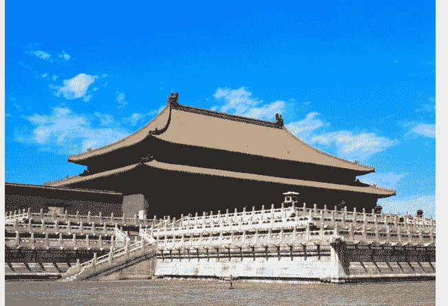

中式宫廷建筑

## Introduction to Software Architecture

### 房屋设计的例子1

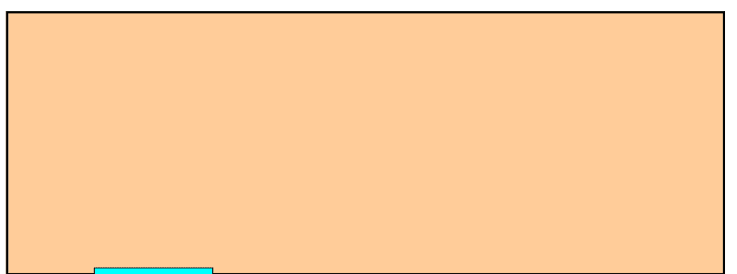

门

一个只有一个房间的房子-建造成本低，但是居住不方便

## Introduction to Software Architecture

### 房屋设计的例子2

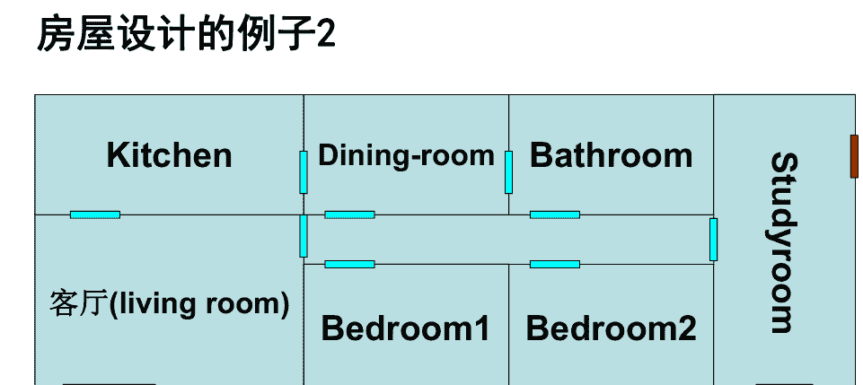

一个有许多房间的房子-建造成本高，但是是方便居住

## Introduction to Software Architecture

- 问题：假如你要用Java语言开发一个程序，怎样进行软件设计？
- 你可能的回答：
- a) 不用设计，直接写代码呗
- b) 将程序设计成一个单独的类
- c) 将程序设计成若干个类

## Introduction to Software Architecture

### 二手车拍卖系统程序设计的例子

### JPANEL

#### CarAuctionGUI

- getSelectedCar(): String //get user input
- getBitPrice(): String //get user input bit price
- extractCarList(): String[] //display car list
- setUpCarList(JComboBox cmbCarList,String[] carList) //add car list onto cmbCarList
- constructCarFileUrl(String carChosen): URL //produce an UML based on car name
- updateCarDescription(JEditorPane editorPane, URL url) //update car description
- showBitPrice(JTextArea bitShownText, String price ) display bit price
- produceCarImageIcon(String carChosen): ImageIcon //produce image icon for car
- updateCarPicture(JLabel imgLabel,ImageIcon imgIcon) //update car picture
- createImageIcon(String path): ImageIcon

### 二手车拍卖系统的类图设计-单独一个类的情况

CarAuctionGUI
getSelectedCar(): String
getBitPrice(): String
getCarList(): String[]
setUpComboBox(String[] carList): void

Controller
-objCarGUI:CarAuctionGUI
-cm: CarModel
-civ: CarGUIView
-cb: CarBitView
-carPrice: String
-private String[] carList
actionPerformed(ActionEvent e): void

<<interface>>
Observable
+register(Observer obs): void
+notifyObservers(): void

CarModel
-String[] carNameList;
-String bitPrice;
+setCarList(String[] cars): void
+getCarList(): String[]
+setSelectedCar(String sCar): void
+getSelectedCar(): String
+setBitPrice(String bPrice): void
+getBitPrice(): String
+setCarFileURL(): void
+getCarFileURL(): URL
+setupImageIcon(): void
+getImageIcon(): ImageIcon
+register(Observer obs): void
+notifyObservers(): void

<<interface>>
Observer
update(Observable subject): void

CarGUIInfoView
-model: CarModel
-imagePane: JScrollPane
+update(): void

CarBitInfoView
-model: CarModel
-bitText: JTextArea
+update(): void

应用MVC模式的二手车拍卖系统的类图设计

## Introduction to Software Architecture

### MVC pattern demo-Car auction

Bit price for each car will be shown here


#### Honda Civic

Made in 2006, used by the New York State government Mileage: 40,000 miles. 5-speed manual (25 city/36 highway) transmission? 140-hp, 1.8-Liter,

二手车拍卖系统用户图形界面

### Question: which design is better?

## Introduction to Software Architecture

- 软件设计要考虑很多因素：
  - 模块化(modularization)
  - 可扩展性 (extensibility)
  - 性能 (performance)
  - 安全 (security)
- 软件设计要借鉴成功经验
  - 软件设计模式 (software design patterns)
  - 软件体系结构 (software architecture)

## Introduction to Software Architecture

学习本课程的目的

- 1. To use software design patterns in your own design of classes
  – To be a successful software developer or software architect
- 2. To use software architecture in your own design of programs or a software systems
  – To be a successful software architect or software developer

## Introduction to Software Architecture

### Question: What is a design pattern?

### Definition of a pattern （软件设计模式的定义）:

> “A pattern addresses a recurring design problem that arises in specific design situations and presents a solution to it”.

> “一个模式处理一个特定设计情况下反复提出的设计问题，并且为其提供一个解决方案”

(Buschmann, et. al. 1996)

## Introduction to Software Architecture

### Why use software patterns （为什么使用设计模式）？

- > 学习专家经验. **Design Patterns** capture expertise and make it accessible to non-experts in a standard form.
- > 为了交流. **Design Patterns** facilitate communication among developers by providing a common language.
- > 为了重复利用成功的设计. **Design Patterns** make it easier to reuse successful designs and avoid alternatives that diminish reusability.
- > 提供设计修改. **Design Patterns** facilitate design modifications.


## Introduction to Software Architecture

### Definition of Software Architecture

- **Definition（软件体系结构的定义）**：
  The software architecture of a program or computing system is the structure or structures of the system, which comprise
  - software components,
  - the externally visible properties of those components, and
  - the relationships among them. [Bass 98]

## Introduction to Software Architecture

软件体系结构 的例子1

Repository services

Data-integration services

tool layer

Vertical tools

plug & use a new tool

Open Tool slots

Horizontal tools

Process-management services

User interface services

File edit debug

Message services

### Architecture of an Integrated Software Development Environment

## Introduction to Software Architecture

软件体系结构的例子2

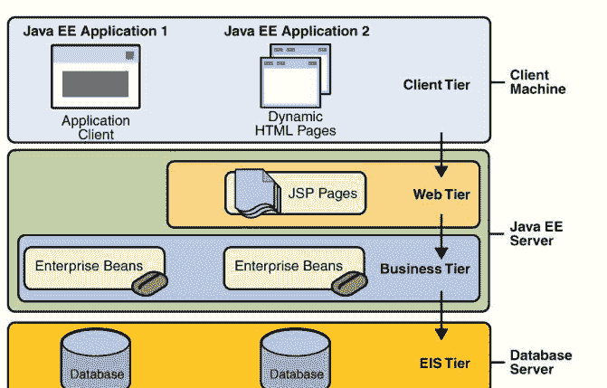

### Java EE Architecture

## Introduction to Software Architecture

### 为什么软件体系结构对于大型、复杂的系统是重要的？

Three reasons why SA is important to large, complex, software-intensive systems.

- 1. SA是交流工具。It is a vehicle for communication among stakeholders.

2. 最早的设计决策的代表。 It is the representation of the earliest design decisions. It shows the tradeoffs (折衷,权衡)

  - between performance and security,
  - between maintainability and reliability, and
  - between the cost of the current development effort and the cost of future developments in the architecture.

3.It is a reusable, transferable abstraction of a system. (一个系统的可重复利用的,可转移的抽象)

It

  - can be applied to other systems exhibiting similar requirements and
  - can promote large-scale reuse and software product lines.

## Introduction to Software Architecture

What to cover in this course?

- Design patterns: 14 hours
  - 10 design patterns will be taught
- Software architecture: 14 hours
  - 9 software architectures will be taught

## Introduction to Software Architecture

- **Pre-courses:** Software engineering, C++ or Java. In this class, we use language Java
- **Reference Textbooks:**
  - 《软件设计模式与体系结构》，孙玉山，高等教育出版社，2013年5月出版；
  - Partha Kuchana, “Software architecture design patterns in Java”, CRC Press LLC, 2004;
  - Mary Shaw and David Garlan, “Software Architecture: Perspectives on an Emerging Discipline”。

## Introduction to Software Architecture

### 其它参考书与材料（Reference books）

- [1] Gamma, Helm, Johnson and Vlissides, “Design Patterns: Elements of Reusable Software”, 1995
- [2] James W. Cooper, “The design patterns, Java Companion”, 1998
- [3] Analysis Patterns: Reusable Object Models, Martin Fowler, Addison-Wesley, 1997
- [4] Java 与模式, 阎宏, 电子工业出版社, 2005, 4
- [5] Paul Clements, “Software product lines: practices and patterns”.

## Introduction to Software Architecture

### 作业与项目

Homework and projects: 40%;

- Homework: 2 homework:
  - 10 points per each （代码编写、回答问题）
- Project: 1 project
  - 20 points （代码编写、回答问题）

### 期末考试

Final test (open-book): 60%;

## Software Architecture

## 软件体系结构

## Lecture 1. Main Program and Subroutine and Object Oriented Systems

Professor:

Yushan (Michael) Sun

Fall 2016

### Content of This Lecture

- 1. Evolution of Program Design
- 2. Call and return Architecture
- 3. Main program and subroutine
- 4. Object-oriented Design
- 5. Case studies
  a) Case 1
  b) Case 2

### Evolution of Program Design

### 1. Evolution of Program Design

| Year period |  | Examples |
|---|---|---|
| 1950s-1960s | “simple” program models | COBOL (1959), Algol (1958), Basic(1964) |
| 1970s -1980s | structured programming Structured design (Top-Down Design) | Pascal(1968), C(1972), Fortran(1957 first published), Perl |
|  | First object-oriented languages (esp C++) OO Design | Ada, SmallTalk C++(1983), |
| 1990's- | traditional languages “converted” to OOP Design for Reuse | Java(1995 ), Visual Basic, Delphi (Object Pascal), Perl 5, (e.g. BioPerl) |


### 1. Evolution of Program Design

#### Language history

- In 1949, the language **Short Code** appeared
  - need to change program statements into 0's and 1's by hand.
- In 1957, **FORTRAN** was designed at IBM for scientific computing.
  - IF, DO, and GOTO statements,
  - good at handling numbers,
  - bad at handling input and output
- **Business programming language** COBOL
- In 1959, **COBOL**, for business use.
  - data types: numbers and strings of text.
  - In COBOL, a program is built in 4 or 5 major sections
  - Still in use in banking/financial systems
- In 1958, LISP, for Artificial Intelligence research.
  - only data type: list,
  - denoted by a sequence of items enclosed by parentheses ('a', 'c', 'd')
  - recursive calling of functions

Prolog is another language for AI.

- In 1958, ALGOL, for scientific use.
  - recursive (递归) calling of functions,
  - the root of the tree that has led to Pascal, C, C++, and Java.
- 1968, Pascal, for teaching.
  - combined many of the best features of the languages in use at the time, COBOL, FORTRAN, and ALGOL.
  - Programmers liked this language
  - Pascal also improved the "pointer" data type.
- 1972, C was developed at Bell Labs in New Jersey.
  - All of the features of Pascal, including the new ones such as the CASE statement
  - uses pointers extensively
  - fast and powerful at the expense of being hard to read.

#### Dennis Ritchie

1941-2011  
Father of Unix and C

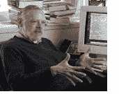

Ritchie got a Ph.D. (in physics, mathematics) from Harvard University

#### Brief history of C and Unix (developed by AT&T Bell Labs)

- C was developed by Dennis Ritchie between 1969 and 1973
- Unix operating system was developed in 1969 by Ken Thompson, Dennis Ritchie, etc., 6 people
- The Unix operating system, first developed in assembly language (汇编语言), had been almost entirely recoded in C in 1973

#### Ken Thompson, Dennis Ritchie


- **They received awards together:**
  - In **1983**, the **Turing Award** for the UNIX operating system;
  - In **1990**, the IEEE Richard W. Hamming Medal;
  - In **1997**, Fellows of the Computer History Museum;
  - In **1999**, the **National Medal of Technology of 1998** from President Clinton

#### Brief History of Microsoft

- Microsoft was founded by Bill Gates and Paul Allen on April 4, 1975
  - 第一桶金: to develop and sell BASIC interpreters for Altair 8800

#### 1969年发射的Apollo 11号控制系统

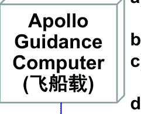

- a) Use real-time operating system, for astronauts to control the Apollo 11
- b) Memory: 64Kbyte; CPU: 0.043MHz
- c) The AGC program Luminary was coded in MAC language (MIT Algebraic Compiler)
- d) Program translated into ➔ assembler language program (punch cards) ➔ input into AGC

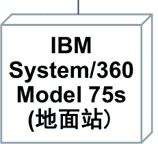

- a) IBM said the 6MB program it developed to monitor the spacecraft's environmental and astronauts' biomedical data was the most complex software ever written
- b) The reentry guidance program for Apollo was written in FORTRAN and required 4,000 punched cards

32 years old

- **In 1983, C++ was released.**
  - to organize the raw power of C using OOP, but maintain the speed of C and be able to run on many different types of computers.
  - most often used in simulations, such as games.
  - provides an elegant way to track and manipulate hundreds of objects

- In 1995, Java
- Netscape licensed Java for use in their internet browser, Navigator.
- So, Java became the language of the future and several companies announced applications which would be written in Java.

20 years old.


### 1. Evolution of Program Design

- All the program code are written in a single Continuous main program.
- Program written in unstructured language usually contains a series of statements.
- One line contains one statement, with a number label to denote the line number to allow the program execution can jump (use GOTO) from a line to another line
- Unstructured Languages: early BASIC, COBOL

### 1. Evolution of Program Design

The following is a piece of simple COBOL code, to show the features of unstructured programming

```
000100 IDENTIFICATION DIVISION.
000200 PROGRAM-ID. HAPPYNEWYEAR.
000300
100000 PROCEDURE DIVISION.
100100
100200 MAIN-LOGIC SECTION.
100300 BEGIN.
100400     DISPLAY " " LINE 1 POSITION 1 ERASE EOS.
100500     DISPLAY "Happy New Year!" LINE 15 POSITION 10
100600     STOP RUN.
100700 MAIN-LOGIC-EXIT.
100800 EXIT.
```

### 1. Evolution of Program Design

- Unstructured programming introduces: iteration, branch and GOTO
- Unstructured programming model does not have the procedure concept, but the primitive subroutines are allowed
- Here, the subroutine possibly has several entrance points and the exit points.
- The program control may go into or exit from this subroutine directly in any point
- This is not allowed in structured programming.

### 1. Evolution of Program Design

#### 非结构化编程的样式

```
000100 statement 1
000200 statement 2
100200 statement 3, GO TO 100500
100300 statement 4
100500 statement 523, call Subroutine 1
100600
100700 statement 800
100800
100000 PROCEDURE DIVISION.
100100 Subroutine 1 {...}
Subroutine 2 {...}
Subroutine 3 {...}
Subroutine 4 {...}
Subroutine 5 {...}
```

程序执行顺序：按照顺序执行程序序，遇go to x语句，跳转到x行

可以在一个语句中 调用某个子程序

子程序甚至没有参数传递，可能有几个入口和出口。仅仅是为了反复调用一段程序提供方便。

### 1. Evolution of Program Design

- **Disadvantages of Unstructured programming:**
  a) It is difficult to follow program logic.
  b) It is hard to incorporate other code;
  c) It is not easy to modify code (都是goto惹的祸)
  d) It is difficult to test particular portions of the code

### 1. Evolution of Program Design

- **Structured programming** is a programming paradigm aimed on improving the clarity, quality, and development time of a computer program by making extensive use of
  - 子程序： **subroutines**,
  - 块状结构： **block structures** and
  - 循环结构： for and **while loops**.
- 结构化编程抛弃了GOTO语句。
- **Language that support structured programming:** started from ALGOL68, C

### 1. Evolution of Program Design

- **结构化程序定理：** 只要一种编程语言可以依三个方式组合其子程序及调整控制流程，则每个可计算函数都可以用此种编程语言来表示（实现任何算法）。三个调整控制流程的方式为：
  ◆ **序列结构：** 按照顺序执行一个子程序，然后再执行另一个子程序
  ◆ **选择结构：** 根据布尔表达式的值，执行两个子程序中的一个子程序（if, else if, else）；
  ◆ **迭代结构(for, while)：** 执行子程序，直到一个布尔表达式为true

### 1. Evolution of Program Design

序列结构

选择结构

循环结构

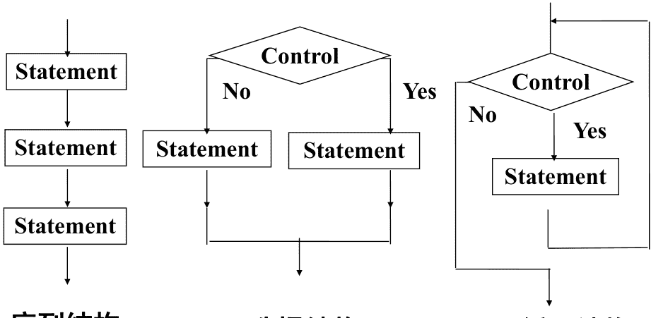

### 1. Evolution of Program Design

- 该定理强调使用子程序、块状结构和for和while循环；而不是使用简单测试后再使用跳跃语句，例如goto语句；
- 该定理保证了只要一种编程语言支持序列结构、选择结构、循环结构(而不必使用goto语句语句)，则可以实现任何可计算函数；
- 该定理是结构化编程的理论基础。

### Call and Return Architecture

### 2. Call and Return Architecture

- **Call and return architecture** has been of a great influence for the past 30 years
- The **Main Program and Subroutine architecture** and **OO System** in this lecture are sub types of the call and return architecture

### 2. Call and Return Architecture

- A system designed in call and return architecture uses divide and conquer strategy.
- Its main idea is to divide the whole system into some smaller blocks to reduce the complexity and enhance the modifiability
- The execution order of the Call and return system is usually controlled by a single thread

### Main Program and Subroutine

是一种Call and return 架构
代表结构化编程

### 2. Main Program and Subroutine

#### Main Program/Subroutine Pattern

The program is composed of a main program and some subroutines

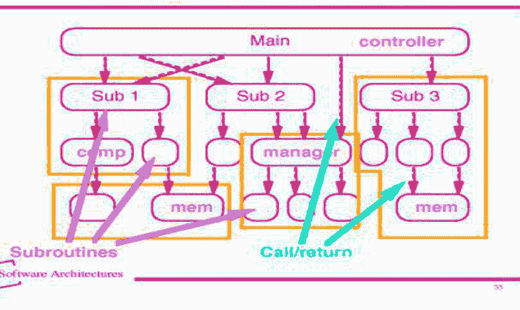


### 2. Main Program and Subroutine

**Architecture**: the system is composed of a main program and some hierarchically organized subroutines
- Main program call higher level subroutines
- Higher level subroutines call lower level subroutines
- The correctness of a subroutine often depends on the subroutine it calls

【注】A **subroutine** or **subprogram** (also called **procedure**, **method**, **function**, or **routine**) is a portion of code within a larger program, which performs a specific task and is relatively independent of the remaining code.

#### Structured design uses

- **Top-down functional design :**
- The system is designed from a functional viewpoint, starting with a high-level view and progressively refining this into a more detailed design.

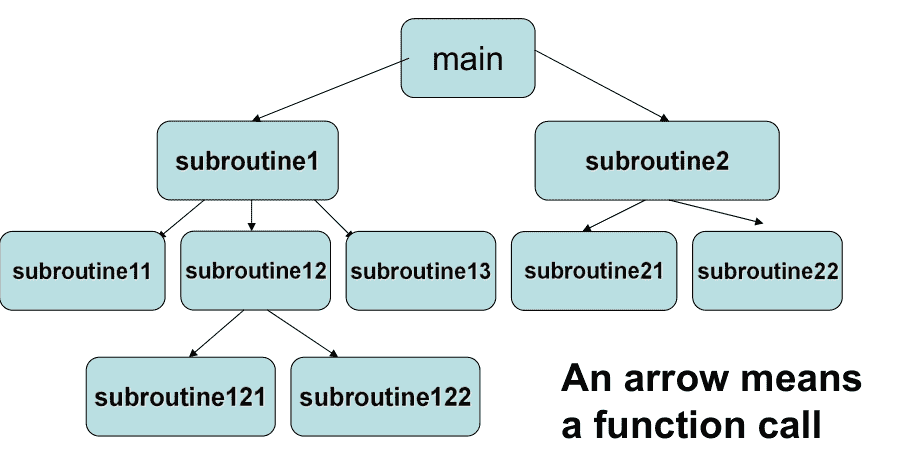

An arrow means a function call

The system’s functionalities are achieved by many subroutines, with higher level subroutines calling lower level subroutines and so on

#### Steps in structured design:

- **STEP 1: Draw Data Flow Diagram**: Represent the problem as the flow of data through a system.
- **STEP 2: Draw Structure Chart**: Represent the program as a hierarchy of functional components. This is derived from the data flow diagram.
- **STEP 3: Evaluate the Design**
- **STEP 4: Prepare the Design for Implementation**
  Divide logical design into physical implementation units.

#### Example: a medicine cost computation problem

- **Requirement specifications**:
- Medicine Cost Computation program inputs medicine name, and the program will return the cost per unit amount of the given medicine
- The medicine cost include two part
  - Research cost, and
  - Production cost

#### Medicine cost computation DFD: layer 1

Medicine name

Medicine Cost Computation

Medicine cost

#### Medicine cost computation DFD: layer 2

Medicine name

Enter medicine name

Calculate medicine cost

Output cost

Medicine cost

#### Medicine cost computation DFD: layer 3

Medicine name

Enter medicine name

Get research Cost per unit

Get production Cost per unit

Output cost

Medicine cost

Layer 3 DFD diagram can be translated into the program structure chart below

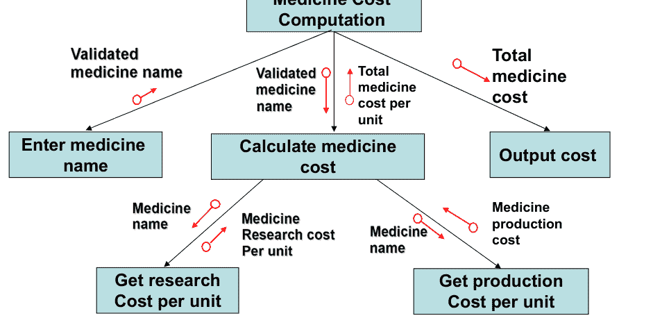

structure chart of the medicine cost program

#### Advantage:

- This has proved to be a highly successful design methodology.
- It has allowed the development of large programs (100,000 lines or more of source code).

#### Disadvantage:

- However, as program size increases beyond this point (100,000 lines), the approach performs poorly.
  - Reason:
    - Code development becomes too slow and
    - It becomes increasingly difficult to test the software and guarantee its reliability.

#### Problems with top-down functional design

1. The functional viewpoint is difficult to evolve
2. Real systems are hard to characterize functionally
3. The functional focus loses sight of the data
4. Functional orientation produces less reusable code

#### 1) The functional viewpoint is difficult to evolve

- The top-down approach creates a good software model for the initial requirements of a system.
- But as that system changes and new requirements are added, the functional architecture becomes more and more unwieldy
  - Because the software is designed as tree structure, changes usually require extensive pruning and grafting
  - Maintenance becomes more and more difficult

Need to add
function here

A program is composed of 58 functions


Pruning/
grafting

### 2. Main Program and Subroutine

#### 2) Real systems are hard to characterize functionally
- Most large systems do not have a top, e.g., a database system involving tools for querying data, changing data, and keeping data consistent.
- If there is no one function central to these diverse concerns, then define these systems based on a single top-level function is artificial and yields overly complex and non-adaptive architectures.

### 2. Main Program and Subroutine

#### 3) The functional focus loses sight of the data
- The top-down design does not capture anything about the data involved in the program.
- Usually, the same data is shared among a number of functions (for example, updating, deleting, inserting, and querying a database table).
- Since the decomposition only highlights the functional aspects of the problem, the influence of the data structures on the problem is lost

### 2. Main Program and Subroutine

#### 4) Functional orientation produces less reusable code
- Top-down design works by continually refining a problem into simpler and simpler chunks.
- Each chunk is analyzed and specified by itself, without much regard for the rest of the system
- However, each program element is designed with only a limited set of requirements in mind.
- Since it is unlikely that this exact set of requirements will appear in the next problem, the program's design and code is not general and reusable.

### Object-oriented Design

是一种Call and return 架构

### 3. Object-oriented Design

#### System design:
- The system is viewed as a collection of objects rather than as functions with messages passed from object to object.
- Each object has its own set of associated operations.

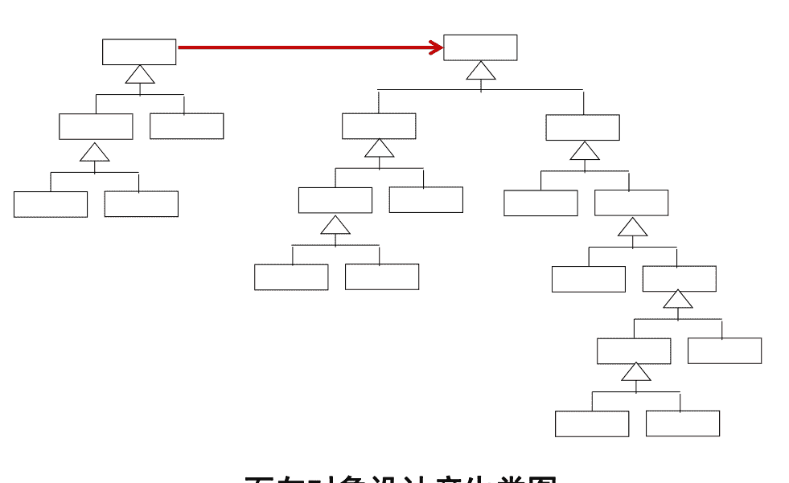

面向对象设计产生类图

### 3. Object-oriented Design

#### Principle of Object-oriented design:
OO design is based on the idea of information hiding, which was first put forward by Parnas (1972) and is very popular now.

### 3. Object-oriented Design

#### What is an Object?
- floats, ints, chars: primitive “objects” in C++ (and in C).
- OOD/OOP extends this idea to “higher-level” objects.
- Definition: An Object is something with a
  - State (i.e., it holds *Data*), and
  - Semantics (i.e., rules for changing its state).
- The basic concept here is that objects serve to unify the ideas of
  - algorithmic abstraction, and
  - data abstraction


| Tiger |
|---|
| -sex: String |
| -age: int |
| -species: String |
| +eat(): void |
| +hunt(): void |
| +run(): void |
| +sleep(): void |

Data Abstraction

Algorithm Abstraction

### 3. Object-oriented Design

#### Characteristics of Object oriented design
- 1) Encapsulation
  - Restrict access to certain information
    - private variables; code inside a method
- 2) Inheritance
  - Share one definition of shared functionality
    - Java class inheritance
- 3) Dynamic binding
  - Determine actual operation to call at runtime
  - Don’t know which object to invoke before the program runs, in the run-time, will dynamically decide which object to use.
- 4) Reuse and maintenance
  - Exploit capsulation and locality

### 3. Object-oriented Design

#### Other Characteristics of OOD
- a) Objects are abstractions of real-world or system entities and manage themselves
- b) Objects are independent (from encapsulation point of view)
- c) System functionality is expressed in terms of object services (functions)
- d) Shared data areas are eliminated
- e) Objects may be distributed
- f) Objects may execute sequentially or in parallel

### 3. Object-oriented Design

#### Advantages of OOD
a) Easier maintenance
Because an object hides its representation from its clients, it is possible to change the implementation without affecting those clients Objects may be understood as stand-alone entities

b) Reusable
Objects are appropriate reusable components


### 3. Object-oriented Design

#### Advantages of OOD

- c) **Real world mapping**: For some systems, there may be an obvious mapping from real world entities to system objects.
- d) **Easy decomposition of a system**: The bundling of a set of accessing routines with the data they manipulate allows designers to decompose problems into collections of interacting agents.

- **警告：Use inheritance properly**
  - Inheritance introduces complexity, and this is undesirable, especially in critical systems.
- **例如：Control system in Boeing 747:**
  - 5 years,
  - $5 billion,
  - 500 software developers


#### Difference Between Structured Design and OO Design

- **Structured design** focuses on the decomposition of software into various *functional components*, i.e., **program is organized into a collection of functions**, which will be executed in a defined order to produce the desired result.
- **OO design** focuses on the organization of software into a **collection of components**, called *objects*, that group together:
  - Related items of data (*properties*)
  - Operations that are to be performed on the data (*methods*)

### 4. Case Study

#### Project Name: Key Words in Context

In 1974, Parnas proposed the following problem: Key Words in Context (KWIC) index system.

#### Requirement Specification:

- a) Accepts an ordered set of lines;
- b) Each line is an ordered set of words;
- c) Each word is an ordered set of characters;
- d) Any line is circularly shifted by repeatedly removing the first word and appending it at the end of the line;
- e) The KWIC index system outputs a listing of all circular shifts of all lines in alphabetical order.

- **Input**
  - The sun is rising in the east
  - Flowers are blooming

#### After Circular Shift

```
The sun is rising in the east
sun is rising in the east the
is rising in the east the sun
rising in the east the sun is
in the east the sun is rising
the east the sun is rising in
east the sun is rising in the

Flowers are blooming
are blooming Flowers
blooming Flowers are
```

#### After Alphabetizer

```
are blooming Flowers
blooming Flowers are
east the sun is rising in the
Flowers are blooming
in the east the sun is rising
is rising in the east the sun
rising in the east the sun is
sun is rising in the east the
the east the sun is rising in
The sun is rising in the east
```


#### Case Study 1: Design of KWIC Problem in Main Program and Subroutine Architecture

#### KWIC Implemented with Main/Subroutine Architectural Style Architecture

The solution with main/subroutine architectural style with shared data decomposes the system according to the four basic functions performed:

- input,
- circular shift,
- sort and
- output.

These functions are coordinated as subroutines by a main program that sequences through them.

#### Main Program and Subroutine Design of the KWIC Program

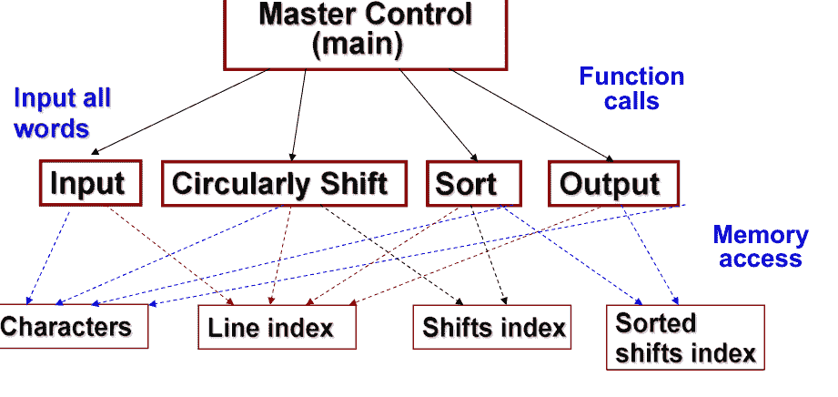

#### Data Representation

- The current KWIC system represents its data in the following format:
- Characters from the input file are stored in a character array named `chars_`. Words are delimited by a single space character.

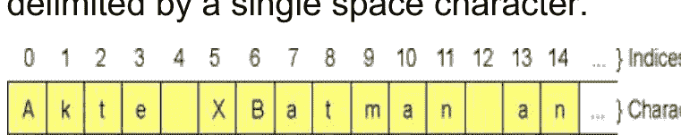

- `line_index_` is an integer array, which keeps indices of characters from the character array. Each index kept in the line index array is the index of the first character of a particular line.

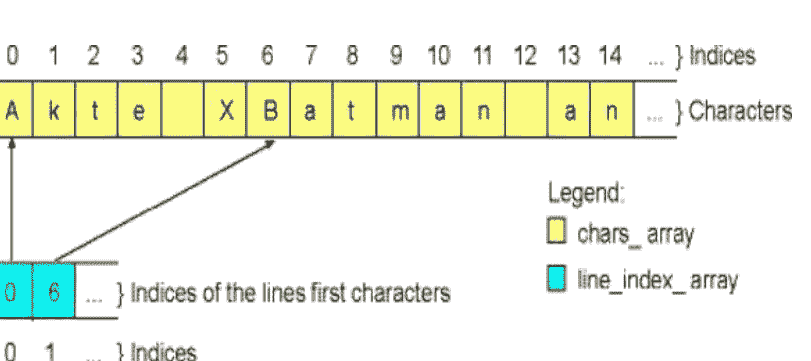

- A two-dimensional integer array (matrix) named `circular_shifts_` represents the set of all circular shifts of all original lines.
- A particular circular shift is represented as a pair of indices:
  - **The first value** in such a pair is an index of the original line from the line index array.
  - **The second value** in the pair is an index of a character from the character array.
- The character pointed by this index is the first character of a particular circular shift.


### 4. Case Study

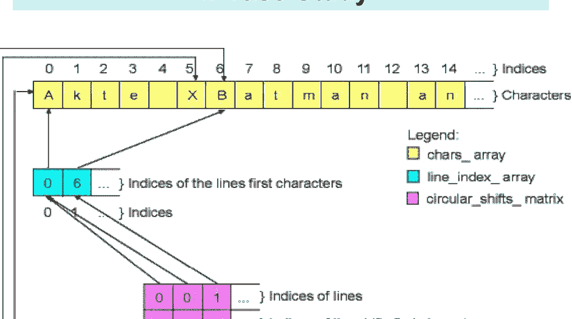

Two dimensional integer array (matrix) named alphabetized_ represents the sorted lines. This array has the same format as the circular shifts array. The difference is that in the alphabetized array lines come in a different order, i.e., they are sorted alphabetically.

Indices

Characters

Indices of the lines first characters

Indices

Legend:

chars__array

line_index__array

alphabetized__matrix

Indices of lines

Indices of the shifts first characters

#### Processing Algorithm
- The main function controls the execution of the KWIC program:
- The input function is called to read and parse the lines from an input file. This function reads and processes all lines at once and represents it by means of the character (chars_) and line index (line_index_) array, as described before.
- The main function calls the circularShift function, which produces circular shifts of each particular line and stores it in the circular shifts array (circular_shifts_), as discussed before.
- After the circular shifts have been produced, the main function calls the sort function, which sorts circular shifts alphabetically. The result is stored in the alphabetized array (alphabetized_), as described before.
- Finally, the main function calls the output function, prints the sorted lines.

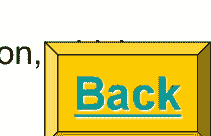

#### Case Study 2
Design of KWIC Problem
in Object Oriented Architecture

#### KWIC Implemented with OO Architectural Style

Architecture: The solution with OO architectural style decomposes the system into six modules:

- **LineStorage** module, responsible for holding all characters from all words and lines.
- **Input** module, responsible for reading the data from a file and storing it in LineStorage module.
- **CircularShifter** module, responsible for producing circular shifts of lines stored in LineStorage module.
- Alphabetizer module, responsible for sorting circular shifts alphabetically.
- Output module, responsible for printing the sorted shifts.
- Master control module, responsible for controlling the sequence of method invocations in other modules.

- Contrary to the main/subroutine solution, in the object-oriented solution the data is **not shared** between the computational components.
- Instead, each module provides an **interface** that permits other components to access data only by invoking methods in that interface.

Master control

Input

Output

LineStorage

Circular Shifter

Alphabetizer

Input Medium

Output Medium

Main program
Java class

Two Java classes
for input & output

Three Java classes.
represent data
structures & actions

Legend:

Modules (Objects)

Public Interface

I/O Medium

Method Invocation

System I/O

# KWIC program in Object oriented architecture

# MasterControl

# Input
+parse()

# Output
+print()

# LineStorage
+addLine()
+addWord()
+getLine()
+getWord()

# CircularShifter
+setLine()
+getLine()

# Alphabetizer
+alpha()
+getLine()

Three Java classes.
represent data structures & actions

KWIC program in Object oriented architecture

#### How this OO design works?

Each module from the architectural design maps exactly onto one class:

- KWIC class (Master Control module),
- Input class,
- Output class,
- LineStorage class,
- CircularShifter class and
- Alphabetizer class.

How this OO design works?

- KWIC has a main method.
- KWIC class controls the execution of the program.

# The method in the KWIC class

```
execute(String file) {
    LineStorage lines = new LineStorage();
    CircularShifter shifter = new CircularShifter();
    Alphabetizer alphabetizer = new Alphabetizer();
    Input input = new Input();
    Output output = new Output();

    input.parse(file, lines);
    shifter.setup(lines);
    alphabetizer.alpha(shifter);
    output.print(alphabetizer);
}
```

### 4. Case Study

lines

```
LineStorage lines = new LineStorage();
```

| | | | | | | |
| | | | | | | |
| | | | | | | |

shifter

```
CircularShifter shifter = new CircularShifter();
```

| | | | | | | |
| | | | | | | |
| | | | | | | |

alphabetizer

```
Alphabetizer alphabetizer = new Alphabetizer();
```

| | | | | | | |
| | | | | | | |
| | | | | | | |

lines

```
input.parse(file, lines);
```

| flowers | are | red |  |  |  |  |
|---|---|---|---|---|---|---|
|  |  |  |  |  |  |  |
|  |  |  |  |  |  |  |

shifter

```
shifter.setup(lines);
```

| flowers | are | red |  |  |  |  |
| are | red | flowers |  |  |  |  |
| red | flowers | are |  |  |  |  |

file

```
alphabetizer.alpha(shifter);
```

alphabetizer

| are | red | flowers |  |  |  |  |
| flowers | are | red |  |  |  |  |
| red | flowers | are |  |  |  |  |

```
output.print(alphabetizer);
```

Screen

Are red flowers
Flowers are red
Red flowers are

- Firstly, parse method of an instance of the Input class is invoked:
  - void parse(String file, LineStorage line_storage)

The parse method reads the data from the file. For each line in that file, it creates a new line in the LineStorage by invoking its addEmptyLine method. To add words to the new line Input object invokes addWord method on LineStorage. The iterative nature of this process is symbolized in the diagram with * sign in the front of the addWord method name.

- Then call setup method in class CircularShifter setup(LineStorage lines)
  - this method shifts the lines in “lines”, then write them into shifts_
- Next, the KWIC object invokes the setup method of the CircularShifter instance.
- The single argument for this method is LineStorage holding the lines. The CircularShifter object iterates through all lines in the LineStorage and produces circular shifts of these lines and write them into shifts_:
  
  shifts_ = new LineStorage();

- Finally, the KWIC object invokes the print method on Output instance. This method takes as an argument the Alphabetizer object from the previous step.
- It iterates then through all lines from the Alphabetizer object by invoking getLineAsString method.

## Lecture 1. Java Concept that is Related to OO Design

# Professor:

Yushan (Michael) Sun

Fall 2016

### 本次课内容

- 1. Class and Object
- 2. Class Relations
- 3. Java Abstract Class
- 4. Java Interface
- 5. Object Oriented Design principles

### Class and Object

- A Java class is designed
  a) to encapsulate (封装) data structure
  b) to provide some functions

Relationship between class and objects:

- Class provide definition (定义)
- Object is instanciation (实例化) of class

### Class and Object

```
public Class Person {
    private String name;
    private String sex;
    private int age;
    private String race;
    public Person( String sex, int age, String race ) {
        this.sex = sex;
        this.age = age;
        this.race = race;
    }
    String getName() {
        return name;
    }
    String getSex() {
        return sex;
    }
    String getAge() {
        return age;
    }
    String getRace() {
        return race;
    }
}
```

Data have been encapsulated(封装)

Functions are provided

### Class and Object

```
Person yg = new Person("Lisa", "female", 1, "Asian");
```


A lovely young lady

An instantiation of the Person class

### Class and Object

```
Person mb = new Person("Mike", "male", 50, "Asian");
```

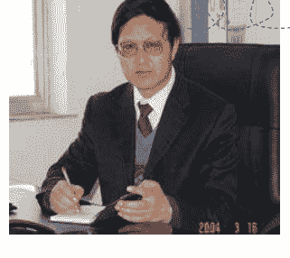


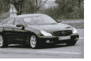

An object of a class maybe very different from another object.

Return

Another instantiation of the Person class


### Class Relations (类间关系)

- **Association relation (关联关系)**
  - An association between two classes represents a collaboration between the classes or their corresponding instances.
  - Association relation includes:
    - **Aggregation relation (聚合关系)**：类B以一个实例化对象的形式作为A的一个属性 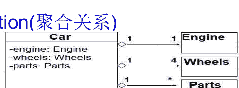
    - **Dependency relation (依赖关系)**：表现为类B作为参数被类A某个方法使用 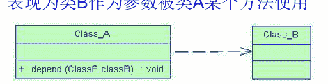
  - In Java language, association relation can be realized by instance variables. 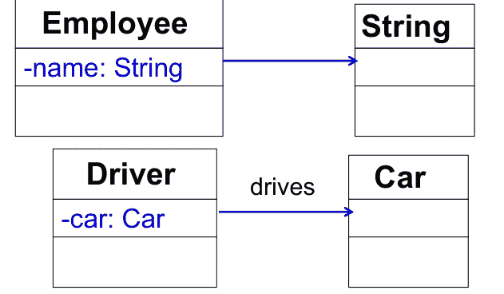

- **Aggregation relation (聚合关系)** is one kind of association relationship. It is a stronger type of association.
  - This relation expresses a relationship of a whole and a part.
  - An aggregation has a hollow diamond end pointing to the part containing the whole. 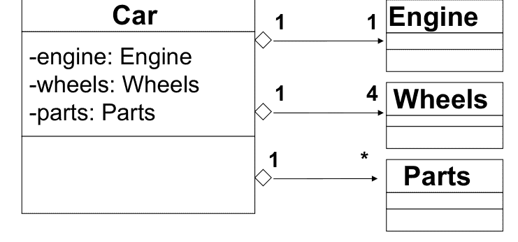

- **关联关系与聚合关系的区别：**
  - Like association, aggregation is realized by instance variables. But the difference is that:
    - **In an association relationship**, the classes being associated are in the same level.
    - **In an aggregation relationship**, the classes being associated are in different levels, one represents the whole and the other represents the part.

- **Dependency relation (依赖关系)**
  - Dependency relation is a relation in which one class is dependent on another class.
  - One person can buy a car and house and so Person class is dependent on Car and House classes.
  - Use dotted lines to represent dependency relation.
  - 通过参数，达到关联 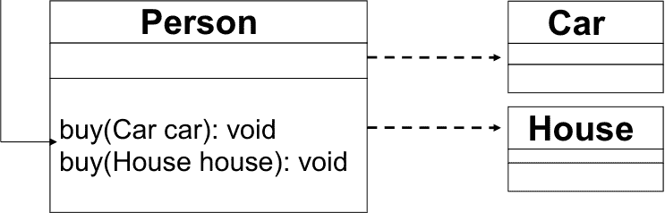
  - Different from association, Person class has no attributes of class Car and House.
  - The object of Car and House is passed into class Person by using parameter in `buy(Car car)` and `buy(House house)`.
  - Example of dependency relation

### Java Abstract Class

#### Characteristics of Abstract Classes

```
SortStrategy
-algorithmName: String
#showInfo(): void
+sort(a: int[]): void;
```

US cars

#### Form of an Abstract Class

```
abstract public class SortStrategy {
    private String algorithmName = "";  //private variable

    public SortStrategy() {
        // code omitted
    }
    protected void showInfo(){
        // concrete function
        System.out.println("sort integers");
    }
    public abstract void sort(int[] a); //abstract function
}
```

#### Characteristics of Abstract Classes

- Abstract class provides only partial implementation of a type. (What this means?)
- Abstract class can have
  - Private variables (私有变量)
  - Constructors (be called by subclasses) (构造函数)
  - abstract methods (be implemented by subclasses) (抽象方法)
  - Concrete methods (be called by subclasses directly) (已实现方法)
- Abstract classes can not be used by clients to create objects
- Thus, if you want to use an abstract class with its subclasses, you need to create an object of one of the subclasses. Then you can use this object to call the methods both in the subclass or the superclass (Question: What kinds of methods can be called?)

#### How to use Abstract classes?

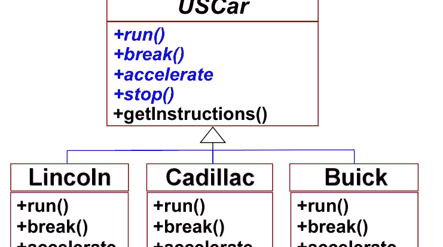

US cars

- 1) Use an abstract class by claiming a variable of the abstract class type and create objects of its subclasses and then call the methods in the subclasses

```
USCar myCar;
//...
if(condition1==true)
    myCar = new Lincoln();
else if(condition2==true)
    myCar = new Buick();

myCar.getInstructions()
```

#### Abstract Class and Inheritance

- 2) use an abstract class by inheriting it
  - a) Use abstract class as super class and the subclasses can use some concrete functionalities of the super class.
  - b) Different subclasses may have different implementations of the abstract methods of the super class


### Difference Between an Abstract Class and a Concrete Class

### Concrete class (实体类)

- Can be used by other classes to create objects
- Can be inherited by its subclasses

### Abstract class (抽象类)

- **Can not** be used by other classes to create objects
- Can be inherited by its subclasses

### Form of a Class Hierarchy

Ideally, a class hierarchy has the following form

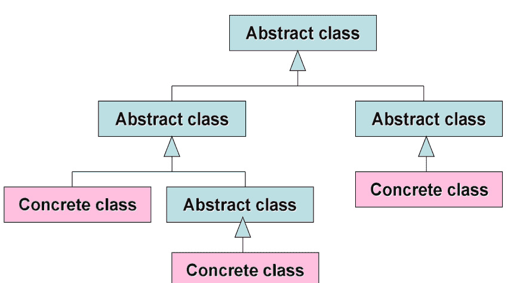

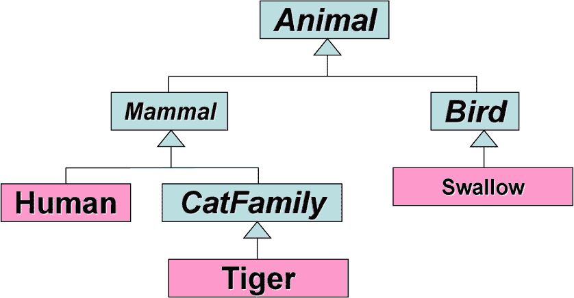

The leaves are concrete classes

### Java Interface

### Java Interface(Java接口)

- 什么叫做Java接口?
- Java interface is a collection of characteristics of methods
  public interface Account {
    public abstract deposit (double amt);
    public abstract withdraw (double amt);
    public abstract transfer(double amt);
  }

### Java Interface(**Java 接口**)

### Properties of Java interface:

- A Java interface
  - Has no constructor (**不允许有构造函数**)
  - One Java interface can have many very different implementations
  - A Java class can **implement** as many Java interfaces as one wants

### Java Interface(Java 接口)

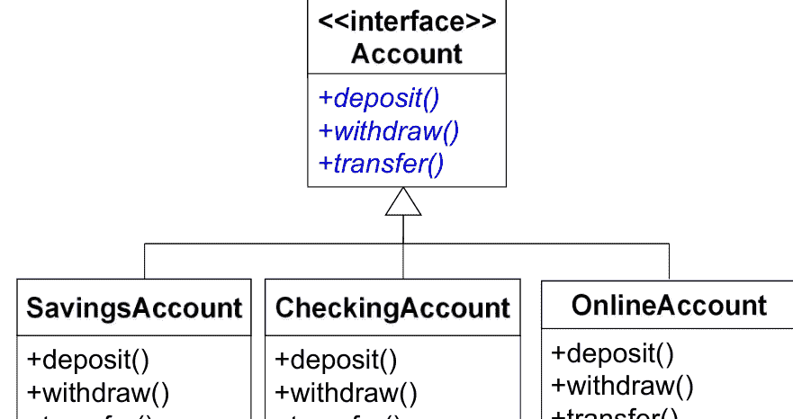

One Java interface can have many very different implementations

### Java Interface(Java接口)

### Why use interface?

- 1) 重复利用 For reuse purpose, an interface can define a set of related functions for some special use
- 2) 声明类型 An interface can be used to claim a type, with its different subclasses to implement its functions. The purpose is to realize dynamic binding
- 3) 代表某个协议 A language environment may need a protocol to do something special and so need an interface, e.g., java interface Runnable must be implemented whenever a programmer wants to write a multithread program

### Java Interface(Java接口)

Code for dynamic binding:

```
Account act
if(usrChoice == 1)
    act = new CheckingAccount ();
else if(usrChoice == 2)
    act = new SavingsAccount ();
else if(usrChoice == 3)
    act = new OnlineAccount ();
act.deposit(500.23)
```

### Java Interface(Java接口)

**Example:** from Java API

```
Public interface Runnable{
    Public abstract void run( )
}
```

public interface Runnable. The Runnable interface should be implemented by any class whose instances are intended to be executed by a thread. This interface is designed to provide a common protocol for objects that wish to execute code while they are active. For example, Runnable is implemented by class Thread.

### Object Oriented Design principles

### Design Principles

- 1) Interface segregation principle
  ➢ To avoid Interface contamination
- 2) Open-closed principle
  ➢ Open for extension
  ➢ Closed for modification
- 3) Dependency inversion Principle
  ➢ In traditional procedural system design, higher level depends on Lower level
  ➢ In OO design,
    • Advanced business logic depends on the interface, Program to an interface, not an implementation ;
    • Abstraction should not depend upon details. Details should depend upon Abstractions

### 1. Interface segregation principle

### Example of interface
contamination

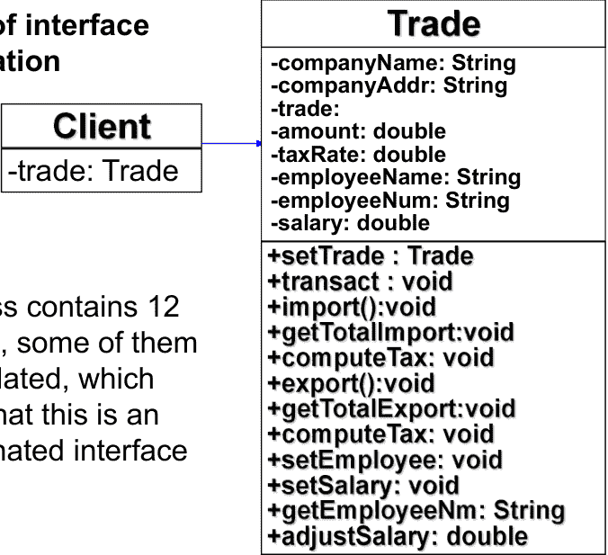

This class contains 12 methods, some of them are unrelated, which means that this is an contaminated interface

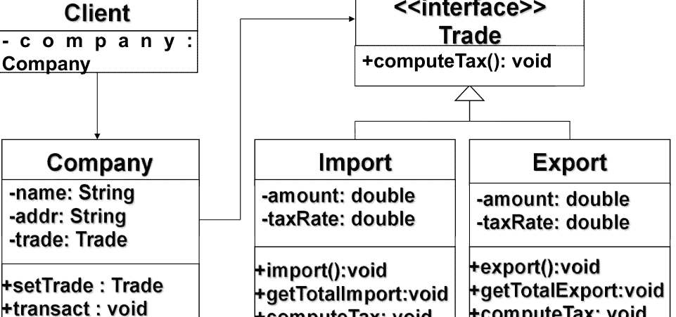

According to functionalities, separate the original interface into several classes, i.e., follows the Interface segregation principle

### 2. Open/closed principle

- **Open/closed principle** (开闭原则)
- Open for extension, and closed for modification
- **在面向对象编程中，开/闭原则声称“软件实体（类）应该对扩展开放，但是对修改关闭”，也就是说这样一个实体可以允许其行为被扩展或修改而不改变它的源代码。**

### 3. Dependency inversion principle

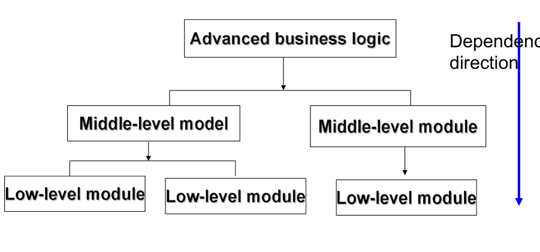

In traditional procedural system design, higher level depends on Lower level


## Software Architecture

## Lecture 2. Dataflow Systems

Professor:
Yushan (Michael) Sun

Fall 2016

## Lecture 2. Dataflow Systems

### Content of the lecture
- 1. Basic characteristics of the dataflow architecture
- 2. Batch sequential architecture
- 3. Pipes-and-filters style architecture
- 4. Process-control Paradigms-a particular kind of dataflow architecture
- 5. Software Paradigm for Process Control

### 1. Basic characteristics of the dataflow architecture

#### Definition of data flow system

**Definition**: A dataflow system is a system in which
- The availability of data controls the computation
- The structure of design is dominated by orderly motion of data from process to process
- The pattern of data is explicit

Note: In a pure dataflow system, there is no other interaction between process

In general, data can flow in arbitrary patterns

When data arrive, the component is activated. It does nothing when there are no data

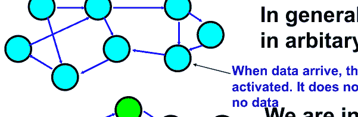

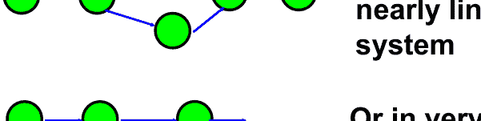

We are interested in nearly linear data flow system


Or in very simple, highly constrained cyclic structures

General architecture of dataflow architecture

#### About Control flow

We pay attention to the locus of control flow that moves through the program
- Data may accompany the control but is not dominant
- The order of execution of the program is concerned

- Main concern is how data moves through a collection of (atomic) computations
  - As data moves, control is activated
  - Reasoning is about
    - data availability,
    - transformation and
    - latency

#### Development Methodology

#### Decompose system into modules
- Abstraction isolates complexity
- Operations performed on data objects

#### Compose modules into a graph
- Connect modules forming directed graph
- Interfaces are negotiated to match data types

#### Run the graph
- Data flows between the modules
- scheduler automates parallelism
- memory manager optimizes memory usage

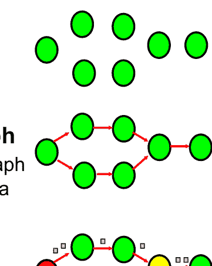

### Batch sequential dataflow system

### 2. Batch sequential dataflow system

#### 1960年代-1970年代数据处理的例子

Card reader

Tape drive

Input tape

System tape

Output tape

Printer

ibm1401型机。数据处理，1959年生产

大型机，IBM 1960制造，28MB磁盘用于航天领域；1962生产

1401

(a)

(b)

(c)

(d)

(e)

(f)

Read data card and produce data tape

Process the tape to get interested data

Print report

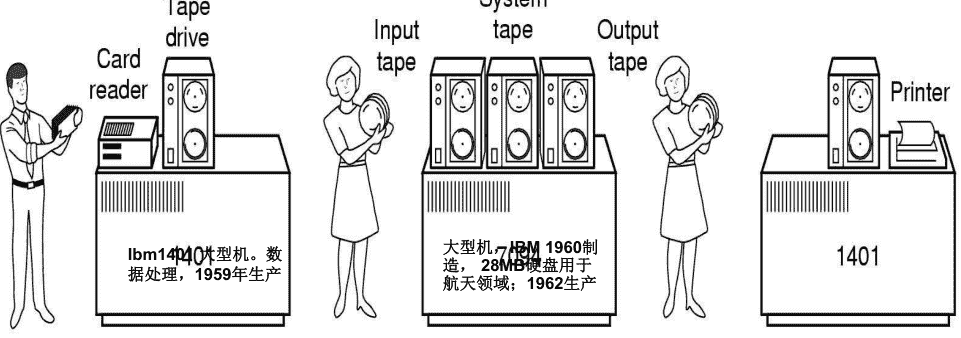

### Definition of Batch sequential system:
- a) Batch sequential process is formed by a sequence of processing steps, intermediating by some kind of storage, such as megatapes, hard disk, etc.
- b) Each step will do some operation on the input storage to get some useful information or modify the contents of the source storage and then save the resultant data to its sink storage.

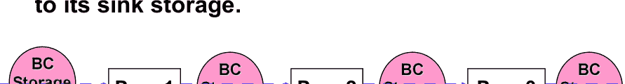

Batch sequential pattern

#### 批处理系统的性质

#### Properties of a Batch sequential system:
- a) Processing steps are independent programs (no interaction between any two processing steps)


Proc1，Proc2和Proc3互不调用

b) Each step run to completion before the next step starts
- Proc1完整地处理完D1中的数据→将数据存入D2
- Proc2完整地处理完D2中的数据→将数据存入D3
- Proc3完整地处理完D3中的数据→将数据存入D4

c) Data is transmitted as a whole between steps


### 2. Batch sequential dataflow system

- **Typical applications:**
  - classical data processing
- **Business database processing** historically is dominated by database updates:
  - Discrete transaction of predetermined type;
  - periodic reports;
  - special handling of bad requests.

### 2. Batch sequential dataflow system

- **Historical database: batch sequential.**

#### How to work?

- ➢ Mainframes and magnetic tape
- ➢ Manual block scheduling plan for each step

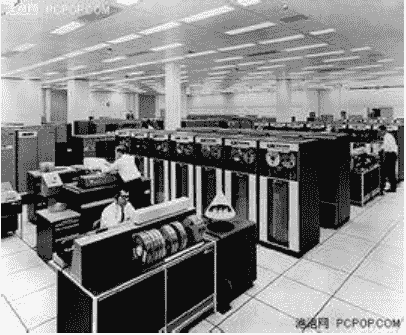

IBM 7094 mainframe

#### Example 1. Batch sequential database

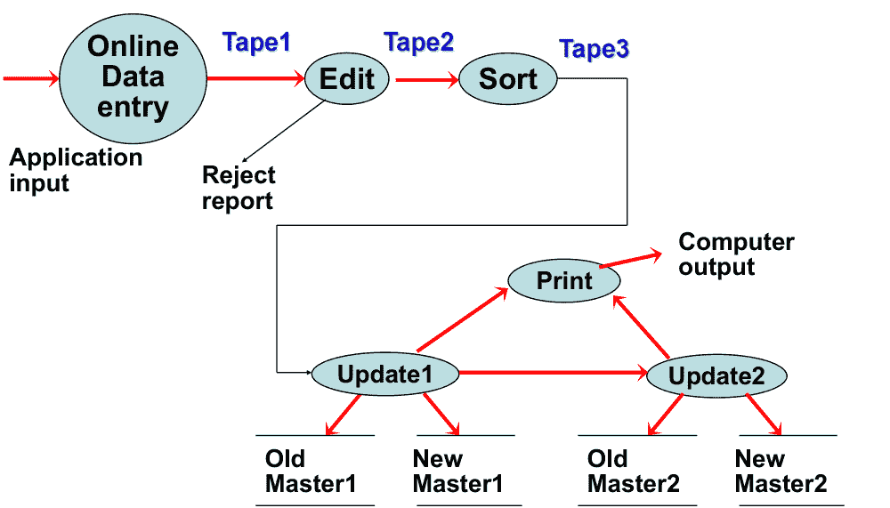

#### Dataflow diagram for Batch Databases

### 2. Batch sequential dataflow system

#### 1. Raw data

| Sun, Mike | 356821 | TV | 888.56 | 324-56-7348 |
| Liu, Elle | 672452 | 356 | 346-12-6788 | camera |
| Lee, Mary | 842674 | radio | 65.44 | 563-27-8977 |
| Juell, Paul | 257215 | Telephone | 97.05 | 678-23-1567 |
| Nygard, Ken | 573245 | Microwave oven | 56.88 | 974-67-8577 |
| Magel, Ken | 834265 | refrigerator | 988 | 874-26-7847 |
| Hunt, Paul | 332184 | Bicycle | 523 | 223-56-6878 |
| Eric, Vosika | 257652 | jewellery | 1005 | 564-31-0976 |

### 2. Batch sequential dataflow system

#### 2. Edit data

| Sun, Mike | 356821 | TV | 888.56 | 324-56-7348 |
| Lee, Mary | 842674 | radio | 65.44 | 563-27-8977 |
| Juell, Paul | 257215 | Telephone | 97.05 | 678-23-1567 |
| Nygard, Ken | 573245 | Microwave oven | 56.88 | 974-67-8577 |
| Magel, Ken | 834265 | refrigerator | 988 | 874-26-7847 |
| Hunt, Paul | 332184 | Bicycle | 523 | 223-56-6878 |
| Eric, Vosika | 257652 | jewellery | 1005 | 564-31-0976 |

#### Ejected data, wrong format

| Liu, Elle | 672452 | 356 | 346-12-6788 | camera |

### 2. Batch sequential dataflow system

- 4. Insert data into master database
- 5. Update database

### 2. Batch sequential dataflow system

#### Example 2. Year 2000 problem and political issues.

In a text file, change all year expressions “xx” into “xxxx”, e.g. “89” into “1989”, and change all expressions “Republic of China” into “Taiwan”

T1 legacy.txt

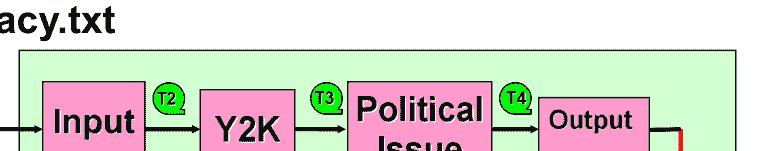

T5 new.txt

Legacy file update by using batch sequential software architecture

### 2. Batch sequential dataflow system

#### Original txt file:

Television $3800 Japan 95-12-11
Television $3600 Germany 88-12-01
Microwave $3800 Japan 95-12-11
Microwave $3600 Germany 88-12-01
Television $3800 Republic of China 95-12-11
Television $3300 Germany 89-02-01
Microwave $3800 Republic of China 95-12-11
Microwave $3300 Germany 89-02-01
Washing Machine $3800 Japan 95-12-11
Washing Machine $3600 Germany 88-12-01
Television $3800 Republic of China 95-12-11
Television $3300 Germany 89-02-01
Washing Machine $3800 Republic of China 95-12-11
Washing Machine $3300 Germany 89-02-01

### 2. Batch sequential dataflow system

After Y2K (in Tape 3):

Television $3800 Japan 1995-12-11
Television $3600 Germany 1988-12-01
Microwave $3800 Japan 1995-12-11
Microwave $3600 Germany 1988-12-01
Television $3800 Republic of China 1995-12-11
Television $3300 Germany 1989-02-01
Microwave $3800 Republic of China 1995-12-11
Microwave $3300 Germany 1989-02-01
Washing Machine $3800 Japan 1995-12-11
Washing Machine $3600 Germany 1988-12-01
Television $3800 Republic of China 1995-12-11
Television $3300 Germany 1989-02-01
Washing Machine $3800 Republic of China 1995-12-11
Washing Machine $3300 Germany 1989-02-01

### 2. Batch sequential dataflow system

#### After Political Issue (in Tape 4) :

- Television $3800 Japan 1995-12-11
- Television $3600 Germany 1988-12-01
- Microwave $3800 Japan 1995-12-11
- Microwave $3600 Germany 1988-12-01
- Television $3800 Taiwan 1995-12-11
- Television $3300 Germany 1989-02-01
- Microwave $3800 Taiwan 1995-12-11
- Microwave $3300 Germany 1989-02-01
- Washing Machine $3800 Japan 1995-12-11
- Washing Machine $3600 Germany 1988-12-01
- Television $3800 Taiwan 1995-12-11
- Television $3300 Germany 1989-02-01
- Washing Machine $3800 Taiwan 1995-12-11
- Washing Machine $3300 Germany 1989-02-01


### 2. Batch sequential dataflow system

#### Problem with Batch sequential System
- Batch sequential faces technology pressure : online access
  - Advantage of online access:
    - queries are relatively easier
    - Real-time transactions
  - Online updates require a shift from pure batch to interactive processing

### Pipes and Filters architecture

### 3. Pipes and Filters architecture
管道与过滤器软件体系结构

Pipes and filters architecture is composed of filters to do data processing and pipes that carry data from one filter to the next filter

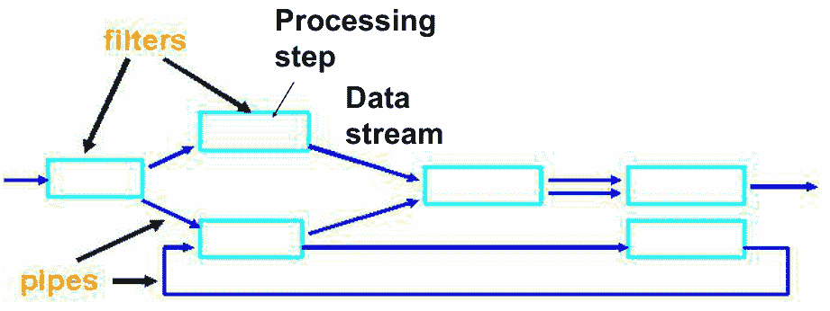

Pipes and filters architecture

### 3. Pipes and Filters architecture

A filter

A program

Input port

Filter

Output port

Process data

A pipe

Input stream

pipe

output stream

transmit data

Shapes of pipes and filters architecture

### 3. Pipes and Filters architecture

#### Functionalities of Filters:
Incrementally transform some of the source data into sink data
- a) Enrich data by computing and adding information
- b) Transform data by changing representation
- c) Stream to stream transformation
- d) Preserve no state between instantiations (forget what has happened)

### 3. Pipes and Filters architecture

#### Functionalities of a Pipe:
move data from a filter’s output to a filter’s input
- One way flow
- Pipes form data transmission graph

### 3. Pipes and Filters architecture

#### Overall operations
- Run pipes and filters until no more computations are possible
- Action is mediated by data delivery

### 3. Pipes and Filters architecture

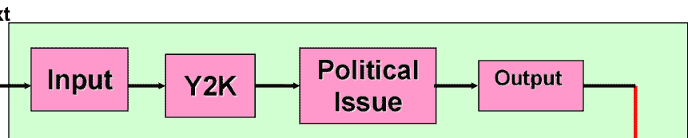

After Input: Television $3800 Republic of China 95-12-11

After Y2K: Television $3800 Republic of China 1995-12-11

After Political Issue: Television $3800 Taiwan 1995-12-11

After Output: Television $3800 China 1995-12-11

数据以数据流的方式从左端流入，流经各个过滤器，对数据进行处理；对于处理完的数据，立即写入到下游管道

### 3. Pipes and Filters architecture

#### Example 4: Compiler example

A typical architecture of a compiler example is pipes and filter’s architecture describing in the next page.

### 3. Pipes and Filters architecture

Lexical Analysis
进行词法分析

Syntax Analysis
进行语法分析

Semantic Analysis
进行语义分析

生成字节码

优化字节码

生成机器代码

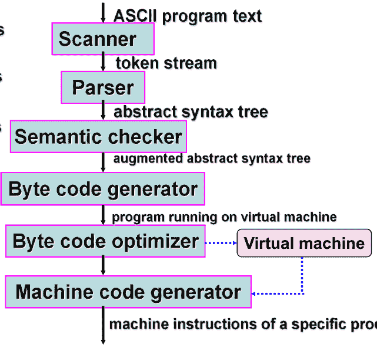

### 3. Pipes and Filters architecture

#### Functionalities of each filter
- Scanner: Lexical Analysis（词法分析）
  - Misspellings: such as “String” into “Sting”, “Super”, “supper”
- Parser: Syntax Analysis（语法分析）
  - Omission, wrong order of tokens
- Semantic checker: Semantic Analysis（语义分析）
  - Incompatible types: e.g., “float”, “double”
- Byte code generator (字节代码生成器): byte code generation:
  - C/C++ compiler: from source code to assembly code
  - Java compiler: from Java code to bytecode.
  - Java跨平台其实就是基于相同的bytecode规范做不同平台的虚拟机，我们的Java程序编译成bytecode后就可以在不同平台跑了。
- Byte code optimizer: optimizing byte code
- Machine code generator: generating machine code

### 3. Pipes and Filters architecture
- **Pipes and filters architecture with branches**
- The pipes-and-filters pattern allows filters with multiple input and/or multiple output pipes to be connected in any directed graph structure.
- Such dataflow systems are difficult to design
- However, if we restrict ourselves to directed acyclic graph structures, the problem is considerably simplified （无循环的结构）.
- In the UNIX system, the **tee** filter provides a mechanism to split a stream into two streams

### 3. Pipes and Filters architecture

Example 5: Tee & Join in Unix

Task: Print a sorted list of words that occur more than once
- 1) mknod pipeA p
- 2) mknod pipeB p
- 3) sort pipeA > pipeB &
- 4) cat file1 | tee pipeA | sort -u | comm -13 - pipeB > file2

### 3. Pipes and Filters architecture

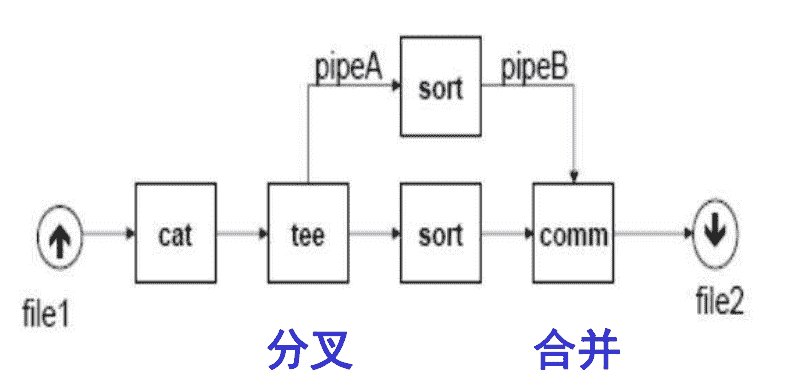


### 3. Pipes and Filters architecture

Example 6. 如下的Unix命令组成一个管道/过滤器程序，将in.txt文件的包含 “Heroin” 的行进行排序，然后将结果输出到out.txt文件中。

```
cat in.txt | grep “Heroin” | sort > out.txt
```

以上命令行的管道/过滤器结构图如下。

in.txt

Cat

Grep

Sort

out.txt

Grep负责在文件in.txt中搜索包含表达式“cocaine”的所有的行，并且将它们输出到下游管道。

将上游管道来的行进行排序，以后写到out.txt中

#### Comparison of batch sequential architecture and Pipes and Filters architecture

### 3. Pipes and Filters architecture

Comparison between batch sequential architecture and pipes-and-filters architecture

- **Similarity: independent processing modules**

In both Batch sequential and pipes and filters architectures, the processing steps are independent of each other, that is

- one filter in pipes and filters architecture doesn’t call any other filters in the system
- one processing step in batch sequential architecture doesn’t call any other processing step in the system

处理过程之间互不调用

### 3. Pipes and Filters architecture

Comparison between batch sequential architecture and pipes-and-filters architecture

#### Difference 1 (the way for data processing is different):

- 1. In batch sequential Architecture, each step runs to completion before the next step starts, that is, data is transmitted as a whole between steps
- 2. In pipes and filters architecture, the filters Incrementally transform some of the source data into sink data, that is, the filters do stream to stream transformation

### 3. Pipes and Filters architecture

Comparison between batch sequential architecture and pipes-and-filters architecture

#### Difference 2 (data amount is different) :

- 1. In batch sequential Architecture, the amount of data is limited
- 2. In pipes and filters architecture, the amount of data can be unlimited

### 3. Pipes and Filters architecture

#### Digital Image Processing

- **Image processing problem**
- **Question:** if you are required to do some image processing to digital pictures (images), and you are given two choices, batch sequential and pipes and filters, which one should you select?
- **Processing steps:**
  - Sharpen
  - FindEdges
  - HighlightEdges
  - ProduceReport


Picture before and after image sharpening

### Example Pipe-and-Filter System: Khors—An Image-Processing Workbench

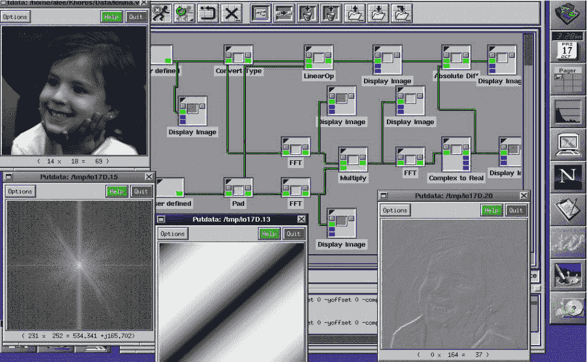

### Image Processing Workbench (IPW)

- IPW is a UNIX-based image processing system.
- IPW includes several UNIX filter programs which can be pipe-lined together to form complex and powerful image processing algorithms.
- IPW includes a development environment for creating new IPW shell scripts and programs in C.
- IPW often provides the simplest, most powerful and efficient methods for manipulating a wide variety of [remote sensing and image data (why?)](blue).

### 3. Pipes and Filters architecture

- 例7 使用批处理体系结构。设计考虑设计一个图像处理软件。该软件应该有一个用户图形界面。该软件包含一些可以随时添加的过滤器（filters），例如，图像模糊(Blurring)，图像锐化(Sharpening)，图像变亮(Brightening)，发现图像边界(EdgeDetector)，每个过滤器完成一项特定的图像处理功能。一些过滤器被串联在一起，以便完成一些比较复杂的功能。我们该系统，如图6.25。

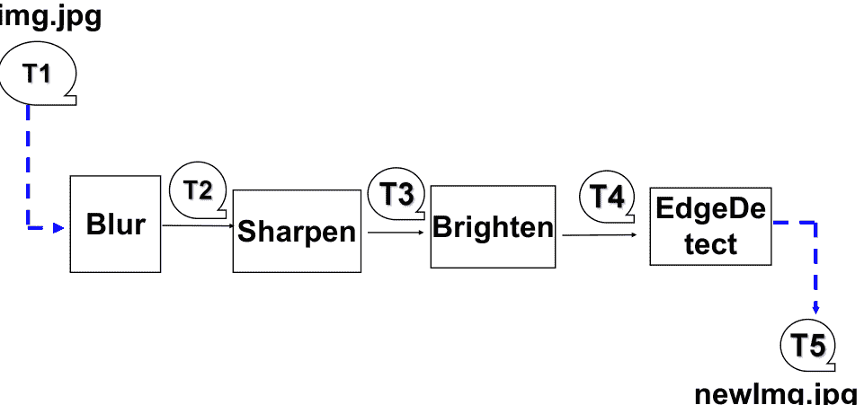

顺序批处理体系结构的数字图像处理系统对象逻辑图

顺序批处理软件用户界面图

### 3. Pipes and Filters architecture

- 例8 使用管道-过滤器体系结构设计的数字图像处理系统。设计一个管道-过滤器体系结构的数字图像处理系统。其功能包括用户图形界面，RGBFilter，ThreshHoldFilter，TransFilter，GrayOutFilter分别实现对彩色图像的三色素滤波，阈值滤波、变换滤波与变灰滤波。

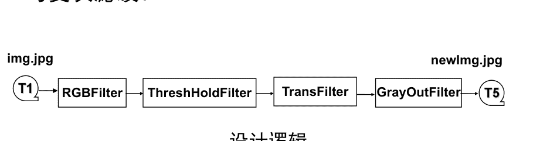

设计逻辑

其中, RGBFilter、ThreshHoldFilter、TransFilter、GrayOutFilter对象利用Pipe对象从上游数据流读入数据，进行各种滤波，并且适时地将所产生的数据写到下游数据流中，设计类图如图6.49所示。

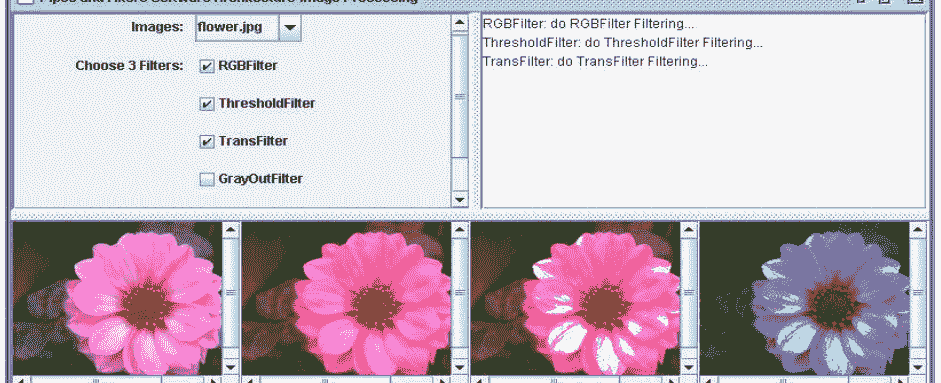

利用管道-过滤器架构设计的数字图像处理系统用户界面图


### 4. Process-control Paradigms

#### Example 9: Room heater design I

无控制的情况：
不断加热

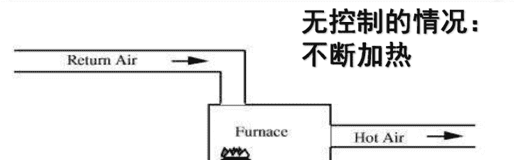

#### Room heater logic

#### Example 10: Room heater Design II

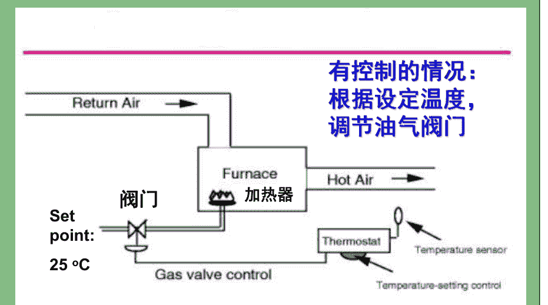

#### General process-control diagram

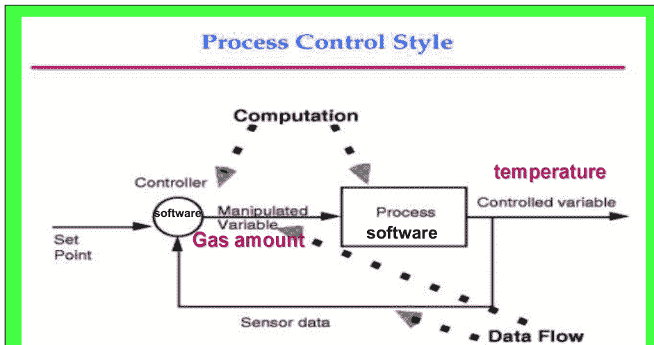

#### Definitions on process-control system

- **Process-Control System** is such a system that it
  - works on continuous processes.
  - converts input materials to products with specific properties by performing operations
    - on the inputs and
    - on intermediate products.

#### Example of Beer production lines


- **Process variables.** Values of properties of the process that can be measured (e.g., temperature, gas amount)
- **Controlled variable.** Process variable whose value the system is intended to control. (e.g., temperature)
- **Input variable.** Process variable that measures an input to the process. (e.g., input temperature, set point)
- **Manipulated variable.** Process variable whose value can be changed by the controller. (e.g., gas amount)
- **Set point.** The desired value for a controlled variable.

- Kinds of control system
  - 开环系统 open-loop system
  - 闭环系统 closed-loop system
  - 反馈系统 Feedback control system

#### Open Loop Temperature Control


No control at all, air is heated up continuously.

**Closed-loop system**. System in which information about process variables is used to manipulate a process variable to compensate for variations in process variables and operating conditions.

#### Closed Loop Temperature Control

闭环系统
Return Air
Furnace
Hot Air
Gas valve control
Thermostat
Temperature sensor
Temperature-setting control
closed loop room heater


#### Feedback control system

The controlled variable is measured, and the result is used to manipulate one or more of the process variables. The purpose of the control system is to maintain specified properties of the outputs of the process at the set points.

#### Feedback Control


Feedback control system

#### Feedback control system

A system used to adjust the process according to measurements of the controlled variable.

The important components of a feedback controller are:

- 过程定义：the process definition,
- 过程变量：the process variables (e.g. input and controlled variables), a sensor to obtain the controlled variable from the physical output
- 设定点：the set point (target value for the controlled variable), and
- 控制算法：a control algorithm.

#### 过程控制软件模型 / A Software Paradigm for Process Control

An architectural style for software that controls continuous processes can be based on the process control model. It contains:

1. **Computational elements**: separate the process of interest from the control policy.
   - **Process definition**, including mechanisms for manipulating some process variables. (e.g., beer: ferment temperature, acid content)
   - **Control algorithm**, for deciding how to manipulate process variables, including a model for how the process variables reflect the true state. (具体怎样控制哪些变量？)


### 4. Process-control Paradigms

## Process Control Style


### 4. Process-control Paradigms

### A Software Paradigm for Process Control (cont)

2. Data elements: continuously updated process variables and sensors that collect them.

- **Process variables**, including
  - input,
  - controlled, and
  - manipulated variables, and
  knowledge of which can be sensed.
- **Set point**, for controlled variable.
- **Sensors**, to obtain values of process variables pertinent to control.

### 4. Process-control Paradigms

3. **The control loop paradigm:** establishes the
**relation** that the control algorithm exercises.
(the loop), it

- collects information about the actual and intended states of the process, and
- tunes the process variables to drive the actual state toward the intended state.

# Lecture 2
The Factory Method Pattern
工厂方法模式

Professor:

Yushan (Michael) Sun

Fall 2016

### Contents of this lecture

- 1. Introduction of the factory method pattern
- 2. Theory of the simple factory method Pattern and design examples
- 3. Theory of the factory method pattern and design examples
- 4. Further discussion of the factory method pattern

### Introduction of the Factory Method Pattern

### Introduction to Factory Method Pattern

```
Car myCar;
myCar = new Lincoln();
myCar.buyCar();
```


### Introduction to Factory Method Pattern

新的情况：

- 1）如果一个类的结构有很多子类
- 2）你不知道该准确地调用哪一个
- 怎么办呢？？？

### Introduction to Factory Method Pattern

Question: How to invoke a method in a class hierarchy that contains many subclasses and you don’t know exactly which one to select?

The choice may depend on:

- 运行状态. The state of the running application (input from users)
- 应用配置设置. Application configuration settings

- In such cases, an application object needs to use conditional statements to instantiate an appropriate class from the hierarchy to access its services

### Introduction to Factory Method Pattern

# Client

obCar: Car

Main()

# Car

+buyCar()
+buyParts()

# Lincoln

-model
+buyCar()
+buyParts()

# Cadillac

-model
+buyCar()
+buyParts()

# Buick

-model
+buyCar()
+buyParts()

```
if (usrChoice==1)
obCar =new Lincoln(m);
else if (usrChoice==2)
obCar =new Cadillac(m)
else if (usrChoice==3)
obCar =new Buick(m)

obCar.buyCar();
```

Client Object Directly Accessing a Class Hierarchy

### Introduction to Factory Method Pattern

# 该设计的缺点：

This type of design has the following disadvantages:

- a) **High coupling（高耦合）**。

Because every application object that intends to use the services offered by the class hierarchy needs to implement the class selection criteria, it results in a **high degree of coupling** between an application object and the service provider class hierarchy.

### Introduction to Factory Method Pattern

# b) Inelegant statement (难看的条件语句).

Because class selection criteria needs to take all the factors that could affect the selection process into account, the implementation of an application object could contain inelegant conditional statements.

# c) Client should fully know the class (客户程序需要知道服务类的全部细节).

It requires an application object to be fully aware of the existence and the functionality offered by each class in the service provider class hierarchy.

### Introduction to Factory Method Pattern

- 怎样改善以上设计?
- In such cases, use the Factory Method Pattern, which recommends
- encapsulating the functionality required to select and instantiate an appropriate class inside a designated method called a factory method (将根据条件选择与初始化一个合适的类的功能封装在一个专门的类的一个专门的方法中).

### Introduction to Factory Method Pattern

| Client |
|---|
| obCar Car |
| main() |

| CarObjCreator |
|---|
| obCar Car |
| +factoryMethod: Car |

```
if (usrChoice==1)
    obCar = new Lincoln(m);
else if (usrChoice==2)
    obCar = new Cadillac(m)
else if (usrChoice==3)
    obCar = new Buick(m)
return obCar;
```

| Car |
|---|
| +buyCar() |
| +buyParts() |

| Lincoln |
|---|
| -model |
| +buyCar() |
| +buyParts() |

| Cadillac |
|---|
| -model |
| +buyCar() |
| +buyParts() |

| Buick |
|---|
| -model |
| +buyCar() |
| +buyParts() |

factoryMethod is in charge of creating objects


### Introduction to Factory Method Pattern

#### Functionalities of the factory method (工厂方法的功能)

- Thus, a factory method can be defined as a method in a class that:
  - 选择一个类：Selects an appropriate class from a class hierarchy based on the application context and other influencing factors
  - 创建该类的对象：Instantiates the selected class and
  - 以超类的类型返回该对象：returns it as an instance of the parent class type

#### Advantages of the factory method (工厂方法的优点)

1. Clean Client program (干净的客户端程序)

   Application objects can make use of the factory method to get access to the appropriate class instance. This eliminates the need for an application object to deal with the varying class selection criteria.

2. Hide details in instantiating an object (隐藏实例化对象时的细节)

   The factory method also implements any special mechanisms required to instantiate the selected class.

   - This is possible **when different classes in the hierarchy need to be instantiated in different ways**. The factory method hides these details from application objects and eliminates the need for them to deal with these intricacies.

3. Client doesn’t need to know which concrete class has been instantiated (客户类只需要知道哪种类型的对象被创建了，而不必知道哪个具体的子类被实例化了)

   Because the factory method returns the selected class instance as an object of the parent class type, a client program does not have to be aware of the existence of the classes in the hierarchy.

### 以下给出两种不同的工厂方法模式

- 简单工厂方法模式
- 工厂方法模式

### Theory of the Simple Factory Method Pattern and Design Examples

#### The Simple Factory Method Pattern

**工厂类：**

- 静态方法
- 没有子类

Diagram of Simple Factory Pattern:


#### Creator (工厂类)

- 中心：the center of the factory pattern
- 包含业务逻辑：Contains business logic that application needs
- 创建产品类对象：Factory method creates an object of Product type when called by the client program, and returns this object to the caller object

**Product：**

- Java interface or abstract Java class
- Common interface or super class for the concrete subclasses

**Concrete Products：**

- Concrete Java classes to implement interface `Product` or to extend abstract class `Product`

**Simple Factory Pattern Implementation:**

```text
Client
Product
可以传递参数给工厂类
Creator.factory(p)
Creator
+factory()
Product1
Product2
Product12
Product21
Product22
Product211
Product212
仅仅负责创建对象
```

#### Example of Auto Insurance Policies (汽车保险的例子——简单工厂方法模式)


- The following class diagram represents a design using factory method pattern to query about the features of different types of auto insurances.
- **AutoInsurance:** interface to claim various insurance policies (here `describe()`)
- Four subclasses implement the interface `AutoInsurance`:
  - **Body**: Bodily Injury Liability (人身保险，你撞了别人)
  - **Collision**: Collision Coverage (车碰撞险，你的车损坏了)
  - **Com**: Comprehensive Coverage (综合险)
  - **Person**: Personal Injury Protection (驾驶员保险)
- **PolicyProducer** is a factory class with a factory method:
  `getPolicyObj(String option)`
  which will create and return an object of `AutoInsurance` type.
- Actually, it will create and return an object of one of the implementing classes according to the chosen parameter `option` entered.

**Source Code**

```java
public interface AutoInsurance {
    abstract String describe();
}
```

```java
public class Body implements AutoInsurance {
    private String description;

    public String describe() {
        description = "Bodily Injury Liability";
        return description;
    }
}
```

#### The Simple Factory Method Pattern

```
public class Collision implements AutoInsurance {
    private String description;

    public String describe() {
        description = "Collision Coverage";
        return description;
    }
}
```

#### The Simple Factory Method Pattern

```
public class Com implements AutoInsurance{
private String description;

public String describe() {
description = "Comprehensive Coverage";
return description;
}
}
```

#### The Simple Factory Method Pattern

```
public class Person implements AutoInsurance
{
    private String description;

    public String describe() {
        description = "Personal Injury Protection'";
        return description;
    }
}
```

#### The Simple Factory Method Pattern

```
public class PolicyProducer{
public static AutoInsurance getPolicyObj(String opt){
    AutoInsurance policy = null;
    if(opt.compareTo("bodyInjure") == 0){
        policy = new Body();
    }
    else if(opt.compareTo("collision") == 0){
        policy = new Collision();
    }
    else if(opt.compareTo("com") == 0){
        policy = new Com();
    }
    else if(opt.compareTo("personInjure") == 0){
        policy = new Person();
    }
    return policy; // 以超类的类型返回
} }
```

根据参数不同创建不同对象

#### The Simple Factory Method Pattern

#### 用户图形界面的监听器代码

```
class ButtonListener implements ActionListener {
    public void actionPerformed(ActionEvent ae) {
        if (ae.getActionCommand().equals(SHOW)) {
            String type = (String) getSelectedItem();
            String option="";

            if (type.equals(BODYINJURE)) {
                option="bodyInjure";
            }
            else if (type.equals(COLLISION)) {
                option="collision";
            }

            ...
            AutoInsurance ai = PolicyProducer.getPolicyObj(option);
            String desc = ai.describe();
            txtForInfo.setText(desc);
        }
    }
```

创建对象的责任就交给大哥你了。

#### The Simple Factory Method Pattern

#### Advantages of the Simple Factory method Pattern (简单工厂方法模式的优点)

- a) **Some logics are put into the factory class.**
  The factory class contains necessary logic, which can decide which instances of the product class to create and when to create

- b) **Client is free from creating objects.**
  The client class doesn’t have to create object of the product classes. It will just act as consumer.

- c) **Responsibility separation** (责任分离)
  The simple factory pattern have realized the **responsibility separation**.

#### The Simple Factory Method Pattern

#### d) Extensibility issue

Client class is independent of the creation of the object. You don’t need to modify the existing source code for the client class if there is a new product to be added (假设此时客户类还不想将新产品加入).

#### The Simple Factory Method Pattern

#### Disadvantages of the Simple Factory method Pattern (简单工厂方法模式的缺点)

##### a) Adding a new concrete subclass to Product class hierarchy is difficult.

- The factory class must know every product. It must know how to create object of the newly added sub classes and when to provide them to the client.

- Thus, adding new sub classes in the Product class hierarchy will need to modify the source code of the factory class

### Theory of the Factory Method Pattern
and Design Examples

### Factory Method Pattern


Diagram of Factory method pattern

### Example of Auto Insurance Policies
汽车保险的例子


- The following class diagram represents a design in factory method pattern to query about the features of different types of auto insurances.

### 工厂方法模式-汽车保险的例子

工厂类

产品类


#### The Simple Factory Method Pattern

### 保险产品层次类

- AutoInsurance: interface to claim various insurance policies (here describe())

- Four subclasses:
  - Body: Body Injur Liability (人生保险，你撞了别人)
  - Collision: Collision Coverage (车碰撞险，你的车损坏了)
  - Com: Comprehensive Coverage (综合险)
  - Person: Person Injury Protection (驾驶员保险)

implement the interface AutoInsurance


### Example of Auto Insurance Policies
汽车保险的例子

### 工厂层次类

+   - 接口类 PolicyProducer
+     - 实现类 BodyFactory
+     - 实现类 CollisionFactory
+     - 实现类 ComFactory
+     - 实现类 PersonFactory

### Example of Auto Insurance Policies
汽车保险的例子

### Source Code

```
public interface AutoInsurance {
  abstract String describe();
}
```

### Example of Auto Insurance Policies
汽车保险的例子

```
public class Body implements
    AutoInsurance {

    private String description;

    public String describe() {
        description = "Body Injury Liability:";
        return description;
    }
}
```

### Example of Auto Insurance Policies
### 汽车保险的例子

```
```java
public class Collision implements AutoInsurance {
private String description;

public String describe() {
    description = "Collision Coverage: ";
    return description;
}
}
```
```

### Example of Auto Insurance Policies
汽车保险的例子

```
public class Com implements AutoInsurance {
    private String description;

    public String describe(){
        description = "Comp Coverage:";
        return description;
    }
}
```

### Example of Auto Insurance Policies
汽车保险的例子

```
public class Person implements AutoInsurance
{
    private String description;

    public String describe(){
        description = "Personal Injury ";
        return description;
    }
}
```

### Example of Auto Insurance Policies
汽车保险的例子

```
public interface PolicyProducer {
    public AutoInsurance getPolicyObj();
}
```

```
public class BodyFactory
implements PolicyProducer {
    public AutoInsurance getPolicyObj() {
        return new Body();
    }
}
```

工厂方法无条件语句

### Example of Auto Insurance Policies
汽车保险的例子

```
public class CollisionFactory
implements PolicyProducer {

public AutoInsurance getPolicyObj(){
return new Collision();
}
}

```

> 工厂方法无条件语句

### Example of Auto Insurance Policies
汽车保险的例子

```
public class ComFactory
implements PolicyProducer{
public AutoInsurance getPolicyObj() {
return new Com();
}
}
```

> 工厂方法无条件语句

### Example of Auto Insurance Policies
汽车保险的例子

```
public class PersonFactory implements PolicyProducer {
    public AutoInsurance getPolicyObj() {
        return new Person();
    }
}
```

工厂方法无条件语句

### Further Discussion of the Factory Method Pattern

### Comparison of Simple Factory Method Pattern and a Factory Method Pattern
静态工厂方法

### Simple Factory method pattern

### Comparison of Simple Factory Method Pattern and a Factory Method Pattern (比较)

Client

Interface
Creator
+factory: Product

Creator A
+factory: Product

Creator B
+factory: Product

Interface
Product
+Operation(): void

Product B
+Operation:
void

Product A
+Operation:
void

动态工厂方法

<<create>>

<<create>>

### Factory method pattern

### b) 工厂方法不同，一个静态，一个动态。

+   > In the simple factory method pattern, the factory method is static and
+   > in the factory method pattern, the factory methods are dynamic and are distributed in the concrete factory classes

### Comparison of Simple Factory Pattern and a Factory Pattern （比较）

### c) 工厂方法模式的可扩展性（Extensibilities）

If a new product is added to the product hierarchy, then what needed is to add a sub concrete class to the product hierarchy and a sub class to the factory hierarchy.

+   - it is not necessary to modify the abstract factory and the existing subclasses of the concrete factory method (工厂类的已有源代码不需要改变)
+   - It is not necessary to change the client class (假设client暂时不用该新功能),

### Comparison of Simple Factory Method Pattern and a Factory Method Pattern (比较)

Factory method pattern


### Comparison of Simple Factory Method Pattern and a Factory Method Pattern (比较)

Like the simple factory pattern, the factory method in the concrete creator returns an object of type Product and not an object of the concrete product class.

+   The client doesn't have to know the type of the real type (这样, client类就不知道到底哪个产品子类的对象被创建了).


### Comparison of Simple Factory Pattern and a Factory Pattern （比较）

e) 工厂方法模式支持开闭原则，但是简单工厂方法模式不支持开闭原则。 Factory Method Pattern supports the open-closed principle, but simple factory method doesn’t support the open-closed principle.
For the purpose of adding a new class, this system fully supports “open-closed principle” below:

+   - 开闭原则： Open for extension and closed for modification (一个好的设计应该是可以被扩展，但是是在扩展的时候，不允许修改原有代码)


### When to Use a Factory Pattern

何时使用工厂方法模式？

You should consider using a Factory method pattern when

+   A class can’t anticipate which kind of class of objects it must create （大量的条件语句）.

+   A class uses its subclasses to specify which objects it creates （此时，创建对象的任务分散在客户类的子类中，比较乱，可以使用工厂方法模式将创建产品类的子类对象的责任分离出来）.

+   You want to localize the knowledge of which class gets created.

### 工厂方法模式的几种实现方法

1. Product is an abstract class, and the pattern must return a complete working class.

2) 调用方法c.describe()

1)请求创建对象c

超类Car是抽象类，因此只能创建子类的对象并且返回给调用者


### 2. Product class contains all default methods and is only subclassed for cases where the default methods are insufficient.

产品类Felidae是正常的具体的类；包含了大部分功能；子类包含了很少的功能

不建议将产品超类写成具体类


3. Parameters are passed to the factory, telling it which of several class types to return. In this case, the classes may share the same method names but may do something quite different.


将参数p传递给工厂类，工厂方法根据此参数创建合适的类的对象，并且以Car类型返回给调用者

## Client

obCar Car
main()

1) getFactory(p)获得工厂子类对象s
2) s.createCar(), 获得Car子类对象c, 并且将c返回给Client对象

## CarFactory

```
obCar : Car
+getFactory(p)
+createCar(): Car
```

静态方法

## Car

```
+describe()
+getPrice()
```

## CadFactory

```
obCar : Car
+createCar(): Car
```

## LinFactory

```
obCar : Car
+createCar(): Car
```

## Lincoln

```
-model: String
+describe()
+getPrice()
```

## Cadillac

```
-model: String
+describe()
+getPrice()
```

3) 调用方法 c.getPrice()

## Lecture 3. Case Study on Dataflow System

### Content of the lecture:

+   - Case study 1. [Legacy File Update](#)
+   - Case study 3. [Cruise Control](#)
+   - Case study 2. _[Instrumentation Software](#)_

## Legacy File Update
旧文件更新系统

### Case study 1. Legacy File Update

Solution: Pipe-and-filter architecture

设计：使用Pipe-and-filter软件体系结构

Design four filters:

Input, Y2K, Politics, output

Each filter processes the data and sends it to the next filter. The four filters are connected by three pipes.

Control: The control is distributed.

+   - Each filter can run whenever it has data on which to compute. Data sharing between filters is strictly limited to that transmitted on pipes

### Case study 1. Legacy File Update

#### Four filters with in-ports and out-ports


### Case study 1. Legacy File Update

使用3个管道将4个过滤器连接起来


a. Like machines in a production line, all filters should be working simultaneously

Question 1: How to implement this functionality?

b. Like a water stream, data should flow continuously from left hand side to right hand side

Question 2: How to implement this functionality?

### Case study 1. Legacy File Update

Functionalities of filters:

+   - Input filter: is connected to a source file
+   
+   a) read the content of an input file, in character stream
+   
+   b) parse it, and
+   
+   c) write the parsed contents its output stream, character by character (确保空格与回行符也写入下游数据流).

+   - Y2K filter: connects to pipe in_y2, output stream of Input filter.
+   
+   a) read character stream from pipe in_y2
+   
+   b) Organize them into a line
+   
+   c) Find and fix Y2k problem in this line
+   
+   d) Once a line is fixed, then write it to the y2_po, writing one character at a time (确保空格与回行符也写入下游数据流).


### Case study 1. Legacy File Update

Politics filter: connected to pipe y2_po, the output stream of Y2K filter.

+   a) read character stream from the pipe y2_po
+   b) organize them into a line
+   c) Find and fix the political problem in this line
+   d) Once a line is fixed and then write it to the pipe po_ou, character by character (确保空格与回行符也写入下游数据流).

Output filter: connected to pipe po_ou, the output stream of Politics filter.

+   - read character stream from po_ou
+   - writes them to the standard output.

### Case study 1. Legacy File Update

+   - 主要控制类（主程序）的责任：
+     1）创建Filter对象
+     2）创建Pipe对象
+     3）将它们组装（链接）起来
+     4）启动运行过滤器对象
+   - Master Control manages filter and pipe mechanism, by creating a pipeline of the above described filters.

### Case study 1. Legacy File Update

+   - **Functionalities of the pipes:**
+   - **in_y2 pipe:** shared between Input filter and Y2K filter,
+     - this pipe is the output pipe for Input filter and the input pipe for Y2K filter.
+   - **y2_po pipe:** shared between Y2K filter and Politics filter,
+     - this pipe is the output pipe for Y2K filter and the input pipe for Politics filter.
+   - **po_ou pipe:** shared between Politics and Output filter,
+     - this pipe is the output pipe for Politics filter and the input pipe for Output filter.

### Case study 1. Legacy File Update

从而，我们得到程序的逻辑结构如下


Architecture of the program-the program is formed by the filters and pipes

### Case study 1. Legacy File Update

#### 过滤器的结构（Structure of the filters）

Filters in the system are represented by an abstract class named Filter. An instance of Filter class is composed of:

+   - **Input pipe object**, from which the filter object reads the data
+   - **Output pipe object**, to which the filter object writes the processed data

### Case study 1. Legacy File Update

#### Design issue 1: How to make the 4 filter objects work simultaneously?

#### Solution:

All the 4 filters should have multi-thread properties. So, let Filter class implements interface Runnable.

+   a) When you start a new filter f1, a thread is created
+   b) f1.start() will make itself run automatically without stopping
+   c) And so, after we create objects of Input, Y2K, Politics and Output, and each calls the start method, then the 4 filters will run independently and simultaneously
+   d) Thus this design has met the requirement 1


### Case study 1. Legacy File Update

+   - **Methods:**
+     - **start()**: start a thread and run the thread
+     - **run()**: called by the thread when needed
+     - **stop()**: stop a thread
+     - **Transform()**: the abstract method that
+       - Inputs data (in Input filter),
+       - Finds Y2K and processes Y2K (in Y2K filter),
+       - Finds and fixes political problem (in Politics filter)
+       - outputs data

+   - **Process of the run:**
+     start ➔ run ➔ transform()

### Case study 1. Legacy File Update

#### Design of the pipe class:

+   - Pipes in the Legacy file update system are represented as instances of the Pipe class.
+   - An instance of the Pipe class is a composition of two streams: an input and an output stream.
+   - Pipe class connects these two streams in the following way.
+     - **The data that is written to the input stream is transmitted to the output stream.** In this way these data become available for reading from the output stream.

### Case study 1. Legacy File Update

| Pipe |
|------|
|-reader_: PipedReader|
|-writer_: PipedWriter|
|+read()|
|+write(c: int)|
|+closeReader()|
|+closeWriter()|

Java API classes PipedReader and PipedWriter are used to implement data stream to keep data flowing continuously

The Pipe class encapsulates the input and output streams as its private variables and provide just a simple public Interface for writing data to and reading data from a pipe object.


#### 在管道设计的时候，要回答问题：怎样使得数据像水流一样从左向右移动？

#### 一串管道是怎样搬运数据的呢？


### Case study 1. Legacy File Update

先看看相邻两个管道是怎样搬运数据的？


#### Pipe p1 = new Pipe()

+   p1.write(g)
+   p1.write(f)
+   p1.write(e)
+   p1.write(d)
+   p1.write(c)


+   p1.closeWriter()
+   [-writer_.flush();
+   -writer_.close()]


### Case study 1. Legacy File Update

Pipe p2 = new Pipe()

```
c=p1.read()
d=p1.read()
e=p1.read()
f=p1.read();
g=p1.read()
```

```
p2.write(g)
p2.write(f)
p2.write(e)
p2.write(d)
p2.write(c)
```

```
p2.closeWriter()
[-writer_.flush();
-writer_.close()]
```

经过read()以后，P1的内容被消费了


### Case study 1. Legacy File Update

#### How Pipe object works?

+   - So a filter simply write some data to a pipe object by calling its write method. These data become then available for the next filter, which can call the read method of the pipe object to retrieve the data.


以这种方式，数据就像水流一样，从左向右不断地流动

### Case study 1. Legacy File Update

#### Some issues about a pipe

+   a) **Amount of data in a pipe**: Pipe objects limit the amount of data they can hold.

+   b) **Data consumption**. However, whenever clients read the data from a pipe, this data is considered "consumed" and the space that was occupied by the retrieved data is made free again.

### Case study 1. Legacy File Update

#### Some issues about a pipe (cont)

c) Pipe objects are synchronized (同步的). There can be only one thread working with a pipe object at a specific moment, i.e, there can be only one thread currently writing or reading the data from a pipe object.

d) threads reading from an empty pipe or writing to a full pipe are blocked as long as there are not some data to read from the pipe, or there is no free space in the pipe to write the data.

### Case study 1. Legacy File Update


### Case study 1. Legacy File Update

### Advantages:

+   - **intuitive**: It maintains the intuitive flow of processing.
+   - **reuse**: It supports reuse, since each filter can function in isolation
+   - **Easy evolution**: New functions are easily added to the system by inserting filters at the appropriate points in the processing sequence.
+   - **Easy modification**: it’s easy to modify the system since filters are logically independent of other filters.

### Case study 1. Legacy File Update

#### Disadvantages:

+   - **Poor Interaction**: It is virtually impossible to modify the design to support an interactive system. For example, deleting a line would require some persistent (持久的) shared storage, violating basic principle of this approach.

+   - **Waste of space**: The solution uses space inefficiently, since each filter must copy all of the data to its output ports.


# Cruise Control: Process-Control Architecture

### Case study 3. Cruise Control: Process-Control Architecture

### 巡航控制器-过程控制体系结构

A cruise-control system is used to maintain the speed of a car at any circumstances:

+   - highway driving
+   - upslope
+   - down slop
+   - varying terrain.

See Figure 3.16


### Case study 3. Cruise Control

巡航控制系统的输入

System on/off
If on, the cruise-control system should maintain the car speed.

Engine on/off
If on, the car engine is turned on; the cruise-control system is only active if the engine is on.

Pulses from wheel
A pulse is sent for every revolution of the wheel.

Accelerator
how far the accelerator has been pressed.


### Case study 3. Cruise Control

| Brake | On, when the brake is pressed; the cruise-control system temporarily reverts to manual control if the brake is pressed. |
| Increase/ Decrease Speed | Increase or decrease the maintained speed; only applicable if the cruise-control system is on. |
| Resume Speed | Resume the last maintained speed; only applicable if the cruise-control system is on. |
| Clock | Timing pulse every millisecond |
| Throttle | output from the system, Digital value for the engine throttle setting |

### Case study 3. Cruise Control

- System on/off
- Engine on/off
- Pulses from wheel
- Accelerator
- Brake
- Increase/decrease speed
- Resume speed
- Clock

#### Cruise Control System


There are a lot of inputs for the cruise control system. We need to analyze them

Throttle
节流阀，喷油阀

#### FIGURE 3.16 Booch Block Diagram for Cruise Control

### Case study 3. Cruise Control

- **Computational elements**
- **Process definition:**
- the process takes a throttle setting as input and controls the speed of the vehicle.

### Case study 3. Cruise Control

- **Control algorithm:** this algorithm
  - **Get speed.** gets the current speed from the wheel pulses,
  - **Compare.** compares it to the desired speed, and
  - **Modify throttle.** changes the throttle setting.
  - **Clock.** The clock input is needed to determine current speed from the intervals between wheel pulses.
  - **Algorithm.** The policy decisions about how much to change the throttle setting for a given discrepancy between current speed and desired speed is localized in the control algorithm.

### Case study 3. Cruise Control

- **Data elements**
  - **Controlled variable:** the **current speed** of the vehicle.
  - **Manipulated variable:** the **throttle setting**
  - **Set point:** the **desired speed** is set and modified by
    - the accelerator input and
    - the increase/decrease speed input, respectively.

### Case study 3. Cruise Control

- **Several other inputs** determine whether the cruise control is currently controlling the car:
  a) system on/off,
  b) engine on/off,
  c) brake, and
  d) resume (provided by the human driver (operator)). Resume restores automatic control, but only if the entire system is on.

### Case study 3. Cruise Control

- In the restated control task, note that only
  - the current speed output,
  - the wheel pulses input, and
  - the throttle manipulated variable
  are used outside the set point and active/inactive determination.


#### FIGURE 3.19 State Machine for Activation

Active/inactive toggle of the system

Desired speed

Wheel rotation

Pulses from wheel

Clock

注意：以上的设计仅仅是逻辑图，实际的软件控制还需要有类设计图。类的设计可以设计成三个类或者三个包

## Questions

### 问题：

- 1. In Pipes and filters architecture, can we understand that the 1st filter calls the second filter and the 2nd filter calls the 3rd filter and so on and so forth?
- 2. Is it true that the each character input from input stream of a filter is transformed and then immediately sent to the sink stream, or the transform is on a block of characters in our Legacy file update example


Stop here!

Instrumentation Software

### Case study 2. Instrumentation Software 仪器软件

***Objective:*** to show software design of An oscilloscope (示波镜) in **Tektronix**, Inc to develop a reusable system architecture for oscilloscopes.

### Case study 2. Instrumentation Software 仪器软件


电源

荧光屏

校准信号

亮度：轨迹亮度调节

聚焦：轨迹清晰度调节


### Case study 2. Instrumentation Software 仪器软件

- 被测信号输入
- 注意双通道
- 水平位移
- 垂直位移
- GND: 输入零信号
- 被测信号耦合方式
  - AC: 交流输入
  - DC: 直流输入
- CH1或CH2: 被测信号输入端口


Operational principle of oscilloscope 示波器工作原理

#### Functionalities of an Oscilloscope?

- **Sampling (采样与显示).**
  - sample electrical signals and
  - displays pictures (called traces) of them on a screen.
- **Signal measurement (信号度量).**
  - perform measurements (测量) on the signals, and
  - display (显示) them on the screen.

#### Problems with existing oscilloscopes software:

- **Reuse issues.**
  Little reuse across different oscilloscope products.
- **Different standards.**
  Different oscilloscopes were built by different product divisions, each with its own development conventions, software organization, programming language, and development tools.

#### Solution 1: pipes-and-filters architecture

Signal transformers are used to condition external signals.

- **Acquisition transformers** derive digitized waveforms from these signals.
- **Display transformers** convert these waveforms into visual data.

接收外部信号。从信号导出一个时间段的离散波形 waveform。将波形转换为可视数据。使得视觉数据适合在一定大小的范围内显示。

S, Couple, S, Acquire, Waveform, To-XY, Trace, Clip, Clipped trace, Times, Waveform, Trace, Measurement, Trigger subsystem, Measure

**FIGURE 3.8 Oscilloscopes: A Pipe-and-Filter Model**

Couple（耦合）: conditions external signals.

- a) DC: nothing gets changed
- b) AC: the value should be subtracted from the appropriate DC offset
- c) Ground: the voltage value = 0

Acquire（获取波形）: derive digitized waveforms from the signals, when a trigger event is detected by the Trigger subsystem.

To-XY: converts waveforms into visual data by scaling it and positioning/translating it.

Clip: fits the visual data into a display of a certain size.

#### Advantages of using pipes-and-filters architecture

- **Engineers' view.**
  This model agrees with the engineers' view of signal processing as a dataflow problem.
- **Advantages of pipes-and-filters architecture.**
  It has all the advantages that pipes-and-filters architecture should have.

#### Solution 2. A Parameterized Pipe and Filter Model

Use the same design as pipes-and-filter's architecture, with the following modifications:

- a) introduce some parameters
- b) add user interface

参数：
- channel
- signal type
- delay
- sample rate
- sample duration
- scaling factor
- Trans scheme
- size

Signal, Couple, Signal, Acquire, Waveform, To-XY, Trace, Clip, Clipped Trace, Times, Waveform, Trigger subsystem, Measure

**FIGURE 3.9 Oscilloscopes: A Modified Pipe-and-Filter Model**

- **Component Couple:**
  This transformer is used to subtract a DC offset from a signal. In this case, the user has three choices of parameterization:
  - DC, if chosen, then the signal is unchanged
  - AC, if chosen, then the signal will be subtracted by an appropriate DC offset
  - Ground, if chosen, get a signal whose value is 0 volts at all times

- **Component Acquire:**
  Through this, a Waveform is got from a Signal by extracting a time slice. The waveform is identical to the signal, except that it is defined only over a bounded interval that is determined by three things:
  - time value delay: determines when the interval is sampled relative to the reference time.
  - time value duration: determines the length of the interval.
  - a reference time: called a trigger event.


## Case study 2. Instrumentation Software

- Display transformers (To_XY and CLIP) convert these waveforms into visual data.
- Component To-XY: converts waveforms into visual data by scaling it and positioning/translating it
- Component Clip: fits the visual data into a display of certain size

## Case study 2. Instrumentation Software

#### Parameterized Pipe and Filter Model-structure

- This solution allows user inputs by associating with each filter a control interface that allowed an external entity to set parameters of operation for the filter.
  - For example, the acquisition filter could have parameters that determined **sample rate** and **waveform duration**.
- These inputs serve as configuration parameters for the oscilloscope.

#### Parameterized Pipe and Filter Model-structure

- **Looks like each filter has a control panel**
- One can think of such filters as having a "control panel" interface that determines what function will be performed across the conventional input/output dataflow interface Formally.

## Case study 2. Instrumentation Software

#### Advantages of Parameterized Pipe and Filter Model

1. **Dynamically modification:** The parameterized pipes-and-filters architecture allows some aspects of the oscilloscope can be modified dynamically by the user.

- It also explains how the user can change oscilloscope functions by incremental adjustments to the software.

## Case study 2. Instrumentation Software

2. **Separation of the user interface:** It separates the signal-processing functions of the oscilloscope from the user interface;

- the signal-processing software makes no assumptions about how the user actually communicates changes to its control parameters.

- Designers can therefore change the implementation of the signal-processing software and hardware without affecting the implementation of the user interface.

## Case study 2. Instrumentation Software

#### Disadvantages of Parameterized Pipe and Filter Model

- **poor performance .**
  - **Large storage:** waveforms can occupy a large amount of internal storage, it is simply not practical for each filter to copy waveforms every time they process them.
  - **Bottleneck of slow filter:** Further, different filters may run at radically different speeds: it is unacceptable to slow one filter down because another filter is still processing its data.

## Case study 2. Instrumentation Software

#### Solution 3. A Parameterized Pipe-and-Filter
Model with Different Types of Pipes

#### Further Specifications

- To handle these problems the model was further specialized. Instead of using a single kind of pipe, we introduced several "colors" of pipes.
  - **No copying some data:** Some of these allowed data to be processed **without copying**.
  - **Ignore incoming data:** Others permitted slow filters to **ignore** incoming data if they were in the middle of processing other data.

## Case study 2. Instrumentation Software


Oscilloscopes: A Modified Pipe-and-Filter Model with different types of pipes

## Lecture 2. Abstract Factory Pattern

Professor:

Yushan (Michael) Sun

Fall 2016

### Contents of this lecture

- 1. Introduction of the abstract factory pattern
- 2. Theory of the abstract factory pattern
- 3. Design example using the abstract factory pattern
- 4. Further applications of the abstract design pattern

## Introduction of the Abstract Factory Pattern

## Review of the Last Class
上次课复习

## 简单工厂方法模式-汽车保险例子

我的职责是生产对象


### 工厂方法模式-汽车保险的例子

FactoryGUI

<<Interface>>
PolicyProducer
getPolicyObj()

工厂类

1) 获得产品对象a

2) 调用方法
a. getInsurDescription()

产品类

<<Interface>>
AutoInsurance
getInsurDescription()

BodyInjurPolicyProducer
getPolicyObj()

CollisionPolicyProducer
getPolicyObj()

ComprehensivePolicyProducer
getPolicyObj()

PersonInjuryPolicyProducer
getPolicyObj()

BodyInjurLiability
getInsurDescription

CollisionCoverage
getInsurDescription

ComprehensiveCoverage
getInsurDescription

PersonInjuryProtection
getInsurDescription


## Review of Factory Method Pattern (工厂方法模式复习)


Factory method pattern: creator class hierarchy has the same structure as the product hierarchy does

## 导致使用抽象工厂模式的例子

Suppose that we have a family of products with the same structure.

Question:
Can we still use the factory method pattern?
How?


## 导致使用抽象工厂模式的例子

Somebody’s Answer: 使用三个工厂

- For each product, we construct a Creator class.
- See next page for the three creators used


## 导致使用抽象工厂模式的例子

- Comment: This is not good because there are too many Creator classes.
- Any better solutions?

## 导致使用抽象工厂模式的例子

Pay attention to the fact that products below have the same structure,


we get the solution as below in the next page.

## 导致使用抽象工厂模式的例子


两个具体的工厂类，每个负责创建三个对象
Two concrete factory classes, each is responsible for creating

## Abstract Factory Pattern

- The Abstract Factory pattern takes the same concept as the Factory method pattern does.
- An *abstract factory* Creator is a class that provides an interface to produce a family of objects.
- In the Java programming language, it can be implemented either as
  - an interface or as
  - an abstract class.

## Abstract Factory Pattern

### Components in abstract factory pattern

- 产品层次类: Families of related, dependent product classes （鞋子、西装、衬衫）
- 工厂层次类: A group of concrete factory classes that implement the interface provided by the abstract factory class.
- 工厂层次类: Each of these factories provides access to a particular suite of related, dependent objects and implements the abstract factory interface in a manner that is specific to the family of classes it controls.

## When to use Abstract Factory Pattern?
何时使用抽象工厂模式？

- What will happen if we don’t use the abstract factory pattern?
- 如果不使用抽象工厂模式，在客户程序中将有太多的条件语句
- If we don’t use abstract factory, the required implementation to select an appropriate class needs to be present everywhere such an instance is created.

## Abstract Factory Pattern

客户程序怎样使用抽象工厂模式？

How a client program uses the abstract factory pattern?

- Client objects make use of these concrete factories to create objects and, therefore,
- do not need to know which concrete class is actually instantiated.

## Difference between factory method pattern and abstract factory pattern

### 工厂方法模式符合开闭原则；但是抽象工厂模式仅仅部分地符合开闭原则

The factory method pattern follows open-closed principle, while the abstract factory pattern only partially follow the open-closed principle （见下页）

## Difference between factory method pattern and abstract factory pattern

### 符合开闭原则的情况


If you don’t want to add a product class, but only add a concrete product in the existing product hierarchies, this pattern follows open-closed principle

- 两种情况
- 第2种情况：增加一个新的层次类。 If you add a new product hierarchy *ProductC*, then you need to add a new method “**+getObjC: ProductC**” in each of the classes in the *Creator* hierarchy

## 不符合开闭原则的情况

<<Interface>>
Creator
+getObjA: ProductA
+getObjB: ProductB
+getObjC: ProductC

ConcreteCreator1
+getObjA: ProductA
+getObjB: ProductB
+getObjC: ProductC

ConcreteCreator2
+getObjA: ProductA
+getObjB: ProductB
+getObjC: ProductC

<<Interface>>
ProductA
+operationA

ProductA1
+operationA

ProductA2
+operationA

<<Interface>>
ProductB
+operationB

ProductB1
+operationB

ProductB2
+operationB

<<Interface>>
ProductC
+operationC

ProductC1
+operationC

ProductC2
+operationC

When you want to add a whole new class hierarchy productC, this pattern doesn’t follow open-closed principle, since in both Concrete creator classes, you need to add getObjC method

Back

## Examples with Java code

### Design Example Using the Abstract Factory Pattern

#### Query Software of Building Features

- Example of Abstract Factory Pattern
- Let us design an application to query the features of different types of buildings.
- Consider two types of buildings: house (别墅), condo (公寓)


- Further, a building can be of either
  - Super or
  - Medium category.
- Because House and Condo represent two kinds of products and each can be classified as super and medium, we can use abstract factory pattern as below.

##### Design using abstract factory pattern

##### How the design works?

1. From GUI, input parameter "super" or "medium", and call getFactory(c) to get a MediumFactory or SuperFactory object bf (BuildingFactory子类对象)
2. Based on the parameter "house" or "condo" input from GUI, to get House对象: h = bf.getHouse(), or Condo对象 c = bf.getCondo()
3. Using h or c to get h.getHouseInfo() c.getCondoInfo() 获得房屋信息

h = bf.getHouse()获得了superHouse对象

注意：AbstractFactoryGUI类只知道 House or Condo 接口，但是不知道它们的子类


##### Design reason:

If we don't use the abstract factory pattern, and just call the methods in classes House and Condo directly, then in the ClientGUI, we need to write a lot of **conditional statements** and this is not good for extension and maintenance

**Benefits of the design**:

- **Responsibility separation**: The responsibility of selecting and instantiating an appropriate House/Condo implementer is moved out of application objects to a separate designated abstract factory class.
- **About BuildingFactory class**: It simply declares the required interface, leaving the actual implementation details of class selection and instantiation to its implementers.
- **About client object AbstractFactoryGUI class**: It uses an instance of a concrete factory that implements the *BuildingFactory* interface to create objects representing houses of different types and categories without having to know the actual concrete class that needs to be instantiated. 不需要知道初始化哪个确切的房屋子类
- The client objects do not have to know about the existence of these concrete factory classes. 不需要确切地知道初始化哪个工厂子类

##### Medium House List

| Plan Name | Sq. Ft | Width | Depth | Bedrooms | Baths | Height |
| --- | ---: | --- | --- | ---: | ---: | --- |
| South Beach | 2159 | 38' | 50' | 3 | 4 | 34' |
| Aegean Shores | 2453 | 26' | 66' 6' | 3 | 2/1 | 37'8' |
| Alberson's Cottage | 2421 | 113' | 56' | 3 | ? |  |

House Class: Medium Class  
House Type: House  
Search  
Exit  

The graphical user interface of Query Software of Building Features

##### How AbstractFactoryGUI works?

1. When the Search button is clicked after a building category and type combination is selected, the client AbstractFactoryGUI invokes the static getBuildingFactory(String type) method on the abstract BuildingFactory class.
2. The getBuildingFactory(String type) method creates an appropriate factory object and returns it as an object of BuildingFactory type.

- The client AbstractFactoryGUI does not need to know the existence of different concrete House/Condo classes.
- It simply invokes methods declared by the House/Condo interface such as
  - getHouseInfo or
  - getCondoInfo.

##### Source Code for the Building Information System

```
public interface House {
    public String getHouseInfo();
}
```


## Source Code for the Building Information System

```
public class SuperHouse implements House {
    public String getHouseInfo() {
        return "superHouse.html";
    }
}

public class MediumHouse implements House{
    public String getHouseInfo() {
        return "mediumHouse.html";
    }
}
```

## Source Code for the Building Information System

```
public interface Condo {
    public String getCondoInfo();
}
```

## Source Code for the Building Information System

```
public class SuperCondo implements Condo{
    public String getCondoInfo(){
        return "superCondo.html";
    }
}

public class MediumCondo implements Condo{
    public String getCondoInfo(){
        return "mediumCondo.html";
    }
}
```

## Source Code for the Building Information System

```
public abstract class BuildingFactory{
    public static final String SUPER = "Super Class";
    public static final String MEDIUM = "Medium Class";
    public abstract House getHouse();
    public abstract Condo getCondo();

    public static BuildingFactory getFactory(String type){
        BuildingFactory bf = null;
        if (type.equals(BuildingFactory.SUPER)){
            bf = new SuperFactory();
        }
        else if (type.equals(BuildingFactory.MEDIUM)){
            bf = new MediumFactory();
        }
        return bf;
    }
}
```

## Source Code for the Building Information System

```
public class MediumFactory extends
    BuildingFactory {

    public House getHouse(){
        return new MediumHouse();
    }
    public Condo getCondo(){
        return new MediumCondo();
    }
}
```

## Source Code for the Building Information System

```
public class SuperFactory extends BuildingFactory
{
    public House getHouse(){
        return new SuperHouse();
    }
    public Condo getCondo(){
        return new SuperCondo();
    }
}
```

## Source Code for the Building Information System

```
public class AbstractFactoryGUI extends JFrame {
    class ButtonListener implements ActionListener {
        public void actionPerformed(ActionEvent ae) {
            if (ae.getActionCommand().equals(AbstractFactoryGUI.SEARCH))
            {

                String class = (String) cmbHouseClass.getSelectedItem();
                String type = (String) cmbHouseType.getSelectedItem();

                BuildingFactory bf = BuildingFactory.getFactory(class);

                if (type.equals(AbstractFactoryGUI.HOUSE)) {
                    House hs = bf.getHouse();
                    String fileNm = hs.getHouseInfo();
                    putHouseInfoToScreen(fileNm);
                }
                if (type.equals(AbstractFactoryGUI.CONDO)) {
                    Condo cd = bf.getCondo();
                    String fileNm = cd.getCondoInfo();
                    putHouseInfoToScreen(fileNm);
                }
            }
        }
    }
}
```

## 格斗类游戏软件

- 假设我们计划一款格斗类游戏软件. 玩家与敌方士兵以及怪兽进行战斗。
- 为了适应不同等级玩家的需求，游戏特地安排了三个难度级别：
  - 初等级别: 敌方士兵反应迟钝，怪兽步履缓慢，即便是初学者也能够很轻松地取胜
  - 中间级别: 敌方士兵反应适度，怪兽步履速度中等，中级玩家有可能取胜
  - 高难级别: 敌方士兵反映敏捷，怪兽狩狩狡诈，就算是高级玩家也难逃被击毙的厄运。
- 请应用抽象工厂模式进行设计。

## 格斗类游戏软件

- 在具体实现时可以先设计两个抽象产品类Fighter和Monster，用来代表士兵和怪兽。
- Fighter: SlowFighter, MedFighter, SuperFighter
- Monster: SlowMonster, MedMonster, SuperMonster
- 注意: 用户有三种选择: 初级, 中级, 高级
- 初级: SlowFighter, SlowMonster
- 中级: MedFighter, MedMonster
- 高级: SuperFighter, SuperMonster

## 格斗类游戏软件

- 为了保证这种一致性，程序员在编码时必须非常小心，否则稍有疏忽，那些正在痛击 SlowFighter的初级游戏者一转身撞上一个 SuperMonster，肯定会败得一塌糊涂。
- 抽象工厂模式可以很好地解决这一问题，设计抽象工厂EnemyFactory接口，然后再根据不同的难度级别依次构造SlowEnemyFactory和 MedEnemyFactory，和SupEnemyFactory
- 三个具体工厂，并由它们负责按照当前游戏策略的要求去生成具体的士兵和怪兽。

## Software Architecture

## 软件系统结构

## Lecture 4. Event-based Software Architecture

## 基于事件的软件系统结构

## Professor:

## Yushan (Michael) Sun

## Fall 2015

## Lecture 4. Event-based Software Architecture

### Content of the lecture

- 1. Definition of event-based system
- 2. Strategy of Events Handling
- 3. Observer design pattern
- 4. Design examples using the observer design pattern


### Definition of event-based system

### 1. EVENT-BASED, IMPLICIT INVOCATION

基于事件的,隐式调用的概念

Traditionally, in a system in which the component provides a collection of routines and functions, such as an object-oriented system, components typically interact with each other by explicitly invoking those routines.

## 1. Event-based, Implicit Invocation

显式调用的特点：调用者必须知道被调用者的类名、构造函数（包括参数）与要调用的方法（包括参数）

Explicit invocation: the invoking object must know the name of the class being invoked and the method (including parameters) in the class


## 1. Event-based, Implicit Invocation

事件系统使用隐式调用
Event system uses implicit invocation:

- In an event based system, an event will invoke some procedures and the procedures will run automatically.
- Event system uses implicit invocation.

## 1. Event-based, Implicit Invocation

基于事件系统的定义：
Definition of an event-based system:

An event based system is such a system in which procedures are not invoked directly (that means, indirectly, implicitly).

#### What is a procedure（什么是过程）？

- A procedure is a **module** in program **design language**, with or without parameters.
- It is executed by procedural calls. The result will be
  - assigned to the calling parameter, or to
  - modify a global variable within this subroutine.

## 1. Event-based, Implicit Invocation

#### 事件广播机制

#### Event broadcast and processing mechanism:

- A component can *broadcast* one or more events.
- Other components in the system can *register* an interest in an event
- Once an event is broadcasted, the system will *automatically* invoke all of the procedures that have registered for the event. ("implicitly ")

事件发布者可能不负责调用

## 1. Event-based, Implicit Invocation

Bradcast events

Broadcast events

Event space

Eve= “Honda”

Register for Honda

Buy()

The method in the object will automatically run once the registered event is triggered

Register for Honda

Buy()

Event-based system: event broadcast, event registration, method being called automatically

## 1. Event-based, Implicit Invocation

显式调用与隐式调用的区别


## 1. Event-based, Implicit Invocation

#### Structure of a component (部件结构)

- **Components:** the components in an implicit invocation style are modules whose interfaces provide both
  - a collection of procedures (functions in C++, methods in Java) and
  - a set of events

## 1. Event-based, Implicit Invocation

#### 股票买卖的事件系统


## 1. Event-based, Implicit Invocation

#### Example: Integrated Development Environment

Example: 集成开发环境的例子 Consider an Integrated Development Environment for C, C++ or Java.

Such IDE consists of tools such as

- Editors for source code,
- Variable monitors,
- A debugger, etc.

Such systems usually utilize an event based Architecture.

## 1. Event-based, Implicit Invocation

Debugger

Editor

Variable monitors

```
OffBits = (LPBITMAPINFO)
// 找到DIB图像素起始
pDIBBits = pDoc->Iri...
// 获取当前DIB颜色数
if (iColorNum == 256)
{
    // 提示用户
    MessageBox("不是...
        MB_ICONINFOR...
    return;
}
// 更改光标形状
BeginWaitCursor();
// 计算DIB宽度
lWidth = pDoc->IrisImg...
// 计算DIB高度
lHeight = pDoc->IrisImg.Height();
// 计算图像像素总数
lCountSum = lHeight * lWidth;
// 分配内存
Red = new CHAR[lCountSum];
Green = new CHAR[lCountSum];
Blue = new CHAR[lCountSum];
// 计算图像每行的字节数
lLineBytes = (lWidth * 8 + 31) / 32;
// 重置计数为0
for (i = 0; i < lCountSum; i++)
{
```

- `Red`
- `Green`
- `Blue`

| Name | Value |
|---|---|
| Red | CXX0017: Error: symbol "Red" not found |
| Green | CXX0017: Error: symbol "Green" not found |
| Blue | CXX0017: Error: symbol "Blue" not found |

## 1. Event-based, Implicit Invocation

Editors and variable monitors register for the debugger's breakpoint events.


Legend: ...... Register event → Send event


## 1. Event-based, Implicit Invocation

When a debugger stops at a breakpoint, it announces an event that allows the system to automatically invoke procedures of those registered tools.


These procedures might
- scroll an editor to the appropriate source line or
- display the value of monitored variables.

Note: the debugger simply announces an event, but does not know what actions will other components will take


#### 事件处理策略

### 2. Styles of Event-based system:
Strategy of Events Handling

- When an event is announced, the system itself automatically invokes all of the procedures that have been registered for that event.

- 怎样将事件发送到已经注册了的系统的组件？
- Strategies:

- 有独立事件分发模块的系统。 Systems with a separate dispatcher module

- 无中心事件分发模块的系统。 Systems without central dispatcher module

### 2. Strategy of Events Handling

- 事件分发模块的责任
- What the dispatcher module does?
- The dispatcher module is responsible for
  - 接收事件。 receiving all incoming events and
  - 分发事件。 dispatching them to other modules in the system.

#### Strategy 1. Systems with Separate Dispatcher Module (有独立事件分发模块的系统)


#### 分遣模块以两种方式分发事件

#### Two ways to dispatch events

- 1. The dispatcher may broadcast events to all modules in the system
- 2. The dispatcher sends an event just to those modules that registered for that event: Publish/Subscribe strategy

The dispatcher may broadcast events to all modules in the system


The dispatcher sends an event just to those modules that registered for that event:


### 2. Publish/Subscribe strategy

Publish event
Subscribe
Send event

#### Strategy 2. Systems without a central dispatcher module（无独立事件分发模块的系统）


This model is usually called observable/Observer

- 每个模块都允许其它模块对其所发送的事件感兴趣
  Each module allows other modules to declare interest in events that it is sending.

- 只将事件发送给注册者
  Whenever a module sends an event it sends that event to exactly those modules that registered interest in that event.


Observable/Observer model

Legend: ...... Register event  → Send event

### 用于实现事件分发策略的 观察者模式

### 3. Observer Pattern

```
Observable watched = new Subject();
Observer watcher = new ConcreteObserver1();
watched.register(watcher);
```

Diagram for general Observer pattern (no central dispatcher module)


- **DESCRIPTION**
- The Observer pattern is useful for designing a consistent communication model between
  - *Observers:* a set of dependent objects and
  - *Subject:* an object that they are dependent on.

#### Note 1:

- 1. 一个主题可以有多个观察者。A subject can have more than one such observer. Each of these observers needs to know when the subject undergoes a change in its state.

- 2. 主题保持一个动态列表，记录已经注册的观察者 The subject must maintain a dynamic list for registering observers.
  - (The subject cannot maintain a static list of such observers as the list of observers for a given subject could change dynamically).

- How the observer pattern works?
- **Observer must register itself**:
  - Any object with interest in the state of the subject needs to explicitly register itself as an observer with the subject.
- **Observable must notify the observers**:
  - Whenever the subject undergoes a change in its state, it notifies all of its registered observers.
- **An observer can query about the state of the observable**:
  - Upon receiving notification from the subject, each of the observers queries the subject to synchronize its state with that of the subject’s.


### 3. Observer Pattern

通知观察者的两种策略：

- 1. **The push model(将观察者所需数据全部推给观察者，例如， update(Object a))**: The subject **should send the state information** that the observers may be interested in
- 2. **The pull model(主题提供接口，供观察者访问，例如update(Observable obs))**: The subject should provide an interface that enables observers to query the subject for the required state information to update their state.
- • 【注】观察者模式有许多变形

### 3. Observer Pattern

#### Advantages of the Observer pattern:

- 1. 可以动态添加观察者而不需要影响主题。
  Different observers can be added dynamically without requiring any changes to the Subject class.
- 2. 当主题的状态或者逻辑发生变化的时候，观察者不受影响。
  When the state or logic of the subject changes, observers remain unaffected

### 3. Observer Pattern

- Java语言环境对观察者模式的支持。
- Java API支持Observable/Observer策略(例如: J2SDK1.4). Java提供了以下的

被观察者类

观察者接口

### 3. Observer Pattern

Java支持的观察者模式类图-既拉又推

```
Observable S = new Subject();
Observer O = new Observer1();
S.addObserver(O);
```

# Client

# Observable

+addObserver(observer:Observer)
+setChanged()
+notifyObservers(event: Object)

# Subject

O (观察者对象)

getState()

# <<interface>>
Observer

+update(o: Observable, e: Object)

# Observer1

S(主题对象), event (事件对象)

+update(o: Observable, e: Object)

利用S调用

S
event

# Java支持的观察者模式-典型交互

## Design examples using the observer design pattern

### 4. Observable/Observer example

• Example: 温度转换程序设计的例子。 We try to display temperature measures in Celsius, Fahrenheit and Kelvin.

• We use a GUI TemperatureGUI for users to enter degrees of temperature in

- – Celsius or
- – Fahrenheit or
- – Kelvin.

• Then the other 3 graphical guis will display the temperature both in Celsius and Fahrenheit.

### 4. Observable/Observer example

- - In such case, we can use observer design pattern
  - Encapsulate the TemperatureGUI as a class that implements interface Observable, and
  - Encapsulate the CelsiusGUI, FahrenheitGUI and KelvinGUI as 3 classes that implement interface Observer

## Design 1

User defined Observable/Observer pattern

## 4. Observable/Observer

- - **Design highlights**: Two interfaces
  - **Observable**
  - **Observer**
  with exactly all of their methods claimed in the design.
- - In TemperatureGUI, you need to implement all the methods:
  - **notifyObservers()**
  - **register(obs: Observer)**
  - **unRegister(obs:Observer)**

## 4. Observable/Observer

- - In the CelsiusGUI, FahrenheitGUI, and KelvinGUI, you need to implement the method
  - **update( s: Observable)**

Temperature options: Celsius

Boiler Temperature: 100

Submit

Exit

被观察者

```
public class TemperatureGUI implements Observable{
ArrayList(<Observable>) observersList = new ArrayList(<Observable>);

public void register (Observer obs) { observersList.add(obs);}
public void unRegister(Observer obs){ observersList.remove(obs); }
public void notifyObservers(String temperature) {
    for (int i = 0; i < observersList.size(); i++) {
        Observer observer=(Observer)observersList.elementAt(i);
        observer.update (this, temperature); //call update method in all the
                                            //observers
    }
}
class ButtonHandler implements ActionListener{
    public void actionPerformed(ActionEvent e){
        if (e.getActionCommand().equals(SUBMIT)){
            String tem = boilerTem.getText(); //get temperature
            setTemperature(tem); //set temperature to the private variable
            notifyObservers(bTem); //notify the observers that the temperature has
                                   //changed
        }
    }
} } }
```

```
public class CelsiusGUI extends JFrame implements Observer{
    tempGui.register(this);

    public void update( Observable subject, Object arg) {

        String t = (String) arg; // 从参数传入的温度值 the temperature value

        // parameter subject represents observable, object of TemperatureGUI is
        // passed in from here. See how to call the update method in method
        //notifyObservers in class TemperatureGUI

        TemperatureGUI tg = (TemperatureGUI)subject; //从参数传入的被观
        //察者对象
        String option = tg.getSelectedTemExpression();

        TemperatureConvertor tc = new TemperatureConvertor();
        float cTem = tc.getCelsiusTemperature(option,t);
        tempTextArea.setText(""+cTem);
    } }
```


```java
public class TestObserverObservable {
    public static void main(String[] args) throws Exception {

        //create an observable object
        TemperatureGUI temperatureObj = new TemperatureGUI();

        //Create Observer objects
        CelsiusGUI cg = new CelsiusGUI();
        FahrenheitGUI fg = new FahrenheitGUI();
        KelvinGUI kg = new KelvinGUI();
    }
}
```

注意：这里没有addObserver方法的调用，是因为在CelsiusGUI中，已经有tempGui.register(this);

- 通常，在客户端程序中，要做以下事情：
- 1） create object of observable
  TemperatureGUI tempObj = new TemperatureGUI();
- 2） create object of observer
  CelsiusGUI cg = new CelsiusGUI();
  FahrenheitGUI fg = new FahrenheitGUI();
  KelvinGUI kg = new KelvinGUI();
- 3） register observers to the observable
  tempObj.register(cg);
  tempObj.register(cg);
  tempObj.register(cg);
- 4) temperatureObj.notifyObservers(bTem);

## Design 2

使用Java API 的Observer接口和Observable类。
本次课不做要求

### 5. Example of Observer pattern by using Java API

Design 2: 使用Java API提供的观察者机制

Use the java built in event handling strategy. In this design, java

- Observable class and
- Observer interface

are used, the design is as below.

### 5. Example of Observer pattern by using Java API


Observable/Observer

### 5. Example of Observer pattern by using Java API

- 客户类. In the TestObserverObservable, use addObserver(observer:Observer) to add an observer CelsiusGUI, FahrenheitGUI, and KelvinGUI to the TemperatureGUI object

- 被观察类. In class TemperatureGUI, use setChanged() and notifyObservers() together to notify the observer that the state of the Object TemperatureGUI has changed, and

- then the update(o: Observable, e: Object) method in CelsiusGUI, FahrenheitGUI, and KelvinGUI objects will be automatically invoked to update display of temperature.

- In the update method, in turn, observable can be called to check the state change.

#### TemperatureGUI - Observable

Temperature options:

Celsius

Boiler Temperature:

100

Submit

Exit

被观察者图形界面

#### Celsius - Observer 1

Celsius Temperature

100.0

Temperature Color


#### Fahrenheit - Observer 2

Fahrenheit Temperature

212.0

Temperature Color


#### Kelvin - Observer 3

Kelvin Temperature

373.15

Temperature Color


### 5. Example of Observer pattern by using Java API

```
public class TemperatureGUI extends Observable{
class ButtonHandler implements ActionListener{
    public void actionPerformed(ActionEvent e){
        if (e.getActionCommand().equals(SUBMIT)){
            String tem = boilerTem.getText(); //获得用户输入温度值
            setTemperature(tem);
            setChanged();
            notifyObservers(bTem);
            //notifyObservers的实现中，调用了观察者类的
            //update(Observable subject, Object arg) 方法
            //温度bTem经由参数arg传入观察者
        }
    }
} }
```

### 5. Example of Observer pattern by using Java API

```
public class TestObserverObservable {
public static void main(String[] args) throws Exception {

//create an observable object
TemperatureGUI temperatureObj = new TemperatureGUI();

//Create Observer objects
CelsiusGUI cg = new CelsiusGUI();
FahrenheitGUI fg = new FahrenheitGUI();
KelvinGUI kg = new KelvinGUI();

//Add observers
temperatureObj.addObserver(cg);
temperatureObj.addObserver(fg);
temperatureObj.addObserver(kg);
}
}
```

### 5. Example of Observer pattern by using Java API

- 在客户类的主方法中，应该包括的内容：
- 1) create objects of observable
  TemperatureGUI temperatureObj = new TemperatureGUI();
- 2) create objects of observers
  CelsiusGUI cg = new CelsiusGUI();
  FahrenheitGUI fg = new FahrenheitGUI();
  KelvinGUI kg = new KelvinGUI();
- 3) register observer objects to observable object
  temperatureObj.addObserver(cg);
  temperatureObj.addObserver(fg);
  temperatureObj.addObserver(kg);
- 4) notify observer
  setChanged();
  notifyObservers(bTem);


## Lecture 4
The Adapter Pattern
(适配器模式)
(Structural)

Professor:
Yushan (Michael) Sun
Fall 2016

### Contents of this lecture

- 1. Interface of a class
- 2. Introduction of the Adapter pattern
- 3. Class Adapter Pattern (类适配器模式)
- 4. Object Adapter Pattern(对象适配器模式)
- 5. Design Examples Using Adapter Pattern
- 6. Further discussions

### Interface of a Class

- 对象（类）的所有暴露给外界的方法的全体叫做接口
- Objects define their interaction with the outside world through the methods that they expose. Methods form the object's *interface* with the outside world;
- 类的接口提供外部视图
- The interface of a class provides its outside view and therefore emphasizes the abstraction while hiding its structure and the secrets of its behavior.

### java.lang.Math类的接口声明. 包含所有方法、常数的声明

#### Field Summary

| static double | E The double value that is closer than any other to e, the base of the natural logarithms. |
| static double | PI The double value that is closer than any other to pi, the ratio of the circumference of a circle to its diameter. |

#### Method Summary

| static double | cos(double a) Returns the trigonometric cosine of an angle. |
| static double | exp(double a) Returns Euler's number e raised to the power of a double value. |
| static double | log(double a) Returns the natural logarithm (base e) of a double value. |
| static double | sin(double a) Returns the trigonometric sine of an angle. |

### Introduction to the Adapter Pattern

### Introduction to Adapter Pattern

**Solution**: Use an adapter to adapt one interface to the other


### Introduction to Adapter Pattern

Problem: How to use a TV bought from America (Use 110 voltage electricity) in China? In china, the voltage for the electricity is 220 v.


TV needs 110v electricity


220 volt electric

### Introduction to Adapter Pattern


Adapter

110v

220v

TV needs
110v
electricity

220 v
electric

Answer: use an adapter.

### Introduction to Adapter Pattern

- For software design, we often encounter the same problem: incompatible interface
- 在软件设计中，我们也经常会遇到类似的接口不一致的问题

### Introduction to Adapter Pattern

Example 1. Interface Conversion for an Ellipse


Parameters:

int x: x coordinate of upLeftCorner; int y: y coordinate of upLeftCorner
int w: width of the ellipse; int h: height of the ellipse

Ellipse e = new Ellipse (56, 100, 300, 200);


### Introduction to Adapter Pattern

我们希望以如下的方式声明椭圆


我们需要这样声明一个椭圆

```
Ellipse e = new Ellipse (cx, cy, a, b);
```

Question: in Java API, the existing constructor is not compatible with what we want.

### Introduction to Adapter Pattern

FullEllipse
Wrapper Class
新接口
+FullEllipse(int centerX, int centerY, int a, int b)

Conversion formula (转换公式):
x = centerX-a;
y = centerY-b;
w = 2*a;
h = 2*b;

Ellipse
原来接口
+Ellipse(int x, int y, int w, int h)

New Ellipse(x, y, w, h)
使用公式，转换接口

- 1. The constructor of class FullEllipse is initialized by centerX, centerY, a, b
- 2. Inside the constructor of FullEllipse, the constructor of class Ellipse is called

### Introduction to Adapter Pattern

客户类只需要使用构造方法如下

```
FullEllipse e = new FullEllipse (cx, cy, a, b);
```

即可创建所需的按照：
椭圆中心，长半轴，短半轴
方式声明的椭圆

### Introduction to Adapter Pattern

#### Example 2. Insufficient Functionality-New Functionality is needed


**Question:** we want to use operation1 in an existing class called Adaptee, and also we need another operation operation2 that is not in class Adaptee.

How to solve this problem?

### Introduction to Adapter Pattern

- **Solution 1 (解决方案1):**
- Modify class Adaptee to add method operation2.
- **This solution is not practical, the reason:**
- You cannot get the source code
- Even you have the source code, after you modify the file, you need to recompile it, which may cause some new problems.
- If this class has already been used by some users, then you need to consider side effects of your change.
- **Any other solutions?**


### Introduction to Adapter Pattern

### Solution 2 (解决方案2):

Use an interface called **Target** to claim all the operations needed, and use a class called adapter to implement all the operations in Target.

This results in the class adapter design pattern.


### Class Adapter Pattern
类适配器模式

### Class Adapter Pattern

新接口

原接口

用户使用新接口


Need to write code here to implement operation2. After one writes code for operation 2, then both operation 1 and operation 2 can be used.

### Class Adapter Pattern-class Diagram (类适配器模式)

### Class Adapter Pattern

Question: How to use this pattern?

```
Target tgt;
tgt = new Adapter();
tgt.operation1();
tgt.operation2();
```

Why?

### Class adapter pattern

### 怎样使用适配器模式？

Step 1. Write an interface called Target that claims methods operation1 and operation2.

Step2. Write a class called Adapter that

- inherits Adaptee and
- Implements interface called Target

Note: operation1 has been automatically implemented, and we only need to write code for operation2 in class Adapter.

### Class adapter pattern

### Adapter pattern in Java

- **Target:** the expected Java interface
- **Adaptee:** current interface for inheritance
- **Adapter:** convert the Adaptee interface into the Target interface and some functionalities may be added. Adapter is a concrete class.

### Class adapter pattern-sample source code

### 示意性代码

```
public class Adaptee {
	public void sampleOperation1() {
		System.out.print(" This is an existing method.")
	}
}
```

```
public interface Target {
	void sampleOperation1();
	void sampleOperation2();
}
```

### Class adapter pattern-sample source code

```
public class Adapter extends Adaptee
implements Target {
    /* Class Adaptee doesn't contain Operation2,
       so we need to implement it here. */

    public void sampleOperation2() {
        // 在这里写代码实现此方法
    }
}
```

### Class adapter pattern-sample source code

```
public class Client {
    private static Target adp; // use the interface as type

    public static void main (String[] args){
        adp = new Adapter();
        adp.sampleOperation1();
        adp.sampleOperation2();
    }
}
```

### Class adapter pattern- question

- 问题: 能否同时适配两个类?
- If there are two existing classes Adaptee1 and Adaptee2, can we still use the class adapter pattern as below?


### Class adapter pattern- answer

### Answer:

- 1. in C++, this design is **OK**, but multiple inheritance may sometimes cause complexity
- 2. In Java, this design is **not allowed** since in Java, multiple inheritance is not allowed

### Object Adapter Pattern
对象适配器模式

### Object adapter pattern (对象适配器模式)


### Question (same as before):

- operation 1 in Adaptee is what we need, but we also need another method operation2
- However, there is no method operation 2 in class Adaptee

- 1. Same question as that in using “class adapter pattern”.
- 2. We now use object adapter pattern, to solve this problem.

### Object adapter pattern（对象适配器模式）


利用调用或者聚合的方法将operation1拉入。
问题：怎样拉入？

在该方法的内部，直接调用Adaptee的方法 operation1
需要写全新的代码

### Object adapter pattern-class diagram

### How to design the object adapter pattern?

a) Write an interface called Target that claims methods operation1 and operation2.

b) Write an Adapter that implements methods operation1 and operation2 in the interface Target

c) 怎样实现两个方法？

➢ **For operation1**

Inside the adapter, write code

```java
private Adaptee v; // 是否有其它方法？
v = new Adaptee();
v.operation1()
```

➢ **For operation2**

write new code

### Object adapter pattern-sample source code

```
public class Adaptee {
    public void operation1() {
        System.out.println(" operation 1 is in Adaptee.");
    }
}
```

```
public interface Target {
    void operation1();
    void operation2();
}
```


### Object adapter pattern-sample source code

```
public class Adapter implements Target {
    private Adaptee adaptee;

    public Adapter(Adaptee adaptee) {//由参数传入
        this.adaptee = adaptee;        //adaptee对象
    }
    public void operation1() {
        adaptee.operation1(); //调用
    }
    public void operation2() {
        // 写新代码
        System.out.print(" I need to write code for operation2.");
    }
}
```

### When to use the Adapter pattern?

Use the Adapter pattern when

- You want to use an existing class, and its interface does not match the one you need or
- You want to create a reusable class that cooperates with unrelated classes with incompatible interfaces, or
- In a design, you need to change the interface of many subclasses. In this case, use object adapter.

### Class adapter pattern- question

- 问题: 在对象适配器模式中，能否同时适配两个类?
- If there are two existing classes Adaptee1 and Adaptee2, can we still use the object adapter pattern as below?


Answer: Yes

### 使用适配器模式进行设计的例子

- Example 3. 离架软件，功能不足，欲增加新功能。

Suppose that we have purchased an off-shelf class InfoValidator that validates customer information (No source code)。

#### The functions includes:

- Validate user name
- Validate address
- Validate area phone code
- Validate cell phone number

### 使用适配器模式进行设计的例子

- The above class provides most of the functionalities we need, however, we still need another function to validate social security number (格式 ddd-dd-dddd).
- Class CusInfoValidator doesn’t contain this function and so we need to write it ourselves.
- In such case, we can use class adapter pattern. See the design below.

### 使用适配器模式进行设计的例子


Design using class adapter pattern

### 使用适配器模式进行设计的例子

- In this design, the functionalities we need
  - isValidName(): boolean
  - isValidAddress(): boolean
  - isValidZipCode(): boolean
  - isValidCellPhoneNum(): boolean
  - **isValidSSNNNum(): boolean**
- are all included in the interface CusInfoValidator

### 使用适配器模式进行设计的例子

#### 设计类图的解释

- The first 4 methods are included in the off-shelf class **InfoValidator**. **But the last method** isValidSSNNum() is **not** included in InfoValidator.

- InformationAdapter is responsible for implementing isValidSSNNum()

- Because InformationAdapter has already inherited InfoValidator, the first 4 methods have been implemented

### 使用适配器模式进行设计的例子


运行ClientGUI产生的用户图形界面

Correct format of name.
Correct format of address.
Correct format of zip code.
Correct format of cellphone number.
Correct format of SSN.

### 使用适配器模式进行设计的例子

- Example 4. 改变接口问题。
- Customer Address Validation Problem

- Suppose that we have already had two classes:
  - USAddress, a class used to validate a given US address by using a method “isValidAddr”
  - CAAddress, a class used to validate a given Canadian address by using a method “isValidCanadianAddr”

### 使用适配器模式进行设计的例子

- 在美国客户为主的商业网站上，允许加拿大客户使用该网站进行交易
- A website program originally validates US address by using class USAddress.
- Now this website also needs to validate Canadian address because some businesses will be expanded to Canadian customers

### 使用适配器模式进行设计的例子

- 客户类需要一个唯一的接口，验证美国地址与加拿大地址。但问题是CAAddress与USAddress有不同的接口。
- Customer class needs to use a single interface to validate both addresses.
- However, the methods offered by
  - CAAddress and
  - USAddress
  have different interfaces

### 使用适配器模式进行设计的例子

Customer类希望使用一个唯一的接口，而不是使用两个不同的接口。

#### Customer

#### Unique interface

#### USAAddress

```
isValidAddress(addr: String,
zip: String,
state: String):
boolean
```

#### CAAddress

```
isValidCanadianAddress(addr: String,
pcode: String,
prvnc: String):
boolean
```

Zip: 58105-2459

pCode: H1C 3W2

The parameters in isValidAddress and isValidCanadianAddress have different formats


### 使用适配器模式进行设计的例子

- 不相容的接口使得客户类很难直接使用类 CAAddress
- This incompatibility in the interface makes it difficult for a Customer object to use the existing CAAddress class.
- How to solve this problem?

### 使用适配器模式进行设计的例子


Customer

<<uses>>

# <<interface>>
AddressValidator

isValidAddress(addr: String, zip: String, state: String): boolean

# USAddress

isValidAddress(addr: String, zip: String, state: String): boolean

#### CAAddress

isValidCanadianAddress(addr: String, pcode: String, prvnc: String): boolean

# CAAddressAdapter

isValidAddress(addr: String, zip: String, state: String): boolean

Inside this method,
isValidCanadianAddress
will be called directly

#### 使用类适配器模式进行的设计

### 使用适配器模式进行设计的例子

Inside the method isValidAddress in class CAAddressAdapter,
the method
isValidCanadianAddress(addr:String, pcode: String, prvnc: String)
is called.

### 使用适配器模式进行设计的例子

#### How to use the pattern?

```
AddressValidator av; //The type of the interface
if(user chooses US)
    av = new USAddress();
else if (user chooses Canada)
    av = new CAAddressAdapter();

av.isValidAddress(addr, pcode, state);
```

### 使用适配器模式进行设计的例子

#### 也可以使用对象适配器进行设计

Customer

<<interface>>
AddressValidator
isValidAddress(addr:String, zip: String, state: String): boolean

USAddress
isValidAddress(addr:String, zip: String, state: String): boolean

CAAddress
isValidCanadianAddress(addr:String, pcode: String, prvnc: String): boolean

CAAddressAdapter
isValidAddress(addr:String, zip: String, state: String): boolean

在该方法内部，调用CAAddress中的isValidCanadianAddress方法


### Further Discussion of the Adapter Pattern

### Two types of adapter patterns


Class adapter pattern

Object adapter pattern

Comparison of class adapter pattern and object adapter pattern

### Difference between class adapter pattern and object adapter pattern:

- • In the class adapter pattern, all the attributes and methods are inherited
- • In the object adapter pattern, usually, only one or several methods are chosen to pull into the adapter class


类适配器模式：

继承全部

对象适配器模式：

挑选一个或者几个

东西拉入


Discussion: why in the the adapter pattern, use an interface Target as below?

新接口

用户使用
新接口


Discussion: why not design as below?

新接口

用户使用
新接口


点评: 这是一种传统的通过继承增加功能的方法。和Adapter模式中使用接口比较，本设计没有体现面向接口编程的特点。不利于扩展。

- **Answer:** in the adapter pattern, an interface is used because it can be implemented using many other classes. **Example:** there are 2 implementations of the design as below.


**好处:** 同一个接口Target，可以有不同的实现。例如，多种加密算法的实现。

## Software Architecture

## 软件体系结构

## Lecture 5. MVC Design Pattern

# MVC Architecture

Professor:

Yushan (Michael) Sun

Fall 2015

### Introductory Example to the MVC Design Pattern or Architecture

### 网上二手车拍卖系统的设计

- **Example. software requirement:** need a used car auction software that runs on the Internet.
- **This software has a graphical user interface, which can display the car pictures, the descriptions of cars, and the current bit price**

a) 用户首先在车的列表中选择一款车。 User firstly chooses a car from a list, and then clicks on search button

b) 该车的图片，描述，与当前拍价将在屏幕上显示。 Then the picture, descriptions and the current bit price of the chosen car will be shown on screen

c) 用户输入其拍价 User inputs his/her own bit price

d) 新的拍价在另外一个视窗中显示。 The new bit price will be displayed on another window


### 网上二手车拍卖系统的设计

MVC pattern demo-Car auction

- Cars: Honda Civic-2006
- Search
- Exit
- Bid
- Bid price for each car will be shown here
- Bid price for Honda Civic-2006: 5530

#### Honda Civic

Made in 2006, used by the New York State government. Mileage: 40,000 miles. 5-speed manual transmission (25 city/36 highway), 140-hp, 1.8-Liter.


The prototype of the graphical user interface


Different data displays

#### 网上二手车拍卖系统的设计：方案1

- **Design 1:** 仅仅使用一个Java类实现全部功能
  - use only one java class to implement all the functions
- Produce user interface
- All the business logics are in this java class

设计方案1: 只用一个Java文件

包含GUI、业务逻辑、数据库访问

JPanel

CarAuctionGUI

```
+getSelectedCar(): String //get user input
+getBidPrice(): String //get user input bid price
+extractCarList(): String[] //display car list
+setUpCarList(JComboBox cmbCarList, String[] carList) //add car list onto cmbCarList
+constructCarFileUrl(String carChosen): URL //produce a URL based on car name
+updateCarDescription(JEditorPane editorPane, URL url) //update car description
+showBidPrice(JTextArea bidShownText, String price) //display bid price
+produceCarImageIcon(String carChosen): ImageIcon //produce image icon for car
+updateCarPicture(JLabel imgLabel, ImageIcon imgIcon) //update car picture
#createImageIcon(String path): ImageIcon
```

Design 1: use only one java GUI file to implement all the functions

**缺点 Drawbacks:**

- 1. 可扩展性不好 Poor extensibility
  - When new function is added, need to recompile the whole class
  - When you modify something, need recompile whole class
- 2. Only one user GUI, and actually sometimes multiple GUIs are needed

Solution: redesign

#### 网上二手车拍卖系统的设计：方案2

软件设计方案2: 将整个项目设计为两个组件

- 用户界面CarAuctionGUI:
  - a) 用户输入功能
  - b) 查询结果
- 类AuctionFunctions:
  - 1. 从一个文件夹中提取车的信息描述文件
  - 2. 将该文件显示到用户界面上
  - 3. 从一个文件夹中提取车的图片文件
  - 4. 将该图片文件显示到用户界面上
  - 5. 将竞拍价格显示到屏幕上
  - 6. 所有的业务逻辑方法


软件设计方案2: 将整个项目设计为两个组件

#### 设计方案2的优点：实现了责任分离

- 1. 在用户界面程序中，除了搭建所有的图形组件外，仅仅提供了用户输入的获取功能：
  - getSelectedCar(): String
  - getBidPrice(): String
- 2. 将所有其它的功能都放到单独的一个类 AuctionFunctions中

#### 设计方案2的缺点

在一个类AuctionFunctions中，集中了

- 业务逻辑
- 显示功能
- 其它的所有辅助功能

造成了接口污染

### MVC Design Patterns

#### 新设计方案考虑：

- 1. 要求在输入方面有可扩展性，例如
  - 键盘输入，
  - 图形界面上的按钮输入
  - 手机、平板的触摸屏输入
- 2. 对于汽车信息，允许有不同的显示
  - 图片显示
  - 文字显示
  - 性能分析
  - 销售情况（柱形图，饼形图）
- 3. 希望将所有的业务逻辑都封装到一个类中

- 解决方法：使用Model-View-Controller (MVC)设计模式。
- MVC (Model-View-Controller)设计模式将一个互动的应用程序分成3部分：
  - 模型(Model)，包含核心功能与数据
  - 视图(View)，负责用户输入，并且为用户显示信息
  - 控制器(Controller)，处理用户输入。

#### Theory of the MVC design pattern

- **定义：** In software engineering, Model–View–Controller (MVC) is an architectural pattern that splits interactions between users and applications into three roles:
  - the Model (business logic),
  - the View (user interface), and
  - the Controller (user input).
- This separation of concerns facilitates the independent development, testing, and maintenance of each role (关注点分离：模型、视图和控制器).

- MVC设计模式将系统分成3个组件：Model, View, Controller
- <<updates>> 更新视图
- <<manipulates>> 改变模型状态
- View不负责输入，仅仅显示输出
- 用户输入命令行
- <<uses>>

MVC设计模式的较早的应用交互情况

- **MVC历史**

MVC was first described in 1979 by Trygve Reenskaug, then working on Smalltalk at Xerox PARC (施乐帕克研究中心).

- Since the late 1990s, MVC is commonly classified as an architectural pattern.


### MVC Design Patterns

- **Components:** Model, View, Controller
- **Connectors:** Explicit Invocation, Implicit Invocation or other mechanisms (e.g. HTTP protocol)


MVC模式架构图

### MVC Design Patterns

- • 模型的责任
- • Model is responsible for
  - Providing the data from the database and saving the data into the data store (负责从数据库取出数据，并且赋予数据变量).
  - All the business logics are implemented in the Model (负责任务逻辑实现).
  - Data entered by the user through View are checked in the model before saving into the database (负责数据验证，然后将数据存入数据库).

### MVC Design Patterns

- 视图的责任
- View is responsible for:
  - Taking the input from the user (获取用户输入)
  - Dispatching the request to the controller, and then (向controller发送处理请求)
  - Receiving response from the controller and displaying the result to the user (接收来自Controller的反馈并将model的处理结果显示给用户)
- Multiple views can exist for a single model for different purposes.(一个model可能有多个View)

### MVC Design Patterns

- 控制器的责任
- Controller is responsible for:
  – Receiving the request from client (接收来自客户的请求)
  – Executing the appropriate business logic from the Model (调用model业务逻辑)
  – Producing the output to the user using the View component (调用View显示执行结果)

### MVC Design Patterns

调用Model中的方法，获得数据 (因为要更新视图)

1)选择视图 2)获取用户输入

调用Model中的业务逻辑方法

### MVC模式架构图-交互情况

### MVC Design Patterns

- Two principal separations:
  - Separating the presentation from the model
  - Separating the controller from the view

### MVC Design Patterns

负责用户输入

View可以不必调用 Controller

当代的一种MVC模式架构类图-使用了观察者模式


### MVC的优点

- 1) 容易增加或者改变视图

事务逻辑被封装在Model中，所以在新增一个视图的时候，不必要改动模型，而是因为业务逻辑都是一样的，所以只需要新增一个视图类即可。


### MVC的优点

2) 容易独立地更新每个独立的软件模块
由于一个应用被分离为三个软件模块，因此，我们可以独立地改变其中的一个模块，而不影响其它两个模块。例如，一个应用的业务流程或者业务规则的改变只需改动MVC的模型层。

3) 代码易开发易维护 Make source code more flexible and maintainable

4) 业务逻辑更易测试 Make it very easy to test all the domain logic. Because Non-visual objects are usually easier to test than visual ones

### MVC Frameworks

- J2EE:
  - Struts
  - Spring MVC
- PHP
  - CakePHP
  - Strusts4php
- C#.NET
  - Girders
- Ruby on Rails

### Design Examples Using the MVC Design Pattern
MVC Architecture

### 网上二手车拍卖系统的设计: 方案3

### 方案3: 采用MVC模式-使用观察者机制的情况，用户输入界面和两个显示视图分别独立显示

• 将事务逻辑部分和用户界面部分分开，采用MVC模式。设计如下：

- CarAuctionGUI, provide user input interface, represent user;
- CarModel, Model part, encapsulate transaction logic functions
- CarBitView, View part, display user-given auction price
- CarGUIView, View part, display car pictures
- Controller, controller part, process user input, call model and view


用户输入界面原型（Prototype）-点击search按钮的时候

### 网上二手车拍卖系统的设计: 方案3

#### Car information- Observer 1


#### Honda Accord

Made in 2005, used by the Department of defense. Mileage:

#### 二手车信息显示界面原型 (Prototype)

用户输入界面原型（Prototype）-点击bit按钮的时候

### 网上二手车拍卖系统的设计: 方案3

#### Car Bit Info View- Observer 2

Bits offered:

Bit price for Honda Accord-2005=3860

#### 二手车当前拍卖价格显示界面原型（Prototype）

#### CarAuctionGUI
getSelectedCar(): String
getBitPrice(): String
getCarList(): String[]
setUpComboBox(String[] carList): void

#### Controller
objCarGUI: CarAuctionGUI
cm: CarModel
carPrice: String
actionPerformed(ActionEvent e)

## <<interface>>
Observable
+register(Observer obs): void
+notifyObservers(): void

#### CarModel
String[] carNameList;
String bitPrice;
+setCarList(String[] cars): void
+getCarList(): String[]
+setSelectedCar(String sCar): void
+getSelectedCar(): String
+setBitPrice(String bPrice): void
+getBitPrice(): String
+setCarFileURL(): void
+getCarFileURL(): URL
+setupImageIcon(): void
+getImageIcon(): ImageIcon
+register(Observer obs): void
+notifyObservers(): void

## <<interface>>
Observer
update(Observable subject): void

#### CarGUIInfoView
model: CarModel
+update(s): void

#### CarBitInfoView
model: CarModel
+update(s): void

二手车拍卖系统的类图设计


#### CarAuctionGUI

Main()
getSelectedCar(): String
getBitPrice(): String
getCarList(): String[]
setUpComboBox(String[] carList): void

```
cm = new CarModel();
cgiv = new CarGUIInfoView(cm);
cbiv = new CarBitInfoView(cm);
cm.register(cgiv);
cm.register(cbiv);
```

## <<interface>>
Observable

+register(Observer obs): void
+notifyObservers(): void

#### CarModel

cgiv
cbiv

+setCarList(String[] cars): void
+getCarList(): String[]
+setSelectedCar(String sCar): void
+getSelectedCar(): String
+setBitPrice(String bPrice): void
+getBitPrice(): String
+setCarFileURL(): void
+getCarFileURL(): URL
+setupImageIcon(): void
+getImageIcon(): ImageIcon
+register(Observer obs): void
+notifyObservers(): void

#### Controller

objCarGUI:CarAuctionGUI
cm: CarModel
carPrice: String

actionPerformed(ActionEvent e)

## <<interface>>
Observer

update(Observable subject): void

#### CarGUIInfoView

cm(CarModel对象)
+update(): void

#### CarBitInfoView

cm(CarModel对象)
+update(): void

链接

链接

链接

链接

二手车拍卖系统的典型交互

#### CarAuctionGUI

getSelectedCar(): String
getBitPrice(): String
getCarList(): String[]
setUpComboBox(String[] carList): void

在用户图形界面上，选择车名，按动Search按钮

String selectedCar = objGUI.getSelectedCar();
cm.setSelectedCar(selectedCar);
cm.setCarFileUrl();
cm.setupImageIcon();
cm.notifyObservers();

二手车拍卖系统的典型交互

# 网上二手车拍卖系统的设计：方案3

#### 设计方案3工作原理

+   a) **用户输入.** 用户通过使用CarAuctionGUI中的Cars列表选择待卖的车，点击Search，以便获取车的图片；然后输入拍价，点击Bit，给出价格。

+   b) **捕捉用户输入.** 每次点击按钮产生的事件，都被Controller对象捕捉，然后调用actionPerformed()方法。

+   c) **更新模型数据.** 在actionPerformed()方法中，将根据事件的类型，分别使用setSelectedCar 或者setBitPrice 方法更新CarModel的数据

+   d) **Model通知View.** 由于CarGUIView、CarBitView与CarModel之间存在观察者/被观察者的关系，所以当CarModel的状态改变了的时候，CarGUIView和CarBitView的update()方法将被自动调用。

+   e) **更新View.** 在update()方法中，调用CarModel的getSelectedCar 或者getBitPrice 方法得到最新的数据，然后根据数据，更新视图。

# 网上二手车拍卖系统的设计：方案3

- 设计要点
- CarModel实现了interface Observable，实现了方法notifyObservers()和register(Observer obs)。
- CarGUIInfoView和CarBitInfoView实现了interface Observer，实现了方法update()。
- 每个CarGUIInfoView和CarBitInfoView都将自己注册为CarModel的观察者。每当CarModel的状态改变的时候，其方法notifyObservers将改变告诉给它所有的观察者，观察者的update()可以自动查询CarModel，了解到底是什么状态改变了，从而作出响应的反应。
- 事实上，notifyObservers()的代码中，直接调用了观察者中的update()方法。以下是代码。

```
```java
public class CarAuctionGUI extends JFrame {
    static public void main(String argv[]) {
        javax.swing.SwingUtilities.invokeLater(new
        Runnable() {
            public void run() {
                cm = new CarModel();
                cgiv = new CarGUIInfoView(cm);
                cbiv = new CarBitInfoView(cm);
                cm.register(cgiv); // 将视图对象注册到模型
                cm.register(cbiv); // 将视图对象注册到模型

                CarAuctionGUI frame = new CarAuctionGUI();
            }
        });
    }
}
```
```

```
```java
class Controller implements ActionListener {
private CarAuctionGUI objCarGUI;
private CarModel cm;
private String carPrice;
public void actionPerformed(ActionEvent e){
String searchResult = null;
if (e.getActionCommand().equals(SEARCH)){
String selectedCar = objCarGUI.getSelectedCar();
cm.setSelectedCar(selectedCar); //更新模型数据
cm.setCarFileUrl();
cm.setupImageIcon();
cm.setSearchBtnClickInfo(true);
cm.notifyObservers(); //通知观察者
cm.setSearchBtnClickInfo(false);
}
if (e.getActionCommand().equals(CarAuctionGUI.BIT)){
carPrice = objCarGUI.getBitPrice();
cm.setBitPrice(carPrice); //更新模型数据
cm.setBitBtnClickInfo(true);
cm.notifyObservers(); //通知观察者
cm.setBitBtnClickInfo(false);
}
}
}
```

```
public class CarModel implements Observable{
private ArrayList<Observer> observersList;
private ImageIcon imgIcon;
private URL url;
private String[] carNameList;
private String carSelected;
private String bitPrice;
private boolean isBitBtnClicked = false;
private boolean isSearchBtnClicked = false;
static final String CARFILES = "CarFiles/";
static final String CARIMAGES = "CarImages/";

public CarModel(){
observersList = new ArrayList<Observer>();
carNameList=new String[200];
}
public void setCarList(String[] cars){
carNameList = cars;
}
public String[] getCarList(){
return  carNameList;
}
```

#### CarModel代码续

```
public void setSelectedCar(String sCar){
    carSelected = sCar;
}
public String getSelectedCar(){
    return carSelected;
}
public void setBitPrice(String bPrice){
    bitPrice = "";
    bitPrice = bitPrice + bPrice;
}
public String getBitPrice(){
    return bitPrice;
}
public void setCarFileUrl(){
    String fileURLStr=CARFILES+carSelected+".html";
    File file=new File(fileURLStr);
    URI uri = file.toURI();
    url = uri.toURL();
}
```

#### CarModel代码续

```
public URL getCarFileURL(){
    return url;
}
public void setupImageIcon(){
    String iconStr = CARIMAGES + carSelected+".jpg";
    imgIcon = createImageIcon(iconStr);
}
public ImageIcon getImageIcon(){
    return imgIcon;
}
public void setBitBtnClickInfo(boolean opt){
    isBitBtnClicked = opt;
}
public boolean isBitBtnClicked(){
    return isBitBtnClicked;
}
public void setSearchBtnClickInfo(boolean opt){
    isSearchBtnClicked = opt;
}
public boolean isSearchBtnClicked(){
    return isSearchBtnClicked;
}
```

#### CarModel代码续

```
public void register(Observer obs){
    observersList.add(obs);
}
public void notifyObservers() {
    for (int i = 0; i < observersList.size(); i++) {
        Observer observer = (Observer)
        observersList.get(i);
        observer.update(this);
    }
}
protected ImageIcon createImageIcon(String path){
    URL imgURL = getClass().getResource(path);
    if (imgURL != null) {
        return new ImageIcon(imgURL);
    } else {
        return null;
    }
}} // End of class
```

```
class CarBitInfoView extends JFrame implements Observer{
    private JLabel bitLabel;
    private JTextArea bitText;
    private CarModel model;
    private JScrollPane textPane;

    public CarBitInfoView(CarModel cmodel) {
        model = cmodel;

        bitLabel = new JLabel("Bits offered:");
        bitText = new JTextArea(4, 20);
        bitText.setFont(new Font("Serif", Font.PLAIN, 14));

        JScrollPane textPane = new JScrollPane(bitText);
        Container contentPane = getContentPane();
        contentPane.add(bitLabel, BorderLayout.NORTH);
        contentPane.add(textPane, BorderLayout.CENTER);
        setVisible(true);
    }
}


```

## Lecture 5. Bridge Pattern

### 桥接模式

Professor:

Yushan (Michael) Sun

Fall 2016

### Contents of this lecture

- 1. Introduction of the bridge pattern
- 2. Theory of the bridge pattern
- 3. Design examples using the bridge pattern

### Introduction of the Bridge Pattern

### Introductory Examples

### Design 2 （设计2，增加新的层次）
Redesign: Better, but there are three layers. Adding of a new coffee needs to add a new sub class in two places

### Introductory Examples

### Extendibility (可扩展性不好)

### Coffee

### MedSize

### SuperSize

### MMilkCoffee

### MFragCoffee

### MJavaCoffee

### SMilkCoffee

### SFragCoffee

### SJavaCoffee

Problem: Adding of a new coffee needs to add a new sub class in two places

### Introductory Examples

Extendibility has been improved (可扩展性增强了)

Advantage: One can add new classes in either dimension without affecting other classes。在两个维度上可以自由地添加类，而不会影响到其它的类
## Theory of the
Bridge Pattern

### Bridge Pattern

Client

抽象部分提供高层功能

Abstraction

Operation()

Imp (保持了实现部分的 reference)

Imp.OperationImp();

RefinedAbstraction

实现部分实现具体功能

Implementor

OperationImp()

ImplementorA

OperationImp()

ImplementorB

OperationImp()

### Structure of the bridge pattern
### Bridge Pattern

### 桥模式的组件（Participants）

- **Abstraction**
  - defines the abstraction's interface.
  - **maintains a reference** to an object of type Implementor.
- **RefinedAbstraction**
  - Extends the interface defined by Abstraction.

### Bridge Pattern

# Implementor

+   - Defines the interface for implementation classes.
+   - This interface doesn't have to correspond exactly to Abstraction's interface; in fact the two interfaces can be **quite different**.

### Bridge Pattern

### Typically

+   - The Implementor interface provides only primitive operations（实现接口仅提供原始操作）
+   - The Abstraction defines higher-level operations based on these primitives（抽象接口定义基于原始操作的高层操作）

### Bridge Pattern

The ConcreteImplementors:

+   - **ImplementorA and**
+   - **ImplementorB**

implement the Implementor interface and defines its concrete implementation.

### Advantages of Bridge Pattern

### 桥模式的优点

+   1. 将接口与实现解耦。 Decoupling interface and implementation.

An implementation is not bound permanently to an interface

+   - The implementation of an abstraction can be configured at run-time (实现部分动态配置)

+   - Decoupling Abstraction and Implementor also eliminates compile-time dependencies on the implementation (取消编译时对实现部分的依赖)

+   - Changing an implementation class doesn't require recompiling the Abstraction class and its clients (改变实现类不需要重新编译抽象类与客户端)

### Advantages of Bridge Pattern

2. 改善了可扩展性。 Extensibility Improvement
You can extend the Abstraction and Implementor hierarchies independently.

3. 对用户隐藏实现细节。 Hiding implementation details from clients.
You can shield clients from implementation details, like the sharing of implementor objects and the accompanying reference count mechanism (if any).

### Bridge Pattern

### 何时使用桥模式？

### When to use the bridge pattern?

**Applicability**: Use the Bridge pattern when you want to avoid a permanent binding between an abstraction and its implementation.

+   - e. g. when the implementation must be selected or switched at run-time.

### Bridge Pattern

桥的一种功能
一座桥与6条路，一共有 2 X 3 = 6 种走法

### Bridge Pattern

桥接模式的典型交互

```
CoffeeKind cKind = new MilkCoffee();
CoffeeSize cSize = SuperSize(cKind);
cSize.getPrice();


```

cSize.getPrice();

return 1.5*1.2元

return 1.2元

cKind.price()

桥接模式的典型交互-咖啡机程序的例子

### Design Examples Using the Bridge Pattern

### 应用桥模式设计的例子

【例2】考虑一个自动茶水销售机的例子，该机器销售的茶水价格与两个维度：杯子大小与茶叶品种有关。

+   - 杯子的体积上暂时分为中杯，大杯；
+   - 在茶叶品种上，分为红茶，和绿茶。

### 应用桥模式设计的例子

按照桥模式设计，类图如下。
### Bridge Pattern

桥接模式的典型交互

```
TeaKind tKind = new RedTea();
TeaSize tSize = SuperCup(tKind);
tSize.getPrice();
```

Client

tSize.getPrice();

TeaSize

MedCup
+getPrice()

SuperCup
+getPrice()

return 1.5*1.2

TeaKind

tKind.price()

RedTea
+price()

GreenTea
+price()

return 1.2

茶水程序的典型交互情况

Choose Cup Size Super Cup

Choose Tea Kind Red Tea

Tea Price: 4.5 dollars

Find Price

Exit

### 应用桥模式设计的例子

```
class ButtonListener implements ActionListener {
    public void actionPerformed(ActionEvent e) {
        if (e.getActionCommand().equals( FINDPRICE )) {
            String size = getTeaSize(); //获得用户输入： 杯子大小
            String kind = getTeaKind(); //获得用户输入： 茶种类
            //Create a TeaKind object
            if( kind.compareTo(GREENTEA)==0 )
                tKind = new GreenTea();
            if( kind.compareTo(REDTEA)==0 )
                tKind = new RedTea();
            if(size.compareTo(SUPERCUP)==0)
                tSize = new SuperCup(tKind);
            if(size.compareTo(MEDIUMCUP)==0)
                tSize = new MediumCup(tKind);
            float price = tSize.getPrice();
        }
    }
}
```

创建TeaKind对象

创建TeaSize对象

### 应用桥模式设计的例子

### 抽象接口类

```
public interface TeaSize {
    public abstract float getPrice();
}
```

### 抽象部分子类

```
public class MediumCup implements TeaSize{
    private TeaKind tk;
    public MediumCup (TeaKind tKind){
        tk = tKind;
    }
    public float getPrice(){
        float teaPrice = tk.price();
        return teaPrice;
    }
}
```

### 应用桥模式设计的例子

### 抽象部分子类

```
public class SuperCup implements TeaSize{
    private TeaKind tk;
    public SuperCup (TeaKind tKind){
        tk = tKind;
    }
    public float getPrice(){
        float teaPrice = 1.5f * tk.price();
        return teaPrice;
    }
}
```


### 应用桥模式设计的例子

实现部分的抽象接口。

```
public interface TeaKind {
    public abstract float price();
}
```

实现部分的实现类。

```
public class RedTea implements TeaKind{
    private final float PRICE = 3.0f;
    public float price(){
        return PRICE;
    }
}
```

实现部分的实现类。

```
public class GreenTea implements TeaKind{
	private final float PRICE = 2.0f;
	public float price(){
		return PRICE;
	}
}


```

+   - 【例3】. 特工信息系统。 The following design represents an agent information system. The agent information is encrypted and saved into text file or a database.
+   - There are two ways to encrypt agent’s name and code number, which are represented by classes
+     - EncryptedInfo1 and
+     - EncryptedInfo2.
### 应用桥模式设计的特工信息系统类图

EncryptedInfo1的加密算法：折叠算法

+   1. 将26个英文字母按照顺序排列，加密的时候，以折叠的方式进行： a←→z, b←→y, ..., m←→n
+   2. 大写字母也是如此。大写字母加密为大写字母。
+   3. 数字加密也以此方式进行
+   0←→9, 1←→8, 2←→7, 3←→6, 4←→5
EncryptedInfo2的加密算法： 分组互换算法

+   1. 将26个英文字母按照顺序排列，按照如下方式两两分成一组，本组内部加密的时候互换： a↔b, c↔d, ..., w↔x, y↔z。
+   2. 大写字母的加密方式也是如此，大写字母加密为大写字母。
+   3. 数字加密： 0↔1, 2↔3, 4↔5, 6↔7, 8↔9
### 应用桥模式设计的例子

可以在两个维度上增加新的类而不影响其它的类

### 思考题

+   - 是否可以将在抽象工厂模式中房屋信息系统的例子改为由桥接模式设计
+   - 是个2维度问题
+   - **Category**: super, medium
+   - **Kind**: house, condo, semi detacher

## Software Architecture

## Lecture 6. Layered Architecture

Professor:

Yushan (Michael) Sun

Fall 2015

### Contents:

+   1. Concept of the layered architecture
+   2. 3 Layer Software Architecture
+   3. Comparison of 3 Layer Architecture with MVC Architecture
+   4. Case Studies

### Concept of the Layered Architecture

### 1. Layered System (2.5)

+   - Definition: A layered system is organized hierarchically. Each layer,
+     - provides service to the layer above it and
+     - serves as a client to the layer below.

### 1. Layered System

Layer 5

Layer 4

Layer 3

Layer 2

Layer 1

Layer 0 (Hardware)

为其上层提供服务；
调用其下一层的服务

调用

返回

Layered architecture

### 1. Layered System

#### Note:

+   - **拓扑限制：交互仅仅在相邻层进行。**  
+     Topological constraints include limiting interactions to adjacent layers.
+   - 不允许隔层调用
+   - 不允许有相反方向的调用

### 1. Layered System

#### 典型应用领域 Typical Application Areas

+   a) 层次通讯协议 Layered Communication Protocols, such as OSI Model, TCP/IP Model
+   b) 数据库系统 Database systems and
+   c) 操作系统 Operating systems
+   d) 应用程序 Application programs (developed in .NET and JavaEE)

### 1. Layered System

Layered communication Protocols :

+   - 每层都提供在一定层次上的通讯模块。 Each layer provides a substrate for communication at some level of abstraction.
+     - 低层定义低层交互。 Lower levels define lower levels of interaction.
+     - 最低层通常由硬件连接。 The lowest level is typically defined by hardware connections.

### 1. Layered System

#### 7. Application layer

Provide application services for file transfers, email, Telnet, FTP, etc

transform data into the form so that the application layer can accept.

#### 6. Presentation layer

Format and encrypt data to be sent across a network

transform data into the form so that the application layer can accept.

#### 5. Session layer

Set up, or stop data conversations, between the applications at each end.

defines how data conversations are started, controlled and finished

#### 4. Transport layer

Transfer data between end systems. Error recovery and flow control. Ensure complete data transfer

ordering and reassembly of packets that may have been broken up

#### 3. Network Layer

create virtual circuits to transmit data from node to node.

checks the destination address and passes the data to layer 4.

#### 2. Data Link layer

Encode data packets into bits

decode data packets

#### 1. Physics layer

Send data on a carrier

receive data on a carrier

convey the bit stream

### Layered Communication Protocols- OSI Model

### 1. Layered System

4. Application layer

telnet, ftp, http

3. Transport layer

发送端, 中间端,

2. The internet layer

ip

1. Web interface

network card

Layered Communication Protocols- TCP/IP Model

### 1. Layered System

### Advantages of Layered systems

+ 1. 支持逐层抽象。Layered architecture supports designs based on increasing levels of abstraction.
  - This allows implementers to partition a complex problem into a sequence of incremental steps.
+ 2. 支持更新。Layered architecture supports enhancement.
  - each layer interacts with at most the layers below and above,
  - changes to the function of one layer affect at most two other layers.

### 1. Layered System

3. 支持复用。 Layered architecture supports reuse.

+ - One can have different implementations of the same layer, provided they support the same interfaces to their adjacent layers.
+ - With standard layer interfaces, it can be built by different software development teams. (like OOP)

### 1. Layered System

+ Not all systems are easily structured in a layered fashion.
+ Even if a system can logically be structured in layers, considerations of performance may require closer coupling between
+ logically high-level functions and their
+ lower-level implementations.
+ It may be quite difficult to find the right levels of abstraction.

### 3 Layer Software Architecture

### Three Layer Software Architecture

+ - 三层架构是近年来经常使用的软件体系结构。该体系结构可以分为通用的3层架构与运行在互联网上的三层架构软件。
  - 运行在互联网上的三层架构 被称为三层客户端-服务器(3-tired Client/server)架构
  - 通用三层架构。本节要讲述的是通用的三层架构。
传统的三层的层次体系结构

### Three Layer Software Architecture

+ - **显示层(Presentation layer):**
  - 显示层通常包括用户图形界面，用于用户输入、用户请求与显示用户请求的返回结果等。
  - 显示层调用应用层组件的过程，函数或者方法。但是应用层从来不会调用显示层的功能。

### Three Layer Software Architecture

+ - **应用层(Application layer)**: 或者称为业务逻辑(Business Logic)层。主要包括应用的业务逻辑，实现了应用的商业功能。
  - 该层的组件封装了应用的核心数据与功能。
  - 在该层中，如果要访问数据库或者要将程序运行中产生的数据存储到数据库，必须调用永久数据存储层的相应的数据库访问方法，而不能直接访问数据库。

### Three Layer Software Architecture

+ - **永久数据存储层(Permanent Data Storage layer)**: 该层包含数据库的访问与将永久数据存储到数据库中的功能。
  - 在Java实现中，该层包含了利用JDBC写的数据库访问代码。
  - 该层不能调用应用层与显示层，而只能将执行应用层的请求对数据库的访问结果返回给应用层。而应用层有可能将该数据返回给显示层。

### 三层层次架构与MVC软件体系结构的比较

### 三层层次架构与MVC软件体系结构的比较

+ - 在形式上，三层架构类似于MVC架构，都是由三部分软件模块组成的，但是实际上它们是不同的。
+ - **两种架构相似之处如下：**
  a) 都是由三部分软件模块组成的
  b) 三层架构的显示层与MVC架构的View类似；
  c) 三层架构的应用层与MVC架构的Model类似。
### 3层层次架构与MVC架构

### 三层层次架构与MVC软件体系结构的比较

+ - 三层体系结构与MVC体系结构的区别如下：
+ - 区别1： 各个模块之间的调用关系不同
三层架构的一个根本原则是显示层不能直接越过应用层直接调用永久数据存储层的代码。首先显示层必须调用应用层，然后再由应用层的相关的方法转而调用永久数据存储层。不允许有相反方向的调用。因此，三层架构的交互是线性的；
MVC架构的程序组件之间的交互是三角形的：View对象发送更新给Controller对象，Controller对象更新Model对象，并且View对象直接地从Model对象得到更新。

### 三层层次架构与MVC软件体系结构的比较

+ - 区别2： 对数据库的访问方式不同。
  > 三层架构指定一个永久数据访问层，所有对数据库的访问均有此层承担；
  > MVC架构没有指定专门的数据库访问模块，一般情况下是由Model直接访问数据库，但是也没有排除Controller中直接访问数据库的可能。

### 三层层次架构与MVC软件体系结构的比较

## 3层层次架构与MVC架构访问数据库的情况
### 三层层次架构与MVC软件体系结构的比较

+ - 区别3: 关于控制模块(Controller)。
  ➤ MVC架构中存在一个专用的Controller模块；
  ➤ 而层次架构中通常没有这样专用的模块。事实上，很多设计者在层次架构中的应用层里面单独地指定一个类似的控制模块。
很多设计者在层次架构中的应用层里面单独地设计一个Controller模块，其主要责任是接收从显示层输入的用户请求，然后根据请求的类型，决定调用应用层的其它组件。

### 三层层次架构与MVC软件体系结构的比较

+ - 关于观察者模式在三层架构与MVC架构中的使用
  - **在三层架构中，可以在应用层与表示层之间，使用观察者模式：** 将应用层作为被观察者，将表示层作为观察者。其目的是一旦应用层的状态改变的时候，及时通知表示层，以便及时刷新用户图像界面。
  - **在MVC架构中，可以在Model与View之间使用观察者模式：** Model作为被观察者，View作为观察者。一旦Model的状态改变的时候，及时通知View，以便及时刷新View。

### 使用观察者模式的3层层次架构与MVC架构
### 三层层次架构与MVC软件体系结构的比较

+ • 【注】在3层架构中，应用层与表示层之间 , 使用观察者模式。必然导致应用层对显示层的调用(notifyObservers())。这违反了层次架构的原则。但是考虑到采用观察者机制更新图形界面的效率，以上的小小的“违规”也是值得的。

### Case studies
案例分析

### 2. Case Studies

- Case study 1: Banking System
- Case study 2: A Testing Tool
- Case study 3: Mobile Robotics (移动机器人技术)
### 2. Case Studies

#### Case 1: Banking System

### 2. Case Studies

#### 【例1】桌面版银行业务系统。

- ➢ 设计并实现一个桌面版的银行业务系统。功能：
  - 存款；
  - 取款；
  - 新开账户；
  - 等等。

- ➢ 在账户类型方面，设置了
  - 定期存款账户与
  - 支票账户。

➢ 该系统采用层次结构设计如下图所示。

显示层

AccountManager

GUIDirector

GUIBuilder

使用了生成器
(Builder)设计模式

NewAccountGUI

ExistAccountGUI

应用层

BankAccount

SavingsAccount

CheckingAccount

数据库访问层

DBInteractions

Database

应用层次架构设计的桌面版的银行业务系统

### 2. Case Studies

- 该软件被设计为三层架构，包括显示层，应用层，数据库访问层。
  - 在显示层，出于要产生并且在不同的用户界面之间的切换的需要，采用了builder设计模式。
  - 在应用层，封装了银行账户的核心功能部分，包括各种类型的账户与相应的功能。
  - 在永久数据存储层包括用于访问数据库的JDBC代码。在数据库的实现中采用Microsoft Access数据库。
- 桌面版的银行业务系统的设计类图如下图所示。

#### 显示层

| Component | Description |
|-----------|-------------|
| AccountManager | Manages accounts |
| GUIDirector | Directs GUI |
| GUIBuilder | Builds GUI |
| NewAccountGUI | New account GUI |
| ExistAccountGUI | Existing account GUI |

#### BankAccount

| Attribute/Method | Type/Parameters |
| ---------------- | --------------- |
| name | String |
| acctNumber | String |
| balance | double |
| deposit | (double amount, String nowDate) |
| withdraw | (double amount, String nowDate) |
| transfer | (8 parameters) |
| updateTransactionDB | (6 parameters) |
| createNewAcct | (6 parameters) |
| isExistingCustomer | (3 parameters) |
| generateAccountNumber | (String acctType) |
| calculateInterest | (4 parameters) |

#### SavingsAccount

| Attribute/Method | Type/Parameters |
| ---------------- | --------------- |
| balance | double |
| interestRate | double |
| deposit | () |
| withdraw | () |

#### CheckingAccount

| Attribute/Method | Type/Parameters |
| ---------------- | --------------- |
| balance | double |
| interestRate | double |
| deposit | () |
| withdraw | () |

#### 永久数据访问层

| Method | Parameters |
| ------- | ---------- |
| isExistingCustomer | (String acctType, String acctHolder, String acctNum) |
| isExistingAcctNum | (String acctType, String acctNum) |
| getExistCustomerBalance | (String acctType, String acctHolder, String acctNum) |
| retrieveDate | (String tableName, String cusName, String acctNumber) |
| retrieveInterestRate | (String tableName, String cusName, String acctNumber) |
| retrieveEarnedInterest | (String tableName, String cusName, String acctNumber) |
| updateTransDB | (String name, String acctNum, String acctType, String transType, double transAmount, String date) |
| createNewAcct | (String name, String acctNum, String acctType, double balance, String date) |
| executeDeposit | (String cusName, String acctNumber, double amount, double interestRate, double nowInterestTotal, String date) |
| executeWithdraw | (String tableName, String cusName, String acctNumber, double amount, double nowInterestTotal, double amount) |
| executeDelete | (String sql) |

### 2. Case Studies

银行系统用户图形界面

Back

### 2. Case Studies

#### Case 2: A Testing Tool

### 2. Case Studies

- 【例2】自动化软件测试平台
- 目前已经有大型的软件自动化测试软件，例如IBM的Rational Functional Tester, Rational Performance Tester等等。
- 软件工程师往往自己开发设计一些针对性比较强的测试软件，达到针对某类特殊程序的测试的目的。
- 本例子，设计一个简单的软件测试平台

### 2. Case Studies

在本例中，我们考虑针对一组排序程序进行测试的软件。该测试软件被设计成5层。

- 用户图形界面层：用于用户选择测试案例，用户输入，以及观察被测试的软件是否发生错误
- 测试逻辑层：包含进行各种测试逻辑软件包，该层选择执行某测试案例
- 测试案例层：软件测试工程师所编写的测试案例程序都部署在该层，调用某个或者几个被测试程序
- 被测试软件层：包含所有的被测试软件
- 数据库访问层：负责将测试历史数据写入数据库

### 2. Case Studies

软件自动测试软件体系结构图

### 2. Case Studies
应用层次架构设计的软件测试工具（功能测试）：一个测试案例的情况

### 2. Case Studies
初始用户图形界面

### 2. Case Studies

在此用户图形界面上，可以选择待执行的测试案例，例如，选择执行测试案例2得到以下的输出。
当选择了测试案例2并且执行测试的情况

### 2. Case Studies

#### Case 3:
Design of Mobile Robotics System

#### Case study 3: Mobile Robotics

#### 【例3】自动机器人控制系统

- Mobile Robot Lab, Carnegie Mellon University, Robotics Institute
- The Mobile Robot Laboratory is engaged in long-term basic research in
  - Perception (感知, see, feel surroundings)
  - control and
  - planning
  for robots that navigate through complex indoor and outdoor spaces.

- Since 1981, based on work conducted at Stanford University since 1973, the lab has built three different mobile robots
  - Pluto (冥王星)
  - Neptune and (海王星)
  - Uranus (天王星)
  and demonstrated new methods that allow them to navigate cluttered surroundings
  - by stereo and monocular vision (单眼视觉)
  - by broad beam sonar
  - by scanning laser rangefinder and
  - by other sensors
Pluto (冥王星)
Neptune (海王星)
Uranus (天王星)

#### Solution Based on Layered Architecture

- **The following figure** shows Alberto Elfes's definition of the idealized layered architecture, which influenced the design of the Dolphin sonar and navigation system, implemented on
  - the Terregator and
  - Neptune
  mobile robots.

#### Supervisor

User level control

#### Global Planning

Deal with problems, replan plan the robot's actions

#### Control

#### Navigation

Manage the navigation of the robot

#### Real-world Modeling

Maintain robot's model of the world.

Analyze different sensor inputs
Comprehensively

#### Sensor Integration

#### Sensor Interpretation

Analyze data from one sensor

#### Robot Control

Control motors, joints, wheels...

#### Environment

FIGURE 3.11 A Layered Solution for Mobile Robots

Level 1: the lowest level, reside the robot control routines (motors, joints, etc.).

Levels 2: sensor interpretation, the analysis of the data from one sensor, and

Levels 3: sensor integration, the combined analysis of different sensor inputs

Level 4: is concerned with maintaining the robot's model of the world.

Level 5: manages the navigation of the robot.

Levels 6, 7: schedule and plan the robot's actions. Dealing with problems and replanning is also part of the level-7 responsibilities.

- **Problems:**
  - the layered architecture does not fit actual data and control flow patterns.
  - The layers suggest that services and requests are passed between adjacent components. Actually, information passing is less straightforward.
  - **Example:**
    - data requiring fast response may be sent directly from sensor to level 7 to deal with the problem.
    - the corresponding commands may have to skip levels to reach the motors in time.

### Summary:

- Abstraction levels defined by the layered architecture
  - provide a framework for organizing components
  - framework succeeds because it is precise about the roles of the different layers
- Major drawbacks
  - model breaks down when taken to the greater level of detail demanded by an actual implementation.
  - Communication patterns in a robot not likely to follow the orderly scheme implied by the architecture.

## Lecture 6

### Facade Pattern 门面模式
(Structural)

### Contents of this lecture

- 1. Concept of the façade design pattern
- 2. Design example using the façade pattern
- 3. Properties of the façade pattern
- 4. More design examples in the façade pattern
- 5. Comparison of facade pattern and the adapter pattern
- 6. Comparison of the examples

### Concept of the Façade Pattern

### Facade Pattern

### Introductory example 1: companies and government sections
Some companies go to government sections for approval of documents
A lot of interactions involved

### Facade Pattern

Now we introduce a receptionist

Company1

Company2

Company3

Receptionist

接待员

Sec1

Sec2

Sec3

Sec4

Sec5

Sec6

A company can just go to the receptionist, which in turn will go to the related government sections.

### Introductory Example 2: domain programmer

某电子工程师要开发一个电子器材管理系统。使用一个类库。不知道怎样使用类库。困惑！
ElectronicEquipManagement

- DBAccess
- GUITOOL
- Mathtool
- Security

- ControlTool
- DataCollection
- Instrument
- Authentification

- Simulation
- Management
- RemoteAccess
- Authorization

How to solve this problem?

### Example: domain programmer

现在，程序容易写了。只需要在客户类里面调用门面类的功能即可。

雇用某高级软件工程师，写了一个门面类（外观类），提供电子器材管理系统所必需的功能。

- ElectronicEquipManagement
- ElectronicManagementFacade
- DBAccess
- ControlTool
- Simulation
- GUITOOL
- DataCollection
- Management
- Mathtool
- Instrument
- RemoteAccess
- Security
- Authentification
- Authorization
This idea can be used in software development
Diagram of Facade Pattern

### Design Example Using the Façade Pattern
### 【例1】(家庭安全系统) A Home Security System

Home health and security system is a comprehensive system, which is in charge of fire protection, security, health etc.

- 火灾报告： When fire occurs, the system can call the fire brigade automatically
- 疾病报告： When a family member gets acute disease, the system can call a hospital automatically
- 抢劫报告： When a family is robbed, the system can promptly inform a police station

**Existing library.**

Suppose that there exists a library for use,

- with many existing classes
- that can be called to fulfill the task.

### A library for security system

```
Camera
+turnOn:void
+turnOff:void
+rotate:void

Light
+turnOn:void
+turnOff:void
+changeBulb:void

Alarm
+activate:void
+deactivate:void
+ring:void
+stopRing:void

SmokeSensor
+activate:void
+deactivate:void
+trigger:void

TemperatureSensor
+activate:void
+deactivate:void
+trigger:void

ChemicalSensor
+activate:void
+deactivate:void
+trigger:void

HumidSensor
+activate:void
+deactivate:void
+trigger:void

WindowSensor
+activate:void
+deactivate:void
+trigger:void

WaterSafeSensor
+activate:void
+deactivate:void
+trigger:void

HospitalCaller
+activate:void
+deactivate:void
+trigger:void

PoliceCaller
+activate:void
+deactivate:void
+trigger:void

FireCaller
+activate:void
+deactivate:void
+trigger:void


```

**Question**: How to design the home security program?

**Design 1**: Write the application code that directly invokes the library.

The design is in the next page.

### Design 1: Home Security System design
**本设计的缺点：**

- Client class has very high coupling with the library;
- A non professional software developer may be confused by so many classes in the library;
- We redesign the system using the facade pattern class as below.

```
Client
-security: FamilyFacade
+main: void

FamilyFacade
-camera1: Camera
-camera2: Camera
-light: Light
-ss: SmokeSensor
-ts: TemperatureSensor
-cs: ChemicalSensor
-hs: HumidSensor
-ws: WindowSensor
-wss: WaterSafeSensor
-pc: PoliceCaller
-hc: HospitalCaller
-fc: FireCaller
-alarm: Alarm
+activate: void
+deactivate: void

ChemicalSensor
+activate: void
+deactivate: void
+trigger: void

Camera
+turnOn: void
+turnOff: void
+rotate: void

WaterSafeSensor
+activate: void
+deactivate: void
+trigger: void

Light
+turnOn: void
+turnOff: void
+changeBulb: void

SmokeSensor
+activate: void
+deactivate: void
+trigger: void

Alarm
+activate: void
+deactivate: void
+ring: void
+stopRing: void

TemperatureSensor
+activate: void
+deactivate: void
+trigger: void

HumidSensor
+activate: void
+deactivate: void
+trigger: void

WindowSensor
+activate: void
+deactivate: void
+trigger: void

FireCaller
+activate: void
+deactivate: void
+trigger: void

HospitalCaller
+activate: void
+deactivate: void
+trigger: void

PoliceCaller
+activate: void
+deactivate: void
+trigger: void


```

使用门面模式的设计
Here, the client program only invokes the FamilyFasade class, calling functions activate or deactivate (without having to know the complex functions in all the other classes behind).

### Facade Pattern-sample code
### Java源代码

```
public class Client {
    private static SecurityFacade security;
    public static void main(String[] args){
        security = new SecurityFacade();
        security.activate();
    }
}
```

### Facade Pattern - sample code

```
public class SecurityFacade {
private Camera camera1;
private Camera camera2;
private Light light1, light2, light3;
private SmokeSensor ss;
private TemperatureSensor ts;
private ChemicalSensor cs;
private HumidSensor hs;
private WindowSensor ws;
private WaterSafeSensor wss;
private PoliceCaller pc;
private HospitalCaller hc;
private FireCaller fc;
private Alarm alarm;
```

### Facade Pattern-sample code

```
public void activate() {
    camera1.turnOn();
    camera2.turnOn();
    light1.turnOn();
    light2.turnOn();
    light3.turnOn();
    ss.activate();
    ts.activate();
    cs.activate();
    hs.activate();
    ws.activate();
    wss.activate();
    pc.activate();
    hc.activate();
    fc.activate();
    alarm.activate();
}
```

门面类在这里实现对类库的调用

### Facade Pattern-sample code

```
public void deactivate() {
    camera1.turnOff();
    camera2.turnOff();
    light1.turnOff();
    light2.turnOff();
    light3.turnOff();
    ss.deactivate();
    ts.deactivate();
    hs.deactivate();
    ws.deactivate();
    wss.deactivate();
    pc.deactivate();
    hc.deactivate();
    fc.deactivate();
    alarm.deactivate();
}
```

门面类在这里实现对类库的调用

### Facade Pattern-sample code

```
public class Alarm {
    public void activate(){
        System.out.println("Activating the alarm.");
    }
    public void deactivate(){
        System.out.println("Deactivating the alarm.");
    }
    public void ring(){
        System.out.println("Ring the alarm.");
    }
    public void stopRing(){
        System.out.println("Stop the alarm.");
    }
}
```

### Facade Pattern-sample code

```
public class Camera {
    public void turnOn(){
        System.out.println("Turning on the camera.");
    }
    public void turnOff(){
        System.out.println("Turning off the camera.");
    }
    public void rotate(int degrees){
        System.out.println("Rotating the camera by " + degrees + "degrees.");
    }
}
```

### Facade Pattern-sample code

```
public class Light {
    public void turnOn(){
        System.out.println("Turning on the light.");
    }
    public void turnOff(){
        System.out.println("Turning off the light.");
    }
    public void changeBulb(){
        System.out.println("Changing the light-bulb.");
    }
}
```

### Facade Pattern-sample code

```
public class HumidSensor{
    public void activate(){
        System.out.print( "Activating HumidSensor.");
    }
    public void deactivate(){
        System.out.print("Deactivating HumidSensor.");
    }
    public void trigger(){
        System.out.print(" HumidSensor has been triggered.");
    }
}
```

### Facade Pattern-sample code

```
public class SmokeSensor {
    public void activate(){
        System.out.print("Activating SmokeSensor.");
    }
    public void deactivate(){
        System.out.print("Deactivating SmokeSensor.");
    }
    public void trigger(){
        System.out.print("SmokeSensor has been triggered.");
    }
}
```

### Facade Pattern-sample code

```
public class TemperatureSensor {
	public void activate(){
		System.out.print("Activating TemperatureSensor.");
	}
	public void deactivate(){
		System.out.print("Deactivating TemperatureSensor.");
	}
	public void trigger(){
		System.out.print(" TemperatureSensor has been triggered.");
	}
}
```

### Facade Pattern-sample code

```
public class WindowSensor {
    public void activate(){
        System.out.print("Activating WindowSensor.");
    }
    public void deactivate(){
        System.out.print("Deactivating WindowSensor");
    }
    public void trigger(){
        System.out.print("WindowSensor has been triggered.");
    }
}
```


### Facade Pattern-sample code

```java
public class ChemicalSensor {
    public void activate(){
        System.out.print("Activating ChemicalSensor.");
    }
    public void deactivate(){
        System.out.print("Deactivating ChemicalSensor.");
    }
    public void trigger(){
        System.out.print("ChemicalSensor has been triggered.");
    }
}
```

```java
public class WaterSafeSensor {
    public void activate(){
        System.out.println("Activate WaterSafeSensor.");
    }
    public void deactivate(){
        System.out.println("Deactivate WaterSafeSensor.");
    }
    public void trigger(){
        System.out.println(" WaterSafeSensor has been triggered.");
    }
}
```

```java
public class PoliceCaller {
    public void activate(){
        System.out.print("Activating PoliceCaller.");
    }
    public void deactivate(){
        System.out.print("Deactivating PoliceCaller."); }
    public void trigger(){
        System.out.print("PoliceCaller has been triggered.");
    }
}
```

```java
public class HospitalCaller {
    public void activate() {
        System.out.print("Activating HospitalCaller.");
    }
    public void deactivate(){
        System.out.print("Deactivating HospitalCaller.");
    }
    public void trigger() {
        System.out.print(" HospitalCaller is triggered.");
    }
}
```

```java
public class FireCaller {
    public void activate(){
        System.out.print("Activating FireCaller.");
    }
    public void deactivate() {
        System.out.print("Deactivating FireCaller.");
    }
    public void trigger() {
        System.out.print(" FireCaller is triggered.");
    }
}

   


   


```

### Properties of the Façade Pattern

### Facade Pattern-theory

#### 门面模式的意图 (Intent of the Facade Pattern)

- Provide a unified interface to a set of interfaces in a subsystem.
- Facade defines a higher-level interface that makes the subsystem easier to use.

#### 什么情况下使用门面模式？ (When to use Facade Pattern?)

Use the Facade pattern when you want to provide a simple interface to a complex subsystem.

- Subsystems often get more complex as they evolve.
- A facade can provide a simple default (默认, 缺省) view of the subsystem that is good enough for most clients.

#### Façade pattern的优点(advantages)

1. (解耦)Reduce couplings between a client class and the classes in use.
   - In case there exist many dependencies between clients and the implementation classes of an abstraction,
   - a facade pattern can be used to decouple the subsystem from clients and other subsystems, thereby promoting subsystem independence and portability.
2. (增加层次) By using a façade pattern, you can layer your subsystems.
   - Use a facade to define an entry point to each subsystem level.
In order to use bad-formed but useful classes, one can write one or several façade classes

#### Façade pattern的缺点(Disadvantages):

- Use of the façade pattern makes the facade harder to use for clients that don't need to customize it.
  - In this case, the client can use the subsystem directly.

### More Design Examples in the Façade Pattern

#### Another Example-account management

#### 【例2】（信息验证系统）Information Validation

Suppose that there are three classes available in the library, each with its own methods for validating and saving the respective data:

- Account
- Address
- CreditCard

有三个类，每个类都有一个验证方法

**Address**

| Field | Type |
|-------|------|
| address | String |
| city | String |
| state | String |
| isValid() | boolean |
| save() | boolean |
| getAddress() | String |
| getState() | String |

**Account**

| Field | Type |
|-------|------|
| firstName | String |
| lastName | String |
| isValid() | boolean |
| save() | boolean |
| getFirstName() | String |
| getLastName() | String |

**CreditCard**

| Field | Type |
|-------|------|
| cardType | String |
| cardNumber | String |
| cardExpDate | String |
| isValid() | String |
| save() | String |
| getCardType() | String |
| getCardNumber() | String |
| getCardExpDate() | String |

There exist 3 classes for validating Address, Account, and CreditCard info

#### Another Example-account management

- 需求（Requirement）
- We need to build a client Gui AccountManager to
  - *input* the customer data,
  - *validate* the information and
  - *save* the user information to three text files:
    - AccountData.txt,
    - AddressInfo.txt and
    - CreditCardInfo.txt

#### Another Example-account management

设计1：不使用门面模式的设计，客户程序直接调用类库中的方法
#### Another Example-account management

#### 在这样的设计下，客户类UserGUI的责任

- In order to validate and save the input data, the client UserGUI would:
  - **Create** objects of Account, Address and CreditCard
  - **Validate** the input data using these objects
  - **Save** the input data using these objects

- 设计缺点:

- Too many interactions between UserGUI and the class library

- **Question:** Any better design to overcome this problem?

#### Another Example-account management

#### 设计2. 使用门面模式的设计

need a façade class to customize the functionalities that will be used by the client class UserGUI
#### Another Example-account management

#### About CustomerFacade:

- CustomerFacade offers a higher level, simplified interface to the subsystem consisting of customer data processing classes (Address, Account and CreditCard).
- CustomerFacade class offers a higher level method saveCustomerData.

#### About UserGUI

- UserGUI can use the higher level, more simplified interface offered by the CustomerFacade object to validate and save the input customer data.

#### Another Example-account management

#### About UserGUI 😊 哈哈，我的任务减轻了

In the revised design, to validate and save the input customer data, the Client class UserGUI needs to:

- a) 创建门面对象。 Create or an instance of the facade class CustomerFacade

- b) 给门面对象传送数据。 Send the data to be validated and saved to the CustomerFacade instance

- c) 调用门面方法。 Invoke the saveCustomerData method on the CustomerFacade instance

#### Another Example-account management

设计优点：🙂

客户类的责任减少了。具体的对类库的调用责任交给了门面类CustomerFacade

- The CustomerFacade handles the details of
  - creating necessary Subsystem objects and
  - calling appropriate methods on those objects
  to validate and save the customer data.
- The UserGUI is no longer required to directly access any of the subsystem (Account, Address, And CreditCard) objects.

| Field | Value |
|-------|-------|
| First Name | Mike |
| Last Name | Sun |
| Address | 123 Bison court |
| City | Fargo |
| State | North Dakota |
| Card Type | Visa |
| Card Number | 1280 4566 3398 3276 |

- valid FirstName/LastName
- Valid Address/City/State
- Valid CreditCard Info
- Valid user info format: Data Saved Successfully

#### Example of Ellipse

#### 【例3】椭圆问题，增加新功能。

- Java SDK has a class named **Ellipse2D.Double**, which provides some simple ellipse operations.
- The constructor of Ellipse2D.Double(double x, double y, double w, double h)
- Parameters:
  - x, y: top left-hand corner coordinate,
  - w: width
  - h: height.

#### Example of Ellipse

#### Java 的Ellipse2D类没有提供足够的椭圆方法

- For math professionals, the functions are obvious insufficient.
- E.g., this class has not provided
  - **the focal point**（焦点），
  - **the eccentricity**（离心率）
  and so on basic mathematical functions.

#### Example of Ellipse

想设计一个新的类，可以使用该类以不同的方法创建椭圆；提供足够的椭圆方法，

1) we design a class

**GeneralizedEllipse**,

By using this class,

- 3 kinds of initializations of an ellipse can be realized.
- New ellipse methods are provided

#### Example of Ellipse

- 2) We try to generalize the class `Ellipse2D.Double` to add the functions we want by creating a class called `EllipseOperations` which extends `Ellipse2D.Double`

- 3) Next, we write a class named `EllipseGraph`, to show a graph with supplied parameters `topLeft`, `topRight`, `width`, `height`

#### Example of Ellipse

The functionalities include:

- +initializeOvalByCorner(double xCorner, double yCorner, double xLen, double yLen)
- +initializeOvalByCenter(double xCenter, double yCenter, double xRadius, double yRadius)
- +initializeOvalByRectangle(double xLeft, double xRight, double yBottom, double yTop)
- +drawOval(): EllipseGraph 画椭圆
- +getOvalArea(): double 计算椭圆面积
- +getOvalPerimeter():double 计算椭圆周长
- +getEccentricity (): double 计算椭圆离心率
- +getFocalPoints(): Point2D[] 计算椭圆焦点
- +getCornerX(): double 计算椭圆外接矩形左上角x-坐标
- +getCornerY(): double 计算椭圆外接矩形左上角y-坐标
- +getWidth(): double 计算椭圆外接矩形宽
- +getHeight(): double 计算椭圆外接矩形高

#### EllipseDrawerGUI

#### GeneralizedEllipse

-ellipGui: EllipseGraph
-ellipOper: EllipseOperations
-xCorner: double;
-yCorner: double;
-xLen: double
-yLen: double

+initializeOvalByCorner(double xCorner, double yCorner, double xLen, double yLen)
+initializeOvalByCenter(double xCenter, double yCenter, double xRadius, double yRadius)
+initializeOvalByRectangle(double xLeft, double xRight, double yBottom, double yTop)
+drawOval(): EllipseGraph
+getOvalArea(): double
+getOvalPerimeter():double
+getEccentricity (): double
+getFocalPoints(): Point2D[]
+getCornerX(): double
+getCornerY(): double
+getWidth(): double
+getHeight(): double

门面类

#### EllipseGraph

-ovalShape: Shape
-xCorner: double
-yCorner: double
-xLen: double
-yLen: double

+paintComponent(): void

New

New

#### Ellipse2D.Double

#### EllipseOperations

-xCorner: double
-yCorner: double
-xLen: double
-yLen: double
-a: double
-b: double
-e: double

+getOvalArea(): double
+getOvalPerimeter(): double
+getEccentricity ():double
+getFocalPoints(): Point2D[ ]

New

#### Design of ellipse application using Façade pattern

### 学生信息文档系统的例子

【例4】 学生信息文档，数据结构比较复杂。现在我们有一些学生信息文档类：

- StudentBasicInfo,
- StudentBasicInfoModel,
- AcademicRecord,
- StudentAcademicModel,
- Award, 和
- StudentAwardModel。

### 学生信息文档系统的例子

- **StudentBasicInfo**：负责从一个记录学生基本信息的学生文档中读出学生的基本信息，
- **StudentBasicInfoModel**：规定了学生基本信息的格式。
- **StudentBasicInfo**：当从文档中读出学生基本信息的时候，其返回数据类型为
  `ArrayList<StudentBasicInfoModel>` 类型。
- 因此，在类 StudentBasicInfo 中，需要调用类
  `StudentBasicInfoModel`。

### 学生信息文档系统的例子

- **AcademicRecord**负责从另外一个文档中，读出学生的学习科目与成绩信息。
- **StudentAcademicModel:** 规定了学生成绩信息的格式。
- **AcademicRecord:** 从文档中读出学生基本信息的时候，其返回数据类型为
  **ArrayList< StudentAcademicModel>**
- 因此在类AcademicRecord中，要调用类
  StudentAcademicModel。

### 学生信息文档系统的例子

- **Award:** 负责读出关于学生获奖的信息，
- **StudentAwardModel:** 规定了学生获奖的信息的格式
- 在类**Award**中, 读取学生获奖的信息的时候,返回数据的类型为
  **ArrayList<StudentAwardModel>**
  类型。
- 因此,在类**Award**中，调用了类
  **StudentAwardModel**

### 学生信息文档系统的例子

- 以上的学生信息的返回类型，不是很好理解的，
  例如ArrayList<StudentAwardModel>类型中的 ArrayList可以理解为长度可以弹性增长的数组，
  而数组的每一项都是StudentAwardModel的数据结构。

- 那么怎样才能在StudentAwardModel数据结构中取出我们所需要的String类型的代表学生获奖信息的的数据结构呢？

### 学生信息文档系统的例子

- 为了得到String类型的学生获奖信息的各个分量，可以使用该类中的为了从StudentAwardModel类中分解出各种信息的方法getStudFirstName(), getStudLastName(), getStudSerialNum(), getAwardName(), getAwardDate()。
- 另外要注意的是各个类的接口是不一致的，例如在StudentBasicInfo类的构造函数中，需要学生姓名(name)、生日(birthdate)、学生号(studentSerialNum)；而在AcademicRecord的构造函数中，需要学生的名(firstName)、姓(lastName)、学生号(studentSerialNum)。

### 学生信息文档系统的例子

- 我们的目的是写一个客户类，该类负责抽取我们所需要的学生的关于学生基本信息，学生课程信息与学生获奖情况。对于以上的类的相对复杂的数据类型，年轻的新手软件开发者可能要浪费很多的时间写这样一个客户类。
- 因此我们可以找一个高级程序员，负责写一个门面类StudentInfoFacade，提供以上的获取学生总体信息的功能。设计类图如下。

### 学生信息文档系统的例子

学生信息文档系统应用
门面模式的设计类图

ClientGUI

StudentInfoFacade
- firstName: String;
- lastName: String;
- studNum: String;
+extractStudentInfo(): String
+extractAcademicRecord(): String
+extractAllAwards(): String
+getStudentInfo(): String

StudentBasicInfo
StudentBasicInfoModel

AcademicRecord
StudentAcademicModel

Award
StudentAwardModel
### 学生信息文档系统的例子
- 客户程序工作原理
- 客户程序直接调用StudentInfoFacade类中的方法
  - extractStudentInfo(): String
  - extractAcademicRecord(): String
  - extractAllAwards(): String
  - getStudentInfo(): String
- 即可得到字符串类型的学生信息了。

First Name John

Last Name Tai

Serial Number 1100030

Print Exit

Student report:

Basic Student Info:
John Tai 19900908 1100030 541-58-9731 software graduate

Academic record:

| Name | Student ID | Course | Course Code | Score |
|---|---|---|---|---|
| John Tai | 1100030 | Software development process | P123890 | 93 |
| John Tai | 1100030 | C++ | P123891 | 90 |
| John Tai | 1100030 | Java | P123890 | 96 |
| John Tai | 1100030 | Java EE | P123897 | 88 |
| John Tai | 1100030 | NET | P123890 | 93 |
| John Tai | 1100030 | Combinatorics | M123811 | 93 |
| John Tai | 1100030 | Database | P1222233 | 76 |
| John Tai | 1100030 | software design | P123890 | 93 |
| John Tai | 1100030 | Object oriented design with UML | P123833 | 82 |

Awards:

| Name | Student ID | Award | Date |
|---|---|---|---|
| John Tai | 1100030 | Embedded software design | 20090308 |

用户图形界面

### 门面模式和适配器模式的比较 / Comparison of façade pattern and adapter pattern

何时使用对象适配器模式？何时使用门面模式？

1. An Adapter is used when the wrapper must respect a particular interface and must support a polymorphic behavior (当wrapper接口必须支持多态性质的时候，可以使用对象适配器模式).
2. On the other hand, a facade is used when one wants an easier or simpler interface to work with (当你需要一个容易使用的、简单的门面类的时候，使用门面模式).

```
<<interface>>
Target
+f1():void
+f2():void
+f3():void
+f4():void
+f5():void
+f6():void
Class1
+f1():void
Class2
+f2():void
Class3
+f3():void
Class4
+f4():void
implement
Adapter1
+f1():void
+f2():void
+f3():void
+f4():void
+f5():void
+f6():void
Adapter2
+f1():void
+f2():void
+f3():void
+f4():void
+f5():void
+f6():void


```

对象适配器模式具有多态性质：Target接口有两个实现类。
使用门面模式简单地产生一个门面类。

### 几个例子的比较

- 例1：家庭安全系统。是针对一个已经存在的专门用于家庭安全系统的类库写了一个门面类，在此门面类中，设计了比较简单并且是常用的家庭安全系统的功能。值得注意的是，这些新的功能的实现，并不是简单的从类库中“抽取”的功能，而是经过调用的方式，“组织”类库的若干功能，从而形成了一个新功能。
- 例2：信息验证系统。与例子1类似。
- 例3：椭圆问题。是从设计一个数学工作者易于使用的椭圆类的目的出发，列出数学家所需要的所有功能，然后试图找到能支持实现这些功能的类库，即首先有强烈的目的，再试图在Java API的大范围的类中寻找可以支持实现这些功能的类。幸好，在Java API中确实存在例如Ellipse2D.double的类与Paint类可以调用，以便组成数学家需要的功能。一个功能，比如计算离心率等，需要经过计算得到。例子2.5是调用本来互不相干的类（Ellipse2D.double的类与Paint类）的一些功能，形成了新的功能。
- 例4：学生信息抽取系统。学生信息文档中所涉及的类库中的类的数据类型是比较复杂的，因此，如果不使用门面模式，一个一般的程序员不太容易使用该类库。因此，写了一个门面类StudentInfoFacade。这样，通过使用该门面类，使得系统更加容易使用。
## Software Architectures

Professor:
Yushan (Michael) Sun
Fall 2015

## Lecture 8: Client/Server Software Architecture

1. Concepts of client-server architecture
2. Evolution of client-server architecture
3. Comparison of 2- and 3-Tier client-server architecture
4. Comparison of 3-layered Architecture and 3-tiered client/server architecture
5. Java EE Architecture

### 1. Concepts on client-server

Definition: Client/Server software architecture is a versatile, message-based and modular Infrastructure that is intended to improve

- **Usability** (more efficient to use, easier to learn, more satisfying to use)
- **Flexibility** (designs that can adapt when external changes occur)
- **Interoperability** (the ability of diverse systems and organizations to work together (inter-operate)), and
- **Scalability** (from 3,000 customers to 20,000 customers)

- **A client**: A Requestor of Services, a piece of software
- **A server**: A Provider of Services, a piece of software
  - A client and a server communicate with each other (e.g. by SQL statements)
  - Hardware (Physical separation) is not relevant
  - Platform (Wintel, Unix...) is not relevant
Motivation of client/server architecture:

- To share resources among many users
  - client software interacts with end user
  - server software interacts with shared resource(s)
End user

Client software

Server software

Shared resources

# Evolution of client-server architecture

### 2.Evolution of client-server architecture

#### One tier Client/Server (mainframe, -1970’s):
- From 1960’s to 1970’s, mainframe computer applications were popular, regarded as one tier client/server application.
- There are two ways for the mainframe to work
  a) Batch Processing: The batch processing queues up programs so that as soon as one completed, the next would start.
  - a number of card punch would be used by programmers to write their programs "offline". Then
  - the “program” in the punched card were submitted to the operations team, who would schedule them for running.
Magnetic tapes with recorded program

Main frame computer

Batch Processing: programs are queued to wait for execution

#### b) Time-sharing.

Time-sharing is the sharing of a computing resource among many users by means of multiprogramming and multi-tasking (concept: in 1960s, used widely in the 1970s)

- ◆ By allowing many users to interact concurrently with a single computer, time-sharing greatly lowered the cost of providing computing capability
Main frame computer

Time-sharing: allows a large number of users to interact concurrently with a single computer

- As time passed, computer prices were lower and lower, corporations separated mainframe-based applications into
  - Client and
  - Server components

## 2. Evolution of client-server architecture

#### File Sharing Architecture （文件共享架构）
- a) PC requests file (records) from a file server
- b) Business logic all on client, shared resources on server
- c) Works when data volume are low

Business logics

Client

LAN

file

File server

Client

file

Business logics

File calls

Client

Business logics

files

file

Sharing files across a network

具体步骤：

Application 1 fetches a file and then writes to the new line and then sends it back to the file server

A file

| Sun, Mike | 356821 | TV | 888.56 |
| Lee, Mary | 842674 | radio | 65.44 |
| Juell, Paul | 257215 | Telephone | 97.05 |
| Nygard, Ken | 573245 | Microwave oven | 56.88 |
| Magel, Ken | 834265 | refrigerator | 988 |
| Hunt, Paul | 332184 | Bicycle | 523 |
| Eric, Vosika | 257652 | Watch | 1005 |

Application 2 fetches a file and then writes to the new line and then sends it back to the file server

A file

| Name | ID | Item | Value |
|---|---|---:|---|---:|
| Liu, feng | 221231 | camera | 506.00 |
| Sun, Mike | 356821 | TV | 888.56 |
| Lee, Mary | 842674 | radio | 65.44 |
| Juell, Paul | 257215 | Telephone | 97.05 |
| Nygard, Ken | 573245 | Microwave oven | 56.88 |
| Magel, Ken | 834265 | refrigerator | 988 |
| Hunt, Paul | 332184 | Bicycle | 523 |
| Eric, Vosika | 257652 | Watch | 1005 |

#### 2-Tier Client/Server: Databases replaced File Server
- Word “Client/Server” traditionally associated with desktop PC connected over a network to a SQL-database server
- Server’s database system (typically RDBMS) can answer a user’s query (SQL)
- **Advantage:** Lowered network usage because sending queries and responses rather than files

GUI & Applications,
Part of business logics
Program for accessing DB

SQL calls

DBMS, Legacy & other Resource Managers,
Part of business logics

SQL Calls

Database Server (DBMS)

tier 1

tier 2

2-Tier Client/Server: Databases replaced File Server
#### Contents of 2-Tier Client/Server
- • Tier 1: GUI + Business Logic,
- • Tier 2: Database + Shared Resources + Business Logic (少量的程序)

2-Tier is simple
- • Small departmental decision support
- • Simple Web publishing applications

## 2. Evolution of client-server architecture

#### 2-Tier Client/Server: Typically a GUI front-end
- Application or business logic either resides on the client or on the database server in the form of stored procedures (存储过程)
- More complex applications
  - fatter clients
  - more expensive PC’s for each user
- Database applications developed by Power Builder and VB have 2-tier client-server structure: front end + database

- **两层客户端-服务器架构的优点：** 与文件共享系统相比，因为两层客户端-服务器发送请求与回答而不是文件，从而降低了网络使用。

- 两层客户端-服务器架构的缺点：
  - 它是单一服务器且以局域网为中心的，所以难以扩展至大型企业广域网或 Intranet；
  - 数据库厂商的lock-in，因为你的GUI代码直接与DB服务器绑定。更换其它产品困难；
  - 配置问题：当配置到远程的环境时候，两层的C/S结构管理起来比较困难。尤其是对于胖客户端的情况，就更难管理；
  - 胖客户端导致程序维护困难：用户必须在客户端安装特定的客户端应用程序，而且当越来越多的企业的业务逻辑写在客户端应用程序中的时候，程序维护变得越来越困难。
  - 软件升级困难：需要每个客户端都要安装新的客户端应用程序

为了克服2层客户端-服务器架构的缺点，引进了3层客户端-服务器架构

To overcome the shortcomings of 2-tier client/server architecture, 3-tier client/server architecture is used as below

#### 3-Tier Client/Server
- Tier 1: GUI (可以有部分业务逻辑),
- Tier 2: Business Logic (主要业务逻辑都在应用层)
- Tier 3: Data
- Adds a middle tier between the client (UI) and the server (DBMS)

GUI Browser

请求

Application Services
Business logic

SQL

Database, DBMS, Legacy & other Resource Managers

RPC
ORB
MOM
HTTP

Application Server

SQL
Data Access

Database Server (DBMS)

tier 1

Run GUI

客户端

tier 2

DB access program

应用层

tier 3

数据层

# 3 tier client/Server Architecture

- 3-tier client/server architecture is the most popular architecture
- All other multiple client/server architecture are derived from the 3-tier client/server architecture
- The application layer in the 3-tier client/server design can be divided into several layers.

#### Client Tier
GUI

PC
Business Logic tier

Application Server

#### Database Tier
DB & DBMS

DB Server

A special 3-tier client/server program
## Comparison of client-server architecture

### 3. Comparison of 2- and 3-Tier client-server
#### Advantages (over 2 tier client server architecture):
1. 三层客户端-服务器架构更容易维护。 Application logic becomes separated from the GUI and the database; Changes in one tier should not affect the other tiers

2. 三层客户端-服务器架构可以有瘦客户端。
> Web applications: all business logics are in the server, and the server is also responsible for generating web client, and so in the client machine, what is needed is windows operating system with browser. Using the browser, the web pages can be downloaded from the server to the client (the client tier is very thin).
> Client application: some client side software are deployed on the client machine (网络游戏、电子商务)

3. 在三客户端-服务器架构中，各层开发语言独立性。 3-tier client/server architecture has Language independent property, e.g., Client could be written in Java, server could be written in C++.
- Use Corba, in this case, to connect object in Java and object in C++

4. 三层客户端-服务器架构可以连接到多个数据库。 Can pool database connections

|  | **2-Tier** | **3-Tier** |
|---|---|---|
| **Internet support** | **Poor.**<br>Internet bandwidth limit make it harder to download fat clients | **Excellent.**<br>very often, only web-browser is required as client side software |
| **Hetero database support** | **No.**<br>Because of DB vendor lock-in | **Yes.**<br>can use several databases within the same business transaction |
### Comparison of 3-layered Architecture and 3-tiered client/server architecture

### 三层架构与三层客户端-服务器软件体系结构的区别

+   > **三层架构**（包括显示层，应用层与永久数据保持层）中的层指的是**逻辑意义上的层**。这些层，可以部署在同一台计算机上，当然也可以部署在不同的计算机上。
+   > **三层客户端-服务器架构**里面所涉及的层指的是**物理意义上的层**。
+   > **客户端**运行在PC上；
+   > **应用层**被部署与运行在应用服务器上；
+   > **数据层**包含数据库与数据库管理系统软件，被部署与运行在数据库服务器上。

### 三层架构与三层客户端-服务器软件体系结构的区别
### 三层架构与三层客户端-服务器架构

### 三层客户端-服务器架构

Browser/
Beans/
ActiveX

Application
Services
Business logic

Databse, DBMS,
Legacy & other
Resource Managers

### 三层架构与三层客户端-服务器软件体系结构的区别

+   - **例子：**

+   - 假如我们要利用三层客户端-服务器架构设计一个运行于 Web 上的简单的网上运动会管理系统。则我们可能将软件系统设计为如下图所示的系统。

# 2. Evolution of client-server architecture

Client Tier

GUI

PC

Presentation Layer

Business logic Layer

DB Access Layer

运动会业务逻辑

Application Server

Database Tire

数据库与 DBMS

DB Server

An example design of a 3-tire client/server program

# 2. Evolution of client-server architecture

+   - 注意到，在本设计中，对于三层的客户端-服务器架构的应用层部分，设计为一个通常意义下的三层的层次架构。
+   - 该架构包含显示层，用于生成用户图形界面，具体地说，图形界面生成代码被部署在服务层，但是生成的界面被显示在客户端PC上。
+   - 应用层包含所有的业务逻辑核心代码，永久数据保持层包含所有的数据库访问代码，例如JDBC代码。
+   - 实际上，层次架构里面的所谓的三个层都被部署在应用服务器上。因此，本设计可以被认为是应用了三层的客户端-服务器架构，其中在应用层中，包含了通常意义下的一个三层架构的程序。

# 2. Evolution of client-server architecture

+   - 不要以为所有的程序都允许在互联网上
+   - 在现实的软件开发中，除了运行在互联网上的程序外，还有很多程序不运行在互联网上，例如
+     - Matlab软件，就是运行在桌面的软件；Matlab提供了强大的计算、仿真、绘图等功能因此，通常意义下的层次架构也具有广泛的用途
+     - 智能无人机控制软件
+     - 制造业软件

### JaveEE Architecture

### Summary

+   - **3-Tier most popular architecture**: scalable, flexible, clear separation of application areas, network efficient; expensive, difficult to implement
+   - **2-Tier more traditional**: convenient for small user base, easy to implement; not very scalable, db vendor lock-in, not very flexible
+   - **JavaEE architecture:** a special kind of 3-tire client server architecture, is the most suitable architecture for developing high quality web applications

### Question for Students

+   - **Question**: What is the main difference between a 3-layer layered architecture and a 3-tire client/server architecture?
+   - **Incomplete Answer:**
+     - A 3-layer layered architecture organizes the program into logical layers, all the layers can run in one computer
+     - A 3-tire client/server architecture also design the program into layered fashion: client tire runs on the client machine, business logic layer runs on the application server and DB and DBMS runs on the DB server

## Lecture 7. Strategy Pattern Behavioral

策略模式

# Professor:

Yushan (Michael) Sun

Fall 2016

# # Contents of this lecture

+   1. Introduction to the strategy pattern through Design of a sorting program
+   2. Theory of the strategy pattern
+   3. Example of design using the strategy pattern
+   4. Further discussion of the strategy pattern

# Introduction to the strategy pattern through
Design of a sorting program

# Introduction to the strategy pattern through
Design of a sorting program

# 【例1】 Design of a sorting program

Requirement: design a program to sort integers by using

+   - Bubble Sort
+   - Heap Sort
+   - Insertion Sort
+   - Quick Sort

respectively.

### Introduction to the strategy pattern through Design of a sorting program

+   • Design 1: use a single class named sorting to implement all the sorting algorithms

| Sorting |
|--------|
|+main(String[ ] args ) : int[ ]|
|+bubbleSort (int[ ] nums) : int[ ]|
|+heapSort (int[ ] nums) : int[ ]|
|+insertionSort (int[ ] nums) : int[ ]|
|+quickSort (int[ ] nums) : int[ ]|

### Introduction to the strategy pattern through Design of a sorting program

The code may look like this

```
Public class Sorting {
    public static void main(String[] args) {
        int choice;
        if (choice ==1) { bubbleSort (nums); }
        else if (choice ==2) { quickSort (nums); }
        //...
    }
    public int[] bubbleSort (int[] nums) {// code}
    public int[] heapSort (int[] nums) {// code}
    public int[] insertionSort (int[] nums) {// code}
    public int[] quickSort (int[] nums) {// code }
} //the code works, but it has some problems


```

### Introduction to the strategy pattern through Design of a sorting program

Design 2: split the class into two classes,

- the Client class and
- the Sorting class, containing all the required algorithms, as illustrated below.
The source code may look like the following

```
Public class Client {
    public static void main(String[] args){
        Sorting s = new Sorting();
        int[] nums={7, 9, 2, 45, 21, 87, 66, 32};

        if ( args[0] == 1 )
            s.bubbleSort(nums); //调用Sorting中的方法

        else if ( args[0] == 2 )
            s.heapSort(nums);

        ...
    }
}
```

```
public class Sorting{
    bubbleSort (int[] nums) {//code }
    heapSort (int[] nums) {//code }
    insertionSort (int[] nums) {//code }
    quickSort (int[] nums) {//code }
}
// Now this design is better, but still not good enough!


  


  

```

- **Advantage:**

When a new algorithm is added to the class Sorting, class Client doesn’t have to be recompiled

(provided in the Client program, the new algorithm is not needed now)

#### Drawbacks:

- When a new algorithm is added, the class Sorting still needs to be recompiled
- When an algorithm is modified, the class Sorting needs to be recompiled
- 自顶向下的依赖
Design 3. We further split the Sorting class into 4 classes to get the following design
#### The advantages of this design

a) When a new algorithm is added, the existing Sorting class hierarchy doesn't need to be changed and recompiled
b) When an algorithm is modified, the Client class and the remaining classes in the Sorting hierarchy don’t need to be changed and recompiled
c) Both the client class and the implementation classes depends on the abstract interface

Dependency inversion

以上的设计3实际上是使用了策略模式的思想
### Something About Code for Sorting

### Theory of the Strategy Pattern

#### Structure

Client

传入策略子类对象

Context
ContextInterface()

为调用准备环境

Strategy
+operation()

提供了一个
共同的接口
operation()

Strategy

ConcreteStrategyA
+operation()

ConcreteStrategyB
+operation()

ConcreteStrategyC
+operation()

Diagram of Strategy pattern

- **Strategy**
  - declares an interface common to all supported algorithms.
  - Context uses this interface to call the algorithms defined by a ConcreteStrategy.

- **ConcreteStrategy**
  - implements the algorithm using the Strategy interface.

#### Context

- is configured with a ConcreteStrategy object.
- maintains a reference to a Strategy object.
- may define an interface that lets Strategy access its data.

| Context |
|---| 
| -strategy: Strategy |
| +Context(s: Strategy) |
| +method1() //供Strategy类调用 |
| +method2() //供Strategy类调用 |

#### When to use this pattern?

Use the Strategy pattern in any of the following cases:

1) 当你要处理一些仅仅行为不同的相关的类的时候
When many related classes differ only in their behaviors. Strategies provide a way to configure a class with one of many behaviors.

2) 当你要隐藏实现细节的时候 When you need to hide complex algorithm details
When an algorithm uses data that clients shouldn't know about. Use the Strategy pattern to avoid exposing complex, algorithm-specific data structures.

### Theory of the Strategy Pattern

#### When to use this pattern?

- **3) 当你要取消许多条件语句的时候 / When you want to eliminate many conditional statements**

  When a class defines many behaviors, and these appear as multiple conditional statements in its operations. Instead of many conditionals, move related conditional branches into their own Strategy class.

#### Context 的实现方式：

- **a) Pass data to Strategy**

  A context may pass all data required by the algorithm to the strategy when the algorithm is called.

  调用时，Context 类将 Strategy 类所需要的所有数据一次性地传递完毕
- **b) Pass itself as argument to Strategy Functions**

  A context may pass itself as an argument to Strategy operations. That lets the strategy call back on the context as required.

  Context 将自己作为一个对象传递给 Strategy 类，然后 Strategy 类再利用该对象反过来调用 Context 类，以便获得某些数据与功能
#### 通常情况下策略模式的交互

Working mechanism of the strategy pattern:

- Firstly, Clients usually create an object of ConcreteStrategy and pass the object to the context;
- Secondly, a context forwards requests from its clients to its strategy.
- Thereafter, clients interact with the context exclusively.

```
Client
main()

Strategy stra = new ConcreteStrategyA();
Context con = new Context(stra);
con.goWork();

goWork()

Context
+Context(Strategy st)
+goWork();

st.operation(this)

StrategyA
+operation(Context c)

st.operation(con)
```

#### 策略模式的优点 Advantages of Strategy Pattern

- **1. Define related algorithms for reuse**
  - Families of related algorithms. Hierarchies of Strategy classes define a family of algorithms or behaviors for contexts to reuse.
  - Inheritance can help factor out common functionality of the algorithms.

- **2. Easy extension**
  - Encapsulating the algorithm in separate Strategy classes lets you change the algorithm independently of its context, making it easier to
    - understand,
    - switch (change to a more efficient algorithm)
    - extend.
  - When an existing algorithm implementation is changed or a new algorithm is added to the group, both the existing strategy class hierarchy and the context remain unaffected.

#### 策略模式的缺点 Disadvantages of the strategy pattern

Clients must know different Strategies.

- A client must understand how Strategies differ before it can select the appropriate one.

### Design Example Using the Strategy Pattern

### Example of design using strategy pattern

**【例2】 Sorting Problem – New Design in the Strategy Pattern with Context Class**

- We need to design a sorting program using several sorting algorithms to sort integer arrays. The program includes
  - 用户图形界面 Graphical User Interface: for user's input and output
  - 排序算法封装类 Classes to encapsulate the sorting algorithms
  - 计算每个算法的执行时间 Computation of the execution time taken for each sorting algorithm. The result will be shown on the screen

1. 创建某个策略子类对象 `s`
2. 创建 Context 对象，将 `s` 配置给 Context
3. `s.sort(a, c)`
4. 利用 `c` 调用 Context 的方法

```
StrategyGUI
Main()

Context
-sort: SortingAlgorithm
+Context(s: SortingAlgorithm)
+sortIntArray(): int[]
+startExecution(): void
+endExecution(): void
+getExeTime(): long

SortingAlgorithm
+sort(a: int [], c: Context)

BubbleSort
+sort(a: int[], c:Context)

HeapSort
+sort(a: int[], c:Context)

InsertionSort
+sort(a: int[], c:Context)

QuickSort
+sort(a: int[], c:Context)
```

*应用策略模式的带有 Context 类的整数序列排序程序设计类图*

```
Strategy s = new HeapSort();
Context con = new Context(s);
intArray = con.sortIntArray(intArray);
```

```
con.sortIntArray(intArray);

:Client
main()

:Context
Context(Strategy st)
sortIntArray(int[] a)
+startExecution(): void
+endExecution(): void
+getExeTime(): long

:HeapSort
+sort(a, ct)
```

```
s.sort(a, this)
startExecution()
endExecution()
ct.startExecution()
ct.endExecution()
```

*The typical interactions of the system*


### Example of design using strategy pattern

```
class ButtonListener implements ActionListener {
    public void actionPerformed(ActionEvent ae) {
        if (ae.getActionCommand().equals(SORT)) {
            if (type.equals(BUBBLE))
                sa = new BubbleSort();
            if (type.equals(HEAP))
                sa = new HeapSort();
            if (type.equals(INSERT))
                sa = new InsertSort();
            if (type.equals(QUICK))
                sa = new QuickSort();

            context = new Context(sa);
            intArray = context.sortIntArray(intArray);
            long eTime = context.getExeTime();
        }
    }
}
```

- 1. 用户创建策略子类对象 sa
- 2. 将sa作为创建Context类的对象的参数传递给 Context
- 3. 在用户类中使用Context对象调用 sortIntArray(intArray) getExeTime()方法

### Example of design using strategy pattern

```
class Context {
  SortAlgorithm alg;
  private long startTime;
  private long endTime;

  public Context(SortAlgorithm alg) {
    this.alg = alg;
  }
  public int[] sortIntArray(int[] a) {
    return this.alg.sort(a, this);
  }
  public void startExecution(){
    startTime = System.currentTimeMillis();
  }
  public void endExecution(){
    endTime = System.currentTimeMillis();
  }
  public long getExeTime(){
    long exeTime=0;
    exeTime = endTime-startTime;
    return exeTime;
  }
}
```

- 1. 策略子类对象alg由构造函数传入
- 2. 在sortIntArray方法中，直接使用alg调用策略类的sort方法
- 3. 同时，将Context对象传递给策略类
- 4. 策略类利用该Context对象调用计算程序执行时间的方法 startExecution() endExecution()

### Example of design using strategy pattern

```
public interface SortAlgorithm {
    int[] sort(int[] nums, Context ct);
}
```

### Example of design using strategy pattern

```
public class BubbleSort implements SortAlgorithm {
    public int[] sort(int[] intArray, Context ct){
        ct.startExecution();
        for(int i = intArray.length; --i >= 0;)
            for(int j = 0; j < i; j++){
                if(intArray[j] > intArray[j + 1]){
                    int T = intArray[j];
                    intArray[j] = intArray[j + 1];
                    intArray[j + 1] = T;
                }
            }
        ct.endExecution();
        return intArray;
    }
}
```

### Example of design using strategy pattern

```
public class InsertSort implements SortAlgorithm {
    public int[] sort(int[] intArray, Context ct){
        ct.startExecution();
        for (int i = 1; i < intArray.length; i++){
            int j = i;
            int numToBeInserted = intArray[i];
            while ((j > 0) && (intArray[j-1] > numToBeInserted)) {
                intArray[j] = intArray[j-1];
                j--;
            }
            intArray[j] = numToBeInserted;
        }
        ct.endExecution();
        return intArray;
    }
}
```

### Example of design using strategy pattern

【例3】十二属相(Chinese Zodiac)介绍: 我们要设计一个介绍中国十二属相的程序。我们试图使用策略模式对以上问题进行设计。

- - 首先，我们将十二属相各自封装为一个类。并且为这些类设计一个共同的接口ChineseZodiac。
- - 用户使用用户图形界面输入自己的出生年月日，并且在创建Context对象的时候，将日期作为参数传递给Context类。
- - Context类根据用户输入进行计算，得出应该初始的属相类，并且负责创建该属相类对象。Context类使用该对象调用子类的say()功能，介绍该属性的特点。
- - 设计类图如下。

### Example of design using strategy pattern

ClientGUI

-zodiac:ChineseZodiac
+Context(y:String,m:String, d: String)
+parseZodiac()
+setupZodiacToYear()
+createZodiacObj()
+getZodiacDescription()

<<interface>>
ChineseZodiac
+say()

zodiac

Rat
+say()

Ox
+say()

Tiger
+say()

Rabbit
+say()

利用策略模式设计的十二生肖特点介绍类图(有省略)

### Example of design using strategy pattern

ClientGUI

Context con = new Context(y,m,d);
con. getZodiacDescription()

#### Context

-zodiac:ChineseZodiac

+Context(y, m, d)
+parseZodiac()
+setupZodiacToYear()
+createZodiacObj()
+getZodiacDescription()

zodiac

创建Tiger对象tg

# <<interface>>
ChineseZodiac

+say()

tg.say()

# Rat

+say()

# Ox

+say()

# Tiger

+say()

# Rabbit

+say()

### Example of design using strategy pattern

```
class ButtonListener implements ActionListener {
    public void actionPerformed(ActionEvent ae) {
        if (ae.getActionCommand().equals(FIND)) {
            String yr = getYear();
            String mon = getMonth();
            String date = getDate();
            Context context = new Context(yr, mon, date);
            String saying = context.getZodiacDescription();
            ImageIcon icon = context.getImageIcon();
            setImageInfo(icon);
            txtDisplayZodiac.setText("");
            showZodiacInfo(saying);
        }
    }
}
```

这里没有将具体的策略子类的对象传递给Context类


### Example of design using strategy pattern

```
class Context {
    ChineseZodiac zodiac;
    String yr;
    String mon = null;
    String date = null;
    String[] z = {
        "rat", "ox", "tiger", "rabbit", "dragon", "snake", "horse",
        "sheep", "monkey", "rooster", "dog", "pig"
    };
    String[] yz = new String[2200];
    boolean flag = false;

    public Context(String yr, String mon, String date) {
        this.yr = yr;
        this.mon = mon;
        this.date = date;
        createZodiacObj();
    }

    public String getZodiacDescription() {
        return zodiac.say();
    }

    public ImageIcon getImageIcon() {
        return zodiac.setImgIcon();
    }

    public ChineseZodiac createZodiacObj() {
        return zodiac; //根据用户输入，计算并返回相应的对象
    }
}
```

策略层次类接口代码如下。

```
public interface ChineseZodiac {
    abstract public String say();
    abstract public ImageIcon setImgIcon();
}
```

策略层次类具体的子类代码如下（省略了其它生肖）。

```
public class Rat implements ChineseZodiac {
    public String say() {
        String description = "You have a zodiac Rat.";
        return description;
        //省略了一些代码。
    }
    public ImageIcon setImgIcon() {
        ImageIcon imgIcon = new ImageIcon("images/rat.jpg");
        return imgIcon;
    }
}


```

#### 本例子中Context类的设计说明：

- 由于属相的个数（12个）不会再增加了，而只存在我们对每个属相的诠释有可能改变。
- 因此我们让Context类负责创建属相类的对象（会有许多关于初始化属相类的条件语句）。
- 假如我们再新增加一个新属相类（虽然这是不可能的），例如“大象”属相的策略子类，则Context类需要修改；但是，如果我们要修改关于某个属相的性格与命运的描述，则不需要修改Context类的任何代码。

#### 本设计的优点：

- 1) 在添加或者修改属相子类的情况下都不必修改客户类的代码，
  - a) 这是因为客户类仅仅提供一个人的生日信息，而不包含关于属相子类的条件语句。创建属相类对象的责任放到了Context类里面，
  - b) 因此，Context类包含一些与属相相关的条件语句。但是考虑到本问题不可能在增加子类方面进行扩展，因此不存在增加策略子类的情况；
- 2) 在修改某个属相子类的情况下，不需要修改Context类的代码；
- 3) 添加一个属相子类或者修改某个属相子类不影响其它的属相子类。

#### 本设计的缺点

本设计从表面上看，缺点是可扩展性没有采取例2的设计好（例如增加新的属相，猫）。

【例4】相同的数据的不同的图表显示的例子。在政府或者商业网站上，有许多数据需要利用图表解释，用户往往可以选择不同的图表以便方便地显示一些数据，例如显示全国各个行业的外贸出口比例等等。对于一组相同的数据，可以有不同的图表显示：

- 条形图(Bar)，
- 折线图(Line)，
- 饼图(Pie)，
- XY散点图(XY (scatter))，
- 面积图(area)

等等图形。

#### 为什么要使用策略模式进行设计？

- 我们假设用户在输入一组数据以后，程序将为你根据需要画出你所需要的图表类型。
- 由于所有的图表，虽然表现形式不同，都被用来显示同一组数据，所以，功能是相同的。有鉴于此，我们可以使用策略模式实现各种图表的显示。
- 根据策略模式，我们可以根据用户输入的一组数据，利用各种不同的图表显示。为简单起见，我们在本例子中，只使用
  - 条形图 (Bar)，和
  - 饼图 (Pie)。

程序设计类图如下。
使用策略模式设计的绘图软件-省略Context类的情况

程序设计类图如下。

根据用户提供的数据与选择，创建，例如 `ChartGraph p = new PieChartGraph(data)`，根据 Data 画出图。

使用策略模式设计的绘图软件-交互情况
用户图形界面-当用户选取了Barchart的情况
用户图形界面-当用户选取了Piechart的情况

#### 为什么在本设计中省略了Context类？

- 原因是在本类图的两个具体的策略实现类BarChartGraph和PieChartGraph中，都有一个`paintComponent(Graphics g)`方法，实际上，在该方法中，调用其超类JPanel的protected方法`paintComponent(Graphics g)`。
- 在生成BarChartGraph或者PieChartGraph的对象的时候，`paintComponent(Graphics g)`方法将自动运行。也就是说，BarChartGraph或者PieChartGraph的对象代表一个JPanel，并且相应的条形图(Bar chart)或者饼图(Pie chart)图表已经被绘制在该JPanel上。
- 因此，为了我们将图形信息显示在用户图形界面上的目的，我们只要创建BarChartGraph或者PieChartGraph的对象并且将其显示在图形界面上就可以了。所以我们省略了Context类。以下我们要给出程序的源代码。

```
public class BarChartGraph extends JPanel implements ChartGraph {
    private Shape rectangle[];
    private double[] height;
    private int inputLen;

    public BarChartGraph(double[] height) {
        this.height = height;
        setBackground(Color.pink);
        inputLen = height.length;
        rectangle = new Shape[inputLen];
    }

    public void paintComponent(Graphics g) {
        super.paintComponent(g);
        //以下代码绘制条形图
    }
}
```


### Example of design using strategy pattern

```
public class PieChartGraph extends JPanel implements ChartGraph{
    private double[] slices;
    private Shape arcs[];
    private double total = 0.0D;
    private int inputLen;
    final static double X = 100.0D;
    final static double Y = 20.0D;
    final static double W = 100.0D;
    final static double H = 100.0D;

    public PieChartGraph(double[] slices){
        this.slices = slices;
        inputLen = slices.length;
        arcs = new Shape[inputLen];
        setBackground(Color.pink);
    }
    public void paintComponent(Graphics g){
        //饼形图代码
    }
}


```

### Further discussion of the strategy pattern

### 策略模式的可扩展与可维护性讨论

### 情况2. Context类负责创建策略子类的对象的情况。

- 将创建策略子类的对象的责任交给context类，而客户类client只提供给context类一些代表客户请求的参数。
- 在此情况下，context类在创建策略子类的对象的时候，往往会使用与策略子类有关的条件语句。此时，
  - 修改一个策略子类不需要修改context类。
  - 而在添加一个新的策略子类的时候，则必须在context类中添加新的条件分支，也就是说，需要修改context类。例如，例3的设计。
- 综上所述，还是由客户类创建对象的设计可扩展性好一些。这样，可以做到在context类中不出现与策略子类相关的条件语句，从而，可扩展性也得到了提高。

## Lecture 8. P2P architecture

Professor:
Yushan (Michael) Sun
Fall 2015

- 1. Introduction to P2P
- 2. P2P Architecture with Directory Server-1st Generation P2P
- 3. Pure P2P Architecture- 2nd Generation P2P
- 4. Unstructured Hierarchical P2P Architecture-3nd Generation P2P
- 5. Peer node Architecture
- 6. Data Transfer Mechanism from Node to Node
- 7. JXTA-P2P Protocol

### Introduction to P2P

## 1. Introduction to P2P

### Problems with traditional C-S architecture

Problem 1: it is difficult to find valuable things from huge number of webpages

Problem 2: the Internet is not utilized efficiently

Problem 3: some servers are overloaded

Problem 4: Reliability Problem

## 1. Introduction to P2P
### THE NAPSTER STORY

- Shawn Fanning was a student at North Eastern University in Boston in 1998
- He was sitting in his dorm room talking with friends, complaining about dead MP3 links.

## 1. Introduction to P2P

- **Shawn Fanning´s American dream:**
- **To** establish a company called Napster to access and use the resources on the distributed hard drives in our computers effectively.

## 1. Introduction to P2P

### Actions:

- Shawn Quits university to develop Napster idea.
- He codes his program working 16 hours a day.
- Shawn Finishes the program in summer 1999 at age 19.
- Huge success, putting Fanning on the cover of magazines and newspapers.

## 1. Introduction to P2P

- Napster Corp was founded in Sep 1999 by
  - Shawn Fanning (19 years old) and
  - Sean Parker (20 years old)
  based in San Mateo, California with
  - 15 million dollars
- Napster became one of the 50 most visited pages in the world.

## 1. Introduction to P2P

### Peer to peer idea:
### Client/Server
- 1. P2P enables any network-aware device to provide services to another network-aware device
- 2. A peer in P2P network acts as both a client and a server

Difference between P2P and client-server

## 1. Introduction to P2P

### Peer-to-Peer: the Third Generation of the Internet!

### What is Peer-to-Peer (P2P)?

Peer-to-Peer computing is described as the sharing of **computer resources** and services by direct exchange between systems.

- **These resources include the exchange of**
  a) information,
  b) processing cycles,
  c) cache storage, and
  d) disk storage for files.

## 1. Introduction to P2P

### Advantage of P2P Architecture

- a) It allows economical clients (desktop computers, etc) to take advantage of their collective power to benefit the entire enterprise
- b) Clients in a P2P network are also servers
- c) The load on servers in the traditional sense has reduced
### 2. P2P Architecture with Directory Server - 1st Generation P2P

### One Example P2P Architecture
### 2. P2P Architecture with Directory Server - 1st Generation P2P

The interaction between clients by referencing a Directory Server

- a) **Send request.** Client A issues **a request** to the Directory server
- b) **Find peers.** The Directory server then uses the lists it keep to find the peer that contains the content that Client A interests in and tells Client A
- c) **Interactions.** Client A can then directly interact with **that client**, in this case Client D which services his request.
### 2. P2P Architecture with Directory Server - 1st Generation P2P

### Detailed description of How one peer interacts with another peer?

- **Step 1. 连接到目录服务器** When the user connects to the network, the peer first attempts to connect to a directory server
  - to locate each of the user’s buddies and
  - to register the location of the user that is now coming on-line

### 2. P2P Architecture with Directory Server - 1st Generation P2P

Once peers are located, they can provide information about their

- **capabilities** (e.g., memory: 3G; harddisk:1000g , CPU型号D2550,速度3.4GHz)
- **the services they provide** (provides movie: deepSea.mp3: 1.5g).

### 2. P2P Architecture with Directory Server - 1st Generation P2P

### Step 2. 开始通讯  Opening the lines of communication

- After it determines their locations, the peer then attempts to establish contact with all of the buddies that it has found.
  - The peer can use a user interface for contacts
    - The user interface provides information to the user about what other users are on-line.
### Pure P2P Architecture –
2nd Generation P2P

### 3. Pure P2P Architecture – 2nd Generation P2P
### Pure P2P architecture

### 3. Pure P2P Architecture – 2nd Generation P2P

### Characteristics of Pure P2P Architecture

- a) 节点既是客户端又是服务器 Peers can act as clients and servers and have the same capability as its neighbors.
- b) 没有中心服务器 It has no central servers. It has every node as a Peer and has no central router.
- c) There are two routing structures,
  1. 分布式目录 One is a distributed catalogue;
  2. 直接发送消息 The other direct messaging.
Find

Process of sending a query message
Find

Process of sending a query message

### 3. Pure P2P Architecture – 2nd Generation P2P

### Gnutella: Example of Pure P2P Architecture

- **What is Gnutella?**
- Gnutella, a Pure P2P Model, is a **file sharing** application and protocol:
  - the end hosts join Gnutella by connecting to existing end hosts already on the Gnutella.

## 3. Pure P2P Architecture-2nd Generation P2P

### Gnutella History

- Originally conceived of by **Justin Frankel**, then 21 year old, founder of Nullsoft
- Nullsoft posts Gnutella to the web on 2000/03,
- Nullsoft was later acquired by AOL, which has now stopped this project.
- However, the Gnutella application had already distributed as an open source application (with different versions).
- Gnutella has become a Protocol now.
### 3. Pure P2P Architecture – 2nd Generation P2P

How Gnutella works?

To **facilitate** file sharing, messages are sent between end hosts.

- Queries for files are broadcasted on the overlay network (覆盖网络), and
- Replies are routed back to the host that originally generated the query through the overlay network.

### 3. Pure P2P Architecture – 2nd Generation P2P

Query steps:

- 1. 【Connect to P2P Network】 Node A is first connected to the network.
- 2. 【Find New Nodes】 Ping Node A Pings to the other Nodes (B and C) to discover new nodes on the network.
- 3. 【New Node Replies】 Pong A pong message is sent as a reply to a ping and provides information on a network node, including
  - IP address,
  - port number (端口号), and
  - number of files shared.
- 4. 【Send query message to new node】 A query message is used to search for files shared by other nodes on the network. It contains a query string and a minimum requested link speed.
- 5. 【Get query reply】 A query reply message contains
  - a list of files which match a given query,
  - the size of each file, and
  - the link speed of the responding node.
- 6. 【Upload file】 A push message is used to upload file to clients behind a firewall who can not download files themselves.

How long will a specific request "live"?

- Time to live. TTL: "time to live". It determines how long a specific request will "live" on the network.
  - The number is how many "layers" each request will pass through

- 1) 发送给7个附近的client(第1层)
- 2) 每个第1层节点再发送给6个附近的节点（第2层）
- 3) 每个第2层节点再发送给5个附近的节点（第3层）
- ...
没找到

Search is not guaranteed if object is outside the search range!

#### Limitations/Difficulties

- 1) Unstable connectivity of the servants
  - performance management difficult
- 2) Scalability issues: e.g. when TTL=10, will produce huge networks
- 3) 搜索范围不够大，本应该存在的资源没有被覆盖

#### Gnutella Protocol (cont)

- Gnutella is a distributed protocol such that the clients become servers and they become clients at the same time. A node
  - is a Client when it is looking for some data and
  - is a Server if it is servicing a request of another node.
- The communication between the nodes is done by the TCP/IP protocol.

#### Properties of Gnutella

- a) Reliable: If one computer goes down, the network is unaffected, Hence more reliable.
- b) Gnutella permits swapping files of any type.
- c) Anonymous: Gnutella is anonymous-there is no need to provide a name or e-mail address to use Gnutella
- d) Share anything: Gnutella provides a mechanism of resource sharing: People can share anything, family photos, computer program, and home movies, etc.
- e) Pure P2P: Gnutella is Pure P2P and is completely decentralized.

### 4. Unstructured hierarchical P2P architecture– 3rd Generation P2P

- Problems in traditional pure P2P architecture Gnutella V0.4
- 网络搜索量大增。 Large scale P2P networks around the world caused the ever-increasing search traffic across different administrative domains.
- 对于大的网络，搜索应答率变得越来越低。 The search recall ratio ( the number of search results: the total number of available copies of the searched object) was significantly decreased as the network scale became larger
- 需要新设计，以便改善性能
- To tackle this problem, Gnutella v0.6 introduced two-layer hierarchy in its architecture as below

超级节点sn

叶子节点leaf

#### Unstructured hierarchical P2P architecture– 3rd Generation P2P: Gnutella v0.6 network topology
#### Explanation of the architecture

- In this architecture, nodes are divided into leaf nodes and ultrapeer nodes.
- A leaf node (叶子节点): only maintains connection with its own ultrapeer,
- An ultrapeer (超级节点):
  - maintains connections to its own leaf nodes and acts as proxy for them
  - connects to the other ultrapeers from the overlay

### 4. Unstructured hierarchical P2P architecture– 3rd Generation P2P

- One ultrapeer can connect with multiple leaf nodes, depending on its capacity and capability.

- 在查找过程中，叶子节点的责任, Leaf nodes are only responsible for
  - initiating lookup requests,
  - receiving correlated lookup response, and
  - responding the requests that they can exactly answer,

- 在查找过程中，超级节点的责任。
- Ultrapeers are responsible for
  - 转发请求到其它超级节点 forwarding lookup requests to other ultrapeers or
  - 转发请求到自己的叶子节点 its own connected leaf nodes, if it knows exactly the leaf node is able to answer the request.
- Ultrapeers can also initiate requests and receive correlated responses.
- At the level of ultrapeer, similar flooding-based mechanism as Gnutella v0.4 is utilized to forward the lookup requests.

查找过程示意图

Return
### Peer Node Architecture

每个节点都应该安装相同的软件

### 5. Peer Node Architecture

#### 一个节点软件的功能

Each peer provides a **basic set of core services**:

- 1. 负责通讯 Handles communication with the network,
- 2. 管理信息 Manages information about the location, status, and privileges.
- 3. 提供扩展模块基础 Provides the foundation for extension modules

#### 节点软件的架构

The architecture of a Peer implements the layered architectural Pattern. The functions are layered one on top of the other.

- 1. **Layer 1.** web server
- 2. **Layer 2.** Servlet engine
- 3. **Layer 3.** The request manager
- 4. **Layer 4.** The event service
- 5. **Layer 5.** Buddy manager
- 6. **Layer 6.** Access control

#### Core components

Web Server foundation

Access Control

Buddy Manager (location, presence, grouping)

Event Service

Request Manager

Servlet Engine

Web Server

Module container

• Holds dynamically loaded modules

• provide access to servlet and the API

Extension modules

Outgoing events sent via HTTP

Incoming events from HTTP

Incoming HTTP servlet requests

the architecture of an individual peer

- • Base layer and its functionalities.

The system is based on top of a **Web server** and **servlet engine** that trigger functionality based on incoming HTTP requests.

- – The network infrastructure may vary by platform and provides the binding to the Web services available on that platform.

- – It provides simple parsing of the HTTP requests, passing the content on to the platform independent request manager.

### 5. Peer node Architecture

- **Request Manager**
  - receives the HTTP request from the server and, depending on the content,
  - invokes services within the peer to handle the request.

- **Module container**
  - loaded with modules, may register for requests based on the URL
  - When the request manager passes a request to a module, the module can provide the response to be returned, or pass the request along to another module for additional processing.

- **Event Service**
  Receive **events** that are passed over HTTP. The events carry the bulk (大多数) of communication between peers.
- **Functionalities of Event service**
  - receive the events
  - invoke the services that have registered interest in those events
  - allow components to send events to other peers

#### Buddy Manager

#### Functionalities

- **Buddy Manager** is a means of
  - identifying individual users and
  - controlling the access relationships between peers: who may access resources and about whom the user would like information

- Welcome or not?
  - Information in the incoming event or HTTP request serves to identify users as being welcome or not
  - It also defined levels of access, thus the user may permit or deny access to services.

## 5. Peer node Architecture
#### Module Container
- Dynamically loaded extension **modules** that provide new functionality for specific applications **extend** the peer’s core functionality.
- Allow custom configuration of peers, in most cases even while the peer is running.
- May be mapped to handle incoming HTTP requests, register for events, send events to other peers, etc.
- Can communicate in a controlled fashion with other modules within the same peer

### Data Transfer Mechanism
from Node to Node

### 6. Data Transfer Mechanism from Node to Node
How to do node to node communications? The Peer-to-Peer system uses Pipes and Filters to effectively transfer data from one system to another.

- Access Control
- Buddy Manager
- Event Service
- Request Manager

- Access Control
- Buddy Manager
- Event Service
- Request Manager

Pipe

### 6. Data Transfer Mechanism from Node to Node
The processing steps act as filters, which manages the passing of data between two nodes.

#### Functionalities of a filter
- When a peer requests for a file, a filter component effectively filters the unwanted files which do not match the search criteria and produces a result in the form of a list to the query.

#### Functionalities of a pipe
- Then when the user chooses to download, it uses a pipe to transfer the data from the host (用管道下载)

### JXTA-P2P Protocol
### JXTA Java™ Standard Edition v2.5:
Programmers Guide

### 7. JXTA-P2P Protocol
- What is JXTA Java?
- JXTA™ is a set of open, generalized peer-to-peer (P2P) protocols that allow any networked device
- sensors,
- Cell phones,
- PDAs,
- laptops,
- workstations,
- servers and
- supercomputers
to communicate and collaborate mutually as peers.

### 7. JXTA-P2P Protocol
### JXTA™ Architecture
- The JXTA software architecture is divided into three layers, as shown in Figure 2.

### 7. JXTA-P2P Protocol
Sun Jxta Applications

Third Party Applications

Jxta Shell

应用层

Core Services

Sun Services Presence, etc.

3rd Party Services

JxtaSocket/ JxtaBiDiPipe

Peer Monitoring

Security

PeerGroup

服务层

JXTA 核心层

Return

## Lecture 6. State Pattern
### 状态模式

Professor:

Yushan (Michael) Sun

Fall 2016

### Contents of this lecture
- 1. Example of State Related System
- 2. The State Design Pattern
- 3. Examples of design using the state pattern
- 4. Further discussion of the state design pattern

### Example of State Related System

### 【例1】 Silkworm example

Egg

Worm

Pupa

Moth

hatch

- walk
- mate
- layEggs
- die

- eat
- shedSkins
- changeColor
- spinCocoon
- produceSilk
- changForm

- makeHole
- goOut
- changeForm
| **Silkworm** |
|---|
| -state: String<br>-EGG_STATE: String<br>-LARVA_STATE: String<br>-PUPA_STATE: String<br>-MOTH_STATE: String<br>-species: String |
| +hatch(): void<br>+eat(): void<br>+shedSkins(): void<br>+changeColor(): void<br>+spinCocoon(): void<br>+produceSilk():void<br>+changeForm(): void<br>+makeHole(): void<br>+goOut():void<br>+changeForm(): void<br>+walk(): void<br>+mate(): void<br>+layEggs(): void<br>+die(): void |

### How do you think
about this design?

#### Drawbacks of the design:
- 1. The methods here are really state specific
- 2. A client class doesn’t know in what state, what method can be called

### New Design
### Silkworm

-state: String
-EGG_STATE: String
-LARVA_STATE: String
-PUPA_STATE: String
-MOTH_STATE: String
-species: String

+changeState(): void

### Advantages:

Now the client program knows in what state, what methods can be called

### Egg

+hatch(): void
+changeState()

### Worm

+eat(): void
+shedSkins(): void
+changeColor(): void
+spinCocoon(): void
+produceSilk():void
+changForm(): void
+changeState():

### Pupa

+changeForm(): void
+makeHole(): void
+goOut():void
+changeState():

### Moth

+walk(): void
+mate(): void
+layEggs(): void
+die(): void
+changeState()

### Examples Leading to the State Pattern

#### 【例2】 Monkey example.

A monkey is really a moody animal. Suppose that a monkey has 3 states (moods):

- Happy: dance;
- Mad: make noises
- Angry: scream

#### First design: use a single class to encapsulate behaviors
```
public void behave() {
    if (state.equals("happy"))
        monkey.dance();
    else if (state.equals("sad"))
        monkey.makeNoises();
    else if (state.equals("angry"))
        monkey.scream();
}


```

Original design of class Monkey

#### Drawbacks of the design:

- a) A lot of conditional statements in the method behave()
- b) It is not easy to add new state related behaviors

#### How to improve the design?

Idea: build a state class hierarchy to encapsulate each state into a separate class

#### New design:

Design by encapsulating each state into a separate class

### The State Design Pattern

#### Structure of State Pattern

- 1. 定义客户程序需要的接口
- 2. 保持当前状态子类对象
- 3. 可以包含部分业务逻辑

状态接口：封装了不同状态下的行为
#### Participants

- **Context**
    - 定义客户程序需要的接口。 Defines the interface of interest to clients.
    - 保持当前状态子类对象。 Maintains an instance of a State subclass that defines the current state.
    - 可以包含部分业务逻辑
- **State**
    - defines an interface for encapsulating the behavior associated with a particular state of the Context.
- **State subclasses**
    - each subclass implements a behavior associated with a state of the Context.

#### When to use state pattern?

- a) 当对象的行为依赖于状态，而该对象必须根据其状态（在运行时）改变其行为 When an object’s behavior depends on its state, and it must change its behavior (at run-time) depending on that state.
- b) 当操作带有大量与状态相关的、多部分的条件语句 When operations have large, multipart conditional statements that depend on the object's state.
- The State pattern puts each branch of the conditional in a separate class.
- This lets you treat the object's state as an object in its own right that can vary independently from other objects.

#### 协作关系 (Collaborations)

- a) **Context代表状态相关的请求。** Context delegates state-specific requests to the current ConcreteState object.
- b) **Context可以将自己作为一个对象通过参数传递给状态子类对象，从而可以让状态对象访问Context类的方法。** A context may pass itself as an argument to the State object handling the request. This lets the State object access the context if necessary.

```
State st = new StateA();
Context c = new Context(st);
c.request(data);


```

- **:Client**
    - main()
- request(data)

- **:Context**
    - +Context(State st)
    - +request(data);
    - +method()
- st.handle(this, data)

- **State**
    - +handle(Context c, data)
    - +changeState()

- **:StateA**
    - +handle(Context c, data)
    - +changeState()

- **:StateB**
    - +handle(Context c, data)
    - +changeState()

- c.method()

Typical Collaborations of the state design pattern

#### 关于状态的转换问题：

- a) 是否所有的状态子类对象都需要由客户类创建，然后再传递给Context类呢？
- b) 还是客户类只创建一个“种子对象”，然后，传递给Context类；再由Context类根据状态变化的情况，负责创建所有的其它的对象呢？

回答：两种处理方法都可以，视具体情况而定

#### 状态模式的优点：Advantages

- a) Easy in adding a new state class
    - Because all state-specific code lives in a State subclass, new states and transitions can be added easily by defining new subclasses.
- b) It makes state transitions explicit
    - Introducing separate objects for different states makes the transitions more explicit. Also, State objects can protect the Context from inconsistent internal states.

### Design Example Using the State Pattern

#### 【例2】交通信号控制软件的例子

- a) 信号灯有红，黄，绿三个状态。使用状态模式设计该问题。
- b) 设计一个LightState抽象类，和几个具体的状态子类
    - Red
    - Yellow
    - Green
- c) 状态超类或者状态子类的任务：
    - 拍照，统计车辆个数，记录违章车辆
    - 负责改变状态，红→绿→黄→红
    - 提供交通灯所需要的颜色。

### Design Example Using the State Pattern
持续30秒

Red

Yellow

持续8秒

Green

持续60秒

交通灯控制软件状态图

# TrafficLightGUI

#### Context

-light: LightState
+Context(LightState lt)
+getColor(): Color
+doAction(): void 调用performTask()
+setState(String st): void
+setupStateObj(): LightState

创建一个具体的状态对象，并且传递给Context

具体的子类负责改变状态

light

决定状态对象

# LightState

+getCurrentState(): String
+setupContext(Context cxt): void
+performTask(): void
+setColor(): Color
+changeState(): void

# Red

+performTask(): void
+setColor(): Color
+changeState(): void

# Yellow

+performTask(): void
+setColor(): Color
+changeState(): void

# Green

+performTask(): void
+setColor(): Color
+changeState(): void

交通信号灯控制软件-设计1

### Design Example Using the State Pattern

- 关于主用户界面TrafficLightGUI
- Extends JFrame
- 自动更新图形界面:
  - 利用JFrame类的paint()方法，该方法在TrafficLightGUI生成的时候，将会自动被调用。
  - 在paint()方法中，使用了repaint()方法，该方法将自动调用将用paint()。
- 停顿效果:
  - 使用了Thread类的wait()方法。产生停顿效果，从而模拟了交通信号灯。

### Design Example Using the State Pattern
交通灯控制软件图形界面

# TrafficLightGUI

#### Context

| Context |
|---|
| -light: LightState |
| +Context(LightState lt) |
| +getColor(): Color |
| +doAction(): void |
| +setState(String st): void |
| +setupStateObj(): LightState |

- 1) `rs = new Red();`
- 2) `cxt = new Context(rs);`
- 3) `rs.setupContext(cxt);`
- 4) `cxt.setState(TrafficLight.RED);`
- 5) `color = cxt.getColor();`
- 6) `cxt.doAction();`

调用 `performTask()`

# LightState

| LightState |
|---|
| +getCurrentState(): String |
| +setupContext(Context cxt): void |
| +performTask(): void |
| +setColor(): Color |
| +changeState(): void |

doAction() 被反复调用

light

获得状态对象

# Red

- `performTask()`
- `changeState()`
- `setColor()`

# Green

- `performTask()`
- `changeState()`
- `setColor()`

# Yellow

- `performTask()`
- `changeState()`
- `setColor()`

# TrafficLightGUI

#### Context

-light: LightState
-redState = new Red()
-greenState = new Green()
-yellowState = new Yellow()

+setupStateObj(): LightState

light

# LightState

+getCurrentState(): String
+setupContext(Context cxt): void
+performTask(): void
+setColor(): Color
+changeState(): void

# Red

+performTask()
+changeState()
+setColor()

# Green

+performTask()
+changeState()
+setColor()

# Yellow

+performTask()
+changeState()
+setColor()

在Context对象中，保持3个子状态对象，而不会生成任何新的对象

- redState,
- greenState
- yellowState

决定使用哪个子状态对象

### Design Example Using the State Pattern

#### 本程序的交互情况

- 1) 【在客户类中】客户类首先创建Red类的对象，在创建Context类的对象的时候，将Red类的对象以参数的形式传递给Context类的对象cxt。
  
      rs = new Red();
      cxt = new Context(rs);

- 2) 【在客户类中】在状态类中还需要保持Context类的对象，因此需要调用
  
      rs.setupContext(cxt);
  将刚刚创建的Context对象cxt传递给状态类

- 3) 【在客户类中】还需要给Context类的状态变量state赋予初始值
  
      cxt.setState(TrafficLight.RED);

- 4) 【在客户类中循环调用】在方法runTrafficLights()中，使用语句
  
      color = cxt.getColor();
      cxt.doAction();
  反复调用Context类的方法，以便产生循环显示灯的颜色的效果。

### Design Example Using the State Pattern

#### 第4步的进一步解释

- 【在Context类中】每当调用cxt.doAction()的时候，相应地状态子类的doAction()将会被调用，changeState()也将会被调用
- 【在状态类中】changeState()负责反复更新Context类中的state变量
- 【在Context类中】Context类的setupStateObj()根据新的状态，决定使用某个状态子类对象light
  light.performTask()

### Design Example Using the State Pattern

```
public class TrafficLightGUI extends JPanel{
    private TrafficLight rs;
    private Context cxt;
    private Color color;
    public TrafficLightGUI(){
        setBackground(Color.cyan);
        setUpStateContext();
    }
    private void setUpStateContext(){
        rs = new Red();      //创建状态子类对象
        cxt = new Context(rs); //创建Context类对象，传入参数rs
        rs.setupContext(cxt);  // 将cxt赋值给TrafficLight变量context
        cxt.setState(TrafficLight.RED); //将RED状态传给Context
                               //类的state
    }
    private void runTrafficLights(){
        color = cxt.getColor(); //获得当前颜色
        cxt.doAction();         //进行操作，转换状态等等
    }
```


### Design Example Using the State Pattern

```java
public void paint(Graphics g){
    super.paint(g);
    try{
        runTrafficLights();

        // Paint the traffic light

        Thread.sleep(2000);
        repaint();  //产生循环
    }catch(InterruptedException e){
        e.printStackTrace();
    }
}
```

```java
private static void createAndShowGUI(){
    JFrame f = new JFrame("State Pattern-Traffic Light");
    TrafficLightGUI tf = new TrafficLightGUI();
    f.getContentPane().add(tf);
    f.setVisible(true);
}
public static void main(String args[]) {
    Runnable doCreateAndShowGUI = new Runnable() {
        public void run() {
            createAndShowGUI();
        }
    };
    SwingUtilities.invokeLater(doCreateAndShowGUI);
}
```

```java
public class Context {
    private TrafficLight lightObj, redObj, greenObj, yellowObj;
    private String state;
    public Context(TrafficLight lt){
        lightObj = lt;
        redObj = new Red();
        greenObj = new Green();
        yellowObj = new Yellow();
    }
    public String getLightState() {
        return lightObj.getCurrentState();
    }
    public Color getColor(){
        return lightObj.setColor();
    }
    public void doAction() {
        lightObj = setupStateObj();
        lightObj.performTask();
    }
}
```

一次性产生三个状态子类对象，避免创建更多的对象

反复由客户类调用的方法

```java
public void setState(String st){
    state = st;
}
public TrafficLight setupStateObj(){
    if( state.equals(TrafficLight.RED)){
        lightObj = redObj;
        lightObj.setupContext(this);
    }
    else if( state.equals(TrafficLight.GREEN)){
        lightObj = greenObj;
        lightObj.setupContext(this);
    }
    else if(state.equals(TrafficLight.YELLOW)){
        lightObj = yellowObj;
        lightObj.setupContext(this);
    }
    return lightObj;
}
}
```

根据状态不同，决定使用不同的对象

```java
public abstract class LightState{
    protected String state=null;
    protected LightState traffLight = null;
    public static final String RED = "Red";
    public static final String YELLOW = "Yellow";
    public static final String GREEN = "Green";
    protected Context cxt;

    public String getCurrentState(){
        return state;
    }
    public void setupContext(Context cxt){
        this.cxt = cxt;
    }
    public abstract void performTask();
    public abstract Color setColor();
    public abstract void changeState();
}
```

```java
public class Green extends LightState{
    public Green() {
        state = GREEN;
    }
    public Color setColor(){
        return Color.green;
    }
    public void performTask() {
        Surveillance.takePictures();
        Surveillance.doStatistics();
        changeState();
    }
    public void changeState(){
        state = YELLOW;
        cxt.setState(state);
    }
}
```

在改变状态变量的同时，更新Context类中的状态变量

```java
public class Red extends LightState{
  public Red() {
    state = RED;
  }
  public Color setColor(){
    return Color.red;
  }
  public void performTask() {
    Surveillance.takePictures();
    Surveillance.doStatistics();
    changeState();
  }
  public void changeState(){
    state = GREEN;
    cxt.setState(state);
  }
}
```

在改变状态变量的同时，更新Context类中的状态变量

```java
public class Yellow extends LightState{
    public Yellow(){
        state = YELLOW;
    }
    public Color setColor(){
        return Color.yellow;
    }
    public void performTask() {
        Surveillance.takePictures();
        Surveillance.doStatistics();
        changeState();
    }
    public void changeState(){
        state = RED;
        cxt.setState(state);
    }
}


```

在改变状态变量的同时，更新Context类中的状态变量

#### 本设计的特点

- 在Context类中保持String类型的状态变量state
- 在TrafficLight类中保持Context类的对象cxt
- 在Context类中，调用状态类的方法 setupContext(Context) 将Context对象传入到TrafficLight类中

- 在状态类中，调用context类的setState(state)方法，对Context类的state变量进行更新
- 在Context类中，首先统一创建三个状态子类的对象。然后，在运行时，根据state变量的情况，决定使用哪个状态子类对象。

### Design Example Using the State Pattern

#### 本设计的优点：

- 1. 在本图形界面的设计中，没有与状态相关的条件语句。因此，在对状态类添加一个新的状态时或者修改状态类的子类与状态相关的代码的时候，不需要修改客户类TrafficLightGUI。
- 2. 在修改某个状态子类的代码的时候，不需要修改Context类的代码。
- 3. 在增加新的状态子类的情况下，需要少许修改状态类的changeState()方法与Context类中的相应代码。

【例3】银行业务问题。

Consider a business account at a bank. Such an account can exist in any one of the following three states at any given point of time:

- 1. No transaction fee state。
- 2. Transaction fee state
- 3. Overdrawn state
balance >= 2000

NoTransactionFeeState

TransactionFeeState

OverDrawnState

0 < balance <2000
transaction fee ($2)

-1000 < balance < 0
transaction fee ($5)

限制：在以上任何状态下，都不允许超过透支上限（-1000）的交易发生。

State transaction diagram

- The banking system is designed as below
- See next page
#### BankAcctClientUI

#### BankContext

balance: double
objState: State

+getState(): String
+setStateObj(objState:State):void
+deposit(amt: double): void
+withdraw(amt: double): void
+getBalance(): double
+updateBalance(bal: double)
+isOverDrawnLimitHit(): boolean

#### State

#context: BankContext

#changeState(): void
+passStateObjToContext(): void
+getAcctNum(): String
+getState(): String
+setContext(con: BankContext): void
+deposit(amt: double): void
+withdraw(amt: double): void
+isOverDrawnLimitReached(): void

#### NoTransactionFeeState

deposit(amt:double)
withdraw(amt:double)
isOverDrawnLimitReached()

#### TransactionFeeState

deposit(amt:double)
withdraw(amt:double)
isOverDrawnLimitReached()

#### OverDrawnState

deposit(amt:double)
withdraw(amt:double)
isOverDrawnLimitReached()
sendMailToAccountHolder()

```
State initState = new TransactionFeeState();
accContext = new BankContext(initState, "100 200 300 4000");
accContext.deposit(2500);


```
Sequence diagram for depositing 2500 dollars

#### BankContext class

- 1. 保持数据 (Maintains data):
  - balance,
  - account number
  - State object, and
  - the transaction limits
- 2. 给客户程序提供基本的存款与取款方法。 Offers the basic methods deposit(double amt) and withdraw(double amt) inside which the same methods inside a state subclass will be called.

#### State 类：

- 负责转换状态
- 负责将当前具体状态传递给BankContext类

#### State 子类：

- 负责存款、取款
- 负责更新BankContext类中的balance

```
public class BankContext {
    private State objState;
    private String accountNumber;
    private double balance;

    public BankContext(State st, String accountNum){
        objState = st;
        accountNumber = accountNum;
    }
    public String getState() {
        return objState.getState();
    }
    public void setStateObj(State objState){
        this.objState = objState;
    }
    public void deposit(double amount) {
        objState.setContext(this);
        objState.deposit(amount);
    }
}
```

本类有保持账户信息的责任

在状态类中调用这个方法以便将当前状态对象传递给Context类

```
public abstract class State {
    private String acctNumber;
    protected double balance =0;
    protected String state;
    protected State stateObj;
    protected BankContext context;

    protected void changeState(){
        balance = context.getBalance();
        if(balance<0&&balance >= BankContext.OVERD_LIMIT)
            state = OVERDRAWNSTATE;
        else if (balance >= BankContext.MIN_BALANCE)
            state = NOFEESTATE;
        else if (balance >= 0&&balance<BankContext.MIN_BAL)
            state = FEESTATE;
        else
            state = ERRORSTATE;
        passStateObjToContext();
    }
}
```

将新创建的状态子类对象传递给Context类


### Design Example Using the State Pattern

```
public void passStateObjToContext(){
    if(state.equals(OVERDRAWNSTATE))
        stateObj = new OverDrawnState();
    else if (state.equals(NOFEESTATE))
        stateObj = new NoTransactionFeeState();
    else if (state.equals(FEESTATE))
        stateObj = new TransactionFeeState();
    context.setStateObj(stateObj);
}
public String getState(){
    return state;
}
public void setContext(BankContext context){
    this.context = context;
}
public abstract void deposit(double amount);
public abstract void withdraw(double amount);
public abstract boolean isOverDrawnLimitReached();
}
```

```
public class NoTransactionFeeState extends State{
    private boolean overDrawnLimitFlag = false;
    public NoTransactionFeeState(){
        state = NOFEESTATE;
    }
    public void deposit(double amount){
        balance = context.getBalance() + amount;
        context.updateBalance(balance);
        changeState();
    }
    public void withdraw(double amount){
        if ((context.getBalance() - amount) > BankContext.OVER_LIMIT){
            balance = context.getBalance() - amount;
            context.updateBalance(balance);
            changeState();
        }
        else {
            overDrawnLimitFlag = true;
        }
    }
    public boolean isOverDrawnLimitReached(){
        return overDrawnLimitFlag;
    }
}
```

```
public class TransactionFeeState extends State{
    private boolean overDrawnLimitFlag = false;

    public TransactionFeeState(){
        state = FEESTATE;
    }
    public void deposit(double amount){
        balance = context.getBalance() - BankContext.TRANS_FEE_NORMAL;
        balance = balance + amount;
        context.updateBalance(balance);
        changeState();
    }
    public void withdraw(double amount){
        if ((context.getBalance() - BankContext.FEE_NORMAL - amount) > BankContext.OVERDRAW_LIMIT) {
            balance = context.getBalance() - BankContext.FEE_NORMAL;
            balance = balance - amount;
            context.updateBalance(balance);
            changeState();
        } else{
            overDrawnLimitFlag = true;
        }
    }
}


```
用户图形界面

**本设计的优点：可扩展性超好**
- 因为在客户类与Context类中，都不包含关于与状态有关的条件语句，因此
  - 当要修改某个状态子类的时候，不需要修改客户类与Context类；
  - 当要添加一个新的状态子类的时候，不需要修改客户类与Context类，只需要少许修改状态子类的changeState方法

### Further discussion of the state design pattern

### Comparison of the state design pattern and the strategy pattern

| State pattern | Strategy pattern |
| --- | --- |
| **状态相关的行为**<br>The behavior contained in each State object is specific to a given state of the associated object. | **不是状态相关的行为**<br>The behavior contained in each Strategy object is a different algorithm to provide a given functionality. |
| **状态对象可以负责更新配置给 Context类的状态对象。**<br>A given State object itself can put the context into a new state.<br>This makes a new State object as the current State object of the context, changing the behavior of the Context object. | **由客户类创建策略子类对象，并且传递给 Context对象。**<br>A client application using the context needs to explicitly assign a strategy to the context.<br><br>A Strategy object cannot cause the context to be configured with a different Strategy object. |

| State Pattern | Strategy Pattern |
| --- | --- |
| **状态的选择（转换）依赖于 Context或者State对象**<br>The choice of a State object is dependent on the state of the Context object. | **由应用类选择策略子类对象**<br>The choice of a Strategy object is based on the application need.<br>Not on the state of the Context object. |
| **有状态转换：可以由 Context类或者State层次类进行状态转换** | **没有状态转换** |
| **可以将一些业务逻辑包含在 Context类中(包括状态转换)** | **可以将一些业务逻辑包含在Context类中(没有包括状态转换)** |

## Software Architecture

## 软件体系结构

## Lecture 9. Grid Computing (网格计算)

Professor

Yushan Sun

Fall 2015

### Lecture 8. Grid Computing (网格计算)

### Contents of the lecture

- 1. Basic Concepts of Grid Computing
- 2. Grid Middleware
- 3. Comparison of Grid Computing with P2P Computing
- 4. Standard of Grid Computing
- 5. Grid Examples
### 1. Basic Concepts of Grid Computing
- 复杂科学计算（基因组计算），使用超级计算机
- 问题：
  - 1）计算费用昂贵
  - 2）有很多计算，超级计算机也不能胜任
- 你有什么想法？

#### 方案：使用百万台、千万台计算机通过互联网连接共同计算

- 利用一切可以利用的资源
- 需要有中心服务器
- 需要有整合机制

#### 中心服务器集群
Ian Foster defines a **computing grid** as a system that:

- 1. 整合资源，将本来不属于中心控制的资源进行合作（Coordinates resources that are not subject to centralized control）
- 2. 使用标准的、开放的、一般目的的协议（using standard, open, general-purpose protocols and interfaces）
- 3. 提供有相当质量的服务（to deliver nontrivial qualities of service）

#### 网格计算的功能（Functions of grid computing）

将虚拟组织的资源集成。

The grid computing enables the integration of services and resources across distributed（分布式的）、heterogeneous（多样的）、dynamic（动态的） virtual organizations, whether within a single enterprise or extending to external resource-sharing and service-provider relationships.

- Repositories
- Federated databases
- Sensor nets
- Streaming data
- 分布式的，多样的，动态的
- Loosely coupled filters
- Closely coupled compute nodes
- Analysis and visualization

Grid integrates a wide variety of geographically distributed resources.
- 1. Main cluster server divides tasks into smaller subtasks and parcels them to local cluster servers
- 2. local cluster servers find available processing power on local PCs and distribute subtasks to those PCs
- 3. local cluster servers gather completed tasks from local PCs and send data back to Main cluster servers
- 4. Main cluster server aggregates completed tasks and sends data back to the database farm
#### 资源供应技术（Provisioning of Resources）

Grid computing consists of a family of technologies for dynamically provisioning computing power from a pool of resources.

**The resource pool can include:**
- computing cycles
- file and data storage
- caching
- network bandwidth
- databases and data warehouses
- application software

#### 资源的多样性（Diversity of resources）

- a) The resource pool can be geographically dispersed, and
- b) individual resources can vary widely in:
  - Capability
  - Capacity
  - Availability

Several grid-aware applications can share the resource pool.

#### 供应的内容（Contents of the provisioning）

*Provisioning* includes methods and mechanisms for:
- Locating（寻找）
- Authorizing（授权）
- Assembling（组装）
- Scheduling（计划）
- Releasing（释放、发布）
- Accounting（记账）

for resources and their usage.

#### Multi-dimension of Grid Computing

- 1. 网格种类（Grid Types）. First dimension describes grid types:
  - *data grid*
  - *computational grid*

- 2. 地理网格（Geographic grid）. Second dimension describes a grid's geographic reach:
  - *campus grid*
  - *statewide grid*
  - *global grid*

- 3. 资源获得（How to get resources）. Third dimension reflects how to obtain these resources. A service provider owns dedicated grid resources and strictly monitors and controls their use, e.g., *utility grid*.

- 4. 网络成员（Grid membership）. Fourth dimension reflects membership or partnership, e.g.:
  - enterprise-internal *intragrids*
  - multisite *extragrids*
  - business partner grid
  - peer-to-peer consumer grids

### 3. Comparison of Grid Computing with P2P Computing

## Industries that utilized the GRID computing power.

| # INDUSTRY | CHALLENGE | GRID BENEFIT | SAMPLE APPLICATION AREA |
|---|---|---|---|
| 1 Life Sciences | High drug development costs and increasing libraries of molecular data | Avoidance of high computer investments and faster discovery | Molecular modeling, computational chemistry, and protein folding |
| 2 Geosciences | Large geophysical data sets | Enhanced decision support | Reservoir modeling and material science analysis |
| 3 Financial Services | Requirement to move quickly, risk assessment | Faster access to more precise analytics, higher quality decision making | Risk assessment liability, market strategy analysis |
| 4 Government | Security and rapid response systems | Market-leading security and reliability for max uptime | Biodefense and drug discovery, pattern recognition, and decryption |
| 5 Industrial Engineering | Keeping manufacturing costs low and running simulations faster | Running simulations and modeling faster and to more precision | CAD, computational fluid dynamics, and finite element analysis |
| 6 Multimedia | Extremely high runtimes for advances rendering and data intensive models | Processing scalability and support for a wide range of applications | Digital rendering, image processing and content compression/decoding |
| 7 Chemical and Materials Science | High compute times for numerous calculations related to modeling projects and the vast libraries of chemical data | Improved precision and quality of output and increased ROI on existing machines | Quantum mechanics, science, and crystallization formulation design |

## Grid Middleware
网格中间件

### 2. Grid Middleware

- 网格中间件：网格中间件是将许多资源应用粘合在一起的粘合剂软件。
- 网格中间件是网格关键技术之一，其目的是为用户提供具有同一编程接口的虚拟机器，支持复杂应用问题的求解和广域网上各类资源的共享。
- 美国、英国都很重视这方面的研究。

### 2. Grid Middleware

Mobile Access

Workstation

Visualising

Supercomputer, PC-Cluster

Data-storage, Sensors, Experiments

Internet, networks

GRID MIDDLEWARE

网格中间件的作用-将许多资源应用粘合在一起的粘合剂软件 网格用户仅仅需要像使用市电一样使用网格计算

### 2. Grid Middleware

由于网格计算所涉及的资源都是在地理上广泛分布的异构资源，所以网格计算特别注重资源整合。这就需要要求网格中间件要具备

- 屏幕节点异构(Unix, Linux,Windows)
- 优化资源选择(例如，计算能力)
- 协同计算与资源动态监测

的功能。

### 2. Grid Middleware

- 网格中间件应该包括
  - 资源监测组件
  - 计算服务组件
  - 网格安全组件
  - 容错服务组件
  - 信息服务组件和
  - 应用调度组件

- 资源监测组件
- 计算服务组件
- 网格安全组件
- 容错服务组件
- 信息服务组件
- 应用调度组件

### 2. Grid Middleware

- 网格中间件是网格计算的核心，其主要任务是利用分布于整个互联网的异构资源，包括
  - 计算集群
  - 存储设备
  - 科学仪器等
- 通过构建一个同构的环境使得这些资源能够为分布于各地用户提供协同服务，达到在整个广域网范围内的计算资源共享。

### 2. Grid Middleware

网格中间件的作用为使用一个唯一的接口，使得用户能通过该接口将某项计算任务提交到网格，而具体的计算程序可能运行在网络的任何地方。

其它例如

- resource broker
- replica manager

等等的类似的软件组件帮助中间件将计算任务分配到最适合计算的节点。

### 2. Grid Middleware

- 对于使用中间件的用户来讲，这些细节被隐藏了起来。用户仅仅关心计算结果，而不必关心哪些计算任务被分配到哪些计算机。
### 2. Grid Middleware

网格中间件可以被看作是虚拟超级计算机的操作系统。该“超级计算机”实际上包含许多在不同的站点运行的许多独立的计算节点，但是对于用户来说，所面对的似乎仅仅是一台独立的超级计算机。
Grid User

Super Computer

将某个网格想象成一台超级计算机

### 2. Grid Middleware

大量异构资源

Grid Middleware

天文爱好者
网格虚拟组织

基因计算
网格虚拟组织

天气爱好者
网格虚拟组织

网格应用程序

网格计算中间件工作原理
## Comparison of Grid Computing with P2P Computing

### 3. Comparison of Grid Computing with P2P Computing

### P2P Computing

- **Grids and P2P的相似之处：使用地理上广泛分布的资源**
- Foster believes that *grids* and *P2P* computing have much in common
  - Both approaches have the same objective:
    - the use of *geographically distributed resources*

### 3. Comparison of Grid Computing with P2P Computing

- **Grids and P2P的区别**: But there is one difference between them, *each addresses the problem in different ways.*
  - Grid computing focus on top-down issues:
    - *resource integration*
    - *performance*
    - *service quality , and*
    - *security*
  - Peer-to-peer computing focus on bottom-up issues, such as:
    - *specialized services, and*
    - *support*
  - for many participants

## Standard of Grid Computing

### 5. standard of Grid Computing

Standards: 全球网格论坛与Globus联盟制定标准

- Global Grid Forum (GGF) and Globus Alliance focus on
  - architectures,
  - software tool kits, and
  - applications development.
- GGF published the Open Grid Services Infrastructure (OGSI) in June 2003.
- It was intended to provide an infrastructure layer for the Open Grid Services Architecture (OGSA).

### 5. standard of Grid Computing

- 网格计算标准OGSI（开发网格架构基础设施）
- The Open Grid Services Infrastructure (OGSI) focuses on
  - interoperable service features ,
  - interfaces, and
  - protocols,
  including service invocation, management, and data and security interfaces.

### 5. standard of Grid Computing

- 网格计算的新标准OGSA（开放网格服务架构）
- In Feb 2002, in the conference of Global Grid Forum (GGF) held in Toronto, Canada, Globus Project team and IBM proposed a new Grid standard OGSA (Open Grid services architecture).
  - It Combines Globus standard and web application standard
  - The birth of OGSA, means business application of grid computing is possible

### 5. standard of Grid Computing

两个标准提供的网格服务的框架
OGSA and OGSI provide a common framework for grid services.

### 5. standard of Grid Computing

开发工具: Development tool box.

Published in 2003, Globus Toolkit (3.0) is an open architecture and open-source.

Globus Toolkit has the components for

- security
- job submission and control
- data transfer
- databases
- Consistent system
- service interfaces

(http://toolkit.globus.org/toolkit/).

### 5. standard of Grid Computing

Globus Toolkit的版本：

- GT-2 – pre standards
- GT-3 – Open Grid Services Infrastructure (OGSI)
- GT-4 – Web Services Resource Framework (WSRF), 04/29/2005
- GT-5 – published in 2010
- GT-6- published in 2014

最后的版本 GT-6 本实现了

- OGSI (开放网格服务基础架构);
- OGSA (开放网格服务架构);
- WSRF (Web服务资源架构);
- JSDL (任务提交描述语言);
- DRMAA (分布式资源管理应用API);
- ...

- The toolkit also includes a
  - Java software developer kit and
  - four Java hosting runtime environments.

## Grid Examples

### 6. Grid Examples

◆2003/10, IBM and China’s Ministry of Education announced they have begun using grid technology to enable universities across the country to collaborate on

- > research,
- > scientific and
- > education

projects. （中国教育部网格项目）

### 6. Grid Examples

#### China Grid

#### Ministry of Education. Grid Points Distribution in China
### 6. Grid Examples

- **BOINC网格项目： BOINC (Berkeley Open Infrastructure for Network Computing)**
- 由加州大学，和伯克利大学开发的BOINC项目，使得任何人可以使用家庭个人计算机在许多科学研究领域的项目中贡献计算能力。
- **研究领域：** 数学，医学，分子生物学，气候学，天体物理学。BOINC是—共同一个寻找公开志愿者的学术项目。

### 6. Grid Examples

- Folding@home网络项目：Folding@home（abbreviated as FAH or F@h）
- 目的：研究蛋白质的正确折叠和错误折叠。

- Einstein@Home网络项目：
- 目的：使用从LIGO重力波探测器得到数据器得到的数据研究旋转中子星。

### 6. Grid Examples

- 美国NASA IPG项目： NASA IPG:
- IPG (Information Power Grid)是美国国家航空和宇航局（NASA）的一个高性能计算与数据网格项目。
- 使用IPG中间件，网格用户就可以从任何地方访问广泛分布的异构资源。IPG的任务是为NASA的科学与工程人员提供一个解决问题的平台。
- IPG的主要目标是建立一个网格环境原型：一个异构的、分布计算、数据和仪器环境，以提供统一的资源访问。IPG系统的主要应用领域为：高性能计算、高能物理和海量数据存储。参见网址 (www.ipg.nasa.gov)

### 6. Grid Examples

- **NFCR 计算药物发现中心： NFCR (Centre for Computational Drug Discovery)**
- 计算药物发现项目。志愿者捐赠闲置计算能力。
- 目的：是发现治疗癌症的药物，使用计算的方法筛选出小分子结构，至少可以缩短药物发现的周期。

### 6. Grid Examples

#### TeraGrid

- The TeraGrid is launched by the
  - academic community,
  - government organizations, and
  - many large corporations.

#### Example Grids

#### TERAGRID

NSF TeraGrid Backbone

Multiple 10 GbE

- TeraGrid Partners
- Alliance Partners
- NPACI Partners
- Abilene Backbone
- Abilene Participants
- International Networks

### References

[1] Ian Foster and Carl Kesselman, *Grid 2: Blueprint for a New Computing Infrastructure*, 2nd Edition. See: www.mkp.com/grid2

[2] Globus Toolkit® 4: Programming Java Services, published by Morgan Kaufmann Publishers / Elsevier.

[3] Borja Sotomayor, Globus Toolkit 4: Programming Java Services

## Lecture 9. Visitor Pattern
Behavioral

### 访问者模式

Professor: Yushan (Michael) Sun

Fall 2016

### Contents of the lecture

1. [Introduction of the Visitor Pattern](#)
2. [Official Diagram of the Visitor Design Pattern](#)
3. [Design Example Using the Visitor Pattern](#)
4. [Further discussions](#)

### Introduction of the Visitor Pattern

#### Example 1: Animal class

给生物学老师写的Animal层次类
网络游戏开发团队决定合理地利用Animal层次类

在此类中调用 Animal 层次类

网络游戏开发团队决定合理地利用Animal层次类
#### Example 2: Tax Computation Problem (税收问题)

- In the US, there are many kinds of taxes, including
  - **enterprise tax** and
  - *individual tax*,
  - etc.
- The taxes can be expressed by using a hierarchy of classes as below.
- To compute the tax, we can use a class with main methods to invoke the tax hierarchy to get tax rates, etc.

#### Tax computation

| Class | Methods |
|---|---|
| Tax | getData(), calculateTax() |
| TaxComputation | main |
| PoliticalOrg | getData(), calculateTax() |
| *BusinessTax* | getData(), calculateTax() |
| CharityTax | getData(), calculateTax() |
| *IndividualTax* | getData(), calculateTax() |
| *ManufactureTax* | getData(), calculateTax() |
| EntertainmentTax | getData(), calculateTax() |
| *FamilyTax* | getData(), calculateTax() |
| SingleTax | getData(), calculateTax() |
| ElectronicTax | getData(), calculateTax() |
| AutomobileTax | getData(), calculateTax() |
| FamilyWithChildren | getData(), calculateTax() |
| FamilyNoChildren | getData(), calculateTax() |

#### 本设计的缺点 (Problems in this design (drawbacks))

Distributing all these operations across the various node classes leads to a system that's hard to

- understand,
- maintain, and
- change.

#### Problems (drawbacks) (cont.)

For example,

- **Poor maintainability**: It will be confusing to have a lot of **various kinds** of code in so many nodes.
- **Poor extendibility**: adding a new operation usually requires recompiling all of these classes.
- **See next page**

例如，在每个类中添加一个方法changeTaxRate()的时候，需要修改、重新编译每一个类
改善设计：将具体的计算税收的方法从层次类中分离出来，而在层次类中保留数据维护方法。

#### One possible solution to improve these

- Separate the main functionalities of the classes, i.e., let the "Tax" class be independent of the operations that apply to them.

#### 新设计：Pack tax calculation methods into TaxCalculator

针对每个类的计算功能封装在此类中

调用Tax类的方法，达到计算tax的目的
- **进一步改善设计** (More Improved design)
- In order to make the above design more effective, we change the above design a little bit.
- **The new design is in the next page**

#### 新设计引入
accept()方法

将TacCalculator 更改为 TaxVisitor类。将所有的 方法都改为访问方法。为 每个类单独设计一个访问 方法，以便获得相应的 Tax信息。
# Example 2: tax computation problem (税收问题)

#### 新设计的解释

#### In the improved design

- 1. 改进类名 Class name TacCalculator has been changed into TaxVisitor
- 2. 改进方法名 Method names in class TaxVisitor have been changed into the form visitxxx:
  > visitxxx means that this method is to get information from class xxx and calculate tax for class xxx.
- 3. 增加accept()方法。 In each subclass of class Tax, add a method named accept() to pull in a specific visit method.

# Example 2: tax computation problem (税收问题)

为什么要引入访问者方法与接受方法：

意图：利用 accept() 与 visit() 方法，在 Tax 层次类与 TaxVisitor 之间精心地设计一个接口，以便使得两个类能通过该接口连接起来，例如：
# Example 2: tax computation problem (税收问题)

怎样设计接口呢？

四人帮利用accept 方法建立两个类之间的接口。
#### 类ElectronicTax 中的accept 方法

```
accept(TaxVisitor v)
    v. visitElectronicTax()
}
```

# Example 2: tax computation problem (税收问题)

两个对象是怎样被链接在一起的呢？

```
TaxVisitor v = new TaxVisitor();
Tax tax = new ElectronicTax();
tax.accept(v)


```

tax.accept(v); 使用accept方法，而不是通过构造方法将访问者对象拉入

Client
main()

ElectronicTax
+accept(Visitor v)
+getData:double

v.visitElectronicTax(this)

tax.getData()

v. visitElectronicTax()

TaxVisitor
+visitElectronicTax (ElectronicTax e){
e.getData();
}

Interactions involved in the above design

# Example 2: tax computation problem (税收问题)

:Client

tax.accept(v);

:ElectronicTax

visitElectronicTax(tax)

:TaxVisitor

Client 类负责创建两个类的对象并且使用accept方法将两个类连接在一起

#### Official Diagram of the Visitor Pattern

# Client

聚合结构，包含多个节点

# Object Structure

# Visitor

visitElementA(ElementA)
visitElementB(ElementB)

为了某种目的，例如获得： price

为了某种目的：
例如，获得 Inventory

# ConcreteVisitor1

visitElementA(ElementA)
visitElementB(ElementB)

# ConcreteVisitor2

visitElementA(ElementA)
visitElementB(ElementB)

#### Element

accept(Visitor)

# ElementA

accept(Visitor v)
operationA()

v.visitElementA(this)

# ElementB

accept(Visitor v)
operationB()

v.visitElementB(this)

#### Visitor pattern class diagram

# Visitor Pattern

### 访问者模式构件的解释

- **Visitor class** declares a Visit operation for each class of Element in the object structure.
  - The operation's name and signature identifies the class that sends the Visit request to the visitor. For example, method visitHardDisk
  - Let the visitor determine the concrete class of the element being visited. Then the visitor can access the element directly through its particular interface.

# Visitor Pattern

### 访问者模式构件的解释

#### ConcreteVisitor

> Implements each operation declared by Visitor.
> - Each operation implements a fragment of the algorithm defined for the corresponding class of object in the structure.
> Provides the context for the algorithm and stores its local state, which often accumulates results during the traversal of the structure.

# Visitor Pattern

#### Element

- Defines an Accept operation that takes a visitor as an argument.

#### ConcreteElement (ElementA, ElementB)

- Implements an “accept” operation that takes a visitor as an argument.
- May also implement some methods to help the visitor to realize some functionalities. For example, getData in Tax hierarchy

# Visitor Pattern

#### ObjectStructure (Program) (can be omitted)

- Can enumerate its elements.
- May provide a high-level interface to allow the visitor to visit its elements.
- May either be a composite or a collection such as a list or a set.
- 该类可以使用一个聚合结构例如Java ArrayList将被访问对象集合在一起，然后再使用一个循环语句批量调用accept方法。

### 例2: E-bike parts store (电动自行车配件商店)

假如我们要为一个电动自行车专卖商店写一个销售程序。现在已经有一个层次类如下可供使用。
E-bike parts can be organized into a Hierarchy of classes

## Example 2: E-bike parts store

Task: we need to write a management system for the clerks to use in store?

- To compute the price total
- To check information for e-bikes
- Etc.

怎样设计我们的程序呢？

Solution 1: Just write a client class with a main method to call the getPrice() method in each of the concrete classes to get the prices and then add them up.

Design 1: write a class with a main method, to call the getPrice() method in the concerned classes and then add them up.
Solution 2: Design using the visitor pattern

Reason: Because the types of the parts don’t change often, and the prices of the parts will change very often.

#### 设计要点：

- Need a visitor class
- Need to add an “accept” method for each classes in the class hierarchy

1) Structure: With the Visitor pattern, you define two class hierarchies:

- **Element class hierarchy- EBike**
  The class to be visited, and
- **Visitor class hierarchy- Visitor**
  define operations on the elements

2) Need an abstract parent class Visitor for
   all visitors of an abstract syntax tree.

3) Visitor must declare an operation for each
   node class.

### Design 2. using the visitor design pattern
获得某个配件的价格

获得某个配件的信息
Visitor for getting price for each piece of part, calculating total price, and getting information of each piece of part

```
Visitor pv = new PriceVisitor();
EBike bikePart = new Battery();
bikePart.accept(pv);


```
bikePart.accept(pv)

pv.visitBattery(bikePart);

bikePart.getPrice()

Interactions in the design

37

#### Example 2: E-bike parts store-code

```java
public class EBikeGUI extends JFrame
implements ItemListener{
//图形界面生成代码（省略），下面是监听器代码
class ButtonActionListener implements ActionListener{
public void actionPerformed(ActionEvent e) {
Visitor pv = new PriceVisitor();
EBike bikePartObj;
if (customer select Battery) {
bikePartObj = new Battery();
}
bikePartObj.accept(pv);
}
}
}
```

```java
abstract class EBike{
    public abstract void accept(Visitor vis);
    public abstract double getPrice();
    public abstract String getDescription();
}
```

```java
public class Motor extends EBike {
    public double getPrice(){
        return 430.00;
    }
    public String getDescription(){
        return "Super Motor...";
    }
    public void accept(Visitor v) {
        System.out.println("Motor has been visited.");
        v.visitMotor(this);
    }
}
```

```java
public class Throttle extends EBike {
    public double getPrice(){
        return 155.00;
    }
    public String getDescription(){
        return "Super Throttle...";
    }
    public void accept(Visitor v) {
        System.out.println("Throttle has been visited.");
        v.visitThrottle(this);
    }
}
```

```java
public class WholeBike extends Composite {
    public WholeBike() {
        super.add(new Battery());
        super.add(new BatteryBag());
        super.add(new BatteryCable());
        super.add(new BatteryChanger());
        super.add(new BrakeHandle());
        super.add(new Controller());
        super.add(new Motor());
        super.add(new Throttle());
        super.add(new Wheel());
    }
    public void accept(Visitor v) {
        System.out.println("WholeBike has been visited.");
        super.accept(v);
    }
}
```

#### Example 2: E-bike parts store-code

```
abstract class Composite extends EBike {

    private Vector parts; // = new Vector(10);
    public Composite()   { parts = new Vector(20);  }
    public void add(EBike eBikePart)   { parts.add(eBikePart);  }

    public double getPrice() {
        double total=0;
        for (int i=0; i < parts.size(); i++)  { total += ((EBike)
                                                    parts.get(i)).getPrice(); }
        return total;
    }
    public String getDescription() {
        String des = null;
        for (int i=0; i < parts.size(); i++){ des += ((EBike)
                                                    parts.get(i)).getDescription(); }
        return des;
    }
    public void accept(Visitor v) {
        for (int i=0; i < parts.size(); i++) { ((EBike) parts.get(i)).accept(v); }
    }
}
```

#### Example 2: E-bike parts store-code

```
public class PriceVisitor extends Visitor {
    private double total;
    private double batteryPrice, batteryBagPrice, batteryCablePrice, batteryChangerPrice,
    private double brakeHandlePrice,
    controllerPrice, motorPrice, throttledPrice, wheelPrice;

    public PriceVisitor() { total = 0.0; }

    public double getPriceTotal() { return total; }
    public void visitBattery(Battery e){ batteryPrice=e.getPrice(); total += batteryPrice; }
    public void visitBatteryBag(BatteryBag e){ batteryBagPrice=e.getPrice(); total += batteryBagPrice; }
    public void visitBatteryCable(BatteryCable e){ batteryCablePrice=e.getPrice(); total += batteryCablePrice; }
    public void visitBatteryChanger(BatteryChanger e){ batteryChangerPrice=e.getPrice(); total += batteryChangerPrice; }
    public void visitBrakeHandle(BrakeHandle e){brakeHandlePrice=e.getPrice(); total += brakeHandlePrice; }
    public void visitController(Controller e){ controllerPrice=e.getPrice(); total += controllerPrice; }
    public void visitMotor(Motor e){ motorPrice=e.getPrice(); total += motorPrice; }
    public void visitThrottle(Throttle e){ throttledPrice=e.getPrice(); total += throttledPrice; }
    public void visitWheel(Wheel e){ wheelPrice=e.getPrice(); total += wheelPrice; }
    public void visitWholeBike(WholeBike e){ total += e.getPrice(); }
    public double getBatteryPrice(){ return batteryPrice; }
    public double getBatteryBagPrice(){ return batteryBagPrice; }
    public double getBatteryCablePrice(){ return batteryCablePrice; }
    public double getBatteryChangerPrice(){ return batteryChangerPrice; }
    public double getBrakeHandlePrice(){ return brakeHandlePrice; }
    public double getControllerPrice(){ return controllerPrice; }
    public double getMotorPrice(){ return motorPrice; }
    public double getThrottlePrice(){ return throttledPrice; }
    public double getWheelPrice(){ return wheelPrice; }
}
```

### 计算机部件销售的例子

【例3】**需求**：计算机部件销售的例子。假设要写一个为计算机商店使用的计算机部件销售软件。该软件要求用户能使用友好的图形界面选择要购买的部件，提交，然后分别列出各个部件的名称与单价，以及总价格。

**设计**：考虑到计算机部件的种类相对固定，而价格经常变化，所以我们采取使用访问者模式进行设计。设计类图如下。

### 计算机部件销售的例子

利用访问者模式设计的计算机部件销售软件系统

#### 设计要点：

- 每个计算机部件类都有一个getPrice()方法，与一个accept()方法。
- PriceVisitor通过accept()方法，调用getPrice()方法，达到计算价格的目的。
- 类似地，PartsInfoVisitor类负责调用getDescription方法，实现获取部件的具体描述。

### 计算机部件销售的例子

- 本设计与例2设计的不同之处：
  在本设计中，使用了CompositeStructure类。ComputerPartsGUI类根据用户请求提交的计算机部件名称，
  创建各个相应的部件对象，然后，
  将这些对象添加到复合对象CompositeStructure中。

- CompositeStructure对象负责接受访问者PriceVisitor对象，对该复合对象所包含的各个对象访问。

### 计算机部件销售的例子

#### 关于CompositeStructure：

- 在CompositeStructure类中，封装了长度可以弹性增长的数据结构ArrayList。
- 在CompositeStructure对象中，可以添加许多等待访问的对象，而不必关心数组越界问题。
- 类CompositeStructure负责“批量”接受访问者访问所需要被访问的对象。

### 计算机部件销售的例子

```
CompositeStructure comStruct = new CompositeStructure();
While(true){
if(part != null){
ComputerParts part = new Memory()
comStruct.attach(part);
}
PriceVisitor pv = new PriceVisitor();
PartsInfoVisitor iv = new PartsInfoVisitor();
comStruct.accept(pv);
```

ComputerPartsGUI

attach(part)

CompositeStructure
+attach(ComputerParts e)
+detach(ComputerParts e)
+accept(Visitor v)

AllParts.accept(v)

ComputerParts
+getPrice()
+getDescription()
+accept(Visitor v)

Visitor

PriceVisitor
visitMemory()
visitMonitor()

PartsInfoVisitor

Motherboard
+getPrice()
+getDescription()
+accept(Visitor v)

Microprocess
+getPrice()
+getDescription()
+accept(Visitor v)

Memory
+getPrice()
+getDescription()
+accept(Visitor v)

VideoCard
+getPrice()
+getDescription()
+accept(Visitor v)

Monitor
+getPrice()
+getDescription()
+accept(Visitor v)

利用访问者模式设计的计算机部件销售软件系统


- 在以上客户端程序的代码实现中，首先创建了 CompositeStructure 类的对象，
- 然后调用了该类的方法 accept(PriceVisitor pv) 与 accept(InventoryVisitor iv)。
- 在以上的 accept 方法中，采用了一个循环语句，但是没有条件语句。也就是说，CompositeStructure 类的对象负责将等待访问的 Part 对象保存，但是并不关心确切地哪个对象被保存了。
- 当需要接受访问者的时候，使用一个循环语句，遍历所有的待接受访问的对象，使得每个对象都接受访问。

### 计算机部件销售的例子-代码

在下面用户图形界面源代码中，省略了大量的语句

```java
public class ComputerPartsGUI extends JFrame implements ItemListener{
    private void createPartObjAndVisitParts(ActionEvent e){
        ComputerParts part = null;
        PriceVisitor pv = new PriceVisitor();
        PartsInfoVisitor iv = new PartsInfoVisitor();
        CompositeStructure comStruct = new CompositeStructure();

        //循环语句
        if(part != null){
            comStruct.attach(part);

            comStruct.accept(pv);
            comStruct.accept(iv);
        }
    }
}
```

```java
public class CompositeStructure{
    private ArrayList<ComputerParts> parts;
    public CompositeStructure(){
        parts = new ArrayList<ComputerParts>();
    }
    public void attach(ComputerParts equip){
        if(equip != null)
            parts.add(equip);
    }
    public void detach(ComputerParts equip){
        if(equip != null)
            parts.remove(equip);
    }
    public void accept(Visitor v){
        int len = parts.size();
        for (int i=0; i < len; i++){
            ComputerParts part = parts.get(i);
            part.accept(v);
        }
    }
}
```

```java
public abstract interface ComputerParts {
    public abstract void accept(Visitor vis);
    public abstract String getName();
    public abstract double getPrice();
    public abstract String getDescription();
}
```

```java
public class Microprocessor implements ComputerParts{
    public static final String NAME = "Microprocessor";
    private final double PRICE = 80.00;
    public static final String FEATURES = "Microprocessor. Intel BJ786";

    public String getName(){
        return NAME;
    }
    public double getPrice(){
        return PRICE;
    }
    public String getDescription(){
        return FEATURES;
    }
    public void accept(Visitor v){
        System.out.println("Microprocessor has been visited.");
        v.visitMicroprocessor(this);
    }
}
```

```java
public abstract interface Visitor{
    public abstract void visitComputerCase(ComputerCase e);
    public abstract void visitPowerSupply(PowerSupply e);
    public abstract void visitMotherboard(Motherboard e);
    public abstract void visitMicroprocessor(Microprocessor e);
    public abstract void visitMemory(Memory e);
    public abstract void visitDriveController(DriveController e);
    public abstract void visitHardDiskDrive(HardDiskDrive e);
    public abstract void visitCDDrive(CDDrive e);
    public abstract void visitDVDDevice(DVDDevice e);
    public abstract void visitMonitor(Monitor e);
    public abstract void visitKeyboard(Keyboard e);
    public abstract void visitMouse(Mouse e);
    public abstract void visitFan(Fan e);
    public abstract void visitVideoCard(VideoCard e);
}
```

本类省略了大量代码

```java
public class PriceVisitor implements Visitor{
    private double total = 0;
    public double price = 0;
    ArrayList<Double> partsPrices;
    public PriceVisitor()  {
        partsPrices = new ArrayList<Double>();
    }
    public void visitComputerCase(ComputerCase e) {
        price = e.getPrice();
        partsPrices.add(new Double(price));
        total += price;
    }
    public ArrayList<Double> getPartsPrices() {
        return partsPrices;
    }
    public double getPriceTotal(){
        return total;
    }
}


```
### Further discussion of the Visitor Pattern

### Visitor Pattern - when to use?

#### 何时使用访问者模式？

#### Use the Visitor pattern when

- 1) 对象结构包含很多个子类，而这些类有不同的接口。你需要针对不同的类进行不同的操作。An object structure contains many classes of objects with differing interfaces, and you want to perform operations on these objects that depend on their concrete classes.

注：这就是为什么访问者类要针对每个被访问的类都设计一个不同的接口的原因。事实上，如果每个子类都有相同的接口，包括构造函数、其它方法、参数都一致，则访问者类则只需要设计一个访问方法，在该方法中，含有一个用于区别不同的被访问的子类的参数即可，例如，可以使用被访问者基类作为参数类型。

# Visitor Pattern-when to use?

2) 许多不同的且不相干的操作需要施加于对象结构，而你想要避免这些不同的操作污染这些类。 Many distinct and unrelated operations need to be performed on objects in an object structure, and you want to avoid “polluting” their classes with these operations.

- Visitor lets you keep related operations together by defining them in one class (e.g., compute total price). When the object structure is shared by many applications, use Visitor to put operations in just those applications that need them.

# Visitor Pattern-when to use?

3)对象结构类很少改变，但是你需要经常地在这些结构体上增加新的运算。

The classes defining the object structure rarely change, but you often want to define new operations over the structure.

> – *Changing the object structure classes requires redefining the interface to all visitors, which is potentially costly.*

#### Visitor Pattern-Collaborations

注：

- 1. A client that uses the Visitor pattern must create a ConcreteVisitor object and then traverse the object structure, visiting each element with the visitor.
- 2. When an element is visited, it calls the Visitor operation that corresponds to its class. The element supplies itself as an argument to this operation to let the visitor access its state, if necessary.

#### Visitor Pattern-Consequences

#### 访问者模式的优点（Advantages）

- 1. ***Visitor makes adding new operations (in the Visitor) easy.*** Visitors make it easy to add operations that depend on the components of complex objects. You can define a new operation over an object structure simply by adding a new visitor.

- ***In contrast, if you spread functionality over many classes, then you must change each class to define a new operation.***

#### Visitor Pattern-Consequences

## Advantages

- 2. *A visitor gathers related operations and separates unrelated ones.* (例如,将计算总价格放在一个具体的visitor类中)
- *Related behavior isn't spread over the classes defining the object structure; it's localized in a visitor.*
- *Unrelated sets of behavior are partitioned in their own visitor subclasses.*

#### Visitor Pattern-Consequences

#### 访问者模式的缺点（Disadvantages）

- 1. *Adding new ConcreteElement classes is hard.*
  - Each new ConcreteElement gives rise to a new abstract operation on Visitor and a corresponding implementation in every ConcreteVisitor class.

ConcreteElement→functionalities

### 讨论：访问者模式的重点

- 什么是访问者模式的重点？
- 回答: 用于使得被访问者与访问者之间建立自动访问的accept方法是重点。该方法建立了两个层次类之间的关联。该方法使得自动访问成为可能。
- 注: 另外,类objectStructure类对于批量访问很重要。另外使用此类，可以使得客户类包含较少的条件语句。能够有效地做到责任分离。
- 结论: 要写好accept方法与objectStructure

## Lecture 10. Mediator Pattern Behavioral

Professor:

Yushan (Michael) Sun

Fall 2016

### Contents of this lecture

- 1. Introductory example to the mediator design pattern
- 2. Theory of the Mediator Pattern
- 3. Example design using the Mediator Pattern
- 4. Implementation details of the Mediator Pattern

# Introductory Example to the
Mediator Pattern

### Introductory example to the mediator pattern

#### 【例1】：机场指挥塔的功能

- a) 指挥起飞: 所有的飞机必须接到起飞的命令才能起飞
- b) 指挥降落: 所有的飞机必须接到降落的命令才能降落
- c) 通讯: 飞机和指挥塔通讯；所有的飞机不能直接通讯
- 通讯方式
### Introductory example to the mediator pattern

【例2】发生在一个小山村的故事。一个小山村居住了5户人家：张，王，李，赵，黄
### Introductory example to the mediator pattern

- 王家要建房
- Wang wants to build a house.
  - Ask Li to setup base (call Li’s function of setup base)
  - Ask Zhao to lay wall bricks (call Zhao’s function of lay wall bricks)
  - Ask Huang to paste wall (call Huang’s function of paste wall)
- Problem: There are too many direct interactions. How to cancel so many interactions?

### Introductory example to the mediator pattern

• 选举了村长。 Then a village head was elected, and all activities must be organized through the village head, who has the authority to ask the villagers to do things.
### Introductory example to the mediator pattern

### Wang wants to build a house:

- Wang→ask village head, for building a house
- village head→ order Li, setup base
- village head→ order Zhao, lay bricks
- village head→ order Huang, paste wall
### Theory of the Mediator Pattern

### Mediator Pattern

- Generally, OO applications consist of a set of objects that interact with each other for the purpose of providing a service.
- This interaction can be direct (point-to-point) as long as the number of objects referring to each other directly is very low.

### Mediator Pattern
Point to point communication of object A and object B

### Mediator Pattern

- As the number of objects increases, this type of direct interaction can lead to a complex maze of references among objects.
High coupling

如果要增加一个
新的类，则所有
类的接口均需要
改变

Point to point communication: increased number of objects

### Mediator Pattern

Drawbacks of point to point communications

The high coupling of so many objects

- a) Results in complex method calls
- b) affects the maintainability of the application
- (如果你要增加一个新的类，就太麻烦了)
- c) greatly reduces the scope for reusing these objects because of higher couplings

Question: How to overcome the above problems?

### Mediator Pattern

**Solution**: To reduce the tight coupling among objects, redesign using star-like form, the mediator design pattern
Logical Diagram of the Mediator Design Pattern

### Mediator Pattern

- 问题：怎样设计类图才能实现以上的逻辑图？
- 回答：Mediator类应该与参与者类（对象 A, B, C, …, H的类）之间有某种形式的关联，而参与者类之间不应该有关联。

### Mediator Pattern

The following class diagram represents the above logics
The mediator pattern with only one mediator class

### Mediator Pattern

- 为什么中介者类必须拥有register方法？
- The mediator class must know all the concrete participate colleagues, and so this class needs a register method
- The register method can be used to let the mediator class keep all the participate objects
- 为什么每个Colleague子类都必须保持中介者类的引用？ On the other hand, each participate class must keep a reference of the mediator class, so that it can call the methods in the mediator class to do something.

### Mediator Pattern
The mediator Pattern

### Mediator Pattern

- 该设计类图由两部分组成，一部分是中介者类，另外一部分是以上的参与者对象。
- 程序的构件说明：
- **Mediator**：中介者的接口。
- **ConcreteMediator**：具体的中间者，可以有多个具体的中间者。
- **Colleague**：参与者对象接口
- **Colleague1， Colleague2**：具体的参与者。可以有多个具体的参与者。

### Mediator Pattern

### 中介者模式的主要思想：解耦

We may use the mediator pattern to reduce the
direct invocations among objects

- The Mediator pattern suggests abstracting all
  object interaction details into a separate
  class, a Mediator
- The Mediator will keep a reference of each
  of the interacting objects
- The Mediator will provide methods to call
  the participating objects

### Mediator Pattern

- 两个参与者对象之间怎样实现交互？
- The interaction between any two different objects is routed through the Mediator class.
- All objects send their messages to the mediator (call methods of Mediator)
- The mediator then sends messages to the appropriate objects to implement the application’s requirements (in the mediator then call methods every other objects).

### Advantages of Mediator Pattern

### Advantages of Mediator pattern:

- 1. 参与者类重用性变得更好. Moving inter object dependencies out of individual objects results in enhanced object reusability.
- 2. 参与者对象之间的关系可以由中介者子类对象调节. It becomes easier to alter the behavior of object inter relationships, by replacing the mediator with one of its subclasses with extended or altered functionality.

### Advantages of Mediator Pattern
#### Advantages of Mediator pattern (cont):

3. 有利于参与者类的单元测试。 Objects can be unit tested more easily, because objects do not need to refer to each other directly
4. 有利于参与者类的修改。 The low degree of coupling allows individual classes to be modified without affecting other classes.

- **Disadvantage:** Using a mediator may compromise performance

### Example Design Using the Mediator Pattern

### Example of Mediator Pattern

- **Example: Hotel-Airline-Tour info system**
- See the following class diagram for the Mediator pattern implementation of collaboration program for
  - **Hotel,**
  - **Airline and**
  - **Tour.**
- The prototypes of three user interfaces for the Hotel, Airline and Tour are as below.
#### Hotel information GUI

#### Airline information GUI
#### Tour information GUI

- **Objective:** When a receptionist inputs customer information into hotel info GUI, then the flight info GUI and the tourist info GUI will show the same information, including
  - customer's name,
  - id number, and
  - nationality
- So that all the three companies will share information, and then to get more possible customers.

In such a way, all the 3 companies are tightly coupled as figure below.

```text
Hotel

Airline

TourCompany

notifyAirLine()
notifyHotel()
notifyTour()
notifyHotel()
+notifyAirLine()
+notifyTour()


```

The three objects are tightly coupled
Airport

BusinessMediator
Hotel
TourCompany

Use mediator to reduce the coupling
#### Class diagram using mediator design pattern

```text
# TestMediator

BusinessMediator mediator = new BusinessMediator();
new HotelGUI(mediator);
new AirlineGUI(mediator);
new TourGUI(mediator);

# AirlineGUI

-mdtr TourMediator

+ AirlineGUI(mediator)
+ getCusName()
+ getCusID()
+ getCusNation()
+ addCustomer(String cus)
+ checkIn()
+ checkSafety()
+ displayInfoToScreen(text);

# HotelGUI

-mdtr TourMediator

+ HotelGUI(mediator)
+ getCusName()
+ getCusID()
+ getCusNation()
+ addCustomer(String cus)
+ reserveRoom()
+ checkIn()
+ checkOut()
+ displayInfoToScreen();

# BusinessMediator

hotelGui: HotelGUI;
airlineGui: AirlineGUI;
tourGui: TourGUI

+registerHotelGUI(HotelGUI hg)
+registerAirlineGUI(AirlineGUI ag)
+registerTourGUI(TourGUI tg)
+addAllCandidateCus(HOTEL,cusInfo)
+updateAllGuis(String text)

# TourGUI

-mdtr TourMediator

+ TourGUI(mediator);
+ getCusName()
+ getCusID()
+ getCusNation()
+ addCustomer(String cus)
+ findHotel()
+ checkIn()
+ checkOut()
+ displayInfoToScreen();
```

#### Typical Interactions

```text
# TestMediator

BusinessMediator mediator = new BusinessMediator();
new HotelGUI(mediator);
new AirlineGUI(mediator);
new TourGUI(mediator);

Input:
Mike Sun
111666
China

# HotelGUI
-mdtr TourMediator
getCusName()
getCusID()
getCusNation()
addCustomer(String cus)
addAllCandidateCus(HOTEL, cusInfo)
+displayInfoToScreen();

# AirlineGUI
-mdtr TourMediator
getCusName()
getCusID()
getCusNation()
addCustomer(String cus)
+addAllCandidateCus(AIRLINE, cusInfo)
+displayInfoToScreen(text);

# BusinessMediator
hotelGui: HotelGUI;
airlineGui: AirlineGUI;
tourGui: TourGUI

+registerHotelGUI(HotelGUI hg)
+registerAirlineGUI(AirlineGUI ag)
+registerTourGUI(TourGUI tg)
+addAllCandidateCus()
+updateAllGuis(String text)

# TourGUI
-mdtr TourMediator
getCusName()
getCusID()
getCusNation()
addCustomer(String cus)
+addAllCandidateCus(TOUR, cusInfo)
displayInfoToScreen();
```

当输入客户信息时候的典型交互


### Example of Mediator Pattern

```
public class BusinessMediator{
    private HotelGUI hotelGui;
    private AirlineGUI airlineGui;
    private TourGUI tourGui;

    public void registerHotelGUI(HotelGUI hg) { hotelGui = hg; }
    public void registerAirlineGUI(AirlineGUI ag) { airlineGui = ag; }
    public void registerTourGUI(TourGUI tg) { tourGui = tg; }

    public void updateAllGuis(String option, String text) {
        if(option.compareTo(AirlineGUI.AIR)==0) {
            hotelGui.displayInfoToScreen(text);
            tourGui.displayInfoToScreen(text); }
        else if(option.compareTo(HotelGUI.HOTEL)==0){
            airlineGui.displayInfoToScreen(text);
            tourGui.displayInfoToScreen(text);
        } }
    }
```

### Source code for the mediator class

```
public class AirlineGUI extends JFrame {
    public AirlineGUI(BusinessMediator bMdtr) {
        bMdtr.registerAirlineGUI(this);
    }
    class ButtonListener implements ActionListener {
        public void actionPerformed(ActionEvent ae) {
            if (ae.getActionCommand().equals(SUBMIT)) {
                setCusName();
                String cusInfo = getCusName();
                bMediator.updateAllGuis(AIR, cusInfo);
            }
        }
    }
}
```

Source code for the mediator class

```
public class HotelGUI extends JFrame {
    public HotelGUI (BusinessMediator bMdtr) {
        bMdtr.registerAirlineGUI(this);
    }
    class ButtonListener implements ActionListener {
        public void actionPerformed(ActionEvent ae) {

            if (ae.getActionCommand().equals(SUBMIT)) {
                setCusName();
                String cusInfo = getCusName();
                bMediator.updateAllGuis(AIR, cusInfo);
            }
        }
    }
}
```

Source code for the mediator class

```
public class TestMediator{
private static BusinessMediator mediator;
public static void main(String args[]) {
try{
mediator = new BusinessMediator();

new AirlineGUI(mediator);
new HotelGUI(mediator);
new TourGUI(mediator);

}
catch (Exception ee){
ee. printStackTrace();
}
}
}
```

Source code for the mediator class

### Implementation Details of the Mediator Pattern

#### Implementation details of the mediator pattern

#### 1. Write a Mediator class

Write a mediator class, and claim private variables that have types of all objects that participate in the design of mediator pattern, for example

- private hotelGui: HotelGUI;
- private airlineGui: AirlineGUI;
- private tourGui: TourGUI

#### Implementation details of the mediator pattern

3. Inside each registration method, assign the object passed from the parameter to the corresponding private member. For example,

```
registerHotelGUI(HotelGUI hg){
    hotelGui = hg;
}
```

In this way, the participating objects have been “pulled” into the mediator object.

#### Implementation details of the mediator pattern

- Implementation of the main class
  - **Create mediator object.** Inside the client class, an object of the mediator class should be created
  - **Create participant object.** And then the objects for all the participating classes should be created with the just-created object passing in though the parameters.

## Software Architectures

Professor
Yushan (Michael) Sun
Fall 2015

## Lecture 10: Cloud Computing

- 1. Introduction to cloud computing
- 2. Concept of cloud computing
- 3. Cloud Delivery Models
- 4. Data Center (数据中心)
- 5. Comparison of grid computing with cloud computing
- 6. Key technologies of cloud computing

### Introduction to Cloud Computing

### Introduction to Cloud Computing

- 大型互联网企业能力过剩
- Amazon, like most computer networks, were using as little as 10% of their capacity at any one time,
- **Reason**: leave room for occasional spikes.


### Introduction to Cloud Computing

- 所以，一些企业看到了商机，出租服务
- Amazon:
- Amazon wanted to provide cloud computing to external customers, and
- launched Amazon Web Services (AWS) on a utility computing basis in 2006.
- IBM:
- IBM announced the IBM SmartCloud framework to support Smarter Planet in 2001.
- Cloud computing is a critical component of the Smarter Computing foundation.

### Introduction to Cloud Computing

- 企业可以将其业务移动到 “云端” ：
- The term "moving to cloud" also refers to an organization moving away from a
  traditional CAPEX model (buy the dedicated hardware and depreciate it over a period of time) 资本支出模式(购买专门的硬件设备，而很快就贬值了) to
  the OPEX model (use a shared cloud infrastructure and pay as you use it). 运营支出模式（使用云基础设施，用时才花钱）。

### Introduction to Cloud Computing

### 商业人士看云计算 Cloud Computing

- a) Data stored on the cloud
- b) Software & services on the cloud - Access via web browser
- c) Accessible from any device


### Concept of Cloud Computing

### Concept of Cloud Computing

#### The NIST Definition of Cloud Computing

Cloud computing is a model for enabling

- Ubiquitous （无处不在的）,
- convenient, （方便的）
- on-demand （按照需求的）

network access to a shared pool of configurable computing resources, e.g.,

- networks,
- servers,
- storage,
- applications, and
- services

that can be rapidly provisioned and released with minimal management effort or service provider interaction.

### Concept of Cloud Computing

- 云计算应该具有的5个基本特点:
  1）按需自我服务 On-demand self-service.

A consumer can unilaterally（单方面）provision computing capabilities, such as

- server time and （服务器时间）
- network storage, （网络存储）

as needed automatically without requiring human interaction with each service’s provider.

### Concept of Cloud Computing

#### 2）宽网访问 Broad network access.

Capabilities are available over the network and accessed through standard mechanisms that promote use by heterogeneous（多样的）thin or thick client platforms, e.g.,

- mobile phones;（手机）
- laptops, and;（笔记本电脑）
- PDAs.（个人数字助理，集中了电话、传真、网络等功能）

### Concept of Cloud Computing

3) 资源池Resource pooling.

- The provider’s computing resources are pooled to serve multiple consumers using a multi-tenant model, with different physical and virtual resources dynamically assigned according to consumer demand.

- 客户不知道自己的资源存在哪里 the customer generally doesn’t know the exact location of the provided resources but

- 客户可以指定资源存放地区 may be able to specify location at a higher level of abstraction (e.g., country, state, or data center).

### Concept of Cloud Computing

#### 4）快速弹性Rapid elasticity.

- Capabilities can be rapidly and elastically provisioned, in some cases automatically, to
  - quickly scale out(快速扩展), and
  - rapidly released (快速释放)
  - quickly scale in （快速收缩）.

- To the consumer, the capabilities available for provisioning often appear to be unlimited and can be purchased in any quantity at any time.

### Concept of Cloud Computing

#### 5）服务度量 Measured Service.

- Cloud systems automatically control and optimize resource use by leveraging a metering capability (计量能力) at some level of abstraction appropriate to the type of service e.g.,

- storage;
- processing;
- bandwidth, and;
- active user accounts.

- Resource usage can be monitored, controlled, and reported, providing transparency for both the provider and consumer of the utilized service.


### Concept of Cloud Computing

#### 容易理解的“云”的定义

- 云是互联网服务，是复杂基础架构、应用、数据、异构平台的抽象
- 云计算是云提供商提供的租借计算服务，可使外部客户租借他们集群进行计算
  - **Amazon EC2**: virtual machines at 10¢/hour, billed hourly
  - **Amazon S3**: storage at 15¢/GB/month

### SaaS

- CRM, Email, visual desktop, communication, games...

### PaaS

- Execution runtime, database, web server, development tools...

### IaaS

- Virtual machines, servers, storage, load balancers, network, etc,...

个人用户，公司用户

公司用户

公司用户

### 云计算架构图

Back


### Cloud Delivery Models

- **Software as a Service (SaaS) (软件即服务交付模型)**
  - Use provider’s applications over a network
  - On-demand applications
  - E.g. Gmail, Google map, 百度地图

- **Platform as a Service (PaaS) (平台即服务交付模型)**
  - Deploy customer-created applications to a cloud
  - On-demand application-hosting environment
  - E.g. Google AppEngine, Salesforce.com, Windows Azure, Amazon

- **Infrastructure as a Service (IaaS) (基础设施即服务交付模型)**
  - Rent processing, storage, network capacity, and other fundamental computing resources
  - On-demand servers
  - Amazon EC2, VMware vCloud

| Managed for You | IaaS | PaaS | SaaS |
|---|---|---|---|
| Applications | ✗ | ✗ | ✓ |
| Runtimes | ✗ | ✓ | ✓ |
| Database | ✗ | ✓ | ✓ |
| Operating System | ✗ | ✓ | ✓ |
| Virtualization | ✓ | ✓ | ✓ |
| Server | ✓ | ✓ | ✓ |
| Storage | ✓ | ✓ | ✓ |
| Network | ✓ | ✓ | ✓ |

注：提供并且管理的条目

云计算对各种出租服务的配置

#### SaaS (软件即服务)

- SaaS is a software delivery model in which software and associated data are centrally hosted on the cloud. (软件与数据都在云端)
- SaaS is typically accessed by users using a thin client via a web browser. (是将软件和数据部署于云端的一种软件交付模式，客户通常通过浏览器使用软件)
- SaaS has become a common delivery model for most business applications, including
  - accounting (会计业务);
  - Invoicing(货品计价);
  - CRM(客户关系管理);
  - MIS(管理信息系统);
  - ERP(企业资源计划);
  - HRM(人力资源管理), etc.

#### PaaS (平台即服务)

- PaaS is a category of cloud computing services that provide a computing platform and a solution stack as a service. (将计算平台及方案栈作为服务)
- PaaS模型提供了计算平台
- In the PaaS model, cloud providers deliver a computing platform and/or solution stack typically including
  - operating system, 操作系统
  - programming language execution environment, 运行环境
  - database 数据库
  - web server Web服务器

#### IaaS (基础设施即服务)

- In this most basic cloud service model, cloud providers offer
  - computers – as physical or more often as virtual machines, 虚拟机
  - raw (block) storage, 块存储
  - firewalls, 防火墙
  - load balancers, and 负载均衡
  - networks. 网络
- IaaS providers supply these resources on demand from their large pools installed in data centers. (按需提供)
- In this model, it is the cloud user who is responsible for
  - installing,（自行安装）
  - patching and（自行修补）
  - maintaining（自行维护）the operating systems and application software. 操作系统和应用程序
- Cloud providers typically bill IaaS services on a utility computing basis, that is, cost will reflect the amount of resources allocated and consumed.（提供商根据资源使用情况计费）

#### Example: Google

- Google云计算应用实例


### Data Center (数据中心)

- 数据中心是一整套复杂的设施，它包含了：
  - 计算机系统和其它与之配套的设备（例如通信和存储系统）；
  - 冗余电源；
  - 数据通信连接；
  - 环境控制设备（例如空调防火设备）；
  - 各种安全装置。


- 数据中心选址应该考虑的因素：
  - 地理位置
  - 电力能源供应
  - 通讯基础设施

- 数据中心规模(2012年估计)
  - Google服务器数量：约100万台(2012年)
  - Amazon服务器数量：约45万台(2012年)
  - Microsoft服务器数量：约21万台(2008年)
  - Intel服务器数量：约10万台(2011年)
  - Akamai服务器数量：约10.5万台(2012年3月)
  - Facebook服务器数量：约6万台(2009年)
  - Taobao CDN服务器数量：约4000台(2012年)

### Comparison of Grid Computing with Cloud Computing

#### Grid Computing (网格计算)

- 解决大规模的计算问题
- To solve large-scale computation problems
  - breaking large data sets down into many smaller ones
  - modeling a parallel division of labor
- 网格计算为诸多挑战性的问题提供了解决途径
- Grids offer a way to solve Grand Challenge problems such as:
  - protein folding (蛋白质折叠)
  - financial modelling (经济与金融建模)
  - earthquake simulation (地震模拟)
  - climate/weather modelling (气候/天气建模)
  - astronomical searching (天体搜索)


### Comparison of Grid Computing with Cloud Computing

## 网格计算

- 异构资源
- 不同机构
- 虚拟组织
- 科学计算为主
- 标准化
- 科学界

## 云计算

- 同构资源
- 单一机构
- 虚拟机
- 数据处理为主
- 尚无标准
- 商业社会

### Key Technologies of Cloud Computing

### Key Technologies of Cloud Computing

#### 关键技术1: Virtualization (虚拟化)

- **Virtualization** is the creation of a virtual (rather than actual) version of something, such as a
  - hardware platform, 硬件平台
  - operating system, 操作系统
  - storage device, or 存储设备
  - network resources. 网络资源

### Key Technologies of Cloud Computing

- **Types of Virtualization**
  - **Infrastructure Virtualization** (基础设施虚拟化)
    - CPU、内存、设备/IO、网络
  - **System Virtualization** (系统虚拟化)
    - 虚拟机，如Xen, VMware, VirtualBox
  - **Software Virtualization** (应用虚拟化)
    - 应用、语言，如JVM

### Key Technologies of Cloud Computing

- 虚拟化节省IT开支&提高资源利用率

需要购买8台服务器

经过虚拟化只需购买2台服务器

8 servers

16 processors / licenses

2 servers

4 processors / licenses

>70% cost reduction

$596K
SA
16 Enterprise Edition licenses
8 servers

$158K
SA
4 licenses
2 servers

### Key Technologies of Cloud Computing

#### 关键技术2： 大规模分布式数据存储(big data)

- **大数据概念**: Big data refers to data sets whose size is beyond the ability of commonly used software tools to capture, manage, and process the data within a tolerable elapsed time. (数据量巨大、传统软件数据处理工具无法在可接受的时间内处理完毕)

- **问题：**

- It’s hard to work with it using relational databases and desktop statistics/visualization packages,

- require “massively parallel software running on huge number of servers”.(需要数以千计的服务器平行处理)

### Key Technologies of Cloud Computing

#### 大规模分布式数据存储实例: GFS

- Google文件系统（Google File System，GFS）是构建在廉价的服务器之上的大型分布式系统。它将服务器故障视为正常现象，通过软件的方式自动容错。保证了系统可靠性、可用性，大大减少了系统的成本。
- GFS是Google云存储的基石。另外，Google大规模批处理系统MapReduce也需要利用GFS作为海量数据的输入输出。

#### GFS架构图

直接访问Trunk服务器

负责数据块存储

Trunk Server 1

File 1
Trunk 1

File 1
Trunk 2

File 2
Trunk 1

App

Trunk
映射

Master

协调数据访问、
元数据存储

Trunk Server 2

负责数据块存储

File 1
Trunk 2

File 1
Trunk 1

File 2
Trunk 2

直接访问Trunk服务器

Trunk Server 3

负责数据块存储

File 1
Trunk 2

File 2
Trunk 1

File 2
Trunk 2

冗余

### Key Technologies of Cloud Computing

- **Master节点功能**
  - 存储元数据
  - 文件系统目录管理与加锁
  - 与 **ChunkServer** 进行周期性通信
    - 发送指令，搜集状态，跟踪数据块的完好性
  - 数据块创建、复制及负载均衡
    - 对ChunkServer的空间使用和访问速度进行负载均衡，平滑数据存储和访问请求的负载
    - 对数据块进行复制、分散到ChunkServer中

### Key Technologies of Cloud Computing

- **GFS特点**
  - 采用中心服务器模式
    - 可以方便地增加Chunk Server
    - Master掌握系统内所有Chunk Server的情况，方便进行负载均衡
    - 不存在元数据的一致性问题
  - 不缓存数据（的原因）
    - GFS的文件操作大部分是流式读写，不存在大量的重复读写，使用Cache对性能提高不大
    - Chunk Server上的数据存取使用本地文件系统，如果某个Chunk读取频繁，文件系统具有Cache
  - 在用户态下实现直接利用Chunk Server的文件系统存取Chunk，实现简单

### Key Technologies of Cloud Computing

#### 关键技术3： Mass Data Processing(海量数据处理)

- 待处理数据量巨大（PB级），只有分布在成百上千个节点上并行计算才能在可接受的时间内完成，例如：
  - Index construction for Google Search
  - Spam detection for Yahoo! Mail

| 1K = 2的10次方 Byte | 1EB = 2的60次方 Byte |
|---|---|
| 1M = 2的20次方 Byte | 1ZB = 2的70次方 Byte |
| 1G = 2的30次方 Byte | 1YB = 2的80次方 Byte |
| 1TB = 2的40次方 Byte | 1DB = 2的90次方 Byte |
| 1PB = 2的50次方 Byte | 1NB = 2的100次方Byte |

### Key Technologies of Cloud Computing

- 如何进行并行分布式计算(有一些算法)
  - **MapReduce** is
    - a programming model and
    - an associated implementation for processing and generating large datasets
    - It was introduced by **Jeffery Dean** in 2004.


### Key Technologies of Cloud Computing

#### 关键技术4：多租户架构 Multi-tenant Architecture (MTA)

- 多租户概念 Multi-tenancy refers to a principle in software architecture where a single instance of the software runs on a server, serving multiple client organizations (tenants). (单个应用实例服务多个租户)
- 多租户是SaaS中的关键技术


### Key Technologies of Cloud Computing

- • 租户(Tenant)与用户(user)的区别？

- • 【例子】：基于SaaS的网上电影院订票系统

- 登录网上订票系统订票的影迷是系统的一类用户
- 租用该系统的电影院的是租户
- 电影院内部员工通过系统进行影讯发布和售票，他们是租户内的用户

### Key Technologies of Cloud Computing

#### SaaS 的4层成熟度模型 4-Level Maturity Model of SaaS


(a)Ad-Hoc/Custom


(b) Configurable


(c) Configurable, Multi-Tenant-Efficient


(d) Scalable, Configurable, Multi-Tenant-Efficient

### Key Technologies of Cloud Computing

#### Level 1 - Ad-Hoc / Custom (专门的、定制的)

- Each customer has its own customized version of the hosted application and runs its own instance of the application on the host's servers.


每个租户都有为其专门定制的应用程序版本。例如财务系统定制版本：

- 1）清华大学财务系统
- 2）北京大学财务管理系统
- 3）哈工大财务系统

### Key Technologies of Cloud Computing

#### Level 2 – Configurable (可配置的)

- Greater program flexibility through configurable metadata, so that many customers can use separate instances of the same application code.

通过配置，可以使得许多租户运行同一个应用程序的不同的实例。


### Key Technologies of Cloud Computing

#### Level 3 - Configurable, Multi-Tenant-Efficient
可配置-多租户-高效率

- Adds multi-tenancy so that a single program instance serves all customers.


增加多租户机制，使得所有的租户运行同一个应用程序的同一个实例。

问题：怎样区别租户？
难度比较大

### Key Technologies of Cloud Computing

#### Level 4 - Scalable, Configurable, Multi-Tenant-Efficient

可伸缩的，可配置的，多用户的，高效的

- Adds scalability through a multi-tier architecture supporting a load-balanced farm of identical application instances, running on a variable number of servers.


增加了可伸缩性，使得所有的租户运行同一个应用程序的同一个实例，运行在许多服务器上。

- 快速扩展
- 快速释放
- 快速收缩.

### Key Technologies of Cloud Computing

#### 关键技术5：多租户架构的资源隔离模式
(Resource Isolation Patterns of Data Tier in MTA)

- 每个租户都有其独立数据库 Separate databases (SD)
  - Each tenant has its own database
  - Other resources (CPU, storage, code) shared
  - Easy to extend data model and recover
  - Expensive in maintaining many copies of DBs


对于云计算提供商来讲费用太高

(a)Separate Databases(SD)

### Key Technologies of Cloud Computing

#### Resource Isolation Patterns of Data Tier in MTA

- 所有租户共享同一个数据库，但是各个租户有其独立数据模式 (Shared database separate schemas (SDSS))
  - Each tenant has its own database schemas
  - Easy to implement and extend data model


每个租户都有其独立的数据模式；容易实现和扩展数据模型

### Key Technologies of Cloud Computing

#### Resource Isolation Patterns of Data Tier in MTA

- **所有租户共享数据库与数据模式**（Shared database shared schemas (SDSHS)）
  - All tenants share the same schemas, easy to maintain
  - Most complex due to security reasons
  - Hard to restore after failures


- 所有租户共享数据模式与数据库；
- 实现起来比较困难
- 失败以后不容易恢复

(c)Shared Databases, Shared Schemas(SDSHS)


## Students Stop Here

The remaining PPTs are used for students who are interested in cloud computing

### Mainstream Platforms for Cloud Computing

### Mainstream Platforms for Cloud Computing

### Amazon云计算平台AWS


- IaaS基础设施产品
  - 弹性计算云EC2
    - EC2 is a central part of AWS. EC2 allows users to rent virtual computers on which to run their own computer applications.
    - EC2 allows scalable deployment of applications by providing a Web service through which a user can boot an Amazon Machine Image to create a virtual machine, containing any software desired.
    - A user can create, launch, and terminate server instances as needed, paying by the hour for active servers.
- Small (Default) $0.10 per hour $0.125 per hour
- All Data Transfer $0.10 per GB


### Mainstream Platforms for Cloud Computing

#### Amazon 云计算平台 AWS

#### PaaS 平台产品

- **Amazon S3**（简单存储服务 S3）提供一个简明的 Web 服务界面，用户可通过它随时在 Web 上的任何位置存储和检索的任意大小的数据。此服务让所有开发人员都能访问同一个具备高扩展性、可靠性、安全性和快速价廉的基础设施。此服务的目标是为开发人员带来最多的利益。
  - $0.150 per GB – first 50 TB/month of storage used
  - $0.100 per GB – all data transfer in
  - $0.01 per 1,000 PUT, COPY, POST, or LIST requests
- 简单数据库服务 SimpleDB
- 简单队列服务 SQS
- 弹性 MapReduce
- 内容推送服务 CloudFront

#### SaaS 产品

- 电子商务服务 DevPay
- 灵活支付服务 FPS

#### Google 云计算平台

**Google 云计算平台技术架构**

- 文件存储：Google Distributed File System, GFS
- 并行数据处理：MapReduce
- 分布式锁：Chubby
- 结构化数据表：BigTable


#### Google App Engine (PaaS)

- App Engine is a platform as a service that uses familiar technologies to build and host applications on the same infrastructure used at Google.
- **Enable developer productivity:** We provide you with familiar development tools that allow you to build, test and deploy quickly
- **Scale automatically:** Whether you get huge traffic spikes or have lower traffic periods, App Engine scales your instances up and down automatically.
  - 500MB of storage
  - up to 5 million page views a month
  - 10 applications per developer account
  - Language: Python、Java

#### Google Applications (SaaS)

- 谷歌文件：Google Docs
- 谷歌邮件：Google Mail
- 谷歌日历：Google Calendar
- 谷歌地图：Google Maps
- ...

#### 微软云计算平台 Azure

platform as a service


| 组件 | 服务/功能 |
| --- | --- |
| Cloud Applications | Web/Worker Roles |
| Data Management | SQL Azure, Tables, Blobs |
| Business Analytics | SQL Azure Reporting |
| Messaging | Queues, Service Bus |
| Networking | Traffic Manager, Connect |
| Caching | In-Memory, CDN |
| HPC | HPC Scheduler |
| Commerce | Marketplace |
| Identity | Windows Azure Active Directory |
| SDKs | Visual Studio, Eclipse, ...; .NET, Java, PHP, Node.js |

#### Salesforce.com 云计算平台

| 产品 | 类型 |
| --- | --- |
| force.com™ | platform as a service |
| Salesforce™ | software as a service |


#### 开源云计算平台 Hadoop

- Open Source Apache Project
- Hadoop Core includes:
  - Distributed File System - distributes data
  - Map/Reduce - distributes application
- Written in Java
- Runs on:
  - Linux, Mac OS X, Windows, and Solaris
  - Commodity hardware


| Hadoop云计算系统 | 对应Google云计算系统 |
| --- | --- |
| Hadoop HDFS | Google GFS |
| Hadoop MapReduce | Google MapReduce |
| Hadoop HBase | Google Bigtable |
| Hadoop ZooKeeper | Google Chubby |

#### 开源云计算集成平台 Ezilla

- Ezilla (Easy La) helps users quickly and easily build their own private cloud!
- Ezilla integrates storage, networking, and computing resources under a cloud and allows cloud service providers to swiftly deploy cloud service environments that are built on a user-friendly, web-based interface.
- Integrated open source resources:
  - Linux (开源 OS: host machine OS & Virtual machine OS)
  - OpenNebula (类似 EC2 的开源实现)
  - eyeOS (开源云操作系统)
  - Xen (开源虚拟机)


#### 结束

2022年11月3日


## Software Architecture
软件体系结构

## Lecture 11: SOA and Web Services

Professor Yushan Sun  
Fall 2015


### B2B E-commerce （B2B电子商务）

### B2B Electronic Commerce

- **B2B (Business-To-Business)**
- **B2B definition**: A transaction that occurs between two companies.
- B2B electronic commerce typically takes the form of *automated processes* between trading partners.
- B2B Example. Suppose that Intel sells microprocessor to Dell.


Use EAI to integrate multiple applications that were independently developed,

- **EAI: Enterprise Application Integration**（企业应用集成）

- **Definition**: The process of integrating multiple applications that were:
  1. independently developed,
  2. may use incompatible technology, and
  3. remain independently managed.

- **By this definition, EAI would include:**
  1. **Business Process Integration**（商业过程集成）
  2. **Enterprise Information Integration**（企业信息集成）

### Disadvantages of B2B

#### Drawbacks of B2B:

> Services are statically bound（服务为静态绑定的）
>
> Services are tightly coupled（服务之间是紧密耦合的）


### SOA Software Architecture

### SOA架构引言

互联网上运行的电子商务应用系统有很多个人用户，例如电子商务平台淘宝、物流公司、网站，如下图所示。

个人用户通过登录网站，进行购买商品的交易。


淘宝的业务员，作为个人用户通过登录物流网站，进行预定车队的业务。


- 问题：淘宝网站电子交易系统是否可以和物流业务网站，直接进行交易？


淘宝电子交易系统

物流系统

- 如果可以，怎样做？

| 淘宝电子交易系统 | 物流系统 |
| --- | --- |
| 接口：`getGoodsList(): ArrayList` | 接口：`formLogistics(<dest, pieces>: String[][])` |


淘宝电子交易系统调用物流系统的接口，组织物流；或者物流系统调用淘宝电子交易系统获得当日订单，然后帮助组织物流。

### Why do we Want SOA?

We want our application to execute business logic in many other systems, often dynamically bound to one.


> - B2B is not enough
> - 3-tier C/S architecture is not enough
> - 需要一个新架构 - SOA 架构

### Definition of SOA


#### 空中加油机-采用动态绑定的方式加油

Definition of SOA: A service-oriented architecture (SOA) is the underlying structure supporting communications between services.

- A service is defined as a unit of work to be performed on behalf of some computing entity, such as a program（例如：天气预报服务）。

- SOA defines how two computing entities（计算实体）such as programs, interact in such a way as to enable one entity to perform a unit of work on behalf of another entity.

### SOA Principle

- a) SOA separates the service’s implementation from its interface（SOA将服务的接口与实现分离开）
- b) Service consumers view a service simply as an endpoint that supports a particular request format or contract（服务消费者将服务视为支持特定的请求格式或合同的端点）
- c) Service consumers are not concerned with how the services are actually done（服务消费者不关心服务是怎样实现的：代码、操作系统等）


Service consumer（系统、软件、程序）


Internet

interface


Service provider（系统、软件、程序）

A service consumer is not concerned with how the services are actually done.

#### 服务可以被发现，并且可以动态绑定

物流公司配车系统


动态绑定并且自动进行交易

运输公司1 业务系统、运输公司2 业务系统、运输公司3 业务系统、运输公司4 业务系统

#### Example: TV station uses services provided by the Weather system


- The TV system uses the weather forecasting functions from the weather system.

- The TV system only knows the interface that describes the services provided by the weather system and doesn’t care how the functionalities are implemented.


### SOA Architecture and Working Mechanism

#### How SOA Works?

- SOA uses "find, bind, and execute" paradigm in figure below.


### The “Find-bind-execute” Paradigm

- This allows the consumer of a service to ask a third-party registry for the service that matches its criteria.
- If the registry has such a service, it gives the consumer a contract and an endpoint address for the service.

### SOA Entities

#### 1. Service Consumer (服务消费者)

- **定义：** The service consumer is an application, service, or some other type of software module that requires a service
- **How Service Consumer works?**
  - a) The service consumer locates the service in the registry, binds to the service over a transport, and execute the service function
  - b) The service consumer executes the service by sending it a request formatted according to the contract

#### 2. Service Provider

- **定义：** The service provider is the service, the network-addressable entity that accepts and executes requests from consumers. It is a software system that executes the service request.
- **How Service Provider Works?**
  The service provider publishes its **contract** in the registry for access by service consumers.

#### 3. **Service Registry** （服务注册）

- A service registry is a network-based directory that contains available services.
- A service registry accepts and stores contracts from
  - service providers and provides those contracts to
  - interested service consumers.


#### 4. Service Contract （服务合同）

- A contract specifies the format of
  - 1) the request (请求格式)
  - 2) response from the service (反馈格式)

#### 5. Service Proxy (服务代理)

- a) The service provider supplies a service proxy to the service consumer 服务提供者给服务消费者一个代理
- b) The service consumer executes the request by calling an API function on the proxy.
- c) The service proxy finds a contract and a reference to the service provider in the registry.
- d) It then formats the request message and executes the request on behalf of the consumer.


Consumer 给Provider发送请求的过程

### Web Services

#### What is Web Services?

- **Web services的定义**
- Web services are Web-based enterprise applications that use
  - 1) open,
  - 2) XML-based standards and transport protocols to exchange data with calling clients.

**Note**: Web services implement concepts of SOA, they do not implement all of them.

Java supports Web services.

- 暂时不支持Contract lease (They do not currently support the notion of a contract lease).
- 如果知道了服务地址与合同，服务消费者直接执行Web services
- Service consumers can execute Web services directly if they know the service’s address and contract. In such case, they do not have to go to the registry to obtain this information.

### Basic Web Services

- 描述和发现服务 UDDI
- Points to description
- Points to service
- 服务描述 WSDL
- 1) Finds Service / 发现服务
- Web Service Client (J2EE, .NET, PL/SQL ...)
- SOAP
- 2) Invokes with XML Messages / 调用服务
- Web Service (J2EE, PL/SQL, .NET, C/C++, Legacy ...)


### UDDI Services

- UDDI: Enterprise Universal Description, Discovery, and Integration (UDDI) Services
- Enterprise UDDI Services helps companies organize and catalog Web services and other programmatic resources.

### SOAP

- SOAP stands for Simple Object Access Protocol (简单对象访问协议)
- SOAP is a simple XML-based protocol to let applications exchange information over HTTP. (使得许多应用之间利用HTTP协议传递信息)


### Java Support for Web Services
### J2EE Supports Web Services

| Java APIs for XML | Description |
|---|---|
| JAXP | Java API for XML Parsing |
| JAXB | Java API for XML Data Binding |
| JAX-RPC | Java API for XML Remote Procedure Call |
| SAAJ | SOAP API for Attachments in Java |
| JAXR | Java API for XML Registries |
| EJB 2.1 | Stateless Session EJB Endpoint Model |
| JSR 109 | Web Services Deployment Model |

### Java EE 5 application server


### Project GlassFish for Web Services
### Project GlassFish

**In July 2006, Project GlassFish published**

- **It is a new open-source technology**
- It exposes all of the Java web services technologies at the java.net site for community development.
- **It finds a new way for developers to gain access to the latest versions of web services and XML technologies.**
- It also replaces our previous release vehicle for providing new web services and XML developer tools between releases of the Sun Java System Application Server, the **Java Web Services Developer Pack**.

### Why use GlassFish?

- The GlassFish implements an open source Java EE 5 application server.
- GlassFish is a robust, commercial, production quality, compatible application server that is free for development, deployment, and redistribution.
- GlassFish is Production Quality, has very Good Performance and is scalable


### 1. Client-server Architecture


### Client/Server Architecture

### 2. P2P Architecture


### P2P Architecture

### 3. Grid Computing Architecture

1. Main cluster server divides Tasks into smaller subtasks and parcel them to local cluster servers
2. local cluster servers find available processing power on local PCs and distributes subtasks into those PCs
3. local cluster servers gather completed tasks from local PCs and send data back to Main cluster servers
4. Main cluster server aggregates complete tasks and send data back to the database farm


### 4.Cloud computing

大众用户

公司租户

SaaS
CRM, Email, visual desktop,
communication, games...

PaaS
Execution runtime, database, web server,
development tools...

IaaS
Virtual machines, servers, storage,
load balancers, network, etc.,...

### 5. SOA Architecture


Internet

Server

Servers

SOA Architecture

### Service Consumer

Service Provider

Registry

Contract

Find

Bind and execute

Register

包含很多服务提供者目录

### The “Find-bind-execute” Paradigm
