# 哈工大项目管理课件

## Chapter 1:
Introduction to Project Management

Information Technology Project Management, Fourth Edition

### Learning Objectives

- Understand the growing need for better project management, especially for information technology projects.
- Explain what a project is, provide examples of information technology projects, list various attributes of projects, and describe the triple constraint of projects.

### Learning Objectives

- Describe project management and discuss key elements of the project management framework, including project stakeholders, the project management knowledge areas, common tools and techniques, and project success factors.
- Understand the role of the project manager by describing what project managers do, what skills they need, and what the career field is like for information technology project managers.

### Introduction

- Many organizations today have a new or renewed interest in project management.
- Computer hardware, software, networks, and the use of interdisciplinary and global work teams have radically changed the work environment.
- The U.S. spends $2.3 trillion on projects every year, or one-quarter its gross domestic product, and the world as a whole spends nearly $10 trillion of its $40.7 gross product on projects of all kinds.*

*PMI, *The PMI Project Management Fact Book*, Second Edition, 2001.

### Project Management Statistics

- Worldwide IT spending continues to grow, and Forrester Research predicts that U.S. IT spending will grow by another 5.7 percent in 2005, to reach $795 billion.*
- In 2003, the average senior project manager in the U.S. earned almost $90,000 per year, and the average Project Management Office (PMO) Director earned more than the average Chief Information Officer ($118,633 vs. $103,925).**
- *The Apprentice*, the number-one U.S. reality television show in 2004, portrayed the important role of project managers.

*Butler, Steve, “IT Spending,” Analyst Views, February 2004.
**PMI, Project Management Salary Survey, Third Edition, 2003.

### Motivation for Studying Information Technology (IT) Project Management

- IT projects have a terrible track record.
  - A 1995 Standish Group study (CHAOS) found that only 16.2 percent of IT projects were successful in meeting scope, time, and cost goals.
  - Over 31 percent of IT projects were canceled before completion, costing over $81 billion in the U.S. alone.*

*The Standish Group, “The CHAOS Report” (www.standishgroup.com) (1995). Another reference is Johnson, Jim, “CHAOS: The Dollar Drain of IT Project Failures,” Application Development Trends (January 1995).

### Advantages of Using Formal Project Management

- Better control of financial, physical, and human resources.
- Improved customer relations.
- Shorter development times.
- Lower costs.
- Higher quality and increased reliability.
- Higher profit margins.
- Improved productivity.
- Better internal coordination.
- Higher worker morale (less stress).

### What Is a Project?

- A **project** is “a temporary endeavor undertaken to create a unique product, service, or result.”*
- Operations is work done to sustain the business.
- A project ends when its objectives have been reached, or the project has been terminated.
- Projects can be large or small and take a short or long time to complete.

*PMI, *A Guide to the Project Management Body of Knowledge (PMBOK® Guide)* (2004), p. 5.

### Project Attributes

- A project:
  - Has a unique purpose.
  - Is temporary.
  - Is developed using progressive elaboration.
  - Requires resources, often from various areas.
  - Should have a primary customer or sponsor.
    - The **project sponsor** usually provides the direction and funding for the project.
  - Involves uncertainty.

### Project and Program Managers

- Project managers work with project sponsors, project teams, and other people involved in projects to meet project goals.
- **Program**: “A group of related projects managed in a coordinated way to obtain benefits and control not available from managing them individually.”*
- Program managers oversee programs and often act as bosses for project managers.

*PMI, A Guide to the Project Management Body of Knowledge (PMBOK® Guide) (2004), p. 16.

### The Triple Constraint

- Every project is constrained in different ways by its:
  - **Scope** goals: What work will be done?
  - **Time** goals: How long should it take to complete?
  - **Cost** goals: What should it cost?

- It is the project manager’s duty to balance these three often-competing goals.

### Figure 1-1. The Triple Constraint of Project Management

Successful project management means meeting all three goals (scope, time, and cost) – and satisfying the project’s sponsor!

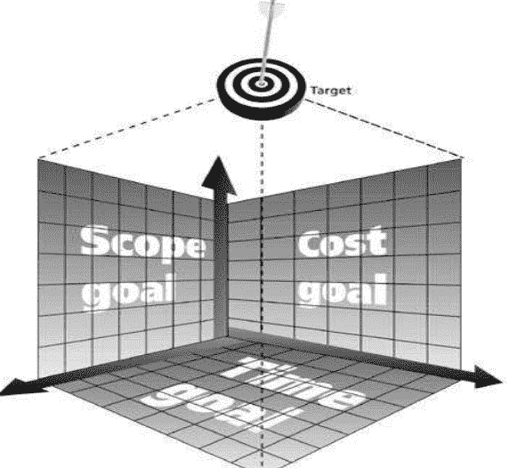

### What is Project Management?

- **Project management** is “the application of knowledge, skills, tools and techniques to project activities to meet project requirements.”*

*PMI, A Guide to the Project Management Body of Knowledge (PMBOK® Guide) (2004), p. 8.

### Figure 1-2. Project Management Framework

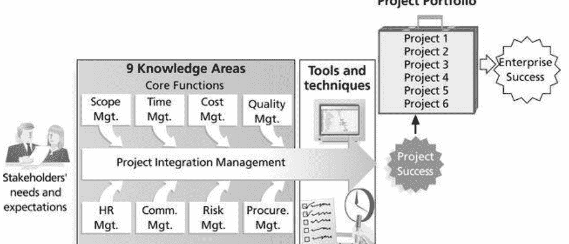

### Project Stakeholders

- **Stakeholders** are the people involved in or affected by project activities.
- Stakeholders include:
  - Project sponsor
  - Project manager
  - Project team
  - Support staff
  - Customers
  - Users
  - Suppliers
  - Opponents to the project

### Nine Project Management Knowledge Areas

- Knowledge areas describe the key competencies that project managers must develop.
  - Four core knowledge areas lead to specific project objectives (scope, time, cost, and quality).
  - Four facilitating knowledge areas are the means through which the project objectives are achieved (human resources, communication, risk, and procurement management).
  - One knowledge area (project integration management) affects and is affected by all of the other knowledge areas.
  - All knowledge areas are important!

### Improved Project Performance

- The Standish Group’s CHAOS studies show improvements in IT projects in the past decade.*

| Measure | 1994 Data | 2002 Data | Result |
|---|---|---|---|
| Successful projects | 16% | 34% | Doubled |
| Failed projects | 31% | 15% | Halved |
| Money wasted on challenged and failed projects | $140 B out of $250 B | $55 B out of $255 B | More than halved |

> *The Standish Group, “Latest Standish Group CHAOS Report Shows Project Success Rates Have Improved by 50%” (March 25, 2003).

### Why the Improvements?

> “The reasons for the increase in successful projects vary. First, the average cost of a project has been more than cut in half. Better tools have been created to monitor and control progress and **better skilled project managers with better management processes** are being used. The fact that there are processes is significant in itself.”*

*The Standish Group, “CHAOS 2001: A Recipe for Success” (2001).

### Project Success Factors*

1. Executive support
2. User involvement
3. Experienced project manager
4. Clear business objectives
5. Minimized scope
6. Standard software infrastructure
7. Firm basic requirements
8. Formal methodology
9. Reliable estimates
10. Other criteria, such as small milestones, proper planning, competent staff, and ownership

*The Standish Group, “Extreme CHAOS” (2001).

### What the Winners Do*

- Recent research findings show that companies that excel in project delivery capability:
  - Use an integrated project management toolbox that includes standard and advanced tools and lots of templates.
  - Grow project leaders, emphasizing business and soft skills.
  - Develop a streamlined project delivery process.
  - Measure project health using metrics, including customer satisfaction and return on investment.

> *Milosevic, Dragan and And Ozbay, “Delivering Projects: What the Winners Do,” Proceedings of the Project Management Institute Annual Seminars & Symposium (November 2001).

### The Role of the Project Manager

- Job descriptions vary, but most include responsibilities such as planning, scheduling, coordinating, and working with people to achieve project goals.
- Remember that 97 percent of successful projects were led by experienced project managers.

### Table 1-3. Fifteen Project Management Job Functions*

- Define scope of project.
- Identify stakeholders, decision-makers, and escalation procedures.
- Develop detailed task list (work breakdown structures).
- Estimate time requirements.
- Develop initial project management flow chart.
- Identify required resources and budget.
- Evaluate project requirements.
- Identify and evaluate risks.
- Prepare contingency plan.
- Identify interdependencies.
- Identify and track critical milestones.
- Participate in project phase review.
- Secure needed resources.
- Manage the change control process.
- Report project status.

> *Northwest Center for Emerging Technologies, “Building a Foundation for Tomorrow: Skills Standards for Information Technology,” Bellevue, WA, 1999.

Information Technology Project Management, Fourth Edition

### Suggested Skills for Project Managers

- Project managers need a wide variety of skills.
- They should:
  - Be comfortable with change.
  - Understand the organizations they work in and with.
  - Lead teams to accomplish project goals.

- Project managers need both “hard” and “soft” skills.
  - **Hard skills** include product knowledge and knowing how to use various project management tools and techniques.
  - **Soft skills** include being able to work with various types of people.

- **Communication skills**: Listens, persuades.
- **Organizational skills**: Plans, sets goals, analyzes.
- **Team-building skills**: Shows empathy, motivates, promotes esprit de corps.
- **Leadership skills**: Sets examples, provides vision (big picture), delegates, positive, energetic.
- **Coping skills**: Flexible, creative, patient, persistent.
- **Technology skills**: Experience, project knowledge.

### Media Snapshot – Good Project Management Skills from The Apprentice

- Leadership and professionalism are crucial.
- Know what your sponsor expects from the project, and learn from your mistakes.
- Trust your team and delegate decisions.
- Know the business.
- Stand up for yourself.
- Be a team player.
- Stay organized and don’t be overly emotional.
- Work on projects and for people you believe in.
- Think outside the box.
- There is some luck involved in project management, and you should always aim high.

### Table 1-4. Most Significant Characteristics of Effective and Ineffective Project Managers

| Effective Project Managers | Ineffective Project Managers |
|----------------------------|------------------------------|
| • Leadership by example | • Sets bad example |
| • Visionary | • Not self-assured |
| • Technically competent | • Lacks technical expertise |
| • Decisive | • Poor communicator |
| • Good communicator | • Poor motivator |
| • Good motivator | |
| • Stands up to upper management when necessary | |
| • Supports team members | |
| • Encourages new ideas | |

### Importance of Leadership Skills

- Effective project managers provide leadership by example.
- A leader focuses on long-term goals and big-picture objectives while inspiring people to reach those goals.
- A manager deals with the day-to-day details of meeting specific goals.
- Project managers often take on both leader and manager roles.

### Table 1-5. Top Ten Most In-Demand IT Skills

| Rank | IT Skill/Job | Average Annual Salary |
|---|---|---|
| 1 | SQL Database Analyst | $80,664 |
| 2 | Oracle Database Analyst | $87,144 |
| 3 | C/C++ Programmer | $95,829 |
| 4 | Visual Basic Programmer | $76,903 |
| 5 | E-commerce/Java Developer | $89,163 |
| 6 | Windows NT/2000 Expert | $80,639 |
| 7 | Windows/Java Developer | $93,785 |
| 8 | Security Architect | $86,881 |
| 9 | Project Manager | $95,719 |
| 10 | Network Engineer | $82,906 |

Paul Ziv, “The Top 10 IT Skills in Demand,” Global Knowledge Webcast (www.globalknowledge.com) (11/20/2002).

### History of Project Management

- Some people argue that building the Egyptian pyramids was a project, as was building the Great Wall of China.
- Most people consider the **Manhattan Project** to be the first project to use “modern” project management.
  - This three-year, $2 billion (in 1946 dollars) project had a separate project and technical managers.

### Figure 1-5. Sample Network Diagram

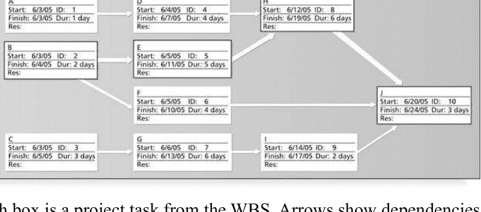

Each box is a project task from the WBS. Arrows show dependencies between tasks. The bolded tasks are on the critical path. If any task on the critical path takes longer to complete than planned, the whole project will slip unless something is done. Network diagrams were first used in 1958 on the Navy Polaris project before project management software was available.

### Project Management Office (PMO)

A PMO is an organizational group responsible for coordinating the project management function throughout an organization.

- Possible goals include:
  - Collect, organize, and integrate project data for the entire organization.
  - Develop and maintain templates for project documents.
  - Develop or coordinate training in various project management topics.
  - Develop and provide a formal career path for project managers.
  - Provide project management consulting services.
  - Provide a structure to house project managers while they are acting in those roles or are between projects.

### Project Management Software

- Enterprise PM software integrates information from multiple projects to show the status of active, approved, and future projects across an entire organization.
- It also provides links to more detailed information on each project.
- Many managers like to see status in color – red, yellow, and green.

### Figure 1-6. Sample Enterprise Project Management Tool

| Company ABC Project Portfolio |
|---|---|---|---|
| Project Name | Scope | Schedule | Budget | Links |
| Active Projects |  |  |  |  |
| Project 1 | ○ | ◐ | ◐ |  |
| Project 2 | ● | ● | ◐ |  |
| Project 3 | ○ | ○ | ○ |  |
| Project 4 | ○ | ◐ | ● |  |
| Approved Projects |  |  |  |  |
| Project 10 | ○ | ○ | ○ |  |
| Project 11 | ○ | ○ | ○ |  |
| Project 12 | ○ | ○ | ○ |  |
| Project 13 | ○ | ○ | ○ |  |
| Project 14 | ○ | ○ | ○ |  |
| Opportunities |  |  |  |  |
| Project 100 |  |  |  |  |
| Project 200 |  |  |  |  |
| ○ | White = going well |  |  |  |
| ◐ | Gray = some problems |  |  |  |
| ● | Black = major problems |  |  |  |

### The Project Management Profession

- Professional societies such as the Project Management Institute (PMI) have grown significantly.
- There are specific interest groups in many areas, such as engineering, financial services, health care, and IT.
- Project management research and certification programs continue to grow.

### Project Management Certification

- PMI provides certification as a Project Management Professional (PMP).
- A PMP has documented sufficient project experience, agreed to follow a code of ethics, and passed the PMP exam.
- The number of people earning PMP certification is increasing quickly.
- PMI and other organizations are offering new certification programs (see Appendix B).

### Figure 1-7. Growth in PMP Certification, 1993-2003

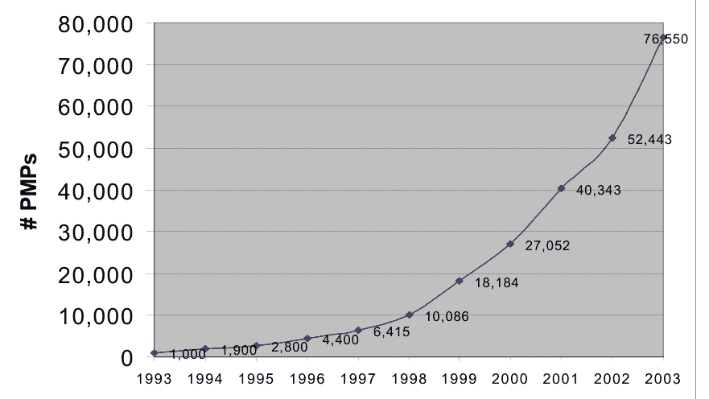

### Ethics in Project Management

- Ethics is an important part of all professions.
- Project managers often face ethical dilemmas.
- In order to earn PMP certification, applicants must agree to the PMP code of professional conduct.
- Several questions on the PMP exam are related to professional responsibility, including ethics.

### Project Management Software

- There are currently hundreds of different products to assist in performing project management.
- Three main categories of tools:
  - **Low-end tools**: Handle single or smaller projects well; cost under $200 per user.
  - **Midrange tools**: Handle multiple projects and users; cost $200-500 per user; Project 2003 most popular (includes an enterprise version).
  - **High-end tools**: Also called enterprise project management software; often licensed on a per-user basis; VPMi Enterprise Online (www.vcsonline.com).

### Chapter Summary

- As the number and complexity of projects continue to grow, it is becoming even more important to practice good project management.
- A project has several attributes, such as being unique, temporary and developed incrementally.
- A framework for project management includes project stakeholders, the nine knowledge areas, tools and techniques, and creating project portfolios to ensure enterprise success.
- Successful project managers must possess and develop many skills and lead their teams by example.
- The project management profession continues to mature as more people become certified and more tools are created.

## Chapter 2: The Project Management and Information Technology Context

Information Technology Project Management, Fourth Edition

### Learning Objectives

- Describe the systems view of project management and how it applies to information technology projects.
- Understand organizations, including the four frames, organizational structures, and organizational culture.
- Explain why stakeholder management and top management commitment are critical for a project’s success.
- Understand the concept of a project phase and the project life cycle and distinguish between project development and product development.
- Discuss the unique attributes and diverse nature of information technology projects.

### Projects Cannot Be Run in Isolation

- Projects must operate in a broad organizational environment.
- Project managers need to use **systems thinking:**
  - Taking a holistic view of a project and understanding how it relates to the larger organization.
- Senior managers must make sure projects continue to support current business needs.

### A Systems View of Project Management

- The term **systems approach** emerged in the 1950s to describe a holistic and analytical approach to solving complex problems.
- Three parts include:
  - **Systems philosophy**: View things as systems, which are interacting components that work within an environment to fulfill some purpose.
  - **Systems analysis**: Problem-solving approach.
  - **Systems management**: Address business, technological, and organizational issues before making changes to systems.

### Media Snapshot

- The Press Association Ltd., the largest news agency in the United Kingdom, hired a consulting firm to help turn things around after management noticed that its profit margins were sliding.
- The consultants suggested using a holistic view and a top-down strategy to make sure projects supported key business goals.
- They also suggested releasing short-term results to accrue benefits on an incremental basis and reviewing projects on a regular basis to ensure strategic alignment.*

> *Jackson, Lynne, “Forge Ahead,”* PM Network *(April 2004), p.48.*

### Figure 2-1. Three Sphere Model for Systems Management

- What will the laptop project cost the college?
- What will it cost students?
- What will support costs be?
- What will the impact be on enrollments?

- Will the laptop project affect all students, just traditional students, or only certain majors?
- How will the project affect students who already have PCs or laptops?
- Who will train students, faculty, and staff?
- Who will administer and support training?

- Should the laptops use Macintosh, Windows, or both types of operating systems?
- What applications software will be loaded?
- What will the hardware specifications be?
- How will the hardware impact LAN and Internet access?

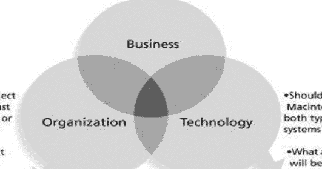

### Understanding Organizations

| Structural frame: Focuses on roles and responsibilities, coordination, and control. Organization charts help define this frame. | Human resources frame: Focuses on providing harmony between needs of the organization and needs of people. |
|---|---|
| Political frame: Assumes organizations are coalitions composed of varied individuals and interest groups. Conflict and power are key issues. | Symbolic frame: Focuses on symbols and meanings related to events. Culture is important. |

### What Went Wrong?

Many enterprise resource planning (ERP) projects fail due to organizational issues, not technical issues. For example, Sobey’s Canadian grocery store chain abandoned its two-year, $90 million ERP system due to organizational problems.

As Dalhousie University Associate Professor Sunny Marche states, “The problem of building an integrated system that can accommodate different people is a very serious challenge. You can’t divorce technology from the sociocultural issues. They have an equal role.” Sobey’s ERP system shut down for five days and employees were scrambling to stock potentially empty shelves in several stores for weeks. The system failure cost Sobey’s more than $90 million and caused shareholders to take an 82-cent after-tax hit per share.

*Hoare, Eva. “Software Hardships,” The Herald, Halifax, Nova Scotia (2001).

### Many Organizations Focus on the Structural Frame

- Most people understand what organizational charts are.
- Many new managers try to change organizational structure when other changes are needed.
- Three basic organizational structures:
  - **Functional**: Functional managers report to the CEO.
  - **Project**: Program managers report to the CEO.
  - **Matrix**: Middle ground between functional and project structures; personnel often report to two or more bosses; structure can be a weak, balanced, or strong matrix.

### Figure 2-2. Functional, Project, and Matrix Organizational Structures

CEO

VP Engineering

VP Manufacturing

VP IT

VP HR

Staff

Staff

Staff

Staff

CEO

Program Manager A

Program Manager B

Program Manager C

Staff

Staff

Staff

CEO

Program Managers

VP Engineering

VP Manufacturing

VP IT

VP HR

Staff

Staff

Staff

Staff

Staff

| Project Manager | engineering | manufacturing | IT | HR |
| --- | --- | --- | --- | --- |
| A | 2 | 1 | 3 | 1/2 |
| B | 5 | 3 | 10 | 1 |
| C | 1 | 0 | 4 | 1/2 |

### Table 2-1. Organizational Structure Influences on Projects

| Project Characteristics | Organizational Structure Type |  |  |  |  |
| | Functional | Matrix |  |  | Project |
| |  | Weak Matrix | Balanced Matrix | Strong Matrix |  |
| Project manager's authority | Little or none | Limited | Low to Moderate | Moderate to high | High to almost total |
| Percent of performing organization's personnel assigned full-time to project work | Virtually none | 0-25% | 15-60% | 50-95% | 85-100% |
| Who controls the project budget | Functional manager | Functional manager | Mixed | Project manager | Project manager |
| Project manager's role | Part-time | Part-time | Full-time | Full-time | Full-time |
| Common title for project manager's role | Project Coordinator/ Project Leader | Project Coordinator/ Project Leader | Project Manager/ Project Officer | Project Manager/ Program Manager | Project Manager/ Program Manager |
| Project management administrative staff | Part-time | Part-time | Part-time | Full-time | Full-time |

> PMBOK® Guide, 2000, 19, and PMBOK® Guide 2004, 28.

### Organizational Culture

- **Organizational culture** is a set of shared assumptions, values, and behaviors that characterize the functioning of an organization.
- Many experts believe the underlying causes of many companies’ problems are not the structure or staff, but the culture.

### Ten Characteristics of Organizational Culture

- Member identity*
- Group emphasis*
- People focus
- Unit integration*
- Control
- Risk tolerance*
- Reward criteria*
- Conflict tolerance*
- Means-ends orientation
- Open-systems focus*

*Project work is most successful in an organizational culture where these characteristics are highly prevalent and where the other characteristics are balanced.

### Stakeholder Management

- Project managers must take time to identify, understand, and manage relationships with all project stakeholders.
- Using the four frames of organizations can help you meet stakeholder needs and expectations.
- Senior executives and top management are very important stakeholders.

### Importance of Top Management Commitment

Several studies cite top management commitment as one of the key factors associated with project success.

Top management can help project managers:

- Secure adequate resources.
- Get approval for unique project needs in a timely manner.
- Receive cooperation from people throughout the organization.
- Learn how to be better leaders.

### Need for Organizational Commitment to Information Technology (IT)

- If the organization has a negative attitude toward IT, it will be difficult for an IT project to succeed.
- Having a Chief Information Officer (CIO) at a high level in the organization helps IT projects.
- Assigning non-IT people to IT projects also encourages more commitment.

### Need for Organizational Standards

- Standards and guidelines help project managers be more effective.
- Senior management can encourage:
  - The use of standard forms and software for project management.
  - The development and use of guidelines for writing project plans or providing status information.
  - The creation of a project management office or center of excellence.

### Project Phases and the Project Life Cycle

- **A project life cycle** is a collection of project phases that defines:
  - What work will be performed in each phase.
  - What deliverables will be produced and when.
  - Who is involved in each phase.
  - How management will control and approve work produced in each phase.
- **A deliverable** is a product or service produced or provided as part of a project.

### More on Project Phases

- In the early phases of a project life cycle:
  - Resource needs are usually lowest.
  - The level of uncertainty (risk) is highest.
  - Project stakeholders have the greatest opportunity to influence the project.
- In the middle phases of a project life cycle:
  - The certainty of completing a project increases.
  - More resources are needed.
- In the final phase of a project life cycle:
  - The focus is on ensuring that project requirements were met.
  - The sponsor approves completion of the project.

### Figure 2-3. Phases of the Traditional Project Life Cycle

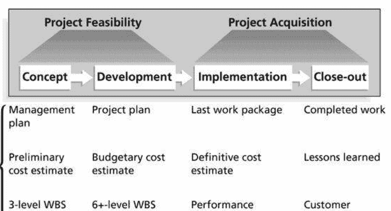

### Product Life Cycles

- Products also have life cycles.
- A **systems development life cycle (SDLC)** is a framework for describing the phases involved in developing information systems.
- Systems development projects can follow:
  - **Predictive life cycle:** The scope of the project can be clearly articulated and the schedule and cost can be predicted.
  - **Adaptive Software Development (ASD) life cycle:** Projects are mission driven and component based, and use time-based cycles to meet target dates.

### Predictive Life Cycle Models

- **Waterfall model**: Has well-defined, linear stages of systems development and support.
- **Spiral model**: Shows that software is developed using an iterative or spiral approach rather than a linear approach.
- **Incremental build model**: Provides for progressive development of operational software.
- **Prototyping model**: Used for developing prototypes to clarify user requirements.
- **Rapid Application Development (RAD) model**: Used to produce systems quickly without sacrificing quality.

### Adaptive Life Cycle Models

- **Extreme programming (XP)**: Developers program in pairs and must write the tests for their own code. XP teams include developers, managers, and users.
- **Scrum**: Iterative development in which repetitions are referred to as sprints, which normally last thirty days. Teams often meet each day for a short meeting, called a scrum, to decide what to accomplish that day. Works best for object-oriented technology projects and require strong leadership to coordinate the work.

### What Went Right?

> The real improvement that I saw was in our ability to—in the words of Thomas Edison—know when to stop beating a dead horse... Edison's key to success was that he failed fairly often; but as he said, he could recognize a dead horse before it started to smell... In information technology we ride dead horses—failing projects—a long time before we give up. But what we are seeing now is that we are able to get off them; able to reduce cost overrun and time overrun. That's where the major impact came on the success rate."

Many organizations, like Huntington Bancshares, Inc., use an executive steering committee to help keep projects on track.

> *Cabanis, Jeannette, “A Major Impact: The Standish Group’s Jim Johnson On Project Management and IT Project Success,” PM Network, PMI (September 1998), p. 7.*

### The Context of IT Projects

- IT projects can be very diverse in terms of size, complexity, products produced, application area, and resource requirements.
- IT project team members often have diverse backgrounds and skill sets.
- IT projects use diverse technologies that change rapidly. Even within one technology area, people must be highly specialized.

### Chapter Summary

- Project managers need to take a systems approach when working on projects.
- Organizations have four different frames: structural, human resources, political, and symbolic.
- The structure and culture of an organization have strong implications for project managers.
- Projects should successfully pass through each phase of the project life cycle.
- Project managers need to consider several factors due to the unique context of information technology projects.

## Chapter 3: The Project Management Process Groups: A Case Study

*Information Technology Project Management, Fourth Edition*

### Learning Objectives

- Describe the five project management (PM) process groups, the typical level of activity for each, and the interactions among them.
- Understand how the PM process groups relate to the PM knowledge areas.
- Discuss how organizations develop information technology PM methodologies to meet their needs.
- Review a case study of an organization applying the PM process groups to manage an information technology project, and understand the contribution that effective project initiation, project planning, project execution, project monitoring and controlling, and project closing make to project success.

### Project Management Process Groups

- A **process** is a series of actions directed toward a particular result.
- Project management can be viewed as a number of interlinked processes.
- The project management process groups include:
  - Initiating processes
  - Planning processes
  - Executing processes
  - Monitoring and controlling processes
  - Closing processes

**Figure 3-1. Level of Activity and Overlap of Process Groups Over Time**

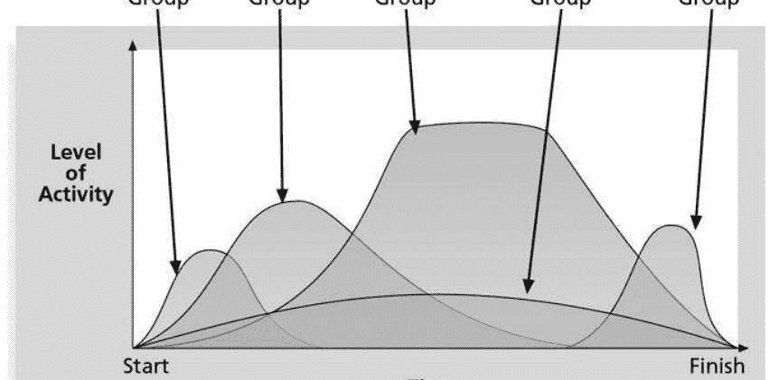

### What Went Wrong?

Phillip A. Pell, PMP, commented on how the U.S. IRS needed to improve its project management process. “Pure and simple, good, methodology-centric, predictable, and repeatable project management is the SINGLE greatest factor in the success (or in this case failure) of any project… The project manager is ultimately responsible for the success or failure of the project.”

*Pell, Phillip A., Comments posted on CIO Magazine Web site on article “For the IRS, There’s No EZ Fix” (April 1, 2004).*

### Media Snapshot

Just as information technology projects need to follow the project management process groups, so do other projects, such as the production of a movie. Processes involved in making movies might include screenwriting (initiating), producing (planning), acting and directing (executing), editing (monitoring and controlling), and releasing the movie to theaters (closing). Many people enjoy watching the extra features on a DVD that describe how these processes lead to the creation of a movie… This acted “...not as promotional filler but as a serious and meticulously detailed examination of the entire filmmaking process.” Project managers in any field know how important it is to follow a good process.

*Jacks, Brian, “Lord of the Rings: The Two Towers Extended Edition (New Line),” Underground Online (accessed from www.ugo.com August 4, 2004).*

### Mapping the Process Groups to the Knowledge Areas

- You can map the main activities of each PM process group into the nine knowledge areas by using the *PMBOK® Guide 2004*.
- Note that there are activities from _each_ knowledge area under the planning process group.
- All initiating activities are part of the project integration management knowledge area.

### Table 3-1. Relationships Among Process Groups and Knowledge Areas

| KNOWLEDGE AREA | PROJECT MANAGEMENT PROCESS GROUPS |  |  |  |  |
|---|---|---|---|---|---|
| | INITIATING | PLANNING | EXECUTING | MONITORING & CONTROLLING | CLOSING |
| Project Integration Management | Develop project charter; Develop preliminary project scope statement | Develop project management plan | Direct and manage project execution | Monitor and control project work; Integrated change control | Close project |
| Project Scope Management | | Scope planning; Scope definition; Create WBS | | Scope verification; Scope control | |
| Project Time Management | | Activity definition; Activity sequencing; Activity resource estimating; Activity duration estimating; Schedule development | | Schedule control | |
| Project Cost Management | | Cost estimating; Cost budgeting | | Cost control | |

*PMBOK® Guide 2004, p. 69*

### Table 3-1. Relationships Among Process Groups and Knowledge Areas (cont’d)

| KNOWLEDGE AREA | PROJECT MANAGEMENT PROCESS GROUPS |  |  |  |  |
|---|---|---|---|---|---|
| | INITIATING | PLANNING | EXECUTING | MONITORING & CONTROLLING | CLOSING |
| Project Quality Management | | Quality planning | Perform quality assurance | Perform quality control | |
| Project Human Resource Management | | Human resource planning | Acquire project team Develop project team | Manage project team | |
| Project Communications Management | | Communications planning | Information distribution | Performance reporting; Manage stakeholders | |
| Project Risk Management | | Risk management planning; Risk identification; Qualitative risk analysis; Quantitative risk analysis; Risk response planning | | Risk monitoring and control | |
| Project Procurement Management | | Plan purchases and acquisitions; Plan contracting | Request seller responses; Select sellers | Contract administration | Contract closure |

*PMBOK® Guide 2004, p. 69*

### Developing an IT Project Management Methodology

- Just as projects are unique, so are approaches to project management.
- Many organizations develop their own project management methodologies, especially for IT projects.
- Blue Cross Blue Shield of Michigan used the *PMBOK® Guide 2000* to develop their IT project management methodology.
- Six Sigma projects and the Rational Unified Process (RUP) framework use project management methodologies.

### What Went Right?

Jordan Telecom (JT), Jordan’s only telecom operator, introduced new customized project management processes to improve efficiency and reduce costs in its Information Technology department…JT created three lines of processes based on the size of the project: high, medium, or low…Rula Ammuri, JT’s Chief Information Officer, believes this new methodology will result in a 40-50 percent increase in productivity.*

Al-Tamimi, Fairooz, “Jordanian Company Uses PMI Methods to ‘Go Global’, Improve Productivity,” PMI Today (August 2004).

### Case Study: JWD Consulting’s Project Management Intranet Site

- This case study provides an example of what’s involved in initiating, planning, executing, controlling, and closing an IT project.
- You can download templates for creating your own project management documents from the companion Web site for this text.
- This case study provides a big picture view of managing a project. Later chapters provide detailed information on each knowledge area.

### Project Initiation

- Initiating a project includes recognizing and starting a new project or project phase.
- Some organizations use a pre-initiation phase, while others include items such as developing a business case as part of the initiation.
- The main goal is to formally select and start off projects.
- Key outputs include:
  - Assigning the project manager.
  - Identifying key stakeholders.
  - Completing a business case.
  - Completing a project charter and getting signatures on it.

### Project Initiation Documents
- Business case: See pages 82-85.
- Charter: See pages 77-78.
- Every organization has its own variations of what documents are required to initiate a project. It’s important to identify the project need, stakeholders, and main goals.

### Project Planning
- The main purpose of project planning is to **guide execution**.
- Every knowledge area includes planning information (see Table 3-5 on pages 87-89).
- Key outputs included in the JWD project include:
  - A team contract.
  - A scope statement.
  - A work breakdown structure (WBS).
  - A project schedule, in the form of a Gantt chart with all dependencies and resources entered.
  - A list of prioritized risks (part of a risk register).
- See sample documents on pages 90-98.

### Figure 3-4. JWD Consulting Intranet Site Project Baseline Gantt Chart

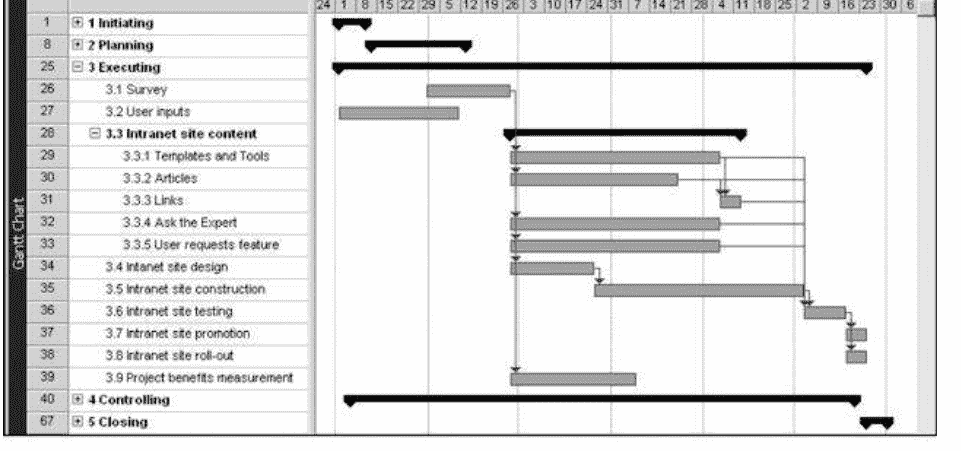

### Table 3-8. List of Prioritized Risks

| RANKING | POTENTIAL RISK |
|---|---|
| 1 | Lack of inputs from internal consultants |
| 2 | Lack of inputs from client representatives |
| 3 | Security of new system |
| 4 | Outsourcing/purchasing for the article retrieval and "Ask the Expert" features |
| 5 | Outsourcing/purchasing for processing online payment transactions |
| 6 | Organizing the templates and examples in a useful fashion |
| 7 | Providing an efficient search feature |
| 8 | Getting good feedback from Michael Chen and other senior consultants |
| 9 | Effectively promoting the new system |
| 10 | Realizing the benefits of the new system within one year |

### Project Executing
- Project execution usually takes the most time and resources.
- Project managers must use their leadership skills to handle the many challenges that occur during project execution.
- Table 3-9 on page 99 lists the executing processes and outputs. Many project sponsors and customers focus on deliverables related to providing the products, services, or results desired from the project.
- A milestone report (see example on page 100) can keep the focus on completing major milestones.

### Table 3-10. Part of Milestone Report

| MILESTONE | DATE | STATUS | RESPONSIBLE | ISSUES/COMMENTS |
|---|---|---|---|---|
| *Initiating* |  |  |  |  |
| Project manager determined/assigned | 5/2/05 | Completed | Joe |  |
| Business case created | 5/6/05 | Completed | Erica |  |
| Project charter signed | 5/10/05 | Completed | Erica |  |
| *Planning* |  |  |  |  |
| Project kickoff meeting held | 5/13/05 | Completed | Erica | Went well |
| Team contract signed | 5/13/05 | Completed | Erica |  |
| Scope statement completed | 5/27/05 | Completed | Erica |  |
| WBS completed | 5/31/05 | Completed | Erica |  |
| List of prioritized risks completed | 6/3/05 | Completed | Erica | Reviewed with sponsor and team |
| Schedule and cost baseline completed | 6/13/05 | Completed | Erica |  |
| *Executing* |  |  |  |  |
| Survey completed | 6/28/05 |  | Erica | Poor response so far! |
| Intranet site design completed | 7/26/05 |  | Kevin |  |
| Project benefits measurement completed | 8/9/05 |  | Erica |  |

### Project Monitoring and Controlling
- Involves measuring progress toward project objectives, monitoring deviation from the plan, and taking corrective action to match progress with the plan.
- Affects all other process groups and occurs during all phases of the project life cycle.
- Outputs include performance reports, requested changes, and updates to various plans.

### Project Closing
- Involves gaining stakeholder and customer acceptance of the final products and services.
- Even if projects are not completed, they should be formally closed in order to reflect on what can be learned to improve future projects.
- Outputs include project archives and lessons learned, which are part of organizational process assets.
- Most projects also include a final report and presentation to the sponsor or senior management.

## Chapter 4:
Project Integration Management

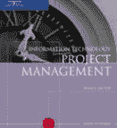

Information Technology Project Management, Fourth Edition

### Learning Objectives

- Describe an overall framework for project integration management as it relates to the other project management knowledge areas and the project life cycle.
- Explain the strategic planning process and apply different project selection methods.
- Explain the importance of creating a project charter to formally initiate projects.
- Discuss the process of creating a preliminary project scope statement.

### Learning Objectives

- Describe project management plan development, including content, using guidelines and templates for developing plans, and performing a stakeholder analysis to help manage relationships.
- Explain project execution, its relationship to project planning, the factors related to successful results, and tools and techniques to assist in project execution.
- Describe the process of monitoring and controlling project work.

### Learning Objectives

- Understand the integrated change control process, planning for and managing changes on information technology projects, and developing and using a change control system.
- Explain the importance of developing and following good procedures for closing projects.
- Describe how software can assist in project integration management.

### The Key to Overall Project Success:
Good Project Integration Management

- Project managers must coordinate all of the other knowledge areas throughout a project’s life cycle.
- Many new project managers have trouble looking at the “big picture” and want to focus on too many details. (See opening case for a real example.)
- Project integration management is *not* the same thing as software integration.

### Project Integration Management Processes

- **Develop the project charter**: Work with stakeholders to create the document that formally authorizes a project—the charter.
- **Develop the preliminary project scope statement**: Work with stakeholders, especially users of the project’s products, services, or results, to develop the high-level scope requirements and create a preliminary project scope statement.
- **Develop the project management plan**: Coordinate all planning efforts to create a consistent, coherent document—the project management plan.

### Project Integration Management Processes (cont’d)

- **Direct and manage project execution**: Carry out the project management plan by performing the activities included in it.
- **Monitor and control the project work**: Oversee project work to meet the performance objectives of the project.
- **Perform integrated change control**: Coordinate changes that affect the project’s deliverables and organizational process assets.
- **Close the project**: Finalize all project activities to formally close the project.

### Strategic Planning and Project Selection

- **Strategic planning** involves determining long-term objectives, predicting future trends, and projecting the need for new products and services.

- Organizations often perform a **SWOT analysis**:

- **Strengths, Weaknesses, Opportunities, and Threats**

- As part of strategic planning, organizations should:

- Identify potential projects.
- Use realistic methods to select which projects to work on.
- Formalize project initiation by issuing a project charter.

### Identifying Potential Projects

- Many organizations follow a planning process for selecting IT projects.
- It’s crucial to align IT projects with business strategy.
- Research shows that:

  - Supporting explicit business objectives is the number one reason cited for investing in IT projects.
  - Companies with consolidated IT operations have a 24 percent lower operational cost per end user.
  - The consistent use of IT standards lowers application development costs by 41 percent per user.*

> *Cosgrove Ware, Lorraine, “By the Numbers,” CIO Magazine (www.cio.com) (September 1, 2002).

### Figure 4-1. Information Technology Planning Process

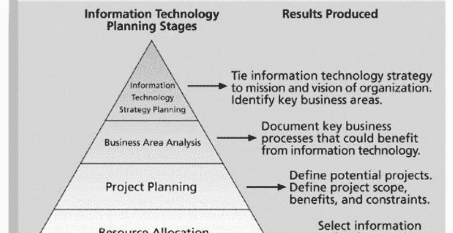

### Methods for Selecting Projects

- There is usually not enough time or resources to implement all projects.
- Methods for selecting projects include:
  - Focusing on broad organizational needs.
  - Categorizing information technology projects.
  - Performing net present value or other financial analyses.
  - Using a weighted scoring model.
  - Implementing a balanced scorecard.

### Focusing on Broad Organizational Needs

- It is often difficult to provide strong justification for many IT projects, but everyone agrees they have a high value.
- “It is better to measure gold roughly than to count pennies precisely.”
- Three important criteria for projects:
  - There is a **need** for the project.
  - There are **funds** available for the project.
  - There is a strong **will** to make the project succeed.

### Categorizing IT Projects

- One categorization assesses whether the project provides a response to:
  - A problem
  - An opportunity
  - A directive
- Another categorization is based on the time it will take to complete a project or the date by which it must be done.
- Another categorization is the overall priority of the project.

### Financial Analysis of Projects

Financial considerations are often an important aspect of the project selection process.

Three primary methods for determining the projected financial value of projects:

- Net present value (NPV) analysis
- Return on investment (ROI)
- Payback analysis

### Net Present Value Analysis

- **Net present value** (NPV) analysis is a method of calculating the expected net monetary gain or loss from a project by discounting all expected future cash inflows and outflows to the present point in time.
- Projects with a positive NPV should be considered if financial value is a key criterion.
- The higher the NPV, the better.

### Figure 4-2. Net Present Value Example

|   | A | B | C | D | E | F | G |
|---|---|---|---|---|---|---|---|
| 1 | Discount rate | 10% |  |  |  |  |  |
| 2 |  |  |  |  |  |  |  |
| 3 | PROJECT 1 | YEAR 1 | YEAR 2 | YEAR 3 | YEAR 4 | YEAR 5 | TOTAL |
| 4 | Benefits | $0 | $2,000 | $3,000 | $4,000 | $5,000 | $14,000 |
| 5 | Costs | $5,000 | $1,000 | $1,000 | $1,000 | $1,000 | $9,000 |
| 6 | Cash flow | ($5,000) | $1,000 | $2,000 | $3,000 | $4,000 | $5,000 |
| 7 | NPV → $2,316 |  |  |  |  |  |  |
| 8 | Formula =npv(b1,b6:f6) |  |  |  |  |  |  |
| 9 |  |  |  |  |  |  |  |
| 10 | PROJECT 2 | YEAR 1 | YEAR 2 | YEAR 3 | YEAR 4 | YEAR 5 | TOTAL |
| 11 | Benefits | $1,000 | $2,000 | $4,000 | $4,000 | $4,000 | $15,000 |
| 12 | Costs | $2,000 | $2,000 | $2,000 | $2,000 | $2,000 | $10,000 |
| 13 | Cash flow | ($1,000) | $0 | $2,000 | $2,000 | $2,000 | $5,000 |
| 14 | NPV → $3,201 |  |  |  |  |  |  |
| 15 | Formula =npv(b1,b13:f13) |  |  |  |  |  |  |
| 16 |  |  |  |  |  |  |  |

Note that totals are equal, but NPVs are not because of the time value of money.

### Figure 4-3. JWD Consulting NPV Example

Multiply by the discount factor each year, then subtract costs from cumulative benefits to get NPV.

| Discount rate | 8% |  |  |  |  |  |
| Assume the project is completed in Year 0 | Year |  |  |  |  |  |
|  | 0 | 1 | 2 | 3 | Total |  |
| Costs | 140,000 | 40,000 | 40,000 | 40,000 |  |  |
| Discount factor | 1 | 0.93 | 0.86 | 0.79 |  |  |
| Discounted costs | 140,000 | 37,200 | 34,400 | 31,600 | 243,200 |  |
|  |  |  |  |  |  |  |
| Benefits | 0 | 200,000 | 200,000 | 200,000 |  |  |
| Discount factor | 1 | 0.93 | 0.86 | 0.79 |  |  |
| Discounted benefits | 0 | 186,000 | 172,000 | 158,000 | 516,000 |  |
|  |  |  |  |  |  |  |
| Discounted benefits - costs | (140,000) | 148,800 | 137,600 | 126,400 | 272,800 ← NPV |  |
| Cumulative benefits - costs | (140,000) | 8,800 | 146,400 | 272,800 |  |  |
| ROI | 112% |  |  |  |  |  |
|  | Payback In Year 1 |  |  |  |  |  |

Note: See the template called business_case_financials.xls.

### NPV Calculations

- Determine estimated costs and benefits for the life of the project and the products it produces.
- Determine the discount rate (check with your organization on what to use).
- Calculate the NPV (see text for details).
- Some organizations consider the investment year as year 0, while others consider it year 1. Some people enter costs as negative numbers, while others do not. Make sure to identify your organization’s preferences.

### Return on Investment

- **Return on investment (ROI)** is calculated by subtracting the project costs from the benefits and then dividing by the costs.

ROI = (total discounted benefits - total discounted costs) / discounted costs
- The higher the ROI, the better.
- Many organizations have a required rate of return or minimum acceptable rate of return on investment for projects.
- Internal rate of return (IRR) can be calculated by setting the NPV to zero.

### Payback Analysis

- Another important financial consideration is payback analysis.
- The **payback period** is the amount of time it will take to recoup, in the form of net cash inflows, the total dollars invested in a project.
- Payback occurs when the cumulative discounted benefits and costs are greater than zero.
- Many organizations want IT projects to have a fairly short payback period.

### Figure 4-4. Charting the Payback Period

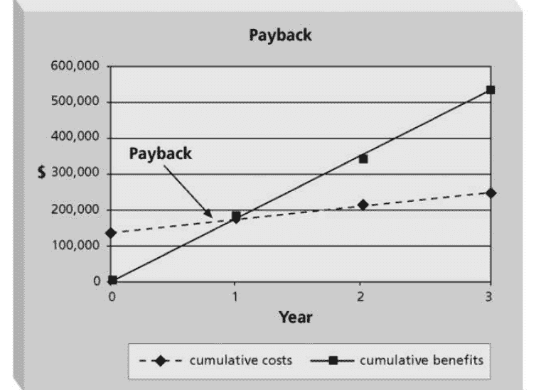

### Weighted Scoring Model

- A weighted scoring model is a tool that provides a systematic process for selecting projects based on many criteria.
- Steps in identifying a weighted scoring model:
  1. Identify criteria important to the project selection process.
  2. Assign weights (percentages) to each criterion so they add up to 100 percent.
  3. Assign scores to each criterion for each project.
  4. Multiply the scores by the weights to get the total weighted scores.
- The higher the weighted score, the better.

### Figure 4-5. Sample Weighted Scoring Model for Project Selection

|  | A | B | C | D | E | F |
|---|---|---|---|---|---|---|
| 1 | Criteria | Weight | Project 1 | Project 2 | Project 3 | Project 4 |
| 2 | Supports key business objectives | 25% | 90 | 90 | 50 | 20 |
| 3 | Has strong internal sponsor | 15% | 70 | 90 | 50 | 20 |
| 4 | Has strong customer support | 15% | 50 | 90 | 50 | 20 |
| 5 | Realistic level of technology | 10% | 25 | 90 | 50 | 70 |
| 6 | Can be implemented in one year or less | 5% | 20 | 20 | 50 | 90 |
| 7 | Provides positive NPV | 20% | 50 | 70 | 50 | 50 |
| 8 | Has low risk in meeting scope, time, and cost goals | 10% | 20 | 50 | 50 | 90 |
| 9 | Weighted Project Scores | 100% | 56 | 78.5 | 50 | 41.5 |

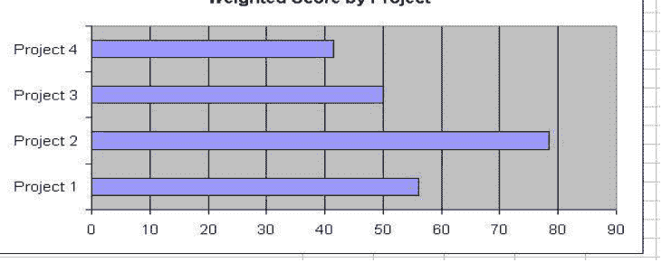

### Implementing a Balanced Scorecard

- Drs. Robert Kaplan and David Norton developed this approach to help select and manage projects that align with business strategy.
- A **balanced scorecard** is a methodology that converts an organization’s value drivers, such as customer service, innovation, operational efficiency, and financial performance, to a series of defined metrics.
- See www.balancedscorecard.org for more information.

### Project Charters

- After deciding what project to work on, it is important to let the rest of the organization know.
- A project charter is a document that formally recognizes the existence of a project and provides direction on the project's objectives and management.
- Key project stakeholders should sign a project charter to acknowledge agreement on the need and intent of the project; a signed charter is a key output of project integration management.

### Figure 4-6. Project Integration Management Overview

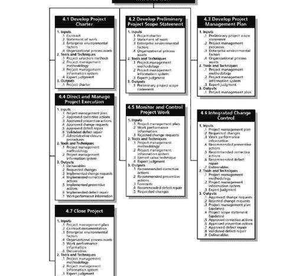

### Preliminary Scope Statements

- A **scope statement** is a document used to develop and confirm a common understanding of the project scope.
- It is an important tool for preventing **scope creep**:
  - The tendency for project scope to keep getting bigger.
- A good practice is to develop a preliminary or initial scope statement during project initiation and a more detailed scope statement as the project progresses.

### Contents of a Preliminary Scope Statement

- Project objectives
- Product or service requirements and characteristics
- Project boundaries
- Deliverables
- Product acceptance criteria
- Project assumptions and constraints
- Organizational structure for the project
- Initial list of defined risks
- Summary of schedule milestones
- Rough order of magnitude cost estimate
- Configuration management requirements
- Description of approval requirements

### Project Management Plans

- A **project management plan** is a document used to coordinate all project planning documents and help guide a project’s execution and control.
- Plans created in the other knowledge areas are subsidiary parts of the overall project management plan.

### Attributes of Project Plans

- Just as projects are unique, so are project plans.
- Plans should be:
  - Dynamic
  - Flexible
  - Updated as changes occur
- Plans should first and foremost guide project execution by helping the project manager lead the project team and assess project status.

### Common Elements of a Project Management Plan

- Introduction or overview of the project.
- Description of how the project is organized.
- Management and technical processes used on the project.
- Work to be done, schedule, and budget information.

### Table 4-1. Sample Contents for a Software Project Management Plan (SPMP)

### Major Project Management Plan Sections

| | OVERVIEW | PROJECT ORGANIZATION | MANAGERIAL PROCESS PLANS | TECHNICAL PROCESS PLANS | SUPPORTING PROCESS PLANS |
|---|---|---|---|---|---|
| Section Topics | Purpose, scope, and objectives; assumptions and constraints; project deliverables; schedule and budget summary; evolution of the plan | External interfaces; internal structure; roles and responsibilities | Start-up plans (estimation, staffing, resource acquisition, and project staff training plans); work plan (work activities, schedule, resource, and budget allocation); control plan; risk management plan; closeout plan | Process model; methods, tools, and techniques; infrastructure plan; product acceptance plan | Configuration management plan; verification and validation plan; documentation plan; quality assurance plan; reviews and audits; problem resolution plan; subcontractor management plan; process improvement plan |

> IEEE Standard 1058-1998.

### What the Winners Do

> “The winners clearly spell out what needs to be done in a project, by whom, when, and how. For this they use an integrated toolbox, including PM tools, methods, and techniques… If a scheduling template is developed and used over and over, it becomes a repeatable action that leads to higher productivity and lower uncertainty. Sure, using scheduling templates is neither a breakthrough nor a feat. But laggards exhibited almost no use of the templates. Rather, in constructing schedules their project managers started with a clean sheet, a clear waste of time.”*

*Milosevic, Dragan and And Ozbay, “Delivering Projects: What the Winners Do,” Proceedings of the Project Management Institute Annual Seminars & Symposium (November 2001).

### Stakeholder Analysis

- A **stakeholder analysis** documents important (often sensitive) information about stakeholders such as:
  - Stakeholders’ names and organizations.
  - Their roles on the project.
  - Unique facts about each stakeholder.
  - Their level of influence on and interest in the project.
  - Suggestions for managing relationships with each stakeholder.

### Table 4-2. Sample Stakeholder Analysis

| KEY STAKEHOLDERS | AHMED | SUSAN | ERIK | MARK | DAVID |
|---|---|---|---|---|---|
| Organization | Internal senior management | Project team | Project team | Hardware vendor | Project manager for other internal projects |
| Role on project | Project sponsor and one of the company's founders | DNA sequencing expert | Lead programmer | Supplier of some instrument hardware | Competitor for company resources |
| Unique facts | Quiet, demanding, likes details, business-focused, Stanford MBA | Ph.D. in biology, easy to work with, has toddler | Very smart, best programmer I know, weird sense of humor | Head of a start-up company, he knows we can make him rich if this works | Nice guy, one of the oldest people at company, has three kids in college |
| Level of interest | Very high | Very high | High | Very high | Low to medium |
| Level of influence | Very high; can call the shots | Subject matter expert; critical to success | High; hard to replace | Low; other vendors available | Low to medium |
| Suggestions on managing relationship | Keep informed, let him lead conversations, do as he says and quickly | Make sure she reviews specifications and leads testing; can do some work from home | Keep him happy so he stays; emphasize stock options; likes Mexican food | Give him enough lead time to deliver hardware | He knows his project takes a back seat to this one, but I can learn from him |

### Leadership and a Supportive Culture

Project managers must lead by example to demonstrate the importance of creating and then following good project plans.

Organizational culture can help project execution by:
- Providing guidelines and templates.
- Tracking performance based on plans.

Project managers may still need to break the rules to meet project goals, and senior managers must support those actions.

### What Went Wrong?

Many people have a poor view of plans based on their experiences. Top managers often require a project management plan, but then no one follows up on whether the plan was followed. For example, one project manager said he would meet with each project team leader within two months to review their project plans. The project manager created a detailed schedule for these reviews. He cancelled the first meeting due to another business commitment. He rescheduled the next meeting for unexplained personal reasons. Two months later, the project manager had still not met with over half of the project team leaders. Why should project members feel obligated to follow their own plans when the project manager obviously did not follow his?

### Important Skills for Project Execution

- General management skills such as leadership, communication, and political skills.
- Product, business, and application area skills and knowledge.
- Use of specialized tools and techniques.

### Monitoring and Controlling Project Work

- Changes are inevitable on most projects, so it’s important to develop and follow a process to monitor and control changes.
- Monitoring project work includes collecting, measuring, and disseminating performance information.
- Two important outputs of monitoring and controlling project work include recommended corrective and preventive actions.

### Media Snapshot

The 2002 Olympic Winter Games and Paralympics took five years to plan and cost more than $1.9 billion. PMI awarded the Salt Lake Organizing Committee (SLOC) the Project of the Year award for delivering world-class games.

Four years before the Games began, the SLOC used a Primavera software-based system with a cascading color-coded WBS to integrate planning...The SLOC also used an Executive Roadmap, a one-page list of the top 100 Games-wide activities, to keep executives apprised of progress. Activities were tied to detailed project information within each department’s schedule. A 90-day highlighter showed which managers were accountable for each integrated activity.

Fraser Bullock, SLOC Chief Operating Officer and Chief, said, “We knew when we were on and off schedule and where we had to apply additional resources. The interrelation of the functions meant they could not run in isolation—it was a smoothly running machine.”*

*Foti, Ross, “The Best Winter Olympics, Period,” PM Network (January 2004), p. 23.

### Integrated Change Control

Three main objectives are:
- Influence the factors that create changes to ensure that changes are beneficial.
- Determine that a change has occurred.
- Manage actual changes as they occur.

A **baseline** is the approved project management plan plus approved changes.

### Change Control on Information Technology Projects

- **Former view**: The project team should strive to do exactly what was planned on time and within budget.
- **Problem**: Stakeholders rarely agreed beforehand on the project scope, and time and cost estimates were inaccurate.
- **Modern view**: Project management is a process of constant communication and negotiation.
- **Solution**: Changes are often beneficial, and the project team should plan for them.

### Change Control Boards (CCBs)

- A formal group of people responsible for approving or rejecting changes on a project.
- CCBs provide guidelines for preparing change requests, evaluate change requests, and manage the implementation of approved changes.
- CCBs include stakeholders from the entire organization.

### Making Timely Changes
- Some CCBs only meet occasionally, so it may take too long for changes to occur.
- Some organizations have policies in place for time-sensitive changes.
  - A “48-hour policy” allows project team members to make a decision and have 48 hours to seek approval from top management. If the team decision cannot be implemented, management has 48 hours to reverse a decision; otherwise, the team’s decision is approved.
  - Another policy is to delegate changes to the lowest level possible, but keep everyone informed of changes.

### Configuration Management
- Ensures that the descriptions of the project’s products are correct and complete.
- Involves identifying and controlling the functional and physical design characteristics of products and their support documentation.
- Configuration management specialists identify and document configuration requirements, control changes, record and report changes, and audit the products to verify conformance to requirements.

### Table 4-3. Suggestions for Managing Integrated Change Control
- View project management as a process of constant communication and negotiation.
- Plan for change.
- Establish a formal change control system, including a change control board (CCB).
- Use good configuration management.
- Define procedures for making timely decisions on smaller changes.
- Use written and oral performance reports to help identify and manage change.
- Use project management and other software to help manage and communicate changes.

### Closing Projects
- To close a project, you must finalize all activities and transfer the completed or cancelled work to the appropriate people.
- Main outputs include:
  - Administrative closure procedures.
  - Contract closure procedures.
  - Final products, services, or results.
  - Organizational process asset updates.

### Using Software to Assist in Project Integration Management
- Several types of software can be used to assist in project integration management:
  - Word processing software creates documents.
  - Presentation software creates presentations.
  - Spreadsheets or databases perform tracking.
  - Communication software such as e-mail and Web authoring tools facilitate communications.
  - Project management software can pull everything together and show detailed and summarized information.

### Chapter Summary
- Project integration management includes:
  - Developing a project charter.
  - Developing a preliminary project scope statement.
  - Developing a project management plan.
  - Directing and managing project execution.
  - Monitoring and controlling project work.
  - Performing integrated change control.
  - Closing the project.

## Chapter 5:
Project Scope Management

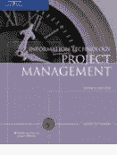

Information Technology Project Management, Fourth Edition

### Learning Objectives
- Understand the elements that make good project scope management important.
- Explain the scope planning process and describe the contents of a scope management plan.
- Describe the process for developing a project scope statement using the project charter and preliminary scope statement.
- Discuss the scope definition process and work involved in constructing a work breakdown structure using the analogy, top-down, bottom-up, and mind-mapping approaches.

### Learning Objectives
- Explain the importance of scope verification and how it relates to scope definition and control.
- Understand the importance of scope control and approaches for preventing scope-related problems on information technology projects.
- Describe how software can assist in project scope management.

### What is Project Scope Management?
- **Scope** refers to *all* the work involved in creating the products of the project and the processes used to create them.
- A **deliverable** is a product produced as part of a project, such as hardware or software, planning documents, or meeting minutes.
- Project scope management includes the processes involved in defining and controlling what is or is not included in a project.

### Project Scope Management Processes

- **Scope planning**: Deciding how the scope will be defined, verified, and controlled.
- **Scope definition**: Reviewing the project charter and preliminary scope statement and adding more information as requirements are developed and change requests are approved.
- **Creating the WBS**: Subdividing the major project deliverables into smaller, more manageable components.
- **Scope verification**: Formalizing acceptance of the project scope.
- **Scope control**: Controlling changes to project scope.

### Scope Planning and the Scope Management Plan

- The **scope management plan** is a document that includes descriptions of how the team will prepare the project scope statement, create the WBS, verify completion of the project deliverables, and control requests for changes to the project scope.
- Key inputs include the project charter, preliminary scope statement, and project management plan.

### Table 5.1. Sample Project Charter

**Project Title:** Information Technology (IT) Upgrade Project

**Project Start Date:** March 4, 2007   **Projected Finish Date:** December 4, 2007

**Project Manager:** Kim Nguyen, 691-2784, *knguyen@course.com*

**Project Objectives:** Upgrade hardware and software for all employees (approximately 2,000) within nine months based on new corporate standards. See attached sheet describing the new standards. Upgrades may affect servers, as well as associated network hardware and software. Budgeted $1,000,000 for hardware and software costs and $500,000 for labor costs.

**Approach:**

- Update the information technology inventory database to determine upgrade needs
- Develop detailed cost estimate for project and report to CIO
- Issue a request for quote to obtain hardware and software
- Use internal staff as much as possible for planning, analysis, and installation

**ROLES AND RESPONSIBILITIES:**

| NAME | ROLE | RESPONSIBILITY |
|---|---|---|
| Walter Schmidt | CEO | Project sponsor, monitor project |
| Mike Zwack | CIO | Monitor project, provide staff |
| Kim Nguyen | Project Manager | Plan and execute project |
| Jeff Johnson | Director of Information, Technology Operations | Mentor Kim |
| Nancy Reynolds | VP, Human Resources | Provide staff, issue memo to all employees about project |
| Steve McCann | Director of Purchasing | Assist in purchasing hardware and software |

### Table 5.1. Sample Project Charter (cont’d)

Sign-off: (Signatures of all the above stakeholders)

Walter Schmidt
Steve McCann
Mike Zwack
Nancy Reynolds
Kim Nguyen
Jeff Johnson

Comments: (Handwritten or typed comments from above stakeholders, if applicable)

> "This project must be done within ten months at the absolute latest." Mike Zwack, CIO

> "We are assuming that adequate staff will be available and committed to supporting this project. Some work must be done after hours to avoid work disruptions, and overtime will be provided." Jeff Johnson and Kim Nguyen, Information Technology department

### Scope Definition and the Project Scope Statement

- The preliminary scope statement, project charter, organizational process assets, and approved change requests provide a basis for creating the project scope statement.
- As time progresses, the scope of a project should become clearer and more specific.

### Table 5-2. Further Defining Project Scope

### Project Charter:

Upgrades may affect servers...

### Preliminary Scope Statement:

Servers: If additional servers are required to support this project, they must be compatible with existing servers. If it is more economical to enhance existing servers, a detailed description of enhancements must be submitted to the CIO for approval. See current server specifications provided in Atch 6. The CEO must approve a detailed plan describing the servers and their location at least two weeks before installation.

### Project Scope Statement, Version 1:

Servers: This project will require purchasing ten new servers to support Web, network, database, application, and printing functions. Two of each type of server will be purchased and dedicated to this project. Detailed descriptions of the servers are provided in a product brochure in Appendix 8 along with a plan describing where they will be located.

### Media Snapshot

Many people enjoy watching television shows like *Changing Rooms* or *Trading Spaces*, where participants have two days and $1,000 to update a room in their neighbor’s house. Because the time and cost are set, it’s the scope that has the most flexibility. Designers on these shows often have to change initial scope goals due to budget or time constraints.

Although most homeowners are very happy with work done on the show, some are obviously disappointed. Unlike most projects where the project team works closely with the customer, homeowners have little say in what gets done and cannot inspect the work along the way…What happens when the homeowners don’t like the work that’s been done? The FAQ section of tlc.com says, “Everyone on our show is told upfront that there’s a chance they won’t like the final design of the room. Each applicant signs a release acknowledging that the show is not responsible for redecorating a room that isn’t to the owner’s taste.”

Too bad you can’t get sponsors for most projects to sign a similar release form. It would make project scope management much easier!

### Creating the Work Breakdown Structure (WBS)

- A **WBS** is a deliverable-oriented grouping of the work involved in a project that defines the total scope of the project.
- A WBS is a foundation document that provides the basis for planning and managing project schedules, costs, resources, and changes.
- **Decomposition** is subdividing project deliverables into smaller pieces.

### Figure 3-1. Sample Intranet WBS Organized by Product

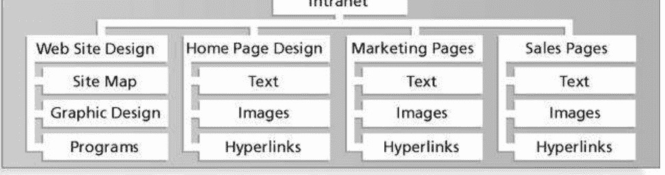

### Figure 3-2. Sample Intranet WBS Organized by Phase.

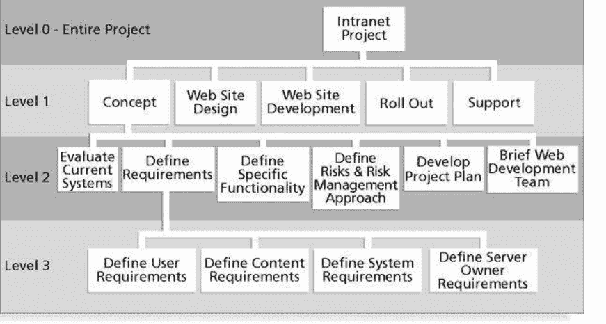

### Figure 5-3. Intranet WBS and Gantt Chart in Project 2000

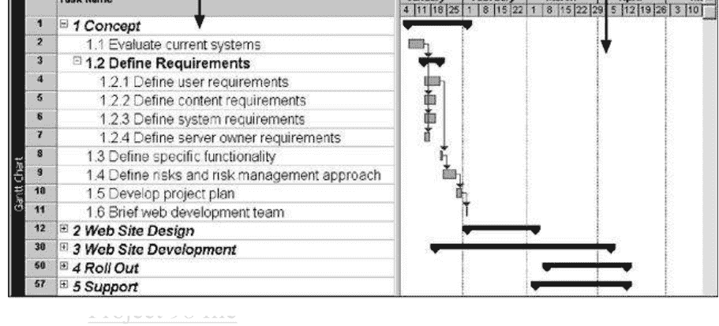

### Figure 5-4. Intranet Gantt Chart Organized by Project Management Process Groups

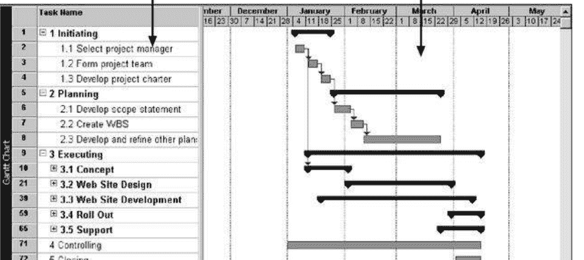

### Table 5-4. Executing Tasks for JWD Consulting’s WBS

- 3.0 Executing
- 3.1 Survey
- 3.2 User inputs
- 3.3 Intranet site content
- 3.3.1 Templates and Tools
- 3.3.2 Articles
- 3.3.3 Links
- 3.3.4 Ask the Expert
- 3.3.5 User requests feature
- 3.4 Intranet site design
- 3.5 Intranet site construction
- 3.6 Site testing
- 3.7 Site promotion
- 3.8 Site roll out
- 3.9 Project benefits measurement

### Approaches to Developing WBSs

- **Guidelines**: Some organizations, such as the DOD, provide guidelines for preparing WBSs.
- **Analogy approach**: Review WBSs of similar projects and tailor to your project.
- **Top-down approach**: Start with the largest items of the project and break them down.
- **Bottom-up approach**: Start with the specific tasks and roll them up.
- **Mind-mapping approach**: Write tasks in a non-linear, branching format and then create the WBS structure.

### Figure 5-5. Sample Mind-Mapping Approach

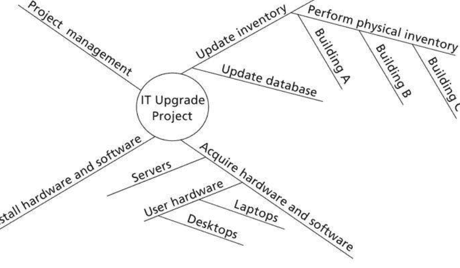

### Figure 5-6. Resulting WBS in Chart Form

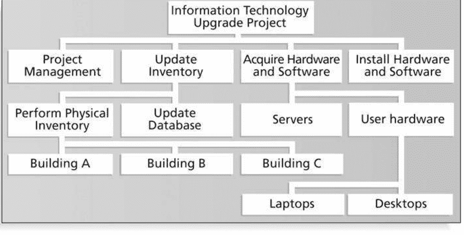

### The WBS Dictionary and Scope Baseline

- Many WBS tasks are vague and must be explained in more detail so people know what to do and can estimate how long the work will take and what it will cost.
- A **WBS dictionary** is a document that describes detailed information about each WBS item.
- The approved project scope statement and its WBS and WBS dictionary form the **scope baseline**, which is used to measure performance in meeting project scope goals.

### Advice for Creating a WBS and WBS Dictionary*

- A unit of work should appear in only one place in the WBS.
- The work content of a WBS item is the sum of the WBS items below it.
- A WBS item is the responsibility of only one individual, even though many people may be working on it.
- The WBS must be consistent with the way in which work is actually going to be performed; it should serve the project team first, and other purposes only if practical.

*Cleland, David I., *Project Management: Strategic Design and Implementation*, 2nd edition (New York: McGraw-Hill 1994).

### Advice for Creating a WBS and WBS Dictionary (cont’d)*
- Project team members should be involved in developing the WBS to ensure consistency and buy-in.
- Each WBS item must be documented in a WBS dictionary to ensure accurate understanding of the scope of work that is included and not included in that item.
- The WBS must be a flexible tool to accommodate inevitable changes while properly maintaining control of the work content in the project according to the scope statement.

*Cleland, David I., Project Management: Strategic Design and Implementation, 2nd edition (New York: McGraw-Hill 1994).

### Scope Control
- **Scope control** involves controlling changes to the project scope.
- Goals of scope control are to:
  - Influence the factors that cause scope changes.
  - Ensure changes are processed according to procedures developed as part of integrated change control.
  - Manage changes when they occur.
- **Variance** is the difference between planned and actual performance.

### Suggestions for Improving User Input
- Develop a good project selection process and insist that sponsors are from the user organization.
- Place users on the project team in important roles.
- Hold regular meetings with defined agendas, and have users sign off on key deliverables presented at meetings.
- Deliver something to users and sponsors on a regular basis.
- Don’t promise to deliver when you know you can’t.
- Co-locate users with developers.

### Suggestions for Reducing Incomplete and Changing Requirements
- Develop and follow a requirements management process.
- Use techniques such as prototyping, use case modeling, and JAD to get more user involvement.
- Put requirements in writing and keep them current.
- Create a requirements management database for documenting and controlling requirements.

### Suggestions for Reducing Incomplete and Changing Requirements (cont’d)
- Conduct adequate testing throughout the project life cycle.
- Review changes from a systems perspective.
- Emphasize completion dates to help focus on what’s most important.
- Allocate resources specifically for handling change requests and enhancements (as NWA did with ResNet).

### Using Software to Assist in Project Scope Management
- Word-processing software helps create scope-related documents.
- Spreadsheets help perform financial calculations and weighed scoring models, and help develop charts and graphs.
- Communication software, such as e-mail and the Web, helps clarify and communicate scope information.
- Project management software helps create a WBS, the basis for tasks on a Gantt chart.
- Specialized software is available to assist in project scope management.

### Chapter Summary
- Project scope management includes the processes required to ensure that the project addresses all the work required—and only the work required—to complete the project successfully.
- Main processes include:
  - Scope planning
  - Scope definition
  - WBS creation
  - Scope verification
  - Scope control

## Chapter 6:
Project Time Management

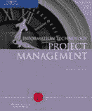

Information Technology Project Management, Fourth Edition

### Learning Objectives
- Understand the importance of project schedules and good project time management.
- Define activities as the basis for developing project schedules.
- Describe how project managers use network diagrams and dependencies to assist in activity sequencing.
- Understand the relationship between estimating resources and project schedules.
- Explain how various tools and techniques help project managers perform activity duration estimating.

### Learning Objectives
- Use a Gantt chart for planning and tracking schedule information, find the critical path for a project, and describe how critical chain scheduling and the Program Evaluation and Review Technique (PERT) affect schedule development.
- Discuss how reality checks and people issues are involved in controlling and managing changes to the project schedule.
- Describe how project management software can assist in project time management and review words of caution before using this software.

### Importance of Project Schedules

- Managers often cite delivering projects on time as one of their biggest challenges.
- Fifty percent of IT projects were challenged in the 2003 CHAOS study, and their average time overrun increased to 82 percent from a low of 63 percent in 2000.*
- Schedule issues are the main reason for conflicts on projects, especially during the second half of projects.
- Time has the least amount of flexibility; it passes no matter what happens on a project.

*The Standish Group, “Latest Standish Group CHAOS Report Shows Project Success Rates Have Improved by 50%,” (www.standishgroup.com) (March 25, 2003).

### Individual Work Styles and Cultural Differences Cause Schedule Conflicts

- One dimension of the Myers-Briggs Type Indicator focuses on people's attitudes toward structure and deadline.

- Some people prefer to follow schedules and meet deadlines while others do not.

- Different cultures and even entire countries have different attitudes about schedules.

### Media Snapshot

In contrast to the 2002 Salt Lake City Winter Olympic Games (see Chapter 4’s “Media Snapshot”), planning and scheduling was very different for the 2004 Summer Olympic Games held in Athens, Greece. Many articles were written before the opening ceremonies predicting that the facilities would not be ready in time…Many people were pleasantly surprised by the amazing opening ceremonies, beautiful new buildings, and state-of-the-art security and transportation systems in Athens.

The Greeks even made fun of critics by having construction workers pretend to still be working as the ceremonies began.

### Project Time Management Processes

- **Activity definition**: Identifying the specific activities that the project team members and stakeholders must perform to produce the project deliverables.
- **Activity sequencing**: Identifying and documenting the relationships between project activities.
- **Activity resource estimating**: Estimating how many resources a project team should use to perform project activities.
- **Activity duration estimating**: Estimating the number of work periods that are needed to complete individual activities.
- **Schedule development**: Analyzing activity sequences, activity resource estimates, and activity duration estimates to create the project schedule.
- **Schedule control**: Controlling and managing changes to the project schedule.

### Activity Lists and Attributes

An activity list is a tabulation of activities to be included on a project schedule. The list should include:

- The activity name
- An activity identifier or number
- A brief description of the activity

Activity attributes provide more information about each activity, such as predecessors, successors, logical relationships, leads and lags, resource requirements, constraints, imposed dates, and assumptions related to the activity.

### Milestones

- A **milestone** is a significant event that normally has no duration.
- It often takes several activities and a lot of work to complete a milestone.
- Milestones are useful tools for setting schedule goals and monitoring progress.
- Examples include completion and customer sign-off on key documents and completion of specific products.

### Activity Sequencing

- Involves reviewing activities and determining dependencies.
- A **dependency** or **relationship** relates to the sequencing of project activities or tasks.
- You *must* determine dependencies in order to use critical path analysis.

### Three Types of Dependencies

- **Mandatory dependencies**: Inherent in the nature of the work being performed on a project; sometimes referred to as hard logic.
- **Discretionary dependencies**: Defined by the project team; sometimes referred to as soft logic and should be used with care because they may limit later scheduling options.
- **External dependencies**: Involve relationships between project and non-project activities.

### Network Diagrams

- Network diagrams are the preferred technique for showing activity sequencing.
- A **network diagram** is a schematic display of the logical relationships among, or sequencing of, project activities.
- Two main formats are the arrow and precedence diagramming methods.

### Figure 6-2: Sample Activity-on-Arrow (AOA) Network Diagram for Project X

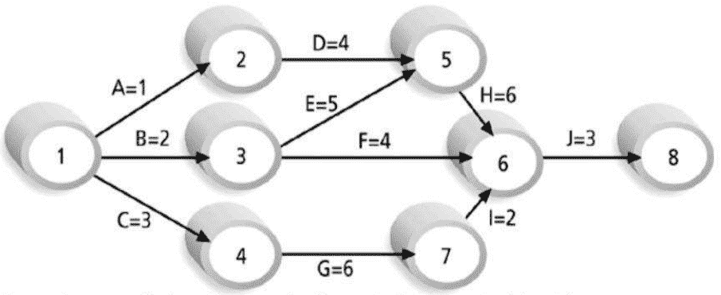

Note: Assume all durations are in days; A=1 means Activity A has a duration of 1 day.

### Arrow Diagramming Method (ADM)

- Also called activity-on-arrow (AOA) network diagram.
- Activities are represented by arrows.
- Nodes or circles are the starting and ending points of activities.
- Can only show finish-to-start dependencies.

### Process for Creating AOA Diagrams

1. Find all of the activities that start at node 1. Draw their finish nodes and draw arrows between node 1 and those finish nodes. Put the activity letter or name and duration estimate on the associated arrow.
2. Continuing drawing the network diagram, working from left to right. Look for bursts and merges. A **burst** occurs when a single node is followed by two or more activities. A **merge** occurs when two or more nodes precede a single node.
3. Continue drawing the project network diagram until all activities that have dependencies are included in the diagram.
4. As a rule of thumb, all arrowheads should face toward the right, and no arrows should cross in an AOA network diagram.

### Precedence Diagramming Method (PDM)

- Activities are represented by boxes.
- Arrows show relationships between activities.
- More popular than ADM method and used by project management software.
- Better at showing different types of dependencies.

### Figure 6-3. Task Dependency Types

### Task dependencies

The nature of the dependencies between linked tasks. You link tasks by defining a dependency between their finish and start dates. For example, the "Contact caterers" task must finish before the start of the "Determine menus" task. There are four kinds of task dependencies in Microsoft Project:

| Task dependency | Example | Description |
|---|---|---|
| Finish-to-start (FS) |  | Task (B) cannot start until task (A) finishes. |
| Start-to-start (SS) |  | Task (B) cannot start until task (A) starts. |
| Finish-to-finish (FF) |  | Task (B) cannot finish until task (A) finishes. |
| Start-to-finish (SF) |  | Task (B) cannot finish until task (A) starts. |

### Figure 6-4. Sample PDM Network Diagram

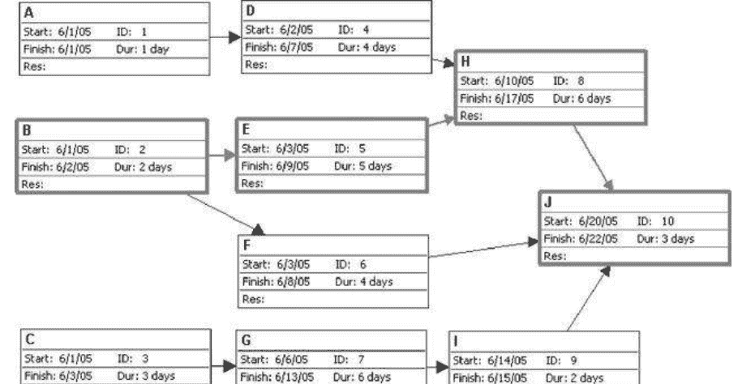

### Activity Duration Estimating

- **Duration** includes the actual amount of time worked on an activity *plus* the elapsed time.
- **Effort** is the number of workdays or work hours required to complete a task.
- Effort does not normally equal duration.
- People doing the work should help create estimates, and an expert should review them.

### Gantt Charts

- **Gantt charts** provide a standard format for displaying project schedule information by listing project activities and their corresponding start and finish dates in a calendar format.
- Symbols include:
  - **Black diamonds**: Milestones
  - **Thick black bars**: Summary tasks
  - **Lighter horizontal bars**: Durations of tasks
  - **Arrows**: Dependencies between tasks

### Figure 6-5. Gantt Chart for Project X

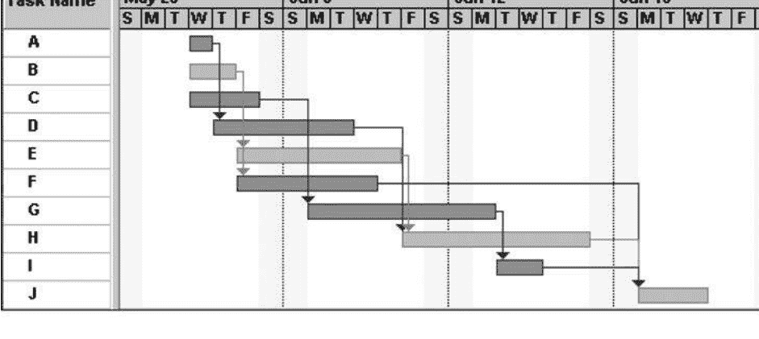

Note: In Project 2003 darker bars are red to represent critical tasks.

### Adding Milestones to Gantt Charts

- Many people like to focus on meeting milestones, especially for large projects.
- Milestones emphasize important events or accomplishments in projects.
- You typically create milestone by entering tasks that have a zero duration, or you can mark any task as a milestone.

### SMART Criteria

Milestones should be:
- **Specific**
- **Measurable**
- **Assignable**
- **Realistic**
- **Time-framed**

### Figure 6-7. Sample Tracking Gantt Chart

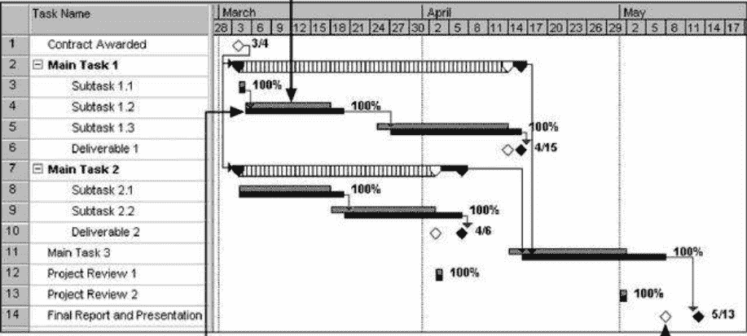

# Critical Path Method (CPM)

- **CPM** is a network diagramming technique used to predict total project duration.
- A **critical path** for a project is the series of activities that determines the *earliest time* by which the project can be completed.
- The critical path is the *longest path* through the network diagram and has the least amount of slack or float.
- **Slack** or **float** is the amount of time an activity can be delayed without delaying a succeeding activity or the project finish date.

# Figure 6-8. Determining the Critical Path for Project X

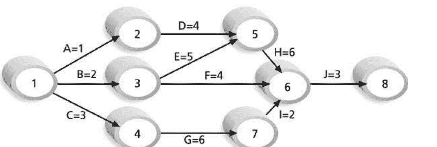

Note: Assume all durations are in days.

- Path 1: A-D-H-J    Length = 1+4+6+3 = 14 days
- Path 2: B-E-H-J    Length = 2+5+6+3 = 16 days
- Path 3: B-F-J      Length = 2+4+3 = 9 days
- Path 4: C-G-I-J    Length = 3+6+2+3 = 14 days

Since the critical path is the longest path through the network diagram, Path 2, B-E-H-J, is the critical path for Project X.

# Using Critical Path Analysis
to Make Schedule Trade-offs

- **Free slack or free float** is the amount of time an activity can be delayed without delaying the early start of any immediately following activities.
- **Total slack or total float** is the amount of time an activity can be delayed from its early start without delaying the planned project finish date.
- A **forward pass** through the network diagram determines the early start and finish dates.
- A **backward pass** determines the late start and finish dates.

# Figure 6-9. Calculating Early and Late Start and Finish Dates

Legend:
ES = early start
EF = early finish
LS = late start
LF = late finish

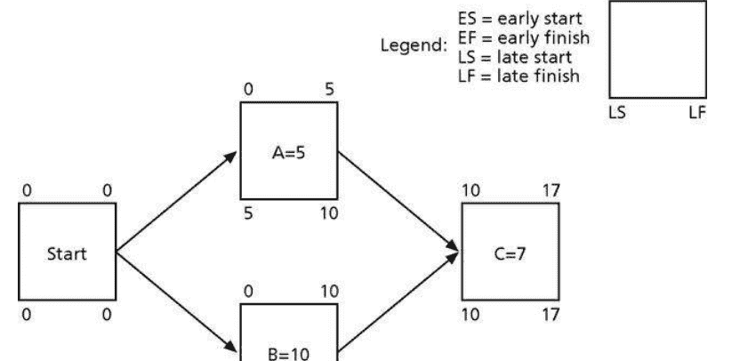

# Table 6-1. Free and Total Float or Slack for Project X

| Task Name | Start | Finish | Late Start | Late Finish | Free Slack | Total Slack |
|---|---|---|---|---|---|---|
| A | 6/1/05 | 6/1/05 | 6/3/05 | 6/3/05 | 0d | 2d |
| B | 6/1/05 | 6/2/05 | 6/1/05 | 6/2/05 | 0d | 0d |
| C | 6/1/05 | 6/3/05 | 6/3/05 | 6/7/05 | 0d | 2d |
| D | 6/2/05 | 6/7/05 | 6/6/05 | 6/9/05 | 2d | 2d |
| E | 6/3/05 | 6/9/05 | 6/3/05 | 6/9/05 | 0d | 0d |
| F | 6/3/05 | 6/8/05 | 6/14/05 | 6/17/05 | 7d | 7d |
| G | 6/6/05 | 6/13/05 | 6/8/05 | 6/15/05 | 0d | 2d |
| H | 6/10/05 | 6/17/05 | 6/10/05 | 6/17/05 | 0d | 0d |
| I | 6/14/05 | 6/15/05 | 6/16/05 | 6/17/05 | 2d | 2d |
| J | 6/20/05 | 6/22/05 | 6/20/05 | 6/22/05 | 0d | 0d |

# Using the Critical Path to Shorten a Project Schedule

- Three main techniques for shortening schedules:
  - **Shortening** the duration of critical activities or tasks by adding more resources or changing their scope.
  - **Crashing** activities by obtaining the greatest amount of schedule compression for the least incremental cost.
  - **Fast tracking** activities by doing them in parallel or overlapping them.

# Many Horror Stories
Related to Project Schedules

- Creating realistic schedules and sticking to them is a key challenge of project management.
- Crashing and fast tracking often cause more problems, resulting in longer schedules.
- Organizational issues often cause schedule problems. See the “What Went Wrong?” example that describes the need to take more time to implement Customer Relationship Management (CRM) software so that users will accept it.

# Importance of Updating
Critical
Path Data

- It is important to update project schedule information to meet time goals for a project.
- The critical path may change as you enter actual start and finish dates.
- If you know the project completion date will slip, negotiate with the project sponsor.

## Critical Chain Scheduling

- **Critical chain scheduling** is a method of scheduling that considers limited resources when creating a project schedule and includes buffers to protect the project completion date.
- Uses the **Theory of Constraints (TOC)**, a management philosophy developed by Eliyahu M. Goldratt and introduced in his book *The Goal*.
- Attempts to minimize **multitasking**, which occurs when a resource works on more than one task at a time.

## Multitasking Example

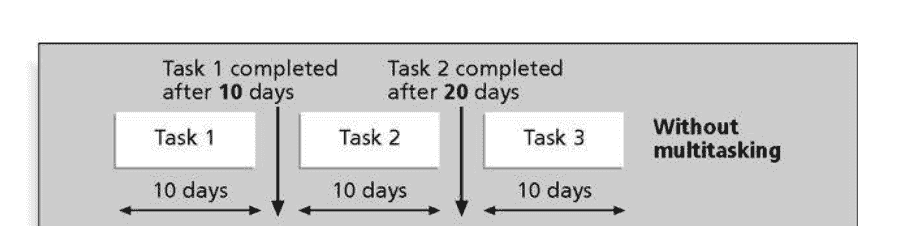

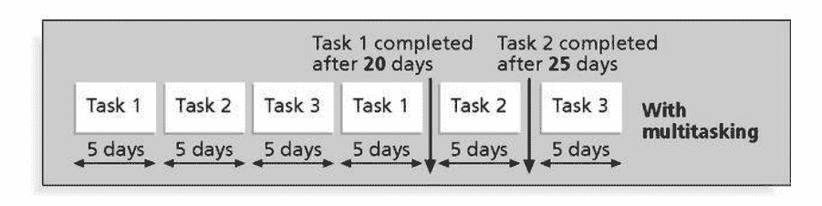

## Buffers and Critical Chain

- A **buffer** is additional time to complete a task.
- **Murphy’s Law** states that if something can go wrong, it will.
- **Parkinson’s Law** states that work expands to fill the time allowed.
- In traditional estimates, people often add a buffer to each task and use the additional time whether it’s needed or not.
- Critical chain scheduling removes buffers from individual tasks and instead creates:
  - A **project buffer** or additional time added before the project’s due date.
  - **Feeding buffers** or additional time added before tasks on the critical path.

## Figure 6-11. Example of Critical Chain Scheduling

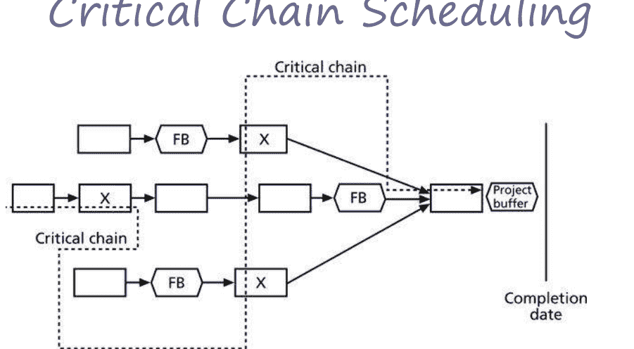

X = Tasks done by limited resource
FB = Feeding buffer

## Program Evaluation and Review Technique (PERT)

- PERT is a network analysis technique used to estimate project duration when there is a high degree of uncertainty about the individual activity duration estimates.
- PERT uses probabilistic time estimates:
- Duration estimates based on using optimistic, most likely, and pessimistic estimates of activity durations, or a three-point estimate.

## PERT Formula and Example

- PERT weighted average =
  \frac{optimistic time + 4X most likely time + pessimistic time}{6}
- Example:
  PERT weighted average =
  \frac{8 workdays + 4 X 10 workdays + 24 workdays}{6} = **12 days**
  where:
  optimistic time= 8 days
  most likely time = **10 days**
  pessimistic time = 24 days
  Therefore, you’d use **12 days** on the network diagram instead of 10 when using PERT for the above example.

## Schedule Control

- Perform reality checks on schedules.
- Allow for contingencies.
- Don’t plan for everyone to work at 100 percent capacity all the time.
- Hold progress meetings with stakeholders and be clear and honest in communicating schedule issues.

## Schedule Control

- Goals are to know the status of the schedule, influence factors that cause schedule changes, determine that the schedule has changed, and manage changes when they occur.
- Tools and techniques include:
  - Progress reports.
  - A schedule change control system.
  - Project management software, including schedule comparison charts, such as the tracking Gantt chart.
  - Variance analysis, such as analyzing float or slack.
  - Performance management, such as earned value (see Chapter 7).

## Reality Checks on Scheduling

- Review the draft schedule or estimated completion date in the project charter.
- Prepare a more detailed schedule with the project team.
- Make sure the schedule is realistic and followed.
- Alert top management well in advance if there are schedule problems.

## Working with People Issues

Strong leadership helps projects succeed more than good PERT charts do.

Project managers should use:

- Empowerment
- Incentives
- Discipline
- Negotiation

## Using Software to Assist in Time Management

- Software for facilitating communication helps people exchange schedule-related information.
- Decision support models help analyze trade-offs that can be made.
- Project management software can help in various time management areas.

## Table 6-2. Project 2003 Features Related to Project Time Management

| REPORTS | VIEWS AND TABLE VIEWS | FILTERS |
|---|---|---|
| Overview reports: critical tasks and milestones | Gantt chart, network diagram, Tracking Gantt chart, schedule, tracking, variance, constraint dates, and delay | All tasks, completed critical tasks, incomplete tasks, and milestone tasks |
| Current activities reports: unstarted tasks, tasks starting soon, tasks in progress, completed tasks, should have started tasks, and slipping tasks |  |  |
| Assignment reports: who does what and when |  |  |

## Words of Caution on Using
Project Management
Software

- Many people misuse project management software because they don’t understand important concepts and have not had training.
- You must enter dependencies to have dates adjust automatically and to determine the critical path.
- You must enter actual schedule information to compare planned and actual progress.

### Learning Objectives

- Understand the importance of project cost management.
- Explain basic project cost management principles, concepts, and terms.
- Discuss different types of cost estimates and methods for preparing them.

### Learning Objectives

- Understand the processes involved in cost budgeting and preparing a cost estimate and budget for an information technology project.
- Understand the benefits of earned value management and project portfolio management to assist in cost control.
- Describe how project management software can assist in project cost management.

## The Importance of Project Cost Management

- IT projects have a poor track record for meeting budget goals.
- The 2003 CHAOS studies showed the average cost **overrun** (the additional percentage or dollar amount by which actual costs exceed estimates) was 43 percent.
- U.S. lost $55 billion in IT projects in 2002 from cancelled projects and overruns compared to $140 billion in 1994.*

*The Standish Group, “Latest Standish Group CHAOS Report Shows Project Success Rates Have Improved by 50%,” A Standish Group Research Note (3/25/03).

### What Went Wrong?

According to the *San Francisco Chronicle*’s front-page story, “Computer Bumbling Costs the State $1 Billion,” the state of California had a series of expensive IT project failures in the late 1990s, costing taxpayers nearly $1 billion…It was ironic that the state that was leading in the creation of computers was also the state most behind in using computer technology to improve its services.*

The Internal Revenue Service (IRS) managed a series of project failures that cost taxpayers over $50 billion a year—roughly as much money as the annual net profit of the entire computer industry.**

Connecticut General Life Insurance Co. sued PeopleSoft over an aborted installation of a finance system.***

*Lucas, Greg, “Computer Bumbling Costs the State $1 Billion,” *San Francisco Chronicle* (2/21/99).
**James, Geoffrey, “IT Fiascoes . . . and How to Avoid Them,” *Datamation* (November 1997).
***Songini, Marc L., “PeopleSoft project ends in court,” *ComputerWorld* (September 2001).

## What is Cost and Project
Cost Management?

- Cost is a resource sacrificed or foregone to achieve a specific objective, or something given up in exchange.
- Costs are usually measured in monetary units, such as dollars.
- **Project cost management** includes the processes required to ensure that the project is completed within an approved budget.

## Project Cost Management Processes

- **Cost estimating**: Developing an approximation or estimate of the costs of the resources needed to complete a project.
- **Cost budgeting**: Allocating the overall cost estimate to individual work items to establish a baseline for measuring performance.
- **Cost control**: Controlling changes to the project budget.

## Table 7-1. Cost of Software Defects*

| WHEN DEFECT IS DETECTED | TYPICAL COSTS of CORRECTION |
| --- | --- |
| User Requirements | $100 – $1,000 |
| Coding/Unit Testing | $1,000 or more |
| System Testing | $7,000 – $8,000 |
| Acceptance Testing | $1,000 – $100,000 |
| After Implementation | Up to millions of dollars |

It is important to spend money up-front on IT projects to avoid spending a lot more later.

> *Collard, Ross, Software Testing and Quality Assurance, working paper (1997).

## Basic Principles of Cost Management

- **Tangible costs** or **benefits** are those costs or benefits that an organization can easily measure in dollars.
- **Intangible costs** or **benefits** are costs or benefits that are difficult to measure in monetary terms.
- **Direct costs** are costs that can be directly related to producing the products and services of the project.
- **Indirect costs** are costs that are not directly related to the products or services of the project, but are indirectly related to performing the project.
- **Sunk cost** is money that has been spent in the past; when deciding what projects to invest in or continue, you should *not* include sunk costs.

- **Learning curve theory** states that when many items are produced repetitively, the unit cost of those items decreases in a regular pattern as more units are produced.
- **Reserves** are dollars included in a cost estimate to mitigate cost risk by allowing for future situations that are difficult to predict.
- **Contingency reserves** allow for future situations that may be partially planned for (sometimes called **known unknowns**) and are included in the project cost baseline.
- **Management reserves** allow for future situations that are unpredictable (sometimes called **unknown unknowns**).

## Cost Estimating

- Project managers must take cost estimates seriously if they want to complete projects within budget constraints.
- It’s important to know the types of cost estimates, how to prepare cost estimates, and typical problems associated with IT cost estimates.

## Table 7-2. Types of Cost Estimates

| Type of Estimate | When Done | Why Done | How Accurate |
|---|---|---|---|
| **Rough Order of Magnitude (ROM)** | Very early in the project life cycle, often 3–5 years before project completion | Provides estimate of cost for selection decisions | −25% to +75% |
| **Budgetary** | Early, 1–2 years out | Puts dollars in the budget plans | −10% to +25% |
| **Definitive** | Later in the project, less than 1 year out | Provides details for purchases, estimates actual costs | −5% to +10% |

## Cost Management Plan

- A **cost management plan** is a document that describes how the organization will manage cost variances on the project.
- A large percentage of total project costs are often labor costs, so project managers must develop and track estimates for labor.

## Cost Estimation Tools and Techniques

- Basic tools and techniques for cost estimates:
  - **Analogous or top-down estimates**: Use the actual cost of a previous, similar project as the basis for estimating the cost of the current project.
  - **Bottom-up estimates**: Involve estimating individual work items or activities and summing them to get a project total.
  - **Parametric modeling**: Uses project characteristics (parameters) in a mathematical model to estimate project costs.
  - **Computerized tools**: Tools, such as spreadsheets and project management software, that can make working with different cost estimates and cost estimation tools easier.

## Constructive Cost Model
(COCOMO)

- Barry Boehm helped develop the COCOMO models for estimating software development costs.
- Parameters include:
  - **Function points**: Technology-independent assessments of the functions involved in developing a system.
  - **Source Lines of Code (SLOC)**: A human-written line of code that is not a blank line or comment.
- Boehm suggests that only parametric models do not suffer from the limits of human decision-making.

## Typical Problems with IT
### Cost Estimates
- Developing an estimate for a large software project is a complex task that requires a significant amount of effort.
- People who develop estimates often do not have much experience.
- Human beings are biased toward underestimation.
- Management might ask for an estimate, but really desire a bid to win a major contract or get internal funding.

## Sample Cost Estimate
- See pages 262-266 for a detailed example that describes how to create a cost estimate for the Surveyor Pro project described in the opening case.
- Before creating an estimate, know what it will be used for, gather as much information about the project as possible, and clarify the ground rules and assumptions for the estimate.
- If possible, estimate costs by major WBS categories.
- Create a cost model to make it easy to change and document the estimate.

## Figure 7-2. Surveyor Pro Software Development Estimate
Surveyor Pro Software Development Estimate Created October 5, 2006

| 1. Labor Estimate | # Units/Hrs. | Cost/Unit/Hr. | Subtotals | Calculations |
| Contractor labor estimate | 3000 | $150 | $450,000 | 3000*150 |
| Project team member estimate | 1920 | $75 | $144,000 | 1920*75 |
| Total labor estimate |  |  | $594,000 | Sum above two values |
| 2. Function point estimate** | Quantity | Conversion Factor | Function Points | Calculations |
| External inputs | 10 | 4 | 40 | 10*4 |
| External interface files | 3 | 7 | 21 | 3*7 |
| External outputs | 4 | 5 | 20 | 4*5 |
| External queries | 6 | 4 | 24 | 6*4 |
| Logical internal tables | 7 | 10 | 70 | 7*10 |
| Total function points |  |  | 175 | Sum above function point values |
| Java 2 language equivalency value |  |  | 46 | Assumed value from reference |
| Source lines of code (SLOC) estimate |  |  | 8,050 | 175*46 |
| Productivity*KSLOC^Penalty (in months) |  |  | 29.28 | 3.13*8.05^1.072 (see reference) |
| Total labor hours (160 hours/month) |  |  | 4,684.65 | 29.28*160 |
| Cost/labor hour ($120/hour) |  |  | $120 | Assumed value from budget expert |
| Total function point estimate |  |  | $562,158 | 4684.65*120 |

> **Approach based on paper by William Roetzheim, "Estimating Software Costs," Cost Xpert Group, Inc. (2003) using the COCOMO II default linear productivity factor (3.13) and penalty factor (1.072).

## Cost Budgeting
- Cost budgeting involves allocating the project cost estimate to individual work items over time.
- The WBS is a required input for the cost budgeting process because it defines the work items.
- Important goal is to produce a **cost baseline**:
  - A time-phased budget that project managers use to measure and monitor cost performance.

## Figure 7-3. Surveyor Pro Project Cost Baseline

| WBS Items | 1 | 2 | 3 | 4 | 5 | 6 | 7 | 8 | 9 | 10 | 11 | 12 | Totals |
|---|---:|---:|---:|---:|---:|---:|---:|---:|---:|---:|---:|---:|---:|
| **Surveyor Pro Project Cost Baseline Created October 10, 2006*** | | | | | | | | | | | | | |
| **1. Project Management** | | | | | | | | | | | | | |
| Project manager | 8,000 | 8,000 | 8,000 | 8,000 | 8,000 | 8,000 | 8,000 | 8,000 | 8,000 | 8,000 | 8,000 | 8,000 | 96,000 |
| Project team members | 12,000 | 12,000 | 12,000 | 12,000 | 12,000 | 12,000 | 12,000 | 12,000 | 12,000 | 12,000 | 12,000 | 12,000 | 144,000 |
| Contractors | — | 6,027 | 6,027 | 6,027 | 6,027 | 6,027 | 6,027 | 6,027 | 6,027 | 6,027 | 6,027 | 6,027 | 66,300 |
| **2. Hardware** | | | | | | | | | | | | | |
| 2.1 Handheld devices | — | — | — | 30,000 | 30,000 | — | — | — | — | — | — | — | 60,000 |
| 2.2 Servers | — | — | — | 8,000 | 8,000 | — | — | — | — | — | — | — | 16,000 |
| **3. Software** | | | | | | | | | | | | | |
| 3.1 Licensed software | — | — | — | 10,000 | 10,000 | — | — | — | — | — | — | — | 20,000 |
| 3.2 Software development | — | 60,000 | 60,000 | 80,000 | 127,000 | 127,000 | 90,000 | 50,000 | — | 594,000 | — | — | 594,000 |
| **4. Testing** | — | — | 6,000 | 8,000 | 12,000 | 15,000 | 15,000 | 13,000 | — | 69,000 | — | — | 69,000 |
| **5. Training and Support** | | | | | | | | | | | | | |
| Training cost | — | — | — | — | — | — | — | — | 50,000 | — | — | — | 50,000 |
| Travel cost | — | — | — | — | — | — | — | — | 8,400 | — | — | — | 8,400 |
| Project team members | — | — | — | — | — | — | 24,000 | 24,000 | 24,000 | 24,000 | 24,000 | 24,000 | 144,000 |
| **6. Reserves** | — | — | — | 10,000 | 10,000 | 30,000 | 30,000 | 60,000 | 40,000 | 40,000 | 30,000 | 3,540 | 253,540 |
| **Totals** | 20,000 | 86,027 | 92,027 | 172,027 | 223,027 | 198,027 | 185,027 | 173,027 | 148,427 | 753,027 | 80,027 | 53,567 | 1,521,240 |

*See the lecture slides for this chapter on the companion Web site for a larger view of this and other figures in this chapter.

## Cost Control

- Project cost control includes:
  - Monitoring cost performance.
  - Ensuring that only appropriate project changes are included in a revised cost baseline.
  - Informing project stakeholders of authorized changes to the project that will affect costs.
- Many organizations around the globe have problems with cost control.

### Media Snapshot

- **Australia**: Problems with the installation of an ERP system at Crane Group Ltd. led to an estimated cost overrun of $11.5 million.*
- **India**: As many as 274 projects currently under implementation in the Central sector are suffering serious cost and time overruns.**
- **Pakistan**: Pakistan has sustained a cost overrun of Rs 1.798 billion (over $30 million U.S. dollars) in the execution of the 66.5 megawatt Jagran Hydropower Project in the Neelum Valley.***
- **United States**: Northern California lawmakers were outraged over Governor Arnold Schwarzenegger's announcement that commuters should have to pay construction costs on Bay Area bridges. *Maybe it takes the Terminator to help control costs!****

*Songini, Marc L., “Australian Firm Wrestles With ERP Delays,” ComputerWorld (July 12, 2004).
**Srinivasan, G., “274 Central sector projects suffer cost, time overruns,” The Hindu Business Line (May 4, 2004).
***Mustafa, Khalid, “Rs 1.8 billion cost overrun in Jagran hydropower project,” Daily Times (November 19, 2002).
****Gannett Company, “Governor Refuses to Pay for Bay Bridge Cost Overruns,” News10 (August 17, 2004).

## Earned Value Management (EVM)

- **EVM** is a project performance measurement technique that integrates scope, time, and cost data.
- Given a **baseline** (original plan plus approved changes), you can determine how well the project is meeting its goals.
- You must enter actual information periodically to use EVM.
- More and more organizations around the world are using EVM to help control project costs.

### Earned Value Management Terms

- The planned value (PV), formerly called the budgeted cost of work scheduled (BCWS), also called the budget, is that portion of the approved total cost estimate planned to be spent on an activity during a given period.

- Actual cost (AC), formerly called actual cost of work performed (ACWP), is the total of direct and indirect costs incurred in accomplishing work on an activity during a given period.

- The earned value (EV), formerly called the budgeted cost of work performed (BCWP), is an estimate of the value of the physical work actually completed.

- EV is based on the original planned costs for the project or activity and the rate at which the team is completing work on the project or activity to date.

### Rate of Performance

- Rate of performance (RP) is the ratio of actual work completed to the percentage of work planned to have been completed at any given time during the life of the project or activity.

- Brenda Taylor, Senior Project Manager in South Africa, suggests using this approach for estimating earned value.

- For example, suppose the server installation was halfway completed by the end of week 1. The rate of performance would be 50 percent (50/100) because by the end of week 1, the planned schedule reflects that the task should be 100 percent complete and only 50 percent of that work has been completed.

### Table 7-4. Earned Value Calculations for One Activity After Week One

| ACTIVITY | WEEK 1 |
|---|---|
| Earned Value (EV) | 5,000 |
| Planned Value (PV) | 10,000 |
| Actual Cost (AC) | 15,000 |
| Cost Variance (CV) | -7,500 |
| Schedule Variance (SV) | -2,500 |
| Cost Performance Index (CPI) | 50% |
| Schedule Performance Index (SPI) | 75% |

### Table 7-5. Earned Value Formulas

| TERM | FORMULA |
|------|---------|
| Earned Value | EV = PV to date × RP |
| Cost Variance | CV = EV – AC |
| Schedule Variance | SV = EV – PV |
| Cost Performance Index | CPI = EV/AC |
| Schedule Performance Index | SPI = EV/PV |
| Estimate at Completion (EAC)* | EAC = BAC/CPI |
| Estimated Time to Complete | Original Time Estimate/SPI |

### Figure 7-4. Earned Value Calculations for a One-Year Project After Five Months

| Activity | Jan | Feb | Mar | Apr | May | Jun | Jul | Aug | Sep | Oct | Nov | Dec | To Date PV | Planned % Complete | Actual % Complete |
| --- | --- | --- | --- | --- | --- | --- | --- | --- | --- | --- | --- | --- | --- | --- | --- |
| Plan and staff project | 4,000 | 4,000 |  |  |  |  |  |  |  |  |  |  | 8,000 | 100 | 100 |
| Analyze requirements |  | 6,000 | 6,000 |  |  |  |  |  |  |  |  |  | 12,000 | 100 | 100 |
| Develop ERDs |  |  | 4,000 | 4,000 |  |  |  |  |  |  |  |  | 8,000 | 100 | 100 |
| Design database tables |  |  |  | 6,000 | 4,000 |  |  |  |  |  |  |  | 10,000 | 100 | 100 |
| Design forms, reports, and queries |  |  |  |  | 8,000 | 4,000 |  |  |  |  |  |  | 8,000 | 75 | 50 |
| Construct working prototype |  |  |  |  |  | 10,000 |  |  |  |  |  |  | - |  |  |
| Test/evaluate prototype |  |  |  |  |  | 2,000 | 6,000 |  |  |  |  |  | - |  |  |
| Incorporate user feedback |  |  |  |  |  |  | 4,000 | 6,000 | 4,000 |  |  |  | - |  |  |
| Test system |  |  |  |  |  |  |  |  | 4,000 | 4,000 | 2,000 |  | - |  |  |
| Document system |  |  |  |  |  |  |  |  |  |  | 3,000 | 1,000 | - |  |  |
| Train users |  |  |  |  |  |  |  |  |  |  |  | 4,000 | - |  |  |
| Monthly Planned Value (PV) | 4,000 | 10,000 | 10,000 | 10,000 | 12,000 | 16,000 | 10,000 | 6,000 | 8,000 | 4,000 | 5,000 | 5,000 |  |  |  |
| Cumulative Planned Value (PV) | 4,000 | 14,000 | 24,000 | 34,000 | 46,000 | 62,000 | 72,000 | 78,000 | 86,000 | 90,000 | 95,000 | 100,000 |  |  |  |
| Monthly Actual Cost (AC) | 4,000 | 11,000 | 11,000 | 12,000 | 15,000 |  |  |  |  |  |  |  |  |  |  |
| Cumulative Actual Cost (AC) | 4,000 | 15,000 | 26,000 | 38,000 | 53,000 |  |  |  |  |  |  |  |  |  |  |
| Monthly Earned Value (EV) | 4,000 | 10,000 | 10,000 | 10,000 | 9,333 |  |  |  |  |  |  |  |  |  |  |
| Cumulative Earned Value (EV) | 4,000 | 14,000 | 24,000 | 34,000 | 43,333 |  |  |  |  |  |  |  |  |  |  |

| Metric | Value |
| --- | --- |
| Project EV as of May 31 | 43,333 |
| Project PV as of May 31 | 46,000 |
| Project AC as of May 31 | $53,000 |
| CV=EV-AC | $(9,667) |
| SV=EV-PV | $(2,667) |
| CPI=EV/AC | 81.761% |
| SPI=EV/PV | 94.203% |
| Estimate at Completion (EAC) | $122,308 (original plan of $100,000 divided by CPI) |
| Estimated time to complete | 12.74 (original plan of 12 months divided by SPI) |

### Figure 7-5. Earned Value Chart for Project after Five Months

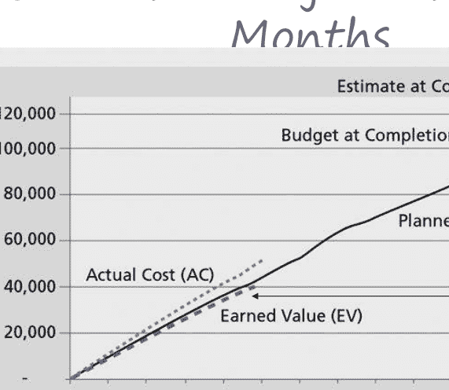

If the EV line is below the AC or PV line, there are problems in those areas.

## Project Portfolio Management

- Many organizations collect and control an entire suite of projects or investments as one set of interrelated activities in a portfolio.
- Project portfolio management has five levels:
  1. Put all your projects in one database.
  2. Prioritize the projects in your database.
  3. Divide your projects into two or three budgets based on type of investment.
  4. Automate the repository.
  5. Apply modern portfolio theory, including risk-return tools that map project risk on a curve.

## Benefits of Portfolio Management

- Schlumberger saved $3 million in one year by organizing 120 information technology projects into a portfolio.
- META Group research shows that:
  - Organizations that evaluate information technology projects by what their business impacts are and what their potential business values will be implement projects that result in 25 percent more improvement to the bottom line.
  - By 2005-2006, more than 50 percent of the CIOs for Global 2000 companies will adopt project portfolio management tools and techniques for IT projects, asset management, and budget planning and monitoring.
  - Business executives state that using project portfolio management allows managers to make decisions faster and with more confidence.*

> *META Group, “IT Investment Management: Portfolio Management Lessons Learned,” A META Group White Paper (www.metagroup.com) (2002).

## Using Software to Assist in Cost Management
- Spreadsheets are a common tool for resource planning, cost estimating, cost budgeting, and cost control.
- Many companies use more sophisticated and centralized financial applications software for cost information.
- Project management software has many cost-related features, especially enterprise PM software.

### Chapter Summary
- Project cost management is traditionally a weak area in IT projects, and project managers must work to improve their ability to deliver projects within approved budgets.
- Main processes include:
  - Cost estimating
  - Cost budgeting
  - Cost control

## Chapter 8:
Project Quality Management

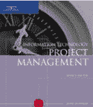

Information Technology Project Management, Fourth Edition

### Learning Objectives
- Understand the importance of project quality management for information technology products and services.
- Define project quality management and understand how quality relates to various aspects of information technology projects.
- Describe quality planning and its relationship to project scope management.
- Discuss the importance of quality assurance.
- List the three outputs of the quality control process.

### Learning Objectives
- Understand the tools and techniques for quality control, such as Pareto analysis, statistical sampling, Six Sigma, quality control charts, and testing.
- Summarize the contributions of noteworthy quality experts to modern quality management.
- Describe how leadership, cost, organizational influences, expectations, cultural differences, standards, and maturity models relate to improving quality in information technology projects.
- Discuss how software can assist in project quality management.

## The Importance of Project Quality Management
- Many people joke about the poor quality of IT products (see cars and computers joke on pages 290-291).
- People seem to accept systems being down occasionally or needing to reboot their PCs.
- But quality is very important in many IT projects.

### What Went Wrong?
- In 1981, a small timing difference caused by a computer program caused a launch abort.*
- In 1986, two hospital patients died after receiving fatal doses of radiation from a Therac 25 machine after a software problem caused the machine to ignore calibration data.**
- Britain’s Coast Guard was unable to use its computers for several hours in May 2004 after being hit by the Sasser virus, which knocked out the electronic mapping systems, e-mail, and other computer functions, forcing workers to revert to pen, paper, and radios.***

*Design News (February 1988).
**Datamation (May 1987).
***Fleming, Nic, “Virus sends coastguard computers off course” (http://news.telegraph.co.uk/news/main.jhtml?xml=/news/2004/05/05/ncoast05.xml) (May 15, 2004).

## What Is Quality?
The International Organization for Standardization (ISO) defines quality as “the degree to which a set of inherent characteristics fulfils requirements” (ISO9000:2000).

Other experts define quality based on:

Conformance to requirements: The project’s processes and products meet written specifications.

Fitness for use: A product can be used as it was intended.

## What Is Project Quality Management?
- Project quality management ensures that the project will satisfy the needs for which it was undertaken.
- Processes include:
  - **Quality planning**: Identifying which quality standards are relevant to the project and how to satisfy them.
  - **Quality assurance**: Periodically evaluating overall project performance to ensure the project will satisfy the relevant quality standards.
  - **Quality control**: Monitoring specific project results to ensure that they comply with the relevant quality standards.

## Quality Planning
- Implies the ability to anticipate situations and prepare actions to bring about the desired outcome.
- Important to prevent defects by:
  - Selecting proper materials.
  - Training and indoctrinating people in quality.
  - Planning a process that ensures the appropriate outcome.

## Design of Experiments
- **Design of experiments** is a quality planning technique that helps identify which variables have the most influence on the overall outcome of a process.
- Also applies to project management issues, such as cost and schedule trade-offs.
- Involves documenting important factors that directly contribute to meeting customer requirements.

## Scope Aspects of IT Projects
- **Functionality** is the degree to which a system performs its intended function.
- **Features** are the system’s special characteristics that appeal to users.
- **System outputs** are the screens and reports the system generates.
- **Performance** addresses how well a product or service performs the customer’s intended use.
- **Reliability** is the ability of a product or service to perform as expected under normal conditions.
- **Maintainability** addresses the ease of performing maintenance on a product.

## Who's Responsible for the Quality of Projects?
- Project managers are ultimately responsible for quality management on their projects.
- Several organizations and references can help project managers and their teams understand quality.
  - International Organization for Standardization (www.iso.org)
  - IEEE (www.ieee.org)

## Quality Assurance
- Quality assurance includes all the activities related to satisfying the relevant quality standards for a project.
- Another goal of quality assurance is continuous quality improvement.
- **Benchmarking** generates ideas for quality improvements by comparing specific project practices or product characteristics to those of other projects or products within or outside the performing organization.
- A **quality audit** is a structured review of specific quality management activities that help identify lessons learned that could improve performance on current or future projects.

## Table 8-1. Table of Contents for a Quality Assurance Plan*
- 1.0 Draft Quality Assurance Plan
- 1.1 Introduction
- 1.2 Purpose
- 1.3 Policy Statement
- 1.4 Scope
- 2.0 Management
- 2.1 Organizational Structure
- 2.2 Roles and Responsibilities
- 2.2.1 Technical Monitor/Senior Management
- 2.2.2 Task Leader
- 2.2.3 Quality Assurance Team
- 2.2.4 Technical Staff
- 3.0 Required Documentation
- 4.0 Quality Assurance Procedures
- 4.1 Walkthrough Procedure
- 4.2 Review Process
- 4.2.1 Review Procedures
- 4.3 Audit Process
- 4.3.1 Audit Procedures
- 4.4 Evaluation Process
- 4.5 Process Improvement
- 5.0 Problem Reporting Procedures
- 5.1 Noncompliance Reporting Procedures
- 6.0 Quality Assurance Metrics
- Appendix
- Quality Assurance Checklist Forms

*U.S. Department of Energy

## Quality Control
- The main outputs of quality control are:
  - Acceptance decisions
  - Rework
  - Process adjustments
- Some tools and techniques include:
  - Pareto analysis
  - Statistical sampling
  - Six Sigma
  - Quality control charts

## Pareto Analysis
- **Pareto analysis** involves identifying the vital few contributors that account for the most quality problems in a system.
- Also called the 80-20 rule, meaning that 80 percent of problems are often due to 20 percent of the causes.
- **Pareto diagrams** are histograms, or column charts representing a frequency distribution, that help identify and prioritize problem areas.

## Figure 8-1. Sample Pareto Diagram
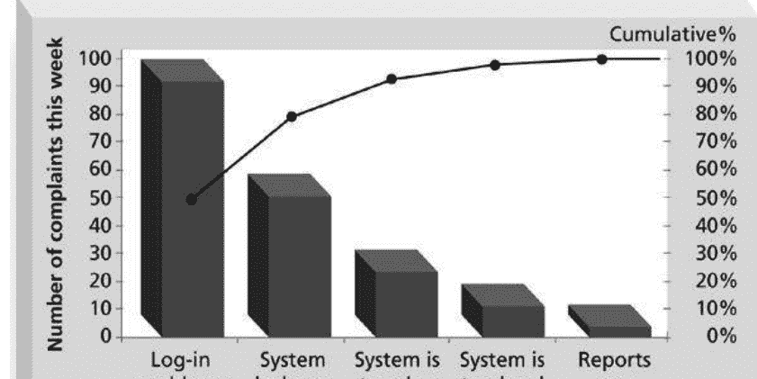

## Statistical Sampling and Standard Deviation
- **Statistical sampling** involves choosing part of a population of interest for inspection.
- The size of a sample depends on how representative you want the sample to be.
- Sample size formula:
  Sample size = .25 X (certainty factor/acceptable error)²
- Be sure to consult with an expert when using statistical analysis.

## Six Sigma

Six Sigma is “a comprehensive and flexible system for achieving, sustaining, and maximizing business success. Six Sigma is uniquely driven by close understanding of customer needs, disciplined use of facts, data, and statistical analysis, and diligent attention to managing, improving, and reinventing business processes.”*

> *Pande, Peter S., Robert P. Neuman, and Roland R. Cavanagh, The Six Sigma Way, New York: McGraw-Hill, 2000, p. xi.

## Basic Information on Six Sigma

- The target for perfection is the achievement of no more than **3.4 defects per million opportunities**.
- The principles can apply to a wide variety of processes.
- Six Sigma projects normally follow a five-phase improvement process called DMAIC.

## DMAIC

- **DMAIC** is a systematic, closed-loop process for continued improvement that is scientific and fact based.
- DMAIC stands for:
  - **Define**: Define the problem/opportunity, process, and customer requirements.
  - **Measure**: Define measures, then collect, compile, and display data.
  - **Analyze**: Scrutinize process details to find improvement opportunities.
  - **Improve**: Generate solutions and ideas for improving the problem.
  - **Control**: Track and verify the stability of the improvements and the predictability of the solution.

## How is Six Sigma Quality Control Unique?

- It requires an organization-wide commitment.
- Training follows the "Belt" system.
- Six Sigma organizations have the ability and willingness to adopt contrary objectives, such as reducing errors and getting things done faster.
- It is an operating philosophy that is customer focused and strives to drive out waste, raise levels of quality, and improve financial performance at *breakthrough* levels.

## Examples of Six Sigma Organizations

- Motorola, Inc. pioneered the adoption of Six Sigma in the 1980s and saved about $14 billion.*
- Allied Signal/Honeywell saved more than $600 million a year by reducing the costs of reworking defects and improving aircraft engine design processes.**
- General Electric uses Six Sigma to focus on achieving customer satisfaction.

*Pande, Peter S., Robert P. Neuman, and Roland R. Cavanagh, The Six Sigma Way. New York: McGraw-Hill, 2000, p. 7.

**Ibid. p. 9.

## Six Sigma and Project Management

- Joseph M. Juran stated, “All improvement takes place project by project, and in no other way.”*
- It’s important to select projects carefully and apply higher quality where it makes sense; companies that use Six Sigma do not always boost their stock values.
- As Mikel Harry puts it, “I could genetically engineer a Six Sigma goat, but if a rodeo is the marketplace, people are still going to buy a Four Sigma horse.”**
- Six Sigma projects must focus on a quality problem or gap between the current and desired performance and not have a clearly understood problem or a predetermined solution.

*“What You Need to Know About Six Sigma,” Productivity Digest (December 2001), p. 38.
**Clifford, Lee, “Why You Can Safely Ignore Six Sigma,” Fortune (January 22, 2001), p. 140.

## Six Sigma Projects Use Project Management

- The training for Six Sigma includes many project management concepts, tools, and techniques.
- For example, Six Sigma projects often use business cases, project charters, schedules, budgets, and so on.
- Six Sigma projects are done in teams; the project manager is often called the team leader, and the sponsor is called the champion.

## Six Sigma and Statistics

- The term *sigma* means standard deviation.
- **Standard deviation** measures how much variation exists in a distribution of data.
- Standard deviation is a key factor in determining the acceptable number of defective units found in a population.
- Six Sigma projects strive for no more than 3.4 defects per million opportunities, yet this number is confusing to many statisticians.

## Six Sigma Uses a Conversion Table

- Using a normal curve, if a process is at six sigma, there would be no more than two defective units per billion produced.
- Six Sigma uses a scoring system that accounts for time, an important factor in determining process variations.
- **Yield** represents the number of units handled correctly through the process steps.
- A **defect** is any instance where the product or service fails to meet customer requirements.
- There can be several opportunities to have a defect.

## Figure 8-2. Normal Distribution and Standard Deviation

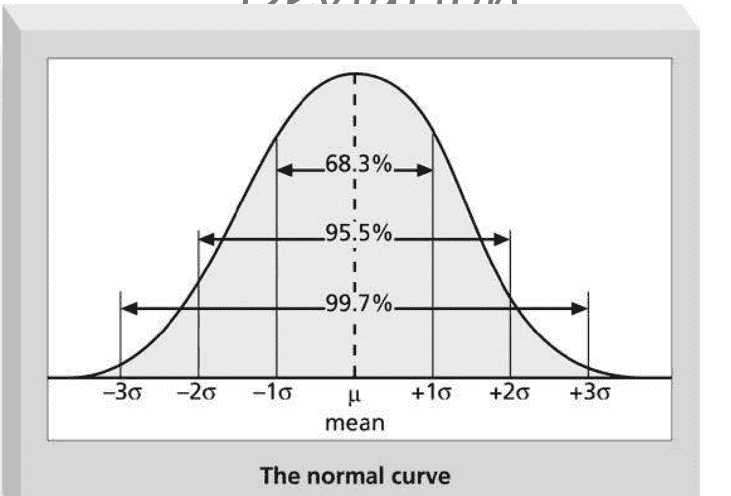

The normal curve

## Table 8-3. Sigma and Defective Units

| Specification Range (in +/- Sigmas) | Percent of Population Within Range | Defective Units Per Million |
|-------------------------------------|-----------------------------------|------------------------------|
| 1 | 68.27 | 317,300,000 |
| 2 | 95.45 | 45,400,000 |
| 3 | 99.73 | 2,700,000 |
| 4 | 99.9937 | 63,000 |
| 5 | 99.999943 | 57 |
| 6 | 99.9999998 | 2 |

## Table 8-4: Six Sigma Conversion Table

| SIGMA | YIELD | DEFECTS PER MILLION OPPORTUNITIES (DPMO) |
|---|---|---|
| 1 | 31.0% | 690,000 |
| 2 | 69.2% | 308,000 |
| 3 | 93.3% | 66,800 |
| 4 | 99.4% | 6,210 |
| 5 | 99.97% | 230 |
| 6 | 99.99966% | 3.4 |

The Six Sigma convention for determining defects is based on the above conversion table. It accounts for a 1.5 sigma shift to measure the number of defects per million opportunities instead of the number of defects per unit.

## Quality Control Charts and the Seven Run Rule

- A control chart is a graphic display of data that illustrates the results of a process over time. It helps prevent defects and allows you to determine whether a process is in control or out of control.
- The seven run rule states that if seven data points in a row are all below the mean, above the mean, or are all increasing or decreasing, then the process needs to be examined for non-random problems.

## Quality Control Charts

- A **control chart** is a graphic display of data that illustrates the results of a process over time.
- The main use of control charts is to prevent defects, rather than to detect or reject them.
- Quality control charts allow you to determine whether a process is in control or out of control.
  - When a process is in control, any variations in the results of the process are created by random events; processes that are in control do not need to be adjusted.
  - When a process is out of control, variations in the results of the process are caused by non-random events; you need to identify the causes of those non-random events and adjust the process to correct or eliminate them.

## The Seven Run Rule

- You can use quality control charts and the seven run rule to look for patterns in data.
- The **seven run rule** states that if seven data points in a row are all below the mean, above the mean, or are all increasing or decreasing, then the process needs to be examined for non-random problems.

## Figure 8-3. Sample Quality Control Chart

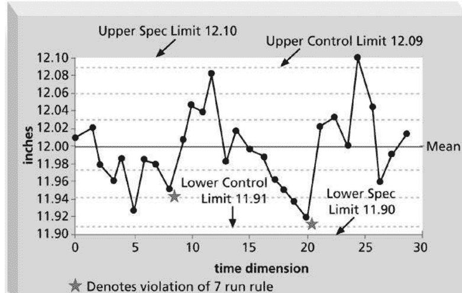

★ Denotes violation of 7 run rule

## Testing

- Many IT professionals think of testing as a stage that comes near the end of IT product development.
- Testing should be done during almost every phase of the IT product development life cycle.

## Figure 8-4. Testing Tasks in the Software Development Life Cycle

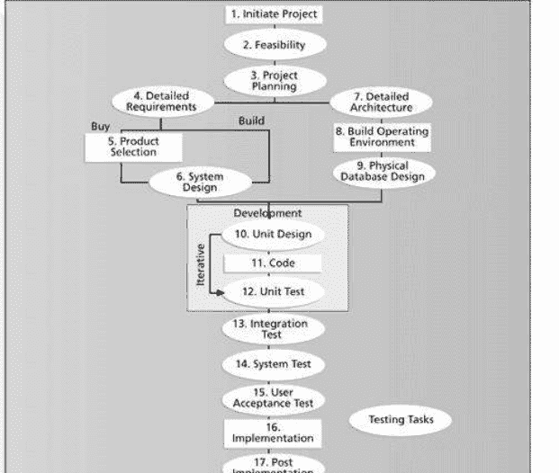

## Types of Tests

- **Unit testing** tests each individual component (often a program) to ensure it is as defect-free as possible.
- **Integration testing** occurs between unit and system testing to test functionally grouped components.
- **System testing** tests the entire system as one entity.
- **User acceptance testing** is an independent test performed by end users prior to accepting the delivered system.

## Figure 8-5. Gantt Chart for Building Testing into a Systems Development Project Plan

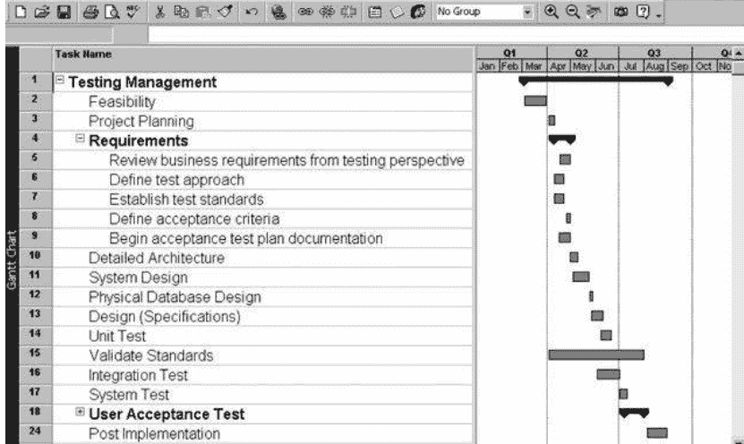

## Testing Alone Is Not Enough

- Watts S. Humphrey, a renowned expert on software quality, defines a **software defect** as anything that must be changed before delivery of the program.
- Testing does not sufficiently prevent software defects because:
  - The number of ways to test a complex system is huge.
  - Users will continue to invent new ways to use a system that its developers never considered.
- Humphrey suggests that people rethink the software development process to provide *no* potential defects when you enter system testing; developers must be responsible for providing error-free code at each stage of testing.

## Modern Quality Management

- Modern quality management:
  - Requires customer satisfaction.
  - Prefers prevention to inspection.
  - Recognizes management responsibility for quality.
- Noteworthy quality experts include Deming, Juran, Crosby, Ishikawa, Taguchi, and Feigenbaum.

## Quality Experts

- Deming was famous for his work in rebuilding Japan and his 14 Points for Management.
- Juran wrote the *Quality Control Handbook* and ten steps to quality improvement.
- Crosby wrote *Quality is Free* and suggested that organizations strive for zero defects.
- Ishikawa developed the concepts of quality circles and fishbone diagrams.
- Taguchi developed methods for optimizing the process of engineering experimentation.
- Feigenbaum developed the concept of total quality control.

## ISO Standards

- **ISO 9000** is a quality system standard that:
  - Is a three-part, continuous cycle of planning, controlling, and documenting quality in an organization.
  - Provides minimum requirements needed for an organization to meet its quality certification standards.
  - Helps organizations around the world reduce costs and improve customer satisfaction.
- **ISO 15504**, sometimes known as SPICE (Software Process Improvement and Capability dEtermination), is a framework for the assessment of software processes.

## Improving Information Technology Project Quality

Several suggestions for improving quality for IT projects include:

- Establish leadership that promotes quality.
- Understand the cost of quality.
- Focus on organizational influences and workplace factors that affect quality.
- Follow maturity models.

## Leadership

- As Joseph M. Juran said in 1945, “It is most important that top management be quality-minded. In the absence of sincere manifestation of interest at the top, little will happen below.”*
- A large percentage of quality problems are associated with management, not technical issues.

*American Society for Quality (ASQ), (www.asqc.org/about/history/juran.html).

## The Cost of Quality

- The **cost of quality** is the cost of conformance plus the cost of nonconformance.
  - **Conformance** means delivering products that meet requirements and fitness for use.
  - **Cost of nonconformance** means taking responsibility for failures or not meeting quality expectations.
- A 2002 study reported that software bugs cost the U.S. economy $59.6 billion each year and that one third of the bugs could be eliminated by an improved testing infrastructure.*

*RTI International, “Software Bugs Cost U.S. Economy $59.6 Billion Annually, RTI Study Finds,” July 1, 2002.

## Table 8-5. Costs Per Hour of Downtime Caused by Software Defects

| Business | Cost per Hour Downtime |
|---|---|
| Automated teller machines (medium-sized bank) | $14,500 |
| Package shipping service | $28,250 |
| Telephone ticket sales | $69,000 |
| Catalog sales center | $90,000 |
| Airline reservation center (small airline) | $89,500 |

## Five Cost Categories Related to Quality

- **Prevention cost**: Cost of planning and executing a project so it is error-free or within an acceptable error range.
- **Appraisal cost**: Cost of evaluating processes and their outputs to ensure quality.
- **Internal failure cost**: Cost incurred to correct an identified defect before the customer receives the product.
- **External failure cost**: Cost that relates to all errors not detected and corrected before delivery to the customer.
- **Measurement and test equipment costs**: Capital cost of equipment used to perform prevention and appraisal activities.

### Media Snapshot

- A 2004 study by Nucleus Research Inc. estimates that spam will cost large companies nearly $2,000 per employee in lost productivity in 2004 alone, despite investments in software to block spam. Spam currently accounts for more than 70 percent of total e-mail volume worldwide.
- In just one month (August 2003), at least 50 new Internet viruses surfaced, and losses related to computer viruses cost North American companies about $3.5 billion. Businesses have suffered at least $65 billion in lost productivity because of computer viruses since 1997.

*McGuire, David, “Report: Spam Costs Are Rising at Work,” Washington Post (June 7, 2004).

## Organizational Influences, Workplace Factors, and Quality

- Study by DeMarco and Lister showed that organizational issues had a much greater influence on programmer productivity than the technical environment or programming languages.
- Programmer productivity varied by a factor of one to ten across organizations, but only by 21 percent within the same organization.
- Study found no correlation between productivity and programming language, years of experience, or salary.
- A dedicated workspace and a quiet work environment were key factors to improving programmer productivity.

## Expectations and Cultural Differences in Quality

- Project managers must understand and manage stakeholder expectations.
- Expectations also vary by:
  - Organization’s culture
  - Geographic regions

## Maturity Models

- **Maturity models** are frameworks for helping organizations improve their processes and systems.
- The **Software Quality Function Deployment Model** focuses on defining user requirements and planning software projects.
- The Software Engineering Institute’s **Capability Maturity Model** is a five-level model laying out a generic path to process improvement for software development in organizations.

## CMM Levels and CMMI

- CMM levels, from lowest to highest, are:
  - Initial
  - Repeatable
  - Defined
  - Managed
  - Optimizing

- The **Capability Maturity Model Integration (CMMI)** is replacing the older CMM ratings and addresses software engineering, system engineering, and program management.

- Companies may not get to bid on government projects unless they have a CMMI Level 3.

## PMI's Maturity Model

- PMI released the Organizational Project Management Maturity Model (OPM3) in December 2003.
- Model is based on market research surveys sent to more than 30,000 project management professionals and incorporates 180 best practices and more than 2,400 capabilities, outcomes, and key performance indicators.
- Addresses standards for excellence in project, program, and portfolio management best practices and explains the capabilities necessary to achieve those best practices.

## Using Software to Assist in Project Quality Management

- Spreadsheet and charting software helps create Pareto diagrams, fishbone diagrams, and so on.
- Statistical software packages help perform statistical analysis.
- Specialized software products help manage Six Sigma projects or create quality control charts.
- Project management software helps create Gantt charts and other tools to help plan and track work related to quality management.

### Chapter Summary

- Project quality management ensures that the project will satisfy the needs for which it was undertaken.
- Main processes include:
  - Quality planning
  - Quality assurance
  - Quality control

## Chapter 9: Project Human Resource Management

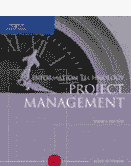

Information Technology Project Management, Fourth Edition

### Learning Objectives

- Discuss human resource planning and be able to create a project organizational chart, responsibility assignment matrix, and resource histogram.
- Understand important issues involved in project staff acquisition and explain the concepts of resource assignments, resource loading, and resource leveling.
- Assist in team development with training, team-building activities, and reward systems.
- Explain and apply several tools and techniques to help manage a project team and summarize general advice on managing teams.
- Describe how project management software can assist in project human resource management.

## The Importance of Human Resource Management

- People determine the success and failure of organizations and projects.
- Recent statistics about IT workforce:
  - The labor market changed a lot early in the new millennium, with shortages and then an abundance of IT workers.
  - A 2004 ITAA report showed a slight recovery in 2004.
  - The total number of IT workers in the U.S. was more than 10.5 million in early 2004, up from 10.3 million in 2003 and 9.9 million in 2002.
  - Eighty-nine percent of new jobs came from non-IT companies, such as banking, finance, manufacturing, food service, and transportation.
  - Hiring managers say interpersonal skills are the most important soft skill for IT workers.*

*Information Technology Association of America (ITAA), “Recovery Slight for IT Job Market in 2004,” (September 8, 2004) www.itaa.org.

## Digital Planet Reports

The global high-tech industry generated more than $2.1 trillion in 1999, $2.3 trillion in 2000, and $2.4 trillion in 2001.

The Internet and e-commerce were notable bright spots in the global economy.

Global e-commerce increased 79 percent between 2000 and 2001.*

China, Poland, and other developing countries are playing an increasing role in the global IT market.

> *Information Technology Association of America (ITAA), “Global IT Spending to Rocket from Current $2 Trillion to $3 Trillion, New Study Finds,” Update for IT Executives (2001) p. 6 (15) www.itaa.org.

## Long Hours and Stereotypes of IT Workers Hurt Recruiting

- Many people are struggling with how to increase and diversify the IT labor pool.
- Noted problems include:
  - The fact that many IT professionals work long hours and must constantly stay abreast of changes in the field.
  - Undesirable stereotypes that keep certain people (for example, women) away from the career field.
  - The need to improve benefits, redefine work hours and incentives, and provide better human resource management.

### Media Snapshot

- “Here’s the dirty little secret: U.S. productivity is No. 1 in the world when productivity is measured as gross domestic product per worker, but our lead vanishes when productivity is measured as GDP per hour worked…Europeans take an average of six to seven weeks of paid annual leave, compared with just 12 days in the United States. Twice as many American as European workers put in more than 48 hours per week.”*
- Sociologists have shown that many Americans, especially men, would like to have more family or leisure time. Recent surveys show that many Americans are willing to sacrifice up to a quarter of their salaries in return for more time off!

> *Williams, Joan and Ariane Hegewisch, “Confusing productivity with long work week,” Minneapolis Star Tribune (September 6, 2004) (www.startribune.com).

## What is Project Human Resource Management?

- Making the most effective use of the people involved with a project.
- Processes include:
  - **Human resource planning**: Identifying and documenting project roles, responsibilities, and reporting relationships.
  - **Acquiring the project team**: Getting the needed personnel assigned to and working on the project.
  - **Developing the project team**: Building individual and group skills to enhance project performance.
  - **Managing the project team**: Tracking team member performance, motivating team members, providing timely feedback, resolving issues and conflicts, and coordinating changes to help enhance project performance.

## Keys to Managing People

- Psychologists and management theorists have devoted much research and thought to the field of managing people at work.
- Important areas related to project management include:
  - Motivation theories
  - Influence and power
  - Effectiveness

## Intrinsic and Extrinsic Motivation

- **Intrinsic motivation** causes people to participate in an activity for their own enjoyment.
- **Extrinsic motivation** causes people to do something for a reward or to avoid a penalty.
- For example, some children take piano lessons for intrinsic motivation (they enjoy it) while others take them for extrinsic motivation (to get a reward or avoid punishment).

## Maslow’s Hierarchy of Needs

- Abraham Maslow argued that human beings possess unique qualities that enable them to make independent choices, thus giving them control of their destiny.
- Maslow developed a **hierarchy of needs**, which states that people’s behaviors are guided or motivated by a sequence of needs.

## Figure 9-1. Maslow's Hierarchy of Needs

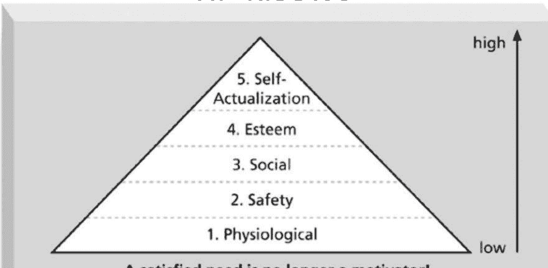

A satisfied need is no longer a motivator!

## Herzberg's Motivational and Hygiene Factors

- Frederick Herzberg wrote several famous books and articles about worker motivation. He distinguished between:
  - **Motivational factors**: Achievement, recognition, the work itself, responsibility, advancement, and growth. These factors produce job satisfaction.
  - **Hygiene factors**: Larger salaries, more supervision, and a more attractive work environment. These factors cause dissatisfaction if not present, but do not motivate workers to do more.

## McClelland’s Acquired-Needs Theory

Specific needs are acquired or learned over time and are shaped by life experiences. The following are the main categories of acquired needs:

- **Achievement (nAch)**: People with a high need for achievement like challenging projects with attainable goals and lots of feedback.
- **Affiliation (nAff)**: People with high need for affiliation desire harmonious relationships and need to feel accepted by others, so managers should try to create a cooperative work environment for them.
- **Power (nPow)**: People with a need for power desire either personal power (not good) or institutional power (good for the organization). Provide institutional power seekers with management opportunities.

## McGregor’s Theory X and Y

- Douglas McGregor popularized the human relations approach to management in the 1960s.
- **Theory X:** Assumes workers dislike and avoid work, so managers must use coercion, threats, and various control schemes to get workers to meet objectives.
- **Theory Y:** Assumes individuals consider work as natural as play or rest and enjoy the satisfaction of esteem and self-actualization needs.
- **Theory Z:** Introduced in 1981 by William Ouchi and is based on the Japanese approach to motivating workers, which emphasizes trust, quality, collective decision making, and cultural values.

## Thamhain and Wilemon’s Ways to Have Influence on Projects

- 1. **Authority**: The legitimate hierarchical right to issue orders.
- 2. **Assignment**: The project manager's perceived ability to influence a worker's later work assignments.
- 3. **Budget**: The project manager's perceived ability to authorize others' use of discretionary funds.
- 4. **Promotion**: The ability to improve a worker's position.
- 5. **Money**: The ability to increase a worker's pay and benefits.
- 6. Penalty: The project manager's ability to cause punishment.
- 7. Work challenge: The ability to assign work that capitalizes on a worker's enjoyment of doing a particular task.
- 8. Expertise: The project manager's perceived special knowledge that others deem important.
- 9. Friendship: The ability to establish friendly personal relationships between the project manager and others.

## Ways to Influence that Help and Hurt Projects

- Projects are more likely to *succeed* when project managers influence people using:
  - Expertise
  - Work challenge
- Projects are more likely to *fail* when project managers rely too heavily on:
  - Authority
  - Money
  - Penalty

## Improving Effectiveness: Covey’s Seven Habits

- Project managers can apply Covey’s seven habits to improve effectiveness on projects.
  - Be proactive.
  - Begin with the end in mind.
  - Put first things first.
  - Think win/win.
  - Seek first to understand, then to be understood.
  - Synergize.
  - Sharpen the saw.

## Empathic Listening and Rapport

- Good project managers are **empathic listeners**, meaning they listen with the intent to understand.
- Before you can communicate with others, you have to have **rapport**, which is a relation of harmony, conformity, accord, or affinity.
- **Mirroring** is the matching of certain behaviors of the other person, and is a technique used to help establish rapport.
- IT professionals need to develop empathic listening and other people skills to improve relationships with users and other stakeholders.

### What Went Right?

- Best practices for ensuring partnerships between people in business and technology areas include:
  - Requiring business people, not IT people, to take the lead in determining and justifying investments in new computer systems.
  - Having CIOs push their staff to recognize that the needs of the business must drive all technology decisions.
  - Reshaping IT units to look and perform like consulting firms.

## Organizational Planning

- Involves identifying and documenting project roles, responsibilities, and reporting relationships.
- Outputs include:
  - Project organizational charts
  - Staffing management plans
  - Responsibility assignment matrixes
  - Resource histograms

## Figure 9-2. Sample Organizational Chart for a Larae IT Project

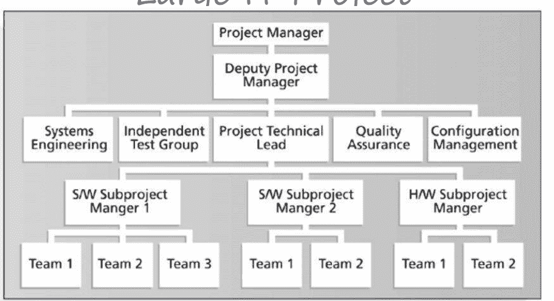

## Figure 9-3. Work Definition and Assignment Process

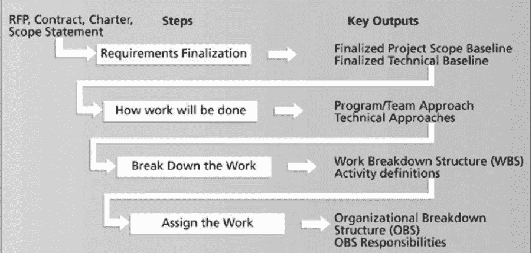

## Figure 9-5. RAM Showing Stakeholder Roles

| Items | A | B | C | D | E |
|-------|---|---|---|---|---|
| Unit Test | S | A | I | I | R |
| Integration Test | S | P | A | I | R |
| System Test | S | P | A | I | R |
| User Acceptance Test | S | P | I | A | R |

- A = Accountable
- P = Participant
- R = Review Required
- I = Input Required
- S = Sign-off Required

## Table 9-1. Sample RACI Chart

|  | GROUP A | GROUP B | GROUP C | GROUP D | GROUP E |
|---|---|---|---|---|---|
| Test Plans | R | A | C | C | I |
| Unit Test | C | I | R | A | I |
| Integration Test | A | R | I | C | C |
| System Test | I | C | A | I | R |
| User Acceptance Test | A | I | C | R | A |

R = Responsibility, only one R per task
A = Accountability
C = Consultation
I = Informed

## Staffing Management Plans and Resource Histograms

- A staffing management plan describes when and how people will be added to and taken off the project team.
- A resource histogram is a column chart that shows the number of resources assigned to a project over time.

## Figure 9-6. Sample Resource Histogram

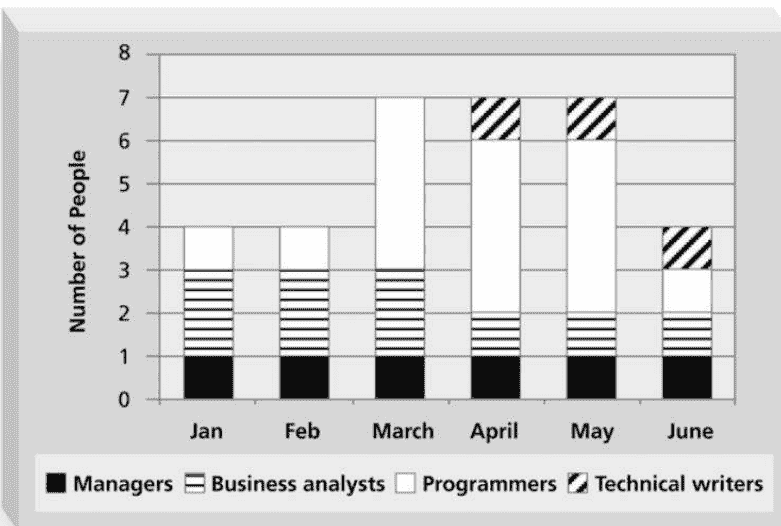

## Acquiring the Project Team

- Acquiring qualified people for teams is crucial.
- The project manager who is the smartest person on the team has done a poor job of recruiting!
- Staffing plans and good hiring procedures are important, as are incentives for recruiting and retention.
  - Some companies give their employees one dollar for every hour that a new person who they helped hire works.
  - Some organizations allow people to work from home as an incentive.

## Why People Leave Their Jobs

- They feel they do not make a difference.
- They do not get proper recognition.
- They are not learning anything new or growing as a person.
- They do not like their coworkers.
- They want to earn more money.

## Resource Loading

- **Resource loading** refers to the amount of individual resources an existing schedule requires during specific time periods.
- Helps project managers develop a general understanding of the demands a project will make on the organization’s resources and individual people’s schedules.
- **Overallocation** means more resources than are available are assigned to perform work at a given time.

## Figure 9-7. Sample Histogram Showing an Overallocated Individual

What’s wrong with this picture? Assume 100 percent means Joe is working eight hours per day.

## Resource Leveling

- **Resource leveling** is a technique for resolving resource conflicts by delaying tasks.
- The main purpose of resource leveling is to create a smoother distribution of resource use and reduce overallocation.

## Figure 9-8. Resource Leveling Example

The project network with Activities A, B, and C and durations as shown. Activity A has 3 days of slack, and Activity C has 2 days of slack. Assume Activity A has 2 workers, B has 4 workers, and C has 2 workers.

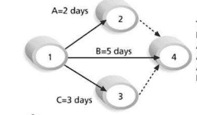

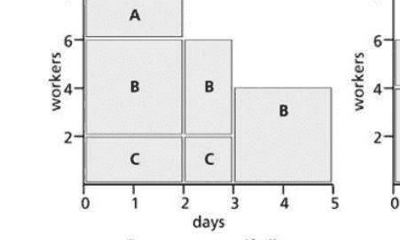

Resource usage if all Activities start on day one

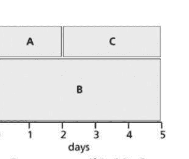

Resource usage if Activity C is delayed 2 days, its total slack

## Benefits of Resource Leveling

- When resources are used on a more constant basis, they require less management.
- It may enable project managers to use a just-in-time inventory type of policy for using subcontractors or other expensive resources.
- It results in fewer problems for project personnel and the accounting department.
- It often improves morale.

## Developing the Project Team

- The main goal of **team development** is to help people work together more effectively to improve project performance.
- It takes teamwork to successfully complete most projects.

## Training

- Training can help people understand themselves and each other, and understand how to work better in teams.
- Team building activities include:
  - Physical challenges
  - Psychological preference indicator tools

## Myers-Briggs Type Indicator
(MBTI)

- MBTI is a popular tool for determining personality preferences and helping teammates understand each other.
- Four dimensions include:
  - Extrovert/Introvert (E/I)
  - Sensation/Intuition (S/N)
  - Thinking/Feeling (T/F)
  - Judgment/Perception (J/P)
- NTs, or rationals, are attracted to technology fields.
- IT people vary most from the general population in their tendency to not be extroverted or sensing.

## MBTI and Suitability to Project Work*

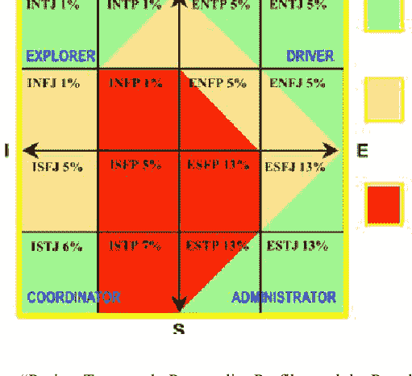

What do you think about these views?

> *Wideman, R. Max. “Project Teamwork, Personality Profiles and the Population at Large: Do we have enough of the right kind of people?” (http://www.maxwideman.com/papers/profiles/profiles.pdf).

## Social Styles Profile

- People are perceived as behaving primarily in one of four zones, based on their assertiveness and responsiveness:
  - Drivers
  - Expressives
  - Analyticals
  - Amiables

## Figure 9-9. Social Styles

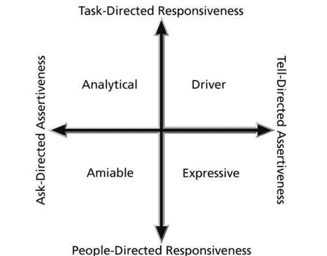

## Reward and Recognition Systems

- Team-based reward and recognition systems can promote teamwork.
- Focus on rewarding teams for achieving specific goals.
- Allow time for team members to mentor and help each other to meet project goals and develop human resources.

## Managing the Project Team

- Project managers must lead their teams in performing various project activities.
- After assessing team performance and related information, the project manager must decide:
  - If changes should be requested to the project.
  - If corrective or preventive actions should be recommended.
  - If updates are needed to the project management plan or organizational process assets.

## General Advice on Teams

- Be patient and kind with your team.
- Fix the problem instead of blaming people.
- Establish regular, effective meetings.
- Allow time for teams to go through the basic team-building stages.
- Limit the size of work teams to three to seven members.

## General Advice on Teams (cont’d)
- Plan some social activities to help project team members and other stakeholders get to know each other better.
- Stress team identity.
- Nurture team members and encourage them to help each other.
- Take additional actions to work with virtual team members.

## Using Software to Assist in Human Resource Management
- Software can help produce RAMS and resource histograms.
- By using project management software for human resource management, you can:
  - Assign resources.
  - Identify potential resource shortages or underutilization.
  - Level resources.

## Project Resource Management Involves Much More Than Using Software
- Project managers must:
  - Treat people with consideration and respect.
  - Understand what motivates people.
  - Communicate carefully with people.
- Focus on your goal of enabling project team members to deliver their best work.

### Chapter Summary
- Project human resource management includes the processes required to make the most effective use of the people involved with a project.
- Main processes include:
  - Human resource planning
  - Acquiring the project team
  - Developing the project team
  - Managing the project team

## Chapter 10:
Project Communications
Management

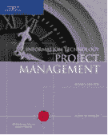

Information Technology Project Management,
Fourth Edition

### Learning Objectives
- Understand the importance of good communications in projects.
- Explain the elements of project communications planning, including how to create a communications management plan and perform a stakeholder communications analysis.
- Describe various methods for distributing project information and the advantages and disadvantages of each, discuss the importance of addressing individual communication needs, and calculate the number of communications channels in a project.

## Learning Objectives (cont’d)
- Understand how the main outputs of performance reporting help stakeholders stay informed about project resources.
- Recognize the importance of good communications management for stakeholder relationships and for resolving issues.
- List various methods for improving project communications, such as managing conflicts, running effective meetings, using e-mail and other technologies effectively, and using templates.
- Describe how software can enhance project communications management.

## Importance of Good Communications
- The greatest threat to many projects is a failure to communicate.
- Our culture does not portray IT professionals as being good communicators.
- Research shows that IT professionals must be able to communicate effectively to succeed in their positions.
- Strong verbal skills are a key factor in career advancement for IT professionals.

## Project Communications Management Processes
- Communications planning: Determining the information and communications needs of the stakeholders.
- Information distribution: Making needed information available to project stakeholders in a timely manner.
- Performance reporting: Collecting and disseminating performance information, including status reports, progress measurement, and forecasting.
- Managing stakeholders: Managing communications to satisfy the needs and expectations of project stakeholders and to resolve issues.

## Communications Planning
- Every project should include some type of **communications management** plan, a document that guides project communications.
- Creating a stakeholder analysis for project communications also aids in communications planning.

## Communications Management Plan Contents
- Stakeholder communications requirements.
- Information to be communicated, including format, content, and level of detail.
- The people who will receive the information and who will produce it.
- Suggested methods or technologies for conveying the information.

## Communications Management Plan Contents (cont’d)

- Frequency of communication.
- Escalation procedures for resolving issues.
- Revision procedures for updating the communications management plan.
- A glossary of common terminology.

## Table 10-1. Sample Stakeholder Analysis for Project Communications

| Stakeholders | Document Name | Document Format | Contact Person | Due |
|---|---|---|---|---|
| Customer management | Monthly status report | Hard copy | Tina Erndt, Tom Silva | First of month |
| Customer business staff | Monthly status report | Hard copy | Julie Grant, Sergey Cristobal | First of month |
| Customer technical staff | Monthly status report | E-mail | Li Chau, Nancy Michaels | First of month |
| Internal management | Monthly status report | Hard copy | Bob Thomson | First of month |
| Internal business and technical staff | Monthly status report | Intranet | Angie Liu | First of month |
| Training subcontractor | Training plan | Hard copy | Jonathan Kraus | 11/1/2006 |
| Software subcontractor | Software implementation plan | E-mail | Najwa Gates | 6/1/2006 |

Comments: Put the titles and dates of documents in e-mail headings and have recipients acknowledge receipt.

## Information Distribution

- Getting the right information to the right people at the right time and in a useful format is just as important as developing the information in the first place.
- Important considerations include:
  - Using technology to enhance information distribution.
  - Formal and informal methods for distributing information.

### What Went Wrong?

A well-publicized example of misuse of e-mail comes from the 1998 Justice Department's high profile, antitrust suit against Microsoft. E-mail emerged as a star witness in the case. Many executives sent messages that should never have been put in writing. The court used e-mail as evidence, even though the senders of the notes said the information was being interpreted out of context.*

See the example that describes the misunderstanding of the phrase “pedagogical approach” on page 392.

*Harmon, Amy, “E-mail Comes Back to Haunt Companies,” Minneapolis Star Tribune (from the New York Times) (November 29, 1998).

## Distributing Information in an Effective and Timely Manner

- Don’t bury crucial information.
- Don’t be afraid to report bad information.
- Oral communication via meetings and informal talks helps bring important information—good and bad—out into the open.

## Importance of Face-to-Face Communication

- Research says that in a face-to-face interaction:
  - 58 percent of communication is through body language.
  - 35 percent of communication is through how the words are said.
  - 7 percent of communication is through the content or words that are spoken.
- Pay attention to more than just the actual words someone is saying.
- A person’s tone of voice and body language say a lot about how he or she really feels.

## Encouraging More Face-to-Face Interactions

- Short, frequent meetings are often very effective in IT projects.
- Stand-up meetings force people to focus on what they really need to communicate.
- Some companies have policies preventing the use of e-mail between certain hours or even entire days of the week.

### Media Snapshot

- Live video is a modern medium for sending information.
- Microsoft says that one in every five face-to-face meetings can be replaced with Web conferencing tools, and they estimate it will save $70 million in reduced travel in one year alone.*
- The medium can backfire, as in the case with the Janet Jackson wardrobe malfunction during the 2004 Super Bowl half-time show.

*Lohr, Steve, “Ambitious Package to Raise Productivity (and Microsoft’s Profit),” The New York Times (August 16, 2004).

## Understanding Group and Individual Communication Needs

- People are not interchangeable parts.
- As illustrated in Brooks’ book *The Mythical Man-Month*, you cannot assume that a task originally scheduled to take two months of one person’s time can be done in one month by two people.
- Nine women cannot produce a baby in one month!

## Personal Preferences Affect Communication Needs

- Introverts like more private communications, while extroverts like to discuss things in public.
- Intuitive people like to understand the big picture, while sensing people need step-by-step details.
- Thinkers want to know the logic behind decisions, while feeling people want to know how something affects them personally.
- Judging people are driven to meet deadlines while perceiving people need more help in developing and following plans.

## Other Communication Considerations

- Rarely does the receiver interpret a message exactly as the sender intended.
- Geographic location and cultural background affect the complexity of project communications.
  - Different working hours
  - Language barriers
  - Different cultural norms

## Setting the Stage for Communicating
### Bad News

Dear Mom and Dad, or should I say Grandma & Grandpa,

Yes, I am pregnant. No, I’m not married yet since Larry, my boyfriend, is out of a job. Larry’s employers just don’t seem to appreciate the skills he has learned since he quit high school. Larry looks much younger than you, Dad, even though he is three years older. I’m quitting college and getting a job so we can get an apartment before the baby is born. I found a beautiful apartment above a 24-hour auto repair garage with good insulation so the exhaust fumes and noise won’t bother us.

I’m very happy. I thought you would be too.

Love, Ashley

P.S. There is no Larry. I’m not pregnant. I’m not getting married. I’m not quitting school, but I am getting a “D” in Chemistry. I just wanted you to have some perspective.

## Determining the Number of Communications Channels

- As the number of people involved increases, the complexity of communications increases because there are more communications channels or pathways through which people can communicate.
- Number of communications channels = n(n-1)/2
  where n is the number of people involved.

## Figure 10-1. The Impact of the Number of People on Communications Channels

number of communications channels = n(n-1)/2

2 people, 1 communications channel

3 people, 3 communications channels

4 people, 6 communications channels, etc.

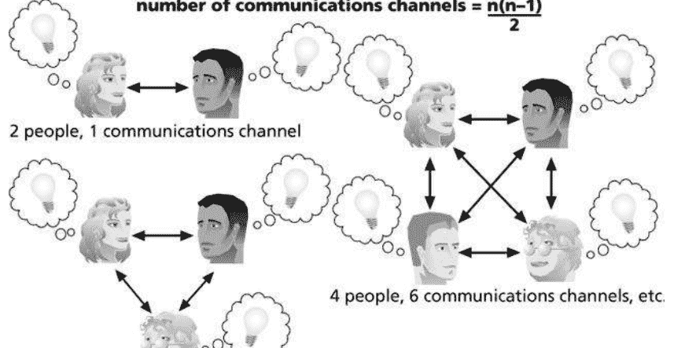

## Managing Stakeholders

- Project managers must understand and work with various stakeholders.
- Need to devise a way to identify and resolve issues.
- Two important tools include:
  - Expectations management matrix
  - Issue log

## Table 10-3. Expectations Management Matrix

| Measure of Success | Priority | Expectations | Guidelines |
|---|---|---|---|
| Scope | 2 | The scope statement clearly defines mandatory requirements and optional requirements. | Focus on meeting mandatory requirements before considering optional ones. |
| Time | 1 | There is no give in the project completion date. Every major deadline must be met, and the schedule is very realistic. | The project sponsor and program manager must be alerted if there are any issues that might affect meeting schedule goals. |
| Cost | 3 | This project is crucial to the organization. If you can clearly justify the need for more funds, they can be made available. | There are strict rules for project expenditures and escalation procedures. Cost is very important, but it takes a back seat to meeting schedule and then scope goals. |
| Etc. |  |  |  |

## Table 10-4. Issue Log

| Issue # | Issue Description | Impact on Project | Date Reported | Reported By | Assigned To | Priority (M/H/L) | Due Date | Status | Comments |
|---|---|---|---|---|---|---|---|---|---|
| 1 | Servers cost 10% more than planned | Slight increase in project cost | 5/15 | Jean | Oded | M | 6/15 | Closed | The sponsor agreed to provide additional funds to meet the deadline. |
| 2 | Two people left the project | Need to reassign personnel | 9/26 | Gaurav | Karen | H | 10/2 | Open | If Karen cannot reassign people within a week, she should talk to Peter directly. |
| etc. |  |  |  |  |  |  |  |  |  |

## Suggestions for Improving Project Communications

- Manage conflicts effectively.
- Develop better communication skills.
- Run effective meetings.
- Use e-mail effectively.
- Use templates for project communications.

## Conflict Handling Modes

1. Confrontation: Directly face a conflict using a problem-solving approach.
2. Compromise: Use a give-and-take approach.
3. Smoothing: De-emphasize areas of difference and emphasize areas of agreement.
4. Forcing: The win-lose approach.
5. Withdrawal: Retreat or withdraw from an actual or potential disagreement.

## Conflict Can Be Good

- Conflict often produces important results, such as new ideas, better alternatives, and motivation to work harder and more collaboratively.
- **Groupthink:** Conformance to the values or ethical standards of a group. Groupthink can develop if there are no conflicting viewpoints.
- Research suggests that task-related conflict often improves team performance, but emotional conflict often depresses team performance.

## Developing Better Communication Skills

- Companies and formal degree programs for IT professionals often neglect the importance of speaking, writing, and listening skills.
- As organizations become more global, they realize they must invest in ways to improve communication with people from different countries and cultures.
- It takes leadership to improve communication.

## Running Effective Meetings

- Determine if a meeting can be avoided.
- Define the purpose and intended outcome of the meeting.
- Determine who should attend the meeting.
- Provide an agenda to participants before the meeting.
- Prepare handouts and visual aids, and make logistical arrangements ahead of time.
- Run the meeting professionally.
- Build relationships.

## Using E-Mail Effectively

- Make sure that e-mail is an appropriate medium for what you want to communicate.
- Be sure to send the e-mail to the right people.
- Use meaningful subject lines.
- Limit the content to one main subject, and be as clear and concise as possible.
- Limit the number and size of attachments.
- Delete e-mail you don’t need, and don’t open e-mail if you question the source.
- Make sure your virus software is current.
- Respond to and file e-mails quickly.
- Learn how to use important features.

## Using Templates for Project Communications

- Many technical people are afraid to ask for help.
- Providing examples and templates for project communications saves time and money.
- Organizations can develop their own templates, use some provided by outside organizations, or use samples from textbooks.
- Recall that research shows that companies that excel in project management make effective use of templates.

## Figure 10-2. Sample Template for a Project Description

### Project X Description

**Objective:** Describe the objective of the project in one or two sentences. Focus on the business benefits of doing the project.

**Scope:** Briefly describe the scope of the project. What business functions are involved, and what are the main products the project will produce?

**Assumptions:** Summarize the most critical assumptions for the project.

**Cost:** Provide the total estimated cost of the project. If desired, list the total cost each year.

**Schedule:** Provide summary information from the project’s Gantt chart, as shown. Focus on summary tasks and milestones.

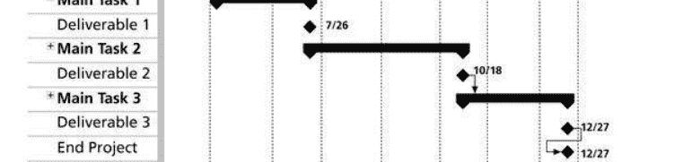

## Table 10-5. Sample Template for a Monthly Progress Report

### I. Accomplishments for Month of January (or appropriate month):

- Describe most important accomplishments. Relate to project’s Gantt chart.
- Describe other important accomplishments, one bullet for each. If any issues were resolved from the previous month, list them as accomplishments.

### II. Plans for February (or following month):

- Describe most important items to be accomplished in the next month. Again, relate to the project’s Gantt chart.
- Describe other important items to accomplish, one bullet for each.

### III. Issues: Briefly list important issues that surfaced or are still important. Managers hate surprises and want to help the project succeed, so be sure to list issues.

### IV. Project Changes (Date and Description): List any approved or requested changes to the project. Include the date of the change and a brief description.

## Lessons Learned Reports
- The project manager and project team members should each prepare a **lessons-learned report**.
- A reflective statement that documents important things an individual learned from working on the project.
- The project manager often combines information from all of the lessons-learned reports into a project summary report.
- See template and sample in Chapter 3.

## Project Web Sites
- Many project teams create a project Web site to store important product documents and other information.
- Can create the site using various types of software.

## Figure 10-3. Sample Project Web Site
## Tempting Templates Project Web Site

**Background:** This project was done in the spring 2003 semester by a group of four Unite students at the University of Minnesota as part of their project management course, IE5541.

**Project Objectives:** Perform a search for document templates and example documents used in project management. Evaluate, categorize and document the search results to be used in writing the *Information Technology Project Management, Third Edition*, by Kathy Schwalbe.

- Project Documents
- Meet our Team
- Meeting Minutes
- Top 10 Web Sites
- Email the PM, Bill Hunt

## Developing a Communications Infrastructure
- A **communications infrastructure** is a set of tools, techniques, and principles that provide a foundation for the effective transfer of information.
- Tools include e-mail, project management software, groupware, fax machines, telephones, teleconferencing systems, document management systems, and word processors.
- Techniques include reporting guidelines and templates, meeting ground rules and procedures, decision-making processes, problem-solving approaches, and conflict resolution and negotiation techniques.
- Principles include using open dialog and an agreed upon work ethic.

## Using Software to Assist in Project Communications
- There are many software tools to aid in project communications.
- Today more than 37 percent of people telecommute or work remotely at least part-time.
- Project management software includes new capabilities to enhance virtual communications.
- New tools, such as instant messaging and blogs, can enhance project communications.

### Chapter Summary
- The goal of project communications management is to ensure timely and appropriate generation, collection, dissemination, storage, and disposition of project information.
- Main process include:
  - Communications planning
  - Information distribution
  - Performance reporting
  - Managing stakeholders

## Chapter 11:
Project Risk Management

Information Technology Project Management, Fourth Edition

### Learning Objectives
- Understand what risk is and the importance of good project risk management.
- Discuss the elements involved in risk management planning and the contents of a risk management plan.
- List common sources of risks in information technology projects.

## Learning Objectives (cont’d)
- Describe the risk identification process, tools, and techniques to help identify project risks, and the main output of risk identification, a risk register.
- Discuss the qualitative risk analysis process and explain how to calculate risk factors, create probability/impact matrixes, apply the Top Ten Risk Item Tracking technique, and use expert judgment to rank risks.

## Learning Objectives (cont’d)
- Explain the quantitative risk analysis process and how to apply decision trees, simulation, and sensitivity analysis to quantify risks.
- Provide examples of using different risk response planning strategies to address both negative and positive risks.
- Discuss what is involved in risk monitoring and control.
- Describe how software can assist in project risk management.

## The Importance of Project Risk Management

- Project risk management is the art and science of identifying, analyzing, and responding to risk throughout the life of a project and in the best interests of meeting project objectives.
- Risk management is often overlooked in projects, but it can help improve project success by helping select good projects, determining project scope, and developing realistic estimates.

## Research Shows Need to Improve Project Risk Management

- Study by Ibbs and Kwak shows risk has the lowest maturity rating of all knowledge areas.
- KLCI study shows the benefits of following good software risk management practices.
- KPMG study found that 55 percent of **runaway projects**—projects that have significant cost or schedule overruns—did *no risk management* at all.*

> *Cole, Andy, “Runaway Projects—Cause and Effects,” Software World, Vol. 26, no. 3, pp. 3–5 (1995).*

## Table 11-1. Project Management Maturity by Industry Group and Knowledge Area*

KEY: 1 = LOWEST MATURITY RATING      5 = HIGHEST MATURITY RATING

| Knowledge Area | Engineering/Construction | Telecommunications | Information Systems | Hi-Tech Manufacturing |
|---|---|---|---|---|
| Scope | 3.52 | 3.45 | 3.25 | 3.37 |
| Time | 3.55 | 3.41 | 3.03 | 3.50 |
| Cost | 3.74 | 3.22 | 3.20 | 3.97 |
| Quality | 2.91 | 3.22 | 2.88 | 3.26 |
| Human Resources | 3.18 | 3.20 | 2.93 | 3.18 |
| Communications | 3.53 | 3.53 | 3.21 | 3.48 |
| Risk | 2.93 | 2.87 | 2.75 | 2.76 |
| Procurement | 3.33 | 3.01 | 2.91 | 3.33 |

> *Ibbs, C. William and Young Hoon Kwak. “Assessing Project Management Maturity,” Project Management Journal (March 2000).

## Figure 11-1. Benefits from Software Risk Management Practices*

*Kulik, Peter and Catherine Weber, “Software Risk Management Practices – 2001,” KLCI Research Group (August 2001).

## Negative Risk

- A dictionary definition of risk is “the possibility of loss or injury.”
- Negative risk involves understanding potential problems that might occur in the project and how they might impede project success.
- Negative risk management is like a form of insurance; it is an investment.

## Risk Can Be Positive

- Positive risks are risks that result in good things happening; sometimes called opportunities.
- A general definition of project **risk** is an uncertainty that can have a negative or positive effect on meeting project objectives.
- The goal of project risk management is to minimize potential negative risks while maximizing potential positive risks.

## Risk Utility

- **Risk utility** or **risk tolerance** is the amount of satisfaction or pleasure received from a potential payoff.
- Utility rises at a decreasing rate for people who are risk-averse.
- Those who are risk-seeking have a higher tolerance for risk and their satisfaction increases when more payoff is at stake.
- The risk-neutral approach achieves a balance between risk and payoff.

## Figure 11-2. Risk Utility Function and Risk Preference.

## Project Risk Management Processes

- **Risk management planning**: Deciding how to approach and plan the risk management activities for the project.
- **Risk identification**: Determining which risks are likely to affect a project and documenting the characteristics of each.
- **Qualitative risk analysis**: Prioritizing risks based on their probability and impact of occurrence.

## Project Risk Management Processes (cont’d)

- **Quantitative risk analysis:** Numerically estimating the effects of risks on project objectives.
- **Risk response planning:** Taking steps to enhance opportunities and reduce threats to meeting project objectives.
- **Risk monitoring and control:** Monitoring identified and residual risks, identifying new risks, carrying out risk response plans, and evaluating the effectiveness of risk strategies throughout the life of the project.

## Risk Management Planning

- The main output of risk management planning is a risk **management plan**—a plan that documents the procedures for managing risk throughout a project.
- The project team should review project documents and understand the organization’s and the sponsor’s approaches to risk.
- The level of detail will vary with the needs of the project.

## Table 11-2. Topics Addressed in a Risk Management Plan

- Methodology
- Roles and responsibilities
- Budget and schedule
- Risk categories
- Risk probability and impact
- Risk documentation

## Contingency and Fallback Plans, Contingency Reserves

- **Contingency plans** are predefined actions that the project team will take if an identified risk event occurs.
- **Fallback plans** are developed for risks that have a high impact on meeting project objectives, and are put into effect if attempts to reduce the risk are not effective.
- **Contingency reserves** or **allowances** are provisions held by the project sponsor or organization to reduce the risk of cost or schedule overruns to an acceptable level.

## Common Sources of Risk in Information Technology Projects

- Several studies show that IT projects share some common sources of risk.
- The Standish Group developed an IT success potential scoring sheet based on potential risks.
- Other broad categories of risk help identify potential risks.

## Table 11-3. Information Technology Success Potential Scoring Sheet

| Success Criterion | Relative Importance |
|---|---|
| User Involvement | 19 |
| Executive Management support | 16 |
| Clear Statement of Requirements | 15 |
| Proper Planning | 11 |
| Realistic Expectations | 10 |
| Smaller Project Milestones | 9 |
| Competent Staff | 8 |
| Ownership | 6 |
| Clear Visions and Objectives | 3 |
| Hard-Working, Focused Staff | 3 |
| Total | 100 |

## Broad Categories of Risk

- Market risk
- Financial risk
- Technology risk
- People risk
- Structure/process risk

## Risk Breakdown Structure

- A **risk breakdown structure** is a hierarchy of potential risk categories for a project.
- Similar to a work breakdown structure but used to identify and categorize risks.

## Figure 11-3. Sample Risk Breakdown Structure

## Table 11-4. Potential Negative Risk Conditions Associated With Each Knowledge Area

| Knowledge Area | Risk Conditions |
|---|---|
| Integration | Inadequate planning; poor resource allocation; poor integration management; lack of post-project review |
| Scope | Poor definition of scope or work packages; incomplete definition of quality requirements; inadequate scope control |
| Time | Errors in estimating time or resource availability; poor allocation and management of float; early release of competitive products |
| Cost | Estimating errors; inadequate productivity, cost, change, or contingency control; poor maintenance, security, purchasing, etc. |
| Quality | Poor attitude toward quality; substandard design/materials/workmanship; inadequate quality assurance program |
| Human Resources | Poor conflict management; poor project organization and definition of responsibilities; absence of leadership |
| Communications | Carelessness in planning or communicating; lack of consultation with key stakeholders |
| Risk | Ignoring risk; unclear assignment of risk; poor insurance management |
| Procurement | Unenforceable conditions or contract clauses; adversarial relations |

## Risk Identification

- **Risk identification** is the process of understanding what potential events might hurt or enhance a particular project.
- Risk identification tools and techniques include:
  - Brainstorming
  - The Delphi Technique
  - Interviewing
  - SWOT analysis

## Brainstorming

- Brainstorming is a technique by which a group attempts to generate ideas or find a solution for a specific problem by amassing ideas spontaneously and without judgment.

- An experienced facilitator should run the brainstorming session.

- Be careful not to overuse or misuse brainstorming.

- Psychology literature shows that individuals produce a greater number of ideas working alone than they do through brainstorming in small, face-to-face groups.

- Group effects often inhibit idea generation.

## Delphi Technique
- The **Delphi Technique** is used to derive a consensus among a panel of experts who make predictions about future developments.
- Provides independent and anonymous input regarding future events.
- Uses repeated rounds of questioning and written responses and avoids the biasing effects possible in oral methods, such as brainstorming.

## Interviewing
- **Interviewing** is a fact-finding technique for collecting information in face-to-face, phone, e-mail, or instant-messaging discussions.
- Interviewing people with similar project experience is an important tool for identifying potential risks.

## SWOT Analysis
- SWOT analysis (strengths, weaknesses, opportunities, and threats) can also be used during risk identification.
- Helps identify the broad negative and positive risks that apply to a project.

## Risk Register Contents
- An identification number for each risk event.
- A rank for each risk event.
- The name of each risk event.
- A description of each risk event.
- The category under which each risk event falls.
- The root cause of each risk.
- Triggers for each risk; **triggers** are indicators or symptoms of actual risk events.
- Potential responses to each risk.
- The **risk owner** or person who will own or take responsibility for each risk.
- The probability and impact of each risk occurring.
- The status of each risk.

## Table 11-5. Sample Risk Register

| No. | Rank | Risk | Description | Category | Root Cause | Triggers | Potential Responses | Risk Owner | Probability | Impact | Status |
| --- | --- | --- | --- | --- | --- | --- | --- | --- | --- | --- | --- |
| R44 | 1 |  |  |  |  |  |  |  |  |  |  |
| R21 | 2 |  |  |  |  |  |  |  |  |  |  |
| R7 | 3 |  |  |  |  |  |  |  |  |  |  |

## Qualitative Risk Analysis
- Assess the likelihood and impact of identified risks to determine their magnitude and priority.
- Risk quantification tools and techniques include:
  - Probability/impact matrixes
  - The Top Ten Risk Item Tracking
  - Expert judgment

## Probability/Impact Matrix
- A **probability/impact matrix** or **chart** lists the relative probability of a risk occurring on one side of a matrix or axis on a chart and the relative impact of the risk occurring on the other.
- List the risks and then label each one as high, medium, or low in terms of its probability of occurrence and its impact if it did occur.
- Can also calculate **risk factors**:
  - Numbers that represent the overall risk of specific events based on their probability of occurring and the consequences to the project if they do occur.

## Figure 11-4. Sample Probability/Impact Matrix

| Probability \ Impact | Low | Medium | High |
|---|---|---|---|
| High | risk 6 | risk 9 | risk 1 risk 4 |
| Medium | risk 3 risk 7 | risk 2 risk 5 risk 11 |  |
| Low |  | risk 8 risk 10 | risk 12 |

Impact

## Table 11-6. Sample Probability/Impact Matrix for Qualitative Risk Assessment

| PROBABILITY OF FAILURE (Pf) ATTRIBUTES OF SUGGESTED TECHNOLOGY |
| VALUE | MATURITY HARDWARE/SOFTWARE | COMPLEXITY HARDWARE/SOFTWARE | SUPPORT BASE |
| 0.1 | Existing | Simple Design | Multiple Programs And Services |
| 0.3 | Minor Redesign | Somewhat Complex | Multiple Programs |
| 0.5 | Major Change Feasible | Fairly Complex | Several Parallel Programs |
| 0.7 | Complex HW Design/ New SW Similar to Existing | Very Complex | At Least One Other Program |
| 0.9 | Some Research Completed/ Never Done Before | Extremely Complex | No Additional Programs |

| CONSEQUENCE OF FAILURE (Cf) ATTRIBUTES OF SUGGESTED TECHNOLOGY |
| VALUE | FALLBACK SOLUTIONS | LIFE CYCLE COST (LCC) FACTOR | SCHEDULE FACTOR (INITIAL OPERATIONAL CAPABILITY = IOC) | DOWNTIME (DT) FACTOR |
| 0.1 | Several Acceptable Alternatives | Highly Confident Will Reduce LCC | 90—100% Confident Will Meet IOC Significantly | Highly Confident Will Reduce DT |
| 0.3 | A Few Known Alternatives | Fairly Confident Will Reduce LCC | 75—90% Confident Will Meet IOC | Fairly Confident Will Reduce DT Significantly |
| 0.5 | Single Acceptable Alternative | LCC Will Not Change Much | 50—75% Confident Will Meet IOC | Highly Confident Will Reduce DT Somewhat |
| 0.7 | Some Possible Alternatives | Fairly Confident Will Increase LCC | 25—50% Confident Will Meet IOC | Fairly Confident Will Reduce DT Somewhat |
| 0.9 | No Acceptable Alternatives | Highly Confident Will Increase LCC | 0—25% Confident Will Meet IOC | DT May Not Be Reduced Much |

# Figure 11-5. Chart Showing High-, Medium-, and Low-Risk Technologies

# Top Ten Risk Item Tracking

- **Top Ten Risk Item Tracking** is a qualitative risk analysis tool that helps to identify risks and maintain an awareness of risks throughout the life of a project.
- Establish a periodic review of the top ten project risk items.
- List the current ranking, previous ranking, number of times the risk appears on the list over a period of time, and a summary of progress made in resolving the risk item.

# Table 11-7. Example of Top Ten Risk Item Tracking

|  | Monthly Ranking |  |
|---|---|---|
| Risk Item | This Month | Last Month | Number of Months | Risk Resolution Progress |
| Inadequate planning | 1 | 2 | 4 | Working on revising the entire project plan |
| Poor definition of scope | 2 | 3 | 3 | Holding meetings with project customer and sponsor to clarify scope |
| Absence of leadership | 3 | 1 | 2 | Just assigned a new project manager to lead the project after old one quit |
| Poor cost estimates | 4 | 4 | 3 | Revising cost estimates |
| Poor time estimates | 5 | 5 | 3 | Revising schedule estimates |

# Quantitative Risk Analysis

- Often follows qualitative risk analysis, but both can be done together.
- Large, complex projects involving leading edge technologies often require extensive quantitative risk analysis.
- Main techniques include:
  - Decision tree analysis
  - Simulation
  - Sensitivity analysis

# Decision Trees and Expected Monetary Value (EMV)

- A **decision tree** is a diagramming analysis technique used to help select the best course of action in situations in which future outcomes are uncertain.
- **Estimated monetary value (EMV)** is the product of a risk event probability and the risk event’s monetary value.
- You can draw a decision tree to help find the EMV.

# Figure 11-8. Expected Monetary Value (EMV) Example

Project 1’s EMV = $60,000 −32,000 = $28,000
Project 2’s EMV = −$10,000 −2,000 + 42,000 = $30,000

# Simulation

- Simulation uses a representation or model of a system to analyze the expected behavior or performance of the system.
- **Monte Carlo analysis** simulates a model’s outcome many times to provide a statistical distribution of the calculated results.
- To use a Monte Carlo simulation, you must have three estimates (most likely, pessimistic, and optimistic) plus an estimate of the likelihood of the estimate being between the most likely and optimistic values.

# Steps of a Monte Carlo Analysis

- 1. Assess the range for the variables being considered.
- 2. Determine the probability distribution of each variable.
- 3. For each variable, select a random value based on the probability distribution.
- 4. Run a deterministic analysis or one pass through the model.
- 5. Repeat steps 3 and 4 many times to obtain the probability distribution of the model’s results.

# Figure 11-7. Sample Monte Carlo Simulation Results for Project Schedule

Date: 4/14/02 11:13:56 AM
Number of Samples: 250
Unique ID: 1
Name: Widget

Completion Std Deviation: 5.2d
95% Confidence Interval: 0.6d
Each bar represents 2d

# Completion Probability Table

| Prob | Date | Prob | Date |
|------|------|------|------|
| 0.05 | 2/4/02 | 0.55 | 2/17/02 |
| 0.10 | 2/8/02 | 0.60 | 2/18/02 |
| 0.15 | 2/9/02 | 0.65 | 2/19/02 |
| 0.20 | 2/10/02 | 0.70 | 2/22/02 |
| 0.25 | 2/11/02 | 0.75 | 2/22/02 |
| 0.30 | 2/12/02 | 0.80 | 2/23/02 |
| 0.35 | 2/15/02 | 0.85 | 2/24/02 |
| 0.40 | 2/15/02 | 0.90 | 2/25/02 |
| 0.45 | 2/16/02 | 0.95 | 2/26/02 |
| 0.50 | 2/17/02 | 1.00 | 3/10/02 |

### What Went Right?

- A large aerospace company used Monte Carlo simulation to help quantify risks on several advanced-design engineering projects, such as the National Aerospace Plan (NASP).
- The results of the simulation were used to determine how the company would invest its internal research and development funds.
- Although the NASP project was terminated, the resulting research has helped develop more advanced materials and propulsion systems used on many modern aircraft.

## Sensitivity Analysis

- **Sensitivity analysis** is a technique used to show the effects of changing one or more variables on an outcome.
- For example, many people use it to determine what the monthly payments for a loan will be given different interest rates or periods of the loan, or for determining break-even points based on different assumptions.
- Spreadsheet software, such as Excel, is a common tool for performing sensitivity analysis.

## Figure 11-8. Sample Sensitivity Analysis for Determining Break-Even Point

Sales Price per Unit:

$12

Manufacturing Cost per Unit:

$8

Fixed Monthly Expense:

$25,000

Break-Even Point (Units Sold):

6,250

Revenue at Break-Even Point:

$75,000

| Units Sold | Revenue | Expense |
|---|---|---|
| 0 | $0 | $25,000 |
| 500 | 6,000 | 29,000 |
| 1,000 | 12,000 | 33,000 |
| 1,500 | 18,000 | 37,000 |
| 2,000 | 24,000 | 41,000 |
| 2,500 | 30,000 | 45,000 |
| 3,000 | 36,000 | 49,000 |
| 3,500 | 42,000 | 53,000 |
| 4,000 | 48,000 | 57,000 |
| 4,500 | 54,000 | 61,000 |
| 5,000 | 60,000 | 65,000 |
| 5,500 | 66,000 | 69,000 |
| 6,000 | 72,000 | 73,000 |
| 6,500 | 78,000 | 77,000 |
| 7,000 | 84,000 | 81,000 |
| 7,500 | 90,000 | 85,000 |
| 8,000 | 96,000 | 89,000 |
| 8,500 | 102,000 | 93,000 |
| 9,000 | 108,000 | 97,000 |
| 9,500 | 114,000 | 101,000 |
| 10,000 | 120,000 | 105,000 |
| 10,500 | 126,000 | 109,000 |
| 11,000 | 132,000 | 113,000 |
| 11,500 | 138,000 | 117,000 |
| 12,000 | 144,000 | 121,000 |
| 12,500 | 150,000 | 125,000 |
| 13,000 | 156,000 | 129,000 |
| 13,500 | 162,000 | 133,000 |
| 14,000 | 168,000 | 137,000 |
| 14,500 | 174,000 | 141,000 |

## Risk Response Planning

- After identifying and quantifying risks, you must decide how to respond to them.
- Four main response strategies for negative risks:
  - Risk avoidance
  - Risk acceptance
  - Risk transference
  - Risk mitigation

## Table 11-8. General Risk Mitigation Strategies for Technical, Cost, and Schedule Risks

| TECHNICAL RISKS | COST RISKS | SCHEDULE RISKS |
|---|---|---|
| Emphasize team support and avoid stand-alone project structure | Increase the frequency of project monitoring | Increase the frequency of project monitoring |
| Increase project manager authority | Use WBS and CPM | Use WBS and CPM |
| Improve problem handling and communication | Improve communication, project goals understanding, and team support | Select the most experienced project manager |
| Increase the frequency of project monitoring | Increase project manager authority |  |
| Use WBS and CPM |  |  |

## Response Strategies for Positive Risks

- Risk exploitation
- Risk sharing
- Risk enhancement
- Risk acceptance

## Residual and Secondary Risks

- It’s also important to identify residual and secondary risks.
- **Residual risks** are risks that remain after all of the response strategies have been implemented.
- **Secondary risks** are a direct result of implementing a risk response.

### Media Snapshot

- A highly publicized example of a risk response to corporate financial scandals, such as those affecting Enron, Arthur Andersen, and WorldCom, was legal action.
- The Sarbanes-Oxley Act of 2002 is considered the most significant change to federal securities laws in the United States since the New Deal.
- This Act has caused many organizations to initiate projects and other actions to avoid litigation.*

*Iosub, John C., “What the Sarbanes-Oxley Act Means for IT Managers,” TechRepublic, (March 19, 2003) (http://techrepublic.com.com/5100-6313-5034345.html).

## Risk Monitoring and Control

- Involves executing the risk management process to respond to risk events.
- **Workarounds** are unplanned responses to risk events that must be done when there are no contingency plans.
- Main outputs of risk monitoring and control are:
  - Requested changes.
  - Recommended corrective and preventive actions.
  - Updates to the risk register, project management plan, and organizational process assets.

### Using Software to Assist in Project Risk Management

- Risk registers can be created in a simple Word or Excel file or as part of a database.
- More sophisticated risk management software, such as Monte Carlo simulation tools, help in analyzing project risks.
- The PMI Risk Specific Interest Group’s Web site at *www.risksig.com* has a detailed list of software products to assist in risk management.

### Results of Good Project Risk Management

- Unlike crisis management, good project risk management often goes unnoticed.
- Well-run projects appear to be almost effortless, but a lot of work goes into running a project well.
- Project managers should strive to make their jobs look easy to reflect the results of well-run projects.

### Chapter Summary

- Project risk management is the art and science of identifying, analyzing, and responding to risk throughout the life of a project and in the best interests of meeting project objectives.
- Main processes include:
    - Risk management planning
    - Risk identification
    - Qualitative risk analysis
    - Quantitative risk analysis
    - Risk response planning
    - Risk monitoring and control

## Chapter 12: Project Procurement Management

Information Technology Project Management, Fourth Edition

### Learning Objectives

- Understand the importance of project procurement management and the increasing use of outsourcing for information technology projects.
- Describe the work involved in planning purchases and acquisitions for projects, the contents of a procurement management plan and contract statement of work, and calculations involved in a make-or-buy analysis.
- Discuss what is involved in planning contracting, including the creation of various procurement documents and evaluation criteria for sellers.

### Learning Objectives (cont’d)

- Understand the process of requesting seller responses and the difference between proposals and bids.
- Describe the seller selection process and recognize different approaches for evaluating proposals or selecting suppliers.
- Discuss the importance of good contract administration.
- Describe the contract closure process.
- Discuss types of software available to assist in project procurement management.

### Importance of Project Procurement Management

- **Procurement** means acquiring goods and/or services from an outside source.
- Other terms include purchasing and outsourcing.
- Experts predict that global spending on computer software and services will continue to grow.
- India is the leading country for U.S. offshore outsourcing.

### Debates on Outsourcing

- Some companies, such as Wal-Mart, prefer to do no outsourcing at all, while others do a lot of outsourcing.
- Most organizations do some form of outsourcing to meet their IT needs and spend most money within their own country.
- The U.S. temporary workforce continues to grow as people work for temporary job agencies so they can more easily move from company to company.

### Why Outsource?

- To reduce both fixed and recurrent costs.
- To allow the client organization to focus on its core business.
- To access skills and technologies.
- To provide flexibility.
- To increase accountability.

### Contracts

- A **contract** is a mutually binding agreement that obligates the seller to provide the specified products or services and obligates the buyer to pay for them.
- Contracts can clarify responsibilities and sharpen focus on key deliverables of a project.
- Because contracts are legally binding, there is more accountability for delivering the work as stated in the contract.
- A recent trend in outsourcing is the increasing size of contracts.

### Project Procurement Management Processes

- **Project procurement management**: Acquiring goods and services for a project from outside the performing organization.
- Processes include:
    - **Planning purchases and acquisitions**: Determining what to procure, when, and how.
    - **Planning contracting**: Describing requirements for the products or services desired from the procurement and identifying potential sources or **sellers** (contractors, suppliers, or providers who provide goods and services to other organizations).

## Project Procurement Management Processes (cont’d)

- **Requesting seller responses**: Obtaining information, quotes, bids, offers, or proposals from sellers, as appropriate.
- **Selecting sellers**: Choosing from among potential suppliers through a process of evaluating potential sellers and negotiating the contract.
- **Administering the contract**: Managing the relationship with the selected seller.
- **Closing the contract**: Completing and settling each contract, including resolving any open items.

## Planning Purchases and Acquisitions

- Identifying which project needs can best be met by using products or services outside the organization.
- If there is no need to buy any products or services from outside the organization, then there is no need to perform any of the other procurement management processes.

### What Went Right?

- Several organizations, such as The Boots Company PLC in England, outsource their IT services to save money compared with the cost of running the systems themselves.
- Carefully planning procurement can also save millions of dollars, as the U.S. Air Force did by using a unit pricing strategy for a large office automation project.

## Tools and Techniques for Planning Purchases and Acquisitions

- **Make-or-buy analysis**: General management technique used to determine whether an organization should make or perform a particular product or service inside the organization or buy from someone else.
- Often involves financial analysis.
- Experts, both internal and external, can provide valuable inputs in procurement decisions.

## Make-or-Buy Example

- Assume you can lease an item you need for a project for $800/day. To purchase the item, the cost is $12,000 plus a daily operational cost of $400/day.
- How long will it take for the purchase cost to be the same as the lease cost?

## Make-or-Buy Solution

- Set up an equation so both options, purchase and lease, are equal.
- In this example, use the following equation. Let *d* be the number of days to use the item:
  $12,000 + $400d = $800d
  Subtracting $400d from both sides, you get:
  $12,000 = $400d
  Dividing both sides by $400, you get:
  d = 30
- If you need the item for more than 30 days, it is more economical to purchase it.

## Types of Contracts

- Different types of contracts can be used in different situations:
    - **Fixed price** or **lump sum** contracts: Involve a fixed total price for a well-defined product or service.
    - **Cost reimbursable** contracts: Involve payment to the seller for direct and indirect costs.
    - **Time and material** contracts: Hybrid of both fixed price and cost reimbursable contracts, often used by consultants.
    - **Unit price** contracts: Require the buyer to pay the seller a predetermined amount per unit of service.
- A single contract can actually include all four of these categories, if it makes sense for that particular procurement.

### Cost Reimbursable Contracts

- **Cost plus incentive fee (CPIF)**: The buyer pays the supplier for allowable performance costs plus a predetermined fee and an incentive bonus.
- **Cost plus fixed fee (CPFF)**: The buyer pays the supplier for allowable performance costs plus a fixed fee payment usually based on a percentage of estimated costs.
- **Cost plus percentage of costs (CPPC)**: The buyer pays the supplier for allowable performance costs plus a predetermined percentage based on total costs.

**Figure 12-2. Contract Types Versus Risk**

## Contract Clauses

- Contracts should include specific clauses to take into account issues unique to the project.
- Can require various educational or work experience for different pay rights.
- A **termination clause** is a contract clause that allows the buyer or supplier to end the contract.

# Procurement Management Plan

- Describes how the procurement processes will be managed, from developing documentation for making outside purchases or acquisitions to contract closure.
- Contents varies based on project needs.

# Contract Statement of Work
(SOW)

- A **statement of work** is a description of the work required for the procurement.
- If a SOW is used as part of a contract to describe only the work required for that particular contract, it is called a **contract statement of work**.
- A SOW is a type of scope statement.
- A good SOW gives bidders a better understanding of the buyer’s expectations.

# Figure 12-2. Statement of Work (SOW) Template

- I. **Scope of Work:** Describe the work to be done to detail. Specify the hardware and software involved and the exact nature of the work.
- II. **Location of Work:** Describe where the work must be performed. Specify the location of hardware and software and where the people must perform the work
- III. **Period of Performance:** Specify when the work is expected to start and end, working hours, number of hours that can be billed per week, where the work must be performed, and related schedule information.
- IV. **Deliverables Schedule:** List specific deliverables, describe them in detail, and specify when they are due.
- V. **Applicable Standards:** Specify any company or industry-specific standards that are relevant to performing the work.
- VI. **Acceptance Criteria:** Describe how the buyer organization will determine if the work is acceptable.
- VII. **Special Requirements:** Specify any special requirements such as hardware or software certifications, minimum degree or experience level of personnel, travel requirements, and so on.

# Planning Contracting

- Involves preparing several documents needed for potential sellers to prepare their responses and determining the evaluation criteria for the contract award.
  - **Request for Proposals**: Used to solicit proposals from prospective sellers.
    - A **proposal** is a document prepared by a seller when there are different approaches for meeting buyer needs.
  - **Requests for Quotes**: Used to solicit quotes or bids from prospective suppliers.
    - A **bid**, also called a tender or quote (short for quotation), is a document prepared by sellers providing pricing for standard items that have been clearly defined by the buyer.

# Figure 12-3. Request for Proposal (RFP) Template

- I. Purpose of RFP
- II. Organization’s Background
- III. Basic Requirements
- IV. Hardware and Software Environment
- V. Description of RFP Process
- VI. Statement of Work and Schedule Information
- VII. Possible Appendices
  - A. Current System Overview
  - B. System Requirements
  - C. Volume and Size Data
  - D. Required Contents of Vendor’s Response to RFP
  - E. Sample Contract

# Evaluation Criteria

- It’s important to prepare some form of evaluation criteria, preferably before issuing a formal RFP or RFQ.
- Beware of proposals that look good on paper; be sure to evaluate factors, such as past performance and management approach.
- Can require a technical presentation as part of a proposal.

# Requesting Seller Responses

- Deciding whom to ask to do the work, sending appropriate documentation to potential sellers, and obtaining proposals or bids.
- Organizations can advertise to procure goods and services in several ways:
  - Approaching the preferred vendor.
  - Approaching several potential vendors.
  - Advertising to anyone interested.
- A bidders’ conference can help clarify the buyer’s expectations.

# Selecting Sellers

- Also called source selection.
- Involves:
  - Evaluating proposals or bids from sellers.
  - Choosing the best one.
  - Negotiating the contract.
  - Awarding the contract.

## Figure 12-4. Sample Proposal Evaluation Sheet

|  |  | Proposal 1 |  | Proposal 2 |  | Proposal 3 |  |
|---|---|---|---|---|---|---|---|
| Criteria | Weight | Rating | Score | Rating | Score | Rating | Score |
| Technical Approach | 30% |  |  |  |  |  |  |
| Management Approach | 30% |  |  |  |  |  |  |
| Past Performance | 20% |  |  |  |  |  |  |
| Price | 20% |  |  |  |  |  |  |
| Total Score | 100% |  |  |  |  |  |  |

## Seller Selection Process

- Organizations often do an initial evaluation of all proposals and bids and then develop a short list of potential sellers for further evaluation.
- Sellers on the short list often prepare a best and final offer (BAFO).
- Final output is a contract signed by the buyer and the selected seller.

### Media Snapshot

- Many organizations realize that selecting appropriate sellers can often provide a win-win situation.
- Several companies, including those owned by famous celebrities, work closely with outside sources to help both parties come out ahead.
- For example, Oprah Winfrey celebrated the premiere of her show’s nineteenth season by giving each of her 276 audience members a new car that was donated by Pontiac.

## Administering the Contract

- Ensures that the seller’s performance meets contractual requirements.
- Contracts are legal relationships, so it is important that legal and contracting professionals be involved in writing and administering contracts.
- Many project managers ignore contractual issues, which can result in serious problems.

## Suggestions for Change Control in Contracts

- Changes to any part of the project need to be reviewed, approved, and documented by the same people in the same way that the original part of the plan was approved.
- Evaluation of any change should include an impact analysis. How will the change affect the scope, time, cost, and quality of the goods or services being provided?
- Changes must be documented in writing. Project team members should also document all important meetings and telephone calls.

## Suggestions for Change Control in Contracts (cont’d)

- Project managers and teams should stay closely involved to make sure the new system will meet business needs and work in an operational environment.
- Have backup plans.
- Use tools and techniques, such as a contract change control system, buyer-conducted performance reviews, inspections and audits, and so on.

## Closing the Contract

- Involves completing and settling contracts and resolving any open items.
- The project team should:
  - Determine if all work was completed correctly and satisfactorily.
  - Update records to reflect final results.
  - Archive information for future use.
- The contract itself should include requirements for formal acceptance and closure.

## Tools to Assist in Contract Closure

- Procurement audits identify lessons learned in the procurement process.
- A records management system provides the ability to easily organize, find, and archive procurement-related documents.

## Using Software to Assist in Project Procurement Management

- Word processing software helps write proposals and contracts, spreadsheets help evaluate suppliers, databases help track suppliers, and presentation software helps present procurement-related information.
- E-procurement software does many procurement functions electronically.
- Organizations also use other Internet tools to find information on suppliers or auction goods and services.

### Chapter Summary

- Project procurement management involves acquiring goods and services for a project from outside the performing organization.
- Processes include:
  - Planning purchases and acquisitions
  - Planning contracting
  - Requesting seller responses
  - Selecting sellers
  - Administering contracts
  - Closing contracts
