# 国防科大操作系统课件（罗宇）


## 第一讲 操作系统概述

目的与要求：明确该课程学习目的与要求，了解操作系统概念及其安装与启动。

重点与难点：操作系统概念。

作业安排：安装linux操作系统


## 前言

- 操作系统的地位
- 教学目的
- 教学内容
- 教学方法
- 学习基础
- 学习态度
- 学习方法
- 参考书目

## 操作系统的地位

- 计算机系统管理中心(相当于社会中的政府地位)
- 最复杂最精确的人工开发的管理系统
- 在计算机系统中不可缺少，缺少操作系统，用户不可能上机使用计算机资源

## 教学目的

- 掌握操作系统概念
- 了解操作系统结构
- 熟悉操作系统算法
- 为并发高级程序设计和操作系统使用，管理，开发打基础
- 为其它课程学习提供知识保障
- 锻炼思维

## 教学内容

- 《操作系统》教材为主
- 部分实验准备和习题课

## 教学方法

- 口授为主
- 充分利用多媒体教学工具和网络教学工具 (http://618.net.cn或618.meibu.com)
- 讨论课(辩论赛)或演示活动
- 上机实习

## 学习基础

- 数据结构
- 程序设计
- 计算机原理
- 汇编语言


## 学习态度

- 为成名成家，为社会作贡献而主动学习
- 培养出兴趣，有了兴趣就愿意多花时间
- 坚持就是胜利，半途而废是成事的大忌

## 学习方法

- 多看书，做到预习，听课，复习三部曲
- 认真听课
- 多做作业，加深理解
- 对技术类比联想，加深对知识的印象
- 多讨论，同学之间结成讨论小组
- 认真做实习，写程序
- 适当看部分源代码
- 积极参与各种课题

## 参考书目

- 操作系统, Gary Nutt著，罗宇等译，机械工业出版社，2004, 2005
- Operating Systems Concepts (6th Edition), A. Silberschatz
- 现代操作系统 (Modern Operating System Second Edition)， Tanenbaum著
- Operating Systems - internals and design principle, William Stalling著
- Minix或Linux源代码， http://lxr.linux.no/source/

## 第一章 序言

### 1.1 什么是操作系统

- 操作系统: 是系统软硬资源的管理控制中心, 它以尽量合理有效的方法组织多个用户（进程）共享计算机的各种资源并提供使用接口。
- 操作系统的目的: 方便用户、提高资源利用程度。
- 操作系统所在层次：硬件—操作系统—应用
- 操作系统面面观：操作系统作为特殊子程序；操作系统作为资源管理器；操作系统组织用户（进程）使用计算机。

#### 1.1.1计算机系统软件构成


- 命令解释器
- 编辑器
- 编译器
- 数据库管理器
- 数据库应用

C库/数学库/图形库/窗口库等

系统调用库

操作系统内核

硬件层

狭义操作系统包含程序:核心态运行程序, 用户态运行的命令解释器和系统调用库。

广义操作系统包含程序:除上述外, 许多提供系统常用功能的实用程序, 库程序。

### 硬件层：计算机系统结构图

处理机

主存

ROM

总线

外设

总线

总线桥

操作系统及其他软件在哪里？

放在磁盘上，要运行的时候放到内存里。


#### 1.1.2 操作系统作为特殊子程序

操作系统内核为用户层的程序提供了系统调用接口。系统调用可以看成是特殊的公共子程序，说系统调用是公共子程序是因为这些程序可以被任意用户层程序调用，实现了一些公共的功能，用户不需要重复编写实现这些功能的程序而只要调用操作系统内核提供的相应系统调用即可。

通常是涉及共享资源操作的子程序

#### 1.1.3操作系统作为资源管理者


为了使硬件资源充分发挥它们的作用，必须允许许多用户（进程）同时使用计算机，以便让不同的资源由不同的用户（进程）尽可能的同时使用，减少资源的闲置时间。

譬如，当一个用户（进程）将文件从磁盘往内存缓冲区读出时，另一个用户（进程）可以让自己的程序在处理器上运行。这样的话，处理器、内存、磁盘都忙起来了。

**资源管理包含两种资源共享使用的方法：**

时分：所谓时分就是说由多个用户（进程）分时地用该资源，除了上述的处理机外，还有很多其它的资源也必须分时地使用，如I/O控制器、网卡等，这些控制部件包含了控制I/O的逻辑，必须分时地使用。

空分：都是针对存储资源而言，存储资源的空间可以被多个用户（进程）共同以分割的方式占用。

**时分共享两种不同的使用方法**

- 独占式共享。共享使用资源是指多用户（进程）分时使用资源，独占则表示某用户（进程）占用该资源后，执行了对资源的多个操作，多个操作构成了一次逻辑上完整的操作。譬如说多用户（进程）独占式共享使用打印机，是指多用户（进程）分时地共享使用该打印机，每个用户（进程）使用打印机时，执行了多条打印指令，打印了一个完整的对象（如完整的文件）。用户（进程）需要在执行打印指令前申请独占该打印机资源，执行完打印指令后释放。


- 分时式共享。也就是说用户（进程）占用该资源无需使用一个逻辑上的完整周期，或者说占用资源的一次使用就是逻辑上完整的。譬如说对处理机的使用，用户程序随时都可以被剥夺CPU，只要运行现场保存好了，下次该用户程序再次占用CPU时就可以继续运行。再譬如对磁盘的I/O，当一个用户（进程）让磁盘执行了一条I/O请求后，其它用户（进程）又可向磁盘发I/O请求，系统并不要求某个用户（进程）的几个I/O请求之间不能插入其它用户（进程）的I/O请求。

#### 1.1.4 组织用户使用计算机

实现用户意图：实现用户意图的程序执行。

- 由操作系统给程序及程序数据安排存放空间。
- 为了能提高资源利用率，增加并发度，还必须能让多个用户程序能分时占用处理机。
- 要能够让一个程序还没运行完就让另一个程序占用CPU运行，就必须保存上一个程序的运行现场。因此必须要对实现各种用户意图的各个程序的执行进行描述和控制。说明程序执行的状态，现场，标识等各种信息，有选择地调度某个程序占用CPU运行，这些工作必须由操作系统完成。这就是进程的实现。

### 课外知识：操作系统生命周期

- 操作系统开发与升级
    - 交叉开发
    - 增量开发
- 操作系统的安装
- 系统启动与关机
    - 系统初始化（接力赛）
    - 进入操作系统正常控制
    - 关机

#### 操作系统开发与升级

- 增量开发(在已有操作系统上作内核,驱动程序更新和升级)
- 编译系统
- 内核调试器
- 内核生成环境
- 打包工具(生成driver, boot盘, 系统安装盘)

#### 操作系统的安装

- 由ROM程序从安装介质加载操作系统loader
- 从安装介质加载并启动操作系统, 检测系统配置, 运行安装程序(scripts)
- 运行分区进程对硬盘进行分区, 将操作系统内核及所选软件包拷入硬盘
- 对系统部件进行设置
- （重新生成操作系统内核放在盘上）
- 重新启动（这时启用硬盘上的内核）
- （进一步配置系统, 重新启动）


#### 操作系统部件——驱动程序安装过程示例

- 安装到硬盘
- 在系统配置文件中登记(可能重链内核)
- 关机, 插硬件, 重启
- 操作系统初始化时加载驱动程序


### 系统启动与关机

- 系统启动过程(在多处检测系统设备)
- 加电, 激活ROM程序
- ROM程序检测系统配置, 加载MBR程序, MBR程序加载操作系统Loader, 操作系统Loader加载操作系统
- 进入操作系统初始化, 根据系统配置等准备系统表格, 加载Driver, 标识设备...(对新增加设备, 应在上次进行Driver安装或将Driver加入内核。现代系统已能在发现新硬件后动态安装并加载driver)
- 进入操作系统正常控制*


### 系统启动与关机

- 关机
  - 回写数据入盘
  - 将外设归初态
  - Kill 所有进程
  - 断电*

### 第二讲 操作系统发展历史与现状

**目的与要求：** 了解操作系统基本技术及出台的背景。

**重点与难点：** 各发展阶段的主要技术。

**作业安排：** 1，4，5，7，8，10


### 1.2操作系统的發展歷史：

- 单道批处理时代(50年代)
- 多道批处理, 分时, 实时系统时代(60年代初)
- 多方式系统时代(60-70年代)
- 分布式系统, 多机系统时代(70年代中期后)*

#### 史前年代特点：

- • 计算机刚问世, 除硬件和应用软件外, 几乎没有中间层软件, 没有操作系统
- • 用户独占机器或由系统操作员控制机器*

#### 1. 2. 1监督程序（ 50年代单道批处理时代）

基本思想:系统有一常驻内存的监督程序(第一代操作系统). 运算员有选择的把若干作业合成一批, 安装在输入设备上, 并启动监督程序, 然后由监督程序依次顺序启动这批作业, 以单道方式运行。

- 作业: 用户的一次上机行为。
- 作业步: 作业的执行步骤。
- 作业控制语言:用于说明作业如何执行的语言。
- 作业控制说明书:用作业控制语言编写的作业执行程序。*


#### 典型的卡片作业举例

程序处理数据

FORTRAN程序语句

```
$END
```

```
$RUN
```

```
$LOAD
```

```
$FORTRAN
```

```
$JOB, JOBNAME=...
```

普通指令:用户程序监督程序都可包含的指令。
特权指令:只有监督程序才可包含的指令。
系统空间:监督程序所占内存(0-K)。
用户空间:供用户程序使用的内存(K+1-N)
方式/态:指处理机能执行什么类型指令、访问多大内存的状态。在特权方式下,除能执行普通指另外还能执行特权指令并访问更大的空间.在普通方式下只能执行普通指令。
系统调用（广义指令）:由监督程序提供给用户调用的系统功能。

TRAP机制:硬件支持在特定状态下(如执行 trap指令, 定时器中断)进入监督程序的机制。用于实现系统调用或由监督程序处理作业死循环*

存储保护:硬件提供一个界地址寄存器, 每次访问内存时, 处理机依照目前处理机的态判断访问是否越界。

定时器中断:在规定时间间隔到时, 系统暂停当前程序之运行, 去进行时间相关的处理. 如看作业是否已超过其运行期限。*

#### 早期批处理系统中的监督程序工作流程：

- 1. 判输入设备上是否有待输入作业, 没有则停止
- 2. 从设备上输入一道作业
- 3. 控制作业运行

  a. 取作业说明书中一条语句, 解析执行, 如果是“作业终止”语句, 这删除该作业, 转1
  b. 如果是一条执行性语句, 则在主存中建立相应程序运行环境, 传递好参数, 转去执行该程序（变到用户态运行）
  c. 在用户态程序运行过程中, 如发生中断事件（如系统调用/定时器中断）, 立即转监督程序, 待中断事件处理结束后, 用户态程序继续执行.
  d. 用户态程序结束后, 转a取下一作业控制语句

监督程序功能：输入用户作业，解释执行作业控制说明书，提供系统调用。

监督程序与操作系统的区别：监督程序不具有并发机制。监督程序只是省缺了作业步和作业原来由人工转接的开销*


#### 1.2.2 专用操作系统（60年代初多道批处理、分时，实时系统时代）

- 多道批处理
- 分时
- 实时系统

##### 一、多道高级批处理系统（源于中断、通道、磁盘的引入）

特点:在单道批处理系统的基础上引入双缓冲存机制,脱机输入输出,SPOOLing技术,多道程序设计技术。*

#### 3. SPOOLing技术

##### 基础：

- I/O中断：由I/O部件操作完成后通知处理机去运行相应的处理程序。
- 通道：能够自主控制外设可与处理机并行工作的、交换数据的I/O装置（控制器）。
- 磁盘：随机存取的存储设备*

SPOOLing的基本思想：用磁盘设备作为主机的直接输入输出设备，即主机从磁盘选取作业运行，结果也存在磁盘中。相应的通道则负责磁盘与慢速外设的传输。利用通道和中断机制，作业的输入输出与作业在处理机上的运行可很好并行起来。*


#### 预输入程序

- 作业1
- 作业n

作业调度程序

| 并管理读程序 | 作业的执行 |
|---|---|
| 并管理写程序 |  |

| 作业1信息 |
|---|
| ： |
| 作业n信息 |
| 输入井 |
| 虚拟设备 |
| 作业1结果 |
| ： |
| 作业n结果 |
| 输出井 |


缓输出程序

- 作业1结果
- 作业n结果

磁盘

### SPOOLing系统结构

#### 4.多道程序设计

基本思想:内存同时保持多道程序(作业),处理机(单处理机)以交替的方式同时处理多道程序.宏观上看,已有多道程序开始运行且尚未结束,微观上看,某一时刻处理机只运行某道作业。

作业A CPU I/O CPU I/O CPU

作业B CPU I/O CPU I/O

作业C I/O CPU I/O CPU I/O


现场保护/恢复:指处理器从一个作业向另一个作业切换时进行的有关寄存器值的保护/恢复。*

### 操作系统的基本特征:并发与共享。

并发:在单处理器情况下指多道程序分时占用处理器运行。

共享:指并行运行程序对系统的硬软资源的访问。*

#### 二、分时系统

终端设备:键盘与显示器

交互式系统:操作系统提供终端命令语言及解析器.用户通过终端命令指导作业运行

分时系统:交互式系统与多道程序设计结合的产物

分时系统特点:并行性;共享性;交互性;独占性*

#### 三、实时系统

实时系统:能满足要求快速响应作业运行的多道程序设计系统

实时系统主要性能指标和功能:

- 时钟分辨率:有更高的时钟中断频率,可更精确计时,更快进行调度。
- 多级中断机制。 保证要求快速响应中断的及时处理。
- 支持实时作业调度,保证实时作业无条件剥夺非实时作业运行。 *


#### 1. 2. 3多方式系统时代(60-70年代)

多种方式操作系统:同时具有批处理, 分时, 实时功能的系统

#### 1. 2. 4并行与分布式操作系统及发展

- 分布式操作系统:支持网络和分布式处理的系统
- 多机操作系统:支持共享内存多处理机的系统
- Windows操作系统:支持友好用户界面的系统

#### 操作系统的发展趋势：

- 嵌入式操作系统：主要伴随着个人数字助理PAD，掌上电脑，电视机顶盒，智能家电等设备的发展，对操作系统在功能和所占空间大小权衡上提出了新的要求。
- 强实时操作系统：特别是针对通用操作系统的实时性研究，还在不断发展当中。
- 并行操作系统的研究：如建立在基于共享主存的多处理机系统(MP)及用上千个微处理器实现基于分布式存储的大规模并行处理机系统(MPP)的操作系统，系统突出特征是提供各类并行机制。例如并行文件系统，并行I / O控制，多处理机分配和调度，处理机间的通讯和同步，用户任务的并行控制等。
- 网络操作系统和分布式操作系统的研究：就目前情形而言，网络系统的研究也还方兴未艾，基于Client / Server模型的分布式系统也已不断走向应用，完全分布式的系统还未成型，仍将是研究的热点问题。


#### UNIX发展简图

## 第一版(1971年)

## 第三版(1973年)

## 第六版(1975年)

## 第七版

## SYSTEM III(1982年)

## 第八版

## 1BSD(1978年)

## SYSTEM V(1983年)

## 第九版

## 2BSD(1978年)

## SVR2(1984年)

## 第十版
1989年

## 3BSD(1979年)

## MACH2.5

## SVR3(1987年)

## 4.0BSD(1980年)

## SVR4(1989年)

## 4.4BSD(1993年)

## OSF/1(1989年)

## IBM AIX

## SUN Solaris

## HP UX

## DEC OSF/1

## Digital UNIX

## Tru64 UNIX


## Linux和FreeBSD

Linux由芬兰赫尔辛基大学计算机系大学生 Linus Torvalds，在从1990年底到1991年的几个月中，为了自己的操作系统课程学习和后来上网使用而陆续编写的。在2001年初Linux World大会前夕推出了Linux2.4内核，现在推出了Linux2.6。

FreeBSD是美国加利福尼亚大学伯克利分校开发的，支持POSIX标准的免费操作系统，它基于4.4BSD 。

## 第三讲 中断系统

目的与要求:理解中断/异常机制及中断/异常处理过程。

重点与难点:中断系统概念及中断/异常处理过程。

作业：1，3，6，7

## 第二章 操作系统结构

## 2.1 中断/异常结构

中断/异常: 指系统发生某个异步/同步事件后，处理机暂停正在执行的程序，转去执行处理该事件程序的过程。

中断的引入: 为了开发CPU和通道(或设备)之间的并行操作，当CPU启动通道(或设备)进行输入输出后，通道(或设备)可以独立工作了，CPU也可以转去做与此次输入输出不相关的事情，那么通道(或设备)输入输出完成后，还必须告诉CPU，让CPU继续输入输出以后的事情，通道(或设备)通过向CPU发中断告诉CPU此次输入输出结束。

异常引入：用于表示CPU执行指令时本身出现算术溢出，零做除数，取数时的奇偶错，访存指令越界，或就是执行了一条所谓“陷入指令”（用于实现系统调用）等情况，这时中断当前的执行流程，转到相应的错误处理程序或陷入处理程序。

注意：最早中断和异常并没有区分，都把它们叫做中断。随着它们的发生原因和处理方式的差别愈发明显，才有了以后的中断和异常。

## 2.1.1中断/异常分类

广义中断

中断(外中断)

- I/O中断
- 时钟中断

异常(内中断) 例外

- 系统调用
- 缺页异常
- 断点指令
- 其它程序性异常
  (如算术溢出等)

中断(狭义)与异常的区别：

中断：与正执行指令无关，可以屏蔽

异常：与正执行指令有关，不可屏蔽*

中断优先级：中断的优先程度。原则上，高、低优先级中断同时到先响应高级中断。高级中断可以打断低级中断处理程序的运行，同级中断同时到时，则按位序响应。


高级中断处理

中级中断处理

低级中断处理

## 中断优先级设计原则：

一般来说，高速设备的
中断优先级高，慢速设备的
中断优先级低，
因为高速设备的
中断被处理机优先响应可以
让处理机尽快地向他发出下一个I/O请求，
提高高速设备的利用率。

如PDP-11机上的UNIX系统把中断级别

分为：

- 时钟中断： 中断优先级＝6级
- 磁盘中断： 中断优先级＝5级
- 终端等其它外设中断： 中断优先级＝4级


## 处理机优先级:

指出处理器正运行程序的中断响应级别。即当处理器处于某一优先级时，只允许处理器去响应比该优先级高的中断，而屏蔽低于或等于该优先级的中断。可以通过置处理器优先级来通知硬件屏蔽优先级小于等于处理器优先级的中断。

## 中断屏蔽:

指禁止处理器响应中断或禁止中断出现。

## 中断屏蔽有两种方法：

- • 硬件实现(软件置处理机优先级, 硬件按系统设计时的约定屏蔽那些低优先级中断)
- • 软件实现(由软件按操作系统优先级约定置屏蔽寄存器)*

软件实现中断屏蔽图示


## 2.2 中断/异常响应和处理

- • 中断信号是外部设备发给CPU的，故在CPU的控制部件中需增设一个能检测中断的机构。该机构能够在每条机器指令执行周期内的最后时刻扫描中断寄存器，“询问”是否有中断信号。若无中断信号，CPU继续执行程序的后续指令，否则CPU停止执行当前程序的后续指令，无条件地转入操作系统内的中断处理程序。这一过程称为中断响应。

- • 异常是在执行指令的时候，由指令本身的原因发生的，指令的实现逻辑发现发生了异常则转入操作系统内的异常处理程序。


## 几个基本概念

PC: 程序计数器. 指向马上要执行的那一条指令.

断点: 检测到中断时, 处理机刚执行完的那条指令地址.

恢复点: 断点的逻辑后续指令地址. PC的值.

现场信息: 指中断那一刻确保被中断程序能继续运行的有关信息. 如PC, 通用寄存器, 特殊寄存器等.*

## 断点和恢复点图示


## （二）管态与目态

管态(系统态, 监督方式, 核态): 允许特权指令执行的状态, 在此状态下地址空间也较大. 目态(用户态, 用户方式, 用户态): 一般用户所运行的状态.

PS (PSW): 处理机状态字. 寄存处理机运行状态的寄存器.

- 当前处理机状态.
- 先前处理机状态
- 处理机优先级
- 各种控制位(如, 外中断赋能位)
- 条件码(反映指令执行状态)*


## （三）中断向量

中断向量：一片存放中断处理程序入口地址和程序运行所需处理器状态字的内存单元。


硬件按中断号，异常类型的不同通过中断向量表散转。

## 中断处理的流程图：

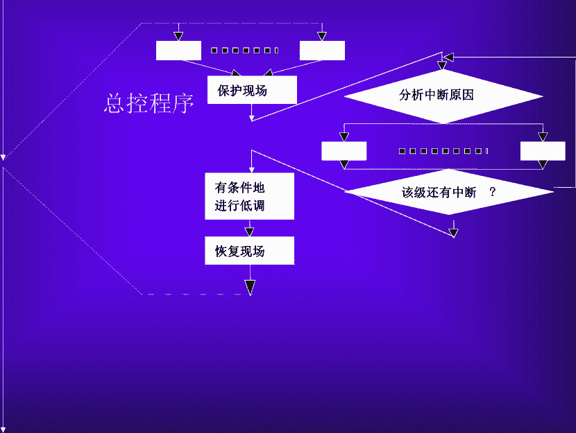

总控程序

保护现场

分析中断原因

有条件地进行低调

恢复现场

该级还有中断？


## PDP上的UNIX中断处理详细过程：

- 硬件自动将当前PC, PS存入暂存寄存器.
- 硬件按中断号从指定的中断向量单元中取出新的PC, PS内容装入 PC, PS寄存器,同时填入PS寄存器的“先前状态”和“当前状态”.
- 将原PC, PS保存到现场保护区栈(一般有用户栈和核心栈.应保存于核心栈) *

## 2. 保存现场

现场保存/恢复过程示例.

## 一个现场区栈帧的形成过程：

- 硬件将PS, PC压栈, 且根据中断类将中断向量表中的新的PS, PC值送PS, PC寄存器。
- 中断入口第一条为转总控程序指令, 该转移指令将r0压栈且将中断处理程序地址存入r0。
- 由总控程序将新的PS压栈(因其中有陷入号信息)。
- 由总控将r1, r6压栈(r6中为栈指针, 此时是上一栈帧顶或用户栈顶)。由总控从新PS低五位截取trap号进入栈。
- 总控在转相应中断(trap)处理程序时, 将返回地址压栈。
- 由各中断(trap)处理程序先将r5, r4, r3, r2压栈, 返回总控时恢复r2, r3, r4, r5。*

增长方向

sp

硬件保存

PS

PC

总控程序保存

r0

nps（新ps）

r1

r6

dev（trap号）

tpc（返回总控地址）

处理程序保存

r5

r4

r3

r2


## 3. 分析原因，转中断（陷入）处理程序

总控程序直接根据r0（已存放好中断程序的入口地址）内容转子，进行中断（陷入）处理，转子时已将返回值地址压栈（硬件自动）。*

注：中断处理通常是向设备控制器发下一个I/O请求，并唤醒原等待I/O结束的进程。陷入处理包含操作系统系统调用处理，及异常时进程结束处理。

## 4. 恢复现场（总控程序）

- 1. 回退到管态时：
  - 退栈。恢复r0, r1。
  - 执行rtt指令。该指令自动将栈帧中保存的原PC, PS值装入PC, PS寄存器。
- 2. 回退到用户态时：
  - 转调度程序（进行进程调度）。
  - 退栈。恢复r0, r1。
  - 执行rtt指令。该指令自动将栈帧中的PC, PS值装入PC, PS寄存器。*

## 主要内容回顾

### 中断/异常结构（激发操作系统内核程序运行）

- 中断/异常的分类
- 中断的分级

### 中断/异常响应和处理

- 中断/异常响应
- 中断/异常处理过程

## 主要内容回顾

### 中断/异常结构（激发操作系统内核程序运行）

- 中断/异常的分类
- 中断的分级

### 中断/异常响应和处理

- 中断/异常响应
- 中断/异常处理过程

## 第四讲 操作系统结构与用户接口

目的与要求：了解典型操作系统结构及用户使用操作系统的方法。

重点与难点：嵌入用户进程执行模式结构；命令解释器及系统调用实现。

作业：8，9，10，11

## 2.3操作系统运行模型

操作系统核心的主要功能模块如下：

- 系统初始化模块：准备系统运行环境，最后为每个终端创建一个进程运行命令解释程序。
- 进程管理模块：处理进程类系统调用（如进程创建/结束等）；进程调度。
- 存储管理模块：配合进程管理分配进程空间；处理存储类系统调用（如动态增加进程空间）；虚存系统缺页异常时调入页面处理。
- 文件管理模块：处理文件类系统调用。
- 外设管理模块：负责外设驱动，中断处理。

### 操作系统三种模型：

- **独立运行的内核**：用户程序与核心程序在分离的运行环境中运行，核心程序作为一个独立的特殊执行体运行，有自己独立的运行栈。内核程序通过中断/异常机制启动运行。


a. 独立内核模式

- **嵌入用户进程执行模式**：操作系统核心程序通过中断/例外机制启动运行，但运行于被打断进程的核心栈上，内核程序执行并发性好。本书以后对操作系统知识的描述都是基于这种模式。


b. 操作系统嵌入用户进程中运行

- **微内核模式**：核心程序只包含中断处理、系统调用总控、进程调度等功能，其他功能由用户态运行的系统进程实现，这种结构开销很大。


c. 操作系统功能以系统进程运行

## 2.4系统调用

凡是涉及操作系统核心管理资源的操作必须由系统调用实现。

### 一. 主要系统调用：

**进程管理：**

- 创建进程  pid=fork()
- 终止进程  exit(status)
- 等待子进程结束  pid=waitpid(pid,...)
- 替换进程映像  s=execve(name,...)

**文件管理：**

- 创建文件  fd=creat(name,...)
- 打开文件  fd=open(name,...)
- 读文件  n=read(fd, buffer, nbyte)*
- 写文件 n=write(fd, buffer, nbyte)
- 移动文件指针 pos=lseek(fd, offset, ...)
- 关闭文件 s=close(fd)

**存储管理：**动态申请/释放存储空间等

**其它：**设置/获得时间等*

用户编程时不一定直接调用“系统调用”函数，而是调用更高层的库函数，如win32的API函数、C库函数。

- 系统调用库子程序功能：将要传给内核的参数按与操作系统的约定填入寄存器，然后执行trap，trap指令后的指令从与操作系统约定的寄存器中获得返回值，设置好返回状态返回上级程序。
- 处理机执行trap指令会导致控制转到操作系统内核的trap处理程序入口，trap处理程序获得参数，按系统调用入口表散转。
- 参数传递的一般形式：
  - 1. 用寄存器传递参数。
  - 2. Trap指令自带参数，Trap指令是一条长指令，内核通过断点PC值加偏移获得参数*

### 系统调用各模块关系图

- 用户程序
- 用户程序
- 系统调用库
- 内核总控
- 系统调用处理总控
- Write处理
- 磁盘驱动程序
- 磁盘中断处理
- 磁盘控制器
- 用户态
- 核心态
- 系统调用接口
- 异步调用接口

### 三.系统调用实现举例

**系统调用的基本处理过程：**

- 系统调用 write(fd, ...) 是一个库子程序，该子程序用汇编语言写，其中包含trap指令。
- 处理机运行到trap指令，保护现场，转入内核总控。
- 总控进一步保护现场，根据例外类型转系统调用处理程序。


- 系统调用处理程序根据系统调用号查系统调用入口表，得知该系统调用参数个数及处理程序入口地址，获得参数并转相应write处理程序。
- write处理程序将数据从用户缓冲区拷入内核的系统缓冲区，……，调磁盘驱动程序的启动I/O函数，驱动程序生成一个磁盘请求包，启动磁盘传输（或排入磁盘请求队列），等待传输完成（保护现场，这时可重新调度进程，CPU切换到另一个进程……）。
- 磁盘I/O完成，产生一个磁盘中断，（这时正在运行进程程序被中断打断）启动磁盘中断处理程序，磁盘中断处理程序清中断位，再从磁盘请求队列中取下一请求，启动磁盘传输。然后找到刚完成请求的请求包，标志成完成状态，（这时先前进程从阻塞变成就绪，可被调度占用处理机）恢复相应栈中的现场，转write系统调用的后续处理程序……
- write处理程序处理结束后返回，系统调用处理总控程序将此次服务结果存入约定好的寄存器（或现场区）。
- 返回内核总控（这时会进行处理机调度），恢复现场，用户程序继续运行*。

- 用户程序
- 用户程序
- 系统调用库
- 用户态
- 系统调用接口
- 核心态
- 内核总控
- 系统调用处理总控
- Write处理
- 磁盘中断处理
- 磁盘驱动程序
- 异步调用接口
- 磁盘控制器

## 2.5命令语言与窗口用户界面

### 2.5.1命令语言（通讯语言/作业控制语言）

- 它是控制作业流程的用户界面，由语言解释器解释执行命令。
- UNIX启动一个解释器执行的过程：
  - 系统启动时1号进程为每个终端生成一个tty进程，让其运行登录程序
  - 用户输入ID及口令，验证完用户后，转去执行shell命令解释器
  - 由解释器处理用户输入命令*

### Shell解释器流程：（功能：解释执行shell命令）

- 通过发“从终端读”系统调用接收输入
- 直接处理一些控制语句，简单命令
- 对不识别的命令关键字，到PATH环境变量所指目录中找到执行代码文件，产生子进程去运行该程序。（如果命令关键字代表一个script程序文件，则产生子进程去执行该文件头行中说明的解释器，并解释执行该文件中的语句）
- 等子进程结束后取下一输入命令*。


实用程序、服务程序、用户程序都是可以通过键入对应的终端命令而运行的。当用户拍入命令关键字，命令解析程序不认识时，命令解析程序去寻找与命令关键字同名的文件执行。系统主要的实用程序有：

- 1. 编辑器。供用户建立和修改文本文件。它会提供一组内部编辑命令。
- 2. 编译器和装配器。实现编译源程序、链接模块、装配目标程序等功能。
- 3. 文件及文件系统相关的实用程序。文件的拷贝，打印，文件系统装卸等实用程序。
- 4. 显示系统进程，资源状态的实用程序。
- 5. 用户管理。如用户加入、删除，口令修改。


## • 用户命令与系统调用的关系

+   1. 用户命令对应的实用程序（包括命令解释器本身）在用户态运行，而系统调用处理程序在核心态运行。
+   2. 实用程序在运行过程中可能会调用系统调用。
+   3. 用户命令是用户操作接口，系统调用是用户与操作系统之间的编程接口。*


## 2.5.2 图形化的用户界面

+   - 用图符, 菜单来替换命令行表示, 参数则通过窗口, 提示用户选择或输入。
+   - 命令解释器变成了图形化程序管理器。
+   - 应用程序都提供图形使用界面*


## 第五讲 进程表示与进程状态变化

目的与要求:理解进程概念, 掌握进程在系统中的表示方法, 理解进程的创建及其状态变化.

重点与难点:进程表示与进程创建, 状态转换.

习题:1,2,4,5

## 第二章　进程与处理机管理

## 3.1 进程描述

**进程：**是系统中占用处理机及争夺其它系统资源的实体。用户程序必须在进程中运行。

# 进程的引入：

+   • 为了能在作业内某作业步等I/O时，另一逻辑上可并行作业步能使用CPU。引入进程后，逻辑上可并行的作业步可在不同进程中运行。处理机能在进程间切换。
+   
+   • 原多道程序设计系统中的作业可看成是只有一个进程的作业。*

## 并发与共享的问题：并行程序访问共享数据问题举例：(count为共享变量初值=300)

Program A: ...

Program B:...

```
N=count
N=N+100
count=N
```

```
M=count
M=M+200
count=M
```

如果按以下次序占处理机运行：

N=count, N=N+100;

M=count, M=M+200, count=M;

count=N.

结果count=400(应为600)*

## 1.进程定义

进程:是一个有独立功能的程序关于某个数据集合的一次运行活动。

特点:

+   - 动态性:可动态创建,结束,也可是精灵进程
+   - 并发性:可以被独立调度占用处理机运行
+   - 独立性:尽量把并发事务安排到不同的进程
+   - 制约性:因访问共享数据或进程间同步而产生制约.

组成:操作系统表示/管理进程的PCB表以及

+   - 执行程序及处理数据;
+   - 一片存放程序和数据的空间;
+   - 一个栈区(一个用户栈,一个核心栈);
+   - 进程使用的其他系统资源.*


## 2.进程控制结构

进程映像:进程执行程序,数据,栈。进程映像如何存在内存取决于存储管理机制.

进程控制块PCB:系统管理控制进程运行用的信息集合（含核心栈）.*

用户空间

系统空间


## PCB含有以下三大类信息：

+   - **进程标识信息**。如本进程的标识；本进程的产生者标识（父进程标识）；进程所属用户标识。
+   - **处理机状态信息保存区**（进程核心栈）。保存进程的运行现场信息：
+     1. 通用寄存器。这是指用户程序可以使用的数据、地址寄存器。
+     2. 控制和状态寄存器。如程序计数器（PC）；处理机状态字（PS）*

## 进程控制信息

+   1. 调度和状态信息，用于操作系统调度进程占用处理机。
+   2. 进程间通讯信息，为支持进程间的通讯相关的各种标识，信号，信件等，这些信息存在接收方的进程控制块中。
+   3. 存储管理信息。包含有指向本进程映像存储空间的数据结构。
+   4. 进程所用资源。说明由进程打开，使用的系统资源，如打开的文件等。
+   5. 有关数据结构链接信息，进程可以链接到一个进程队列中，或链接到相关的其它进程PCB。 *


## 3.2进程状态

## 3.2.1.进程的创建与结束等系统调用

一. 进程创建处理过程大致为：

1. 接收进程运行初始值，初始优先级，初始执行程序名字，其它资源等参数。

2. 请求分配进程描述块PCB空间，得到一个内部数字进程标识。

3. 用执行“进程创建”进程传来的的参数初始化PCB表。

4. 产生描述进程空间的数据结构，用初始执行文件初始化进程空间，建立程序段，数据段、栈段等。*

+   5. 用进程运行初始值设置处理机现场保护区（如设置用户程序main（）入口执行的运行现场）。造一个进程运行栈帧。
+   6. 置好父进程等关系域。
+   7. 将PCB表挂入就绪队列，等待时机被调度运行。*


## 二. 进程结束大致处理过程如下：

+   1. 将进程状态改到结束状态
+   2. 关闭所有打开数据文件、设备
+   3. 释放对进程程序文件的使用
+   4. 进行相关信息统计
+   5. 清理其相关进程的链接关系，如在UNIX中，将该结束进程的所有子进程链到1号进程，作为1号进程的子进程，并通知父进程自己已结束。
+   6. 释放进程映像空间（对于虚存来说如：交换区，所占物理页，将页表所占空间返还系统）
+   7. 释放进程控制块(PCB)。
+   8. 调用进程调度与切换程序。*


## 三、进程等待系统调用

如waitpid(pid, &statloc, opts)系统调用。
进程发出此系统调用阻塞于内核等待pid所指进程运行结束.*

## 3.2.2进程状态及变化

运行状态 (Running)： 当一个进程正在处理机上运行时。

就绪状态 (Ready)： 一个进程获得了除处理机之外的一切所需资源，一旦得到处理机即可运行。

阻塞状态又称等待状态 (Blocked)： 一个进程正在等待某一事件而暂停运行时，如等待某资源成为可用，等待输入/输出完成。

创建状态 (New)： 一个进程正在被创建，还没到转到就绪状态之前的状态。

结束状态 (Exit)： 一个进程正在从系统中消失时的状态，这是因为进程结束或其它原因流产所导致。*

## 状态变化图

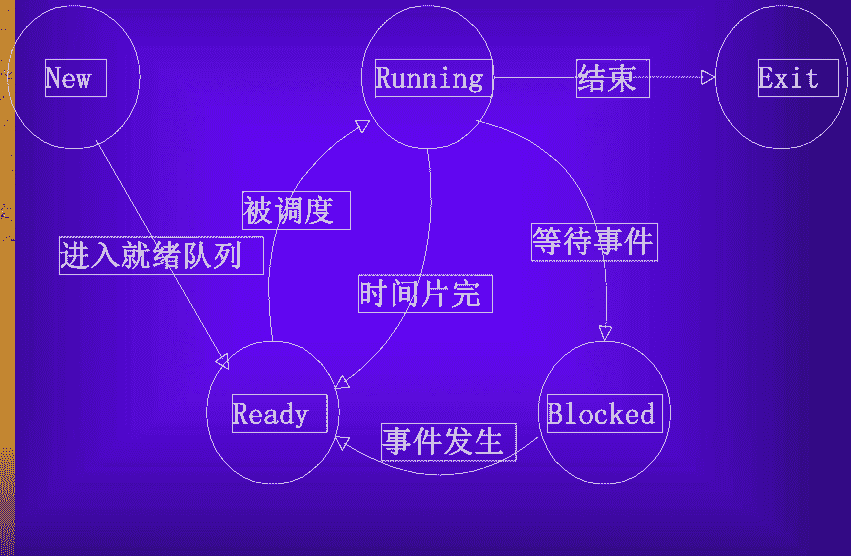

可能的状态变化如下：
空→创建：一个新进程被产生用来执行一个程序，
创建→就绪：当进程被创建完成，初始化后，一切就绪准备运行时变到就绪态。（为了限制系统资源不过份分散，也可以限制从New进入Ready状态的进程数，这样做可以使系统内存，内核用户页表空间等系统资源集中给有限的进程使用。因此可能进程进入创建状态但很长时间不能挂入就绪队列，等操作系统把它调入时才可以分配好所有资源，变为就绪状态。）*

就绪→运行： 处于就绪状态的进程被进程调度程序选中后，就分配到处理机上来运行。

运行→结束： 当进程指示它已经完成或者因错流产，当前运行进程会由操作系统作结束处理。

运行→就绪： 在可剥夺的操作系统中，处于运行状态的进程在其运行过程中，分给它的处理机时间片用完而让出处理机；或当有更高优先级的进程就绪时，操作系统调度程序可以将正运行进程从运行状态改变为就绪状态，让更高优先级进程运行.*


运行→阻塞：当进程请求某样东西且必须等待时，例如，当进程请求操作系统服务，而操作系统得不到所需的资源，或进程请求一个输入/输出操作，操作系统已启动外设，但输入/输出尚未完成，或进程要与其它进程通讯，要接收对方还未发出的信件时进程都会被阻塞。

阻塞→就绪：当进程要等待事件到来时，它从阻塞变到就绪。*

## 状态表示方法：

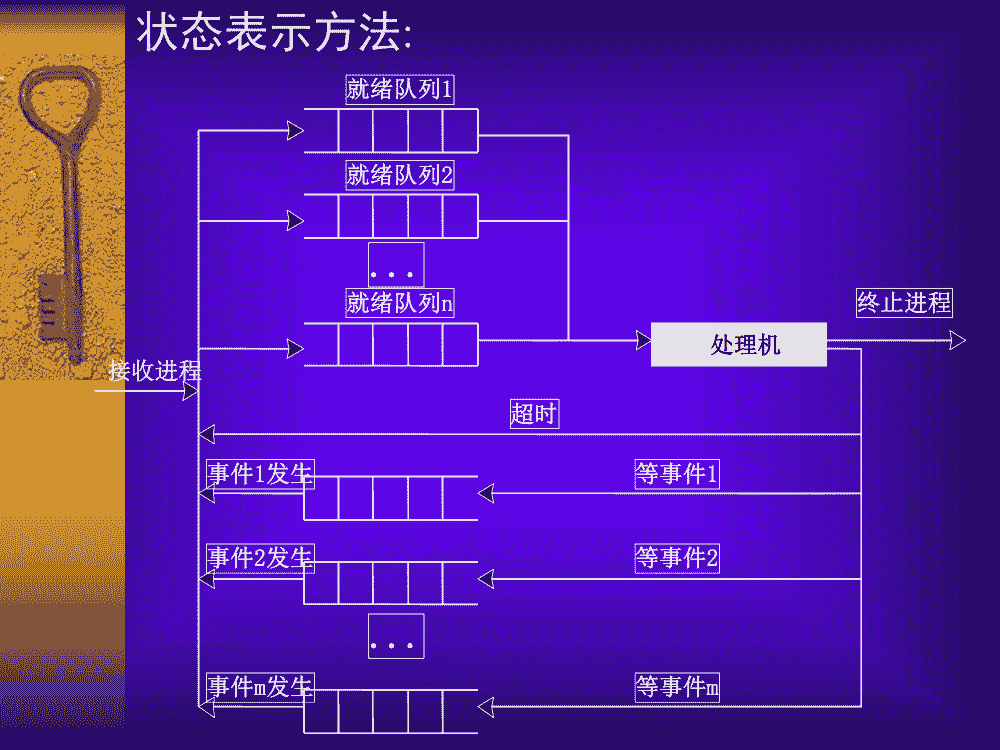

## 3.2.3进程挂起

进程在挂起（Suspend）状态意味着进程没有占用内存空间，处在挂起状态的进程映像在磁盘上。

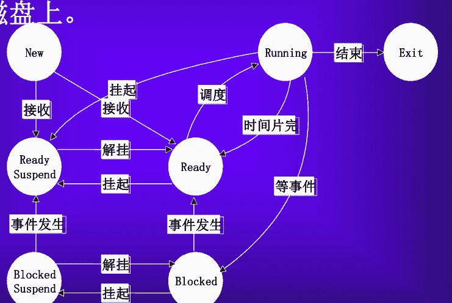


## 程序与进程的关系举例(计算机系统与洗熨店对比):

- 实用程序:洗衣程序(检查口袋, 调洗涤, 调烘干, 调熨烫, 折叠), 熨衣程序(检查口袋, 调熨烫, 折叠)
- 处理机:服务小姐。
- 共享外设资源:洗涤机, 烘干机, 熨烫机
- 终端设备:顾客窗口
- 系统调用:洗涤, 烘干, 熨烫, 业务登记(进程创建)
- 程序:洗涤, 烘干, 熨烫函数(核心态运行); 洗衣程序; 熨衣程序; 接受窗口用户请求并产生进程执行请求程序(类比命令解释程序)。
- 进程:为窗口建一个进程, 负责接受并分派用户请求, 为每个用户请求建一个进程负责处理请求(运行洗衣/熨衣程序)。

## 主要内容总结

### 进程描述
- 进程定义
- 进程控制结构

### 进程状态
- 进程的创建与结束
- 进程状态变化模型
- 进程挂起

## 第六讲 进程控制与调度

目的与要求:理解进程切换过程；理解进程调度原因及调度切换时机；掌握进程调度方式与实现及各种调度算法；弄清作业和进程的关系；了解线程的引入原因。

重点与难点:进程调度切换的实现与进程调度算法。

作业:7,8,10,11,19,20


### 3.3进程控制与调度

### 3.3.1 进程执行

系统参考模型： 内核嵌入进程运行模型。

执行模式： 进程可在用户态和核心态下运行。

进程模式切换： 一个用户进程既运行用户态程序，在例外，系统调用和中断时转换到核心态时运行操作系统核心程序。

进程切换： 指进程进入操作系统核心后因为自身等事件或有更迫切需要运行的进程就绪而让出处理机，处理机转去运行其他进程。

### 进程切换过程

- 保存处理机的上下文，包括程序计数器PC、处理机状态字PS、其它寄存器。
- 修改当前运行进程的进程控制块内容，包括将进程状态从运行态改成其它状态。
- 选择另一个进程执行，这是进程调度的内容。
- 修改被调度进程的进程控制块，包括把其状态改变到运行态。
- 修改存储管理数据结构，如修改进程内存起始地址，或将系统当前运行进程页表指针改为指向选定的进程页表。
- 恢复被选进程上次切换出处理机时的处理机现场，按原保护的程序计数器值重置程序计数器，运行新选进程。


### 3.3.2.进程调度

特指选择进程占用处理器

- 什么是调度：操作系统管理了系统的有限资源，当有多个进程（即多个进程发出的请求）要使用这些资源时，因为资源的有限性，必须按照一定的原则选择进程（请求）来占用资源。这就是调度。
- 调度目的:控制资源使用者的数量,选取资源使用者许可占用资源或占用资源.

### 几种不同调度例子

高级调度：选取输入井中的作业（仅限于批作业调度），生成根进程。目的是控制使用系统资源的进程数。

中级调度：选取进程占用内存或有资格占用内存，又称进程滚入滚出。

低级调度：选取进程占用处理机，又称进程调度。


### 二、进程调度方式

- 1. 剥夺调度: 当进程运行时可以被系统以某种原则剥夺其处理机。
- 2. 非剥夺: 只有当处理机上的进程主动放弃处理机时才重新调度。
- 进程调度在核心态进行。

### 处理机的执行次序

进程1 | 内核调度 | 进程2 | 内核调度 | 进程3 | 内核调度 | 进程1 | 内核调度 | 进程3 …

时间片到    I/O请求    时间片到    时间片到    时间片


### 三、引起进程调度因素：

1、进程主动放弃处理机时：

- 正在执行的进程执行完毕。操作系统在处理进程结束系统调用后应请求重新调度。
- 正在执行的进程发出I/O请求，当操作系统代其启动外设I/O后，在I/O请求没有完成前要将进程变成阻塞状态，应该请求重新调度。
- 正在执行的进程要等待其它进程或系统发出的事件时。如等待另一个进程通讯数据，这时操作系统应将现运行进程挂到等待队列，并且请求重新调度。
- 正在执行的进程得不到所要的系统资源，如要求进入临界区，但没有得到锁时，这时等锁的进程应自动放弃处理机或者阻塞到等锁队列上，并且请求重新调度。

2、为了支持可剥夺的进程调度方式，在以下情况发生时，因为新就绪的进程可能会按某种调度原则剥夺正运行的进程，因此也应该申请进行进程调度：

- 当中断处理程序处理完中断，如I/O中断、通讯中断，引起某个阻塞进程变成就绪状态时，应该请求重新调度。
- 当进程释放资源，走出临界区，引起其他等待该资源进程从阻塞状态进入就绪状态时，应该请求重新调度。
- 当进程发系统调用，引起某个事件发生，导致等待事件的进程就绪时。
- 其它任何原因引起有进程从其它状态变成就绪状态，如进程被中调选中时。

3、为了支持可剥夺调度，即使没有新就绪进程，为了让所有就绪进程轮流占用处理机，可在下述情况下申请进行进程调度：

- 当时钟中断发生，时钟中断处理程序调用有关时间片的处理程序，发现正运行进程时间片到，应请求重新调度。以便让其他进程占用处理机。
- 在按进程优先级进行进程调度的操作系统中，任何原因引起进程的优先级发生变化时，应请求重新调度。如进程通过系统调用自愿改变优先级时或者系统处理时钟中断时，根据各进程等待处理机的时间长短而调整进程的优先级。


### 四、调度与切换时机：

- 当发生引起调度条件，且当前进程无法继续运行下去时（如发生各种进程放弃处理机的条件）可以马上进行调度与切换。
- 当中断处理结束或自陷处理结束返回被中断进程的用户态程序执行前，若请求调度标志置上，即可马上进行进程调度与切换。如果操作系统支持这种情况下运行调度程序，即实现了剥夺方式的调度。
- 实时系统还有其他调度与切换时机。

### 3.3.3.进程调度算法

- FCFS：谁先到就绪队列，将处理机分给谁。
- 短进程优先：取一个下次所需运行时间最短的进程。（该算法能使平均等待时间最短）
- 优先级调度：选优先级最高的进程占用处理机，（优先级可动态改变）。
- 轮转调度法：以先来后到的次序+时间片轮转。
- 多队列调度法：按属性将就绪进程分类，不同类进程可有不同的调度算法。
- 多级反馈队列调度法：设置多条就绪队列，进程被调度执行后，在被剥夺或放弃处理机后而在就绪时可以改变其就绪队列（见下图）。

### 第一级队列（FIFO）


### 第二级队列（FIFO）


### 第n级队列（时间片轮转）

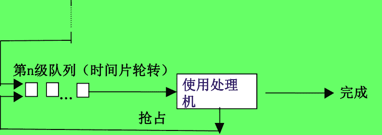

### 设计另一个多级反馈队列调度算法的例子：

- 以优先级设置多队列。
- 各队列的调度算法采用FCFS+时间片轮转。
- 进程优先级升降原则是：等待过久升，输入输出完成时升，运行完一个完整时间片降…
- 进程最初进入就绪队列以用户初置优先级为参数。


### 3.4作业与进程的关系

- **作业**: 是用户对计算机的一次独立的使用过程
- **进程**: 是分配计算机资源的单位, 是用户任务运行的实体, 作业可包含多个进程(至少一个)
- **批处理系统作业与进程关系**: 作业调度程序每选择一道作业运行时, 首先为该作业创建一个根进程, 该进程执行作业控制语言解释器程序, 并可根据需要创建多个子进程。

### 作业和进程状态转换图

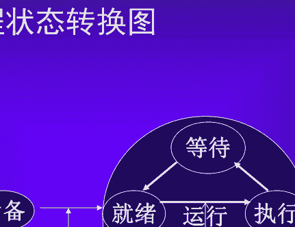

作业输入

作业调度 创建进程

进程调度

作业终止

完成

提交

后备

就绪

运行

执行

等待

### 分时系统作业与进程之关系：

把用户的一次上机过程看成是一个交互作业(无论从内部表示及外部特征，它都有别于批作业)，系统为每个终端设备生成一个进程，该进程运行终端命令解释器。该进程根据需要还可以创建多个子进程。

### 支持分时与批处理的系统作业提交方法：

用户可以通过交互式命令提交子作业(如: at -f /root/bin/ss now 表示提交一个作业控制说明书文件名为ss的作业到作业输入队列. 或直接敲入 “shell ss” 表示马上生成一个进程执行命令解释器,解释执行ss中的命令)


## 命令解释程序执行流程：

- 输入一条终端命令，分析命令
- 创建子进程执行命令
- 后台命令？
- 等子进程返回
- 向终端发提示符

## 3.5 线程引入

轻权进程（Light-Weight Process）的引入。引入进程是为了实现作业内作业步的并发执行，同一作业进程之间会有许多的协作，需要进行数据交换，但进程有自己独立的存储空间，互相不干扰。如果要进行进程间数据交换，则需要操作系统相关系统调用支持，为了方便进程间交换数据，一种共享存储空间的进程概念应运而生，我们叫它为轻权进程（Light-Weight Process）。

- 线程的引入。随着共享内存多CPU计算机的发展，迫切需要加速单个作业步骤的运行速度，事实上同一个作业步骤的工作也是有可并行成分的。因为进程内程序执行的顺序性，不可能实现进程内可并行成分的并行执行。为此，线程的概念呼之欲出。在一个进程中可以包含多个可以并发（并行）执行的线程。系统按进程分配所有除CPU以外的系统资源（如内存，外设，文件等），而程序则依赖于线程运行，系统按线程分配CPU资源。引入线程后，进程概念内涵改变了，进程只作为除CPU以外系统资源的分配单位，不再以进程为单位占用CPU。

### 进程与线程关系图

```
进程1
进程2
线程
进程3
线程
```


## 主要内容

- 进程控制与调度
  - 进程执行
  - 进程调度
  - 调度算法
- 作业与进程关系
- 线程的引入


## 第七讲 并发执行问题

- 目的与要求：了解并行程序的高级语言表示与操作系统支持下的实现；同步与互斥问题。了解解决互斥问题的软件算法。
- 重点与难点：并行程序中的同步与互斥
- 作业：7，列举两个现实生活中需要同步与互斥的例子。

## 第四章 进程同步与通讯、进程死锁

### 并发的需求

- 操作系统利用进程（线程）机制支持用户态程序最大限度地并行执行。
- 操作系统核心程序也要尽可能地并发运行。


## 4.1 并发程序

- 传统的串行程序存在着并行成分

```
Read (a);
Read (b);
c = a + b;
Write (c)
```

Read（a）和Read（b）两个语句如果不通过同一输入设备则可并发执行


### 识别算法中的并发成分有两种方法：

- 程序员写顺序程序，用并行识别工具识别并发成分。组织使用操作系统的并发机制。
- 由程序员识别并发成分，用并发程序设计语言设计并发程序，由编译系统安排并发；或直接利用操作系统的系统调用/或高级并发程序库设计并发程序。

### 并发程序设计语言 —— 并发语句

- 是一种高级语言
- 语法形式

```
Parbegin S1; S2; ...Sn; Parend;
```

Si（i=1, 2, ..., n）是单个语句

Parbegin和Parend之间的语句可以并发执行


### 并发语句示例

- 前面那个串行读写程序可以改为

```
Parbegin
    read (a) ;
    read (b) ;
Parend;
c= a+b;
write (c) ;
```

### 并发语句描述手段的优缺点

- 并发语句Parbegin/Parend的结构化特征非常好
- 但存在着描述能力不强的缺点，即存在着用Parbegin/Parend语句无法描述的并发优先关系。
- 若能辅以其它手段（如本章后续将介绍的信号量机制），则并发语句可以大大增加其描述并发的能力。

### 并发程序实现

- 前面是对并发的高级语言描述，要真正实现并发执行，需要通过操作系统的进程机制。
- 操作系统提供进程创建、结束和同步的系统调用，可直接提供给用户编写并行程序；或由并行语言编译器将并发语言的语句转化为对操作系统的系统调用。


### 与进程相关的系统调用

- Unix操作系统利用进程（或线程）支持并发执行
- 它提供了如下系统调用：
  - fork（）：创建一个新进程。该系统调用执行完成后，系统已创建了一个子进程，该子进程继承了父进程的程序空间，复制了父进程的数据段和栈段。也就是说不管是父进程还是子进程，在占有处理机后，都从fork（）调用的返回点开始运行，而父进程fork（）调用的返回值是子进程的进程标识号；子进程fork（）调用的返回值是0。
  - exit（status）：进程结束。该系统调用发出后，操作系统将从系统中删除调用exit的进程，并将status值传给等待它结束的父进程。
  - wait（&status）：等待子进程结束。当有多个子进程时，任一个子进程结束即将控制返回调用者，并将子进程调用exit（status）时的status值送到&status指针所指单元中。在控制返回调用者时，同时将所等到的子进程pid作为wait（）系统调用函数的返回值。
  - waitpid（pid, ...）：等待pid所指定的进程结束。


### 多进程实现前述的读写并发程序示意

（假设 a、b 都在两进程都可访问的共享区）

```
pid = fork ( );
if pid == 0 then
{ read (b) ;
  exit (0) ; }
else
  read (a) ;
return_pid = wait (&status) ;
c = a+b;
write (c) ;
```

## 4.2 进程的互斥与同步

- 互斥关系（亦称间接制约关系）：即进程间因相互竞争使用独占型资源（互斥资源）所产生的制约关系。
- 同步关系（亦称直接制约关系）：指完成同一任务的伙伴进程间，因需要在某些位置上协调它们的工作而等待、传递信息所产生的制约关系。

### 4.2.1 同步与临界段问题

例1：同步问题。如果进程P1执行S1、S3，进程P2执行S2，则P1在执行S3之前必须等待P2执行完S2。

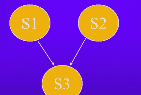

### 互斥问题

- 例2：P1、P2两进程使用同一打印机。
- 如果不互斥使用，会交叉输出

```
P1
Entry code
使用打印机
exit code

P2
Entry code
使用打印机
exit code
```

### 例3：对共享变量count的互斥访问

```
Parbegin

Program A: begin
    N:=count;
    N:=N+$100;
    count:=N;
end;

Program B: begin
    M:=count;
    M:=M-$200;
    count:=M;
end;

Parend;
```

互斥执行

### 例4：有限缓冲区的生产者/消费者问题

（生产者和消费者共享一个产品缓冲队列）

```
First

NEXT
INST

NEXT
INST

NEXT
INST

Nil
INST

P1  P2 ... Pm
C1  C2 ... Cn
```

共享N个缓冲区

### 数据结构

```
type item=...;  #缓冲区中数据的类型
type buffer=record
    inst: item;
    next: pointer to buffer;
end;
var P, C, First: pointer to buffer;
    nextp, nextc: item;
First:= nil;
```

```
Parbegin
Producer:
  begin
  repeat
    ...
    produce an item in nextp;
    ...
    new(P);    #获得一个空缓冲区
    P.inst:=nextp; #把数据送到缓冲区
    P.next:=First;
    First:=P;
  until false;
  end;
```


```
Consumer:
begin
repeat
  while first=nil do skip; #空循环等
  C:=First;
  first:=first.next;
  nextc:=C.inst; # 取出数据
  dispose(C);  #释放缓冲区
  ...
  consume the item in nextc;
  ...
until false;
end;
Parend;
```


T0: consumer      C:= First
T1: producer      P.next:= First
T2: producer      First:= P
T3: consumer      First:= First.next

则会发生生产者加入队列的缓冲区丢失

临界资源（critical resource）：一次仅允许一个进程使用的资源

临界段（critical section）：各进程必须互斥执行的程序段。


## 4.2.2 实现互斥的软件算法

- 进入临界段之前要申请，获得批准方可进入；
- 退出临界段之后要声明，以便其他进程进入。

解决临界段问题的软件算法必须遵守：

准则1：不能虚设硬件指令或假设处理机数目。

准则2：不能假设n个进程的相对速度。

准则3：当一个进程未处于其临界段时，不应阻止其它进程进入临界段。

准则4：当若干进程欲进入临界段时，应能在有限时间内选出一个进程进入其临界段。

## 协调各进程入临界段的调度原则：

- 当无进程处于临界段时，允许一个进程立即进入临界段。
- 当已有进程进入临界段时，其它试图进入的进程必须等待
- 当某进程退出临界段时，若有等待进入临界段的进程，则应选取一个进入临界段。

## 软件算法举例：

Pi 表示一个进程
Pj 表示另一个进程
（i=0，1； j=1- i ）

```
Repeat
Entry code
Critical section
exit code
Non-critical section
Until false;
```


## 算法2：设一个表示进程进入否状态的数组

Var flag: array[0..1] of boolean

```
Repeat
  While flag[j] do skip
  flag[i] = true;
  Critical section
  flag[i] = false;
  Non-critical section
Until false;
```

不满足互斥要求：当flag[]初值为0，两进程同时执行while语句时。

## 算法3：设一个表示进程状态的数组

Var flag: array[0..1] of boolean

```
Repeat
flag[i] = true;
While flag[j] do skip;
Critical section
flag[i] = false;
Non-critical section
Until false;
```

不满足准则4：当若干进程欲进入临界段时，应能在有限时间内选出一个进程进入其临界段。（两进程同时置flag[]）

## 算法4：在标志置true的时候注意一下对方的状态


```
Repeat
flag[i] = true;
While flag[j] do
begin
flag[i] = false;
While flag[j] do skip;
flag[i] = true;
end
Critical section
flag[i] = false;
Non-critical section
Until false;
```

不满足准则4（在此被打断后，对方进程可能置上true）

## 算法5: 设一个表示进程状态的数组和一个令牌

Var flag: array[0..1] of boolean
turn: 0..1

```
flag[i] = true;
While flag[j] do
  if turn==j then
    begin
      flag[i] = false;
      While turn==j do skip;
      flag[i] = true;
    End;
```

Critical section

```
turn = j;
flag[i] = false;
```

Dekker算法
OK!

## 第八讲 同步与互斥实现方法

- 目的与要求：理解互斥问题的硬件实现方法；掌握信号量机制及使用它解决进程同步互斥问题的方法。
- 重点与难点：信号量实现及使用。
- 作业：1，2，4，13（没做7题请补做）

## 4.2.3实现临界段的硬件方法

利用处理器提供的特殊指令实现临界区加锁

单处理机系统常见硬件指令有：

- 一. 屏蔽中断

Parbegin

```
A(amount){
	disableInterrupt();
	R1=balance;
	R2=amount;
	R1=R1+R2;
	balance=R1;
	enableInterrupt();
};
```


```
B(amount) {
    disableInterrupt();
    R1=balance;
    R2=amount;
    R1=R1-R2;
    balance=R1;
    enableInterrupt();
};
Parend;
```

## 多处理机系统硬件指令有：

一、“Test_and_Set”指令。

该指令功能描述为：

```
Function Test_and_Set（Var target: boolean）
:boolean;
begin
Test_and_Set = target;
Target = true;
end;
```

一、“Swap”指令。

该指令功能描述为：

```
Procedure Swap (Var a,b: boolean) ;
Var temp: boolean;
begin
temp = a;
a = b;
b = temp;
end;
```

设Lock为全局布尔变量，利用Test&Set指令，即可实现对临界区的加锁与解锁：

```
Repeat
while Test&Set (lock) do skip
critical section
lock = false;
non-critical section
Until false;
```


## “test&set” 读后置1指令实例：

T&S Ri, Aj 解释为将(Aj)地址所指内存单元内容读到Ri寄存器中，同时将1置入Aj所指的内存单元中。

设Lock为临界段锁变量，则安排如下指令，即可实现加锁与解锁： *


```
A1 <= &Lock; （将Lock单元地址送A1寄存器。Lock单元初始值为0）
Loop: T&S  R1, A1;
    JRN R1, Loop;  (If (R1=1) then goto Loop )
```

# 临界段

```
A1  <= &Lock;
(A1) <=0; (0置Lock内存单元)
```

# 非临界段

设Lock为全局布尔变量（初值为假），每个进程设一个局部布尔变量Key。利用Swap指令，可实现对临界区的加锁与解锁。

```
Repeat
key = true;
repeat
  Swap (lock, key);
until key = false;
critical section
lock = false;
non-critical section
Until false;
```


## 4.2.4 信号量

信号量机构：“信号量”、“P、V操作”。

- 信号量S为一整型变量：
- P(S)：While S≤0 do skip；
  S = S-1；
- V(S)：S = S+1;

P、V操作是两条原语，即保证P、V操作对变量S的访问是互斥操作。


## 一. 原语概念与实现

原语：指完成某种功能且不被分割或不被中断执行的操作序列。

原语可通过硬件实现不可中断性；或通过实现临界段的元方法达到不被中断。

### 实现临界段的元方法：

- 屏蔽中断(只用于单机)
- 加硬锁。


下面我们用屏蔽中断方法实现 P（s）和 V（s）的原子性。

```
P（s）{
    DisableInterrupt();
    while（s<=0）do{
        enableInterrupt();
        DisableInterrupt();
    };
    s = s - 1;
    enableInterrupt();
}
V（s）{
    DisableInterrupt();
    s = s +1;
    enableInterrupt();
}
```

## 二、信号量的使用(互斥与同步)

互斥：用于n个进程的临界段互斥，n进程共享一个信号量mutex, 初值为1, 任一进程Pi的结构为：

```
repeat
    P(mutex)
    临界段
    V(mutex)
    非临界段
Until false
```

请用并行语句和IPV操作描述

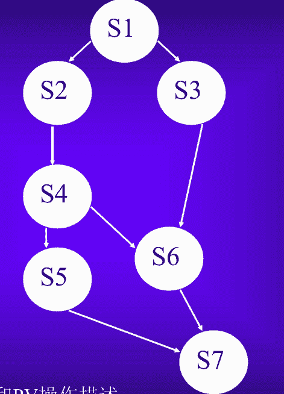

## 三. 信号量的具体实现

操作系统实现信号量时与进程调度相结合，消除忙等待现象。

原则是：在P操作循环等待的地方加入放弃处理机/挂入等待队列动作，在V操作时，从等待队列中摘取进程变为就绪态。
（P、V原语本身的互斥操作通过屏蔽中断或为信号量加硬锁实现）


### 1. 信号量定义

```
type Semaphore= record
value: integer; 一个数型变量
L: List of process; 一个PCB队列
end;
```

### 2. P操作

P(S):S. Value= S. value - 1;
If S. value<0 then 保存现场，将本进程挂入S. L队列，重新调度。

### 3. V操作

V (S):S. value:=value+1
If S. value ≤0 then 从S. L队列取一进程，挂入就绪队列。

## 4.2.5 进程同步与互斥举例

## 一、有限缓冲区问题

问题描述：设有n个缓冲区，一组生产者进程往缓冲区写数据，一组消费者进程从缓冲区取数据，写取以一个缓冲区为单位。

说明：

- 将缓冲池看作是共享数据，对缓冲区的操作必须是互斥操作。
- 如果n个缓冲区全满，生产者进程必须等待。
- 如果缓冲区全空，消费者进程必须等待。

## 有限缓冲区的生产者/消费者问题（生产者和消费者共享一个产品缓冲池）

生产者

消费者

缓冲池

P1  P2 ... Pm
C1  C2 ... Cn

共享N个缓冲区


## 解: 设置以下信号量

- mutex, 初值为1, 控制互斥访问缓冲池。
- full, 初值为0, 表示当前缓冲池中满缓冲区数。
- empty, 初值为n, 表示当前缓冲池中空缓冲区数。

有限缓冲区生产者/消费者进程描述如下：

```
type item= ...;
var buffer= ...;
full, empty, mutex:semaphore;
nextp, nextc:item;
begin
full:=0; empty:=n; mutex:=1;
```

```
Parbegin
Producer: begin
repeat
...
produce an item in nextp;
...
P(empty);
P(mutex);
add nextp to buffer;
V(full);
V(mutex);
until false;
end;
```

```
consumer:begin
repeat
P(full);
P(mutex);
remove an item from buffer to nextc
释放缓冲区
V(empty);
V(mutex);
...
consume the item in nextc;
...
until false;
end;
Parend;
```

## 二、Readers/Writers问题

若存在一共享数据A，那些对它进行读访问者叫Reader，对它进行写访问者叫做Writer。

## 第一类Reader/ Writer问题:

Reader和Writer争夺访问共享数据A时，Reader有较高优先数。

表现在：除了某个Writer正在访问数据之外，任何情况下Reader欲访问数据均可以直接进行访问。

## 该问题可具体描述为：

- 1、如果当前无人访问数据，则Reader/Writer欲访问即可访问。
- 2、如果已存在一个Reader正在访问数据，其它欲访问Reader可马上访问（这体现Reader有较高优先权）；而欲访问的Writer必须等待。
- 3、若某个Writer正访问数据，则欲访问的Reader/Writer都必须等待。


## （续）

4、最后一个结束访问数据的Reader发现有Writer正在等待，则将其中一个唤醒。

5、当某个Writer结束访问时，若只有Writer在等待，则唤醒某个Writer，若既有Writer也有Reader，则按FIFO或其他原则唤醒一个Writer或所有Reader。

## Reader的一般结构为：

```
P(mutext);
readcount := readcount+1;
If readcount=1 then P(wrt);
V(mutext);
读数据A
P (mutext);
readcount := readcount-1;
If readcount=0 then V(wrt);
V(mutext);
```

## Writer的一般结构：

```
P (wrt) ;
写数据A
V (wrt) ;
```

## 三、哲学家就餐问题

问题描述：五个哲学家五只筷子，哲学家循环做着思考和吃饭的动作，吃饭程序是：先取左边筷子，再取右边筷子，再吃饭，再放筷子。


## 实现：

为每个筷子设一把锁（信号量，初值为1）

每个哲学家是一个进程。共享数据结构为 Var Chopstick;array [0, 4]of semaphore;

```
第i个进程描述为(i=0, ..., 4)
repeat
P (chopstick[i]) ;取左筷子;
P(chopstick [(i+1)mod 5]) ; 取右筷子;
吃
V(chopstick [i]) ;放左筷子
V(Chopstick [(i+1)mod 5] ; 放右筷子;
思考
until false;
```

> (这可能导致死锁)

## 4. 3 进程通讯

两种基本进程通讯方法：

- 1. 共享存储（Shared-memory） : 相互通讯的进程有共享存储区. 进程间可以通过直接读写共享存储区的变量来交互数据，同步与互斥在并发程序设计时安排进入程序。操作系统提供这样的共享存储区及某些同步互斥工具。
- 2. 消息传递（message-passing） : 若进程间无共享空间，则必须通过消息传递通讯，且必须通过操作系统调用实现。


## 4.3.1消息传递通讯原理

消息传递系统调用语句的一般形式：

- 发送： Send &消息 to 目的地标识.
- 接收： Receive &消息 from 源地址标识.

## 一. 消息传递方法

1、 直接通讯法

基本思想： 进程在发送和接收消息时直接指明接收者或发送者进程ID。

缺点： 必须指定接收进程ID。 （UNIX的信号机制类似这种形式）

举例：（UNIX中两进程利用信号通讯）。
Process A
kill(1040, SIGUSR1); #向1040号进程发送一个SIGUSR1信号。

Process B
Signal(SIGUSR1,func);#当收到SIGUSR1信号时，就执行func()，如果SIGUSR1信号未到，则系统登记func函数，待其信号到时再调用执行。


## 2、间接通讯法（信箱命名法）

基本思想： 系统为每个信箱设一个消息队列，消息发送和接收都指向该消息队列，（每个进程可以对消息队列发送并接收/只发送/只接收）

缺点： 必须有一个通讯双方共享的一个逻辑消息队列，（UNIX的PIPE，FIFO及IPC消息传递机制都属于这种形式）使用时消息发送者约定写方式打开信箱,消息接受者约定读方式打开信箱或同时读写打开。

优点： 很容易建立双向通讯链(只要对信箱说明为读写打开)。

## 二、缓冲与同步

### 逻辑通讯链容量：

在通讯发送者和接收者之间存在一条逻辑通讯链，设链的容量是指该链暂存消息的能力。

- 1、容量为0，表示链中无缓冲（不计链头的发送缓冲和链尾的接受缓冲），这要求接收方必须在发送方之前发接收请求，否则发送失败。
- 2、有限容量，表示链中有有限缓冲区、发送者不必等接收者发出接收请求，不必等接收者准备好接收缓冲区，即可将消息存于通讯链中的缓冲区中。
- 3、消息从发送方缓冲进入系统缓冲区，即可再次发新消息，无需等上一消息被完全接收。


## 4.3.2 进程通讯示例

直接通讯消息系统，两个基本操作为，

send(A)：A指向含接收者pid和消息正文的空间。

Receive(A)：A指向缓冲区用于接收消息，该系统调用函数返回值是消息发送者pid。

实现：系统有一空闲缓冲池，每个进程有一个消息缓冲队列。缓冲区用于存放消息及消息发送者pid和消息链指针(用pid定位进程PCB表)。

| Sender’s pid |
| Link |
| 消息正文 |

消息缓冲区

每个进程的消息队列存放发送给该进程的消息，队列头存于PCB中，同时在PCB中设一互斥信号量mutex（初值为1）和信号量Sm（初值为0），Sm用于记录消息队列中的消息数。

Receiver’s PCB      message      message

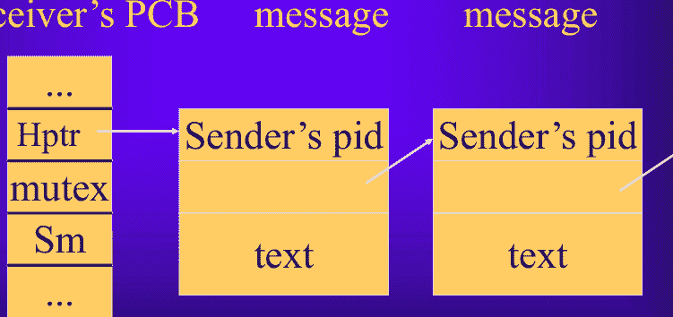

## Send(A):

```
begin
New(p); 从缓冲池得一个buffer
...
置sender’s pid;
将A中消息送buffer p;
获得Receiver’s pid;
P(mutex);
将buffer p挂入相应的消息队列;
V(Sm);
V(mutex);
end;
```

## Receive(A):

```
begin
  P(Sm);
  P(mutex);
    从本进程的消息队列取一个buffer f;
  V(mutex);
    从buffer f中取得消息正文送A, 并得到
    sender’s pid作为Receive( )的返回
值;
    ...
    dispose(f); #释放buffer f到缓冲池
    ...
end;
```

注:new, dispose函数对缓冲池的访问也需要互斥。

## 第十讲 死锁

- ♦ 目的与要求：了解死锁的定义，掌握死锁预防，了解死锁避免，死锁检测，死锁恢复的方法。
- ♦ 重点与难点：死锁预防法则的使用，死锁避免和检测算法。
- ♦ 作业：25，27，32，35

## 4.4 死锁

### 4.4.1 死锁示例

- 日常生活中的例子
- 进程死锁的例子
- 竞争外部设备
- 竞争辅存空间
- 编程错的例子

## 4.4.2 死锁定义及性质

### ◆ 死锁定义

在一个进程集合中，若每个进程都在等待某些事件（指：释放资源）的发生，而这些事件又必须由这个进程集合中的某些进程来产生，就称该进程集合处于死锁状态。

## 死锁定义及性质

出现死锁的系统必须同时满足下列四个必要条件

- - 互斥：必须存在需要互斥使用的资源
- - 占有等待：一定有占有资源而又等待其它资源的进程
- - 非剥夺：系统中进程占有的资源未主动释放时不可以剥夺
- - 循环等待：进程集合{P0， P1， ......， Pn}， Pi等待Pi+1， Pn等待P0

## 死锁定义及性质

- 资源分配图定义

资源分配图由如下部件组成：


- 如果各类资源数为1，则系统出现死锁的充要条件是资源分配图含圈

## 4.4.3 死锁防止

逻辑公式：

D→C1∧C2∧C3∧C4

¬C1∨¬C2∨¬C3∨¬C4→¬D

- ◆ 破坏互斥占用条件
- 让资源共享使用（但有些资源必须互斥）
- ◆ 破坏占有等待条件
  - 将进程所要资源一次性分给进程，要么没分到一个资源，要么全部满足（适合廉价资源的分配，如外存空间分配）
  - 进程在下一轮申请资源时，释放所占的所有资源（用完一个再用下一个）

## 破坏非剥夺条件(用于内存管理、CPU管理等)

- - 当进程Pi申请ri类资源时，若有则分配，若没有则剥夺（释放）Pi占有的所有资源；
- - 当进程Pi申请ri类资源时，若有则分配，若无则剥夺（淘汰）占有ri类资源进程所占的ri类资源分配给Pi；
- - 或看占用ri类资源的Pk处于什么状态，若处于等资源状态，则剥夺其资源，否则让Pi等待，等于剥夺Pi的资源。

## 破坏循环等待条件

- - 采用资源顺序分配方法：给每类资源编号，进程只能按序号由小到大的顺序申请资源，若不满足则拒绝分配。
- - 反证：若出现循环等待，则必会有小序号资源序号>大序号资源序号。


## 扩展的银行家算法描述

n：系统中的进程个数。m：系统中的资源类型数。

Available(1:m):现有资源向量。 Available(j)=k表示有k个未分配的j类资源。

Max(1:n,1:m):资源最大申请量矩阵。 Max(i,j)=k表示第i个进程对第j类资源的最大申请量为k.

Allocation(1:n,1:m):资源分配矩阵。 Allocation(i,j)=k表示进程i已占有k个j类资源。

Need(1:n,1:m):进程以后还需要资源矩阵。 Need(i,j)=k表示第i个进程以后还需要k个第j类资源。显然Need=Max-Allocation

Request(1:n,1:m):进程申请资源矩阵。 Request(i,j)=k表示进程i申请k个第j类资源。

## 资源分配程序的工作过程：

当进程提出资源申请时，系统首先检查该进程对资源的申请量是否超过其最大需求量及系统现有资源能否满足进程需要。若能则进一步检查：若把资源分给该进程系统能否处于安全状态。若安全则分配，否则置该进程为等待资源状态。

为简单起见，记A_i 为A(i, 1),A(i, 2)…A(i, m)。其中A为n×m矩阵。

定义长度为m的向量 X、Y间的关系为： X≤Y当且仅当X(i)≤Y(i) (i=1, 2…m)


## 设进程i申请资源，申请资源向量为 Requestᵢ，则有如下的资源分配过程：

- 1. 如果Requestᵢ>Needᵢ则报错返回。
- 2. 如果Requestᵢ >Available，则进程i进入等待资源状态，返回。
- 3. 假设进程i的申请已获准，于是修改系统状态：
  - Available =Available − Requestᵢ
  - Allocationᵢ= Allocationᵢ + Requestᵢ
  - Needᵢ = Needᵢ − Requestᵢ
- 4. 调用安全状态检查算法。

## （续）

5 若系统处于安全状态，则将进程i申请的资源分配给进程i，返回。

6 若系统处于不安全状态，则进程i进入等待资源状态，并恢复系统状态后返回：

```
Available = Available + Requestᵢ
Allocationᵢ = Allocationᵢ - Requestᵢ
Needᵢ = Needᵢ + Requestᵢ
```

## 安全状态检查算法：

设Work(1:m)为临时工作向量。初始时Work=Available. 令N={1, 2...n}

- 1 寻找j∈N使其满足Need_j≤Work, 若不存在这样的j则转(3)
- 2 Work =Work+Allocation_j   N =N-{j}, 转(1)
- 3 如果N为空则返回(系统安全)；如果N不为空则返回(系统不安全)。


| Allocation | Max | Request | available |
|------------|-----|---------|-----------|
| P1 1 2 4 | 2 5 8 | 1 2 1 | 1 3 3 |
| P2 0 3 3 | 4 4 4 | 3 0 0 | |
| P3 4 1 1 | 5 4 4 | 1 2 2 | |

如果p1先申请，无安全序列。

如果p3申请，可有安全序列 <p3, p2, p1>或<p3, p1, p2>。

## 4.4.5 死锁检测

采用化简资源分配图的方法可以检测系统中是否有进程处于死锁状态。

+   资源分配图的简化过程：
+   1. 在图中找一个进程顶点 P i, P i 的请求边均能立即满足。
+   2. 若找到这样的 P i 则将与 P i 相连的边全部删去，转 (1)；否则化简过程结束。


+   ◆ 如果化简后所有的进程项目点都成了孤立点，则称该图可完全化简；否则称该图是不可完全化简的。

+   ◆ 系统中有死锁的充分必要条件是资源分配图不可完全化简。

## 死锁检测算法

设Work(1:m)为临时工作向量。初始Work=Available. 令N= {1, 2...n}

+   1. 寻找j∈N使其满足Requestj≤Work, 若不存在这样的j则转(3)
+   2. Work =Work+Allocationj, N =N- {j}, 转(1)
+   3. 如果N为空则无死锁；如果N不为空则有死锁, N就是处于死锁状态的进程集合

## 4.4.6 死锁恢复

检测出死锁后的处理

+   - 破坏循环等待（杀掉有关进程或使某个进程退回到可使系统摆脱死锁的状态）


## 4.4.7 死锁的综合处理

把系统中的资源分成几大类，整体上采用资源顺序分配法，再对每类资源根据其特点选择最适合的方法。

例如：

+   （1）主存、处理机 —— 剥夺法
+   （2）辅存 —— 预分配法
+   （3）其他 —— 死锁检测

## 交通死锁的示例

让路！

让路！

让路！

让路！

## 竞争外设死锁示例

进程A

+   ① 申请输入设备
+   ② 申请输出设备
+   ③ 释放输入设备
+   ④ 释放输出设备

进程B

+   ① 申请输出设备
+   ② 申请输入设备
+   ③ 释放输出设备
+   ④ 释放输入设备

如果执行次序为：进程A①→进程B①…，则发生死锁。


## SPOOLing系统死锁示例

> 不够！

> 满啦！

> 不够！

> 不够！

## 第十一讲 连续存储分配、页式存储管理

目的与要求：了解连续存储分配，掌握页式存储管理。

重点与难点：连续可变存储管理；页式存储管理。

作业：5，6，7，10


## 5.1 连续空间分配

## 5.1.1 单道连续分配

特点：任一时刻内存只有一道作业，该作业连续存放于内存中。

+   一、管理方法

内存空间安排

界地址寄存器


操作系统

用户程序

0
 a
 a+1
 n

越界检查机构：用户程序每访问一次主存，越界检查机构将访问的地址与界地址寄存器中的值比较。若越界，则终止其执行。

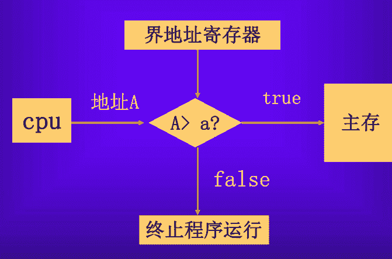

## 二、覆盖（overlap）

因内存小于作业的程序空间而引入覆盖，将用户空间划分成一个固定区和多个覆盖区。主程序放固定区，依次调用的子程序则放在同一个覆盖区。操作系统提供覆盖系统调用函数，由用户编程时在转子前调用。

+   - 操作系统
+   - 固定区 (4k)
+   - 覆盖区 (6k)
+   - 覆盖区 (10k)

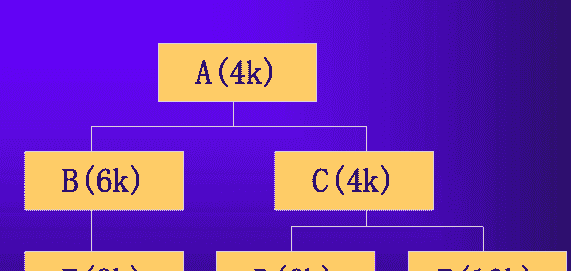

## 三、交换

多道程序设计的要求

基本思想：将处于等待状态(等I/O)或就绪(等CPU)状态的进程从主存换出到辅存，把将要执行的进程移入主存。

为了支持交换，必须在系统空间设立I/O缓冲区。

交换要花费较长的时间。


## 5.1.2 多道固定划分法

特点：任一时刻内存可有多道作业，每道作业连续存放于内存。

# 一、管理方法

将用户内存空间分成长度固定的若干块。

用户空间


## 地址访问保护有两种方式：

+   1. 上下界寄存器和地址检查机构。当作业被调度运行时，作业在内存中的上下界地址送上下界寄存器，每次内存访问时，地址检查机构作越界检查。作业程序是绝对地址或静态可浮动的。

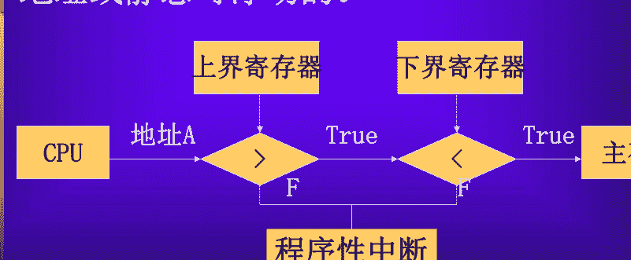

## 2. 基址寄存器、长度寄存器和动态地址转换机构。

当作业被调度运行时，将作业所占内存基址及长度送基址、长度寄存器，每次内存访问时，先看访问地址是否小于长度，然后+基址进行访存。用户程序代码是可动态浮动的。

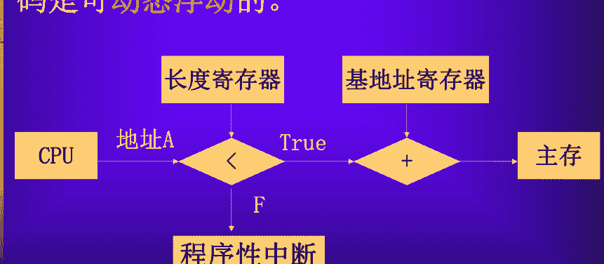

## 二、调度

多队列法

单队列法

... 3k 4k 1k 2k
... 5k 6k
... 7k 10k 11k 8k
OS
4k
6k
12k

... 7k 3k 4k 5k
OS
4k
6k
12k

## 三、存储碎片

内部碎片：内存某存储区间大于其存放作业空间的部分。

外部碎片：内存某存储区间容不下要运行的作业时。

作业长度：5K、8K、12K


内部碎片

外部碎片

## 5.1.3 多道连续可变划分法

特点：多道、连续、但不固定划分内存。

# 一、管理方法

系统设置一个空闲块队列，初始状态时队列中只有一个连续的空闲块。作业到达后，以某种策略分配空间。作业撤离时，将释放的空间加入空闲队列。


分配：分配策略包括首次满足法/最佳满足法/最大满足法，在找到合适的空闲块后，从其中将作业大小的空间分给作业，而剩余部分挂入空闲队列。

下面F是空闲块集合；size(k)为块k的大小；size(v)为用户所需空间。

+   1. if 所有属于F的k，均有 size(k)<size(v)，则失败。
+   2. 否则按某一策略选出k，使得 size(k)≥size(v)。
+   3. F = F - {k};

## （续分配）

+   4. if size(k)-size(v)<基本单位，则将k分给用户。

+   5. 否则将k分成k1、k2，其中k1分给用户
+   size(k1)=size(v)，      F = F + {k2}

# 回收：

当作业结束时，收回作业所占空间，将此块链入空闲队列。

若空闲队列中原来有与此块的相邻块，则把这些块合并成一个大连续块。

## 二、可用空间管理

除用队列表示可用空闲块外,也可以用数组登记可用空闲块,数组项=用户空间总量/基本分配单位。

空闲队列头

Bitmap数组

{1,1,1,0,0,1,0,0,0,0,1,0,0}

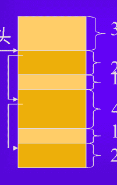

紧致：通过移动作业位置可以将零散的空闲块连接成大块。要求作业动态可浮动。

## 5.2 不连续空间分配

## 5.2.1 页式管理

特点：作业(进程)分成页面，内存也划分成页面，将作业(进程)页面不连续地分布到内存页面。

# 一、空间安排

+   - 用户进程空间(地址)叫逻辑空间(地址)
+   - 内存空间(地址)叫物理空间(地址)，
+   - 用相同长度为单位对逻辑空间等分出的每个区域叫页，对物理空间等分出的区域叫页帧。


**分配：**初始时，所有页帧都在空闲队列中，当用户进程被创建时，系统按需要量从空闲队列获得相应量的页帧。

**回收：**当进程结束时，系统回收它的所有物理页帧入空闲队列。

## 二、动态地址转换机构

因页式方法中逻辑地址与物理地址之间失去自然联系，故要通过页表，并由硬件动态地址转换机构将逻辑地址映射成物理地址才能正确访存。

### （一）页表

页表放在系统空间的页表区，存放逻辑页与物理页帧的对应关系。PCB表中有指针指向页表。

逻辑空间

页表

物理空间

页号

### （二）地址结构


逻辑地址 = p(页号).d(页内位移)
物理地址 = f(页帧号).d(同上)

p = 线性逻辑地址 / 页面大小;
d = 线性逻辑地址 - p*页面大小。

页号
0
1
2
3
4

### （三）页面大小的考虑

将页面大小取成2的k次幂(k是正整数)，获取p和d的除、乘法只要通过位移实现。

页面大小为2的k次幂的地址转换原理如下：

### （四）联想存储器

CPU有一个用于页号→页帧号转换的联想存储器。将页表存入联想存储器的地址转换原理如下：

| 关键词 | 值 |
|---|---|
| P1 | f1 |
| P2 | f2 |
| … | … |
| P | f |
| … | … |
| Pm | fm |

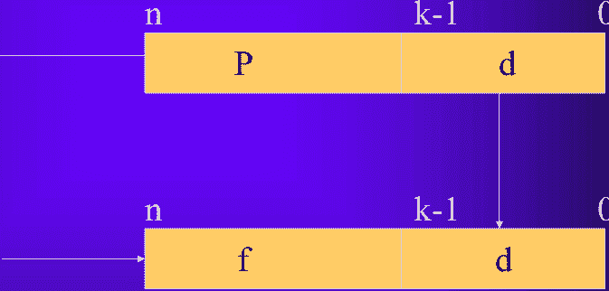

## 地址转换的一般过程
(联想存储器可以看成是页表的cache)

页表始地

页表

联想存储器

P1  f1

P2  f2

P  f

Pm  fm

P  d

f  d

命中率：选用8-12项组成的联想存储器，并采用适当的替换策略，在联想存储器中匹配成功的可能性可达80-90%。

等效访问时间：设访存时间为750ns，搜索联想存储器的时间为50ns，命中率为80%，则（这里假设先查联想存储器再查页表）：
80% * (750+50) + 20% * (750+50+750)
= 950ns

在进程被调度占用cpu时，将进程页表始址装入页表始地址寄存器，同时作废掉联想存储器中的原内容。

## 三、可用空间管理

可用bitmap数组或空闲页帧链来管理可用页帧。

## 四、共享与保护

通过页表可以使几个逻辑空间指向同一个物理空间，实现程序共享。


## 举例：

## P1

## P2

## P3

EDIT1
EDIT2
EDIT3
DATA1

EDIT1
EDIT2
EDIT3
DATA2

EDIT1
EDIT2
EDIT3
DATA3

## 页表

3
4
6
1

3
4
6
7

3
4
6
10

0
1
2
3
4
5
6
7
8
9
10
11

OS

DATA1

EDIT1 EDIT2

EDIT3 DATA2

DATA3

## 存储保护：

- 越界保护：设置页表长度寄存器，查页表前，先检查页号是否越界。
- 操作访问保护：在每个页表项中增设一存储保护域，用于说明对该页的访问权限，每一个对该页存储的访问都首先要比照是否满足该页访问权限的说明，满足则访问，否则报错。


举例：设为每一页表项增加三位，R位表示读权限，W位表示写权限，E位表示执行权限。

| R | W | E |  |
|---|---|---|---|
| 0 | 0 | 0 | 不可进行任何操作 |
| 0 | 0 | 1 | 可以执行, 不可以读写 |
| 0 | 1 | 0 | 只可以写 |
| 0 | 1 | 1 |  |
| 1 | 0 | 0 |  |
| 1 | 0 | 1 |  |
| 1 | 1 | 0 |  |
| 1 | 1 | 1 |  |

## 第十二讲 段/段页式存储管理与虚存

目的与要求:了解段/段页式管理, 掌握虚存管理.

重点与难点:虚存管理系统内存访问过程

作业:17, 34


## 5.2.2 段式管理

页式管理： 对用户而言不自然

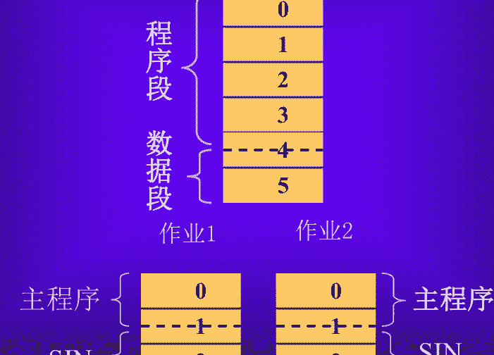

## 段式管理的特点：

按作业的自然段将其逻辑空间分成若干段，作业以段为单位分配内存。

## 一、空间安排

- 用户作业逻辑空间为二维空间，由若干自然段组成。
- 逻辑地址：段号.段内偏移，记作S, d。编译及装配时把所有地址记成(s, d)的形式。
- 物理内存空间管理：与多道可变划分法一样，系统以段为单位分配物理内存。


## 二、动态地址转换

段表：由如下格式的段表项组成，作业每段由一个段表项表示。

| 保护码 | 段长 | 本段内存始地址 |
|---|---|---|

段表放于系统空间，进程PCB表中存有段表始地址、段表长度。

段表始地址寄存器、段表长度寄存器

## # 地址转换过程

LA

段表长度

≥

越界

段表始址

+

| S | d |
|---|---|
|   |   |

| 段号 | 保护码 | 段长 | 段内存始址 |
|---|---|---|---|
| ... | ... | ... | ... |
|   |   |   |   |
|   |   |   |   |

联想存储器

| 保护码 | 段长 | 段内存始址 |
|---|---|---|
| ... | ... | ... |

+

PA

## 三、共享

若共享的段引用自身的某个地址，则各进程必须用同一段号来共享这一段。

1. `SQRT(A, Y)`
2. `IF X<0 THEN GOTO (SQRT, L)`
3. `...`
4. `...`
5. `(SQRT, L): ...`
6. `...`

`GOTO (SQRT, L)` ⟶ `GOTO (段号, L)`

## 5.2.3 段页式管理

特点：将作业分成若干干段，每段用页式管理实现内存分配。

- 对于用户而言，段页式管理与段式相同，用户逻辑地址只涉及段号与段内位移。
- 对于物理内存管理而言，它与页式系统相同。

系统的逻辑地址：段号·段内位移 --> 段号·页号·页内位移。记作：S, P, d.

## 作业空间的内部表示

- 主程序
- 子程序
- 数据

| 保护码 | 长度 | 页表始地 |
|--------|------|----------|

页表

段表

OS

# 段表+页表

主存

等效访问时间：设访存时间为750ns，搜索联想存储器的时间为50ns，命中率为95%，则

95% * (750+50) + 5% * (50+750+750+750) = 875ns

## 三、保护与共享

保护与段式管理相同。
共享则可以以页为单位，也可以共享页表。

## 作业1

主程序

子程序

数据


## 段表

|   |
|---|
|   |
|   |

## 作业2

主程序

子程序

数据


## 段表

|   |
|---|
|   |
|   |

## 页表

|   |
|---|
|   |

## 主存

| OS |
|---|
|   |
|   |
|   |
|   |
|   |
|   |
|   |

## “放”

- 连续存放
  - 单道连续划分
  - 多道连续固定划分
  - 多道连续可变划分
- 不连续存放
  - 页式存储
  - 段式存储
  - 段页式存储


## 5.3 虚存

目的：提供用户进程一个巨大的虚拟存储空间。

手段：利用外存(磁盘)实现此虚空间.

## 5.7.1 虚存的基本思想

系统为进程提供一个比物理内存大得多的虚拟存储空间，逻辑空间大小不受物理内存大小的限制。

逻辑空间的容量由系统的有效地址长度决定。假设地址长度为32，按字节寻址，则逻辑空间（虚拟空间）大小为2^32个字节。


## 实现该虚空空间的基本方法是：

在页式（段式、段页式）管理的基础上，仅将进程的一部分页（段）放于主存。页（段）表项中注明该页（或段）是否在主存。程序执行时，如果访问的页（段）不在主存，根据页（段）表项的指示，将其从外存调入主存，如果此时无可用的内存空间，则先淘汰若干页帧（段）。

## 交换区（SWAP）：

进程刚建立时，页面在辅存即程序文件所在的辅存位置。但程序文件中一般包含有程序的二进制目标码及数据初始值并说明了初值为0的工作区。数据页以及在程序执行过程中动态申请的空间页在内存被剥夺要回写时不能写入程序文件，因此引入了交换区，在需要让其让出内存时将写入交换区中。

## 5.7.2 页式虚存管理

### 一、页表项结构：

| 合法位 | 修改位 | 页类型 | 保护码 | 外存块号 | 页帧号 |
|---|---|---|---|---|

**合法位：** 置上表示该页在内存。

**修改位：** 置上表示该页被修改过，在释放或淘汰时应写回外存。

**页类型：** 零页：表示该页在分配物理页帧时应清0页帧空间；回写swap区页：表示回写swap区。

**保护码：** R、W、E保护说明。

**外存块号：** 该页所在外存的块号。

**页帧号：** 当合法位置上时代表该页所在内存的页帧号。

### 二、页表建立

在进程创建时建立页表，页表项在初始时，合法位、修改位及页帧号都未置上。

#### 初始化页表方法：

①部分复制父进程页表（如UNIX的fork()）

- 分配pid给子进程，分配PCB空间；
- 初始化PCB（进程标识，调度信息）；
- 分配子进程页表空间；
- 拷贝父进程的程序区页表项，使程序共享；
- 申请空闲页帧，复制父进程的数据区和栈区，复制数据区和栈区页表项内容后，修改页帧号；
- 继承父进程对其他资源访问现场；
- 用父进程PCB中现场区初始化子进程的现场区，且保证子进程恢复现场运行后返回值为零；
- 将子进程挂到就绪队列；
- 把子进程pid作为返回值.

②用一个可执行的文件来初始化页表。

- 为执行程序页面建页表项，保护码为可执行，外存块号即该页所在的文件的外存块号。（不必回写）
- 为所有初始数据页建页表项，保护码为可读写，页类型说明成回写swap页，外存块号即该页所在文件的物理块号，待该页回写时，再分配swap区空间，改外存块号栏，修改页类型为正常页。
- 为所有临时数据页建页表项，保护码为可读写，页类型说明成零页，外存块号栏空，当第一次访问该页时，分配页帧并清0页帧，回写时，再分配swap区空间，填外存块号栏，页类型变为正常页。

### 三、硬件动态地址转换

在执行虚存访问指令时，由硬件合成物理地址。首先若能在联想存储器中获得该虚页的物理页帧号，则访问之。若要查当前进程页表，须先检查该页页表项的合法位，若置上，则从页表项中获得页帧号，否则要发一个页故障（page fault）或叫缺页中断（例外），当缺页中断处理完后，重新执行访存指令。

联想存储器中的页表项都是合法页的页表项。


### 四、缺页处理

当硬件执行访存指令产生一个缺页中断时进入缺页中断处理程序：

- 1、根据发生页故障的虚地址得到页表项；
- 2、申请一个可用的页帧（根据所采用的替换策略可能需要引起淘汰某一页）；
- 3、检查页类型，若为零页，则将页帧清0，将页帧号填入页表项的页帧号一栏，置合法位为1。若非零页，则调用I/O子系统将外存块号所指的数据读到可用页帧，将页帧号填入页表项中，合法位置1，结束。

### 五、页淘汰

页淘汰可以发生在申请页帧时，而现代OS一般都定时进行页淘汰。如何选取被淘汰的页是由页面替换策略决定的，若已决定淘汰页P，则淘汰一页的主要工作有：

- 1、查P页表页的修改位，若未修改，则清0合法位，将页帧送回空闲页帧队列。
- 2、若已修改，则检查类型栏。
- 3、若是零页或回写swap区页，则申请一块swap区空间，将P的外存块号置上。
- 4、调用I/O子系统将页帧上的数据写到外存块号所指的外存空间。清0合法位，将页帧送回空闲页帧队列。

## 第十三讲 页面替换策略

目的与要求:了解各种页面替换策略及实用的综合策略。

重点与难点:固定驻留集算法和SWS等实用动态驻留集算法。

作业:18, 19, 24, 31, 33

## 页面替换策略中基本概念

驻留集（工作集）：进程的合法页集合

访问串：进程访问虚空间的地址踪迹。

举例：某进程依次依次访问如下地址，
0100，0432，0101，0612，0102，
0103，…

页式虚存管理以页为基本单位，只需页号即可。设页面大小为100，上述访问串可简化为1，4，1，6，1，1，…

## 一、驻留集大小固定的替换策略

驻留集与 paging in/out 的关系：

- 进程刚创建时，驻留集为空。即 $s(t)=空$。
- 若 $t+1$ 时刻访问的页在 $s(t)$ 中时，访问之。即若 $r(t+1)\subseteq s(t)$，则 $s(t+1)=s(t)$。
- 若 $t+1$ 时刻访问的页不在 $s(t)$ 中时，且驻留集大小小于 $m$，则 paging in。即若 $r(t+1)\ne s(t)$，且 $|s(t)|<m$，则 $s(t+1)=s(t)+\{r(t+1)\}$。
- 若 $t+1$ 时刻访问的页不在 $s(t)$ 中时，且驻留集大小等于 $m$，则先 paging out 页 $y$，再 paging in $r(t+1)$ 页。即 $s(t+1)=s(t)-\{y\}+\{r(t+1)\}$。

### （一）FIFO替换算法(替换最早进入的页)

举例：驻留集大小为3，访问串为

7, 0, 1, 2, 0, 3, 0, 4, 2, 3, 0, 3, 2..


O O O O O O O O O O O

### （二）OPT (Optimal replacement)

淘汰下次访问距当前最远的那些页中序号最小的页。

举例：驻留集大小为3，访问串为

7, 0, 1, 2, 0, 3, 0, 4, 2, 3, 0, 3, 2..


O O O O O O O

## OPT方法特点：

- 最优的固定驻留集大小替换策略。
- 不可实现。

OPT策略对任意一个访问串的控制物有最小的时空积。（进程所占空间与时间的乘积）

由于需要预先得知整个访问串的序，故不能用于实践。仅作为一种标准，用以测量其他可行策略的性能。

## 栈算法没有Belady奇异。

设n>m，对于栈算法有S(m，t)属于 S(n，t)，任取r（t），若r（t）！∈ S(n，t)，则r（t）！∈ S(m，t)。因此，驻留集为n时出现的页故障一定会出现在驻留集为m时。

## LRU没有Belady奇异。

LRU策略的特点：要硬件配合，实现费用高，但效果适中。

实现方法1： 给每个页帧设一个计数器，每访问一页，对应页帧计数清0，其余页帧计数加1，淘汰计数最大的页帧。


### （四）实用方法（兼顾FIFO和LRU策略）

为页帧在页表项中增加一位使用位，硬件每访存一次即将对应页的使用位置1，操作系统页面管理程序定时将所有使用位清0。淘汰时任选一个使用位为0的页。

操作系统选择淘汰页时，尽量避免选被修改过的页。因此，首先选择使用和修改位都为0的页；若没有，再选修改位为1，使用位为0；再选使用位为1，修改位为0的页；最后按FIFO选两者均为1的页。

## (一) WS(working set)

若驻留集中的的某页有△个访问间隔没被访问则将其淘汰。

举例：取△=5，访问串为

+ 7 0 1 2 0 3 0 4 2 3 0 3 2 1 2 0 1

| 7 7 7 7 7 3 3 3 3 3 3 3 3 3 3 0 |
| 0 0 0 0 0 0 0 0 0 0 0 0 0 0 0 2 |
| 1 1 1 1 1 4 4 4 4 2 2 2 2 1 |
| 2 2 2 2 2 2 2 2 2 1 1 1 |

1 2 3 4 4 4 4 4 4 4 4 3 4 4 4 3


# 实现：

每一页面设一计数器。每访存一次，将进程所有页面计数器加1，所访存的页面计数器清0，淘汰计数器值等于△的页面。

# 特点：

开销太大，没有实用


# （二）SWS (Sampled Working Set)

定时检查计数器，淘汰计数器值大于等于 Δ 的页面。这样硬件消耗仍很大。

每访问一页，将当前硬时钟值记录在页表项中，操作系统定时（以 T 为周期）检查驻留集页表项的时钟值，若：当前时钟值 − 页表项中时钟值 > Δ，则淘汰之。


# (三) VMIN(Variable Minimal replacement)

若某页距下次访问的距离大于△则将其淘汰。(不能实用)

△相同时，VMIN与WS的故障数相同，但VMIN的平均驻留集要小。

# 三、替换策略选择

实用操作系统选择动态驻留集FIFO(SWS)的变种。

- 系统设立两个队列：自由链表和修改链表。
- 定时作页预淘汰：淘汰时不立即丢去页中数据，根据页面修改否挂入自由链/修改链，修改链过长时，回写页面后改挂到自由链中。
- paging in要用空页时,选自由链的第一页帧,这时页中数据被覆盖（真正被淘汰）,改变该页帧原页面页表项相关信息。
- 在自由链/修改链中的页面再次被访问时,则将该页从链中摘除,该页又能通过页表项访问到（从预淘汰回到被使用状态）。


# 预调

## 请调与预调的区别：

- 存储管理：用时分配调入与预分配调入
- 替换策略：要时页淘汰与预淘汰；

固定驻留集大小时，一般驻留集未满时，采用预调；待驻留集满即改为请调。

# 第十四讲 设备控制原理、设备使用方法

目的与要求：掌握I/O控制的原理、设备的使用方法。

重点与难点：三种不同的I/O控制方式；三种不同的设备使用方法。

作业：2，3，4，5


# 第六章 设备管理

# 6.1 输入输出硬件概念

# 1. 常见I/O设备的分类

- 人体交互设备 (字符设备, 发收接收以字符)
- 存储类型设备 (块设备, 读写以数据块方式)
- 网络通讯的设备

# I/O设备的特点

- 数据传输速率不同
- 数据传输单位不同
- 控制的复杂性不同
- 设备的使用目的的不同

# 2. 设备控制器 (I/O部件)


I/O设备通常包含一个机械部件和一个电子部件。电子部件被称作I/O部件或设备控制器。

操作系统一般只与控制器打交道，而非设备本身。

早期CPU是直接控制外部设备的，在引入I/O部件之后，I/O指令功能加强，才将CPU逐渐从与外设的交互细节中解放出来。

控制器的任务是在外部设备与CPU（或内存）之间完成比特流（外部信号）和字节流（块）之间的转换。

比特流
磁盘控制器
转换、校验
字节块
主存
字符显示控制器
转换
字节流
主存经CPU
显示信号


每个控制器都有一些用来与CPU通讯I/O寄存器。操作系统通过向这些寄存器写命令字来执行I/O功能。

| 键盘 | 060 - 063 |
| 硬盘 | 320 - 32F |
| 打印机 | 378 - 37F |
| 软盘 | 3F0 - 3F7 |
| 彩色显示器 | 3D0 - 3DF |

# IBM PC的I/O地址

# 3. 输入输出控制方式

# 一、程序直接控制方式

CPU直接控制I/O操作的全过程，包括传输数据、发送读写命令、测试设备状态。

因此，处理机指令集应包括控制类、测试类、读写类I/O指令。

I/O部件接收到相应的命令后，将I/O状态寄存器的相应位置上。随着操作的执行更改状态位，由CPU执行相应指令读取I/O完成状态。I/O数据通过CPU寄存器转发。


# 二、中断控制方式

CPU向I/O部件发出命令后，转去做其他有用的工作。当I/O部件准备好数据后，利用中断通知CPU，再由CPU完成数据传输。

CPU不必反复测试寄存器状态，节约了时间。但总体看来，中断控制方式仍然消耗大量的CPU时间，因为每个字的数据传输都必须经过CPU寄存器转发。

向I/O部件发读命令

读I/O部件状态寄存器

检查状态

OK

从I/O部件读字数据

将该字写入内存

该块读完?

OK

出错处理

未OK

中断

# 三、DMA方式

# 前两种方式的缺陷：

- I/O的传输速率受CPU测试或中断响应的速度限制
- CPU为管理I/O耗费大量时间。

DMA（直接内存存取）负责完成整个I/O操作，无需再经CPU寄存器转发，并在全部传输结束后向CPU发中断信号。

CPU向DMA部件发送I/O命令后，即可进行其他工作。给DMA的命令中应包括：操作类别、I/O设备的地址、读写数据在内存中的首地址、字数。


# 向DMA部件发读命令

中断

# 读取DMA部件状态

DMA的功能可以以独立的DMA部件在系统I/O总线上完成，也可整合到I/O部件中完成。读写内存时，DMA部件需要控制总线，CPU可能在涉及存储访问时因此而忙等待。

# 输入输出控制方式的发展过程

CPU直接控制外部设备

引入I/O部件，CPU直接控制I/O部件

引入中断驱动方式

引入DMA

I/O通道或I/O处理器

# 6.2 设备输入输出子系统

# 6.2.1. 设备的使用方法

一、设备相关系统调用简介

- **申请设备。** 该系统调用中有参数说明了要申请的设备名称，操作系统处理该系统调用时，会按照设备特性（是独占还是分时共享式使用）及设备的占用情况来分配设备，返回申请是否成功标志。
- **将数据写入设备。**
- **从设备读取数据。**
- **释放设备。** 这是申请设备的逆操作。

# 说明：

- 上述的系统调用主要用于对人机交互类慢速外设的使用。
- 对于存储类外设，用户程序一般通过对文件的访问，由文件管理模块读写存储外设间接使用它们，系统也提供直接使用存储类外设的接口。
- 对于网络通讯外设，用户级程序也不直接使用它们，用户通过SOCKET通讯系统调用接口调用TCP/IP层程序，由IP层程序选择调用网络通讯设备驱动程序。

在LINUX中，你也可以用如下的系统调用将数据直接写入软盘中：
fd=open(" /dev/fd0",0__RDRW)； 申请软盘，/dev/fd0代表软盘。
lseek(fd,1024,0)； 将软盘当前I/O位置定位到1024字节位置。
Write(fd,buffer,36)； 将用户缓冲区buffer中的36个字节写入软盘1024—1059字节。
...
close(fd)； 释放软盘。
显然，这样使用方式绕过了文件管理，而直接读/写软盘空间。当然你必须清楚软盘的什么位置存放了什么信息，你才能做到正确的读写。

# 二、独占式使用设备

所谓独占式使用设备是以设备完整使用过程（包含多次I/O操作）为单位使用设备。在申请设备时，如果设备空闲，就将其独占，不再允许其它进程申请使用，一直等到该设备被释放，才允许被其它进程申请使用。

# 三、 分时式共享使用设备


独占式使用设备时，设备利用率很低。

如果一个逻辑上完整的数据可以用设备的一次I/O操作完成，那么我们就不必要独占该设备。反过来说，如果一次I/O操作的数据逻辑上完整，我们就不必要对该设备进行独占方式的申请使用。在申请这种设备时，不必检查是否已被占用，只要简单累加设备使用者计数即可。

所谓分时式共享就是以一次I/O为单位分时使用设备，不同进程的I/O操作请求以排队方式分时地占用设备进行I/O 。


请求

请求

设备


## 四、SPOOLing方式使用外设

SPOOLing 技术是在批处理操作系统时代引入的，即所谓假脱机输入输出技术。把这种技术用于对设备的使用，实质就是对输入/输出数据成批处理。

例如：所有输出数据在进程运行时写到虚拟设备（文件/输出井）当中，文件排到打印输出队列，打印进程申请占用打印机后，成批读出文件中数据，并送打印机打印出去。


## 第十五讲 设备管理、磁盘设备

**目的与要求：**理解设备管理子系统的层次、功能及技术，了解磁盘设备。

**重点与难点：**层次结构；设备驱动程序；缓冲技术；磁盘调度的方法；盘阵选择。

**作业：**6, 8, 11, 16, 18


## 6.2.2 输入输出层次结构

通常，操作系统将设备管理系统划分并组织成三个层次：

- 用户层 I/O
- 设备无关的 I/O
- 设备驱动及中断处理

| 层次 |
| --- |
| 用户层 I/O |
| 设备无关的 I/O（系统调用接口，设备无关的操作系统软件） |
| 设备驱动及中断处理 |
| 硬件 |

```
用户进程
用户层 I/O
设备无关的 I/O
设备驱动及中断处理
硬件
设备管理子系统
核心态运行
逻辑结构图
```

## 系统调用各模块关系图

```
用户程序
用户程序
用户态
标准 C 库 I/O 函数
系统调用接口
核心态
内核总控
系统调用处理总控
Write 处理（文件系统、TCP/IP）
磁盘驱动程序/网卡驱动
异步调用接口
盘/网卡中断处理
磁盘控制器/网卡
```

### 二、设备无关的 I/O

这一层的基本功能：执行适用于所有设备的公共 I/O 功能，并向其上层提供统一的系统调用接口。主要任务：

- 设备命名及与设备驱动程序的映射。在 UNIX 中，如 `/dev/tty00` 唯一地确定了一个 inode 数据结构，其中包含了主设备号，通过主设备号可以找到相应的设备驱动程序。
- 设备访问保护。
- 分配及释放独占型设备。
- 设备 I/O 数据缓冲机制。
- 文件系统功能、TCP/IP 协议等（支持设备上的逻辑存储、通信对象）。

### 三、设备驱动与中断处理

- **设备驱动程序**：包括了所有与设备相关的代码，其功能是从与设备无关的软件中接收 I/O 的请求，排入请求队列或执行之。
- **中断处理**：当进程进行 I/O 操作时，将其阻塞至 I/O 操作结束并发生中断。中断发生时，由中断处理程序启动请求队列中排队的下一请求（如果有）并解除等待 I/O 的进程的阻塞状态，使其能够继续执行。

## 6.2.3 缓冲技术

在进程数据区与外设之间设立缓冲区，可以改善进程运行速度与 I/O 传输速度之间的速差矛盾。

### 一、单缓冲

当用户进程发出 I/O 请求时，操作系统在主存的系统空间为该操作分配一个缓冲区，可以实现预读和滞后写。

### 二、双缓冲

可以实现用户数据区—缓冲区之间交换数据和缓冲区—外设之间交换数据并行。

### 三、循环缓冲

引入系统缓冲池，采用有限缓冲区的生产者/消费者模型对缓冲池中的缓冲区进行循环使用。

缓冲区结合预读和滞后写技术，对具有重复性及突发性的 I/O 进程提高 I/O 速度很有帮助。

### Hash 表方式的设备缓冲队列

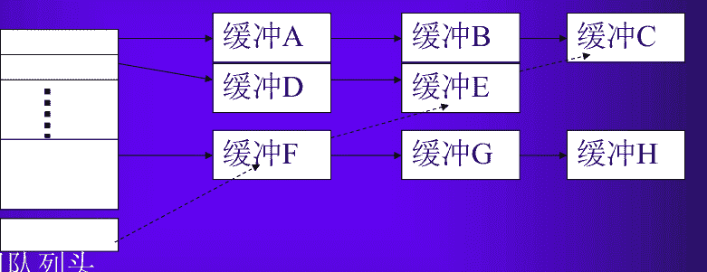

空闲队列头

### 缓冲区管理示例

## 6.2.4 设备驱动程序

### 一、设备驱动程序接口函数

- 驱动程序初始化函数：这个函数是为了使驱动程序其它函数能被上层正常调用，而做一些针对驱动程序本身的初始化工作。如向操作系统登记该驱动程序的接口函数，该初始化函数在系统启动时或驱动程序安装入内核时执行。
- 驱动程序卸载函数：是驱动程序初始化函数的逆过程，在支持驱动程序可动态加载卸载的系统中才需要。
- 申请设备函数：该函数申请一个驱动程序所管理的设备，按照设备特性进行独占式占用或者分时共享式占用，如果是独占式申请成功还应该对设备做初始化工作。
- 释放设备函数：是申请设备函数的逆过程。
- **I/O 操作函数**：这个函数实现对设备的 I/O。如果对独占型设备，包含了启动 I/O 的指令，对分时共享型设备，该函数通常将 I/O 请求形成一个请求包，将其排到设备请求队列，如果请求队列为空，则直接启动设备。
- **中断处理函数**：这个函数在设备 I/O 完成时向 CPU 发出中断后被调用。该函数对 I/O 的完成作善后处理，一般是找到等待刚完成 I/O 请求的阻塞进程，将其置为就绪状态，使其能进一步做后续工作。如果存在 I/O 请求队列，则启动下一个 I/O 请求。

## 5. 设备管理有关的数据结构

- **描述设备、控制器等部件的表格。** 系统中常常为每一个部件、每一台设备分别设置一张表格，常称为部件控制块或设备表。这类表格具体描述设备的类型、标识符、运行状态，以及当前使用者的进程标识符等。
- **建立同类资源的队列。** 系统为了方便对 I/O 设备的分配管理，通常在设备表的基础上通过指针将相同物理属性的设备联成队列（称设备队列）。
- **面向进程 I/O 请求的动态数据结构。** 每当进程发出块 I/O 请求时，系统建立一张表格（称 I/O 请求包）。将此次 I/O 请求的参数填入表中，同时也将该 I/O 有关的系统缓冲区地址等信息填入表中。I/O 请求包随着 I/O 的完成而删除。
- **建立 I/O 队列。** 如请求包队列。

### 设备管理有关数据结构关系

```text
设备表    设备表    设备表
请求包    请求包
```

## 6.3 存储设备

### 6.3.1 常见存储外设

- 磁盘
  - 数据组织：一个磁盘由多个盘面组成，盘面由同心圆磁道组成，磁道由扇区组成，扇区为基本传输单位。
  - 物理特性：单磁头，多磁头。

### 多磁头活动头盘示意图

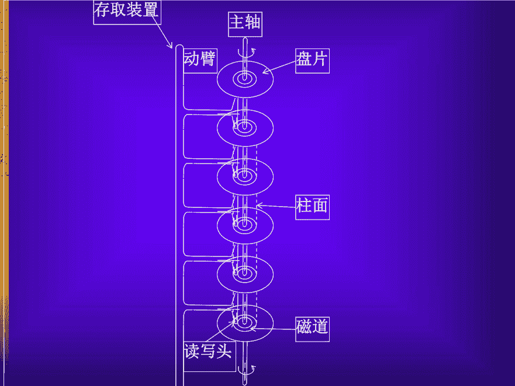


### 光学存储设备

- CD-ROM
- CD-R, CD-RW

### 6.3.2 磁盘调度

磁盘地址：设备号 + 柱面号 + 盘面号 + 扇区号

读写一次磁盘信息所需的时间可分解为：寻找时间、延迟时间、传输时间。

为提高磁盘传输效率，软件应着重考虑减少寻找时间和延迟时间。

### 一、减少寻找时间的方法

减少寻找时间是提高磁盘传输效率的关键。因为“寻找时间”在几十毫秒数量级。

操作系统磁盘驱动程序可以通过合理调度多道进程对磁盘的访问请求的顺序，达到减少磁盘平均服务时间的目的。

### 调度策略

- FCFS（First Come First Served）
- SSTF（Shortest Seek Time First）
- SCAN 调度（电梯调度法）
- C-SCAN 调度（一个方向响应请求）
- LOOK 调度、C-LOOK 调度（是 SCAN 和 C-SCAN 的改进）


### 二、减少延迟时间的方法

一般常将盘面扇区交替编号；磁盘中不同盘面错开命名。


### RAID 级别

- RAID 级别 0：指使用块级条带化的磁盘阵列。
- RAID 级别 1：指磁盘镜像。


(a) RAID 0：无冗余条带化


(b) RAID 1：镜像磁盘

- RAID 级别 0+1：是指 RAID 级别 0 和 1 的结合。RAID 0 提供性能，RAID 1 提供可靠性。它通常用于性能和可靠性都很重要的环境中。
- RAID 级别 1+0：其中磁盘被镜像成对，然后将最后得到的镜像对进行条带化。这种 RAID 比起 RAID 0+1 有理论上的优势。例如，如果在 RAID 0+1 中单独一个磁盘失效，其他盘上的对应条带都不可访问。在 RAID 1+0 中，如果一个磁盘失效，这个单独的磁盘不可用，但它的镜像盘仍然可用。


- RAID级别5：称为block-interleaved分布式奇偶校验，与级别4不同在于，把数据和奇偶校验分布到所有的N+1个磁盘上，而不是把数据存储在N个磁盘上，把奇偶校验值存储在另一个磁盘上。RAID5避免了在RAID4中可能出现的过度使用单独一个奇偶校验磁盘的情况。
- RAID级别6：RAID级别6，也叫做P+Q冗余模式，很像RAID级别5，但存储了额外的冗余信息来防止多块磁盘失效。这里不用奇偶校验，而是用到错误校验码，例如Reed-Solomon码。

## 第十六讲 文件与文件目录

目的与要求：了解文件结构，访问方式，存储结构。掌握文件管理用的文件控制块和文件目录结构。了解文件存储器分区和空间管理。

重点与难点：文件存放与访问方式，文件目录结构。

作业：2，4，7，9。

## 第七章 文件系统

## 为什么引入文件和文件系统

- 为了方便使用管理系统公共程序和数据以及用户自己的程序和数据而引入文件。
- 文件系统的基础：大容量磁盘
- 为了对外存储器空间管理和对其上文件的按名访问而引入文件系统。


## 文件系统的功能

- 支持文件所占存储介质空间的分配/去配
- 支持文件相对起始数据的逻辑块定位到外存上的物理块
- 支持对文件访问的安全检查
- 支持对文件数据的访问

- 将文件系统类比页式存储管理
  - 页式存储管理将一个进程分页存放于主存，页表是逻辑页到物理页的定位信息
  - 文件系统将一个文件分块存放于外存，文件控制块将包含文件的定位信息


## 按用途分类文件

- 系统文件
  
  如操作系统核心目标代码文件，驱动程序文件，注册库配置文件

如操作系统核心目标代码文件，驱动程序文件，注册库配置文件

- 库文件，实用程序文件
  
  如unix中的.so , ls、more等程序 windows中的 .dll, .exe

如unix中的.so , ls、more等程序 windows中的 .dll, .exe

- 其它文件
  
  如用户源程序文件，数据文件，各种应用程序用的数据文件。

如用户源程序文件，数据文件，各种应用程序用的数据文件。

## 7.1.2 文件的逻辑结构

- 流式文件（文件的格式由使用文件的程序解释）
  - UNIX的字节流文件
  - 流式文件为了便于存放于文件存储器，可被等分成块（类比页式存储系统的页）
- 记录式文件（OS解释记录控制字）
  - 等长逻辑记录文件
  - 变长逻辑记录文件


## 文件的访问方式

- 顺序访问

程序依次访问文件的数据，操作系统自动记录文件访问的当前位置。

- 直接（随机）访问

程序读/写时直接给出要访问数据的逻辑位置（如第几个字节或第几个记录）及长度，由OS将逻辑位置转换成物理位置并访问之。

## 7.1.3 文件的物理结构

- 文件存储器的物理特性

- 磁带

顺序访问设备→要求文件顺序存放于带上。

- 磁盘

直接（随机）访问设备→文件可顺序、链接式或随机（通过类似页表的索引结构访问）存放于设备上。

- 将文件存储器分块

- 对直接访问设备等分成物理块，利于空间的分配/ 去配和读/写。

## 文件的物理组织方法

- 顺序结构
  文件顺序连续存放于文件存储器上（如磁带文件，光盘文件）。

- 链式结构
  文件不连续地存放于文件存储器上，但使用指针按文件数据顺序将其链接起来。

- 索引结构
  文件不连续存放于文件存储器上，使用一张索引表来定位文件中的数据（类比页表）。

•多级索引：如果索引表过大，可以组织成如下的多级索引表，这样单个索引表可以定长，利于实现，下面是多级索引表示意图


一级索引表 二级索引表 数据块

## 7.2 文件目录

建立文件系统的作用在于对文件信息的“按名存取”，力求查找简便，减少查找时间。为此，一般用文件目录的方法来管理文件，每个文件有一个目录项。可形象地理解文件目录为“文件名址录”——它是记录所有文件的名字及它代表的文件存放地址的目录表。

## 7.2.1 文件控制块

- OS观点：文件包含文件控制块和文件体。
- 文件控制块（FCB）的主要内容
  - 文件名
  - 创建者
  - 文件物理位置信息：如索引表
  - 创建、修改时间、保存时间
  - 口令：用于对文件访问进行验证
  - 操作限制：如读、写、执行权限说明

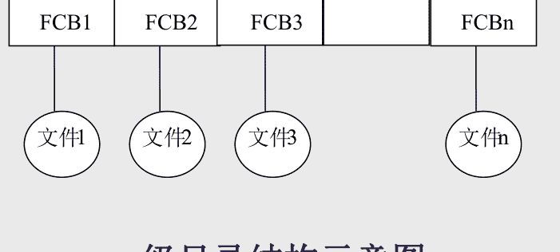

## 一级目录结构示意图


## • 二级目录结构

设一个主目录MFD，为系统的每个用户设用户目录UFD，用户目录是用户所有文件FCB的集合，主目录中存放每个用户目录的用户名和UFD的索引表等（当我们把UFD看作是一个文件时，这个文件的内容是用户所有文件FCB集合，MFD中则包含每个UFD文件的FCB）

主文件目录

User1    User2    User3    User4

用户文件目录

CAT    BO    A    TEST

A    TEST

A    DATA

X    DATA    A

文件

## 二级目录结构示意图

## 二级目录结构实现

- 可以把主目录和二级用户目录放于外存头部，也可以把二级目录当一般文件存放
- 路径名
  将用户名与文件名连到一起组成路径名。例如：/luoyu/test.c

## 树形目录结构

- 树状的多级目录结构

- 任何一级目录中的FCB既可以描述次一级的子目录，又可以描述一个文件

- 特点

  - 利于文件分类，从文件路径名可看出文件类别。
  - 查找文件FCB耗时时间，要得到文件FCB，必须从根查起。
  - 唯一确定文件的路径名太长，故引入当前目录概念，提供相对于当前目录的相对路径名可加速文件FCB的查找，进程控制块存有当前目录信息。

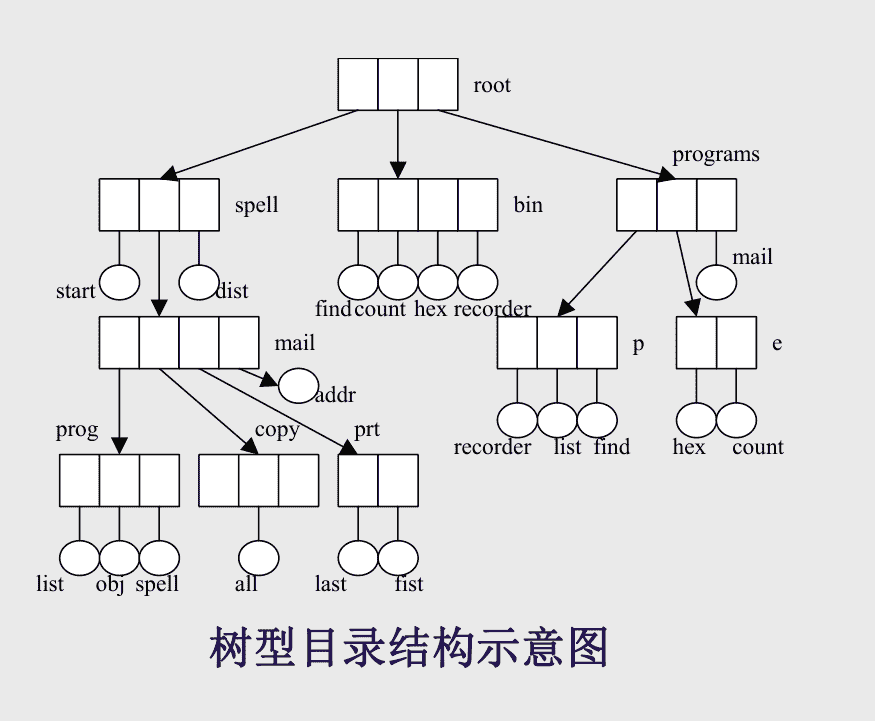

## 树型目录结构示意图

## 无环图目录结构

- 当一个文件副本可以同时分到两个不同目录（类别）时，即同一个文件有二条路径名，或多条路径名时出现无环图目录结构。
- 特点
  - 方便文件共享，分类。
  - 两个或多个FCB的一致性难保证，如删除文件时，当文件修改而引起FCB内容变化时。


## 无环图目录结构示意图

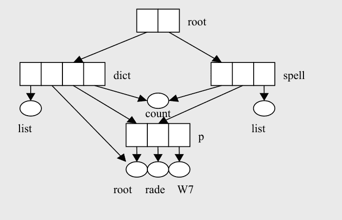

## 无环图目录结构一种变通的实现方法符号链接

- 建立多个符号链文件，该文件内容为要访问文件的路径名。
- 当访问符号链文件时，读出文件中的的路径名，再重新从根查找路径名代表的的文件FCB


## 7. 3文件存储器空间布局与管理

文件存储于文件卷中，文件卷可以是一个物理盘，也可以是一个物理盘的一部分，一个支持超大型文件的文件卷也可以由多个物理盘组成。见图


- 可安装多操作系统计算机磁盘分区举例：
- 每个物理盘可以分成多个 partition，每个 partition 可以分成多个 slice
- 硬盘分区和初始化在操作系统安装时做，单个文件卷的初始化在操作系统正常运行时也可以做（通过相应实用程序如 mkfs 和操作系统的对设备 I/O 系统调用实现）


MBR

NTFS

FAT32

EXT3

swap

slice
partition

slice
partition

OS

OS Loader

文件目录结构

## 物理盘分区示意图

## 文件存储器空间管理
- 文件区和目录区自由空间表示（将盘空间等分成物理块）
- 位向量（bitmap表）：每一物理块由bitmap表中的一位表示，1表示占用，0表示空闲。
- 空闲块链：将所有空闲块线性链接，或成组链接。

The end


## 文件链式结构

FCB

首记录

存储器


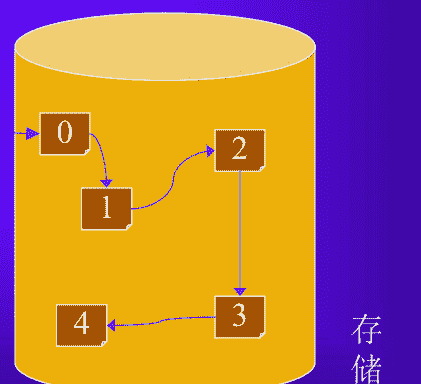

## 文件索引结构

FCB

索引地址

索引表

|  |  |  |
|---|---|---|
| 0 | b0 |  |
| 1 | b1 |  |
| 2 | b2 |  |
| 3 | b3 |  |
| 4 | b4 |  |
|  |  |  |

存储器

## 第十七讲 文件系统

目的与要求：掌握文件系统调用处理及使用。了解文件备份与保护，系统的组成和各部分功能。

重点：文件使用和控制、文件保护。

作业：10, 11, 13, 15。

## 7.4 文件访问系统调用
- 操作系统提供文件创建、删除、打开、关闭、读、写等系统调用作为用户编程界面。
- 另一文件访问接口 Memory—Mapped 文件访问。

## 7.4.1 传统文件系统调用实现

文件的建立与删除
- CREATE、DELETE系统调用参数包括
- 文件名（路径名）
- 设备名（卷名）
- 其它信息（FCB中要用户提供的信息）


## 文件的建立与删除

CREATE系统调用大致处理过程
- 检查参数合法性
- 在文件目录结构中的适当位置建立一个文件控制块FCB。
- 将参数填入FCB。
- 分配文件所存放的外存空间（也可lazy分配即在写数据时分配），建立索引表，填入FCB中。


## 文件的建立与删除

DELETE文件系统调用过程
- 检查参数，得到文件名（路径名）
- 按名查找文件目录结构，找到文件的FCB
- 按FCB中的索引表释放文件所占外存空间
- 从文件目录结构中删除FCB。

## 文件的打开与关闭

OPEN系统调用处理过程
- 检查参数，获得文件名（路径名）；
- 按名查找文件目录结构，找到文件的FCB；
- 将FCB拷贝入内存，存入内存活跃文件目录表中；
- 建立一张本次打开的文件读写状态信息表，将当前访问指针指向文件首；
- 将文件读写状态信息表的地址存于进程PCB中的资源描述区中“活动名字表”中，返回其索引号（存入fd）作为本次调用的返回值。

## 文件的打开与关闭

CLOSE系统调用管理过程
- 检查参数，获得活动名字表索引（fd）;
- 按索引在PCB中的“活动名字表”中得到文件读写状态信息表的指针，释放文件读写状态信息表，如果活动文件目录表中FCB不再使用，则释放该FCB所占的空间。

## 文件的读写

读写参数包括
- fd
- 起始逻辑地址（省缺时即当前访问地址，一般存于读写状态信息表）
- 长度
- 读写信息用户区地址

## 7.4.2 Memory—Mapped文件访问
- 操作系统提供两条系统调用用以实现 Memory—Mapped文件访问：
- map： 通过该系统调用将一个文件映射到一段进程地址空间。
- unmap： 将文件与指定进程虚空间段脱钩。
- 文件访问方法：
- Open文件；
- Map文件到一片虚空间；
- 读写这片虚空间；
- Unmap文件。

## 7.5 文件保护
- 文件可能发生二种破坏情形
- 系统死机等导致文件卷数据破坏。可以通过备份文件避免损失。
- 不正确的访问方式或非受权访问。可进行访问控制。


## 同步备份
- 镜像盘支持。在对磁盘写操作的同时，对称地写其镜像盘，
- 双机动态文件备份。所谓双机动态文件备份是指有两台机器在文件写操作时完全对称地工作，保证当一台机器出错时，另一台机器还可以接着往下做。有了双机动态文件备份，加上双份盘即可防止来自处理机和存储介质两方面损坏对文件系统引起的破坏。

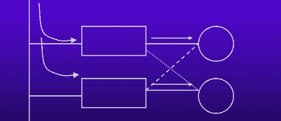

## 7.5.2 文件访问保护
- 口令
- 创建文件时提供一个口令，存于FCB中，要对文件访问时，系统核对口令。
- 数据加密
- 将数据写入文件时，对写入数据加密，读出时进行解密，访问者必须提供密钥（特例：unix中passwd中的口令加密后写入，无需解密读出）。

## 访问控制
- 检查用户对文件的访问权限与本次访问是否一致。

## 访问控制矩阵
- 一维列出全部用户，二维列出所有文件，Ci j值是i用户对j文件访问权限

## 简化访问表
- 在文件中针对文件主，同组用户和其它用户给出访问权限


## 7.6 文件系统基本模型
- 负责文件的建立，删除，读/写，修改等以及对文件目录结构和存储介质实施管理。
- 一般地，OS的文件系统只提供读/写文件信息的支持而不解释其信息内涵，内涵由各读/写文件的应用程序去解释。

## 文件系统的优点
- 方便灵活
- 用户不用管文件在物理存储器上的存放。
- 安全可靠
- 可进行访问限制，可进行文件数据备份与恢复。
- 方便共享使用，可按名访问


## 文件系统的基本模型

用户层

用户接口及初始化

文件目录系统

存取控制

逻辑文件系统

物理文件系统

外存空间分配

设备管理

## 用户调用接口及初始化模块
- 对用户进程发出的文件类系统调用进行处理，检查参数合法性
- 补充省缺参数
- 把系统调用转化为对相应子程序的调用
- 负责进程用户空间与OS内核的数据传输交换

## 文件目录系统
- 管理与组织文件目录结构

如建立、删除、查找文件目录等，管理“活跃文件目录表”，管理“文件读写状态信息表”和“活动名单表”，打开，关闭及读写时要涉及上述数据结构。
- 上下级的转换

## 存取控制验证（涉及文件保护的程序属于此模块。）


## 逻辑文件系统与文件信息缓冲区

根据文件的逻辑结构，将用户欲读写的逻辑记录转换成文件逻辑块号及块内 offset。（在UNIX流式文件情形下，将文件开始字节数除以块长，取整得逻辑块号，取余得块内offset。）


文件缓冲。有些操作系统在内存设立文件数据信息缓冲区，以利提高文件访问的速度，减少与外存储器数据交换的次数。系统将文件的某些“相对块号”的数据存放于缓冲区中，系统将这些存有文件数据信息的缓冲区按照Hash队列形式链接起来。当要读写某个文件的某“相对块号”时，按照文件内部号和“相对块号”首先到Hash队列中查找数据是否已经在内存，如果已经在缓冲区中，立即访问之。


## 物理文件系统

功能：把逻辑记录所在的逻辑块号转换成物理块号，利用文件控制块内的索引表信息即可转换。并负责对下层模块函数的调用，如外存空间分配及 I/O 驱动程序。（有些操作系统在这里设立磁盘块缓冲。）

## 分配模块

负责分配和回收外存空间。


## ◆ 设备管理程序（驱动器）

具有分配设备，分配读写缓冲区，磁盘调度，启动外设，处理外设中断，释放读写缓冲区，释放设备等功能。

The end

| 用户类 | 访问权限 |
|---|---|
| Owner | R W E |
| 同组 | R E |
| 其它 | E |


## 第十八讲 线程概念，用户级线程实现

目的与要求：掌握线程概念、线程与进程区别及用户级线程的实现。

重点与难点：线程如何从原进程概念中剥离出来，线程控制块，线程状态。用户级线程实现方法及优缺点。

作业：2、7

## 第八章 并行与分布式操作系统

### 8.1 并行操作系统

线程的引入

传统进程既是除了处理机以外的资源分配单位（如内存占用单位）又是执行单位。随着共享内存多处理机的发展，为了支持进程内多道程序设计而引入线程。

### 8.1.1 对称多处理

对称多处理机指共享内存且多个处理机都可响应中断且可以运行用户和核心程序的多处理机系统。

### 对称多处理机系统结构

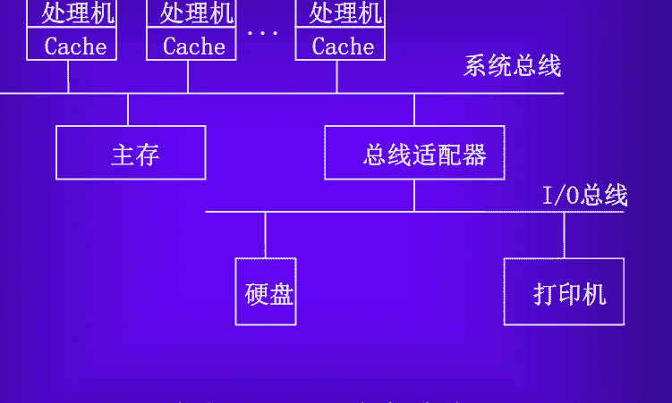

### 8.1.2 线程概念

将原进程的 PCB 内容分成两部分。

- 描述进程资源、空间的部分。
- 描述执行现场、状态及调度的部分。

将第二部分内容作为线程描述表的内容且进程内允许多个线程存在。


### 一、进程与线程区别

新的进程被定义为：资源分配单位。

线程定义为：CPU 分配单位（执行单位）。

新进程描述：

- 一个独立的进程空间，可装入进程映像。
- 一个独立的进程关联的执行文件。
- 进程所用系统其它资源。
- 一个或多个线程。进程在创建时一般同时创建好第一个线程，其它线程按需要由用户程序请求创建。

### 线程 TCB 描述

- 线程标识信息；
- 状态和调度信息；
- 现场信息（组织成栈帧）；
- 线程私有存储区；
- 指针指向 PCB。


### 传统进程与多线程进程比较

- a. 传统进程模型
- b. 多线程进程模型

### 二、多线程应用

多线程可以方便实现 CPU 之间的并行，CPU 与外设间的并行。多线程与多进程比，多线程天然地共享空间，而多进程要通过如 shmget 系统调用才可共享部分用户空间。

举例：有两个任务：任务1和任务2，把它们组织到单进程中，和多线程中运行的时间花费比较。

**a. 单线程进程单 CPU 执行**

```
任务1
等
I/O
任务1
任务2
等
I/O
任务2
```

**b. 多线程进程多 CPU 执行**

```
线程1
处理机1
任务1
等
I/O
任务1

线程2
处理机2
任务2
等
I/O
任务2
```

**c. 多线程进程单 CPU 执行**

```
线程1
线程2
任务1
等
I/O
等
CPU
任务1
CPU切换
任务2
等
I/O
等CPU
任务2
```

### 三、线程状态变化

进程产生时同时产生第一个线程，其它线程在以后由任一线程请求创建。

线程创建后运行过程中三个主要状态是：运行、就绪、阻塞。


原进程的运行、就绪、阻塞状态已变为针对线程，而原挂起状态反映进程映像在不在内存故还是进程的状态。

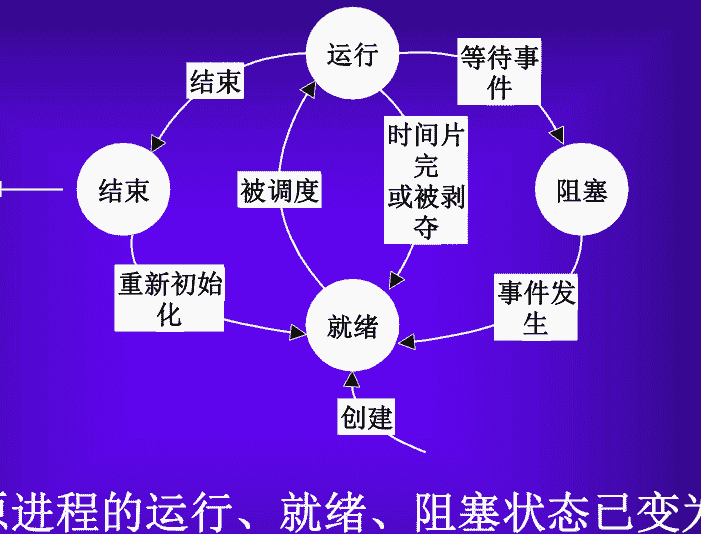

### 四、线程间通讯与同步

- 线程间通过共享空间通讯。
- 可以通过同步原语（系统调用/或利用硬同步指令的同步函数），实现互斥与同步。

### 五、多线程编程接口举例

UNIX 的 pthread 库所提供的有关线程函数。

1. 创建线程

   ```c
   int pthread_create(pthread_t *tid, const pthread_attr_t *attr, void *(*func)(void *), void *arg);
   ```

2. 等待某线程结束

   ```c
   int pthread_join(pthread_t tid, void **status);
   ```

   `tid` 是我们必须要等待的线程的 `tid`。

3. 获得正在执行线程的 ID

   ```c
   pthread_t pthread_self(void);
   ```

4. 将线程变为独立状态

   ```c
   int pthread_detach(pthread_t tid);
   ```

   线程或者是可汇合的（joinable）或者是独立的（detached）。当可汇合的线程终止时，其线程 ID 和退出状态将保留，直到另外一个线程调用 `pthread_join`。独立的线程终止时，所有的资源都释放，我们不能等待它终止。如果一个线程需要知道另一个线程什么时候终止，最好保留第二个线程的可汇合性。

5. 线程结束

   ```c
   void pthread_exit(void *status);
   ```

6. 加锁/解锁

   ```c
   int pthread_mutex_lock(pthread_mutex_t *mutex);
   int pthread_mutex_unlock(pthread_mutex_t *mutex);
   ```

   这两个函数用于对临界区的加锁和解锁，以保证对共享数据的互斥操作。`mutex` 是指向锁结构的地址。

### 8.1.3 线程实现

两种典型的多线程实现方法：多线程库方法和核心方法。

不改变操作系统内核，开发一个多线程函数库，这是一种非操作系统内核的实现方法，是一种过渡的方法。

由多线程库提供线程创建、结束、同步等函数，进程主程序作为主线程运行，以后可调用多线程库的创建线程函数创建用户级线程。

操作系统只看到进程，只做进程调度。由多线程库调度用户级线程分时地在进程中运行。


### 由传统进程支持实现用户级多线程示意图

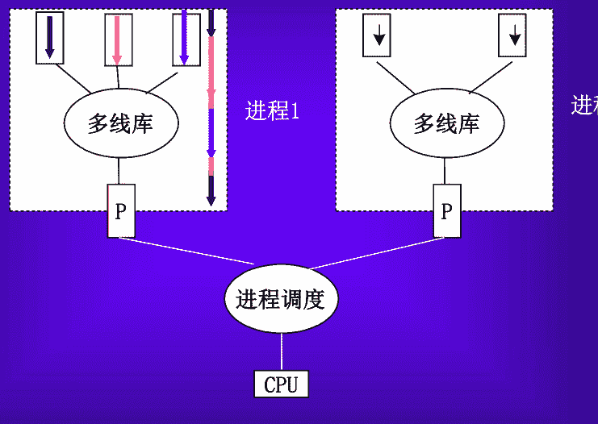

### 创建用户级线程函数处理过程

- 接收新线程执行函数及初始变量值；
- 在进程用户空间中分配 TCB 表、栈区和私有存储区；初始化上述表格；
- 将 TCB 表中的线程状态改为就绪；
- 运行线程调度程序；
- 返回到被调度线程的现场运行。

### 内核进程调度与多线程调度对比

- 用户程序调用任一多线程库函数，在函数处理结束时都去运行线程调度，调用返回时可能返回到另一线程。
- 用户程序在自陷或被中断进入内核，在内核处理结束时都去运行进程调度程序。

### 用户级线程与进程的关系

多线程分时地在进程内运行，多线程库线程调度是选取线程占用进程，内核进程调度是选取进程占用 CPU。


用户级线程的优势：

- 线程管理开销小；
- 无需修改操作系统核心；

缺点：

- 不能做到同一进程内线程在多 CPU 并行；
- 线程因 I/O 等原因阻塞于内核时，多线程调度器不知道。


## 第十九讲 核心级线程，线程调度

目的与要求：掌握核心级线程实现原理，及典型的线程调度方法。

重点与难点：线程核心实现方法和混合实现方法，组调度方法，多级调度原则。

作业：4、6


### 二、核心级线程

由操作系统内核提供线程创建、结束、同步等系统调用。当进程被创建时，内核同时为进程创建第一个核心级线程，运行用户主程序；以后可调用创建线程系统调用，创建新的线程。

内核调度以线程为单位。核心级线程既运行用户程序，在自陷/中断进管时又运行核心程序。


进程1
进程2
线程调度
CPU ... CPU

## 创建核心级线程系统调用处理过程：

- 接收新线程执行函数地址，初始变量值，用户栈地址，私有区地址；
- 在核心空间中分配TCB，核心栈；初始化上述表格及运行现场；
- 将线程状态改为就绪；
- 运行核心线程调度程序；
- 恢复被调度线程的现场运行。

## 特点：

- 可支持同一进程内线程在多CPU上的并行；
- 线程状态由内核调度程序完全掌握；
- 核心级线程比用户级线程开销大；
- 核心级线程表格占用系统空间。

## 在SPARC工作站上不同线程、进程操作开销比较

| 操作 | 用户级线程 | 核心级线程 | 进程 |
|---|---|---|---|
| 创建(ms) | 52 | 350 | 1700 |
| 使用信号量同步(ms) | 66 | 390 | 200 |


## 三. 混合实现

用户用多线程库函数编程，多线程库合理安排用户级线程使用内核级线程。

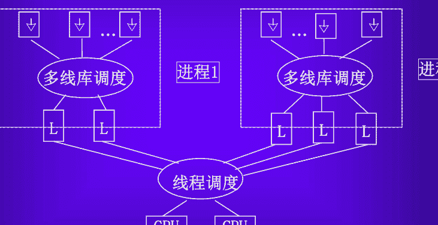

用户按用户程序的并发度安排使用用户级线程，多线程程序参考计算机CPU个数安排使用核心级线程。

## 四. 纯内核线程

纯粹运行内核程序的线程，不提供创建此类线程的系统调用界面，由系统初始化时创建，用来处理核心的一些异步事务。如定时进行页面交换，定时刷新文件缓冲区，异步I/O请求的处理等。

## 8.1.4 线程调度

线程调度原则：

- 让CPU充分被利用；
- 同进程的线程尽量一起运行（提高系统吞吐率）

## 一. 负载共享

原则：让任意进程中的任意线程可在任意处理机上运行。

实现：系统有一全局就绪队列，每个处理机在运行调度程序时都可从全局队列中选择合适线程来运行。

## 优点：

- 系统负载均匀分布到处理机上。
- 实现容易。

## 缺点：

不能实现相关线程同时运行；线程切换可能频繁。


## 二、负载绑定

如果将线程指定到处理机上运行而又允许处理机在执行到因I/O或同步等操作时而进行调度切换到其它线程，这种情况就是处理机与线程的绑定。


## 三. 组调度

原则：让同一进程中的线程在多CPU上同时运行。

实现：

- 独占式组调度：将多个CPU同时分配给同一组线程，直到所有线程运行结束。
- 引导型组调度：当CPU调度了进程中的一个线程时，通过机间中断通知其它CPU调度同一进程中的其它线程。
- 浮动型组调度：当某个CPU调度了进程中的一个线程时，同时也帮助把该进程的一些线程调度到其它CPU上，通过机间中断通知其它CPU去做线程切换。


特点：同一作业的多线程并发性好；减少了因同一作业线程间同步较多而相互等待时间，减少了线程切换次数。

## 四. 独占处理机调度(独占式组调度)：

原则：让同一进程中的线程在多CPU上同时独占运行。

实现：把进程所需要的CPU一次性分给进程。

## 特点：

- CPU利用率不高；
- 线程运行过程中没有线程切换；
- 避免了线程间同步时间因调度问题延长。

## 特点：

- 动态创建线程可以减少多线程库和内核的内存资源使用量。
- 多线程调度内核调度没有有机连接。如用户级线程在某一内核线程上阻塞于内核中时，多线程库调度程序并不能感知。
- 当内核级线程上有关键用户级线程运行时，内核调度程序也不能感知。

## 第二十一讲 安全

- 目的与要求：了解安全威胁的表现形式；入侵者的目的与方法；入侵防止与检测；病毒的定义与类型；反病毒方法；对称加密与非对称加密。
- 重点与难点：入侵检测，非对称密钥。
- 作业：3、5、6、8、9

## 第九章 安全

## 9.1 安全威胁

安全的计算机系统应满足以下性质：

- 保密性 -- 控制读或者可视的特征
- 完整性 -- 控制可写的特征
- 可用性 -- 资源的使用必须经过授权
- 真实性 -- 用户身份或数据来源的真实性

## 安全威胁——访问中断

表现为对可用性的破坏。系统中的某个资源(存储或网络)变得不可用，也就导致了对这一资源的访问无法进行。


## 安全威胁——篡改

表现为对保密性和完整性的破坏。未经授权者非法获取并篡改程序或数据资源。

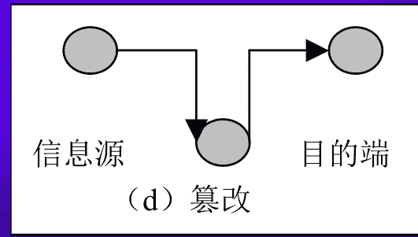

## 安全威胁——伪装

表现为对真实性的攻击。 未经授权者以伪造的合法身份访问各种资源或发送数据信息。

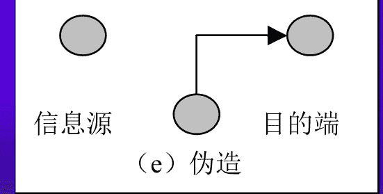

## 引起系统安全问题的原因

- 入侵
- 病毒
- 人为误操作
- 天灾及其它可能的设备及机器故障


## 9.2 入侵

♦ 目的
- 获取对系统的访问权或提高其访问系统的特权范围
♦ 方法
- 通过获取其他用户的口令，从而能以其他用户的身份登陆系统成为合法用户并可以行使该合法用户所具有的所有特权。
- 利用系统漏洞

## 口令文件

负责将每个经授权的用户与一个口令关联起来。

保护方法
- 对口令作加密存储
- 对口令文件作访问控制


## 攻击口令系统的方法


- 尝试通用帐号所使用的默认口令
- 遍历所有的短口令
- 尝试系统中在线字典的单词或一些可能的口令列表。
- 收集相关用户的私人信息。
- 使用特洛伊木马旁路对口令文件的访问控制；
- 在远程用户和主机系统之间通过窃听通信线路以获得用户口令。

## 入侵防止

- 杜绝对系统的入侵。也就是说能够防御来自各方的、所有可能的攻击
- 基本的方法就是口令系统
  - 口令系统的脆弱性
  - 增加口令的复杂性
    - 增加口令长度
    - 避免使用与个人信息相关的口令
    - 在口令中包含大小写字母、数字、符号等不同类型的字符
- 入侵防止的目标显然是难以达到的

## 入侵检测

- 如何发现攻击企图或攻击行为
- 部署入侵检测的作用
  - 避免受攻击或尽可能的减少被破坏的程度
  - 有效的入侵检测系统具有威慑作用，因而也可以减少入侵的行为
  - 利于收集入侵者的技术信息和系统的安全漏洞，有助于用来加强对入侵防止工具的研究

## 入侵检测

◆ 基于这一假设：入侵者的行为与合法用户的行为可以量化的方式来区分。

◆ 事实上，这两者很难被明显的、的确切的区别，两者之间必然的存在重叠。


概率密度函数

入侵者行为曲线

授权用户行为曲线

重叠部分

可测量的行为参数

## 入侵检测的方法 (1)


统计异常检测：收集在一段时间内与合法用户的行为有关的数据，然后以此为基准，对观察到的当前系统行为进行统计试验，来判断该行为是否是合法用户的行为。

- 阀值检测
- 基于直方图的检测


## 入侵检测的方法（2）

- **基于规则的检测：** 定义出一组规则，规则描述了什么样的行为是入侵行为。检测时按照规则对观察到的用户行为作精确或模糊的匹配，如果发现匹配，就认为有入侵者出现。
- 异常检测
- 智能识别

## 入侵检测的输入

如何获取当前使用者的行为记录，以作为入侵检测系统的输入

- 利用系统已有的本地核查记录

优点：不需要另外开发收集软件

缺点：本地核查记录可能未包含所需要的信息，或者是以不方便处理的方式表现出来的

- 开发入侵检测专用的核查记录收集工具

优点：便于检测；

缺点：两套系统造成额外开销

## 一个检测专用的核查记录例子

- 主体：行为的发起者
- 行为：一个主体对另一个主体或在系统上执行的操作
- 对象：行为的受体
- 例外条件：返回时产生什么例外
- 资源使用：
- 时间戳

## 9.3 病毒

- 病毒实际上也是一个程序，它能够通过修改其他程序而感染它们，被感染的程序随即包含了病毒程序的一个副本，又可以再感染其他的程序
- 病毒的生命周期
  - 潜伏阶段
  - 繁殖阶段
  - 发作阶段
  - 结果阶段

## 病毒的类型

- 寄生病毒
- 常驻内存病毒
- 引导区病毒
- 隐型病毒
- 多形态的病毒

## 宏病毒（1）

◆ 感染范围广泛且品种繁多。到1999年底，宏病毒占据了所有计算机病毒总数的三分之二

◆ 特点：
- 宏病毒与平台无关，只与文件类型有关。
- 宏病毒感染文档而不是可执行的代码
- 宏病毒易于传播，用户之间交流最多的也就是各种文档

## 宏病毒（2）

- 是一种自动执行的宏，无须用户显示的输入，当它执行时可以將自己复制到其他文档中，可以删除文件，还可以执行其他更为有害的活动。
- 宏本质上是一个嵌在字处理文档中或其他类型文档中的可执行程序。典型的情况是用户使用宏来自动进行可重复性的任务。

## 宏病毒（3）

如Microsoft Word定义了三种类型的自动执行宏
- 自动执行（Auto execute）
- 自动宏（Auto macro）
- 命令宏（Command macro）

宏病毒传播：
一个自动宏或命令宏被连接到一个Word文档，当该文档被打开时，宏就执行并将自己复制到全局宏文件中。那么在进行下一个Word操作时，已受到感染的全局宏被激活，它在执行时可以导致各种破坏并不断复制自己


## 电子邮件病毒

传播速度极快

类型

利用嵌入在附件中的Word宏，如Melissa。如果接受者打开了邮件的附件，这个宏就被激活，进行相应的破坏工作，并自动将自己发送给用户邮件列表中的每一个人。

利用邮件系统支持的脚本语言。只要打开一个包含病毒的电子邮件即被激活，不需要打开附件。

## 反病毒方法


- 病毒防止

采用各种防范手段不让病毒侵入到系统中，但这一目标一般来说不太可能达到。

- 病毒检测与清除

- 检测

- 识别

- 删除

## 反病毒软件的发展

- 简单扫描器
- 启发式扫描器
- 行为陷阱
- 全方位保护

“道高一尺、魔高一丈”
病毒制造者和反病毒程序设计者之间的“战争”还将持续进行下去。


## 9.4 数据安全

- **传输安全**
  - 主要通过加密手段对需要在不同主机上传递的数据进行加密处理，以防止通信线路上的窃听、泄漏、篡改和破坏

- **存储安全**
  - 一方面可利用数据库、文件系统等数据管理系统的多级保护机制，另一方面也可对数据进行加密后再行存储


## 加密技术

数据安全的底层基础技术

方法

- 对称加密：单密钥加密。至今它仍然是使用最为广泛的加密方法。
- 非对称加密：公钥加密。1976年由Diffie和Hellman首次公开提出。

## 对称加密（1）

共享密钥

共享密钥

明文输入

加密算法

密文传输

解密算法

明文输出

## 对称加密（2）

- ♦ 明文：即原始的信息，加密算法的输入
- ♦ 密钥：也是加解密算法的一个输入。是被收发双方所共享的加解密密钥。
- ♦ 密文：对明文加密后获得的数据。对于一个固定的加密算法，密文取决于明文的内容和密钥两个方面。
- ♦ 加密算法：对明文做各种替换和变换
- ♦ 解密算法：加密算法的逆算法


## 对称加密（3）

对安全的加密算法的要求：
- 一个强壮的加密算法。至少要求，即使有人知道了该算法，并且已经得到一个或多个密文，也无法对密文解密或计算出密钥；
- 信息的发送者和接收者必须以安全的方式获得并保存共享密钥。

数据加密标准（Data Encryption Standard, DES）中定义了最常用的对称加密方法
- DEA：56位，可被穷举密钥搜索法破解
- TDEA：168位，从实际效率上讲不可破解

## 非对称加密（1）

张三的公钥

张三的私钥

加密算法

密文传输

解密算法

明文输入

明文输出

李四

张三


## 非对称加密（2）

◆ 公钥与私钥
- 在公钥加密体系中，需要一对密钥，一个被称为公钥，一个被成为私钥。
- 公钥是对其他用户公开的，而私钥只有用户自己知道。这两个密钥一个用于加密，一个用于解密。根据应用背景的不同，加密算法既可能是使用公钥，也可能使用私钥；解密算法也一样。

◆ RSA算法：涉及到模数算术，算法的强度基于对大数字进行因式分解的难度。

## 非对称加密（3）

例一：李四给张三发送需保密的信息。
利用张三公开的公钥对信息进行加密，产生密文发送给张三。张三收到密文后，用自己的私钥进行解密得到明文。由于这一私钥只有张三自己知道，所以其他人无法读到这个信息。

例二：张三想给李四发送信息，并希望李四能够确认此消息是来自张三的。那么张三用自己的私钥对消息进行加密，形成密文并传送，李四收到消息后发现只有用张三的公钥进行解密才能得到正确的明文。便能确定此消息的确是来自于张三的。

## 教材及参考文献

《Understanding the Linux Kernel second edition》
Daniel P. Bovet&Marco Cesati,O’REILLY,2002

《深入理解Linux内核》第二版，陈莉君等译，中国电力出版社，2004

《Linux内核代码情景分析》上下册，胡希明 毛德操，浙江大学出版社，2001

《边学边干—Linux内核指导》李善平等，浙江大学出版社，2002

- · 源码阅读网站 http://lxr.Linux.no/source
- · 源码网站： http://www.kernel.org/pub/linux/kernel

## 系统概要

命令解释器
编辑器
X服务器
窗口管理器
窗口应用
数据库管理器
数据库应用

C库/数学库/图形库/窗口库等

系统调用库

Linux内核

硬件层

Linux内核在核心态下运行，内核程序包含/boot/vmlinux及/lib/modules/下的各种可加载模块。

## 内核概貌

- 内核程序嵌在一个用户进程的上下文中运行（因系统调用，中断入核）也有部分程序是以几个独立的纯内核线程运行的。
- 进程运行在用户态时各进程空间分离（如果要共享需要shmget等系统调用支持），各进程运行核心程序时共享内核空间。

用户级程序

一般程序

系统调用接口

内核

虚拟文件系统管理

内存管理器

进程管理器

抽象网络服务（套接字）

文件系统驱动程序

TCP/IP 协议驱动程序

IDE 硬盘驱动程序

软盘驱动程序

以太网卡驱动程序

内核

IDE 硬盘

软盘

以太网卡

硬件


# 实验

- 增加系统调用实现内核参数读写。
- 利用建立proc文件系统的文件实现内核参数读写。
- 利用动态加载内核模块将特定功能函数插入open及close系统调用处理过程，以记录用户对资源的使用信息。
- 设计事件同步系统调用，当一个事件发生时，等事件的所有进程被就绪。
- 建立一个简单只有一级目录的内存文件系统。
- 设计一个内存设备驱动程序。
- 设计USB驱动程序

# 第十章 Linux操作系统

本章内容：进程管理；存储管理；文件系统；设备管理；中断、异常及系统调用；进程通讯。

## 10.1 进程管理

内容

- 进程描述符
- 进程的调度时机及调度算法
- 进程的创建与消亡

### 10.1.1 进程与进程描述符

#### 1 进程概念

- LINUX进程与传统UNIX进程的概念没有多大区别
- LINUX通过clone（）系统调用支持轻权进程（相当于内核级线程）
- LINUX还支持内核线程的概念，内核线程永远在核心态运行，没有用户空间

#### 2 进程描述符(进程控制块)

由一个task_struct结构表示。

task_struct结构是一个复杂的结构，占一千多字节，其各个成员用来准确描述进程在各方面的信息.主要有以下几个部分：

state

flags

need_resched

counter

nice

next_task

prev_task

run_list

p_optr

p_pptr

tty

thread

fs

files

mm

sigmask_lock

sig

tty_struct

tty associated with the process

fs_struct

Current directory

files_struct

Pointers to file descriptors

mm_struct

Pointers to memory areas descriptors

signal_struct

Signals received

# （1） 进程标识

包括进程的标识号（pid）、进程的用户标识、进程的组标识等。每个进程的标识号是唯一的。

# （2） 调度相关信息

这部分内容与进程调度有关，一部分信息见后面的第5节。进程描述符中还需要有结构保存当进程被剥夺处理机时寄存器的状态，该进程恢复运行时便可从正确状态继续运行。

# （3） 进程虚拟空间信息

LINUX的进程都在自己的私有地址空间中运行，task_struct的成员mm指向一个mm_struct结构，该结构描述进程空间。

# （4） 信号处理信息

LINUX支持传统的UNIX信号语义。该部分记录了信号的处理函数及信号掩码等信息。

# （5）文件相关信息

包含进程与文件系统交互的信息。主要分为两部分，一部分描述进程进行文件访问时用到的当前目录、根目录信息。另一部分描述被进程正在使用的文件信息，该部分主要有一个file结构数组，数组中的有效项指向某个文件对象。

# （6）记帐信息及统计信息

资源是有限的，每个进程对每种资源的使用都有一个限值。另外，还有统计信息来记录系统需要的信息，如页面异常次数、CPU使用时间等。

## 10.1.2 核心态与核心栈

- LINUX的运行分为两种模式——核心态和用户态。内核总在核心态下运行，而普通进程通常在用户模式下运行，只有通过系统调用/中断才能切换到核心态运行。

- 进程拥有两个栈，用户模式栈与核心模式栈，分别在相应模式下使用。进程描述符和进程核心栈的空间分配在一起，内核为它们分配两个连续的物理页面。

```
union task_union {
    struct task_struct task;
    unsigned long stack[2048];
};
```

因为进程描述符已经占用了1KB多的空间，所以核心栈的有效空间是6KB多一点，合理的设计使得这个容量已经足够了

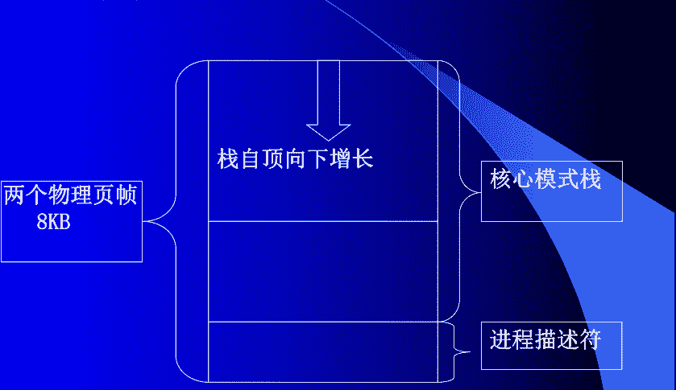

两个物理页帧
8KB

栈自顶向下增长

核心模式栈

进程描述符

图10－1 核心栈与进程描述符

## 10.1.3 进程状态及状态转换图

LINUX的进程状态有五种，它们分别是：

- TASK_RUNNING：表示进程具备运行的资格，要么正在运行，要么就是等待被调度执行。进程描述符有一个run_list成员，所有处于TASK_RUNNING状态的进程都通过该成员链在一起，称之为可运行队列。

- TASK_INTERRUPTIBLE和TASK_UNINTERRUPTIBLE：这两种状态均表示进程处于睡眠状态。TASK_INTERRUPTIBLE除了资源满足时可以被唤醒外，还可以被信号唤醒，而TASK_UNINTERRUPTIBLE就不行。

- TASK_STOPPED：进程处于暂停状态，主要用于调试目的。如正在运行的进程收到SIGSTOP信号将进入TASK_STOPPED状态。
- TASK_ZOMBIE：表示进程已经结束运行并释放了大部分占用的资源，但task_struct结构还未被释放。

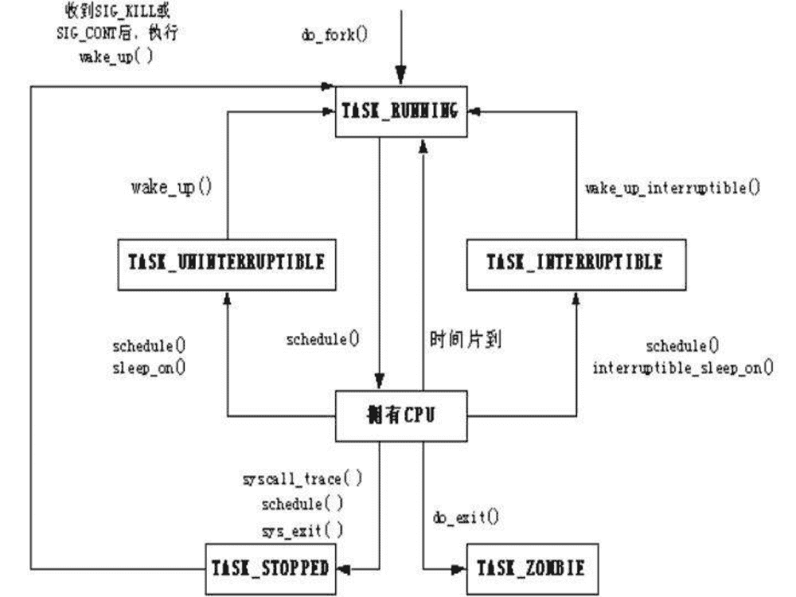

## 10.1.4 进程的切换时机

1 当前进程放弃CPU的情况可以分为两种：

### 1.1 进程主动地放弃CPU

大体可以分为两类

- 隐式地主动放弃CPU。往往是因为需要的资源目前不能获取，如执行read()、select()等系统调用的过程中。这种情况下的处理过程如下：

  1. 将进程加入合适的等待队列。
  2. 把当前进程的状态改为TASK_INTERRUPTIBLE或TASK_UNINTERRUPTIBLE。
  3. 调用schedule()函数，该函数的执行结果往往是当前进程放弃CPU。

(4) 检查资源是否可用，如果不可用，则跳转到第(2)步

(5) 资源已可用，将该进程从等待队列中移去。

- 进程显式地主动放弃CPU，如系统调用 sched_yield()、sched_setscheduler()、pause()、及 nanosleep() 均会导致当前进程让出CPU。

### 1.2 进程被动放弃CPU

两种情形均会导致当前进程描述符的 need_resched 被置1

- 当前进程的时间片已经用完

- 刚被唤醒进程的优先级高于当前进程。

## 2 进程的调度时机

分成两种情形。

- 直接调用schedule（）调度函数

  例如进程主动放弃CPU的第一类情形

- 间接调用schedule（）

  例如进程被动放弃CPU的情形。当进程描述符的need_resched被置1时，并不立即直接调用schedule（）调度函数。而是在随后的某个时刻，当进程从内核态返回用户态之前检查need_resched是否为1，如果为1，则调用schedule（）调度函数。

## 10.1.5 进程的调度算法

核心函数是schedule()，该函数的任务是选出一个可运行的进程。

1 进程描述符有如下成员域与调度有关：
（1）policy 标识进程的调度策略
SCHED_OTHER 普通进程
SCHED_FIFO 实时进程，采用先进先出
出的调度算法
SCHED_RR 实时进程，采用轮转法

(2) rt_priority 实时进程的优先级, 普通进程不使用这个成员
(3) nice 普通进程的优先级
(4) counter 进程目前的CPU时间配额

2 对于普通进程来讲CPU时间的分配是典型的时分策略

在某个时刻，运行队列中的每个进程都有一个counter值，当所有运行队列中的counter值都变为0以后，表明一轮已经结束，每个进程的counter根据其nice重新赋值，开始新的一轮执行过程。拥有CPU的进程每次时钟中断counter值减一。

3 schedule（）函数执行过程：

1. 检查当前进程是否有软中断信号服务请求，如果有，则先处理这些请求
2. 若当前进程调度策略是SCHED_RR 且 counter为0，则将该进程移到可执行进程队列的尾部
3. 检查当前进程的状态，如为 TASK_INTERRUPTIBLE 且该进程有信号则将进程状态置为 TASK_RUNNING
4. 当前进程的状态不是TASK_RUNNING则将其从可执行进程队列中移出。然后将当前进程描述符的need_resched恢复成0。

(5) 现在进入了函数的核心部分。可运行进程队列的每个进程都将被计算出一个权值，主要是利用 goodness() 函数，讨论见后。最终最大的权值保存在变量 c 中，与之对应的进程描述符保存在变量 next 中。

(6) 检查 c 是否为 0。若为 0 则表明所有可执行进程的时间配额都已用完，则对所有进程的 counter 重新“充电”，然后重新执行第（5）步。

(7) 如果 next 进程就是当前进程，则结束 schedule() 的运行。否则进行进程切换，CPU 改由 next 进程占据。


## 4 goodness（）函数

goodness（）函数计算进程的当前权值。该函数的第一个参数是待估进程的描述符。

+   如果该进程是实时进程，它的权值为1000+rt_priority，1000是普通进程权值无法到达的数字，因而实时进程总可以优先得到执行。
+   对于普通进程，它的权值为counter+20-nice，如果其又是内核线程，由于无需切换用户空间，则将权值加一作为奖励。

## 10.1.6 进程的创建

LINUX最早产生的进程是启动过程中创建出idle进程（不是通过fork（），而是直接填表制作出来），pid号为0，该进程通过调用内核函数将创建一个内核线程，该线程进行一系列初始化动作后最终会执行/sbin/init文件，执行该文件的结果是运行模式从核心态切换到了用户态，该线程演变成了用户进程init，pid号为1。init进程是一个非常重要的进程，一切用户态进程都是它的后代进程。

## 进程的产生及结构

0进程(idle)　初启创建，系统初始化后作为idle进程

1进程(init)　由0进程创建，创建各系统进程，创建getty子进程监视终端执行login，注册登记。

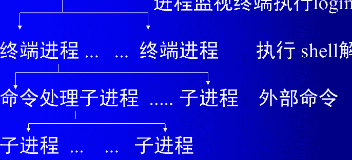

## 2 fork/exec 新进程的产生模式

通常fork () 创建一个新进程，然后新进程通过调用exec系列函数执行真正的执行文件。

函数fork () 调用成功的话，当前进程就拥有了一个子进程。该函数对不同的进程返回两个不同的值，其中子进程返回0，父进程返回的是子进程的pid值。下面是一段示例代码：

## 3 sys_clone() sys_vfork() sys_fork()

•三个系统调用都可以实现创建子进程，这三个系统调用最终都会调用do_fork（）函数完成主要工作。

该函数的第一个参数clone_flags可由多个标志位组成，常见的标志位有：

+   CLONE_VM 子进程父进程共享进程空间
+   CLONE_FS 子进程父进程共享文件系统信息
+   CLONE_FILES 子进程父进程共享打开的文件
+   CLONE_VFORK 如果父进程想使子进程释放空间时唤醒它，则置该位

+   - sys_clone（）表示创建一个轻权进程。对应的clone_flags可能是多个标志位的组合。
+   - sys_fork（）对应的clone_flags值是SIGCHILD。SIGCHILD的作用是子进程终结或暂停时给父进程发信号。
+   - sys_vfork（）对应的clone_flags值是CLONE_VFORK | CLONE_VM | SIGCHILD。vfork（）用于创建子进程后马上运行新的执行文件情形，子进程共享父进程的空间包括页表，父进程被挂起直到子进程执行exec系列函数或子进程退出时。较之fork（）处理，vfork（）无疑开销更小。

## 4  do_fork() 的执行过程

+   （1）调用 alloc_task_struct（） 为子进程描述符分配空间。
+   （2）把父进程描述符的值全部赋给子进程描述符。
+   （3）检查是否超过了资源限制，如果是，则结束并返回出错信息。更改一些统计量的信息。
+   （4）修改子进程描述符某些成员的值使其正确反映子进程的状况，如进程状态被置成 TASK_UNINTERRUPTIBLE。

（5）调用get_pid()函数为子进程得到一个pid号。

（6）依次调用copy_files()、copy_fs()、copy_sighand()、copy_mm() 分别复制父进程文件处理、信号处理及进程空间的信息。以上函数的具体行为取决于clone_flags参数，例如copy_mm()时如果clone_flags包含有CLONE_VM 标志，则子进程共享父进程的空间，不会进行复制。

（7）调用copy_thread()初始化子进程的核心模式栈,核心栈保存了进程返回用户空间的上下文。此处与平台相关，以i386为例，其中很重要的一点是存储寄存器eax值的位置被置0,这个值就是执行系统调用后子进程的返回值。

（8）将父进程的当前的时间配额counter分一半给子进程。

（9）利用宏SET_LINKS将子进程插入所有进程都在其中的双向链表。调用hash_pid（）将子进程加入相应的hash队列。

（10）调用wake_up_process（）将该子进程插入可运行队列。至此，子进程创建完毕并在可运行队列中等待被调度运行。

（11）如果clone_flags包含有CLONE_VFORK标志，则将父进程挂起直到子进程释放进程空间。进程描述符中有一个信号量vfork_sem可以起到将进程挂起的作用。

（12）返回子进程的pid值，该值就是系统调用后父进程的返回值。

## 10.1.7 进程的销毁

### 1 时机

+   - 进程运行结束后被销毁最普遍的情况是进程正常运行结束后显式或隐式调用 exit（）函数。
+   - 当进程收到某种信号，该信号的处理函数结束进程运行并将其被销毁

例1： kill 在不指定信号的情况下将信号SIGTERM发给进程导致进程结束

例2： 用户程序访问了非法空间导致内核向进程发送SIGSEGV信号导致进程结束运行

### 3 TASK_ZOMBIE进程

+   - 在do_exit()执行后进程处于TASK_ZOMBIE状态只留下了一个task_struct结构，之所以不立即释放该结构是因为父进程往往要通过wait()之类的系统调用来检查子进程是否结束，而调用之前显然不能让子进程消失得无影无踪
+   - 父进程通过调用wait()回收TASK_ZOMBIE状态子进程的task_struct结构及pid号。
+   - 如果父进程可能先于子进程结束，这时init进程就变成了子进程的父进程从而保证task_struct结构总能得到回收。

## 10.2 存储管理

内容：

+   - 物理内存的管理
+   - 虚拟存储空间的管理


## 10.2.1 物理内存的管理

### 内存用途

+   - 存储内核映像
+   - 其它可动态加载内核模块内存需求
+   - 进程用户页面的需求
+   - 缓冲需求

### 功能要求

+   - 快速响应请求
+   - 尽可能地利用内存同时减少内存碎片

### 解决方案

+   - 基于区域的伙伴系统及slab分配器

## 进程虚地址空间

用户虚空间

对应固定物理内存

8 M

0

3G

4G−1

## 物理内存

硬件使用 mem_map[]（数组大小为页帧数）

动态分配用（可以 DMA）

16M

邻态内核使用

动态分配用

>896M 空间

0

896M


## 一、 页帧与区域

页帧 物理内存以页帧为基本单位，页帧的大小固定为4K。

区域：物理内存分成如下三个区域：

DMA ZONE 低于16MB的内存，是DMA方式能够访问的物理内存。一般用于I/O缓冲区

NORMAL ZONE 介于16MB与896MB之间，直接被内核虚地址映射。部分用于内核程序及常数，部分用于动态表格或用于用户空间页

HIGHMEM ZONE 高端内存，超过896MB以上的部分。用于存放动态映射页面。

在内存分配时要根据区域访问优先级来决定分配次序。比如为DMA方式分配内存，DMA ZONE是唯一符合要求的区域。而通常的内存分配，则可先在NORMAL ZONE 进行，如果不能满足要求，则在DMA ZONE尝试。

## 二、 伙伴算法

伙伴算法 Linux对每个区域采用了伙伴算法来对管理空闲内存页帧减少外部碎片。

当要为进程用户空间页面、系统I/O缓冲区、系统存储对象（如表格；动态模块等）分配页帧时调用伙伴算法。


## 以16个页面为例，空闲页面构成五个链表

(1) 初始态

+   - 连续16个页面 [1-16]
+   - 连续8个页面
+   - 连续4个页面
+   - 连续2个页面
+   - 连续1个页面

(2) 分配两个页面, 剖分[1-16]，[1-2]被使用，状态如下

+   - 连续16个页面
+   - 连续8个页面 [9-16]
+   - 连续4个页面 [5-8]
+   - 连续2个页面 [3-4]
+   - 连续1个页面

分配方法：尽可能从合适大小的链表寻找，如有，则摘除返回页面。否则寻找更大的连续空闲页面，剖成两个大小相等伙伴，将后者插入合适位置。再看前者是否满足要求，若不，继续剖分。


(3) 再申请四个页面， [1-2] [5-8] 被使用
连续16个页面
连续8个页面 [9-16]
连续4个页面
连续2个页面 [3-4]
连续1个页面
(4) 释放页面[1-2]，看能否合并伙伴
连续16个页面
连续8个页面 [9-16]
连续4个页面 [1-4]
连续2个页面
连续1个页面
释放过程：看能否与空闲伙伴合并，若可以，则合并成更大的连续页面并继续重复能否与空闲伙伴合并的过程。最后插入合适位置。


## 两组连续页面块被认为是一对“伙伴”必须满足如下条件：

- (1) 大小相同，比如说都有b个页面
- (2) 物理空间上连续
- (3) 位于后面那个块的最后页面号必须是 2×b的倍数


## 伙伴算法的优点

分配页面时尽量动用小的连续页面, 回收页面时则尽可能将空闲的伙伴合成大的连续页面

## 伙伴系统的操作

- • 申请空间的函数为 __alloc_pages()
- • 释放函数为 __free_pages_ok()
- • 当在申请内存发现页面短缺时还会唤醒 kswapd 内核线程运行, 该线程会腾出一些空间以满足要求

## 三、 slab分配器

存在问题 伙伴系统是以页帧为基本分配单位，对于小对象容易造成是内部碎片

解决办法 基于伙伴系统的slab分配器。

slab分配器的基本思想：为经常使用的小对象建立缓冲, 小对象的的申请与释放都通过slab 分配器来管理。slab 分配器再与伙伴系统打交道

好处 其一是充分利用了空间,减小了内部碎片。 其二是管理局 化,尽可能少地与伙伴系统打交道,从而提高了效率。

## slab分配器的构成

- - 为不同的常用对象生成不同的缓冲，每个缓冲存储相同类型的对象。
- - 某种对象的缓冲区由一连串的slab构成，每个slab又由一个或多个连续的物理页帧组成，包含了若干同种类型的对象。
- - slab对象用结构slab_t来描述，某种特定对象建立的slab队列都有个队头kmem_cache_t
- - 系统有一个slab队列头的slab队列，其对象是其它对象的队头，其队头也是一个kmem_cache_t结构，叫cache_cache。


除了上面讨论的特定对象的缓冲外，Linux 还提供了十三种通用的缓冲，其存储对象的单位大小分别为32字节，64字节，128字节，256字节，512字节，1KB，2KB，4KB，8KB，16KB，32KB，64KB和128KB。这些缓冲用来满足特定对象之外的普通内存需求。单位大小级数增长保证了内部碎片率不超过50%。

## slab分配器的相关操作：

## (1) kmem_cache_create()

该函数创建一种特定对象的kmem_cache_t结构，并加入cache_cache 所管理的队列。如下代码创建了inode_cache：

```
kmem_cache_create("inode_cache",
    sizeof(struct inode), 0,
    SLAB_HWCACHE_ALIGN, init_once, NULL);
```

kmem_cache_create()函数一开始分配一个kmem_cache_t结构，然后进行一系列运算，以确定最佳的slab 构成。包括：每个slab由几个页面组成，可包含几个对象；slab的控制结构应该在slab外面集中存放还是放在每个slab的尾部。

## (2) kmem_cache_alloc() 与 kmem_cache_free()

当需要分配一个拥有专用 slab 队列的对象时，应该通过 kmem_cache_alloc() 函数，相反的动作则是 kmem_cache_free() 函数。

分配的对象来自 slab 缓冲，释放的对象归还 slab 缓冲，通过某种标识表明对象是可用还是已被占用。


## (3) kmem_cache_grow() 与 kmem_cache_reap()

- - kmem_cache_create() 函数只是建立了所需的专用缓冲区队列的基础设施, 所形成的 slab 队列是个空队列。
- - 而具体 slab 的创建则要等需要分配缓冲区时, 却发现队列中并无空闲的缓冲区可供分配时, 再通过 kmem_cache_grow() 向伙伴系统申请空间。
- - kswapd 会定时调用 kmem_cache_reap() 来 “回收” 缓冲区队列的页帧。

## (4) kmalloc() 函数与 kfree() 函数

从通用的缓冲区队列中申请和释放空间。


## 10.2.2　进程空间的管理

- - 每个进程都有自己独立的虚拟地址空间。虚拟内存以页为基本单位，大小等同于物理页帧
- - 每个进程空间通过进程的页目录、页表实现与物理内存间的映射。
- - 进程通过按需分页得到物理内存
- - 进程空间主要由 `mm_struct` 结构描述。该结构包含了进程空间的两个组成部分：进程的页目录以及指向 `vm_area_struct` 结构的指针。

## 线性地址

31 22 21 12 11 0

| 页目录索引 | 页表索引 | 地址偏移 |
|----------|----------|----------|

页目录

页目录项

页表

页表项

4KB物理页面

物理地址

CR3寄存器


32'

10

12

## 一、 页表机制

以X86体系结构为例。i386系列既支持分段机制，也支持分页机制，Linux主要采用了分页机制，页面可以映射到任一物理页帧。i386下进程的线性地址为32位，分为以下三个部分：

页目录段 置于高10位。记录在页目录中的索引。

页表段 占据中间的10位。记录在页表中的索引。

偏移段 占据低12位。用來表示在4KB的页帧中的偏移。

## 进程空间线性地址转换成为物理地址的过程

每个进程都有一个页目录，当进程运行时，寄存器CR3指向该页目录的基址。

- 1. 从CR3取得页目录的基地址。页目录用一个物理页帧存储，用来保存页表的基址。
- 2. 以线性地址的页目录段为索引，在页目录中找到页表的基址。每一页表也是用一个物理页帧存储，用来保存物理页帧号。
- 3. 以线性地址的页表段为索引，在页表中找相应的物理页帧号。
- 4. 物理页帧号加上线性地址的偏移段即得到对应的物理地址。

物理页帧是4KB对齐的，页目录项和页表项都只需要20位保存物理地址的12-31位，还有12位可以用于控制或其它目的。几个重要的标志位是：

存在位： 表示项对应的物理页是否存在。

读/写位： 表示是只读还是可写,起保护作用。

访问位： 表明该页是否被访问过。

脏标志位:表明该页是否被写过。

采用两级分页的好处是节省了存储空间。

Linux采用的是三级页表模型，在页目录和页表之间还有页中间目录层。对于32位机器，页中间目录层实际不起作用。

80X86处理器内部有称作TLB的专门缓冲用来加速地址转换过程

## 二、进程空间的管理

## 1. vm_area_struct结构

• 对于32位机器，共有4G地址空间。其中前3G可以为进程直接访问，称为用户空间，而后1G空间为内核所用，称为内核空间。

• 目前绝大多数程序都不会使用全部的3G空间。组成进程空间的映象由多个区间，Linux用一系列的vm_area_struct结构描述不同的区间。


- - 进程页面必定属于某个vm_area_struct结构，但是属于vm_area_struct结构的页面不一定在页表中有数据页

task_struct  mm_struct  vm_area_struct

进程虚空间
0

3G

pgt_t

页表

页帧

页目录表

## 2. 进程空间的相关系统调用


- - exec调用会抛弃原来的地址空间并根据可执行文件内容生成相应的新的地址空间。

- - fork系统调用，通常情况下：

- (1) 子进程会拷贝一份父进程的地址空间，包括父进程的vm_area_struct结构以及页目录、页表均会被拷贝

- (2) 写时拷贝(COPY ON WRITE)

父进程页表项所标识的有效物理页帧并不会立即拷贝，而是为子进程和父进程共享，即父进程和子进程的同一页表项指向同一个物理页帧，并且页表项的相应标志位均标记位“只读”，写入该页帧时就会引发页面异常进一步处理。

好处是： (1) 节省了开销， (2) 懒惰策略，分散式复制的效果相比起一次性集中复制即时响应效果更好。


- 系统调用 brk() 用来改变堆的大小，增大进程空间。
- exit() 结束进程并销毁进程空间。
- mmap() 创建文件的内存映射，扩展进程空间，而 munmap() 行为与之相反。
- shmat() 创建一个共享内存区而 shmdt() 则释放共享内存区。

## 三、 页面异常的处理

导致页面异常的原因有：

- (1) 编程错误 可分为内核程序错误和用户程序错误。
- (2) 操作系统故意引发的异常 操作系统合理利用硬件机制在适当时间触发异常，使得该异常的处理程序被调用以达到预期目的。如缺页


页面异常的处理程序是do_page_fault()函数，该函数有两个参数

- 一个是指针，指向异常发生时寄存器值存放的地址。
- 另一个错误码，由三位二进制信息组成
  - 第0位 访问的物理页帧是否存在
  - 第1位 写错误还是读错误或执行错误
  - 第2位 程序运行在核心态还是用户态

## do_page_fault()函数的执行过程如下：

- (1) 首先得到导致异常发生的线性地址，对于X86该地址放在CR2寄存器中。
- (2) 检查异常是否发生在中断或内核线程中，如是，则进行出错处理。
- (3) 检查该线性地址属于进程的某个 vm_area_struct 区间。如果不属于任何一个区间，则需要进一步检查该地址是否属于栈的合理可扩展区间。一旦是用户态产生异常的线性地址正好位于栈区间的 vm_start 前面的合理位置，则调用 expand_stack() 函数扩展该区间，通常是扩充一个页面，但此时还未分配物理页帧。
  至此，线性地址必属于某个区间。

## (4) 根据错误码的值确定下一个步骤：

如果错误码的值表示为写错误，则检查该区间是否允许写，不允许则进行出错处理。如果允许就是属于前面提到的写时拷贝。如果错误码的值表示为页面不存在，这就是所谓的按需分页(demand paging)。

## 写时拷贝的处理过程

- 首先改写对应页表项的访问标志位表明其刚被访问过，这样在页面调度时该页面就不会被优先考虑。
- 如果该页帧目前只为一个进程单独使用，则只需把页表项置为可写。
- 如果该页帧为多个进程共享，则申请一个新的物理页面并标记为可写，复制原来物理页面的内容，更改当前进程相应的页表项，同时原来的物理页帧的共享计数减一。


## 按需分页的处理过程：

- 第一种情况页面从未被进程访问, 这种情况下页表项的值全为0。
  - (a) 如果所属区间的vm_ops->nopage不为空，表示该区间映射到一个文件并且vm_ops->nopage指向实现页面装入的函数，此时调用该函数装入该页面。
  - (b) 如果vm_ops或vm_ops->nopage为空，则该调用do_anonymous_page()申请一个页帧；
- 另一种情况是该页面被进程访问过，但是目前已被写到交换分区，页表项的存在标志位为0，但其它位被用来记录该页面在交换分区中的信息。调用do_swap_page()函数从交换分区调入该页面

## 10.3 文件系统

## 内容

- VFS的运作原理
- 物理文件系统 EXT2
- `open()`；`read()` 系统调用的实现


## 10.3.1 VFS

## 一、 VFS的作用

- Linux支持许多种文件系统，如EXT2, VFAT等
- VFS (Virtual File System) 是内核软件层。
- VFS提供了统一编程接口同时隐藏了不同文件系统的差别。
- 可扩展性、可维护性好

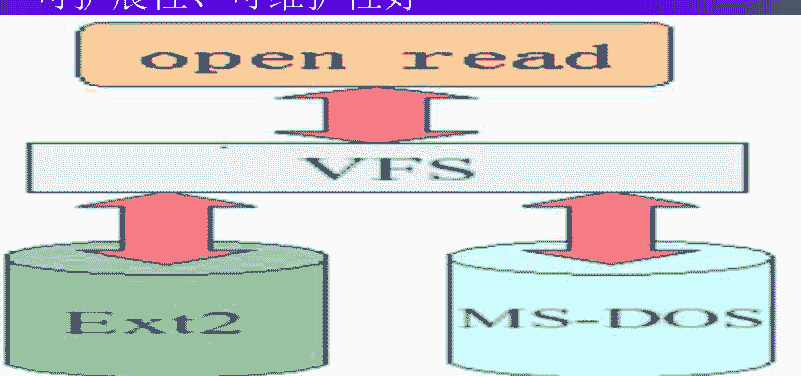

## 二、进程描述符中与文件系统相关的成员

进程描述符中有下面两个与文件系统相关的成员：

```
struct fs_struct *fs;
struct files_struct *files;
```

fs_struct结构描述进程进行文件访问时用到的当前目录、根目录等信息。

```
struct fs_struct {
    struct dentry * root, * pwd;
    ......
};
```


files_struct结构描述被进程打开使用的文件信息，fd成员指向一个struct file *数组，数组中的已使用项指向某个正被打开的文件对象，数组中的索引称之为文件号，用户程序就是使用文件号对打开的文件进行操作。

```
struct files_struct {
struct file ** fd;
struct file * fd_array[NR_OPEN_DEFAULT];
/* NR_OPEN_DEFAULT为32*/
......
};
```


## 内核中与进程使用文件有关数据结构：

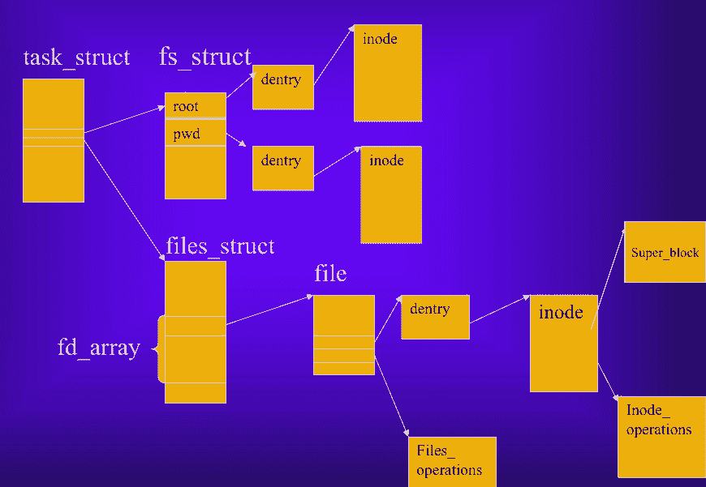

## 三、VFS的文件模型

VFS的关键是根据不同的文件系统抽象出了一个通用的文件模型。通用的文件模型由四种数据对象组成：

**文件对象：** 存储一个打开的文件和一个进程的关联信息。只要文件一直打开，这个对象就一直存在。文件对象用 `struct file` 结构描述：

```
struct file {
    struct list_head            f_list;
    struct dentry   *f_dentry; /*指向与文件对象关联的dentry对象*/
    struct vfsmount         *f_vfsmnt;
    struct file_operations  *f_op; /*文件对象的操作集合*/
    unsigned int            f_flags; /*使用open()时设定的标志*/
    mode_t                  f_mode;
    loff_t                  f_pos;  /*对文件读写操作的当前位置*/
    struct fown_struct      f_owner;
    ......
};
```


# inode对象：存储某个文件的信息。通常对应磁盘文件系统的文件控制块。

```
struct inode {
    struct list_head  i_hash;
    struct list_head  i_dentry;
    unsigned long     i_ino;                /*inode号*/
    kdev_t            i_dev;                /*所在设备的设备号*/
    umode_t           i_mode;               /*表示文件类型及权限*/
    uid_t             i_uid;                /*文件拥有者的用户ID*/
    gid_t             i_gid;                /*用户所在组的ID*/
    loff_t            i_size;               /*文件大小*/
    time_t            i_atime;              /*最近一次的访问时间 */
    time_t            i_mtime;              /*最近一次的修改时间 */
    time_t            i_ctime;              /*文件创建时间*/
    struct inode_operations *i_op;
    struct super_block  *i_sb;   /*所属的超级块*/
    struct address_space  *i_mapping;
    .....
};
```

# dentry对象: dentry对象主要是描述文件名及其相关联的inode信息。

```
struct dentry {
    struct inode * d_inode; /* 该dentry对象所属的inode */
    struct dentry * d_parent; /* 父目录 */
    struct list_head d_hash; /* hash值相同的dentry链表*/
    struct list_head d_subdirs;/* 子目录链表*/
    struct qstr d_name;          /* 文件名及附属信息*/
    struct dentry_operations *d_op;
    .....
};
```


# 超级块对象：存储已安装文件系统的信息，通常对应磁盘文件系统的文件系统控制块。

```
struct super_block {
    struct list_head s_list;/* 将所有的超级块链接起来 */
    kdev_t         s_dev;           /* 所在设备号*/
    unsigned long s_blocksize; /*该文件系统磁盘块的大小(字节数)*/
    unsigned char  s_blocksize_bits;
    struct file_system_type *s_type;/*文件系统类型*/
    struct super_operations*s_op;
    struct dentry *s_root;      /*根目录dentry对象*/
    struct list_head s_dirty;/* 修改过的 inodes队列 */
    .....
};
```


# 各对象之间的联系

inode对象与文件 一对一

dentry对象与inode对象 多对一（硬连接）

文件对象与dentry对象 多对一

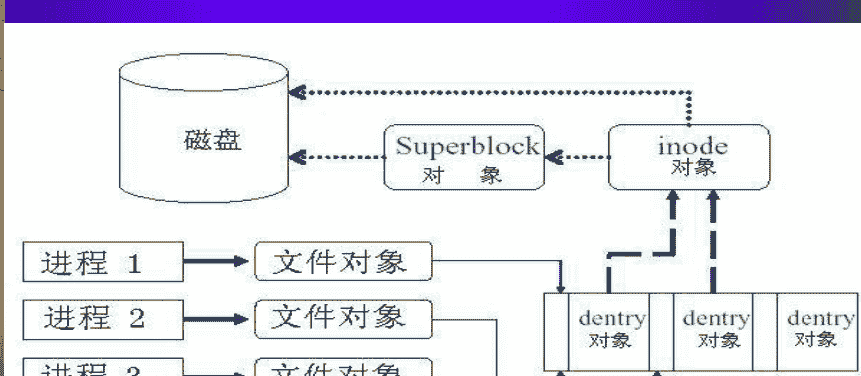

VFS各种对象之间的联系

# 四、文件系统的注册与安装

## 1. 文件系统驱动的注册

每一 种文件系统使用前必须先注册一个 file_system_type 对象。这可以看成是文件系统 driver 的加载。

```
struct file_system_type {
    const char *name;  /*文件类型名*/
    struct super_block * (*read_super)
        (struct super_block *, void *, int);
    struct file_system_type * next;
    ......
};
```

file_systems

## 2. 文件系统分区的安装

```
# mount -t ext2 /dev/hda3 /mnt
```

内核与之对应的系统调用是sys_mount()。该函数根据文件系统类型得到相应的 file_system_type 对象，再取得该分区的超级块对象。建立分区根目录与安装点目录的关系。

# 五、 各种对象的操作接口

## 1. 面向对象的接口

每个对象都有一套函数操作集合，属于不同文件系统的对象的操作也就不相同，VFS只负责提供接口（操作集合）。

以超级块对象为例。

超级块对象有一个struct super_operations * s_op成员

```
struct super_operations {
    void (*read_inode) (struct inode *);
    void (*write_inode) (struct inode *, int);
    void (*put_inode) (struct inode *);
    void (*delete_inode) (struct inode *);
    void (*put_super) (struct super_block *);
    void (*write_super) (struct super_block *);
    ......
};
```

当第一次mount一个ext2分区时会调用ext2_read_super(),该函数有一条语句 sb->s_op = &ext2_sops。将操作表地址置入超级块对象相应域。 ext2_sops变量的成员值如下：

```
static struct super_operations ext2_sops = {
    read_inode:    ext2_read_inode,
    write_inode:   ext2_write_inode,
    put_inode:     ext2_put_inode,
    delete_inode:  ext2_delete_inode,
    put_super:     ext2_put_super,
    write_super:   ext2_write_super,
    ......
};
```


而当第一次mount一个fat分区时会调用fat_read_super()，该函数有一条语句sb->s_op = &fat_sops。 fat_sops变量的成员值如下：

```
static struct super_operations fat_sops = {
    write_inode:        fat_write_inode,
    delete_inode:       fat_delete_inode,
    put_super:          fat_put_super,
    .....
};
```

super_operations就是一个抽象类，它只提供接口但并没有实现这些接口，而ext2_sops、fat_sops则是具体类，实现相应的接口。其它几个接口与此类似。

## 3. struct inode_operations

```
struct inode_operations {
    int (*create)(struct inode *, struct dentry *, int);
    struct dentry * (*lookup) (struct inode *,
                               struct dentry *);
    int (*link)(struct dentry *, struct inode *,
                struct dentry *);
    int (*unlink) (struct inode *, struct dentry *);
    int (*symlink)(struct inode *,
                   struct dentry *, const char *);
    ....
};
```

create: 第一个参数必须是目录型文件对应的 inode。create 在该目录下创建一个文件。

lookup: 第一个参数是目录型文件对应的 inode。lookup() 在该目录下查找一个文件。


## 4. struct file_operations

```
struct file_operations {
    loff_t (*llseek) (struct file *, loff_t, int);
    ssize_t (*read) (struct file *, char *, size_t, loff_t *);
    ssize_t (*write) (struct file *, const char *, size_t, loff_t *);
    int (*mmap) (struct file *, struct vm_area_struct *);
    int (*open) (struct inode *, struct file *);
    .....
};
```

这些操作与系统调用接口相对应


## 5. struct address_space_operations

```
struct address_space_operations {
    int (*writepage)(struct page *);
    int (*readpage)(struct file *, struct page *);
    ......
};
```


## 6. struct dentry_operations

```c
struct dentry_operations {
    int (*d_revalidate)(struct dentry *, int);
    int (*d_hash)    (struct dentry *, struct qstr *);
    int (*d_compare) (struct dentry *,
                      struct qstr *, struct qstr *);
    ……
};
```

**d_revalidate**：检查dentry cache中的dentry是否是最新的。

**d_hash**：计算文件名的hash值。第一个参数是父目录，第二个参数包含了预设的文件名。

**d_compare**：比较一个目录下的两个文件名是否相等。如文件名是否区分大小写。


# 10. 3. 2 EXT2文件系统

## 一、 EXT2在磁盘上的物理布局

EXT2分区的第一个磁盘块用于引导，其余的部分被分成组。所有的组大小相同并且顺序存放，所以由组的序号可以确定组在磁盘上的位置。


组的构成：
- (1) 文件系统的超级块
- (2) 所有组的描述符
- (3) 数据块的位图
- (4) inode位图
- (5) inode表
- (6) 数据块

## 图 10-6 EXT2 分区的物理布局

引导块

组 0

……

组 n

超级块

组描述符

数据块位图

inode位图

inode表

数据块

一个块

n个块

一个块

一个块

n个块

n个块

- 每个组都有一份文件系统的超级块和所有组的描述信息的拷贝
- 正常情况下内核只使用第0组的信息。当组0的拷贝遭到破坏时便可根据其它组的拷贝恢复
- 数据块位图的大小为一个块，位图的每一位顺序对应组中的一个块，0表示可用，1表示已用。
- inode表用来存放文件及目录的inode数据。
- inode位图用来表示对应的inode表的空间是否已被占用。

## 二、 主要的数据结构及基本操作

### 1. 超级块

```
struct ext2_super_block {
__u32 s_inodes_count; /* inode的总数 */
__u32 s_blocks_count; /* 块的总数 */
__u32 s_free_blocks_count; /* 空闲块的总数 */
__u32 s_free_inodes_count; /* 空闲inode的总数 */
__u32 s_first_data_block;     /* 第一个数据块 */
__u32 s_log_block_size;       /* 块的大小 */
__u32 s_blocks_per_group;     /* 每组的块数 */
__u32 s_inodes_per_group;     /* 每组的inode数 */
__u32 s_mtime;                /* 安装的时间 */
__u32 s_wtime;                /* 写的时间 */
__u16 s_mnt_count;            /* 安装的次数 */
......
};
```


### 2. 组描述符

每个组都有自己的描述符，内核用结构 ext2_group_desc描述。

```
struct ext2_group_desc
{
    __u32 bg_block_bitmap; /*本组数据块位图所在块号*/
    __u32 bg_inode_bitmap; /* 本组inode位图所在块号 */
    __u32 bg_inode_table; /* 本组inode表的起始块号 */
    __u16 bg_free_blocks_count; /* 组中空闲块的数目 */
    __u16 bg_free_inodes_count; /*组中空闲inode数目 */
    __u16 bg_used_dirs_count; /* 组中目录的数目 */
};
```

### 3. inode

EXT2文件系统inode大小为128字节，inode在inode表中依次存放

```
struct ext2_inode {
    __u16 i_mode;
    __u16 i_uid;    /* 拥有者的用户ID */
    __u32 i_size;   /* 文件大小 */
    __u32 i_atime;  /* 最近一次访问时间 */
    __u32 i_ctime;  /* 创建时间 */
    __u32 i_mtime;  /* 最近一次修改时间 */
    __u16 i_gid;    /* 文件的组ID */
    __u32 i_blocks; /* 分配给该文件的磁盘块的数目 */
    __u32 i_block[EXT2_N_BLOCKS]; /* 指向磁盘块的指针 */
    ......
};
```

i_mode 包含了文件的类型信息和文件的访问权限。文件的类型有常规文件、目录、字符设备、块设备等。

i_block[EXT2_N_BLOCKS] 一般用于放置文件的数据所在的磁盘块编号, EXT2_N_BLOCKS的缺省值为15。

不同类型文件的i_block 的含义不同

#### (a) 设备文件

用ext2 inode就足以包含所有信息, 不需要另外的数据块。

#### (b) 目录

数据块包含了所有属于这个目录的文件信息。数据块的数据项是个 ext2_dir_entry_2结构, 用来描述属于这个目录的文件。

这种方法保证了大量的小文件访问效率高同时又支持大文件

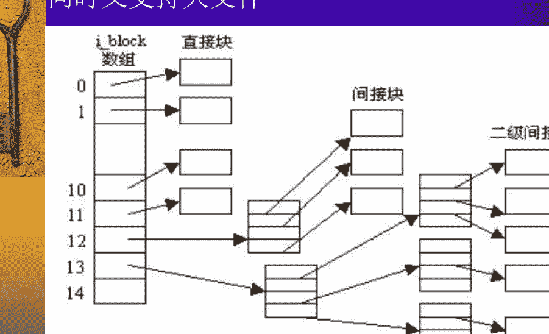

图 10-7 EXT2 文件数据块组织示意图

### 4. 一些操作

- 已知inode号，读inode信息

因为每组的inode数目固定，所以很容易计算出该文件属于那个组并且得到在组中inode表的下标，继而可得到ext2_inode信息

- 查找文件

以/home/temp.c为例。根目录的inode号总为2，因此可以得到根目录的ext2_inode信息，再从i_block[]指向的数据块查找是否有ext2_dir_entry 2项的名字等于home，如果有，则同时得到了home的inode号。重复上述过程，则可以判定是否有/home/temp.c存在。

- 读取文件某个位置的数据。

给定的位置是相对于文件而不是相对于磁盘的，因此需要根据该位置计算出它在 i_block中的下标，得到在磁盘上的位置。

## 三、 磁盘块的分配与释放

磁盘块的释放 主要工作是修改块位图和涉及块的统计变量。

### 磁盘块的分配

- 先试图与上次分配给文件的块连续。
- 如果不行, 则试图在附近32个块的范围内分配。
- 还不行的话再本组内向前找八个连续空闲的块。
- 若还不够满足则任何空闲的块均可以。
- 还不够的话则到其它的组中去寻找。

目的 文件尽可能地连续分配使文件访问时间变短

# 10.3.3 主要文件系统系统调用处理流程

## 一、文件的open（）操作

open（）函数最终会调用内核的sys_open（）

第一个参数是打开文件的路径名

第二个参数文件的访问标志

- （1）用get_unused_fd()在current->files->fd所指向的文件对象指针数组中查找一个未使用文件号，存储在局部变量fd中。
- （2）调用filp_open（）函数，工作主要分成两步：

第一步：调用open_namei（）函数，找到目标结点（可以是文件、目录）所对应的dentry对象，与dentry对象相对应的inode对象此时也应该在物理内存中

第二步：调用dentry_open()函数，该函数中请一个file对象空间，然后初始化该对象，其中的一步使file对象的f_dentry指向已获得的dentry对象。

(3) 调用fd_install（）函数将文件对象装入当前进程的打开文件表：

```
current->files->fd[fd] = file;
```

然后返回文件号fd


最重要的是open_namei（）完成的。

函数的执行过程如下：

- a. 确定从哪一个dentry对象出发进行路径解析。根据指定文件路径名是相对路径还是绝对路径从current中得到相应的dentry对象。
- b. 调用path_walk（）函数进行路径解析 该函数执行一个循环，每一循环都是得到一个dentry对象，该对象对应文件路径的一个子路径。

每次循环的具体过程如下：

- b.1 如果子路径是 “.” 表示当前目录，则应该进行下一次循环。
- b.2 如果子路径是 “..” 表示父目录，则要看当前dentry对象的情况。
  - 若当前entry对象已经是本进程的根目录，这时应保持不变，直接进行下一次循环；
  - 若当前dentry对象与父目录在同一设备上，则dentry对象的d_parent成员即为所求
  - 若当前dentry对象为所在设备的根节点，它的上一层必然是另一个设备，此时应把dentry对象改成安装点的dentry对象再从头执行b.2。
- b.3 调用cache_lookup（）函数查找子路径对应的dentry是否已经在dentry cache中，如果有，则返回。


b.4 此时应该到磁盘上寻找，先申请dentry对象空间存放即将查找的信息，然后调用 `real_lookup()` 函数，该函数将调用父目录inode对象的 `i_op->lookup()` 方法。

`lookup()` 方法是特定于文件系统的，ext2 的lookup方法是 `ext2_lookup()` 函数，它首先从磁盘读入dentry对象信息，包括dentry对象对应的inode号。然后再查找相应的inode对象是否在inode cache中，如果不在，申请一个inode对象空间再从磁盘读入信息。最后，让dentry对象的d_inode成员指向该inode对象。

b.5 已经找到了路径的dentry对象。但还有两种情况值得考虑，一是该dentry对象是一个安装点，这种情况下要推进到所安装设备的根节点。另一情况是该dentry对象是一个连接（link），这种情况下要推进到连接目标

## 二、 文件的read（）操作

### 1. 页缓存（page cache）

- 为了减少I/O操作的次数Linux在读写文件时采用了页缓存的机制
- 在内核中文件被看成由页面组成，对文件的读写首先要经过页缓存。

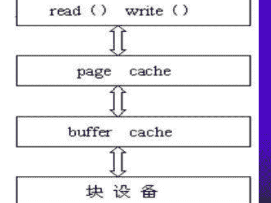


每个文件的所有页面由一个 struct address_space 结构管理，struct inode 结构中的 i_mapping 成员即起这个作用。

```
struct address_space {
    struct list_head        clean_pages;
    struct list_head        dirty_pages;
    struct address_space_operations *a_ops; /*操作方法*/
    .....
};
struct address_space_operations {
    int (*writepage)(struct page *);
    int (*readpage)(struct file *, struct page *);
    .....
};
```

页面被链入全局 hash 表 page_hash_table 中以加快页面的查找速度。

### 2. read () 的实现

read()在内核中的对应函数为sys_read ()。

- (1) 根据文件号调用函数fget () 找到相应的文件对象file。
- (2) 检查file->f_mode是否允许读
- (3) 调用file->f_op->read () 函数执行读的操作。

对于大部分文件系统实际是generic_file_read()函数。该函数根据文件位置和要读出的长度确定相应的页面，然后再检查该页面是否在page cache中存在，如果不存在，就要调用inode结点的i_mapping->a_ops->readpage()方法将其从磁盘读入。不同磁盘文件系统的readpage方法不同, ext2文件系统相应的函数为ext2_readpage

为了提高性能，读操作采用了预读机制

## 10.4 设备管理

### 内容

- 设备文件
- 设备管理相关数据结构
- 块设备文件的open()、read（）操作


### •设备文件的属性

- 文件名：如 hdal
- 类型：是字符设备还是块设备
- 主设备号：主设备号相同的设备被同一设备驱动程序处理。
- 从设备号：用来指明具体的设备

•mkmod() 创建设备文件， 它的参数是上面提到的四个属性。

•Linux安装完成之后已经在/dev目录下生成了绝大多数可能用到的设备文件

## 10.4.2 相关数据结构

• VFS与设备驱动程序接口：

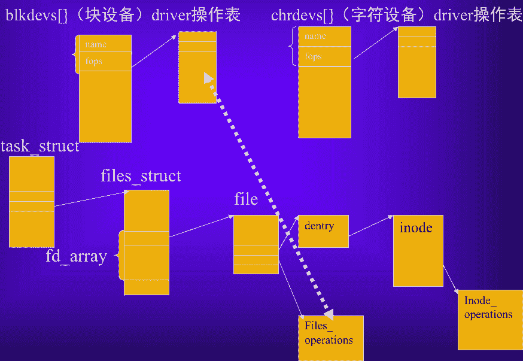

## 一、 字符设备管理

• 字符设备管理的主要数据结构如下：

```
struct device_struct {
    const char * name;
    struct file_operations * fops;
};
static struct device_struct chrdevs[MAX_CHRDEV];
```

全局数组chrdevs[]记录了所有字符设备驱动程序的名称name及其对应的设备操作函数接口fops。数组的下标，则对应于设备的主设备号。

• 加载设备驱动时，设备在系统中的注册是通过函数 `register_chrdev()`，其原型如下：

```
int register_chrdev(unsigned int major,
                    const char *name,
                    struct file_operations *fops);
```

不同的字符设备驱动程序要提供不同的 `file_operations` 实现。

• 当设备不再使用时，可以通过 `unregister_chrdev()` 函数注销。

## 二、块设备管理

主要数据结构有blkdevs[]和blk_dev[]：

```
static struct {
    const char *name;
    struct block_device_operations *bdops;/* 特定于设备的操作集*/
} blkdevs[MAX_BLKDEV];
struct blk_dev_struct {
    request_queue_t request_queue;/*请求队列*/
    queue_proc           *queue;
    void                 *data;
};
struct blk_dev_struct blk_dev[MAX_BLKDEV];
```

数组的下标对应设备驱动程序的主设备号，blkdevs[]记录设备文件名及相应的操作集合，blk_dev[]记录各个设备的请求队列。


```
struct buffer_head {
struct buffer_head *b_next; /* 用来链接hash值相同的buffer_head */
unsigned long b_blocknr; /* 块号 */
unsigned short b_size; /* 块的大小 */
kdev_t b_dev;
kdev_t b_rdev; /* 设备号 */
struct buffer_head *b_this_page;/* 同属一个页面的buffer 链表 */
struct buffer_head *b_reqnext; /* 同一个操作请求的buffer head链表*/
struct buffer_head **b_pprev; /* 用来链接hash值相同的buffer head */
char * b_data; /*buffer所在的位置 */
struct page *b_page; /* buffer所属的页面 */
wait_queue_head_t b_wait; /*进程等待队列*/
struct inode * b_inode;/*该buffer所属的inode结构*/
......
};
```


- 每个buffer由设备号和块号唯一确定，并以两者为hash关键字在buffer cache定位。
- 通常块的大小为1KB，而物理页帧的大小为4KB，所以一个物理页帧可以容纳4个buffer

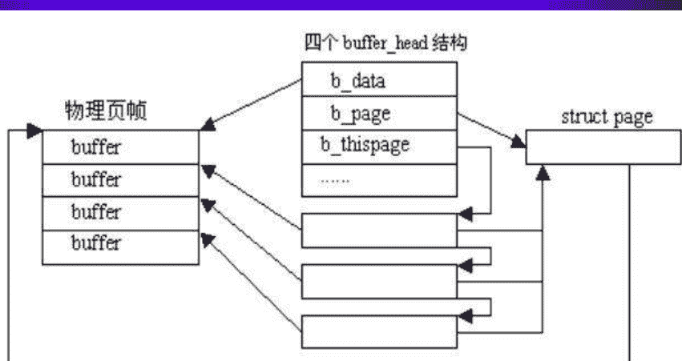

## page cache和buffer cache的区别

- （1）buffer cache用于读取文件系统分区和文件的元数据。
- （2）page cache主要用来存放常规文件的数据，数据也并不一定在物理上连续。
- （3）page cache尽量不与buffer cache存放相同数据。

## 四、 设备请求队列

- 每类块设备都维护一个请求队列
- 队列的每一个成员称之为操作请求。

```
struct request {
    int cmd;                  /* 操作行为：读或写 */
    struct buffer_head * bh;  /*buffer_head链表*/
    struct buffer_head * bhtail;
    ...... };
```


• 每个操作请求都维护着一个buffer_head链表。每当需要对一个块进行操作时要将相应的buffer_head加入设备请求队列，这个过程有两个优化措施：

(1)能否合并。检查已有的块设备操作请求中的块和现在操作的块是否在物理上相邻并且操作行为一致

(2)如果不能合并的话则生成一个新的块设备操作请求，并加入相应设备请求队列的合适位置，使磁头的移动路径尽可能短。

## 10.4.3 块设备文件的open()、read()操作

可以把块设备整体看成一个文件来访问

## 一、块设备驱动程序组成

块设备驱动程序分为两部分：

- (1) 与VFS的接口层。blkdevs[]
- (2) 真正对设备（一般是磁盘控制器）操作的部分，如 blk_dev[major].request_fn。


## 二、 open()函数

打开一个设备文件与打开一个普通文件不同的特殊的处理（以原来的设备文件方式为例）

- 在VFS处理open系统调用时，会调用对应文件系统的super_operations中的read_inode方法将设备文件inode读入内存；
- 当得知是设备文件时，会将file中的f_op域置为def_blk_fops/def_chr_fops表地址，其中有blkdev_open()/chrdev_open()操作；
- 然后会调用file中f_op域指向的操作表的open方法。


### 以blkdev_open()为例：

- 1. 得到主设备号；
- 2. filp->f_op=blkdevs[major].fops #用blkdevs表中的对应操作表地址重填file的f_op域；
- 3. 调filp->f_op->open()。

### 设备driver的open()函数主要工作：

- 1. 如果driver是动态加载模块，使用计数+1；
- 2. 检查设备是否存在；
- 3. 如有必要，初始化设备；
- 4. 初始化设备的数据结构（如登记中断服务程序等）。


## 三、 read() 函数

块设备将调用block_read()函数。

(在版本2.4中block_write/read变成了generic_file_write/read,它先访问page cache.)

- block_read()函数首先计算出要读出的块。
- 对于要读的每一块,首先检查buffer cache是否已经存在,存在则返回。
- 若不存在则申请一个buffer并将相应的buffer_head加入对应设备的请求队列,然后进程进入buffer head的等待队列睡眠。
- 操作请求将在合适的时候被触发,驱动程序完成读操作后将操作请求移出请求队列,进程被唤醒把buffer中的数据读到自己的缓冲区。

## 10.5 中断、异常及系统调用

### 内容

- 中断/异常的基本知识
- 异常的处理
- 系统调用
- 中断的处理
- 软中断

## 10.5.1 中断/异常的基本知识

异常 由CPU产生，同步中断产生的通常情况是执行指令却遇上异常情况，常见的异常有除零、溢出及页面异常等。另一种情况种是使用int 指令，Linux使用该指令来实现系统调用。

中断 分为可屏蔽的和不可屏蔽的两类，由一些硬件设备产生，可以在指令执行的任意时刻产生

- 中断/异常的发生都将导致核心态代码的运行
- 中断即可能发生在用户态，也可能发生在核心态，并且中断的嵌套发生往往是允许的。
- 异常大部分发生在用户态，但是页面异常可能发生在核心态。异常也最多可能两层嵌套，绝大多数情况是只有一级异常
- 异常的处理过程中可能产生中断，反之则不可能

## 中断向量表 IDT

- IDT是中断/异常处理在内核的入口。IDT表项还记录了一些其它信息用以安全检查。
- IDT在系统初始化时创建。
- 每个中断/异常都有一个向量号，该号的值在0—255之间，该值是中断/异常在IDT中的索引。
- 每个中断/异常均有其相应的处理函数，中断/异常在使用前必须在IDT中注册信息以保证发生中断/异常时能找到相应的处理函数。

- IDT中向量号的使用情况如下：
  - 0—31 异常与非屏蔽中断使用。
  - 32—47 可屏蔽中断使用32至47
  - 128（0x80）实现系统调用。
  - 其余 未使用
- 保存现场
  发生异常时在核心栈的程序计数器eip的值取决于具体情况。一般情况下eip保存的下一条指令的地址，但对于页面异常，保存的产生异常的这条指令的地址而不是下一条指令的地址


## 10.5.2 异常的处理函数

异常处理的一般流程如下：

- （1）保存大多数寄存器的值到核心模式栈上。
- （2）调用相应的处理函数。
- （3）跳转到ret_from_exception标号处退出。

大多数异常处理函数的过程是：

- （1）硬件错误码和异常向量号存入当前进程。
- （2）发出一个相应的信号给当前进程

非上述情况的例子：页面异常


```
struct task_struct *tsk = current; /*current 为当前进程*/
tsk->thread.error_code = error_code; /*error_code 为硬件错误码*/
tsk->thread.trap_no = trap_nr; /* trap_nr为异常向量号*/
if (info)
    force_sig_info(signr, info, tsk);
else
    force_sig(signr, tsk);
```

从ret_from_exception处返回用户空间时，将会检查进程是否有信号等待处理。如果有，则看进程是否有自己的信号处理函数，有则调用它，否则采用内核对信号的缺省处理，一般是将该进程杀死。

## 10.5.3 系统调用

用户程序通过系统调用切换到核心态从而可以访问相应的资源。这样做的好处是：

- 使编程更加容易。
- 有利于系统安全。
- 接口统一有利于移植。

### 系统调用的执行过程。

以fork（）为例，在libc库相应的实现有如下的语句：

```
movl $2, %eax
int $0x80
```

int $0x80 指令是所有系统调用的统一入口，fork（）系统调用的编号为2。

系统在初始化设置了0x80号异常的处理函数为sys_call()，该函数执行下面一条语句：

```
call *SYMBOL_NAME(sys_call_table)(,%eax,4)
```

sys_call_table为系统调用表，该表保存的是各个系统调用的入口地址，下面列出了系统调用表的最前面三项：

```
ENTRY(sys_call_table)
.long SYMBOL_NAME(sys_ni_syscall)/*第0号 */
.long SYMBOL_NAME(sys_exit)
.long SYMBOL_NAME(sys_fork)
```

从而fork()函数对应的系统调用为sys_fork()，该函数又调用do_fork()完成具体的工作

## 10.5.4 中断上半部分的处理

### 一、 中断控制器

- 每个硬件设备控制器都能通过中断请求线发出中断请求（简称IRQ）
- 所有设备的中断请求线又连到中断控制器的输入端。
- 在x86单CPU的机器上采用两个8259A芯片作为中断控制器，一主一从。

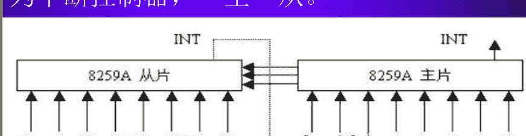

图 10-11 两个 8259A芯片级联

- 当8259A有中断信号输入同时中断信号不被屏蔽时，主8259A向CPU发出 INT信号，请求中断。这时如果CPU是处于允许中断状况，CPU就会发信号给8259A进入中断响应周期。
- 在对8259A芯片的初始化过程中，第n号中断在IDT表中的向量号为 n+32
- 因为中断请求线的数目有限，所以几个设备共享一根线是有必要的。当这根输入线有中断请求时，处理程序需要依次查询这些设备，以确定究竟是哪一个设备发出了中断请求。


对于8259A芯片来讲，它的具体成员如下：

```
static struct hw_interrupt_type i8259A_irq_type =
{
    "XT-PIC",
    startup_8259A_irq,
    shutdown_8259A_irq,
    enable_8259A_irq,
    disable_8259A_irq,
    mask_and_ack_8259A,
    end_8259A_irq,
    NULL
};
typedef struct hw_interrupt_type hw_irq_controller;
```

irq_desc_t结构用来描述中断源，数组 irq_desc[]描述所有的中断源。

```
typedef struct {
    unsigned int status;          /* IRQ 状态 */
    hw_irq_controller *handler; /*该中断所属的中断控制器*/
    struct irqaction *action;
    unsigned int depth;
    spinlock_t lock;
} ____cacheline_aligned irq_desc_t;

irq_desc_t irq_desc [NR_IRQS];
```

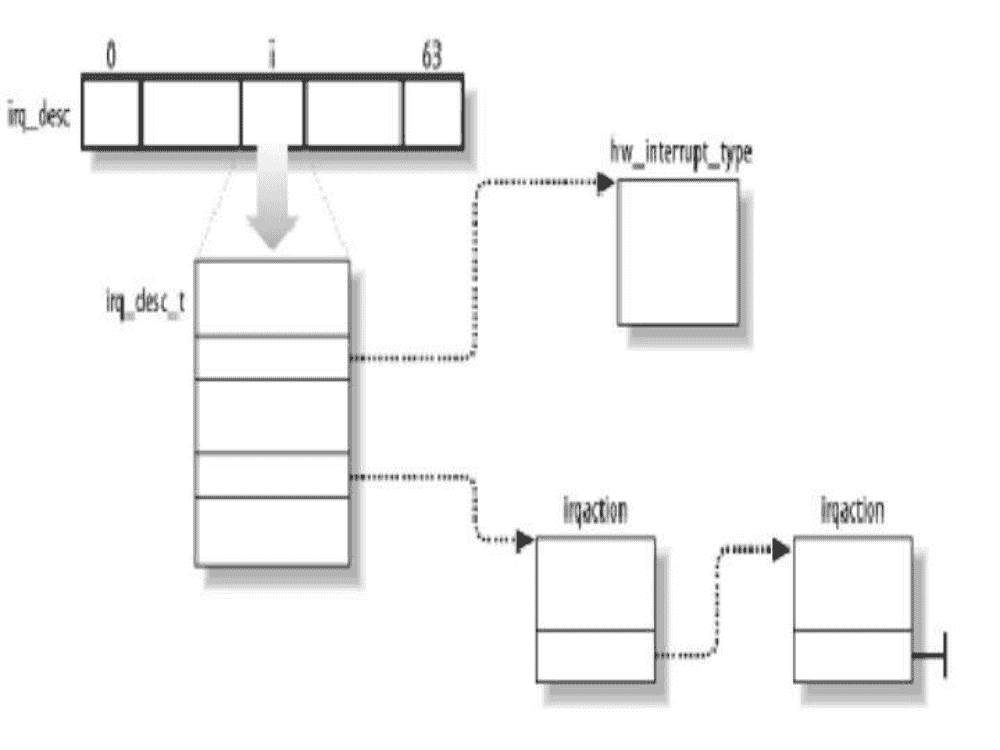

## irqaction结构记录当中断发生时具体的处理函数

```
struct irqaction {
    void (*handler)(int, void *, struct pt_regs *);    /*具体的处理函数*/
    unsigned long flags;
    unsigned long mask;
    const char *name;
    void *dev_id;
    struct irqaction *next; /*利用该成员形成链表*/
};
```

irq_desc_t 的 action 成员实际是一个 irqaction 结构的链表，因为多个设备可能共享一个中断源，每个设备都必须提供一个 irqction 结构挂入 action 链表。

## 三、中断的处理过程

（1）中断信号由外部设备发送到中断控制器，中断控制器根据IRQ号转换成相应的中断向量号传给CPU。

（2）CPU接收中断后，保存现场，根据中断向量号到IDT中查找相应的处理函数。对于IRQ n的中断，它的处理函数IRQn_interrupt()。

（3）调用do_IRQ()函数。该函数完成对中断控制器确认、设置中断源状态等动作，接着它会根据IRQ号找到描述中断具体动作的irqaction结构变量action，执行如下代码：

## 10.5.5 软中断——中断处理的下半部分

## 问题背景：

在响应中断并进行处理的时候往往会关闭中断，而在此期间完全可能有多个设备发出中断请求，所以希望能够尽快地响应中断以免中断丢失。

## Linux的解决办法——中断处理分为两部分

- (1) 硬中断 （做最关键的事情）

CPU响应中断。关闭中断，确认中断，把中断设备的数据包从硬件缓冲拷贝到内核空间（如果有的话），做标记用来激活下半部分，开中断。


## (2) 软中断

一般是绝大部分中断处理在这里完成。

注意下半部分是可以开中断的情况下运行，并且第二步并不一定紧接着第一步运行。

如此便保证了中断的响应速度。

## 2.4 内核软中断形式

- 软中断处理总控可以并发执行，相同的与不同的软中断都可以在不同的CPU上同时执行。
- tasklet，相同的tasklet不会同时在不同的CPU上运行，不同的tasklet可以在不同CPU上运行。
- Bottom Half (BH) 系统中最多只能有一个CPU运行BH

三者的约束从松到紧

## 系统预定义了四个软中断：

HI_SOFTIRQ 用于实现BH

TASKLET_SOFTIRQ 对应于tasklet

NET_TX_SOFTIRQ 用于发送网络数据

NET_RX_SOFTIRQ 接受网络数据

## 软中断的相关处理函数

- • open_softirq（）函数定义软中断及其处理函数

```
open_softirq(NET_RX_SOFTIRQ, net_rx_action, NULL);
```

NET_RX_SOFTIRQ 为软中断号。 net_rx_action是一个函数，当软中断被处理时调用该函数。

- • __cpu_raise_softirq() 用来设置标志位激活软中断，该函数在中断处理的上半部分被调用。
- __cpu_raise_softirq(cpu, NET_RX_SOFTIRQ);

- • do_softirq() 用于处理软中断，它发现那个软中断的标志位被设置，就调用相应的软中断处理函数。

## do_softirq() 有4个执行时机

- 从系统调用中返回（ret_from_sys_call）
- 从异常中返回（ret_from_exception）
- 调度程序中（schedule()）
- 处理完硬中断之后（do_IRQ()）

## BH的例子 时钟中断

- - 初始化 init_bh(TIMER_BH, timer_bh)
- - 当时钟中断发生时
  （1）硬中断的处理
  1. 其处理函数更新“滴答”计数
  2. 单CPU的情况对当前进程的CPU时间配额counter减一，如果counter为0，置进程描述符的need_resched为1。
  3. 然后激活TIMER_BH。

```
(*(unsigned long *)&jiffies)++;
#ifndef CONFIG_SMP
    update_process_times(user_mode(regs));
    mark_bh(TIMER_BH);
#endif
if (TQ_ACTIVE(tq_timer))
    mark_bh(TQUEUE_BH);
```

## （2）软中断的处理

在后面TIMER_BH得到调度运行时，执行 timer_bh()函数，该函数执行时钟中断的大部分任务，包括更新时间统计变量及检查定时器是否到期，如到期则执行相应的操作。

## 10.6 SYS V 进程间通信

## 内容

- - 信号量
- - 消息队列
- - 共享内存

## 10.6.1 三者共有的特性

IPC资源 表示单独的消息队列、共享内存或是信号量集合

## 三者均有XXXget（）及XXXctl（）函数

（XXX代表msg、sem、shm三者之一）

## （a） XXXget（）函数

两个共同参数：key和oflag。

key既可由ftok（）函数产生，也可以是IPC_PRIVATE常量，key值是IPC资源的外 部表示。


oflag包括读写权限，还可以包含IPC_CREATE和IPC_EXCL标志位。它们组合的效果如下：

- (1) 指定key为IPC_PRIVATE保证创建一个唯一的IPC资源。
- (2) 设置oflag参数的IPC_CREATE标志位但不设置IPC_EXCL。如果相应key的IPC资源不存在，则创建一个IPC资源，否则返回已存在的IPC资源。
- (3) oflag参数的IPC_CREATE和IPC_EXCL同时设置。如果相应key的IPC资源不存在，则创建一个IPC资源。否则返回一个错误信息。

## （b）XXXctl（）均提供IPC_SET、IPC_STAT和IPC_RMID命令。前两者用来设置或得到IPC资源的状态信息，IPC_RMID用来释放IPC资源。

## 共同的操作模式

- - 都是先通过XXXget（）创建一个IPC资源，返回值是该IPC资源ID。在以后的操作中，均以IPC资源ID为参数以对相应的IPC资源进行操作。
- - 别的进程可以通过XXXget（）取得已有的IPC资源ID（权限允许的话）并对其操作，从而进程间通信成为可能。

## 共同的数据结构

每一类IPC资源都有一个ipc_ids结构的全局变量用来描述同一类资源的公有数据，三个全局变量分别是semid_ds，msgid_ds和shmid_ds。

```
struct ipc_ids {
    int size;        /* entries数组的大小 */
    int in_use;      /* entries数组已使用的元素个数 */
    int max_id;
    unsigned short seq;
    unsigned short seq_max;
    struct semaphore sem;   /*控制对ipc_ids结构访问*/
    spinlock_t ary; /*自旋锁控制对数组entries的访问*/
    struct ipc_id* entries;
};
struct ipc_id {
    struct kern_ipc_perm* p;
};
```


数组entries的每一项指向一个kern_ipc_perm结构，kern_ipc_perm结构表示每一个IPC资源的属性，用来控制操作权限。

```
struct kern_ipc_perm {
    key_t      key;    /*用户提供的键值, 为XXXget()所用*/
    uid_t      uid;    /*创建者用户ID*/
    gid_t      gid;    /*创建者组ID*/
    uid_t      cuid;   /*所有者用户ID*/
    gid_t      cgid;   /*所有者组ID*/
    mode_t     mode;   /*操作权限, 包括读、写等*/
    unsigned long seq;
};
```

因为每个IPC资源描述符的第一个成员就是kern_ipc_perm结构。因此，我们可以认为数组entries的每一非空项均指向一个IPC资源。

## IPC资源ID与entries数组下标的联系

- （1）当创建一个IPC资源时：
  - 调用函数ipc_addid()从相应ipc_ids结构的entries数组中找出第一个未使用的项然后返回其下标index。
  - 返回IPC资源ID：IPC资源ID = SEQ_MULTIPLIER * seq + index。SEQ_MULTIPLIER是可用资源的最大数目，seq是ipc_ids结构中的seq。每当分配一个IPC资源时，ipc_ids结构中的seq就增一。
- （2）当知道IPC资源ID时，可通过 `IPC资源ID % SEQ_MULTIPLIER` 得到其在entries数组中的index，从而找到相应的IPC资源。
- （3）why：保证在一段时期内IPC资源ID的唯一性。

## 10.6.2 信号量

- 信号量是具有整数值的对象，它支持P、V原语。进程可以利用信号量实现同步和互斥
- SYSV支持的信号量实质上是一个信号量集合，由多个单独的信号量组成。我们称SYSV信号量为信号量集合，而单个的信号量直接称为信号量。
- 信号量集合在内核中用结构sem_array表示

```
struct sem_array {
    struct kern_ipc_perm sem_perm;
    time_t sem_otime;      /* 最近一次操作时间 */
    time_t sem_ctime;      /* 最近一次的改变时间 */
    struct sem           *sem_base; /*指向第一个信号量 */
    struct sem_queue *sem_pending; /* 挂起操作队列*/
    struct sem_queue   **sem_pending_last;
    struct sem_undo      *undo;
    unsigned long        sem_nsems; /*信号量的个数*/
};
```

信号量集合中的每一个信号用结构sem表示，

```
struct sem {
    int  semval; /* 信号量的当前值 */
    int  sempid; /* 最近对信号量操作进程的pid */
};
```

信号量的初始值可以调用函数semctl（）进行设置。

用户可以调用函数semop()对信号量集合中的一个或多个信号量进行操作。

```
int semop(int semid, struct sembuf *opsptr, size_t nops);
```

- semid：IPC资源ID
- opsptr：操作的集合
- nops：数组opsptr的大小

内核必须保证操作数组opsptr原子地执行

### 每一个操作都是sembuf结构变量

```
struct sembuf {
    unsigned short sem_num; /*在sem_base[]数组中的下标*/
    short sem_op;
    short sem_flg;
};
```

sem_num指明是对哪一个信号操作。
sem_flg指明一些操作标志位，可以有如下值：

- （1）SEM_UNDO 当进程结束但还拥有信号量资源时，应将信号量资源返还给相应的信号量集合。内核有一个sem_undo结构用于跟踪这方面的情况，进程描述符有个semundo成员记录进程这方面的信息。
- （2）IPC_NOWAIT 当操作不能立即完成时，IPC_NOWAIT被设置的话进程立即返回，否则进程进入睡眠状态等待时机成熟时被唤醒完成该操作。

sem_op指定具体的操作，它的值有如下含义：

- （1）大于0，则将该值加到信号量的当前值上。
- （2）等于0，那么用户希望信号量的当前值变为0。如果值已经是0，则立即返回。如果不是0，则取决于IPC_NOWAIT是否被设置。
- （3）小于0，则要看信号量的当前值是否大于等于sem_op的绝对值。如果大于等于，就从信号量的当前值中减去sem_op的绝对值。如果小于，则取决于IPC_NOWAIT是否被设置。

当进程的信号量操作不能完成睡眠时，需要将一个代表着当前进程的sem_queue结构链入相应的信号量集合的等待队列，即sem_array结构的sem_pending队列。

```
struct sem_queue {
    struct sem_queue *next; /*队列中的下一个元素*/
    struct sem_queue **prev; /*队列中的前一个元素*/
    struct task_struct *sleeper;/* 睡眠进程的描述符*/
    struct sem_undo *      undo;
    int pid;      /* 睡眠进程的pid */
    int status;
    struct sem_array *sma; /* 所属的信号量集合 */
    struct sembuf *sops; /* 挂起的操作数组 */
    int nsops;          /* 挂起的操作个数*/
    .....
};
```

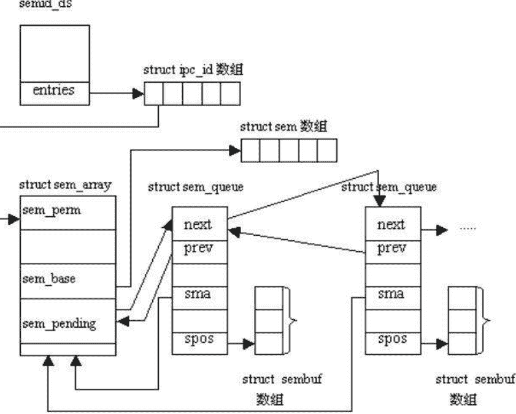

图 10-12 信号量各数据结构之间的关系

## 10.6.3 消息队列

- 具有权限的进程可以往消息队列中读写消息，这就是消息队列支持进程通信的方式。
- msgsnd()函数将消息放入队列中

```
int msgsnd(int msqid, const void *msgp, size_t msgsz, int msgflg);
```

- msqid: 消息队列的资源ID号
- msgp: 消息缓冲区的首地址。消息缓冲区由消息的类型及数据部分两部分组成。
- msgsz: 消息缓冲区的长度。
- msgflg: 可以是0，也可以是IPC_NOWAIT。

- msgrcv() 从某个消息队列中读一个消息并将其移出消息队列。

```
int msgrcv(int msqid, void *msgp,
    int msgsz, long msgtyp, int msgflg);
```

- msgp：接收消息的缓冲区首址。
- msgsz：接收缓冲区的大小，这是函数能返回的最大数据量。
- msgtyp：指定接收消息的类型。分为三种情况：
  - 值为0，返回队列中的第一个消息。
  - 值大于0，返回类型为msgtyp的第一个消息。
  - 值小于0，则返回类型值小于或等于msgtyp的绝对值的消息中类型值最小的第一个消息。
- msgflg：可以是IPC_NOWAIT，还可指定为MSG_NOERROR。MSG_NOERROR允许消息长度大于接收缓冲区长度时截短消息返回。

在内核中消息队列用msg_queue结构表示，

```
struct msg_queue {
    struct kern_ipc_perm q_perm;
    time_t q_stime; /*最近一次msgsnd时间*/
    time_t q_rtime; /*最近一次msgrcv 时间*/
    time_t q_ctime;  /* 最近的改变时间 */
    unsigned long q_cbytes; /* 队列中的字节数 */
    unsigned long q_qnum;   /* 队列中的消息数目 */
    unsigned long q_qbytes; /*队列中允许的最大字节数 */
    pid_t q_lspid; /*最近一次msgsnd()发送进程的pid */
    pid_t q_lrpid; /*最近一次msgrcv()接收进程的pid */
    struct list_head q_messages;      /*消息队列*/
    struct list_head q_receivers;     /*待接收消息的睡眠进程队列*/
    struct list_head q_senders;       /*待发送消息的睡眠进程队列*/
};
```


- 若IPC NOWAIT未被设置，则当消息队列的容量已满时发送消息的进程会进入睡眠状态并添加到相应的q_senders队列，而当消息队列中无合适的消息时接收进程会进入睡眠状态并添加到相应的q_receivers队列。
- 消息队列中的每个消息都链入q_message队列中，每个消息用一个msg_msg结构描述

```
struct msg_msg {
    struct list_head m_list;    /*消息队列链表*/
    long m_type;                /* 消息的类型 */
    int m_ts;                   /* 消息的长度 */
    struct msg_msgseg* next; /* 链接属于这个消息的下一个消息片*/
};
```

```
struct msg_msgseg {
    struct msg_msgseg* next;
};
```

msg_msg结构只是一个消息头部，并不包含消息的数据部分。数据部分的空间紧接msg_msg结构分配，但是当数据部分的空间与msg_msg结构所占空间大于一个页面时，则将其以页面为单位分片。第一个页面存储msg_msg结构与首部分数据，随后的再分配空间则存储struct msg_msgseg结构与剩余的数据，如果这两者所占空间之和仍大于一个页面，则继续分配下去。msg_msgseg结构用以把消息片链接在一起


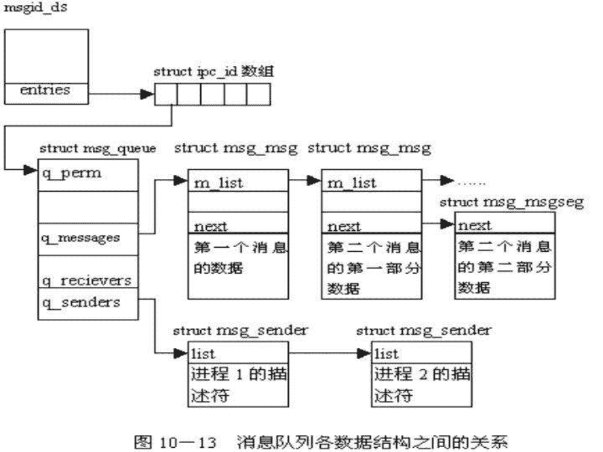

## 10.6.4 共享内存

• 共享内存是多个进程共享的一块内存区域。不同的进程可把共享内存映射到自己的一块地址空间，不同的进程进行映射的地址空间不一定相同。

• 共享内存区的进程对该区域的操作是互见的

• 共享内存没有提供进程同步与互斥的机制，往往需要和信号量配合使用。

• 相比起其它进程通信方式，共享内存在进行数据交换方面是效率比较高的。无须用户态切换、核心态切换开销

- shmget（）函数有一个参数指定共享内存区域的大小，该函数建立的共享内存区在内核中用shmid_kernel结构表示

```
struct shmid_kernel{
    struct kern_ipc_perm    shm_perm;
    struct file *           shm_file;
    int                     id;
    unsigned long shm_nattch;/*已建立映射的数目*/
    unsigned long shm_segsz;/*共享内存区的大小*/
    time_t                  shm_atim;
    time_t                  shm_dtim;
    time_t                  shm_ctim;
    pid_t                   shm_cprid;
    pid_t                   shm_lprid;
};
```

- shmget（）创建的共享内存区域并没有立即分配物理内存，而是创建一个文件对象shm_file来描述该区域，而该文件属于shm文件系统。shm文件系统是一个内存文件系统，它不依赖于磁盘文件的内容
- 进程调用shmat（）函数建立进程地址空间与共享内存区的映射。选取进程地址空间的哪一段区间进行映射可由用户指定也可委托内核进行选择。shmat函数找到区间后进程分配一个vm_area_struct结构描述该区间，vm_area_struct结构的各项被初始化，其中file成员被初始化为shm_file，而vm_ops成员被初始化为shm_vm_ops

(1) 先根据文件和文件位置查找page cache，因为别的进程可能已经为映射的共享内存区页面已经申请了一个物理页帧。如果找到，修改本进程页表即可。否则继续下一步。

(2) 检查被是否映射的共享内存区页面被访问过，但已被换出到交换分区。如果是，则调入该页面，修改进程页表。否则继续下一步。

(3) 被映射的共享内存区页面从未被访问过，这种情况向内存子系统申请一个物理页帧，修改进程页表。

• 进程可以调用shmdt（）函数解除地址空间与共享内存区的映射关系，主要是修改页表及释放vm_area_struct结构。

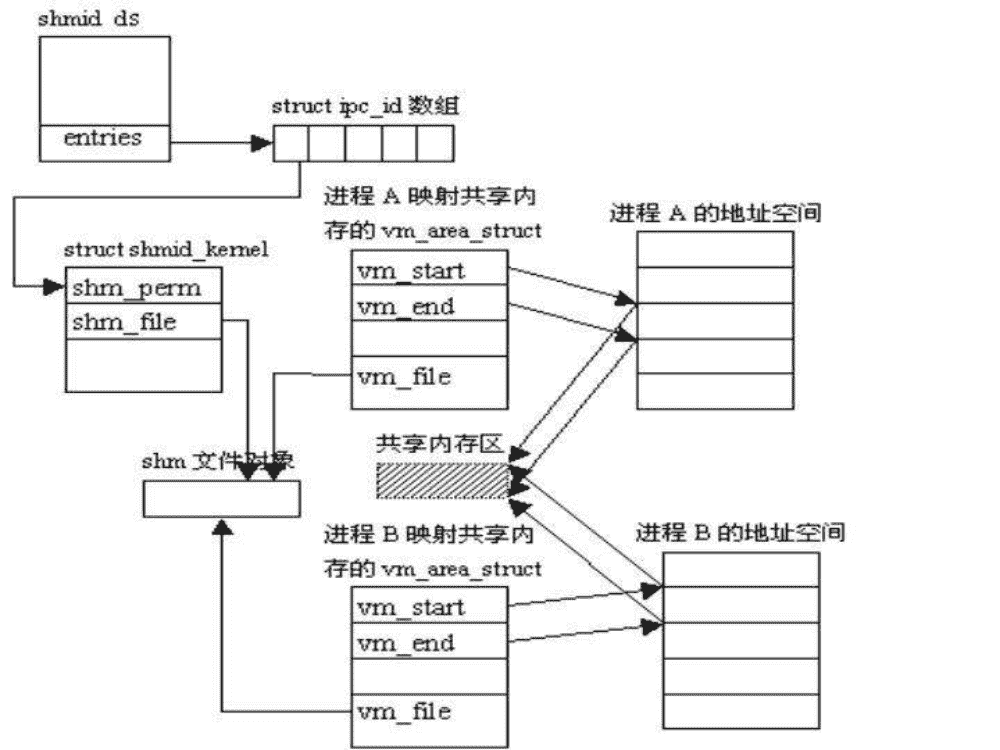

## 操作系统课程实验

2005.11

## 什么是Linux

- 20世纪80年代末，Unix作为一种流行的操作系统，已经具有了多个变种。但是大多成为各厂家专有产品，不开放源码
- 著名计算机科学家Andrews Tanenbaum开发了Minix
- 1990年秋，芬兰，赫尔辛基大学

## 什么是Linux

- Linus Torvalds，芬兰人
- 他学习操作系统课程并需要上机实习
- 386计
- 1... 让M... Minix
- ... 程...
- ... 基本... 一个磁
- ... 错误， ... 作）和一
- ... 这就是 ... 91年8月
- ... 不完善 ... 序都没有
- ... 就是我 ... 发...
- Minix，不然我不会停止改进它。


## 什么是Linux

- 在赫尔辛基技术大学的FTP服务器上获得了一个空间，放置了这个操作系统，让人们自由下载
- Linux是Linus的笔名
- 1992年，黑客们注意到Linux，他们为Linux编写了许多关键代码，大大地完善了系统。早期的Linux用户也开始定期地上载代码并提出建设性的意见

## 什么是Linux

- 对于一个完
内 核是没有
发应用程序
- 自由软件基
个完全免费
应用程序，
- Linux成为

仅一个
内核上开

是写出一
内核和相关


## 什么是Linux

- 1994年3月，Linux 1.0出现
- 1995年1月，Bob Young创办了Redhat
- GNU Linux + GNU应用软件 = Redhat
- Linux“发行版”
- 其他的Linux发行版

## Linux的优势

- 免费获取，硬件费用低廉。
- 1997年，Pentinium II 设计上的缺陷刚被发现，Linux就提供了解决方案。
- 1997年，荣获了美国《InfoWorld》杂志的最佳技术支持奖，而这一奖项原本只是为商业软件公司设立的。
- CERN（西欧原子能中心）采用Linux做物理数据处理

## Linux的优势

- 好莱坞大片《泰坦尼克号》中的计算机动画的设计工作是在Linux平台上进行的
- 强大的网络功能，杰出的稳定性，对系统配置的低要求，在网络服务器领域占据了重要的地位
- 用户包括NASA，迪斯尼，洛克希德，通用电气，波音等


## GNU/Linux的启示


> 我的 人生目标是为世界做一点贡献，而不是从世界掠取钱财。我认为一个个人如果有了足够吃的，就有责任瞄准更高尚的目标，而不是变得更成功。
> 我来北京（2000年5月）的演讲是免费的，来中国就是对我的奖赏。
> 很多时候，人不能为了钱活着。


## 课程内容
- 熟悉Linux操作系统
- 尝试修改操作系统内核
- 初步了解核心态编程的思想和方法
- 掌握Linux操作系统内核的一般运作机制
- 熟悉你手上那颗奔腾的芯——IA32

## 最高目标
- 树立“无所不能”的自信心
- 每个人都对Linux核心态编程非常熟悉
- 大部分人对Linux操作系统原理非常熟悉
- 大部分人认为收获很大
- 每个人都体验到动手尝试的乐趣
- 课堂气氛活跃

## 最低目标
- 树立 “Yes, I can”的自信心
- 每个人都了解Linux内核编程框架
- 每个人都克服对Linux操作系统的恐惧感
- 每个人都有不同程度的收获
- 每个人都动手尝试过
- 保证到课率和听课效率

## 教学原则
- 以培养兴趣和自信为第一目标
- 了解每个学生的具体情况
- 量体裁衣，量力而行
- 不放弃任何一个学生
- 让能力强的学生能够自由发展
- 让学生动手参与


## 评分方法
- 20%到课和听课情况
- 30%前三个实验的完成情况
- 30%后一个实验的完成情况
- 20%个人表现
  - ✓ 进步程度
  - ✓ 完成附加任务
  - ✓ 其他

## 以后课程中的演示预览
- 多种多样的操作系统世界
- 对Windows Server的缓冲区溢出攻击
- 基于Windows的文件过滤驱动透明的重定向文件操作，从而保护系统免受攻击
- 基于生物信息识别的Windows登录安全
  - 基于意识的识别——即便入侵者知道密码，也同样无法进入系统
  - 基于人脸的识别


## 允许
- 完成所有实验后，不到课
- 完成本节任务后，不听课
- 随时打断讲课，发表自己的意见（不必起立）
- 做其他自选的实验，但要经过评定
- 请假（请尽可能提前声明）

## 不允许
- 无故不到课
- 在计算机上进行与课程无关的活动
- 检查作业时出现雷同
- 未经允许代替他人完成任务

## 鼓励
- 对任何系统，狂热的探索和攻击，
  - 目的探索系统的工作原理，发现系统中不为人知的秘密
  - 反对破坏数据
- 对任何软件的破解及逆向工程
  - 目的研究软件编写技巧，培养自己对编译和代码的敏感性
  - 反对公开破解结果并造成别人损失


## 知识点和前导知识
- 知识点A：操作proc文件系统
- 难度系数：0.9
- 必做实验
- 前导知识：
  - C语言程序设计基础
  - Linux基本操作
  - Linux下编译和运行程序


## 知识点和前导知识
- 知识点B：添加系统调用
- 难度系数：0.5
- 必做实验
- 前导知识:
  - C语言程序设计基础
  - 能看懂简单的汇编语言程序
  - 操作系统基本知识（用户态和核心态，系统调用）
  - Linux基本操作

## 知识点和前导知识
- 知识点C: Linux模块编写方法
- 难度系数: 0.6
- 必做实验
- 前导知识:
  - C语言程序设计基础
  - 操作系统基本知识（用户态和核心态）
  - Linux下编译和运行程序

## 知识点和前导知识
- 知识点D： 添加 proc文件
- 难度系数： 0.4
- 选做实验
- 前导知识:
  - 知识点A
  - 核心态编程的一般方法和技巧


## 知识点和前导知识
- 知识点F：编写文件过滤器驱动隐藏文件
- 难度系数：0.3
- 选做实验
- 前导知识:
  - 知识点C
  - 核心态编程的一般方法和技巧

## 问卷调查
- 1. 请先记住，本次调查仅仅是为了对学生基本情况有所了解，以便制订教学计划，因此请尽可能真实回答。
- 2. 你的操作系统上机作业（无论如何回答都不会影响你的任何一门课程成绩）
  - A. 自己做的  B. Copy别人的  C. 书上或网上找到的
- 3. 你对Linux
  - A. 很熟悉      B. 会使用命令行方式      C. 会使用图形界面并会编译程序      D. 不会使用

## 问卷调查
- 4. 你认为用C语言编写一个读写文件的程序
  - A. 很轻松      B. 需要查资料      C. 不会
- 5. 你认为操作系统的上机作业属于
  - A. 用户态编程  B. 核心态编程      C. 不知道
- 6. 你对Linux内核源代码
  - A. 看懂过部分内容（哪怕是很短的一部分）
  - B. 看过但看不懂      C. 没看过

## 问卷调查
- 7. gcc是一种编译器
  - A.对  B.错  C.不知道  D.什么是编译器？
- 8. 说实话，你对自己完成本课程的所有任务有信心吗？
  - A.很有信心 B.没把握  C.没有信心
- 9. 你有自己的计算机吗
  - A.有  B.没有  C.和同学合用

## 问卷调查
- 10. 你认为已开设的C语言课程（再次重申，以下两题不影响你的任何课程成绩）
  - A.收获很大  B.有点印象 C. 还给老师了
- 11. 你认为已开设的操作系统课程
  - A.收获很大  B.有点印象 C. 还给老师了
- 12. 你还有什么意见或者见解？

## 问卷调查
- 请留下你的姓名和学号。记住，这个问卷调查只是了解你的具体情况，以便我为每个人制订相应的教学计划。
- 无论你的回答如何，都不会对你的最终成绩造成任何影响，更不会影响操作系统课程的成绩，事实上，你的答卷根本不会让罗老师看到。因此请尽可能保持真实。
- 本次问卷调查没有参加者，视为不到课。

## 推荐软件
- 工欲善其事，必先利其器
- VMware
- 推荐配置：主频1G以上的CPU, 256M以上的内存。
- 在Windows环境下模拟出一台甚至多台全新的计算机
- 可以在这些新的计算机上面安装任何操作系统，包括Windows和Linux，而对目前的系统没有影响。


## 推荐软件
- VMware的其他优势
  - 可以把安装好的操作系统以文件的形式 Copy给别人。
  - 卸载操作系统只需要删除几个文件。
  - 100%支持网络，可以在虚拟机和虚拟机之间，虚拟机和宿主机之间进行网络通信
- 请观看演示


## 推荐软件

- **LXR** ——大型C语言代码浏览工具
  - 基于Apache的插件
  - 以Web方式浏览源码
  - 使用Glimpse进行高速字符串查找
  - 使用超链接来跟踪函数实现、函数引用、变量定义


- **Netterm**
  - telnet终端
  - 可以在Windows友好的窗口界面下远程登录开放了telnet服务的Linux
  - 方便的拷贝屏幕信息
  - 方便的调整字符界面的分辨率

- **UltraEdit**
  - 功能强劲的编辑器
  - 支持FTP方式远程打开、编辑、保存文件
  - 支持语法增亮显示


- **Source Insight**
  - 阅读源代码的利器
  - 功能1：查找全局符号
  - 功能2：自动跟踪相关代码
  - 功能3：浏览程序总体结构
  - 功能4：语法制导的颜色显示
  - 功能5：支持C/C++，C#，Java等

## Have a rest!

一个骑兵在作战中不幸被俘。

“我们会杀掉你，”敌军首领说：“不过我可以三天后再杀，在此之前满足你三个要求。现在，你可以提第一个要求了。”

骑兵说：“我想对我的马说句话。”

敌军首领答应了，于是骑兵走过去，对他的马耳语了一句。那马听了后，长嘶一声，疾驰而去。黄昏时分，马回来了，背上驮着一个漂亮女郎。

敌军首领很奇怪他为什么要他的马带一个女人来。但是仍然允许他提第二个要求。

骑兵再次要求和马说句话。他再次跟马耳语了一句，那马又长嘶一声，疾驰而去。这次背上驮的又是个女郎。

敌军首领更奇怪了，让骑兵提最后一个要求。骑兵想了一下，说：“我想和我的马单独谈谈。”

帐篷里只剩下骑兵和他的马。这时骑兵死死地盯着他的马，突然揪住它的双耳，气冲冲地说：

“我再说一遍，带一个旅的人来，不是带一个女的人来！听清楚没有？”

## Quiz

- 请编写一个程序，读出`/etc/passwd`文件的内容。
- 回答正确者，平时成绩加分
- 回答错误者，平时成绩也加分
- 回答不出者不扣分。 😊
- 请保留这个程序，下节课继续使用

## 能轻松完成上一题的同学

用VC调试两个程序中的一个，并试着解释现象：

```c
#include "stdafx.h"
#include <stdlib.h>
void SayHello(void) {
    printf("Hello World!\n");
    exit(0);
}
void __stdcall BadBoy(void) {
    int a = 0x1234;
    int *s = &a;
    *(s+2) = (int)SayHello;
}
int main(void){
    BadBoy();
    return 0;
}
```

```c
#include "stdafx.h"
#include <stdlib.h>
void __stdcall SayHello(void){
    printf("Hello World!\n");
    exit(0);
}
void __stdcall BadBoy(void){
    unsigned int a[1];
    int i;
    for (i=0; i<3; i++)
        a[i] = (unsigned int)SayHello;
}
int main(void) {
    BadBoy();
    return 0;
}
```

## 下节课预告

- 我们将深入编译器内部，看看编译器是如何处理C语言的，不同的C程序将产生什么样的代码？看看你手中的这个编译器究竟有多聪明。
- 以机器的视角深入理解C语言的汇编调用框架，并讲解危害系统安全的缓冲区溢出攻击的原理和漏洞的利用。
- 操作系统任务切换是如何做到的？

## 操作系统课程实验
### proc文件系统

2005.11

## 第一台PC的诞生

- Ed Roberts，美国人，在美国空军服役
- 梦想做
- 退役后
- 德州仪器
- 开发其
  - 自制
  - 一种很便宜的，让个人使用的电脑？
- 经营计划破产

- 1.7万
- 没有键盘、鼠标、
- 没有软件，需要

全新的投资计划  
可以自己装配  
盘  
入


- 售价：不到500美元
- 12K内存：3000美元
- 全部装配完毕：495美元
- 预计：第一年卖出800套
- 结果：每天收到超过200张订单
- 用户甚至住在荒漠上等待出货

我为自己创造了计算机领域的一个革命而感到自豪，但是一点也不后悔放弃了这一事业，放弃了成为大富翁的机会。
相比之下，我觉得为儿童治病更有意义。

## 启示

- 独到的眼光
- 敢于冒险的精神
- 把握市场的思维
- 放弃了亿万富翁，实现了儿时梦想
  - 幸福？
  - 成功？


## proc文件系统的概念

- 请回想一下，在Windows里面如何知道内存和CPU的占用情况？
- Linux下如何做到？
- 请动手试试，找到`/proc/meminfo`文件，然后试着打开这个文件看看内容。
- 再试试`/proc/cpuinfo`。
- 说说你看到了什么？


- proc文件系统是一种在用户态检查内核状态的机制。
- 不仅可以获得系统状态，还可以修改。
- `/proc/meminfo`是磁盘文件吗?
  - 如果是普通的磁盘文件，效率太低
  - 它是一种特殊的文件，只有当用户读它的时候，才去准备有关内容

## 其他的proc文件

| 子目录/文件名 | 内容描述 |
| --- | --- |
| apm | 高级电源管理信息 |
| bus | 总线以及总线上的设备 |
| devices | 可用的设备信息 |
| driver | 已经启用的驱动程序 |
| interrupts | 中断信息 |
| ioports | 端口使用信息 |
| version | 内核版本 |

## proc文件系统的特点

- 每个文件都规定了严格的权限
  - 是否可读？ 是否可写？
  - 哪个用户可读？ 哪个用户可写？
- 可以由用户自己添加一个`/proc`目录下的文件（实验4）
- 可以由任何程序读取

## 读文件的程序

```c
/* 这是注释，不影响程序 */
/* 褚瑞                2003.12.4 */
/* 请参考C语言教材看懂这个程序，如果看不懂，请务必在下次上课前联系我 */
/* 电话：13574832068 */

#include<stdio.h> /* 这里是头文件，如果你不懂什么是头文件，写上总没有错的 */

main()              /* 这里是程序的入口点 */
{
        char buffer[100];          /* 定义一块100个字节大小的内存 */
        FILE *fp;                  /* 定义文件指针，如果你不懂，照搬就可以了 */

        fp = fopen("/etc/passwd","r");
/* 打开文件，fopen是C库函数，有两个参数，第一个是文件名 */
/* 第二个是打开方式，"r"表示读，"r+"表示写，"w"表示先清空文件再写 */
```


## 读文件的程序

```c
if(fp == NULL)
/* fp作为fopen的返回值，如果为NULL，则表示文件打开不成功，比如文件不存在 */
    printf("File could not be opened\n");/* 如果不成功，应该告诉用户 */
else                                   /* 如果文件打开成功了 */
{
    while(1) /* 这里是一个死循环，因为1的含义永远是“真” */
    {
        if(fgets(buffer, 100, fp) == NULL)
/* 从文件里面读一行（不超过100个字节），保存在buffer里面 */
            break;
/* 如果fgets的返回值为NULL，说明到达文件末尾，这时应该跳出循环 */
        printf("%s",buffer);/* 把buffer里面读到的内容显示出来 */
    }
    fclose(fp);/* 好了，所有任务完成了，关闭文件 */
}
return 0;          /* 程序结束，退出 */
```

- 请大家互相用U盘copy上面的例子
- 使用U盘的方法:
  - 1. 打开一个终端窗口，插入U盘
  - 2. 输入 `mount /dev/sdd1 /mnt`
  - 3. U盘的内容可以在 `/mnt` 下读写
  - 4. 使用完毕，输入 `umount /dev/sdd1`
  - 5. 取出U盘


- 保存并编译这个程序：
  - `gcc -o readfile readfile.c`
- 运行这个程序。
  - `./readfile`
- 观察结果，这个程序读出了 `/etc/passwd` 文件的内容。
- 用这个程序读出 `/proc` 目录下的文件？
- 已经做完的同学，考虑一下如何写文件？

## Just try it!

- 怎样改编这个程序，让它能读 `/proc/meminfo`?
- 请改编这个程序，让它能读 `/proc/cpuinfo`?
- 怎样改编这个程序，让它能读任何用户指定的文件?
  - 如 `readfile /proc/meminfo`
  - 或 `readfile /proc/cpuinfo`

## 处理程序中的参数

- 当我们编写一个程序 `readfile`，但是用户以这样的方式去运行：
  - `readfile /proc/meminfo`
- 程序如何知道用户传入的参数？
- `main(int argc, char **argv)`
  - `argc`: 参数的个数（`readfile` 算作第一个）
  - `argv`: 字符串数组，`argv[0]` 表示 `readfile` 程序的名字，`argv[1]` 表示第一个参数，依次类推

## 谢谢！

## Have a rest!


## 操作系统课程实验

编译内核

2005.11


## 回顾

```c
#include "stdafx.h"
#include <stdlib.h>
void SayHello(void) {
    printf("Hello World!\n");
    exit(0);
}
void __stdcall BadBoy(void) {
    int a = 0x1234;
    int *s = &a;
    *(s+2) = (int)SayHello;
}
int main(void){
    BadBoy();
    return 0;
}
```

```c
#include "stdafx.h"
#include <stdlib.h>
void __stdcall SayHello(void){
    printf("Hello World!\n");
    exit(0);
}
void __stdcall BadBoy(void){
    unsigned int a[1];
    int i;
    for (i=0; i<3; i++)
        a[i] = (unsigned int)SayHello;
}
int main(void) {
    BadBoy();
    return 0;
}
```


## 演示

- 对Windows Server 2K SP4 的攻击
  - 注意，攻击代码使用了同上面程序一样的原理达到入侵的目的

## 让我们看看 Linux 的进程切换过程

- 目的：消除大家对进程观念的朦胧感，能有一个比较实际的体会
- 提醒大家不要忘记上次课的内容
- 作为一个内核Hacker，希望大家不要止步于我所讲的内容。
- 关于进程的其他细节，请参考Linux情景分析


## 本节课的内容

- 编译一个自己的内核，这是允许任意更改内核、探索内核的基础。有了这个基础，我们探索内核的旅程即将扬帆起航，坐稳啦！！
- 接下来，我们要让大家在内核中插入一段代码，监控哪个进程获得CPU使用权
- 然后，增加一段代码，将你不喜欢的进程杀掉，并且让它永世不得在你的系统里运行，尝尝特权的滋味

## 编译内核

- 内核源代码的位置：
  - `/usr/src/linux-2.4.xx`
- 不要编译现有的内核源代码。
- 我们将编译新版本。
- 新版内核代码位于
  - `/home/linux-2.4.xx`
- 前期工作
  - 建立正确的编译环境：

    ```bash
    rm -fr /usr/include/asm
    rm -fr /usr/include/linux
    rm -fr /usr/include/scsi
    ln -s /home/linux-2.4.21/include/asm /usr/include/asm
    ln -s /home/linux-2.4.21/include/linux /usr/include/linux
    ln -s /home/linux-2.4.21/include/scsi /usr/include/scsi
    cd /home/linux-2.4.21
    make mrproper
    cp -f ./config/kernel-2.4.21-i386.config ./.config
    ```

## Linux Kernel v2.4.22 Configuration

Arrow keys navigate the menu. `<Enter>` selects submenus --->.
Highlighted letters are hotkeys. Pressing `<Y>` includes, `<N>` excludes, `<M>` modularizes features. Press `<Esc><Esc>` to exit, `<?>` for Help.
Legend: `[*]` built-in `[ ]` excluded `<M>` module `< >` module capable

- Code maturity level options --->
- Loadable module support --->
- Processor type and features --->
- General setup --->
- Memory Technology Devices (MTD) --->
- Parallel port support --->
- Plug and Play configuration --->
- Block devices --->
- Multi-device support (RAID and LVM) --->
- Networking options --->
- Telephony Support --->

`[Select]   < Exit >   < Help >`


## 编译完成！

- 请坐下来，放松一下，恭喜你自己的内核已经编译成功。
- 别忘了告诉好友，你也编译过内核了 ☺
- 编译好的内核是这个文件：
  /usr/src/linux-2.4.21/arch/i386/boot/bzImage
- 下面我们一起用打造好的引擎来发动我们的汽车！


## 修改系统启动菜单

- 系统启动软件：
  - LILO
  - GRUB
- 请确定你的计算机使用的是哪种软件
- 需要制作一个新的菜单项，启动我们的内核

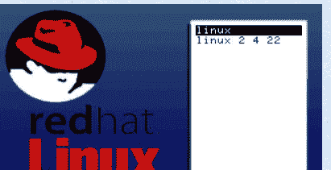


## 修改系统启动菜单

- 修改配置文件
  - LILO: /etc/lilo.conf
  - GRUB: /boot/grub/menu.lst
- 用记事本打开这个文本文件
- 可以看到大致有如下的内容：

## 修改系统启动菜单

这段不需要我们修改

```
title Red Hat Linux (2.4.22)
root (hd0,0)
kernel /vmlinuz-2.4.22 ro root=/dev/hdc2

title Red Hat Linux (2.4.18-14)
root (hd0,0)
kernel /vmlinuz-2.4.18-14 ro root=LABEL=/
initrd /initrd-2.4.18-14.img
```

这段内容需要修改

这段内容请一定保留！！！

## 修改系统启动菜单

```
title Red Hat Linux (2.4.21)
root (hd0,0)
initrd /initrd-2.4.18-14.img
kernel /vmlinuz-2.4.21 ro
root=/dev/hda1"
```

换成你喜欢的名字，不能用中文，不能太长。

如果有这一行请删除

输入命令df，回车。可以看到：
Filesystem Used Available Use% Mounted on
/dev/hdc2 28030340 23% /
/dev/hdc1 76831 20% /boot
找到Mounted on / 这一行，令root=这一行的FileSystem

## 修改系统启动菜单

- 请修改的时候特别小心，否则可能造成你的系统不能启动！
- 请修改好的同学让我检查，或互相检查。
- 如果是用 **LILO** 启动，修改后请输入命令 `lilo` 并回车。


## 用新的内核启动

- 这是一个激动人心的时刻，请再次检查你的修改，用LILO的系统请确保输入了命令lilo。
- 祈祷你所信奉的上帝，真主或者佛祖。如果你是你无神论者，省略这一步。😊
- 输入reboot命令重新启动。在出现LILO或者GRUB菜单时，选择2.4.21内核。
- 如果启动成功，请查看/proc/version以确保内核版本确实是2.4.21


## 用新的内核启动

- 如果启动成功，请坐下来放松一下。别忘了告诉好友，你的内核可以运行！🙂
- 如果启动失败，请按reset重新启动，然后在LILO或GRUB界面选择老版本内核。
- 如果启动失败，并且老版本内核不能启动，请通知我，并换一台机器。☹
- 请记住本次的步骤、经验和教训，下次我们将要修改内核，添加一段自己的代码进去！


## 添加监视当前进程的代码

- 在时钟中断里？在调度任务切换时？
- 如何寻找时钟中断代码的位置？
- 如何寻找任务切换代码的位置？
- 从内核杀死一个进程，通过温和的方式，发送信号(force_sig())，暴力方式直接从队列中摘除，并释放资源

## 谢谢！

## Have a rest!

## 操作系统课程实验
添加系统调用

2003.12


## 演示 基于意识识别的
Windows安全登陆

- 大家想一想，为什么告诉你密码，你都
  没法进去？？


## 回顾： 用新的内核启动

- 如果启动成功，别忘了告诉好友，你打造的内核可以运行！😊
- 如果启动失败，请按reset重新启动，然后在LILO或GRUB界面选择老版本内核。
- 请回忆上次的步骤，经验和教训，这次课我们将要继续修改内核，添加一段自己的代码进去！

## 系统调用的细节

- Linux系统调用是通过中断实现的。
  int 80h指令，发生一个中断
- 中断发生时，系统将转到核心态的中断处理程序。
- 中断处理结束，系统将返回用户态。
- 有很多个系统调用，中断处理程序如何知道调用的是哪一个？

## 系统调用的细节

- 把系统调用进行编号。
- 形成一张“系统调用表”。
- 需要调用open()时，先把open()的编号5放在ax寄存器中，再发生中断。
- 中断处理程序根据ax查表，得知需要调用的是open()，而不是其他。

| 编号 | 系统调用 |
| --- | --- |
| 1 | exit() |
| 2 | fork() |
| 3 | read() |
| 4 | write() |
| 5 | open() |
| ...... | ...... |

## 系统调用的细节

- 比如有这样一段程序

用户态

核心态

中断处理程序

```
mov ax,5
int 80h
```

```
......
```

```
mov ax,3
int 80h
```

```
......
```

```
mov ax,4
int 80h
```

```
......
```

| 编号 | 系统调用 |
| --- | --- |
| 1 | exit() |
| 2 | fork() |
| 3 | read() |
| 4 | write() |
| 5 | open() |

## 系统调用

- 系统调用表在哪里？

在/usr/src/linux-2.4.22/arch/i386/kernel/entry.S中
打开这个文件，翻到末尾

```
ENTRY(sys_call_table)
.long SYMBOL_NAME(sys_ni_syscall)
/* 0 - old "setup()" system call*/
.long SYMBOL_NAME(sys_exit)
.long SYMBOL_NAME(sys_fork)
.long SYMBOL_NAME(sys_read)
.long SYMBOL_NAME(sys_write)
open)
/* 5 */
```

表中标有sys_ni_syscall的，是指这一项没有被使用。

按照Linux的习惯，给系统调用名字前面加“sys_”，作为系统调用的处理函数名。


## 注意！

将来我们这个函数执行的时候，是在核心态下面执行，也就是说，用户态下面能够使用的所有库函数，现在都不能用了，包括printf函数也不行。好在printf可以用printk代替，作用和用法都类似。

- 第一
- 可以
- 请用
- 在后

法是在现
ork.c里添
l/fork.c

```
asmlinkage
/*函数名 sys_my_syscall*/
{ /*这个函数的唯一作用是向屏幕上输出一句话*/
printk("Hello, now we are in the kernel\n");
return 0;
```


## 增加系统调用

- 第二步，我们需要在系统调用表里面加一条，以便用户需要调用的时候，中断处理程序可以通过查表，找到我们的函数sys_my_syscall()
- 请回忆系统调用表的样子。
- 用记事本打开/usr/src/linux-2.4.22/arch/i386/kernel/entry.S
- 翻到最后，可以看到系统调用表。

- 代码中，以注释的形式标明了表中每一行的编号。
- 随便找一项没有使用的（标记为 sys_ni_syscall 的都是没有使用的），记住编号。
- 比如我找到的是 250 号。☺
- 把 sys_ni_syscall 改成 sys_my_syscall

- 第三步，重新编译内核。
- 依次输入以下命令：
```
cd /usr/src/linux-2.4.22
make clean
make dep
make bzImage
make install
```
- 输入reboot，重新启动计算机。用新内核引导。

## 测试系统调用

- 系统调用已经增加成功了吗？编个小程序测试一下！

```
#define __NR_my_syscall 250
int errno;
/* 这里告诉编译器，my_syscall系统调用的编号是250 */
#include <linux/unistd.h>
_syscall0(int,my_syscall)
/* 这里告诉编译器，请把my_syscall作为一个系统调用来编译，而不是普通函数 */
main()
{
    my_syscall(); /* 在main函数里面使用了这个系统调用 */
}
```

- 保存，编译并运行这个小程序。
- 比如保存成为test.c
- 编译这个程序： gcc -otest  test.c
- 运行这个程序： ./test
- 观察运行结果。
- 虽然这个程序仅仅输出了一句话，但是我们看到，这句话是由内核输出的，和使用printf编写的程序有本质的不同

- 在内核中，不能使用任何一个C库函数。
- 但是在内核中，可以访问到很多用户无法知道的数据。比如：

| 变量名 | 变量类型 | 含义 |
|---|---|---|
| current->state | long | 是否正在运行 |
| current->counter | long | 剩下的时间片 |
| current->nice | long | 优先级 |
| current->pid | int | 进程号 |
| current->pgrp | int | 进程组号 |

## 上面都做完了？

- 恭喜，恭喜。你不仅编译了内核，而且尝试着修改并启动了新的内核，还在这个内核上增加了一个系统调用。能够把这些步骤全都做完是相当不容易的。
- 一批崭新的Linux高手在我们的速成班里闪亮登场了！😊
- 回忆一下系统调用的执行流程，下节课将要提问。

## 谢谢！

## Enjoy Music

## 操作系统课程实验
编写内核模块

2003.12

## 实验二 知识要点回顾

- 一般的函数调用是通过x86 CPU的哪两条指令实现的？
- Linux系统调用是通过x86 CPU的哪条指令实现的？
- 为什么系统调用不能使用call和ret指令来实现？
- 当发生中断时，中断处理程序如何知道用户需要的是哪个系统调用？


- 我使用空闲的系统调用号250，添加了一个系统调用my_syscall()，当一个用户态程序调用my_syscall()的时候，简要说明一下在计算机内部的执行流程。

- 我在系统调用my_syscall()的处理程序里面写了这样一行：
printk("Hello, now we are in the kernel\n"
这里为什么用printk，而不是printf？

- 一般的函数调用是通过x86 CPU的哪两条指令实现的？
  - call和ret指令
- Linux系统调用是通过x86 CPU的哪条指令实现的？
  - int指令（准确的说，是int 80h指令）

- 为什么系统调用不能使用call和ret指令来实现？
  - 因为call和ret不能从用户态转到核心态。

- 当发生中断时，中断处理程序如何知道用户需要的是哪个系统调用？
  - 给系统调用编号，查系统调用表可知。


- 简要说明一下自己的系统调用 my_syscall()在计算机内部的执行流程。
  - 被编译器编译成为两条指令 mov ax,250和 int 80h，后者执行时转核心态的中断处理程序，中断处理程序根据ax查表得到 my_syscall()的地址，然后在核心态下调用 my_syscall()。调用后返回用户态。

- 在my_syscall()的处理函数中为什么用printk，而不是printf?
  - 因为中断的处理函数在核心态下执行，核心态不能调用任何C语言的库函数，包括printf。必须调用核心库函数，如printk等等。

- 在内核中，不能使用任何一个C库函数。
- 但是在内核中，可以访问到很多用户无法知道的数据。比如：

| 变量名 | 变量类型 | 含义 |
|---|---|---|
| current->state | long | 是否正在运行 |
| current->counter | long | 剩下的时间片 |
| current->nice | long | 优先级 |
| current->pid | int | 进程号 |
| current->pgrp | int | 进程组号 |

## 实验二的麻烦

- 我们在实验二中遇到了很多的问题。
- 比如编译内核源代码非常耗费时间。
- 比如用新内核启动容易造成系统瘫痪。
- 比如用新内核启动会出现很多奇怪的问题，键盘鼠标不工作等等。
- 如果要扩展或者修改内核的功能，一定要重新编译和启动内核吗？


## 内核模块的概念

- 模块(module)是Linux特有的一种机制，可以用来动态地增加内核的功能。
- 可以作为独立程序来编译，但可以随时被链入内核中，成为内核的一部分；也可以随时被卸载。
- 使用模块简单灵活，避免了编译和启动内核的麻烦，却一样能够在核心态下工作。

U盘

显示卡

声卡

网络

内核

U盘

声卡

……

数码相机

内核

核心态

## 编写内核模块

- 请打开记事本（或其他文本编辑器）
- 输入右边的程序
- 保存为hello.c
- 注意第一行的 KERNEL前后各有两个下划线。

```
#define __KERNEL__
#define MODULE
#include <linux/module.h>
#include <linux/kernel.h>

MODULE_LICENSE("GPL");

int init_module()
{
    printk("Hello!\n");
    return 0;
}
void cleanup_module()
{
    printk("Quit...\n");
}
```

- 编译这个程序，输入命令：
gcc -c -I/usr/src/linux-2.4/include -Wall hello.c （注意在一行内输入）
- 看是否已经有文件hello.o
- 如果编译出错，试试把上面的linux-2.4换成linux-2.4.20-8。
- 如果还是编译出错，请找我检查。


## 编写内核模块

- 如果编译成功，输入命令 insmod hello.o 加载这个模块。
- 输入命令 dmesg 看系统日志（最后一行）
- 输入命令 lsmod 看系统中所有的模块，看看有没有 hello。
- 输入命令 rmmod hello 卸载模块。
- 再次输入命令 dmesg 看系统日志。

下面这四行程序的意思是，我们要进行的是核心态编程，并且要编写的是一个模块。如果你不理解，那么只需要记住，编写内核模块的时候，总是先写这四行。

- 我们来逐行分析这个程序

```
#define __KERNEL__
#define MODULE
#include <linux/module.h>
#include <linux/kernel.h>
```

## 分析内核模块

```
int
{
}
```

任何模块都应该有这个函数，在模块将要被卸载的时候，由系统调用。这个函数仍然在核心态执行。

任何内核模块由于是在核心态，所以不能

这个函数返回值0，也就是通知系统，模块加载已经成功。若返回值非0则说明模块加载不成功。

任何内核模块由于是在核心态，所以不能这个函数时候，行。

## 更高级的内核模块

- 目前为止，我们编写的内核模块还非常简单，除了在系统日志中打印了两句话以外，没有其他的作用。
- 我们将在这个基本的内核模块上扩充。
- 这个内核模块虽然简单，却是下面的实验4，实验6的基础。请认真对待。

## 谢谢！

## 操作系统课程实验
### 显示进程列表
2005.12

## 内核模块回顾

- 内核模块提供了一种非常简单的核心态程序的编写方法。
- 可以用短短几行程序进入核心态。
- 可以随时加载和卸载。
- 不需要编译内核，不需要用新内核启动。简单方便，是您居家旅行，修改内核必备之物！ 🙂


## 内核模块回顾

- 如果加载时出现版本不兼容的问题，请在程序最前面加一行：
  `#define __NO_VERSION__`
  （注意下划线分别是两个，一个，两个）
- 编译的时候使用下面的命令：
  `gcc -c -I/usr/src/linux-2.4.20-8/include`
  `-Wall hello.c`
  （注意 -Wall前面也有空格）

## 内核模块回顾

- 加载内核模块，卸载内核模块，分别用到Linux中的哪条命令？
- 我想查看当前系统中是否加载了内核模块hello，应该如何去做？

## 内核模块回顾

```
int init_module()
{
    printk("Hello!\n");
    return 0;
}
void cleanup_module()
{
    printk("Quit...\n");
}
```

## 内核模块回顾

- 加载内核模块，卸载内核模块，分别用到 Linux 中的哪条命令？
  insmod加载，rmmod卸载。
- 我想查看当前系统中是否加载了内核模块 hello，应该如何去做？
  lsmod可以看到系统中所有模块
  或者，
  查看/proc/modules文件的内容即可。

## Mission

- 编写一个驱动，管理一个数据结构，来记录进程读文件的累计数据量和写文件的累计数据量，注意只记录不输出。（可以出于调试目的进行输出）
- 配合上述驱动写一个系统调用，该系统调用的功能是，用户给一个进程PID号，系统调用返回该进程的读写文件的数据量。用户程序通过与用户交互，输出用户感兴趣的进程的读写数据量。
- 功能提升：扫描用户写入磁盘的数据，凡是带有“password”的字样的Buffer，驱动就负责记录，应用程序通过系统调用获取你的监控情况。
- 功能提升：使用下节课要讲的建立Proc文件对外暴露你的监控结果

编写一个驱动，管理一个数据结构，来记录进程读文件的累计数据量和写文件的累计数据量，注意只记录不输出。（可以出于调试目的进行输出）

配合上述驱动写一个系统调用，该系统调用的功能是，用户给一个进程PID号，系统调用返回该进程的读写文件的数据量。用户程序通过与用户交互，输出用户感兴趣的进程的读写数据量。

功能提升：扫描用户写入磁盘的数据，凡是带有“password”的字样的Buffer，驱动就负责记录，应用程序通过系统调用获取你的监控情况。

功能提升：使用下节课要讲的建立Proc文件对外暴露你的监控结果

## 提示

1. 初始化驱动的时候，不择手段的找到 sys_call_table 的地址(可以只针对你自己的内核，不要求通用性)，然后备份并替换相应的表项，使其指向你的驱动中的对应函数，如 myread(...),mywrite(...)

2. 可以做出适当的简化，如：只记录某一个进程的读写信息，也可以只记录某10个进程的读写信息等。

3. 仔细设计系统调用参数接口：
   - int getProcReadInfo( unsigned long pid, struct proc_RW_info *info);
   - 其中 struct proc_RW_info {
     - unsigned long total_read_bytes;
     - unsigned long total_write_bytes;
     - };

此外，记住不论是从用户空间读取数据，还是从内核向用户空间写数据都不能直接使用用户提供的指针对用户空间进行读写，而要使用： copy_from_user()、copy_to_user() 函数

最后记住，不要急于动手，先看清这项任务的技术难点，做试验解决难点问题，为你完成任务铺平道路。
然后，分步骤写代码，写好一步，调试一步，最后完成任务。

## Linux的进程管理

- 为了管理进程，内核必须对每个进程的相关信息进行详细的描述。
- 在Linux内核中，使用结构task_struct来描述一个进程。在文件/usr/src/linux-2.4.20-8/include/linux/sched.h中，大约1/3处。
- 这个结构有将近一百个成员变量。


## Linux的进程管理

- 也就是说，在Linux中，每个进程都用这个结构来描述。
- 我们的任务，就是找到所有进程的task_struct，打印出尽量多的成员变量。
- 所有进程的task_struct都通过成员变量next_task和prev_task构成了双向循环链表。
- 链头用全局变量init_task表示。
- 即： `struct task_struct init_task;`

每个进程的 `task_struct` 都有 `prev_task` 和 `next_task` 两个成员变量，分别指向前一个和后一个任务。构成循环链表

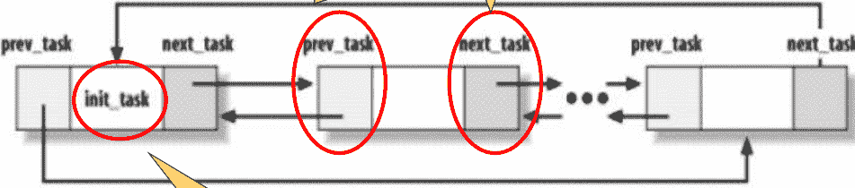

全局变量，任何核心态的程序都可以直接访问。

## 改进内核模块

- 请输入如右所示的程序：
- 请修改这个程序，添加一段代码，输出系统中的所有进程及其相关信息。

```
#define __NO_VERSION__
#define __KERNEL__
#define MODULE
#include <linux/module.h>
#include <linux/kernel.h>
#include <linux/sched.h>
int init_module()
{
struct task_struct *p = &init_task;
/*请编程用指针p遍历链表并输出。*/
    return 0;
}
void cleanup_module()
{
}
```

## 谢谢！

## 操作系统课程实验
### 创建proc文件
2005.12

## proc文件系统

- 当我查看/proc/meminfo文件时，看到的内容是什么？

## proc文件系统的概念

- proc文件系统是一种在用户态检查内核状态的机制。
- 如 /proc/meminfo，可以读出当前的内存使用情况。
- /proc/meminfo是磁盘文件吗？
  - 如果是普通的磁盘文件，效率太低
  - 它是一种特殊的文件，只有当用户读它的时候，才去准备有关内容


## 其他的proc文件

| 子目录/文件名 | 内容描述 |
| --- | --- |
| apm | 高级电源管理信息 |
| bus | 总线以及总线上的设备 |
| devices | 可用的设备信息 |
| driver | 已经启用的驱动程序 |
| interrupts | 中断信息 |
| ioports | 端口使用信息 |
| version | 内核版本 |

## proc文件系统的特点

- 每个文件都规定了严格的权限
  - 是否可读？是否可写？
  - 哪个用户可读？哪个用户可写？
- 可以由任何文本编辑程序读取（more命令，cat命令，vi程序，自己编的读文件程序，等等）
- 不仅可以有文件，还可以有子目录（文件夹）
- 可以自己写程序添加一个/proc目录下的文件


## 一个例子

- 编译这个模块。
  `gcc -c -I/usr/src/linux-2.4.20-8/include proc_test.c`
- 加载这个模块。
  `insmod proc_test.o`
- 用lsmod命令检查是否已经加载成功。
- 如果加载不成功，请找我检查。
- 看看是不是多了一个/proc/proc_test目录。（输入以下两行命令）

  ```
  cd /proc
  ls
  ```

- 看看有没有三个文件，名字叫current, current_too和hello。

  ```
  cd /proc/proc_test
  ls
  ```

- 看看current文件的内容：
  `more current`
- 看看current_too文件的内容：
  可以看出这个文件的内容和current差不多，其实这个文件是一个链接，指向current。
- 看看hello文件的内容。


## 创建proc文件

在上面的例子中，我们看到，通过编写一段程序，在/proc目录下创建了如下内容：

- 一个名叫proc_test的子目录。
- 一个名叫current的文件，只读，读出的内容是读它的进程的情况。
- 一个名叫current_too的链接，指向current。
- 一个名叫hello的文件，可读可写。读出的内容是上次写的内容前面加两句话。

## 分析这个程序

- 总体结构——五个函数
  - init_module （创建所有的proc文件）
  - cleanup_module （清除所有创建的内容）
  - proc_read_current （当需要读current文件的内容时，由内核调用这个函数）
  - proc_read_hello （和上面类似）
  - proc_write_hello （和上面类似）

## 程序

我要：proc 可以加载，不过要给我创建一个叫hello的proc文件，到时候如果读写这个文件，你就找hello_read和hello_write。

用户要加载我们这个模块了。

```
init_module
```

```
hello_read
```

```
hello_write
```

好吧，我同意创建文件。

我要写文件hello。

内核：

用户要写文件了，要写的内容是12345。怎么办？

知道了，我已经记下来了。

```
hello_write
```

12345

我要读文件hello。

这个文件可以读。读出的内容是：

```
hello message:
More write: 12345
```

内核：

用户要读文件了，老大，赶快准备一下撒！

就把我上次读到的内容前面加两句话，然后交给她。

```
hello_read
```

12345

## 创建proc文件

- **proc_mkdir函数**：创建一个目录。
  - 参数1：字符串，要创建的目录名。
  - 参数2：在哪个目录下创建，一般用NULL表示在/proc下创建。
  - 返回值：一个指向proc_dir_entry结构的指针。
  - 注意，以下几个函数都要在调用后，对返回的proc_dir_entry结构进行设置。

- **create_proc_read_entry函数**：创建一个只读的proc文件。
  - 参数1：字符串型，要创建的文件名。
  - 参数2：整数型，文件的访问权限。
  - 参数3：在哪个目录下创建。
  - 参数4：读函数。告诉内核如果用户要读这个文件的时候应该找谁处理。
  - 参数5：告诉内核在找读函数的时候，顺便给它一个指针，一般不用的话（或者你看不懂的话）就写NULL。

- **create_proc_entry函数**：创建一个普通的proc文件。
  - 参数1：字符串型，要创建的文件名。
  - 参数2：整型，文件的访问权限。0666表示所有用户都可以访问。
  - 参数3：在哪个目录下创建，可以用NULL表示在/proc下创建。
  - 创建之后，还要设定读函数和写函数。


- **proc_symlink函数**：创建一个链接文件。
  - 参数1：字符串型，要创建的链接文件名。
  - 参数2：在哪个目录下创建，可以用NULL表示在/proc下创建。
  - 参数3：字符串型，要链接到哪个文件。

## proc文件和用户的交互

- 当用户（用户态程序）写proc文件时，内核调用预先设定的写函数。（回调）
- 写函数的例子，请看例子程序里面的 proc_write_hello函数。
- 参数2，3对我们有用，分别表示要写什么东西进去，要写多少字节。
- 注意要用copy_from_user函数。
- global_buffer是我们用来保存数据的缓冲。

- 当用户（用户态程序）读proc文件时，内核调用预先设定的读函数。
- 读函数的例子，请看例子程序里面的 proc_read_hello函数。
- 参数1，3，4对我们有用，分别表示读到哪里去、从什么位置开始读、以及要读多少个字节。
- 返回值：实际读出的字节数。

## 更多的任务？

- 请参照课件，读懂这个示例程序。
- 请注意理解上面所说的几个函数，不过不必记住具体的格式。
- 可以自己试试再加一个 proc 文件，多练习有助于你的理解。

## 谢谢！

## 操作系统课程实验

### 驱动程序简介

2004.1

## 巨星陨落

2002年8月6日。

在与癌症进行了多年的斗争之后，荷兰计算机科学家Dijkstra在荷兰Nuenen自己的家里与世长辞，终年72岁。

Dijkstra 1930年生于Rotterdam，母亲是数学家。

曾担任程序设计教授等。1979年退休。


每当我试图在程序中悄悄的使用一些很不优雅的结构以达到偷懒的目的，我就仿佛看到大师正站在我的背后，对我说，“你不可以这样做”，让我惭愧不已。


## 巨星陨落

- 1965年，人们为并行程序中随机出现的难以预测的错误而头痛不已。
- 由于错误不可重现，难以找到真正原因。
- Dijkstra第一个提出“哲学家就餐”问题，并给出了PV操作的概念，完美的解决了这一问题。
- Dijkstra为首的一批科学家的努力，使操作系统走上了健康发展的道路。


## 巨星陨落

```
for v in Vertices (0): 
d[v] = Infinity
T.Add(s)
while T.IsNotEmpty():
v = pickMinimal(T, d)
T.Remove(v)
for v in Neighborhood(v):
if d[v] > d[v] + weight[v,v]
d[v] = d[v] + weight[v,v]
pred[v] = v
```


- 加权有向图的最短路径问题
- 经典，完美的 Dijkstra算法
- 应用无处不在

## 巨星陨落

- 第一个Algol 60编译器的设计者和实现者。
- THE操作系统的设计者和开发者。
- 被西方学术界称为“结构程序设计之父”和“先知先觉”。
- 与D. E. Knuth并称为20世纪最伟大的计算机科学家。

## 巨星陨落

- 阿兰图灵的自杀是在半个世纪之前，冯诺依曼去世也已多年，作为这个新兴的行当中的从业者，我们似乎已经很习惯于从相信，从书上读到的每个名字都是仍然在世的活生生的人。
- 今天，一颗真正的巨星在我们的眼前陨落！作为一名普通程序员，我从内心感到惋惜和悲痛。
- Dijkstra引导了并且将继续引导这个星球上所有的程序员，他的贡献和影响将与世长存！


## 什么 hello 序

- 为了使外部设备能够正常工作，系统需要...系统需要...这种
- 驱动程序是我们所学习的实验的一个
- 这节课...程序的例子，并且...

我要读文件 hello

文件hello的内容好像保存在硬盘的第200个扇区。

内核

麻烦你帮我找一下硬盘第200个扇区的内容。

硬盘驱动程序

嘿，伙计，醒醒。老大需要第200个扇区的内容。

硬盘


## 设备和设备文件

- 什么是硬件设备？
- 除了CPU和总线、内存之外的所有计算机硬件。（硬盘，声卡，显示器，等等）
- 在Linux中，将所有可能出现的设备都当作一个特殊的文件，叫做设备文件。
- 所有的设备文件都保存在/dev目录下面

## 主设备号和次设备号

- 主设备号标明了设备的类型，比如软盘是2，硬盘是3，SCSI硬盘是8，等等。
- 次设备号标明了系统中每一个这样的设备，比如第一个硬盘是0，第二个是1，等等。
- 也就是说，设备号为(3, 0)的设备文件，表示了实际系统中的第一个硬盘。

## 建立设备文件

- 使用Linux命令mknod建立一个设备文件。
- 比如输入mknod /dev/my_disk b 42 0命令，说明要建立一个块设备文件，名字是my_disk，主设备号是42，次设备号是0。
- 主设备号42在系统中是空闲的，因此一般应该能够建立成功。
- 看看你是否成功的建立了这个文件。  - 输入命令 ls -l /dev/my_disk

## 试试这个例子！

- 从我这里copy两个文件radimo.c和radimo.h。
- 不妨放在/root目录下。
- 编译这个程序：
- gcc -c -I/usr/src/linux-2.4.20-8/include radimo.c
- 编译生成一个模块radimo.o，就是我们的驱动程序。

## 试试这个例子！

- 加载这个模块： insmod radimo.o
- 刚才我们已经创建了一个设备文件 /dev/my_disk，在驱动程序没有加载之前，这个设备文件是无效的。
- 加载驱动程序后，这个设备才有效。
- 这是一个用内存虚拟的磁盘，容量2M

## 试试这个例子！

- 格式化这个磁盘，使用 ext2 格式：
  `mke2fs /dev/my_disk`
- 在系统中挂接这个磁盘：
  `mount /dev/my_disk /mnt`
  - 这个命令和使用U盘有些相似？
- 查看系统中已经挂接的磁盘：
  - 输入命令 `df`，至少可以看到两个磁盘，一个是硬盘，一个是刚才挂接的虚拟磁

## 试试这个例子！

- 现在你的/mnt目录成为了一
  个大小为
  2M的虚拟磁盘。
- 可以把任意的大小不超过2M的文件复制
  进去。
- 玩够了，就输入umount /dev/my_disk
  卸载这个虚拟磁盘。
- 最后输入rmmod radimo卸载这个驱云
  程序。

## 工作原理

- 我们一起来分析radimo.c这个程序，看看驱动程序的工作原理。
- 主要包含以下几个函数:
  - radimo_request
  - radimo_open
  - radimo_ioctl
  - radimo_release
  - init_module
  - cleanup_module

## 工作原理

- 上述6个函数之间的关系

内核

init_module（模块加载的时候，注册驱动程序）

radimo_open（打开设备）

radimo_ioctl（查询设备参数）

radimo_request（读写设备）

radimo_release（关闭设备）

cleanup_module（卸载模块和驱动程序）

## init_module的流程

- • 函数的调用时机：模块加载时由内核调用。
- • 1.申请内存，注意要用内核函数vmalloc，而不是C库函数malloc
- • 2.向系统注册块设备，用内核函数register_blkdev（设备号，设备名，函数表）
- • 3.设定设备的读写函数，用内核函数blk_queue_make_request(设备号，读写函数)
- • 4.初始化其他要用的全局变量。
- • 5.在这个程序里面调用MSG宏相当于printk

## radimo_open的流程

- 函数的调用时机：当系统准备使用你所负责的设备时，由内核调用。
- 所做的唯一的事情：用 MOD_INC_USE_COUNT增加引用计数，也就是说，从这个时候开始，驱动程序不能被随便卸载。
- 还有一些关于定时器的语句，本程序中忽略

## radimo_ioctl的流程

- 用户程序在使用设备之前，会查询设备的属性，比如磁盘大小、速度等等。
- 这些属性由radimo_ioctl函数提供。
- 参数cmd表示要查询设备的哪个属性。我们只关心BLKGETSIZE，就是磁盘的大小。
- 用put_user函数把一个数字写到用户地址空间。

## radimo_request的流程

- 将在系统需要读写设备的时候被调用。
- 1.计算要读写的地址。 sbh->b_rsector 表示要读写的扇区号， radimo_hard表示每个扇区的字节数。那么两者相乘就可以得到要读写的地址（以字节计算）。


# radimo_request的流程

- 2.判断访问是否越界？越界的访问是不合法的。

| 512 | 512 | 512 | 512 | 512 | 512 | 512 | 512 |

# radimo_request的流程

- 3.判断是读还是写？
  - 如果是读，就把数据从驱动程序的缓冲区中搬到操作系统的缓冲区中。
  - 如果是写，就把数据从系统缓冲区中搬到驱动程序的缓冲区中。
- 如果是U盘的驱动，应该怎么办？
  - 把上面的驱动程序缓冲区换成usb接口。

# 其他函数的流程

- radimo_release函数:
  - 在关闭设备的时候被调用
  - 减少引用计数，允许卸载本模块。
- cleanup_module函数:
  - 在模块卸载的时候被调用。
  - 做一些清理现场的工作。

# 你需要做的工作？

- 仔细阅读radimo驱动程序的源代码。
- 不懂的地方，可以参考我编写的实验教案。
- 把这个程序修改成一个U盘的驱动程序。
- 请特别留意内核函数usb_bulk_msg的用法和SCSI接口规范，以及磁盘分区表结构。
- 可能需要读一些英文原版资料。

# 你需要做的工作？

- 检查时，你需要当场独立完成以下操作：
  - 用lsmod命令查询系统中是否已经加载usb-storage的模块，这是Linux系统自带的U盘驱动程序。如果已经加载，则用rmmod命令卸载这个模块。
  - 编译改装后的radimo程序，要求能编译通过，允许出现编译警告。
  - 用insmod命令加载改装后的radimo程序。
  - 插入U盘。要求在用dmesg查看系统日志时，能够到改装的radimo程序发现了U盘。允许你的程序认识一种或者有限的几种U盘，不要求能够认出所有U盘。
  - 能够在系统日志中显示出U盘的容量。

# 你需要做的工作？

- 用mknod命令建立设备文件，并用mount命令挂接这个U盘的文件系统到/mnt。你的U盘可以预先用Windows格式化好。
- 用df命令应该能够看到已经挂接好的U盘。
- 用ls /mnt命令应该能够看到U盘中的内容。用cp命令能够将U盘中的任意文件复制到硬盘上。
- 用umount命令和rmmod命令清理现场。
- 在以上各步骤中，随时回答老师提出的问题。不要回答完全准确，但基本原理必须能够阐述清楚，可以当场查资料，但不能询问他人。


# 你需要做的工作？

- 如果你还能够完成下面的操作，则会有更多的奖励分数：
  - 能够读出U盘主引导扇区的内容，显示在系统日志里，并简要解释其含义。
  - 能够在U盘被中途拔出的情况下正确识别，并进行相应的错误处理，不至于死机。
  - 能够把硬盘上的文件复制到U盘上，并在Windows系统下面插入U盘，显示出这个件，证明复制成功。

# Good Luck!

- 相信你自己，一定能够完成！
- 独立！独立！独立！

# 祝大家春节愉快！
下学期再见！


# 谢谢！

# Have a rest!
