# 国防科大项目管理课件（毛新军）

## 软件危机的表现(2 of 3)

- 软件质量得不到保证
  - 软件应用面的扩大：科学计算、军事、航空航天、工业控制、企业管理、办公、家庭
  - 软件越来越多的应用于安全关键(safety critical)的系统，对软件质量提出更高的要求
  - 80年代欧洲亚丽安娜火箭的发射失败，原因是软件错误
  - 美国阿托拉斯火箭的发射失败，原因是软件故障
  - 英国1986年开发的办公室信息系统Folios经4年，因性能达不到要求，1989年取消
  - 日本第5代机因软件问题在投入50亿美元后于1993年下马
- 由于软件质量问题导致失败的软件项目非常多

## 软件危机的表现(3 of 3)

- 进度难以控制
  - 项目延期比比皆是
  - 由于进度问题而取消的软件项目较常见
  - 只有一小部分的项目能够按期完成
- 维护非常困难
  - 软件维护的多样性
  - 软件维护的复杂度
  - 软件维护的副作用

## 产生软件危机的根源

- 逻辑产品，不同于物理产品
- 复杂性高
  - 逻辑产品，逻辑复杂度，远高于硬件复杂度
  - 软件的复杂性随规模呈指数级上升
- 规模大
  - 应用扩大，代码量，1000万行，仍不断膨胀
- 影响软件生产率和质量的因素比较复杂
  - 人员的能力和水平
  - 团队合作
- 缺乏有效、系统原理、原则、方法和工具的指导和辅助

### 技术手段不能完全解决软件危机

- 到了20世纪90年代，软件危机依然存在，甚至更为严重
  - 应用牵引技术的发展
    - 瀑布模型
    - 结构化软件开发方法
    - OO软件开发方法
  - 技术推动应用的深化
    - 应用的扩大和深入
  - 应用变得越来越大和复杂，技术变得更加力不从心
  - 错误的观念：“只要有好的软件开发方法和工具就能高效率地开发出高质量的软件”

## 解决危机的管理途径

问题出在哪里？

20世纪80年代末，美国DoD和工业界开始认识到管理的重要性

- 美国DoD的一项研究表明，70%的项目由于管理不善导致难以控制进度、成本和质量；
- 进一步的研究发现：管理是影响软件项目成功开发的全局性因素，而技术只影响局部
- 如果软件开发组织不能对软件项目进行有效管理，就不能充分发挥软件开发方法和工具的潜力，也就不能高效率地开发出高质量的软件产品

## 重视管理

- 管理是影响软件项目成败的第一要素
- 学术界和工业界开始研究和探索针对软件企业以及软件开发所需的管理机制和措施
- 提高企业的过程管理和发展控制能力
- ISO 9000系列 - 强调质量
- CMMI - 强调企业的过程管理和发展控制的能力
- 强化软件项目的管理
- 需求、质量、风险、成本、版本等的管理

## 软件项目管理的本质

- 对象
  - 人员、成本、产品
- 主线
  - 过程
- 目标
  - 在成本和进度范围内开发出高质量的软件产品

- 教师
  - 毛新军，计算系602教研室
  - Tel: (45)73649(o)
  - Email: xjmao@nudt.edu.cn
- 课件下载
  - Homepage: http://www.618.net.com

## 理解

- 什么是软件项目管理？
- 为什么需要对软件项目进行管理？
- 软件项目管理涉及那些方面？
- 软件项目管理需要解决那些问题？
- 软件项目管理有关的标准和规范
- 软件项目管理的有关概念

## 掌握

- 解决问题的具体方法和措施
  - 问题
  - 过程
  - 方法
  - 结果
- 辅助软件解决的各种工具
  - CASE工具

## 运用

- 增进组织在软件项目管理方面的能力
- 推动组织的软件项目管理
- 制定满足标准和规范的有关规程
- 针对企业和机构的特点，在实际的项目开发过程中运用所学的知识促进软件项目管理

- 案例引入，分析问题和提出问题
- What, Why, How
- 支持管理的CASE工具
- 针对案例解决问题
- 小结

- 学习和掌握先导课程
- 理解知识点和思想
  - 无需死记硬背
  - 大胆提出你的想法和意见
- 掌握方法和工具
- 运用解决实际问题，实践，课程实习
- 阅读相关资料

- 课程实习(约60%)
- 考试(约40%)

- 相关课堂内容讲解完成之后

- 2 - 3周之内

- 电子文档

- 完整性、合理性、规范性

- 分组
  - 以小组为单位，2-3人一组为宜
- 报告
  - 正规的文档，按阶段递交和打分
- 讲解
  - 10个学时讲解、How & Why
- 讨论
  - 课堂讨论

- 《管理软件开发项目-通向成功的最佳实践》，[美]尼尔·怀特，电子工业出版社，2002年
- 软件项目管理案例教程，韩万江，姜立新，机械工业出版社，2005
- 软件工程实践导论--有关方法、设计、实现、管理之三十六计，金尊和，清华大学出版社，2005.
- 《软件开发的科学与艺术》，微软亚洲研究院，电子工业出版社，2002年

- 软件项目管理实践，Pankaj Jalote，清华大学出版社，2003
- 《软件工程－实践者的研究方法》，R S.Pressman，机械工业出版社
- 《超越混沌—有效管理软件开发项目》，[美]里·康斯坦丁著，雷明等译，电子工业出版社，2002年
- 《软件项目管理：一个统一的框架》，Walker Royce，中信出版社，2002年
- 《领导软件开发团队》，Whitehead，电子工业出版社，2002年

- 《从技术主管到项目经理》, Patricia Ensworth, 电子工业出版社, 2002 年 3 月

- 《快速软件开发---有效控制与完成进度计划》, 斯蒂夫迈克康奈尔著, 电子工业出版社, 2002 年 1 月

- 《软件开发的滑铁卢》, 罗伯特.格拉斯, 电子工业出版社

# Q & A

# Practice, Practice, and Practice

毛新军

xjmao21@21cn.com

http://software.nudt.edu.cn/~xjmao

计算机科学与技术系602教研室

0731-(45)73649

## 软件项目管理概述

- 1. 软件项目案例
- 2. 管理是重要的
- 3. 什么是软件项目管理
- 4. 与软件项目管理有关的规范和标准
- 5. 小结

## 项目案例(1/3)

- 任务
  - 负责组织大学图书馆管理系统的开发
- 时间限制
  - 6个月
- 人员
  - 4个技术人员
- 成本
  - 控制在40万元之内

## 项目案例(2/3)

- 小王的长处
  - 精湛的技术，尤其是软件设计和程序设计技术
  - 丰富的软件开发经验，参加过许多项目的开发
  - 有成功的项目开发案例，对个人技术信心十足
- 小王的欠缺
  - 从来没有完整组织过一个软件项目的开发，不知道如何开展软件项目的开发工作以及需要注意哪些问题

## 项目案例(3/3)

- 小王很茫然，面临许多问题
  - 如何着手开展工作？
  - 能否以及如何保证在规定的时间约束范围内完成工程？
  - 如何保证所开发的软件系统的质量？
  - 怎么去组织手下的技术人员，让他们充满激情地工作？
  - 如何确保项目不会失控？
  - 如何在实施过程中处理各种应急事件？......
- 这些问题都是软件项目开发必须解决的，而且不是纯粹的技术性问题

- 1. 软件项目案例
- 2. 管理是重要的
- 3. 什么是软件项目管理
- 4. 与软件项目管理有关的规范和标准
- 5. 小结

## 管理是重要的(1/4)

### 软件项目开发的任务

- 按照预定的进度、成本和质量，开发出满足用户要求的软件产品
  - 用户需求
  - 确保软件质量
  - 成本限制
  - 进度限制

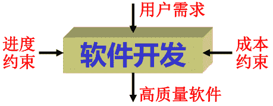

## 管理是重要的(2/4)

- 软件工程的解决方法－运用工程化的手段进行软件开发
  - 强调过程
  - 抽象
  - 文档化
  - 规范化
  - 工具支持
  - ......

## 管理是重要的(3/4)

- 项目组由许多承担不同角色、承担不同任务的人员组成，这些人员构成了一个团体
  - 项目经理、需求分析人员、设计人员、程序员、测试人员......
- 软件开发涉及到许多相互关联的活动，这些活动的实施直接关系到软件项目的成本和进度
  - 需求分析、软件设计、编码、测试......
- 在软件项目实施过程中会产生大量软件产品，这些软件产品相互关联、具有不同的抽象层次
  - 软件需求规格说明书、软件设计规格说明书、源程序代码、可执行代码、测试用例......

## 管理是重要的(4/4)

### 管理软件开发过程

- 明确过程活动
- 估算各个的工作量、成本
- 制定计划，跟踪过程，风险控制

### 管理软件产品

- 有哪些产品，呈什么形式(规范文档)，如何保证它们的质量，如何控制它们的变化

### 管理软件开发人员

- 如何组建一个好的团队、调动团队成员的积极性和激情、严明团队的纪律、促进人员之间的协调与合作

## 什么是软件项目管理

- 对软件项目开发过程中所涉及的过程、人员、产品、成本和进度等要素进行度量、分析、规划、组织和控制的过程，以确保软件项目按照预定的成本、进度、质量要求顺利完成

## 软件项目管理的主要内容

相互关联的管理要素

- 过程管理
  - 过程: 怎么做(How)
- 人员管理
  - 人员: 谁来做(Who)
- 产品管理
  - 产品: 结果(What)

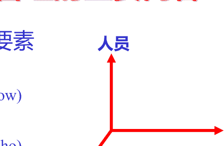

## 3.1 过程管理

- 过程定义和剪裁
- 软件项目计划
- 软件度量
- 软件项目的跟踪和监督
- 风险管理

## 3.1.1 过程定义和剪裁

- 在组织范围内定义、文档化软件开发过程、明确软件开发活动，得到一个良好定义、全面、灵活、简洁和可供剪裁的软件开发过程
- 如何进行根据企业特点定义软件开发过程？
- 如何对它进行文档化？
- 如何确保软件开发过程的有效性(包含了所有各种必须的活动)、简洁性(舍弃无关紧要的过程和活动)和灵活性(根据具体项目情况进行剪裁)？
- 如何根据项目的特点剪裁过程？......

## 3.1.3 软件度量

- 对软件项目的过程、产品、资源的属性的定量描述，如软件项目的规模、成本、工作量、质量等。目的是为了对软件项目进行更好的管理，如制定计划、质量保证等
  - 需要对哪些方面进行度量？
  - 如何进行度量？
  - 如何将度量的结果指导软件项目的管理？
  - 有哪些工具和模型可辅助进行软件度量......

## 3.1.4 软件项目的跟踪和监督

- 跟踪和及时调整软件项目开发计划，提供项目情况的可视性，保证计划的适时调整
  - 要对哪些方面进行跟踪？
  - 如何对软件项目进行跟踪？
  - 当项目不能按照预定计划实施时，如何调整计划？
  - 当跟踪发现问题时如何进行处理
  - 如何提供工具辅助对软件项目进行跟踪......

## 3.1.5 风险管理

- 对软件开发过程中各种风险进行分析、预测、评估、监控的过程
  - 什么是软件开发风险？
  - 软件开发可能会有哪些风险？
  - 如何客观地预测风险？
  - 如何评估风险带来的影响？
  - 如何避免和消除风险？
  - 如何提供工具支持风险分析？......

## 3.2 人员管理

- 软件项目团队
- 纪律和激励机制

## 3.2.2 纪律和激励机制

- 制定和实施纪律约束机制，通过激励机制激发人员的激情，严格的纪律，饱满的激情
  - 如何制定有效的纪律确保项目得以顺利的实施
  - 如何制定措施激励员工的积极性和热情
  - ……

## 3.3 产品管理

- 软件需求管理
- 软件质量保证
- 软件配置管理

### 3.3.2 软件质量保证

- 在软件项目实施过程中为软件产品的质量提供某种可视性，知道哪些地方有质量问题，便于改进方法和措施，提高软件产品的质量
  - 高质量的软件体现在哪些方面？
  - 如何保证软件产品的质量？
  - 如何发现软件的质量问题？
  - 如何制定软件产品质量保证计划？
  - 如何有效落实和实施计划？
  - 如何提供工具支持软件质量保证？……

### 3.3.3 软件配置管理

- 对软件产品进行标识、存储、更动和发放，记录、报告其状态，验证软件产品的正确性和一致性，并对上述工作进行审计的过程
- 如何标识软件产品
- 如何描述软件产品？
- 如何对其软件产品的版本进行控制？
- 如何控制软件产品的变更？
- 如何制定软件配置计划？
- 如何利用工具支持软件配置活动……

1. 软件项目案例
2. 为什么需要对软件项目进行管理
3. 什么是软件项目管理
4. 与软件项目管理有关的规范和标准
5. 小结

## 软件项目管理的规范和标准

- CMM (Capability Maturity Model)
  - 持续过程能力的不断改进和提高
- ISO 9001
  - 软件开发可接受的质量体系的标准

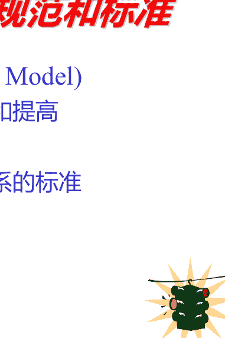

## CMM 简介

1. 基本概念
2. CMM的产生和发展
3. CMM框架
4. CMM的应用

## 基本概念(1/6)

### 软件过程

开发和维护软件及其相关产品(项目计划、设计文档、代码测试用例和用户手册等)的一系列有序的活动，包括“工程活动”和“管理活动”两方面

- 技术活动：需求分析、软件设计、编码等
- 管理活动：制定计划、项目跟踪和监督、质量保证等

软件过程将人员、工具、方法和规程有机结合在一起

- 规程：有哪些活动，这些活动间的关系
- 方法：如何来实施这些活动
- 人员：谁来实施这些活动
- 工具：人员利用什么工具来实施活动

## 基本概念(2/6)

- 软件过程能力(Capability)

  通过遵循软件过程，软件开发活动能够达到预期结果的程度

  事前：预期结果（项目还没实施，用户和组织关注）

- 软件过程性能(Performance)

  通过遵循其软件过程，软件开发活动实际得到的结果

  事后：实际结果

## 基本概念(3/6)

- 软件过程成熟度
  - 软件过程被明确有效地定义、执行、管理、测量和控制的程度
  - 软件过程成熟度用来表示软件过程能力的高低，成熟度高，通过软件开发达到预期结果的程度就高，否则就低
  - 组织必须始终不断地提高软件过程的成熟度

## 基本概念(4/6)

- 软件(过程)能力成熟度等级
  - 表示软件开发组织或项目所具有的软件过程成熟度的等级，即其软件工程和管理能力的等级
  - 不同的等级表示软件过程能力成熟度的高低
  - CMM将软件能力成熟度划分为5个等级
    - 初始级
    - 可重复级
    - 已定义级
    - 已管理级
    - 优化级

## 基本概念(6/6)

### 软件过程评估

- 是由一组受过培训的专业人员作出的估价，目的在于确定机构现行软件过程的状况，确定面向机构的高优先级的软件过程问题，以得到机构对软件过程改进的支持
- 评估一般由组织内部的人员实施

### 软件能力评价

- 是由一组受过培训的专业人员作出的估价，目的在于确定软件开发方的资格，或者对现有软件工作中使用的软件过程状态进行监督
- 评估一般由外部独立的机构进行

## CMM的产生和发展

- 产生
- 发展
- 国际现状
- 国内现状

## CMM的产生

- CMM由卡内基·梅隆大学(CMU)软件工程研究所(SEI)提出
- 最初开始于1986年11月，SEI在MITRE公司的协助下，着手开展CMM的工作，为客户提供评价软件开发方能力、帮助组织改进和提高其软件过程
- 1987年SEI软件过程成熟度的简短描述[Humphrey87a]
- 随后，开发了两种方法（软件过程评估和软件成熟度评价）和一个成熟度问卷，以估计软件过程成熟度
- 1991年SEI将成熟度框架发展为成熟度模型
- 在应用中几经修改，最后在1993年2月正式发布了CMM 1.1版，在DoD和NASA等政府部门得到广泛应用

## CMM的发展

- PSP(Personal Software Process)
  - 面向个体
- TSP(Team Software Process)
  - 面向软件开发团队（组）的软件过程要求
- FAA-iCMM
  - 美国联邦航空管理局提出的集成的CMM
- CMMI
  - CMMI工作计划提出的集成CMM，是一个系列标准，目前包括：CMMI-SW, CMMI-SE, CMMI-SW/SE, CMMI-SW/SE/IPPD, CMMI-SA
- CSCMM
  - 一个中国的CMM

## CMM的国内现状

- CMM近几年在国内引起了高度重视
  - 为了加强企业的国际竞争力，国家支持企业获得CMM的认证
  - 一些企业通过2级以上认证，如东大阿尔派通过3级
  - 有一些主任评估师，如北航的周伯生教授

## CMM的框架

- CMM的组成
- CMM的等级
- 关键过程域
- 关键实践
- 关键实践类

## CMM的组成

5个
表明
成熟度级别
包含
解决
关键过程域
划分为
归类
关键实践类
包含
描述
关键实践
过程能力
主要问题
实施或制度化
活动或基础设施

## CMM的等级

1. 初始级
2. 可重复级
3. 已定义级
4. 已管理级
5. 优化级

- 持续改进的过程
- 可预测、量化的过程
- 标准、一致的过程
- 有纪律的过程

## 初始级(1/2)

- 开发过程是无序的，有时甚至是混乱的，常常以消防模式解决问题。
  - 出现危机时，软件项目一般会脱离计划好的软件开发过程，回到仅仅进行编码和代码调试的工作状态
- 几乎没有妥善定义和认真执行过的软件过程，软件开发缺乏必要的纪律
- 成功往往应归功于个人或少数人的努力，软件工程化水平很差
  - 软件项目的成功完全依赖于杰出的项目管理人员和/或有经验、有战斗力的开发队伍

## 初始级(2/2)

- 开发很类似的项目仍有可能失败
  - 处于级别1的组织仍能开发出成功的产品，但常常超出预算和进度
  - 其成功依赖于有较高能力的个人和少数精英
  - 他们离开组织后，这种能力和影响力随之消失
  - 如果不派他们去开发下一个项目，级别1的机构不能重复已取得的成功
- 能力是个人特征而不是项目组或者组织特征

## 可重复级

- 软件开发组织已建立了管理软件项目的策略和实施这些策略的规程（尽管还没有一个统一的标准，不同的项目有差异），对于新项目的计划和管理基于类似的工程经验
- 较完善的软件工程过程已经建立并被严格强制执行
- 项目执行经过定义的、文档化的、曾经实施过的、人员经培训的、可测量的、强制的以及可改进的有效软件过程
- 开发类似项目保证可重复以往的成功

## 可定义级

- 软件项目已完善地定义其管理过程和工程过程，已将其形成标准化的文档，并且组织已将各个项目定义的软件过程集成为软件开发组织统一的标准软件过程
- 组织内各个项目采用的软件过程都是上述统一的标准软件过程的一个经批准的剪裁版本——项目定义的软件过程
- 组织内建立了一个负责组织过程活动的小组，实施培训，保证人员具备所需的知识和技能
- 执行完善定义而且文档化的过程已成为组织直至个人的自觉行为

## 优化级

- 软件开发组织能自觉地利用各种先进经验以及来自新技术、新思想的先导试验的定量反馈信息来持续不断地改进和优化组织统一的标准软件过程
- 组织的软件过程能力能自动地得到增强和优化，整个软件开发过程已步入一个不断改进的良性循环中

## 关键过程域

- 什么是关键过程域？
- 有哪些关键过程域？
- 关键过程域的组成？

## 什么是关键过程域

- 是指相互关联的若干软件实践活动的集合，描述了为了达到某个成熟度等级必须解决的主要问题（所谓关键表示必不可少）
- 要达到该级需解决的主要矛盾
- 例如，2级中的“需求管理”

## 有哪些关键过程域（2/4）

- 已定义级（3级）
  - 机构过程焦点
  - 机构过程定义
  - 培训大纲
  - 综合软件管理
  - 软件产品工程
  - 组间协调
  - 同行评审

## 软件项目管理概述

## 有哪些关键过程域（3/4）

- 可管理级（4级）
  - 定量过程管理
  - 软件质量管理

## 有哪些关键过程域（4/4）

- 优化级（5级）
  - 缺陷预防
  - 技术更新管理
  - 过程更改管理

## 关键过程域的组成

## 目标

- 每个关键过程域都有一组欲要达到的目标
- 例如，2级中的“需求管理”的目标：控制指定给软件的系统需求，为软件工程和管理应用建立基线

### 关键实践

- 每个关键过程域包含一组必须完成的关键实践，以便达到该关键过程域相应的目标
- 例如，在分配需求被纳入软件项目之前，软件工程组对它们进行评审
- 仅当关键过程域的所有目标都已达到时，该关键过程域才算实现

## 关键实践（1/2）

- 每个关键过程域包含若干个关键实践，以实现该关键过程域的目标
- 什么是关键实践？
  - 是指对所在关键过程域目标的实现和规范化实施必不可少的实践活动
  - 例如（二级需求管理关键过程域），在分配需求被纳入软件项目之前，软件工程组对它们进行评审

## 关键实践（2/2）

- 如何描述关键实践？
  - 说明关键实践的基本方针、规程和活动
  - 详细阐述
- 关键实践只描述“做什么”，而不描述“如何做”

## 关键实践类（1/4）

- 什么是关键实践类
- 尽管不同的关键实践可能具有相同的特性
- 指一组具有共同特性的软件实践活动的集合
- 可以利用关键实践类对关键实践重新组织

## 关键实践类（2/4）

### 有哪些关键实践类？

#### 执行约定

- 描述了组织为确保过程的建立和持续而必须采取的一些措施
- 典型内容包括机构策略和领导关系
- 例子，项目遵循一个书面的、由组织制定的用以管理分配给软件的系统需求的方针

#### 执行能力

- 描述了项目和组织完整的实现软件过程所必须具备的先决条件
- 典型内容包括资源、机构和培训
- 例子，提供足够的用以管理分配需求的资源和经费

## 关键实践类（3/4）

- 执行活动
  - 描述了执行了一个关键过程域所必须的活动
  - 典型内容包括制定计划和规程，执行和跟踪，必要时采取纠正措施
  - 例子，在分配需求被纳入软件项目之前，软件工程组对它们进行评审
- 度量和分析
  - 描述了为确定与过程有关的状态所需的基本测量实践，用于改进和控制过程
  - 典型内容包括可能采用的测量实例
  - 例子，进行度量，并将度量结果用以确定分配需求管理活动的状态

61

## 关键实践类（4/4）

### 一 验证执行

- 描述了为确保执行的活动与已建立过程一致所采取的步骤
- 典型内容包括：管理部门和软件质量保证组实施的评审和审核
- 例子，软件质量保证组对分配需求管理活动和工作产品进行评审和（或）审计，并报告其结果

## CMM的应用

- 促进软件开发过程的管理和控制
- 提高软件质量，缩短软件开发周期
- 对软件承包商软件能力进行评估，指导选择承包商
- 为软件承包商提供了一种改进其软件过程和提高软件质量的有效途径
- 为用户方提供了一种跟踪和监督软件合同执行情况的有效方法
- CMM只回答“做什么？”，“如何做？”由开发组织自己定义

## 本讲小结

- 软件项目的实施需要有效的管理
- 软件项目管理涉及到过程、人员和产品等多个方面问题的解决
- 目前有许多与软件项目管理有关的规范和标准
- CMM是一个支持软件过程能力评估、评价和提高的标准
  - “做什么”，而不是“怎么做”
  - 如何做要根据组织的具体情况
  - Just Enough
  - 不要追求形式

## 教学目的

## 理解

- 什么是软件项目管理？
- 为什么需要软件项目管理？
- 软件项目管理涉及那些方面？
- 软件项目管理需要解决那些方面的问题？

## 掌握

- 软件项目管理的规范和标准
- CMM规范概貌

# Questions & Discussing

# Practice, Practice, and Practice

毛新军

xjmao21@21cn.com

http://software.nudt.edu.cn/~xjmao

计算机科学与技术系602教研室

0731-(45)73649

- 1. 项目案例
- 2. 什么是软件项目开发过程
- 3. 为什么需要定义过程
- 4. 软件开发过程模型
- 5. 如何定义过程
- 6. 如何剪裁过程
- 7. 案例分析
- 8. 小结

## 问题

- 如果让你来组织一个软件项目的开发，你认为首先你所关注的问题是什么？

## 1. 项目案例

## 案例角色和人物

小王：软件项目负责人

老王：公司技术老总

开发小组：小李、老赵、小田、小谢

## 软件开发需要过程(1/3)

- 由于时间紧迫，小王需要马上展开软件项目的开发工作，但是它现在面临一系列头痛的问题
  - 软件项目的开发要做哪些方面的工作
  - 这些工作应该按照什么样的次序开展进行？这些工作完成后将产生什么样的结果？按照什么样的规范来书写这些内容
  - 如何让员工知道要做什么工作
  - 尽管他学过软件工程，但在小王的头脑中没有一个清晰、系统的认识
  - 根据以往的经验，他认为需要去制订一个清晰、详细、完整的软件开发过程

## 软件开发需要过程(2/3)

- 小王向老王寻求帮助，老王告诉小王公司以前从来没有这些方面的记录，各个项目组都从零开始制定自己的软件开发过程，但都没有形成文档
- 经过慎重考虑，小王向老王建议：
  - 项目组需要定义软件开发过程
  - 公司需要一个良定义、文档化的软件开发过程，以便于支持不同项目组的开发工作
- 老王同意小王的建议，并要求他制定和文档化一个针对公司特点、并且能满足大部分软件项目需求的软件开发过程

## 软件开发需要过程(3/3)

于是，小王只好找了一大堆的资料，带着许多疑问和困惑，考虑和制订项目开发的过程和活动。

- 什么是软件开发过程？
- 如何清晰、准确、规范地对它加以定义？
- 如何根据公司的特点，制定软件开发过程？
- 如何不断地改进软件开发过程？
- 如何根据项目的特点剪裁过程
- 等等

## 过程是重要的

- 软件开发过程的制定对软件项目的实施是很重要的软件开发过程需要文档化，便于交流、培训、改进
- 软件开发过程的制定应针对具体组织和项目的特点
- 一个组织最好应该有特定于该组织、一般性的软件开发过程，供各个项目剪裁和使用
- 通过培训让项目组成员了解软件开发过程

## 问题的提出

- 什么是软件开发过程？
- 如何清晰、准确、规范地对它加以定义？
- 如何根据公司的特点，制定软件开发过程？
- 如何不断地改进软件开发过程？
- 如何根据项目的特点剪裁过程
- ……

1. 项目案例
2. 什么是软件项目开发过程
3. 为什么需要定义过程
4. 软件开发过程模型
5. 如何定义过程
6. 如何剪裁过程
7. 案例分析
8. 小结

## 什么是软件开发过程

- 什么是过程？
- 什么是软件开发过程？

## 2.2 什么是软件开发过程(2/2)

软件开发过程的组成

- 软件开发活动
- 软件开发活动间的关系(执行和实施的序)

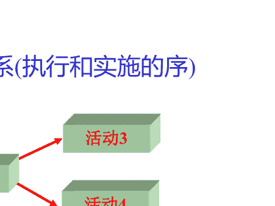

## 2.3 软件开发活动(1/4)

- 什么是软件开发活动？
  - 为开发软件项目而执行的一项具有明确任务的具体工作
  - 例如，需求分析，执行单元测试，制定软件项目开发计划等
- 软件开发过程中存在许多相互关联的软件开发活动
  - 明确的任务
  - 非孤立，和其他活动存在关联

## 2.3 软件开发活动(3/4)

- 如何定义软件开发活动？
  - 名称
  - 任务
  - 输入：开始所必需满足的条件
  - 输出：完成时所必须满足的条件以及结果
  - 实施：做什么，怎么做(详细的步骤)，或者如何从输入产生输出

## 2.3 软件开发活动(4/4)

- 软件活动例子：单元测试
  - 任务
    - 对软件基本单元模块进行测试，判断是否有错
  - 输入
    - 有一个已完成、被文档化和批准的软件单元测试计划
    - 供测试的软件单元模块代码
  - 实施
    - 遵循单元测试计划，运行了所有的测试用例
    - 撰写了单元测试报告
  - 输出
    - 单元测试报告

## 讲授内容

1. 项目案例
2. 什么是软件项目开发过程
3. 为什么需要定义过程
4. 软件开发过程模型
5. 如何定义过程
6. 如何剪裁过程
7. 案例分析
8. 小结

## 为什么需要过程

- 明确了软件开发的过程和步骤，促进工程化软件开发
- 便于制定软件项目计划
- 为软件开发提供了可视性，便于对软件开发过程进行管理和控制
- 便于细化和安排任务，使得每个人员明确各自的工作

## 讲授内容

1. 项目案例
2. 什么是软件项目开发过程
3. 为什么需要定义过程
4. 软件开发过程模型
5. 如何定义过程
6. 如何剪裁过程
7. 案例分析
8. 小结

## 软件开发过程模型

- 什么是软件开发过程模型？
  - 软件开发模型是软件开发全过程、软件开发活动以及它们之间关系的的结构框架
  - 指导软件开发，以及软件开发过程的定义
- 常用的软件开发过程模型
  - 瀑布模型
  - 原型模型
  - 增量模型
  - 迭代模型
  - 螺旋模型

## 4.1 瀑布模型

- 特点：
  - 分阶段
  - 阶段间有因果关系
  - 评审
  - 允许反馈
- 适合场所
  - 需求易于完善定义的软件

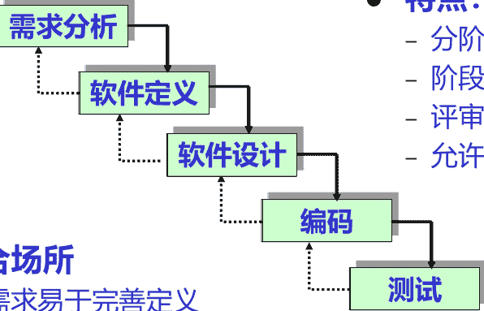

## 4.2 原型模型

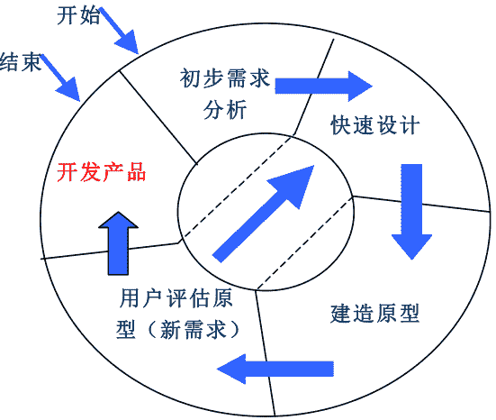

- **特点**
  - 有效适应用户需求的变化
  - 未知循环多少次，进度难以控制
- **适合场所**
  - 需求动态变化、难以确定的软件系统

## 4.3 增量模型(Incremental)

- 需求分析
- 软件定义
- 概要设计
- 详细设计
- 编码
- 集成测试
- 系统测试

- 详细设计
- 编码
- 集成测试
- 系统测试

- 特点
  - 并行开发
  - 管理复杂

> > 增量1
> > 增量n

交付产品

## 4.4 迭代模型(Iterative)

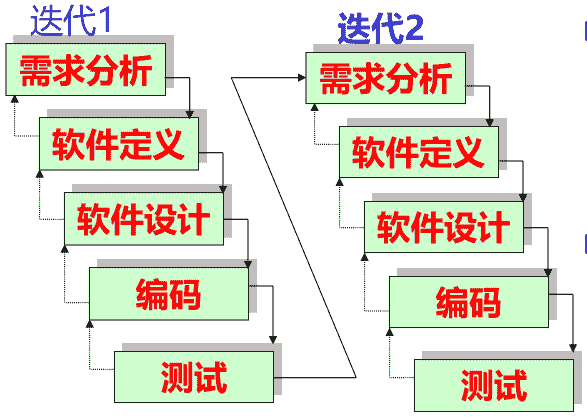

- 特点
  - 通过逐步迭代，建立软件系统
- 适合场所
  - 需求没有/难以完整定义的软件

## 4.5 螺旋模型

### 特点

- 以风险为导向
- 开发风险较大的软件项目

### 应用场所

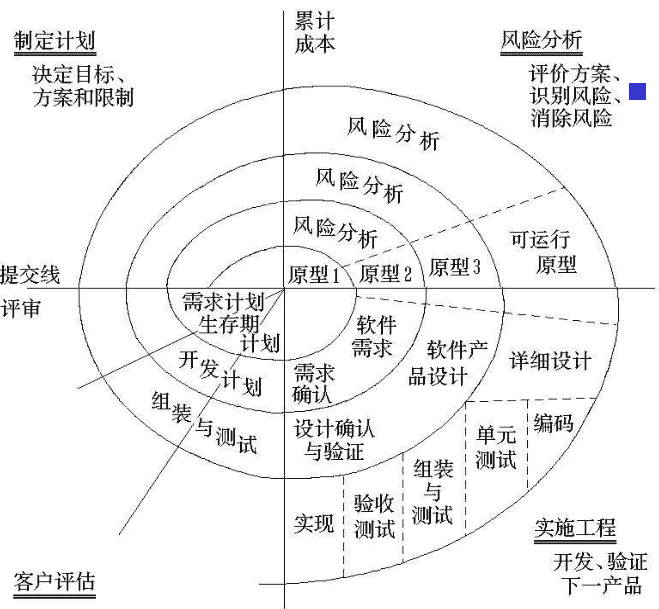

28

## 讲授内容

1. 项目案例
2. 什么是软件项目开发过程
3. 为什么需要定义过程
4. 软件开发过程模型
5. **如何定义过程**
6. **如何剪裁过程**
7. 案例分析
8. 小结

## 定义软件开发过程的要求

- 全面  
  - 定义要应用到软件项目中的所有活动项

- 可操作  
  - 各个活动易于实施

- 简洁、易于理解  
  - 不含无意义的活动，描述简洁易于理解

- 灵活  
  - 可供各个项目进行灵活剪裁

- 易于改进  
  - 能够不断对它进行改进和提高

## 定义软件开发过程的步骤(1/2)

- 步骤1：确定软件开发过程模型
- 步骤2：确定和描述活动
- 步骤3：确定和描述活动间的关系
- 步骤4：文档化软件开发过程
- 步骤5：文档化如何剪裁过程
- 步骤6：文档化如何改善过程
- 步骤7：过程评审、认可和发布
- 步骤8：员工培训

## 定义软件开发过程的步骤(2/2)

选择软件开发过程模型  
确定和描述活动  
确定和描述活动关系  
文档化软件开发过程  
文档化如何剪裁过程  
文档化如何改进过程  
评审认可发布  
员工培训

## 步骤1：选择软件开发过程模型(1/2)

- 选择软件开发过程模型应考虑的问题  
  - 组织软件的需求特征  
    - 动态改变  
    - 可完全定义  
  - 项目的风险  
    - 风险因素有多大  
    - 能承受多少？  
  - 是否需要预先给用户展示原型？  
  - 需要多少经验和技巧来成功的使用软件开发过程模型  
  - 组织或项目组成员的经验和能力等等

## 步骤1：选择软件开发过程模型(2/2)

- 注意：组织应该努力选择满足组织要求、尽可能少的软件开发过程模型  
  - 软件开发模型数目不宜过多  
  - 所选择的软件开发模型不宜过于复杂  
  - 最好选择哪些组织成员熟悉的、有使用经验的软件开发过程模型

## 步骤2：确定和描述活动

1. 确定活动  
2. 定义和描述活动

## 确定活动(1/2)

### 任务

- 明确软件开发过程应包含哪些活动

### 注意

- 软件开发活动包括技术活动和管理活动
- 技术活动：需求分析、撰写软件使用资料
- 管理活动：制定软件开发计划

## 确定活动(2/2)

### 确定活动的原则

- 基于所选择的软件开发过程模型确定活动
- 一般的，软件开发过程模型仅仅确定软件开发的技术活动
- 所确定的活动对于软件项目的开发是必要的
- 活动尽可能是全面的，适合于各种可能的软件项目，可供它们进行剪裁

## 例子：确定软件开发活动

### 技术活动

- 需求分析
- 概要设计
- 详细设计
- 编码
- 集成测试
- 撰写出版物
- 用户确认测试
- 软件发布

### 管理活动

- 制定初步软件开发计划
- 制定详细软件开发计划
- 制定软件配置管理计划
- 制定软件质量保证计划
- 项目跟踪和监督
- 配置管理
- 用户培训

## 定义和描述活动

- 对所确定的活动给出定义和描述  
  - 名称  
  - 任务  
  - 输入  
  - 输出  
  - 实施

## 例子：需求分析活动描述(1/2)

- 名称  
  - 需求分析

- 任务  
  - 进行需求调查，定义软件的用户需求  
  - 撰写软件需求规格说明书(SRS)  
  - 根据SRS，制定软件确认测试计划  
  - 对SRS和软件确认测试计划进行评审，产生经批准的SRS和软件确认测试计划

- 输入  
  - 用户的初步需求描述

## 例子：需求分析活动描述(2/2)

### 实施

- 根据用户需求描述，分析和定义软件的用户需求，按照《软件需求规格说明书编写指南》撰写软件需求规格说明书
- 对SRS进行评审，评审的原则：正确性、完整性、一致性、简洁性、规范化
- 根据软件的用户需求，制定软件确认测试计划，按照《软件确认测试计划编写指南》撰写软件确认测试计划文档

### 输出

- 经批准的SRS，
- 经批准的软件确认测试计划

## 步骤3：确定和描述活动间关系(2/3)

- 如何描述活动之间的关系  
  - 入口条件  
    - 例如，软件设计(逻辑依赖)，有一个已完成、被文档化和批准的软件需求规格说明书  
    - 例如，确认测试(执行时序)，集成测试已经完成  
  - 出口条件  
    - 例如，软件需求分析(逻辑依赖)，产生一个已完成、被文档化和批准的软件需求规格说明书

## 步骤3：确定和描述活动间关系(3/3)

### 直观的图形描述

- 节点表示活动
- 有向边表示活动之间的关系
- 执行时序

- 逻辑关系

## 步骤：文档化软件开发过程(2/5)

- 如何文档化软件开发过程？  
  - 首先  
    给出软件开发过程的直观、完整视图(图形化)  
  - 其次  
    详细描述活动  
  - 第三  
    详细描述活动间关系

## 例子：软件开发过程整体视图

### 技术活动

### 管理活动

### 制定初步计划

### 制定质量保证计划

### 制定软件配置计划

### 需求分析

### 跟踪和监督

### 配置管理

### 概要设计

## 步骤：文档化软件开发过程(4/5)

- 其次，描述和文档化软件开发活动  
  - 名称  
  - 任务  
  - 输入  
  - 实施(如何实施，采用什么方法，具体过程和步骤？)  
  - 输出  
  - 说明

## 例子：需求分析活动描述(1/2)

- 名称  
  - 需求分析

- 任务  
  - 进行需求调查，定义软件的用户需求  
  - 撰写软件需求规格说明书(SRS)  
  - 根据SRS，制定软件确认测试计划  
  - 对SRS和软件确认测试计划进行评审，产生经批准的SRS和软件确认测试计划

- 输入  
  - 用户的初步需求描述

## 例子：需求分析活动描述(2/2)

- 根据用户需求描述，分析和定义软件的用户需求，按照《软件需求规格说明书编写指南》撰写软件需求规格说明书  
- 根据软件的用户需求，制定软件确认测试计划，按照《软件确认测试计划编写指南》撰写软件确认测试计划文档  
- 对SRS和软件确认测试计划进行评审，评审的原则：正确性、完整性、一致性、简洁性、规范化

- 经批准的SRS，  
- 经批准的软件确认测试计划

- 一般的，用户要参与需求评审  
- 需求评审通过后，只能通过指定的变更控制过程来修改

## 步骤4：文档化软件开发过程(5/5)

- 最后，描述活动间关系  
- 文字描述：输入和输出，说明  
- 图形化描述，连接活动的有向边

## 步骤5：文档化如何剪裁过程(1/4)

- 为什么需要定义剪裁过程  
  - 组织内过程定义的一般性和普遍性  
  - 具体项目的特殊性  
  - 为了更好满足具体项目的特殊要求

- 如何文档化过程剪裁  
  - Step1：定义剪裁软件开发过程的规则，以更好地适应具体软件项目的特殊要求  
  - Step2：定义对剪裁过程进行评审的要求  
  - Step3：要上述规则和要求写成规范化的文档

## 步骤5：文档化如何剪裁过程(2/4)

- 哪些活动可以被删除，哪些不能
  - 必选，可选的
  - 对可选活动的说明：什么情况下
  - 例子：需求分析是必选的

- 哪些活动可以被合并，哪些不能
  - 可合并，不可合并的
  - 对活动合并的说明：什么情况下合并，如何合并
  - 例子：对于小规模的软件项目，详细设计和编码合并 → 编码

## 步骤5：文档化如何剪裁过程(3/4)

- Step2：定义对剪裁后的过程进行审批的要求
  - 谁参与评审
    过程剪裁评审委员会或者过程管理小组
  - 评审依据
  - 谁批准剪裁

## 步骤5：文档化如何剪裁过程(4/4)

- Step3：文档化过程剪裁的规则和要求
  - 可以作为过程定义的一个部分，或者
  - 单独形成一个独立的过程剪裁文档

## 过程剪裁注意点

- 经验1：剪裁软件开发过程的规则和要求必须文档化并且易于理解
- 经验2：至少需要提供二个显示如何剪裁软件开发过程的完整例子
- 经验3：记录项目剪裁过程的信息，供以后项目剪裁作借鉴和参考

## 例子：文档化过程剪裁

### 剪裁规则

- 以下活动是不可进行剪裁：需求分析，......
- 对于系统规模较小的项目，允许将概要设计和详细设计二个过程合并
- 对于软件开发工作量能够预先确定的项目，初步项目计划和详细项目计划可以合并......

### 剪裁评审要求

- 过程剪裁评审委员会(可以就是过程管理小组)负责对剪裁的过程进行评审，该委员会的组成参考 "...文档"
- 由过程剪裁评审委员会的主席负责审批剪裁过程

## 步骤6：文档化如何改善过程(1/4)

为什么需要改善过程？

- 过程定义的不完整性和不适应性
- 组织业务发展的要求
- 特殊项目提出的要求
- 实际应用中发现的问题

过程改善的目的

- 使得组织的过程不断得到优化
- 使得项目实施的过程得到不断优化

## 步骤6：文档化如何改善过程(3/4)

- Step1 & Step2 定义过程改善的规则和要求
  - 过程改善请求的提出
    - 提出者：组织或者项目成员
    - 时机：项目实施过程中，项目完成之时，定期/不定期的检查
  - 过程改善请求的类别
    - 变更请求
    - 背离请求

## 案例1：管理过程改善

过程定义文档

软件开发过程管理小组

负责人

变更或背离请求

变更请求

背离请求

项目经理

普通员工

## 案例2：对过程变更请求的管理

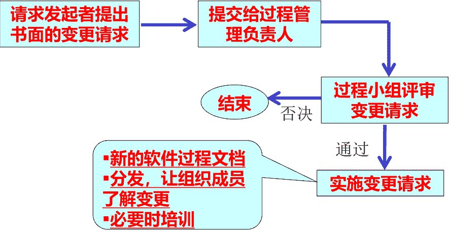

## 案例3：对过程背离请求的管理

请求发起者提出书面的背离请求

项目负责人审批背离请求

背离请求提交给过程负责人

让项目组同意背离

否决

结束

过程负责人评审背离请求

否决

通过

过程负责人授权背离

## 步骤6：文档化如何改善过程(4/4)

- Step3：文档化过程改善的规则和要求
  - 可以是过程定义的一个部分，或者
  - 独立的文档

## 步骤8：员工培训

- 要对组织内相关的员工培训软件开发过程
  - 知道为什么需要过程
  - 知道组织内的过程是什么
  - 知道如何剪裁、变更和调整过程
  - 强调必须根据过程来实施项目

## 软件开发过程定义注意事项(1/5)

### 经验1

组织制定的软件开发过程应该由一个可理解的活动集组成，可以从该活动集中选择合适的子集作为新项目的过程

- 组织内的软件开发过程应该被定义为一个标准
- 组织内定义的软件开发过程应该具有一定的通用性和一般性，既可满足组织内新项目的需要，也可满足组织内所经历的非传统项目的需要

## 软件开发过程定义注意事项(2/5)

### 经验2

软件开发过程不应包含一些无效或者无用的任务或者活动，软件开发过程中的任何活动和任务都是为了促进软件项目的开发和管理，确保软件项目在进度、成本的限制范围内，得到满足用户要求的高质量软件产品

- 软件开发过程不应复杂和教条
- 软件开发过程不应捆绑一些无意义的规则，如必须采用某种方法和技术

## 软件开发过程定义注意事项(3/5)

### 经验3

软件开发过程应该不断地得到改善和提高

- 软件开发过程有局限性和问题
- 需要对软件开发过程经常性地进行检查，发现问题和不足
- 允许过程的使用者对过程提出改善意见，发表见解

## 软件开发过程定义注意事项(4/5)

### 经验4

借助于其他组织的经验和成果，以及国际化标准来制定软件开发过程

- 借助于其他组织的经验和成果有助于少走弯路，尽快制定高质量的软件开发过程
- 借助于国际标准有助于规范化软件开发过程，通过国际标准的认证，如ISO9001，CMM
- 遵循国际标准是有必要的，应该提倡，它能帮助提升管理水平、形象和竞争力
- 切忌走过场

## 软件开发过程定义注意事项(5/5)

- 经验5
  管理层要负责确保每个新项目完全遵循所批准的软件开发过程
- 经验6
  过程组要负责确保不断改善软件开发过程

## 软件开发过程定义文档

- 项目组和组织一般要形成一个软件开发过程定义文档
- 软件开发过程文档的格式

## 讲授内容

1. 项目案例
2. 什么是软件项目开发过程
3. 为什么需要定义过程
4. 软件开发过程模型
5. 如何定义过程
6. 如何剪裁过程
7. 案例分析
8. 小结

## 如何剪裁过程

- 剪裁过程的基础和依据
  - 软件开发过程文档
  - 项目的具体要求
- 如何剪裁过程？
  - 参照过程文档中的剪裁规则，根据项目的具体特点确定剔除一些活动，合并一些活动
  - 剪裁结果应该能够促进具体项目的管理，保证所开发软件产品的质量
  - 剪裁认可

## 讲授内容

1. 项目案例
2. 什么是软件项目开发过程
3. 为什么需要定义过程
4. 软件开发过程模型
5. 如何定义过程
6. 如何剪裁过程
7. 案例分析
8. 小结

## 案例分析

- 案例假设
  - 采用瀑布软件开发过程模型
- 案例内容
  - 软件开发过程框架
  - 各个活动的描述
  - 活动之间的关系
- 说明：该案例不足于用于实际应用
  - 没有考虑组织的具体情况
  - 不具体和详细

## 步骤1：确定活动

- 技术活动
  - 需求分析
  - 概要设计
  - 详细设计
  - 编码
  - 集成测试
  - 撰写出版物
  - 用户确认测试
  - 软件发布
- 管理活动
  - 制定初步软件开发计划
  - 制定详细软件开发计划
  - 制定软件配置管理计划
  - 制定软件质量保证计划
  - 项目跟踪和监督
  - 配置管理
  - 用户培训

## 步骤2：确定活动之间的关系

- 逻辑关系 - 依赖
- 时序关系

- 项目初步计划
- 质量保证计划
- 软件配置计划
- 软件需求分析
- 跟踪和监督
- 配置管理
- 项目详细计划
- 技术活动
- 管理活动

项目策划阶段

软件定义阶段

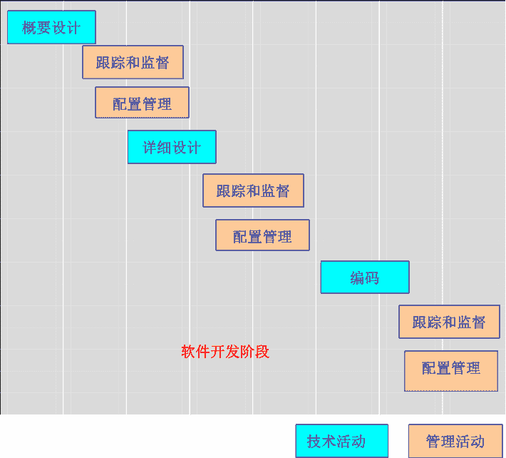

- 概要设计
  - 跟踪和监督
  - 配置管理
- 详细设计
  - 跟踪和监督
  - 配置管理
- 编码
  - 跟踪和监督
  - 配置管理
- 撰写用户文档
- 用户培训
- 集成测试
  - 跟踪和监督
  - 配置管理
- 确认测试
  - 跟踪和监督
  - 配置管理
- 打包交付

软件开发阶段

- 技术活动
- 管理活动

## 步骤3：定义和描述活动

- 需求分析
- 概要设计
- 详细设计
- 编码
- 集成测试
- 确认测试
- 撰写用户文档
- 用户培训
- 打包和交付

## 活动1：需求分析和软件定义

### 任务

- 进行需求调查，定义软件的用户需求，撰写软件需求规格说明书(SRS)
- 根据SRS，撰写软件确认测试计划
- 评审SRS和软件确认测试计划

### 输入

- 用户的初步需求描述

### 输出

- 软件需求规格说明书
- 软件确认测试计划

### 实施

- 根据用户需求描述，分析和定义软件系统的需求，按照《软件需求规格说明书编写指南》编写软件需求规格说明书(SRS)
- 根据SRS，制定软件确认测试计划，按照《软件确认测试计划编写指南》编写软件确认测试计划文档
- 对需求分析的结果（软件需求规格说明书和软件确认测试计划）进行评审

### 说明

- 用户需求描述了用户对目标软件系统的期望和要求（包括功能、性能和设计约束等），因此，需求分析只需关心要解决的问题，而无需关心这些问题的解决方案
- 软件确认测试计划应该包含软件需求规格说明书中所定义的所有需求的测试内容

## 活动2：概要设计

### 任务

- 根据SRS，进行软件的总体结构设计、接口设计和数据设计，撰写软件总体结构设计、接口设计和数据设计规格说明书
- 根据软件的概要设计，制定软件集成测试计划

### 输入

- 软件需求规格说明书SRS

### 输出

- 软件总体结构设计规格说明书
- 软件数据设计规格说明书
- 软件接口设计规格说明书
- 软件集成测试计划

### 实施

- 根据SRS来进行软件设计
- 按照《软件总体结构设计规格说明书编写指南》编写软件总体结构设计文档
- 按照《软件数据设计规格说明书编写指南》编写软件数据设计文档
- 按照《软件接口设计规格说明书编写指南》编写软件接口设计文档
- 按照《软件集成测试计划编写指南》编写软件集成测试计划文档

### 说明

- 概要设计要给出满足用户需求的软件解决方案，主要是指软件的总体结构、接口设计和数据设计，不涉及具体模块的内部细节

## 活动3：详细设计

### 实施

- 根据SRS和软件总体结构、接口和数据设计规格说明书，进行软件的详细设计，根据《软件详细设计规格说明书编写指南》撰写软件详细设计文档
- 根据每个模块的内部实现细节的设计，以及《软件单元测试计划编写指南》编写软件单元测试计划文档

### 输出

- 软件详细设计规格说明书
- 软件单元测试计划

### 说明

- 详细设计主要根据软件需求规格说明书，在软件总体结构设计、接口设计和数据设计的基础上，涉及软件解决方案的详细细节，尤其是模块的实现算法和思想

## 活动4：编码

### 任务

- 编写程序
- 进行单元测试，撰写单元测试报告

### 输入

- 软件总体结构设计规格说明书
- 软件数据设计规格说明书
- 软件接口设计规格说明书
- 软件详细设计规格说明书
- 单元测试计划

©Copyright Xinjun Mao 2005

### 实施

- 根据软件总体结构设计规格说明书、软件数据设计规格说明书、软件接口设计规格说明书、软件详细设计规格说明书进行编码
- 根据单元测试计划对各个模块进行单元测试

### 输出

- 经过单元测试的软件模块源程序
- 单元测试报告

## 活动5：集成测试

### 任务

- 集成各个软件模块进行测试

### 输入

- 软件模块的程序代码
- 软件总体结构设计规格说明书
- 软件数据设计规格说明书
- 软件接口设计规格说明书
- 软件集成测试计划

### 实施

- 根据软件总体结构设计规格说明书、软件接口设计规格说明书、软件数据设计规格说明书和软件集成测试计划，逐步组装模块进行软件的集成测试，撰写集成测试报告

### 输出

- 可运行的、经过集成测试的目标软件系统
- 集成测试报告

## 活动6：确认测试

### 实施

- 根据软件需求规格说明书和确认测试计划，对软件进行确认测试，撰写确认测试报告

### 输出

- 可运行的、经过确认测试的目标软件系统
- 确认测试报告

### 说明

- 确认测试由用户进行测试

## 活动7：撰写用户文档

### 任务

- 撰写用户文档

### 输入

- 软件需求规格说明书
- 软件总体结构、接口设计和数据设计规格说明书
- 可运行的目标软件系统

### 实施

- 根据用户软件需求规格说明书，软件总体结构、接口设计和数据设计规格说明书撰写用户文档
- 用户文档一般包括：《用户使用手册》，《安装手册》，《软件开发手册》等等

### 输出

- 《用户手册》
- 《安装手册》
- 《开发指南》

## 活动8：用户培训

### 任务

- 对用户进行培训

### 输入

- 软件需求规格说明书
- 用户使用手册、安装手册、开发手册
- 可运行的目标软件系统

## 活动9：打包交付

### 任务

- 对软件进行打包，并交付用户使用

### 输入

- 可执行的目标软件系统
- 各种要交付的文档和资料，包括电子版和打印版

### 实施

- 制作安装软件
- 安装并配置目标软件系统
- 交付安装软件、文档和资料

### 输出

- 安装软件
- 交付给用户的文档和资料

## 讲授内容

- 1. 项目案例
- 2. 什么是软件项目开发过程
- 3. 为什么需要定义过程
- 4. 软件开发过程模型
- 5. 如何定义过程
- 6. 如何剪裁过程
- 7. 案例分析
- 8. 小结

## 本讲小结

- 组织和项目组需要良定义的软件开发过程来支持软件开发
- 软件开发过程定义涉及：活动的确定和描述、活动间关系的确定和描述
- 软件开发过程包括技术活动和管理活动
- 为了适应不同项目的具体要求，需要对组织的软件开发过程进行剪裁
- 组织的软件开发过程是不断改进和进化的

## 教学目的

- 理解
  - 什么是软件开发过程？
  - 为什么需要定义软件开发过程？
  - 软件开发一般具有什么样的过程
  - 软件开发过程模型

- 掌握
  - 如何定义软件开发过程？
  - 如何剪裁过程？

- 运用
  - 能够根据组织和项目的具体情况，定义和剪裁软件开发过程

# Software Project Management

# Questions & Discussing

# Practice, Practice, and Practice

# 软件项目管理课程 之

# 第3讲 软件度量

毛新军  
xjmao21@21cn.com  
http://software.nudt.edu.cn/~xjmao  
计算机科学与技术系602教研室  
0731-(45)73649

## 讲授内容

1. 项目案例  
2. 什么是软件度量？  
3. 为什么需要软件度量？  
4. 软件度量的内容  
5. 软件度量的方法  
6. 在软件开发过程中进行软件度量  
7. 小结  

## 1. 项目案例

## 案例角色和人物

- 小王：软件项目负责人  
- 老王：公司技术老总  

## 项目管理需要定量描述(1/3)

- 在项目策划阶段的碰头会上  
  - 公司技术总监咨询问小王项目开发估计需要多长时间，需要多少成本？  
  - 小王回答说“时间估计不会太长，成本也在一个可接受的范围之内”，老王显然对这种回答不满意，他希望能够得到一个较为准确定量性的描述  
  - 经过一番考虑后，小王确认回答说“时间7 - 8个月，成本需40 - 45万”，老王显然对这种回答也不满意，况且用户要求在6个月内完成项目。于是他进一步问道“你是如何得到这组数据的”，小王显然没有准备，也没有充分的依据，于是他哑口无言  

## 项目管理需要定量描述(2/3)

在制定软件项目计划时  

- 小王不知如何预测项目可能所需的工作量？  
- 小王不知如何预测项目可能所需的成本？  
- 小王不知所制定的计划是否可行和科学？  
- 因此，小王尽管制定了软件开发计划，但对于该计划能否得到有效的实施、实施能否遵循计划执行没有足够的信心  

## 项目管理需要定量描述(3/3)

- 项目已进展了2个月，各个方面进展尚可，在某周的碰头会上，老王继续向小王发问  
  - “目前软件质量如何？”，小王回答道“不锈”  
  - 老王对这种回答不满意，他希望能够得到一个较为准确量性的描述，但是小王又没有办法给他一个更加确切的答复，实际上连他自己也没有办法说清楚目前软件产品的质量情况，因为他只有直观的、定性的了解。  

## 定量分析是重要的

- 工程化的软件开发需要定量、科学的描述（实施前、实施过程中、实施完成后）  

- 定量、科学的描述有助于获取软件项目以及所开发的软件的某种可视性，促进软件项目的管理  

- 定量的信息描述必须在软件项目开发过程中采集  

## 软件项目管理问题

- 在软件项目实施过程中，需要哪些方面的定量描述以促进软件项目的有效开发和管理？  
- 如何获取这些方面的科学定量描述？  
- 如何在软件项目开发过程中集成度量？  
- 如何将这些定量描述用于指导软件项目的管理？  

## 讲授内容

- 项目案例  
- 什么是软件度量？  
- 为什么需要软件度量？  
- 软件度量的内容  
- 软件度量的方法  
- 在软件开发过程中进行软件度量  
- 小结  

## 基本概念(1/4)

- 对事物属性的定性描述  
  - 个子很高，软件的成本很高  

- 对事物属性的定量描述  
  - 高个子有1.9米，软件成本是23.5万  

## 基本概念(2/4)

- 软件度量(Metrics)是指对软件产品、软件开发过程或者资源的简单属性的定量描述。  
  - 产品：软件开发过程中所生成的各种文档和程序  
  - 过程：与软件开发有关的各种活动，如软件设计等  
  - 资源：软件开发过程中所需支持，如人员、费用等  

- 注意点  
  - 定量描述，而不是定性描述  
  - 简单属性，无需参照其它属性便可直接获得定量描述  

## 基本概念(3/4)

- 软件测量(Measure)是对软件产品、软件开发过程和资源复杂属性的定量描述，它是简单属性度量值的函数，软件测量用于事后或实时状态，如软件可靠性  

- 注意点  

- 定量描述，而不是定性描述  

- 复杂属性-不可直接获得、需参照其它属性的度量值  

- 实时或者事后状态，用于对历史进行评估  

## 基本概念(4/4)

- 估算(Estimation)对软件产品、软件开发过程和资源复杂属性的定量描述，它是简单属性度量值的函数，软件估算用于事前，如软件开发成本  

- 注意点  

- 定量描述，而不是定性描述  

- 复杂属性-不可直接获得、需参照其它属性的度量值  

- 事前状态  

- 可采用经验公式，也可参考历史资料和数据。估算的结果一般用于签订合同、立项、制定工作计划等  

## 讲授内容

- 项目案例  
- 什么是软件度量？  
- 为什么需要软件度量？  
- 软件度量的内容  
- 软件度量的方法  
- 在软件开发过程中进行软件度量  
- 小结  

## 为什么需要软件度量(1/2)

- 任何工程化的工作都需要度量，软件工程也不例外  
  - 准确了解工程的实施情况  

- 项目实施之前  
  - 辅助制定软件项目的计划  
  - 估算成本和工作量，以便制定计划  

## 为什么需要软件度量(2/2)

- 项目实施过程中  
  - 提供软件开发的可视性  
  - 跟踪和控制软件项目的开发  
  - 评估软件开发质量，进行质量控制  
  - 加强风险管理  
- 项目实施之后  
  - 对项目的实施情况进行评估  
  - 为后续项目的积累经验数据  

## 讲授内容

- 项目案例  
- 什么是软件度量？  
- 为什么需要软件度量？  
- 软件度量的内容  
- 软件度量的方法  
- 在软件开发过程中进行软件度量  
- 小结  

## 软件度量的内容(1/3)

### 三个方面

- 产品：各种文档和程序  
- 过程：各种软件开发活动  
- 资源：各种资源如人员、费用等  

## 软件度量的内容(2/3)

- 二个层次  
  - 内部属性  
    - 软件产品、过程和资源本身所具有属性，如软件产品的复杂度、程序长度等  
    - 易于度量  
  - 外部属性  
    - 软件产品、过程和资源与外部环境(用户、管理人员等)间的关系如成本、效益、可靠性、可维护性等  
    - 难以度量，但由内部属性所决定  

## 讲授内容

- 项目案例
- 什么是软件度量？
- 为什么需要软件度量？
- 软件度量的内容
- 软件度量的方法
- 在软件开发过程中进行软件度量
- 小结

## 软件度量的方法

1. 面向规模的度量
2. 面向功能的度量
3. 项目成本和工作量估算
4. 软件质量度量

## 5.1 面向规模的度量(1/3)

- 用软件代码行数目来表示软件项目规模
  - 生产率：PM = L / E，L 表示代码总量（单位：KLOC），E 表示软件工作量（单位：人月）
  - 每千行代码的平均成本：CKL = S / L，S 为软件项目总开销
  - 文档与代码比：DI = Pd / L，Pd 表示文档页数
  - 代码出错率：EQRI = Ne / L，Ne 表示代码出错的数目

## 5.1 面向规模的度量(2/3)

| 项目 (KLOC) | 人月 | 成本($) | 文档页数 | 错误 | 人员 |
|-------------|------|---------|----------|------|------|
| a           | 12.1 | 168000  | 365      | 134  | 3    |
| b           | 27.2 | 440000  | 1224     | 321  | 5    |
| c           | 20.2 | 314000  | 1050     | 256  | 6    |

## 5.1 面向规模的度量(3/3)

- 优点
  - 简单易行，自然直观
- 缺点
  - 依赖于程序设计语言的表达能力和功能
  - 软件开发初期很难估算出最终软件的代码行数
  - 对精巧的软件项目不合适
  - 只适合于过程式程序设计语言

## 5.2 面向功能的度量(2/7)

#### 功能点计算方法

- FP = (0.65 + 0.01 × ΣFᵢ) × CT
- CT：5 个信息量的“加权和”
- Fᵢ：14 个因素的“复杂性调节值”（i = 1..14）
- 0.65，0.01 都是经验常数

## 5.2 面向功能的度量(3/7)

#### CT 的计算方法

- 用户输入数 × 加权因子（简单 = 3，平均 = 4，复杂 = 5）
- 用户输出数 × 加权因子（简单 = 3，平均 = 4，复杂 = 5）
- 用户查询数 × 加权因子（简单 = 3，平均 = 4，复杂 = 5）
- 文件数 × 加权因子（简单 = 3，平均 = 4，复杂 = 5）
- 外部界面数 × 加权因子（简单 = 3，平均 = 4，复杂 = 5）

CT = 上述计算值的总和

## 5.2 面向功能的度量(4/7)

Fᵢ 的取值 (0, 1, 2, 3, 4, 5)：0 - 没有影响，1 - 偶有影响，2 - 轻微影响，3 - 平均影响，4 - 较大影响，5 - 严重影响

- 系统需要可靠的备份和复原码？
- 系统需要数据通信吗？
- 系统有分布处理功能吗？
- 性能是临界状态吗？
- 系统是否在一个实用的操作系统下运行？
- 系统需要联机数据项吗？
- 联机数据项是否在多屏幕或多操作之间进行切换？

## 5.2 面向功能的度量(5/7)

- 需要联机更新主文件吗？
- 输入、输出、查询和文件很复杂吗？
- 内部处理复杂吗？
- 代码需要被设计成可重用吗？
- 设计中需要包括转换和安装吗？
- 系统的设计支持不同组织的多次安装吗？
- 应用的设计方便用户修改和使用吗？

## 5.2 面向功能的度量(6/7)

- 优点
  - 与程序设计语言无关，在开发前就可以估算出软件项目的规模（事前）
- 不足
  - 没有直接涉及算法的复杂度，不适合算法比较复杂的软件系统；
  - 功能点计算主要靠经验公式，主观因素比较多
  - 数据不好采集

## 5.2 面向功能的度量(1/1)

#### 代码行度量和功能点度量间的关系

| 程序设计语言 | LOC/FP（平均值） |
|--------------|------------------|
| 汇编语言     | 300              |
| COBOL        | 100              |
| FORTRAN      | 100              |
| PASCAL       | 90               |
| ADA          | 70               |
| OOPL         | 30               |
| 4GL          | 20               |
| 代码生成器   | 15               |

## 5.3 成本和工作量估算(1/2)

- 软件项目成本和工作量估算极为重要
  - 计算机系统中软件成本占总成本的比例很大
  - 用户和项目管理人员对软件成本和工作量估算都很重视
- 软件项目成本估算比较困难
  - 软件是逻辑产品，软件开发是一个逻辑思维的过程
  - 涉及多方面因素

## 5.3 成本和工作量估算(2/2)

- 软件项目成本和工作量估算常用方法
  - 参照和依据已完成项目的历史数据
  - 将大项目分解为小项目
  - 将项目按照软件生命周期分解
  - 根据经验估算公式
- 上述方法可以同时、单独或者组合使用

## 5.3.1 代码行、功能和工作量估算

- 软件项目规模影响软件项目成本和工作量
  - 估算出 FP 或者 LOC 期望值 e = (a + 4m + b) / 6
  - 依据历史数据估算出工作量和成本
    - 根据 PM = FP(LOC) / E 计算出工作量
    - 根据 C = S / FP(LOC) 计算出成本

## 案例：代码行和功能点估算 (1/8)

#### 软件描述(CAD 软件)

CAD 图形软件可接受来自用户的二维和三维几何数据，用户通过界面与 CAD 软件进行交互，并控制它，该软件具有良好的人机界面设计的特征。所有的几何数据及其支持信息存放在数据库中。开发设计分析模块，以产生所需的输出，这些输出将显示在各种不同的图形化设备上。软件在设计中要考虑与外设进行交互并控制它们，包括鼠标、数字化仪、打印机等等。

## 案例：代码行和功能点估算(2/8)

- 软件子系统划分
  - 图形用户界面及其控制机制
  - 二维几何分析
  - 三维几何分析
  - 数据库管理
  - 图形显示
  - 外设控制(与打印机、数字化仪、扫描仪的接口)
  - 设计分析子系统

## 案例：代码行和功能点估算 (3/8)

- 估算出各个子系统的代码行，例如三维几何分析功能的代码行估算范围为：
  - 乐观值：4 600
  - 可能值：6 900
  - 悲观值：8 600
  - 估算值：e = (a + 4m + b) / 6 = 6 800

## 案例：代码行和功能点估算 (5/8)

- 历史数据
  - 平均生产率 PM：620 LOC/PM(620 行代码/人月)
  - 每个人月的成本 C = 8000 ¥
- 估算项目成本和工作量
  - 估算工作量 = 总代码行 / PM = 33200 / 620 = 54 人月
  - 估算成本 = 估算工作量 × 每个人月的成本 = 54 人月 × 8000 = 432000 ¥

## 案例：代码行和功能点估算 (6/8)

#### 基于功能点估算：

| 信息域 | 乐观值 | 可能值 | 悲观值 | 估算计数 | 加权因子 | FP 计数 |
|--------|--------|--------|--------|----------|----------|---------|
| 输入数 | 20     | 24     | 30     | 24       | 4        | 96      |
| 输出数 | 12     | 15     | 22     | 16       | 5        | 80      |
| 查询数 | 16     | 22     | 28     | 22       | 4        | 88      |
| 文件数 | 4      | 4      | 5      | 4        | 10       | 40      |
| 接口数 | 2      | 2      | 3      | 2        | 7        | 14      |
| 总计   |        |        |        |          |          | 318     |

## 案例：代码行和功能点估算

### Step2: 计算复杂度调整因子

| 因子 | 值 |
|---|---|
| 备份和复原 | 4 |
| 数据通信 | 2 |
| 分布式处理 | 0 |
| 关键性能 | 4 |
| 操作环境 | 3 |
| 联机数据输入 | 4 |
| 多屏幕输入 | 5 |
| 主文件联机更新 | 3 |

| 因子 | 值 |
|---|---|
| 信息域值复杂性 | 5 |
| 内部处理复杂性 | 5 |
| 软件重用 | 4 |
| 转换和安装 | 3 |
| 多次安装 | 5 |
| 方便修改 | 5 |
| 复杂度调节因子 | 1.17 |

- 计算出FP的估算值
  - FP = (0.65 + 0.01 × ΣFi) × CT = 372
- 历史数据
  - 平均生产率 6.5 FP/PM
  - 每个人月的成本 C = 8000 ¥ (平均月薪)
- 估算成本和工作量
  - 工作量 58人月
  - 成本 457000 ¥

## 5.3.2 经验估算模型

### 什么是CoCoMo模型？

- CoCoMo是指Constructive Cost Model，构造性成本模型，Boehm于1981年提出，用于对软件开发项目的规模、成本、进度等方面进行估算
- CoCoMo模型是一个综合经验模型，模型中的参数取值来自于经验值，并且综合了诸多的因素、比较全面的估算模型
- 比较实用、可操作，在欧盟国家应用较为广泛

### 基本CoCoMo模型

- E = a * (kLOC)^b ; E是工作量(人月)， a和b是经验常数
- D = c * E^d ; D是开发时间(月)， c和d是经验常数
- 其中， a,b,c,d为经验常数， 其取值见下表

| 软件类型   |   a |   b |   c |   d | 适用范围   |
|------------|-----|-----|-----|-----|------------|
| 组织型     | 2.4 | 1.05| 2.5 | 0.38| 各类应用程序 |
| 半独立型   | 3.0 | 1.12| 2.5 | 0.35| 各类编译程序等 |
| 嵌入型     | 3.6 | 1.20| 2.5 | 0.32| 实时软件、OS 等 |

### 中间CoCoMo模型

- E = a * (kLOC)^b * EAF
- 其中，E表示工作量(人月)，EAF表示工作量调节因子，a,b为经验常数，其取值见下表

| 软件类型   |   a |   b |
|------------|-----|-----|
| 组织型     | 3.2 | 1.05 |
| 半独立型   | 3.0 | 1.12 |
| 嵌入型     | 2.8 | 1.20 |

- 案例分析： 用基本CoCoMo模型估算项目的工作量、开发时间和参加项目开发的人数
  - CAD软件： 目标代码行33.2kLOC， 属于中等规模， 半独立型， 因而a = 3.0, b = 1.12, c = 2.5, d = 0.35
  - E = 3.0*(33.2)^1.12 = 152 PM
  - D = 2.5*(152)^0.35 = 14.5 (月)
  - 参加项目人数N = E/D = 152/14.5 = 11(人)

## 5.4 软件质量度量

### 软件质量度量的重要性

- 质量是软件的生命，质量不高的软件会带来严重、甚至灾难性的后果
- 必须加强对软件质量的管理和监控，如ISO9001和CMM
- 必须在软件开发过程中能够可视所开发软件的质量

### 软件质量度量存在的困难

- 软件质量依赖于软件的内部特性及其组合
- 这些特性难以度量

- McCall的软件质量度量模型
  - 质量要素
    - 定义了与软件质量相关联的一些要素
  - 质量要素的评价准则
    - 定义了能够对质量要素进行度量的一些准则
  - 软件质量的度量
    - 定义了如何基于对质量要素的定量描述对软件质量进行度量的方法

## 5.4.1 质量要素

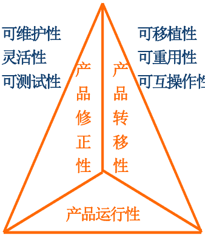

- 可维护性
- 灵活性
- 可测试性
- 产品修正性
- 产品转移性
- 可移植性
- 可重用性
- 可互操作性
- 产品运行性
- 正确性
- 可靠性
- 有效性
- 完整性
- 有用性

- 质量要素之间的相互关联性(正相关、负相关)，因此在设计时要根据项目的具体情况进行权衡
  - 例如，软件的可移植性会降低软件的有效性
  - 例如，对于实时系统，必须保证可靠性和有效性，而将可移植性、可重用性放在次要地位

## 5.4.2 质量要素的评价准则

- 给出一组比较容易度量的软件质量要素评价准则来间接对软件质量要素进行定量描述
  - 定义准则基础是确定影响软件质量要素的属性
  - 这些属性比较完整、准确地描述软件质量要素
  - 这些属性比较容易量化

- McCall质量模型共给出21个评价准则，例如
  - 简单性：理解程序的难易程度
  - 准确性：计算和控制的精度
  - 通信通用性：使用标准接口、协议和频带的程度
  - 完全性：是否全面
  - 执行效率：程序的运行效率
  - 可扩充性：对软件结构、数据设计和过程设计进行扩充的程度
  - ……

## 5.4.3 软件质量的度量

- 对于每个质量要素的计算
  - \( F_i = \sum(C_{ik} \times M_{ik}) \)
  - 其中，\( F_i \) 表示第i个质量因素的度量值(i = 1,..11)，
  - \( M_{ik} \) 表示第i个质量因素对于第k种评价准则的测量值，\( M_{ik} \)的取值共分10级，分别为0.1, ...,1.0
  - \( C_{ik} \) 表示第k种评价准则对第i个质量因素影响程度的加权系数，且满足\(\sum C_{ik} = 1.0 (k = 1,..21)\)

## 讲授内容

- 项目案例
- 什么是软件度量？
- 为什么需要软件度量？
- 软件度量的内容
- 软件度量的方法
- 在软件开发过程中进行软件度量
- 小结

## 软件开发过程中集成度量

- 度量是重要的
- 提高组织软件开发能力成熟度的一种重要措施和有效手段
- CMM强调用软件度量，尤其在4级 - 可管理级
- 度量会遇到阻力
- 度量会耗费大量的精力和时间
- 度量的作用和效果可能是隐性和长期的，不能为开发人员所接受
- 项目的压力经常会促使管理者和开发人员放弃度量

- 在软件项目实施过程中坚持度量，收集数据
- 实施前
  - 记录估算数据
- 实施中
  - 对过程、产品和资源进行度量
  - 记录并保存其结果
- 实施完成后
  - 对项目进行总结，记录和保存项目实际运作的信息，如成本、工作量，人员等等

## 讲授内容

- 项目案例
- 什么是软件度量？
- 为什么需要软件度量？
- 软件度量的内容
- 软件度量的方法
- 在软件开发过程中进行软件度量
- 小结

## 本讲小结

- 软件项目的实施需要定量描述(前、中、后)
- 软件度量： 定量描述
  - 针对软件产品、过程和资源
  - 内部属性和外部属性
  - 测量和估算
- 工作量和成本度量： 规模和功能
- 质量度量
- 在软件项目实施过程中实施度量

## 教学目的

## 理解

- 什么是软件度量？
- 为什么需要软件度量？
- 软件度量的方式和对象

## 掌握

- 软件度量的方法

## 运用

- 运用软件度量支持和促进软件开发

![img/f5d721251af5f768deee90a8ee1528f0_270_0.png]

# Software Project Management

# Questions & Discussing

![img/f5d721251af5f768deee90a8ee1528f0_271_0.png]

# Practice, Practice, and Practice

## 项目案例

## 案例角色和人物

老王：公司技术老总

小王：软件项目负责人

开发小组：小李，老赵，小田，小谢

![img/f5d721251af5f768deee90a8ee1528f0_274_0.png]

![img/f5d721251af5f768deee90a8ee1528f0_274_1.png]

![img/f5d721251af5f768deee90a8ee1528f0_274_2.png]

## 软件项目的实施需要计划(1/3)

- 项目开始实施之时，老王就提醒小王，为了更好地管理和发展软件开发项目，他应该马上着手制定软件项目的实施计划，该计划的制定对于整个项目的组织、管理和发展是至关重要的。

- 由于认识到软件项目计划的重要性，小王花了1周时间制定了一个详细的软件项目计划，包括了详细的工作安排、明确的人员分工和具体的进度要求，计划看起来似乎是科学和合理的。

- 项目计划最后交给项目组的所有成员进行讨论，并交付给公司的领导审阅，通过并批准，开始被付诸实施。

## 软件项目的实施需要计划(2/3)

- 软件项目计划分发到了项目组的各个成员，每个成员根据计划准确地了解了各自的任务和工作，也了解了这些工作的实施进度要求。

- 根据软件项目计划开始阶段似乎一切顺利，各项工作已经按照计划的要求有序开展。

- 然而，随着项目实施的进展，小王发现实际的工作很难按照计划中所计划的那样开展进行。在计划制定时，低估了软件项目的规模，高估了开发人员的素质和能力，整个计划过于乐观，软件项目计划不得不多次进行调整，项目进展一拖再拖。

## 软件项目的实施需要计划(3/3)

- 后来小王发现，低估项目规模的一个主要原因是因为在制定计划时缺乏对项目规模的详细、准确的了解。

- 尽管小王对用户做了无数次的解释保证按期交付产品，用户对项目的按期交付表示怀疑，并要求加快项目的实施进度。

- 公司高层开始表示关注，为了弥补时间和进度，不得不要求员工牺牲休息日进行加班，项目组部分成员开始抱怨。

- 幸运的是，软件项目计划在经过多达10次的更改，在项目组成员的积极努力和用户的配合下，项目最终在拖延了6个月之后顺利完工了。

## 案例提示我们

- 软件项目计划的制定是极为重要的
- 软件项目计划应该在项目实施的初期制定
- 软件项目计划的制定必须科学、准确，这样才能真正促进软件项目的管理
- ......

![img/f5d721251af5f768deee90a8ee1528f0_278_0.png]

## 管理问题

- 什么是软件项目计划？
- 软件项目计划包括哪些方面的内容？
- 软件项目计划制定应该注意哪些方面问题？
- 如何制定软件项目计划？
- 如何保证所制定计划的科学性和准确性？

![img/f5d721251af5f768deee90a8ee1528f0_279_0.png]

## 讲授内容

- 项目案例
- 什么是软件项目计划？
- 为什么需要软件项目计划？
- 制定软件项目计划应考虑的因素
- 制定软件项目计划的步骤
- CMM对软件项目计划的要求
- 成功的和过于乐观的软件开发计划
- 案例分析及CASE工具
- 小结

![img/f5d721251af5f768deee90a8ee1528f0_280_0.png]

## 什么是软件项目计划

- 什么是软件项目计划？
- 软件项目计划的内容
- 软件项目计划制定的基础和依据
- 软件项目计划制定的时机
- 初步和详细的软件项目计划

![img/f5d721251af5f768deee90a8ee1528f0_281_0.png]

## 软件项目计划的内容(1/3)

- 活动(技术活动和管理活动)以及它们之间的关系，来自过程剪裁
- 例如，需求分析，软件概要设计，软件详细设计等等
- 进一步细化，以描述完成工作详细、具体步骤及其逻辑顺序，如需求分析(需求调查、分析和建模、撰写文档、评审)

- 各项活动按什么样的时间进度开展实施：何时开始，何时结束
- 例如，需求分析：2002/8/1开始 - 2002/10/23结束
- 软件概要设计：2002/10/25开始 - 2002/11/23结束

## 软件项目计划的内容(2/3)

### 资源使用和安排计划

- 如何针对不同活动的特点计划分配资源(人员、资金、设备等)
- 哪些角色(项目经理、需求分析人员、软件设计人员)，哪些人(小王，小李，老赵，小田，小谢)
- 开发人员充当什么角色、负责和参与哪些活动
- 例如，张三作为需求分析小组负责人，负责和参与需求分析阶段工作；李四作为需求分析小组成员，参与需求分析的具体工作
- 例如，在需求分析阶段，投入3个人、预计投入资金10万元(包括人员薪水、外地出差费用)、PC机3台、PC服务器1台

## 软件项目计划的内容(3/3)

- 活动、资源和人员、进度等方面的计划是密切相关的
- 注意
  - 项目进度应该是宏观的，应该保留在一定的抽象层次，不宜过细、过于具体
  - 对于软件开发而言，资源和人员与进度之间并不是线性关系

![img/f5d721251af5f768deee90a8ee1528f0_285_0.png]

## 制定软件项目计划的基础和依据

- 定义和剪裁的软件开发过程(及其细化)
- 要完成的工作
- 工作说明和软件需求
- 历史数据和估算模型
- 估算工作量和成本
- 约束和限制条件
- 人员
- 资源
- 进度

![img/f5d721251af5f768deee90a8ee1528f0_286_0.png]

## 制定软件项目计划的时机

- 在项目开始实施之时制定计划
  - 明确了软件开发活动
  - 明确了约束和限制条件
  - 不明确要完成的工作，因为需求分析工作还没开始

- 制定软件项目计划的时机
  - 项目开始之时：初步计划
  - 需求完成之时：详细计划

## 初步和详细的软件项目计划(2/3)

- 时机：项目开始(1-2周内)但是还没有获取完整和详细的软件需求
- 依据
  - 项目的初步描述、用户需求的初步描述
  - 定义和剪裁的过程
  - 限制和约束
- 形式：仅仅计划最近(需求分析阶段或者4-6周之内)的软件开发计划

## 初步和详细的软件项目计划(3/3)

- 详细完整的软件项目计划
  - 时机：获取了详细、完整的软件需求
  - 依据
    - 软件需求规格说明书
    - 定义和剪裁的过程
    - 限制和约束
  - 形式：提供了项目后期的详细、完整的计划

## 讲授内容

- 项目案例
- 什么是软件项目计划？
- 为什么需要软件项目计划？
- 制定软件项目计划应考虑的因素
- 制定软件项目计划的步骤
- CMM对软件项目计划的要求
- 成功的和过于乐观的软件开发计划
- 案例分析及CASE工具
- 小结

![img/f5d721251af5f768deee90a8ee1528f0_291_0.png]

## 为什么需要软件项目计划？

- 有序、可控制地对软件项目进行管理
- 生产高质量的软件产品
- 确保员工的士气高昂
- 确保员工保持高生产率
- 及时交付软件产品
- 降低软件开发成本
- 成功地进入市场
- 客户满意度
- 及时发布产品新版本

## 讲授内容

- 项目案例
- 什么是软件项目计划？
- 为什么需要软件项目计划？
- 制定软件项目计划应考虑的因素
- 制定软件项目计划的步骤
- CMM对软件项目计划的要求
- 成功的和过于乐观的软件开发计划
- 案例分析及CASE工具
- 小结

## 制定软件项目计划的方法

1. 计划制定的二种方式
2. 活动关系类型
3. 估计活动的周期
4. 确定里程碑
5. 活动责任矩阵
6. 描述进度计划
7. 关键路径
8. 参与、承诺和分发

## 软件项目计划制定的方式(1/3)

- 自顶向下
- 自底向上

## 软件项目计划制定的方式(2/3)

### 自顶向下

- 由一个或者一部分人单独完成
- 目的是服务于高层领导和用户，而不是项目组
- 主要依据项目进度的要求和约束，针对项目中的重大活动(如需求分析、软件设计等)而制定的一个粗略的软件项目计划
- 只能作为目标进度表，不能作为实施进度表

## 软件项目计划制定的方式(3/3)

- 自底向上
  - 计划由计划制订者负责，所有项目组成员参与制定
  - 一般供项目组，用于实际项目的实施
  - 要求项目组成员事先了解和认可
  - 详细定义了计划中的所有活动(不仅仅是哪些重大活动)，明确了活动的参与者、持续时间以及活动之间的关系

## 软件开发活动关系的类型

- 什么是软件开发活动关系？
  - 活动关系描述了活动之间的逻辑和执行时序
- 活动之间有哪些关系？
  - 结束到开始
  - 开始到开始
  - 结束到结束
  - 开始到结束

## 结束到开始

前一活动 | 后一活动
---|---
活动 A | 活动 B
结束之后就开始 | 结束几天之后开始
结束几天前开始 | 活动 B
活动 B | 活动 B

## 结束到结束

### 同时结束

### 结束几天后结束

### 结束几天前结束

## 估算活动的周期(1/4)

- 细分活动
  - 活动的粒度越小，估算的准确度就会越高
- 借鉴历史数据
  - 积累历史数据
- 使用估算模型
  - 例如，CoCoMo模型
- 考虑缓冲时间
  - 缓冲时间保证项目按照计划有足够的时间来完成活动

## 估算活动的周期(2/4)

缓冲时间

- 意外事件的缓冲
  - 意外事件可能会发生(如全企业的培训)
  - 例如，需求分析计划从8.1开始共需20个工作日，应该8.29日完成，但中间公司要开展2天的全员培训，因此8.31结束
- 节假日时间的缓冲
  - 例如，编码计划从9.31开始，工作量为10个工作日，因为国庆放假1周，因此，应该计划在10.21日完成

不要在计划中考虑加班时间，加班是不可避免的，但是考虑了加班，可能会发生更多的加班

## 估算活动的周期(3/4)

### 综合考虑其他因素

- 考虑节假日
- 以工作日(而不是星期)规定活动周期
- 考虑参与活动团队的教育、培训、经验和技能水平
- 考虑教育和培训需要
- 考虑评审所花的时间
- 考虑传播时间
- 考虑团队中成员的其他工作
- 考虑硬件、工具和人员的效率
- 考虑活动的迭代和重复
- 活动之间有一定的缓冲……

## 估算活动的周期(4/4)

### 工作量的分布

## 确定里程碑(2/3)

### 为什么需要关注里程碑

- 获取对项目实施的整体了解
- 便于向高层管理者汇报项目进展情况

### 如何获取里程碑

- 来自于项目高层计划，或者从项目计划中抽取
- 确定你要关注的活动以及检查点

## 确定里程碑(3/3)

### 里程碑的例子

- 需求分析通过评审并正式批准，标志需求分析工作的完成，后续阶段工作的开始
- 软件设计规格说明书通过评审并且得到批准，标志软件设计工作完成，后续工作的开始

## 活动责任矩阵(1/4)

- 在制定软件项目计划时要定义活动责任矩阵
- 什么是活动责任矩阵
  - 一种表示方法，用于定义了执行、评审和批准软件项目活动及其相关软件产品的角色和人员

## 活动责任矩阵(2/4)

### 活动责任矩阵的例子

| 活动    | 执行    | 负责    | 评审    | 批准    |
|---|---|---|---|---|
| 需求分析 | 需求分析小组 | 需求分析负责人 | 用户方代表需求分析小组软件设计小组软件测试小组质量保证小组 | 用户方代表负责人软件项目负责人 |
|    |    |    |    |    |
|    |    |    |    |    |
|    |    |    |    |    |

## 活动责任矩阵(3/4)

### 活动责任矩阵的例子(续)

| 角色名称    | 角色人员    |
|---|---|
| 需求分析小组    | 小李， 老赵， 小田， 小谢    |
| 需求分析负责人    | 老赵    |
| 用户方代表    | 张三、李四    |
| 用户方代表负责人    | 张三    |

## 活动责任矩阵(4/4)

- 为什么需要定义活动责任矩阵
  - 是软件项目计划的一个组成部分
  - 明确、清晰说明项目的职责区域
  - 帮助项目组成员了解他们的任务和职责，以及要参与的工作
  - 帮助项目组成员了解与其相关的人员
  - 帮助项目组成员预计其工作量

## 描述项目进度计划

- 甘特图
- 网络图

## 甘特图(1/2)

- 甘特图是一个图形化的任务表示方式，分为二个部分来显示任务计划
  - 左部的工作表，以文字方式显示任务信息，如任务名称，开始和结束日期等
  - 右边的图表，以条形图方式显示任务信息

## 甘特图(2/2)

## 网络图(1/2)

- 网络图是一个图形化的任务表示方式
  - 框表示任务，框内用文字显示任务信息，如任务名称，开始和结束日期等
  - 框间的连接，表示任务之间的相关性

## 网络图(2/2)

## 甘特图和网络图的区别

- 甘特图和网络图是等价的，可以相互转换
- 甘特图的特点
  - 更能直观的显示任务的进程
- 网络图的特点
  - 更能展示任务之间的相关性

## 关键路径(1/3)

### 什么是关键路径？

- 是指从起始任务开始，到结束任务为止的、具有最长长度的路径
- 关键路径1：A-D-H；关键路径2：A-E-F-G-H

## 第4讲 软件项目计划

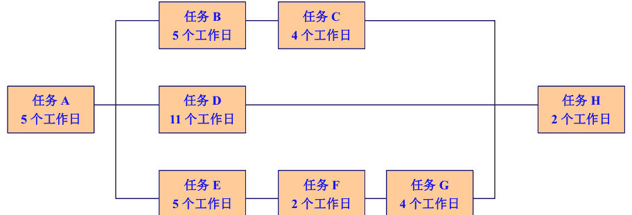

©Copyright Xinjun Mao 2005

## 参与、承诺和分发

- 项目计划的制订者和所有的项目组成员都要参与项目计划的制定
  - 明确任务，估算周期，确认进度
- 通过会议的形式参与制定
  - 加强交流
- 所有成员都要承诺项目计划的内容
- 项目计划要进行评审
- 评审后的项目计划要分发给所有的项目组成员，让他们了解软件项目计划

## 讲授内容

- 项目案例
- 什么是软件项目计划？
- 为什么需要软件项目计划？
- 制定软件项目计划应考虑的因素
- 制定软件项目计划的步骤
- CMM对软件项目计划的要求
- 成功的和过于乐观的软件开发计划
- 案例分析及CASE工具
- 小结

## 制定软件项目计划的过程和步骤

1. 指定项目进度协调者
2. 确定要使用的工具
3. 准备项目进度计划会议
4. 召开项目进度计划会议
5. 提交和分析数据
6. 使用工具创建进度计划
7. 评审项目进度计划
8. 使用工具更改项目进度计划
9. 批准项目进度计划
10. 分发项目进度计划

## 制定软件项目计划的过程和步骤

- 对每个过程和步骤的描述
  - 任务描述
  - 入口条件
  - 出口条件
  - 持续时间
  - 进一步说明

## 步骤1:指定项目计划协调者(1/3)

- **任务描述**
  - 项目经理指定一个计划协调者，负责协商约定和制定项目软件开发计划
  - 计划协调者是一个关键的角色
- **入口条件**
  - 项目开始实施之时
- **出口条件**
  - 有一个人被指派为计划协调者

## 步骤1：指定项目计划协调者(3/3)

- 为什么需要指定项目计划协调者？
  - 项目计划的制定非常重要
  - 项目计划的制定工作量大，需要全日制人员
  - 项目计划的制定涉及多方人员，包括用户、项目经理、开发人员、其他计算机系统小组，因此需要专职人员进行多方协调

## 步骤2:确定要使用的工具(1/3)

任务描述

项目计划协调者指定计算机辅助工具用于辅助制定软件项目计划和项目检查表

入口条件

确定了项目计划协调者

出口条件

所选择的的项目管理辅助工具

## 步骤2：确定要使用的工具(2/3)

- 持续时间
  - 0-5天
- 进一步说明
  - 可适当安排时间对工具的使用进行培训
  - 典型工具如：Microsoft Project

## 步骤3: 为项目计划会议作准备(1/2)

任务描述

为召开项目计划做好准备，内容包括

- 确定会议主题和具体任务
- 制定会议进度和日程安排
- 分发会议通知，邀请所有的项目组成员参加会议
- 最好有一个初步的草案供与会人员讨论
- 如有，收集历史信息

## 步骤3：为项目计划会议作准备(2/2)

- 入口条件
  - 选择了项目计划制定工具
- 出口条件
  - 为会议召开做了充分的准备，并分发了会议通知
- 持续时间
  - 0 – 5天

## 步骤4：召开项目计划会议(1/3)

- 任务描述
  - 召开会议，并就有关问题达成一致意见
  - 确定软件开发活动(大粒度)，例如需求分析
  - 确定每个活动的负责人

## 步骤4：召开项目计划会议(1/3)

- 活动负责人会后要与其下属以及有关人员确定
  - 细化所负责的活动(足够详细，便于管理和估算进度)
  - 确定活动之间的关系
  - 讨论活动的持续时间
  - 确定活动所需要的资源
  - 列出与每个活动相关的一些基本假设和要求
    - 生产率
    - 所需的人和机器
    - 人员的工作能力

## 步骤5：提交和分析数据(1/2)

### 任务描述

- 项目各个活动的负责人向项目计划负责人提交了计划数据
- 项目计划负责人对提交的数据进行了分析

## 步骤5：提交和分析数据(2/2)

- 入口条件
  - 项目计划会议已成功召开
- 出口条件
  - 各个项目活动负责人的计划数据已经收集并得到充分的分析
- 持续时间
  - 1周

## 步骤6:使用工具创建项目计划

- 任务描述
  - 项目计划负责人使用工具制定项目计划
- 入口条件
  - 各个活动负责人提交了各自的计划数据
- 出口条件
  - 制定了一个初步的项目计划
- 持续时间
  - 1-5天

## 步骤7:评审项目计划(1/2)

任务描述

- 项目计划负责人召开项目计划的评审会议
- 会议的参与者不仅包括项目组成员，还包括管理层、质量保证人员、甚至用户

## 步骤8：更改项目进度计划

- 任务描述
  - 根据评审会议的要求更改项目计划
- 入口条件
  - 评审会议结束，确定了项目进度计划的修改部分
- 出口条件
  - 产生了一个可提交的项目计划
- 持续时间
  - 1-5天

## 步骤9：批准项目进度计划

- 任务描述
  - 给项目经理上报项目计划，等待批准
- 入口条件
  - 根据评审会议要求修改后的项目计划
- 出口条件
  - 项目经理批准的项目计划
- 持续时间
  - 1天

## 步骤10:分发项目进度计划

- 任务描述
  - 将批准后的项目计划分发给项目组成员
- 入口条件
  - 经批准的项目计划
- 出口条件
  - 适当地文件包分发给项目组成员
- 持续时间
  - 1天

## 讲授内容

- 项目案例
- 什么是软件项目计划？
- 为什么需要软件项目计划？
- 制定软件项目计划应考虑的因素
- 制定软件项目计划的步骤
- CMM对软件项目计划的要求
- 成功的和过于乐观的软件开发计划
- 案例分析及CASE工具
- 小结

## CMM对软件项目计划的要求

- 软件项目计划是CMM二级的关键过程域
- 软件项目计划是指为实施软件工程和管理软件项目制定合理的计划，其任务包括：
  - 以要完成的工作、约束条件和目标为基础
  - 估计软件项目的规模、软件工作产品、所需资源、工作量、成本，建立必要的承诺和约定，制定软件开发计划
  - 为了制定软件开发计划，可能需要反复地通过这些步骤
- 软件开发计划提供了实施和管理该软件项目的活动的基础

## CMM对软件项目计划的要求

共25个关键实践，对软件项目计划的制定提出了明确的要求

| 关键实践类 | 关键实践数目 |
|---|---|
| 制定方针政策 | 2 |
| 确保必备条件 | 4 |
| 实施软件过程 | 15 |
| 度量和分析 | 1 |
| 检查实施情况 | 3 |

## 目标

- 制定软件估算文档，用于策划和跟踪软件项目使用
- 制定软件项目活动和约定计划，并形成文档
- 受影响组和个人同意与软件项目有关的约定

## 制定方针政策(1/2)

- 指派一个负责人（一般为项目软件负责人）负责制定项目软件开发计划，并对其中的各项承诺进行协商
- 说明
  - 指定专人负责制订项目软件开发计划
  - 软件开发计划中各项承诺的制定需要与有关各方进行协商

## 制定方针政策(2/2)

- 项目遵循一个书面的、由组织制定的用以进行软件项目计划的方针，该方针一般包括：
  - 将分配给软件的需求作为软件项目计划的基础
  - 协商关于该软件项目的承诺，如项目负责人、项目软件负责人、其他受影响组等
  - 和其它工程组协商他们介入软件活动的事宜，并记入文档，如系统工程组、硬件工程组、系统测试组等...

## 制定方针政策(2/2 cont.)

- 受影响组(软件工程组、质量保证组、配置管理组等)评审软件项目的规模估算、工作量和成本估算、计算机资源和进度估计，以及其它承诺
- 高级管理者对所有向组织外的个人和组织所作的软件项目承诺进行评审
- 项目的软件开发计划应受管理和控制

## 第4讲 软件项目计划

## 确保必备条件(1/4)

对软件项目存在文档化、经批准的工作说明 (SOW) -- 软件项目任务书，工作说明的内容包括：

- 工作范围(做与不做)
- 技术目标和指标
- 对顾客和最终用户的标识
- 要求遵循的标准(行业和软件标准等)
- 赋予的职责
- 成本和进度的约束及目标
- 软件项目和其它组织间的依赖关系如顾客、子承包商、合作伙伴等
- 资源的限制和目标
- 对开发和(或)维护的其它约束和目标

## 确保必备条件(2/4)

- 指定软件开发计划的制定人员，明确其职责
  - 项目软件负责人直接或委托代表协调项目的软件计划
  - 将软件工作产品和活动进行分解，并以可追踪和可说明的方式将其指派给各负责人
  - 软件工作产品的例子包括：
    - 适时交付给外部顾客或最终用户的工作产品如软件需求规格说明书、使用手册
    - 供其它工程组使用的工作产品，如软件接口文档
    - 供软件工程组内部使用的主要工作产品

## 确保必备条件(3/4)

- 为策划软件项目提供足够的资源和经费
- 有专门知识的有经验的个人来制定软件开发计划
- 能得到支持软件项目策划的工具，如
  - 电子表格程序
  - 项目估计模型
  - 项目策划和调度程序等

## 实施过程活动(1/15)

- 软件工程组参加项目计划的建议和评审活动
  - 建议和说明的准备、讨论、协商和提交
  - 软件工程组评审所建立的项目承诺
  - 项目的技术目标和指标
  - 系统和软件的技术解决方案
  - 软件标准和规程
  - 软件预算、进度和资源

## 实施过程活动(2/15)

- 在整个项目计划的早期阶段就启动软件项目软件计划，此两项计划可同时进行

## 实施过程活动(4/15)

- 按照文档化的规程，高级管理者参与对组织外的个人和组所作的软件项目承诺进行的评审

## 实施过程活动(5/15)

- 选定合适的软件生存周期模型
- 瀑布模型
- 带反馈的瀑布模型
- 螺旋模型
- 快速原型，等等

# InternVL3: Exploring Advanced Training and Test-Time Recipes for Stronger InternVL Models

Jinguo Zhu,† Xiyu Wang,† Tian Ye,† Dongfu Jiang,† Haoran Wu,† Yuepeng Hu,† Lingchen Meng,† Wenze Liu,† Xizhou Zhu, Jifeng Dai, Yu Qiao, Lewei Lu,‡ Yikang Shen,‡ Ziwei Liu‡*

Shanghai AI Laboratory

Beijing Academy of Artificial Intelligence

Department of Computer Science and Engineering, The Chinese University of Hong Kong

Suan Family

The University of Hong Kong

Tsinghua University

Queen Mary University of London

Department of Computer Science, Johns Hopkins University

Corresponding authors

> Abstract

InternVL3 is a family of open-source multimodal large language models designed to bridge the gap between open-source and closed-source models in multimodal capabilities. Building upon the architecture and progressive alignment of InternVL2, InternVL3 introduces a series of innovative enhancements in training and test-time recipes, significantly boosting its performance and usability. These enhancements span three key areas: (1) Advanced Training Recipes: Our training recipes employ a novel powerful dataset. It integrates strong data organization in curriculum learning and also introduces a high quality dataset with data-efficient learning strategy, improving both sample efficiency and overall performance; (2) Advanced Test-Time Recipes: InternVL3 adopts dynamic noise reduction, guided self-distillation, and test-time scaling strategies, which reduce error accumulation and harness the potential of reasoning; (3) Advanced Model Capabilities: Based on our training and test-time recipes, InternVL3 also unlocks strengths such as multi-turn interactive reasoning and fine-grained multimodal perception. To evaluate the performance of InternVL3, we conduct extensive experiments across a wide range of benchmarks. The results demonstrate that InternVL3 outperforms both open-source and closed-source models across various tasks, achieving state-of-the-art results and showcasing strong multimodal capabilities.

| Model | InternVL2.5-78B | InternVL3-78B | A/B | Improvement |
|-------|----------------|---------------|-----|-------------|
| MMMU val | 72.4 | 73.8 | +1.4 | +1.9% |
| MathVista | 68.4 | 70.9 | +2.5 | +3.7% |
| DocVQA | 92.5 | 94.1 | +1.6 | +1.7% |
| ChartQA | 86.1 | 88.8 | +2.7 | +3.1% |
| OCRBench | 85.8 | 87.2 | +1.4 | +1.6% |
| SEED-Bench-2 | 71.6 | 73.0 | +1.4 | +2.0% |
| MMStar | 69.1 | 70.9 | +1.8 | +2.6% |
| General VQA | 76.5 | 78.0 | +1.5 | +2.0% |
| Text VQA | 79.0 | 80.5 | +1.5 | +1.9% |
| Chart VQA | 84.5 | 85.9 | +1.4 | +1.7% |
| InfoVQA | 69.1 | 70.5 | +1.4 | +2.0% |
| Multi-discipline | 62.5 | 64.2 | +1.7 | +2.7% |

InternVL3-78B outperforms InternVL2.5-78B on various benchmarks. Both models use the same backbone (Qwen2.5-72B-Instruct), and the improvement is solely due to our advanced training and test-time recipes.

## 实施过程活动(6/15)

- 由下列人员评审软件开发计划
  - 项目负责人
  - 项目软件负责人
  - 其它受影响组
- 软件开发计划应受管理和控制

## 实施过程活动(7/15)

- 将软件开发计划写成文档，内容包括：
  - 项目软件的目的、范围、目标和指标
  - 软件生存周期的选择
  - 开发和维护软件用的规程、方法和标准的标识
  - 待开发软件工作产品的标识
  - 软件工作产品规模的估计
  - 软件项目工作量和成本的估计
  - 关键计算机资源使用情况的估计
  - 软件项目的进度，包括各个里程碑和评审的标识
  - 项目软件风险的标识和评估
  - 关于项目软件工程设施和支持工具的计划

## 实施过程活动(8/15)

- 标识为建立和维护控制软件项目所需的工作产品
- 参考软件配置管理关键过程域的活动

## 实施过程活动(9/15)

- 按照文档化规程，导出软件工作产品规模(或对软件工作产品规模的更动)的估算
  - 对所有主要的软件工作产品和活动作出规模估计
    - 要作规模估计的工作产品和活动的类型的例子有
      - 运行软件和支持软件
      - 可交付的和不交付的工作产品
      - 软件和非软件工作产品(例如文档)
      - 开发、验证和确认工作产品的活动
  - 估计方法
    - 功能点
    - 特征点
    - 代码行

## 实施过程活动(9/15 cont.)

- 将软件工作产品进行分解，直到适于进行估计的粒度
- 在有历史资料的地方应使用历史资料
- 对规模估计写成文档，进行评审、并使之得到认可

- 项目负责人
- 项目软件负责人
- 其它受影响组

## 实施过程活动(10/15 cont.)

- 对工作量、人员配置和成本的估计应基于过去的经验
- 将导出估算时所作的假定和估算结果记入文档，进行评审并使之得到认可

## 实施过程活动(11/15)

- 按照文档化的规程，导出项目软件的关键计算机资源的估算
  - 标识项目的关键计算机资源
    - 计算机存储容量
    - 计算机处理器能力
    - 通信通道容量
  - 关键计算机资源的估算应与下列各项的估计关联起来考虑
    - 软件工作产品的规模、运行处理的负载、通信量
  - 对关键计算机资源的估算写成文档、进行评审、并使之得到认可

## 实施过程活动(12/15)

按照文档化的规程，导出项目的软件进度表，该规程一般规定

- 软件进度表的制定应与下列各项关联起来考虑
- 软件工作产品规模(或规模更动)的估计
- 软件工作量和成本的估计
- 软件进度表的制定应基于过去的经验
- 可能时，利用类似项目的经验

## 实施过程活动(12/15 cont.)

- 软件进度表应满足设定的里程碑日期、关键的日期以及其它限制要求
- 软件进度表中的活动应有合适的持续时间，而且里程碑是以适当的时间间隔分开的，以便能支持度量软件项目进展中的精度
- 将导出进度表时的假定记入文档
- 对软件进度表写成文档、进行评审、并使之得到认可

## 实施过程活动(13/15)

- 对与项目成本、资源、进度和技术方面相关联的软件风险进行鉴别、评估并写成文档
  - 根据风险对项目的潜在影响，对各种风险进行分析并按优先级排序
  - 标识导致风险的各种偶发事件
    - 进度受阻
    - 人员更换

## 实施过程活动(14/15)

- 制定关于项目所需软件工程设施和支持工具的计划
  - 对这些设施和支持工具的能力需求的估算应建立在对于软件工作产品的规模估计和其它特征的基础上，软件开发设施和支持工具的例子包括：
    - 软件开发用的计算机和外设
    - 软件测试用的计算机和外设
    - 目标计算机环境中的软件
    - 其它支持软件
  - 为了获得或研制这些设施和支持工具，分配职责、商谈承诺
  - 所有受影响组评审该计划

## 实施过程活动(15/15)

- 记录软件策划的资料
  - 所记录的信息包括估算以及相关信息
  - 软件策划的资料应受管理和控制

## 度量和分析

- 进行度量，并将度量结果用于确定软件策划活动的状态
  - 将软件项目策划活动的里程碑的完成情况与计划相比较
  - 将软件项目策划活动中所完成的工作，所用的工作量和所消耗的资金与计划相比较

## 验证实施(2/3)

- 项目软件负责人可定期或者事件驱动地参与软件项目策划活动的评审

## 讲授内容

- 项目案例
- 什么是软件项目计划？
- 为什么需要软件项目计划？
- 制定软件项目计划应考虑的因素
- 制定软件项目计划的步骤
- CMM对软件项目计划的要求
- **成功的和过于乐观的软件开发计划**
- 案例分析及CASE工具
- 小结

## 成功和过于乐观的软件开发计划

1. 成功的软件开发计划
2. 过于乐观的软件开发计划
3. 为什么会产生过于乐观的软件开发计划

## 成功的软件开发计划

| 左侧输入 | 中心主题 | 右侧输出 |
|---|---|---|
| 共同参与 | 精确制定软件项目计划 | 按时完成项目 |
| 科学准确的估算 | | 高质量的产品 |
| 借鉴经验 | | 员工的成就感 |
| | | 个人水平的提高 |
| | | 准时交付产品 |
| | | 客户的信誉度 |

## 第4讲 软件项目计划

## 过于乐观的软件开发计划

过于乐观的计划

进度压力

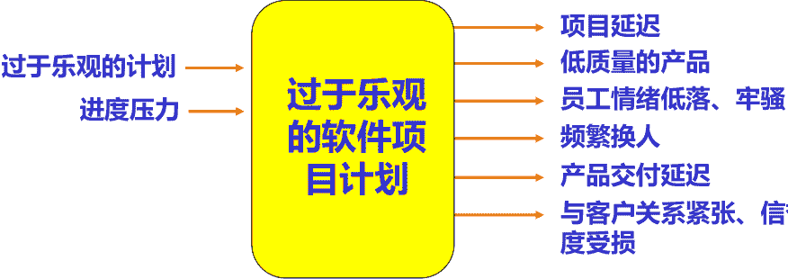

过于乐观的软件项目计划

- 项目延迟
- 低质量的产品
- 员工情绪低落、牢骚
- 频繁换人
- 产品交付延迟
- 与客户关系紧张、信誉度受损

## 为什么会产生过于乐观的软件开发计划

- 赶时间
- 为了迎合客户的不切实际的进度要求
- 估算不准确
- 需求变更(增加)
- 开发人员没有充分参与和承诺

## 讲授内容

- 项目案例
- 什么是软件项目计划？
- 为什么需要软件项目计划？
- 制定软件项目计划应考虑的因素
- 制定软件项目计划的步骤
- CMM对软件项目计划的要求
- 成功的和过于乐观的软件开发计划
- 案例分析及CASE工具
- 小结

## 案例分析(1/7)

- 任务
- 时间限制
- 人员
- 成本

- 负责组织**大学图书馆管理系统的开发
- 6个月
- 4个技术人员
- 控制在40万元之内

开发小组：小李，老赵，小田，小谢

## 案例分析(2/7)

- Step 1: 指定项目进度协调者
  - 小王
- Step 2: 确定要使用的工具
  - Microsoft project

## 案例分析(3/7)

### Step 3: 准备项目进度计划会议
- 确定会议主题和具体任务
  - 制定初步计划
- 制定会议进度和日程安排：
  - 会议内容：确定开发活动，安排活动负责人，大体估算项目规模......
- 分发会议通知，邀请所有的项目组成员参加会议
  - 2002/12/13上午在Room132 举行，与会人员......
- 小王准备了一个初步的草案供与会人员讨论
- 如有，收集历史信息
  - 上次需求分析工作量10人月，共3个月时间

## 案例分析(4/7)

- Step 4: 召开项目进度计划会议
  - 确定需求分析工作的负责人和人员
    - 负责人：老赵
    - 人员组成：小李，老赵，小谢
  - 明确下次会议的时间

## 案例分析(6/7)

- Microsoft Project 的DEMO

## 案例分析(7/7)

- Step 7: 评审项目进度计划
  - 多方参与：项目经理，项目进度负责人、开发组成员、质量保证小组等

- Step 8: 使用工具更改项目进度计划

- Step 9: 批准项目进度计划
  - 项目负责人：小王

- Step 10: 分发项目进度计划
  - 需求分析小组、用户、软件设计小组等
  - 必要的培训

## 讲授内容

- 项目案例
- 什么是软件项目计划？
- 为什么需要软件项目计划？
- 制定软件项目计划应考虑的因素
- 制定软件项目计划的步骤
- CMM对软件项目计划的要求
- 成功的和过于乐观的软件开发计划
- 案例分析及CASE工具
- 小结

## 小结

- What and why
- 软件项目计划制定应考虑的因素
- 制定软件项目计划的步骤
- 成功的软件项目计划
- 充分考虑
- 参与者承诺
- 紧张可完成的

## 教学目的

## 理解

- 什么是软件项目计划？
- 制定软件项目计划的重要性和意义
- 软件项目计划的内容
- 制定软件项目计划应考虑的问题
- 软件项目计划对软件项目实施的影响

## 掌握

- 软件项目计划制定的方法
- CMM对软件项目计划制定的要求

## 运用

- 在实际软件项目中能够制定计划

# Software Project Management

# Q & A

# Practice, Practice, and Practice

# 软件项目管理课程 之

## 第5讲 软件项目跟踪

毛新军  
xjmao21@21cn.com  
http://software.nudt.edu.cn/~xjmao  
计算机科学与技术系602教研室  
0731-(45)73649

## 讲授内容

- 项目案例
- 什么是软件项目跟踪？
- 为什么需要对软件项目进行跟踪
- 软件项目跟踪会议
- 软件项目跟踪的过程和步骤
- CMM对软件项目跟踪的要求
- 小结

## 项目案例

## 案例角色和人物

小王：软件项目负责人

老王：公司技术老总

开发小组：小李，老赵，小田，小谢

## 项目实施需要跟踪(1/2)

- 项目实施了一个月后 一切似乎正常，然而进入第二个月后出现了许多意想不到的问题，这些问题的出现将影响项目的正常实施，甚至可能导致项目失败
  - 需求分析进行了1个半月之后，需求分析的负责人老赵开始意识到需求分析工作不能按计划完成，因为剩下的工作在半个多月的时间内完成是不切实际的。因此他把这一严重的问题告诉给项目经理小王，针对该问题小王必须采取措施；
  - 与进度面临同样问题的是，小王从公司的财务部得到通知，项目在需求分析阶段的成本已经超支，超支的主要原因是日常的伙食费和住宿费的额度较大，因此需要对成本的预算和计划重新进行调整

## 项目实施需要跟踪(1/2)

- 更为糟糕的是，在此关键时刻，项目组的技术骨干老赵就提出要辞职，他的辞职给项目组的开发带来了很大的风险，小王现在必须面对这个现实，并且采取有效的措施来弥补老赵离开项目组带来的问题
- 另外，根据老赵的反映，近段时间用户对需求分析小组的支持力度不够，友好程度也不够，并且开始出现闹矛盾的现象，因此和用户之间的关系应该引起关注和重视
- 公司高层和用户为了更加清晰地了解项目的进展情况，要求小王每周定期给他们提供项目的进展情况

## 案例提示我们

- 在项目实施过程中会发现许多问题和风险，
- 这些问题和风险在事先是很难预测到的
- 在实施过程中， 项目完全按照预先制定的计划进行是比较困难的， 因此会有偏差
- 必须了解项目的实际实施情况， 以便清晰的知道存在哪些偏差
- 必须针对各个问题， 提出相应的措施， 以决问题， 或者消除和避免风险

## 软件项目管理问题

- 什么是软件项目跟踪
- 为什么需要对软件项目进行跟踪？
- 需要跟踪软件项目的哪些方面？
- 如何进行跟踪？
- 跟踪时应该注意哪些问题？

## 讲授内容

- 项目案例
- 什么是软件项目跟踪？
- 为什么需要对软件项目进行跟踪
- 软件项目跟踪会议
- 软件项目跟踪的过程和步骤
- CMM对软件项目跟踪的要求
- 小结

## 什么是软件项目跟踪

- 概念
- 对象
- 基础
- 方式
- 目标

## 什么是软件项目跟踪

### 什么是软件项目跟踪？

- 在项目实施过程中，随时掌握项目的实际开发情况，使得当项目实施与计划相背离，或者出现问题和风险时，能够采取有效的措施

### 软件项目跟踪对软件项目的实施提供可视性

- 知道项目的实际执行和实施情况

- 知道项目实施过程中(可能)出现了哪些问题

- 知道如何采取措施防止问题的出现，或者出现时该采取什么办法减少它给软件项目实施带来的影响和损失

## 软件项目跟踪的对象

- 项目风险
- 项目进展
- 开发活动进展
- 开发活动问题
- 项目展望

## 软件项目风险(1/3)

- 软件项目在实施过程中存在各种问题和风险  
  - 技术风险，例如某项需求尚未找到合适的技术解决途径，或者原先所制定的技术解决途径发现不合适  
  - 进度风险，例如某项活动原先计划1个月时间完成，但是现在3个月过去了仅仅完成任务的一半  
  - 成本风险，由于没有控制支出，实际成本已经远远超过原先计划的成本预算，并且仍然不断增长  
  - 人员风险，项目组成员临时跳槽或者调派，人员缺乏  
  - 工具和设备风险，所需的工具和设备不能按时提供，或者得不到，....

## 软件项目风险(2/3)

- 在项目跟踪过程中，识别风险以便管理风险  
  - 通过了解项目的实际实施情况，发现风险  
  - 详细描述风险  
  - 将各个风险组织以风险清单形式提交讨论

## 项目风险清单样例

| 风险 | 负责人 | 开始日期 | 结束日期 | 风险标识 |
|---|---|---|---|---|
| 部分产品需求尚未得到潜在客户的验证 | 小李 | 02/10/10 | 02/10/20 | 1 |
| 所需的软件构件和工具没有按期购买 | 小谢 | 02/10/10 | 02/10/15 | 2 |
| 软件测试所需设备比要求时间晚了 1 个月 | 小谢 | 02/10/15 | （02/10/10）02/10/18 | 3 |
| 项目开销超出计划 10%，且每周按 5% 增长 | 小李 | 02/10/18 | 02/10/21 | 4 |

## 软件项目风险(3/3)

- 项目风险清单的内容
  - 风险描述
  - 负责人
  - 风险处理的开始时间，可能会发生变更，保留历史
  - 目标结束时间，可能会发生变更，保留历史
  - 风险标识

## 项目进展(1/2)

- 在项目实施过程中，项目的实际进度可能会与计划的进度产生偏差
  - 工作量估算的不准确
  - 用户需求的变更
  - 交流的不畅
  - 人员的变更
  - 受到其他不可预知情况的干扰
  - ......

## 项目进展示意图

| 检查点   | 开始日期 | 结束日期   |
|----------|----------|------------|
| 需求分析 | 02/01/03 | 02/01/28   |
|          | 02/01/03 | 02/02/04   |
| 概要设计 | 02/01/24 | 02/02/18   |
|          | 02/01/24 | 02/02/18   |
| 详细设计 | 02/02/14 | 02/04/01   |
|          | 02/02/14 | 02/04/08   |
| 编码     | 02/03/07 | 02/05/13   |
|          | 02/03/09 | 02/08/28   |

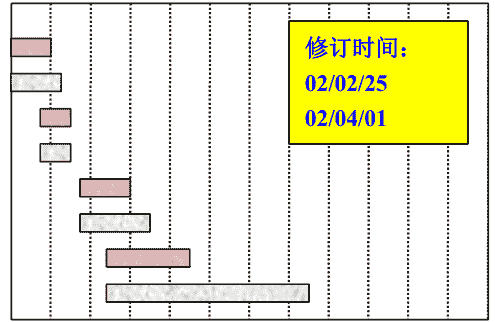

## 开发活动进展(1/2)

- 在项目跟踪过程中，洞悉开发活动实际进展
- 详细、具体了解各项活动的实际情况
- 开发活动的计划
- 将实际进展与计划进行比较，了解偏差，以便采取措施

## 开发活动进展(2/2)

| 标识 (ID#) | 活动 | 相关 活动 | 负责 人 | 计划 开始日期 | 计划 结束日期 | 实际 开始日期 | 实际 结束日期 |
|---|---|---|---|---|---|---|---|
| 210 | 需求调查 | | 小谢 | 04/04 | 05/13 | 04/14 | 05/16 |
| 211 | 需求分析 | 210 | 小谢 | 05/16 | 05/27 | 05/17 | 05/27 |
| 212 | 撰写 需求 分析文档 | 211 | 小谢 | 05/30 | 06/10 | 05/30 | 06/14 |
| 213 | 需求评审 | 212 | 小谢 | 06/13 | 06/17 | 06/15 | 06/22 |

## 开发活动问题(2/2)

# 开发活动问题表

问题名称：需求分析文档的编写规范  指定负责人：老赵

活动编号：14

提出日期：03/19

要求结束日期：03/25

目标结束日期：（03/25）03/27

约束日期：03/28

受其影响的活动：需求分析

> 在编写软件需求规格说明书过程中，缺少编写规范的指导

进展：

## 项目展望

- 展望项目在未来合适的时间段的情况
  - 下一个主要里程碑
  - 公开发布日期
  - 产品交付日期

## 软件项目跟踪的基础

- 软件开发计划
  - 活动和关系
  - 进度计划
  - 资源和人员计划
  - 成本计划， ......

- 软件项目实际实施过程
  - 实施了的实际进度
  - 实施面临的问题

## 软件项目跟踪的方式

- 成立项目跟踪小组PTT(Project Tracing Team)
  - 由项目组成员(小项目)或者负责人(大项目)组成
- 指定项目跟踪负责人
  - 负责协调项目进度的跟踪工作
- 定期召开项目跟踪会议，获取项目实施的详细情况和面临的问题
  - 最好定期每周一次
  - 了解项目实施情况
  - 汇报问题

## 软件项目跟踪的目标

- 通过跟踪对软件项目的实施提供可视性
  - 知道项目的实际执行和实施情况
  - 知道项目实施过程中(可能)出现了哪些问题
  - 知道如何采取措施防止问题的出现，或者出现时该采取什么办法减少它给软件项目实施带来的影响和损失

## 软件项目跟踪示意图

- 了解项目进展
- 发现问题和风险
- 采取措施

- 项目风险
- 项目进展
- 项目活动
- 开发活动问题
- 项目展望

项目计划

项目实施过程

- 项目跟踪小组会议
- 项目跟踪负责人员

## 为什么需要对软件项目进行跟踪

- 软件项目实施相对于计划的不确定性、动态性和实施过程中问题多样性和不可预知性及其带来的风险
  - 不现实的截至日期
  - 对工作量和资源数量估算不足
  - 客户需求的动态变化
  - 交流不畅而导致的项目延期
  - 计划没有考虑风险
  - 事先无法预知的技术问题
  - 事先无法预知的人力困难

## 讲授内容

- 项目案例
- 什么是软件项目跟踪？
- 为什么需要对软件项目进行跟踪
- 软件项目跟踪会议
- 软件项目跟踪的过程和步骤
- CMM对软件项目跟踪的要求
- 小结

## 软件项目跟踪会议

- 何时召开会议
- 谁来参加会议
- 跟踪会议的组织和召开
- 修复计划
- 问题升级

## 何时召开会议

- 频率：每周召开一次
- 安排在每周的同一天、同一时间、同一地点
- 最好安排在周2，或者周3
  - 之前有所准备
  - 之后有所预留

## 谁来参加会议

- 小项目(人数小于10人)
  - 所有的项目组成员参与会议
- 大项目(人数大于10人)
  - 各个小组和产品的负责人

## 跟踪会议的组织和召开

- 围绕跟踪对象
- 指定负责人，防止推卸责任
- 限定阐述时间，言简意赅，提高效率
- 会议日程应预先安排好，预先通知有关人员
- 确保每个人有备而来
- 费时的问题留待会后解决
- 鼓励开放、坦诚的报告情况

## 修复计划

- 通过跟踪发现问题不是最终目的，必修尽快提供修补问题的措施以把问题造成的损失减少到最少范围 → 制定修复计划

- 修复计划的内容

- 指定负责人

- 确定活动次序

- 决定活动的起止时间，找出依赖活动

- 确保相关人员赞成该计划

## 问题升级

- 如果在开发过程中发现争端，该如何处理？
  - 争端必须尽快解决
  - 由高一级的领导来了解争端，协调解决 --> 问题升级

## 讲授内容

- 项目案例
- 什么是软件项目跟踪？
- 为什么需要对软件项目进行跟踪
- 软件项目跟踪会议
- 软件项目跟踪的过程和步骤
- CMM对软件项目跟踪的要求
- 小结

## 软件项目跟踪的过程和步骤

1. 指派PTT (Project Trace Team)负责人
2. 选定要用的工具和表格
3. 实施PTT培训
4. 准备PTT会议
5. 召开PTT会议
6. 开展工作/问题升级会议
7. 分发PTT会议记录
8. 转到第5步直到项目结束

## 步骤: 指派PTT负责人

- 任务描述
  - 由项目经理指派PTT负责人
- 入口条件
  - 项目开始
- 出口条件
  - 指定了某人作为PTT负责人
- 持续时间
  - 1天

## 步骤2：选定要用的工具和表格

### 任务描述

- PTT负责人选定进行项目跟踪所需的描述表格和工具。

### 入口条件

- 项目经理已经指定了PTT负责人。

### 出口条件

- PTT负责人选定了描述表格和工具。

### 持续时间

- 0–5天

### 项目跟踪表格的例子

**软件开发活动进度表**

| 标识(ID#) | 活动 | 相关活动 | 负责人 | 计划开始日期 | 计划结束日期 | 实际开始日期 | 实际结束日期 |
|---|---|---|---|---|---|---|---|
| 210 | 需求调查 |  | 小谢 | 04/04 | 05/13 | 04/14 | 05/16 |
| 211 | 需求分析 | 210 | 小谢 | 05/16 | 05/27 | 05/17 | 05/27 |
| 212 | 撰写需求分析文档 | 211 | 小谢 | 05/30 | 06/10 | 05/30 | 06/14 |
| 213 | 需求评审 | 212 | 小谢 | 06/13 | 06/17 | 06/15 | 06/22 |

**软件开发风险列表**

| 风险 | 负责人 | 开始日期 | 结束日期 | 风险标识 |
|---|---|---|---|---|
| 部分产品需求尚未得到潜在客户的验证 | 小李 | 02/10/10 | 02/10/20 | 1 |
| 所需的软件构件和工具没有按期购买 | 小谢 | 02/10/10 | 02/10/15 | 2 |
| 软件测试所需设备比要求时间晚了1个月 | 小谢 | 02/10/15 | (02/10/10) 02/10/18 | 3 |
| 项目开销超出计划10%，且每周按5%增长 | 小李 | 02/10/18 | 02/10/21 | 4 |

## 步骤3：实施PTT培训

### 任务描述

- 由PTT负责人组织对所有PTT成员进行必要的培训。

### 入口条件

- PTT负责人选定了描述表格和工具。

### 出口条件

- 对PTT成员进行了必要的培训。
- PTT成员对跟踪会议达成一致（时间、地点、职责等）。

### 持续时间

- 1–4天

### 培训的内容

- 项目跟踪的对象
- 何时进行跟踪
- 哪些人员参加PTT会议
- 跟踪会议的日程
- 跟踪会议的时间安排
- 跟踪会议的程序
- 修复计划
- 介绍以往项目跟踪情况、回顾其教训
- 学习如何使用表格和工具

## 步骤4：准备PTT会议

### 任务描述

- PTT负责人和成员为PTT会议的召开作好准备（充分的材料）。

### 入口条件

- PTT成员经过了培训。

### 出口条件

- PTT负责人和成员准备好了召开PTT会议的材料。

### 持续时间

- 1–2天

## 步骤5：召开PTT会议

### 任务描述

- 按照日程召开了PTT会议。

### 入口条件

- PTT负责人和成员为会议的召开做好了准备。

### 出口条件

- PTT会议结束。

### 持续时间

- 1–8小时

## 步骤6：分发PTT会议记录

### 任务描述

- 形成PTT会议记录。
- 向PTT成员分发了会议记录。

### 入口条件

- PTT会议结束。

### 出口条件

- 形成并分发了PTT会议记录。

### 持续时间

- 2天

## 讲授内容

- 项目案例
- 什么是软件项目跟踪？
- 为什么需要对软件项目进行跟踪
- 软件项目跟踪会议
- 软件项目跟踪的过程和步骤
- CMM对软件项目跟踪的要求
- 小结

## CMM对软件项目跟踪的要求

- 软件项目跟踪是CMM二级的关键过程域。
- 所谓的软件项目跟踪和监督是指对软件项目的实际进展建立适当的可视性，使管理者能在软件项目实际进展明显偏离软件计划时采取有效措施。
- 软件项目跟踪和监督的任务：
  - 对照文档化的估计、承诺和计划评审，跟踪软件完成的情况和结果，根据实际完成的情况和结果调整这些计划。
- 软件项目的文档化的计划将作为跟踪软件活动、通报状态和修订计划的基础。
- 软件活动由管理者来监控，主要通过在所选软件工作产品完成时以及在选择的里程碑处，将实际的软件规模、工作量、成本和进度与计划相比较，来确定软件项目进展情况。
- 当确认软件项目计划未被完成时，采取纠正措施。

共24个关键实践，对软件项目跟踪提出了明确的要求：

| 关键实践类 | 关键实践数目 |
|---|---|
| 制定方针政策 | 2 |
| 确保必备条件 | 5 |
| 实施软件过程 | 13 |
| 度量和分析 | 1 |
| 检查实施情况 | 3 |

## 目标

- 对照软件开发计划，跟踪项目实施的实际结果和性能。
- 当实际的结果和性能明显偏离软件开发计划时，采取纠正措施，并加以管理直到结束。
- 对软件承诺的更动得到受影响组和个人的认可。

## 制定方针政策

- 项目软件负责人对项目的软件活动和结果负责。
- 项目遵循一个书面的、由组织制定的用以管理软件项目的方针：
  - 软件项目将采用并维护一个文档化的软件开发计划来作为跟踪软件项目的基础。
  - 随时向项目负责人报告软件项目的状态和问题。
  - 当软件计划未被实现时，采取纠正措施，或者调整性能，或者调整计划。
  - 在受影响组参与和认可的情况下对软件承诺进行更动。
  - 高级管理者对所有的承诺更动和软件项目对组织外的个人和组所作的新的承诺进行评审。

### 确保必备条件

- 项目软件的开发计划已被写成文档并已批准。
- 项目软件负责人对软件工作产品和活动负责，并对下列内容负责：
  - 待开发的软件工作产品和提供的服务
  - 这些软件活动的工作量和成本
  - 这些软件活动的进度
  - 这些软件活动的预算
- 为跟踪软件项目提供足够的资源和经费。
- 对项目软件负责人进行软件项目的技术和人员管理方面的培训：
  - 项目管理技术
  - 跟踪和监督软件规模、工作量、成本及进度
  - 管理人员
- 对有关组的负责人进行软件项目技术方面的定向培训，定向培训的例子包括：
  - 项目的软件工程标准和规程
  - 项目的应用领域知识

### 实施软件过程

- 将文档化的软件开发计划用来跟踪软件活动和通报状态。
  - 软件开发计划随着工作的进展而更新，以便反映完成情况，特别当里程碑被完成时。
  - 软件开发计划的状态应传递到以下小组和人员：
    - 软件工程组（包括所有的小组，例如软件设计小组）
    - 项目软件负责人
    - 项目负责人
    - 高级管理者
    - 其它受影响组
- 按照文档化的规程，修订项目的软件开发计划。
  - 适时地修订软件开发计划，以便对计划进行必要的细化和更动。
  - 更新软件开发计划，以便把所有新的软件项目承诺和对承诺的更动纳入计划。
  - 软件开发计划在每次修订时都应进行评审。
  - 软件开发计划应受管理和控制。
- 将经批准的、影响软件项目承诺的更动通报软件工程组和其它软件有关组的成员，其它软件有关组的例子包括：
  - 软件质量保证组
  - 软件配置管理组
  - 文档支持组

## 实施软件过程(5/13)

- 跟踪软件工作产品的规模(或者软件工作产品更动的规模)，必要时采取纠正措施
  - 跟踪所有主要软件工作产品的规模(或更动的规模)
  - 将实际代码规模(生成的、经完全测试的和交付的)和在软件开发计划文档中估计的规模对比
  - 将实际交付的文档单元数据与在软件开发计划文档中估计的数相比较
  - 按正规的手续对软件工作产品的整体预测规模(与实际值相结合的估计值)进行细化、监控和调整
  - 和受影响组一起，对那些能影响软件承诺的软件工作产品规模估计更动进行协商，并对这些更动写成文档

## 实施软件过程(6/13)

- 跟踪项目的软件工作量和成本，必要时采取纠正措施
  - 对照已完成的工作和过去实际的工作量及成本开销，将其与软件开发计划中文档化的估计量进行比较，以识别出潜在可能的超支和欠支
  - 跟踪软件成本，并将其与软件开发计划中记载的估计相比较
  - 将实际工作量及人员配置与软件开发计划中记载的估计相比较
  - 对那些影响软件承诺的有关人员配置和其它软件成本方面的更动，与受影响组协商，并对这些更动写成文档

## 实施软件过程(7/13)

- 跟踪项目的关键计算机资源，必要时采取纠正措施
  - 对每个主要的软件部件，按照文档化的软件开发计划跟踪项目关键计算机资源的实际使用情况和预计使用情况，并将其与估计相比较
  - 对那些影响软件承诺的有关关键计算机资源估计的更动，与受影响组协商，并对这些更动写成文档

## 实施软件过程(8/13)

- 跟踪项目的软件进度，必要时采取纠正措施
  - 将软件活动、里程碑和其它承诺的实际完成情况与软件开发计划作比较
  - 评价软件活动、里程碑和其它承诺等迟后和提前完成对将来的活动和里程碑的影响
  - 对那些影响软件承诺的有关软件进度的修订，与受影响组协商，并对其写成文档

## 实施软件过程(9/13)

- 跟踪软件工程技术活动，必要时采取纠正措施
  - 软件工程组的成员定期向他们的负责人报告他们的技术状态
  - 检查为后续软件开发步骤提供的软件工作产品版本是否能按照软件开发计划的规定提供
  - 将任何软件工作产品中发现的问题均记入文档
  - 跟踪问题报告直至结束

## 实施软件过程(10/13)

- 跟踪与项目的成本、资源、进度及技术方面有关的软件风险
  - 当有补充信息时，调整风险的优先级及风险可能性
  - 项目经理定期参与高风险的软件产品和活动的评审

## 实施软件过程(11/13)

- 对软件项目的实际度量数据和重新策划的数据进行记录、管理和控制
  - 记录的信息包括估计信息、以及为重构估计和验证其合理性所必须的辅助信息
  - 软件重新策划的数据应受管理和控制
  - 将软件策划数据、重新策划数据和实际度量数据归档，以供正在进行的和未来的项目使用

## 实施软件过程(12/13)

- 软件工程组定期进行内部评审以便对照软件开发计划跟踪技术进展、计划、性能和问题

## 实施软件过程(13/13)

- 按照文档化的规程，在所选的项目里程碑处进行正式评审以评价软件项目的完成情况和结果
  - 安排在对软件项目进度有意义的点上进行评审，例如在所选阶段的开头或结束处
  - 必要时，邀请用户、最终用户(或者其代表)和组织内部受影响组参与评审
  - 使用的材料必须经负责的项目软件负责人的评审和批准

## 实施软件过程(1/13 cont.)

- 分析软件活动的承诺、计划和状态
- 导致对重大问题、各项措施和决策的标识和写成文档
- 分析软件项目风险
- 必要时，评审的结果可导致对软件开发计划的细化和调整

## 度量和分析

- 进行度量，并将度量结果用来确定软件跟踪和监督活动的状态
- 度量的例子包括：
  - 在实施跟踪和监督活动中花费的工作量和其它资源
  - 软件开发计划的更动活动，包括对软件工作产品的规模估计，软件成本估计、关键计算机资源估计和进度的更动

## 验证实施(1/3)

- 高级管理者定期参与软件项目跟踪和监督活动的评审

## 验证实施(2/3)

- 项目经理可定期或者事件驱动地参与软件项目跟踪和监督活动的评审

## 讲授内容

- 项目案例
- 什么是软件项目跟踪？
- 为什么需要对软件项目进行跟踪
- 软件项目跟踪会议
- 软件项目跟踪的过程和步骤
- CMM对软件项目跟踪的要求
- 小结

## 教学目的

## 理解

- 为什么需要对软件项目进行跟踪？
- 什么是软件项目跟踪？
- 软件项目跟踪的对象、基础和目标

## 掌握

- 软件项目跟踪的方法
- CMM对软件项目跟踪的要求

## 运用

- 在实际软件项目中能够对软件项目进行有效跟踪，提供实施视图，控制项目的实施

# Software Project Management

# Q & A

# Practice, Practice, and Practice

# 软件项目管理课程 之

## 第6讲 软件开发的风险管理

毛新军  
xjmao21@21cn.com  
http://software.nudt.edu.cn/~xjmao  
计算机科学与技术系602教研室  
0731-(45)73649

## 讲授内容

1. 项目案例
2. 什么是软件风险？
3. 如何进行风险管理？
4. 风险评估
5. 风险控制
6. 小结

## 项目案例

## 案例角色和人物

- 小王：软件项目负责人

- 老王：公司技术老总

开发小组：小李，老赵，小田，小谢

## 项目实施存在风险(1/4)

- 项目已成功实施1个月，某天小谢突然告诉小王，他已办理好了去德国的签证，2周后他会辞职离开公司前往德国留学 → (人员)
- 小谢的离开显然将会影响项目组的正常运作，影响项目的进度，为此将会给项目的实施带来损失
- 可以想象，2周以后小谢的离开将会有来一系列问题：谁来接替小谢的工作？在此之前谁来负责交接小谢的工作？如何尽可能的避免由此给项目组带来的损失(包括进度损失和工作损失等)
- 尽管还没发生，但必须考虑如何避免问题的发生，以及一旦发生后该采取得措施，以便将损失减少到最少

## 项目实施存在风险(2/4)

- 按照软件开发计划，需求分析应该在12月31日之前完成，然而在软件项目实施过程中项目经理发现，由于原先对工作量估算过于乐观，需求分析在12月31日之前已经不可能完成⇒ (计划)
- 显然，原先计划制定的不科学和不准确，导致了实施过程中进度难以控制，如果强行按照计划来执行显然是不可行的，为此，必须对计划重新进行分析和调整

## 案例提示我们

- 风险在项目实施过程中大量存在
- 软件风险形式多样
- 软件风险事先难以确定
- 软件风险会对软件项目的实施产生不良影响
- 如果不对风险进行良好的管理，项目就很难保证按照计划、在成本和进度范围内，开发出高质量的软件产品，甚至会导致项目失败

## 软件项目管理问题

- 什么是软件风险？
- 有哪些形式的软件风险？
- 如何管理软件风险？

## 讲授内容

1. 项目案例
2. 什么是软件风险？
3. 如何进行风险管理？
4. 风险评估
5. 风险控制
6. 小结

## 什么是软件风险？

- 使软件项目的实施受到影响和损失、甚至会导致失败的、可能会发生的事件
- 例如，人员的临时流失，计划过于乐观，设计的低劣

## 软件风险的特点

- 事先难以确定
- 带来损失，影响项目实施，甚至会导致项目失败

## 讲授内容

1. 项目案例
2. 什么是软件风险？
3. 如何进行风险管理？
4. 风险评估
5. 风险控制
6. 小结

## 如何进行风险管理

1. 什么是风险管理？
2. 风险进行管理的方式
3. 如何进行风险管理？

## 什么是软件风险管理？

- 在风险影响软件项目成功实施前，对它进行识别和处理，并预防和消除风险的发生
  - 识别风险(会有哪些风险？)
  - 预防和消除风险(最好别让风险发生)
  - 制定风险发生后的处理措施(万一发生该怎么办？)

## 风险管理的策略(1/2)

### 危机管理

- 救火模式，风险造成麻烦后才着手进行处理
- 例如，小谢离开公司1个月后，其他小组需要小谢所负责子系统的模块以便进行集成和测试，但是相关代码还没写，此时已经影响其他小组计划和项目进度，为此抽调其他人接替小谢工作

### 失败处理

- 察觉到了风险之后采取措施，但只是在风险发生之后
- 例如，小谢出走的第二天，公司决定抽调其他人员来接替

### 风险缓解

- 识别了风险，并且事先制定好风险发生后的补救措施，但是不做任何防范措施。
- 例如，知道不好事件可能会发生，等它发生。小谢要走，小张接替

## 风险管理的策略(2/2)

- 风险预防
  - 将风险识别和风险防范作为软件项目的一部分加以规划和执行
  - 例如，知道哪些不好事件可能会发生，制定好了一旦发生的应对措施，同时采取措施防止它发生。
  - 小谢要走，小张接替，同时和小谢商量，做工作，能否等到项目完成之后再走
- 消灭根源
  - 识别和消除可能产生风险的根源
  - 例如，知道哪些不好事件可能会发生，制定好了一旦发生的应对措施，同时采取措施消除风险根源，杜绝风险的发生
  - 小谢要走，小张接替，同时给小谢提供更多的学习机会

## 风险管理的组成(1/3)

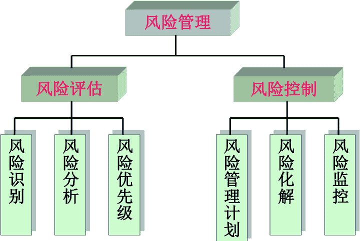

## 风险管理的组成(2/3)

- 风险评估
  - 风险识别：识别风险，形成风险列表
  - 风险分析：判定每一个风险出现的概率、产生的影响及其重要性
  - 风险优先级：按照每个风险的重要性排出一个风险优先级
- 风险评估是风险控制的基础

## 讲授内容

1. 项目案例
2. 什么是软件风险？
3. 如何进行风险管理？
4. 风险评估
5. 风险控制
6. 小结

## 风险评估

1. 风险识别
2. 风险分析
3. 风险优先级

## 风险识别

### 风险的类别

- 计划编制
- 组织和管理
- 开发环境
- 最终用户
- 客户
- 承包商
- 需求
- 产品外部环境
- 人员
- 设计和实现
- 过程

## 计划编制风险

- 计划、资源和产品的定义完全由客户或上层领导决定，忽略了项目组的意见，并且这些决定不完全一致
- 计划忽略了必要的任务和活动
- 计划不切实际
- 计划基于特定小组成员，而这样的小组成员根本得不到
- 产品规模估算过于乐观
- 工作量估算过于乐观
- 进度的压力造成生产率的下降
- 目标日期提前，但没有相应地调整产品范围和可用资源
- 一个关键任务的延迟导致其他相关任务的连锁反应
- ......

## 组织和管理风险

- 缺乏强有力、有凝聚力的领导(项目组、企业)
- 解雇员工导致项目小组能力下降
- 削减预算打乱项目计划
- 仅由管理层和市场人员进行技术决策，导致进度延长
- 低效的项目组织结构降低生产率
- 管理层审查/决策的周期比预期时间长
- 管理层作出了打击项目组积极性的决定
- 非技术的第三方的工作比预期要长(如，采购硬件设备)
- 计划性太差，无法适应期望的开发速度
- 项目计划由于压力而放弃，导致开发混乱
- 管理方面的英雄主义，忽视客观确切的状态报告，降低发现和改正问题的能力

## 开发环境风险

- 设施不能及时到位
- 设施到位，但不配套
- 开发工具未能及时到位
- 开发工具不如期望的那样有效，开发人员需要更多的时间，或者更换工具
- 开发工具的学习期比预期的要长
- 开发工具的选择不是基于技术需求，不能提供计划要求的功能

## 最终用户风险

- 最终用户坚持新的需求
- 最终用户对最后交付的产品不满意，要求重新设计和重做
- 最终用户不买进项目产品，无法提供后续支持
- 最终用户的意见未被采纳，造成产品最终无法满足用户要求

## 客户风险(1/2)

- 客户坚持新的需求
- 客户对规划、原型和规格的审核/决策超出预期
- 客户没有参与规划、原型和规格的审核，导致需求不稳定，以及长时间的变更
- 客户答复的时间比预期的要长
- 客户坚持技术决策而导致计划延长
- 客户对开发进度管理过细，导致实际进度变慢
- 客户提供的组件无法与开发的产品匹配，导致需要额外的设计和集成工作
- 客户提供的组件质量欠佳，导致额外的测试、设计或者功能不完善

## 客户风险(2/2)

- 客户要求的支持工具与环境不兼容，性能差或者不完善，导致生产率降低
- 客户不接受交付的软件，尽管它满足了所有的规格
- 客户期望的开发速度是开发人员所无法达到的

## 承包商风险

- 承包商没有按照承诺交付产品
- 承包商提供的产品质量低下，必须花时间改进质量
- 承包商提供的产品性能达不到要求

## 需求风险

- 需求已经成为项目基准，但仍在变化
- 需求定义欠佳：不清晰、不准确、不一致
- 增加额外的需求

## 产品风险

- 错误发生率高的模块，需要更多的时间对它进行测试、设计和实现
- 矫正质量低下的不可接受的产品需要更多的时间对它进行测试、设计和实现
- 由于功能错误，导致需要重新进行设计和实现
- 开发额外不需要的功能延长了进度
- 要满足产品规模和速度要求，需要更多的时间
- 严格要求与现有系统兼容，需要更多的时间
- 要求软件重用，需要更多的时间
- ......

## 外部环境风险

- 产品依赖政府规章，而规章的改变不可预期
- 产品依赖草拟中的技术标准，而最后的标准不可预期

## 人员风险(1/3)

- 招聘人员所需的时间比预期要长
- 作为人员参与工作的先决条件(如培训、其他项目的完成等)不能按时完成
- 开发人员与管理层关系不佳导致决策迟缓、影响全局
- 项目组成员没有全身心地投入到项目中，因而无法达到所需的产品功能和性能需求
- 缺乏激励措施、士气低下，降低生产能力
- 缺乏必要的规范，增加工作失误，重复工作，降低工作质量
- 缺乏工作基础(语言、经验、工具等)
- 项目结束前，项目组成员离开项目组

## 人员风险(2/3)

- 项目后期，加入新的开发人员，额外的培训和沟通降低了项目组成员的开发效率
- 项目组成员不能有效的在一起工作
- 由于项目组成员之间的冲突，导致沟通不畅，设计欠佳，接口错误和额外重复的工作
- 有问题的项目组成员没有调离项目组，影响其他成员的积极性
- 项目组的最佳人选没有加入项目组，或者加入项目组但没有合理使用
- 关键任务只能兼职参与
- 项目人员不足

## 人员风险(3/3)

- 任务的分配和人员的技能不匹配
- 人员工作的进展比预期的要慢
- 项目管理人员怠工导致计划和进度失效
- 技术人员怠工导致工作遗漏、质量低下，工作需要重做

## 设计和实现风险

- 设计过于简单，考虑不仔细、不全面，导致重新设计和实现
- 设计过于复杂，导致一些不必要的工作，影响效率
- 设计质量低下，导致重新设计和实现
- 使用不熟悉的方法，导致需要额外的培训时间
- 产品使用低级语言编写，导致效率较低
- 分别开发的模块无法有效集成，需要重新设计和实现

## 过程风险

- 跟踪不准确，导致无法预知项目进展是否落后于计划
- 前期的质量保证行为不真实，导致后期的重复工作
- 质量跟踪不准确，导致无法得知影响进度的质量问题
- 不能有效遵循标准，导致沟通不足，质量问题和重复工作
- 风险管理粗心，导致没有发现重大的项目风险
- ......

## 评估风险发生的概率(1/2)

- 主观性较强，采用方法
  - 熟悉系统、有经验的人参与评估
  - 多人独立评估，综合折中
  - 采用分类：非常可能(0.8-1.0)，很可能(0.6-0.8)，或许(0.4 - 0.6)，不太可能(0.2-0.4)，不可能(0-0.2)

## 评估风险发生的概率(2/2)

| 编号 | 风险名称 | 发生概率 |
|---|---|---|
| 1 | 计划过于乐观 | 50% |
| 2 | 由于要完全支持自动从主机更新数据而造成额外的需求 | 5% |
| 3 | 由于市场变化而需额外的需求 | 35% |
| 4 | 图形格式子系统接口不稳定 | 25% |
| 5 | 设计欠佳，需要重新设计 | 15% |

## 评估风险发生造成的损失

可以基于“进度”，“成本”或者“工作量”来进行估算

| 编号 | 风险名称 | 发生概率 | 损失(人周) |
|------|----------|----------|------------|
| 1 | 计划过于乐观 | 50% | 5 |
| 2 | 由于要完全支持自动从主机更新数据而造成额外的需求 | 5% | 20 |
| 3 | 由于市场变化而需额外的需求 | 35% | 8 |
| 4 | 图形格式子系统接口不稳定 | 25% | 4 |
| 5 | 设计欠佳，需要重新设计 | 15% | 15 |

## 计算风险危险度

风险危险度 = 风险概率 × 风险损失

| 编号 | 风险名称 | 发生概率 | 损失(人周) | 危险度(周) |
|------|----------|----------|------------|------------|
| 1 | 计划过于乐观 | 50% | 5 | 2.5 |
| 2 | 由于要完全支持自动从主机更新新数据而造成额外的需求 | 5% | 20 | 1.0 |
| 3 | 由于市场变化而需额外的需求 | 35% | 8 | 2.8 |
| 4 | 图形格式子系统接口不稳定 | 25% | 4 | 1.0 |
| 5 | 设计欠佳，需要重新设计 | 15% | 15 | 2.25 |

## 风险优先级(1/2)

- 统计表明，项目80%成本用于解决20%的问题
- 风险管理重点关注20%重要的部分
- 根据风险的危险度确定风险的重要性，忽略其他的部分

## 讲授内容

1. 项目案例
2. 什么是软件风险？
3. 如何进行风险管理？
4. 风险评估
5. 风险控制
6. 小结

## 风险控制

1. 风险管理计划
2. 风险化解
3. 风险监控

## 风险管理计划(1/2)

- 针对每一个重要的风险，制定一个处理该风险的计划
  - 风险由谁引起
  - 表现形式是什么
  - 可能什么时候发生
  - 为什么发生
  - 如何避免或者消除它的发生
  - 发生后的处理措施

## 风险管理计划(2/2)

- 例子，小谢将在项目实施过程中离开公司
  - 项目组的小谢
  - 项目组成员小谢由于出国离开公司
  - 小谢可能会在6月1日前后出国
  - 为了进一步学习和深造
  - 和小谢协商能否在项目结束之后(大约7月中旬)离开
  - 如果离开，计划让小王接替他的工作，同时让小刘分担小王的一部分工作

## 风险化解(1/2)

### 风险化解方式

- 避免风险：推迟小谢的离开时间
- 将风险从系统的一部分转移到另一部分：让客户来做
- 消除发生风险的根源：加薪
- 发布风险：不会突然和惊讶
- 接受和控制风险：接受并提供处理计划，安排小王接替小谢的工作
- 记录风险：为将来项目风险管理提供历史数据

## 风险化解(2/2)

| 风险描述 | 控制方法 |
|---|---|
| 人员薄弱 | 招募顶级人才，培训，团队建设，项目开始前招聘或预定关键成员 |
| 承包商失败 | 检查参考资料，外包前检查承包商的能力，积极管理承包商 |
| 设计低劣 | 要有清晰的设计活动和设计时间，进行设计检查 |
| 计划过于乐观 | 估算要科学，利用工具，借鉴历史数据 |
| 质量低劣 | 制定质量保证计划，落实质量保证计划，安排专人负责质量保证 |

## 风险监控(1/2)

- 检查风险的化解程度及其变化(概率、损失)
- 风险监控的方式
  - 监控和跟踪重要的(前10个)风险，记录风险危险度的变化以及风险化解的进展
  - 中间审查，在每个里程碑后进行小规模的走查
  - 任命风险官员(适合于大项目)，警告项目风险，防止项目经理和开发人员忽略计划中的风险管理

## 风险监控(2/2)

| 本周排序 | 上周排序 | 监控周数 | 风险描述 | 化解进展 |
|---|---|---|---|---|
| 1 | 1 | 5 | 功能蔓延 | 采取分阶段交付的方式，需和市场人员和最终用户解释 |
| 2 | 5 | 5 | 设计低劣 | 按已定规范设计，进行审核 |
| 3 | 2 | 4 | 测试负责人未到位 | 候选人名单已经报给公司主管，最晚将于下周确定 |

## 讲授内容

1. 项目案例
2. 什么是软件风险？
3. 如何进行风险管理？
4. 风险评价
5. 风险控制
6. 小结

## 小结

- 在项目实施过程中风险大量存在
- 风险影响项目的成功实施，严重时可导致项目失败
- 必须对项目中的各种可能的风险进行管理
  - 知道会有哪些风险：评估？
  - 如何去缓解和消除风险，当风险发生时如何处理？
  - 在项目实施过程中对风险进行监控

## 教学目的

- 理解
  - 软件风险及其相关概念
  - 软件开发风险存在的必然性
  - 在软件开发过程中进行风险管理的重要性和必要性
- 掌握
  - 对软件风险进行管理的方法
- 运用
  - 在软件项目开发过程中进行风险管理

# Software Project Management

# Q & A

# Practice, Practice, and Practice

## 软件项目管理课程之第7讲 软件需求管理

毛新军  
xjmao21@21cn.com  
http://software.nudt.edu.cn/~xjmao  
计算机科学与技术系602教研室  
0731-(45)73649

## 讲授内容

- 项目案例
- 什么是软件需求
- 如何进行软件需求分析
- 软件需求管理
- CMM对需求管理的要求
- 本讲小结

## 项目案例

## 案例角色和人物

- 小王：软件项目负责人

- 老王：公司技术老总

- 开发小组：小李，老赵，小田，小谢

## 要对软件需求进行管理(2/2)

- 更为糟糕的是，由于用户没有参加需求评审，使得许多软件需求没有得到用户的认可，最终所开发出的软件不能满足用户的要求，用户拒绝接收软件，并拒绝付款
- 由于软件需求的不准确性、不一致性和二义性，在软件开发阶段，软件设计人员不得不通过用户再次确认需求
- 在开发过程中，用户的需求仍然在改变，需求分析小组负责获取改变的用户需求，然而这些改变了的需求没有得到有效的管理和控制，没能将变化的需求及时反馈给软件开发小组，导致这些需求未能在待开发的软件中得到体现
- 由于需求未能得到有效管理，在最终项目验收过程中出现了令人不愉快的情况，实际开发的软件没能完全反映用户的需求，导致用户不满意，项目延期

## 案例提示我们

- 需求分析是极为重要的
- 需求分析是困难和复杂的
- 用户需求经常性的变更是正常的
- 为了保证软件需求的质量，必须对需求分析的人、过程和产品进行有效管理
- 需求管理的不善将会导致严重后果

## 项目项目管理问题

- 什么是软件需求？
- 如何进行软件需求分析？
- 软件需求管理的内容？
- 如何对软件需求进行管理？

## 讲授内容

1. 项目案例
2. 什么是软件需求
3. 如何进行软件需求分析
4. 软件需求管理
5. CMM对需求管理的要求
6. 小结

## 软件需求

1. 什么是软件需求？
2. 获取软件需求的重要性
3. 获取软件需求的复杂性和面临的问题
4. 解决的方法和手段

## 什么是软件需求(1/4)

- 什么是软件需求？
- 待开发软件产品的目标用户对该软件产品的功能、性能、设计约束和其它方面的期望和要求

### 说明

- 目标用户
  - 实际操作该软件的用户(图书管理员)
  - 用户方的负责人
  - 用户代表(市场经理)，......
- 必须是用户所需的
  - 例如，网上图书借阅(想法很好，用户不需要，也不现实)

## 什么是软件需求(2/4)

### 关于软件需求的注意事项

- 软件需求关注用户的期望、要求和需要，不是解决方案
- 要区分what和How
- 例如，要采用什么算法，不是用户需求
- 并不是所有方面的要求都是软件需求
- 功能、性能、设计约束、时间进度等
- 例如，重量、软件大小等不是用户需求
- 并不是所有用户的期望和要求都是软件需求
- 用户需求必须中肯，有意义
- 例如，记录图书的厚度等不是用户需求

## 什么是软件需求(3/4)

- 软件需求的表现形式
  - 功能需求
  - 性能需求
    - 易用性、质量、性能、安全性，移植性、可重用性等
  - 设计约束
    - 运行环境
    - 开发环境
  - 其它要求：如开发周期

## 获取软件需求的重要性

- **软件开发的基础和前提**
  - 只有在明确了软件需求之后才能开展有针对性的软件开发工作
  - 没有需求无法进行设计和编码
- **制定软件开发计划的基础**
  - 只有知道你想做什么，才能知道做这些东西需要多少工作量
  - 不知道软件需求也就不知道工作量的大小，因而不能制定计划
- **最终目标软件系统验收的标准**
  - 只有知道你想做什么，才能知道你最终是否做好了
  - 没有定义明确的需求，就不知道最终基于什么进行验收

## 获取软件需求的复杂性(1/2)

- **系统复杂和庞大**
  - 如何将软件需求得到？描述清楚？
- **片面，不完全**
  - 如何保证得到了所有的软件需求？
- **模糊，不准确**
  - 如何保证把需求说清楚和准确？
- **不一致，歧义**
  - 如何保证所描述的需求是不矛盾的？
- **及时性**
  - 当需求变更时，如何让相关人员都知道需求已经变更？

## 获取软件需求的复杂性(2/2)

- 软件需求变动带来的问题
  - 波动性
  - 放大性

## 解决的方法和手段

### 技术层面

- 需求分析方法、技术和工具
- 方法：数据流、面向对象
- 技术：抽象、建模、多视点、原型，......
- 工具：UML，Rose，Word，Excel，RequisitePro

### 管理层面

- 对需求分析中的人、活动和产品进行管理
- 形成新的研究领域：需求工程

## 讲授内容

1. 项目案例
2. 什么是软件需求
3. 如何进行软件需求分析
4. 软件需求管理
5. CMM对需求管理的要求
6. 小结

## 软件需求分析

1. 什么是软件需求分析
2. 软件需求分析的任务
3. 软件需求分析的目标
4. 软件需求分析的过程

## 什么是软件需求分析

### 什么是软件需求分析？

- 需求分析是指从用户处获得需求、形成与用户需求相一致的、可供阅读的软件需求规格说明书的过程

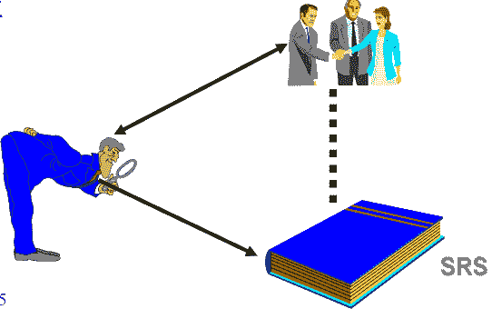

## 软件需求分析的目标

- 全面性
  - 没有遗漏
- 一致性
  - 没有矛盾
- 准确性
  - 说清楚
- 认同
  - 共同、相互认可
- 文档化
  - 书面文档

## 软件需求分析的过程

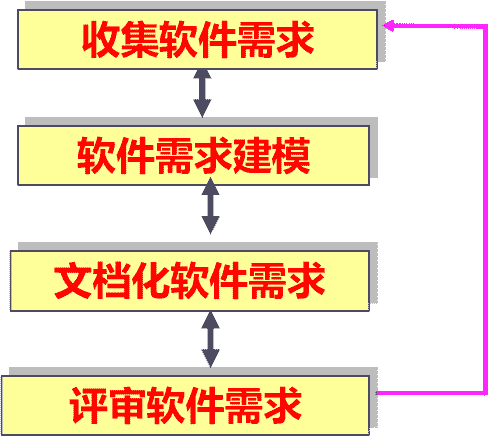

## 步骤1:收集和获取软件需求(1/2)

- 从用户处收集、获取软件需求，帮助用户发现潜在的软件需求
- 软件用户
- 初步需求描述

## 步骤2：软件需求建模(1/2)

### 任务

- 对收集的用户软件需求进行建模，发现并纠正不一致、不准确和不全面的软件需求，形成准确的需求描述

### 来源

- 初步的软件需求描述

## 步骤2：软件需求建模(2/2)

- 技术手段
  - 面向数据流和面向对象的建模方法
  - 多视点
  - 原型
- 成果
  - 软件需求模型

## 步骤3：文档化软件需求(1/2)

### 任务

- 根据软件需求初步描述和软件需求模型，撰写软件需求规格说明书

### 来源

- 软件需求初步描述
- 软件需求模型

## 步骤3：文档化软件需求(2/2)

- 技术手段
  - 软件需求规格说明书编写规范
- 成果
  - 软件需求规格说明书

## 步骤4：评审软件需求(1/2)

- 任务
  - 由多方对软件需求规格说明书进行评审，发现其中的问题，并就其中的软件需求达成一致
- 来源
  - 软件需求规格说明书

## 步骤4：评审软件需求(2/2)

- 技术手段
  - 需求评审原则
- 成果
  - 可纳入配置的软件需求规格说明书

## 需求管理

- 为什么需要对软件需求进行管理
- 需求管理的内容
- 收集软件需求
- 软件需求建模
- 撰写软件需求规格说明书(SRS)
- 评审软件需求
- 控制软件需求的变更

## 为什么需要对软件需求进行管理

- 软件需求非常重要
- 获取软件需求非常复杂和困难
- 在需求获取过程中涉及到人、活动和过程，只有对它们进行管理才能确保有效地进行需求分析，确保软件需求的质量
- 软件需求经常变更，为了确保软件需求处于受控状态

## 需求管理的内容

- 参与需求分析和评审的人员
- 软件需求文档
- 需求分析过程
- 需求变更

## 收集软件需求

1. 如何收集软件需求？
2. 文档化所收集的软件需求
3. 软件需求收集的注意事项

## 如何收集需求？

- 确定哪些用户角色会对软件提出需求
  - 例如图书馆的馆长，图书管理员，书库管理员，读者管理员，系统管理员；而不是图书馆的清理工
- 用户方要成立相应的需求分析小组
- 和相关角色的人员进行交流
  - 会议、探讨、观察、实践、听取意见
- 在交流的过程中要有记录，要对记录进行整理
  - 文字，录音，整理，写成文档

## 文档化所收集的软件需求(1/3)

- 描述需求内容
  - 例如，查询图书
  - 按照图书名字查询
- 定义软件需求编号(结构化)
  - 例如，10(查询图书)
  - 10.1(按照图书名字查询)
  - 10.2(按照图书的书号查询)
  - 10.3(按照作者查询)

## 文档化所收集的软件需求(2/3)

- 描述软件需求特性
  - 例如，查询图书软件需求
  - 重要性(高、中、低)，用于制定计划
  - 紧迫性(短期、中期、长期)，用于制定计划
  - 工作量(10个人月)，用于估算工作量、制定计划

## 文档化所收集的软件需求(3/3)

- 工具：word, excel, RequisitPro(Rational)
- 初步需求描述编写规范

## 软件需求收集的注意事项(1/2)

- 如果应用规模较大，可分成几个需求调查小组同时进行，最后对结果进行汇总
- 一定要和用户进行充分的交流，尽可能获取足够多的信息和资料，发现问题要及时沟通
- 在该阶段要和用户打成一片，进行充分的合作，建立起良好的合作关系
- 如果发现多个软件需求相互矛盾，要能找到仲裁人，或者决策人

## 软件需求收集的注意事项(2/2)

- 需求调查应遵循先整体后部分、先抽象后具体的原则
- 帮助用户发现潜在的需求

## 软件需求建模

1. 为什么需要对软件需求进行建模？
2. 如何对软件需求进行建模？

## 为什么需要对软件需求进行建模

- 需求调查所获取和文档化(文字)的软件需求不能有效地描述软件需求
  - 文字描述的局限性(不准确、二义、歧义、不能直观揭示关联)
  - 不准确
  - 不一致
  - 不全面
  - ......

## 如何对软件需求进行建模(1/2)

### 需求建模技术

- 面向数据流的需求建模技术
- 面向对象的需求建模技术
- UML
- Use case 图
- 交互图(顺序图，协作图)
- 类图
- 状态图
- 活动图

## 如何对软件需求进行建模(2/2)

- 案例分析
  - 需求建模的例子(图书管理系统, UML, Rose)

## 撰写SRS(1/2)

### 为什么要撰写成SRS

- 记录软件需求
- 便于交流
- 便于管理
- 便于控制
- 便于验证

## 撰写SRS(2/2)

- SRS应该作为一种规范和标准
- 企业和组织要明确说明如何撰写软件需求规格说明书
- 一个SRS的编写规范

## 评审软件需求

- 为什么需要对软件需求进行评审？
- 如何进行评审？
- 评审结果

## 为什么需要对软件需求进行评审？

- 发现软件需求规格说明书中的问题
  - 不全面
  - 不一致
  - 不准确
  - 不可验证
  - 书写不规范
- 共同认可软件需求

## 如何进行评审(1/3)

- 参与评审人员
  - 项目经理
  - 用户方(代表)
  - 需求分析小组
  - 软件设计小组
  - 软件测试小组
  - 软件质量保证小组......

应该提前将SRS送给参与评审人员

## 如何进行评审(2/3)

- 需求评审原则
  - 多方对软件需求达成一致
  - 正确性
    - 软件需求是否是用户所需要的
    - 例如，一个读者最多能借10本书
  - 准确
    - 是否把软件需求描述清楚了
    - 例如，一个读者包括诸多信息如名字，单位等等
  - 无歧义性
    - 软件需求描述是否会引起不必要的误解和认识上的偏差
    - 例如，用户和客户

## 如何进行评审(3/3)

- 完全性
  - 是否所有的需求都已经包含了
- 可验证性
  - 是否有手段来验证需求已经实现了
  - 例如，查询结果应该很快得到
- 一致性
  - 软件需求是否会相互矛盾
- 可理解和可修改性
  - 软件需求描述是否简洁、直观，易于修改和维护
- 可追踪性
  - 软件需求是否易于追踪

## 软件需求评审结果

- 软件需求评审应该要有记录，并形成软件需求评审报告
  - 软件需求评审报告模板
- 软件需求评审应该要有结论
  - 根据意见进一步改进，下次再次进行评审
  - 根据意见进一步改进，无需再次进行评审
  - 评审通过

## 控制软件需求的变更

- 控制SRS
- 控制需求的变更

## 控制SRS

- 作为一个基本的软件配置项纳入配置
- 任何对软件需求的变更必须进行仔细审查，征得同意后才能进行变更

## 控制需求的变更(1/3)

- 需求变更不可避免
  - 软件需求本身是变化的
  - 在需求分析阶段对软件需求的描述和分析不全面、不准确等

- 需求变更对软件项目的开发会产生巨大的影响
  - 产品功能
  - 开发成本
  - 开发进度
  - 产品质量

## 控制需求的变更(2/3)

- 需求变更的权衡，需要和用户协商，并对计划进行变更

## 控制需求的变更(3/3)

- 如何控制需求的变更
  - 提出软件需求变更请求
  - 对软件需求变更进行评审
  - 变更SRS
  - 将变更后的SRS纳入配置
  - 通知受影响小组和人员
  - 变更其他产品(软件设计文档、 测试文档)和计划(软件开发计划)

## 讲授内容

1. 项目案例
2. 什么是软件需求
3. 如何进行软件需求分析
4. 软件需求管理
5. CMM对需求管理的要求
6. 小结

## CMM对需求管理的要求(1/3)

- 需求管理是CMM 2级的的一个关键过程域
- CMM对需求管理的理解和定义

- 需求管理是指在用户和将处理“分配给软件的系统需求”的软件项目组之间建立对“分配给软件的系统需求”的共同理解，由软件工程组对“分配给软件的系统需求”进行分析、精化，按照规范详细描述“分配给软件的系统需求”，形成“软件需求规格说明”文档，并对该文档进行评审
- “分配给软件的系统需求” 是指系统总体分配给软件的需求，也称软件需求
- “用户”可解释为系统工程组或外部顾客等

## CMM对需求管理的要求(2/3)

- “软件工程组”：实施软件工程化开发的小组
- 软件需求既包括技术需求、又包括非技术需求
- 软件需求构成项目规模和工作量估算、制定项目计划和跟踪软件项目活动的基础
- 每当软件需求改变时，都应调整受到影响的软件计划、工作产品和活动，使其与更新后的软件需求保持一致
- 对已通过评审的软件需求的任何更改都应受到管理和控制

## CMM对需求管理的要求(3/3)

### 共12个关键实践

| 关键实践类 | 关键实践数目 |
|---|---|
| 制定方针政策 | 1 |
| 确保必备条件 | 4 |
| 实施软件过程 | 3 |
| 度量和分析 | 1 |
| 检查实施情况 | 3 |

## 目标

- 使软件需求受控，建立供软件工程和管理使用的基线
  - 受控：在给定时间(过去或现在)使用的工作产品的版本是已知的(即受版本控制的)，并以受控的方式进行更动(即更动控制)
  - “软件工程”是指软件设计、编码、测试等
  - “软件管理”是指项目计划制定、项目跟踪、风险等
- 软件计划、产品和活动与软件需求保持一致
  - 所谓“保持一致”是指相吻合

## 制定方针政策

- 项目遵循一个书面的、由组织制定的方针用来管理软件需求
  - 将软件需求写成规范化的文档
  - 拟定参加需求评审的人员，包括
    - 项目软件负责人，
    - 其它受影响的小组，包括系统测试组，软件工程组（如软件设计小组）,软件质量保证组，软件配置管理组，文档支持组等
  - 当软件需求发生改变时，更动软件计划、工作产品和活动，使其与软件需求的改变保持一致

## 确保必备条件(1/4)

- 建立和明确系统需求分析和分配的人员及其职责，明确
  - 在整个项目生存期内，管理和分配系统需求，并将它们写成文档
  - 实施对系统需求及其分配的更动，当系统需求发生更动时，应及时更动软件需求

## 确保必备条件(2/4)

- 将软件需求写成规范化的文档
  - 技术需求，如软件功能、性能、设计约束、编程语言、界面需求
  - 非技术性需求(即协议、条件、和(或)合同条款)，包括：要交付的产品、交付日期、里程碑等
  - 用于确认软件产品满足软件需求的验收准则

## 确保必备条件(3/4)

- 提供足够的用以管理分配需求的资源和经费
  - 指派在应用领域和软件工程方面有经验和技能的个人去管理软件需求
  - 提供可用的、能支持软件需求管理活动的工具
    - 电子表格程序
    - 配置管理工具
    - 跟踪工具
    - 测试管理工具

## 实施软件过程(1/3)

- 软件工程组识别、分析和细化软件需求，对它进行评审
  - 鉴别出不完整的和遗漏的软件需求
  - 评审软件需求，确定它们是否
    - 用软件来实现是可行的和恰当的
    - 已被清晰和准确地阐述
    - 相互一致、无矛盾
    - 可验证、可测试
  - 对任何被识别出有潜在问题的软件需求进行评审，并作出必要的更动
  - 和受影响组一起协商解决由软件需求引出的承诺

## 实施软件过程(2/3)

- 将软件需求作为软件开发计划、工作产品和过程活动的基础，软件需求：
  - 是受管理和控制的
  - 是软件开发计划的基础

## 实施软件过程(3/3)

- 对软件需求的更动进行评审，并将其纳入软件项目
  - 评估软件需求更动对现有承诺的影响，通过协商对承诺进行适当的更改
    - 对组织外的个人和组所作承诺的更改由高级管理者参与评审
    - 和受影响组协商组织内部承诺的更改
  - 对由于软件需求的更动所造成的对软件计划、工作产品和活动必须作的更动要进行识别、评价、风险评估、写成文档、做出计划、传达到受影响组和个人、跟踪直到结束

## 度量和分析

- 进行度量，并将度量结果用以确定软件需求管理活动的状态，度量内容包括
  - 每个软件需求的状态(确认并批准、问题等)
  - 关于软件需求的更动活动
  - 对用软件需求更动的累积数，包括建议的、未解决的、已批准的并已纳入系统基线的软件需求更动的总数

## 验证实施(1/3)

- 高级管理者定期参与对软件需求管理活动进行的评审
  - 高级管理者参与定期评审的主要目的是在合适的抽象层次上及时地了解和洞察软件过程。评审间隔时间应该满足组织的需要，如果存在异常情况报告机制，间隔时间可以长些。

## 验证实施(2/3)

- 项目负责人可定期或者事件驱动地参与对软件需求管理活动的评审

## 验证实施(3/3)

- 软件质量保证组对软件需求管理活动和工作产品进行评审和(或)审计，并报告其结果
  - 软件需求已评审，且有关问题在软件工程组开发软件之前已得到解决
  - 当软件需求更动时，软件计划、工作产品和活动已经适当地更动
  - 由软件需求的更动所导致的对承诺的更动已与受影响组进行协商

## 讲授内容

1. 项目案例
2. 什么是软件需求
3. 如何进行软件需求分析
4. 软件需求管理
5. CMM对需求管理的要求
6. 小结

## 本讲小结

- 获取软件需求对于软件项目的开发是十分重要的
- 一个好的软件需求应该满足许多条件
- 必须对软件需求进行有效的管理

## 教学目的

## 理解

- 软件需求、需求分析和需求管理等概念
- 软件需求重要性和获取软件需求复杂性
- 为什么要进行需求管理

## 掌握

- 软件需求分析的过程
- 软件需求管理的内容和手段

## 运用

- 运用需求分析方法、技术和工具进行需求分析，获取软件需求
- 在软件项目开发过程中对软件需求进行必要的管理

# Software Project Management

# Q & A

# Practice, Practice, and Practice

## 软件项目管理课程之第8讲 软件质量保证

毛新军  
xjmao21@21cn.com  
http://software.nudt.edu.cn/~xjmao  
计算机科学与技术系602教研室  
0731-(45)73649

## 软件项目案例

## 案例角色和人物

- **小王：软件项目负责人**

- **老王：公司技术老总**

**开发小组：小李，老赵，小田，小谢**

## 要确保软件系统的质量(2/4)

- 各个程序员工作的非常卖力，已经编写了各个软件模块并且对所编写的各个软件模块进行了测试，认为软件已经没有什么大的问题，即使有也是微不足道的，最终将目标软件提交给了用户
- 用户在使用了该软件后发现了诸多的问题，用户对项目组的工作很有意见，于是项目组不得不重新作需求分析
  - 软件没有完全满足他的要求
  - 有些软件功能与他所想象的不一致
  - 软件系统不稳定，经常出现死机现象
- 在将用户需求了解清楚之后，设计小组对该软件重新进行改造，发现软件结构不好，要对软件进行调整和修改非常困难

## 要确保软件系统的质量(3/4)

- 然而为了完成项目的要求，设计小组只好硬着头皮对软件设计进行修改和调整
- 经过调整后的软件系统问题更多，系统不稳定，有大量的错误，软件变得极为脆弱，为此项目组不得不推翻原有的设计，对整个软件重新进行设计和编码
- 项目最终在拖延了8个月后交货，然而此时项目组成员已经筋疲力尽
- 回顾整个项目的历程，项目组成员发现导致这种状况的主要原因是在整个项目实施过程中，项目组没有对项目进行有效的质量监控
- 软件开发项目如果不吸取该项目的经验教训，相信会重新犯这样的错误，经历这样的恶梦

## 要确保软件系统的质量(4/4)

### 有关软件质量的一些数据

- 20世纪80年代欧洲的“亚利安娜”火箭发射的失败
- 由于软件出现问题，美国DoD推迟B1轰炸机的部署
- 由于软件出现问题，美国DoD取消了耗资580亿美元的A12飞机的计划
- 大量的软件由于质量得不到保证，在交付给用户使用之后不得不被抛弃

## 案例提示我们

- 质量保证是极为重要的
- 在软件项目实施过程中必须提供待开发软件质量的可视性
- 缺乏质量保证，将会导致所开发的软件不能满足用户的期望和要求
- 缺乏质量保证，将会导致整个软件项目延期，甚至失败

## 讲授内容

1. 软件项目案例
2. **软件质量**
3. 软件质量保证
4. 软件质量保证计划及其实施
5. CMMI对软件质量保证的要求
6. 本讲小结

## 软件质量

1. 什么是软件质量？
2. 为什么需要关注软件质量？

## 什么是软件质量(2/3)

### 影响软件质量的具体因素

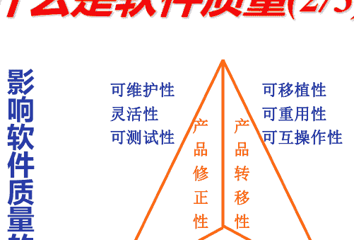

正确性 可靠性 有效性 完整性 有用性

## 什么是软件质量(3/3)

### 用户对软件质量的评价

- 没有××功能(功能)
- 运行速度太慢(性能)
- 有太多的错误(故障)
- 软件不好改动(维护)
- 界面不美观(人机界面)
- 这个软件不好使用(易用性)
- ......

## 为什么需要关注软件质量？

- 高质量的产品才能
  - 提高客户满意度，占领市场
  - 降低软件开发的风险
  - 确保软件项目按照计划实施
  - 防止软件项目由于质量问题而流产或者失败
  - 提高企业的影响力

## 讲授内容

1. 软件项目案例
2. 软件质量
3. 软件质量保证
4. 软件质量保证计划及其实施
5. CMM对软件质量保证的要求
6. 小结

## 软件质量保证

1. 什么是软件质量保证
2. 从哪些方面关注软件质量
3. 谁来保证软件质量
4. 如何保证软件质量

## 什么是软件质量保证(1/2)

- 什么是软件质量保证
  - 为管理层提供为获知产品质量信息所需的数据，从而获得产品质量是否符合预定目标的认识和信息
- 软件质量保证是要为软件产品的质量提供某种可视性，知道哪些地方有质量问题，便于改进方法和措施，提高软件产品的质量
  - 例如，对软件进行测试，发现有哪些错误，这些错误的性质(严重、一般)

## 什么是软件质量保证(2/2)

- 软件质量保证要做的事情
  - 了解产品质量(例如，软件测试)
  - 提交软件质量报告(例如，软件测试报告)，说明质量问题
  - 为项目组和管理层服务(例如，告诉问题所在，便于改进管理和技术)

## 从哪些方面关注软件质量(1/3)

## 从哪些方面关注软件质量(2/3)

- 软件产品
  - 软件需求规格说明书
  - 软件设计规格说明书
  - 源程序代码，....
- 开发活动
  - 需求分析
  - 软件设计
  - 编码
- 标准和规程

## 从哪些方面关注软件质量(3/3)

- 组织内部或者在项目开始之时要制定软件开发的标准和规程
- 软件产品
  - 文档类: 审核, 产生审核报告
  - 代码类: 测试, 产生测试报告
- 开发活动
  - 审查, 产生审查报告

## 谁来执行和实施软件质量保证

- 软件项目质量保证小组(SQA小组)
- 独立于项目开发小组
- 具有比较大的权限

## 如何保证软件质量

- 正确理解用户的要求
- 制定标准和规程
- 审查软件开发活动
- 审核软件工作产品
- 测试源程序代码
- 记录开发活动和软件产品的偏差
- 记录所有不符合项，报告高级管理者

## 正确理解用户的要求

- 理解客户的要求和需要
- 让客户参与开发，随时和客户交流，验证客户的需求
  - 可用性测试(β版)
  - 合作开发
  - 伙伴关系
  - 软件原型

## 制定标准和规程

在组织内部或者项目组内部制定标准和规程，限制和约束软件开发活动，有助于得到规范化的软件产品，从而提高软件质量

- 软件开发过程规程
- 需求管理规程
- 软件需求规格说明书编写规范
- C++编码规范
- Java编码规范, ......

## 审查软件开发活动

- 审查每个活动是否遵循软件开发过程规范
  - 审查每个活动的输入条件是否都得到满足
  - 审查活动的执行是否遵循规范
  - 审查每个活动的输出是否都已经产生

## 审核软件工作产品

- 审核软件工作产品
- 遵循规范
- 正确
- 一致
- 准确
- 可追踪性
- ……

## 测试源程序代码

- 制定测试计划对软件进行测试
  - 单元测试
  - 集成测试
  - 确认测试
  - 系统测试

## 记录开发活动和软件产品的偏差

- 形成报告
  - 记录软件开发活动的偏差
  - 记录软件产品的偏差 - 软件测试报告
- 目的
  - 发现问题，纠正偏差，提高质量

## 报告高级管理者

- 目的
  - 为管理者了解软件的质量提供可视性

## 讲授内容

1. 软件项目案例
2. 软件质量
3. 软件质量保证
4. 软件质量保证计划及其实施
5. CMM对软件质量保证的要求
6. 小结

## 软件质量保证计划及其实施

为了确保软件系统的质量，在软件开发早期就要制定软件质量保证计划

1. 计划和目的
2. 参考文献
3. 管理
   - 3.1 组织
   - 3.2 任务
   - 3.3 职责
4. 文档
   - 4.1 目的
   - 4.2 所需的软件工程文档
   - 4.3 其他文档
5. 标准、实践和约定
   - 5.1 目的
   - 5.2 约定
6. 复审和审查
7. 测试
8. 问题报告和改正行动
9. 工具、技术和方法学
10. 代码控制
11. 媒体控制
12. 供应商控制
13. 记录收集、维护和保留
14. 培训
15. 风险管理

## 讲授内容

1. 软件项目案例
2. 软件质量
3. 软件质量保证
4. 软件质量保证计划及其实施
5. CMM对软件质量保证的要求
6. 小结

## CMM对软件质量保证的要求

- 软件质量保证是CMM 2级的一个关键过程域
- 所谓软件质量保证是指为管理者提供有关软件项目过程和产品的适当的可视性
- 软件质量保证包括评审和审核软件产品和活动，以验证它们是否符合相应的规程和标准，同时给项目和其它有关负责人提供这些评审和审核的结果
- 在软件项目的早期阶段，软件质量保证组就应参与制定计划、标准和规程等。它们能够降低软件项目成本，并满足项目、组织和策略的约束条件

### 共17个关键实践

| 关键实践类 | 关键实践数目 |
| --- | --- |
| 制定方针政策 | 1 |
| 确保必备条件 | 4 |
| 实施软件过程 | 8 |
| 度量和分析 | 1 |
| 检查实施情况 | 3 |

## 目标

- 软件质量保证活动是有计划的
- 软件产品和活动与其适用的标准、规程和需求的一致性已得到客观地验证
- 受影响组和个人接到软件质量保证活动和结果的通知
- 高级管理者处理在软件项目内部不能解决的不符合问题

## 制定方针政策

- 项目遵循一个书面的、由组织制定的实施软件质量保证(SQA)的方针，一般规定
  - 对全部软件项目，SQA功能都应到位
  - SQA应有一个向高级管理者报告的渠道，它独立于项目负责人和项目软件负责人
  - 高级管理者定期地评审SQA活动和结果

### 确保必备条件

- 存在一个SQA小组，负责协调和实施软件项目的质量保证
- 为进行SQA活动提供足够的资源和经费
  - 指派一个负责人专门负责项目的SQA活动
  - 指派一个在SQA任务方面是博学的，并有权力采取适当的监督行动的高级负责人接受和处理软件的不符合问题
  - 能得到支持SQA活动的工具
- SQA小组的成员受到培训以便完成他们的SQA活动，培训内容包括：
  - 软件工程技巧和实践；
  - 软件工程组和其它软件有关组的作用及职责；
  - 用于软件项目的标准、规程和方法；
  - 软件项目相关的应用领域；
  - SQA的目的、规程和方法；
  - SQA组如何参与软件活动；
  - SQA方法和工具的有效使用；
  - 人员间的交流
- 软件项目的成员接受有关SQA组的作用、职责、权力和价值等方面的定向培训

### 实施软件过程

- 按照文档化的规程，为软件项目制订SQA计划，一般规定
  - SQA计划的制定是在整个项目策划的早期阶段进行，并且平行于整个项目计划
  - 受影响组和个人评审该SQA计划
  - SQA计划应受管理和控制

- 按照SQA计划进行SQA组的活动，SQA计划的内容包括
  - SQA组的职责和权力
  - SQA组的资源需求(包括职员、工具和设施)
  - 项目的SQA组活动的进度表和经费
  - SQA组参与制定项目软件计划、标准和规程的安排
  - 将由SQA组完成的评价
  - 将由SQA组执行的审核和评审
  - 将用作SQA组评审和审核的标准和规程
  - 对不符合性问题写成文档并进行跟踪直至结束的规程
  - 要求SQA组生成的文档
  - SQA活动给有关组提供反馈信息的方法和频率

- SQA组参与准备和评审项目的软件开发计划、标准和规程
  - SQA组就下列几个方面对计划、标准和规程提供咨询和评审
    - 与组织制定的方针的符合性
    - 与外部强加的标准和要求的符合性(例如工作说明所要求的标准)
    - 适合项目使用的各种标准
    - 应在软件开发计划中阐述的论题
  - SQA组验证软件开发计划、标准和规程已经到位，并可用于评审与审计软件项目

- SQA组评审软件工程活动以验证其符合性
  - 对照软件开发计划和指定的软件标准和规程，评价各项活动
  - 对与软件开发计划、标准和规程的偏差进行标识和写成文档，并跟踪到结束
  - 对纠正结果进行检查验证

- SQA组审计指定软件工作产品以验证其符合性
  - 在交付给顾客之前，评价可交付的软件产品
  - 对照指定的软件标准、规程和合同要求，评价各种软件工作产品
  - 对与软件开发计划、标准和规程的偏差进行标识和写成文档，并跟踪到结束
  - 对纠正结果进行检查验证

- SQA小组定期向软件工程组报告其活动的结果

- 按照文档化的规程，对软件活动和软件工作产品中标识出的偏差写成文档，并加以处理
  - 将不符合软件开发计划和指定的项目标准及规程的问题写成文档，并与有关人员一起加以解决
  - 将那些不符合又不能解决的问题，写成文档并递交给分管质量保证的高级管理者处理
  - 定期评审不符合问题，直至解决它们为止
  - 不符合问题的文档应受管理和控制

- 合适时，SQA组与顾客的SQA人员一起对其活动和发现进行定期评审

### 度量与分析

- 进行度量，并将度量结果用于确定SQA活动的成本和进度状态
  - SQA活动的里程碑的完成情况与计划作比较
  - 在SQA活动中完成的工作、花费的工作量和消耗的资金与计划作比较
  - 进行产品审计和活动评审的次数与计划相比较

## 验证实施(1/3)

- 高级管理者定期参与SQA活动的评审

## 验证实施(3/3)

- 独立于SQA组的专家们定期对项目SQA组的软件工作产品和活动进行评审

## 讲授内容

1. 软件项目案例
2. 软件质量
3. 软件质量保证
4. 软件质量保证计划及其实施
5. CMM对软件质量保证的要求
6. 小结

## 小结

- 软件质量保证是极为重要的
- 需要成立一个SQA小组，实施软件质量保证
- 要针对标准和规程、软件开发活动、软件产品三个方面进行质量保证
- 为此，需要制定质量保证计划，并且按照计划来实施

## 教学目的

## 理解

- 软件质量和软件质量保证概念
- 软件质量保证的重要性和意义

## 掌握

- 软件质量保证的方法和手段
- 软件质量保证计划

## 运用

- 在软件项目开发过程中对软件质量进行保证

# Software Project Management

# Q & A

# Practice, Practice, and Practice

# 软件项目管理课程 之

# 第10讲 软件开发团队的管理

毛新军

xjmao21@21cn.com

http://software.nudt.edu.cn/~xjmao

计算机科学与技术系602教研室

0731-(45)73649

## 讲授内容

1. 什么是团队
2. 团队管理的内容
3. 团队的组织结构
4. 成功团队 vs 失败团队
5. 团队激励机制
6. 做一个好的项目经理
7. 小结

## 什么是团队？

- 由一组具有共同目标、相互关联、相互合作的人组成的一个集体，例如战斗小组
  - 共同的目标
  - 明确的任务
  - 相互关联
  - 相互合作

- 软件项目组就是一个团队
  - 目标：开发出软件产品、完成项目
  - 任务：需求分析、设计、管理
  - 相互关联：工作的依赖
  - 相互合作：解决问题

## 讲授内容

1. 什么是团队
2. 团队管理的内容
3. 团队的组织结构
4. 成功团队 vs 失败团队
5. 团队激励机制
6. 做一个好的项目经理
7. 小结

## 团队管理的内容(1/2)

# 第10讲 软件开发团队的管理

- 团队管理的目的
  - 确保团队的战斗力
  - 确保团队的凝聚力
  - 确保团队的工作效率和质量

## 团队管理的内容(2/2)

- 团队管理的内容
  - 团队的组织
    - 工作效率和质量、凝聚力
  - 团队的交流和合作
    - 工作效率和质量、战斗力
  - 团队的纪律
    - 战斗力
  - 团队的激励机制
    - 凝聚力

## 讲授内容

1. 什么是团队
2. 团队管理的内容
3. 团队的组织结构
4. 成功团队 vs 失败团队
5. 团队激励机制
6. 做一个好的项目经理
7. 小结

## 团队的组织结构

- 组建团队结构应考虑的因素
- 团队模式

## 明确团队的目标

- 解决问题
  - 开发一个具体的项目
- 创新
  - 研发一个新的产品，具有新颖的产品目标、提供了其他产品所不具备的功能、采用了新的方法和技术
- 战术执行
  - 执行一个良定义的计划、问题明确，如产品升级、维护

## 确定团队的种类

### 问题解决团队

- 解决一个复杂、问题没有明确定义的问题
- 例如，开发图书馆管理软件系统
- 团队的成员应该是可信赖、活跃、聪明

### 创新团队

- 探索可能性和选择性
- 例如，研发一个智能决策软件用于诊断天然气管道的故障
- 自我激励、自治、富于创新、百折不挠

### 战术执行团队

- 执行一个良定义的计划、具有明确的问题
- 例如，一个软件维护工作
- 紧迫感、注重行动

## 高效团队的特征

### 明确角色和职责

- 各个成员清晰、明确地知道自己做什么
- 项目计划

### 监控个人表现和提供反馈

- 让成员知道是可接受的还是有待进一步提高
- 项目跟踪、质量保证

### 有效沟通

- 易于获得信息、沟通的媒介、参与、记录沟通
- 配置管理、会议、文档化

### 以事实为依据提供决策

- 决策要依赖于事实依据，而不是主观判断

## 团队的模式

- 业务团队
- 首席程序员团队
- 臭鼬项目团队
- 特征团队
- 搜索救援团队
- 战术(SWAT)团队
- 大型团队

## 业务团队

由一个技术领带带领的团队

团队成员可能来自不用的专业领域、熟悉不同的编程语言
- 数据库、制图、交换机
- Java, C++, TSAPI

技术领导人负责技术的最终决策

典型的等级层次结构
- 技术领导人，技术决策和管理部门沟通
- 团队成员在自己的领域内工作

适合于解决型、创新型、和战术型

## 首席程序员团队

- 产生于20世纪60年代末70年代初，IBM
- 首席程序员负责完成软件开发的主体工作：
  完成所有的设计、编写大部分的代码、进行项目决策，其他人为首席程序员提供支持
  - 后备程序员，批评家、联络人、研究助手
  - 管理员，处理管理事务如财务、人员、场地和机器设备
  - 工具员，制作首席程序员所需的工具
- 适合于创新型和战术型团队目标

## 臭鼬项目团队

- 由一批有才华、有创造性的产品开发者、置于一个不受组织官僚限制的机构中，使他们放手开发和创新
- 典型的黑箱管理方式
- 可以调动积极性、但是缺乏可视性
- 适合于创新型

## 特征团队

- 成员来自不同职责和功能部门，例如质量保证、配置管理、系统分析，这些人员只向本部门汇报和负责
- 特征团队有授权、责任和平衡的优势
- 适合于解决问题和创新类型

## 搜索救援团队

- 专门针对特定的问题
- 由专业人员和队伍组成
- 短期
- 适合于解决问题型

## 战术团队

- 每个成员是某个方面的专家，如人机界面、用户领域知识
- 团队经过专门、多方面的培训
- 协同得非常好，天衣无缝
- 让掌握特定工具和技能的一组人员去解决与这个特定的工具和实践有关的问题
- 持久，习惯在一起工作，有明确定义、稳定的角色
- 适合于解决问题

## 大型团队

- 大型团队的人员组成较多
- 沟通膨胀， n*(n-1)/2
- 简化沟通
- 方式：创造层次、划分小组、指定代表进行沟通

## 讲授内容

1. 什么是团队  
2. 团队管理的内容  
3. 团队的组织结构  
4. 成功团队 vs 失败团队  
5. 团队激励机制  
6. 做一个好的项目经理  
7. 小结  

## 成功团队的特点

- 明确的角色和责任  
  - 每个人在任何时候都是负责的  
- 监控个人表现和提供反馈  
  - 让团队成员知道他们是否无愧于团队的期望  
- 有效的沟通  
- 以事实为依据制定决策  
- 相互帮助、不断改进、勇于创新的文化  

## 典型错误(1/3)

- 挫伤积极性  
  - 如：要求工作到深夜，老板长时间休假而员工假期加班，到项目结束时无奖金  
- 人员素质低  
  - 人员的选择着眼于尽快雇佣到人，而不是在项目周期中工作最好的人，虽然可以使项目尽早启动，但不能确保项目尽快完成  
- 英雄主义  
  - 中等管理水平的项目经理更为强调团队精神  

## 典型错误(2/3)

- 项目后期加入人员  
  - 火上浇油  
- 对有问题的员工失控  
  - 这是项目组员对领导最常见的抱怨  
- 办公环境拥挤嘈杂  
- 开发人员与客户之间发生摩擦  
  - 如客户不在开发计划上签字、需求确定后的需求变更、拒绝接受已完工的产品  
  - 主要原因是缺少沟通  

## 典型错误(3/3)

- 缺乏有效的项目支持  
  - 没有有效的高层支持；高层人员强迫开发者接受不现实的项目进度等  
- 缺乏各种角色的齐心协力  
- 缺乏用户介入  
  - 没有用户早期介入的项目充满需求误解的风险  
- 政治高于物质  
  - 政治家型项目组的精力集中在于领导的关系，在项目初期，会运行得很好，但进入中后期，会失败  

## 技术人员需要增强沟通技能

- IT技术人员需要沟通技能  
  - 需参加大量口头沟通活动，有时辅以书面记录  
  - 仔细倾听同伴的谈话，对问题做出恰当的反映  
  - 有时不得不参加某些形式的非正式的公开演讲  
  - 口头沟通是职位提升的关键因素之一  
- IT技术人员缺乏沟通技能  
  - 和非专业人员的沟通很难，IT技术人员的不断发展，产生了大量的技术行话  
  - 注重技术技能，缺少沟通技能的教育和培训  

## 沟通和协调的方法和工具

- 个人间讨论  
- 里程碑  
- 文档（需求说明、设计文档、代码、测试文档等）  
- 报告（错误追踪报告、项目状态报告）  
- 需求、设计、代码、状态评审  
- 配置管理  
- 电子邮件  
- 小组会议  
- 项目公告栏  
- 项目控制工具  

## 有效的非正式口头沟通

- 非正式谈话能更好地发展信任关系，彼此了解、了解项目信息  
- 短时的面对面会议通常更有效  
- 人更愿意从非正式的形式和双向的会谈交流，不愿看成堆的文件和报告  
- 研究表明，不足10%的沟通通过文字，一个人的音调和身体语言较多地表达他们的真实感受  

## 如何管理高业绩团队

- 建立一个远景  
- 使团队为团队的行为负责  
- 以具有挑战性的、清楚的和支持的方式委派团队任务  
- 将如何完成任务的细节留给团队  
- 当团队运行不好时，想想MOI模式：多数团队问题来源于动机、组织或信息  
- 责、权、利明确  

## 团队为什么会失败

- 缺乏共同的远景  
- 没有认同感  
- 缺乏认可感  
- 生产力障碍  
- 低效率的沟通  
- 缺乏信任  
- 有问题的员工  
- 责、权、利不统一  

## 长期的团队建设

- 更高的生产率  
- 低启动费用  
- 较低的个人问题风险  
- 减少人事变动  
- 时间空闲问题  

## 团队成员的实践指南(1/2)

- 展示对于个人角色和责任的真实理解  
- 展示以事实为基础的判断  
- 和其他团队成员有效地合作  
- 使团队目标优先于个人目标  
- 展示投身于任何项目成功所需的努力的愿望  
- 愿意分享信息、感受和产生适当的反馈  

## 团队成员的实践指南(2/2)

- 当其他成员需要时给予适当的帮助  
- 展示对自己的高标准要求  
- 支持团队决策  
- 展示直接面对重要问题的勇气和信念  
- 以为团队的成功而奋斗的方式体现带头作用  
- 对别人的反馈做出积极的反应  

## 讲授内容

1. 什么是团队  
2. 团队管理的内容  
3. 团队的组织结构  
4. 成功团队 vs 失败团队  
5. 团队激励机制  
6. 做一个好的项目经理  
7. 小结  

## 团队的激励机制

- 激励机制  
- 团队成员的典型动机  
- 士气杀手  

## 激励机制

- 开发人员最有可能提高生产率和质量（相比较开发过程、产品、技术）  
- 开发人员的生产率和质量的差距达到 1:10。无论是否具有相同经验  
- 激励是决定工作表现最重要得影响因素，对生产率的影响比任何其他因素更大  

## 开发人员的激励因素

- 成就感  
- 发展机遇  
- 工作乐趣  
- 个人生活  
- 成为技术主管的机会  
- 领先  
- 同事间的人际关系  
- 受认可程度  
- 工资  
- 责任感  
- 工作保障  
- 公司政策和经营  
- 工作条件  
- 地位  

## 项目经理的激励因素

- 成就感  
- 工作乐趣  
- 受认可程度  
- 发展机遇  
- 与下属关系  
- 同事间的人际关系  
- 领先  
- 工资  
- 公司政策和经营  
- 工作保障  
- 称为技术主管的机会  
- 地位  
- 个人生活  
- 工作条件  

## 不要用对自己有效的方式来激励开发人员

## 成就感

- 提供一个良好的环境，使他们能轻松进行喜欢的工作  
- 自主权  
  - 让开发人员自己定工作进度  
- 设定目标  
  - 如短期目标、风险降到最小、项目可视化程度最大  
  - 不要太多、公认不能实现、经常变化的目标  

## 发展机遇

- 职业发展原则：帮助员工决定他们自己希望如何发展技能，并提供职业发展的机会  
  - 提供进修机会  
  - 提供参加培训或自学的假期  
  - 购买专业书籍  
  - 分配发展技能的项目工作  
  - 为新的开发人员指定导师和教练  
  - 避免进度太大  
- 排名前10%的企业平均每年为软件开发人员提供2周的培训，为软件经理提供3周的培训  

## 工作乐趣

- 工作动力的三大来源  
  - 感受工作的意义  
  - 对工作成果的责任  
  - 了解工作的实际结果  
- 影响工作动力的5个方面：  
  - 技术的多样性、任务的完整性、任务的重要性  
  - 自主性、工作反馈  
- 为能够专注于工作本身创造条件  

## 个人生活

- 安排休假  
- 同意员工在工作日偶尔外出  
  - 个人生活对开发人员排在第4位  
  - 对项目经理排在第15位  

## 成为技术主管的机遇

- 指派每个人分别作为某个特定领域的技术负责人，如负责用户界面设计、数据库、网络、模块接口  
- 指派每个人分别作为某个任务的技术负责人，如技术评审、代码重用、工具评估、系统测试  
- 除新手外，指定所有人为指导者  

## 奖励和认可

- 奖励和表彰是激励组员的一种重要手段，它向组员以及其他人展示他们所做的贡献  
- 表彰方式（实物、金钱、荣誉）  
- 表彰为了实现富有挑战性的目标而加班的员工，愿意帮助同事的员工  
- 糟糕的奖励：给最佳表现者6%的奖励，同时给表现平庸者5%的奖励  
- 使得无论大小成就的表彰活动成为小组文化  

## 正确评价业绩

- Intel总裁Andrew Grove说，业绩评价是“我们作为管理者所能提供的最重要、最贴切的工作反馈”
- 不恰当的业绩评价会减弱开发者的工作劳力

## 典型错误——土气杀手

- 管理者过分使用权力，强制执行不现实计划
- 缺乏对开发而付出努力的表扬
- 因技术措施不当而受到牵连
- 开发人员没有参与同自己有关的决策行为
- 生产率障碍
- 低质量
- 过分夸张的激励形式

## 讲授内容

1. 什么是团队
2. 团队管理的内容
3. 团队的组织结构
4. 成功团队 vs 失败团队
5. 团队激励机制
6. 做一个好的项目经理
7. 小结

## 做一个好的项目经理

- 项目经理的技能
- 项目经理的职责
- 项目经理的影响力
- 项目经理的权力
- 项目经理要则

## 项目经理的技能

#### 管理能力

- 理解、引导和设法满足项目涉众的需求和期望
- 开展大量的领导、沟通和谈判活动
- 不断解决问题，并对整个组织产生影响
- 明确前景，合理授权，积极营造一个充满活力的工作环境

#### 组织和团队建议能力

- 激励不同类型的组员一起为项目目标协力工作
- 在团队内部以及团队与其他项目涉众之间培养团队精神
- 具有一定的应变能力、灵活性、创造性、耐性

#### 有效使用相关技术和工具

## 有效的&低效的项目经理

| 有效的项目经理 | 低效的项目经理 |
|---|---|
| 有表率作用 | 表率作用差 |
| 有洞察力 | 不自信 |
| 技术过硬 | 缺乏专业技能和经验 |
| 有决断力 | 不善于沟通 |
| 善于沟通 | 不会激励他人 |
| 善于激励他人 | |
| 必要时能够支持上级领导 | |
| 支持团队成员 | |
| 鼓励新概念新思想 | |

## 项目经理的职责

- 确定项目范围
- 识别项目涉众
- 指定项目计划
- 确认并跟踪项目的关键里程碑
- 参与项目的阶段评审
- 保障所需的资源
- 管理变更控制过程
- 汇报项目状态

## 激励组员

- 了解组员的职业生涯和个人的生活情况，根据他们的需要提供激励
  - 关心个人发展和晋升
  - 工作的认可和鼓励
  - 舒适的工作环境
  - 组织聚会和社会活动，增加归宿感

## 关心下属的成长

- 公司关心的是市场竞争力和业绩
- 员工关心的是个人事业的发展和对工作的满意度
- 项目经理应充当好协调员，将员工个人的发展和公司的发展有机结合起来，对员工进行培训
- 不能采用硬性指标

## 永远支持组员

- 为组员提供服务，包括训练和指导、解决问题和冲突、提供资源、建立项目目标和优先级、提供适当的技术指引。要使每个组员都能清楚的知道，你总是可以帮助他们。在你所作的事情中，对于组员要求你帮助他们这件事，应该具有非屏蔽中断的优先级

## 项目经理的影响力和权力

- 强制力
- 合法权力
- 专家权力
- 奖励权力
  - 现金、地位、认可度、升职、富有挑战的任务...
- 感召力和友谊

## 正确使用权力

- 让组员感知这些权力
- 过分强调合法权力或权威，会导致项目失败
- 过多使用资金、惩罚或威胁，会导致项目失败
- 一些特定的奖励，如富有挑战性的工作，工作成就，以及认可度才能真正引导员工改变行为或者努力工作

## 提高办事效率

- 保持积极状态
- 牢记主要目标
- 把最重要的事放在最重要的位置上
- 考虑双赢
- 首先去理解和倾听别人，然后再被别人理解
- 协同
- 不断学习

## 持续改进

- 基于项目总结，建立短期以及长期改进的一些目标
- 目标要尽可能量化
- 两个强烈的原因要求改进过程：校正问题和防止问题，确保你的改进努力要围绕着已知的或可预知的可能威胁项目成功的问题
- 领导你的小组找出当前正在使用的方法的长处和短处，以及项目面临的风险

## 学习过去

- 每个经理花时间处理每种可能的错误是非常困难的，学习过去的成功和失败是成功的开始
- 项目结束后，要实施项目总结。目标不是判定责任，而是为了在以后项目中作得更好
- 在每个项目的主要里程碑时，通过集体讨论或公平的组织者，用同样的方式，领导小组对其展开分析
- 了解已有的软件工业的最佳准则
- 建立自己的最差实践和最佳实践

## 利用沟通解决冲突

- Black和Mouton提出的五种冲突处理模式
  - 面对
  - 妥协
  - 圆滑
  - 强制
  - 侧推

## 项目经理要则

- 弄清项目经理所面临的问题、机会和期望
- 明白冲突是团队发展中的自然之物
- 弄清谁是利益关系者
- 意识到组织的强烈政治色彩
- 必须精于领导，但应灵活机动
- 明白判断项目成功的四个标准：预算、进度、绩效标准、客户满意
- 充当激励者、教练、活跃气氛者、维和人员和冲突裁决人
- 注意你的情绪——团队成员培养品质的基础
- 不能安于现状，经常做“如果—那么”的假设
- 有效地利用好时间
- 首要任务是：计划、计划、计划

## 讲授内容

1. 什么是团队
2. 团队管理的内容
3. 团队的组织结构
4. 成功团队 vs 失败团队
5. 团队激励机制
6. 做一个好的项目经理
7. 小结

## 小结

- 了解团队的性质或要组建什么类型的团队
- 如何使团队成功
- 如何做一个好的项目经理

# Software Project Management

# Q & A

# Practice, Practice, and Practice

# 软件项目管理课程 之

# 第11讲 案例分析

毛新军  
xjmao21@21cn.com  
http://software.nudt.edu.cn/~xjmao  
计算机科学与技术系602教研室  
0731-(45)73649

## 内容

1. 项目案例描述
2. 需求分析
3. 项目实施过程中的问题处理
4. 质量保证问题
5. 配置管理问题
6. 经验积累问题

## 1. 项目案例描述(1/2)

- 高速公路收费管理软件
  - 入口车道：司机领取IC卡
  - 出口车道：司机交回IC卡，计算费用，收费
  - 收费站：能看到站内所有出入口的数据
  - 收费中心：能看到所有站所有车道的数据
  - 考虑外设控制：摄像机、打印机、车道检测器、栏杆等
  - 考虑时间的一致性、数据的一致性
  - 考虑高速公路上可能出现的所有异常情况

## 2. 项目案例描述(2/2)

- 资源
  - 技术人员5个
  - PC机4台，服务器2台，笔记本1台
- 时间
  - 6个月
- 成本
  - 控制在30万以内

## 2. 需求分析(1/2)

- 如何获取初步数据结构（数据库结构）？
- 如何获取初步功能？
- 需要和哪些人进行交流以获取需求？
- 你想象的配合需求分析的用户方应该包括哪些人？

## 2. 需求分析(1/2)

- 获取需求过程中，哪些东西需要记录？
- 需要考虑哪些异常情况？
- 通过哪些方法保证获取的需求的正确性？
- 你认为用户方哪些人要参加需求评审？

## 3. 项目实施过程中的问题处理

- 项目组成员小张突然提出辞职
- 公司有新的项目上马，希望抽调人手
- 项目现场调试需要借用一些车道，在该过程中，公司和业主发生矛盾，业主不配合
- 业主要求增加需求，预留和另外一段高速公路收费系统的接口

- 测试时发现错误集中在某些模块
- 报表按要求做好后，用户反映不能满足其财务要求
- 用户其实包含A、B两个公司，由于A是外地公司，由B公司负责系统运营，B公司偷偷提出增加能修改数据库数据的功能
- 系统安装时发现网络设备还没到货

- 系统财务管理由A、B两公司人员共同监控管理，但由于B公司不希望过早记录所有车辆收费信息，不配合做系统安装
- 系统安装成功后，B公司运营人员故意破坏系统，使系统在试运行期间经常出现各种非软件故障，导致系统无法验收

## 4. 质量保证问题

假设你负责项目的质量保证，当你发现项目组出现下面情况时，你要怎么处理：

- SRS没有按照公司的规范书写；
- 通过评审的SRS和用户的实际需求存在偏差；
- 编程人员提交的代码和详细设计中的描述有偏差；
- 你希望检查初步设计文档时，初步设计活动负责人以各种理由推托，拒绝提交。

## 6. 经验积累问题

- 在项目实施过程中，哪些地方可能获取一些经验？
- 如何尽可能多、尽可能快地获取经验？
- 如何运用以前积累的经验？

## 7. 还有哪些问题？

# Software Project Management

# Q & A

# Practice, Practice, and Practice

