# 大连理工 C++ 课件


# 第1章 概述

## 1.1 面向对象由来

在面向过程的软件设计方法中存在以下问题：
1. 基于模块的设计方式，导致软件修改困难。
2. 功能与数据分离，不符合人们对现实世界的认识。要保持功能与数据的相容也十分困难。
3. 自顶向下的设计方法，限制了软件的可重用性，降低了开发效率，也导致最后开发出来的系统难以维护。

面向对象的技术将数据和对数据的操作作为一个相互依赖、不可分割的整体，采用数据抽象和信息隐蔽技术，力图使对现实世界问题的求解简单化。它符合人们的思维习惯，同时有助于控制软件的复杂性，提高软件的生产效率。

## 1.2 面向对象思想

> 定义一：面向对象方法是一种运用对象、类、封装、继承、多态和消息等概念来构造、测试、重构软件的方法。

> 定义二：面向对象方法是以认识论为基础，用对象来理解和分析问题空间，并设计和开发出由对象构成的软件系统（解空间）的方法。由于问题空间和解空间都是由对象组成的，这样可以消除由于问题空间和求解空间结构的不一致带来的问题。简言之，面向对象就是面向事情本身，面向对象的分析过程就是认识客观世界的过程。

### 对象和类

| 人 | Sandy | Jack |
|---|---|---|
| **属性：**<br>姓名；<br>性别；<br>**动作：**<br>跑；<br>跳；<br>说话； | **属性：**<br>姓名：Sandy<br>性别：F<br>**动作：**<br>跑；<br>跳；<br>说话； | **属性：**<br>姓名：Jack<br>性别：M<br>**动作：**<br>跑；<br>跳；<br>说话； |

### 问题：输入圆的半径，求圆的周长和面积

#### 数据描述：

半径，周长，面积均用实型数表示

#### 数据处理：

输入半径 r；
计算周长 = 2*π*r；
计算面积 = pi * r²；
输出半径，周长，面积；

```cpp
#include <iostream.h>
void f(double r)
{
    cout<<"the radius is: "<<r<<endl;
    cout<<"the area is: "<<r*r*3.14<<endl;
    cout<<"the girth is: "<<2*r*3.14<<endl;
    return ;
}
int main( )
{
    double r;
    cout<<"input the radius"<<endl;
    cin>>r;
    f(r);
    return 0;
}
```

问题：输入圆的半径，求圆的周长和面积

### 分析

“圆”是抽象的类类型

半径？

建立具体的圆（对象）

圆的周长？
圆的面积？

大连理工大学软件学院

### 用面向对象方法编程，求圆的周长和面积

- **圆类**
- **数据成员**
  - 半径
- **成员函数**
  - 置半径值
  - 求圆的半径
  - 求周长
  - 求面积

```cpp
#include <iostream.h>
class Circle
{
    double radius;
public:
    void setRadius(double r)
    {radius=r; }
    double getRadius()
    {return radius; }
    double getGirth()
    {return radius*2*3.14;}
    double getArea()
    {return 3.14*radius*radius;}
};
```

```cpp
int main()
{
    Circle c;
    c.setRadius(1);
    cout<<c.getRadius();
    cout<<c.getGirth();
    cout<<c.getArea();
    return 0;
}
```

怎样计算圆环的面积

## 1.3 面向对象特征

封装：一是把对象的全部属性和行为结合在一起，形成一个不可分割的独立单位；二是尽可能隐蔽对象的内部属性和实现细节，对外形成一道屏障，与外部的联系只能通过公共接口实现。

继承：子类自动共享父类数据和方法的机制，它由类的派生体现。一个子类直接继承父类的全部描述，同时可修改和扩充，继承是对父类的重用机制。

多态：是在继承体系结构中，同一消息为不同的对象接受时可产生完全不同的行动。利用多态性用户可发送一个通用的信息，而将所有的实现细节都留给接受消息的对象自行决定。

消息

大连理工大学软件学院

### 面向对象特征

1. 封装：学生 教师 试卷
2. 继承：人 学生 教师
3. 多态：张三.做作业（） 李四.做作业（）

老师让学生做作业

大连理工大学软件学院

## 1.4 C++概述

C++表示C的累加。由于C++基于C，所以这两种语言有许多共同的语法和功能，C中所有低级编程的功能都在C++中保留下来。但是，C++比其前身丰富得多，用途也广泛得多。C++对内存管理功能进行了非常大的改进，C++还具有面向对象的功能，所以C在功能上只是C++的一个很小的子集。C++在适用范围、性能和功能上也增强很多。

1. C++适用的应用程序范围极广。
2. C++可以用于硬件级别的编程。
3. C++从C中继承了过程化编程的高效性，并集成了面向对象编程的功能。
4. C++在其标准库中提供了大量的功能。
5. 有许多商业C++库。
6. C++的可移植性非常强。

## 1.5 C++程序开发步骤

## 第2章 C++基础

C++语言程序设计教程—大连理工大学软件学院

## 2.1 简单C++程序结构

// my first program in C++
#include <iostream>
using namespace std;
int main()
{
    cout << "Welcome to C++ World!";
    return 0;
}

C++程序与C程序的异同？

## 2.2基本数据类型及操作


## 第2章 C++基础

### 2.2 基本数据类型及操作

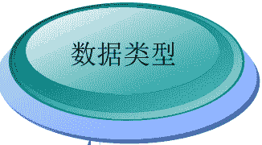

- 类型：整形、浮点型、字符型、自定义数据类型
- 变量
- 常量：字面常量、符号常量、常值变量

const 类型说明符 标识符=常量；常量只能读不能修改，并且定义时必须初始化。


const与define的异同？

大连理工大学软件学院

### 2.2 基本数据类型及操作

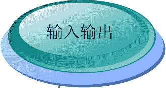

```c
/*C输入输出*/
int i=5;
double d=3.6;
char c='A';
scanf("%d,%lf,%c", &i,&d,&c);
printf("%d,%lf,%c", i,d,c);
```

```cpp
//C++输入输出
int i=5;
double d=3.6;
char c='A';
cin>>i>>d>>c;
cout<<i<<d<<c;
```

C++程序与C程序输入输出的异同？

### 2.3 流程控制

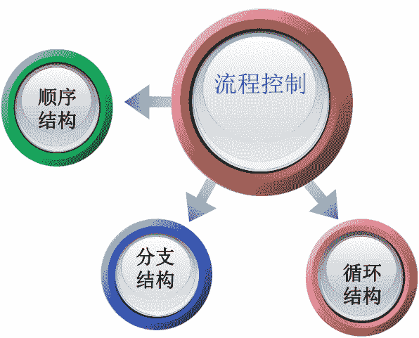

### 2.4 程序结构

+ C++程序是由多个函数构成的。每个函数可以单独放在一个文件中，也可以若干个功能相关的函数放在一个文件中，从中可以看出，C++程序可以由多个文件组成，文件负责组织存放若干个函数。

+ 源程序文件为C++程序的编译单位。

+ main函数是程序执行入口。main函数可以在任何位置，但每个程序有且仅有一个main()函数。

+ C++程序的所有函数都是平行定义的，在一个函数内部不允许定义另外的函数。函数可以互相调用，甚至可以调用自己，但是不能调用main函数。

### 2.4 程序结构


类型说明符 函数名( [形式参数] ){
声明部分
执行语句部分
}

float max(float x,float y){
float z;
z = x>y?x:y;
return z; }

类型说明符 函数名( [形式参数] );

float max(float x,float y);

函数名( [实际参数] );

max(3.6,4.8);

声明与调用的异同？ 什么时候需要声明？ 声明还可以写在哪里？


### 2.4 程序结构—课堂练习

+ 1. 对上面的max写出完整的定义、声明、调用，在VC++中实现。
+ 2. 把声明写在头文件中。


### 2.4 程序结构

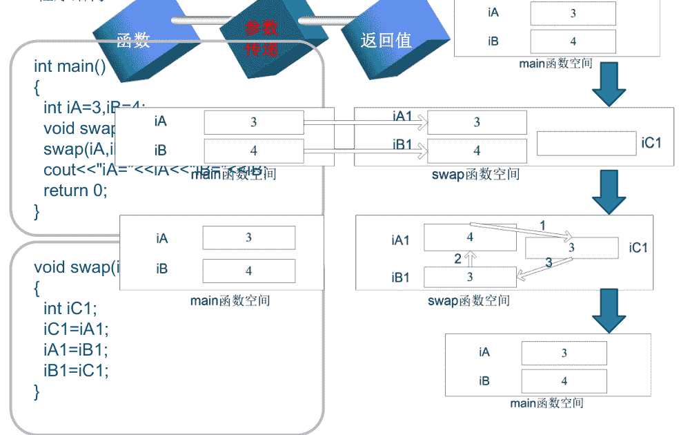

### 2.4 程序结构

int main()
{
    int iResult;
    int getRand();
    iResult=getRand()%7;
    cout<<iResult;
    return 0;
}

int getRand()
{
    int iRand1;
    srand(time(0));
    iRand=rand()%100+1;
    return iRand;
}


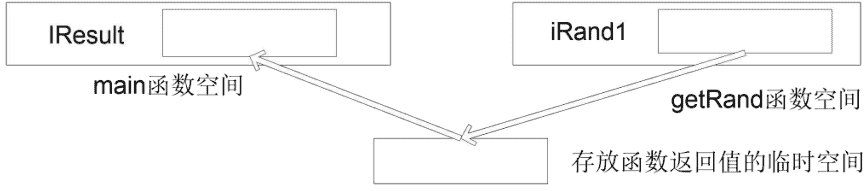

### 2.4 程序结构

#### 函数重载

计算两个整数的最大值定义函数：
int maxTwoInt(int a,int b) {...}
调用格式：
maxTwoInt(5,3);

计算两个浮点数的最大值定义函数：
float maxTwoFloat( float a, float b) {...}
调用格式：
maxTwoFloat(5.4,3.6);

计算三个整数的最大值定义函数：
int maxThreeInt( int a,int b,int c) {...}
调用格式：
maxThreeInt(4,5,3);

### 2.4 程序结构

#### 函数重载

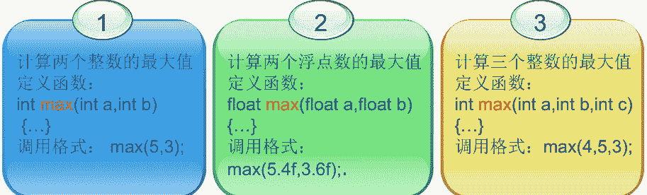

在同一作用范围中为多个函数定义（其功能通常是相近的）指定一个共同的函数名，委托编译器根据每一个单独函数的形参个数、类型和位置的差别进行名称区分，并选择合适的函数调用匹配称为**函数重载**。

+ 调用 max(1.2, 3.4)；出现二义性错误，因为1.2和3.4均为double类型，不能明确匹配哪一个函数。因此，函数重载时尽量避免类型转换，最好定义不同函数准确匹配参数类型。
+ 函数重载不能靠函数返回值类型来区别，调用时体现不出函数返回值类型。

大连理工大学软件学院

### 2.4 程序结构

#### 函数默认参数

默认参数也称为缺省参量，函数定义中的每一个参数都可以拥有一个默认值，如果在函数调用中没有为对应默认值的参数提供实参数据，系统就直接使用默认值。

如函数定义：
int f (int x,long y=10, double z=20) {...}
这样就可以采用几种等价地调用形式：
f (3); f (3,10); f (3,10,20);


+ 1. 在函数定义时，给参数赋值初始值，即默认值。
+ 2. 在函数调用时，省略部分或全部参数，这时可以用默认参数来代替。
+ 3. 默认参数定义的顺序为自右到左，即如果一个参数设定了缺省值时，其右边的参数都要有缺省值。如：
+ int mal(int a, int b=3, int c=6, int d=8){...} ✓
+ int mal(int a=6, int b=3, int c=5, int d){...} ×
+ 4. 默认参数函数调用时，遵循参数调用顺序，自左到右逐个匹配，
+ 函数定义：
+ void mal(int a, int b=3, int c=5){...} //默认参数
+ mal(3, 8, 9); //不使用默认参数
+ mal(3, 5); //按从左到右顺序调用，相当于mal(3,5,5);
+ mal(3); //按从左到右顺序调用,相当于mal(3,3,5);
+ mal( ); //错误，因为a没有默认值
+ mal(3, , 9); //错误，应按从左到右顺序逐个调用

### 2.4 程序结构

#### 函数默认参数

> 当函数重载与默认参数同时使用也容易出现二义性问题，如：
> 重载函数定义：
> int max(int a,int b){...}
> int max(int a,int b,int c=5){...}
> 调用： max(4,5)；
> 
> 调用两个参数的、还是调用三个参数的，两种情形都符合规则，编译系统无法确定，因此出现二义性错误。因此，默认参数与重载函数尽量不要同时采用。

```cpp
int max(int a,int b){...}
int max(int a,int b,int c=5){...}
```

### 2.5 数据结构与数据访问


1. 指针变量定义
指针变量是用来存放地址的，指针变量定义的一般形式为：
类型说明符 *变量名；
例如：
int *p1;
对指针变量的定义包括三个内容：
（1）指针类型说明符，*表示这是一个指针变量；
（2）指针变量名，p1为指针变量名；
（3）指针所指向的变量的数据类型，int为指针变量所指向的变量的数据类型，说明p1只能储存整型变量的地址。

### 2.5 数据结构与数据访问


2. 指针变量引用
指针变量使用之前不仅要定义说明，而且必须赋予具体的值。
未经赋值的指针变量不能使用，否则将造成系统混乱，甚至死机。
（1）&：取地址运算符。
其一般形式为：
& 变量名    //取一个内存变量的地址。
（2）*：指针运算符（或称“间接访问”运算符）。
其一般形式为：
* 指针变量名    //通过指针变量间接访问所指向变量的数据。
int i;  *p1=&i;  //指针变量初始化（定义同时赋值）
注意，此处*是类型说明符，表示其后的变量p1是指针类型。
int i2=*p1+1;  此处*代表间接访问运算符
完全等价于： int i2=i+1;

大连理工大学软件学院


## 第2章 C++基础

### 2.5 数据结构与数据访问

#### 指针访问

### 3. 指针相关的运算符

（1）取地址运算符&：取地址运算符&是单目运算符（注意其优先级），其结合性为自右至左，其功能是取变量的地址。
（2）间接访问运算符*：间接访问运算符*是单目运算符，其结合性为自右至左，用来表示指针变量所指的变量。
（3）赋值运算符=：可以给指针变量赋值，前面介绍指针变量已经介绍过。
（4）算术运算符+、-、++、--。

4. 指针类型
（1）指向一维数组的指针
类型说明符（*指针变量名）[数组长度]；
（2）指针数组
类型说明符 *数组名[数组长度]；
（3）指向指针的指针
类型说明符 **变量名；
（4）指向函数的指针
类型说明符（*指针变量名）（参数表）；

C++引用是C++引入的新语言特性，是C++常用的一个重要内容之一，正确、灵活地使用引用，可以使程序简洁、高效。引用就是某一变量（或目标）的一个别名，对引用的操作与对变量直接操作完全一样。

### 引用访问

#### 1. 引用声明

引用的声明格式：
类型标识符 &引用名=目标变量名；
int a;
int &ra=a; //定义引用ra，它是变量a的引用，即别名。

说明：
- （1）&在此不是求地址运算，而是起标识作用。
- （2）类型标识符是指目标变量的类型。
- （3）声明引用时，必须同时对其进行初始化。
- （4）引用声明完毕后，相当于目标变量名有两个名称，且不能再把该引用名作为其他变量名的别名。
- （5）声明一个引用，不是新定义了一个变量，因此引用本身不占存储单元，系统也不给引用分配存储单元。故：对引用求地址，就是对目标变量求地址，&ra与&a相等。

使用引用变量的时候有一些限制：
- （1）不能引用一个引用变量。
- （2）不能创建一个指向引用的指针。
- （3）不能建立数组的引用。

#include<iostream>
using namespace std;
void swap(int &p1, int &p2) //此处函数的形参p1, p2都是引用
{ int p; p=p1; p1=p2; p2=p; }
int main( )
{
int a,b;
cin>>a>>b; //输入a,b两变量的值
swap(a,b); //直接以变量a和b作为实参调用swap函数
cout<<a<<' '<<b; //输出结果
return 0;
}

#### 3. 常引用

常引用声明一般形式：
const 类型标识符 &引用名=目标变量名；
用这种方式声明的引用，不能通过引用对目标变量的值进行修改。
int a； const int &ra=a；
ra=1； × a=1； √
同一个数据采用不同的访问方式会有不同的权限，这让代码更加健壮。
void f (int & n )；
下面的函数调用是非法的：
const int i=5; f(i);
i是const的。试图将一个const类型的对象转换为非const类型。
若把f定义为： void f (const int & n ); f(i)调用正确。
若函数f中不需要改变形参数据的情形，引用型参数应该尽量定义为const类型。如果既要利用引用提高程序的效率，又要保护传递给函数的数据不在函数中被改变，就应使用常引用，这也符合软件工程的最小权限原则。

#### 4. 引用作为返回值

要以引用返回函数数值，则函数定义时要按以下格式：
类型标识符 &函数名（形参列表及类型说明）
{函数体}

说明：
（1）以引用返回函数数值，定义函数时需要在函数名前加&。
（2）用引用返回一个函数数值的最大好处是，在内存中不产生被返回值的副本。
（3）引用作为返回数值，不能返回局部变量的引用。主要原因是局部变量会在函数返回后被销毁，因此被返回的引用就成为了“无所指”的引用，程序会进入未知状态。

```cpp
#include<iostream>
using namespace std;
int &put(int n);
int vals[10]; int error=-1;
void main(){
    put(0)=10; //以put(0)函数值作为左值，等价于vals[0]=10;
    put(9)=20; //以put(9)函数值作为左值，等价于vals[9]=10;
    cout<<vals[0]; cout<<vals[9];
}
int &put(int n){
    if (n>=0 && n<=9 )
    return vals[n];
    else {cout<<"subscript error"; return error; }
}
```

1. 指针作函数swap的参数交换数据。
2. 引用作函数swap的参数交换数据。

1. new运算符：开辟指定大小的存储空间，并返回该存储区的起始地址。

new的一般格式：

```
类型说明符 *指针变量名 = new 类型说明符;
```

申请一个类型说明符大小的空间赋值给指针变量。

```
类型说明符 *指针变量名 = new 类型说明符[整型表达式];
```

申请整形表达式乘以类型说明符大小的空间赋值给指针变量。

例如：

```
float *p1=new float;
```

在堆空间中开辟一个float类型空间，并把其地址赋值给p1。

```
float *p2=new float[10];
```

在堆空间中开辟10个float类型空间，并把其地址赋值给p2。

2. delete运算符：释放new开辟的存储空间。
delete的一般格式：
**delete 指针变量名；**
释放指针变量名所指向的空间，但该空间必须由new申请
**delete [] 指针变量名；**
释放指针变量名所指向的**数组**空间，但该空间必须由new申请
例如：
delete p1;
释放p1所指向的float的空间。
delete [] p2;

## 第3章 类与对象

C++语言程序设计教程—大连理工大学软件学院

## 3.1 理解类

类是具有相同或相似性质的对象的抽象。抽象是从众多的事物中抽取出共同的、本质性的特征，而舍弃其非本质的特征的过程。

类还起到封装的作用，封装有两个含义：一是把对象的全部属性和行为结合在一起，形成一个不可分割的独立单位；二是尽可能隐蔽对象的内部属性和实现细节，对外形成一道屏障，与外部的联系只能通过公共接口实现。


## 第3章 类与对象

### 3.2 类的定义与实现

#### 类的定义

```cpp
class 类名
{
private:
    私有的成员数据和成员函数声明;
public:
    公有的成员数据和成员函数声明;
protected:
    保护的成员数据和成员函数声明;
};
```

```cpp
class Clock
{
private:
    int hour, minute, second;    // 关于时间的数据
public:
    void setClock(int h, int m, int s);  // 调整时间值
    void showClock();    // 显示时间值
};
```

```cpp
class TimeBomb
{
private:
    Clock timer;    // 关于定时器的数据
    int explosive;   // 炸药量
    ......
public:
    void setTime();  // 设置爆炸时间
    ......
};
```

1. 类 class 是定义面向对象程序模块的数据类型，是“模板”。
2. 类的定义是声明一个数据结构，而不是定义一个函数，定义的最后有分号结束。
3. 说明类成员访问权限的关键字 private、protected 和 public 可以按任意顺序、任意出现多次，一个成员只能有一种访问权限。
4. 不能在类内给数据成员赋初值，只有给对象数据成员赋初值。
5. 成员函数可以重载，Clock 中可以定义多个 set 函数：
   - void setClock(int h, int m, int s);  // 用来设置时、分、秒
   - void setClock(int h, int m);        // 用来设置时、分
   - void setClock(int h);               // 用来设置时

#### 类的实现

```cpp
class Clock
{
private:
    int hour, minute, second;    // 关于时间的数据
public:
    void setClock(int h, int m, int s){
        hour = (h >= 0 && h <= 23) ? h : 0;
        minute = (m >= 0 && m <= 59) ? m : 0;
        second = (s >= 0 && s <= 59) ? s : 0;
    }
    void showClock(){
        cout << hour << minute << second;
    }
};
```

```cpp
class Clock
{
private:
    int hour, minute, second;        // 关于时间的数据
public:
    void setClock(int h, int m, int s);
    void showClock();
};
void Clock::setClock(int h, int m, int s){
    hour = (h >= 0 && h <= 23) ? h : 0;
    minute = (m >= 0 && m <= 59) ? m : 0;
    second = (s >= 0 && s <= 59) ? s : 0;
}
void Clock::showClock(){
    cout << hour << minute << second;
}
```

#### 类的实现

- 类内实现为内联函数
- 类外实现加 inline 为内联函数，如：

```cpp
inline void Clock::showClock(){
    cout << hour << minute << second;
}
```

内联函数不调用，而是编译时将代码嵌入主调函数。

内联函数体中包含复杂结构，声明为内联函数，编译系统也不会按照内联函数处理。

### 3.3 对象定义及访问

#### 对象的定义

1. 在定义类的同时直接定义对象

```cpp
class Clock
{
private:
    int hour, minute, second;    // 关于时间的数据
public:
    void setClock(int h, int m, int s){...}
    void showClock(){...}
} clock1, clock2;
```

2. 在定义类的同时直接定义对象，并且不给类命名

```cpp
class
{
private:
    int hour, minute, second;        // 关于时间的数据
public:
    void setClock(int h, int m, int s){...}
    void showClock(){...}
} clock1, clock2;
```

3. 定义类以后，在使用对象之前再定义对象

```cpp
class Clock
{
private:
    int hour, minute, second;    // 关于时间的数据
public:
    void setClock(int h, int m, int s){...}
    void showClock(){...}
};
Clock clock1, clock2;
```

Clock clock1, clock2;
clock1.setClock(1, 2, 3);
clock2.setClock(4, 5, 6);

每个对象有各自的空间

| 类的成员函数空间 | Clock |
|---|---|
| | setClock(int,int,int) |
| | showClock() |

| 对象空间 | clock1 | clock2 |
|---|---|---|
| hour | 1 | 4 |
| minute | 2 | 5 |
| second | 3 | 6 |

Clock *p; // p 为指向 Clock 类型的指针
p = &clock1; // p 为指向 clock1 对象
Clock &clock3 = clock2; // clock3 为对 clock2 的引用

大连理工大学软件学院

对象的访问是指对对象成员的使用，可以通过成员运算符“.”和指向成员运算符“->”访问，针对对象、指针和引用：

1. 通过对象访问：
   - 对象名.数据成员
   - 对象名.成员函数（实参表）

   ```cpp
   clock1.setClock(6, 15, 24);
   clock1.hour = 6;
   // 此处不正确，hour 私有
   ```

2. 通过指针访问：
   - 指向对象的指针->数据成员
   - 指向对象的指针->成员函数（实参表）
   - (*指向对象的指针).数据成员
   - (*指向对象的指针).成员函数（实参表）

   ```cpp
   Clock *p; p = &clock1;
   p->setClock(6, 15, 24);
   (*p).setClock(6, 15, 24);
   ```

3. 通过引用访问：
   - Clock &clock3 = clock1;
   - clock3.setClock(6, 15, 24);
   - clock1.setClock(6, 15, 24);

   ```cpp
   Clock &clock3 = clock1;
   clock3.setClock(6, 15, 24);
   clock1.setClock(6, 15, 24);
   ```


## 第3章 类与对象

### 3.3 对象定义及访问

#### 例3.1 计算两点之间的距离

同一类定义的对象，可以相互整体赋值，赋值运算符仍是“=”，所有数据成员都会逐位拷贝，两个对象的数据成员的值相同，彼此相互独立的，各自都有自己的内存空间。引用不会赋值。此处调用复制构造函数后面会讲。

```cpp
class Point
{
public:
    double distance(Point &p);
    void setX(double i);
    void setY(double j);
private:
    double x;
    double y;
};
```

- distance参数必须引用吗？
- distance怎样调用？
- p.x 对象名.私有成员？


### 3.3 对象定义及访问

#### 例3.2 两点距离（代码分离）

头文件point.h包含类定义：

```cpp
//point.h
class Point
{
public:
    double distance(Point & p);
    void setX(double i);
    void setY(double j);
private:
    double x;
    double y;
};
```

源文件point.cpp包含类实现：

```cpp
//point.cpp
#include<iostream>
#include<cmath>
#include"point.h"
using namespace std;
double Point::distance(Point & p){
    return sqrt((p.x-x)*(p.x-x)+(p.y-y)*(p.y-y)); 
}
void Point::setX(double i){x=i;}
void Point::setY(double j){y=j;}
```

源文件main.cpp对类的使用：

```cpp
//ch3_2.cpp
#include<iostream>
#include<cmath>
#include"point.h"
using namespace std;
void main(){
    Point p1,p2;
    p1.setX(2);p1.setY(2);
    p2.setX(5);p2.setY(6);
    cout<<p1.distance(p2);
}
```

把类的设计、实现和使用完全分离开来，程序结构更加合理，便于项目的团队研发。

### 3.4 构造函数和析构函数

定义构造函数的语法格式为：

构造函数名（形参）：初始化列表
{
函数体
}

初始化列表格式为：

成员名(实参)[,成员名(实参)...]

```cpp
Clock(int h, int m, int s):
hour(h), minute(m)
{ second=s; }
```

构造函数是类的成员函数，具有一般成员函数的所有性质：可访问类的所有成员，可以是内联函数，可带有参数表，可带有默认的形参值，还可重载。

- 数组成员不能在初始化列表中初始化；
- static数据成员不能在初始化列表中初始化；
- 非static的const数据成员必须在初始化列表中初始化。

#### 构造函数

构造函数的调用方式是在定义对象时自动执行的特殊成员函数，用户不能显示调用构造函数。

类名 对象名(实参列表);
或
类名* 对象名=new类名(实参列表);

Clock c1(1,2,3);
Clock c2;

当构造函数无参数时，对象名后面不能加空的括号。需要重载3个参数和无参的构造函数，后面介绍。

#### 构造函数：默认构造函数

默认构造函数（default constructor）就是在没有显式提供初始化式（定义的对象名后无实参表）时调用的构造函数。

(1) 系统生成的默认构造函数
当类中没有定义构造函数，编译系统就自动生成一个默认的构造函数，这个默认的构造函数不带任何参数，函数体为空，形式为： 类名::构造函数名({ } )

```cpp
Clock({ } )  //系统自动生成的
```

```cpp
Clock clock1; //注意clock1后面无空括号
```

（2）自定义的默认构造函数
利用系统默认生成的构造函数，并不能起到给对象赋初值的作用，为此，可以显示定义构造函数，使得对象按照构造函数约定的值给对象赋值。

Clock(){hour=0; minute =0; second=0; }
Clock clock1; //注意clock1后面无空括号

Clock():hour(0), minute(0), second(0){ }

两种初始化区别？

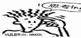

#### 构造函数：有参构造函数

用有参数的构造函数，用参数去给对象初始化或赋值，使得生成的对象具有不同的值。

```cpp
class Clock
{
private :
    int hour, minute, second;
public :
    Clock(int h , int m , int s){hour=h; minute =m; second=s; }
    void Clock::setClock (int h, int m, int s);
    void Clock::showClock ( );
};
Clock clock1(1,2,3);
Clock clock2;
```

错误，因为此时要调用默认构造函数，而系统并没有默认构造函数，因为当显示定义一个构造函数时，系统就不再生成默认构造函数。

大连理工大学软件学院

用有参数的构造函数， 用参数去给对象初始化或赋值，使得生成的对象具有不同的值。

```cpp
Clock(int h, int m, int s ) :hour(h), minute(m), second(s){ }
Clock( ) :hour(0), minute(0), second(0){ }
```

Clock clock1(1,2,3); //需要3个参构造函数
Clock clock2; //需要无参构造函数

#### 析构函数

- 析构函数，在对象生命周期结束自动执行析构函数，完成清理内存工作，并可以执行指定的其他操作。
- 析构函数是一种在结束对象调用时自动执行的特殊的成员函数，一个类中只能定义一个析构函数。
- 析构函数声明为公有成员，析构函数名由波折号 “~” 与类名组合而成，析构函数不接受参数（所以不能重载，只有一个析构函数），没有返回值。

```cpp
class 类名
{
public:
......
~类名（）
{ 指定的操作； }
};
```

大连理工大学软件学院

#### 析构函数

通常在构造函数中用new运算符为对象额外申请了一些空间（额外资源，不属于对象空间），在对象结束生命周期时需要使用析构函数，利用delete运算符释放new运算符所申请的空间。

当类中没有显式地定义析构函数，则系统会自动生成一个默认的析构函数，该函数是一个空函数。默认的析构函数的格式如下：

类名 :: ~类名(){ }

#### 例3.4构造函数与析构函数

```cpp
class Point
{
private:
    double x, y;
    char *name;
public:
    Point(char *n=NULL, double x=0.0, double y=0.0);
    ~Point();
    void disp();
};
```

```cpp
Point::Point(char *n, double a, double b){
    x = a; y = b;
    if(n) {
        name=new char[strlen(n)+1];
        strcpy(name,n);
    } else {
        name=new char[8];
        strcpy(name,"no name");
    }
    cout<<name<<" constructing"<<endl;
}
```


## 第3章 类与对象

### 3.4 构造函数和析构函数

#### 例3.4 构造函数与析构函数

```cpp
Point::~Point(){
    cout<<name<<" destructing"<<endl;
    delete [] name;
}
void Point::disp()
{
    ...
}
```

```cpp
void main(){
    // 定义对象
    Point p1("home",1.0,2.0);
    Point p2("school",3.0);
    Point p3;
    // 输出对象
    cout<<"p1=";
    p1.disp();
    cout<<"p2=";
    p2.disp();
    cout<<"p3=";
    p3.disp();
}
```

home constructing
school constructing
no name constructing
p1=home:1,2
p2=school:3,0
p3=no name:0,0
no name destructing
school destructing
home destructing

对象析构的顺序恰好和对象的构造顺序相反。

### 课堂练习-完成类的实现

```cpp
class Student{
private:
    char *name;
    char sex;
    double score;
public:
    void print();//输出姓名、性别、成绩
    Student();//无参
    Student(char *n,char s,double sc);//有参
    void setName(char *n);//设置姓名
    ~Student();//析构函数
};
```

### 3.5 拷贝构造函数

```cpp
Point p1("home",1.0,2.0),p2("school",3.0),p3;
Point p4=p1 ;
```

对象空间

| 对象 | x | y | flag | name |
|------|---|---|------|------|
| p4 | 1.0 | 2.0 | 0 | p1 |
| p1 | 1.0 | 2.0 | 1 | name |
| p2 | 1.0 | 2.0 | 1 | name |
| p3 | 0.0 | 0.0 | 1 | name |

堆空间

| 内容 |
|------|
| h o m e \0 |
| s c h o o l \0 |
| n o n a m e \0 |

类的成员函数空间

- Point
- Point(char *,double,double)
- Point(Point &)
- ~Point()
- disp()

p3析构

```cpp
Point(char *,double,double)
~Point()
disp()
```

对象空间

堆空间

类的成员函数空间

```cpp
s
c
h
o
o
l
1
0
```

p1析构
delete[] name?

析构带来的问题，需要自定义拷贝构造函数，不能够用按位赋值。拷贝构造函数的语法格式为：

```cpp
class 类名
{
public:
    类名( 类名& 形参) {
        拷贝构造函数的函数体
        ......
    };
};
```

不定义拷贝构造函数，系统会自动生成一个默认的拷贝构造函数：

```cpp
类名( 类名& 形参) { }
```

函数名与类名同

引用必须，否则递归，后面介绍

- 构造函数是当定义一个新对象时自动调用的无到有的过程；
- 拷贝构造函数利用一个已经存在的对象再生成一个对象；

```cpp
Point p1("home",1.0,2.0);//对象p1生成时没参照现有对象
Point p2=p1; //也可以写作 Point p2 (p1);

Point p3;
p3=p1;
```

P3调用拷贝构造吗？

对象空间

p4：x 1.0，y 2.0，name 指向堆中的字符串“home”

p1：x 1.0，y 2.0，name 指向堆中的字符串“home”

p2：x 1.0，y 2.0，name 指向堆中的字符串“school”

p3：x 0.0，y 0.0，name 未初始化

类的成员函数空间

- Point
- Point(char *,double,double)
- ~Point()
- disp()

堆空间

P4的name与p1的name相同

### 标记拷贝

深拷贝，需要把资源复制一份，而有时候资源很大，复制需要大量的时间和空间，甚至有些资源是不可复制的，这时深拷贝是不可取的，为此，可以采用带标记的拷贝构造。

- 带标记的拷贝构造需要区分对象是原始生成的，哪些对象是拷贝构造函数生成的；
- 原始生成的对象申请了额外的资源，拷贝构造函数生成的对象不再申请额外资源，去共享原有对象申请的资源；
- 析构时拷贝构造函数生成的对象不可以释放额外资源，原始生成的对象析构时才可以释放额外资源；
- 因此析构函数中需要区别原始生成的对象和拷贝构造对象；
- 给类增加一个标记成员，用以区别原始生成的对象和拷贝构造对象

#### 例3.6 标记拷贝构造

```cpp
class Point
{
private:
    double x, y;
    char *name;
    int flag; //区分构造对象和拷贝构造对象
public:
    Point(char *n=NULL, double x=0.0, double y=0.0);
    Point(Point &p);
    ~Point();
    void disp( );
};
```

```cpp
Point::Point (char *n, double a, double b){
    x = a; y = b;
    flag=1; //flag为1时代表构造生成对象
    if(n) { //如果形参不是默认的空值
        name=new char[strlen(n)+1];
        strcpy(name,n);
    }
    else{
        name=new char[8];
        strcpy(name,"no name");
    }
    cout<<name<<" constructing"<<endl;
}
```

```cpp
Point::Point(Point &p){
    x = p.x; y = p.y;
    name = p.name;
    flag=0;   //flag为0时代表拷贝构造生成对象
    cout<<name<<" copy constructing"<<endl;
}
```

```cpp
Point::~Point(){
    cout<<name<<" destructing"<<endl;
    if(flag)
        delete [] name;
}
```


## 第3章 类与对象

### 3.5 拷贝构造函数

**定义拷贝构造函数，实现深拷贝**

```cpp
Point::Point(Point &p){ //拷贝构造函数
    x = p.x; y = p.y;
    if(p.name) { //如果形参不是空值
        name=new char[strlen(p.name)+1];
        strcpy(name,p.name);
    }else{
        name=new char[8];
        strcpy(name,"no name");
    }
    cout<<name<<" copy constructing";
}
```

```cpp
int main(){
    Point p1("home",1.0,2.0);
    test(p1);
    return 0;
}
```

对象空间、test函数、main函数、p1、参数传递：

| 变量 | 值 |
|---|---|
| x | 1.0 |
| y | 2.0 |
| name |  |

| 变量 | 值 |
|---|---|
| x | 1.0 |
| y | 2.0 |
| name |  |

类的成员函数空间：

| Point |
|---|
| Point(char *,double,double) |
| ~Point() |
| Point(Point &) |
| disp() |

堆空间：

| h |
|---|
| o |
| m |
| e |
| \0 |

| h |
|---|
| o |
| m |
| e |
| \0 |

**函数返回对象**

```cpp
Point test()
{
    Point p("home",1.0,2.0);
    return p;
}
int main()
{
    Point p1;
    p1=test();
    return 0;
}
```

未定义拷贝构造函数，实现浅拷贝。

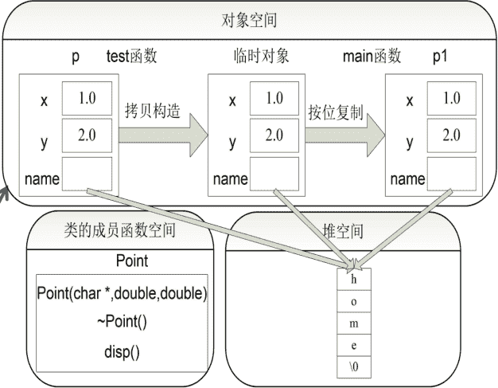

怎样析构呢？运行结果如何？

```cpp
Point test()
{
    Point p("home",1.0,2.0);
    return p;
}
int main()
{
    Point p1=test();
    return 0;
}
```

未定义拷贝构造函数，实现浅拷贝。

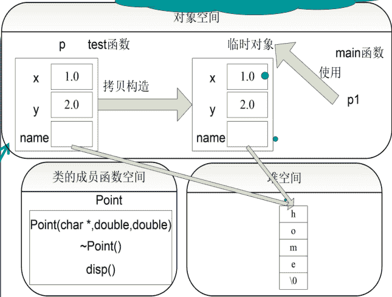

函数返回对象，最终解决还要用深拷贝（拷贝构造）。

类的成员函数空间、对象空间：

| 对象 p | 值 |
|---|---|
| x | 1.0 |
| y | 2.0 |
| name |  |

| 临时对象 | 值 |
|---|---|
| x | 1.0 |
| y | 2.0 |
| name |  |

| Point |
|---|
| Point(char *,double,double) |
| ~Point() |
| disp() |

| name 指向的数据 |
|---|
| h |
| o |
| m |
| e |
| \0 |

使用

怎样构造析构呢？运行结果如何？

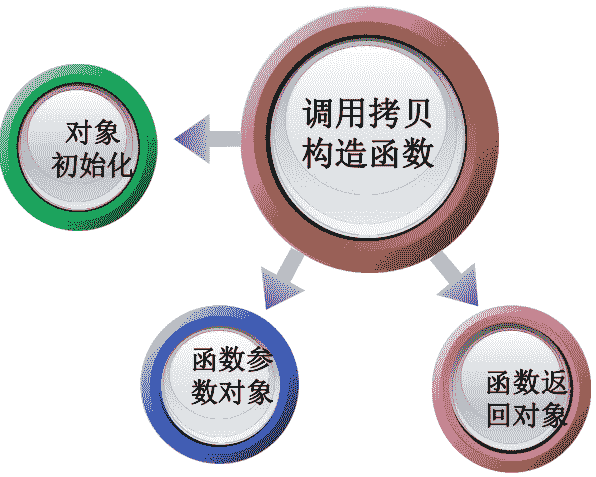

### 3.6 对象数组

数组元素不仅可以由简单类型组成（例如，整型数组的每一个元素都相当于一个整型变量），也可以由对象组成（对象数组的每一个元素都是同类型的对象）。

```cpp
class Student{
private:
    char name[20];
    int age;
    float score;
public:
    Student(int s){
        strcpy(name,"no name");
        age=20;
        score=s;
    }
};
```

数组定义：

```cpp
Student stud[3]={60,70,78};
```

构造函数只有一个参数，数组可以这样初始化。

可以不初始化吗？


```cpp
class Student{
private:
    char name[20];
    int age;
    float score;
public:
    Student(char * n, int a, int s){
        strcpy(name,n);
        age=a;
        score=s;
    }
};
```

数组定义：

```cpp
Student stud[3]={
    Student("zhang san",20,60),
    Student("Li si",19,70),
    Student("Wang wu",18,78)
};
```

### 例3.8 计算一组学生的总成绩和平均成绩

```cpp
class Student{
private:
    char name[20];
    int age;
    float score;
public:
    Student(char * n, int a, int s){
        strcpy(name,n);
        age=a;
        score=s;
    }
    float getScore(){
        return score;
    }
};
```

```cpp
int main(){
    Student stud[3]={
        Student("zhang san",20,60),
        Student("Li si",19,70),
        Student("Wang wu",18,78)
    };
    float sum=0,average;
    int i;
    for(i=0;i<3;i++)
        sum+=stud[i].getScore();
    average=sum/3;
    cout<<"sum="<<sum<<" average="<<average<<endl;
    return 0;
}
```

大连理工大学软件学院

### this指针

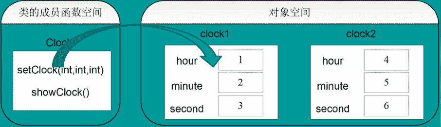

```cpp
class Clock {
private:
    int hour, minute, second;
public:
    void setClock(int h, int m, int s);
};

void Clock::setClock(int h, int m, int s) {
    hour=h;    minute=m;
    second=s;
}
```

`setClock(&c1,1,2,3)`；`this` 获得 `c1` 的地址，函数体中的 `this->hour=h;` 即给 `c1` 的 `hour` 赋值。

```cpp
void Clock::setClock(Clock *this, int h, int m, int s) {
    this->hour=h;    this->minute=m;
    this->second=s;
}
```

### 3.8 static成员

**static数据成员**

在类内数据成员的声明前加上关键字static，该数据成员就是类内的静态数据成员，静态数据成员也被称作是类的成员。

- 无论这个类的对象被定义了多少个，静态数据成员在程序中也只有一份拷贝，由该类型的所有对象共享访问；
- 对该类的多个对象来说，静态数据成员只分配一次内存；
- 静态数据成员的值对每个对象都是一样的，而非静态数据成员，每个类对象都有自己的拷贝。


对于类X的定义：

```cpp
class X{
public:
    char ch;
    static int s;
};

int X::s = 0;
```

对象a、b、c、d的定义：

```cpp
void f()
{ X a, b, c, d; }
```

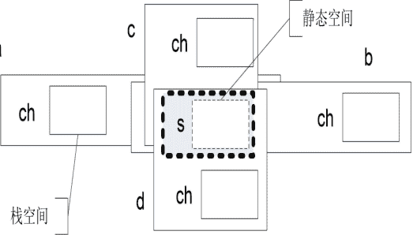

sizeof(X)?


## 第3章 类与对象

### 3.8 static成员


**static数据成员**

静态数据成员初始化：

`<数据类型><类名>::<静态数据成员名>=<值>`

如：`int X::s = 0;`

- 初始化在类体外进行，而前面不加static；
- 初始化时不加该成员的访问权限控制符public、protected、private等；
- 若未在类外初始化，程序连接时会出现错误；
- sizeof运算符不包含静态数据成员的空间。

静态数据成员访问形式：

`<类对象>.<静态数据成员名>`

或 `<类类型名>::<静态数据成员名>`

静态数据成员s可以有5种访问办法：
`X::s`（没有定义对象a、b、c、d，`X::s`也是正确的）；
`a.s`、`b.s`、`c.s`、`d.s`，它们都代表访问同一个变量空间，通过一个改变值，其他方式获取的值全部改变。

静态数据成员和普通数据成员一样遵守public、protected、private访问规则，若上述X的静态数据成员是私有的，`X::s`、`a.s`、`b.s`、`c.s`、`d.s`访问s都是错误的，因为不可见。

**例3.9 计算一组学生的总成绩和平均成绩**

```cpp
class Student {
private:
    char name[20];
    int age;
    float score;
public:
    Student(char *n, int a, int s) {
        strcpy(name, n);
        age = a;
        score = s;
        sum += score;
    }
    static float sum; //声明静态数据成员
};

float Student::sum = 0; //初始化

int main() {
    Student stud[3] = {
        Student("zhang san", 20, 60),
        Student("Li si", 19, 70),
        Student("Wang wu", 18, 78)
    };
    float average;
    average = Student::sum / 3;
    //等价于对象名stud[1].sum
    cout << "sum=" << Student::sum << "  average=" << average;
    return 0;
}
```

**static函数成员**


- 成员函数前面加static修饰成静态成员函数；
- 静态成员函数声明时前面加static关键字，在类外写函数实现时不需要关键字static；
- 静态成员函数是不依赖于对象成员的函数，通常用来定义一些工具函数。

**例3.10 计算一组学生的总成绩和平均成绩**

```cpp
class Student {
private:
    char name[20];
    int age;
    float score;
public:
    Student(char *n, int a, int s) {
        strcpy(name, n);
        age = a;
        score = s;
        sum += score;
    }
    static float sum; //声明静态数据成员
    static float getAverage(); //声明静态函数成员
    void display(); //输出总和与平均值
};

float Student::getAverage() { return sum / 3; } //实现时不需要static
float Student::sum = 0; //初始化静态数据成员

void Student::display() {
    //成员函数引用静态成员
    cout << "sum=" << sum << " average=" << getAverage() << endl;
}
```

```cpp
int main() {
    //静态成员函数、静态成员数据不定义对象，类名就可以访问
    cout << "sum=" << Student::sum << " average=" << Student::getAverage() << endl;

    Student stud[3] = {
        Student("zhang san", 20, 60),
        Student("Li si", 19, 70),
        Student("Wang wu", 18, 78)
    };

    //定义对象后，通过类名访问
    cout << "sum=" << Student::sum << " average=" << Student::getAverage() << endl;

    //定义对象后，通过对象访问
    cout << "sum=" << stud[0].sum << " average=" << stud[0].getAverage() << endl;

    //成员函数
    stud[0].display();
    return 0;
}
```

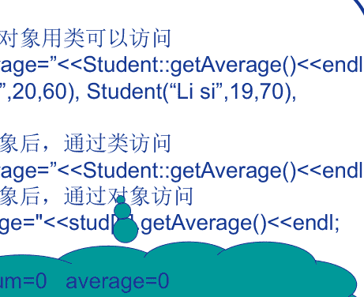

普通的成员函数一般都隐含了一个`this`指针，静态成员函数由于不是与任何的对象相联系，因此它不具有`this`指针。

静态成员函数可以访问静态数据成员和静态成员函数，但是静态成员函数不能访问非静态成员函数和非静态数据成员。

非静态成员函数可以任意地访问静态成员函数和静态数据成员。

### 3.9 const成员和const对象

**const数据成员**

- 数据的安全性可以通过访问控制权限管理；
- const控制读写权限；
- 类中某些数据成员的值是不需要改变的，如数学中的π、物理中的g等都是常量，可以用关键字const来声明常数据成员；
- 因为常数据成员的值是不能改变的，所以，定义对象时必须初始化，需要通过构造函数的初始化列表对常数据成员进行初始化。

```cpp
class Clock {
private:
    const int hour;    //常量数据成员
    int minute, second;  //非常量数据成员
public:
    Clock(int h, int m, int s) : hour(h), minute(m), second(s) { }
};
```

```cpp
Clock (int h, int m, int s) : hour(h) { minute = m; second = s; } √
Clock (int h, int m, int s) { hour = h; minute = m; second = s; } ×
Clock (int m, int s) { minute = m; second = s; } ×
```

成员函数可以引用本类中的非const数据成员，可以修改它们；成员函数可以引用本类中的const数据成员，不可以修改它们。

**const函数成员**

定义的类的成员函数不改变类的数据成员（比如打印函数），这些函数是“只读”函数，加上const关键字进行标识，标识为常成员函数。声明常成员函数格式如下：

`类型 成员函数名(参数表) const;`

```cpp
class Clock {
private:
    int hour, minute, second;
public:
    void setClock(int h, int m, int s) {
        hour = h;
        minute = m;
        second = s;
    }
    void showClock() const { //常成员函数
        cout << hour << minute << second;
    }
};
```


```cpp
void Clock::showClock() const {
    minute++;
    cout << hour << minute << second;
}
```

改变数据成员，编译出错。

- 常成员函数可以引用const数据成员，也可以引用非const的数据成员，只要在常成员函数不改变数据成员即可；
- const数据成员可以被const成员函数引用，也可以被非const的成员函数引用，只要const数据成员不被修改即可；
- 常成员函数不能调用另一个非常成员函数，因为非常成员函数是可以改变数据成员的，这样常成员函数就间接改变了数据，违背了常成员函数的定义规则。


## 第3章 类与对象

### 3.9 const成员和const对象

#### 例3.11 圆类

```cpp
double area() const{ //正确吗？
return pi*getRadius()*getRadius();};
```

```cpp
class Circle{
private:
    double x,y ; //圆心坐标
    double radius; //半径
    const double pi; //Π
public:
    Circle(double x,double y,double r):x(x),y(y),radius(r),pi(3.1415926){}
    double getRadius() const { return radius; }
    double area() const {
        return pi*radius*radius;
    }
};
```

```cpp
double area(){return pi*radius*radius;}
```

这两个area函数是合法的重载。对于利用const重载的成员函数，非常对象默认调用非const成员函数，若没有非const成员函数则调用const成员函数；常对象（下一节介绍）需要调用const成员函数，若不调用const成员函数则编译出错。

大连理工大学软件学院

## 第3章 类与对象

### 3.9 const成员和const对象

定义常对象的一般形式为：
类名 const 对象名[(实参表列)];
或
const 类名 对象名[(实参表列)];
const Clock c1(12,34,46);

一个对象被声明为常对象，则不能调用该对象的非const型的成员函数（除了由系统自动调用的隐式的构造函数和析构函数）。例如，对于例3.11中已定义的Circle类，定义常对象：
const Circle c1(12,3,3.14);  //定义常对象c1
c1.getRadius(); //调用常对象c1中的非const成员函数，非法

## 第3章 类与对象

#### 指针和对象间的关系

```cpp
class Circle{
private:
  double x,y, radius ; //圆心坐标、半径
  const double pi; //π
public:
  Circle(double x,double y,double radius,double pi):pi(pi){
  this->x=x; this->y=y; this->radius=radius; }
  double getRadius(){ return radius; }
  void setRadius(double radius){ this->radius= radius; }
  double area() const{ return pi*radius*radius; }
};
```

（1）指向对象的指针，对象与指针都不定义const的，
Circle c1(1.2, 2.3, 4, 3.14); Circle *p=&c1;
对象名c1可以访问任何公有成员：c1.setRadius(10)、c1.area()。
指针p可以访问任何公有成员：p->setRadius(10)、p->area()。
p的值是可以改变的。

## 第3章 类与对象

### 3.9 const成员和const对象

#### 指针和对象间的关系

```cpp
class Circle{
private:
    double x,y, radius ; //圆心坐标、半径
    const double pi; //π
public:
    Circle(double x,double y,double radius,double pi):pi(pi){
    this->x=x; this->y=y; this->radius=radius; }
    double getRadius(){ return radius; }
    void setRadius(double radius){ this->radius= radius; }
    double area() const{ return pi*radius*radius; }
};
```

（4） 指向常对象的常指针，对象const的，指针也是const的：
const Circle c1(1.2, 2.3, 4, 3.14); const Circle * const p=&c1;
对象名c1访问const公有成员： c1.area() √， c1 setRadius(10) ×
指针p访问const公有成员： p->area() √， p-> setRadius(10) ×
p的值是不可以改变的。

## 第3章 类与对象

### 3.9 const成员和const对象

#### 函数参数为对象指针

函数的形参是指向const对象的指针，在执行函数过程中不能改变指针变量所指向的对象的值；
允许实参指向const对象的指针，或指向非const对象的指针；
当希望在调用函数时对象的值不被修改，就应当把形参定义为指向常对象的指针变量，同时用对象的地址作实参。

```cpp
void f(const Circle *p){
//cout<<p->setRadius(10); 非法
cout<<p->area();
}
```

函数调用：
Circle c1(1.2, 2.3, 4, 3.14);
f(&c1);
如果函数的形参是指向非const对象的指针，实参只能用指向非const对象的指针。

## 第3章 类与对象

### 3.9 const成员和const对象

#### 函数参数为对象引用

一个对象的引用就是对象的别名。对象名和引用名都指向同一段内存单元；
如果形参为对象的引用名，实参为对象名，形参即为实参对象。

```cpp
void f(Circle & r){
cout<<r. setRadius(10);
cout<< r.area();
}
```

```cpp
void f(const Circle & r){
//cout<<r. setRadius(10);
非法
cout<< r.area(); }
}
```

函数调用：
Circle c1(1.2, 2.3, 4, 3.14);
f(c1);

## 第3章 类与对象

### 3.7 const关键字—课堂练习

+ 1. 对例3.10，不改变程序功能，哪些函数可以改为const。
+ 课堂练习2代码.txt

**const成员函数可以修改静态数据成员


## 第3章 类与对象

## 3.10 友元函数和友元类

类的私有成员只能在类的定义范围内使用，也就是说，类的私有成员只能通过本类的成员函数来访问，但有时候又需要在类的外部访问类的私有成员，甚至需要同时访问多个类的私有成员。为此引入友元。

### 例3.13 普通函数作为多个类的友元函数

```cpp
class Point
{
private:
    double x, y;    //x,y 坐标
public:
    Point(double x=0.0, double y=0.0);
    void disp();
    friend double distance(Point p, Line l); //声明为Point的友元
};
Point::Point(double x, double y){
    this->x = x; this->y = y;
}
void Point::disp() { cout<<"点（"<<x<<","<<y<<")"; }
```


## 第3章 类与对象

## 3.10 友元函数和友元类

### 例3.13 普通函数作为多个类的友元函数

```cpp
class Line
{
private:
    double a, b, c;    //直线为ax+by+c=0的系数
public:
    Line(double a=0.0, double b=0.0, double c=0.0);
    void disp( );
    friend double distance(Point p,Line l); //声明为Line的友元
};
Line::Line(double a, double b, double c){
    this->a = a; this->b = b; this->c = c;
}
void Line::disp( )
{
    cout<<"线 ("<<a<<"x+"<<b<<"y+"<<c<<"=0 ) ";
}

double distance(Point p,Line l){
return fabs(l.a*p.x+l.b*p.y+l.c)/sqrt(l.a*l.a+l.b*l.b);
}
int main(){
Point p1(1.0,2.0);
Line l1(3.0,4.0,5.0);
p1.disp();
l1.disp();
cout<<"距离为: "<<distance(p1,l1)<<endl;
return 0;
}
```

两个类的互相不可见的私有数据在distance函数中都可以访问。

### 例3.14 成员函数作为类的友元函数

```cpp
class Point
{
private:
    double x, y;    //x,y 坐标
public:
    Point(double x=0.0, double y=0.0);
    void disp( );
    double distance(Line l); //声明为Point的成员
};
Point::Point (double x, double y){
    this->x = x; this->y = y;
}
void Point::disp( ){ cout<<"点 ("<<x<<","<<y<<") "; }

class Line
{
private:
    double a, b, c;        //直线为ax+by+c=0的系数
public:
    Line(double a=0.0, double b=0.0, double c=0.0);
    void disp();
    friend double Point::distance(Line l); //声明为Line的友元
};
Line::Line(double a, double b, double c){
    this->a = a; this->b = b; this->c = c;   }
void Line::disp() {
    cout<<"线 ("<<a<<"x+"<<b<<"y+"<<c<<"=0 )";}

double Point::distance(Line l){
    return fabs(l.a*x+l.b*y+l.c)/sqrt(l.a*l.a+l.b*l.b);
}
int main(){
    Point p1(1.0,2.0);
    Line l1(3.0,4.0,5.0);
    p1.disp();
    l1.disp();
    cout<<"距离为："<<p1.distance(l1)<<endl;
    return 0;
}
```


当一个类作为另一个类的友元时，称这个类为友元类。

当一个类成为另一个类的友元类时，这个类的所有成员函数都成为另一个类的友元函数。

友元类的声明可以放在类声明中的任何位置。

友元关系是不能传递的。类B是类A的友元，类C是类B的友元，并不表示类C是类A的友元。

友元关系是单向的。类A是类B的友元，类A的成员函数可以访问类B的私有成员和保护成员，反之，类B不是类A的友元，类B的成员函数却不可以访问类A的私有成员和保护成员。

友元类声明的形式如下：

```cpp
friend class <友元类名>;
```

### 例3.15 友元类

```cpp
class Point
{
private:
    double x, y;    //x,y 坐标
public:
    Point(double x=0.0, double y=0.0);
    void disp();
    friend class ComputeTools; //声明为Point的友元类
};
Point::Point(double x, double y){
    this->x = x; this->y = y;
}
void Point::disp() { cout<<"点("<<x<<","<<y<<")"; }

class Line
{
private:
    double a, b, c;    //直线为ax+by+c=0的系数
public:
    Line(double a=0.0, double b=0.0, double c=0.0);
    void disp( );    // 输出私有变量的成员函数
    friend class ComputeTools; //声明为Line的友元类
};
Line::Line(double a, double b, double c){
    this->a = a; this->b = b; this->c = c; }
void Line::disp( ){
    cout<<"线 ("<<a<<"x+"<<b<<"y+"<<c<<"=0 ) ";
}

class ComputeTools{
public:
    static double distance(Point p1,Point p2); //重载点与点距离
    static double distance(Point p,Line l); //重载点与直线距离
};
double ComputeTools::distance(Point p1,Point p2){
    return sqrt((p1.x-p2.x)*(p1.x-p2.x)+(p1.y-p2.y)*(p1.y-p2.y));
}
double ComputeTools::distance(Point p,Line l){
    return fabs(l.a*p.x+l.b*p.y+l.c)/sqrt(l.a*l.a+l.b*l.b);
}

int main(){
    Point p1(1.0,2.0),p2(3.0,4.0);
    Line l1(3.0,4.0,5.0);
    p1.disp(); p2.disp();
    cout<<"距离为："<<ComputeTools::distance(p1,p2)<<endl;
    p1.disp(); l1.disp();
    cout<<"距离为："<<ComputeTools::distance(p1,l1)<<endl;
    return 0;
}
```


增加一种图形元素怎么办？

### 3.7 friend关键字—课堂练习

- 1. 自己设计定义学生类和教师类，通过友元函数计算教师对象与学生对象的年龄差；定义教学类来建立教师与学生的对应关系。


### 3.11 类组合关系

类中的成员，除了可以为基本数据类型外，还可以是一个已定义类类型，称为类的组合或类的聚合，这样的类简称为组合类。

```cpp
class Date {
private:
    int year,month,day;
public:
    Date(int yr,int mn,int dy)
    { year = yr; month =mn;
      day =dy;
      cout<<"constructor Date"<<endl;}
    Date(Date& d){ cout<<"copy constructor Date"<<endl;}
};

class Student {
private:
    int num;
    char name[20];
    Date birthday;
public:
    Student(int n,char* nam,Date birth);
    Student::Student(int n,char * nam, Date birth):birthday(birth)
    { num=n; strcpy(name,nam); }
```


## 第3章 类与对象

### 3.11 类组合关系

### 例3.16 使用对象成员

```cpp
void main(){
Date d1(1,2,3);
Student s1(1,"abc",d1);
Student s2(2,"abcd",4,5,6);
}
```

程序运行结果如下：
constructor Date
copy constructor Date
copy constructor Date
constructor Date


分析运行结果

### 3.12 案例分析

### 例3.17 父亲给儿子钱类的设计

| Father |
| --- |
| - name: char[16] |
| - money: int |
| +Father(n:char *,m: int ) |
| +getName(): char * |
| +receive(m:int): void |
| +pay(m:int ): int |
| +print():void |

| Son |
| --- |
| - name: char[16] |
| - money: int |
| -father: Father * |
| +Son(p:Father *,n: char *,m: int) |
| +getName(): char * |
| +receive(m:int): void |
| +pay(m:int ): int |
| +print():void |
| +getFather(): Father * |

### 例3.17 父亲给儿子钱类的设计

```cpp
int Father::pay(int m){
if(m<=0)
return 0;
if(money>=m) {
money=money-m;
return m;
}
else return 0;
}
```

```cpp
Father f1("李四",10000);
Son s1(&f1," 李小四",100);
s1.receive(f1.pay(1000));
f1.print(); //name: 李四 money:9000
s1.print();//name: 李小四money:1100
```

### 例3.17 父亲给儿子钱类的设计

上述设计，任何人都可以调用f1的pay函数从李四那里支取钱。

| Father |
| --- |
| - name: char[16] \
- money: int |
| +Father(n:char \*,m: int ) \
+getName(): char \* \
+receive(m:int): void \
-pay(m:int ): int \
+manage(role :Son \*,m :int): int \
+print():void |

```cpp
int Father::manage(Son *role,int m) {
    if(strcmp(role->getFather()->getName(),name)==0) //支付对象的父亲是自己
    return pay(m);
    else        return 0; }
```

```cpp
Father f1("李四",10000);
Son s1(&f1," 李小四",100);
s1.receive(f1.manage(&s1,1000));
f1.print(); //name: 李四 money:9000
s1.print();//name: 李小四money:1100
```

### 3.12 案例分析

1. 面向对象的设计首先要找出参与任务的对象并将其抽象为类，然后由类对象协同完成任务。
2. 类的设计应该忠实于实际对象，尤其是功能的权限范围，如本例的pay函数就定义为私有的。
3. 存取函数对类中的私有数据成员提供对外的接口，用来设置和返回私有成员数据的值，通常称为getter和setter函数，命名方式通常为get（set）+私有成员的名称。

问题发现：
1. 父子两个类会有很多同样的数据成员和函数成员，程序有很多冗余；
2. 还有Father类的manage函数只能给自己的儿子付款，如果想给自己的妻子、朋友付款怎么办呢？
* 这些问题将在继承和多态章节给出解决方案。

## 第4章 运算符重载

C++语言程序设计教程—大连理工大学软件学院

### 4.1 理解运算符重载

### 4.2 运算符重载规则

### 4.3 运算符重载方法

### 4.4 常用运算符重载

### 4.5 字符串类实例

### 4.1 理解运算符重载

使用运算符对各种数据进行操作，高效快捷且清晰易懂。如果运算符也能作用于各种类对象，会使代码简洁而优雅。

```cpp
v1 = v1+ v2 ; //向量加法
M1 = M1+ M2 ; //矩阵相加
v1 = M1*v2 ; // 向量与矩阵相乘
m1 = v1*v2 ; // 向量相乘
int day = d1- d2 ; // 计算日期差
double d = p1 – p2 ;// 计算两点距离
```

```cpp
class Complex
{
public:
    Complex(double r=0, double i=0){ dReal=r; dImag=i;}
    Complex complexAdd(Complex &c2) ;
private:
    double dReal, dImag;
};
Complex Complex :: complexAdd(Complex &c2)
{
    Complex c;
    c.dReal = dReal+c2.dReal;
    c.dImag = dImag+c2.dImag;
    return c;
}
c = c1. complexAdd( c2 );
```

```cpp
class Complex
{ public:
Complex(double r, double i){ dReal=r; dImag=i;}
Complex operator + (Complex &c2);
private:
double dReal, dImag;
};

c = c1 + c2; // c1.operator+(c2)

Complex Complex::operator + (Complex &c2)
{ Complex c;
c.dReal = dReal+c2.dReal;
c.dImag = dImag+c2.dImag;
return c;
// return Complex( dReal+c2.dReal, dImag+c2.dImag);
}
```

### 4.2 运算符重载规则

重载运算符函数可以对运算符作出新的解释，原有基本语义不变：

- 不能创建新的运算符
- 不能改变运算符的优先级和结合性
- 不能改变运算符所需要的操作数
- 不能改变该运算符用于基本类型变量时的含义

### 4.3 运算符重载方法

#### 成员函数的语法形式

函数返回类型

由op构成的表达式的类型决定

类型 类名 :: operator op ( 参数表 )

{

重载该运算符的类

// 相对于该类定义的操作

}

函数名

关键字

被重载的运算符

### 成员函数重载算符

```cpp
class Complex
{
    double dReal, dImag;
    public:
    Complex(double r=0, double i=0);
    Complex operator + (Complex &c2);
    Complex operator + (double d);
};
```

```cpp
Complex z ( 2.0 , 3 ) , k ( 3 , 4.5 ) ;
z = z + k;
k = z + 27 ;
k = 27 + z ;
```


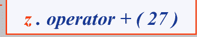


## 第4章 运算符重载

### 友元函数重载算符

```cpp
Complex operator + ( int a ,Complex &c2)
{ 
    Complex c;
    c.dReal = a+c2.dReal;
    c.dImag = 0+c2.dImag;
    return c;
}
```

```cpp
k = 27 + z ;
```

```cpp
k=operator + (27, z)
```

### 何时用成员函数重载算符？

当一元运算符的操作数，或者二元运算符的左操作数是该类的一个对象时，重载运算符函数为成员函数

```cpp
class Complex
{
    double dReal, dImag;
public:
    Complex(double r, double i);
    Complex operator + (Complex &c2);
    Complex operator - ();
    Complex operator * (double d);
};
```

### 何时成员函数不能重载算符？

```cpp
class Complex
{
    double dReal, dImag;
public:
    Complex(double r, double i);
    Complex operator + (Complex &c2);
    Complex operator + (double d);
};
```

Complex z ( 2.0 , 3 ) , k ( 3 , 4.5 ) ;
k = z + 27 ;
k = 27 + z ;

成员函数重载的 “ + ” 算符不支持交换律

### 友元函数重载运算符

友元函数重载运算符常用于运算符的左右操作数类型不同的情况。

Complex operator+(double d1, const Complex &c2);
friend Complex operator+( double d1, const Complex &c2);

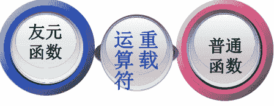

## 练习与思考

### 代码练习

#### 定义Complex类

- 1. 重载operator-进行两个复数间的减法操作
- 2. 重载operator-进行复数和实数的减法操作
- 3. 重载operator-进行复数取反操作（单目）

参见例ch4.2

### 思考

实现运算符重载时  
友员函数 vs. 成员函数


### 成员函数与友元函数的比较

#### 1. 优先选择成员函数实现运算符重载

一般情况下单目运算符重载为类的成员函数，尤其运算符的操作需要修改对象的状态时。双目运算符可以重载为类的成员或者友元函数。

不能用类的友元函数重载实现的运算符

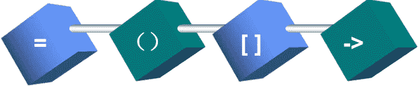

#### 2. 不能重载为成员函数的运算符

当有两个不同类型的对象进行混合运算时，若双目运算符的左操作数不是A类对象，而右操作数为A类对象，则该运算符函数不能重载为A类成员函数。

当运算符函数重载为某类的成员函数时，双目运算符的左操作数，或者单目运算符的唯一操作数，必须是该类的对象或者对象的引用。

### 4.4 常用运算符重载

- 关系运算符：`>、<、==、>=、<=`
- 自增自减运算符：`++、--`
- 赋值运算符：`=`
- 下标运算符：`[]`
- 流操作运算符：`<<、>>`

### 4.4.1 重载关系运算符

```cpp
class Box       //盒子类
{
public:
    Box(double l=1.0, double w=1.0, double h=1.0) ;
    double volume() const; //计算盒子体积
    ……
private:
    double length;
    double width;
    double height;
};
```

### 课堂练习

对Box类进行运算符重载：

- 成员函数重载>
- bool operator>(Box &)

- 成员函数重载==
- bool operator==(Box &)

- 友元函数重载<
- 比较实数d与盒子Box b的体积大小

参见例ch4.3

## 4.4.2 重载自增运算符

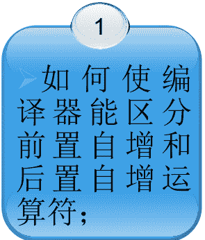

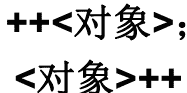

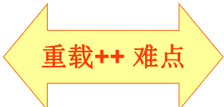

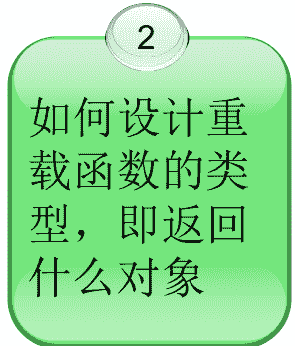

重载自增运算符的语法格式：

前缀运算

<函数类型> operator ++ () ;

后缀运算

<函数类型> operator++ (int) ;


### 重载自增运算符

#### 例

```cpp
class Increase
{ 
    int value;
public :
    Increase (int v=0 ) { value= v;}
    void operator ++ ();    //重载前置++
    void operator ++ ( int );  //重载后置++
};
```

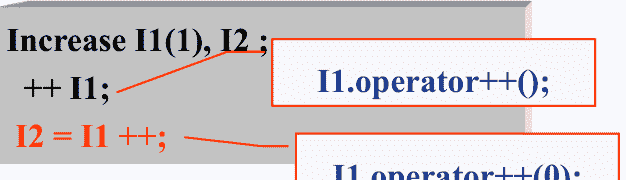


#### 例

```cpp
class Increase
{ 
    int value;
public :
    Increase (int v=0 ) { value= v;}
    Increase operator ++ ();    //重载前置++
    Increase   operator ++ ( int ); //重载后置++
};
```

```cpp
Increase I1(1), I2 ;
++I1;
I2 = ++I1;
I2 = ++++ I1;//I1结果如
```

```cpp
Increase Increase :: operator ++ ()
{
    ++value ;
    return *this;
}
```

> 调用复制构造返回对象？

#### 例

```cpp
class Increase
{
    int value;
public :
    Increase (int v=0 ) { value= v;}
    Increase operator ++ ();    //重载前置++
    Increase   operator ++ ( int );   //重载后置++
};
```

```cpp
Increase Increase :: operator ++ (int)
{
    Increase temp;
    temp.value = value ++;
    return temp;
}
```

```cpp
Increase I1(1), I2 ;
I1 ++;
I2 = I1 ++;
```

> 返回局部对象

```cpp
void main()
{
    Increase a, b, n;
    for ( int i = 0 ; i < 10 ; i ++ )
    a = n ++ ;
    cout <<"n= " ; n.display() ;
    cout <<"a= " ; a.display() ;
    for ( int i = 0 ; i < 10 ; i ++ )
    b = ++ n ;
    cout << "n= " ; n.display() ;
    cout << "b= " ; b.display() ;
}
```

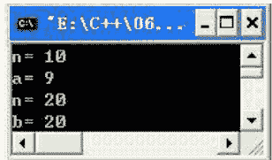

```cpp
cout<< "n="<<n<<endl;
```


## 第4章 运算符重载

## 4.4.2 重载自增运算符

设 A Aobject ;
++Aobject; // A对象自增

成员函数重载

友元函数重载


## 友元函数重载++

```cpp
class Increase
{
int value ;
public :
Increase ( ) { value=0; }
void display() const { cout<<value<<'\n'; } ;
friend Increase& operator ++ ( Increase & ) ; // 前置
friend Increase& operator ++ ( Increase &, int ) ;
};
Increase& operator ++ ( Increase & a )
{ a.value ++ ; return a ; }
Increase& operator ++ ( Increase & a, int )
{ Increase temp(a); a.value ++ ; return temp; }
```


## 4.4.3 特殊运算符的重载

```cpp
class IntArray
{
public:
    IntArray(int s=0);
    ~IntArray();
    //其他成员函数
private:
    int * pArr; //数组首地址
    int size;   //数组大小
};
```

使用数组的局限性
int i=3, a[3], b[i];
cout << b ;
a = b ;
a[3] = b[3];

## 重载下标运算符[]

运算符 [] 是二元运算符，下标运算符“[ ]”通常用于在数组中标识数组元素的位置，下标运算符重载可以实现数组数据的赋值和取值。

只能用成员函数重载，不能用友元函数重载

下标运算符函数重载的一般形式为：
返回类型 类名 :: operator[ ]( int index ) ;


## 重载下标运算符[]

```cpp
class IntArray
{
public:
    IntArray(int s=0);
    ~IntArray();
    int& operator[](int i);
private:
    int * pArr;
    int size;
};
```

```cpp
int& IntArray::operator[](int i)
{
    if(i<1||i>size)
    {
        cout<<" Out of range!"<<endl;
        return pArr[0]; }
    return pArr[i];
}
```

```cpp
IntArray a(3),b(5);
for( int i = 1 ; i<=5;i++ )  b[i] = i;
for( i = 1 ; i<=5; i++)  cout<< a[i] <<' ';
cout<< a<< b<<endl;
```

## 重载运算符<<

```cpp
class IntArray
{
public:
	IntArray(int s=0);
	~IntArray();
	int& operator[](int i);
	friend ostream& operator<< ( ostream& out, IntArray&a );
private:
	int * pArr;
	int size;
};
```

```cpp
ostream& operator<<
(ostream& out, IntArray& a)
{	for(int i = 1 ; i<=a.size ; i++)
		out<< a.pArr[i]<<' ' ;
	return out;
}
```

cout 的别名

```cpp
IntArray a(3),b(5);
for( int i = 1 ; i<=5;i++) b[i] = i;
for( i = 1 ; i<=5; i++) cout<< a[i] <<' ';
cout<< a<< b<<endl;
```

```cpp
class IntArray
{
    int * pArr;
    int size;
public:
    IntArray(int s=0);
    ~IntArray();
    int& operator[](int i);
    friend ostream& operator<< ( ostream&, IntArray& ) ;
};
```


```cpp
IntArray a(3),b(5);
for( int i = 1 ; i<=5;i++)  b[i] = i;
a = b;
cout<< a<< b<<endl;
```

=可以不必重载
运行错误

## 复制构造

## 赋值运算

IntArray a(5), b(a);
IntArray a(5),b(3);
b = a;

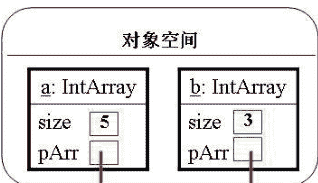

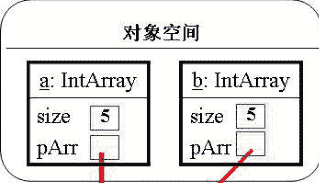

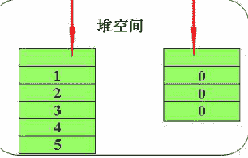

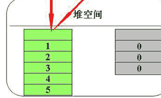

(a) 赋值操作前

(b) 赋值操作后

## 第4章 运算符重载

```cpp
IntArray::IntArray(int s){
	size = s;
	if(size == 0) //空数组
	pArr = NULL;
	else //分配空间，0号元素不用
	pArr = new int[size+1];
	for(int i = 1; i<= size;i++)
		pArr[i] = 0; // 数组元素置0
}
IntArray::~IntArray(){
	if(pArr!=NULL)
		delete []pArr ; //释放数组空间
}
```

> IntArray a(5);
> IntArray b = a;
> 
> 深复制与浅复制

## 复制构造- 深复制与浅复制

## 赋值运算

IntArray a(5), b(a);
IntArray a(5),b(3);
b = a;

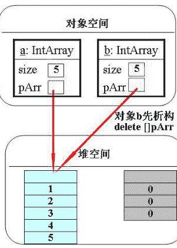

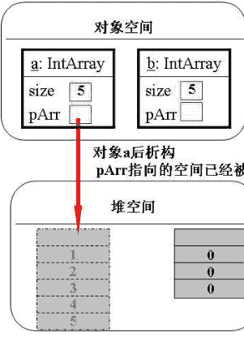

(a) 析构对象b

(b) 析构对象a

## 赋值运算

IntArray a(5), b(a);
IntArray a(5),b(3);
b = a;

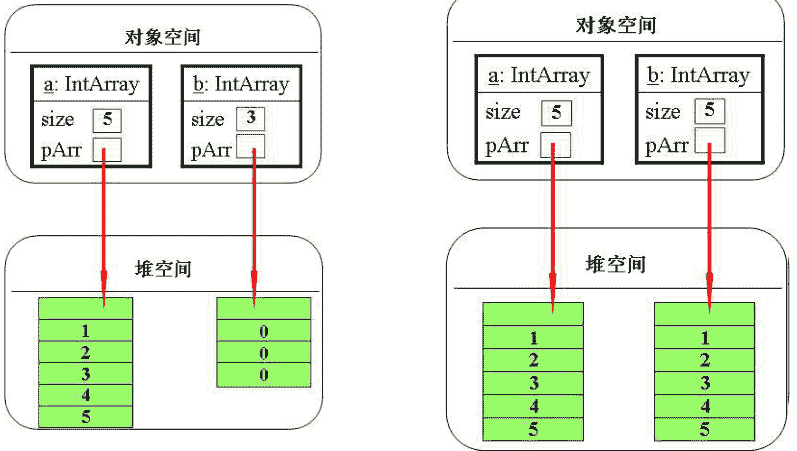

## 重载赋值运算符

- 何时重载=

赋值运算符重载用于对已有对象数据的深度复制

- 如何重载=

operator=() 必须重载为成员函数，函数原型：

类类型& 类名 :: operator= ( const 类类型 & ) ;

```
类类型& 类名 :: operator= ( const 类类型 & ) ;
```

> 必须是类类型的引用？


## 第4章 运算符重载

```cpp
IntArray& IntArray::operator= (IntArray& a)
{
	if(pArr!=NULL)
		delete [] pArr ; //释放原有空间
	size = a.size;
	if(size==0)
		pArr = NULL;
	else
		pArr = new int[size+1]; //重新分配空间
	for(int i = 1; i<= size; i++) //逐个元素复制
		pArr[i] = a.pArr[i];
	return *this;
}
```

IntArray a(5),b(3),c;
cout<<( c = b = a );

## 小结

- 运算符重载可以像基本数据类型一样，用简洁明确的运算符操作类对象。
- 重载运算符函数可以对运算符作出新的解释，但重原有的基本语义不变。
- 运算符函数既可以重载为成员函数，也可重载义为友元函数或普通函数。
- 当一元运算符的操作数，或者二元运算符的左操作数是该类的一个对象时，以成员函数重载；
- 当一个运算符的操作需要修改类对象状态时，应该以成员函数重载。
- 如果以友元函数重载，可以使用引用参数修改对象。

## 第5章 继承

C++语言程序设计教程—大连理工大学软件学院

## 第5章 继承

- 5.1 理解继承
- 5.2 继承与派生的概念
- 5.3 派生类的定义
- 5.4 派生类的构成
- 5.5 继承中的访问控制
- 5.6 派生类的构造函数
- 5.7 派生类的析构函数
- 5.8 继承中的同名成员访问
- 5.9 虚基类
- 5.10 基类与派生类的转换
- 5.11 类与类之间的关系

Product

## 继承结构

```cpp
//猫类
class Cat{
private:
	string name ;
	int shoutNum ;
public:
	Cat(string ); //含参构造函数
	Cat();
	void setName(string ); //设置名字
	int getShoutNum( return shoutNum; ); //获取猫叫声数
	void setShoutNum(int ); //设置猫叫声数
	string Shout(); //猫叫
};
Cat ::Cat(string name){
	setName(name);
	setShoutNum(3);
}
Cat ::Cat(){
	setName("无名");
	setShoutNum(3);
}
void Cat::setName(string name){
	this->name = name;
}
void Cat::setShoutNum(int shoutNum){
	this->shoutNum = shoutNum;
}
string Cat::Shout( {
	string result = "";;
	for(int i = 0; i < shoutNum; i++)
	result += "喵";
	return "我的名字叫 " + name + " " + result;
}
```

```cpp
//狗类
class Dog{
private:
	string name ;
	int shoutNum ;
public:
	Dog(string ); //含参构造函数
	Dog(); //构造函数
	void setName(string ); //设置名字
	int getShoutNum( return shoutNum; ); //获取狗叫声数
	void setShoutNum(int ); //设置狗叫声数
	string Shout(); //狗叫
};
Dog ::Dog(string name){
	setName(name);
	setShoutNum(3);
}
Dog ::Dog(){
	setName("无名");
	setShoutNum(3);
}
void Dog::setName(string name){
	this->name = name;
}
void Dog::setShoutNum(int shoutNum){
	this->shoutNum = shoutNum;
}
string Dog::Shout( {
	string result = "";;
	for(int i = 0; i < shoutNum; i++)
	result += "汪";
	return "我的名字叫 " + name + " " + result;
}
```

## 第5章 继承

### 5.1 理解继承

通过观察客观世界可以发现，世间的万事万物都不是孤立的，代码的设计过程往往能够反映出人们认识世界和描述世界的方式。


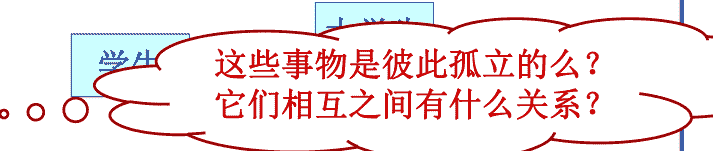

### 5.1 理解继承

继承（inheritance）是一种联结类与类的层次模型。有了继承，类与类之间不再是彼此孤立的，一些特殊的类可以自动地拥有一些一般性的属性与行为，而这些属性与行为并不是重新定义的，而是通过继承的关系得来的。

## 第5章 继承

### 5.2 继承与派生的概念

| Student |
| --- |
| char* name; |
| char sex; |
| int number; |
| char* school; |
| void print(); |
| CollegeStudent |
| char* name; |
| char sex; |
| int number; |
| char* school; |
| char* major; |
| void print(); |


两个类有何异同？

### 5.2 继承与派生的概念

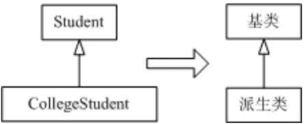

面向对象语言中的**继承**就是以已经存在的类为基础构建一个新的类。已存在的类称为**基类**（base class）或父类（father class）；新建立的类称为**派生类**（derived class）或子类（son class）

### 5.2 继承与派生的概念

继承派生的关系表现出一种“分类树”的层次结构

自下而上，是一个“抽象化”的过程

自上而下是一个“具体化”的过程

这个继承树具有这样的特点，一个基类可以有多个派生类；一个派生类最多只有一个直接基类，称为单继承。

| 学生 |
|---|
| 小学生 |
| 中学生 |
| 大学生 |
| 留学生 |
| 初中生 |
| 高中生 |

### 5.2 继承与派生的概念

一个派生类有两个或者多个基类，这种继承称为多重继承或多继承。

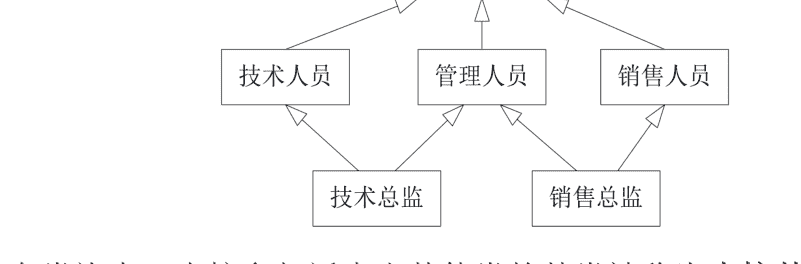

在类族中，直接参与派生出其他类的基类被称为直接基类，基类的基类甚至更高层的基类，称作间接基类。

C++中的继承具有传递性，具有非对称性，不能够循环继承。

### 5.3 派生类的定义

C++中单继承派生类的定义形式如下：

```
class 派生类名：[继承方式] 基类名
{
    派生类成员声明;
};
```

- “继承方式”包括public（公有继承）、private（私有继承）和protected（保护继承）。
- 继承方式是可选的，如果不显式声明继承方式，那么默认是private（私有继承）。

### 5.3 派生类的定义

#### 举例

```cpp
class CollegeStudent : public Student
{
private:
    char* major;    // 专业
public:
    CollegeStudent();    // 构造函数
    ~CollegeStudent();    // 析构函数
    void print();    // 输出函数
};
```


## 第5章 继承

### 5.3 派生类的定义

C++中多重继承派生类的定义形式如下：

```cpp
class 派生类名: [继承方式] 基类名1, [继承方式] 基类名2,..., [继承方式] 基类名n
{
派生类成员声明;
};
```

注意下面的这种情况：

```cpp
class Assistant : protected Student, Teacher
{ ...... };
```

Assistant类对Teacher类的继承方式是什么方式？

### 5.4 派生类的构成

#### 基类

继承基类

新增成员

改造基类成员

派生类与基类的成员表现出相同和不同，派生类构成有三个步骤接收基类成员改造基类成员添加新的成员

### 5.5 继承中的访问控制

C++的继承方式有：公有继承、私有继承、保护继承

继承方式决定了基类成员在派生类中的访问权限，这种访问来自两个方面：

- 派生类中的新增函数成员访问从基类继承来的成员
- 是在派生类外部（非类族内的成员），通过派生类的对象访问从基类继承的成员

#### 公有继承

| private 成员 | protected 成员 | public 成员 |
|---|---|---|
| protected 成员 | protected 成员 | public 成员 |
| public 成员 | public 成员 | public 成员 |
| private 成员 | protected 成员 | public 成员 |

#### 公有继承的测试

```cpp
class A
{
public :
void get_XY();
void put_XY();
protected:
int x, y ;
};
void A::get_XY()
{ cout << "Enter two numbers of x, y : " ;
cin >> x >> y ; }
void A:: put_XY()
{ cout << "x = "<< x << ", y = "<< y << '\n' ; }
```

```cpp
class B : public A
{
public :
    int get_S() { return s ;};
    void make_S() { s = x * y ; }; // 使用基类数据成员x, y
protected:
    int s;
};
class C : public B
{
public :
    void get_H() { cout << "Enter h : " ; cin >> h ; }
    int get_V() { return v ; }
    void make_V()
    { make_S(); v = get_S() * h ; } // 使用基类成员函数
protected:
    int h, v;
};
```

1. A类的x、y换为private如何？
2. class B : private A
3. void make_V()
{ make_S(); v = x*y*h ; }

```cpp
void main()
{
 A objA ;
 B objB ;
 C objC ;
 cout << "It is object_A :\n" ;
 objA.get_XY() ;
 objA.put_XY() ;
 cout << "It is object_B :\n" ;
 objB.get_XY() ;
 objB.make_S() ;
 cout << "S = " << objB.get_S() << endl ;
 cout << "It is object_C :\n" ;
 objC.get_XY() ;
 objC.get_H();
 objC.make_V() ;
 cout << "V = " << objC.get_V() << endl ;
}
```

|    | x    | y    |
|---|---|---|
| objA | objA.x | objA.y |

|    |    |    | s    |
|---|---|---|---|
| objB | objB.x | objB.y | objB.s |

|    |    |    | h    | v    |
|---|---|---|---|---|
| objC | objC.x | objC.y | objC.s | objC.h | objC.v |

```cpp
void main()
{
A objA;
B objB;
C objC;
cout << "It is object_A :\n";
objA.get_XY();
objA.put_XY();
cout << "It is object_B :\n";
objB.get_XY();
objB.make_S();
cout << "S=" << objB.get_S() << endl;
cout << "It is object_C :\n";
objC.get_XY();
objC.get_H();
objC.make_V();
cout << "V=" << objC.get_V() << endl;
}
```

对 objA 的数据成员操作

调用基类A成员函数
对 objB 的数据成员操作

调用基类A成员函数
对 objC 的数据成员操作

```cpp
void main()
{
    A objA ;
    B objB ;
    C objC ;
    cout << "It is object_A :\n" ;
    objA.get_XY() ;
    objA.put_XY() ;
    cout << "It is object_B :\n" ;
    objB.get_XY() ;
    objB.make_S() ;
    cout << "S = " << objB.get_S() << endl ;
    cout << "It is object_C :\n" ;
    objC.get_XY() ;
    objC.get_H() ;
    objC.make_V() ;
    cout << "V = " << objC.get_V() << endl ;
}
```

#### 公有继承的测试

例5.1 访问公有继承的成员

```cpp
class Student {
    // 学生类(基类)
protected:
    char name[10];
    char sex;
    int number;
    char school[10];  // 学校
public:
    void input_data();  // 输入学生信息函数
    void print();  // 输出学生信息函数
};
```

大连理工大学软件学院

#### 大学生类公有继承学生类

```cpp
class CollegeStudent : public Student{ // 公有继承
private: char major[10];
public:
void input_major();
void print() {
// 输出信息
cout<<"name:"<<name <<" sex:"<<sex <<endl;//访问基类
cout<<"major:"<<major<<endl;
}
};
```

```cpp
void main(){
//主函数
CollegeStudent cs; cs.input_data();
cs.input_major(); cs.sex = 'F'; //error!
cs.print(); }
```

大连理工大学软件学院

#### protected成员

访问属性为protected，其基类和派生类访问，类成员无法访问。

表示这些成员可以被继承树以外使用，但是在继承树以外不允许访问使用私有成员和保护成员允许访问使用公有成员


## 第5章 继承

### 5.5 继承中的访问控制

#### 私有继承

| 基类 | 派生类 |
| --- | --- |
| private 成员 | |
| protected 成员 | private 成员 |
| public 成员 | private 成员 |
| | private 成员 |
| | protected 成员 |
| | public 成员 |

### 例5.2 访问私有继承的成员

```cpp
class Student {
public: void input_data(
......
};
```

```cpp
class CollegeStudent : private Student {
......
};
```

```cpp
int main(){
    CollegeStudent cs;
    cs.input_data();
    cs.input_major();
    cs.print();
    return 0; 
}
```

> 对于CollegeStudent来说，它访问基类Student的能力没有变化，但是所有它所继承的成员其属性全部变为私有。事实上，在私有继承的情况下，通过派生类对象无法访问基类的任何成员。

// 私有继承

// 错误

### 保护继承

基类

派生类

| 基类 | 派生类 |
| --- | --- |
| **private 成员** | |
| protected 成员 | protected 成员 |
| public 成员 | protected 成员 |
| | private 成员 |
| | protected 成员 |
| | public 成员 |

### 继承方式与可访问性（图示）

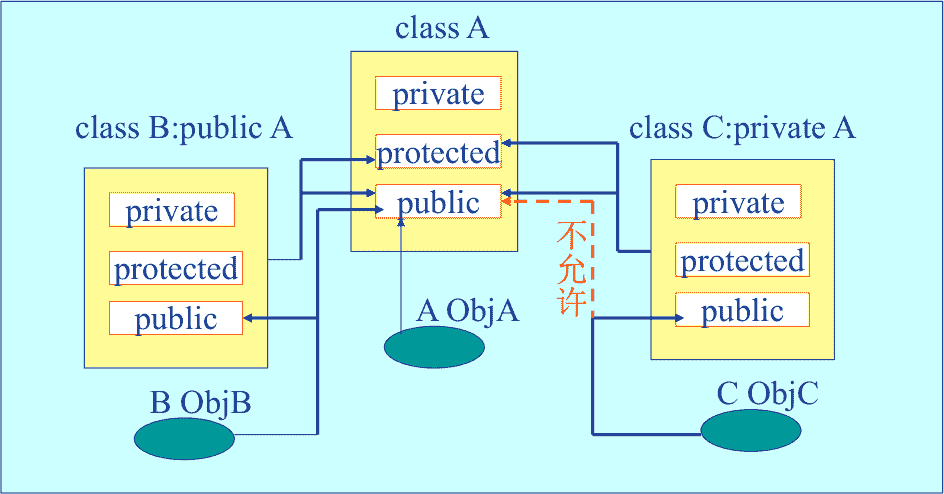

| 基类中访问方式 | 派生类继承方式 | 派生类中访问基类成员 |
| --- | --- | --- |
| public | public | public |
| public | private | private |
| public | protected | protected |
| protected | public | protected |
| protected | private | private |
| protected | protected | protected |
| private | public | --- |
| private | private | --- |
| private | protected | --- |

### 三种继承方式的对比

- 私有继承：基类的可被继承的成员都成了其直接派生类的私有成员，无法再进一步派生，实际上私有继承相当于终止了基类成员的继续派生。
- 保护继承：基类的可被继承的成员都成了直接派生类的保护成员，保护继承恰恰保证了最上层基类的成员依然能被继承树中的次级子类所继承。
- 私有继承和保护继承：改变了基类成员继承后的访问属性，但对于其直接子类来说，这两种方式实际上是相同的。
- 一般情况下私有继承和保护继承的设计比较少见。一般采用不会改变基类成员访问权限的公有继承。

- 课堂概念练习：教材P177-2
- 课堂编程练习：用继承关系设计圆类

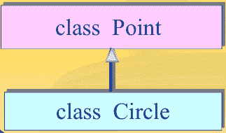

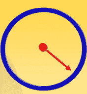


### 5.6 派生类的构造函数

#### 派生类

| 从基类继承的数据 | 由基类构造函数进行初始化 |
| --- | --- |
| 新增数据 | 由派生类构造函数进行初始化 |

#### 派生类构造函数的定义方式：

派生类名（参数总表）：基类名（基类构造函数参数表）
{
派生类成员初始化；
}

例如
Student(int number, char name[],char sex):Person(name,sex)
{......}

举例：见例5.4

- 将例5.4派生类的构造函数改成下面的形式，更简洁。

```cpp
Student(int number, char name[],char sex):
    Person(name,sex),number(number){ }
```

- 可不可以把构造函数中number和Person初始化的声明顺序交换呢？交换后改成下面的形式：

```cpp
Student(int number, char name[],char sex):
    number(number),Person(name,sex){ }
```


交换后是否会影响初始化的顺序？派生类构造函数初始化的顺序是怎样的？

#### 举例：见例5.5组合单继承的构造函数

Student(int number,char name[],char sex,char s_name[],char city[])
:Person(name,sex),school(s_name,city),number(number)

派生类构造函数执行顺序——“先祖先，再客人，后自己”

#### 举例：见例5.6多继承的构造函数

多重继承派生类构造函数定义方法

派生类名（参数总表）：基类1名（基类1构造函数参数表），基类2名（基类2构造函数参数表），......，基类n名（基类n构造函数参数表）
{派生类新增数据成员初始化； }

影响多重继承基类构造函数调用顺序的是派生类定义时的继承列表。Assistant类定义时的继承列表如下：

```cpp
class Assistant:public Student,public Teacher
```

这决定了Assistant类构造函数的调用顺序一定是先Student，再Teacher。

#### 派生类构造函数的执行顺序：

1. 调用基类的构造函数，如有多个基类，则按照它们被继承的顺序依次调用。
2. 调用内嵌对象的构造函数，如果有多个，则按照它们在类的数据成员声明中的先后顺序依次调用。
3. 执行派生类的构造函数体中的内容。

如果派生类的构造函数没有显示声明其基类和其内嵌对象的构造方式，那么系统按照“默认”方式对它们进行初始化，也就是调用它们的默认构造函数，如果基类或者内嵌类不具有这样的构造函数，那么就会出现编译错误。

### 5.7 派生类的析构函数

举例：例5.7析构函数的执行顺序

在析构的时候，派生类的析构函数依次执行了自身的析构函数、内嵌对象的析构函数和基类的析构函数，其执行的顺序与其构造函数执行的顺序正好严格相反。

### 课堂编程练习：为点和圆类编写构造函数和析构函数

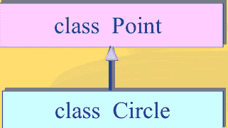


### 5.8 继承中的同名成员访问

继承中成员同名有两种情况：

1. 基类成员与派生类成员同名
2. 多重继承时不同基类成员同名

```cpp
class Person{
    // 基类
protected:
    char name[10];    // 姓名
    char sex;    // 性别
    int id;    // 身份证号
};
class Student : public Person{
    // 派生类
private:
    int id;    // 学号
    char school[10];    // 学校
public:
    void test(){    // 测试函数
        id=123;    // 究竟访问哪一个？
    }
};
```


## 第5章 继承

### 5.8 继承中的同名成员访问——基类成员与派生类成员同名

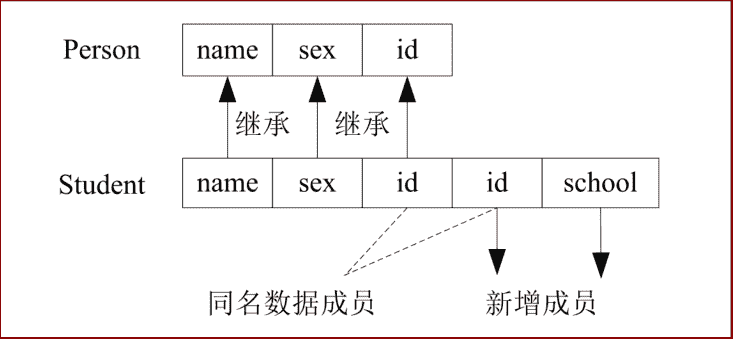

派生类定义了与基类相同的成员，此时基类的同名成员在派生类内不可见，也就是派生类成员隐藏了同名的基类成员，这种现象称为**继承时的同名成员隐藏规则**。

基类成员与派生类成员同名，可以通过类名限定符 `::` 来解决。其语法为：

`类名 :: 成员`

```cpp
class Student : public Person{
    // 派生类
private:
    int id;    // 学号
......
public:
    void test(){    //测试函数
        id=123;    // 访问派生类成员
        Person::id =456; // 访问基类成员
    }
};
```

- 多重继承时不同基类成员同名也可以用类名限定符“::”来解决。

| Student | Teacher | 助教 |
| --- | --- | --- |
| id（学号） | id（教工号） | Student::id<br>Teacher::id |

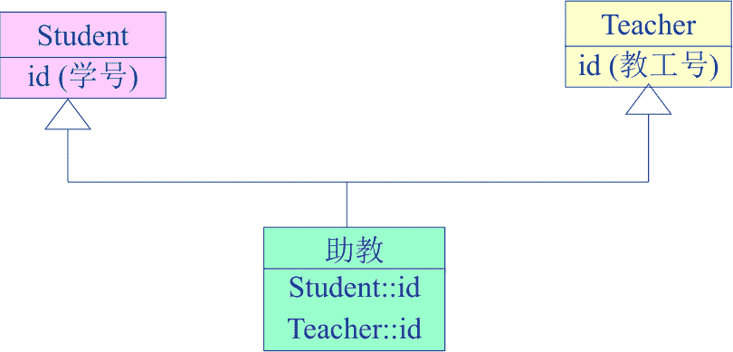

```cpp
class Student
{
protected:
    int id;
};
```

```cpp
class Teacher
{
protected :
    int id;
};
```

```cpp
class Assistant: public Student, public Teacher
{
public:
    void print(){
        cout<<id<<endl; //error!访问是二义的
        cout<<Student::id<<endl; //访问Student的id
        cout<<Teacher::id<<endl; //访问Teacher的id
    }
};
```

多个基类继承来的成员有同名现象，可以使用类名限定符 “::” 来进行区分。但是，有个前提：这些基类不是从一个共同的基类派生来的。如果不具备这个前提条件，在访问同名成员时会出现问题。

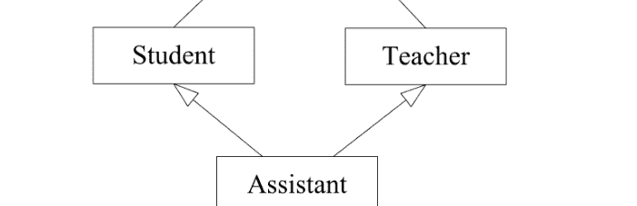

```cpp
class Person
{
    protected:
        int id;    // 身份证号码
};
class Student : public Person
{
    protected:
        int id;    // 学号
};
class Teacher : public Person
{
    protected:
        int id;    // 职工号
};
class Assistant: public Student,public Teacher{
public:
    void test(){    // 测试
        Student::id = 1001;    // 正确：访问Student类的id
        Teacher::id = 101;    // 正确：访问Teacher类的id
        Person::id =10001;    // 错误！为什么？
    }
};
```

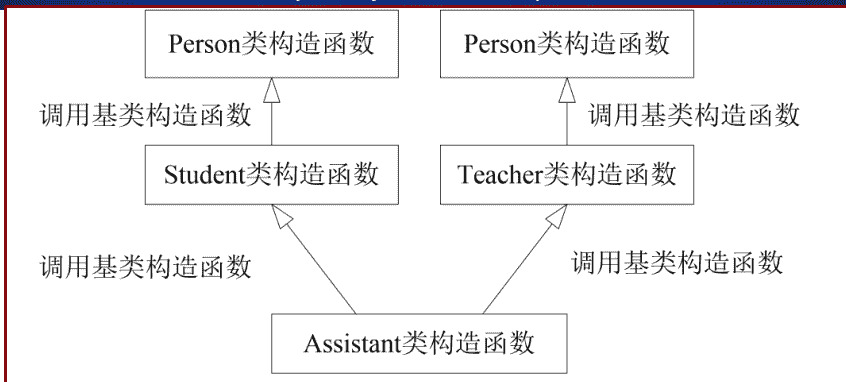

- 内存中实际上存在两个基类Person的对象，一个是由Student这一派生分支产生，另一个是由Teacher的派生分支产生的。

> `Person::id =10001; // 二义性错误`

- 无法传递给系统足够的信息，系统无法知道该语句到底要访问哪一个id。

### 5.9 虚基类

- 当某类多个直接基类是从一个共同基类派生而来时，这些直接基类中从上一级基类继承来的成员在内存中存在多个副本。在编程时，只需使用多个副本的任意一个。

- C++语言允许程序中只建立公共基类的一个副本，将直接基类的共同基类设置为虚基类（virtual base class），这时从不同路径继承过来的该类成员在内存中只拥有一个副本。

虚基类的声明是在派生类继承基类时定义的，其语法形式如下：

```cpp
class 派生类名 : virtual [继承方式] 基类名
```

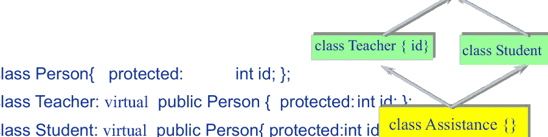

```cpp
class Person{ protected: int id; };
class Teacher: virtual public Person { protected: int id; };
class Student: virtual public Person{ protected: int id; };
class Assistant : public Teacher , public Student {
public:
    void test(){
        Student::id = 1001; // 正确: 访问Student类的id
        Teacher::id = 101; // 正确: 访问Teacher类的id
        Person::id =10001; // 正确: 内存只有一个Person对象
    }
};
```

由于派生类的对象中只有一个虚基类子对象，为保证虚基类子对象只被初始化一次，这个虚基类构造函数必须只被调用一次。

规定将在建立对象时所指定的类称为最直接派生类。虚基类子对象是由最直接派生类的构造函数通过调用虚基类的构造函数进行初始化的。

只有用于建立对象的那个派生类的构造函数调用虚基类的构造函数，而该派生类的基类中所列出的对这个虚基类的构造函数调用在执行中被忽略。

### 5.10 基类与派生类的转化

- 在C++中，不同的数据类型在一定的规则下是可以进行转换的：

```cpp
int a = 5;
double b = 3.0;
b = a; // 正确！
a = b; // 错误，有精度损失。
a = (int) b; // 强制类型转换
```

- 不同类型间的自动转换和赋值，称为赋值兼容。

- 基类与派生类之间是否存在这样的关系？

三种继承方式中，只有公有继承使派生类完整地保留了基类的所有特征，因此，公有继承时，一个派生类的对象可用于基类对象适用的地方，需要基类对象的任何地方都可以使用派生类对象替代。假设存在以下的继承关系：

```cpp
class A{
public:
    int i;
};
class B :public A{
public :
    int j;
};
```

基类A与派生类B间的赋值兼容关系具体表现在以下几个方面：

- 1. 派生类对象可以直接赋值给基类对象。

```cpp
A a; // 基类对象
B b; // 派生类对象
a = b; // 直接赋值
```

注意，赋值后a的数据类型依然是A，因此不要企图使用a去访问派生类的成员，因此下面的语句是错误的：

```cpp
a.j = 3; // 错误，A中不具有j成员
```

- 2. 派生类对象可以初始化基类的引用。

```cpp
A & c = b; // c是基类的引用，使用派生类对象b初始化c
```

- 同样，一个函数的形式参数如果是一个基类的引用，在实际调用该函数的时候，可以传递一个派生类对象来代替基类对象。

假设有一函数function定义如下：

```cpp
void function(A & c) // 形式参数是基类A的引用
{
    cout<<c.i<<endl; // 输出A的数据成员i
}
```

实际调用该函数时使用如下的方式：

```cpp
function(b); //实际参数是派生类B的对象
```

- 3. 派生类对象的地址可以赋值给基类的指针。

```cpp
A * p = & b ; //基类指针p指向派生类对象b
p->i = 5 ; //使用基类指针对派生类对象的成员进行访问
```

或者

```cpp
A *p = new B();
p->i = 5 ;
```


## 第5章 继承

### 5.11 类与类的关系

C++的程序是由类组成的。类和类之间不是彼此孤立的，就像现实世界中的万事万物一样，相互之间存在各种各样的联系。类与类的关系可分为三种：

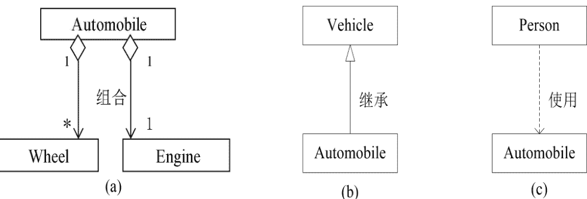

**类的组合（has-a关系）**

```cpp
class Engine{
public: void work(); };
class Wheel{
public: void roll(); };
class Automobile{
private: Engine * engine;
Wheel* wheel;
public: void move(){
engine->work();
for(int i=0;i<4;i++) wheel[i]->roll();
}
};
```

**◇ 类的继承（is-a关系）**

```cpp
class Vehicle{
protected:
    double weight;    // 重量
    float speed;      // 速度
public:
    void run();       // 运行
};

class Automobile:public Vehicle{  // 汽车类：就是交通工具
private: int load;    // 载客数
public:
    void move(){
        run();        // 可以直接调用基类成员
    }
};
```

**类的使用关系**

```cpp
class Person{
public:
void buy(Automobile & auto){
auto.move(); // Person类使用汽车类
}
};
void main(){
Person person;
Automobile auto;
person.buy(auto);
}
```

## 第6章 多态

C++语言程序设计教程—大连理工大学软件学院

- 6.1 理解多态
- 6.2 多态的实现
- 6.3 虚函数
- 6.4 虚析构函数
- 6.5 纯虚函数与抽象类

### 6.1 理解多态

多态性（Polymorphism）是指同样的消息被不同类型的对象接收时产生不同行为的现象。

```cpp
Complex c1(1,2), c2(3,4), c3, c4 ;
int i = 6 ;
c3 = c1 + c2 ;
c4 = i + c1 ;
```

消息都是“+”，执行加法运算

不同类型的消息接收者产生不同行为

> 程序是客观世界的体现，在现实世界中多态现象比比皆是。

学校的第一节上课铃声响过之后：

- 教师要走上讲台准备上课
- 学生在座位上做好上课准备
- 教务人员开始一天的事务性工作
- 实验室的工作人员开始准备设备


> 消息都是“铃声”

> 不同消息接收者产生不同行为

继承使学生与教师行为相似，都具有“上课”“下课”行为

多态使学生与教师同名行为，产生不同的执行效果

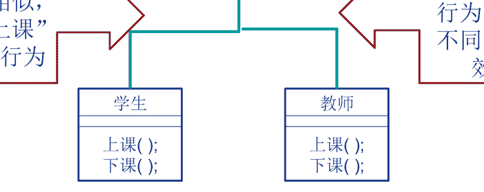

本章介绍的多态性与第五章介绍的继承性相结合，可以生成一系列虽彼此相似却又独一无二的类和对象。

### 6.2 多态的实现

- ❖ 多态划分为两类：静态多态与动态多态。
  - 静态多态是指在程序编译时系统就能够确定要调用的是哪个函数，因此这种多态也被称为编译时多态。通过函数的重载来实现。

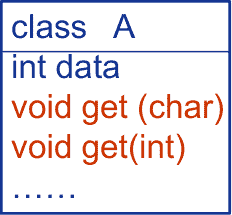

```cpp
A objA;
objA.get('a');
objA.get(5);
```

```cpp
// 主函数
int main(){
TwoDimensionalShape t;
t.show();
Square s(3);
s.show();
TwoDimensionalShape * members[2]; //二维图形指针数组
members[0]=&t;
members[1]=&s;
for(int i=0;i<2;i++)
members[i]->show();
return 0;
}
```

// 创建二维图形对象t
// 基类对象调用基类函数
// 创建正方形对象s
// 派生类对象调用同名函数
// 二维图形指针数组
// 调用的是哪一个函数呢？

程序运行结果：

```text
这是一个二维图形
这是边长为3的正方形
这是一个二维图形
这是一个二维图形
```

无论指向的是哪种类型的对象，通过基类指针调用的都是基类中定义的show函数

### 6.3 虚函数

C++中的虚函数的作用是允许在派生类中重新定义与基类同名的函数，并且可以通过基类指针或者基类引用来访问这个同名函数。虚函数成员声明的语法为：

`virtual 函数类型 函数名（参数列表）；`

注意以下两点：

1. virtual只能使用在类定义的函数原型声明中，不能在成员函数实现的时候使用，也不能用来限定类外的普通函数。
2. virtual具有继承性，在派生类覆盖基类虚成员函数时，既可以使用virtual，也可以不用virtual来限定，二者没有差别，默认派生类中的重写函数是具有virtual的。

修改例6.1，将基类TwoDimensionalShape中的函数show声明为虚函数，如下：

```cpp
class TwoDimensionalShape {
public:
    virtual void show();
};
...
```

主函数不变，程序运行结果产生了变化：

- 这是一个二维图形
- 这是边长为3的正方形
- 这是一个二维图形
- 这是边长为3的正方形

- 基类 TwoDimensionalShape：virtual show()
- 派生类 Square：基类::show() → show()

| 指针 | 指向 | 调用 |
|------|------|------|
| members[0] | &t | members[0]->show() |
| members[1] | &s | members[1]->show() |

在同名函数中寻找匹配函数的过程称为关联（binding）。

对比函数重载与虚函数：

函数重载时：系统会根据参数的个数或者参数的类型去寻找与之匹配的函数。

```cpp
objA.get('a');
objA.get(5);
```

函数重载时，在编译时即可确定调用的函数是哪一个函数，所以称这种关联为静态关联（static binding），由于是在运行前进行的关联，故又称为早期关联（early binding）。

对虚函数来说，基类与派生类同名函数的参数列表是完全相同的，唯一不同的就是函数所属的类不同，也就是调用函数的对象不同。

```cpp
for(int i=0;i<3;i++)
members[i]->show();
```

编译器是无法知道members[i] 在运行时指向的对象是何种类型的，因此并不执行关联。

到了运行阶段，基类指针变量members[i]被赋值，指向了具体的对象，此时members[i]的类型是确定无疑的，再关联。

被称为动态关联（dynamic binding），由于是在编译后执行该过程，因此也被称为滞后关联（late binding）。

声明虚函数后，系统会根据以下规则来判断函数的调用是否实现了动态多态：

1. 派生类的函数是否覆盖了基类的虚函数（相同的函数名、相同的参数列表、相同的函数类型）
2. 虚函数调用时，应通过基类的指针或者引用调用。

```cpp
class base
{
public:
    virtual void vf1();
    virtual void vf2();
    virtual void vf3();
    void f();
};

class derived : public base
{
public:
    void vf1();        // 虚函数
    void vf2(int);     // 重载函数
    char vf3();        // error，仅返回类型不同
    void f();          // 非虚函数
};

void main()
{
    derived d;
    base *bp = &d;
    bp->vf1();        // 调用 derived::vf1()
    bp->vf2();        // 调用 base::vf2()
    bp->f();          // 调用 base::f()
}
```


## 第6章 多态

### 6.3 虚函数

假设创建一个派生类对象 `Square s(5,6);`  
下面的哪些情况会发生动态绑定？

- A  
  `TwoDimensionalShape * t= & s;`  
  `t->show();`

- B  
  `void test (TwoDimensionalShape & t){ t.show(); }`  
  `test(s);`

- C  
  `TwoDimensionalShape t = s;`  
  `t.show();`

- D  
  `TwoDimension t ;`  
  `Square s ;`  
  `t = s;`  
  `t.show();`

### 课堂编程练习1：

修改例5.13的程序，使用虚函数使 `print()` 函数实现动态多态。

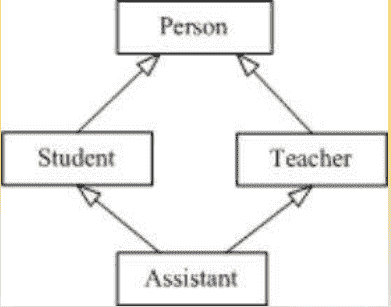

### 6.4 虚析构函数

#### 程序举例6.3

- 当基类的析构函数为虚函数时，无论指针指的是同一类族的哪一个类对象，对象撤销时，系统会采用动态关联，调用相应的析构函数，完成该对象的清理工作。
- 习惯把析构函数声明为虚函数，即使基类并不需要析构函数，以确保撤销动态存储空间时能够得到正确的处理。
- 构造函数是不能声明为虚函数的。

### 6.5 纯虚函数与抽象类

TwoDimensionalShape类的getArea函数该如何定义如下：

```cpp
virtual double getArea()
{ return 0;}
```

函数的返回值设定为0，实际上这个函数的返回值是无法确定的。二维图形本身就是一个抽象的概念，其面积也是无法求的，将面积的值设定为0，其实是一种不得已的做法。

- 一个具有纯虚函数的基类称为抽象类(abstract class)。
- 抽象类中不仅包括纯虚函数，也可包括其他函数。
- 抽象类不能被实例化，但可以声明抽象类的指针或引用。
- 抽象类一般用作派生其他类的基类，可使用指向抽象类的指针支持运行时多态性。如：

```cpp
Square s(10);
TwoDimensionalShape * t1;
t1 = & s;
cout<<"面积为"<<t1->getArea()<<endl;
```

- 派生类中应重写基类中的纯虚函数，否则它仍将被看作一个抽象类。

#### 例如：

```cpp
class point {/*......*/};
class shape // 抽象类
{ point center ;
......
public:
point where (){ return center ;}
virtual void draw () = 0; // 纯虚函数
};
......
shape x; // error， 抽象类不能建立对象
shape *p; // ok， 可以声明抽象类的指针
shape f (); // error， 抽象类不能作为返回类型
void g ( shape ); // error， 抽象类不能作为参数类型
shape* h ( shape &); // ok， 可以声明抽象类的引用
```

### 6.5 纯虚函数与抽象类

- 利用虚函数和纯虚函数设计二维图形类族。
- 所有的图形都具有getArea函数能够计算面积；都具有show函数输出图形信息。

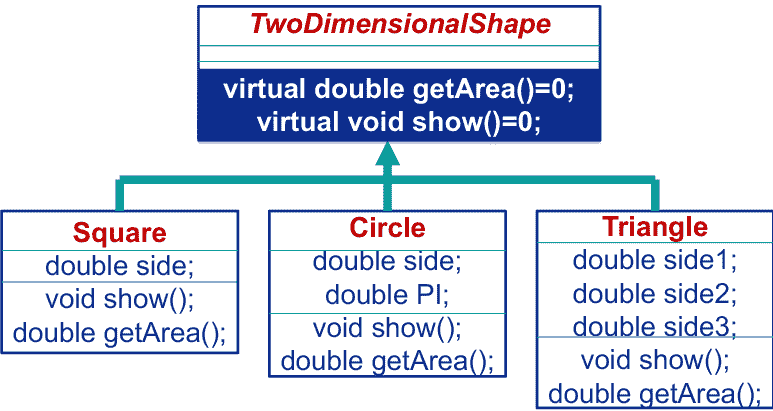

### 用test函数测试二维图形（例6.4）

```cpp
void test(TwoDimensionalShape & t){
t.show();
cout<<"面积为"<<t.getArea()<<endl;
}
```

```cpp
// 主函数
void main(){
Square s(10);
Circle c(10);
test(s);
test(c);
}
```


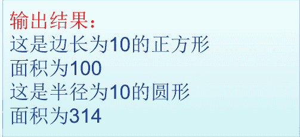

如果二维图形又派生出了椭圆形，用于测试的test函数需要需改吗？这有何意义？

### 本章小结

1. 派生类的某些功能与基类同名，但是是不同的派生类彼此之间又有不同，可以利用虚函数实现同名函数在不同类中的不同功能。
2. 基类中的某些功能本身并没有具体的作用，一般把这种函数设计为纯虚函数，它的存在是为了提供给多个派生类一个统一的访问接口，具体功能是在派生类中根据实际对象的要求而实现的。

利用动态多态技术，可以使得程序代码更加简洁，可以实现不同类型的对象针对同一指令产生不同的响应。

## 第7章 模板

C++语言程序设计教程—大连理工大学软件学院

## 第7章 模板


- 7.1 理解模板
- 7.2 函数模板
- 7.3 类模板
- 7.4 泛型程序设计及STL简介

## 第7章 模板

#### 类型参数化

C++中提供了对函数重载机制的支持：  
定义重载函数时必须明确要处理什么类型的数据，如果对之后新出现的类型数据做相同操作则要再次定义重载函数。  
函数模板就解决了函数重载中多次定义函数的问题。

由于事物的相似性，C++程序设计的类类型和函数有时也是相似的。  
类模板就是对一批仅仅成员数据类型不同的类的抽象，

模板可以实现类型参数化，从而实现了真正的代码可重用性。C++模板包括 函数模板和类模板 两种类型。

## 第7章 模板

### 7.2 函数模板

问题：求两参数之中小值函数：min ( a , b )  
对 a , b 的不同类型，都有相同的处理形式：  
return ( a < b ) ? a : b ;

用已有方法解决对不同数据类型处理：  
（1）宏替换 # define max ( a , b )( a > b ? a : b )  
**问题** 避开类型检查  
（2）重载  
**问题** 需要许多重载版本;不能处理新定义的类型  
（3）使用函数模板

## 第7章 模板

### 7.2 函数模板

函数模板定义由模板参数说明和函数定义组成，语法如下：

```cpp
template <class 类型参数名1 ,class 类型参数名 2, ...>
函数返回值类型 函数名(形式参数表)
{ 函数体 }
```

- 模板参数说明的每个类型参数必须在函数定义形参表中至少出现一次；
- 函数形式参数表中可以使用模板类型参数，也可以使用一般类型参数。

### 7.2 函数模板

```cpp
#include <iostream.h>

template < typename T >
T min ( T a , T b )
{ return a < b ? a : b ; }

void main ( )
{ cout << " min ( 3 , 5 ) is " << min ( 3 , 5 ) << endl ;
cout << " min ( 'y' , 'e' ) is " << min ( 'y' , 'e' ) << endl ;
cout << " min ( 9.3 , 0.5 ) is " << min ( 9.3 , 0.5 ) << endl ;
}

int min ( int a , int b )
{ return a < b ? a : b ; }

char min ( char a , char b )
{ return a < b ? a : b ; }

double min ( double a , double b )
{ return a < b ? a : b ; }
```

> 编译器生成的模板函数  
> 程序执行时匹配不同的版本

## 第7章 模板

### 7.2 函数模板

函数模板定义由模板参数说明和函数定义组成，语法如下：

```cpp
template <class 类型参数名1 ,class 类型参数名 2, ...>
函数返回值类型 函数名(形式参数表)
{ 函数体 }
```

**注意事项**
- 关键字class也可以使用关键字typename;
- 函数模板允许使用多个类型参数，但在template定义部分的每个形参前必须有关键字typename或class,
- 在template语句与函数模板定义语句<返回值类型>之间不允许有别的语句


## 第7章 模板

### 7.2 函数模板

编译器如何处理函数模板？

- 当函数模板被**调用时**编译器才产生代码。
- 根据**实参的类型**，**替换**函数模板中的**类型参数**。
- 这个过程叫做函数模板的**实例化**（`instantiating`）。
- 函数模板实例化后称为**模板函数**。

函数模板与函数重载的区别？

- 函数重载时，每个函数体内可以执行不同的动作；
- 函数模板只适用于函数的参数个数相同而类型不同、函数体相同的情况。

函数模板的特化：
函数模板可能不适合某种特殊的类型数据的处理，这时就需要为函数模板实例化提供特化的定义。

函数模板特化的定义语法如下：
template<>
返回类型 函数模板名（参数列表）
{
    函数体
}

template <class T>
T min(T a, T b){
    return (a<b)? a: b;  
}

template<> const char * min( const char * s1, const char * s2 ){
return (strcmp(s1,s2)<0 ? s1 :s2); 
}

int main(){
    int m_iv = 5, m_iu = 10;
    double m_dv = 5.5, m_du = 10.5;
    cout << min(m_iv,m_iu) << endl;
    cout << min(m_dv,m_du) << endl;
    cout << min("hello","world") << endl;
    return 0;
}

程序中既定义了函数模板又定义了特化函数时，调用的匹配规则是：

- 如果参数类型以及返回类型完全匹配，则先选择普通函数，再选择模板显式特化函数作为调用的函数实例。（VC6.0支持的不好）
- 否则，如果模板函数能够推导出一个参数类型以及返回类型完全匹配的函数实例，则选择函数模板。
- 否则，如果调用函数的实参以及返回类型能够进行隐式转换成与普通函数或者模板显式特化函数的类型匹配，则选择普通函数或者模板显式特化函数。
- 如果以上三条都不能匹配，则函数匹配失败，发生编译错误。

模板声明

```
template <typename ElementType >
void swap ( ElementType *a, ElementType *b ) //交换实参所指数据
{
    ElementType temp ;
    .....
}
```

多参数的函数模板

类属参数和变量

main函数调用

```
void swap ( int *x, int *y);
void swap ( double *x, double *y );
void swap ( char *x, char *y );
```

### 课堂练习

编写一个对具有n个元素的数组a[ ]求最小值的程序，要求将求最小值的函数设计成函数模板min。

编写main函数对int、double数组调用min模板

### 课后练习

#### 冒泡排序法的函数模板

```
template <typename ElementType>
void SortBubble ( ElementType *a , int size )
{ 
    int i, work ;
    ElementType temp ;
    ......
}
```

- 1. 完成模板
- 2. 完成Box类
- 3. main函数，调用int、Box数组排序

```
void SortBubble ( int *array , int size );
void SortBubble ( Box *boxes ,  int size );
```

编写Box（长宽高）类，重载“<”（体积大小），使用函数模板对Box数组调用函数模板。

### 7.3 类模板

- 类模板实际上是函数模板的推广。
- 类模板用于实现类所需数据的类型参数化。
- 类模板主要用于数据存储（容器）类。
- 表示和算法不受所包含的元素类型的影响。

```
class Array //安全整形数组
{
    public :
        Array ( int s ) ;
        ~Array () ;
        int& operator[] (int index) ;
        Array& operator = (Array& rArr) ;
        friend ostream& operator<<(ostream& out, Array& a);
    protected :
        int size ;   
        int * element ;
} ;
```

类模板  
类型为T的数组  
类定义  
int类型数组  
类定义  
string类型数组  
类定义  
Box类型数组  
类定义  
Employee*类型数组  

类模板由模板说明和类说明构成

template <类型形式参数表> 类声明

template< typename Type > class TClass { // TClass的成员函数 private : Type DateMember ; //... };

类属参数必须至少在类说明中出现一次

例如

template< typename T > 一个数组类模板

```
class Array
{
public:
    Array( int s );
    virtual ~Array();
    virtual const T& Entry( int index ) const;
    virtual void Enter( int index, const T& value );
    // T& operator[] (int index);
protected:
    int size;
    T* element;
};
```

类模板的声明与定义

```
template <类型形参>
class <类名>
{
    //类说明体
};
```

```
template <类型形参>
<返回类型> <类名> <类型名表>::<成员函数1>（形参）
{
    //成员函数定义体
}
```

······

```
template <类型形参>
<返回类型> <类名> <类型名表>::<成员函数n>（形参）
{
    //成员函数定义体
}
```

template<typename T>
Array<T>::Array(int s)
{ 
    size = (s > 1) ? s : 1 ;
    element = new T [ size ] ; 
}
template < typename T > Array < T > :: ~Array()
{ delete [ ] element ; }
template < typename T >
const T& Array < T > :: Entry ( int index ) const
{ return element [ index ] ; }
template < typename T >
void Array < T > :: Enter(int index, const T& value)
{ element [ index ] = value ; }


## 第7章 模板

### 数组类模板

```cpp
#include <iostream.h>
#include "Array.h"
void main()
{ Array <int> IntAry;
for (int i = 0; i < 5; i++) IntAry.Enter (i, i);
cout << "Integer Array : \n" ;
for ( i = 0; i < 5; i++) cout << IntAry.Entry(i) << '\t' ;
cout<<endl ;
Array <double> DouAry( 5 ) ;
for ( i = 0; i < 5; i++) DouAry.Enter (i, (i+1)*0.35 ) ;
cout << "Double Array : \n" ;
for ( i = 0; i < 5; i++)
cout << DouAry.Entry(i) << '\t' ;
cout<<endl;
}

class Array
{
public :
......
virtual const int & Entry( int index ) const ;
virtual void Enter( int index, const int & value ) ;
protected :
int size ; int * element ;
};

class Array
{
public :
......
virtual const double & Entry( int index ) const ;
virtual void Enter( int index, const double & value ) ;
protected :
int size ; double * element ;
};
```

### 7.3 类模板

### 使用类模板的方法

- (1). 在程序开始的头文件中说明**类模板**的定义。

```cpp
template <类型形参表>
class <类名>{ .... };
```

- (2). 在适当的地方创建一个**模板类**的实例，即一个模板类定义，同时创建该**模板类**对象。

```cpp
<类名> <类型实参表> <对象表>;
```

- (3). 使用对象调用成员函数。其实参类型与模板类规定的类型一致。

函数的形式参数类型可以是类模板或类模板的引用，对应的实际参数是该类模板实例化的模板类对象。

当一个函数拥有类模板参数时，这个函数必定是函数模板。

### 一个用 `Array<T>` 作参数的函数模板

```cpp
template < typename T >
void Tfun( const Array <T> & x , int index )
{ cout << x.Entry( index ) << endl ; }
```

```cpp
template < typename T >
void Tfun( const Array <T> & x, int index )
{ cout << x.Entry( index ) << endl ; }

class Array
{ public :
Array ( int s ) ; virtual ~ Array () ;
virtual const double & Entry( int index ) const ;
virtual void Enter( int index, const double & value ) ;
private:
int size ; double * element ;
};
```

### 调用函数模板

```cpp
Array <double> DouAry( 5 ) ;
...
Tfun( DouAry, 3);
```

```cpp
Array <double> DouAry( 5 ) ;
...
Tfun(DouAry,3);
```

调用构造函数，实例化模板类，建立对象

virtual const double & Entry( int index ) const ;

调用模板函数


❖ 类模板特化：对特定数据类型特殊处理。

### 一个类模板在类层次结构中既可以是基类也可以是派生类：

- 类模板可以从模板类派生
- 类模板可以从非模板类派生
- 模板类可以从类模板派生
- 非模板类可以从类模板派生

### 课堂练习：

编写并使用数组类模板Array：
（1）类中包括对数组进行排序、查找和求元素和的方法。
（2）然后由此产生模板类Array<int>和Array<Box>（Box重载<、==、+）。


### 7.4 范型程序设计及STL简介（自学）

- 泛型程序设计是指编写完全一般化并可重复使用的程序，其效率不依赖于具体数据类型。
- 泛型(Genericity)，是指具有在多种数据类型上皆可操作的含意，与模板有些相似。
- 标准模板库STL是泛型程序设计的代表作品。
- STL是一种高效、泛型、可交互操作的软件组件。STL包含很多计算机基本算法和数据结构，而且将算法与数据结构完全分离。

### 7.4 范型程序设计及STL简介

STL包括： 容器、迭代器、算法

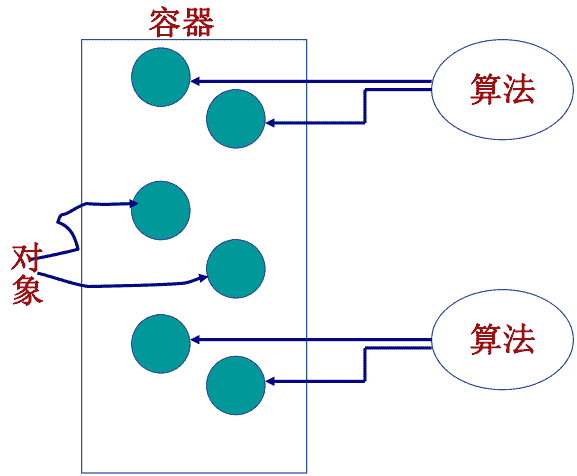

### 7.4 范型程序设计及STL简介

- 容器是存储数据的一种方式
- 容器分类：
  - 顺序容器、关联容器和容器适配器
  - 顺序容器：vector(矢量)、list(链表)、deque(双端队列)
  - 关联容器：set(集合)、multiset、map(映射)、multimap

### 7.4 范型程序设计及STL简介

| 标准库容器类 | 说明 |
|---|---|
| 顺序容器<br>vector(矢量)<br>list(列表)<br>deque(双端队列) | 从后面快速插入与删除，直接访问任何元素<br>从任何地方快速插入与删除，双链表<br>从前或后面快速插入与删除，直接访问任何元素 |
| 关联容器<br>set(集合)<br>multiset(多重集合)<br>map(映射)<br>multimap(多重映射) | 快速查找，不允许重复值<br>快速查找，允许重复值<br>一对一映射，基于关键字快速查找，不许重复值<br>一对多映射，基于关键字快速查找，允许重复值 |
| 容器适配器<br>stack(栈)<br>queue(队列)<br>priority_queue | 后进先出(LIFO)<br>先进先出(FIFO)<br>最高优先级元素总是第一个出列 |

### 7.4 范型程序设计及STL简介

- 迭代器类似于指针，用来访问容器中的单个数据项。
- 迭代器由类iterator来表明。
- 不同的迭代器必须用于不同的容器。
- 迭代器分类：向前迭代器，双向迭代器，随机迭代器
- 使用迭代器：数据访问 与 数据插入

| 标准库迭代子类型 | 说明 |
|---|---|
| 输入<br>**InputIterator** | 从容器中读取元素。输入迭代子只能一次一个元素地向前移动(即从容器开头到容器末尾)。<br>要重读必须从头开始。 |
| 输出<br>**OutputIterator** | 向容器写入元素。<br>输出迭代子只能一次一个元素地向前移动。<br>输出迭代子要重写，必须从头开始 |
| 正向<br>**ForwardIterator** | 组合输入迭代子和输出迭代子的功能，并保留在容器中的位置(作为状态信息)，所以重新读写不必从头开始。 |
| 双向<br>**BidirectionalIterator** | 组合正向迭代子功能与逆向移动功能(即从容器序列末尾到容器序列开头) |
| 随机访问<br>**RandomAccessIterator** | 组合双向迭代子的功能，并能直接访问容器中的任意元素，即可向前或向后调任意个元素。 |

### 7.4 范型程序设计及STL简介

- STL算法在数据集上进行操作，泛型算法不依赖于具体的容器。
- 泛型算法分类为：
  - (1) 不修改序列的操作：find()、count()、equal()、mismatch()和search()等。
  - (2) 修改序列的操作：swap()、copy()、transform()、replace()、remove()、reverse()、rotate()和fill()等。
  - (3) 排序、合并和相关的操作：sort()、binary_search()、merge()、min()和max()等。


## 第8章 异常处理

## 8.1 理解异常

- 运行时错误的处理方法
  - 出错时终止程序
  - 用函数返回值作为错误标志
  - 异常处理机制
    导致出错的代码与处理错误的代码完全隔离

```c
if (错误) abort();
else 执行正常逻辑
```

```c
int function(){
if (wrong) return 1;
else {执行正常逻辑;
return 0;
}
}
```

## 8.2 异常处理的语法结构

try
{ ......
if(...)throw 类型m
......
}
catch(类型1 参数1)
{
//针对类型1的异常处理
}
......
catch(类型n 参数n)
{
//针对类型n的异常处理
}

try-catch结构的说明如下：

1. 被检测的语句或者函数的调用（可能出现异常的语句）必须放在try块中，否则不起作用。

2. try块和catch块作为一个整体出现，catch必须紧跟在try之后，在二者之间不能插入其他语句。

3. try与catch块都是复合语句，即使块中只有一条语句也不能省略掉{}。

4. 一个try-catch结构中只能有一个try块，但却可以有一个到多个catch块，以便捕捉多种不同类型的异常。catch块的异常信息类型部分指明了catch子句处理异常的种类和异常参数名称，它与函数的形式参数是类似的，可以是某个类型的值，也可以是引用，类型可以是任何有效的数据类型，包括C++的类。

5. 如果在try块中没有发生异常，那么跟在try块后面的catch块就会不会被执行。

6. 如果在try块中有异常抛出，系统则按顺序逐一检查try块后面的catch块的“异常类型”，如果catch块的异常类型与抛出的异常一致，则此catch块捕捉到了这个异常，检查停止，系统执行此catch块中的语句。

7. 如果抛出的异常信息找不到与之匹配的catch块，那么异常就继续向上层函数抛出，直至被抛出到主函数，系统就会调用一个系统函数terminate，使程序终止运行。

例8.1 连续输入两个实数，程序将计算并输出这两个数相除的商。要注意除数不能为0。

```cpp
void main(){
double a=0; double b=0;
try{ //检测异常
cout<<"请输入两个实数a和b:"<<endl;
cin>>a>>b;
if (b==0) throw b; // 抛出异常
cout<<"a/b="<<a/b<<endl;
}catch(double){ cout<<"除数不能为0";
cout<<"完成。"<<endl;
}
```

例8.2

try-catch结构与throw也可以不在同一函数中出现。

```cpp
double divide(double a, double b){// 相除
    if(b==0) throw b;  // 抛出异常
    return a/b;
}

void main(){// 主函数
    double a=0; double b=0;
    try{    //检测异常
        cout<<"请输入两个实数a和b: "<<endl;
        cin>>a>>b; cout<<"a/b="<<divide(a,b);
    }catch(double){ cout<<"除数不能为0。"<<endl; }  // 捕获异常
    cout<<"完毕。"<<endl;
}
```

> 当有异常出现时，divide函数本身没有对异常进行处理，divide的执行终止

> divide函数的调用处于一个try块中，其后捕获double类型的catch块则恰能与抛出异常的类型匹配，除0异常在这里被捕获

例8.4 计算圆柱体体积的程序。

```cpp
double area(double radius){
    // 圆面积函数
    if (radius<=0) throw radius;
    return 3.14*radius*radius;
}
double volume(double radius,double height){ // 圆柱体积函数
    double v = area(radius)*height;
    return v;
}
void main(){ // 主函数
    double radius=0; double height=0;
    cout<<"请输入圆柱的底面半径和高： "<<endl;
    cin>>radius>>height;
    try{ cout<<"该圆柱的体积是"<<volume(radius,height)<<endl;
    }catch(double radius){
    cout<<"输入半径有误 radius="<<radius<<endl;
    }
}
```

## 8.3 函数嵌套调用的异常处理

### 异常抛出与处理过程分析

main函数 调用 volume函数 调用 area函数

catch块匹配 进行异常处理 没有捕捉异常 throw radius 没有捕捉异常

程序运行结果如下：请输入圆柱的底面半径和高：-3 9输入半径有误 radius=-3

为了便于阅读程序，C++允许在声明函数时列出可能抛出的异常类型

```cpp
double area(double radius) throw(double);
```

这样该函数的使用者只看到函数的声明就可以清楚地知道应该注意处理异常的抛出，同样volume的声明可以改为

```cpp
double volume(double radius, double height) throw(double);
```

如果在area函数中除了double类型的异常还会抛出int类型的异常，可以将area函数的声明写为如下方式

```cpp
double area(double radius) throw(double,int);
```

## 8.5 异常的重抛

在例8.4中，尽管main的catch块可以捕捉到异常信息，但是仅从运行的结果是无法知道异常最早是从哪里发生的。

异常重抛的方法如下：

```cpp
catch(异常类型){
......
throw; //把捕捉到的异常再次抛出
......
}
```

例8.5 计算圆柱体体积的程序（修改自例8.4）。

```cpp
double area(double radius) throw(double) {    // 圆面积函数
    try{ if (radius<=0) throw radius;
        return 3.14*radius*radius;
    }catch(double radius){
        cout<<"area函数抛出异常，半径="<<radius<<endl;
        throw;    // 异常重新抛出
    }
}

double volume(double radius,double height)throw(double){// 圆柱体积
    try{  double v = area(radius)*height;
        return v;
    }catch(double radius){
        cout<<"volume函数抛出异常，半径="<<radius<<endl;
        throw;  //异常重新抛出
    }
}
```


## 第8章 异常处理

### 8.6 异常处理中的析构函数

- 结束函数调用时，局部变量就会从栈中弹出，这个过程被称为“退栈”（Stack unwinding）。
- 但是，如果函数执行时出现异常，并且只是采用简单的显示异常信息，然后退出（exit）程序的做法，则程序的执行就会突然中断，结束函数调用时必须完成的退栈和对象释放的操作也不会进行。
- C++异常处理的真正功能，还在于它具有为异常抛掷前构造的所有局部对象自动析构的能力。
- 异常被抛出后，从进入try块起到异常被抛出为止，这期间在栈上构造的所有对象都会被自动析构，析构的顺序与它们被构造的顺序相反。

#### 例8.6 异常处理中的析构函数的调用。

```cpp
class Triangle {
public:
    Triangle(int n) : num(n) { cout << "构造函数调用, num=" << num << endl; }
    ~Triangle() { cout << "析构函数调用, num=" << num << endl; }
    void set_sides(double a, double b, double c) {
        if (a <= 0 || b <= 0 || c <= 0) throw "边长必须为正";
        if (a + b <= c || b + c <= a || c + a <= b) throw "边长不满足三角不等式";
        s1 = a; s2 = b; s3 = c;
        cout << "三角形" << num << "三边设置完毕" << endl;
    }
private:
    int num;
    double s1, s2, s3;
};
```

```cpp
void test() {
    Triangle tri1(1);
    Triangle tri2(2);
    tri1.set_sides(3, 4, 5);
    tri2.set_sides(1, 4, 5);
}

void main() // 主函数
{
    cout << "main start" << endl;
    cout << "call test" << endl;
    try {
        test();
    } catch (char* c) {
        cout << "异常: " << c << endl;
    }
    cout << "main end" << endl;
}
```

- 程序运行结果如下：
  - main start
  - call test
  - 构造函数调用, num=1
  - 构造函数调用, num=2
  - 三角形1三边设置完毕
  - 析构函数调用, num=2
  - 析构函数调用, num=1
  - 异常: 边长不满足三角不等式
  - main end

### 8.7 异常类

- 使用throw语句抛出的异常，可以是基本类型的，也可以用类对象来传递异常信息。
- 专门用来传递异常的类称为异常类（Exception Class）。异常类可以是用户自定义的，本身与普通的类没有不同。
- **例8.7** C++中的数组没有提供下标越界时的访问控制，为了使用方便可以定义一个“数组下标越界异常类（ArrayIndexOutOfBounds）”，专门用于描述数组下标越界异常。每个数组下标越界异常对象中都具有一个数据成员用于描述数组越界访问的具体位置，catch块捕捉到这个异常后，可以显示出其包含的越界位置信息。

```cpp
class ArrayIndexOutOfBounds {
public:
    ArrayIndexOutOfBounds(int index) : index(index) {}
    void show() { cout << "数组下标越界异常 index=" << index << endl; }
private:
    int index;
};

class MyArray {
private:
    int *p;
    int sz;
public:
    MyArray(int s) : sz(s) { p = new int[sz]; }
    ~MyArray() { delete[] p; }
    int size() { return sz; }
    int& operator[](int i) {
        if (i < 0 || i >= sz) throw ArrayIndexOutOfBounds(i);
        return p[i];
    }
};
```

```cpp
void main() { // 主函数
    MyArray a(10);
    for (int i = 0; i < 3; i++) {
        try {
            if (i != 1) {
                a[i] = i;
                cout << "a[" << i << "]=" << a[i] << endl;
            } else a[a.size() + 10] = 10;
        } catch (ArrayIndexOutOfBounds &a) {
            a.show();
        }
    }
}
```

用类对象来描述一个异常有这样的优点：异常的类型具有专一性，一个类对应了一种特定意义的异常，这些异常具有数据成员和函数成员，表现力更加丰富，使得程序的可读性更强。

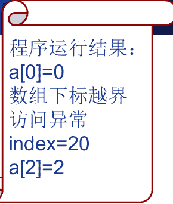

### 8.7 异常的匹配

C++规定，当一个异常和catch子句参数类型符合下列条件时，匹配成功：

1. 异常类型是基本类型时，catch参数类型应是异常的类型或其引用，此时类型必须完全一致，不支持自动类型转换。
2. 异常类型是类类型时，catch参数类型应是异常对象的类型（或其引用）或者其公有基类类型（或其引用）。
3. 异常类型是类指针时，catch参数类型应为该类指针或者其公有基类指针。
4. 当catch参数类型为`void*`时，异常类型可以是任何类型的指针。
5. 如果在catch子句中没有指定异常的类型，而使用了删节号“...”，则表示它可以捕捉任何类型的异常。这个语句是C++为所有不能匹配的异常提供的一个统一的处理方法。

#### 注意：异常处理与函数重载的不同

- 异常处理是由最先匹配的catch子句处理，
- 函数重载是由最佳匹配的函数处理，
- 所以异常处理中catch子句顺序是很重要的。往往把较具体的异常放到前面进行捕捉，较抽象的异常放到后面进行捕捉，`catch(...)`子句应放到最后。
- 异常匹配举例：例8.8

### 8.7 标准库异常类

#### C++的标准异常类

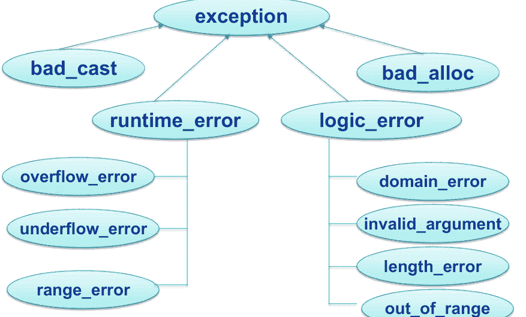

### 8.8 assert断言

断言的作用是先计算表达式 expression，如果其值为假那么它先使用标准错误流打印一条出错信息，然后调用 abort 来终止程序运行。如果expression表达式计算结果为真，则断言不产生任何作用。举例：

```cpp
#ifdef _DEBUG   //只能用于调试版
#include <assert.h>
void main( )
{
    int x = 1, y = 0, z;
    assert(y != 0); //一旦y==0，程序就会报错，并自动退出。
    z = x / y;
}
#endif
```

## 第9章 输入输出流

C++语言程序设计教程—大连理工大学软件学院

### 9.1 理解IO流

1. 输入输出流
2. 流类与缓冲区
3. 使用流的优点

## 9.2 标准流对象

1. 标准输入流对象
2. 标准输出流对象

## 9.3 流操作

1. 格式化输入输出
2. 字符数据的读写
3. 输入输出流的错误

## 9.4 文件流

1. 文件流类与对象
2. 文件打开与关闭
3. 文本文件的读写
4. 文件的随机读写

## 9.5 字符串流

### 9.6 案例分析


## 9.1 理解流


图9.1 数据在输入源、程序内存与输出端之间流动

进行输入时，标准流对象 `cin` 负责建立输入通道，为数据开辟缓冲区。

缓冲区（buffer）是一个临时存储区，用于匹配不同设备数据传输率的差异。


### 9.1.2 流类与缓冲区

C++ 类库包括庞大的 I/O 类族，这些流类提供了丰富的成员函数和运算符，实现输入输出操作。


### 9.1.3 使用流的优点

C++ 程序可使用流对象 `cin` 与 `cout` 简洁安全地进行 I/O 操作。

- 自动识别类型：输出流类 `ostream` 中重载运算符“<<”，输入流类 `istream` 中重载运算符“>>”，使 `cin` 与 `cout` 能够识别各种基本类型数据，自动按照指定的格式完成输入或者输出操作。
- 可扩展性好：对运算符“<<”和“>>”的重载，可以对各种用户自定义类型数据进行简洁安全的输入输出操作。

## 9.2 标准流对象

标准流对象是在 `std` 命名空间中定义的流对象，提供程序内存与常用外部设备进行数据交互的功能。


- I/O 流库预定义了一批流对象，连接常用的外部设备。
- 程序员可以定义所需的 I/O 流对象，使用流库提供的工作方式实现数据传输。

### 9.2.1 标准输出流对象

- `cout`
  - `ostream` 类的对象（console output）。
  - 该对象将程序中的数据传送到标准输出设备上，通常将数据在屏幕上显示出来。
  - 使用 `<<` 顺序地将数据组装成字节序列，插入到流中输出。
  - `ostream& ostream::operator<<(基本类型标识符);`

输出数据的类型？


- `cerr` 与 `clog`

输出流对象 `clog`（console log）、`cerr`（console error）作用相同：都能在标准输出设备上显示出错信息，两个对象一般关联显示器进行输出。区别：`cerr` 不经过缓冲区，直接向显示器上输出有关信息；`clog` 中的信息存放在缓冲区中，缓冲区满后或接收 `endl` 时输出。

### 9.2.2 标准输入流对象

- `cin`
  - `istream` 类的对象，从标准输入设备（键盘）获取数据。
  - `cin` 使用流提取符“>>”将字节流中的数据进行解析后传输给内存。从字节流中抽取若干字节（遇到分隔符为止），按接收变量类型的不同组装数据，即将字符型数据转换成二进制形式存储到变量中。这种使用流提取运算符输入的方式称为格式化输入。

```
int i; char c; double d;
cin >> d >> c >> i;
```


- **cin**：在 `istream` 流类中重载 `>>` 的一组公用成员函数。
  - `istream& operator>>(基本类型标识符&);`
- 流提取符从流中提取数据时通常跳过输入流中的空格、tab 键、换行符等空白字符。
- 只有在输入完数据再按回车键后，该行数据才被送入键盘缓冲区，形成输入流，提取运算符才能从中提取数据。

## 9.3 流操作

- `put()`
- `get()`
- `getline()`

- `good()`
- `bad()`
- `eof()`
- `clear()`

### 9.3.1 格式化输入输出

| 控制符 | 作用 |
|---|---|
| `dec` | 转换整数的基数为十进制 |
| `oct` | 转换整数的基数为八进制 |
| `hex` | 转换整数的基数为十六进制 |
| `showbase` | 在输出中显示基数指示符 |
| `uppercase` | 十六进制输出时一律用大写字母 |
| `scientific` | 科学计数法显示浮点数 |
| `fixed` | 定点小数形式显示浮点数 |
| `showpoint` | 把带有小数点的浮点数值输出到流中 |
| `showpos` | 正整数前加“+”号 |
| `unitbuf` | 输出操作后立即刷新流 |
| `left` | 输出数据在本域宽范围内左对齐 |
| `right` | 输出数据在本域宽范围内右对齐 |

在基类 `ios` 中定义了相关的控制符和成员函数，在头文件 `iomanip` 中还声明了一些普通函数。

| 控制符 | 成员函数 | 作用 |
|---|---|---|
| `setfill(char c)` | `fill(char c)` | 设置填充字符为字符常量或字符变量 c |
| `setprecision(int n)` | `precision(int n)` | 设置显示小数的精度为 n 位 |
| `setw(int n)` | `width(int n)` | 设置域宽为 n 个字符 |
| `setiosflags()` | `setf()` | 设置输出格式的状态 |
| `resetiosflags()` | `unsetf()` | 清除已设置的输出格式 |

### 9.3.2 字符数据的读写

| 函数 | 功能 |
|------|------|
| `put` | 无格式，插入一个字节 |

```
ostream& ostream::put(char ch);
```

该函数的功能是把一个字符写入流中，在屏幕上显示该字符。该函数的参数可以是字符常量、字符变量或字符的 ASCII 代码，也可以是一个整数表达式。

### iostream 类的公有成员函数

| 函数 | 功能 |
|---|---|
| **read** | **无格式输入指定字节数** |
| `get` | 从流中提取字符，包括空格 |
| **getline** | **从流中提取一行字符** |

```
int get();

istream& get(char& rch);

istream& get(char* pch, int nCount, char delim = '\n');
istream& getline(char* pch, int nCount, char delim = '\n');
```

### 字符输入函数

```
int istream::get();
```

功能：从流中读取任意一个字符，返回值为读入的字符。可用于从键盘读取字符，也可从文件中读取字符。如果输入结束或达到文件末尾，该函数就返回字符 EOF（End of File）。

```
while((c = cin.get()) != EOF)
    cout.put(c);    //输出字符
```

```
istream& istream::get(char &ch);
```

功能：带参数的 `get` 函数也能从流中读取一个字符，所读取的字符存储在参数 `ch` 中。如果读取字符不成功，设置错误标志并在 `ch` 中存储 EOF。

```
while(cin.get(c)) cout.put(c);
while(cin >> c) cout << c;
```


### 字符串输入函数

```
istream& istream::get(char* pArray,
    streamsize n, char delim = '\n');
```

**功能：** 从输入流中读取 n-1 个字符（通常为 long 型），赋给指定的字符数组 `pArray`（或字符指针指向的数组），如果在读取 n-1 个字符之前遇到指定的终止字符 `delim`，则提前结束读取。

```
cin.get(cArray, 5);
cin.get(cArray, 5, '\n');
cin.get(cArray, 10, ',');
```


### 字符串输入函数

- `istream& istream::get(char* &pArray, streamsize n, char delim = '\n');`

作用：读取一段文本，并将输入的字符串以及一个空字符一起存储，**将指定的终止符留在流中。**  
如读取失败（遇 EOF）则流 istream 对象设置错误标志，不能继续进行输入操作。

```cpp
char str[20];
cin >> str;
cin.get(str, 20);
```

## 9.3 流操作

### 运行并分析输出结果

```cpp
char ch1[20], ch2[20], ch3[20], ch4[20];

cin >> ch1;                 cout << ch1 << endl;

cin.get(ch2, 10);           cout << ch2 << endl;

cin.get(ch3, 20);           cout << ch3 << endl;

cin.get(ch4, 20, ' ');      cout << ch4 << endl;
```

## 9.3 流操作

### 字符串输入函数

```cpp
istream& istream::getline(char* &pArray,
    streamsize n, char delim = '\n');
```

**作用：** 从输入流中读取 n-1 个字符，赋给指定的字符数组，如果在读取 n-1 个字符之前遇到指定的字符则读取结束。如果读取成功则函数返回非 0 值（真），否则（遇到文件结束符）则函数返回 0 值（假）。

从流中提取字符串后流中删除分隔符，继续读取的字符串从分隔符后面的字符开始。

## 9.3 流操作

### 运行 ch9_5.cpp 并分析输出结果

```cpp
char ch1[20], ch2[20], ch3[20], ch4[20];

cin >> ch1;                  cout << ch1 << endl;

cin.getline(ch2, 10);        cout << ch2 << endl;

cin.getline(ch3, 20);        cout << ch3 << endl;

cin.getline(ch4, 20, ';');   cout << ch4 << endl;
```

## 9.3 流操作

### 9.3.3 输入输出流的错误

为了保证程序能够安全进行输入输出操作，C++ 提供了检测 I/O 流状态的标志和成员函数。在流类中包含一个描述流状态的数据成员 state，这个状态字中特定位记录流处于正常状态或不同的错误状态。

| 标识常量 | 值 | 意义 |
|---|---|---|
| ios::goodbit | 0x00 | 0 0 0 0 0 0 0 0 0 0 0 0 0 0 0 0 |
| ios::eofbit | 0x01 | 0 0 0 0 0 0 0 0 0 0 0 0 0 0 0 1 |
| ios::failbit | 0x02 | 0 0 0 0 0 0 0 0 0 0 0 0 0 0 1 0 |
| ios::badbit | 0x04 | 0 0 0 0 0 0 0 0 0 0 0 0 1 0 0 0 |

## 9.3 流操作

### 9.3.3 输入输出流的错误

流类提供一些成员函数用于测试或设置流对象的状态，常用函数

| 函数 | 功能 |
|---|---|
| int eof() const; | 返回 eofbit 状态值。文件结束符时返回 1，否则返回 0 |
| int fail() const; | 返回 failbit 状态值 |
| int bad() const; | 返回 badbit 状态 |
| int good() const; | eofbit、failbit 和 badbit 都没有被设置，则返回 1 |
| int rdstate() const; | 返回状态字 |
| void clear(int n = 0); | 恢复或设置状态字 |

## 9.3.4 重载流插入和提取运算符

C++ 中定义的位左移运算符“<<”和位右移的运算符“>>”进行位运算，在流类中对它们进行了重载，使之作为流插入运算符和流提取运算符，用来对各种基本类型的数据进行输出和输入操作。

## 9.3.4 重载流插入和提取运算符

### 重载流插入运算符 <<

ostream 流类中为基本类型数据重载“<<”，有如下形式：

```cpp
ostream & ostream::operator << (int);
ostream & ostream::operator << (float);
ostream & ostream::operator << (char);
ostream& ostream::operator<< (const void *);
ostream& ostream::operator<< (const char *);
```

可以在用户自定义的类 A 中重载该运算符  
A 类中定义如下友元函数：

```cpp
friend ostream& operator << (ostream& out, const A&);
```

## 9.3.4 重载流插入和提取运算符

### 重载流提取运算符 >>

istream 类中重载了一组成员函数 operator >>（），对于各种基本类型 T 的数据，定义成员函数重载该运算符：

```cpp
istream& istream::operator>>(T& data);
istream& istream::operator>>(char *);
```

可以在用户自定义的类 A 中重载 >> 运算符  
A 类中定义如下友元函数：

```cpp
friend istream & operator >> (istream &, Type&);
```

## 9.4 文件流

### 数据的层次结构

Bit – Byte – Field – Record – File - DBMS

### 文件的概念

存储在外部介质中的数据集合称为文件。

C++ 把文件看成有序的字节流，提供低级和高级的 I/O 功能

- 一批数据通常是以文件的形式存放在外部介质上的。
- 操作系统是以文件为单位对数据进行管理。

## 9.4 文件流

### 知识要点

- 文件以及文件流的概念
  - 数据流方向，文本文件与二进制文件
  - 文件流类与文件流对象

- 文件的打开与关闭
  - 打开方式

- 文本文件的顺序读写操作
  - `<<, >>, put, get(), getline(), read(), write()`

- 二进制文件的随机读写操作

## 9.4 文件流

### 9.4.1 文件流类与对象

文件流是以外存文件为输入输出对象的数据流。  
输出文件流是从内存流向外存文件的字节序列，  
输入文件流是从外存文件流向内存的字节序列。  
每一个文件流都有一个内存缓冲区与之对应。  
I/O 类库中定义了以下三种文件流进行文件读写操作。

1. ifstream 类  
   从输入流 istream 类派生的，支持从磁盘文件的输入。

2. ofstream 类  
   从输出流 ostream 类派生的，支持向磁盘文件的输出。

3. fstream 类  
   从输入输出流 iostream 类派生的，支持对磁盘文件的输入输出。

## 9.4 文件流

### 9.4.1 文件流类与对象

ifstream、ofstream 和 fstream 类对象  
用于内存与文件之间的数据传输

## 9.4 文件流

### 9.4.1 文件流类与对象

C++ 把文件看成有序的字节流，提供低级和高级的 IO 功能

- 使用方式：程序文件 / 数据文件
- 存取方式：顺序读写文件 / 随机读写文件
- 编码方式：文本文件 / 二进制文件

➤ 文本模式  
— 任何数据被解释为一系列的字符，  
  内存中存储的二进制数据需要转换为字符的形式。  
➤ 二进制模式  
— 无需进行格式的转换，流中直接传送原始字节数据。

## 文件操作的基本步骤：

1. 打开文件
   ```cpp
   streamclass fileObj (fileName , openMode );
   fileObj.open( fileName , openMode );
   ```

2. 读 / 写文件
   ```cpp
   << , put(),         write()
   >> , get(),getline(), read()
   ```

3. 关闭文件
   ```cpp
   fileObj.close( );
   ```


## 9.4 文件流

### 9.4.2 文件的打开和关闭

**打开文件**

建立文件流对象；流对象与磁盘文件关联；指定文件的工作方式以及开辟数据缓冲区。

```
构造函数 open()
```

先建立流对象，调用 fstream::open() 连接外部文件。流类——对象名；ifstream、ofstream 或 fstream。

```
对象名.open(文件名, 方式);
```

文件名是识别文件的标识符，包含路径、文件名称以及文件后缀。

```cpp
ofstream outFile; // 流对象打开文件后准备写入数据
outFile.open("C:\\Ch9\\filename.txt");
outFile.open("filename.txt");
```

**打开文件-方法2**

调用流类带参数的构造函数，建立流对象时连接外部文件。

```
流类 对象名(文件名, 方式);
```

例如：

```cpp
ifstream infile("datafile.dat", ios::in);
ofstream outfile("d:\\newfile.dat", ios::out);
```

**基类 ios 中定义的相关标志位，用于设置文件的操作方式**

| 标识常量 | 意义 | 默认为文本方式 |
|---|---|---|
| ios::in | 输入方式打开文件，进行读文件操作 | |
| ios::out | 输出方式打开文件，进行写文件操作 | |
| ios::ate | 打开文件时，指针指向文件尾 | |
| ios::app | 输出方式打开文件，追加方式写入 | |
| ios::trunc | 删除文件现有内容，把已有文件长度变为0 | |
| ios::nocreate | 如果文件不存在，则打开操作失败 | |
| ios::noreplace | 如果文件存在，则打开操作失败 | |
| ios::binary | 二进制读写方式，数据以字符的形式直接在内存与文件之间传送 | |

文件流的输入输出方式

打开一个已有文件准备读入数据的操作：

```cpp
ifstream infile;
infile.open("datafile.dat", ios::in);
```

准备向文件写数据的操作：

```cpp
ofstream outfile("D:\\newfile.dat", ios::out);
```

读写方式打开文件：

```cpp
fstream rwfile("myfile.dat", ios::in | ios::out);
```

读写二进制文件：

```cpp
fstream ioFile;
ioFile.open(file2, ios::in|ios::out|ios::binary);
ofstream ofile("a:\\binary", ios::binary | ios::out);
```


**关闭文件**

解除流对象与磁盘文件关联，释放相关的系统资源。

```
析构函数 close()
```

关闭文件操作包括把缓冲区数据完整地写入文件，添加文件结束标志，切断流对象和外部文件的连接。当一个流对象的生存期结束，系统也会自动关闭文件；若流对象的生存期没有结束，用 close() 关闭文件后，该流对象可以重用。

使用同一对象可以读写多个文件，但要注意：在某一时刻一个文件最多和一个对象关联，也不能用多个对象读写同一个文件。如果文件对象与不同的文件关联，必须先关闭前一个文件，再打开新的文件。

```cpp
ofstream ofile; // 创建
ofile.open("myfile1"); // ofile流与文件 "myfile1" 相关联
......
// 访问文件 "myfile1"
ofile.close(); // 关闭文件 "myfile1"
ofile.open("myfile2"); // 重...
```

等价于使用构造函数：`ofstream ofile("myfile1");`

close() 函数关闭文件，但流对象仍然存在。

**文件的错误检测**

测试流状态检测文件是否成功打开，调用 ios 流类成员函数 good()、bad() 与 fail()，在条件表达式中使用取反操作符（!）测试流状态。

```cpp
if (!outfile) // outfile.open("myfile2.dat")
{
    cerr << "error: unable to open file2!";
}
```

测试是否成功关闭文件，可以调用 fail() 函数。

```cpp
myfile2.close();
if (myfile2.fail())
    cerr << "Error to close myfile2!";
```

**文件流的属性**

每次读写都是从文件指针的当前位置开始，文件指针的初始位置由打开方式指定，打开文件时文件指针默认指向开始位置。随着数据的读写，指针向后移动。


**使用流的磁盘文件I/O**


### 9.4.3 文本文件的读写

- 文件的每个字节都是用 ASCII 代码存放数据，即每个字节存放一个字符，这种文件又称字符文件。
- 文本文件是顺序存取文件。
- 文件的默认打开方式为文本文件，进行格式化的文件读写操作。使用流插入运算符 “<<” 向文件写入若干个字符，使用流提取运算符 “>>” 从文件中读取若干个字节的数据，调用文件流成员函数进行输入输出。

```cpp
int i = 10;
char ch = 'a';
ofstream out("c:\\my.txt");
out << i << '\t' << ch << '\n';
out.close();
```


**例9.8** 用筛选法产生25个素数，将其写入C盘文件 primes.txt 中。

**例9.9** 读取文件 primes.txt 中的所有素数。

**使用 <<, >> 完成文件读写**

**向文本文件中写入数据，并从文件中读出数据**

```cpp
// 格式化将素数写入文件
for (int i = 0; i < max; i++) {
    if (i % 5 == 0)  outFile << endl;
    outFile << setw(10) << *(primes + i);
}
```

由于文本文件本身没有数据的逻辑结构，为了保证顺利从文件中读取数据，通常数据项之间用空白符、换行符、制表符等分隔。

**例9.10** 使用 getline 从文件中读取字符串

```cpp
char filename[10] = "D://test", str[20];
ofstream outfile(filename, ios::out | ios::app);
outfile << filename << endl;
cout << "input a string:";
cin.getline(str, 20);    // 键盘输入字符串
outfile << str << endl;  // 向文件写入字符串
outfile.close();
```

```cpp
const int MAX = 50;
char buffer[MAX];
ifstream infile;
infile.open(filename);
while (!infile.eof()) {
    infile.getline(buffer, MAX);
    cout << buffer << endl;
}
infile.close();
```

运行结果：

```
input a string:Tian linlin
D://test !
Tian linlin !
!
```


```cpp
while (infile.getline(buffer, MAX))
    cout << buffer << '!' << endl;
```


## 9.4.4 文件的随机读写

二进制文件以基本类型数据在内存中以二进制表示形式存放数据，不对写入或读出的数据做格式转换；

打开二进制文件用ios::binary方式；可以即为输出又为输入文件。

二进制文件的读写方式由程序控制，常用随机读写操作

二进制模式便于进行随机的文件读写操作，通过移动文件指针将数据写入文件的指定位置，或者任意读取文件中的某个数据。

二进制文件一般执行非格式化的读取操作：get()、getline()与put()；read()与write()读写文件；可读取任何类型的数据，适合高效便利的传输数据块。

## 9.4 文件流

- ▶ istream 类中操作字节数据的成员函数

```cpp
istream & istream :: read ( char * buf, int n );
```
从流中提取 n 个字节数据，更新对象 buf

- ▶ ostream 类中操作字节数据的成员函数

```cpp
ostream & ostream :: write ( char * buf, int n );
```
向流插入 buf 对象的由第二个参数指定数目的字节数据

```cpp
input.read(reinterpret_cast< char*>(iAry), 3*sizeof(int));
ifstream input("file1.dat",ios::binary|ios::in);
input.read((char*)(&iNum), sizeof(int)) ;
input.read((char*) iAry, 3*sizeof(int)) ;
iNum = input.gcount() /sizeof(int);
for(int i = 0; i < iNum;i++)
cout << iAry[i] <<ends;
```

## 文件无格式读写函数

- • ostream 类中写入字节数据的成员函数

```cpp
ostream & ostream :: write (char * buf, int n);
```
向流插入 buf 对象的由第二个参数指定数目的字节数据

```cpp
ofstream outf("test.dat");
char str[10] = "Hello!";
outf.write(str, 10);
int a[10] = {1,2,3,4,5};
for(int i = 0; i < 10; i++)
outf.write( (char *)(&a[i]), sizeof(int) );
```

```cpp
outf.write((reinterpret_cast<char*>(a), 10*sizeof(int));
```

> 注意类型转换

## 9.4 文件流

有关学生数据的结构Stu，读入一条学生记录：

```cpp
Bool readStudent(Stu& student, ifstream& fStudent)
{
    fStudent.read((char*)&student, sizeof(Stu));
    bool ioFlag = fStudent.good(); //是否成功读取
    return ioFlag;
}
```

- ➤ 向文件写入一条结构记录Stu aStudent：

```cpp
Ofstream out("stu.dat",ios::binary | ios ::out | ios ::app) ;
out.write((char*)&aStudent, sizeof(Stu));
//将一条记录写入文件末尾
```

## 9.4 文件流

## 文件读写练习

学生的记录包括学号、姓名和成绩等信息：

- (1)输入多个学生记录
- (2)按格式化的方式将学生记录写入文本文件中writeStu( Stu* s, int n, ofstream& out );
- (3)按二进制方式写到文件中：writeFile( stu* s, int n, ofstream& out);

## 9.4 文件流

## 文件指针

ios::beg

ios::cur

ios::end

0  1  2  3  4  5

n-1

文件结束

```cpp
enum ios::seek_dir { beg = 0; cur = 1; end = 2 };
```

- **ios::seek_dir** 值：
  - **cur** 相对于当前读指针所指定的当前位置
  - **beg** 相对于流的开始位置
  - **end** 相对于流的结尾处

## 9.4 文件流

## 文件指针


流类提供一些有控制流指针位置的成员函数，可以获取和改变当前文件指针的位置，以便在文件指定位置进行读写操作。

## 9.4 文件流

## 9.4.4 文件的随机读取

istream 类操作流读指针的成员函数

- `istream & istream :: seekg (long pos);`
  读指针从流的起始位置向后移动由pos指定字节

- `istream & istream :: seekg (long off, ios::seek_dir);`
  读指针从流的seek_dir位置移动 off指定字节

- `istream & istream :: tellg ();`
  返回读指针当前所指位置值

## 9.4.4 文件的随机读写

istream 类操作流读指针的成员函数

Eg:

```cpp
istream input ;
......
input . seekg ( - 10 , ios :: cur ) ;
// 读指针以当前位置为基准， 向前移动 10 个字节
```


## 9.4.4 文件的随机读写

## istream 类操作流读指针的成员函数

Eg:

```cpp
istream input ;
......
input . seekg ( 10 , ios :: beg ) ;
// 读指针从流的开始位置，向后移动 10 个字节
```


| 函数    | seekg ( n ) ;    |
|---|---|
| 等价    | seekg ( n , ios :: beg ) ; |

## 9.4.4 文件的随机读写

istream 类操作流读指针的成员函数

Eg:

```cpp
istream input ;
......
input . seekg ( -10 , ios :: end ) ;
// 读指针从流的结尾，向前移动 10 个字节
```


## 9.4 文件流

## 9.4.4 文件的随机读写

*istream* 类操作流读指针的成员函数

**Eg:**

```cpp
istream input;
long pos = input.tellg();    // 获取当前位置指针
input >> number;             // 读入一个整数，指针后移4字节
……
input.seekg(pos);            // 指针返回原来位置
input >> number;             // 重读该整数
```


## 9.4 文件流

- **ostream & ostream :: seekp ( long pos ) ;**
  写指针从流的起始位置向后移动由参数指定字节

- **ostream & ostream :: seekp ( long off, ios::seek_dir ) ;**
  写指针从流的seek_dir位置移动由 off指定字节

- **ostream & ostream :: tellp ( ) ;**
  返回写指针当前所指位置值

## 例9.11 随机文件读写

```cpp
fstream f( "DATA.dat" , ios::in | ios::out | ios::binary );
int i;
for( i = 0; i < 20; i ++ ) //先写入 20 个整数
f.write((char *)&i, sizeof(int) );
long pos = f.tellp(); //记录当前写指针位置值
for( i = 20; i<40; i ++ ) //再写入 20 个整数
f.write( (char*)&i, sizeof(int) );
```


## 例9.11 随机文件读写

```cpp
f.seekg(pos); //将指针移到 pos 所表示的位置
f.read((char*)&i, sizeof(int)); //读出一个数据
cout << "The data stored is " << i << endl
<< "file pointer pass: " << f.tellp()-pos<<endl;
//读文件后指针移动字节数
f.seekp( 0, ios::beg ); //指针移到文件开头
for( i = 0; i<40; i ++ ) //显示主部数据
{ f.read( (char*)&i, sizeof(int) );
cout << i << ends;
}
```

## 9.5 字符串流

串流类是 ios 的派生类：istringstream、ostringstream 和 stringstream。  
串流对象一般关联 string 对象或字符数组，  
可以把字符串中的数据通过流传送到在一组变量中，  
也可以把一组数据转换为字符串写入 string 对象中。


这些类的操作与文件流相同，是针对 string 对象 I/O 操作。

字符串流常与插入和提取运算符一起使用，  
主要应用是内存中格式化数据或分析输出。

串流 I/O 具有格式化功能：  
串流提取数据时对字符串按变量类型解释；  
插入数据时把类型数据转换成字符串。

- 例9.12 从字符串流中提取数据  
- 例9.13 向字符串流中插入数据。

## 案例：简单事务处理应用程序

- 模拟一个书店的销售账目  
  能够添加、删除书目，根据进货和销售数目更新库存数。

- 账目结构：  
  包含书号 (TP)、书名 (bookName) 和库存量 (balance)。

- 功能菜单：  
  选择 1~4 分别调用函数 Append (入库)、Sale (销售)、Inquire (查询) 和 CreateTxt (建立文本)，选择 0 退出系统。

## 9.4 文件流

## 简单事务处理应用程序

main 函数打开文件 booksFile.dat，通过流类参数，把流对象 iof 传递给各函数。

文件流的读/写指针在字节流中移动，实现读/写操作。

为建立格式化文本文件，用文本流的写方式打开 booksFile.txt。文本流对象 ftxt 把从二进制文件读出的记录格式化地写入文本文件。

BookSystem

## 小结

- 流对象是内存与文件（或字符串）之间数据传输的信道。

- 数据流本身没有逻辑格式。  
  数据的解释方式由应用程序的操作决定。

- 流类库提供了格式化和非格式化的 I/O 功能。

- 文本流 I/O 提供内存基本类型数据与文本之间的格式转换。

- 处理用户定义的文件 I/O 要用文件流对象。

## 小结

- 根据代码方式分为文本文件和二进制文件，根据数据存取方式分为顺序存取文件和随机存取文件。

- 文件操作的三个主要步骤是：打开文件；读/写文件；关闭文件流。

- 文件的性质由打开文件的方式决定。移动流指针，可以对文件的任意位置进行读/写操作。

