# 大连理工C++课件（周勇）


## 1. 面向过程程序设计OPP

- Oriented Procedural Programming

将复杂过程简单的按功能分层，从而解决问题。

- 结构化：描述任何实体的操作的序列只需三种基本控制结构
- 模块化设计：程序设计中各个过程体和组成部分用模块表示
- 过程化设计方法：自顶向下，逐步细化


## 2. 面向对象程序设计OOP

面向对象的编程思想力图使在计算机语言中对事物的描述与现实世界中该事物的本来面目尽可能的一致。


### 对象 object

- 对象是实际存在的该类事物的每个个体，也称实例(instance)。
- 构成世界的一个独立单位，它具有自己的静态特征（状态）和动态特征（操作）。
- 静态特征即可以用某种数据来描述的特征
- 动态特征即对象所表现的行为或对象所具有的功能。

### 类 class

- 一类事物描述，是抽象的、概念上的定义；把具有相同属性的事物划分为一类，它将具有相同状态、操作和访问机制的多个对象抽象(abstract)成为一个类。
- 面向对象语言必需提供的用户定义的数据类型，类封装了一组数据结构和作用于此的一组方法。

## 3. 面向过程与面向对象

程序 = 算法 + 数据结构 + 程序设计方法 + 语言工具和开发环境

对象 = 算法 + 数据结构

程序 = (对象+对象+对象+...) + 消息


| 程序执行步骤 | 通常按顺序执行 | 在对象内执行独立其他对象 |
| --- | --- | --- |
| 数据项 | 变量；独立；位于程序中 | 属性；属于一个对象；随对象而变，具有某种行为 |
| 激活方式 | 调用函数 | 发消息给对象 |
| 数据与函数 | 保持分离 | 结合成对象 |
| 事件发生 | 函数执行时 | 方法执行时 |
| 活动涉及 | 函数和参数 | 对象，消息和参数 |

## 面向对象程序设计

### 2. 封装(encapsulate)

- ✓ 把全部属性和全部行为封装在一起，形成一个不可分割的独立单位（即对象）。
- ✓ 信息隐蔽(information hiding)

  对象的外部不能直接地存取对象属性，只能通过几个允许外部使用的服务与对象发生联系。

- ✓ 对象间通过发送消息进行交互。

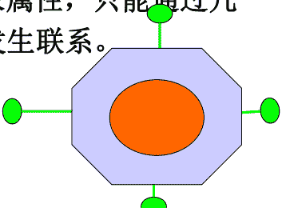

### 3. 继承 (inheritance)

- 总结归纳
- 一般—特殊
- 泛化—特化

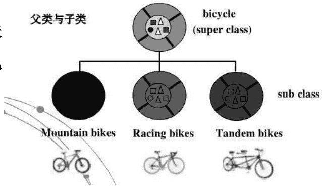

- “软件重用” (software reusability)

  采用继承的方法可以很方便地利用一个已有的类建立一个新的类。

- 类与类之间可以组成继承层次

  一个类的定义（派生类）可以定义在另一个已定义类（基类）的基础上。

  派生类可以继承基类中的属性和操作，也可以定义自己的属性和操作。


Person

Manager
manage();

Worker

Farmer
plant();

Feeder
feed();

### 4. 多态性(polymorphism)

```cpp
CPerson bush;
CDuck donald;
Roar (&bush);    <==>   bush.roar();
Roar (&donald);   <==>   donald.roar();

void Roar (CAnimal* pAnimal)
{
    pAnimal->roar();
}
```

利用多态性，用户可发送一个通用的信息，而将所有的实现细节都留给接受消息的对象自行决定。

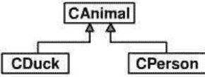


## 第二讲 类与对象

- 类的概念
- 类与结构体
- 类的定义
- 访问权限
- 成员函数

## 何为类class？

- 类是面向对象编程的程序基本单位
- 程序模块是各种由类构成的

- 类是逻辑上相关数据和函数的封装
- 类可以隐藏数据和操作细节

- 类是对问题的抽象描述
- 类的对象使用自己的方法完成对数据的操作

## 1. 结构→类

几点 如何调整

```cpp
int hour, minute, second;
```

```cpp
struct Clock
{
    int hour; // 0-23
    int minute; // 0-59
    int second; // 0-59
};
```

数据类型是对同种数据的抽象

```cpp
struct Clock
{
    int hour;
    int minute;
    int sec;
};
```

```cpp
#include <iostream.h>
int main()
{
    Clock t1;
    setTime(t1);
    showTime( t1 );
    Clock t2;
    setTime(t2);
    showTime( t2 );
    return 0;
}
```

```cpp
void setTime( Clock& t );
void showTime (Clock &t);
```

```cpp
#include <iostream.h>
struct Clock
{
    int hour;
    int minute;
    int sec;
};
void setTime(Clock& t)
{
    cin>>t.hour>>t.minute>>t.sec;
}
void showTime( Clock& t)
{
    cout<<t.hour<<":"<<t.minute<<":"<<t.sec<<endl;
}
```

```cpp
int main( )
{
    Clock t1;
    setTime(t1);
    showTime(t1);
    Clock t2;
    setTime(t2);
    showTime(t2);
    return 0;
}
```

```cpp
class Clock
{
private:
    关于时间的数据;
public:
    读取时间值;
    调整时间值;
};
```


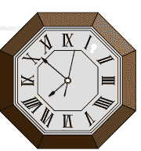

类是数据和操作数据的函数的封装

```cpp
class Clock
{
private:
    int hour;
    int minute;
    int second;
public:
    void set();
    void get();
};
```

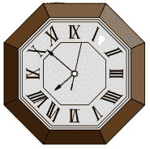

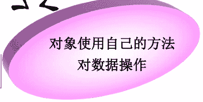

对象使用自己的方法对数据操作

构造

## 1. 结构与类

```cpp
// 改用含成员函数的类来处理
class Clock
{
public:
    void setTime();
    void showTime();
private:
    int hour;
    int minute;
    int sec;
};

int main()
{
    Clock t1;
    t1.setTime();
    t1.showTime();
    Time t2;
    t2.setTime();
    t2.showTime();
    return 0;
}
```

## 2. 类的声明与定义

- 类是用户定义的数据类型，用关键字 `class` 声明。类包含两种成员：数据成员和成员函数。
- 类的定义指包含成员实现的类声明。
- 类使程序员可以构造对象的属性和行为或操作。

类一般定义格式如下：

```cpp
class ClassName {

private:

data member & member function;

public:

data member & member function;

};

Member function definition;
```

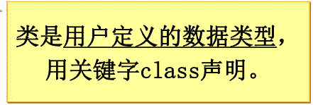

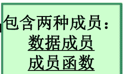


### 定义成员函数

### 1. 类外定义成员函数

```cpp
void Clock::setTime()
{
    cin >> hour;
    cin >> minute;
    cin >> sec;
}

void Clock::showTime()
{
    cout << hour << " :"
         << minute << " :"
         << sec << endl;
}
```

### 2. 类内定义成员函数

```cpp
class Clock
{
public:
    void setTime()
    {
        cin >> hour >> minute >> sec;
    }
    void showTime()
    {
        cout << hour << ":"
             << minute << ":"
             << sec << endl;
    }
private:
    int hour, minute, sec;
};
```

- 成员函数为描述对象的方法。
- 在类的外部定义成员函数：

```cpp
返回类型 类名::成员函数名(参数列表)
{
    函数定义体
}
```

- 在类内直接定义成员函数，默认创建为内联函数。
- 如果成员函数在类体外定义，要用 `inline` 声明为内联函数。

### 成员函数 vs. 一般函数

- 都有函数体，返回值和函数类型。
- 成员函数属于一个类的成员，可出现在类体中；在类体外定义时要加类名和作用域解析符 `::`。
- 成员函数和数据成员封装成一体，可直接引用数据成员。
- 成员函数只能由本类对象或者成员访问，访问说明符限制 `private`、`public`。

## 2. 类的声明与定义

类是一种用户自定义的数据类型，它的一般定义格式如下：

```cpp
class 类名 {

private:
    私有数据成员和成员函数；

protected:
    保护数据成员和成员函数；

public:
    公有数据成员和成员函数；

};

各个成员函数的实现；
```

## 3. 访问控制

- 成员访问说明符决定调用成员的权限以及它的作用域。
- 公有 `public`：说明为公有的成员可以被程序中的任何代码访问。
- 私有 `private`：说明为私有的成员只能被类本身的成员函数及友元类成员函数或友元函数访问；默认情况下，类的成员是私有的。
- 保护 `protected`：除了类本身的成员函数和说明为友元函数或友元类的成员函数可以访问保护成员外，该类的派生类的成员也可以访问。

```cpp
class A
{
private:             // 首次出现时可以省略
    int m_a;
    void set(int a) { m_a = a; }
public:              // 公有成员
    int m_b;
    void show();
};

void A::show() { cout << m_a << m_b << endl; }
```

```cpp
A a;    // 定义A类的对象a
a.m_a;
a.m_b;
a.show();
a.set(5);
```

- `private` 声明的数据和函数不能在类以外访问。
- `public` 声明的数据和函数可以在类以外访问。
- 默认为 `private` 访问类型。

```cpp
class A
{
public:
    int m_b;
    void show();
private:
    int m_a;
    void set(int a)
    { m_a = a; }
};
```

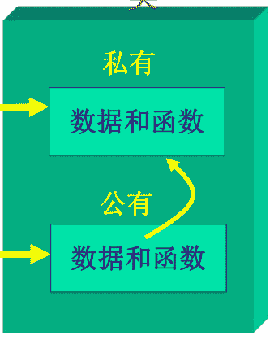

## 课堂练习：完成 Clock 类的定义并对其进行测试

增加 `void setTime(int h, int m, int s);`，注意时间有效性的判断。

应注意区分什么场合用域运算符 `::`，什么场合用成员运算符 `.`，不要搞混。

- 在主函数中调用两个成员函数时，应指明对象名，表示调用的是哪一个对象的成员函数。`Time t1, t2;  t1.setTime(); t2.showTime();`
- 在类外定义函数时，应指明成员函数的作用域 `void Clock::setTime() { cin >> hour >> minute >> sec; }`。在成员函数引用本对象的数据成员时，只需直接写数据成员名，这时 C++ 系统会把它默认为本对象的数据成员。

## 总结

- 类的概念
- 类与结构体的区别
- 类的声明
- 类的定义
- 访问权限

## 课堂练习：声明日期类

声明并定义描述日期的类，对该类进行测试。

```cpp
class Date
{
private:
    int month, day, year;
    int isLeapYear();
public:
    void set(int m, int d, int y);
    void show();
    int getYear();
    int getMonth();
    int getDay();
    int whichDay();
};
```

## 作业与上机

#### 1. 盒子类 BOX

- 数据成员包括：`length`, `width`, `height`
- 成员函数实现以下功能：
  1. 由键盘分别输入三个盒子的长宽高；
  2. 输出盒子的属性；
  3. 计算长方体盒子的表面积和；
  4. 计算长方体盒子的体积。
- 编写基于对象的程序，对该类进行测试。

#### 2. 日期类 Date

- 私有数据成员 `year`, `month`, `day`；
- 公有成员函数实现以下功能：
  1. 设置时间，并对该时间的有效性进行检测；
  2. 输出时间，按 `mm/dd/yyyy` 方式打印；
  3. 判断该日期是一年的第几天；
  4. 判断该日期是星期几（选作）。
- 编写一个驱动程序进行测试。

#### 3. 时间类 Time

- 私有数据成员 `int hour, minute, second`
- 公有成员函数：自定义

用一个 `tick` 成员函数将 Time 对象中存放的时间递增 1 秒。  
Time 对象应该总是保持一致状态。编写一个驱动程序，  
在循环中测试 `tick` 成员函数，按标准格式打印时间，从而  
演示 `tick` 成员函数的工作情况。要保证测试下列情况：  
a) 递增到下一分钟。  
b) 递增到下一小时。  
c) 递增到下一天（即 11:59:59 PM 到 12:00:00 AM）。

### 4. Student 类

每个学生包含姓名、年龄、学号、性别等属性，并且实现显示和设置这些属性的成员函数。

要求：第一次上机检查！

| Student |
| --- |
| `char name[10]` |
| `int no` |
| `char sex` |
| `void set();` |
| `void set(char*, int, char);` |
| `void get();` |
| `char* getName();` |


## 练习

1. 关于类定义格式的描述中，错误的是( )。
   A. 一般类中包含有数据成员和成员函数。
   B. 一般类的定义格式分为说明部分和实现部分。
   C. 类中成员有三种访问方式：公有、私有和保护。
   D. 成员函数都应是公有的，数据成员都应是私有的。

2. 关于类的成员函数描述错误的是( )。
   A. 类中可以有一个或多个成员函数。
   B. 成员函数只能定义在类体外。
   C. 定义在类体外的成员函数前加inline可以成为内联函数。
   D. 在类外定义成员函数时，在函数名前除了加类型说明符外，还需用作用域符号来限定该成员函数所属的类。

3. 类中包含哪两种成员？它们的访问权限有哪些？

4. 下面是Time类的定义部分，找出其中错误：

```cpp
class Time{
public:
// 函数原型省略
private:
int hour=0;
int minute=0;
int second=0;
}
```

## 初识类class

- 类是面向对象编程的程序基本单位
  程序模块是由各种类构成的
- 类是逻辑上相关数据和函数的封装
  类可以隐藏数据和操作细节
- 类是对问题的抽象描述
  类的对象使用自己的方法完成对数据的操作

## 1. 结构一类

几点
如何调整

```cpp
int hour, minute, second;
```

```cpp
struct Clock
{
    int hour; // 0-23
    int minute; // 0-59
    int second; // 0-59
};
```

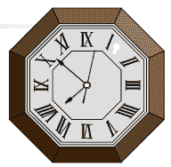


数据类型是对同种数据的抽象

```cpp
struct Clock
{
    int hour;
    int minute;
    int sec;
};
```

```cpp
#include <iostream.h>
int main()
{
    Clock t1;
    setTime(t1);
    showTime( t1 );
    Clock t2;
    setTime(t2);
    showTime( t2 );
    return 0;
}
```

```cpp
void setTime( Clock& t );
void showTime (Clock &t);
```

```cpp
class Clock
{
private:
    关于时间的数据;
public:
    读取时间值;
    调整时间值;
};
```

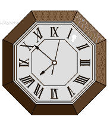


类是数据和操作数据的函数的封装

```cpp
class Clock
{
private:
    int hour;
    int minute;
    int second;
public:
    void set();
    void get();
};
```

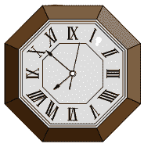

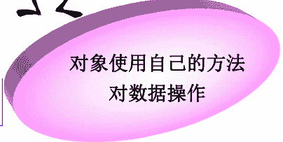

```cpp
//改用含成员函数的类来处理
class Clock
{
public:
    void setTime();
    void showTime();
private:
    int hour;
    int minute;
    int sec;
};

int main()
{
    Clock t1;
    t1.setTime();
    t1.showTime();
    Clock t2;
    t2.setTime();
    t2.showTime();
    return 0;
}
```

## 2. 类的声明与定义

- 类是用户定义的数据类型，用关键字class声明。
  类包含两种成员：数据成员和成员函数。
- 类的定义指包含成员实现的类声明
- 类使程序员可以构造对象的属性和行为或操作

类一般定义格式如下：

```cpp
class ClassName
{
private:
    data member & member function;
public:
    data member & member function;
};
Member function definition;
```


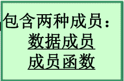


### 定义成员函数

**1. 类外定义成员函数**

```cpp
void Clock::setTime()
{
    cin>>hour;
    cin>>minute;
    cin>>sec;
}
void Clock::showTime()
{
    cout<<hour<<" :"
        <<minute<<" :"
        <<sec<<endl;
}
```

**2. 类内定义成员函数**

```cpp
class Clock
{
public:
    void setTime()
    { cin>>hour>>minute>>sec; }
    void showTime()
    {
        cout<<hour<<":"
            <<minute<<":"
            <<sec<<endl;
    }
private:
    int hour, minute, sec;
};
```

- 成员函数为描述对象的方法
- 在类的外部定义成员函数

```cpp
返回类型    类名::成员函数名(参数列表)
{
    函数定义体
}
```

- 在类内直接定义成员函数，默认创建为内联函数

如果成员函数在类体外定义，则要用inline声明为内联函数

### 成员函数 vs. 一般函数

- 都有函数体，返回值和函数类型。
- 成员函数属于一个类的成员，可出现在类体中；定义在类体外时要加类名和作用域解析符::
- 成员函数和数据成员封装成一体，可直接引用数据成员
- 成员函数只能由本类对象或者成员访问；访问说明符限制private、public

## 3. 访问控制

决定调用成员的权限以及它的作用域

### 成员访问说明符

- 公有 public:
  说明为公有的成员可以被程序中的任何代码访问；
- 私有 private:
  说明为私有的成员只能被类本身的成员函数及友元类的成员函数或友元函数访问，默认类的成员是私有；
- 保护 protected:
  除了类本身的成员函数和说明为友元函数或友元类的成员函数可以访问保护成员外，该类的派生类的成员也可以访问。


```cpp
class A
{
private:    // 首次出现时可以省略
    int m_a;
    void set( int a ) { m_a = a; }
public:    // 公有成员
    int m_b;
    void show();
};

void A::show(){ cout << m_a << m_b <<endl;}
```

```cpp
A a;    //定义A类的对象a
a.m_a;
a.m_b;
a.show();
a.set(5);
```

- private声明的数据和函数不能在类以外访问
- public声明的数据和函数可以在类以外访问
- 默认为private访问类型

```cpp
class A
{
public:
    int m_b;
    void show();
private:
    int m_a;
    void set(int a)
    {
        m_a = a;
    }
};
```

无法从类的外部访问

可以从类的外部访问

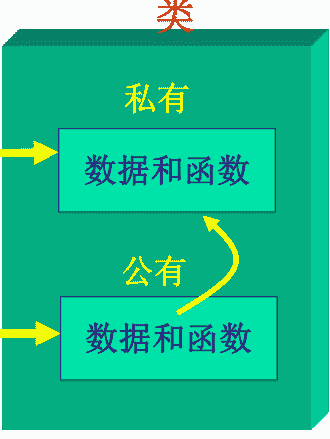


## 课堂练习：完成Clock类的定义并对其进行测试

增加 `void setTime(int h, int m, int s);`  
注意时间有效性的判断

应注意区分什么场合用域运算符“::”，什么场合用成员运算符“.”，不要搞混。

- 在主函数中调用两个成员函数时，应指明对象名。表示调用的是哪一个对象的成员函数。

  `Time t1, t2;    t1.setTime(); t2.showTime();`

- 在类外定义函数时，应指明成员函数的作用域

  `void Clock::setTime()   { cin>>hour>>minute>>sec;}`

  在成员函数引用本对象的数据成员时，只需直接写数据成员名，这时C++系统会把它默认为本对象的数据成员。

## 课堂练习：声明日期类

### 声明并定义描述日期的类，对该类进行测试

```cpp
class Date
{
private:
    int month, day, year;
    int isLeapYear();
public:
    void set( int m, int d, int y ) ;
    void show();
    int getYear(); int getMonth(); int getDay();
    int whichDay();
};
```

## 小结

- 类的概念  
  - 类 vs.结构体  
- 类的声明  
- 类的定义  
  - 成员函数 vs.普通函数  
- 访问权限

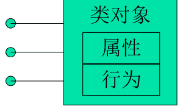

## 成员函数

### 成员函数 vs. 一般函数

- 都有函数体，返回值和函数类型。

- 成员函数属于一个类的成员，出现在类体中

- 成员访问说明符限制private、public

  注意调用它的权限以及它的作用域

- 成员函数必须由对象句柄调用

- 成员函数和数据成员封装成一体

## 类对象的存储方式

用类去定义对象时，系统会为每一个对象分配存储空间。如果一个类包括了数据和函数，要分别为数据和函数的代码分配存储空间。

```cpp
Time t;
sizeof(Time) == sizeof(t)
```

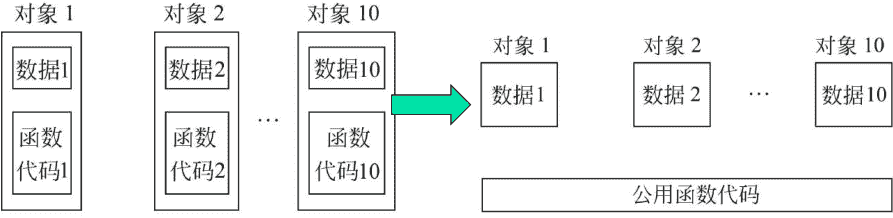

## 4. 类的实例化

类的实例化即定义类的对象 (Object)

对客观世界中事物的抽象描述

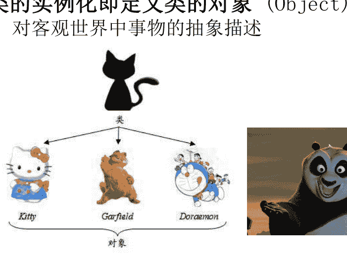

## 4. 类的实例化-对象

### 定义对象有三种形式

#### （1）先声明类类型，后定义对象

```cpp
class Date d1,d2;
// 把class和Date合起来作为一个类名
Date d1,d2;
// 直接用类名定义对象。
```

#### (2) 在声明类类型的同时定义对象

```cpp
class Date
{
    public:
        void Set(int m, int d, int y ){…}
        int IsLeapYear() {…}
        void Print( ) {…}
    private:
        int month;
        int day;
        int year;
} d1, d2;
```

### （3）不出现类名，直接定义对象

```cpp
class
{
    private:
    :
    public:
    :
}d1, d2;
//无类名
//声明以下部分为私有的
//声明以下部分为公用的
//定义了两个无类名的类对象
```

编译系统会为这个对象分配存储空间，以存放对象中的成员。

## 对象的使用

- 由于类和结构是等价的，对类的五种操作对结构也同样适用：

  （1）对象之间可以相互赋值。

  ```cpp
  Location locationA, locationB;
  locationA.set (5,6);
  locationB = locationA;
  ```

  （2）对象可以作为数组的元素。

  ```cpp
  Location arrayloc[100];
  ```

  （3）可以说明指向对象的指针，  
  但不能取私有数据成员的指针或成员函数的地址。

  ```cpp
  Location location[10];
  Location *pointLoc = &location[0];
  ```

  当pointLoc被加1后，它将指向下一个Location对象

  （4）对象可以作为函数的参数，  
  既可作值参也可以作引用参数。

  ```cpp
  void display(Location &location) { ... };
  ```

  （5）一个对象可以是另一个类的成员－类的组合

### 注意：

```cpp
例：
class X
{
    ……
};
class Y
{
    X dataMember; // 声明一个类类型数据成员
    ……
};
```

### 注意：

### 允许已定义类名出现在类的说明中

例：

```cpp
class X
{
    X dataMember ; // 错误
    ......
};
```

> 错误  
> 无穷递归结构

## 预习UML与类的组合

### Student

-name:char [10]  
-no: int  
-sex: char  
-birthday: Date  

+set(): void  
+set( char*, int, char =’m’):void  
+setBrith (Date&)  
+getName(): char*  
+print(): void  

### Date

-day:int  
-month:int  
-year: int  

+set(): void  
+set( int d= 1, int m= 1 , int y = 1990): void  
+getYear(): int  
+getMonth(): int  
+ getDay(): int  

## 对象的使用

一个对象可以是另一个类的成员。

```cpp
class Date {
public:
void set( int, int, int);
void print();
int get_y0;
private:
int month;
int day;
int year;
};
```

```cpp
class Time_date{
public:
void set();
void print();
private:
int hour;
int minute;
int second;
};
```


## 5. 成员的访问

一般用对象访问成员引用形式

**成员访问**运算符“.”和“->”

- 数据成员  
  - 对象名.成员名  
  - 或 对象指针名->成员名  

- 成员函数  
  - 对象名.成员名（参数表）  
  - 或 对象指针名->成员名（参数表）  

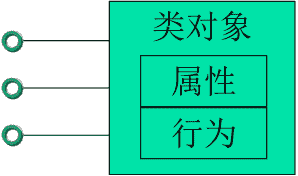

## 2. 成员的访问

- 通过指向对象的指针访问对象中的成员；

```cpp
Time t, *pTime;   //定义对象t和指针变量p
pTime =&t;        //使p指向对象t
cout << pTime ->hour << (*pTime).hour << t.hour ;
```

- 通过对象的引用变量访问对象中的成员。

```cpp
Time t1;   Time &t2=t1;
cout<<t2.hour;
void Fuction( Time& t);
```

## 2. 成员的访问

访问对象中的成员可以有3种方法：

- 通过对象名和成员运算符访问对象中的成员；

```cpp
class A
{
private :
    int m_a;
public:
    int m_b;
    void print(){ cout<<m_a<<m_b };
    int getA(){ return m_a ; }
};
```

```cpp
A a ;
× a.m_a = 5;
✓ a.m_b = 6;
✓ a.print() ;
```


## 类的封装性和信息隐蔽（自习）

### 公用接口与私有实现的分离

- 类中被操作的数据是私有的，实现细节对用户是隐蔽的，这种实现称为私有实现。
- 在声明了一个类以后，用户主要是通过调用公用的成员函数来实现类提供的功能。因此，公用成员函数是用户使用类的公用接口，或者说是类的对外接口。
- 软件工程的一个最基本的原则就是将接口与实现分离，信息隐蔽是软件工程中一个非常重要的概念。

## 类声明和成员函数定义的分离

### 1. 自定义类库头文件.h

文件中有用户自行设计的类的定义，包括类的外部接口（公有成员函数的原型）。任何需要使用这些类的源程序，只要在文件中包含这些头文件即可。

```cpp
// date.h
class Date{
public:
    void set(int m,int d,int y);
    int isLeapYear();
    void print();
private:
    int month, day, year;
};
```

### 2. 用户自定义类库的内部实现源文件

包括相关头文件包含和类中成员函数的定义。

这就形成类的实现方法。

```cpp
//date.cpp
#include<iostream.h>
#include "date.h"
void Date ::set(int m,int d,int y)
{
    month=m; day=d; year=y;
}
int Date :: isLeapYear( )
{
    return
    (year%4==0&&year%100!=0)||(year%400==0);
}
void Date :: print( )
{
    cout <<month <<"'/'" <<day <<"'/'" <<year <<endl;
}
```

### 3. 唯一包含主函数的源文件

包括所有相关头文件及 main

```cpp
#include<iostream.h>
#include "date.h"

void main( )
{
    {
        Date a;
        a.set(2,4,1998);
        a.print( );
    }
}
```

## 课堂练习（分离，实例）

实现表示学生的类 Student，属性包括名字、学号、性别和生日，行为包括：属性的设置和显示等，返回属性值。建立完整的工程，包括多个源文件和头文件。

| Student |
|---|
| char name[10] |
| int no |
| char sex |
| Date birthday |
| void set(); |
| void set(char*, int, char); |
| void set( Date&); |
| char* getName(); |
| int getNo(); |
| void print(); |

```cpp
//student.h
class Student
{
public:
    void display();
private:
    int num;
    char name[20];
    char sex;
};
```

```cpp
//student.cpp
#include <iostream>
#include "student.h"
void Student::display( )
{
    cout<<" num: " <<num<<endl;
    cout<<" name: " <<name<<endl;
    cout<<" sex: " <<sex<<endl;
}
```

```cpp
//main.cpp
#include <iostream>
#include "student.h"
int main()
{
    Student stud;
    stud.display();
    return 0;
}
```

主函数模块
//将类声明头文件包含进来
//定义对象
//执行stud对象的display函数

## 作业与上机

#### 1. 盒子类 BOX

- 数据成员包括： length, width, height
- 成员函数实现以下功能：
  - （1）由键盘分别输入三个盒子的长宽高；
  - （2）输出盒子的属性
  - （3）计算长方体盒子的表面积和
  - （4）计算长方体盒子的体积
- 编写基于对象的程序，对该类进行测试。

#### 2. 日期类 Date

- 私有数据成员 year, month, day;
- 公有成员函数实现以下功能:
  - 1）设置时间，并对该时间的有效性进行检测
  - 2）输出时间，按mm/ dd / yyyy方式打印
  - 3）判断该日期是一年的第几天
  - 4）判断该日期是星期几（选作）
- 编写一个驱动程序进行测试

#### 3. 时间类 Time

- 私有数据成员 int hour, minute, second
- 共有成员函数：自定义

用一个 tick 成员函数将 Time 对象中存放的时间递增 1 秒。Time 对象应该总是保持一致状态。编写一个驱动程序，在循环中测试 tick 成员函数，按标准格式打印时间，从而演示 tick 成员函数的工作情况。要保证测试下列情况：
a) 递增到下一分钟。
b) 递增到下一小时。
c) 递增到下一天（即 11：59：59 PM 到 12：00：00 AM）。

#### 4. student 类

每个学生包含姓名、年龄、学号、性别等属性，并且实现显示和设置这些属性的成员函数。

| Student |
|---|
| char name[10] |
| int no |
| char sex |
| void set(); |
| void set(char*, int, char); |
| void get(); |
| char* getName(); |

## 练习

1. 关于类定义格式的描述中，错误的是（ ）。
A. 一般类中包含有数据成员和成员函数。
B. 一般类的定义格式分为说明部分和实现部分。
C. 类中成员有三种访问方式: 公有, 私有和保护。
D. 成员函数都应是公有的, 数据成员都应是私有的。

2. 关于类的成员函数描述错误的是（ ）
A. 类中可以有一个或多个函数，
B. 成员函数只能定义在类体外
C. 定义在类体外的成员函数前加 inline 可以成为内联函数.
D. 在类外定义成员函数时, 在函数名前除了加类型说明符外, 还需用作用域符号来限定改成员函数所属的类.

3. 类中包含哪两种成员？它们的访问权限有哪些？

4. 下面是 Time 类的定义部分, 找出其中错误：
class Time{
public:
// 函数原型省略
private:
    int hour=0;
    int minute=0;
    int second=0;
}

## 练习

#### 5. 判断对错:

- A. 同类创建的若干个对象的数据结构和其内容都是不同的。
- B. 对象的成员表示与 C 语言中结构变量的成员表示相同。
- C. 一个类可以定义多个对象、指向对象的指针和对象数组。
- D. 一个对象在定义时就被初始化。
- E. 定义一个对象时系统只存储其数据成员, 而不存储对象的成员函数, 成员函数是同一类的对象所共享的。
- F. 一个类中可以只有公共成员, 也可以只有私有成员, 也可以都有。

#### 2. 思考如何访问类成员, 方法有那些?

#### 3. 什么是类, 什么是对象, 他们的区别和联系.

## 第四讲 构造函数


## 构造函数

构造函数是一种用于创建对象特殊的成员函数；

- 特点：
  - 构造函数是与类同名的成员函数
  - 可有任意类型的参数，但没有返回类型
  - 不能由程序员调用，创建对象时自动执行

- 作用：
  - 为对象分配空间；
  - 对数据成员赋初值；
  - 请求其他资源。

## 构造函数种类

- 默认构造函数
- 有参构造函数
- 复制构造函数

### 构造函数的重载

### 1. 默认构造函数

```cpp
class Time
{
public:
    Time() { }
    void set_time(int,int=0,int=0);
    void show_time();
private:
    int hour, min, sec;
};
```

```cpp
#include <iostream.h>
int main()
{
    Time start;
    start.set_time(13, 30 );
    tl.show_time();
    Time end;
    end.show_time();
}
```

在生成类的对象时自动调用
可以初始化类对象的数据成员


## 自定义默认构造函数

一般在构造函数内部设置成员变量的值

```cpp
class Time
{
public:
    Time();
    void set_time(int, int, int);
    void show_time();
private:
    int hour, min, sec;
};

Time::Time()
{
    hour = min = sec = 0;
}
```

### 1. 默认构造函数

在构造函数处初始化成员

```cpp
class Time
{
public:
    Time();
    void set_time(int, int, int);
    void show_time();
private:
    int hour, min, sec;
};

Time::Time() : hour(0)
{
    // hour = 0;
    min = 0;
    sec = 0;
}
```

- 将变量 `hour` 置为 0；
- 这种初始化方法在构造函数执行以前进行。
- 如何用这种方式初始化多个成员变量？
- 有些成员必须这样初始化！

### 2. 有参构造函数

- 带参数的构造函数可以在创建对象时，用具体数值初始化数据成员和各种数据元素。可方便实现对不同对象进行初始化。
- 构造函数的首部：`构造函数名（形参列表）；`
- 定义对象的一般格式：`类名 对象名（实参列表）`

## 带参数的构造函数

> 用参数初始化列表对数据成员初始化

```cpp
class Time
{
public:
    Time(int h, int m, int s) : hour(h), min(m), sec(s) {}
private:
    int hour;
    int min;
    int sec;
};
```

```cpp
#include <iostream.h>

int main()
{
    Time t2(8, 15, 16);
    t2.show_time();
    return 0;
}
```

### 3. 重载构造函数

类的定义中可以有多个构造函数，但必须各个构造函数的形参个数或类型不一样，即重载构造函数。

在创建对象时会根据实参的类型及个数自动选择相应的构造函数。每个对象创建时只调用 1 个构造函数。

默认构造函数必须唯一


## 4. 带默认参数的构造函数

- 默认构造函数
- 有参构造函数
- 带默认参数的构造函数

- 在调用构造函数时没有提供实参，可按默认参数值对对象进行初始化。
- 在构造函数中使用默认参数，可提供建立对象时的多种选择，相当于多个重载构造函数。

```cpp
class Time
{
public:
    Time() : hour(0), min(0), sec(0) {}
    Time(int h = 0, int m = 0, int s = 0) { hour = h; min = m; sec = s; }
private:
    int hour;
    int min;
    int sec;
};
```

```cpp
class Time
{
public:
    Time(int h = 0, int m = 0, int s = 0) : hour(h), min(m), sec(s) {}
    void set_time();
    void show_time();
private:
    int hour;
    int min;
    int sec;
};
......
```

```cpp
#include <iostream.h>

int main()
{
    Time t1,
         t2(2),
         t3(21, 34),
         t4(12, 25, 42),
         t5(27, 74, 99);
    ......
    return 0;
}
```

### 构造函数使用说明

- 默认构造函数/缺省构造函数（default constructor）。系统自动生成的构造函数和无参构造函数属于默认构造函数。一个类中只能有一个默认构造函数。
- 如果在建立对象时用无参构造函数，注意定义对象的语句。
  `Time t1, t2(1,2,3); // OK`
  `Time t(); // error`
- 定义每个对象时只执行多个构造函数中的一个。
- 当构造函数中有默认参数时，注意函数重载的二义性。

## 代码练习

定义 student 类  
每个学生包含姓名、年龄、学号、性别等属性，  
实现成员函数：  
默认构造函数  
有参构造函数  
显示和设置属性的成员函数。

| Student |
| --- |
| char name[10] |
| int no |
| char sex |
| Student(); |
| Student(char*, int, char); |
| void set(char*, int, char); |
| void get(); |
| char* getName(); |

### 设计有理数类/分数类

```cpp
class Rational
{
public:
private:
    int m; // 分母
    int n; // 分子
};
```

```cpp
class Rational
{
public:
    constructors
    set
    get
    print
    四则运算
private:
    int m, n; // 分子
};
```

```cpp
class Rational
{
public:
    Rational(int nn = 1, int mm = 1); // 构造函数
    void print();                     // 输出化简的 分子/分母
    void simple();                    // 约分
    double getValue();                // 返回分数值
    Rational add(Rational & A);       // r = r1.add(r2);
    void sub(Rational & A, Rational & B); // r.sub(r1, r2);
    Rational mul(Rational & A);
    void _div(Rational & A, Rational & B);
private:
    int m; // 分母
    int n; // 分子
};
```

## 练习

1. 判断对错：构造函数用来初始化所定义的对象，如果一个类中没有定义任何构造函数，则该类的对象便无法初始化。

2. 下列构造函数的特点，描述错误的是（ ）。
   A. 构造函数是一种成员函数，它具有一般成员函数的特点。  
   B. 构造函数的名称与其类名相同。  
   C. 构造函数必须指明其类型。  
   D. 一个类中可以定义一个或多个构造函数。

3. 假定一个类的构造函数为  
   `Location(int aa, int bb = 20) { a = aa; b = bb; }`，  
   则执行 `Location x(4, 5);` 后，`x.a` 和 `x.b` 的值分别为（ ）  
   A. 4和5　　B. 5和4　　C. 4和20　　D. 20和5

4. 假定 `ab` 为一个类，则执行 `ab x;` 语句时，将自动调用该类的（ ）  
   A. 有参构造函数　　B. 无参构造函数　　C. 拷贝构造函数　　D. 复制构造函数

### 作业 设计复数类

```cpp
class Complex
{
public:
    // 默认构造函数
    // 有参构造函数
    // 输出复数 -5+3i，4-i 形式的 show
    // 实现四则运算的成员函数
private:
    double real; // 实部
    double imag; // 虚部
};
```

### 上机实验2

### 思考题

1. 你是如何理解类和对象的？举例说明什么是类？什么是对象？它们有何关系？
2. 面向对象的程序设计与结构化程序设计有何不同？
3. 普通函数和成员函数有什么区别？
4. 拷贝构造函数哪些情况下会被调用，请举例说明。
5. 定义类 Point，指出程序中错误并改正，给出程序运行的结果。

## 第三讲 类的实例化

- 定义对象
- 成员引用
- 对象的操作
- 代码分离


## 1. 类的实例化-对象

类的实例化即定义类的对象，类似于定义任何类型的变量（类名称为一个新的类型说明符）

### 定义对象有三种形式

#### （1）先声明类类型，后定义对象

```cpp
class Date d1,d2;
// 把class和Date合起来作为一个类名
Date d1,d2;
// 直接用类名定义对象。
```

#### (2) 在声明类类型的同时定义对象

```cpp
class Date
{
    public:
        void Set(int m, int d, int y ){…}
        int IsLeapYear() {…}
        void Print( ) {…}
    private:
        int month;
        int day;
        int year;
} d1, d2;
```

#### (3) 匿名类定义对象

```cpp
class { //无类名
private: //声明以下部分为私有的
...
public: //声明以下部分为公有的
...
} d1, d2; //定义了两个无类名的类对象
```

编译系统会为这个对象分配存储空间，以存放对象中的成员。

## 对象的使用

- 由于类和结构是等价的，对类的五种操作对结构也同样适用：

（1）对象之间可以相互赋值。

```cpp
Location locationA, locationB;
locationA.set (5,6);
locationB = locationA;
```

（2）对象可以作为数组的元素。

```cpp
Location arrayloc[100];
```

（3）可以说明指向对象的指针，但不能取私有数据成员的指针或成员函数的地址。

```cpp
Location location[10];
Location *pointLoc = &location[0];
```
当pointLoc被加1后，它将指向下一个Location对象

（4）对象可以作为函数的参数，既可作值参也可以作引用参数。

```cpp
void display(Location &location) { ... };
```

（5）一个对象可以是另一个类的成员。

### 注意：

```cpp
例： class X
{
......;
};
class Y
{
    X dataMember ; // 声明一个类类型数据成员
......;
};
```

注意：允许已定义类名出现在类的说明中

```cpp
class X
{
X dataMember ; // 错误
......;
};
```

> 错误 无穷递归结构

## 2. 成员的访问

一般对象的成员引用形式

### 成员访问运算符“.”和“->”

- 数据成员
  - 对象名.成员名
  - 或 对象指针名->成员名
- 成员函数
  - 对象名.成员名（参数表）
  - 或 对象指针名->成员名（参数表）

### 访问对象中的成员可以有3种方法：

- 通过对象名和成员运算符访问对象中的成员；

```cpp
class A
{
private :      // private说明符在首
    int m_a;
public:        // 切换到public说明符
    int m_b;
    void print(){ cout<<m_a<<m_b;}
    int getA(){ return m_a ; }
}
```

- 通过指向对象的指针访问对象中的成员；

```cpp
Time t, *pTime;       //定义对象t和指针变量p
pTime = &t;           //使p指向对象t
cout << pTime->hour << (*pTime).hour << t.hour ;
```

- 通过对象的引用变量访问对象中的成员。

```cpp
Time t1;      Time &t2=t1;
cout<<t2.hour;

void Fuction( Time& t);
```

## 成员的存储方式

用类去定义对象时，系统会为每一个对象分配存储空间。如果一个类包括了数据和函数，要分别为数据和函数的代码分配存储空间。

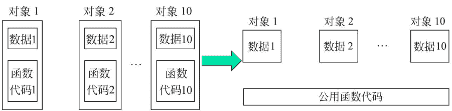

```cpp
cout<<sizeof(Time)<<endl;
```

## 成员函数

### 成员函数 vs. 一般函数

- 都有函数体，返回值和函数类型。
- 成员函数属于一个类的成员，出现在类体中
- 成员访问说明符限制private、public
- 注意调用它的权限以及它的作用域
- 成员函数必须由对象句柄调用
- 成员函数和数据成员封装成一体

## 类的封装性和信息隐蔽

### 1. 公用接口与私有实现的分离

- 类中被操作的数据是私有的，实现细节对用户是隐蔽的，这种实现称为私有实现。
- 在声明了一个类以后，用户主要是通过调用公用的成员函数来实现类提供的功能。因此，公用成员函数是用户使用类的公用接口，或者说是类的对外接口。
- 软件工程的一个最基本的原则就是将接口与实现分离，信息隐蔽是软件工程中一个非常重要的概念。

## 类声明和成员函数定义的分离

### 1. 自定义类库头文件.h

文件中有用户自行设计的类的定义，包括类的外部接口（公有成员函数的原型）。任何需要使用这些类的源程序，只要在文件中包含这些头文件即可。

```cpp
// date.h
class Date{
public:
void set(int m,int d,int y);
int isLeapYear();
void print();
private:
int month, day, year;
};
```

### 2. 用户自定义类库的内部实现源文件

包括相关头文件包含和类中成员函数的定义。这就形成类的实现方法。

```cpp
//date.cpp
#include<iostream.h>
#include "date.h"
void Date ::set(int m,int d,int y)
{
    month=m; day=d; year=y;
}
int Date :: isLeapYear( )
{
    return
    (year%4==0&&year%100!=0) || (year%400==0) ;
}
void Date :: print( )
{
    cout <<month <<"/" <<day <<"/" <<year <<endl;
}
```

### 3. 唯一包含主函数的源文件

包括所有相关头文件及main

```cpp
#include<iostream.h>
#include"date.h"
void main()
{
    Date a;
    a.set(2,4,1998);
    a.print();
}
```

- 在面向对象的程序开发中，一般做法是将类的声明放在指定的头文件中，用户如果想用该类，只要把有关的头文件包含进来即可，不必在程序中重复书写类的声明，以减少工作量，节省篇幅，提高编程的效率。
- 由于在头文件中包含了类的声明，因此在程序中就可以用该类来定义对象。由于在类体中包含了对成员函数的声明，在程序中就可以调用这些对象的公用成员函数。为了实现信息隐蔽，对类成员函数的定义一般不放在头文件中，而另外放在一个文件中。

## 课堂练习（分离，实例）

实现表示学生的类Student，属性包括名字，学号，性别和生日，行为包括：属性的设置和显示等，返回属性值。建立完整的工程，包括多个源文件和头文件。

| Student    |
|------------|
| char name[10] |
| int no    |
| char sex    |
| Date birthday |
| void set();    |
| void set(char*, int, char); |
| void set(Date&); |
| char* getName(); |
| int getNo();    |
| void print();   |


## 预习UML与类的组合

**Student**
-name:char [10]
-no: int
-sex: char
-birthday: Date
+set(): void
+set( char*, int, char ='m'):void
+setBrith (Date&)
+getName(): char*
+print(): void

**Date**
-day: int
-month: int
-year: int
+set(): void
+set (int d=1, int m=1, int y=1990): void
+getYear(): int
+getMonth(): int
+ getDay(): int

## 作业与上机 第一次上机检查！

### 1. 复数类complex

- 设计complex类，进行复数的四则运算。复数的形式如下： real + imaginary * i
- 私有数据成员： real, imag
- 公有成员函数：
  - Show方法： 打印形如(real, imag)的complex值
  - Set方法：设置负数的实部和虚部值
  - get方法： 分别获取实部和虚部值
- 编写一个驱动程序，测试这个类。

## 作业与上机

### 2. 有理数类 Rational

设计一个Rational类，进行分数的运算。
用整数变量表示类的private数据(分子和分母)，数存放成简化形式， 例如分数： 2/4 ， 应在对象中存放成分子1和分母2的形式。
类中包含公有成员函数

- a) 两个Rational值相加，结果保存成简化形式。
- b) 两个Rational值相减，结果保存成简化形式。
- c) 两个Rational值相乘，结果保存成简化形式。
- d) 两个Rational值相除，结果保存成简化形式。
- e) 按a/b形式打印Rational值。
- f) 按浮点数形式打印Rational值

编写一个驱动程序，测试这个类。

## 练习

### 1. 判断对错：

A. 同一类创建的若干个对象的数据结构和其内容都是不同的.
B. 对象的成员表示与C语言中结构变量的成员表示相同.
C. 一个类可以定义多个对象、指向对象的指针和对象数组.
D. 一个对象在定义时就被初始化.
E. 定义一个对象时系统只存储其数据成员，而不存储对象的成员函数，成员函数是同一类的对象所公享的.
F. 一个类中可以只有公共成员，也可以只有私有成员，也可以都有.

2. 思考如何访问类成员，方法有那些？

3. 什么是类，什么是对象，他们的区别和联系.

## 第四讲 构造函数

## 构造函数(constructor)

- 用于初始化对象的特殊成员函数：
- 为对象分配空间；
- 对数据成员赋初值；
- 生成类对象时， 调用构造函数；

## 构造函数

构造函数是一种用于创建对象特殊的成员函数；

- 特点：
  - 构造函数是与类同名的成员函数
  - 可有任意类型的参数，但没有返回类型
  - 不能由程序员调用，创建对象时自动执行

- 作用：
  - 为对象分配空间；
  - 对数据成员赋初值；
  - 请求其他资源。

## 构造函数种类

- 默认构造函数
- 自定义构造函数
- 带默认参数的构造函数
- 重载构造函数

### 1.默认构造函数

```cpp
class Time
{
public:
    Time() { }
    void set_time(int, int, int );
    void show_time( );
private:
    int hour;
    int min;
    int sec;
};
```

```cpp
#include <iostream.h>
int main( )
{
    Time t1;
    t1.set_time( );
    t1.show_time( );

    Time t2;
    t2.show_time( );

    return 0;
}
```

初始化类对象的数据成员，在生成这个类的对象时自动调用。

### 2.自定义默认构造函数

#### 一般在构造函数内部设置成员变量的值

```cpp
class Time
{
public:
    Time();
    void set_time(int, int, int);
    void show_time();
private:
    int hour, min, sec;
};
Time::Time()
{
    hour=0; min=0; sec = 0;
}
```

```cpp
#include <iostream.h>
int main()
{
    Time t;
    t.show_time();
    return 0;
}
```

### 2.自定义构造函数

#### 一个类中只能有一个默认构造函数！

```cpp
class Time
{
public:
    Time();
    void set_time(int, int, int);
    void show_time();
private:
    int hour, min, sec;
};
Time::Time():hour(0)
{
    //hour=0;
    min=0; sec = 0;
}
```

1. 将变量hour置为0；
2. 这种初始化方法在构造函数执行以前进行。
3. 如何用这种方式初始化多个成员变量？

## 3.带参数的构造函数

带参数的构造函数可以在创建对象时，用具体数值初始化数据成员和各种数据元素。可方便实现对不同对象进行初始化。

构造函数的首部：

构造函数名（形参列表）；

定义对象的一般格式：

类名 对象名（实参列表）

## 带参数的构造函数

```cpp
class Time
{
public:
    Time(int h, int m, int s )
private:
    int hour;   int min;   int sec;
};
```

```cpp
#include <iostream.h>
int main( )
{
    Time t2(8, 15, 16);
    t2.show_time( );
    return 0;
}
```

> 用参数初始化列表对数据成员初始化

## 3.重载构造函数

类的定义中可以有多个构造函数，但必须各个构造函数的形参个数或类型不一样，即重载构造函数。

在创建对象时会根据实参的类型及个数自动选择相应的构造函数。

每个对象创建时只调用1个构造函数

## 重载构造函数（代码模拟）

```cpp
class Time
{
public:
    Time(): hour(0), min(0), sec(0)
    {
    }
    Time(int h, int m, int s)
    {
        hour=h,min=m,sec=s;
    }
    ......
private:
    int hour;   int min;  int sec;
};
```

```cpp
#include <iostream.h>
int main()
{
    Time t1;
    t1.set_time();
    t1.show_time();

    Time t2(8,15,16);
    t2.show_time();

    return 0;
}
```


## 4. 带默认参数的构造函数

- 默认构造函数
- 自定义构造函数
- 重载构造函数
- 带默认参数的构造函数

- 在调用构造函数时没有提供实参，可按默认参数值对对象进行初始化。
- 在构造函数中使用默认参数，可提供建立对象时的多种选择，相当于多个重载构造函数。

### 带默认参数的构造函数

```cpp
class Time
{
public:
    Time() : hour(0), min(0), sec(0) {}
    Time(int h, int m, int s);
    Time(int h = 0, int m = 0, int s = 0)
    { hour = h; min = m; sec = s; }
private:
    int hour;
    int min;
    int sec;
};
```

```cpp
class Time
{
public:
    Time(int h = 0, int m = 0, int s = 0) :
        hour(h), min(m), sec(s) {}
    void set_time();
    void show_time();
private:
    int hour;
    int min;
    int sec;
};
```

```cpp
#include <iostream.h>
int main()
{
    Time t1,
         t2(2),
         t3(21, 34),
         t4(12, 25, 42),
         t5(27, 74, 99);
    ......
    return 0;
}
```

### 构造函数使用说明

- 默认构造函数/缺省构造函数（default constructor）：系统自动生成的构造函数和无参构造函数属于默认构造函数，一个类中只能有一个默认构造函数。
- 如果在建立对象时用无参构造函数，注意定义对象的语句。`Time t1, t2(1,2,3); // OK`，`Time t(); // error`
- 定义每个对象时只执行多个构造函数中的一个。
- 当构造函数中有默认参数时，注意函数重载的二义性。

## 代码练习

定义计数器类 Counter，包含：
- 数据成员 m_c，默认值为 0
- 默认构造函数
- 有参构造函数
- 成员函数 set(int)
- 成员函数 get()

测试该类。

定义 Student 类。每个学生包含姓名、年龄、学号、性别等属性。实现成员函数：
- 默认构造函数
- 有参构造函数
- 显示和设置属性的成员函数

| Student |
| --- |
| char name[10] |
| int no |
| char sex |
| Student(); |
| Student(char*, int, char); |
| void set(char*, int, char); |
| void get(); |
| char* getName(); |

## 练习

1. 判断对错：构造函数用来初始化所定义的对象，如果一个类中没有定义任何构造函数，则该类的对象便无法初始化。

2. 下列构造函数的特点，描述错误的是（ ）。
   A. 构造函数是一种成员函数，它具有一般成员函数的特点。
   B. 构造函数的名称与其类名相同。
   C. 构造函数必须指明其类型。
   D. 一个类中可以定义一个或多个构造函数。

3. 假定一个类的构造函数为 `Location(int aa, int bb=20) { a = aa, b = bb; }`，则执行 `Location x(4, 5)` 后，x.a 和 x.b 的值分别为（ ）。
   A. 4 和 5   B. 5, 4   C. 4 和 20   D. 20 和 5

4. 假定 ab 为一个类，则执行 `ab x;` 语句时，将自动调用该类的（ ）。
   A. 有参构造函数   B. 无参构造函数   C. 拷贝构造函数   D. 复制构造函数

## 第五讲 析构函数

### 析构函数（destructor）

- 作用
- 特点
- 调用

- 当一个对象生命期结束时，系统自动调用析构函数进行清除对象、释放内存等。
- 没有定义析构函数时，系统提供缺省版本的析构函数。
- 特点：
  - 析构函数名为：~ 类名
  - 没有参数，也没有返回类型

- 构造函数的反函数，析构函数是用于撤销对象的成员函数，当一个对象生命期结束时，系统自动调用析构函数。
- 析构函数名字为符号“~”加类名。
- 析构函数没有参数和返回值。
- 一个类中只可能定义一个析构函数，析构函数不能重载。
- 析构函数的作用是进行清除对象、释放内存等。

### 析构函数的定义

- 如果一个类没有定义析构函数，编译器会自动生成一个默认析构函数。

其格式如下：

`类名:: ~默认析构函数名() { }` 默认析构函数是一个空函数。

```cpp
class Time
{
public:
    Time();
    Time(int, int, int);
    ~Time() {};
    ......
private:
    int hour, min, sec;
};
```

### 析构函数的调用

- 构造函数与析构函数自动调用：
  1. 一个对象当其结束生命周期时；
  2. 使用 `new` 运算符创建的对象，在使用 `delete` 运算符释放该对象时；
  两种情况下，析构函数将被自动调用。
- 调用顺序取决于执行过程进入和离开实例化对象范围的顺序。一般析构函数的调用顺序与构造函数相反。

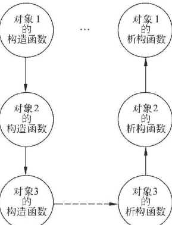

### 构造函数与析构函数的调用

- 创建对象时都要调用构造函数（包括默认构造函数）。构造函数的工作是建立对象的基本结构，进行数据初始化。即：初始化虚函数表；建立基类对象；建立非静态数据成员对象；安置虚基类对象信息；执行构造函数体中的代码。

- 当一个对象结束生命期时，都要调用析构函数。析构函数的工作是：执行析构函数中的代码，将对象占据的存储空间归还系统，做公共及用户要求的善后工作。

### 析构函数

```cpp
class Student
{
public:
    Student();
    Student(int, char*);
    ~Student();
    void display();
private:
    int num;
    char name[10];
};
```

```cpp
class Student
{
public:
    Student();
    Student(int, char*);
    ~Student();
    void display();
private:
    int num;
    char* name;
};
```

### 构造函数与析构函数

```cpp
class Student
{
private:
    int num;
    char* name;
public:
    Student(int no, char* n) : num(no)
    {
        name = new char[strlen(n) + 1];
        strcpy(name, n);
    }
    ~Student() { delete []name; }
    void display() { cout << num << name << endl; }
};
```

问题：设计描述圆的类。

| Circle |
| --- |
| - radius: double |
| - x: int |
| - y: int |
| - col: enum COLOR |
| + pi: double |
| + Circle(double, int, int) |
| + print(): void |
| + area(): double |

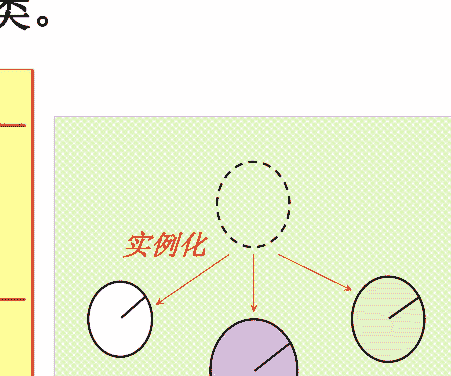

## 作业1：p123 4-10

- 设计一个用于人事管理的 Person（人员）类。人员属性：number（编号）、name（姓名 char* 或 string）、sex（性别）、birthday（出生日期）、id（身份证）等。其中“出生日期”定义为一个日期内嵌对象。用成员函数实现对人员信息的录入和显示。要求：用到构造函数和析构函数、内联成员函数、带默认参数的成员函数。
- 建立完整的工程，分别定义 Date.h、Date.cpp、Person.h、Person.cpp、Main.cpp 文件。
- 下周提交代码。


## 作业2: p123~4-9

- 设计并测试一个Rectangle类，属性为两个点的坐标，其中左下角坐标默认认为原点，成员函数包括计算长方形的长宽 length和width，计算其 perimeter(周长) 和area(面积)，并提供构造函数和相关的 get方法和set方法。

- 给出代码及UML类图

## 练习

- 1. 下面关于析构函数特点描述错误的是( )
    - A. 析构函数名字与类名相同.
    - B. 析构函数中不可以有参数.
    - C. 析构函数定义时不必指出类型.
    - D. 析构函数也是一种成员函数.
    - E. 构造函数和析构函数都可以重载
    - F. 析构函数是一个函数体为空的成员函数.
- 2. 类的构造函数以及析构函数的作用是什么？
  如何定义？执行的时机是什么？

### 改错练习

```cpp
#include <iostream.h>
#include <string.h>
class Person
{
int age;
char *name;
person(int i, char *str)
{
int j=strlen(str);
name=new char[j];
strcpy(name,str);
age=i;
}
}
```

```cpp
~person()
{
delete name;
}
void display()
{
cout << name << " is " << age << " years old.\n";
}
void main()
{
person demo(30,"Li-ming");
display();
}
```

### 改错练习

```cpp
#include<iostream.h>
#include<string.h>
class Person
{ int age;
 char *name;
 person(int i, char *str)
 { int j=strlen(str);
 name=new char[j];
 strcpy(name,str);
 age=i;
 }
```

```cpp
~person()
{delete name; }
} ;
void display()
{ cout<<name<<" is "
<<age<<" years old.\n";
 }
void main()
{
 person demo(30,"Li-ming");
 display();
}
```

## 对象的赋值 assignment

- 同一类的两个对象可以相互赋值，即不同对象的成员分别复制。
- 通过赋值运算符的重载实现。

对象1 = 对象2;

```cpp
Date d1(3, 30, 2010), d2;
d2 = d1;
//d2.set(3, 30, 2010)
```

> 注意：  
> 对象的赋值只对其中的数据成员赋值，  
> 而不复制成员函数。  
> 类的数据成员中不能包括动态分配的数据！

## 对象的复制 copy

```cpp
Date d1(3, 30, 2010);
Date d2 = d1;   //copy constructor
Date d3(d2);   // d3(3, 30, 2010);
```

- 复制构造函数用一个已有同类对象的数据对正在建立的对象进行数据初始化.
- C++为类提供默认版本的复制构造函数
- 程序员可以定义用户版本的复制构造函数

语法形式  
`类名 :: 类名（const 类名 & 引用名 ）;`

### 默认复制构造函数

```cpp
Date d1(3, 30, 2010);
Date d2 = d1;   Date d3(d2);

class Date
{
    int year, month, day;
    public:
    Date(int m, int d, int y);
    Date(const Date& d);
    void set(int m, int d, int y);
    void get();
};

Date::Date(const Date& d)
{
    year = d.year;
    month = d.month;
    day = d.day;
}
```

将d对象中的数据成员的值赋给新定义的对象中的对应的数据成员

## 复制构造函数

- 对于类来说，拷贝构造函数是必须的；
- 没有定义，则生成默认的拷贝构造函数内置在类中；
- 默认拷贝构造函数是单参数的，而且参数是同属一类的对象；
- 拷贝构造函数可以被重载。

### 复制构造函数的执行

- 用已有对象初始化创建对象时；
- 当对象作函数参数时，要用实参初始化形参对象；对象引用调用 —不会调用构造函数和析构函数
- 函数返回对象时

返回一个临时对象，这样调用一次临时对象的析构函数

## 代码模拟

## 调用复制构造函数的时机

```cpp
class Box
{
public :
Box( );
Box(const Box&);
void set(int, int, int);
double volume( );
private:
float length; float width; float height;
};
```

```cpp
void main()
{
Box shoesBox;
Box b1 = shoesBox;
Box b2(b1);
}
```

```cpp
Box::Box(const Box & b )
{
cout<<"Copy constructor."<<endl;
length=b.length ; width=b.width ;
height=b.height;
}
```

## 调用复制构造函数的时机

```cpp
class Box
{
public :
    Box( );
    Box(const Box&);
    void set(int, int,int);
    double volume( );
private:
    float length;   float width;   float height;
};
```

```cpp
void test (Box b)
{   cout<<" test function: "<<endl;  }
void main()
{   Box b ( 1, 2 ) ;
    test ( b ) ;      // 调用复制构造函数
}
```

> 一个带类参数的函数

## 复制构造函数

- 默认复制构造函数可以完成对象的数据成员值简单的复制—浅拷贝；
- 对象的数据资源是由指针指示的堆时，默认复制构造函数仅作指针值复制，需显式定义复制构造函数-深拷贝。

## 代码练习，程序探讨

## 浅复制和深复制

```cpp
//一个有问题的程序
class myString
{
    public :
        myString(char *pn) ;
        ~myString( ) ;
    private:
        char *pStr ; //指向字符串的指针
        int size ; //包含字符的数目
} ;
```

## 浅复制和深复制

```cpp
myString::myString(char *pn)
{
    pStr = new char[strlen(pn)+1] ;
    if (pStr!=0) strcpy(pStr,pn) ;
    size = strlen(pn) ;
}
myString::~myString()
{
    pStr[0] = '\0' ;
    delete []pStr ;
    size = 0 ;
}
```

## 一个有问题的程序

```cpp
#include<iostream>
using namespace std;
#include "myString.h"
```

```cpp
void main()
{
    myString Obj1("No Name") ;
    myString Obj2 = Obj1 ;
}
```

## 浅复制和深复制

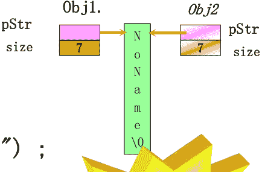


## 浅复制和深复制

## 修改程序

```cpp
#include<iostream.h>
#include<string.h>
class String
{ public :
    myString(char *pn) ;
    myString(String Obj &);
    ~ myString() ;
private :
    char *pStr ;
    int size ;
myString::myString( String Obj &)
{
    pStr = new char[strlen(Obj.pStr)+1] ;
    if (pStr!=0) strcpy(pStr, Obj.pStr) ;
    size = Obj.size ;
}
```

## 总结：复制构造函数

- 默认复制构造函数可以完成对象的数据成员值简单的复制；
- 对象的数据涉及资源时，显式定义复制构造函数

### 调用

复制构造函数只适用于初始化：

- 用一个对象显式初始化另一个对象。
- 函数值传递
- 生成临时对象

## 练习

1. 设A为test类的对象且赋有初值，则语句test B=A;表示( )  
A. 语法错误    B. 为对象A定义一个别名  
C. 将对象A复制给对象B  D. 仅说明B和A属于同一个类

2. 假定AB为一个类，则该类的拷贝构造函数的声明语句为______。

- A. AB &(AB x)    B. AB(AB x)  
- C. AB(AB &)    D. AB(AB * x)

3. 假定AB为一个类，则执行“AB a(4), b[3], * p[2];”语句时，自动调用该类构造函数的次数为______。

- A. 3    B. 4    C. 6    D. 9

4. 假定AB为一个类，则执行“AB a[10];”语句时，系统自动调用该类的构造函数的次数为______。

## 第六讲 复制构造函数

## copy constructor

## 构造函数 constructor

- 默认构造函数 default
- 有参构造函数
- 复制构造函数 copy
- 语法形式
- 调用时机
- 深复制与浅复制

## 赋值运算符 vs 拷贝构造函数

```cpp
Date d1(3 , 30,2010), d2;
d2 = d1;        //assignment
Date d3 = d1;   //copy constructor
Date &d4 = d1;  //reference
```

## 对象的赋值 assignment

- 同一类的两个对象可以相互赋值，不同对象的成员分别复制。
- 通过赋值运算符实现。

### 对象1 = 对象2；

```cpp
Date d1(3, 30, 2011), d2;
d2 = d1; //d2.set(3, 30, 2010)
```

> 注意：
> 对象的赋值只对其中的数据成员赋值，
> 而不复制成员函数。
> 含有特殊数据成员的类需要重载=

## 对象的复制 copy

Date d1 (3, 30, 2010) ;
Date d2 = d1; //copy constructor
Date d3(d2); // d3(3, 30, 2010) ;

- 复制构造函数用一个已有同类对象的数据  
  对正在建立的对象进行数据初始化.
- C++为类提供默认版本的复制构造函数
- 程序员可以定义用户版本的复制构造函数

语法形式

类名 :: 类名（const 类名 & 引用名 ）；

## 1.复制构造函数

- 对于类来说，拷贝构造函数是必须的；
- 类中没有定义则生成默认的拷贝构造函数；
- 默认拷贝构造函数是单参数的，而且参数是同属一类的对象；

- 语法形式  
  类名 :: 类名（const 类名 & 引用名 ）；

## 2.复制构造函数的执行

- 用已有对象初始化创建对象时；
- 当对象作函数参数时，要用实参初始化形参对象对象引用调用 —不会调用构造函数和析构函数
- 函数返回对象时

返回一个临时对象，这样调用一次临时对象的析构函数

## 代码模拟

```cpp
class Box
{
public :
    Box( );
    Box(const Box&);
    void set(int, int, int);
    double volume( );
private:
    float length; float width; float highth;
};
```

## 调用复制构造函数的时机

```cpp
void main()
{
    Box shoesBox;
    Box b1 = shoesBox;
    Box b2(b1);
}
```

```cpp
Box::Box(const Box & b )
{
    cout<<"Copy constructor."<<endl;
    length=b.length ; width=b.width ;
    highth=b.highth;
}
```

## 调用复制构造函数的时机

```cpp
class Box
{
public :
    Box( );
    Box(const Box&);
    void set(int, int,int);
    double volum( );
private:
    float length;   float width;   float hight;
};
```

```cpp
void test (Box b)
{   cout<<“ test fuction: ”<<endl;  }
void main()
{   Box b ( 1, 2 ) ;
    test ( b ) ;      // 调用复制构造函数
}
```

> 一个带类参数的函数

## 复制构造函数

- 默认复制构造函数可以完成对象的数据成员值简单的复制—浅拷贝；
- 对象的数据资源是由指针指示的堆时，默认复制构造函数仅作指针值复制，需显式定义复制构造函数-深拷贝。

## 代码练习，程序探讨

## 浅复制和深复制

//一个有问题的程序
class myString
{
public:
    myString(char *pn);
    ~myString();
    void set(char* pn);
private:
    char *pStr ;
    int size ;
};

myString :: myString(char *pn)
{
    pStr = new char[strlen(pn)+1] ;
    if (pStr!=0) strcpy(pStr,pn);
    size = strlen(pn) ;
}

myString :: ~ myString()
{
    pStr[0] = '\0' ;
    delete []pname ;
    size = 0 ;
}

## 浅复制和深复制

## 修改程序

```cpp
#include<iostream.h>
#include<string.h>
class String
{ public :
    myString(char *pn) ;
    myString(name Obj &);
    ~ myString() ;
private :
    char *pStr ;
    int size ;
myString::myString( String Obj &)
{
    pStr = new char[strlen(Obj.pStr)+1] ;
    if (pStr!=0) strcpy(pStr, Obj.pStr) ;
    size = Obj.size ;
}
```


## 总结：复制构造函数

- 默认复制构造函数可以完成对象的数据成员值简单的复制；
- 对象的数据涉及资源时，显式定义复制构造函数

### 调用

复制构造函数只适用于初始化：

- 用一个对象显式初始化另一个对象。
- 函数值传递
- 生成临时对象

## 练习

1. 设 A 为 test 类的对象且赋有初值，则语句 test B=A; 表示（ ）
A. 语法错误    B. 为对象 A 定义一个别名  
C. 将对象 A 复制给对象 B  D. 仅说明 B 和 A 属于同一个类

2. 假定 AB 为一个类，则该类的拷贝构造函数的声明语句为______。

- A. AB &(AB x)    B. AB(AB x)  
- C. AB(AB &)    D. AB(AB * x)

3. 假定 AB 为一个类，则执行“AB a(4), b[3], * p[2];”语句时，自动调用该类构造函数的次数为______。

- A. 3    B. 4    C. 6    D. 9

4. 假定 AB 为一个类，则执行“AB a[10];”语句时，系统自动调用该类的构造函数的次数为______。

## 第七讲 静态成员 & const成员

## 类的共享机制

### 对象1

数据1

数据2

### 对象2

数据1

数据2

### 对象3

数据1

数据2

成员函数

函数1

函数2

数据3

函数3

静态成员

## 静态成员

class X { char ch ; static int s;
...... };
int X :: s = 0 ;
object A , B , C , D ;

X B ;
char ch ;

X A ;
char ch ;

static int s ;

X C ;
char ch ;

X D ;
char ch ;

## 静态类成员数据

- 静态数据成员的使用方法如下：

1）静态数据成员的定义与一般数据成员相似，  
   但前面要加上static关键词。

2）静态数据成员的初始化与一般数据成员不同，  
   静态数据成员初始化的格式如下：
   `<类型> <类名>::<静态数据成员> = <值>;`

3）在引用静态数据成员时采用格式：
   `<类名>::<静态数据成员>`
   `<对象名>.<静态数据成员>`

## 静态类成员数据

```cpp
class A
{
    static int var;    //在类的内部声明
    ...
};
int A::var = 1;        //在类的外部定义

A :: var              //通过类名访问
a.var                 //通过对象名访问
pA->var               //通过指向对象的指针访问
```

## //例 静态数据成员的说明和初始化

```cpp
#include<iostream.h>
class Counter
{
    static int num;
public:
    void setnum(int i);
    void shownum();
};
int Counter::num = 0;
void main()
{
    Counter a, b;
    a.shownum();       b.shownum();
    a.setnum(10);
    a.shownum();       b.shownum();
}
```

> 声明私有静态数据成员  
> 访问同一个静态数据成员  
> 调用成员函数访问私有静态数据成员  

## 例 使用公有静态数据成员

```cpp
#include<iostream.h>
class counter
{
public:
        void setnum ( int i ) { num = i ; }
        void shownum ( ) { cout << num << '\t' ; }
        static int num ;
} ;
int counter :: num = 1 ;        // 初始值为1
void main()
{
  int i ;
  for ( i = 0 ; i < 5 ; i ++ )
  {
    counter :: num += i ;
    cout << counter :: num << '\t' ;
  }
  cout << endl ;
}
```

> 访问  
> 公有静态数据成员  

## 静态类成员数据

### ➢ 静态数据成员 vs 全局变量

静态数据成员是各对象之间的数据沟通的渠道，  
实现数据共享。

全局变量破坏了封装的原则，不符合面向对象程序的要求。

公用静态数据成员与全局变量的作用域不同  
静态数据成员的作用域只限于定义该类的作用域内

## 静态成员函数

- 静态成员函数的定义是在一般函数定义前加上static 关键字。
- 静态成员函数不与某个具体的对象相联系，它是属于类的。
- 调用静态成员函数的格式如下：

<类名>::<静态成员函数名>（<参数表>）；或<对象名>.<静态成员函数名>（<参数表>）；

## 代码模拟一统计对象的数目

```cpp
#include<iostream.h>
class Counter
{
	static int num ;
	public :
		Counter() { num++; }
		~Counter() { num--; }
		void setnum ( int i ) { num = i ; }
		void shownum() { cout << num << '\t' ; }
		static int get() { return num ; }
} ;
int Counter :: num = 0 ;
void main ()
{
	Counter a ; a.shownum()
	Counter b ; b.shownum()
	cout<<Counter::get() <<endl;
}
```

> 调用 公有静态成员函数  

## 静态成员函数

- 静态成员函数只能访问静态数据成员、静态成员函数和类以外的函数和数据。
- 静态成员函数不能访问类中的非静态数据成员。
- 因为没有this指针。
- 静态数据成员和静态成员函数可由任意访问权限许可的函数访问。
- 私有静态成员函数不能由外界访问。

## 代码分析

//学生平均分  
#include <iostream.h>  
class Student  
{ public:  
    Student(int n,int a,float s):num(n),score(s)  
    { count++; }  
    void total() { sum+=score; }  
    static float average() { return sum/count; }  
private:  
    int num;  
    float score;  
    static float sum;  
    static int count;  
};

> 最好只用静态成员函数  
> 引用静态数据成员，  
> 而不引用非静态数据成员。

```cpp
float Student::sum=0;    //对静态数据成员初始化
int Student::count=0;    //对静态数据成员初始化

int main( )
{
    Student stud[3]={    Student(1001, 18, 70),
                    Student(1002, 19, 78),
                    Student(1003, 20, 98)  };
    for(int i=0;i<3;i++)
        stud[i].total( );

    cout<<"the average score of is "
        << Student::average( )<<endl;
    return 0;
}
```

## const与类

- const 对象与常引用
- const 成员变量
- const 成员函数


## const与类

### 1. const 对象

- 用 **const** 声明的对象称为常量对象。

```cpp
const Date d1;
Date::Date(const Date & d);
Date dQ(d1);
```

- **const** 对象只能调用它的 **const** 成员函数，
  而不能调用其他成员函数。

### 2. const 成员函数

- 使用**const**关键词说明的函数称为常量成员函数，说明格式如下：

  `<类型> <函数名>(<参数表>) const;`

- **const** 成员函数的定义格式如下：

  `<类型> <函数名>(<参数表>) const`
  
  `{ ...... }`

- 若成员函数**不修改对象**,则声明为**const.**

对于const 成员函数需要注意以下几点：

1. const是函数类型的一个组成部分，因此在实现部分也要带const关键词。
2. 常成员函数不更新对象的数据成员，也不能调用该类中非常成员函数。
3. const关键词可以参与区分重载函数。
   ```cpp
   void print();
   void print() const;
   ```
   则这是对print的有效重载。

```cpp
class Time
{
public:
    Time(int h = 0, int m = 0, int s = 0)
    :hour(h),minute(m),second(s) { }
    void setTime( int h, int m, int s)
    { hour=h; minute= m; second =s; }
    void show() const;
private:
    int hour, minute, second;
};
main()
{
    const Time t(20, 20, 20) ;
    t.show() ;
    t.setTime(30, 39, 39) ; //error
}
```

### 3. const 成员变量

- 用 const 声明的成员变量为常量成员变量

- const 成员变量只能由构造函数通过初始化列表对该数据成员进行初始化。

```cpp
class Time {
public:
    Time(int h = 0,int m = 0,int s = 0) ;
    void setTime( int, int, int );
    int setHour(int );
    int getHour();
    int getMinute();
    void print ();
private:
    const int hour;
    int minute; // 0
    int second; // 0
};
Time wakeUp( 6, 45, 0 );
wakeUp.setHour( 8 );
wakeUp.getHour();
wakeUp.print ();
```

## 课后作业1

商店经销一种货物，货物成箱购进，成箱卖出，购进和卖出时以重量为单位，各箱的重量不一样，单价不一样，因此商店需要记录下目前库存的货物的总重量和总价值。编写一个程序，通过定义类Carlo来模拟商店货物购进和卖出的情况。（本题目主要练习静态数据成员的使用，定义私有变量存每件货物的价格和重量，用静态数据成员存货物的总重量和总价钱，定义构造函数和析构函数，当定义新的对象完成初始化的功能和删除对象时，从总重量和总价钱中减去对象的重量和价格）

## 课后作业2

定义一个double型的动态集合，集合中元素数目没有限制，可由用户任意输入，添加适当的成员函数，实现集合的相关操作。包括实现将集合置空、添加元素、删除元素、判断元素是否在集合中、输出集合中数据的成员；并实现集合的并与交操作。注意集合中元素不能重复！

## 课后作业3

- 设计一个整数链表类，满足栈操作。
  即总在链表首插入结点，总在链表首取出（删除）结点。类中需有记录结点个数的数据成员。如果链表为空，而要做取出结点操作，则类必须给出错误信息。

- 具体要求见上机实验3 类的应用，上机检查！

## 练习

1. 以下关于静态成员函数的叙述不正确的是（ ）
   A. 静态成员函数属于整个类
   B. 对静态成员函数的引用允许使用对象名
   C. 在静态成员函数中不能直接引用类的非静态成员
   D. 使用类名可以直接调用其静态成员函数

2. 如果一个成员函数只存取一个类的静态数据成员，可将该成员函数说明为静态成员函数。

3. 在类的构造函数中，可以对类的静态数据进行初始化。

4. 假定类AB中有一个公用属性的静态数据成员bb，在类外不通过对象名访问该成员bb的写法为____________________。

## 练习

5. 对const与类，理解不正确的为： （ ）

   A. 可以用const限制对象、数据成员或成员函数；

   B. 常成员函数不能修改对象的数据成员，但能调用该类中非常成员函数；

   C. const数据成员只能由构造函数通过初始化列表对其进行初始化；

   D. const 对象只能调用它的const 成员函数，而不能调用非常成员函数；

## 代码练习

根据要求，写出类gamma.
int main()
{
gamma g1;
gamma::showtotal();

gamma g2, g3;
gamma::showtotal();

g1.showid();
g2.showid();
g3.showid();
cout << "----------end of program----------\n";
return 0;
}

## 第八讲 复杂对象 & this指针

### 一、复杂的对象表示与应用

- 类的关系
- 对象的数组
- 对象指针

### 1. 类的关系

问题：设计描述圆的类。

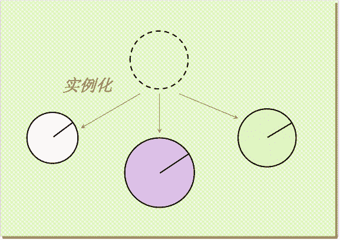

### 1. 类的包含关系

问题：设计描述圆的类。

| Circle |
| --- |
| -radius:double |
| - x:int |
| _ y:int |
| - col: enum COLOR |
| +pi: double |
| +Circle(double, int, int) |
| +print():void |
| +area():double |

### 1. 类对象作为成员

#### 问题：设计描述圆的类。

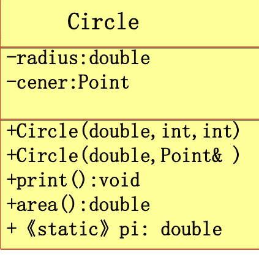

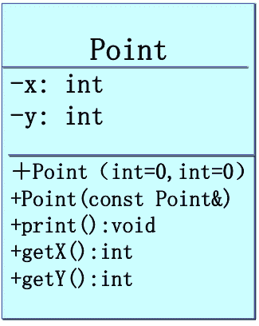

### 2.对象数组

对象数组的元素为同类对象，即相同属性的不同实体构成对象数组。

对象数组的定义与初始化

```
类名 数组名[元素个数];
```

```
类名 数组名[元素个数] = {初始化列表} ;
```

> 为使对象数组合理初始化，应提供合适的构造函数：
> (1) 使用默认构造函数；
> (2) 若有用户自定义构造函数，则必须含有有一个不带参数或具有一个带默认参数的构造函数。

```cpp
class Box
{
public:
    Box(int = 0 ,int =0, int =0 );
    int volume();
private:
    int height; int width;int length;
};
```

```cpp
int main()
{ Box a[3]={ Box(10,12),
    Box(15,18,20)
};
for( int i = 0; i<3;i++)
    cout<<a[i].volume()<<endl;
Box *p =new Box[10];
delete [ ] p;
}
```

### 思考题

- 关于扑克牌的游戏

- 洗牌与发牌

```cpp
class card
{
private:
	int number; //2 to 10, jack, queen, king, ace
	Suit suit; //clubs, diamonds, hearts, spades
public:
	card(); //constructor
	void set(int, Suit); //set card
	void display(); //display card
};
```


## 程序设计思考题

- 关于扑克牌的游戏
- 实现洗牌与发牌
- 包括card类、player类、game类等
- main函数用于测试
- 以小组为单位开发，要求提交书面报告！
- 报告包括：需求分析、系统设计（UML图）
- 代码实现、运行结果和总结及分工。

## 3.对象指针

- 对象指针的声明格式：
  类名 * 指针名；

- 使用对象指针访问成员的方法：
  指针名 ->成员名
  或 (*指针名).成员名

## 复杂的对象表示

- 对象参数传递到函数  
  传值方式和传地址方式。

- 对象指针  
  对象可以直接引用，也可以通过对象指针来引用。  
  注意：  
  当指针加1或减1时，它的增加或减少方式会使指针指向其基类型的下一元素或上一元素。

## 二.this指针

- 当一个成员函数被调用时，自动向它传递一个 隐含的参数，该参数是一个指向该对象的指针。  
- 成员函数中可以用**this**关键字来引用该指针。

- 当调用成员函数时，它被初始化为被调用函数所在的类实例的地址。

- 使用this指针访问成员数据  
  this->num   (*this).num

```cpp
#include<iostream.h>
class Simple
{ int x, y ;
public :
void setXY ( int a, int b) { x = a ; y = b ; }
void printXY() { cout << x << "," << y << endl ; } ;
} ;
void main()
{ Simple obj1 (10, 15 ), obj2, obj3 .
obj1 . printXY ( ) ;
obj2 . setXY ( 20, 25 ) ;
obj2 . printXY ( ) ;
obj3 . setXY ( 30, 35 ) ;
obj3 . printXY ( ) ;
}
```

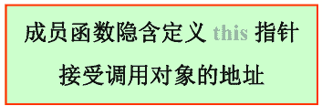


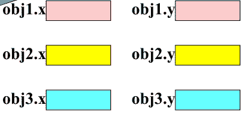

```cpp
class Simple
{
    int x, y;
public:
    void setXY ( int a, int b ) { x = a; y = b; }
    void setXY ( int a, int b ) { this->x = a; this->y = b; }
};

void main()
{
    Simple obj1 (10, 15), obj2, obj3;
    obj1.printXY ( );
    obj2.setXY (20, 25 );
    obj2.printXY ( );
    obj3.setXY (30, 35 );
    obj3.printXY ( );
}
```

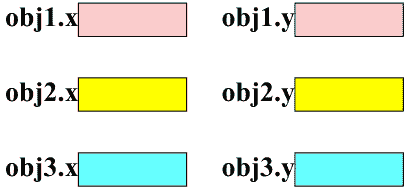

## this指针（Box类）

int Box::volume( Box *this )
{return(this->height * this->width*this->length);}

class Box
{
public:
Box(int =10,int =12,int =15):
int volume( )
{ return(height*width*length);}
static int get() { return counter;}
private:
int height; int width; int length;
};

Box a(10, 20, 30);
a.volume( ); // a.volume(&a);

Box * const this
this 指针不能显式声明

成员函数拥有this 指针

## this指针

- Note

this指针只能在类的成员函数中使用，它指向调用该成员函数被的对象。

Point.cpp

this指针常用于返回当前对象自身。大量用于运算符重载成员函数设计中。

## 作业

完成点类的定义，类声明如下，重载类成员函数copy用于实现两个对象的相互拷贝，要求显式使用this 指针实现copy的定义。测试该类的所有成员函数。

```cpp
class Point
{
public:
    Point(int = 0,int b = 0);
    Point(const Point& rP) ; // 拷贝构造
    void copy(Point& rP);
    void copy(Point* pP);
    void print();
private:
    int x,y;
};
```

## 作业

- 设计老师类，每个老师有姓名和研究方向，还可以指导若干个研究生；
- 每名研究生有姓名，专业和学号；
- 编写一个程序，创建包含三个教师的数组，用初始化列表初始化教师的信息。
- 输入每个老师的指导所有研究生的信息，
- 输出所有教师的相关信息，包括指导学生情况。

- 上机检查

## 练习

1.假定AB为一个类，则执行“AB a(4), b[3], * p[2];”语句时，自动调用该类构造函数的次数为（ ）。

A. 3    B. 4    C. 6    D. 9

2. 以下程序的运行结果是。

```cpp
#include<iostream.h>
#include<string.h>
class person
{ int age; char *name;
public:
person(int i, char *str)
{ int j; j=strlen(str)+1;
name=new char[j];
strcpy(name, str);
age=i;
}
~person()
{delete name;
cout<< “destructor is called.\n” ;
}
void display()
{ cout<<name<<” is ”<<age<<”
years old.\n” ; }
};
void main()
{person demo(30, ” Li-ming” );
demo.display();
}
```

## 练习

3.设有以下类和对象的定义：
class A
{public:
int m;
...
};
A k1,k2,*p1,*p2;
则下面针对成员变量m的引用，正确的是( )
A. k1.m=1; B. k2->m=2; C. p1.m=3; D. (*p2)->m=4;

## 第九讲 友元

- 友元函数
- 友元类

## 友元 (friend)

- 友元可以访问与其有好友关系的类中的私有成员和保护成员。
  
  友元包括友元函数和友元类。
- 使用友员目的是基于程序的运行效率
  
  运算符重载的某些场合需要使用友员
- 为了确保数据的完整性，及数据封装与隐藏的原则，建议尽量不使用或少使用友元。

## 友元函数

- 友元函数是在类声明中由关键字friend修饰说明的非成员函数，虽然类中有友元函数的原型，但是友元不是成员函数。
- 在它的函数体中能够通过对象名访问 private 和 protected成员
  
- 作用：增加灵活性，使程序员可以在封装和快速性方面做合理选择。
  
- 格式如下：
- friend <类型> <友元函数名> （<参数表>）；

```cpp
class A
{
private:
    int num ;
public:
    void MemberFun(int) ;
    friend void FriendFun(A * , int) ;
} ;
```

```cpp
void A:: MemberFun( int x )
{ this-> num = x ; }
```

```cpp
void FriendFun( A * ptr, int x )
{ ptr -> num = x ; }
```

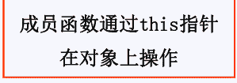

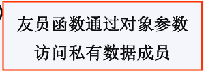


## 友元函数

```cpp
class A
{
 private:
 int num ;
 public:
 void MemberFun(int) ;
 friend void FriendFun(A & , int) ;
 } ;
void FriendFun( A & a , int x )
{ a. num = x ; }
```

```cpp
void A:: MemberFun( int x )
{ (*this). num = x ;}
```

## 例 友元函数的简单例子

```cpp
class Time
{public:
    Time(int, int, int);
    friend void display(Time &);
private:
    int hour, minute, sec;
};

Time::Time(int h, int m, int s)
{   hour=h;   minute=m;   sec=s; }

void display( Time& t )
{
    cout<<t.hour<<" : "<<t.minute<<" : "<<t.sec<<endl; }
```

```cpp
#include <iostream.h>
int main( )
{
    Time t1(10,13,56);
    display(t1);
    return 0;
}
```

## 友元成员函数

```cpp
#include <iostream.h>
class Date;
class DTime
{
public:
    Time(int,int,int);
    void display() const;
private:
    int hour,minute, sec;
    Date d;
};
class Date
{
public:
    Date(int,int,int);
    friend void DTime:: display(Date &) const;
private:
    int month, day, year; };
```

## 友元类

- 当两个类关系极为密切时，可以将类声明为另一个类的友元。友元类通常设计为一种对数据操作或类之间传递消息的辅助类。

- 将一个类声明为另一个类的友元类定义的一般格式如下：

```
friend class 友元类名；
```

- 当一个类作为另一类的友元类时，类的所有成员函数都是另一类的友元函数。

## 友元类

说明：

- 友元关系不具有传递性。

  例如

  类A是类B的友元，类B是类C的友元，

  但并不表示A是C的友元。

- 友元关系不具有交换性。

  例如

  类A是类B的友元，但并不表示类B是类A的友元。

```cpp
class Time
{
public:
    Time(int, int, int);
    void display (Date &);
private:
    int hour, minute, sec;
};
```

```cpp
class Date
{
    public:
        Date(int, int, int);
        void show();
        friend class Time;
    private:
        int month; int day;
        int year;
};
```

说明：

- 友元关系是单向的；

- 友元关系不能传递。

## 友元 (friend)

- 友元可以访问与其有好友关系的类中的私有成员。

友元包括友元函数和友元类。

- 使用友员目的是基于程序的运行效率

运算符重载的某些场合需要使用友员

- 友员关系是单向和非传递的。

## 代码练习

- 设计描述位置的一个点类Point
- 其属性为其x,y坐标，
- 包括设置坐标，显示位置等方法
- 要求：
  - 定义构造函数，复制构造函数；
  - 定义静态成员变量total,存放当前点的数目。
  - 定义求两点距离的友元函数distance。

```cpp
void main()
{
    Point p1 , p2( 4.0, 6.0 ) ;
    Point p3 = p2;
    double d = distance ( p1, p2 ) ;
    cout << "This distance is " << d << endl ;
}
```

## 例 计算两点之间的距离

// 普通函数作友元函数
class Point
{
public:
    Point(double xi = 0, double yi = 0) ;
    setXY(double xx, double yy) ;
    double getX() ;
    double getY() ;
    void show();
    friend double distance ( Point& a, Point& b ) ;
private:
    double X, Y ;
    static int   total;
} ;

## 练习

1. 若需要把一个函数“void F();”定义为一个类AB的友元函数，则应在类AB的定义中加入一条语句：____________________。

2. 以下关于友元函数的叙述不正确的是（ ）

   A. 友元函数提供了类之间数据共享的一个途径
   B. 一个友元函数可以访问任何类的任何成员
   C. 友元函数破坏了数据的封装
   D. 友元函数增加了程序设计的灵活性

3. 友元函数的作用是（ ）

   A. 提高程序的效率  B. 加强类的封装性
   C. 实现数据的隐蔽性  D. 增加成员函数的种类

4. 友元类中的所有成员函数可以对该类的私有成员进行存取操作。

## 作业: 上机实验3~ (4) (5)

(4) 改写复数类，提供各种构造函数(默认/ 有参/ 拷贝构造函数), 实现两个复数的四则运算。用友元函数实现加减乘除功能。

(5) 定义整型数集合类和实型数集合类，每个集合中最多放10个元素。完成集合的设置，输出和复制功能。

## 第十讲 类与对象小结

## 问题: 设计描述圆的类
实现圆的各种操作

## 一、面向对象

- 面向对象的编程思想力图使在计算机语言中对事物的描述与现实世界中该事物的本来面目尽可能的一致。

- 类(class)和对象(object)

  类是对一类事物描述，是抽象、概念上的定义；
  对象是实际存在的该类事物的每个个体，也称实例。

## 一、面向对象类的包含关系

| Point |
| --- |
| -x: int \-y: int |
| +Point (int=0, int=0) +Point(const Point&) +print():void +getX():int +getY():int |

| Circle |
| --- |
| -radius:double \-cener:Point |
| +Circle(double, int, int) +Circle(double, Point& ) +print():void +area():double + 《static》 pi: double |

## 二、类的定义

- 类的概念

- 类与结构体

- 类的声明

- 类的定义

- 类成员的访问权限

## 三、类的实例化

- 定义对象-构造函数
  - 默认构造函数 / 自定义构造函数
  - 带默认参数的构造函数
  - 复制构造函数
- 成员引用
- 复杂对象的操作

## 对象指针与数组

## 四、构造函数

### ➢作用

- 用于初始化对象的特殊成员函数：
- 为对象分配空间；对数据成员赋初值；请求其他资源。

### ➢特点

构造函数是与类同名的成员函数
可有任意类型的参数，但没有返回类型
不能由程序员调用，创建对象时自动执行

### ➢分类

重载构造函数


## 六、复制构造函数

### 调用

复制构造函数只适用于初始化：

- 用一个对象显式初始化另一个对象。
- 函数值传递
- 生成临时对象

### 深复制与浅复制

- 默认复制构造函数可以完成对象的数据成员值简单的复制；
- 对象的数据涉及资源时，显式定义复制构造函数

## 七、数据的共享和保护

### const

定义常对象、常引用、常成员函数和常数据成员，实现数据保护

### static

静态成员属于整个类，提供一种同类对象的共享机制。

### friend

一个类的友元可以直接访问该类各种成员。

## 程序设计思考题

- 关于扑克牌的游戏
- 洗牌与发牌

```cpp
class card
{
private:
    int number; //2 to 10, jack, queen, king, ace
    Suit suit; //clubs, diamonds, hearts, spades
public:
    card( ); //constructor
    void set(int, Suit); //set card
    void display(); //display card
};
```

## 程序设计思考题

### 关于扑克牌的游戏

- 实现洗牌与发牌
- 包括card类、player类、game类等
- main函数用于测试
- 以小组为单位开发，要求提交书面报告！
- 报告包括：需求分析、系统设计（UML图）代码实现、运行结果和总结及分工。

