## 大连理工算法设计课件（LeiWang）


## Course Info

- Instructor: Lei Wang, lei.wang@dlut.edu.cn, tel: 6227 4394
- Textbook: **Introduction to Algorithms**, by Thomas Cormen _et al._, aka, CLRS.
- Courseware: MIT Open Coursework  
  http://ocw.mit.edu/OcwWeb/  
  Electrical-Engineering-and-Computer-Science/  
  6-046JFall-2005/CourseHome/index.htm
- Call for volunteer TAs
- LATEX is strongly recommended

## Goals

- Start using frameworks for describing and analyzing algorithms.
- Examine two algorithms for sorting: insertion sort and merge sort.
- See how to describe algorithms in pseudocode.
- Begin using asymptotic notation to express running-time analysis.
- Learn the technique of "divide and conquer" in the context of merge sort.

## The sorting problem

**Input:** A sequence of \( n \) numbers \( \langle a_1, a_2, \ldots, a_n \rangle \).

**Output:** A permutation (reordering) \( \langle a'_1, a'_2, \ldots, a'_n \rangle \) of the input sequence such that \( a'_1 \leq a'_2 \leq \cdots \leq a'_n \).

## Solution

**Algorithm:** a well-defined computational procedure that takes some value, or set of values, as input and produces some value, or set of values, as output.

## Insertion sort

- A good algorithm for sorting a small number of elements.
- It works the way you might sort a hand of playing cards.

```
INSERTION-SORT(A)
for j ← 2 to length[A]
    do key ← A[j]
        ▹ Insert A[j] into the sorted sequence A[1.. j − 1].
    i ← j − 1
    while i > 0 and A[i] > key
        do A[i + 1] ← A[i]
            i ← i − 1
    A[i + 1] ← key
```

Loop invariants and the correctness of insertion sort

## Using loop invariants is like mathematical induction

- To prove that a property holds, you prove a base case and an inductive step.
- Showing that the invariant holds before the first iteration is like the base case.
- Showing that the invariant holds from iteration to iteration is like the inductive step.
- The termination part differs from the usual use of mathematical induction, in which the inductive step is used infinitely. We stop the “induction” when the loop terminates.
- We can show the three parts in any order.

## Example for insertion sort

## The three parts for insertion sort

- Initialization: Just before the first iteration, j = 2. The subarray A[1..j-1] is the single element A[1], which is the element originally in A[1], and it is trivially sorted.
- Maintenance: we note that the body of the inner while loop works by moving A[j-1] ← A[j-2], A[j-1] ← A[j-3], and so on, by one position to the right until the proper position for key (which has the value that started out in A[j]) is found. At that point, the value of key is placed into this position.
- Termination: The outer for loop ends when j > n; this occurs when j = n + 1. Thus, j = 1 = n. Plugging n in for j in the loop invariant, A[1..n] consists of the elements originally in A[1..n] but in sorted order. The entire array is sorted!

## Random-access machine (RAM) model

- Instructions are executed one after another. No concurrent operations.
- It's too tedious to define each of the instructions and their associated time costs.
- Instead, we recognize that we'll use instructions commonly found in real computers.
  - Arithmetic: add, subtract, multiply, divide, remainder, floor, ceiling; shift left/shift right (good for multiplying/dividing by \(2^k\)).
  - Data movement: load, store, copy.
  - Control: conditional/unconditional branch, subroutine call and return.
- Each of these instructions takes a constant amount of time.

## Running time

On a particular input, **the running time** is the number of primitive operations (steps) executed.

- Want to define steps to be machine-independent.
- Each line of pseudocode requires a constant amount of time.
- One line may take a different amount of time than another, but each execution of line _i_ takes the same amount of time _c<sub>i</sub>_.
- This is assuming that the line consists only of primitive operations.

The running time of an algorithm is:

\(\sum_{\text{all statements}} \text{(cost of statement)} \times \text{(# of times statement is executed)}\)


## Analysis of insertion sort

### Pseudocode with cost line by line

```
INSERTION-SORT(A)
for j <- 2 to length[A]  
    do key <- A[j]  
       |> Insert A[j] into the sorted  
          sequence A[1 .. j-1].
    i <- j - 1
    while i > 0 and A[i] > key
        do A[i + 1] <- A[i]
            i <- i - 1
    A[i + 1] <- key
```

| cost | times |
|------|-------|
| c1 | n |
| c2 | n-1 |
| 0 | |
| c4 | n-1 |
| c5 | Σt=2n tj |
| c6 | Σt=2n (tj - 1) |
| c7 | Σt=2n (tj - 1) |
| c8 | n-1 |

### The running time of Insertion-Sort

```
T(n) = c1n + c2(n - 1) + c4(n - 1) + c5 Σt=2n tj
    + c6 Σt=2n (tj - 1) + c7 Σt=2n (tj - 1) + c8(n - 1)
```

## Analysis of insertion sort, (cont.)

### Best case:

$$T(n) = c_1n + c_2(n-1) + c_4(n-1) + c_5(n-1) + c_8(n-1)$$
$$\quad = (c_1+c_2+c_4+c_5+c_8)n - (c_2+c_4+c_5+c_8)$$
$$\quad = an+b.$$

### Worst case:

$$T(n) = c_1n + c_2(n-1) + c_4(n-1) + c_5\left(\frac{n(n+1)}{2}-1\right)$$
$$\quad + c_6\left(\frac{n(n-1)}{2}\right) + c_7\left(\frac{n(n-1)}{2}\right) + c_8(n-1)$$
$$\quad = an^2+bn+c.$$

## Worst-case and average-case analysis

We usually concentrate on finding the worst-case running time: the longest running time for any input of size n.

- The worst-case running time gives a guaranteed upper bound on the running time for any input.
- For some algorithms, the worst case occurs often. For example, when searching, the worst case often occurs when the item being searched for is not present, and searches for absent items may be frequent.
- Why not analyze the average case? Because it’s often about as bad as the worst case.

## Divide and conquer

Another common approach.

- **Divide** the problem into a number of subproblems.
- **Conquer** the subproblems by solving them recursively.
  - **Base case:** If the subproblems are small enough, just solve them by brute force.
- **Combine** the subproblem solutions to give a solution to the original problem.


## Goals

- Explain the difference between probabilistic analysis and randomized algorithms,
- present the technique of indicator random variables, and
- give another example of the analysis of a randomized algorithm
  (permuting an array in place).

## The hiring problem

### Scenario:

- You are using an employment agency to hire a new office assistant.

- The agency sends you one candidate each day.

- You interview the candidate and must immediately decide whether or not to hire that person. But if you hire, you must also fire your current office assistant even if it’s someone you have recently hired.

- Cost to interview is $c_i$ per candidate (interview fee paid to agency).

- Cost to hire is $c_h$ per candidate (includes cost to fire current office assistant + hiring fee paid to agency).

- You are committed to having hired, at all times, the best candidate seen so far.

## The hiring problem (cont.)

Determine what the price of this strategy will be.

Pseudocode to model this scenario: Assumes that the candidates are numbered 1 to n and after interviewing each candidate, we can determine if it’s better than the current office assistant.

```
HIRE-ASSISTANT(n)
1 best ← 0 ▷ candidate 0 is a least-qualified dummy candidate
2 for i ← 1 to n
3 do interview candidate i
4 if candidate i is better than candidate best
5 then best ← i
6 hire candidate i
```

## Worst-case analysis

- In the worst case, we hire all *n* candidates.
- This happens if each one is better than all who came before. In other words, if the candidates appear in increasing order of quality.


## Probabilistic analysis

In general, we have no control over the order in which candidates appear. We could assume that they come in a random order:

- Assign a rank to each candidate: rank(i) is a unique integer in the range 1 to n.
- The ordered list (rank(1), rank(2), ..., rank(n)) is a permutation of the candidate numbers (1, 2, ..., n).
- The list of ranks is equally likely to be any one of the n! permutations.
- Equivalently, the ranks form a uniform random permutation: each of the possible n! permutations appears with equal probability.

We might not know the distribution of inputs, or we might not be able to model it computationally. Instead, we use randomization within the algorithm in order to impose a distribution on the inputs.

## For the hiring problem: Change the scenario

- The employment agency sends us a list of all *n* candidates in advance.
- On each day, we randomly choose a candidate from the list to interview (but considering only those we have not yet interviewed).
- Instead of relying on the candidates being presented to us in a random order, we take control of the process and enforce a random order.

## What makes an algorithm randomized

An algorithm is randomized if its behavior is determined in part by values produced by a random-number generator.

- **Random(a, b)** returns an integer *r*, where *a* ≤ *r* ≤ *b* and each of the *b* − *a* + 1 possible values of *r* is equally likely.
- In practice, Random is implemented by a **pseudorandom-number generator**, which is a deterministic method returning numbers that “look” random and pass statistical tests.

## Indicator random variables

Given a sample space and an event \(A\), we define the **indicator random variable**

$$
I\{A\}=\begin{cases}1 & \text{if } A \text{ occurs},\\0 & \text{if } A \text{ does not occur.}\end{cases}
$$

### Lemma

For an event \(A\), let \(X_A=I\{A\}\). Then \(E[X_A]=\Pr\{A\}\).

**Proof** Letting \(\overline A\) be the complement of \(A\), we have

$$
E[X_A]=E[I\{A\}]
=1\cdot\Pr\{A\}+0\cdot\Pr\{\overline A\}\qquad\text{(definition of expected value)}
=\Pr\{A\}.
$$

Some examples...

## Analysis of the hiring problem

Assume that the candidates arrive in a random order. Let \(X\) be a random variable that equals the number of times we hire a new office assistant. Define indicator random variables \(X_1, X_2, \ldots, X_n\), where \(X_i = I\{\text{candidate } i \text{ is hired}\}\).

- \(X = X_1 + X_2 + \cdots + X_n\).
- Lemma ⇒ \(E[X_i] = \Pr\{\text{candidate } i \text{ is hired}\}\).
- \(\Pr\{\text{candidate } i \text{ is the best so far}\} = 1/i\), which implies \(E[X_i] = 1/i\).
- We get
$$
E[X] = E\left[\sum_{i=1}^n X_i\right] = \sum_{i=1}^n E[X_i] = \sum_{i=1}^n 1/i \approx \ln n + O(1)
$$
\(\Rightarrow\) the expected hiring cost is \(O(c_h \ln n)\), much better than \(O(c_h n)\).


## Heapsort

- \(O(n\lg n)\) worst case—like merge sort.
- Sorts in place—like insertion sort.
- Combines the best of both algorithms.

To understand heapsort, we’ll cover heaps and heap operations, and then we’ll take a look at priority queues.

## Heap data structure

### Heap as a tree

A heap (not garbage-collected storage) is a nearly complete binary tree.

- **Height** of node = # of edges on a longest simple path from the node down to a leaf.
- **Height** of heap = height of root = \(\Theta(\lg n)\).

### Heap as an array

A heap can be stored as an array A.

- Root of tree is \(A[1]\).
- Parent of \(A[i]\) = \(A[\lfloor i/2 \rfloor]\).
- Left child of \(A[i]\) = \(A[2i]\).
- Right child of \(A[i]\) = \(A[2i + 1]\).
- Computing is fast with binary representation implementation.

## Heap data structure (cont.)

### Heap property

- For max-heaps (largest element at root), **max-heap property**: for all nodes \(i\), excluding the root, \(A[\mathrm{PARENT}(i)] \ge A[i]\).
- For min-heaps (smallest element at root), **min-heap property**: for all nodes \(i\), excluding the root, \(A[\mathrm{PARENT}(i)] \le A[i]\).

By induction and transitivity of ≥, the max-heap property guarantees that the maximum element of a max-heap is **at the root**. Similar argument for min-heaps.


### Figure 6.1

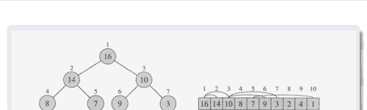

A max-heap viewed as (a) a binary tree and (b) an array. The number within the circle at each node is the value stored at that node. The number above a node is the corresponding index in the array. Above and below the array are lines showing parent-child relationships; parents are always to the left of their children. The tree has height three: the node at index 4 (with value 8) has height one.

## Maintaining the heap property

MAX-HEAPIFY is important for manipulating max-heaps—to maintain the max-heap property.

- Before MAX-HEAPIFY, \( A[i] \) may be smaller than its children.
- Assume left and right subtrees of \( i \) are max-heaps.
- After MAX-HEAPIFY, subtree rooted at \( i \) is a max-heap.

## MAX-HEAPIFY

```
MAX-HEAPIFY(A, i)
1 l ← LEFT(i)
2 r ← RIGHT(i)
3 if l ≤ heap-size[A] and A[l] > A[i]
4     then largest ← l
5     else largest ← i
6 if r ≤ heap-size[A] and A[r] > A[largest]
7     then largest ← r
8 if largest ≠ i
9     then exchange A[i] ↔ A[largest]
10        MAX-HEAPIFY(A, largest)
```

## The way MAX-HEAPIFY works

- Compare \( A[i] \), \( A[\text{LEFT}(i)] \), and \( A[\text{RIGHT}(i)] \).
- If necessary, swap \( A[i] \) with the larger of the two children to preserve heap property.
- Continue until subtree rooted at \( i \) is max-heap.

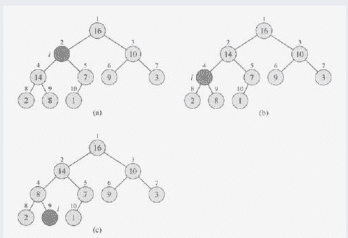

Figure 6.2: The action of MAX-HEAPIFY(A, 2), where A.heap-size[A] = 10. (a) The initial configuration, with A[2] = 6 at node i = 2 violating the max-heap property since it is not larger than both children. The max-heap property is restored for node 2 in (b) by exchanging A[2] with A[4], which destroys the max-heap property for node 4. The recursive call MAX-HEAPIFY(A, 4) now has i = 4. After swapping A[4] with A[9], as shown in (c), node 4 is fixed up, and the recursive call MAX-HEAPIFY(A, 9) yields no further changes to the data structure.

## Building a heap

## BUILD-MAX-HEAP

```
BUILD-MAX-HEAP(A)
1 heap-size[A] ← length[A]
2 for i ← ⌊length[A]/2⌋ downto 1
3     do MAX-HEAPIFY(A, i)
```

**Simple bound:** _O_(_n_) calls to MAX-HEAPIFY, each of which takes _O_(lgn) time → _O_(_n_lgn).


## Heap data structure: Building a heap

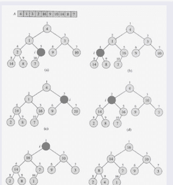

## The Heapsort Algorithm

- Builds a max-heap from the array.
- Starting with the root, the algorithm places the maximum element into the correct place in the array by swapping it with the last array element.
- “Discard” this last node by decreasing the heap size, and calling MAX-HEAPIFY on the new (possibly incorrectly-placed) root.
- Repeat this discarding process until only one node remains.

```
HEAPSORT(A)
1 BUILD-MAX-HEAP(A)
2 for i ← length[A] downto 2
3 do exchange A[1] ↔ A[i]
4 heap-size[A] ← heap-size[A] - 1
5 MAX-HEAPIFY(A, 1)
```

- BUILD-MAX-HEAP: O(n)
- for loop: n - 1 times
- exchange elements: O(1)
- MAX-HEAPIFY: O(log n)

Total time: O(n log n)

## The Heapsort Algorithm
Heap Implementation of Priority Queue

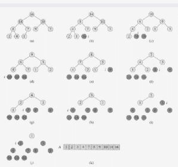

Figure 6-4 The operation of HEAPSORT. (a) The max-heap data structure just after it has been built by BUILD-MAX-HEAP. (b) The max-heap after one call of MAX-HEAPIFY and line 5. The value 16 that was at the root is now at position A[3]. (c) The resulting max-heap after line 5.

## Priority queue

- Maintains a dynamic set $S$ of elements.
- Each set element has a key—an associated value.
- Max-priority queue supports dynamic-set operations:
  - $\operatorname{INSERT}(S,x)$: inserts element $x$ into set $S$.
  - $\operatorname{MAXIMUM}(S)$: returns element of $S$ with largest key.
  - $\operatorname{EXTRACT\mbox{-}MAX}(S)$: removes and returns element of $S$ with largest key.
  - $\operatorname{INCREASE\mbox{-}KEY}(S,x,k)$: increases value of element $x$'s key to $k$. Assume $k \geq x$'s current key value.
  - Example max-priority queue application: **schedule jobs on shared computer.**


## Goals

- Binary search trees, tree walks, and operations on binary search trees.

## Search Trees

- Data structures that support many dynamic-set operations.
- Can be used as both a dictionary and as a priority queue.
- Basic operations take time proportional to the **_height_** of the tree.
- For complete binary tree with _n_ nodes: worst case \(\Theta(lgn)\).
- For linear chain of _n_ nodes: worst case \(\Theta(n)\).
- Different types of search trees include binary search trees, red-black trees (covered in Chapter 13), and B-trees (covered in Chapter 18).

## Binary search trees

Binary search trees are an important data structure for dynamic sets.

- Accomplish many dynamic-set operations in O(h) time, where h = height of tree.
- Each node contains the fields.
  - key (and possibly other satellite data).
  - left: points to left child.
  - right: points to right child.
  - p: points to parent.
- Stored keys must satisfy the binary-search-tree property.
  - If y is in left subtree of x, then key[y] ≤ key[x].
  - If y is in right subtree of x, then key[y] ≥ key[x].

## Example

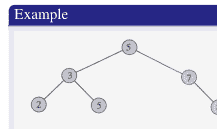

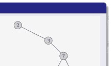

Figure 12.1 Binary search trees. For any node x, the keys in the left subtree of x are at most key(x). Different binary search trees can represent the same set of values. The worst-case running time for most tree operations is proportional to the height of the tree. (a) A binary search tree on 6 nodes with height 4. (b) A less efficient binary search tree with 6 nodes with height 2.

## Inorder tree walk

Elements are printed in monotonically increasing order. How INORDER-TREE-WALK works:

- Check to make sure that \( x \) is not NIL.
- Recursively, print the keys of the nodes in \( x \)’s left subtree.
- Print \( x \)’s key.
- Recursively, print the keys of the nodes in \( x \)’s right subtree.

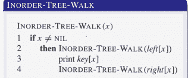

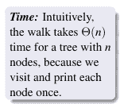

## TREE-SEARCH

```
TREE-SEARCH(x, k)
1 if x = NIL or k = key[x]
2 then return x
3 if k < key[x]
4 then return TREE-SEARCH(left[x], k)
5 else return TREE-SEARCH(right[x], k)
```

**_Time:_** The algorithm recurses, visiting nodes on a downward path from the root. Thus, running time is _O_(_h_), where _h_ is the height of the tree.

## Minimum and Maximum

The binary-search-tree property guarantees that:

- the minimum key is located at the **leftmost** node, and
- the maximum key is located at the **rightmost** node.

### TREE-MINIMUM

```
TREE-MINIMUM(x)
1 while left[x] ≠ NIL
2     do x ← left[x]
3 return x
```

### TREE-MAXIMUM

```
TREE-MAXIMUM(x)
1 while right[x] ≠ NIL
2     do x ← right[x]
3 return x
```

**Time:** Both procedures visit nodes that form a downward path from the root to a leaf. Both procedures run in \(O(h)\) time, where \(h\) is the height of the tree.

## Successor and predecessor

The successor of a node x is the node y such that key[y] is the smallest key > key[x]. (We can find x’s successor based entirely on the tree structure. No key comparisons are necessary.) If x has the largest key, then x’s successor is NIL.

```
TREE-SUCCESSOR(x)
1 if right[x] ≠ NIL
2 then return TREE-MINIMUM(right[x])
3 y ← p[x]
4 while y ≠ NIL and x = right[y]
5 do x ← y
6 y ← p[y]
7 return y
```

_Time:_ Since we visit nodes on a path down the tree or up the tree, the running time is _O_(_h_), where _h_ is the height of the tree.


## Deletion

TREE-DELETE is broken into three cases.
**Case 1: _z_ has no children.**
- Delete _z_ by making the parent of _z_ point to NIL, instead of to _z_.
**Case 2: _z_ has one child.**
- Delete _z_ by making the parent of _z_ point to _z_’s child, instead of to _z_.
**Case 3: _z_ has two children.**
- _z_’s successor _y_ has either no children or one child. (_y_ is the minimum node—with no left child—in _z_’s right subtree.)
- Delete _y_ from the tree (via Case 1 or 2).
- Replace _z_’s key and satellite data with _y_’s.

## Minimizing running time

We’ve been analyzing running time in terms of _h_ (the height of the binary search tree), instead of _n_ (the number of nodes in the tree).

- **Problem:** Worst case for binary search tree is \(\Theta(n)\)—no better than linked list.
- **Solution:** Guarantee small height (balanced tree)—_h_ = _O_(lg_n_).

In later chapters, by varying the properties of binary search trees, we will be able to analyze running time in terms of _n_.

- **Method:** Restructure the tree if necessary. Nothing special is required for querying, but there may be extra work when changing the structure of the tree (inserting or deleting).


### Figure 2.1 Sorting a hand of cards using insertion sort.

### Figure 2.2 The operation of INSERTION-SORT on the array A = ⟨5, 2, 4, 6, 1, 3⟩. Array indices appear above the rectangles, and values stored in the array positions appear within the rectangles. (a)–(e) The iterations of the for loop of lines 1–8. In each iteration, the black rectangle holds the key taken from A[j], which is compared with the values in shaded rectangles to its left in the test of line 5. Shaded arrows show array values moved one position to the right in line 6, and black arrows indicate where the key is moved to in line 8. (f) The final sorted array.

### INSERTION-SORT(A)

```
1 for j ← 2 to length[A]
2 do key ← A[j]
3 ▷ Insert A[j] into the sorted sequence A[1..j − 1].
4 i ← j − 1
5 while i > 0 and A[i] > key
6 do A[i + 1] ← A[i]
7 i ← i − 1
8 A[i + 1] ← key
```

### Loop invariants and the correctness of insertion sort

| 1 | for j ← 2 to length[A] | c1 | n |
|---|---|---|---|
| 2 | do key ← A[j] | c2 | n − 1 |
| 3 | ▷ Insert A[j] into the sorted sequence A[1 .. j − 1]. | 0 | n − 1 |
| 4 | i ← j − 1 | c4 | n − 1 |
| 5 | while i > 0 and A[i] > key | c5 | ∑j=2n tj |
| 6 | do A[i + 1] ← A[i] | c6 | ∑j=2n(tj − 1) |
| 7 | i ← i − 1 | c7 | ∑j=2n(tj − 1) |
| 8 | A[i + 1] ← key | c8 | n − 1 |

```
MERGE(A, p, q, r)
1  n₁ ← q − p + 1
2  n₂ ← r − q
3  create arrays L[1..n₁ + 1] and R[1..n₂ + 1]
4  for i ← 1 to n₁
5      do L[i] ← A[p + i − 1]
6  for j ← 1 to n₂
7      do R[j] ← A[q + j]
8  L[n₁ + 1] ← ∞
9  R[n₂ + 1] ← ∞
10 i ← 1
11 j ← 1
12 for k ← p to r
13     do if L[i] ≤ R[j]
14         then A[k] ← L[i]
15              i ← i + 1
16         else A[k] ← R[j]
17              j ← j + 1
```

### Figure 2.3 The operation of lines 10–17 in the call MERGE(A, 9, 12, 16), when the subarray A[9 . . 16] contains the sequence ⟨2, 4, 5, 7, 1, 2, 3, 6⟩. After copying and inserting sentinels, the array L contains ⟨2, 4, 5, 7, ∞⟩, and the array R contains ⟨1, 2, 3, 6, ∞⟩. Lightly shaded positions in A contain their final values, and lightly shaded positions in L and R contain values that have yet to be copied back into A. Taken together, the lightly shaded positions always comprise the values originally in A[9 . . 16], along with the two sentinels. Heavily shaded positions in A contain values that will be copied over, and heavily shaded positions in L and R contain values that have already been copied back into A. (a)–(h) The arrays A, L, and R, and their respective indices k, i, and j prior to each iteration of the loop of lines 12–17. (i) The arrays and indices at termination. At this point, the subarray in A[9 . . 16] is sorted, and the two sentinels in L and R are the only two elements in these arrays that have not been copied into A.

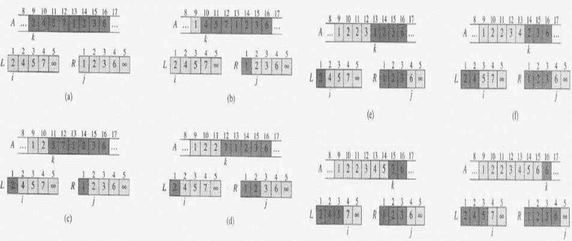


#### MERGE-SORT(A, p, r)

```text
if p < r
    then q ← ⌊(p + r)/2⌋
        MERGE-SORT(A, p, q)
        MERGE-SORT(A, q + 1, r)
        MERGE(A, p, q, r)
```

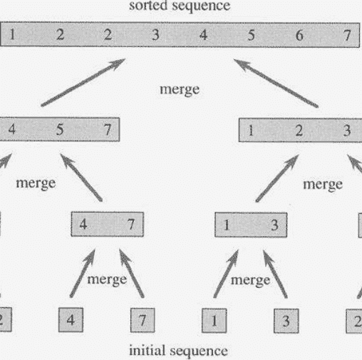

Figure 2.4 The operation of merge sort on the array \( A = \langle 5, 2, 4, 7, 1, 3, 2, 6 \rangle \). The lengths of the sorted sequences being merged increase as the algorithm progresses from bottom to top.

#### BUBBLESORT(A)

```text
1  for i ← 1 to length[A]
2      do for j ← length[A] downto i + 1
3          do if A[j] < A[j − 1]
4              then exchange A[j] ↔ A[j − 1]
```


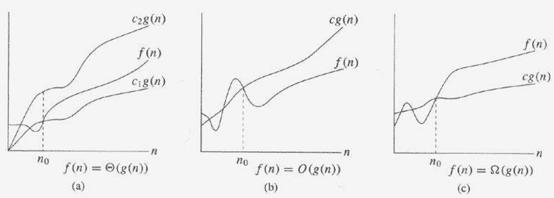

Figure 3.1 Graphic examples of the Θ, O, and Ω notations. In each part, the value of n0 shown is the minimum possible value; any greater value would also work. (a) Θ-notation bounds a function to within constant factors. We write f(n) = Θ(g(n)) if there exist positive constants n0, c1, and c2 such that to the right of n0, the value of f(n) always lies between c1g(n) and c2g(n) inclusive. (b) O-notation gives an upper bound for a function to within a constant factor. We write f(n) = O(g(n)) if there are positive constants n0 and c such that to the right of n0, the value of f(n) always lies on or below cg(n). (c) Ω-notation gives a lower bound for a function to within a constant factor. We write f(n) = Ω(g(n)) if there are positive constants n0 and c such that to the right of n0, the value of f(n) always lies on or above cg(n).


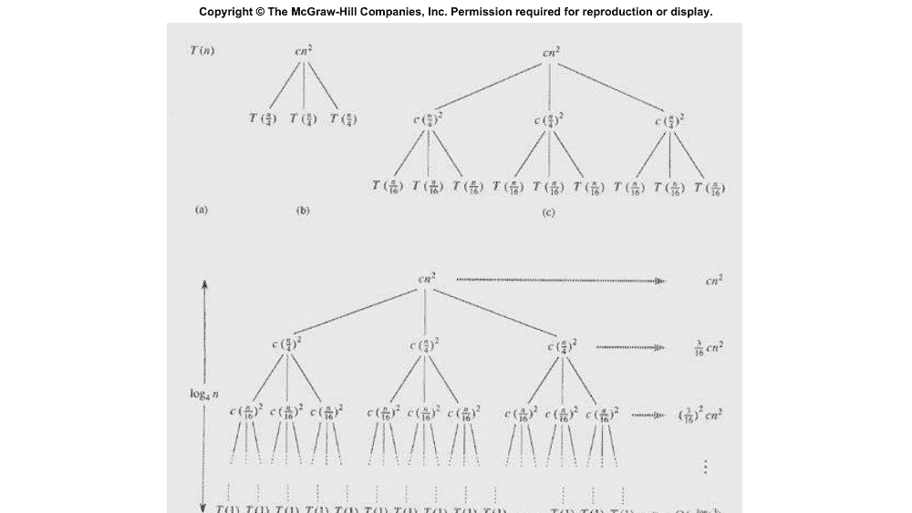

Figure 4.1 The construction of a recursion tree for the recurrence T(n) = 3T(n/4) + cn². Part (a) shows T(n), which is progressively expanded in (b)–(d) to form the recursion tree. The fully expanded tree in part (d) has height log₄ n (it has log₄ n + 1 levels).

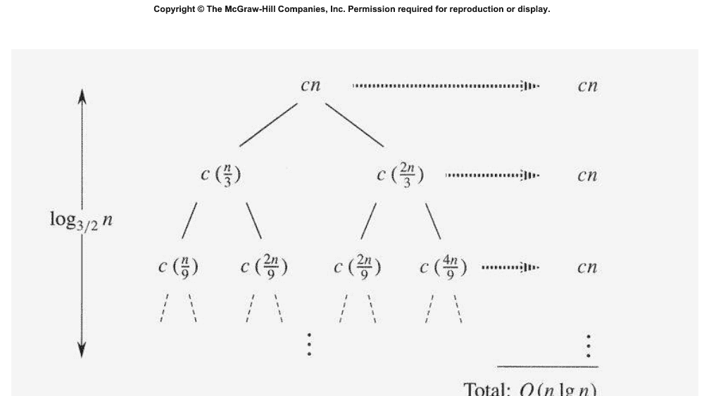

Figure 4.2 A recursion tree for the recurrence T(n) = T(n/3) + T(2n/3) + cn.

Total: O(n lg n)

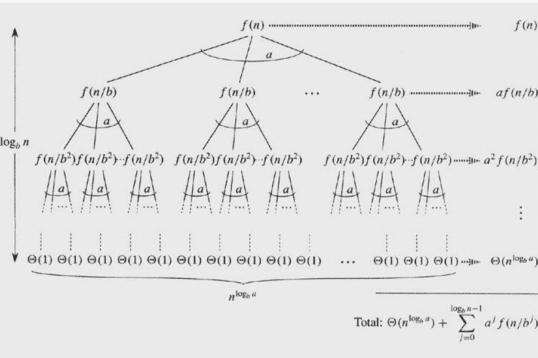

Figure 4.3 The recursion tree generated by \( T(n) = aT(n/b) + f(n) \). The tree is a complete \( a \)-ary tree with \( n^{\log_b a} \) leaves and height \( \log_b n \). The cost of each level is shown at the right, and their sum is given in equation (4.6).

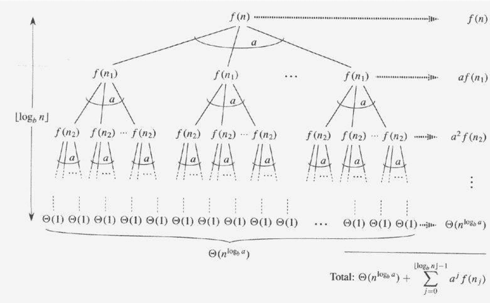

纵向层数为 $[\log_b n]$。

叶节点总和为 $\Theta(n^{\log_b a})$。

Total: $\Theta(n^{\log_b a}) + \sum_{j=0}^{[\log_b n]-1} a^j f(n_j)$

Figure 4.4 The recursion tree generated by $T(n)=aT(n/b)+f(n)$. The recursive argument $n_j$ is given by equation (4.12).


#### HIRE-ASSISTANT(n)

```text
best ← 0      ▷ candidate 0 is a least-qualified dummy candidate
for i ← 1 to n
    do interview candidate i
    if candidate i is better than candidate best
        then best ← i
        hire candidate i
```

#### PERMUTE-BY-SORTING(A)

```text
n ← length[A]
for i ← 1 to n
    do P[i] = RANDOM(1, n³)
sort A, using P as sort keys
return A
```

#### RANDOMIZE-IN-PLACE(A)

```text
1  n ← length[A]
2  for i ← 1 to n
3      do swap A[i] ↔ A[RANDOM(i, n)]
```


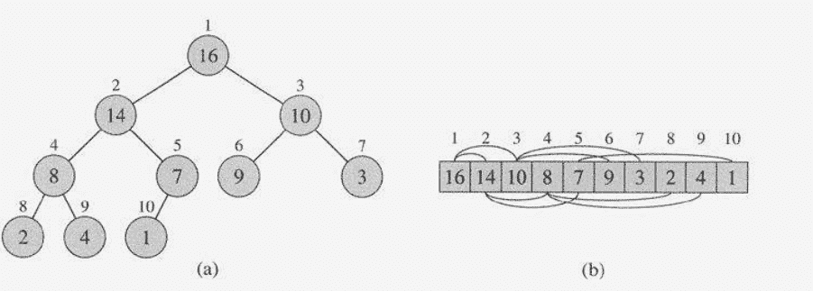

**Figure 6.1** A max-heap viewed as (a) a binary tree and (b) an array. The number within the circle at each node in the tree is the value stored at that node. The number above a node is the corresponding index in the array. Above and below the array are lines showing parent-child relationships; parents are always to the left of their children. The tree has height three; the node at index 4 (with value 8) has height one.


## MAX-HEAPIFY(A, i)

1. l ← LEFT(i)
2. r ← RIGHT(i)
3. if l ≤ heap-size[A] and A[l] > A[i]
4.     then largest ← l
5.     else largest ← i
6. if r ≤ heap-size[A] and A[r] > A[largest]
7.     then largest ← r
8. if largest ≠ i
9.     then exchange A[i] ↔ A[largest]
10. MAX-HEAPIFY(A, largest)

Figure 6.2 The action of MAX-HEAPIFY(A, 2), where heap-size[A] = 10. (a) The initial configuration, with A[2] at node i = 2 violating the max-heap property since it is not larger than both children. The max-heap property is restored for node 2 in (b) by exchanging A[2] with A[4], which destroys the max-heap property for node 4. The recursive call MAX-HEAPIFY(A, 4) now has i = 4. After swapping A[4] with A[9], as shown in (c), node 4 is fixed up, and the recursive call MAX-HEAPIFY(A, 9) yields no further change to the data structure.

## BUILD-MAX-HEAP(A)

1. heap-size[A] ← length[A]
2. for i ← ⌊length[A]/2⌋ downto 1
3. do MAX-HEAPIFY(A, i)

+ A
+ 4 1 3 2 16 9 10 14 8 7

Figure 6.3 The operation of BUILD-MAX-HEAP, showing the data structure before the call to MAX-HEAPIFY in line 3 of BUILD-MAX-HEAP. (a) A 10-element input array A and the binary tree it represents. The figure shows that the loop index i refers to node 5 before the call to MAX-HEAPIFY (A, i). (b) The data structure that results. The loop index i for the next iteration refers to node 4. (c) Subsequent iterations of the for loop in BUILD-MAX-HEAP. The loop index i for the next iteration refers to node 5 whenever MAX-HEAPIFY is called on a node, the two subtrees of that node are both max-heaps. (f) The max-heap after BUILD-MAX-HEAP finishes.

## HEAPSORT(A)

1. BUILD-MAX-HEAP(A)
2. for i ← length[A] downto 2
3. do exchange A[1] ↔ A[i]
4. heap-size[A] ← heap-size[A] − 1
5. MAX-HEAPIFY(A, 1)

Figure 6.4 The operation of HEAPSORT. (a) The max-heap data structure just after it has been built by BUILD-MAX-HEAP. (b)–(j) The max-heap just after each call of MAX-HEAPIFY in line 5. The value of i at that time is shown. Only lightly shaded nodes remain in the heap. (k) The resulting sorted array A.

## HEAP-MAXIMUM(A)

return A[1]

## HEAP-INCREASE-KEY(A, i, key)

1. if key < A[i]
2.     then error “new key is smaller than current key”
3. A[i] ← key
4. while i > 1 and A[PARENT(i)] < A[i]
5.     do exchange A[i] ↔ A[PARENT(i)]
6.     i ← PARENT(i)

## MAX-HEAP-INSERT(A, key)

1. heap-size[A] ← heap-size[A] + 1
2. A[heap-size[A]] ← −∞
3. HEAP-INCREASE-KEY(A, heap-size[A], key)

Figure 6.5 The operation of HEAP-INCREASE-KEY. (a) The max-heap of Figure 6.4(a) with a node whose index is i heavily shaded. (b) This node has its key increased to 15. (c) After one iteration of the while loop of lines 4-6, the node and its parent have exchanged keys, and the index i moves up to the parent. (d) The max-heap after one more iteration of the while loop. At this point, A[PARENT(i)] ≥ A[i]. The max-heap property now holds and the procedure terminates.

## BUILD-MAX-HEAP(A)

1. heap-size[A] ← length[A]
2. for i ← ⌊length[A]/2⌋ downto 1
3. do MAX-HEAPIFY(A, i)


## PARTITION(A, p, r)

1. x ← A[r]
2. i ← p - 1
3. for j ← p to r - 1
4. do if A[j] ≤ x
5. then i ← i + 1
6. exchange A[i] ↔ A[j]
7. exchange A[i + 1] ↔ A[r]
8. return i + 1

Figure 7.1 The operation of PARTITION on a sample array. Lightly shaded array elements are all in the first partition with values no greater than x. Heavily shaded elements are in the second partition with values greater than x. The unshaded elements have not yet been put in one of the first two partitions, and the final white element is the pivot. (a) The initial array and variable settings. None of the elements have been placed in either of the first two partitions. (b) The value 2 is “swapped with itself” and put in the partition of smaller values. (c)–(d) The values 8 and 7 are added to the partition of larger values. (e) The values 1 and 8 are swapped, and the smaller partition grows. (f) The values 3 and 8 are swapped, and the smaller partition grows. (g)–(h) The larger partition grows to include 5 and 6 and the loop terminates. (i) In lines 7–8, the pivot element is swapped so that it lies between the two partitions.


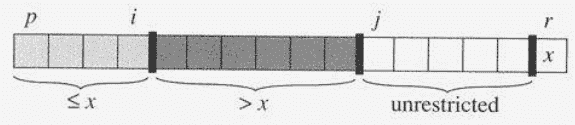

**Figure 7.2** The four regions maintained by the procedure PARTITION on a subarray \( A[p..r] \). The values in \( A[p..i] \) are all less than or equal to \( x \), the values in \( A[i+1..j-1] \) are all greater than \( x \), and \( A[r] = x \). The values in \( A[j..r-1] \) can take on any values.

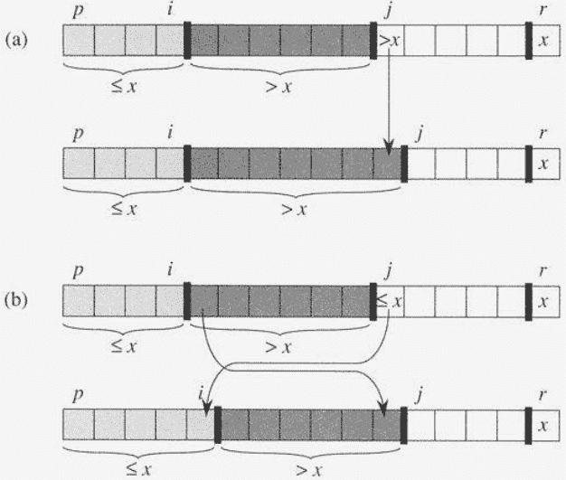

**Figure 7.3** The two cases for one iteration of procedure **PARTITION**. (a) If \(A[j] > x\), the only action is to increment \(j\), which maintains the loop invariant. (b) If \(A[j] \le x\), index \(i\) is incremented, \(A[i]\) and \(A[j]\) are swapped, and then \(j\) is incremented. Again, the loop invariant is maintained.

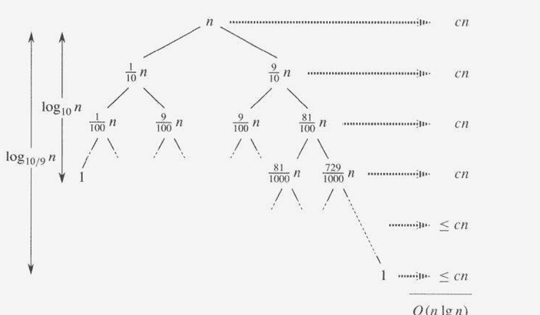

Figure 7.4 A recursion tree for QUICKSORT in which PARTITION always produces a 9-to-1 split, yielding a running time of $O(n \lg n)$. Nodes show subproblem sizes, with per-level costs on the right. The per-level costs include the constant $c$ implicit in the $\Theta(n)$ term.

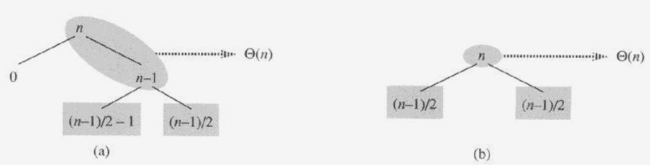

**Figure 7.5** (a) Two levels of a recursion tree for quicksort. The partitioning at the root costs \( n \) and produces a "bad" split: two subarrays of sizes 0 and \( n-1 \). The partitioning of the subarray of size \( n-1 \) costs \( n-1 \) and produces a "good" split: subarrays of size \( (n-1)/2 - 1 \) and \( (n-1)/2 \). (b) A single level of a recursion tree that is very well balanced. In both parts, the partitioning cost for the subproblems shown with elliptical shading is \( \Theta(n) \). Yet the subproblems remaining to be solved in (a), shown with square shading, are no larger than the corresponding subproblems remaining to be solved in (b).

## RANDOMIZED-QUICKSORT(A, p, r)

```
if p < r
   then q ← RANDOMIZED-PARTITION(A, p, r)
       RANDOMIZED-QUICKSORT(A, p, q − 1)
       RANDOMIZED-QUICKSORT(A, q + 1, r)
```

## HOARE-PARTITION(A, p, r)

```
1  x ← A[p]
2  i ← p − 1
3  j ← r + 1
4  **while** TRUE
5      **do repeat** j ← j − 1
6          **until** A[j] ≤ x
7      **repeat** i ← i + 1
8          **until** A[i] ≥ x
9      **if** i < j
10         **then exchange** A[i] ↔ A[j]
11         **else return** j
```

## QUICKSORT'(A, p, r)

```
while p < r
    do ▷ Partition and sort left subarray.
        q ← PARTITION(A, p, r)
        QUICKSORT'(A, p, q − 1)
        p ← q + 1
```


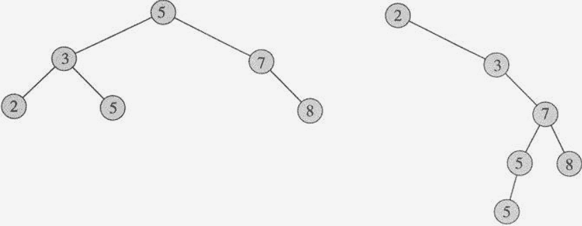

**Figure 12.1** Binary search trees. For any node *x*, the keys in the left subtree of *x* are at most *key[x]*, and the keys in the right subtree of *x* are at least *key[x]*. Different binary search trees can represent the same set of values. The worst-case running time for most search-tree operations is proportional to the height of the tree. (a) A binary search tree on 6 nodes with height 2. (b) A less efficient binary search tree with height 4 that contains the same keys.

## INORDER-TREE-WALK(x)

```
1 if x ≠ NIL
2 then INORDER-TREE-WALK(left[x])
3 print key[x]
4 INORDER-TREE-WALK(right[x])
```

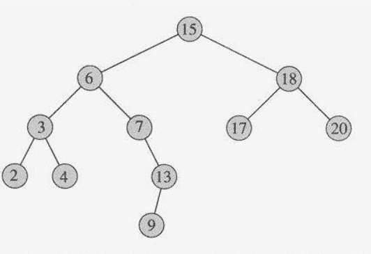

Figure 12.2 Queries on a binary search tree. To search for the key 13 in the tree, we follow the path 15 → 6 → 7 → 13 from the root. The minimum key in the tree is 2, which can be found by following left pointers from the root. The maximum key 20 is found by following right pointers from the root. The successor of the node with key 15 is the node with key 17, since it is the minimum key in the right subtree of 15. The node with key 13 has no right subtree, and thus its successor is its lowest ancestor whose left child is also an ancestor. In this case, the node with key 15 is its successor.

## TREE-SEARCH(x, k)

```
1 if x = NIL or k = key[x]
   then return x
3 if k < key[x]
   then return TREE-SEARCH(left[x], k)
5 else return TREE-SEARCH(right[x], k)
```


## ITERATIVE-TREE-SEARCH(x, k)

```
while x ≠ NIL and k ≠ key[x]
   do if k < key[x]
      then x ← left[x]
      else x ← right[x]
return x
```

## TREE-MINIMUM(x)

```
while left[x] ≠ NIL
   do x ← left[x]
return x
```

## TREE-MAXIMUM(x)

```
1 while right[x] ≠ NIL
2 do x ← right[x]
3 return x
```

## TREE-SUCCESSOR(x)

```
if right[x] ≠ NIL
then return TREE-MINIMUM(right[x])
y ← p[x]
while y ≠ NIL and x = right[y]
do x ← y
y ← p[y]
return y
```

```
TREE-INSERT(T, z)
1  y ← NIL
2  x ← root[T]
3  while x ≠ NIL
4      do y ← x
5         if key[z] < key[x]
6             then x ← left[x]
7             else x ← right[x]
8  p[z] ← y
9  if y = NIL
10     then root[T] ← z
11     else if key[z] < key[y]
12             then left[y] ← z
13             else right[y] ← z
```

> ▷ Tree T was empty

```
TREE-DELETE(T, z)

1 if left[z] = NIL or right[z] = NIL
2 then y ← z
3 else y ← TREE-SUCCESSOR(z)
4 if left[y] ≠ NIL
5 then x ← left[y]
6 else x ← right[y]
7 if x ≠ NIL
8 then p[x] ← p[y]
9 if p[y] = NIL
10 then root[T] ← x
11 else if y = left[p[y]]
12 then left[p[y]] ← x
13 else right[p[y]] ← x
14 if y ≠ z
15 then key[z] ← key[y]
16 copy y’s satellite data into z
17 return y
```

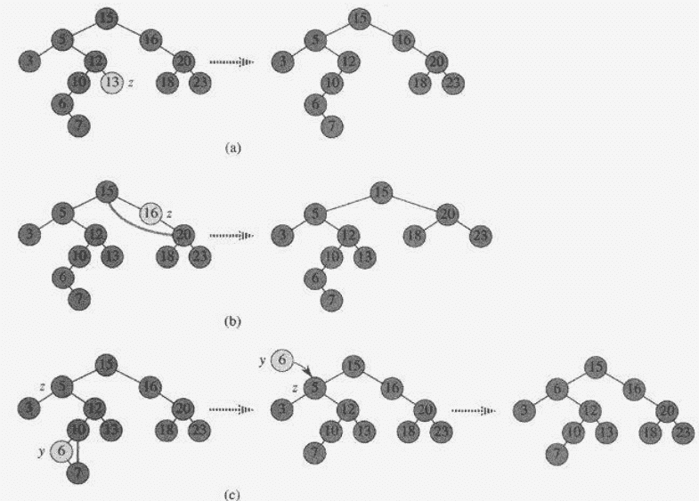

Figure 12.4 Deleting a node z from a binary search tree. Which node is actually removed depends on how many children z has; this node is shown lightly shaded. (a) If z has no children, we just remove it. (b) If z has only one child, we splice out z. (c) If z has two children, we splice out its successor y, which has at most one child, and then replace z's key and satellite data with y's key and satellite data.

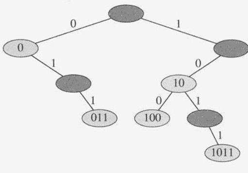

**Figure 12.5** A radix tree storing the bit strings 1011, 10, 011, 100, and 0. Each node’s key can be determined by traversing the path from the root to that node. There is no need, therefore, to store the keys in the nodes; the keys are shown here for illustrative purposes only. Nodes are heavily shaded if the keys corresponding to them are not in the tree; such nodes are present only to establish a path to other nodes.

# Introduction to Algorithms

# 6.046J/18.401J

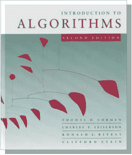

# LECTURE 1

# Analysis of Algorithms

+   - Insertion sort
+   - Asymptotic analysis
+   - Merge sort
+   - Recurrences

Prof. Charles E. Leiserson

## Course information

+   1. Staff
+   2. Distance learning
+   3. Prerequisites
+   4. Lectures
+   5. Recitations
+   6. Handouts
+   7. Textbook

+   8. Course website
+   9. Extra help
+   10. Registration
+   11. Problem sets
+   12. Describing algorithms
+   13. Grading policy
+   14. Collaboration policy


## Analysis of algorithms

*The theoretical study of computer-program performance and resource usage.*

What’s more important than performance?

+   - modularity
+   - correctness
+   - maintainability
+   - functionality
+   - robustness

+   - user-friendliness
+   - programmer time
+   - simplicity
+   - extensibility
+   - reliability


## Why study algorithms and performance?

+   - Algorithms help us to understand *scalability*.
+   - Performance often draws the line between what is feasible and what is impossible.
+   - Algorithmic mathematics provides a *language* for talking about program behavior.
+   - Performance is the *currency* of computing.
+   - The lessons of program performance generalize to other computing resources.
+   - Speed is fun!

## Insertion sort

```
INSERTION-SORT (A, n) ▷ A[1 . . n]
for j ← 2 to n
    do key ← A[j]
    i ← j − 1
    while i > 0 and A[i] > key
        do A[i+1] ← A[i]
        i ← i − 1
    A[i+1] = key
```

## Insertion sort

```
INSERTION-SORT(A, n) ▷ A[1 . . n]
for j ← 2 to n
    do key ← A[j]
    i ← j − 1
    while i > 0 and A[i] > key
        do A[i+1] ← A[i]
        i ← i − 1
    A[i+1] = key
```

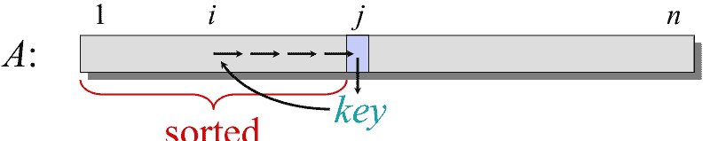


## Example of insertion sort

8 2 4 9 3 6

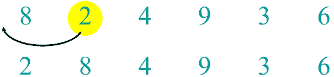

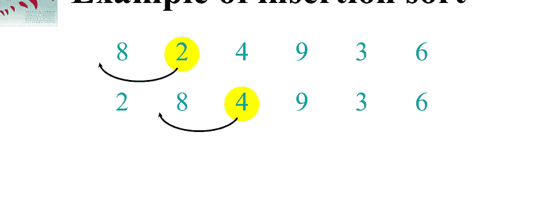

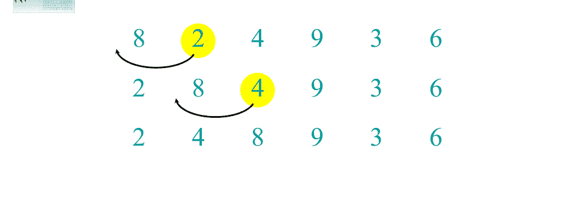

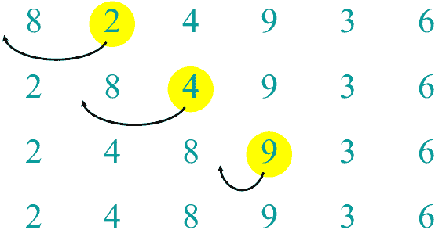

```text
8 2 4 9 3 6
2 8 4 9 3 6
2 4 8 9 3 6
2 4 8 9 3 6
```

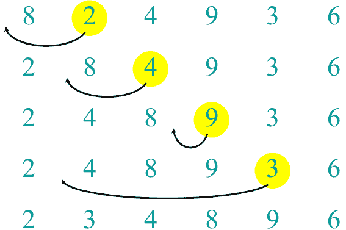

```text
8 2 4 9 3 6
2 8 4 9 3 6
2 4 8 9 3 6
2 4 8 9 3 6
2 3 4 8 9 6
```


| 8 | 2 | 4 | 9 | 3 | 6 |
|---|---|---|---|---|---|
| 2 | 8 | 4 | 9 | 3 | 6 |
| 2 | 4 | 8 | 9 | 3 | 6 |
| 2 | 4 | 8 | 9 | 3 | 6 |
| 2 | 3 | 4 | 8 | 9 | 6 |
| 2 | 3 | 4 | 6 | 8 | 9 |

done

*September 7, 2005*  
*Copyright © 2001-5 Erik D. Demaine and Charles E. Leiserson*  
*Introduction to Algorithms*  
*L1.8*

## Running time

- The running time depends on the input: an already sorted sequence is easier to sort.
- Parameterize the running time by the size of the input, since short sequences are easier to sort than long ones.
- Generally, we seek upper bounds on the running time, because everybody likes a guarantee.

## Kinds of analyses

- T(n) = maximum time of algorithm on any input of size n.

- T(n) = expected time of algorithm over all inputs of size n.
- Need assumption of statistical distribution of inputs.

- Cheat with a slow algorithm that works fast on some input.

## Machine-independent time

### What is insertion sort’s worst-case time?

- It depends on the speed of our computer:
  - relative speed (on the same machine),
  - absolute speed (on different machines).

### BIG IDEA:

- Ignore machine-dependent constants.
- Look at *growth* of \(T(n)\) as \(n \to \infty\).

### “Asymptotic Analysis”


## Θ-notation

**Math:** Θ(g(n)) = { f(n) : there exist positive constants c₁, c₂, and n₀ such that 0 ≤ c₁ g(n) ≤ f(n) ≤ c₂ g(n) for all n ≥ n₀ }

- Drop low-order terms; ignore leading constants.
- Example: 3n³ + 90n² – 5n + 6046 = Θ(n³)

## Asymptotic performance

When _n_ gets large enough, a Θ(_n_<sup>2</sup>) algorithm _always_ beats a Θ(_n_<sup>3</sup>) algorithm.

- We shouldn’t ignore asymptotically slower algorithms, however.
- Real-world design situations often call for a careful balancing of engineering objectives.
- Asymptotic analysis is a useful tool to help to structure our thinking.

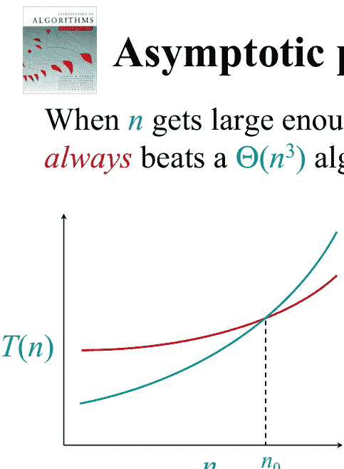

## Merge sort

### MERGE-SORT \( A[1 \dots n] \)

- 1. If \( n = 1 \), done.
- 2. Recursively sort \( A[1 \dots \lceil n/2 \rceil] \) and \( A[\lceil n/2 \rceil+1 \dots n] \).
- 3. **“Merge”** the 2 sorted lists.

### Key subroutine: MERGE

*September 7, 2005*  
*Copyright © 2001-5 Erik D. Demaine and Charles E. Leiserson*  
*Introduction to Algorithms*  
*L1.25*

## Merging two sorted arrays

```text
20 12
13 11
7 9
2 1
```


```text
20 12 | 20 12
13 11 | 13 11
7 9 | 7 9
2 1 | 2
1
```

*September 7, 2005 Copyright © 2001-5 Erik D. Demaine and Charles E. Leiserson Introduction to Algorithms L1.28*

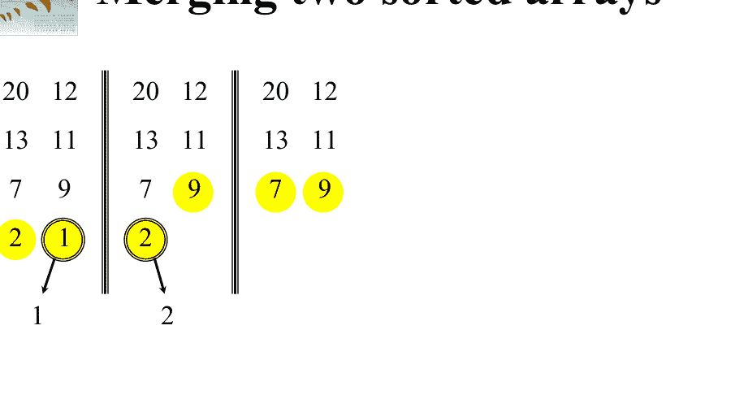

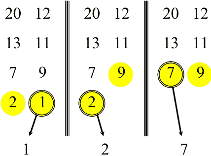


## Merging two sorted arrays

Time = Θ(n) to merge a total of n elements (linear time).

## Analyzing merge sort

**Abuse**

### MERGE-SORT $A[1..n]$

+   1. If $n=1$, done.
+   2. Recursively sort $A[1..\lfloor n/2\rfloor]$ and $A[\lfloor n/2\rfloor+1..n]$.
+   3. “Merge” the 2 sorted lists

**Sloppiness:** Should be $T(\lceil n/2\rceil)+T(\lfloor n/2\rfloor)$, but it turns out not to matter asymptotically.

## Recurrence for merge sort

\(T(n) = \begin{cases} \Theta(1) \text{ if } n = 1; \\ 2T(n/2) + \Theta(n) \text{ if } n > 1. \end{cases}\)

- We shall usually omit stating the base case when \(T(n) = \Theta(1)\) for sufficiently small \(n\), but only when it has no effect on the asymptotic solution to the recurrence.
- CLRS and Lecture 2 provide several ways to find a good upper bound on \(T(n)\).

## Recursion tree

Solve \( T(n) = 2T(n/2) + cn \), where \( c > 0 \) is constant.

## Conclusions

- \(\Theta(n \lg n)\) grows more slowly than \(\Theta(n^2)\).
- Therefore, merge sort asymptotically beats insertion sort in the worst case.
- In practice, merge sort beats insertion sort for \(n > 30\) or so.
- Go test it out for yourself!

# Introduction to Algorithms

# 6.046J/18.401J

# LECTURE 2

# Asymptotic Notation

- • O-, Ω-, and Θ-notation

# Recurrences

- • Substitution method
- • Iterating the recurrence
- • Recursion tree
- • Master method

## Asymptotic notation

O-notation (upper bounds):

> We write f(n) = O(g(n)) if there exist constants c > 0, n₀ > 0 such that 0 ≤ f(n) ≤ c g(n) for all n ≥ n₀.

## Asymptotic notation

## _O_-notation (upper bounds):

We write _f_(_n_) = _O_(_g_(_n_)) if there exist constants _c_ > 0, _n_<sub>0</sub> > 0 such that 0 ≤ _f_(_n_) ≤ _cg_(_n_) for all _n_ ≥ _n_<sub>0</sub>.

**EXAMPLE:** 2_n_<sup>2</sup> = _O_(_n_<sup>3</sup>) (_c_ = 1, _n_<sub>0</sub> = 2)


## Asymptotic notation

We write f(n) = O(g(n)) if there exist constants c > 0, n₀ > 0 such that 0 ≤ f(n) ≤ c g(n) for all n ≥ n₀.

EXAMPLE: 2n² = O(n³) (c = 1, n₀ = 2)

functions, not values

funny, “one-way” equality

## Set definition of O-notation

O(g(n)) = { f(n) : there exist constants c > 0, n₀ > 0 such that 0 ≤ f(n) ≤ cg(n) for all n ≥ n₀ }

**EXAMPLE:** 2n² ∈ O(n³)

(Logicians: λn.2n² ∈ O(λn.n³), but it’s convenient to be sloppy, as long as we understand what’s *really* going on.)

## Macro substitution

**Convention:** A set in a formula represents an anonymous function in the set.

**EXAMPLE:** \( f(n) = n^3 + O(n^2) \) means \( f(n) = n^3 + h(n) \) for some \( h(n) \in O(n^2) \).

EXAMPLE: n² + O(n) = O(n²)
means
for any f(n) ∈ O(n):
n² + f(n) = h(n)
for some h(n) ∈ O(n²) .

## Ω-notation (lower bounds)

O-notation is an upper-bound notation. It makes no sense to say f(n) is at least O(n²).

Ω(g(n)) = {f(n) : there exist constants c > 0, n₀ > 0 such that 0 ≤ cg(n) ≤ f(n) for all n ≥ n₀}

## Θ-notation (tight bounds)

Θ(g(n)) = O(g(n)) ∩ Ω(g(n))

**EXAMPLE:** 1/2 n² - 2n = Θ(n²)

## o-notation and ω-notation

O-notation and Ω-notation are like ≤ and ≥. o-notation and ω-notation are like < and >.

o(g(n)) = { f(n) : for any constant c > 0,
there is a constant n₀ > 0
such that 0 ≤ f(n) < c g(n)
for all n ≥ n₀ }

EXAMPLE: 2n² = o(n³) (n₀ = 2/c)

ω(g(n)) = { f(n) : for any constant c > 0, there is a constant n₀ > 0 such that 0 ≤ cg(n) < f(n) for all n ≥ n₀ }

**EXAMPLE:** \(\sqrt{n} = \omega(\lg n)\quad (n_0 = 1+1/c)\)

## Solving recurrences

- The analysis of merge sort from **_Lecture 1_** required us to solve a recurrence.
- Recurrences are like solving integrals, differential equations, etc.
  - Learn a few tricks.
- **_Lecture 3_**: Applications of recurrences to divide-and-conquer algorithms.

## Substitution method

The most general method:

1. Guess the form of the solution.
2. Verify by induction.
3. Solve for constants.

## Example of substitution

T(n) = 4T(n/2) + n
≤ 4c(n/2)³ + n
= (c/2)n³ + n
= cn³ - ((c/2)n³ - n) ← desired − residual
≤ cn³ ← desired

whenever (c/2)n³ - n ≥ 0, for example,
if c ≥ 2 and n ≥ 1. residual

## Example (continued)

- We must also handle the initial conditions, that is, ground the induction with base cases.
- **Base:** $T(n)=\Theta(1)$ for all $n<n_0$, where $n_0$ is a suitable constant.
- For $1\le n<n_0$, we have “$\Theta(1)$” $\le cn^3$, if we pick $c$ big enough.


## Example (continued)

- We must also handle the initial conditions, that is, ground the induction with base cases.
- **Base:** \( T(n) = \Theta(1) \) for all \( n < n_0 \), where \( n_0 \) is a suitable constant.
- For \( 1 \leq n < n_0 \), we have “\(\Theta(1)\)” \( \leq cn^3 \), if we pick \( c \) big enough.

## This bound is not tight!

## A tighter upper bound?

We shall prove that \(T(n) = O(n^2)\).


## A tighter upper bound?

We shall prove that \( T(n) = O(n^2) \).

Assume that \( T(k) \leq ck^2 \) for \( k < n \):

```
T(n) = 4T(n/2) + n
≤ 4c(n/2)^2 + n
= cn^2 + n
= O(n^2)
```

## A tighter upper bound?

We shall prove that \( T(n) = O(n^2) \).

Assume that \( T(k) \leq ck^2 \) for \( k < n \):

\( T(n) = 4T(n/2) + n \)

\( \leq 4c(n/2)^2 + n \)

\( = cn^2 + n \)

\( = O(n^2) \) **Wrong!** We must prove the I.H.

## A tighter upper bound?

We shall prove that \( T(n) = O(n^2) \).

Assume that \( T(k) \leq ck^2 \) for \( k < n \):

$$
\begin{aligned}
T(n)&=4T(n/2)+n\\
&\le 4c(n/2)^2+n\\
&=cn^2+n\\
&=O(n^2)\quad\text{Wrong!}
\end{aligned}
$$

We must prove the I.H.

$$=cn^2-(-n)\qquad[\text{desired}-\text{residual}]$$

$$\le cn^2\qquad\text{for no choice of }c>0.\ \text{Lose!}$$

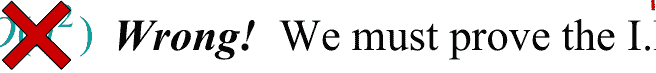


## A tighter upper bound!

**IDEA:** Strengthen the inductive hypothesis.

- Subtract a low-order term.

Inductive hypothesis: \( T(k) \leq c_1 k^2 - c_2 k \) for \( k < n \).

```
$T(n) = 4T(n/2) + n$
```

```
$= 4(c_1(n/2)^2 - c_2(n/2)) + n$
```

```
$= c_1 n^2 - 2 c_2 n + n$
```

```
$= c_1 n^2 - c_2 n - (c_2 n - n)$
```

```
$\leq c_1 n^2 - c_2 n$ if $c_2 \geq 1$.
```

## A tighter upper bound!

**IDEA:** Strengthen the inductive hypothesis.
• **Subtract** a low-order term.

Inductive hypothesis: \( T(k) \leq c_1 k^2 - c_2 k \) for \( k < n \).

\( T(n) = 4T(n/2) + n \)
\( = 4(c_1(n/2)^2 - c_2(n/2)) + n \)
\( = c_1 n^2 - 2c_2 n + n \)
\( = c_1 n^2 - c_2 n - (c_2 n - n) \)
\( \leq c_1 n^2 - c_2 n \text{ if } c_2 \geq 1 \).

Pick \( c_1 \) big enough to handle the initial conditions.


## Recursion-tree method

- A recursion tree models the costs (time) of a recursive execution of an algorithm.
- The recursion-tree method can be unreliable, just like any method that uses ellipses (...).
- The recursion-tree method promotes intuition, however.
- The recursion tree method is good for generating guesses for the substitution method.


## Example of recursion tree

Solve \( T(n) = T(n/4) + T(n/2) + n^2 \):

\( T(n) \)

## Example of recursion tree

Solve \( T(n) = T(n/4) + T(n/2) + n^2 \):

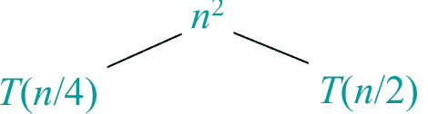

## Example of recursion tree

Solve \( T(n) = T(n/4) + T(n/2) + n^2 \):

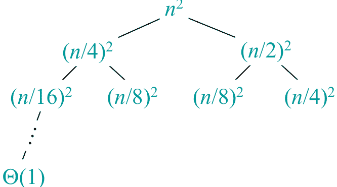

## Example of recursion tree

Solve \( T(n) = T(n/4) + T(n/2) + n^2 \):

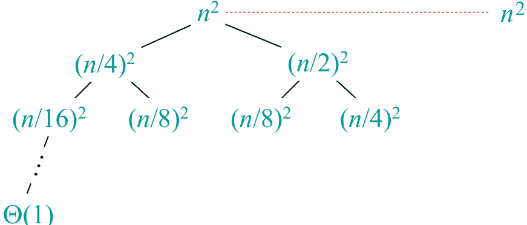

## Example of recursion tree

Solve \( T(n) = T(n/4) + T(n/2) + n^2 \):

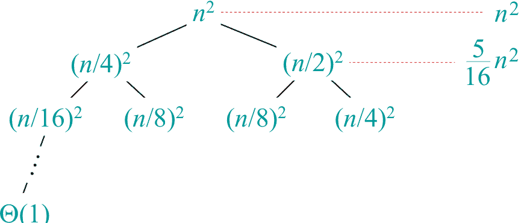

## Example of recursion tree

Solve \( T(n) = T(n/4) + T(n/2) + n^2 \):

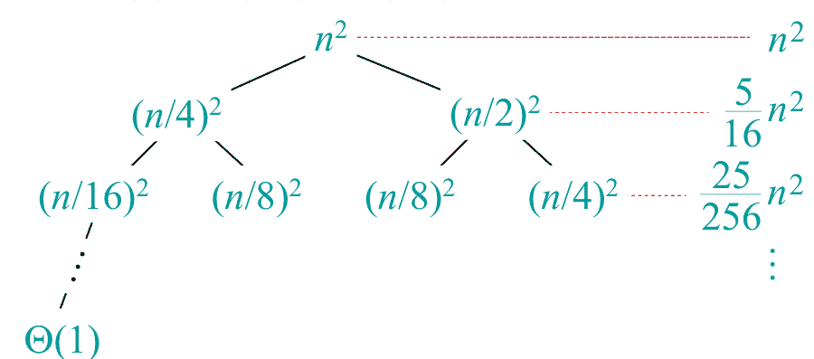

## Example of recursion tree

Solve \( T(n) = T(n/4) + T(n/2) + n^2 \):

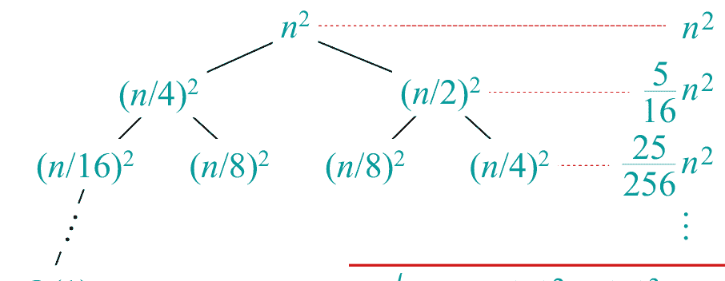

Total = \( n^2\left(1 + \frac{5}{16} + \left(\frac{5}{16}\right)^2 + \left(\frac{5}{16}\right)^3 + \cdots\right) \)
= \( \Theta(n^2) \) **geometric series**


## The master method

The master method applies to recurrences of the form

```
T(n) = a T(n/b) + f(n),
```

where \( a \geq 1 \), \( b > 1 \), and \( f \) is asymptotically positive.


## Three common cases

Compare _f_(_n_) with _n_log_ba_ :

- 1. _f_(_n_) = _O_(_n_log_ba_ - ε) for some constant ε > 0.
  - • _f_(_n_) grows polynomially slower than _n_log_ba_ (by an _n_ε factor).
  - **Solution:** _T_(_n_) = Θ(_n_log_ba_) .

- 2. _f_(_n_) = Θ(_n_log_ba_ lg_kn_) for some constant _k_ ≥ 0.
  - • _f_(_n_) and _n_log_ba_ grow at similar rates.
  - **Solution:** _T_(_n_) = Θ(_n_log_ba_ lg<sup>_k_+1</sup>_n_) .

## Three common cases (cont.)

Compare $f(n)$ with $n^{\log_b a}$:

- 3. \( f(n) = \Omega(n^{\log_b a + \epsilon}) \) for some constant \( \epsilon > 0 \).
  - * \( f(n) \) grows polynomially faster than \( n^{\log_b a} \) (by an \( n^\epsilon \) factor),
  - **and** \( f(n) \) satisfies the **regularity condition** that
    \( af(n/b) \leq cf(n) \) for some constant \( c < 1 \).
  - **Solution:** \( T(n) = \Theta(f(n)) \) .


## Examples

**Ex.** \(T(n) = 4T(n/2) + n\)
\(a = 4, b = 2 \Rightarrow n^{\log_b a} = n^2; f(n) = n\).
**CASE 1:** \(f(n) = O(n^{2 - \varepsilon})\) for \(\varepsilon = 1\).
\(\therefore T(n) = \Theta(n^2)\).

**Ex.** \(T(n) = 4T(n/2) + n^2\)
\(a = 4, b = 2 \Rightarrow n^{\log_b a} = n^2; f(n) = n^2\).
**CASE 2:** \(f(n) = \Theta(n^2 \lg^0 n)\), that is, \(k = 0\).
\(\therefore T(n) = \Theta(n^2 \lg n)\).

**Ex.** \(T(n) = 4T(n/2) + n^3\)
\(a = 4, b = 2 \Rightarrow n^{\log_b a} = n^2; f(n) = n^3\).
**CASE 3:** \(f(n) = \Omega(n^{2 + \varepsilon})\) for \(\varepsilon = 1\)
**and** \(4(n/2)^3 \le cn^3\) (reg. cond.) for \(c = 1/2\).
\(\therefore T(n) = \Theta(n^3)\).

**Ex.** \( T(n) = 4T(n/2) + n^3 \)
\( a = 4, b = 2 \Rightarrow n^{\log_b a} = n^2; f(n) = n^3 \).
**CASE 3:** \( f(n) = \Omega(n^{2 + \varepsilon}) \) for \( \varepsilon = 1 \)
**and** \( 4(n/2)^3 \le c n^3 \) (reg. cond.) for \( c = 1/2 \).
\(\therefore T(n) = \Theta(n^3)\).

**Ex.** \( T(n) = 4T(n/2) + n^2 / \lg n \)
\( a = 4, b = 2 \Rightarrow n^{\log_b a} = n^2; f(n) = n^2 / \lg n \).
Master method does not apply. In particular,
for every constant \( \varepsilon > 0 \), we have \( n^\varepsilon = \omega(\lg n) \).

## Idea of master theorem

### Recursion tree:

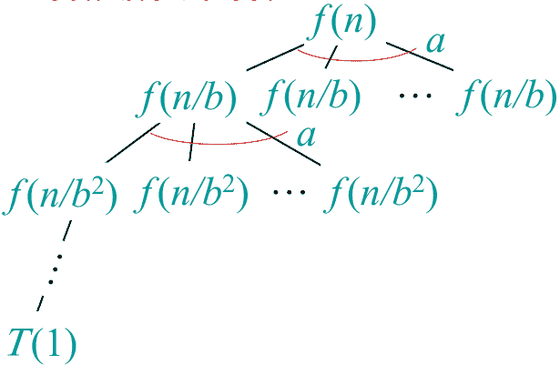

## Idea of master theorem

### Recursion tree:

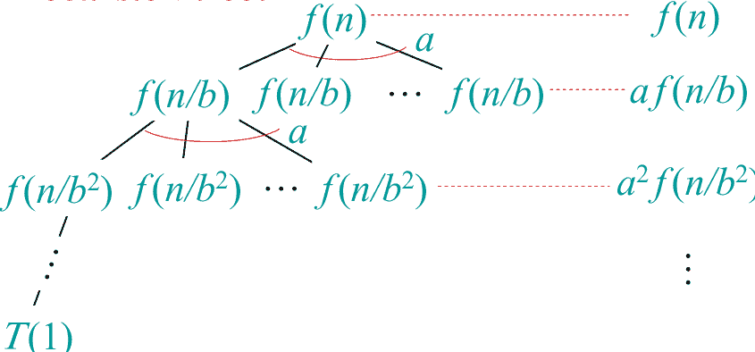

## Idea of master theorem

### Recursion tree:

f(n) f(n/b) f(n/b) ... f(n/b) f(n/b2) f(n/b2) ... f(n/b2) ... T(1)

h = log<sub>b</sub>n

a

a

September 12, 2005 Copyright © 2001-5 Erik D. Demaine and Charles E. Leiserson L2.52

## Idea of master theorem

### Recursion tree:

f(n) \\
f(n/b) f(n/b) ... f(n/b) \\
f(n/b²) f(n/b²) ... f(n/b²) \\
... \\
T(1)

h = log_b n

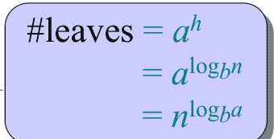

f(n) \\
af(n/b) \\
a²f(n/b²) \\
... \\
n^{log_b a} T(1)

## Idea of master theorem

### Recursion tree:

f(n) f(n/b) f(n/b) ... f(n/b) f(n/b²) f(n/b²) ... f(n/b²) ... T(1) h = log<sub>b</sub>n

a f(n/b) a² f(n/b²) ... n<sup>log<sub>b</sub>a</sup> T(1)

> CASE 1: The weight increases geometrically from the root to the leaves. The leaves hold a constant fraction of the total weight.

Θ(n<sup>log<sub>b</sub>a</sup>)

## Idea of master theorem

### Recursion tree:

f(n) f(n) af(n/b) f(n/b) f(n/b) ... f(n/b) f(n/b2) f(n/b2) ... f(n/b2) a2f(n/b2) ... nlog<sub>b</sub>a T(1) T(1) Θ(n<sup>log<sub>b</sub>a</sup>lg n)

> CASE 2: (_k_=0) The weight is approximately the same on each of the log<sub>b</sub>_n_ levels.

## Appendix: geometric series

1 + x + x^2 + ⋯ + x^n = \frac{1 - x^{n+1}}{1 - x} for x ≠ 1

1 + x + x^2 + ⋯ = \frac{1}{1 - x} for |x| < 1


## Merge sort

- 1. **Divide**: Trivial.
- 2. **Conquer**: Recursively sort 2 subarrays.
- 3. **Combine**: Linear-time merge.

T(n) = 2T(n/2) + Θ(n)

subproblems

subproblem size

work dividing and combining

## Master theorem (reprise)

T(n) = a T(n/b) + f(n)

**CASE 1**: f(n) = O(n<sup>log<sub>b</sub>a - ε</sup>), constant ε > 0  
⇒ T(n) = Θ(n<sup>log<sub>b</sub>a</sup>) .

**CASE 2**: f(n) = Θ(n<sup>log<sub>b</sub>a</sup> lg<sup>k</sup>n), constant k ≥ 0  
⇒ T(n) = Θ(n<sup>log<sub>b</sub>a</sup> lg<sup>k+1</sup>n) .

**CASE 3**: f(n) = Ω(n<sup>log<sub>b</sub>a + ε</sup>), constant ε > 0,  
and regularity condition  
⇒ T(n) = Θ(f(n)) .

\(T(n) = a T(n/b) + f(n)\)

**CASE 1:** \(f(n) = O(n^{\log_b a - \varepsilon})\), constant \(\varepsilon > 0\)
\(\Rightarrow T(n) = \Theta(n^{\log_b a})\) .

**CASE 2:** \(f(n) = \Theta(n^{\log_b a} \lg^k n)\), constant \(k \ge 0\)
\(\Rightarrow T(n) = \Theta(n^{\log_b a} \lg^{k+1} n)\) .

**CASE 3:** \(f(n) = \Omega(n^{\log_b a + \varepsilon})\), constant \(\varepsilon > 0\),
and regularity condition
\(\Rightarrow T(n) = \Theta(f(n))\) .

**Merge sort:** \(a = 2, b = 2 \Rightarrow n^{\log_b a} = n^{\log_2 2} = n\)
\(\Rightarrow\) **CASE 2** (\(k = 0\)) \(\Rightarrow T(n) = \Theta(n \lg n)\) .

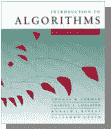

## Binary search

Find an element in a sorted array:

- 1. *Divide:* Check middle element.
- 2. *Conquer:* Recursively search 1 subarray.
- 3. *Combine:* Trivial.


## Binary search

Find an element in a sorted array:

- 1. **Divide:** Check middle element.
- 2. **Conquer:** Recursively search 1 subarray.
- 3. **Combine:** Trivial.

**Example:** Find 9

3 5 7 **8** 9 12 15

## Binary search

Find an element in a sorted array:

- 1. *Divide:* Check middle element.
- 2. *Conquer:* Recursively search 1 subarray.
- 3. *Combine:* Trivial.

*Example:* Find 9


## Binary search

Find an element in a sorted array:

- 1. **Divide:** Check middle element.
- 2. **Conquer:** Recursively search 1 subarray.
- 3. **Combine:** Trivial.

**Example:** Find 9


## Binary search

Find an element in a sorted array:

- 1. **Divide:** Check middle element.
- 2. **Conquer:** Recursively search 1 subarray.
- 3. **Combine:** Trivial.

**Example:** Find 9

3 5 7 8 **9** 12 15

## Recurrence for binary search

$T(n)=1T(n/2)+\Theta(1)$

subproblems

subproblem size

work dividing and combining

## Recurrence for binary search

T(n) = 1T(n/2) + Θ(1)

- # subproblems
- subproblem size
- work dividing and combining

n<sup>log<sub>b</sub> a</sup> = n<sup>log<sub>2</sub> 1</sup> = n<sup>0</sup> = 1 ⇒ CASE 2 (k = 0)
⇒ T(n) = Θ(lg n) .

## Powering a number

**Problem:** Compute \(a^n\), where \(n \in \mathbb{N}\).

**Naive algorithm:** \(\Theta(n)\).

**Divide-and-conquer algorithm:**

\(a^n = \begin{cases} a^{n/2} \cdot a^{n/2} & \text{if } n \text{ is even;} \\ a^{(n-1)/2} \cdot a^{(n-1)/2} \cdot a & \text{if } n \text{ is odd.} \end{cases}\)

## Powering a number

**Problem:** Compute \(a^n\), where \(n \in \mathbb{N}\).

**Naive algorithm:** \(\Theta(n)\).

**Divide-and-conquer algorithm:**

\(a^n = \begin{cases} a^{n/2} \cdot a^{n/2} & \text{if } n \text{ is even;} \\ a^{(n-1)/2} \cdot a^{(n-1)/2} \cdot a & \text{if } n \text{ is odd.} \end{cases}\)

\(T(n) = T(n/2) + \Theta(1) \Rightarrow T(n) = \Theta(\lg n).\)


## Fibonacci numbers

### Recursive definition:

$$F_n=\begin{cases}0 & \text{if } n=0;\\1 & \text{if } n=1;\\F_{n-1}+F_{n-2} & \text{if } n\ge 2.\end{cases}$$

0  1  1  2  3  5  8  13  21  34  …

### Naive recursive algorithm: \(\Omega(\phi^n)\)

(exponential time), where \(\phi=(1+\sqrt{5})/2\) is the **golden ratio**.

## Computing Fibonacci numbers

### Bottom-up:

- Compute $F_0, F_1, F_2, \dots, F_n$ in order, forming each number by summing the two previous.
- Running time: $\Theta(n)$.

### Naive recursive squaring:

\( F_n = \phi^n / \sqrt{5} \) rounded to the nearest integer.

- Recursive squaring: \(\Theta(\lg n)\) time.
- This method is unreliable, since floating-point arithmetic is prone to round-off errors.

## Recursive squaring

**Theorem:** \(\begin{bmatrix} F_{n+1} & F_n \\ F_n & F_{n-1} \end{bmatrix} = \begin{bmatrix} 1 & 1 \\ 1 & 0 \end{bmatrix}^n.\)

**Algorithm:** Recursive squaring.
Time = \(\Theta(\lg n)\) .

**Proof of theorem.** (Induction on _n_.)

Base (_n_ = 1): \(\begin{bmatrix} F_2 & F_1 \\ F_1 & F_0 \end{bmatrix} = \begin{bmatrix} 1 & 1 \\ 1 & 0 \end{bmatrix}^1\) .

### Inductive step \( (n \geq 2) \):

\(\begin{bmatrix} F_{n+1} & F_n \\ F_n & F_{n-1} \end{bmatrix} = \begin{bmatrix} F_n & F_{n-1} \\ F_{n-1} & F_{n-2} \end{bmatrix} \cdot \begin{bmatrix} 1 & 1 \\ 1 & 0 \end{bmatrix}\)

\(= \begin{bmatrix} 1 & 1 \\ 1 & 0 \end{bmatrix}^{n-1} \cdot \begin{bmatrix} 1 & 1 \\ 1 & 0 \end{bmatrix}\)

\(= \begin{bmatrix} 1 & 1 \\ 1 & 0 \end{bmatrix}^n\)

## Matrix multiplication

Input: \( A = [a_{ij}], B = [b_{ij}] \) \
Output: \( C = [c_{ij}] = A \cdot B \) \
\( i, j = 1, 2, \dots, n \)

\[ \begin{bmatrix} c_{11} & c_{12} & \cdots & c_{1n} \\ c_{21} & c_{22} & \cdots & c_{2n} \\ \vdots & \vdots & \ddots & \vdots \\ c_{n1} & c_{n2} & \cdots & c_{nn} \end{bmatrix} = \begin{bmatrix} a_{11} & a_{12} & \cdots & a_{1n} \\ a_{21} & a_{22} & \cdots & a_{2n} \\ \vdots & \vdots & \ddots & \vdots \\ a_{n1} & a_{n2} & \cdots & a_{nn} \end{bmatrix} \cdot \begin{bmatrix} b_{11} & b_{12} & \cdots & b_{1n} \\ b_{21} & b_{22} & \cdots & b_{2n} \\ \vdots & \vdots & \ddots & \vdots \\ b_{n1} & b_{n2} & \cdots & b_{nn} \end{bmatrix} \]

\[ c_{ij} = \sum_{k=1}^{n} a_{ik} \cdot b_{kj} \]

## Standard algorithm

```
for i ← 1 to n
do for j ← 1 to n
do cij ← 0
for k ← 1 to n
do cij ← cij + aik ⋅ bkj
```

Running time = Θ(n³)

## Divide-and-conquer algorithm

### IDEA:

$n\times n$ matrix = $2\times 2$ matrix of $(n/2)\times(n/2)$ submatrices:

\(\left[\begin{array}{ c c }
r & s \\
t & u
\end{array}\right] = \left[\begin{array}{ c c }
a & b \\
c & d
\end{array}\right] \cdot \left[\begin{array}{ c c }
e & f \\
g & h
\end{array}\right]\)

\(C = A \cdot B\)

\(\left.\begin{array}{ l }
r = ae + bg \\
s = af + bh \\
t = ce + dg \\
u = cf + dh
\end{array}\right\}\)

8 mults of $(n/2)\times(n/2)$ submatrices
4 adds of $(n/2)\times(n/2)$ submatrices

**IDEA:**
\( n \times n \) matrix = 2×2 matrix of \( (n/2) \times (n/2) \) submatrices:

\[ \begin{bmatrix} r & s \\ t & u \end{bmatrix} = \begin{bmatrix} a & b \\ c & d \end{bmatrix} \cdot \begin{bmatrix} e & f \\ g & h \end{bmatrix} \]

\( C = A \cdot B \)

\(\begin{cases} r = ae + bg \\ s = af + bh \\ t = ce + dh \\ u = cf + dg \end{cases}\) **recursive**

8 mults of \( (n/2) \times (n/2) \) submatrices

4 adds of \( (n/2) \times (n/2) \) submatrices


## Analysis of D&C algorithm

T(n) = 8T(n/2) + Θ(n²)

- # submatrices
- submatrix size
- work adding submatrices

n^log_ba = n^log_28 = n^3 ⇒ CASE 1 ⇒ T(n) = Θ(n^3).

**No better than the ordinary algorithm.**

## Strassen's idea

- Multiply 2×2 matrices with only 7 recursive mults.

P₁ = a · (f − h)
P₂ = (a + b) · h
P₃ = (c + d) · e
P₄ = d · (g − e)
P₅ = (a + d) · (e + h)
P₆ = (b − d) · (g + h)
P₇ = (a − c) · (e + f)

r = P₅ + P₄ − P₂ + P₆
s = P₁ + P₂
t = P₃ + P₄
u = P₅ + P₁ − P₃ − P₇

> 7 mults, 18 adds/subs.
> **Note:** No reliance on commutativity of mult!

r = P₅ + P₄ − P₂ + P₆
= (a + d)(e + h)
+ d(g − e) − (a + b)h
+ (b − d)(g + h)
= ae + ah + de + dh
+ dg − de − ah − bh
+ bg + bh − dg − dh
= ae + bg

## Strassen’s algorithm

1. **Divide**: Partition \( A \) and \( B \) into \( (n/2)\times(n/2) \) submatrices. Form terms to be multiplied using \( + \) and \( - \).
2. **Conquer**: Perform 7 multiplications of \( (n/2)\times(n/2) \) submatrices recursively.
3. **Combine**: Form \( C \) using \( + \) and \( - \) on \( (n/2)\times(n/2) \) submatrices.

\(T(n) = 7 T(n/2) + \Theta(n^2)\)

## Analysis of Strassen

T(n) = 7 T(n/2) + Θ(n²)

$T(n)=7T(n/2)+\Theta(n^2)$

$n^{\log_b a}=n^{\log_2 7}\approx n^{2.81}\Rightarrow \text{CASE 1}\Rightarrow T(n)=\Theta(n^{\lg 7})$.

n^{log_b a} = n^{log_2 7} ≈ n^{2.81} ⇒ CASE 1 ⇒ T(n) = Θ(n^{lg 7}).

The number 2.81 may not seem much smaller than 3, but because the difference is in the exponent, the impact on running time is significant. In fact, Strassen's algorithm beats the ordinary algorithm on today's machines for n ≥ 32 or so.

\( T(n) = 7 \, T(n/2) + \Theta(n^2) \)

\( n^{\log_b a} = n^{\log_2 7} \approx n^{2.81} \Rightarrow \text{CASE 1} \Rightarrow T(n) = \Theta(n^{\lg 7}) \).

The number 2.81 may not seem much smaller than 3, but because the difference is in the exponent, the impact on running time is significant. In fact, Strassen’s algorithm beats the ordinary algorithm on today’s machines for \( n \ge 32 \) or so.

**Best to date** (of theoretical interest only): \( \Theta(n^{2.376 \cdots}) \).


## VLSI layout

**Problem:** Embed a complete binary tree with *n* leaves in a grid using minimal area.


## VLSI layout

**Problem:** Embed a complete binary tree with \( n \) leaves in a grid using minimal area.

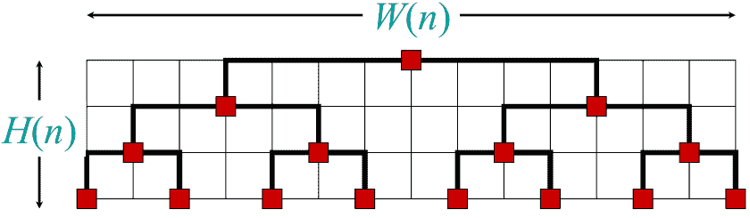

\( H(n) = H(n/2) + \Theta(1) \)
\( = \Theta(\lg n) \)

\( H(n) = H(n/2) + \Theta(1) = \Theta(\lg n) \)

\( W(n) = 2 W(n/2) + \Theta(1) = \Theta(n) \)

$H(n) = H(n/2) + \Theta(1)$  
$= \Theta(\lg n)$

$W(n) = 2W(n/2) + \Theta(1)$  
$= \Theta(n)$

**Area** $= \Theta(n \lg n)$

## H-tree embedding

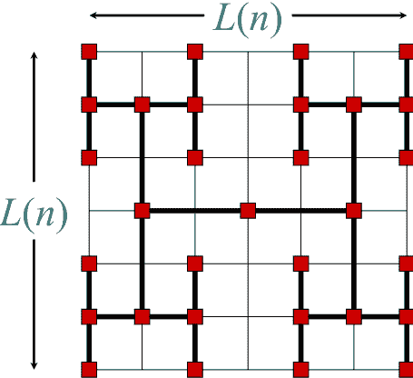

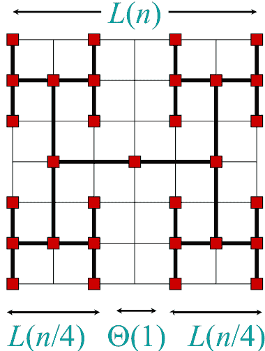

L(n) = 2 L(n/4) + Θ(1)
= Θ(√n)

Area = Θ(n)

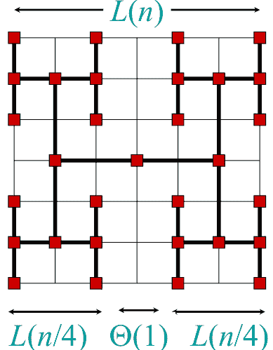

## Conclusion

- Divide and conquer is just one of several powerful techniques for algorithm design.
- Divide-and-conquer algorithms can be analyzed using recurrences and the master method (so practice this math).
- The divide-and-conquer strategy often leads to efficient algorithms.

# Introduction to Algorithms

6.046J/18.401J

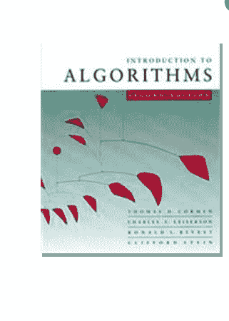

# LECTURE 4

- Quicksort
- Divide and conquer
- Partitioning
- Worst-case analysis
- Intuition
- Randomized quicksort
- Analysis

# Quicksort

- Proposed by C.A.R. Hoare in 1962.
- Divide-and-conquer algorithm.
- Sorts “in place” (like insertion sort, but not like merge sort).
- Very practical (with tuning).

## Divide and conquer

Quicksort an \(n\)-element array:

1. **Divide**: Partition the array into two subarrays around a **pivot** \(x\) such that elements in lower subarray \(\le x \le\) elements in upper subarray.


2. **Conquer**: Recursively sort the two subarrays.

3. **Combine**: Trivial.

**Key**: Linear-time partitioning subroutine.

## Partitioning subroutine

PARTITION(A, p, q) ▷ A[p .. q]
x ← A[p] ▷ pivot = A[p]
i ← p
for j ← p + 1 to q
do if A[j] ≤ x
then i ← i + 1
exchange A[i] ↔ A[j]
exchange A[p] ↔ A[i]
return i

> Running time
> = O(n) for n
> elements.

## Invariant:


## Example of partitioning


i j

| 6 | 10 | 13 | 5 | 8 | 3 | 2 | 11 |
|---|---|---|---|---|---|---|---|


## Example of partitioning


## Example of partitioning


## Example of partitioning

| 6 | 10 | 13 | 5 | 8 | 3 | 2 | 11 |
|---|---|---|---|---|---|---|---|
| 6 | 5 | 13 | 10 | 8 | 3 | 2 | 11 |

i → j

## Example of partitioning

| 6 | 10 | 13 | 5 | 8 | 3 | 2 | 11 |
|---|---|---|---|---|---|---|---|
| 6 | 5 | 13 | 10 | 8 | 3 | 2 | 11 |

i j

## Example of partitioning


## Example of partitioning


## Example of partitioning


## Example of partitioning


$i$


## Pseudocode for quicksort

QUICKSORT(A, p, r)
if p < r
then q ← PARTITION(A, p, r)
QUICKSORT(A, p, q−1)
QUICKSORT(A, q+1, r)

**Initial call:** QUICKSORT(A, 1, n)

## Worst-case of quicksort

- Input sorted or reverse sorted.
- Partition around min or max element.
- One side of partition always has no elements.

\(T(n) = T(0) + T(n-1) + \Theta(n)\)
\(= \Theta(1) + T(n-1) + \Theta(n)\)
\(= T(n-1) + \Theta(n)\)
\(= \Theta(n^2)\) _(arithmetic series)_

## Worst-case recursion tree

\(T(n) = T(0) + T(n-1) + cn\)

T(n) = T(0) + T(n-1) + cn

T(0) cn T(0) c(n-1) T(0) c(n-2) T(0) ... Θ(1)

Θ(∑_{k=1}^n k) = Θ(n^2)

September 21, 2005 Copyright © 2001-5 by Erik D. Demaine and Charles E. Leiserson L4.26

## Best-case analysis

### _(For intuition only!)_

If we’re lucky, PARTITION splits the array evenly:

$T(n) = 2T(n/2) + \Theta(n)$

$=\Theta(n lg n) \qquad \text{(same as merge sort)}$

What if the split is always $\frac{1}{10}:\frac{9}{10}$?

$T(n) = T(\frac{1}{10}n)+T(\frac{9}{10}n)+\Theta(n)$

What is the solution to this recurrence?

## Analysis of “almost-best” case

cn log₁₀n ≤ T(n) ≤ cn log₁₀/9n + O(n)

September 21, 2005 Copyright © 2001-5 by Erik D. Demaine and Charles E. Leiserson L4.32

## More intuition

Suppose we alternate lucky, unlucky,
lucky, unlucky, lucky, ....

L(n) = 2U(n/2) + Θ(n) lucky
U(n) = L(n − 1) + Θ(n) unlucky

### Solving:

L(n) = 2(L(n/2 − 1) + Θ(n/2)) + Θ(n)
= 2L(n/2 − 1) + Θ(n)
= Θ(n lg n) Lucky!

How can we make sure we are usually lucky?

## Randomized quicksort

**IDEA**: Partition around a *random* element.

- Running time is independent of the input order.
- No assumptions need to be made about the input distribution.
- No specific input elicits the worst-case behavior.
- The worst case is determined only by the output of a random-number generator.

## Randomized quicksort analysis

Let \( T(n) = \) the random variable for the running time of randomized quicksort on an input of size \( n \), assuming random numbers are independent.

For \( k = 0, 1, \dots, n-1 \), define the **indicator random variable**

\( X_k = \begin{cases} 1 & \text{if PARTITION generates a } k:n-k-1 \text{ split,} \\ 0 & \text{otherwise.} \end{cases} \)

\( E[X_k] = \Pr \{ X_k = 1 \} = 1/n \), since all splits are equally likely, assuming elements are distinct.

## Analysis (continued)

$$T(n)=\begin{cases} T(0)+T(n-1)+\Theta(n) & \text{if }0:n-1\text{ split},\\ T(1)+T(n-2)+\Theta(n) & \text{if }1:n-2\text{ split},\\ \vdots \\ T(n-1)+T(0)+\Theta(n) & \text{if }n-1:0\text{ split}.\end{cases}$$

$$=\sum_{k=0}^{n-1}X_k\bigl(T(k)+T(n-k-1)+\Theta(n)\bigr)$$

## Calculating expectation

Take expectations of both sides.

Linearity of expectation.

E[T(n)] = E[\sum_{k=0}^{n-1} X_k(T(k) + T(n-k-1) + \Theta(n))]
= \sum_{k=0}^{n-1} E[X_k(T(k) + T(n-k-1) + \Theta(n))]


## Calculating expectation

E[T(n)] = E[Σ_{k=0}^{n-1} X_k(T(k) + T(n-k-1) + Θ(n))]

= Σ_{k=0}^{n-1} E[X_k(T(k) + T(n-k-1) + Θ(n))]

= Σ_{k=0}^{n-1} E[X_k] · E[T(k) + T(n-k-1) + Θ(n)]

Independence of X_k from other random choices.

= (1/n) Σ_{k=0}^{n-1} E[T(k)] + (1/n) Σ_{k=0}^{n-1} E[T(n-k-1)] + (1/n) Σ_{k=0}^{n-1} Θ(n)

Linearity of expectation; E[X_k] = 1/n .

= (2/n) Σ_{k=1}^{n-1} E[T(k)] + Θ(n)

Summations have identical terms.

## Hairy recurrence

E[T(n)] = (2/n) Σ_{k=2}^{n-1} E[T(k)] + Θ(n)

(The k=0, 1 terms can be absorbed in the Θ(n).)

**Prove:** E[T(n)] ≤ an lg n for constant a > 0.

- Choose a large enough so that an lg n dominates E[T(n)] for sufficiently small n ≥ 2.

**Use fact:** Σ_{k=2}^{n-1} k lg k ≤ (1/2)n² lg n - (1/8)n² (exercise).

## Substitution method

E[T(n)] ≤ (2/n) Σ_{k=2}^{n-1} ak lg k + Θ(n)

Substitute inductive hypothesis.

≤ (2a/n)(1/2 n² lg n - 1/8 n²) + Θ(n)

Use fact.

= an lg n - (an/4 - Θ(n))

≤ an lg n ,

if a is chosen large enough so that an/4 dominates the Θ(n).


## Quicksort in practice

- Quicksort is a great general-purpose sorting algorithm.
- Quicksort is typically over twice as fast as merge sort.
- Quicksort can benefit substantially from *code tuning*.
- Quicksort behaves well even with caching and virtual memory.

# Introduction to Algorithms

6.046J/18.401J


# LECTURE 5

- Sorting Lower Bounds
- Decision trees
- Linear-Time Sorting
- Counting sort
- Radix sort
- Appendix: Punched cards

Prof. Erik Demaine

## How fast can we sort?

All the sorting algorithms we have seen so far are **comparison sorts**: only use comparisons to determine the relative order of elements.

- E.g., insertion sort, merge sort, quicksort, heapsort.

The best worst-case running time that we’ve seen for comparison sorting is _O_(_nlg n_).

## Is _O_(_nlg n_) the best we can do?

**Decision trees** can help us answer this question.

## Decision-tree example

Sort <a₁, a₂, ..., aₙ>


Each internal node is labeled i:j for i, j ∈ {1, 2,..., n}.

- The left subtree shows subsequent comparisons if a_i ≤ a_j.
- The right subtree shows subsequent comparisons if a_i ≥ a_j.

## Decision-tree example

Sort \(\langle a_1, a_2, a_3 \rangle\)
\(= \langle 9, 4, 6 \rangle\):


Each internal node is labeled \(i:j\) for \(i, j \in \{1, 2, \dots, n\}\).

- The left subtree shows subsequent comparisons if \(a_i \leq a_j\).
- The right subtree shows subsequent comparisons if \(a_i \geq a_j\).

## Decision-tree example

Sort <a1, a2, a3> = <9, 4, 6>:


4 ≤ 6 ≤ 9

Each leaf contains a permutation ⟨π(1), π(2),..., π(n)⟩ to indicate that the ordering a_π(1) ≤ a_π(2) ≤ ⋯ ≤ a_π(n) has been established.


## Decision-tree model

A decision tree can model the execution of any comparison sort:

- One tree for each input size \(n\).
- View the algorithm as splitting whenever it compares two elements.
- The tree contains the comparisons along all possible instruction traces.
- The running time of the algorithm = the length of the path taken.
- Worst-case running time = height of tree.

## Lower bound for decision-tree sorting

**Theorem.** Any decision tree that can sort \( n \) elements must have height \( \Omega(n \lg n) \).

**Proof.** The tree must contain \( \ge n! \) leaves, since there are \( n! \) possible permutations. A height-\( h \) binary tree has \( \le 2^h \) leaves. Thus, \( n! \le 2^h \).

- \(\therefore \ h \ge \lg(n!)\) (lg is mono. increasing)
- \(\ge \lg \left((n/e)^n\right)\) (Stirling's formula)
- \(= n \lg n - n \lg e\)
- \(= \Omega(n \lg n)\).

## Lower bound for comparison sorting

**Corollary.** Heapsort and merge sort are asymptotically optimal comparison sorting algorithms.

## Sorting in linear time

**Counting sort:** No comparisons between elements.

- **Input**: \( A[1 \dots n] \), where \( A[j] \in \{1, 2, \dots, k\} \).
- **Output**: \( B[1 \dots n] \), sorted.
- **Auxiliary storage**: \( C[1 \dots k] \).

## Counting sort

```
for i ← 1 to k
do C[i] ← 0
for j ← 1 to n
do C[A[j]] ← C[A[j]] + 1  ▷ C[i] = |{key = i}|
for i ← 2 to k
do C[i] ← C[i] + C[i−1]  ▷ C[i] = |{key ≤ i}|
for j ← n downto 1
do B[C[A[j]]] ← A[j]
   C[A[j]] ← C[A[j]] − 1
```

## Counting-sort example

```
A: [4, 1, 3, 4, 3]
```

```
C: [_, _, _, _]
```

```
B: [_, _, _, _, _]
```

## Loop 1

for \( i \leftarrow 1 \text{ to } k \)
do \( C[i] \leftarrow 0 \)


## Loop 2

A: 4 1 3 4 3

C: 0 0 0 1

B:

for \( j \leftarrow 1 \text{ to } n \)
do \( C[A[j]] \leftarrow C[A[j]] + 1 \quad \triangleright C[i] = |\{\text{key} = i\}| \)

## Loop 2

A: 4 1 3 4 3

C: 1 0 0 1

B:

for \( j \leftarrow 1 \text{ to } n \)

do \( C[A[j]] \leftarrow C[A[j]] + 1 \quad \triangleright C[i] = |\{\text{key} = i\}| \)

## Loop 2

for \( j \leftarrow 1 \text{ to } n \)
do \( C[A[j]] \leftarrow C[A[j]] + 1 \quad \triangleright C[i] = |\{\text{key} = i\}| \)


## Loop 2

1   2   3   4   5

A: 4   1   3   4   3

1   2   3   4

C: 1   0   1   2

B:

for \( j \leftarrow 1 \text{ to } n \)
do \( C[A[j]] \leftarrow C[A[j]] + 1 \quad \triangleright C[i] = |\{ \text{key} = i \}| \)

## Loop 2

A: 4 1 3 4 3
C: 1 0 2 2
B:

```
for j ← 1 to n
do C[A[j]] ← C[A[j]] + 1 ▷ C[i] = |{key = i}|
```

## Loop 3

A: 4 1 3 4 3

C: 1 0 2 2

B:

C': 1 1 2 2

for \( i \leftarrow 2 \text{ to } k \)
do \( C[i] \leftarrow C[i] + C[i-1] \)  \(\triangleright C[i] = |\{\text{key} \le i\}|\)

## Loop 3

| 1 | 2 | 3 | 4 | 5 |
|---|---|---|---|---|
| 4 | 1 | 3 | 4 | 3 |

C: | 1 | 2 | 3 | 4 |
|---|---|---|---|
| 1 | 0 | 2 | 2 |

B: | 1 | 2 | 3 | 4 | 5 |
|---|---|---|---|---|
|   |   |   |   |   |

C′: | 1 | 2 | 3 | 4 |
|---|---|---|---|
| 1 | 1 | 3 | 2 |

for *i* ← 2 to *k*

do C[*i*] ← C[*i*] + C[*i*−1]

▷ C[*i*] = |{key ≤ *i*}|

## Loop 3

| 1 | 2 | 3 | 4 | 5 |
|---|---|---|---|---|
| 4 | 1 | 3 | 4 | 3 |

A:

| 1 | 2 | 3 | 4 |
|---|---|---|---|
| 1 | 0 | 2 | 2 |

C:

|  |  |  |  |
|---|---|---|---|
|  |  |  |  |

B:

| 1 | 1 | 3 | 5 |
|---|---|---|---|
| 1 | 1 | 3 | 5 |

C′:

```
for i ← 2 to k
    do C[i] ← C[i] + C[i−1]
```

▷ C[i] = |{key ≤ i}|

## Loop 4


```
for $j \leftarrow n$ downto 1
    do $B[C[A[j]]] \leftarrow A[j]$
       $C[A[j]] \leftarrow C[A[j]] - 1$
```


## Loop 4


for j ← n downto 1
    do B[C[A[j]]] ← A[j]
       C[A[j]] ← C[A[j]] − 1

## Loop 4

A: 4 1 3 4 3

B: 1 3 3 4 4

C: 0 1 1 4

C': 0 1 1 3

for \( j \leftarrow n \text{ downto } 1 \)
do \( B[C[A[j]]] \leftarrow A[j] \)
\( C[A[j]] \leftarrow C[A[j]] - 1 \)

## Analysis

Θ(k) for i ← 1 to k
 do C[i] ← 0
Θ(n) for j ← 1 to n
 do C[A[j]] ← C[A[j]] + 1
Θ(k) for i ← 2 to k
 do C[i] ← C[i] + C[i-1]
Θ(n) for j ← n downto 1
 do B[C[A[j]]] ← A[j]
C[A[j]] ← C[A[j]] - 1

Θ(n + k)

## Running time

If \( k = O(n) \), then counting sort takes \( \Theta(n) \) time.

- But, sorting takes \( \Omega(n \lg n) \) time!
- Where’s the fallacy?

### Answer:

- **Comparison sorting** takes \( \Omega(n \lg n) \) time.
- Counting sort is not a **comparison sort**.
- In fact, not a single comparison between elements occurs!

## Stable sorting

Counting sort is a **stable** sort: it preserves
the input order among equal elements.


### Exercise: What other sorts have this property?

## Radix sort

- **Origin**: Herman Hollerith’s card-sorting machine for the 1890 U.S. Census. (See Appendix 🔒 .)
- Digit-by-digit sort.
- Hollerith’s original (bad) idea: sort on most-significant digit first.
- Good idea: Sort on *least-significant digit first* with auxiliary *stable* sort.

## Correctness of radix sort

### Induction on digit position

- Assume that the numbers are sorted by their low-order \( t-1 \) digits.
- Sort on digit \( t \)


## Correctness of radix sort

### Induction on digit position

- Assume that the numbers are sorted by their low-order \( t - 1 \) digits.
- Sort on digit \( t \)
  - Two numbers that differ in digit \( t \) are correctly sorted.


## Correctness of radix sort

### Induction on digit position

- Assume that the numbers are sorted by their low-order \( t-1 \) digits.
- Sort on digit \( t \)
- Two numbers that differ in digit \( t \) are correctly sorted.
- Two numbers equal in digit \( t \) are put in the same order as the input ⇒ correct order.


## Analysis of radix sort

- Assume counting sort is the auxiliary stable sort.
- Sort n computer words of b bits each.
- Each word can be viewed as having b/r base-2^r digits.

Example: 32-bit word


r = 8 ⇒ b/r = 4 passes of counting sort on base-2^8 digits; or r = 16 ⇒ b/r = 2 passes of counting sort on base-2^16 digits.

> How many passes should we make?

## Analysis (continued)

Recall: Counting sort takes Θ(n + k) time to sort n numbers in the range from 0 to k − 1.

If each b-bit word is broken into r-bit pieces, each pass of counting sort takes Θ(n + 2^r) time. Since there are b/r passes, we have

T(n,b) = Θ( (b/r) (n + 2^r) ).

Choose r to minimize T(n,b):

- Increasing r means fewer passes, but as r ≫ lg n, the time grows exponentially.

## Choosing r

\(T(n,b)=\Theta\left(\frac{b}{r}\left(n+2^r\right)\right)\)

Minimize \(T(n,b)\) by differentiating and setting to 0.

Or, just observe that we don’t want \(2^r \gg n\), and there’s no harm asymptotically in choosing \(r\) as large as possible subject to this constraint.

Choosing \(r = \lg n\) implies \(T(n,b) = \Theta(bn/\lg n)\) .

- For numbers in the range from 0 to \(n^d - 1\), we have \(b = d \lg n \Rightarrow\) radix sort runs in \(\Theta(dn)\) time.

## Conclusions

In practice, radix sort is fast for large inputs, as well as simple to code and maintain.

### Example (32-bit numbers):

- At most 3 passes when sorting ≥ 2000 numbers.
- Merge sort and quicksort do at least ⌈lg 2000⌉ = 11 passes.

**Downside:** Unlike quicksort, radix sort displays little locality of reference, and thus a well-tuned quicksort fares better on modern processors, which feature steep memory hierarchies.


## Appendix: Punched-card technology

- Herman Hollerith (1860-1929)
- Punched cards
- Hollerith’s tabulating system
- Operation of the sorter
- Origin of radix sort
- “Modern” IBM card
- Web resources on punched-card technology

## Herman Hollerith (1860-1929)

- The 1880 U.S. Census took almost 10 years to process.
- While a lecturer at MIT, Hollerith prototyped punched-card technology.
- His machines, including a “card sorter,” allowed the 1890 census total to be reported in 6 weeks.
- He founded the Tabulating Machine Company in 1911, which merged with other companies in 1924 to form International Business Machines.

## Punched cards

- Punched card = data record.
- Hole = value.
- Algorithm = machine + human operator.

### Hollerith's tabulating system, punch card in Genealogy Article on the Internet

Image removed due to copyright restrictions.
Replica of punch card from the 1900 U.S. census. [Howells 2000]

## Hollerith’s tabulating system

- Pantograph card punch
- Hand-press reader
- Dial counters
- Sorting box

> “Hollerith Tabulator and Sorter: Showing details of the mechanical counter and the tabulator press.” Figure from [Howells 2000].

## Operation of the sorter

- An operator inserts a card into the press.
- Pins on the press reach through the punched holes to make electrical contact with mercury-filled cups beneath the card.
- Whenever a particular digit value is punched, the lid of the corresponding sorting bin lifts.
- The operator deposits the card into the bin and closes the lid.
- When all cards have been processed, the front panel is opened, and the cards are collected in order, yielding one pass of a stable sort.

Hollerith Tabulator, Pantograph, Press, and Sorter (http://www.columbia.edu/acis/history/census-tabulator.html)

## Origin of radix sort

Hollerith’s original 1889 patent alludes to a most-significant-digit-first radix sort:

> “The most complicated combinations can readily be counted with comparatively few counters or relays by first assorting the cards according to the first items entering into the combinations, then reassorting each group according to the second item entering into the combination, and so on, and finally counting on a few counters the last item of the combination for each group of cards.”

Least-significant-digit-first radix sort seems to be a folk invention originated by machine operators.

## "Modern" IBM card

- One character per column.

Image removed due to copyright restrictions.

To view image, visit http://www.museumwaalsdorp.nl/computer/ima ges/ibmcard.jpg

Produced by the WWW Virtual Punch-Card Server.

## So, that’s why text windows have 80 columns!

## Web resources on punched-card technology

- Doug Jones’s punched card index
- Biography of Herman Hollerith
- The 1890 U.S. Census
- Early history of IBM
- Pictures of Hollerith’s inventions
- Hollerith’s patent application (borrowed from Gordon Bell’s CyberMuseum)
- Impact of punched cards on U.S. history

# Introduction to Algorithms

6.046J/18.401J

- Randomized divide and conquer
- Analysis of expected time
- Worst-case linear-time order statistics
- Analysis

Prof. Erik Demaine

## Order statistics

Select the \(i\)th smallest of \(n\) elements (the element with **rank** \(i\)).

- \(i = 1\): **minimum**;
- \(i = n\): **maximum**;
- \(i = \lfloor (n+1)/2 \rfloor\) or \(\lceil (n+1)/2 \rceil\): **median**.

**Naive algorithm**: Sort and index \(i\)th element.
Worst-case running time = \(\Theta(n \lg n) + \Theta(1)\)
\(= \Theta(n \lg n)\),
using merge sort or heapsort (*not* quicksort).


## Randomized divide-and-conquer algorithm

```
RANDOM-SELECT(A, p, q, i) ▷ ith smallest of A[p...q]
    if p = q then return A[p]
    r ← RANDOM-PARTITION(A, p, q)
    k ← r − p + 1 ▷ k = rank(A[r])
    if i = k then return A[r]
    if i < k
        then return RANDOM-SELECT(A, p, r − 1, i)
        else return RANDOM-SELECT(A, r + 1, q, i − k)
```


## Example

Select the \( i = 7\)th smallest:

6 10 13 5 8 3 2 11 \( i = 7 \)

**pivot**

Partition:

2 5 3 6 8 13 10 11 \( k = 4 \)

Select the \( 7 - 4 = 3\)rd smallest recursively.

## Intuition for analysis

(All our analyses today assume that all elements are distinct.)

### Lucky:

\( T(n) = T(9n/10) + \Theta(n) \)
\( = \Theta(n) \)

\( n^{\log_{10/9}1} = n^0 = 1 \)
CASE 3

### Unlucky:

\( T(n) = T(n-1) + \Theta(n) \)
\( = \Theta(n^2) \)

arithmetic series

**_Worse than sorting!_**

## Analysis of expected time

The analysis follows that of randomized quicksort, but it’s a little different.

Let _T_(_n_) = the random variable for the running time of RAND-SELECT on an input of size _n_, assuming random numbers are independent.

For _k_ = 0, 1, ..., _n_-1, define the **indicator random variable**

\(X_k = \left\{ \begin{array}{ c c }
1 & \text{if PARTITION generates a } k : n-k-1 \text{ split,} \\
0 & \text{otherwise.}
\end{array}\right.\)

## Analysis (continued)

To obtain an upper bound, assume that the \(i\)th element always falls in the larger side of the partition:

\(T(n) = \left\{\begin{array}{ c c }
T(\max \{0, n-1\}) + \Theta(n) & \text{if } 0:n-1 \text{ split,} \\
T(\max \{1, n-2\}) + \Theta(n) & \text{if } 1:n-2 \text{ split,} \\
\vdots & \\
T(\max \{n-1, 0\}) + \Theta(n) & \text{if } n-1:0 \text{ split,}
\end{array}\right.\)

\(=\sum_{k=0}^{n-1} X_k \left(T(\max \{k, n-k-1\}) + \Theta(n)\right).\)

September 28, 2005 Copyright © 2001-5 by Erik D. Demaine and Charles E. Leiserson L6.7

## Calculating expectation

Take expectations of both sides.


```
```
E[T(n)] = E[\sum_{k=0}^{n-1} X_k(T(max{k, n-k-1}) + \Theta(n))]
```
```

## Calculating expectation

E[T(n)] = E\left[ \sum_{k=0}^{n-1} X_k (T(\max \{k, n - k - 1\}) + \Theta(n)) ight]

= \sum_{k=0}^{n-1} E\left[ X_k (T(\max \{k, n - k - 1\}) + \Theta(n)) ight]

Linearity of expectation.

## Calculating expectation

\(E[T(n)] = E\left[\sum_{k=0}^{n-1} X_k(T(\max\{k, n-k-1\}) + \Theta(n))\right]\)
\(= \sum_{k=0}^{n-1} E[X_k(T(\max\{k, n-k-1\}) + \Theta(n))]\)
\(= \sum_{k=0}^{n-1} E[X_k] \cdot E[T(\max\{k, n-k-1\}) + \Theta(n)]\)

Independence of \(X_k\) from other random choices.

## Calculating expectation

$$ET(n)=E\left[\sum_{k=0}^{n-1}X_k\left(T(\max\{k,n-k-1\})+\Theta(n)\right)\right]$$

$$=\sum_{k=0}^{n-1}E\left[X_k\left(T(\max\{k,n-k-1\})+\Theta(n)\right)\right]$$

$$=\sum_{k=0}^{n-1}E[X_k]\cdot E\left[T(\max\{k,n-k-1\})+\Theta(n)\right]$$

$$=\frac{1}{n}\sum_{k=0}^{n-1}E[T(\max\{k,n-k-1\})]+\frac{1}{n}\sum_{k=0}^{n-1}\Theta(n)$$

Linearity of expectation; $E[X_k]=1/n$.

## Calculating expectation

\(E[T(n)] = E\left[\sum_{k=0}^{n-1} X_k(T(\max\{k,n-k-1\}) + \Theta(n))\right]\)
\(= \sum_{k=0}^{n-1} E[X_k(T(\max\{k,n-k-1\}) + \Theta(n))]\)
\(= \sum_{k=0}^{n-1} E[X_k] \cdot E[T(\max\{k,n-k-1\}) + \Theta(n)]\)
\(= \frac{1}{n} \sum_{k=0}^{n-1} E[T(\max\{k,n-k-1\})] + \frac{1}{n} \sum_{k=0}^{n-1} \Theta(n)\)
\(\le \frac{2}{n} \sum_{k=\lfloor n/2 \rfloor}^{n-1} E[T(k)] + \Theta(n)\)

Upper terms appear twice.

## Hairy recurrence

(But not quite as hairy as the quicksort one.)

\(E[T(n)] = \frac{2}{n} \sum_{k=\lfloor n/2 \rfloor}^{n-1} E[T(k)] + \Theta(n)\)

**Prove:** \(E[T(n)] \le cn\) for constant \(c > 0\).

+   • The constant \(c\) can be chosen large enough so that \(E[T(n)] \le cn\) for the base cases.

**Use fact:** \(\sum_{k=\lfloor n/2 \rfloor}^{n-1} k \le \frac{3}{8}n^2\) (exercise).


## Substitution method

Substitute inductive hypothesis.


\[
E[T(n)] \leq \frac{2}{n}\sum_{k=\lfloor n/2 \rfloor}^{n-1} ck + \Theta(n)
\]

\[
\leq \frac{2c}{n}\left(\frac{3}{8}n^2\right)+\Theta(n)
\]

Use fact.

\[
= cn - \left(\frac{cn}{4} - \Theta(n)\right)
\]

Express as **desired - residual**.

## Worst-case linear-time order statistics

### SELECT(i, n)

1. Divide the \(n\) elements into groups of 5. Find the median of each 5-element group by rote.
2. Recursively SELECT the median \(x\) of the \(\lfloor n/5 \rfloor\) group medians to be the pivot.
3. Partition around the pivot \(x\). Let \(k = \mathrm{rank}(x)\).
4. if \(i = k\) then return \(x\)

   elseif \(i < k\) then recursively SELECT the \(i\)th smallest element in the lower part

   else recursively SELECT the \((i-k)\)th smallest element in the upper part

Same as RAND-SELECT

September 28, 2005 Copyright © 2001-5 by Erik D. Demaine and Charles E. Leiserson L6.19

### Choosing the pivot


1. Divide the \(n\) elements into groups of 5. Find the median of each 5-element group by rote.
2. Recursively SELECT the median \(x\) of the \(\lfloor n/5 \rfloor\) group medians to be the pivot.

### Analysis (Assume all elements are distinct.)

At least half the group medians are \(\le x\), which is at least \(\lfloor \lfloor n/5 \rfloor /2 \rfloor = \lfloor n/10 \rfloor\) group medians.


- Therefore, at least \(3\lfloor n/10 \rfloor\) elements are \(\le x\).


- Similarly, at least \(3\lfloor n/10 \rfloor\) elements are \(\ge x\).


### Minor simplification

- For \(n \ge 50\), we have \(3\lfloor n/10 \rfloor \ge n/4\).
- Therefore, for \(n \ge 50\) the recursive call to SELECT in Step 4 is executed recursively on \(\le 3n/4\) elements.
- Thus, the recurrence for running time can assume that Step 4 takes time \(T(3n/4)\) in the worst case.
- For \(n < 50\), we know that the worst-case time is \(T(n) = \Theta(1)\).

### Developing the recurrence

SELECT(i, n)

1. Divide the \(n\) elements into groups of 5. Find the median of each 5-element group by rote.
2. Recursively SELECT the median \(x\) of the \(\lfloor n/5 \rfloor\) group medians to be the pivot.
3. Partition around the pivot \(x\). Let \(k = \mathrm{rank}(x)\).
4. if \(i = k\) then return \(x\)

   elseif \(i < k\) then recursively SELECT the \(i\)th smallest element in the lower part

   else recursively SELECT the \((i-k)\)th smallest element in the upper part


## Solving the recurrence

\[
T(n) = T\left(\frac{1}{5}n\right) + T\left(\frac{3}{4}n\right) + \Theta(n)
\]

### Substitution

\[
T(n) \le cn
\]

\[
T(n) \le \frac{1}{5}cn + \frac{3}{4}cn + \Theta(n)
\]

\[
= \frac{19}{20}cn + \Theta(n)
\]

\[
= cn - \left(\frac{1}{20}cn - \Theta(n)\right)
\]

\[
\le cn,
\]

if \(c\) is chosen large enough to handle both the \(\Theta(n)\) and the initial conditions.

## Conclusions

- Since the work at each level of recursion is a constant fraction (19/20) smaller, the work per level is a geometric series dominated by the linear work at the root.
- In practice, this algorithm runs slowly, because the constant in front of \(n\) is large.
- The randomized algorithm is far more practical.

### Exercise: Why not divide into groups of 3?

## Introduction to Algorithms

6.046J/18.401J


**LECTURE 7**

## Hashing I

- Direct-access tables
- Resolving collisions by chaining
- Choosing hash functions
- Open addressing

Prof. Charles E. Leiserson

### Symbol-table problem

Symbol table \(S\) holding \(n\) **records**:


**Operations on \(S\):**

- \(\text{INSERT}(S, x)\)
- \(\text{DELETE}(S, x)\)
- \(\text{SEARCH}(S, k)\)

How should the data structure \(S\) be organized?

### Direct-access table

**IDEA:** Suppose that the keys are drawn from the set \(U \subseteq \{0, 1, \dots, m-1\}\), and keys are distinct. Set up an array \(T[0 \dots m-1]\):

\[
T[k] =
\begin{cases}
x & \text{if } x \in K \text{ and } key[x] = k, \\
\text{NIL} & \text{otherwise.}
\end{cases}
\]

Then, operations take \(\Theta(1)\) time.

**Problem:** The range of keys can be large:

- 64-bit numbers (which represent 18,446,744,073,709,551,616 different keys),
- character strings (even larger!).

### Hash functions

**Solution:** Use a _hash function_ \(h\) to map the universe \(U\) of all keys into \(\{0, 1, \dots, m-1\}\):


When a record to be inserted maps to an already occupied slot in \(T\), a _collision_ occurs.

### Resolving collisions by chaining

- Link records in the same slot into a list.


\[
h(49) = h(86) = h(52) = i
\]

### Worst case

- Every key hashes to the same slot.
- Access time = \(\Theta(n)\) if \(|S| = n\)

### Average-case analysis of chaining

We make the assumption of **simple uniform hashing**:

- Each key \(k \in S\) is equally likely to be hashed to any slot of table \(T\), independent of where other keys are hashed.

Let \(n\) be the number of keys in the table, and let \(m\) be the number of slots.

Define the **load factor** of \(T\) to be

\[
\alpha = n/m = \text{average number of keys per slot}.
\]

### Search cost

The expected time for an **unsuccessful** search for a record with a given key is

\[
\Theta(1 + \alpha).
\]

- apply hash function and access slot
- search the list

Expected search time \(= \Theta(1)\) if \(\alpha = O(1)\), or equivalently, if \(n = O(m)\).

A **successful** search has the same asymptotic bound, but a rigorous argument is a little more complicated. (See textbook.)

### Choosing a hash function

The assumption of simple uniform hashing is hard to guarantee, but several common techniques tend to work well in practice as long as their deficiencies can be avoided.

### Desiderata

- A good hash function should distribute the keys uniformly into the slots of the table.
- Regularity in the key distribution should not affect this uniformity.


## Division method

Assume all keys are integers, and define
\(h(k) = k \bmod m\).

**Deficiency:** Don’t pick an \(m\) that has a small divisor \(d\). A preponderance of keys that are congruent modulo \(d\) can adversely affect uniformity.

**Extreme deficiency:** If \(m = 2^r\), then the hash doesn’t even depend on all the bits of \(k\):

- If \(k = 1011000111\underline{011010}_2\) and \(r = 6\), then \(h(k) = 011010_2\).

\(h(k) = k \bmod m\).

Pick \(m\) to be a prime not too close to a power of 2 or 10 and not otherwise used prominently in the computing environment.

### Annoyance:

- Sometimes, making the table size a prime is inconvenient.

But, this method is popular, although the next method we’ll see is usually superior.

## Multiplication method

Assume that all keys are integers, \( m = 2^r \), and our computer has \( w \)-bit words. Define

\[
h(k) = (A \cdot k \bmod 2^w) \, \text{rsh} \, (w - r),
\]

where rsh is the “bitwise right-shift” operator and \( A \) is an odd integer in the range \( 2^{w-1} < A < 2^w \).

- Don’t pick \( A \) too close to \( 2^{w-1} \) or \( 2^w \).
- Multiplication modulo \( 2^w \) is fast compared to division.
- The rsh operator is fast.

## Multiplication method example

\[
h(k) = (A \cdot k \bmod 2^w) \, \text{rsh} \, (w - r)
\]

Suppose that \( m = 8 = 2^3 \) and that our computer has \( w = 7 \)-bit words:

\[
\begin{array}{r}
1011001 \quad = A \\
\times \\
1101011 \quad = k \\
\hline
10010100110011 \\
\underbrace{011}_{h(k)}
\end{array}
\]

### Modular wheel


## Resolving collisions by open addressing

No storage is used outside of the hash table itself.

- Insertion systematically probes the table until an empty slot is found.
- The hash function depends on both the key and probe number:

  \[
  h: U \times \{0,1,\ldots,m-1\} \to \{0,1,\ldots,m-1\}.
  \]

- The probe sequence \(\langle h(k,0), h(k,1), \ldots, h(k,m-1)\rangle\) should be a permutation of \(\{0,1,\ldots,m-1\}\).
- The table may fill up, and deletion is difficult (but not impossible).

## Example of open addressing

Insert key \(k = 496\):

0. Probe \(h(496,0)\)
1. Probe \(h(496,1)\)
2. Probe \(h(496,2)\)


| Slot | Value |
|------|-------|
| 0 | (empty) |
| 1 | 586 |
| 2 | 133 |
| 3 | (empty) |
| 4 | 204 |
| 5 | 496 |
| 6 | 481 |
| 7 | (empty) |

> insertion

Search for key \(k = 496\):

0. Probe \(h(496,0)\)
1. Probe \(h(496,1)\)
2. Probe \(h(496,2)\)

Search uses the same probe sequence, terminating successfully if it finds the key and unsuccessfully if it encounters an empty slot.


## Probing strategies

Given an ordinary hash function \(h'(k)\), linear probing uses the hash function

\[
h(k,i) = (h'(k) + i) \bmod m.
\]

This method, though simple, suffers from primary clustering, where long runs of occupied slots build up, increasing the average search time. Moreover, the long runs of occupied slots tend to get longer.

### Double hashing

Given two ordinary hash functions \( h_1(k) \) and \( h_2(k) \), double hashing uses the hash function

\[
h(k,i) = (h_1(k) + i \cdot h_2(k)) \bmod m.
\]

This method generally produces excellent results, but \( h_2(k) \) must be relatively prime to \( m \). One way is to make \( m \) a power of 2 and design \( h_2(k) \) to produce only odd numbers.


## Analysis of open addressing

We make the assumption of **_uniform hashing:_**

- Each key is equally likely to have any one of the \( m! \) permutations as its probe sequence.

**Theorem.** Given an open-addressed hash table with load factor \( \alpha = n/m < 1 \), the expected number of probes in an unsuccessful search is at most \( 1/(1-\alpha) \).


## Proof of the theorem

### Proof.

- At least one probe is always necessary.
- With probability _n/m_, the first probe hits an occupied slot, and a second probe is necessary.
- With probability (_n_-1)/(_m_-1), the second probe hits an occupied slot, and a third probe is necessary.
- With probability (_n_-2)/(_m_-2), the third probe hits an occupied slot, etc.

Observe that \(\frac{n-i}{m-i}<\frac{n}{m}=\alpha\) for _i_=1,2,...,n.

Therefore, the expected number of probes is

\(1+\frac{n}{m}\left(1+\frac{n-1}{m-1}\left(1+\frac{n-2}{m-2}\left(\cdots\left(1+\frac{1}{m-n+1}\right)\cdots\right)\right)\right)\)

\(\le 1+\alpha(1+\alpha(1+\alpha(\cdots(1+\alpha)\cdots)))\)

\(\le 1+\alpha+\alpha^2+\alpha^3+\cdots\)

\(=\sum_{i=0}^\infty \alpha^i\)

\(=\frac{1}{1-\alpha}.\)

> The textbook has a more rigorous proof and an analysis of successful searches.

## Implications of the theorem

- If α is constant, then accessing an open-addressed hash table takes constant time.
- If the table is half full, then the expected number of probes is 1/(1−0.5) = 2.
- If the table is 90% full, then the expected number of probes is 1/(1−0.9) = 10.

# Introduction to Algorithms

## 6.046J/18.401J

# LECTURE 10

# Balanced Search Trees

- Red-black trees
- Height of a red-black tree
- Rotations
- Insertion


# Prof. Erik Demaine

October 19, 2005 Copyright ©2001-5 by Erik D. Demaine and Charles E. Leiserson L7.1

## Balanced search trees

**Balanced search tree:** A search-tree data structure for which a height of $O(\lg n)$ is guaranteed when implementing a dynamic set of $n$ items.

### Examples:

- AVL trees
- 2-3 trees
- 2-3-4 trees
- B-trees
- Red-black trees

## Red-black trees

This data structure requires an extra one-bit **color** field in each node.

### Red-black properties:

1. Every node is either red or black.
2. The root and leaves (NIL’s) are black.
3. If a node is red, then its parent is black.
4. All simple paths from any node x to a descendant leaf have the same number of black nodes = black-height(x).

## Example of a red-black tree


October 19, 2005 Copyright © 2001-5 by Erik D. Demaine and Charles E. Leiserson L7.4

## Example of a red-black tree

1. Every node is either red or black.

## Example of a red-black tree

2. The root and leaves (NIL’s) are black.

## Example of a red-black tree


3. If a node is red, then its parent is black.

## Example of a red-black tree


4. All simple paths from any node \( x \) to a descendant leaf have the same number of black nodes = \( black-height(x) \).

## Height of a red-black tree

### Theorem.

A red-black tree with \( n \) keys has height \( h \leq 2 \lg(n+1) \).

### Proof.

(The book uses induction. Read carefully.)

### INTUITION:

- Merge red nodes into their black parents.


## Height of a red-black tree

**Theorem.** A red-black tree with n keys has height h ≤ 2 lg(n + 1).

*Proof.* (The book uses induction. Read carefully.)

### INTUITION:

- Merge red nodes into their black parents.


## Height of a red-black tree

**Theorem.** A red-black tree with n keys has height \( h \le 2 \lg(n + 1) \).

_Proof._ (The book uses induction. Read carefully.)

### INTUITION:

- Merge red nodes into their black parents.


## Height of a red-black tree

**Theorem.** A red-black tree with n keys has height
\( h \le 2 \lg(n + 1) \).

_Proof._ (The book uses induction. Read carefully.)

### INTUITION:

- Merge red nodes
- into their black
- parents.


## Height of a red-black tree

**Theorem.** A red-black tree with n keys has height \(h \le 2 \lg(n + 1)\).

**Proof.** (The book uses induction. Read carefully.)

### INTUITION:

- Merge red nodes into their black parents.
- This process produces a tree in which each node has 2, 3, or 4 children.
- The 2-3-4 tree has uniform depth \(h'\) of leaves.


## Proof (continued)

- We have \(h' \ge h/2\), since at most half the leaves on any path are red.
- The number of leaves in each tree is \(n+1\)
  - \(\Rightarrow n+1 \ge 2^{h'}\)
  - \(\Rightarrow \lg(n+1) \ge h' \ge h/2\)
  - \(\Rightarrow h \le 2\lg(n+1)\).


## Modifying operations

The operations **INSERT** and **DELETE** cause modifications to the red-black tree:

- the operation itself,
- color changes,
- restructuring the links of the tree via “rotations.”

## Insertion into a red-black tree

**IDEA:** Insert *x* in tree. Color *x* red. Only red-black property 3 might be violated. Move the violation up the tree by recoloring until it can be fixed with rotations and recoloring.

### Example:


## Insertion into a red-black tree

**IDEA:** Insert *x* in tree. Color *x* red. Only red-black property **3** might be violated. Move the violation up the tree by recoloring until it can be fixed with rotations and recoloring.

### Example:

- Insert *x* = 15.
- Recolor, moving the violation up the tree.


## Insertion into a red-black tree

**IDEA:** Insert _x_ in tree. Color _x_ red. Only red-black property 3 might be violated. Move the violation up the tree by recoloring until it can be fixed with rotations and recoloring.

### Example:

- Insert _x_=15.
- Recolor, moving the violation up the tree.
- RIGHT-ROTATE(18).


## Insertion into a red-black tree

**IDEA:** Insert _x_ in tree. Color _x_ red. Only red-black property 3 might be violated. Move the violation up the tree by recoloring until it can be fixed with rotations and recoloring.

### Example:

- Insert _x_ = 15.
- Recolor, moving the violation up the tree.
- RIGHT-ROTATE(18).
- LEFT-ROTATE(7) and recolor.


## Graphical notation

Let ▲ denote a subtree with a black root.

All ▲’s have the same black-height.

## Case 1


Recolor

> (Or, children of A are swapped.)

Push C's black onto A and D, and recurse, since C's parent may be red.

new x

## Case 2


### LEFT-ROTATE(A)

Transform to Case 3.

## Analysis

- Go up the tree performing Case 1, which only recolors nodes.
- If Case 2 or Case 3 occurs, perform 1 or 2 rotations, and terminate.

**Running time:** _O_(lg _n_) with _O_(1) rotations.
RB-DELETE — same asymptotic running time and number of rotations as RB-INSERT (see textbook).

## Introduction to Algorithms

6.046J/18.401J


### LECTURE 11

# Augmenting Data Structures

- Dynamic order statistics
- Methodology
- Interval trees

Prof. Charles E. Leiserson

## Dynamic order statistics

OS-SELECT(_i_, _S_): returns the _i_th smallest element in the dynamic set _S_.

OS-RANK(_x_, _S_): returns the rank of \(x \in S\) in the sorted order of _S_’s elements.

**IDEA:** Use a red-black tree for the set _S_, but keep subtree sizes in the nodes.

Notation for nodes:


## Example of an OS-tree


size[x] = size[left[x]] + size[right[x]] + 1

## Selection

**Implementation trick:** Use a *sentinel* (dummy record) for `NIL` such that \( size[\text{NIL}] = 0 \).

\(\text{OS-SELECT}(x, i) \triangleright i\text{th smallest element in the subtree rooted at } x\)

\( k \leftarrow size[left[x]] + 1 \triangleright k = \text{rank}(x) \)

**if** \( i = k \) **then return** \( x \)

**if** \( i < k \)

**then return** \(\text{OS-SELECT}(left[x], i)\)

**else return** \(\text{OS-SELECT}(right[x], i - k)\)

(OS-RANK is in the textbook.)

## Example

### OS-SELECT(root, 5)

Running time = O(h) = O(lg n) for red-black trees.


## Data structure maintenance

**Q. Why not keep the ranks themselves in the nodes instead of subtree sizes?**

**A. They are hard to maintain when the red-black tree is modified.**

**Modifying operations:** INSERT and DELETE.

**Strategy:** Update subtree sizes when inserting or deleting.

## Example of insertion

### INSERT("K")

## Handling rebalancing

Don't forget that RB-INSERT and RB-DELETE may also need to modify the red-black tree in order to maintain balance.

- Recolorings: no effect on subtree sizes.
- Rotations: fix up subtree sizes in \( O(1) \) time.

### Example:

RB-INSERT and RB-DELETE still run in \( O(\lg n) \) time.


## Data-structure augmentation

**Methodology:** (_e.g., order-statistics trees_)

- 1. Choose an underlying data structure (_red-black trees_).
- 2. Determine additional information to be stored in the data structure (_subtree sizes_).
- 3. Verify that this information can be maintained for modifying operations (_RB-INSERT, RB-DELETE — don’t forget rotations_).
- 4. Develop new dynamic-set operations that use the information (_OS-SELECT and OS-RANK_).

These steps are guidelines, not rigid rules.

## Interval trees

**Goal:** To maintain a dynamic set of intervals, such as time intervals.

low[i] = 7 10 = high[i]
5 11
4 8
17 19
15 18 22 23
i = [7, 10]

**Query:** For a given query interval i, find an interval in the set that overlaps i.

## Following the methodology

- 1. *Choose an underlying data structure.*
  - Red-black tree keyed on low (left) endpoint.
- 2. *Determine additional information to be stored in the data structure.*
  - Store in each node *x* the largest value *m[x]* in the subtree rooted at *x*, as well as the interval *int[x]* corresponding to the key.


## Example interval tree


## Modifying operations

3. Verify that this information can be maintained for modifying operations.

- INSERT: Fix m’s on the way down.
- Rotations — Fixup = O(1) time per rotation:

Total INSERT time = O(lg n); DELETE similar.


## New operations

### 4. Develop new dynamic-set operations that use the information.

INTERVAL-SEARCH(i)
x ← root
while x ≠ NIL and (low[i] > high[int[x]]
or low[int[x]] > high[i])
do ▷ i and int[x] don’t overlap
if left[x] ≠ NIL and low[i] ≤ m[left[x]]
then x ← left[x]
else x ← right[x]
return x

## Example 1: **INTERVAL-SEARCH**([14,16])


[14,16] and [5,11] don’t overlap

$14 > 8 \Rightarrow x \leftarrow right[x]$

## Example 2: INTERVAL-SEARCH([12,14])

x ← root
[12,14] and [17,19] don’t overlap
12 ≤ 18 ⇒ x ← left[x]

## Example 2: INTERVAL-SEARCH([12,14])


[12,14] and [5,11] don’t overlap

12 > 8 ⇒ x ← right[x]


## Example 2: INTERVAL-SEARCH([12,14])

[12,14] and [15,18] don’t overlap  
12 > 10 ⇒ x ← right[x]

## Example 2: INTERVAL-SEARCH([12, 14])

$x = \text{NIL} \Rightarrow$ no interval that overlaps [12,14] exists

## Analysis

Time = \( O(h) = O(\lg n) \), since INTERVAL-SEARCH does constant work at each level as it follows a simple path down the tree.

List _all_ overlapping intervals:

- Search, list, delete, repeat.
- Insert them all again at the end.

Time = \( O(k \lg n) \), where _k_ is the total number of overlapping intervals.

This is an **output-sensitive** bound.

Best algorithm to date: \( O(k + \lg n) \).

## Correctness

**Theorem.** Let _L_ be the set of intervals in the left subtree of node _x_, and let _R_ be the set of intervals in _x_’s right subtree.

- If the search goes right, then  
  \(\{ i' \in L : i' \text{ overlaps } i \} = \emptyset\).

- If the search goes left, then  
  \(\{i' \in L : i' \text{ overlaps } i \} = \emptyset\)  
  \(\Rightarrow \{i' \in R : i' \text{ overlaps } i \} = \emptyset\).

In other words, it’s always safe to take only 1 of the 2 children: we’ll either find something, or nothing was to be found.

## Correctness proof

**_Proof._** Suppose first that the search goes right.

- If _left_[_x_] = NIL, then we’re done, since \( L = \varnothing \).
- Otherwise, the code dictates that we must have _low_[_i_] > _m_[_left_[_x_]]. The value _m_[_left_[_x_]] corresponds to the high endpoint of some interval \( j \in L \), and no other interval in _L_ can have a larger high endpoint than _high_[_j_].
- Therefore, \(\{i' \in L : i' \text{ overlaps } i\} = \varnothing\).

## Proof (continued)

Suppose that the search goes left, and assume that \(\{i' \in L : i' \text{ overlaps } i \} = \emptyset\).

- Then, the code dictates that \(low[i] \le m[left[x]] = high[j]\) for some \(j \in L\).
- Since \(j \in L\), it does not overlap \(i\), and hence \(high[i] < low[j]\).
- But, the binary-search-tree property implies that for all \(i' \in R\), we have \(low[j] \le low[i']\).
- But then \(\{i' \in R : i' \text{ overlaps } i \} = \emptyset\).

# Introduction to Algorithms
## 6.046J/18.401J

# ## LECTURE 13

# ### Amortized Analysis

- Dynamic tables
- Aggregate method
- Accounting method
- Potential method

Prof. Charles E. Leiserson

## How large should a hash table be?

**Goal:** Make the table as small as possible, but large enough so that it won’t overflow (or otherwise become inefficient).

**Problem:** What if we don’t know the proper size in advance?

**Solution:** _Dynamic tables._

**IDEA:** Whenever the table overflows, “grow” it by allocating (via **malloc** or **new**) a new, larger table. Move all items from the old table into the new one, and free the storage for the old table.

## Example of a dynamic table

1. INSERT  
2. INSERT

## Example of a dynamic table

1. INSERT  
2. INSERT

## Example of a dynamic table

1. INSERT  
2. INSERT

## Example of a dynamic table

1. INSERT  
2. INSERT  
3. INSERT

## Example of a dynamic table

1. INSERT  
2. INSERT  
3. INSERT

overflow

## Example of a dynamic table

1. INSERT  
2. INSERT  
3. INSERT


## Example of a dynamic table

- 1. INSERT
- 2. INSERT
- 3. INSERT
- 4. INSERT


## Example of a dynamic table

- 1. INSERT
- 2. INSERT
- 3. INSERT
- 4. INSERT
- 5. INSERT


## Example of a dynamic table

- 1. INSERT
- 2. INSERT
- 3. INSERT
- 4. INSERT
- 5. INSERT


## Example of a dynamic table

- 1. INSERT
- 2. INSERT
- 3. INSERT
- 4. INSERT
- 5. INSERT


## Example of a dynamic table

- 1. INSERT
- 2. INSERT
- 3. INSERT
- 4. INSERT
- 5. INSERT
- 6. INSERT
- 7. INSERT


## Worst-case analysis

Consider a sequence of \( n \) insertions. The worst-case time to execute one insertion is \( \Theta(n) \). Therefore, the worst-case time for \( n \) insertions is \( n \cdot \Theta(n) = \Theta(n^2) \).

**WRONG!** In fact, the worst-case cost for \( n \) insertions is only \( \Theta(n) \ll \Theta(n^2) \).

Let’s see why.

## Tighter analysis

Let \(c_i=\) the cost of the \(i\)th insertion
\(=\left\{\begin{array}{ c c }
i & \text{if } i-1 \text{ is an exact power of } 2, \\
1 & \text{otherwise.}
\end{array}\right.\)

|    | 1   | 2   | 3   | 4   | 5   | 6   | 7   | 8   | 9   | 10  |
|---|---|---|---|---|---|---|---|---|---|---|
| \(i\)   | 1   | 2   | 3   | 4   | 5   | 6   | 7   | 8   | 9   | 10  |
| \(size_i\) | 1   | 2   | 4   | 4   | 8   | 8   | 8   | 8   | 16  | 16  |
| \(c_i\)   | 1   | 2   | 3   | 1   | 5   | 1   | 1   | 1   | 9   | 1   |

## Tighter analysis

Let \( c_i = \) the cost of the \( i \)th insertion
\( = \begin{cases} i & \text{if } i-1 \text{ is an exact power of } 2, \\ 1 & \text{otherwise.} \end{cases} \)

|    | 1   | 2   | 3   | 4   | 5   | 6   | 7   | 8   | 9   | 10  |
|---|---|---|---|---|---|---|---|---|---|---|
| \( i \)    | 1   | 2   | 3   | 4   | 5   | 6   | 7   | 8   | 9   | 10  |
| \( size_i \) | 1   | 2   | 4   | 4   | 8   | 8   | 8   | 8   | 16  | 16  |
| \( c_i \)    | 1   | 1   | 1   | 1   | 1   | 1   | 1   | 1   | 1   | 1   |
|    | 1   | 2   |     | 4   |     |     |     | 8   |     |     |

## Tighter analysis (continued)

Cost of \(n\) insertions \( = \sum_{i=1}^{n} c_i \)
\(\leq n + \sum_{j=0}^{\lfloor \lg(n-1) \rfloor} 2^j \)
\(\leq 3n \)
\( = \Theta(n) \).

Thus, the average cost of each dynamic-table operation is \(\Theta(n)/n = \Theta(1)\).

## Amortized analysis

An **_amortized analysis_** is any strategy for analyzing a sequence of operations to show that the average cost per operation is small, even though a single operation within the sequence might be expensive.

Even though we’re taking averages, however, probability is not involved!

- An amortized analysis guarantees the average performance of each operation in the **_worst case_**.

## Types of amortized analyses

Three common amortization arguments:

- the *aggregate* method,
- the *accounting* method,
- the *potential* method.

We’ve just seen an aggregate analysis.

The aggregate method, though simple, lacks the precision of the other two methods. In particular, the accounting and potential methods allow a specific *amortized cost* to be allocated to each operation.

## Accounting method

- Charge \( i \)th operation a fictitious **amortized cost** \( \hat{c}_i \), where $1 pays for 1 unit of work (i.e., time).
- This fee is consumed to perform the operation.
- Any amount not immediately consumed is stored in the **bank** for use by subsequent operations.
- The bank balance must not go negative! We must ensure that
  \(\sum_{i=1}^n c_i \leq \sum_{i=1}^n \hat{c}_i\)
  for all \( n \).
- Thus, the total amortized costs provide an upper bound on the total true costs.


## Accounting analysis of dynamic tables

Charge an amortized cost of \(\hat{c}_i = \$3\) for the \(i\)th insertion.

- $1 pays for the immediate insertion.
- $2 is stored for later table doubling.

When the table doubles, $1 pays to move a recent item, and $1 pays to move an old item.

### Example:

$0 $0 $0 $0 $2 $2 $2 $2 overflow

## Accounting analysis of dynamic tables

Charge an amortized cost of \(\hat{c}_i = \$3\) for the \(i\)th insertion.

- $1 pays for the immediate insertion.
- $2 is stored for later table doubling.

When the table doubles, $1 pays to move a recent item, and $1 pays to move an old item.

### Example:


## Accounting analysis of dynamic tables

Charge an amortized cost of \(\hat{c}_i = \$3\) for the \(i\)th insertion.

- $1 pays for the immediate insertion.
- $2 is stored for later table doubling.

When the table doubles, $1 pays to move a recent item, and $1 pays to move an old item.

### Example:


## Accounting analysis (continued)

**Key invariant:** Bank balance never drops below 0.  
Thus, the sum of the amortized costs provides an upper bound on the sum of the true costs.

| i   | 1   | 2   | 3   | 4   | 5   | 6   | 7   | 8   | 9   | 10  |
|-----|-----|-----|-----|-----|-----|-----|-----|-----|-----|-----|
| sizeᵢ | 1   | 2   | 4   | 4   | 8   | 8   | 8   | 8   | 16  | 16  |
| cᵢ   | 1   | 2   | 3   | 1   | 5   | 1   | 1   | 1   | 9   | 1   |
| ĉᵢ   | 2*  | 3   | 3   | 3   | 3   | 3   | 3   | 3   | 3   | 3   |
| bankᵢ | 1   | 2   | 2   | 4   | 2   | 4   | 6   | 8   | 2   | 4   |

*Okay, so I lied. The first operation costs only $2, not $3.

## Potential method

**IDEA:** View the bank account as the potential energy (_à la_ physics) of the dynamic set.
**Framework:**

- Start with an initial data structure \(D_0\).
- Operation \(i\) transforms \(D_{i-1}\) to \(D_i\).
- The cost of operation \(i\) is \(c_i\).
- Define a **potential function** \(\Phi : \{D_i\} \rightarrow \mathbb{R}\), such that \(\Phi(D_0) = 0\) and \(\Phi(D_i) \ge 0\) for all \(i\).
- The **amortized cost** \(\hat{c}_i\) with respect to \(\Phi\) is defined to be \(\hat{c}_i = c_i + \Phi(D_i) - \Phi(D_{i-1})\).

## Understanding potentials

\(\hat{c}_i = c_i + \Phi(D_i) - \Phi(D_{i-1})\)

**potential difference** \(\Delta\Phi_i\)

- If \(\Delta\Phi_i > 0\), then \(\hat{c}_i > c_i\). Operation \(i\) stores work in the data structure for later use.
- If \(\Delta\Phi_i < 0\), then \(\hat{c}_i < c_i\). The data structure delivers up stored work to help pay for operation \(i\).

## The amortized costs bound the true costs

The total amortized cost of \(n\) operations is

\[
\sum_{i=1}^n \hat{c}_i = \sum_{i=1}^n \left(c_i + \Phi(D_i) - \Phi(D_{i-1})\right)
\]

Summing both sides.

## The amortized costs bound the true costs

The total amortized cost of \(n\) operations is

\[
\sum_{i=1}^n \hat{c}_i = \sum_{i=1}^n \left(c_i + \Phi(D_i) - \Phi(D_{i-1})\right)
\]

\[
= \sum_{i=1}^n c_i + \Phi(D_n) - \Phi(D_0)
\]

The series telescopes.

## The amortized costs bound the true costs

The total amortized cost of \(n\) operations is

\[
\sum_{i=1}^n \hat{c}_i = \sum_{i=1}^n \left(c_i + \Phi(D_i) - \Phi(D_{i-1})\right)
\]

\[
= \sum_{i=1}^n c_i + \Phi(D_n) - \Phi(D_0)
\]

\[
\ge \sum_{i=1}^n c_i \quad \text{since } \Phi(D_n) \ge 0 \text{ and } \Phi(D_0) = 0.
\]

## Potential analysis of table doubling

Define the potential of the table after the \(i\)th insertion by \(\Phi(D_i) = 2i - 2^{\lceil \lg i \rceil}\). (Assume that \(2^{\lceil \lg 0 \rceil} = 0\).)

### Note:

- \(\Phi(D_0) = 0\),
- \(\Phi(D_i) \ge 0\) for all \(i\).

### Example:


\(\Phi = 2 \cdot 6 - 2^3 = 4\)

accounting method)

## Calculation of amortized costs

The amortized cost of the \(i\)th insertion is

\[
\hat{c}_i = c_i + \Phi(D_i) - \Phi(D_{i-1})
\]


## Calculation of amortized costs

The amortized cost of the \(i\)th insertion is

\(\hat{c}_i = c_i + \Phi(D_i) - \Phi(D_{i-1})\)

\(=\begin{cases} i & \text{if } i-1 \text{ is an exact power of } 2, \\ 1 & \text{otherwise;} \end{cases}\)

\(+ \left(2i - 2^{\lceil \lg i \rceil}\right) - \left(2(i-1) - 2^{\lceil \lg (i-1) \rceil}\right)\)

\(= \begin{cases} i \text{ if } i-1 \text{ is an exact power of } 2, \\ 1 \text{ otherwise;} \end{cases}\)

\(+ \left(2i - 2^{\lceil \lg i \rceil}\right) - \left(2(i-1) - 2^{\lceil \lg (i-1) \rceil}\right)\)

\(= \begin{cases} i \text{ if } i-1 \text{ is an exact power of } 2, \\ 1 \text{ otherwise;} \end{cases}\)

\(+ 2 - 2^{\lceil \lg i \rceil} + 2^{\lceil \lg (i-1) \rceil}.\)

## Calculation

Ĉ_i = i + 2 - 2⌈lg i⌉ + 2⌈lg (i-1)⌉

## Calculation

### Case 1: \(i-1\) is an exact power of 2.

\(\hat{c}_i = i + 2 - 2^{\lceil \lg i \rceil} + 2^{\lceil \lg (i-1) \rceil}\)
\(= i + 2 - 2(i-1) + (i-1)\)

### Case 1: \(i-1\) is an exact power of 2.

\(\hat{c}_i = i + 2 - 2^{\lceil \lg i \rceil} + 2^{\lceil \lg(i-1) \rceil}\)
\(= i + 2 - 2(i-1) + (i-1)\)
\(= i + 2 - 2i + 2 + i - 1\)

**Case 1:** \( i - 1 \) is an exact power of 2.

\(\hat{c}_i = i + 2 - 2^{\lceil \lg i \rceil} + 2^{\lceil \lg (i-1) \rceil}\)
\( = i + 2 - 2(i - 1) + (i - 1)\)
\( = i + 2 - 2i + 2 + i - 1\)
\( = 3 \)

**Case 1:** $i-1$ is an exact power of $2$.

$$\hat{c}_i = i+2-2\lceil\lg i\rceil+2\lceil\lg(i-1)\rceil$$
$$=i+2-2(i-1)+(i-1)$$
$$=i+2-2i+2+i-1$$
$$=3$$

**Case 2:** $i-1$ is *not* an exact power of $2$.

$$\hat{c}_i=1+2-2\lceil\lg i\rceil+2\lceil\lg(i-1)\rceil$$

**Case 1:** _i_-1 is an exact power of 2.

\(\hat{c}_i = i + 2 - 2^{\lceil \lg i \rceil} + 2^{\lceil \lg (i-1) \rceil}\)
\(= i + 2 - 2(i-1) + (i-1)\)
\(= i + 2 - 2i + 2 + i - 1\)
\(= 3\)

**Case 2:** _i_-1 is _not_ an exact power of 2.

\(\hat{c}_i = 1 + 2 - 2^{\lceil \lg i \rceil} + 2^{\lceil \lg (i-1) \rceil}\)
\(= 3\) (since \(2^{\lceil \lg i \rceil} = 2^{\lceil \lg (i-1) \rceil}\))

### Case 1: \( i - 1 \) is an exact power of 2.

\(\hat{c}_i = i + 2 - 2^{\lceil \lg i \rceil} + 2^{\lceil \lg (i-1) \rceil}\)
\(= i + 2 - 2(i - 1) + (i - 1)\)
\(= i + 2 - 2i + 2 + i - 1\)
\(= 3\)

### Case 2: \( i - 1 \) is *not* an exact power of 2.

\(\hat{c}_i = 1 + 2 - 2^{\lceil \lg i \rceil} + 2^{\lceil \lg (i-1) \rceil}\)
\(= 3\)

Therefore, \( n \) insertions cost \(\Theta(n)\) in the worst case.

**Case 1:** _i_ − 1 is an exact power of 2.

\(\hat{c}_i = i + 2 - 2^{\lceil lg\ i\rceil} + 2^{\lceil lg\ (i-1)\rceil}\)
\(= i + 2 - 2(i - 1) + (i - 1)\)
\(= i + 2 - 2i + 2 + i - 1\)
\(= 3\)

**Case 2:** _i_ − 1 is _not_ an exact power of 2.

\(\hat{c}_i = 1 + 2 - 2^{\lceil lg\ i\rceil} + 2^{\lceil lg\ (i-1)\rceil}\)
\(= 3\)

Therefore, _n_ insertions cost \(\Theta(n)\) in the worst case.

**Exercise:** Fix the bug in this analysis to show that the amortized cost of the first insertion is only 2.

## Conclusions

- Amortized costs can provide a clean abstraction of data-structure performance.
- Any of the analysis methods can be used when an amortized analysis is called for, but each method has some situations where it is arguably the simplest or most precise.
- Different schemes may work for assigning amortized costs in the accounting method, or potentials in the potential method, sometimes yielding radically different bounds.

# Introduction to Algorithms

## 6.046J/18.401J

# LECTURE 15

# Dynamic Programming

- Longest common subsequence

- Optimal substructure

- Overlapping subproblems


# Prof. Charles E. Leiserson


## Dynamic programming

*Design technique, like divide-and-conquer.*

### Example: Longest Common Subsequence (LCS)

- Given two sequences $x[1..m]$ and $y[1..n]$, find a longest subsequence common to them both.

> “a” not “the”

\(x:\) A B C B D A B

\(y:\) B D C A B A

"a" not "the"

x: A B C B D A B

BCBA =

LCS(x, y)

y: B D C A B A

functional notation,
but not a function

## Brute-force LCS algorithm

Check every subsequence of x[1 .. m] to see if it is also a subsequence of y[1 .. n].

- Checking = O(n) time per subsequence.
- 2^m subsequences of x (each bit-vector of length m determines a distinct subsequence of x).

Worst-case running time = O(n2^m)
= exponential time.

## Towards a better algorithm

### Simplification:

1. Look at the *length* of a longest-common subsequence.
2. Extend the algorithm to find the LCS itself.

**Notation:** Denote the length of a sequence _s_ by |_s_|.

## Recursive formulation

### Theorem.

\(c[i,j]=\left\{\begin{array}{ c c }
c[i-1,j-1]+1 & \text{if }x[i]=y[j], \\
\max\left\{c[i-1,j],c[i,j-1]\right\} & \text{otherwise}.
\end{array}\right.\)

### Proof. Case \(x[i]=y[j]\):

Let \(z[1 \dots k] = \text{LCS}(x[1 \dots i], y[1 \dots j])\), where \(c[i, j] = k\). Then, \(z[k] = x[i]\), or else \(z\) could be extended. Thus, \(z[1 \dots k-1]\) is CS of \(x[1 \dots i-1]\) and \(y[1 \dots j-1]\).

## Proof (continued)

**Claim:** z[1 .. k-1] = LCS(x[1 .. i-1], y[1 .. j-1]).

Suppose w is a longer CS of x[1 .. i-1] and y[1 .. j-1], that is, |w| > k-1. Then, **cut and paste**: w || z[k] (w concatenated with z[k]) is a common subsequence of x[1 .. i] and y[1 .. j] with |w || z[k]| > k. Contradiction, proving the claim.

**Claim:** $z[1..k-1]=\operatorname{LCS}(x[1..i-1],y[1..j-1])$.

Suppose $w$ is a longer CS of $x[1..i-1]$ and $y[1..j-1]$, that is, $|w|>k-1$. Then, **cut and paste:** $w\mathbin{||}z[k]$ ($w$ concatenated with $z[k]$) is a common subsequence of $x[1..i]$ and $y[1..j]$ with $|w\mathbin{||}z[k]|>k$. Contradiction, proving the claim.

Thus, $c[i-1,j-1]=k-1$, which implies that $c[i,j]=c[i-1,j-1]+1$.

Other cases are similar. □

## Dynamic-programming hallmark #1

> **Optimal substructure**
> 
> An optimal solution to a problem (instance) contains optimal solutions to subproblems.


## Dynamic-programming hallmark #1

## Optimal substructure

An optimal solution to a problem (instance) contains optimal solutions to subproblems.

If z = LCS(x, y), then any prefix of z is an LCS of a prefix of x and a prefix of y.

## Recursive algorithm for LCS

```
$$\begin{aligned}
\mathrm{LCS}(x,y,i,j)\\
\quad\textbf{if }x[i]=y[j]\\
\qquad\textbf{then }c[i,j]\leftarrow \mathrm{LCS}(x,y,i-1,j-1)+1\\
\qquad\textbf{else }c[i,j]\leftarrow \max\{\mathrm{LCS}(x,y,i-1,j),\\
\hspace{6.7em}\mathrm{LCS}(x,y,i,j-1)\}
\end{aligned}$$
```

## Recursive algorithm for LCS

LCS(x, y, i, j)
if x[i] = y[j]
then c[i, j] ← LCS(x, y, i−1, j−1) + 1
else c[i, j] ← max { LCS(x, y, i−1, j),
LCS(x, y, i, j−1)}

**Worst-case:** x[i] ≠ y[j], in which case the algorithm evaluates two subproblems, each with only one parameter decremented.

## Recursion tree

m = 3, n = 4:


m = 3, n = 4:


Height = m + n ⇒ work potentially exponential.

m = 3, n = 4:


same subproblem

m + n

Height = m + n ⇒ work potentially exponential, but we’re solving subproblems already solved!

### Dynamic-programming hallmark #2

### Overlapping subproblems

A recursive solution contains a “small” number of distinct subproblems repeated many times.


### Dynamic-programming hallmark #2

> **Overlapping subproblems**
> 
> A recursive solution contains a “small” number of distinct subproblems repeated many times.

The number of distinct LCS subproblems for two strings of lengths m and n is only mn.


### Memoization algorithm

Memoization: After computing a solution to a subproblem, store it in a table. Subsequent calls check the table to avoid redoing work.

```
LCS(x, y, i, j)
if c[i, j] = NIL
    then if x[i] = y[j]
        then c[i, j] ← LCS(x, y, i−1, j−1) + 1
        else c[i, j] ← max { LCS(x, y, i−1, j),
                             LCS(x, y, i, j−1) }
```


### Memoization algorithm

Memoization: After computing a solution to a subproblem, store it in a table. Subsequent calls check the table to avoid redoing work.

```
LCS(x, y, i, j)

if c[i,j] = NIL
then if x[i] = y[j]
then c[i,j] ← LCS(x, y, i-1, j-1) + 1
else c[i,j] ← max { LCS(x, y, i-1, j),
LCS(x, y, i, j-1)}
```

Time = Θ(mn) = constant work per table entry.

Space = Θ(mn).

same as before

## Dynamic-programming algorithm

### IDEA:

Compute the table bottom-up.


## Dynamic-programming algorithm

### IDEA:

Compute the table bottom-up.
Time = $\Theta(mn)$.

|   | A | B | C | B | D | A | B |
|---|---|---|---|---|---|---|---|
|   | 0 | 0 | 0 | 0 | 0 | 0 | 0 |
| B | 0 | 0 | 1 | 1 | 1 | 1 | 1 |
| D | 0 | 0 | 1 | 1 | 1 | 2 | 2 |
| C | 0 | 0 | 1 | 2 | 2 | 2 | 2 |
| A | 0 | 1 | 1 | 2 | 2 | 2 | 3 |
| B | 0 | 1 | 2 | 2 | 3 | 3 | 3 |
| A | 0 | 1 | 2 | 2 | 3 | 3 | 4 |

## Dynamic-programming algorithm

### IDEA:

Compute the table bottom-up.
Time = Θ(mn).
Reconstruct LCS by tracing backwards.

|   | A   | B   | C   | B   | D   | A   | B   |
|---|-----|-----|-----|-----|-----|-----|-----|
|   | 0   | 0   | 0   | 0 | 0   | 0   | 0   |
| B | 0   | 0   | 1   | 1   | 1   | 1   | 1   |
| D | 0   | 0   | 1   | 1   | 2   | 2   | 2   |
| C | 0   | 0   | 1   | 2   | 2   | 2   | 2   |
| A | 0   | 1   | 1   | 2   | 2   | 3   | 3   |
| B | 0   | 1   | 2   | 3   | 3   | 3   | 4   |
| A | 0   | 1   | 2   | 3   | 3   | 4   | 4   |


## Dynamic-programming algorithm

### IDEA:

Compute the table bottom-up.

Time = Θ(mn).

Reconstruct LCS by tracing backwards.

Space = Θ(mn).

### Exercise:

O(min{m,n}).

|    | A   | B   | C   | B   | D   | A   | B   |
|---|---|---|---|---|---|---|---|
|    | 0   | 0   | 0   | 0   | 0   | 0   | 0   |
| B  | 0   | 0   | 1   | 1   | 1   | 1   | 1   |
| D  | 0   | 0   | 1   | 1   | 1   | 2   | 2   |
| C  | 0   | 0   | 1   | 2   | 2   | 2   | 2   |
| A  | 0   | 1   | 1   | 2   | 2   | 2   | 3   |
| B  | 0   | 1   | 2   | 2   | 3   | 3   | 3   |
| A  | 0   | 1   | 2   | 2   | 3   | 3   | 4   |

# Introduction to Algorithms

6.046J/18.401J


# LECTURE 16

# Greedy Algorithms (and Graphs)

+   - Graph representation
+   - Minimum spanning trees
+   - Optimal substructure
+   - Greedy choice
+   - Prim’s greedy MST algorithm

Prof. Charles E. Leiserson

## Graphs (review)

**Definition.** A **directed graph** (**digraph**)  
_G_ = (_V_, _E_) is an ordered pair consisting of  
• a set _V_ of **vertices** (singular: **vertex**),  
• a set \( E \subseteq V \times V \) of **edges**.  
In an **undirected graph** _G_ = (_V_, _E_), the edge  
set _E_ consists of **unordered** pairs of vertices.  
In either case, we have \( |E| = O(V^2) \). Moreover,  
if _G_ is connected, then \( |E| \geq |V| - 1 \), which  
implies that \( \lg|E| = \Theta(\lg V) \).

(Review CLRS, Appendix B.)

## Adjacency-matrix representation

The **adjacency matrix** of a graph \( G = (V, E) \), where \( V = \{1, 2, \dots, n\} \), is the matrix \( A[1 \dots n, 1 \dots n] \) given by

\( A[i, j] = \begin{cases} 1 & \text{if } (i, j) \in E, \\ 0 & \text{if } (i, j) \notin E. \end{cases} \)

|   | 1 | 2 | 3 | 4 |
|---|---|---|---|---|
| 1 | 0 | 1 | 1 | 0 |
| 2 | 0 | 0 | 1 | 0 |
| 3 | 0 | 0 | 0 | 0 |
| 4 | 0 | 0 | 1 | 0 |


\(\Theta(V^2)\) storage ⇒ **dense** representation.

## Adjacency-list representation

An **adjacency list** of a vertex \(v \in V\) is the list \(Adj[v]\) of vertices adjacent to \(v\).


```
Adj[1] = {2, 3}
Adj[2] = {3}
Adj[3] = {}
Adj[4] = {3}
```

## Adjacency-list representation

An **adjacency list** of a vertex \(v \in V\) is the list \(Adj[v]\) of vertices adjacent to \(v\).


```
Adj[1] = {2, 3}
Adj[2] = {3}
Adj[3] = {}
Adj[4] = {3}
```

For undirected graphs, \(|Adj[v]| = degree(v)\).  
For digraphs, \(|Adj[v]| = out-degree(v)\).

## Adjacency-list representation

An **adjacency list** of a vertex \(v \in V\) is the list \(Adj[v]\) of vertices adjacent to \(v\).

\(Adj[1] = \{2, 3\}\)  
\(Adj[2] = \{3\}\)  
\(Adj[3] = \{\}\)  
\(Adj[4] = \{3\}\)

For undirected graphs, \(|Adj[v]| = degree(v)\).  
For digraphs, \(|Adj[v]| = out-degree(v)\).

**Handshaking Lemma:** \(\sum_{v \in V} = 2|E|\) for undirected graphs ⇒ adjacency lists use \(\Theta(V + E)\) storage — a **sparse** representation (for either type of graph).


## Minimum spanning trees

**Input:** A connected, undirected graph \( G = (V, E) \) with weight function \( w : E \rightarrow \mathbb{R} \).

+   - For simplicity, assume that all edge weights are distinct. (CLRS covers the general case.)

**Output:** A **spanning tree** \( T \) — a tree that connects all vertices — of minimum weight:

\( w(T) = \sum_{(u,v) \in T} w(u,v) \).


## Example of MST


## Optimal substructure

MST _T_:

(Other edges of _G_ are not shown.)


MST \( T \):

(Other edges of \( G \) are not shown.)

Remove any edge \( (u, v) \in T \).


MST _T_:

(Other edges of _G_ are not shown.)

Remove any edge \((u, v) \in T\).


MST \( T \):

(Other edges of \( G \)
are not shown.)

Remove any edge \( (u, v) \in T \). Then, \( T \) is partitioned
into two subtrees \( T_1 \) and \( T_2 \).

**Theorem.** The subtree \( T_1 \) is an MST of \( G_1 = (V_1, E_1) \),
the subgraph of \( G \) **induced** by the vertices of \( T_1 \):

\( V_1 = \text{vertices of } T_1 \),
\( E_1 = \{ (x, y) \in E : x, y \in V_1 \} \).

Similarly for \( T_2 \).


## Proof of optimal substructure

Proof. Cut and paste:

\( w(T) = w(u, v) + w(T_1) + w(T_2). \)

If \( T_1' \) were a lower-weight spanning tree than \( T_1 \) for \( G_1 \), then \( T' = \{(u, v)\} \cup T_1' \cup T_2 \) would be a lower-weight spanning tree than \( T \) for \( G \). \(\blacksquare\)

Do we also have overlapping subproblems?

- Yes.

Proof. Cut and paste:

\(w(T) = w(u, v) + w(T_1) + w(T_2)\).

If \(T_1'\) were a lower-weight spanning tree than \(T_1\) for \(G_1\), then \(T' = \{(u, v)\} \cup T_1' \cup T_2\) would be a lower-weight spanning tree than \(T\) for \(G\).

Do we also have overlapping subproblems?

- Yes.

Great, then dynamic programming may work!

- Yes, but MST exhibits another powerful property which leads to an even more efficient algorithm.

## Hallmark for “greedy” algorithms

> **Greedy-choice property**
> A locally optimal choice
> is globally optimal.

Greedy-choice property
A locally optimal choice
is globally optimal.

**Theorem.** Let _T_ be the MST of _G_ = (_V_, _E_),
and let _A_ ⊆ _V_ . Suppose that (_u_, _v_) ∈ _E_ is the
least-weight edge connecting _A_ to _V_ − _A_.
Then, (_u_, _v_) ∈ _T_.

## Proof of theorem

**Proof.** Suppose \((u, v) \notin T\). Cut and paste.

\( T: \)


- \(\circ \in A\)
- \(\bullet \in V - A\)

\((u, v) = \text{least-weight edge connecting } A \text{ to } V - A\)

Proof. Suppose \((u, v) \notin T\). Cut and paste.

T:


Consider the unique simple path from \(u\) to \(v\) in \(T\).

**Prof.** Suppose \((u,v)\notin T\). Cut and paste.


$T$:

⚪ $\in A$

🔴 $\in V-A$

$(u,v)$ = least-weight edge connecting $A$ to $V-A$

Consider the unique simple path from $u$ to $v$ in $T$.

Swap $(u,v)$ with the first edge on this path that connects a vertex in $A$ to a vertex in $V-A$.

**Prof.** Suppose \((u,v)\notin T\). Cut and paste.


⚪ \(\in A\)  
🔴 \(\in V-A\)

\((u,v)\) = least-weight edge connecting \(A\) to \(V-A\)

Consider the unique simple path from \(u\) to \(v\) in \(T\).

Swap \((u,v)\) with the first edge on this path that connects a vertex in \(A\) to a vertex in \(V-A\).

A lighter-weight spanning tree than \(T\) results.

## Prim's algorithm

**IDEA:** Maintain _V_ − _A_ as a priority queue _Q_. Key each vertex in _Q_ with the weight of the least-weight edge connecting it to a vertex in _A_.

```
Q ← V
key[v] ← ∞ for all v ∈ V
key[s] ← 0 for some arbitrary s ∈ V
while Q ≠ ∅
    do u ← EXTRACT-MIN(Q)
        for each v ∈ Adj[u]
            do if v ∈ Q and w(u, v) < key[v]
                then key[v] ← w(u, v)   ▷ DECREASE-KEY
                    π[v] ← u
```

At the end, \(\{(v, \pi[v])\}\) forms the MST.


## Example of Prim's algorithm

- Gray circle: ∈ A
- Red circle: ∈ V-A


## Analysis of Prim

```
Θ(V) total
Q ← V
key[v] ← ∞ for all v ∈ V
key[s] ← 0 for some arbitrary s ∈ V
while Q ≠ ∅          |V| times
do u ← EXTRACT-MIN(Q)
for each v ∈ Adj[u]   degree(u) times
do if v ∈ Q and w(u, v) < key[v]
then key[v] ← w(u, v)
π[v] ← u
```

Handshaking Lemma ⇒ Θ(E) implicit DECREASE-KEY’s.

Time = Θ(V)·T<sub>EXTRACT-MIN</sub> + Θ(E)·T<sub>DECREASE-KEY</sub>

### Analysis of Prim (continued)

Time = Θ(V)·T<sub>EXTRACT-MIN</sub> + Θ(E)·T<sub>DECREASE-KEY</sub>

| Q | T<sub>EXTRACT-MIN</sub> | T<sub>DECREASE-KEY</sub> | Total |
|---|---|---|---|
| array | O(V) | O(1) | O(V²) |
| binary heap | O(lg V) | O(lg V) | O(E lg V) |
| Fibonacci heap | O(lg V) (amortized) | O(1) (amortized) | O(E + V lg V) (worst case) |


## MST algorithms

Kruskal’s algorithm (see CLRS):

- Uses the **disjoint-set data structure** (Lecture 10).
- Running time = *O*(*E* lg *V*).

Best to date:

- Karger, Klein, and Tarjan [1993].
- Randomized algorithm.
- *O*(*V* + *E*) expected time.

## Introduction to Algorithms 6.046J/18.401J


# LECTURE 17 Shortest Paths I

- Properties of shortest paths
- Dijkstra’s algorithm
- Correctness
- Analysis
- Breadth-first search

Prof. Erik Demaine

November 14, 2005 Copyright © 2001-5 by Erik D. Demaine and Charles E. Leiserson L17.1

## Paths in graphs

Consider a digraph \( G = (V, E) \) with edge-weight function \( w : E \rightarrow \mathbb{R} \). The **weight** of path \( p = v_1 \rightarrow v_2 \rightarrow \cdots \rightarrow v_k \) is defined to be

\( w(p) = \sum_{i=1}^{k-1} w(v_i, v_{i+1}) \).

### Example:


\( w(p) = -2 \)


## Shortest paths

A **shortest path** from *u* to *v* is a path of minimum weight from *u* to *v*. The **shortest-path weight** from *u* to *v* is defined as

$\delta(u, v) = \min\{w(p) : p\text{ is a path from }u\text{ to }v\}$.

**Note:** $\delta(u, v) = \infty$ if no path from *u* to *v* exists.


## Optimal substructure

**Theorem.** A subpath of a shortest path is a shortest path.

**Proof.** Cut and paste:


## Triangle inequality

**Theorem.** For all \(u, v, x \in V\), we have
\(\delta(u, v) \leq \delta(u, x) + \delta(x, v)\).


**Proof.**


## Well-definedness of shortest paths

If a graph \( G \) contains a negative-weight cycle, then some shortest paths may not exist.


### Example:


## Single-source shortest paths

From a given source vertex $s \in V$, find the shortest-path weights $\delta(s, v)$ for all $v \in V$. If all edge weights $w(u, v)$ are nonnegative, all shortest-path weights must exist.

- Maintain a set $S$ of vertices whose shortest-path distances from $s$ are known.
- At each step add to $S$ the vertex $v \in V - S$ whose distance estimate from $s$ is minimal.
- Update the distance estimates of vertices adjacent to $v$.

### Dijkstra's algorithm

```
d[s] ← 0
for each v ∈ V − {s}
    do d[v] ← ∞
S ← ∅
Q ← V     ▷ Q is a priority queue maintaining V − S
```

```
d[s] ← 0
for each v ∈ V − {s}
    do d[v] ← ∞
S ← ∅
Q ← V   ▷ Q is a priority queue maintaining V − S
while Q ≠ ∅
    do u ← EXTRACT-MIN(Q)
        S ← S ∪ {u}
        for each v ∈ Adj[u]
            do if d[v] > d[u] + w(u, v)
                then d[v] ← d[u] + w(u, v)
```


### Dijkstra's algorithm

```
d[s] ← 0

for each v ∈ V - {s}

do d[v] ← ∞

S ← ∅

Q ← V

▷ Q is a priority queue maintaining V - S

while Q ≠ ∅

do u ← EXTRACT-MIN(Q)

S ← S ∪ {u}

for each v ∈ Adj[u]

do if d[v] > d[u] + w(u, v)

then d[v] ← d[u] + w(u, v)
```

> relaxation step

> Implicit DECREASE-KEY

### Example of Dijkstra's algorithm

Graph with nonnegative edge weights:


## Initialize:


Q: A B C D E
0 ∞ ∞ ∞ ∞

S: {}

"A" ← EXTRACT-MIN(Q):

Q: A B C D E
0 ∞ ∞ ∞ ∞

S: { A }


## Relax all edges leaving A:

Q: A B C D E
0 ∞ ∞ ∞ ∞
10 3 ∞ ∞

S: { A }


“C” ← **EXTRACT-MIN(Q):**

| Q: | A | B | C | D | E |
|---|---:|---:|---:|---:|---:|
|   | 0 | ∞ | ∞ | ∞ | ∞ |
|   |   | 10 | 3 | ∞ | ∞ |


S: {A, C}

## Relax all edges leaving C:


```
Q: A B C D E
0 ∞ ∞ ∞ ∞
10 3 ∞ ∞
7 11 5
S: { A, C }
```

"E" ← EXTRACT-MIN(Q):

Q: A B C D E

0 ∞ ∞ ∞ ∞
10 3 ∞ ∞
7 11 5

S: { A, C, E }


## Relax all edges leaving E:


| Q: | A | B | C | D | E |
|---|---|---|---|---|---|
| | 0 | ∞ | ∞ | ∞ | ∞ |
| | | 10 | 3 | ∞ | ∞ |
| | | 7 | | 11 | 5 |
| | | 7 | | 11 | |

S: { A, C, E }

**B ← EXTRACT-MIN(Q):**


|   | A | B | C | D | E |
|---|:---:|:---:|:---:|:---:|:---:|
|   | 0 | ∞ | ∞ | ∞ | ∞ |
|   | 10 | 3 | ∞ | ∞ | ∞ |
|   | 7 | 11 | 5 | ∞ | ∞ |
|   | 7 | 11 |   |   |   |

**S**: { A, C, E, B }

## Relax all edges leaving B:

Q: A B C D E
0 ∞ ∞ ∞ ∞
10 3 ∞ ∞
7 11 5
7 11
9

S: { A, C, E, B }


**“D”** ← **EXTRACT-MIN(Q)**:


Q: A B C D E
0 ∞ ∞ ∞ ∞
10 3 ∞ ∞
7 11 5
7 11
9

S: { A, C, E, B, D }


### Correctness — Part I

**Lemma.** Initializing $d[s] \leftarrow 0$ and $d[v] \leftarrow \infty$ for all $v \in V - \{s\}$ establishes $d[v] \geq \delta(s,v)$ for all $v \in V$, and this invariant is maintained over any sequence of relaxation steps.

### Correctness — Part I

**Lemma.** Initializing \(d[s] \leftarrow 0\) and \(d[v] \leftarrow \infty\) for all \(v \in V - \{s\}\) establishes \(d[v] \geq \delta(s, v)\) for all \(v \in V\), and this invariant is maintained over any sequence of relaxation steps.

**Proof.** Suppose not. Let \(v\) be the first vertex for which \(d[v] < \delta(s, v)\), and let \(u\) be the vertex that caused \(d[v]\) to change: \(d[v] = d[u] + w(u, v)\). Then,

```
\(\begin{aligned}
d[v] &< \delta(s, v) \quad \text{supposition} \\
\leq \delta(s, u) + \delta(u, v) &\quad \text{triangle inequality} \\
\leq \delta(s,u) + w(u, v) &\quad \text{sh. path} \leq \text{specific path} \\
\leq d[u] + w(u, v) &\quad v \text{is first violation}
\end{aligned}\)
```

**Contradiction.** \(\blacksquare\)

### Correctness — Part II

**Lemma.** Let _u_ be _v_’s predecessor on a shortest path from _s_ to _v_. Then, if _d_[_u_] = δ(_s_, _u_) and edge (_u_, _v_) is relaxed, we have _d_[_v_] = δ(_s_, _v_) after the relaxation.


## Correctness — Part III

**Theorem.** Dijkstra’s algorithm terminates with $d[v] = \delta(s, v)$ for all $v \in V$.

*Proof:* It suffices to show that $d[v] = \delta(s, v)$ for every $v \in V$ when $v$ is added to $S$. Suppose $u$ is the first vertex added to $S$ for which $d[u] > \delta(s, u)$. Let $v$ be the first vertex in $V-S$ along a shortest path from $s$ to $u$, and let $x$ be its predecessor:


Since $u$ is the first vertex violating the claimed invariant, we have $d[x] = \delta(s, x)$. When $x$ was added to $S$, the edge $(x, y)$ was relaxed, which implies that $d[y] = \delta(s, y) \le \delta(s, u) < d[u]$. But, $d[u] \le d[y]$ by our choice of $u$. Contradiction.

## Analysis of Dijkstra

while \( Q \neq \emptyset \)
do \( u \leftarrow \text{EXTRACT-MIN}(Q) \)
\( S \leftarrow S \cup \{u\} \)
for each \( v \in Adj[u] \)
do if \( d[v] > d[u] + w(u, v) \)
then \( d[v] \leftarrow d[u] + w(u, v) \)

Handshaking Lemma ⇒ Θ(E) implicit DECREASE-KEY’s.

Time = \(\Theta(V \cdot T_{\text{EXTRACT-MIN}} + E \cdot T_{\text{DECREASE-KEY}})\)

**Note:** Same formula as in the analysis of Prim’s minimum spanning tree algorithm.

Time = \(\Theta(V)\cdot T_{\text{EXTRACT-MIN}} + \Theta(E)\cdot T_{\text{DECREASE-KEY}}\)

| Q | T_EXTRACT-MIN | T_DECREASE-KEY | Total |
|---|---|---|---|
| array | O(V) | O(1) | O(V²) |
| binary heap | \(O(\lg V)\) | \(O(\lg V)\) | \(O(E \lg V)\) |
| Fibonacci heap | \(O(\lg V)\) amortized | \(O(1)\) amortized | \(O(E + V\lg V)\) worst case |

## Unweighted graphs

Suppose that $w(u,v)=1$ for all $(u,v)\in E$.  
Can Dijkstra’s algorithm be improved?

- Use a simple FIFO queue instead of a priority queue.


## Breadth-first search

```
while Q ≠ ∅
    do u ← DEQUEUE(Q)
    for each v ∈ Adj[u]
        do if d[v] = ∞
            then d[v] ← d[u] + 1
                 ENQUEUE(Q, v)
```


## Unweighted graphs

Suppose that $w(u, v) = 1$ for all $(u, v) \in E$. Can Dijkstra’s algorithm be improved?

- Use a simple FIFO queue instead of a priority queue.

## Breadth-first search

```text
while Q ≠ ∅
    do u ← DEQUEUE(Q)
    for each v ∈ Adj[u]
        do if d[v] = ∞
            then d[v] ← d[u] + 1
                 ENQUEUE(Q, v)
```

### Analysis: Time = $O(V + E)$.

### Example of breadth-first search


Q:


Q: a b d c e g i f h


Q: a b d c e g i f h


Q: a b d c e g i f h

## Correctness of BFS

```text
while Q ≠ ∅
    do u ← DEQUEUE(Q)
       for each v ∈ Adj[u]
           do if d[v] = ∞
                  then d[v] ← d[u] + 1
                       ENQUEUE(Q, v)
```

### Key idea

The FIFO Q in breadth-first search mimics the priority queue Q in Dijkstra.

- **Invariant:** $v$ comes after $u$ in $Q$ implies that $d[v] = d[u]$ or $d[v] = d[u] + 1$.

## Introduction to Algorithms

6.046J/18.401J


## Lecture 18

# Shortest Paths II

- Bellman-Ford algorithm
- Linear programming and difference constraints
- VLSI layout compaction

Prof. Erik Demaine

## Negative-weight cycles

**Recall:** If a graph $G = (V, E)$ contains a negative-weight cycle, then some shortest paths may not exist.

**Example:**


**Bellman-Ford algorithm:** Finds all shortest-path lengths from a **source** $s \in V$ to all $v \in V$ or determines that a negative-weight cycle exists.

## Bellman-Ford algorithm

**initialization**

```text
d[s] ← 0
for each v ∈ V − {s}
    do d[v] ← ∞
```

**relaxation step**

```text
for i ← 1 to |V| − 1
    do for each edge (u, v) ∈ E
        do if d[v] > d[u] + w(u, v)
            then d[v] ← d[u] + w(u, v)
```

```text
for each edge (u, v) ∈ E
    do if d[v] > d[u] + w(u, v)
        then report that a negative-weight cycle exists
```

At the end, $d[v] = \delta(s, v)$, if no negative-weight cycles.  
Time = $O(VE)$.

## Example of Bellman-Ford


Order of edge relaxation.


## Example of Bellman-Ford

End of pass 1.

## Example of Bellman-Ford

## Example of Bellman-Ford

## Example of Bellman-Ford

End of pass 2 (and 3 and 4).

## Correctness

**Theorem.** If $G=(V,E)$ contains no negative-weight cycles, then after the Bellman-Ford algorithm executes, $d[v]=\delta(s,v)$ for all $v\in V$.

## Correctness

**Theorem.** If $G=(V,E)$ contains no negative-weight cycles, then after the Bellman-Ford algorithm executes, $d[v]=\delta(s,v)$ for all $v\in V$.

*Proof.* Let $v\in V$ be any vertex, and consider a shortest path $p$ from $s$ to $v$ with the minimum number of edges.

Since $p$ is a shortest path, we have

$\delta(s,v_i)=\delta(s,v_{i-1})+w(v_{i-1},v_i)$.

## Correctness (continued)

Initially, \(d[v_0] = 0 = \delta(s, v_0)\), and \(d[v_0]\) is unchanged by subsequent relaxations (because of the lemma from Lecture 14 that \(d[v] \geq \delta(s, v)\)).

- After 1 pass through \(E\), we have \(d[v_1] = \delta(s, v_1)\).
- After 2 passes through \(E\), we have \(d[v_2] = \delta(s, v_2)\).
- \(\vdots\)
- After \(k\) passes through \(E\), we have \(d[v_k] = \delta(s, v_k)\).

Since \(G\) contains no negative-weight cycles, \(p\) is simple. Longest simple path has \(\leq |V| - 1\) edges. \(\blacksquare\)

## Detection of negative-weight cycles

**Corollary.** If a value _d_[_v_] fails to converge after |_V_|-1 passes, there exists a negative-weight cycle in _G_ reachable from _s_.

## Linear programming

Let _A_ be an _m_×_n_ matrix, _b_ be an _m_-vector, and _c_ be an _n_-vector. Find an _n_-vector _x_ that maximizes _c_T_x_ subject to _Ax_ ≤ _b_, or determine that no such solution exists.

## Linear-programming algorithms

### Algorithms for the general problem

- Simplex methods — practical, but worst-case exponential time.
- Interior-point methods — polynomial time and competes with simplex.

## Linear-programming algorithms

### Algorithms for the general problem

- Simplex methods — practical, but worst-case exponential time.
- Interior-point methods — polynomial time and competes with simplex.

**Feasibility problem:** No optimization criterion. Just find _x_ such that _Ax ≤ b_.

- In general, just as hard as ordinary LP.

### Solving a system of difference constraints

Linear programming where each row of \( A \) contains exactly one \( 1 \), one \( -1 \), and the rest \( 0 \)’s.

### Example:

\(\begin{aligned} x_1 - x_2 \le 3 \\ x_2 - x_3 \le -2 \\ x_1 - x_3 \le 2 \end{aligned} \quad \left\} \quad x_j - x_i \le w_{ij}\)

### Solving a system of difference constraints

Linear programming where each row of \( A \) contains exactly one \( 1 \), one \( -1 \), and the rest \( 0 \)’s.

### Example:

\( x_1 - x_2 \le 3 \quad x_2 - x_3 \le -2 \quad x_1 - x_3 \le 2 \)

### Solution:

\( x_1 = 3 \quad x_2 = 0 \quad x_3 = 2 \)

\( x_j - x_i \le w_{ij} \)


### Solving a system of difference constraints

Linear programming where each row of $A$ contains exactly one $1$, one $-1$, and the rest $0$'s.

### Example:

$$\begin{aligned} x_1-x_2 &\le 3 \\ x_2-x_3 &\le -2 \\ x_1-x_3 &\le 2 \end{aligned}$$

$x_j-x_i\le w_{ij}$

### Solution:

$$\begin{aligned} x_1 &= 3 \\ x_2 &= 0 \\ x_3 &= 2 \end{aligned}$$

> (The “$A$” matrix has dimensions $|E|\times|V|$.)

### Constraint graph:

$x_j-x_i\le w_{ij}$


### Unsatisfiable constraints

**Theorem.** If the constraint graph contains a negative-weight cycle, then the system of differences is unsatisfiable.

**Proof.** Suppose that the negative-weight cycle is \(v_1 \rightarrow v_2 \rightarrow \cdots \rightarrow v_k \rightarrow v_1\). Then, we have

+   \(x_2 - x_1 \leq w_{12}\)
+   \(x_3 - x_2 \leq w_{23}\)
+   \(\vdots\)
+   \(x_k - x_{k-1} \leq w_{k-1,k}\)
+   \(x_1 - x_k \leq w_{k1}\)

### Unsatisfiable constraints

**Theorem.** If the constraint graph contains a negative-weight cycle, then the system of differences is unsatisfiable.

*Proof.* Suppose that the negative-weight cycle is $v_1 \to v_2 \to \cdots \to v_k \to v_1$. Then, we have

$$
\begin{aligned}
x_2-x_1 &\le w_{12}\\
x_3-x_2 &\le w_{23}\\
&\vdots\\
x_k-x_{k-1} &\le w_{k-1,k}\\
x_1-x_k &\le w_{k1}\\
\hline
0 &\le \text{weight of cycle}\\
&<0
\end{aligned}
$$

Therefore, no values for the $x_i$ can satisfy the constraints.


### Satisfying the constraints

**Theorem.** Suppose no negative-weight cycle exists in the constraint graph. Then, the constraints are satisfiable.

*Proof.* Add a new vertex $s$ to $V$ with a 0-weight edge to each vertex $v_i \in V$.


### Satisfying the constraints

**Theorem.** Suppose no negative-weight cycle exists in the constraint graph. Then, the constraints are satisfiable.

*Proof.* Add a new vertex $s$ to $V$ with a $0$-weight edge to each vertex $v_i \in V$.


> **Note:**
> 
> No negative-weight cycles introduced $\Rightarrow$ shortest paths exist.

### Bellman-Ford and linear programming

**Corollary.** The Bellman-Ford algorithm can solve a system of _m_ difference constraints on _n_ variables in _O_(_mn_) time. $\blacksquare$

Single-source shortest paths is a simple LP problem.

In fact, Bellman-Ford maximizes \(x_1 + x_2 + \cdots + x_n\) subject to the constraints \(x_j - x_i \le w_{ij}\) and \(x_i \le 0\) (exercise).

Bellman-Ford also minimizes \(\max_i\{x_i\} - \min_i\{x_i\}\) (exercise).

### Application to VLSI layout compaction

# ## Integrated -circuit features:


minimum separation \(\lambda\)

# ### Problem:

Compact (in one dimension) the space between the features of a VLSI layout without bringing any features too close together.

# Introduction to Algorithms

6.046J/18.401J


# LECTURE 19

# Shortest Paths III

+   - All-pairs shortest paths
+   - Matrix-multiplication algorithm
+   - Floyd-Warshall algorithm
+   - Johnson’s algorithm

Prof. Charles E. Leiserson

## Shortest paths

# ## Single-source shortest paths

+   - Nonnegative edge weights
+     - Dijkstra’s algorithm: \( O(E + V \lg V) \)
+   - General
+     - Bellman-Ford algorithm: \( O(VE) \)
+   - DAG
+     - One pass of Bellman-Ford: \( O(V + E) \)

## Shortest paths

# ## Single-source shortest paths

+   - Nonnegative edge weights
+     - Dijkstra’s algorithm: \(O(E + V \lg V)\)
+   - General
+     - Bellman-Ford: \(O(VE)\)
+   - DAG
+     - One pass of Bellman-Ford: \(O(V + E)\)

# ## All-pairs shortest paths

+   - Nonnegative edge weights
+     - Dijkstra’s algorithm \(|V|\) times: \(O(VE + V^2 \lg V)\)
+   - General
+     - Three algorithms today.


## All-pairs shortest paths

**Input:** Digraph $G=(V,E)$, where $V=\{1,2,\ldots,n\}$, with edge-weight function $w:E\to\mathbb{R}$.

**Output:** $n\times n$ matrix of shortest-path lengths $\delta(i,j)$ for all $i,j\in V$.

## All-pairs shortest paths

**Input:** Digraph $G=(V,E)$, where $V=\{1,2,\ldots,n\}$, with edge-weight function $w:E\to\mathbb{R}$.

**Output:** $n\times n$ matrix of shortest-path lengths $\delta(i,j)$ for all $i,j\in V$.

### IDEA:

- Run Bellman-Ford once from each vertex.
- Time $=O(V^2E)$.
- Dense graph ($n^2$ edges) $\Rightarrow \Theta(n^4)$ time in the worst case.

*Good first try!*

## Proof of claim

\( d_{ij}^{(m)} = \min_k \{ d_{ik}^{(m-1)} + a_{kj} \} \)

**Relaxation!**
for \( k \leftarrow 1 \text{ to } n \)
do if \( d_{ij} > d_{ik} + a_{kj} \)
then \( d_{ij} \leftarrow d_{ik} + a_{kj} \)

**Note:** No negative-weight cycles implies

$\delta(i,j)=d_{ij}^{(n-1)}=d_{ij}^{(n)}=d_{ij}^{(n+1)}=\cdots$

## Matrix multiplication

Compute \( C = A \cdot B \), where \( C \), \( A \), and \( B \) are \( n \times n \) matrices:

\( c_{ij} = \sum_{k=1}^{n} a_{ik} b_{kj} \).

Time = \( \Theta(n^3) \) using the standard algorithm.

What if we map “+” → “min” and “·” → “+”?

\( c_{ij} = \min_k \{ a_{ik} + b_{kj} \} \).

Thus, \( D^{(m)} = D^{(m-1)} \, "\times" \, A \).

Identity matrix = I = \(\begin{pmatrix} 0 & \infty & \infty & \infty \\ \infty & 0 & \infty & \infty \\ \infty & \infty & 0 & \infty \\ \infty & \infty & \infty & 0 \end{pmatrix} = D^0 = (d_{ij}^{(0)})\).

## Matrix multiplication (continued)

The (min, +) multiplication is **associative**, and with the real numbers, it forms an algebraic structure called a **closed semiring**.

Consequently, we can compute

```
D^(1) = D^(0) · A = A^1
D^(2) = D^(1) · A = A^2
... ...
D^(n-1) = D^(n-2) · A = A^(n-1),
```

yielding \( D^{(n-1)} = (\delta(i, j)) \).

Time = \(\Theta(n \cdot n^3) = \Theta(n^4)\). No better than \( n \times \) B-F.

## Improved matrix multiplication algorithm

**Repeated squaring:** \( A^{2k} = A^k \times A^k \).
Compute \( A^2, A^4, \dots, A^{2^{\lceil \lg(n-1) \rceil}} \).
\( O(\lg n) \) squarings

**Note:** \( A^{n-1} = A^n = A^{n+1} = \dots \).
Time = \( \Theta(n^3 \lg n) \).

To detect negative-weight cycles, check the diagonal for negative values in \( O(n) \) additional time.

## Floyd-Warshall algorithm

*Also dynamic programming, but faster!*

Define $c_{ij}^{(k)}$ = weight of a shortest path from $i$ to $j$ with intermediate vertices belonging to the set ${1, 2, \ldots, k}$.

Thus, $\delta(i,j)=c_{ij}^{(n)}$. Also, $c_{ij}^{(0)}=a_{ij}$.

## Floyd-Warshall recurrence

\(c_{ij}^{(k)} = \min_k \{c_{ij}^{(k-1)}, c_{ik}^{(k-1)} + c_{kj}^{(k-1)}\}\)

intermediate vertices in \(\{1, 2, \dots, k\}\)

## Pseudocode for Floyd-Warshall

```
for k ← 1 to n
    do for i ← 1 to n
        do for j ← 1 to n
            do if cij > cik + ckj
                then cij ← cik + ckj
```

## Notes:

- Okay to omit superscripts, since extra relaxations can’t hurt.
- Runs in \(\Theta(n^3)\) time.
- Simple to code.
- Efficient in practice.


### Transitive closure of a directed graph

Compute $t_{ij} = \begin{cases} 1 & \text{if there exists a path from } i \text{ to } j, \\ 0 & \text{otherwise.} \end{cases}$

**IDEA:** Use Floyd-Warshall, but with $(\lor, \land)$ instead of $(\min, +)$:

$t_{ij}^{(k)} = t_{ij}^{(k-1)} \lor \left(t_{ik}^{(k-1)} \land t_{kj}^{(k-1)}\right).$

Time = $\Theta(n^3)$.

### Graph reweighting

**Theorem.** Given a function $h: V \to \mathbb{R}$, *reweight* each edge $(u,v) \in E$ by $w_h(u,v) = w(u,v) + h(u) - h(v)$. Then, for any two vertices, all paths between them are reweighted by the same amount.

**Theorem.** Given a function $h: V \to \mathbb{R}$, **reweight** each edge $(u,v) \in E$ by $w_h(u,v)=w(u,v)+h(u)-h(v)$. Then, for any two vertices, all paths between them are reweighted by the same amount.

*Proof.* Let $p=v_1 \to v_2 \to \cdots \to v_k$ be a path in $G$. We have

$$w_h(p)=\sum_{i=1}^{k-1}w_h(v_i,v_{i+1})$$

$$=\sum_{i=1}^{k-1}\left(w(v_i,v_{i+1})+h(v_i)-h(v_{i+1})\right)$$

$$=\sum_{i=1}^{k-1}w(v_i,v_{i+1})+h(v_1)-h(v_k)$$

$$=w(p)+h(v_1)-h(v_k).$$

**Same amount!**

### Shortest paths in reweighted graphs

**Corollary.** $\delta_h(u,v)=\delta(u,v)+h(u)-h(v).$

### Shortest paths in reweighted graphs

**Corollary.** \(\delta_h(u, v) = \delta(u, v) + h(u) - h(v)\).

**IDEA:** Find a function \(h : V \rightarrow \mathbb{R}\) such that \(w_h(u, v) \ge 0\) for all \((u, v) \in E\). Then, run Dijkstra's algorithm from each vertex on the reweighted graph.

**NOTE:** \(w_h(u, v) \ge 0\) iff \(h(v) - h(u) \le w(u, v)\).

### Johnson's algorithm

- Find a function \( h : V \rightarrow \mathbb{R} \) such that \( w_h(u, v) \geq 0 \) for all \( (u, v) \in E \) by using Bellman-Ford to solve the difference constraints \( h(v) - h(u) \leq w(u, v) \), or determine that a negative-weight cycle exists.
  - Time = \( O(VE) \).
- Run Dijkstra's algorithm using \( w_h \) from each vertex \( u \in V \) to compute \( \delta_h(u, v) \) for all \( v \in V \).
  - Time = \( O(VE + V^2 \lg V) \).
- For each \( (u, v) \in V \times V \), compute
  \( \delta(u, v) = \delta_h(u, v) - h(u) + h(v) \).
  - Time = \( O(V^2) \).

**Total time** = \( O(VE + V^2 \lg V) \).

### Take-home quiz

The take-home quiz contains **5** problems worth **25** points each, for a total of **125** points.

- 1 easy
- 2 moderate
- 1 hard
- 1 very hard

### End of quiz

- Your exam is due between 10:00 and 11:00 A.M. on Monday, November 22, 2004.
- Late exams will not be accepted unless you obtain a Dean’s Excuse or make prior arrangements with your recitation instructor.
- You must hand in your own exam in person.

### Planning

- The quiz should take you about 12 hours to do, but you have five days in which to do it.
- Plan your time wisely. Do not overwork, and get enough sleep.
- Ample partial credit will be given for good solutions, especially if they are well written.
- The better your asymptotic running-time bounds, the higher your score.
- Bonus points will be given for exceptionally efficient or elegant solutions.

### Format

- Each problem should be answered on a separate sheet (or sheets) of 3-hole punched paper.
- Mark the top of each problem with
  - your name,
  - 6.046J/18.410J,
  - the problem number,
  - your recitation time,
  - and your TA.

### Executive summary

- Your solution to a problem should start with a topic paragraph that provides an executive summary of your solution.
- This executive summary should describe
  - the problem you are solving,
  - the techniques you use to solve it,
  - any important assumptions you make, and
  - the running time your algorithm achieves.


## Solutions

- Write up your solutions cleanly and concisely to maximize the chance that we understand them.
- Be explicit about running time and algorithms.
  - For example, don't just say you sort \( n \) numbers, state that you are using heapsort, which sorts the \( n \) numbers in \( O(n \lg n) \) time in the worst case.
- When describing an algorithm, give an English description of the main idea of the algorithm.
- Use pseudocode only if necessary to clarify your solution.

## Solutions

- Give examples, and draw figures.
- Provide succinct and convincing arguments for the correctness of your solutions.
- Do not regurgitate material presented in class.
- Cite algorithms and theorems from CLRS, lecture, and recitation to simplify your solutions.

## Assumptions

- Part of the goal of this exam is to test engineering common sense.
- If you find that a question is unclear or ambiguous, make reasonable assumptions in order to solve the problem.
- State clearly in your write-up what assumptions you have made.
- Be careful what you assume, however, because you will receive little credit if you make a strong assumption that renders a problem trivial.

## Bugs, etc.

- If you think that you’ve found a bug, please send email to 6.046 course staff.
- Corrections and clarifications will be sent to the class via email.
- Check your email daily to avoid missing potentially important announcements.
- If you did not receive an email last night reminding you about Quiz 2, then you are not on the class email list. Please let your recitation instructor know immediately.

## Academic honesty

- This quiz is “limited open book.”
- You may use
  - your course notes,
  - the CLRS textbook,
  - lecture videos,
  - basic reference materials such as dictionaries,
  - and
  - any of the handouts posted on the course web page.
- **No other sources whatsoever may be consulted!**

## Academic honesty

- For example, you may not use notes or solutions from other times that this course or other related courses have been taught, or materials on the Web.
  - These materials will not help you, but you may not use them anyhow.

- You may not communicate with any person except members of the 6.046 staff about any aspect of the exam until after noon on Monday, November 22, even if you have already handed in your exam.

## Academic honesty

- If at any time you feel that you may have violated this policy, it is imperative that you contact the course staff immediately.
- It will be much the worse for you if third parties divulge your indiscretion.
- If you have any questions about what resources may or may not be used during the quiz, send email to 6.046 course staff.

## Poll of 78 quiz takers

### Question 1: “Did you cheat?”

- 76 — “No.”
- 1 — “Yes.”
- 1 — “Abstain.”

## Poll of 78 quiz takers

### Question 2: “How many people do you know who cheated?”

- 72 — “None.”
- 2 — “3 people compared answers.”
- 1 — “Suspect 2, but don’t know.”
- 1 — “Either 0 or 2.”
- 1 — “Abstain.”
- 1 — “10” (the cheater).

## Reread instructions

Please reread the exam instructions in their entirety at least once a day during the exam.

November 28, 2005 Copyright © 2001-5 by Erik D. Demaine and Charles E. Leiserson L21.16

## Test-taking strategies

- Manage your time.
- Manage your psyche.
- Brainstorm.
- Write-up early and often.

## Manage your time

- Work on all problems the first day.
- Budget time for write-ups and debugging.
- Don’t get sucked into one problem at the expense of others.
- Replan your strategy every day.


## Manage your psyche

- Get enough sleep.
- Maintain a patient, persistent, and positive attitude.
- Use adrenaline productively.
- Relax, and have fun.
  - It’s not the end of the world!


## Brainstorm

- Get an upper bound, even if it is loose.
- Look for analogies with problems you’ve seen.
- Exploit special structure.
- Solve a simpler problem.
- Draw diagrams.
- Contemplate.
- Be wary of self-imposed constraints — think “out of the box.”
- Work out small examples, and abstract.
- Understand things in two ways: *sanity checks*.


## Write up early and often

- Write up partial solutions.
- Groom your work every day.
- Work on shortening and simplifying.
- Provide an executive summary.
- Ample partial credit will be given!
- Unnecessarily long answers will be penalized.


## Positive attitude


