# 大连理工编译原理课件（贾棋）（一）


## 编译原理课程在计算机科学技术中的地位：

- 程序设计语言
- 离散数学
- 数据结构
- 编译原理
- 操作系统
- 系统软件
- 应用软件
- 信息系统
- 电子商务
- 软件工程

## 课程简介

### 编译理论与方法

- 计算机科学与技术中理论和实践相结合的最好典范
- ACM 图灵奖，授予在计算机技术领域作出突出贡献的科学家
- 程序设计语言、编译理论与方法约占 1/3

### 教材和参考书

- 陈意云、张昱，编译原理，高等教育出版社，2008 年第二版
- Alfred V. Aho, Ravi Sethi, Jeffrey D. Ullman, 《编译原理 技术与工具（英文版）》人民邮电出版社；中文版：机械工业出版社

### 成绩评定

学期总评 = 考试成绩占 70%，作业占 15%，上机实验 15%

### 课程要求

- 目标：师生共同努力，帮助大家学有所得
- 讲课进度较快，平时不复习并加深理解，后面将听不懂
- 作业较多，要求独立完成
- 上机实验，不要轻视
- 阅读 PL/0 编译器，会有很大收获

### 课程内容

- 介绍编译器构造的一般原理和基本实现方法
- 介绍的理论知识：形式语言和自动机理论、语法制导定义和属性文法、类型论等

### 课程特点

- 强调形式化描述技术
- 强调对编译原理和技术的宏观理解，不把注意力分散到枝节算法，不偏向于某种源语言或目标机器

### 学习的意义

它是计算机专业的核心课程。对编程语言的设计和实现有深刻的理解，有利于学习编程语言，知其然知其所以然。

```
if (c == 5) then ...
```

```
if (c = 5) then...
```

编译器不报错，但实际上错了

```
if (5 == c) then ...
```

```
if (5 = c) then...
```

编译器报错

可以肯定地说，你们中的 95% 以上的人在一辈子的生涯中都没有机会去实现一个真正的复杂语言的编译器。但是每一个人都绝对遇到需要使用编译技术的项目。

以下就是一些小的“编译器”。

**普通计算器**

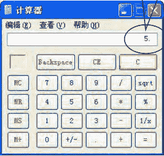
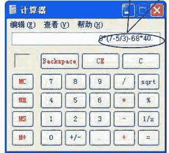

**可编程计算器**

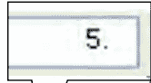
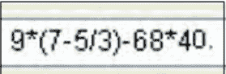

各种数据库查询语言及专家系统

```sql
select 课程
from table 课程表
where 任课老师=贾某
```

在计算机专业考研或者各大公司招聘时，必考内容。在 x86/Linux 工作站上，以下两个结构的 size 分别是 20 和 16，为什么不一样？

```c
typedef struct  _a{
    char   c1;
    long   i;
    char   c2;
    double f;
}a;
typedef struct  _b{
    char   c1;
    char   c2;
    long   i;
    double f;
}b;
```

**vc 结果 vs Linux 下 gcc 的结果**

```text
sizeof(a)=24
a 的首地址是 12ff68
a.c1 的首地址是 12ff68
a.i 的首地址是 12ff6c
a.c2 的首地址是 12ff70
a.f 的首地址是 12ff78
sizeof(b)=16
b 的首地址是 12ff58
b.c1 的首地址是 12ff58
b.c2 的首地址是 12ff59
b.i 的首地址是 12ff5c
b.f 的首地址是 12ff60
Press any key to continue.
```

```text
Password for ljzl:
login: Resource temporarily unavailable while getting
Last login: Tue Aug 19 09:30:46 from 10.4.125.95
[ljzl@servertd1 ~]$ cd chity
[ljzl@servertd1 chity]$ cd src
[ljzl@servertd1 src]$ st
sizeof(a)=24
a 的首地址是 bffff750
a.c1 的首地址是 bffff750
a.i 的首地址是 bffff754
a.c2 的首地址是 bffff758
a.f 的首地址是 bffff75c
sizeof(b)=16
b 的首地址是 bffff740
b.c1 的首地址是 bffff740
b.c2 的首地址是 bffff741
b.i 的首地址是 bffff744
b.f 的首地址是 bffff748
[ljzl@servertd1 src]$
```

vc6 中的编译选项有 /Zp[1|2|4|8|16]，/Zp1 表示以 1 字节边界对齐，相应的，/Zpn 表示以 n 字节边界对齐。n 字节边界对齐的意思是说，一个成员的地址必须安排在成员的尺寸的整数倍地址上或者是 n 的整数倍地址上，取它们中的最小值。

要使用这个选项，可以在 vc6 中打开工程属性页，C/C++ 页，选择 Code Generation 分类，在 Struct member alignment 中可以选择。

### 编译技术研究对象：编译器的构造与分析

C, C++, Pascal, Delphi, VC, BC

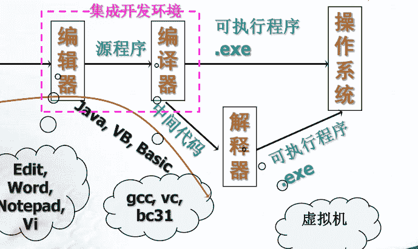

## BASIC 年代的解释器

- 功能：它将高级语言的源程序翻译成一种中间语言程序，然后对中间语言程序进行解释执行
- 在那个年代，编译和解释两个功能是合在一个程序中，该程序被称为解释器

## Java 年代的解释器

- 解释器的上述两个功能分在两个程序中
- 前一个叫做编译器，它把源程序翻译成一种叫做字节码的中间语言程序
- 后一个叫做解释器，它对字节码程序进行解释执行

## 编译器和解释器的区别

### 三种奶牛三种嗜好

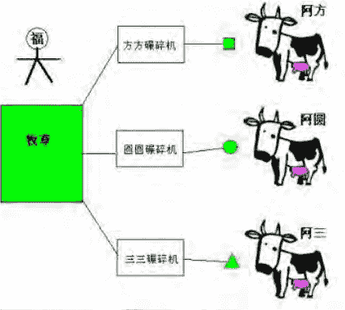
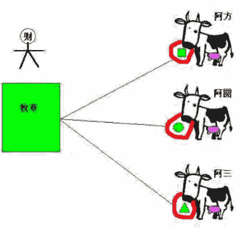

### 改进后的方案

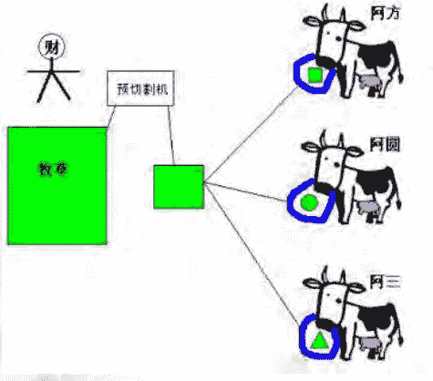

牧草 = 我们的各种编程语言，C/C++/C#, Java, Pascal, PHP, Perl, JavaScript 等；切割机 = 各种编译器；奶牛 = 各种 CPU，比如 x86、ARM、MIPS 等。奶牛会有吃不同形状牧草的嗜好，这个奇怪的比喻是为了表示不同的 CPU 接受不同的机器语言。

- C, C++, Pascal 源代码 → 编译器 → 运行 → x86 / ARM / MIPS
- PHP, JavaScript, Python, Perl 源代码 → 解释器 → 运行 → x86 / ARM / MIPS

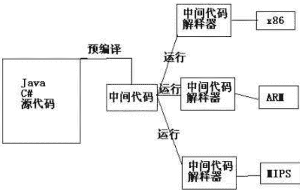

编译器是把源程序的每一条语句都编译成机器语言，并保存成二进制文件，这样运行时计算机可以直接以机器语言来运行此程序，速度很快；而解释器则是在执行程序时，才一条一条地解释成机器语言给计算机来执行，所以运行速度不如编译后的程序运行得快。

## 第一章 引论

- **翻译器**：把一种语言变换到另外一种语言的软件。这两种语言分别称为**源语言**和**目标语言**。
- **编译器**：一种翻译器，它的**目标语言**比**源语言**低级。


## 第一章 引论

编译器从逻辑上可以分成若干阶段，每个阶段把源程序从一种表示变换成另一种表示


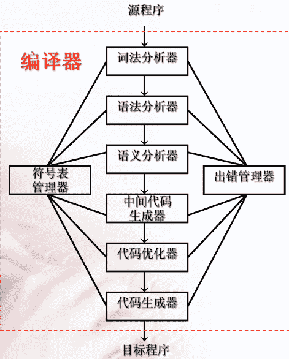

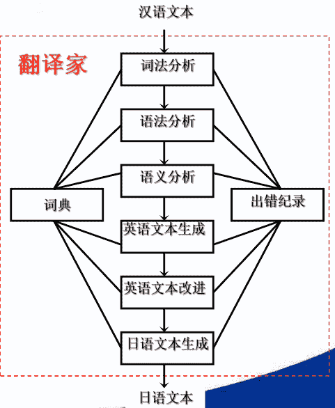

### FORTRAN (FORmula TRANslation)

- 第一个实用的高级语言
- 擅长于数学函数运算
- 常用于科学计算中

### 第一个编译器

- 历史上第一个实用的编译器（John Backus）：
  - Fortran compiler for the IBM 704/709/7090/7094
- John Backus，引入了编译器的“阶段”或称为“遍”的概念，是编译设计的模块化的开始


词法分析：源程序 -> 词法标记 (token) 流

position = initial + rate * 60

词法分析器

`<id, 1> (=) <id, 2> (+) <id, 3> (*) (60)`

| 序号 | 标识符 |
|------|--------|
| 1 | position ... |
| 2 | initial ... |
| 3 | rate ... |

你们是优秀的大工学子。

词法分析

名词_1 动词 形容词 名词_2

| 序号 | 单词 |
|------|------|
| 1 | 你们 ... |
| 2 | 大工学子 ... |
| 3 | ... ... |

### 语法分析：词法记号（token）流 -> 语法短语

- 任何一个标识符都是表达式；
- 任何一个数都是表达式；
- 如果 e₁ 和 e₂ 都是表达式，那么
  - e₁ + e₂
  - e₁ * e₂
  - (e₁)
  也都是表达式

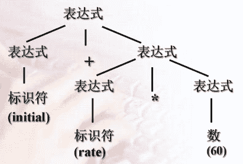

- 任何名词都可以作宾语；
- 如果 e₁ 和 e₂ 都是宾语，那么
  - e₁ 和 e₂
  - e₁ 与 e₂
  也都可以作宾语
- 如果 e₁ 是定语，e₂ 是宾语，那么 e₁e₂ 也可以作宾语。

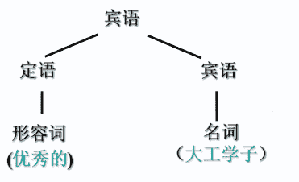

⟨id, 1⟩ <=⟨id, 2⟩ +⟨id, 3⟩ *⟨60⟩

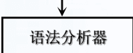

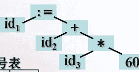

| 1 | position | ... |
|---|----------|-----|
| 2 | initial | ... |
| 3 | rate | ... |

名词1 动词 形容词 名词2

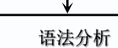

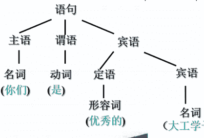

| 词典 |
|---|
| 你们 ... |
| 大工学子 ... |
| ... |

语义分析：检查程序的语义正确性，如类型检查等

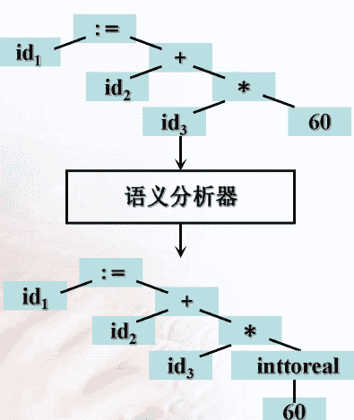

你们是优秀的大工学子

你们是一个优秀的大工学子。

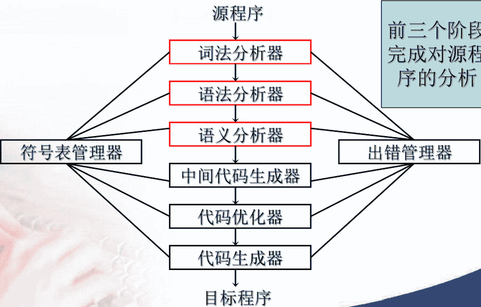

```
源程序
词法分析器
语法分析器
语义分析器
中间代码生成器
代码优化器
代码生成器
目标程序
符号表管理器
出错管理器
```

> 前三个阶段完成对源程序的分析

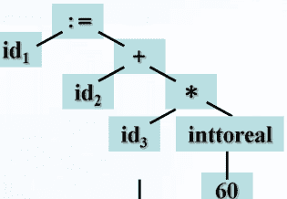

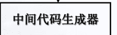

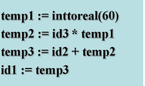

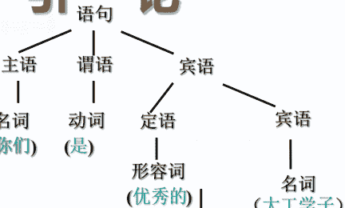

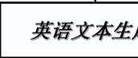


```text
temp1 := inttoreal(60)
temp2 := id3 * temp1
temp3 := id2 + temp2
id1 := temp3
```

代码优化器

```text
temp1 := id3 * 60.0
id1 := id2 + temp1
```

You are good DLUTERS.

英语文本改进

You are excellent DLUTers

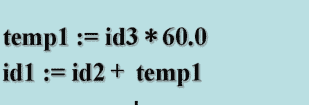


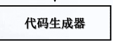

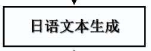

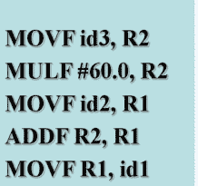


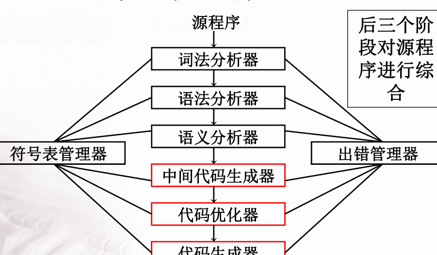

```
源程序
词法分析器
语法分析器
语义分析器
中间代码生成器
代码优化器
代码生成器
目标程序
符号表管理器
出错管理器
```

### 分析和综合：

- 把编译过程分成分析和综合两步
- 分析：分析源程序以计算其特性所涉及到的操作（词法分析、语法分析、语义分析）
- 综合：生成目标代码时所涉及到的操作（中间代码生成、代码优化、代码生成）
- 辅助：符号表管理、出错处理
- 8项功能对应8个模块。

### 前端和后端：


- 前端
- 后端

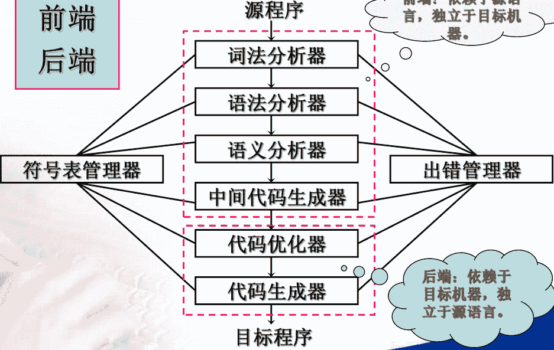

前端：依赖于源语言，独立于目标机器。

后端：依赖于目标机器，独立于源语言。

```
源程序
词法分析器
语法分析器
语义分析器
中间代码生成器
代码优化器
代码生成器
目标程序
符号表管理器
出错管理器
```

- 把编译过程分成前端和后端两部分
- 前端：只依赖于源程序，独立于目标机器（生成中间代码）
- 后端：依赖于目标机器，与源程序无关，只与中间语言有关（从中间代码生成目标代码）
- 好处：提高开发编译器的效率
- 取一个编译器的前端，重写它的后端以产生同一源语言在另一机器上的编译器
- 不同的前端使用同一个后端，从而得到一个机器上的几个编译器（采用同一中间语言）

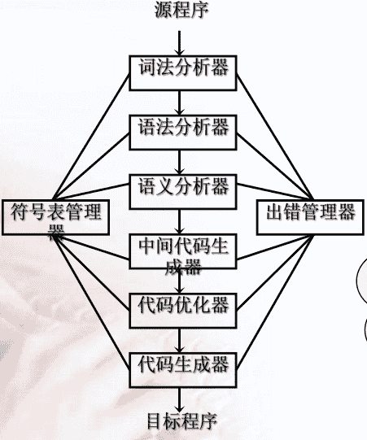

编译的几个阶段常用一遍（pass）扫描实现，一遍扫描包括读一个输入文件和写一个输出文件。

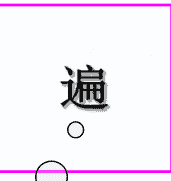

### 类比：刷墙艺术中的“遍”的概念

任务：在一面墙上布置网线，并粉刷水泥，然后贴上瓷砖


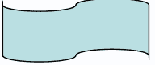


- 网线
- 水泥
- 瓷砖


## 第一章 引论

### 类比：刷墙艺术中的“遍”的概念

方法一：

第一遍：布上全部网线

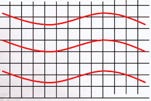


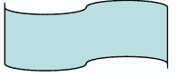


网线

水泥

瓷砖


遍

第二遍：粉刷全部墙面的水泥

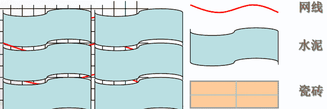

遍

第三遍：给整个墙面贴上瓷砖

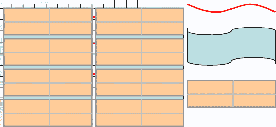

网线

水泥

瓷砖

方法二：

一遍：一边布网线，一边粉刷水泥，一边贴瓷砖

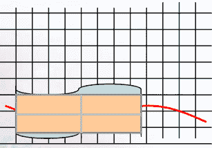

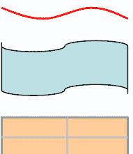


遍（趟）：

- **一遍或一趟**：是指编译程序在编译时刻把源程序或源程序的等价物（中间程序）从头到尾扫描一遍并转换成另一紧邻的等价物的全过程。
- **单遍扫描与多遍扫描**：每一遍的扫描可完成上述一个阶段或多个阶段的工作。每一遍的输入都是上一遍的输出，第一遍的输入是源程序正文，最后一遍的输出是目标代码。
- **单遍与多遍的比较**：
  - 遍数多：编译器结构清晰，但时间效率不高
  - 遍数少：编译速度快，但对机器的内存要求高
- **遍数的确定**：主要因素是源程序和机器（目标机）的特征。

## 编程语言演义

### 编程语言

- 机器语言
  - **机器语言特点**
    - 0、1串
    - 打卡输入
    - `c7 06 0000 0002`
      - ⊕ mov x, c 其中符号x的地址是0000，c=2
    - 计算机可以直接理解机器语言程序
  - **机器语言缺点**
    - 可读性差
    - 可维护性差
- 汇编语言
  - `mov x,2` 与 `c7 06 0000 0002` 的对应：

```
mov x,2
```

```
c7 06 0000 0002
```

  - 变量x的地址可以由汇编器维护，而不需要固定到某个绝对地址
- 高级语言（Fortran, C, Java, ...）
  - **高级语言形式**
    - 赋值语句：x=2
    - 贴近人类思维方式，贴近实际问题描述形式
    - 计算机无法直接理解
    - 需要编译器辅助，将其转换为机器语言形式

## 1.2 编译器技术的应用

### 高级语言的实现

- 每一轮编程语言新特征的出现都刺激编译器优化的新研究
- 支持用户定义的聚合数据类型和高级控制流，如数组和记录、循环和过程调用：C、Fortran
- 面向对象的主要概念是数据抽象和性质继承，使得程序更加模块化并易于维护：Smalltalk、C++、C#、Java
- 类型安全的语言：Java没有指针，也不允许指针算术。它用无用单元收集机制来自动地释放那些不再使用的变量占据的内存

### 针对计算机体系结构的优化

- 计算体系结构迅速演化引起对新的编译器技术一种不知足的需要
- **并行化**
  - 编译器重新整理指令，使得指令级并行更有效
  - 编译器从传统的串行程序自动生成并行代码，使之运行于多处理器上

### 内存分层

- 编译器优化历来集中在优化处理器的执行上，但是现在更强调要使内存分层更有效

### 新计算机体系结构的设计

- 现在计算机系统的性能不仅仅取决于它的原始速度，还取决于编译器是否能生成充分利用其特征的代码
- 在现代计算机体系结构的研究中，在处理器的设计阶段就开发编译器，并将编译生成的代码在模拟器上运行，以评价拟采用体系结构的特征
- 编译器技术影响计算机体系结构设计的一个著名例子是精简指令集计算机（RISC）的发明

### 程序翻译

#### 二进制翻译

编译器技术可用于把一种机器的二进制代码翻译成另一种机器的代码，以运行原先为别的指令集编译的代码

#### 数据库查询解释器

数据库查询由一些谓词组成，这些谓词由包含关系运算的布尔表达式组成，可以被解释执行，也可以被编译成搜索数据库的命令

## 小结

- 编译原理的内容及学习意义
- 翻译器、编译器的定义
- 编译器的阶段划分及前端、后端的概念
- “遍”的概念

## 作业

- 习题1：1.1, 1.2(编译器与解释器的区别是什么)
- 每周第一次课交作业！

## 温故知新

- 编译原理的内容及学习意义
- 翻译器、编译器的定义
- 编译器的阶段划分及前端、后端的概念
- “遍”的概念

## 第二章 词法分析

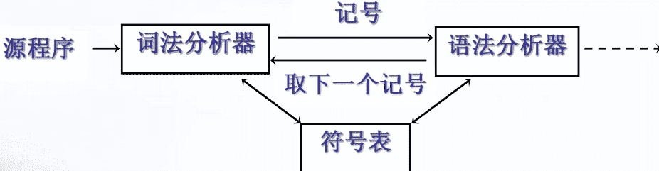

## 本章内容

- 词法分析器：把构成源程序的字符流翻译成记号流，还完成与用户接口的一些任务
- 围绕词法分析器的自动生成展开
- 介绍正规式、状态转换图和有限自动机概念

### 词法分析器的功能：


## 2.1 词法记号及属性

### 历史上词法定义中的一些问题

#### 忽略空格带来的困难

```
DO 8 I = 3. 75

DO8I = 3. 75

DO 8 I = 3, 75
```

#### 关键字是否保留

```
IF THEN THEN THEN=ELSE; ELSE ...
```

### 2.1.1 词法记号、模式、词法单元

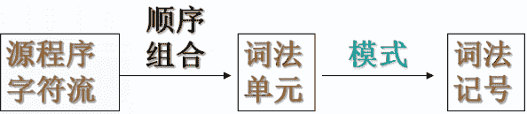

例：

```
var count : integer ; count = 5 ;
```

词法单元

| 类别 | 实例 | 描述 |
| --- | --- | --- |
| 名词 | 大连、软件、大黑山 | 表示名称的词 |
| 连词 | 和、与、或 | 和、与、或…… |
| 词法记号 | 词法单元例举 | 模式的非形式化描述 |
| relation | <、<=、=、... | < 或 <= 或 = 或 ... |
| id | sum、count、D5 | 由字母开头的字母数字串 |
| 词法记号 | 词法单元例举 | 模式的非形式描述 |
| 中国人、美国人 | 胡锦涛、毛泽东、奥巴马、克林顿 | 具有中国国籍的人、具有美国国籍的人 |

### C语言的标识符

```
x2, 12, _12, _abc
```

哪些是合法的C标识符？

C语言标识符的规则（模式）：
首字符必须是_或者字母，由_、字母或数字组成的字符串

### 词法记号的属性

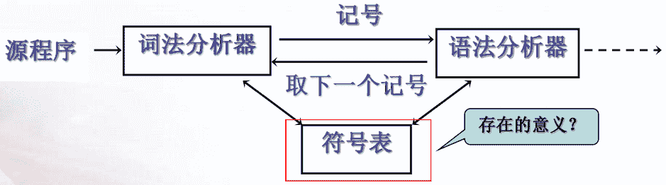


### 词法记号的属性

如果简单地把词法记号流传给语法分析器，会产生什么后果？

- 语义被完全摒弃，只剩下一个语法结构

我是学生
翻译官
Pronoun Verb Noun
说了什么呀？？？？

每个词法记号具有一定的含义（属性）

`L1: x = y2 + 12;`

- 第一个 ID，名称是 `L1`，表示的是标号（Label）
- 第二个 ID，名称是 `x`，表示的是一个变量，类型是 int
- 第三个 ID，名称是 `y2`，表示的是一个变量，类型是 int


## 2.1 词法记号及属性

### 2.1.2 词法记号的属性

`position := initial + rate * 60` 的记号和属性值：

⟨id，指向符号表中 position 条目的指针⟩
⟨assign_op，⟩
⟨id，指向符号表中 initial 条目的指针⟩
⟨add_op，+⟩
⟨id，指向符号表中 rate 条目的指针⟩
⟨mul_op，*⟩
⟨num，整数值 60⟩

练习题（要求使用伪代码给出算法）：编写一个程序，用于统计文件中单词的总数，不同单词的数目。

例：I love Dalian and I love DLUT

单词总数：7  
不同单词数目：5

### 2.1.3 词法错误

- 词法分析器对源程序采取非常局部的观点，难以发现下面的错误

`fi (a == f (x)) ...`

- 但是也有例外，如实数采用 `a.b` 格式时，可以发现下面的错误

`123.`

**恢复策略**

- “紧急方式”
- 错误修补尝试
  - 删除一个多余的字符
  - 插入一个遗漏的字符
  - 用一个正确的字符代替一个不正确的字符
  - 交换两个相邻的字符

## 2.2 词法记号的描述与识别

### 2.2.1 串和语言

- 字母表/字符类：符号（英文字母、标点符号等）的有限集合，例：\(\Sigma = \{0, 1\}\)
- 串：符号的有穷序列，例：\(0110, \epsilon\)
- 语言：字母表上的一个串集
  \(\{\epsilon, 0, 00, 000, \dots\}, \{\epsilon\}, \emptyset\)
- 句子/字：属于语言的串

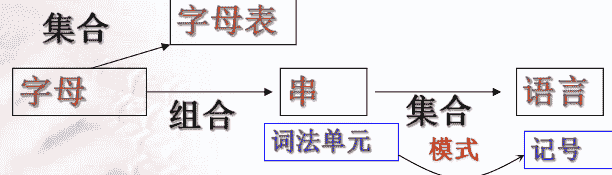


**串的运算**

- 连接：`xy`，`sε = εs = s`
- 幂（指数）：`s^0 = ε`，`s^i = s^(i-1)s`（i > 0）

### 语言的运算

- 并：\(L \cup M = \{s \mid s \in L \text{ 或 } s \in M\}\)
- 连接：\(LM = \{st \mid s \in L \text{ 且 } t \in M\}\)
- 幂（指数）：\(L^0 = \{\varepsilon\}\)，\(L^i = L^{i-1}L\)
- 闭包：\(L^* = L^0 \cup L^1 \cup L^2 \cup \cdots\)
- 正闭包：\(L^+ = L^1 \cup L^2 \cup \cdots\)

**例2.2（p17）**

\(L = \{A, B, \ldots, Z, a, b, \ldots, z\}\)，\(D = \{0, 1, \ldots, 9\}\)

\(L \cup D\)，\(LD\)，\(L^6\)，\(L^*\)，\(L(L \cup D)^*\)，\(D^+\)

### 2.2.2 正规式

正规式是用于说明词法单元如何对应到词法记号的模式。与非形式化的描述相比，正规式更具形式化，更加精确。

正规式：按照一组定义规则，由较简单的正规式构成的，每个正规式 r 表示一个语言 L(r)。定义规则说明 L(r) 是怎样以各种方式从 r 的子正规式所表示的语言组合而成。正规式用来表示简单的语言，叫做正规集。

| 正规式 | 定义的语言 | 备注 |
|---|---|---|
| ε | {ε} | |
| a | {a} | a ∈ Σ |
| (r)\|(s) | L(r) ∪ L(s) | r 和 s 是正规式 |
| (r)(s) | L(r)L(s) | r 和 s 是正规式 |
| (r)* | (L(r))* | r 是正规式 |
| (r) | L(r) | r 是正规式 |

运算符的优先级：

`*` > 连接运算 > `|`

（`((a)(b)* | (c))` 可以写成 `ab* | c`）

### 2.2.3 正规定义

对正规式命名，使表示简洁。

d₁ → r₁  
d₂ → r₂  
...  
dₙ → rₙ

各个 dᵢ 的名字都不同

每个 rᵢ 都是 Σ ∪ {d₁, d₂, ..., dᵢ₋₁} 上的正规式

> 这样就保证了，每个名字对应的正规式中使用的各种符号已经在前面定义了，从而可以避免递归定义的情况。

### 正规定义的例子

**Pascal 语言的标识符集合**

letter → A | B | ... | Z | a | b | ... | z

digit → 0 | 1 | ... | 9

id → letter (letter | digit)*

**Pascal 无符号数集合，例：1946, 11.28, 63.6E8, 1.99E–6**

digit → 0 | 1 | ... | 9

digits → digit digit*

optional_fraction → . digits | ε

optional_exponent → (E ( + | – | ε ) digits ) | ε

num → digits optional_fraction optional_exponent

### 简化表示

num → digit+ (.digit+)? (E(+|-)? digit+)?

简化规则：

1. `r+ = rr*`
2. `r? = r | ε`
3. `[a-z] = a|b|c|...|z`
4. `[abc] = a|b|c`

> 前面所提到的词法记号，实际上就是正规式的名字！

- `while → while`
- `do → do`
- `relop → < | <= | = | <> | > | >=`
- `id → letter (letter | digit)*`
- `num → digit+ (.digit+)? (E(+|-)? digit+)?`
- `delim → blank | tab | newline`
- `ws → delim+`

## 小结

### 词法分析器工作原理

源代码  
词法分析器  
记号（token）流  

源程序字符流  

顺序组合  

词法单元  
模式  
词法记号  

非形式化描述  
形式化描述  
正规式  

字母表  
集合  
组合  
字母  
串  
集合  
语言  
名字

## 习题

### 作业

- 习题 2.3
- 练习题（要求使用伪代码给出算法）：编写一个程序，用于统计文件中单词的总数，不同单词的数目。（假设输入文件中只包含字母和空格）

例：I love Dalian and I love DLUT

单词总数：7  
不同单词数目：5

## 温故知新

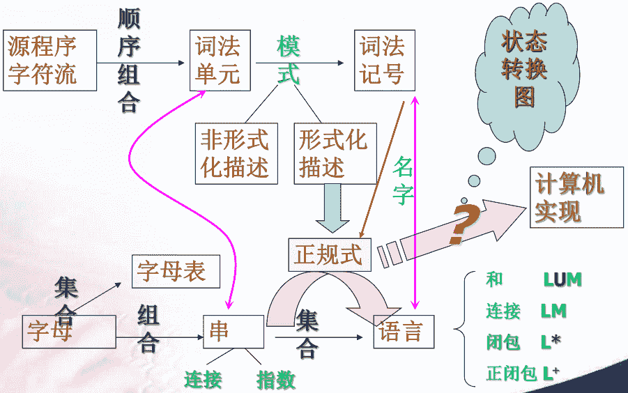

## 词法记号的识别

- 词法记号的识别等同于对字符串的匹配过程
- 这个匹配过程可以基于有限状态机来完成

## 简单的正规式 d→a


## 正则式 d->ab


## 正则式 d->a|b

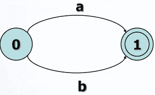

## 正规式 d->a*


## 自动机的定义

- 正规式 d->a?
- 字符a出现一次或者0次


## 练习

正规式 d->a(a|b)*

请画出它的状态转换图

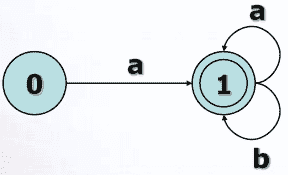

## 2.2 词法记号的描述与识别

### 2.2.4 转换图 relop → < | <= | = | <> | > | >=

- 关系算符的转换图

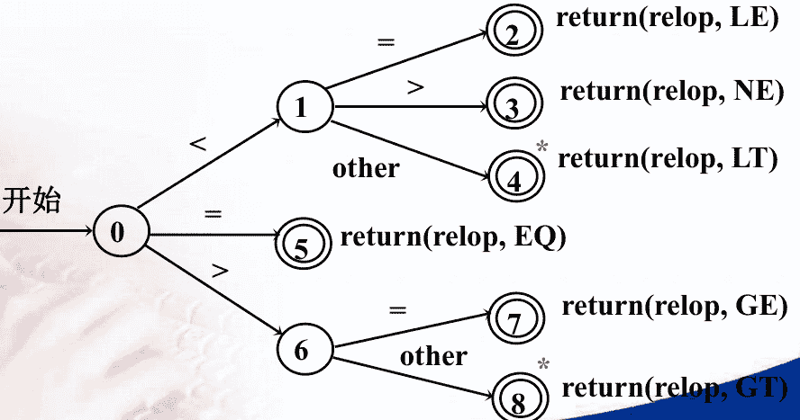

## 2.2 词法标记号的描述与识别

标识符和保留字的转换图

id → letter (letter | digit )*

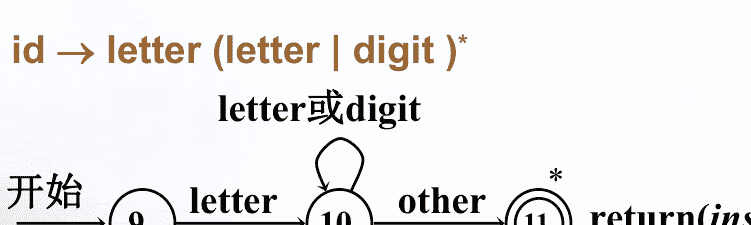

- 检查保留字表，如果在表中发现该词法单元则返回相应的记号并退出，否则转向2
- 该词法单元是标识符，在符号表中查找，若找到该词法单元则返回该条目的指针并退出，否则执行3
- 在符号表中建立一个新的条目，把该词法单元填入，并返回此新条目的指针

## 2.2 词法记号的描述与识别

### 无符号数的转换图

**num** → **digit** ( . **digit** )? ( **E** ( + | − )? **digit**+ )?

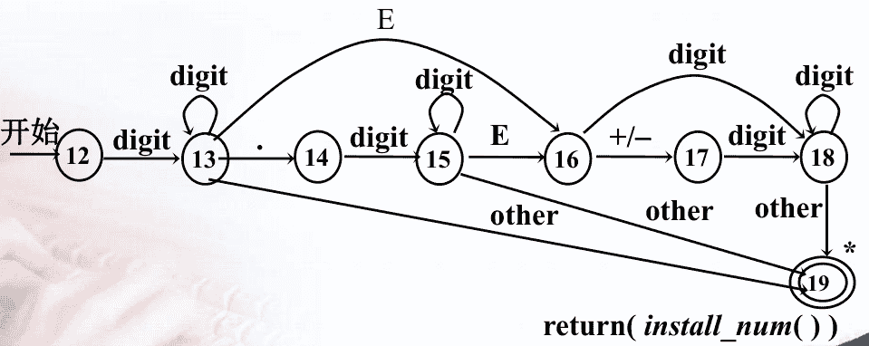

## 2.2 词法记号的描述与识别

空白的转换图

delim → blank | tab | newline

ws → delim+

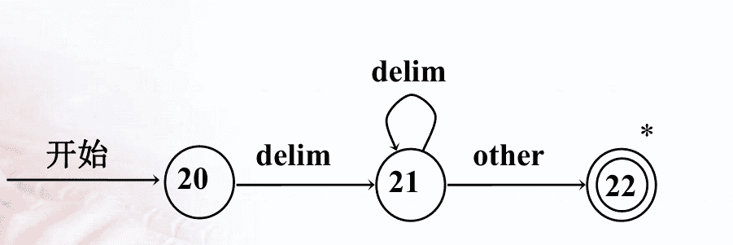

## 2.3 有限自动机

- 识别器：是一个程序，取串x作为输入，当x是语言的句子时，它回答“是”，否则回答“不是”。
- 状态转换图（有限自动机）→识别器
- 确定/不确定有限自动机——时空权衡问题
- 确定有限自动机：快，空间大

### 2.3.1 不确定的有限自动机（简称NFA）

一个数学模型，它包括：

- 状态集合S；
- 输入符号集合Σ；
- 转换函数move：S × (Σ∪{ε}) → P(S)；
- 状态s₀是开始状态；
- F ⊆ S是接受状态集合。

识别语言  
(a|b)*ab  
的NFA


## 2.3 有限自动机

### 例 识别aa*|bb*的NFA


### 2.3.2 确定的有限自动机（简称DFA）

一个数学模型，包括：

- 状态集合S；
- 输入字母表Σ；
- 转换函数\(move : S \times \Sigma \rightarrow S\)；
- 唯一的初态 \(s \in S\)；
- 终态集合 \(F \subseteq S\)；

识别语言
\((a|b)^*ab\)
的DFA


### 2.3.3 NFA到DFA的变换

子集构造法

- DFA的一个状态是NFA的一个状态集合
- 读了输入a<sub>1</sub> a<sub>2</sub> ... a<sub>n</sub>后，NFA能到达的所有状态： s<sub>1</sub>, s<sub>2</sub>, ..., s<sub>k</sub>，则DFA到达状态{s<sub>1</sub>, s<sub>2</sub>, ..., s<sub>k</sub>}


### 2.3.3 NFA到DFA的变换

子集构造法

1. DFA的一个状态是NFA的一个状态集合
2. 读了输入a₁ a₂ ... aₙ后，NFA能到达的所有状态： s₁, s₂, ..., sₖ，则DFA到达状态{s₁, s₂, ..., sₖ}


### 2.3.3 NFA到DFA的变换

子集构造法

1. DFA的一个状态是NFA的一个状态集合
2. 读了输入a<sub>1</sub>a<sub>2</sub>...a<sub>n</sub>后，NFA能到达的所有状态：s<sub>1</sub>, s<sub>2</sub>, ..., s<sub>k</sub>，则DFA到达状态{s<sub>1</sub>, s<sub>2</sub>, ..., s<sub>k</sub>}


### 2.3.3 NFA到DFA的变换

子集构造法

- DFA的一个状态是NFA的一个状态集合
- 读了输入a₁ a₂ ... aₙ后，NFA能到达的所有状态： s₁, s₂, ..., sₖ，则DFA到达状态{s₁, s₂, ..., sₖ}


### 2.3.3 NFA到DFA的变换

子集构造法

- DFA的一个状态是NFA的一个状态集合
- 读了输入a₁ a₂ ... aₙ后，NFA能到达的所有状态： s₁, s₂, ..., sₖ，则DFA到达状态{s₁, s₂, ..., sₖ}


## 2.3 有限自动机

| 状态 | 输入符号 | |
|---|---|---|
| | a | b |
| | | |
| | | |
| | | |
| | | |
| | | |


## 2.3 有限自动机

\( A = \{0, 1, 2, 4, 7\} \)

| 状态 | 输入符号 a | b |
|---|---|---|
| A | | |


## 2.3 有限自动机

A = {0, 1, 2, 4, 7}
B = {1, 2, 3, 4, 6, 7, 8}

| 状态 | 输入符号 | |
|---|---|---|
| | a | b |
| A | B | |
| B | | |
| | | |
| | | |


## 2.3 有限自动机

A = {0, 1, 2, 4, 7}
B = {1, 2, 3, 4, 6, 7, 8}
C = {1, 2, 4, 5, 6, 7}

| 状态 | 输入符号 | |
|---|---|---|
| | a | b |
| A | B | C |
| B | | |
| | | |
| | | |


## 2.3 有限自动机

A = {0, 1, 2, 4, 7}
B = {1, 2, 3, 4, 6, 7, 8}
C = {1, 2, 4, 5, 6, 7}

| 状态 | 输入符号 | |
|---|---|---|
| | a | b |
| A | B | C |
| B | B | |
| C | | |


## 2.3 有限自动机

A = {0, 1, 2, 4, 7}
B = {1, 2, 3, 4, 6, 7, 8}
C = {1, 2, 4, 5, 6, 7}
D = {1, 2, 4, 5, 6, 7, 9}

| 状态 | 输入符号 | |
|---|---|---|
| | a | b |
| A | B | C |
| B | B | D |
| C | | |


## 2.3 有限自动机

A = {0, 1, 2, 4, 7}
B = {1, 2, 3, 4, 6, 7, 8}
C = {1, 2, 4, 5, 6, 7}
D = {1, 2, 4, 5, 6, 7, 9}

| 状态 | 输入符号 | |
|---|---|---|
| | a | b |
| A | B | C |
| B | B | D |
| C | | |
| D | | |


## 2.3 有限自动机

A = {0, 1, 2, 4, 7}
B = {1, 2, 3, 4, 6, 7, 8}
C = {1, 2, 4, 5, 6, 7}
D = {1, 2, 4, 5, 6, 7, 9}

| 状态 | 输入符号 a | 输入符号 b |
|---|---|---|
| A | B | C |
| B | B | D |
| C | B | C |
| D | | |


## 2.3 有限自动机

A = {0, 1, 2, 4, 7}

B = {1, 2, 3, 4, 6, 7, 8}

C = {1, 2, 4, 5, 6, 7}

D = {1, 2, 4, 5, 6, 7, 9}

| 状态 | a | b |
|------|---|---|
| A | B | C |
| B | B | D |
| C | B | C |
| D | B | C |


## 2.3 有限自动机

| 状态 | 输入符号 | |
|---|---|---|
| | *a* | *b* |
| **A** | **B** | **C** |
| **B** | **B** | **D** |
| **C** | **B** | **C** |
| **D** | **B** | **C** |


## 2.3 有限自动机

### 识别语言 (a|b)*ab 的自动机


## 2.3 有限自动机

### 2.3.4 DFA的化简

### DFA化简的途径

- 根据状态是否可以区分，将状态划分成若干个集合，每个集合内的状态之间都不可区分，而任意两个集合中的元素都是可以互相区分的。
- 依据原始的DFA，在合并后的状态基础上，建立新的状态转换关系。

## 2.3 有限自动机

### 2.3.4 DFA的化简

### 死状态

左图无须加入死状态，右图加入死状态E。


## 2.3 有限自动机

A和B是可区分的状态

A和C是不可区分的的状态


## 2.3 有限自动机

### 方法

1. `{A, B, C}, {D}`
   `move({A, B, C}, a) = {B}`
   `move({A, B, C}, b) = {C, D}`

2. `{A, C}, {B}, {D}`
   `move({A, C}, a) = {B}`
   `move({A, C}, b) = {C}`


## 2.3 有限自动机

### 方法

1. {A, B, C}, {D}
move({A, B, C}, a) = {B}
move({A, B, C}, b) = {C, D}

2. {A, C}, {B}, {D}
move({A, C}, a) = {B}
move({A, C}, b) = {C}


## 2.4 从正规式到有限自动机


正规式

状态转换图

计算机实现

有限自动机

不确定有限自动机

确定有限自动机

等价

？

本节内容

## 2.4 从正规式到有限自动机

### 首先构造识别ε和字母表中一个符号的NFA


## 2.4 从正规式到有限自动机

### 构造识别主算符为选择的正规式的 NFA


识别正规式 s｜t 的 NFA

## 2.4 从正规式到有限自动机

### 构造识别主算符为连接的正规式的NFA


### 识别正规式st 的NFA

## 2.4 从正规式到有限自动机

对于加括号的正规式(s)，使用N(s)本身作为它的NFA。

## 2.4 从正规式到有限自动机

### $(a|b)^*ab$ 的分解


## 2.4 从正规式到有限自动机

### (a|b)*ab的分解


## 2.4 从正规式到有限自动机

### $(a|b)^*ab$的分解


## 2.4 从正规式到有限自动机

### (a|b)*ab 的分解


## 2.4 从正规式到有限自动机

- `(a|b)*ab` 的两个 NFA 的比较


## 号外：从语言到确定的有限自动机

例：识别 Σ={0,1} 上能被 5 整除的二进制数

- 方法：
1. 列出全部可能的状态
2. 从各个状态出发，构造边及输入字符


## 小结


用正规式语法结构来指导构造过程 子集构造法 合并不可区别状态 状态列举法 等价 等价

## 习题

2.7 (c) (d)，2.8（仅为2.7(c)），2.12（a）

练习：构造 DFA，接受 0 和 1 的个数都是偶数的二进制串。

eg: 0011, 00, 1100, 1010, 111100

## 2.3 有限自动机

例：DFA, 接受 0和1的个数都是偶数的字符串


## 温故知新


手工实现

用正规式语法结构来指导构造过程


正规式 状态转换图 计算机实现 等价 子集构造法 不确定有限自动机 确定有限自动机 最简确定有限自动机 等价 合并不可区别状态 状态列举法 非形式化描述的语言


## 2.5 词法分析器的生成器

### 用Lex建立词法分析器的步骤

Lex源程序lex.l → Lex编译器 → lex.yy.c

lex.yy.c → C编译器 → a.out

输入流 → a.out → 记号序列

### Lex程序包括三个部分

声明  
%%  
翻译规则  
%%  
辅助过程

### Lex程序的翻译规则

p1 {动作1}  
p2 {动作2}  
... ...  
pn {动作n}

### 例——声明部分

```c
%{
/* 常量LT, LE, EQ, NE, GT, GE, WHILE, DO, ID,
   NUMBER, RELOP的定义*/
%}
/* 正规定义 */
delim       [ \t\n ]
ws          {delim}+
letter      [A-Za-z]
digit       [0-9]
id           {letter}({letter}|{digit})*
number      {digit}+(\.{digit}+)?(E[+\-]?{digit}+)?
```

### 例——辅助过程部分

```c
install_id () {
/* 把词法单元装入符号表并返回指针。
yytext指向该词法单元的第一个字符，
yyleng给出的它的长度 */
}

install_num () {
/* 类似上面的过程，但词法单元不是标识符而是数 */
}
```

### 用 Lex 定义常规表达式

| 符号 | 说明 |
|------|------|
| . | 匹配任意字符，除了 `\n` |
| - | 指范围 [A-Za-z0-9] |
| $ | 行的结尾 |
| {} | 模式可能出现的次数，例如 A{1,3} 表示可能出现 1 次或 3 次 |
| ^ | 否定,操作符 ^ 只能出现在左中括号后的第一个字符位置处 [^abc] |
| * ? + 等 | 常用的闭包、逻辑或等操作 |

### Lex中重要的外部变量

- `yytext`：外部字符数组，其内容是当前被某个规则匹配的字符串
- `yyleng`：当前 `yytext` 中的字符的个数

例：

```c
[a-zA-Z]+    printf("word= %s, length=%d", yytext, yyleng);
```

```c
另外[a-zA-Z]+ printf("%s",yytext);可以简写成
[a-zA-Z]+    ECHO;
```

- **`yyin`**：`FILE*` 类型。它指向 lexer 正在解析的当前文件。
- **`yyout`**：`FILE*` 类型。它指向记录 lexer 输出的位置。缺省情况下，`yyin` 和 `yyout` 都指向标准输入和输出。
- 以上两个经常和函数 `yywrap()` 连用，如果函数的返回值是 1，就停止解析。因此它可以用来解析多个文件。代码可以写在第三段，这就能够解析多个文件。方法是使用 `yyin` 文件指针指向不同的文件，直到所有的文件都被解析。最后，`yywrap()` 可以返回 1 来表示解析的结束。
- **`yylineno`**：给出当前的行数信息

### Lex中识别规则的二义性处理

- 能匹配最多字符的规则优先
- 能匹配相同数目的字符的规则，书写顺序在前的优先

eg:
```text
integer   keyword action ...;
[a-z]+    identifier action ...;
```
当输入为 `jintegers` 时，匹配 `[a-z]+`


## Lex中识别规则二义性处理

假设需要计算输入文本中she和he的个数

```
she    {s++; REJECT;}
he     {h++; REJECT;}
\n     |
.      ;
```

## 2.5 词法分析器的生成器

### 简单的例子

- 删除输入中每行结尾处所有空白符

```
%%
[ \t]+$ ;
```

- 如果要将字符串中的空格或者制表符转换为单个空格，需要增加一条规则：

```
%%
[ \t]+$    ;
[ \t]+  printf(" ");
```

### 上机实验例子example.l

```
int num_lines = 0, num_chars = 0;
%%
\n	++num_lines; ++num_chars;
.	++num_chars;
%%
main()
{
	yylex();
	printf("# of lines = %d, # of chars = %d\n ",num_lines,num_chars);
}
```

- hello world
- wo ai tian an men
- hello world i love

`# of lines = 3, # of chars = 49`


## 本章要点

源程序字符流 → 顺序组合 → 词法单元 → 模式 → 词法记号 → 名字

非形式化描述 → 形式化描述 → 正规式 → 正规式语法结构 → 不确定有限自动机 → 子集构造法 → 确定有限自动机 → 合并不可区别状态 → 最简确定有限自动机

字母表 → 集合 → 字母表 → 组合 → 串 → 集合 → 语言 → 连接 → 指数 → 闭包 L* → 正闭包 L+

Lex

计算机实现 → 手工实现 → 状态转换图 → 等价 → 状态列举法

1、编写一个词法分析器，它针对输入文件，实现以下功能：
1）每遇到你的学号，就输出你的名字，对于其他的串原样输出。
2）统计输入文件中字母的数目。

例如：（以肖永跃的上机题为例）：

输入文件如下所示：

```
200213001 hello world
wo ai tian an men
hello world i love
200213001
```

输出应该如下所示：

```
肖永钦 hello world
wo ai tian an men
hello world i love
肖永钦
# of ids = 11, # of chars = 66
```


## 第一章 习题课

1. 书p36 2.3解：
   - 首尾均为0的二进制串
   - 0，1组成的二进制串，包括空串
   - 倒数第3位为0的二进制串
   - 包含且仅包含3个1的二进制串
   - 1的个数和0的个数均为偶数的二进制串

## 由偶数个0和奇数个1构成的所有0和1的串

在上一题的基础上给出：

```
even_0_even_1→
( 00 | 11 | (01|10) (00|11)* (01|10) )*
```

对于偶数个0和奇数个1构成的串，其第一个字符可能是0或1。

- 如果是1，那么剩下的部分一定是偶数个0和偶数个1（即1 even_0_even_1）。
- 如果是0，那么经过若干个偶数个0或偶数个1，一定会出现一个01或10，才能保证0的个数是偶数，1的个数是奇数。若串还没有结束，剩余部分一定是偶数个0和偶数个1。

### 答案

```
even_0_even_1→
(00 | 11 | (01|10) (00|11)* (01|10) )*

even_0_odd_1→
1 even_0_even_1 |
0 even_0_even_1 (01|10) even_0_even_1
```

## 写出语言 “所有相邻数字都不相同的数字串” 的正规定义*

每个句子先由若干个0把它分成若干段，如  
123031357106678035590123可以看成  
123, 0, 313571, 0, 6678, 0, 3559, 0, 123  
由此可得到：

```
answer→
(0 | no_0 0 ) (no_0 0 )* (no_0 | ε ) | no_0
```

answer →

$(0 \mid no\_0\ 0)(no\_0\ 0)^*(no\_0 \mid \varepsilon) \mid no\_0$

没有0的部分可以用1来切分

no_0 →

$(1 \mid no\_0\text{-}1\ 1)(no\_0\text{-}1\ 1)^*(no\_0\text{-}1 \mid \varepsilon) \mid no\_0\text{-}1$

- no_0-8 → 9
- no_0-7 → (8 | no_0-8 8 ) (no_0-8 8 )* (no_0-8 | ε ) | no_0-8
- no_0-6 → (7 | no_0-7 7 ) (no_0-7 7 )* (no_0-7 | ε ) | no_0-7
- no_0-5 → (6 | no_0-6 6 ) (no_0-6 6 )* (no_0-6 | ε ) | no_0-6
- no_0-4 → (5 | no_0-5 5 ) (no_0-5 5 )* (no_0-5 | ε ) | no_0-5
- no_0-3 → (4 | no_0-4 4 ) (no_0-4 4 )* (no_0-4 | ε ) | no_0-4
- no_0-2 → (3 | no_0-3 3 ) (no_0-3 3 )* (no_0-3 | ε ) | no_0-3
- no_0-1 → (2 | no_0-2 2 ) (no_0-2 2 )* (no_0-2 | ε ) | no_0-2
- no_0 → (1 | no_0-1 1 ) (no_0-1 1 )* (no_0-1 | ε ) | no_0-1
- answer → (0 | no_0 0 ) (no_0 0 )* (no_0 | ε ) | no_0

## 将下图的DFA极小化。


### 1、加入死状态

### 2、合并不可区分状态

加入死状态后的DFA

先把状态集合成非接受状态集{0, 1, 2, 3, 5}和接受状态集{4}这两个子集。

1. 集合{4}不能再分解，我们看集合{0, 1, 2, 3, 5}。

   move({0, 1, 2, 3, 5}, a) = {1, 2, 5} move({0, 1, 2, 3, 5}, b) = {3, 4, 5}

   由于b 转换的结果{3, 4, 5}不是最初划分的某个集合的子集，因此{0, 1, 2, 3, 5}需要再分，由于状态1和状态2的b转换都到状态4。因此状态集合的进一步划分是：

   {1, 2}、{0, 3, 5}和{4}

2. 由于move({1, 2}, a) = {2, 5} move({1, 2}, b) = {4}

   move({0, 3, 5}, a) = {1, 5} move({0, 3, 5}, b) = {3, 5}

   显然{1, 2}和{0, 3, 5}需要再分，分别分成：{1}和{2}以及{0, 3}和{5}

3. 由于 move({0, 3}, a) = {1} move({0, 3}, b) = {3}

   因此不需要再分。这样状态0和状态3合并成一个状态，我们取0为代表，再删去死状态5，就得到该题的结果。

### 1、直接合并不可区分状态


- 最初的划分是{0, 1, 2, 3}和{4}。
- 1. 状态集合的进一步划分是：
  - {1, 2}、{0, 3}和{4}
- 2. 忽略了死状态的影响，会认为它们都不需要再分


## 用状态转换图表示接收(a|b)*aa 的DFA

最简单的句子是aa


## 用状态转换图表示接收$(a|b)^*aa$的DFA

因为在第一个a前可以有若干个b，因此状态0有到自身的b转换。在最后两个字符都是a的串的末尾添加若干个a，能够保持串的这个性质。


## 识别注释的DFA


## 温故知新

源程序字符流

顺序组合

词法单元

模式

词法记号

非形式化描述

形式化描述

名字

正规式

正规式语法结构

不确定有限自动机

子集构造法

确定有限自动机

合并不可区别状态

最简确定有限自动机

字母表

组合

串

集合

语言

连接

指数

LUM

连接 LM

闭包 L*

正闭包 L+

状态列举法

计算机实现

手工实现

状态转换图

等价

## 第二次上机

- 输入：p27页图2.12的NFA的状态转换表。
- 输出：DFA的状态转换表。
- 检验方式：输入一串表达式，能够判断输入是否符合该DFA的定义。

# 第三章 语法分析


## 本章内容

- 上下文无关文法
- 自上而下分析和自下而上分析
- 围绕分析器的自动生成展开

# 语法分析：词法记号（token）流 → 语法短语（分析树）

initial + rate * 60

id + id * num


优秀的大学生

形容词 名词


# 词法分析器（正规式）


# 3.1 上下文无关文法

## 3.1.1 上下文无关文法的定义

- 正规式来定义一些简单的语言，能表示给定结构的固定次数的重复或者没有指定次数的重复。
- 例：a (ba)5, a (ba)*

- 正规式不能用于描述配对或嵌套的结构
- 例：配对括号串的集合，
- {wcw | w是a和b的串}

# 3.1 上下文无关文法

上下文无关文法是四元组（\(V_T, V_N, S, P\)）

\(V_T\)：终结符集合(非空有限集合，记号名是其同意词)

\(V_N\)：非终结符集合（非空有限集合，\(V_T \cap V_N = \phi\)）

S：开始符号(非终结符)

P：产生式集合，产生式形式：\(A \rightarrow \alpha\)，\(A \in V_N, \alpha \in (V_T \cup V_N)^*\)

例（{id, +, *, -, (, )}, {expr, op}, expr, P）

expr → expr op expr
expr → - expr
op → +

expr → (expr)
expr → id
op → *

# 3.1 上下文无关文法

例（ {id, +, *, -, (, )}, {expr, op}, expr, P ）

expr → expr op expr
expr → (expr)
expr → - expr
expr → id
op → +
op → *

同一个符号可以在多个产生式中出现

每个产生式之间没有强制的顺序关系，这与正规式不同

终结符

# 3.1 上下文无关文法

## 上下文无关文法与正规式比较

## 上下文无关文法

## 正规式定义

- E → E A E | ( E ) | -E | id
- A → + | *

- letter →[A-Za-z]
- digit →[0-9]
- id →letter(letter|digit)*

# 3.1 上下文无关文法

## 3.1.2 推导

把产生式看成重写规则，把符号串中的非终结符用其产生式右部的串来代替。

例  
\( E \to E+E \mid E*E \mid (E) \mid -E \mid id \)  
\( E \Rightarrow -E \Rightarrow -(E) \Rightarrow -(E+E) \Rightarrow -(id+E) \Rightarrow -(id+id) \)

记号  
\( S \Rightarrow^* \alpha \, S \Rightarrow^+ w \)

概念  
句型、句子、上下文无关语言、等价的文法

# 3.1 上下文无关文法

最左推导与最右推导

E → E+E|E*E|(E)|-E|id

E ⇒ -E ⇒ -(E) ⇒ -(E+E)

最左推导

E ⇒ lm-E ⇒ lm-(E) ⇒ lm-(E+E)
⇒ lm-(id+E) ⇒lm -(id+id)

最右推导（规范推导）

E ⇒ rm-E ⇒ rm-(E) ⇒ rm-(E+E)
⇒ rm-(E+id) ⇒rm -(id+id)

# 3.1 上下文无关文法

## 3.1.3 分析树

E⇒lm−E⇒lm−(E)⇒lm−(E+E)⇒lm−(id+E)⇒lm−(id+id)

E⇒rm−E⇒rm−(E)⇒rm−(E+E)⇒rm−(E+id)⇒rm−(id+id)


# 3.1 上下文无关文法

## 3.1.3 二义性

```
E ⇒ E * E
  ⇒ id * E
  ⇒ id * E + E
  ⇒ id * id + E
  ⇒ id * id + id
```


```
E ⇒ E + E
  ⇒ E * E + E
  ⇒ id * E + E
  ⇒ id * id + E
  ⇒ id * id + id
```


## 3.2 语言和文法

## 上下文无关文法的优点

- 文法给出了精确的，易于理解的语法说明
- 自动产生高效的分析器
- 可以给语言定义出层次结构
- 以文法为基础的语言的实现便于语言的修改

## 上下文无关文法的缺点

- 文法只能描述编程语言的大部分语法

## 3.2 语言和文法

## 3.2.1 正规式和上下文无关文法的比较

正规式

(a|b)*ab

文法

A₀ → a A₀ | b A₀ | a A₁

A₁ → b A₂

A₂ → ε


## 3.2 语言和文法

## 3.2.1 正规式和上下文无关文法的比较

## NFA→上下文无关文法

- 确定终结符集合
- 为每个状态引入一个非终结符 Ai
- 如果状态 i 有一个 a 转换到状态 j，引入产生式 Ai→aAj；如果 i 是接受状态，则引入 Ai→ε


```
A0 → a A0 | b A0 | a A1
A1 → b A2
A2 → ε
```

## 3.2 语言和文法

## 3.2.2 分离词法分析器理由

## 为什么要用正规式定义词法

- 词法规则非常简单，不必用上下文无关文法。
- 对于词法记号，正规式描述简洁且易于理解。
- 从正规式构造出的词法分析器效率高。

## 3.2 语言和文法

把词法分析从语法分析中分离出来的理由

- 简化设计
- 编译器的效率会改进
- 编译器的可移植性加强
- 便于编译器前端的模块划分

## 3.2 语言和文法

### 3.2.3 验证文法产生的语言

$G:S\rightarrow(S)S\mid\varepsilon$

$L(G)$ = 配对的括号串的集合


## 3.2 语言和文法

### 3.2.3 验证文法产生的语言

$G:S\rightarrow(S)S\mid\varepsilon\quad L(G)=\text{配对的括号串的集合}$

按推导步数进行归纳：推出的是配对括号串

- 归纳基础：$S\Rightarrow\varepsilon$
- 归纳假设：少于 $n$ 步的推导都产生配对的括号串
- 归纳步骤：$n$ 步的最左推导如下：
  $S\Rightarrow(S)S\Rightarrow^*(x)S\Rightarrow^*(x)y$

按串长进行归纳：配对括号串可由 S 推出

- 归纳基础：$S\Rightarrow\varepsilon$
- 归纳假设：长度小于 $2n$ 的都可以从 $S$ 推导出来
- 归纳步骤：考虑长度为 $2n(n\geq1)$ 的 $w=(x)y$
  $$S\Rightarrow(S)S\Rightarrow^*(x)S\Rightarrow^*(x)y$$

### 3.2.4 适当的表达式文法

表达式产生式：`E → E+E | E*E | (E) | -E | id`


用一种层次观点看待表达式

`id * id * (id+id) + id * id + id`

用一种层次观点看待表达式

```
id * id * (id+id) + id * id + id
id * id * (id+id)
```

用一种层次观点看待表达式

`id * id * (id+id) + id * id + id`

`id * id * (id+id)`

文法

```
expr → expr + term | term
term → term * factor | factor
```

用一种层次观点看待表达式

```
id * id * (id+id) + id * id + id
id * id * (id+id)
```

## 文法

```
expr → expr + term | term
term → term * factor | factor
factor → id | (expr)
```

expr → expr + term | term  
term → term * factor | factor  
factor → id | (expr)

id * id * id 和 id + id * id 的分析树


## 思考题

### 悬空else文法

stmt → if expr then stmt
| if expr then stmt else stmt
| other

1. 判断该文法有无二义性
2. 如果存在二义性，如何消除

### 无二义的文法

```
stmt → matched_stmt
     | unmatched_stmt
matched_stmt → if expr then matched_stmt else
                 matched_stmt
               | other
unmatched_stmt → if expr then stmt
                 | if expr then matched_stmt else
                   unmatched_stmt
```

## 自上而下分析中的问题

E=>E+E=>E+E+E=>E+E+E+E=>...


无限递归下去，没有尽头...

### 3.2.6 消除左递归

文法左递归　　$A \to^+ A\alpha$

直接左递归　　$A \to A\alpha \mid \beta$

- 串的特点　　$\beta\alpha\cdots\alpha$

消除直接左递归

```
A → βA'
A' → αA' | ε
```

### 例 算术表达文法

E→E+T|T  
T→T*F|F  
F→(E)|id  

(T+T...+T)  
(F*F...*F)

### 消除左递归后文法

E→TE′  
E′→+TE′|ε  
T→FT′  
T′→*FT′|ε  
F→(E)|id  

## 非直接左递归

S → Aa | b  

A → Sd | ε  

先变换成直接左递归

S → Aa | b  

A → Aad | bd | ε  

再消除左递归

S → Aa | b  

A → bd A' | A'  

A' → adA' | ε  

## 习题

- 3.1 3.2

### 3.2.7 提左因子

有右因子的文法

```
$$A \to \alpha\beta_1 \mid \alpha\beta_2$$
```

提左因子

```
$$A \to \alpha A'$$
$$A' \to \beta_1 \mid \beta_2$$
```

例 悬空else的文法

stmt → if expr then stmt else stmt  
| if expr then stmt  
| other  

例 悬空else的文法

```
stmt → if expr then stmt else stmt
      | if expr then stmt
      | other
```

提左因子

```
stmt → if expr then stmt optional_else_part
      | other
optional_else_part → else stmt
                  | ε
```

- $L'_3=\{a^n b^n\mid n\geq 1\}$
  
  $S\rightarrow aSb\mid ab$
  
- $L'_3$ 是不能用正规式描述的语言的一个范例
  
  - 若存在接受 $L'_3$ 的 DFA $D$，状态数为 $k$ 个。
  - 设 $D$ 读完 $\varepsilon$、$a$、$aa$、...、$a^k$ 分别到达状态 $S_0$、$S_1$、...、$S_k$。
  - 至少有两个状态相同，例如是 $S_i$ 和 $S_j$，则 $a^i b^i$ 属于 $L'_3$。


### 3.2.9 形式语言鸟瞰

文法 \( G = (V_T, V_N, S, P) \)

0型文法: \( \alpha \to \beta, \alpha, \beta \in (V_N \cup V_T)^*, |\alpha| \ge 1 \)

1型文法: \( |\alpha| \le |\beta| \)，但 \( S \to \varepsilon \) 可以例外，此时 \( S \) 不出现在任何产生式的右侧。

2型文法: \( A \to \beta, A \in V_N, \beta \in (V_N \cup V_T)^* \)

3型文法: \( A \to aB \) 或 \( A \to a, A, B \in V_N, a \in V_T \)


## 3.2 语言和文法

例：\( L_3 = \{ a^n b^n c^n | n \geq 1 \} \) 的上下文有关文法

S → aSBC  
S → aBC  
CB → BC  
ab → ab  
bB → bb  
bc → bc  
cc → cc  

\( a^n b^n c^n \) 的推导过程如下：

S ⇒* a n-1S (BC) n-1  
S ⇒+ an(BC)n  
S ⇒+ a nBnCn  
S ⇒+ a n bB n-1C n  
S ⇒+ a n b nC n  
S ⇒+ a n b n cC n-1  
S ⇒+ a n b n c n  

## 温故知新


## 3.3 自上而下分析

### 3.3.1 自上而下分析的一般方法

例：文法 S → aCb C → cd | c  
为输入串w = acb建立分析树  

不能处理左递归、复杂的回溯技术、回溯导致语义工作推倒重来、难以报告出错的确切位置、效率低  


### 3.3.2 LL(1)文法

- 对文法加什么样的限制可以保证没有回溯？  
- 先定义两个和文法有关的函数  

- FIRST (α)={a | α⇒* a..., a ∈ V<sub>T</sub>}  
  1、特别是，α⇒* ε时，规定ε ∈ FIRST (α)  
  2、如果 A→Bα，则FIRST(B)应该加入FIRST(A)  

对A的任何两个不同的选择α<sub>i</sub> 和α<sub>j</sub>, 希望有 FIRST (α<sub>i</sub>) ∩ FIRST (α<sub>j</sub>) = Ø  

但有一个前提，FIRST (α<sub>i</sub>) 和 FIRST (α<sub>j</sub>)都不含ε  

- FOLLOW (A) = {a | S ⇒* ...Aa..., a∈V<sub>T</sub>}  
  1、如果A是某个句型的最右符号，那么$属于FOLLOW(A)  
  2、如果存在A→αB或 A→αBβ且 β ⇒* ε，则FOLLOW(A) 的全体元素要加入FOLLOW(B)  

任何两个产生式A →α| β都满足下列条件：

- FIRST(α) ∩ FIRST(β) = ∅  
- 若β⇒* ε，那么FIRST(α) ∩ FOLLOW(A) = ∅  

任何两个产生式\( A \to \alpha \mid \beta \) 都满足下列条件：

- FIRST(\( \alpha \)) \(\cap\) FIRST(\( \beta \)) = \(\varnothing\)  
- 若\( \beta \Rightarrow^* \varepsilon \)，那么FIRST(\( \alpha \)) \(\cap\) FOLLOW(A) = \(\varnothing\)  

LL(1)文法有一些明显的性质：

- 没有公共左因子  
- 不是二义的  
- 不含左递归  

## FIRST集合及FOLLOW集合的计算方法

### FIRST集合计算方法

- 若X→a..，则将终结符 a 加入FIRST(X)中  
- 若X→ε，则将ε加入FIRST(X)中  
- 若X→Y....，且Y属于非终结符，则将FIRST(Y){ε}加入到FIRST(X)中  
- 若X→Y1Y2..YK,且Y1,Y2,..Yi-1都是非终结符，且Y1,Y2,..Yi-1的FIRST集合中均包含ε，则将FIRST(Yj)的所有非ε元素加入到FIRST(X)中，（j=1,2,..i）。特别地，若Y1~YK均有ε产生式，则将ε加到FIRST(X)中。  

S→BA  
FIRST(B)={a,b,c}  

A→BS|d  
FIRST(A)={a,b,c,d}  

B→aA|bS|c  
FIRST(S)={a,b,c}  

### FOLLOW集合计算方法

- 对文法开始符号S，置$于FOLLOW(S)中。  
- 若有A→αBβ，则将FIRST(β)\{ε}加入FOLLOW(B)中。（此处α可以为空）  
- 若A→αB 或A→αB β，且 β⇒*ε（即ε属于FIRST(β)），则将 FOLLOW(A)加入FOLLOW(B)中（此处α可以为空）。  

S→BA  
A→BS|d  
B→aA|bS|c  

FIRST(B)={a,b,c}   FIRST(A)={a,b,c,d}  
FIRST(S)={a,b,c}  

FOLLOW(S)=?  
FOLLOW(A)=?  
FOLLOW(B)=?  

### 例

E → TE'  
E' → + TE' | ε  
T → FT'  
T' → * FT' | ε  
F → (E) | id  

例  
\( E \to TE' \)  
\( E' \to + TE' \mid \varepsilon \)  
\( T \to FT' \)  
\( T' \to * FT' \mid \varepsilon \)  
\( F \to (E) \mid \text{id} \)  

\(\text{FIRST}(E) = \text{FIRST}(T) = \text{FIRST}(F) = \{ (, \text{id} \}\)  

例 E → TE′  
E′ → + TE′ | ε  
T → FT′  
T′ → * FT′ | ε  
F → (E) | id  

FIRST(E) = FIRST(T) = FIRST(F) = { (, id }  
FIRST(E′) = {+, ε}  

例  
E → TE'  
E' → + TE' | ε  
T → FT'  
T' → * FT' | ε  
F → (E) | id  

FIRST(E) = FIRST(T) = FIRST(F) = { (, id }  
FIRST(E') = {+, ε}  
FRIST(T') = {*, ε}  

例  
\( E \rightarrow TE' \)  
\( E' \rightarrow +TE' \mid \varepsilon \)  
\( T \rightarrow FT' \)  
\( T' \rightarrow *FT' \mid \varepsilon \)  
\( F \rightarrow (E) \mid \text{id} \)  

\(\text{FIRST}(E) = \text{FIRST}(T) = \text{FIRST}(F) = \{ (, \text{id} \}\)  
\(\text{FIRST}(E') = \{ +, \varepsilon \}\)  
\(\text{FIRST}(T') = \{ *, \varepsilon \}\)  
\(\text{FOLLOW}(E) = \text{FOLLOW}(E') = \{ ), \$ \}\)  

例  
E → TE'  
E' → + TE' | ε  
T → FT'  
T' → * FT' | ε  
F → (E) | id  

FIRST(E) = FIRST(T) = FIRST(F) = { (, id }  
FIRST(E') = {+, ε}  
FRIST(T') = {*, ε}  
FOLLOW(E) = FOLLOW(E') = { ), $}  
FOLLOW(T) = FOLLOW (T') = { +, ), $}  

例  
E → TE'  
E' → + TE' | ε  
T → FT'  
T' → * FT' | ε  
F → (E) | id  

FIRST(E) = FIRST(T) = FIRST(F) = { (, id }  
FIRST(E') = {+, ε}  
FRIST(T') = {*, ε}  
FOLLOW(E) = FOLLOW(E') = { ), $}  
FOLLOW(T) = FOLLOW (T') = { +, ), $}  
FOLLOW(F) = {+, *, ), $}  

### 3.3.3 递归下降的预测分析

- 为每一个非终结符写一个分析过程  
- 这些过程可能是递归的  

例：

```
type → simple
    | ↑ id
    | array [simple] of type
simple → integer
       | char
       | num dotdot num
```


## 3.3 自上而下分析

```pascal
procedure type;
begin
    if lookahead in {integer, char, num} then
        simple()
    else if lookahead = '^' then begin
        match('^'); match(id)
    end
    else if lookahead = array then begin
        match(array); match('['); simple();
        match(']'); match(of); type()
    end
    else error()
end;
```

## 3.3.4 非递归的预测分析

| 非终结符 | 输入符号 | | | |
|---|---|---|---|---|
| | id | + | * | ... |
| E | E → TE' | | | |
| E' | | E' → +TE' | | |
| T | T → FT' | | | |
| T' | | T' → ε | T' → *FT' | |
| F | F → id | | | |

## 预测分析器接受输入 `id * id + id$` 的动作

| 栈 | 输入 | 输出 |
|---|---|---|
| `$E` | `id * id + id$` | |
| `$E'T` | `id * id + id$` | `E → TE'` |
| `$E'T'F` | `id * id + id$` | `T → FT'` |
| `$E'T'F'id` | `id * id + id$` | `F → id` |
| `$E'T'` | `* id + id$` | |
| `$E'T'F'` | `* id + id$` | `T' → *FT'` |
| `$E'T'F` | `id + id$` | |
| `$E'T' id` | `id + id$` | `F → id` |

## 3.3.5 构造预测分析表

1. 对文法的每个产生式 $A \to \alpha$，执行(2)和(3)。
2. 对 FIRST($\alpha$) 的每个终结符 $a$，把 $A \to \alpha$ 加入 $M[A,a]$。
3. 如果 $\varepsilon$ 在 FIRST($\alpha$) 中，对 FOLLOW($A$) 的每个终结符 $b$（包括 $\$$），把 $A \to \alpha$ 加入 $M[A,b]$。
4. $M$ 的其它没有定义的条目都是 error。

## 多重定义的条目

| 非终结符 | 输入符号 | | | |
|---|---|---|---|---|
| | other | b | else | ... |
| stmt | stmt → other | | | |
| e_part | | | e_part → else stmt<br>e_part → ε | |
| expr | | expr → b | | |

## 习题

3.4(b)(c), 3.6(a)(b), 3.8

## 分析器对错误处理的基本目标

- 清楚而准确地报告错误的出现
- 迅速地从每个错误中恢复过来，以便诊断后面的错误，并尽量少出现伪错误
- 它不应该使正确程序的处理速度降低太多

## 非递归预测分析在什么场合下发现错误

- 栈顶的终结符和下一个输入符号不匹配
- 栈顶是非终结符A，输入符号是a，而M[A，a]是空白

## 非递归预测分析：采用紧急方式的错误恢复

发现错误时，分析器每次抛弃一个输入记号，直到输入记号属于某个指定的同步记号集合为止。

同步  
词法分析器当前提供的记号流能构成的语法结构，正是语法分析器所期望的。

### 同步记号集合的选择

- 把 FOLLOW(A) 的所有终结符放入非终结符 A 的同步记号集合。

```
if expr then
```

（then 是 expr 的一个同步记号）


## 3.3 自上而下分析

### 同步记号集合的选择

- 把 FOLLOW(A) 的所有终结符放入非终结符 A 的同步记号集合。
- 把高层结构的开始符号加到低层结构的同步记号集合中。

```
a := expr; if ...
```

（语句的开始符号作为表达式的同步符号，以免遗漏分号时忽略一大段程序。）

- 把 FIRST(A) 的终结符加入 A 的同步记号集合。
- 如果非终结符可以产生空串，若出错时栈顶是这样的非终结符，则可以使用产生空串的产生式。
- 如果终结符在栈顶而不能匹配，弹出此终结符。

## 总结

### LL(1)文法的自上而下分析及FIRST函数理解

S→A|B　　aaaaa, bbbbc

A→aA|ε　　aaaaa, aa

B→bB|c　　bbbc, bbc

```
procedure match(t)
{
    if 当前输入符号 = t then
        取下一个符号作为当前输入符号
    else 报错。
}
procedure A
{
    if 当前符号='a' then
        { match(a); 调用A; }
    else return;
}
```

> 当非终结符的产生式有多种选择，即意味着分析过程有不同的展开方式。而我们只能根据当前输入符号来决定采用哪种展开方式（选择），这样就有了 FIRST() 函数。

```
procedure B
{
    if 当前符号='b' then
        { match(b); 调用B; }
    else if 当前符号='c' then return;
    else 报错。
}
procedure S
{
    switch 当前符号
    case 'a': 调用 A;
    case 'b':
    case 'c': 调用 B;
}
```

School of Software  
Dalian University of Technology

### LL(1)文法的自上而下的非递归分析方法理解

```
E → TE′
E′ → + TE′ | ε
T → FT′
T′ → * FT′ | ε
F → (E) | id
```

输入：id*id

E


E

$

| 栈 | 输入 | 输出 |
| --- | --- | --- |
| $E | id * id $ | |
| $E′T | id * id $ | E → TE′ |
| $E′T′F | id * id $ | T → FT′ |
| $E′T′id | id * id $ | F → id |
| $E′T′ | * id $ | |
| $E′T′F* | * id $ | T′ → *FT′ |
| $E′T′F | id $ | |
| $E′T′id | id $ | F → id |
| $E′T′ | $ | |
| $E′ | $ | T′ → ε |
| $ | $ | E′ → ε |


## School of Software
Dalian University of Technology

| 栈 | 输入 | 输出 |
|---|---|---|
| $E | id * id $ | |
| $E'T | id * id $ | E → TE' |
| $E'T'F | id * id $ | T → FT' |
| $E'T'id | id * id $ | F → id |
| $E'T' | * id $ | |
| $E'T'F* | * id $ | T' → *FT' |
| $E'T'F | id $ | |
| $E'T'id | id $ | F → id |
| $E'T' | $ | |
| $E' | $ | T' → ε |
| $ | $ | E' → ε |

| 栈 | 输入 | 输出 |
|---|---|---|
| $E | id * id $ | |
| $E'T | id * id $ | E → TE' |
| $E'T'F | id * id $ | T → FT' |
| $E'T'id | id * id $ | F → id |
| $E'T' | * id $ | |
| $E'T'F* | * id $ | T' → *FT' |
| $E'T'F | id $ | |
| $E'T'id | id $ | F → id |
| $E'T' | $ | |
| $E' | $ | T' → ε |
| $ | $ | E' → ε |

| 栈 | 输入 | 输出 |
|---|---|---|
| $E | id * id $ | |
| $E'T | id * id $ | E → TE' |
| $E'T'F | id * id $ | T → FT' |
| $E'T'id | id * id $ | F → id |
| $E'T' | * id $ | |
| $E'T'F* | * id $ | T' → *FT' |
| $E'T'F | id $ | |
| $E'T'id | id $ | F → id |
| $E'T' | $ | |
| $E' | $ | T' → ε |
| $ | $ | E' → ε |

## FIRST集合及FOLLOW集合的计算方法

### FIRST集合计算方法

- 若X→a..，则将终结符 a 加入FIRST(X)中
- 若X→ε，则将ε加入FIRST(X)中
- 若X→Y1Y2...YK，且Y属于非终结符，则将FIRST(Y)\{ε}加入到FIRST(X)中
- 若X→Y1Y2...YK，且Y1,Y2,...Yi-1都是非终结符，且Y1,Y2,...Yi-1的FIRST集合中均包含ε，则将FIRST(Yj)的所有非ε元素加入到FIRST(X)中，（j=1,2,..i）.特别地，若Y1~YK均有ε产生式，则将ε加到FIRST(X)中。

S→BA  
A→BS|d  
B→aA|bS|c  

FIRST(B)={a,b,c}  
FIRST(A)={a,b,c,d}  
FIRST(S)={a,b,c}

### FOLLOW集合计算方法

- 对文法开始符号S，置$于FOLLOW(S)中。
- 若有A→αBβ，则将FIRST(β)\{ε} 加入FOLLOW(B)中。（此处α可以为空）
- 若A→α B 或A→α B β，且 β⇒* ε （即ε 属于FIRST(β)），则将FOLLOW(A)加入FOLLOW(B)中（此处α 可以为空）。

S→BA  

FIRST(B)={a,b,c}   FIRST(A)={a,b,c,d}   FIRST(S)={a,b,c}

A→BS | d  
B→aA | bS | c  

FOLLOW(S)=?  
FOLLOW(A)=?  
FOLLOW(B)=?

## 总结

0型文法  
1型文法  
2型文法  
3型文法  

LL(1)文法  
2个函数  

上下文无关文法  
自上而下  
自下而上  

递归下降  
预测分析  
非递归的  
预测分析  

任意两个产生式A→α | β 都满足下列条件：
1、FIRST(α ) ∩ FIRST(β ) = ∅  
2、若β⇒*ε ，那么  
FIRST(α) ∩ FOLLOW(A) = ∅  


## 温故知新

E → TE'  
E' → + TE' | ε  
T → FT'  
T' → * FT' | ε  
F → ( E ) | id  

输入：id*id  

E ⇒lm TE ' ⇒lm FT 'E ' ⇒lm id T 'E ' ⇒lm id * F T 'E '  
⇒lm id * id T 'E ' ⇒lm id * id E ' ⇒lm id*id  


上下文无关文法  
自上而下  
自下而上  
最左推导  
最右推导  
LL(1)文法  
递归下降预测分析  
非递归的预测分析  
2个函数  

## 温故知新

E → TE′  
E′ → + TE′ | ε  
T → FT′  
T′ → * FT′ | ε  
F → (E) | id  

输入：id*id  


$E \Rightarrow_{rm} TE' \Rightarrow_{rm} T \Rightarrow_{rm} F T' \Rightarrow_{rm} F * F T' \Rightarrow_{rm} F * F \Rightarrow_{rm} F * id \Rightarrow_{rm} id * id$

> 从左至右读取输入字符串，如果进行最右推导。这样利用左边的符号来决定右边的产生符号展开方式，显然困难。因此，最右推导不适合使用自上而下的方式构造分析树。

## 3.4 自下而上分析

### 3.4.2 句柄

- 1. 句柄与某个产生式的右部符号串相同  
- 2. 句柄是句型的一个子串  
- 3. 把句柄归约成非终结符代表了最右推导逆过程的一步  

句型的句柄是和某产生式右部匹配的子串，并且，把它归约成该产生式左部的非终结符代表了最右推导过程的逆过程的一步。

S → aABe  
A → Abc | b  
B → d  

S ⇒<sub>rm</sub> aABe ⇒<sub>rm</sub> aAde ⇒<sub>rm</sub> aAbcde ⇒<sub>rm</sub> abbcde  

### 3.4.2 句柄

句柄性质：

S⇒rm aABe⇒rm aAde⇒rm aAbcde⇒rm abbcde  

- 1. 句柄的右边仅含终结符。  
- 2. 如果文法二义，那么句柄可能不唯一。  

例 E → E + E | E * E | (E) | id  

E⇒rm E * E  
⇒rm E * E + E  
⇒rm E * E + id₃  
⇒rm E * id₂ + id₃  
⇒rm id₁ * id₂ + id₃  

E⇒rm E + E  
⇒rm E + id₃  
⇒rm E * E + id₃  
⇒rm E * id₂ + id₃  
⇒rm id₁ * id₂ + id₃  

在句型E * E + id₃中，句柄不唯一。

### 3.4.3 用栈实现移进-归约分析


分析器的四种动作：
1. 移进动作 把下一个输入符号压栈。
2. 规约动作 分析器知道整个句柄已经完全出现在栈顶，它确定句柄的左端在栈中的位置，再决定采用哪个非终结符来代替句柄（即确定使用哪个产生式）。
3. 接受动作 分析器宣告分析成功。
4. 报错动作 分析器发现了语法错误，调用错误恢复例程。

## 例：设文法G(S)：

- (1) S → aAcBe  
- (2) A → b  
- (3) A → Ab  
- (4) B → d  

试对abbcde进行“移进一归约”分析。


## 3.4 自下而上分析

### 3.4.3 用栈实现移进-归约分析

通过移进-归约分析器在分析输入串id₁ * id₂ + id₃时动作序列来了解移进-归约分析的工作方式。

| 栈 | 输入 | 动作 |
|---|---|---|
| $ | id<sub>1</sub> * id<sub>2</sub> + id<sub>3</sub>$ | |
| | | |
| | | |
| | | |
| | | |
| | | |
| | | |
| | | |
| | | |
| | | |
| | | |


## 3.4 自下而上分析

> $E \rightarrow E + E \mid E * E \mid (E) \mid id$

| 栈 | 输入 | 动作 |
|---|---|---|
| `$` | `id₁ * id₂ + id₃$` | 移进 |
| `$id₁` | `* id₂ + id₃$` | 按 E → id 归约 |
| `$E` | `* id₂ + id₃$` | 移进 |
| `$E*` | `id₂ + id₃$` | 移进 |
| `$E*id₂` | `+ id₃$` | 按 E → id 归约 |
| `$E*E` | `+ id₃$` | 移进 |
| `$E*E+` | `id₃$` | 移进 |
| `$E*E+id₃` | `$` | 按 E → id 归约 |
| `$E*E+E` | `$` |  |


## 3.4 自下而上分析


| 栈 | 输入 | 动作 |
|---|---|---|
| $ | id₁ * id₂ + id₃ $ | 移进 |
| $ id₁ | * id₂ + id₃ $ | 按 E → id 归约 |
| $E | * id₂ + id₃ $ | 移进 |
| $E* | id₂ + id₃ $ | 移进 |
| $E* id₂ | + id₃ $ | 按 E → id 归约 |
| $E*E | + id₃ $ | 移进 |
| $E*E+ | id₃ $ | 移进 |
| $E*E+id₃ | $ | 按 E → id 归约 |
| $E*E+E | $ | 按 E → E+E 归约 |
| $E*E | $ | 按 E → E*E 归约 |
| $E | $ | 接受 |

使用移进-归约方式，即使知道了应该进行归约，也还有两个问题必须解决：

- 确定右句型中将要归约的子串
- 如何确定选择哪一个产生式

### 3.4.4 移进-归约分析的冲突

**1. 移进-归约冲突**

**例**

```text
stmt → if expr then stmt
     | if expr then stmt else stmt
     | other
```

如果移进-归约分析器处于格局：

```text
栈                         输入
... if expr then stmt       else ... $
```

**2. 归约-归约冲突**

```text
stmt → id ( parameter_list ) | expr := expr
parameter_list → parameter_list , parameter | parameter
parameter → id
expr → id ( expr_list ) | id
expr_list → expr_list , expr | expr
```

由 id ( id , id ) 开始的语句：

```text
栈                         输入
... id ( id                , id ) ...
```

## 3.5 LR分析器

本节介绍 LR(k) 分析技术。

- **特点**
  - 适用于一大类上下文无关文法
  - 效率高
- **主要介绍构造 LR 分析表的三种技术**
  - 简单的 LR 方法（简称 SLR）
  - 规范的 LR 方法
  - 向前搜索的 LR 方法（简称 LALR）

**例**

```text
E → E + T | T
T → T * F | F
F → (E) | id
```

| 状态 | id | + | * | ( | ) | $ | E | T | F |
|---|---|---|---|---|---|---|---|---|---|
| 0 | s5 |  |  | s4 |  |  | 1 | 2 | 3 |
| 1 |  | s6 |  |  |  | acc |  |  |  |
| 2 |  | r2 | s7 |  | r2 | r2 |  |  |  |
| 3 |  | r4 | r4 |  | r4 | r4 |  |  |  |
| 4 | s5 |  |  | s4 |  |  | 8 | 2 | 3 |

| 栈 | 输入 | 动作 |
|---|---|---|
| 0 | id * id + id $ | 移进 |
| 0 id 5 | * id + id $ | 按 F → id 归约 |
| 0 F 3 | * id + id $ | 按 T → F 归约 |


## 3.5 LR分析器

| 栈 | 输入 | 动作 |
|---|---|---|
| 0 | id * id + id $ | 移进 |
| 0 id 5 | * id + id $ | 按 F → id 归约 |
| 0 F 3 | * id + id $ | 按 T → F 归约 |
| 0 T 2 | * id + id $ | 移进 |
| 0 T 2 * 7 | id + id $ | 移进 |
| 0 T 2 * 7 id 5 | + id $ | 按 F → id 归约 |
| 0 T 2 * 7 F 10 | + id $ | 按 T → T*F 归约 |
| … | … | … |
| 0 E 1 | $ | 接受 |

## 3.5.2 LR文法和LR分析方法的特点

### 概念

活前缀：右句型的前缀，该前缀不超过最右句柄的右端。

$S \Rightarrow^*_{rm} \gamma A w \Rightarrow_{rm} \gamma \beta w$

$\gamma$ 的任何前缀（包括 $S$ 和 $\gamma$ 本身）都是一个活前缀。


### 定义

LR文法：我们能为之构造出所有条目都唯一的LR分析表。

### LR分析方法的特点

- 栈中的文法符号总是形成一个活前缀。
- 示例中的右推导过程为：
  `E ⇒ E+T ⇒ E+F ⇒ E+id ⇒ T+id ⇒ T*F+id ⇒ T*id+id ⇒ F*id+id ⇒ id*id+id`
- 分析表的转移函数本质上是识别活前缀的DFA。
- 栈顶的状态符号包含了确定句柄所需要的一切信息。
- 是已知的最一般的无回溯的移进-归约方法。


## 3.5 LR分析器

### LR分析方法的特点

- 栈中的文法符号总是形成一个活前缀。
- 分析表的转移函数本质上是识别活前缀的DFA。
- 栈顶的状态符号包含了确定句柄所需要的一切信息。
- 是已知的最一般的无回溯的移进-归约方法。
- 能分析的文法类是预测分析法能分析的文法类的真超集。
- 能及时发现语法错误。

### 缺点

- 手工构造分析表的工作量太大。

### LR分析方法和LL分析方法的比较

|  | LR(1)方法 | LL(1)方法 |
|---|---|---|
| 建立分析树的方式 | 自下而上 | 自上而下 |
| 归约还是推导 | 规范归约 | 最左推导 |
| 决定使用产生式的时机 | 看见产生式整个右部推出的东西后才算是看准了用哪个产生式进行归约 | 看见产生式右部推出的第一个终结符后便确定用哪个产生式进行推导 |
| 对文法的显式限制 | 对文法没有限制 | 无左递归、无公共左因子 |
| 分析表比较 | 状态×文法符号，分析表大 | 非终结符×终结符，分析表小 |
| 分析栈比较 | 状态栈，通常状态比文法符号包含更多信息 | 文法符号栈 |

在下面的推导中，最后一步用的是 \(A \to \beta\)。

\(S \Rightarrow_{rm}^* \gamma A b w \Rightarrow_{rm} \gamma \beta b w\)

LR(1)决定用该产生式的位置

LL(1)决定用该产生式的位置

### 3.5.3 构造SLR分析表

**LR(0)项目（简称项目）**

在右部的某个地方加点的产生式。

例：A→XYZ对应有四个项目

- A → ·XYZ
- A → X·YZ
- A → XY·Z
- A → XYZ·

例：A→ε只有一个项目

- A → ·

> 点的左边代表历史信息，右边代表展望信息。直观地讲，项目表示在分析过程的某一阶段，已经看到了产生式的多大部分，以及希望看到的部分。

### 从文法构造识别活前缀的DFA

**1. 拓广文法**

当且仅当分析器使用E' -> E归约时，宣告分析成功。

文法：

E' → E  
E → E + T | T  
T → T * F | F  
F → ( E ) | id

推导：

id + id  
F + id  
T + id  
E + id  
E + F  
E + T  
E

E ⇒rm E+T ⇒rm E+F ⇒rm E+id ⇒rm T+id ⇒rm F+id ⇒rm id+id

**2. 构造LR(0)项目集规范族**

闭包函数closure(I)：

1. I的每个项目均加入closure(I)
2. 如果A→α·Bβ在closure(I)中，且B→γ是产生式，那么如果项目B→·γ还不在closure(I)中的话，那么把它加入。

I0：

- E'→·E
- E→·E+T
- E→·T
- T→·T*F
- T→·F
- F→·(E)
- F→·id

（核心项目 ○：E'→·E 及所有的点不在左端的项目；非核心项目，通过对核心项目求闭包而获得）

I1 := goto(I0, E)

- E'→E·
- E→E·+T

文法：

E' → E  
E → E + T | T  
T → T * F | F  
F → ( E ) | id

## 习题

3.15


## 温故知新

上下文无关文法、最左推导、自上而下、自下而上、最右推导、句柄、归约、移进-归约冲突、移进-归约分析、归约-归约冲突、递归下降预测分析、非递归的预测分析、LR文法

输入 a<sub>1</sub> ... a<sub>i</sub> ... a<sub>n</sub> $

LR分析程序

输出

简单的LR方法（SLR）、规范的LR方法、向前看的LR方法（LALR）、LR分析器的模型

活前缀：右句型的前缀，该前缀不超过最右句柄的右端

LL(1)文法、2个函数

1. 句柄与某个产生式的右部符号串相同
2. 句柄是句型的一个子串
3. 把句柄归约成非终结符代表了最右推导过程的一步

School of Software, Dalian University of Technology

1/41


## 3.5 LR分析器

### 从文法构造识别活前缀的DFA

2. 构造LR(0)项目集规范族

| 产生式 |
| --- |
| $E' \to E$ |
| $E \to E+T \mid T$ |
| $T \to T \ast F \mid F$ |
| $F \to (E) \mid id$ |

- $I_0$：
  - $E' \to \cdot E$
  - $E \to \cdot E+T$
  - $E \to \cdot T$
  - $T \to \cdot T \ast F$
  - $T \to \cdot F$
  - $F \to \cdot (E)$
  - $F \to \cdot id$

- $I_1$：
  - $E' \to E\cdot$
  - $E \to E\cdot +T$

- $I_2$：
  - $E \to T\cdot$
  - $T \to T\cdot \ast F$

- $I_3$：
  - $T \to F\cdot$

- $I_4$：
  - $F \to (\cdot E)$
  - $E \to \cdot E+T$
  - $E \to \cdot T$
  - $T \to \cdot T \ast F$
  - $T \to \cdot F$
  - $F \to \cdot (E)$
  - $F \to \cdot id$

- $I_5$：
  - $F \to id\cdot$

- $I_6$：
  - $E \to E+\cdot T$
  - $T \to \cdot T \ast F$
  - $T \to \cdot F$
  - $F \to \cdot (E)$
  - $F \to \cdot id$

- $I_8$：
  - $F \to (E\cdot)$
  - $E \to E\cdot +T$

| 状态 | 项目集 |
| --- | --- |
| $I_0$ | $E' \to \cdot E$<br>$E \to \cdot E+T$<br>$E \to \cdot T$<br>$T \to \cdot T \ast F$<br>$T \to \cdot F$<br>$F \to \cdot (E)$<br>$F \to \cdot id$ |
| $I_4$ | $F \to (\cdot E)$<br>$E \to \cdot E+T$<br>$E \to \cdot T$<br>$T \to \cdot T \ast F$<br>$T \to \cdot F$<br>$F \to \cdot (E)$<br>$F \to \cdot id$ |
| $I_5$ | $F \to id\cdot$ |


### 从文法构造的识别活前缀的DFA的一些特点

- **概念：有效项目**

  如果 $S' \Rightarrow_{\mathrm{rm}}^* \alpha A w \Rightarrow_{\mathrm{rm}} \alpha \beta_1 \beta_2 w$，那么我们说项目 $A \to \beta_1 \cdot \beta_2$ 对活前缀 $\alpha \beta_1$ 是有效的。

- 一个项目可能对好几个活前缀都是有效的。

  例如，$S' \Rightarrow_{\mathrm{rm}}^* \alpha A A w \Rightarrow_{\mathrm{rm}} \alpha A \beta_1 \beta_2 w \Rightarrow_{\mathrm{rm}} \alpha \beta_1 \beta_2 \beta_1 \beta_2 w$。

- 一个活前缀可能有多个有效项目。

- 一个活前缀的有效项目集就是从这个 DFA 的初态出发，沿着标记为该活前缀的路径到达的那个项目集（状态）。

- 对任何活前缀 $\alpha \beta_1$，从项目 $A \to \beta_1 \cdot \beta_2$ 有效这个事实可以知道：
  - 如果 $\beta_2 \neq \epsilon$，应该移进；
  - 如果 $\beta_2 = \epsilon$，应该用产生式 $A \to \beta_1$ 归约。


## 3.5 LR分析器

构造SLR分析表的两大步骤

- 从文法构造识别活前缀的DFA
- 从上述DFA构造分析表

## 3.5 LR分析器

### 从DFA构造SLR分析表

状态i从Ii构造，它的action函数如下确定：

- 如果[A→αaβ]在Ii中，并且goto(Ii, a) = Ij，那么置action[i, a]为sj。
- 如果[A→α]在Ii中，那么对FOLLOW(A)中的所有a，置action[i, a]为rj，j是产生式A→α的编号。
- 如果[S’→S·]在Ii中，那么置action[i, $]为接受acc。

如果出现动作冲突，那么该文法就不是SLR(1)的。

## 3.5 LR分析器

- 从DFA构造SLR分析表
  - 状态I构造，它的action函数如下确定：
    - · · ·
  - 使用下面规则构造状态的goto函数：
    - · · ·
  - 不能由上面两步定义的条目都置为error。
  - 分析器的初始状态是包含[S' → · S]的项目集对应的状态。

## 3.5 LR分析器

例 \( I_2 \):
\( E \to T \cdot \)
\( T \to T \cdot * F \)

因为FOLLOW(E) = {$，+，)}，所以
action[2, $]=action[2, +]=action[2, )]=r2

action[2, *] = s7

\( E' \to E \)
\( E \to E + T \mid T \)
\( T \to T * F \mid F \)
\( F \to ( E ) \mid \text{id} \)

## 3.5 LR分析器

### 例 SLR(1)文法的描述能力有限

S → V = E  
S → E  
V → * E  
V → id  
E → V


## 3.5 LR分析器

### 例 SLR(1)文法的描述能力有限

S → V = E  
S → E  
V → * E  
V → id  
E → V

I₀:

S′ → · S  
S → · V = E  
S → · E  
V → · * E  
V → · id  
E → · V

I₂:

S → V · = E  
E → V ·

V

I₂第一项式使得  
action[2, =] = s6

## 3.5 LR分析器

### 例 SLR(1)文法的描述能力有限

S → V = E  
S → E  
V → * E  
V → id  
E → V

I₀：  
S' → · S  
S → · V = E  
S → · E  
V → · * E  
V → · id  
E → · V

I₂：  
S → V · = E  
E → V ·

I₂第一项目使得  
action[2, =] = s6  
I₂第二项目使得  
action[2, =]为按  
E→V归约，因为=是  
E的一个后继符。

## 3.5 LR分析器

### 例 SLR(1)文法的描述能力有限

$$\begin{aligned} S &\to V = E \\ S &\to E \\ V &\to *E \\ V &\to id \\ E &\to V \end{aligned}$$


第一项目使得

$action[2,=]=s6$

第二项目使得

$action[2,=]=1$为按$E\to V$归约，因为$=$是$E$的一个后继符。

## 3.5 LR分析器

### 例 SLR(1)文法的描述能力有限

S → V = E  
S → E  
V → * E  
V → id  
E → V

I₀:  
S' → · S  
S → · V = E  
S → · E  
V → · * E  
V → · id  
E → · V

I₂:  
S → V · = E  
E → V ·

第一项目使得  
action[2, =] = s6  
第二项目使得  
action[2, =]为按  
E→V归约，因为=是  
E的一个后继符。

但是，实际不存在以E=...  
开始的右句型。

## 习题

- 3.18(a), 3.20(a)

## 温故知新

### LR分析器模型

输入


栈


输出

| action | goto |
|---|---|

LR分析器的模型

- 简单的LR方法（SLR）
- 规范的LR方法
- 向前看的LR方法（LALR）

> 实现简单，分析表规模小；功能有限

## 3.5 LR分析器

### 3.5.4 构造规范的LR分析表

- LR(1)项目：
  - 重新定义项目，让它带上搜索符，成为如下形式
  - [A→αβ, a]

> LR(0)项目  
> [A→αβ]  
> 点的左边代表历史信息，右边代表展望信息。直观地讲，项目表示在分析过程的某一阶段，已经看到了产生式的大部分，以及希望看到的部分。

## 3.5 LR分析器

### 3.5.4 构造规范的LR分析表

- LR(1)项目：

重新定义项目，让它带上搜索符，成为如下形式  
[A→αβ, a]

+ LR(1)项目[A→αβ, a]对活前缀γ有效：

如果存在着推导S ⇒*rm δAw ⇒rm δαβw，其中：  
γ = δα；  
a是w的第一个符号，或者w是ε且a是$。

## 3.5 LR分析器

例

```
S → BB
B → bB | a
```

从最右推导 S ⇒*ₘ bbbBba ⇒ᵣₘ bbbbBba 看出：  
[B→b·B，b] 对活前缀 γ = bbb 是有效的

LR(1)项目[A→α·β，a]对活前缀有效：  
如果存在着推导 S⇒*ₘ δAw⇒ᵣₘ δαβw，其中：  
γ = δα；  
a是w的第一个符号，或者w是ε且a是$。

## 3.5 LR分析器

例 S → BB  
B → bB | a

从最右推导S ⇒* rm bbBba ⇒ rm bbbBba看出：  
[B→b·B, b]对活前缀γ = bbb是有效的

对于项目[A→α β, a]，  
当β不为空时，采取移进操作（同LR(0)项目）；  
当β为空时，是根据搜索符a来决定归约，而不是根据A的  
后继符FOLLOW(A)来规约（不同于LR(0)项目），通常搜  
索符a的集合是FOLLOW(A)的子集。

## 3.5 LR分析器

## 构造规范的LR分析表

基于LR(1)项目来构造识别G'活前缀的DFA。

#### 1、拓广文法

- S'→S
- S →BB
- B →bB
- B →a

## 3.5 LR分析器

## 构造规范的LR分析表

基于LR(1)项目来构造识别G活前缀的DFA。

### 2、构造LR(1)项目集规范族

I₀:

```
S′→·S, $
S→·BB, $
B→·bB, b/a
B→·a, b/a
```


> **闭包函数closure(I)**  
> 1、I的每个项目均加入closure(I)  
> 2、如果[A→α·Bβ, a]在closure(I)中，且B→γ是产生式，那么如果项目[B→·γ, b]还不在closure(I)中的话，那么把它加入（其中b属于FIRST(βa)）。

## 3.5 LR分析器


## 构造规范的LR分析表

基于LR(1)项目来构造识别G活前缀的DFA。

### 2、构造LR(1)项目集规范族

$$I_0:$$

1. $S'\to\cdot S,\ \$$（核心项目）
2. $S\to\cdot BB,\ \$$（非核心项目，通过对核心项目求闭包而获得）
3. $B\to\cdot bB,\ b/a$
4. $B\to\cdot a,\ b/a$


## 3.5 LR分析器

S'→·S, $  
S→·BB, $  
B→·bB, b/a  
B→·a, b/a  

S'→S  
S→BB  
B→bB  
B→a  

| 文法产生式 | 状态 |
|---|---|
| \( S' \to S, \$ \) \( I_0 \) | \( S \) |
| \( S \to \cdot BB, \$ \) | |
| \( B \to \cdot bB, b/a \) | |
| \( B \to \cdot a, b/a \) | |
| \( S' \to S', \$ \) \( I_1 \) | |
| \( S \to B \cdot B, \$ \) | \( B \) |
| \( B \to \cdot bB, \$ \) | |
| \( B \to \cdot a, \$ \) \( I_2 \) | |
| \( B \to b \cdot B, b/a \) | \( b \) |
| \( B \to \cdot bB, b/a \) | |
| \( B \to \cdot a, b/a \) \( I_3 \) | |
| \( B \to a \cdot, b/a \) \( I_4 \) | \( a \) |

| 文法产生式 |
|---|
| \( S' \to S \) |
| \( S \to BB \) |
| \( B \to bB \) |
| \( B \to a \) |

S'→S,S,$ I₀  
S→•BB,$  
B→•bB,b/a  
B→•a,b/a  

S'→S•,$ I₁  

S→B•B,$  
B→•bB,$  
B→•a,$ I₂  

B→b•B,b/a  
B→•bB,b/a  
B→•a,b/a I₃  

B→a•,b/a I₄  

S→BB•,$ I₅  

B→b•B,$  
B→•bB,$  
B→•a,$ I₆  

B→bB•,$ I₉  

B→a•,$ I₇  

B→bB•,b/a I₈  

S'→S  
S→BB  
B→bB  
B→a  

## 构造规范的LR分析表

- 基于LR(1)项目来构造识别G'活前缀的DFA。  
- 从I<sub>i</sub>构造分析器的状态i，状态i的action函数如下确定  
- 如果[A→α·aβ, b]在I<sub>i</sub>中，且goto(I<sub>i</sub>, a) = I<sub>j</sub>，那么置action[i, a]为sj。  
- 如果[A→α·, a]在I<sub>i</sub>中，且A ≠ S'，那么置action[i, a]为rj。  
- 如果[S'→S·, $]在I<sub>i</sub>中，那么置action[i, $] = acc。  

如果用上面规则构造出现了冲突，那么文法就不是LR(1)的。  

构造规范的LR分析表  

- 基于LR(1)项目来构造识别G'活前缀的DFA。  
- 从I<sub>i</sub>构造分析器的状态i，状态i的action函数如下确定  
- 状态i的goto函数如下确定：  
- 如果goto(I<sub>p</sub>, A) = I<sub>j</sub>，那么goto[i, A] = j  

构造规范的LR分析表  

- 基于LR(1)项目来构造识别G'活前缀的DFA。  
- 从I<sub>i</sub>构造分析器的状态i，状态i的action函数如下确定  
- ...  
- 状态i的goto函数如下确定：  
- ...  
- 用上面规则未能定义的所有条目都置为error。  

## 构造规范的LR分析表

- 基于LR(1)项目来构造识别\( G' \)活前缀的DFA。  
- 从\( I_i \)构造分析器的状态\( i \)，状态\( i \)的\( action \)函数如下确定  
- ...  
- 状态\( i \)的\( goto \)函数如下确定：  
- ...  
- 用上面规则未能定义的所有条目都置为error。  
- 分析器的初始状态是包含\( [S' \rightarrow \cdot S, \$] \)的项目集对应的状态。  

## 3.5.5 构造LALR分析表

### 特点：

- LALR和SLR的分析表有同样多的状态，而规范LR分析表要大得多。  
- LALR的能力介于SLR和规范LR之间。  

同心的LR(1)项目集：  
略去搜索符后它们是相同的集合。  

| 文法规则 | 项目集 |
|----------|--------|
| S'→S, $ | I0 |
| S→BB, $ | |
| B→bB, b/a | |
| B→a, b/a | |
| S'→S', $ | I1 |
| S→B·B, $ | I2 |
| B→·bB, $ | |
| B→·a, $ | |
| B→b·B, b/a | I3 |
| B→·bB, b/a | |
| B→·a, b/a | |
| B→a·, b/a | I4 |
| S→BB·, $ | I5 |
| B→b·B, $ | I6 |
| B→·bB, $ | |
| B→·a, $ | |
| B→bB·, $ | I9 |
| B→a·, $ | I7 |
| B→bB·, b/a | I8 |


```
S' → ·S, S
S → ·BB, $
B → ·bB, b/a
B → ·a, b/a
I₀
```

```
S' → S·, $
I₁
```

```
S → B·B, $
B → ·bB, $
B → ·a, $
I₂
```

```
B → b·B, b/a/$
B → ·bB, b/a/$
B → ·a, b/a/$
I₃₆
```

```
B → a·, b/a/$
I₄₇
```

```
S → BB·, $
I₅
```

```
B → bB·, b/a/$
I₈₉
```

| 栈 | 输入 |
|---|---|
| 0 | bba$ |

状态转换标记：S、B、b、a。  


状态 $I_0$：  
$S'\to S,\ $ $S\to BB,\ $ $B\to bB,\ b/a$  
$B\to a,\ b/a$  

状态 $I_1$：  
$S'\to S\cdot,\ $  

状态 $I_2$：  
$S\to B\cdot B,\ $ $S$  
$B\to b\cdot B,\ $ $S$  
$B\to a\cdot,\ $ $S$  

状态 $I_5$：  
$S\to BB\cdot,\ $  

状态 $I_{36}$：  
$B\to b\cdot B,\ b/a/S$  
$B\to \cdot bB,\ b/a/S$  
$B\to \cdot a,\ b/a/S$  

状态 $I_{47}$：  
$B\to a\cdot,\ b/a/S$  

状态 $I_{89}$：  
$B\to bB\cdot,\ b/a/S$  

| 栈 | 输入 |
|---|---|
| 0B36 | ba$ |

S'→·S, $ I<sub>0</sub>  
S→·BB, $  
B→·bB, b/a  
B→·a, b/a  

S'→S·, $ I<sub>1</sub>  

S→BB·, $ I<sub>5</sub>  

S→B·B, $  
B→·bB, $  
B→·a, $ I<sub>2</sub>  

B→b·B, b/a/$  
B→·bB, b/a/$  
B→·a, b/a/$ I<sub>36</sub>  

B→a·, b/a/$ I<sub>47</sub>  

B→bB·, b/a/$ I<sub>89</sub>  

栈 输入  
0b36b36 a$  

| 栈    | 输入    |
|-------|---------|
| 0b36b36a47 | $    |

| S'→·S, $    I₀ |
| S→·BB, $    |
| B→·bB, b/a |
| B→·a, b/a    |

| S'→S·, $    I₁ |

| S→B·B, $    |
| B→·bB, $    |
| B→·a, $    I₂ |

| S→BB·, $    I₅ |

| B→b·B, b/a/$ |
| B→·bB, b/a/$ |
| B→·a, b/a/$    I₃₆ |

| B→a·, b/a/$    I₄₇ |

| B→bB·, b/a/$    I₈₉ |


## 3.5 LR分析器

| 文法规则 | 状态 |
|---|---|
| \( S' \to S, \$ \) | \( I_0 \) |
| \( S \to \cdot BB, \$ \) | |
| \( B \to \cdot bB, b/a \) | |
| \( B \to \cdot a, b/a \) | |

| 文法规则 | 状态 |
|---|---|
| \( S' \to S\cdot, \$ \) | \( I_1 \) |

| 文法规则 | 状态 |
|---|---|
| \( S \to B\cdot B, \$ \) | \( I_2 \) |
| \( B \to \cdot bB, \$ \) | |
| \( B \to \cdot a, \$ \) | |

| 文法规则 | 状态 |
|---|---|
| \( S \to BB\cdot, \$ \) | \( I_5 \) |

| 文法规则 | 状态 |
|---|---|
| \( B \to b\cdot B, b/a/\$ \) | \( I_{36} \) |
| \( B \to \cdot bB, b/a/\$ \) | |
| \( B \to \cdot a, b/a/\$ \) | |

| 文法规则 | 状态 |
|---|---|
| \( B \to a\cdot, b/a/\$ \) | \( I_{47} \) |

| 文法规则 | 状态 |
|---|---|
| \( B \to bB\cdot, b/a/\$ \) | \( I_{89} \) |


| 文法规则 | 状态 |
|---|---|
| \( S' \to S, \$ \) | \( I_0 \) |
| \( S \to \cdot BB, \$ \) | |
| \( B \to \cdot bB, b/a \) | |
| \( B \to \cdot a, b/a \) | |

| 文法规则 | 状态 |
|---|---|
| \( S' \to S\cdot, \$ \) | \( I_1 \) |

| 文法规则 | 状态 |
|---|---|
| \( S \to BB\cdot, \$ \) | \( I_5 \) |

| 文法规则 | 状态 |
|---|---|
| \( S \to B\cdot B, \$ \) | \( I_2 \) |
| \( B \to \cdot bB, \$ \) | |
| \( B \to \cdot a, \$ \) | |

| 文法规则 | 状态 |
|---|---|
| \( B \to b\cdot B, b/a/\$ \) | \( I_{36} \) |
| \( B \to \cdot bB, b/a/\$ \) | |
| \( B \to \cdot a, b/a/\$ \) | |

| 文法规则 | 状态 |
|---|---|
| \( B \to a\cdot, b/a/\$ \) | \( I_{47} \) |

| 文法规则 | 状态 |
|---|---|
| \( B \to bB\cdot, b/a/\$ \) | \( I_{89} \) |

| 栈 | 输入 |
|---|---|
| 0b36B89 | $ |

I₀  
S′→·S, S  
S→·BB, $  
B→·bB, b/a  
B→·a, b/a  

I₁  
S′→S·, $  

I₂  
S→B·B, S  
B→·bB, S  
B→·a, S  

I₃₆  
B→b·B, b/a/$  
B→·bB, b/a/$  
B→·a, b/a/$  

I₄₇  
B→a·, b/a/$  

I₅  
S→BB·, S  

I₈₉  
B→bB·, b/a/$  

| 栈 | 输入 |
|---|---|
| 0B2 | $ |

状态转换：I₀ --S--> I₁；I₀ --B--> I₂；I₀ --b--> I₃₆；I₀ --a--> I₄₇；I₂ --B--> I₅；I₂ --b--> I₃₆；I₃₆ --b--> I₃₆；I₃₆ --a--> I₄₇；I₃₆ --B--> I₈₉。

合并同心项目集可能会引起冲突  
同心集的合并不会引起新的移进-归约冲突  

[A→α，a\d]  
[B→βaγ，c\b]  

[B→βaγ，b]  
[A→α，d]  

合并同心项目集可能会引起冲突  

+ 同心集的合并不会引起新的移进-归约冲突  

+ 同心集的合并有可能产生新的归约-归约冲突  

合并同心项目集可能会引起冲突  

+ 同心集的合并不会引起新的移进-归约冲突  

+ 同心集的合并有可能产生新的归约-归约冲突  

S'→S  
S→aAd | bBd |  
aBe | bAe  
A→c  
B→c  

对ac有效的项目集  
A→c·,d  
B→c·,e  

对bc有效的项目集  
A→c·,e  
B→c·,d  

合并同心项目集可能会引起冲突  

+ 同心集的合并不会引起新的移进-归约冲突  

+ 同心集的合并有可能产生新的归约-归约冲突  

S' → S  
S → aAd | bBd |  
    aBe | bAe  
A → c  
B → c  

对ac有效的项目集  

对bc有效的项目集  

A → c · , d  
B → c · , e  

A → c · , e  
B → c · , d  

合并同心集后  

A → c · , d|e  
B → c · , d|e  

合并同心项目集可能会引起冲突  

+ 同心集的合并不会引起新的移进-归约冲突  

+ 同心集的合并有可能产生新的归约-归约冲突  

S' → S  
S → aAd | bBd |  
    aBe | bAe  
A → c  
B → c  

对ac有效的项目集  

对bc有效的项目集  

A → c ·, d  
B → c ·, e  

A → c ·, e  
B → c ·, d  

合并同心集后  

A → c ·, d/e  
B → c ·, d/e  

该文法是LR(1)的，  
但不是LALR(1)的。  

例 为语言\( L = \{ a^m b^n | n > m \geq 0 \} \)写三个文法，它们分别是LR(1)的、二义的和非二义且非LR(1)的  

LR(1)文法：\( S \rightarrow AB \quad A \rightarrow aAb | \varepsilon \quad B \rightarrow Bb | b \)  

  

例 为语言\( L = \{ a^m b^n \mid n > m \geq 0 \} \)写三个文法，它们分别是LR(1)的、二义的和非二义且非LR(1)的  

+ LR(1)文法：\( S \rightarrow AB \quad A \rightarrow aAb \mid \varepsilon \quad B \rightarrow Bb \mid b \)  

+ 非二义且非LR(1)的文法：\( S \rightarrow aSb \mid B \quad B \rightarrow Bb \mid b \)  

  

例 为语言 $L=\{a^m b^n \mid n>m\geq 0\}$ 写三个文法，它们分别是LR(1)的、二义的和非二义且非LR(1)的  

+ **LR(1)文法：** $S\to AB$　$A\to aAa b\mid\varepsilon$　$B\to Bb\mid b$  

+ **非二义且非LR(1)的文法：** $S\to aSb\mid B$　$B\to Bb\mid b$  

+ **二义的文法：** $S\to aSb\mid Sb\mid b$  

  

## 3.6 二义文法的应用  

二义文法的特点：  

+ 二义文法决不是LR文法  


## 3.6 二义文法的应用

### 二义文法的特点

- 二义文法决不是 LR 文法
- 简洁、自然
- 可以用文法以外的信息来消除二义
- 语法分析的效率高（基于消除二义后得到的分析表）

二义文法：

\( E \rightarrow E + E \mid E * E \mid (E) \mid \text{id} \)

非二义的文法：

\( E \rightarrow E + T \mid T \)

\( T \rightarrow T * F \mid F \)

\( F \rightarrow (E) \mid \text{id} \)

### 3.6.1 使用文法以外信息来解决分析动作冲突

二义文法：\( E \to E+E \mid E*E \mid (E) \mid id \)

规定：`*` 优先级高于 `+`，两者都是左结合

#### LR(0) 项目集 \(I_7\)

```text
E → E + E·
E → E· + E
E → E· * E
```

面临 `+`，归约
