# 大连理工软件工程课件（梁文新）（二）


## 影响维护工作的因素（2）

- 数据库技术的应用：使用数据库，可以简单而有效地管理和存储用户程序中的数据，还可以减少生成用户报表应用软件的维护工作量

- 先进的软件开发技术：在软件开发时，若使用能使软件结构比较稳定的分析与设计技术，及程序设计技术，如面向对象技术、复用技术等，可减少大量的工作量

- 其它因素：
  - 应用的类型
  - 数学模型
  - 任务的难度
  - 开关与标记、IF嵌套深度、索引或下标数等

## 软件维护策略—改正性维护

- 通常要生成100%可靠的软件并不一定合算，成本太高
- 但通过使用新技术，可大大减少进行改正性维护的需要
- 这些技术包括
  - 数据库管理系统
  - 软件开发环境
  - 程序自动生成系统
  - 较高级（第四代）的语言
  - 以及新的开发方法、软件复用、防错程序设计及周期性维护审查等

## 软件维护策略—适应性维护

- 这一类维护不可避免，但可以控制
  - 在配置管理时，把硬件、操作系统和其它相关环境因素的可能变化考虑在内
  - 把与硬件、操作系统，以及其它外围设备有关的程序归到特定的程序模块中
  - 使用内部库程序、外部文件，以及处理的例行程序包，可为维护时修改程序提供方便

## 软件维护策略—完善性维护

- 利用前两类维护中列举的方法，也可以减少这一类维护
  - 特别是数据库管理系统、程序生成器、应用软件包，可减少维护工作量

- 此外，建立软件系统的原型，把它在实际系统开发之前提供给用户
  - 用户通过研究原型，进一步完善他们的功能要求，就可以减少以后完善性维护的需要

## 8.3 软件维护过程

- 维护过程本质上是修改和压缩了的软件定义和开发过程，为了有效地进行软件维护，应事先就开始做组织工作
  - 首先建立维护的机构
  - 确定提出维护申请报告的过程及评价的过程
  - 为每一个维护申请规定标准的处理步骤
  - 建立维护活动的登记制度以及规定评价和评审的标准

### 1.维护组织

- 除了较大的软件开发公司外，通常在软件维护工作方面，并不保持一个正式的组织机构。

- 虽然不要求建立一个正式的维护机构，但是在开发部门确立一个非正式的维护机构则是非常必要的。

- 每个维护要求都通过维护管理员转交给熟悉该产品的系统管理员去评论。

- 维护活动开始之前就明确维护责任是十分必要的，这样做可以大大减少维护过程中可能出现的混乱。

### 2.维护报告

维护申请表(Maintenance Request Form, MRF)或称软件问题报告(Software Problem Report, SPR)，由申请维护的用户填写

用户必须完整地说明产生错误的情况，包括输入数据、错误清单以及其它有关材料

如果申请的是适应性维护或完善性维护，用户必须提出一份修改说明书，列出所有希望的修改

维护申请报告将由维护管理员和系统监督员来研究处理

他们应相应地做出软件修改报告，并指明：

- 所需修改变动的性质
- 申请修改的优先级
- 为满足某个维护申请报告，所需的工作量
- 预计修改后的状况.软件修改报告应提交修改负责人，经批准后才能开始进一步安排维护工作

- 维护申请提交给维护管理员，他把申请交给某个系统监督员去评价
- 一旦做出评价，由修改负责人确定如何进行修改
- 在修改程序的过程中，由配置管理员严格把关，控制修改的范围，对软件配置进行审计
- 在维护之前，就把责任明确下来，可以减少维护过程中的混乱

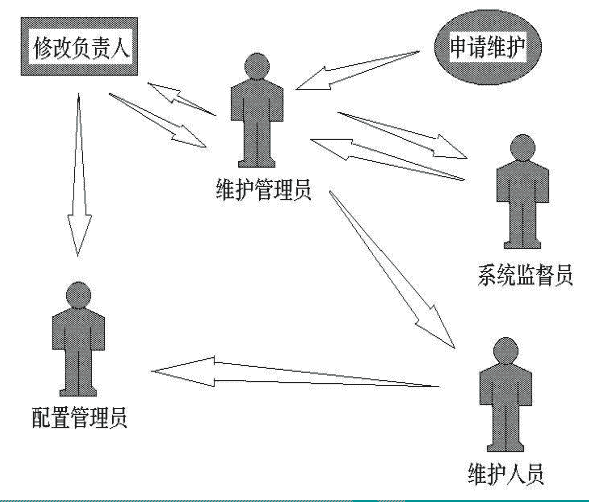

### 3.维护的事件流

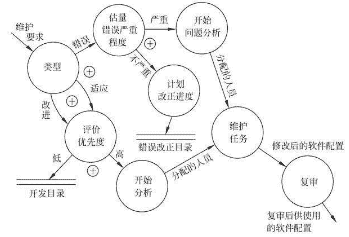

不管维护的类型如何，都需要进行同样的技术工作。这些工作包括修改软件设计、复查、必要的代码修改、单元和集成测试（包括回归测试）、验收测试和复审。

当恶性软件问题发生时，必须立即解决，这就是所谓的“救火”维护要求。

在完成软件维护任务之后，进行处境复查

- 在当前处境下设计、编码和测试的哪些方面能用不通的方法进行？
- 哪些维护资源是应该有而事实上没有的？
- 对于这项维护工作什么是主要（以及次要）的障碍？
- 要求的维护类型中有预防性维护吗？

| 维护请求 | 其他 | 出错 | 类型 | 适应性 | 类型 | 改善性 | 非常严重 | 严重性 | 并不严重 |
|---|---|---|---|---|---|---|---|---|---|
| 评估后按优先级在对列排队 | 评估后分类 | “救火活动” | 当排在队列之首 | 评估后按优先级在队列排队 | 采取行动 | 否 | 是 | 通知请求者并说明原因 | 按优先级在对列中排队 |
| 从维护请求队列之首取一任务 | 按SE方法学规则、组织、实施工程 | 队列中还有维护请求 | 是 | 否 | 资源用于开发新的软件 | | | | |

### 4.保存维护记录

- 程序名称
- 源程序语句条数
- 机器代码指令条数
- 所用的程序设计语言
- 程序安装的日期
- 程序安装后的运行次数
- 与程序安装后运行次数有关的处理故障次数
- 程序改变的层次及名称

- 修改程序增加的源程序语句条数
- 修改程序减少的源程序语句条数
- 每次修改所付出的“人时”数
- 修改程序的日期
- 软件维护人员的姓名
- 维护申请报告的名称、维护类型
- 维护开始时间和维护结束时间、
- 花费在维护上的累计“人时”数
- 维护工作的净收益

### 5.评价维护活动

- 每次程序运行平均失效的次数

- 用于每一类维护活动的总人时数

- 平均每个程序、每种语言、每种维护类型所做的程序变动数

- 维护过程中增加或删除一个源语句平均花费的人时数

- 维护每种语言平均话费的人时数

- 一张维护申请表的平均周转时间

- 不同维护类型所占的百分比

据此可对开发技术、语言选择、维护工作计划、资源分配、以及其它许多方面做出判定

## 代码副作用

下面的修改最易引起代码副作用：

①修改或删除子程序；
②修改或删除语句标号；
③修改或删除标识符；
④为提高程序效率而做的修改；
⑤修改逻辑操作符；
⑥由设计变动引起的代码修改；
⑦修改分支处的判断条件；

代码副作用大多数可在回归测试中发现

## 数据副作用

数据副作用是由于修改数据结构带来的副作用。容易引起数据副作用的修改包括：

①局部和全局常量的再定义；
②记录或文件格式的再定义；
③增减数据或是由于修改数据结构的定义导致数据结构长度的改变；
④修改全局数据；
⑤重新初始化控制标志和指针；
⑥重新排列I/O表或子程序参数表。

设计文档化有助于抑制数据副作用，在设计文档中建立关于数据结构的详细描述和交叉访问表。

## 文档副作用

- 由于程序修改而没有对文档进行相应的修改引起文档的副作用。

- 必须保持文档和程序的一致性。每次维护之后，再次交付软件之前应仔细评审整个配置，这样才能更好地减少文档的副作用。

## 8.4 软件的可维护性

许多软件的维护十分困难，原因在于这些软件的文档不全、质量差、开发过程不注意采用好的方法，忽视程序设计风格等

许多维护要求并不是因为程序中出错而提出的，而是为适应环境变化或需求变化而提出的

为了使得软件能够易于维护，必须考虑使软件具有可维护性

## 可维护性的定义

- 软件可维护性是指纠正软件系统出现的错误和缺陷，以及为满足新的要求进行修改、扩充或压缩的容易程度
- 可维护性、可使用性、可靠性是衡量软件质量的主要质量特性，也是用户十分关心的几个方面
- 软件的可维护性是软件开发阶段各个时期的关键目标。目前广泛使用的是用如下的七个特性来衡量程序的可维护性

| 可理解性 | 可使用性 |
| --- | --- |
| 可测试性 | 可移植性 |
| 可修改性 | 效率 |
| 可靠性 | |

## 各类维护中的侧重点

|    | 改正性维护 | 适应性维护 | 完善性维护 |
|---|---|---|---|
| 可理解性 | √    |    |    |
| 可测试性 | √    |    |    |
| 可修改性 | √    | √    |    |
| 可靠性   | √    |    |    |
| 可移植性 |    | √    |    |
| 可使用性 |    | √    | √    |
| 效率    |    |    | √    |


## 可理解性

- 可理解性表明人们通过阅读源代码和相关文档，了解程序功能及其如何运行的容易程度。
- 一个可理解的程序应具备以下一些特性：模块化，风格一致性，不使用令人捉摸不定或含糊不清的代码，使用有意义的数据名和过程名，结构化，详细设计文档等。

## 可测试性

- 可测试性表明论证程序正确性的容易程度。程序越简单，证明其正确性就越容易。而且设计合用的测试用例，取决于对程序的全面理解。
- 一个可测试的程序应当是可理解的，可靠的，简单的。
- 用于可测试性度量的检查项目如下：
  - 程序是否模块化？结构是否良好？
  - 程序是否可理解？程序是否可靠？
  - 程序是否能显示任意中间结果？
  - 程序是否能以清楚的方式描述它的输出？
  - 程序是否能及时地按照要求显示所有的输入？
  - 程序是否有跟踪及显示逻辑控制流程的能力？
  - 程序是否能从检查点再启动？
  - 程序是否能显示带说明的错误信息？

## 可靠性

- 可靠性表明一个程序按照用户的要求和设计目标，在给定的一段时间内正确执行的概率。
- 关于可靠性，度量的标准主要有：
  - 平均无故障时间MTBF
  - 平均修复时间MTTR
  - 有效性A = MTBD / (MTBD+MDT)

## 度量可靠性的方法

- 根据程序错误统计数字，进行可靠性预测：
  - 常用方法是利用一些可靠性模型，根据程序测试时发现并排除的错误数预测平均无故障时间MTTF。
- 根据程序复杂性，预测软件可靠性：
  - 用程序复杂性预测可靠性，前提条件是可靠性与复杂性有关。因此可用复杂性预测出错率（Halstead方法）。
  - 程序复杂性度量标准可用于预测哪些模块最可能发生错误，以及可能出现的错误类型。

## 可移植性

- 可移植性表明程序转移到一个新的计算环境的可能性的大小。或者它表明程序可以容易地、有效地在各种各样的计算环境中运行的容易程度。
- 一个可移植的程序应具有结构良好、灵活、不依赖于某一具体计算机或操作系统的性能。

## 衡量可移植性的因素

- 是否是用高级的独立于机器的语言来编写程序？
- 是否使用广泛使用的标准化的程序设计语言来编写程序？
- 是否仅使用了这种语言的标准版本和特性？
- 程序中是否使用了标准的普遍使用的库功能和子程序？
- 程序中是否极少使用或根本不使用操作系统的功能？
- 程序在执行之前是否初始化内存？
- 程序在执行之前是否测定当前的输入 / 输出设备？程序是否把与机器相关的语句分离了出来，集中放在了一些单独的程序模块中，并有说明文件？
- 程序是否结构化？并允许在小一些的计算机上分段(覆盖)运行？
- 程序中是否避免了依赖于字母数字或特殊字符的内部位表示？

## 效率

- 效率表明一个程序能执行预定功能而又不浪费机器资源的程度。
- 这些机器资源包括内存容量、外存容量、通道容量和执行时间。

## 衡量效率的因素

- 程序是否模块化？结构是否良好？
- 是否消除了无用的标号与表达式，以充分发挥编译器优化作用？程序的编译器是否有优化功能？
- 是否把特殊子程序和错误处理子程序都归入了单独的模块中？
- 是否以快速的数学运算代替了较慢的数学运算？
- 是否尽可能地使用了整数运算，而不是实数运算？
- 是否在表达式中避免了混合数据类型的使用，消除了不必要的类型转换？
- 程序是否避免了非标准的函数或子程序的调用？
- 在几条分支结构中，是否最有可能为“真”的分支首先得到测试？
- 在复杂的逻辑条件中，是否最有可能为“真”的表达式首先得到测试？

## 可使用性

- 从用户观点出发，可使用性定义为程序方便、实用、及易于使用的程度。一个可使用的程序应是易于使用的、能允许用户出错和改变，并尽可能不使用户陷入混乱状态的程序。
- 用于可使用性度量的检查项目如下：
  - 程序是否具有自描述性？程序是否能始终如一地按照用户的要求运行？
  - 程序是否让用户对数据处理有一个满意的和适当的控制？
  - 程序是否容易学会使用？
  - 程序是否使用数据管理系统来自动地处理事务性工作和管理格式化、地址分配及存储器组织。
  - 程序是否具有容错性？
  - 程序是否灵活？

## 建立明确的软件质量目标和优先级

- 一个可维护的程序应是可理解的、可靠的、可测试的、可修改的、可移植的、效率高的、可使用的。
- 要实现这所有的目标，需要付出很大的代价，而且也不一定行得通。
- 某些质量特性是相互促进的，例如可理解性和可测试性、可理解性和可修改性。另一些质量特性是相互抵触的，如效率和可移植性、效率和可修改性等。
- 每一种质量特性的相对重要性应随程序的用途及计算环境的不同而不同。例如，对编译程序来说，可能强调效率；但对管理信息系统来说，则可能强调可使用性和可修改性。
- 应当对程序的质量特性，在提出目标的同时还必须规定它们的优先级。

## 使用提高软件质量的技术和工具

### 使用模块化技术

- 如果需要改变某个模块的功能，则只要改变这个模块，对其它模块影响很小。
- 如果需要增加程序的某些功能，则仅需增加完成这些功能的新的模块或模块层。
- 程序的测试与重复测试比较容易。
- 程序错误易于定位和纠正。

### 使用结构化程序设计技术

- 采用备用件的方法——用一个新的结构良好的模块替换掉整个要修改的模块。
- 采用自动重建结构和重新格式化的工具(结构更新技术)——把非结构化代码转换成良好结构代码。
- 改进现有程序的不完善的文档——建立或补充系统说明书、设计文档、模块说明书、以及在源程序中插入必要的注释。

## 进行明确的质量保证审查

- 质量保证审查对于获得和维持软件的质量，是一个很有用的技术。
- 审查可以用来检测在开发和维护阶段内发生的质量变化。
- 一旦检测出问题来，就可以采取措施来纠正，以控制不断增长的软件维护成本，延长软件系统的有效生命期。

## 选择可维护的程序设计语言

可维护性

低 → 高

| 第一代语言 | 第二代语言 | 第三代语言 | 第四代语言 |
|---|---|---|---|
| 机器语言 | 汇编语言 | 高级语言(FORTRAN、COBOL等) | 查询语言<br>报表生成语言<br>图象语言<br>应用生成语言 |

- 查询语言
- 报表生成语言
- 图象语言
- 应用生成语言

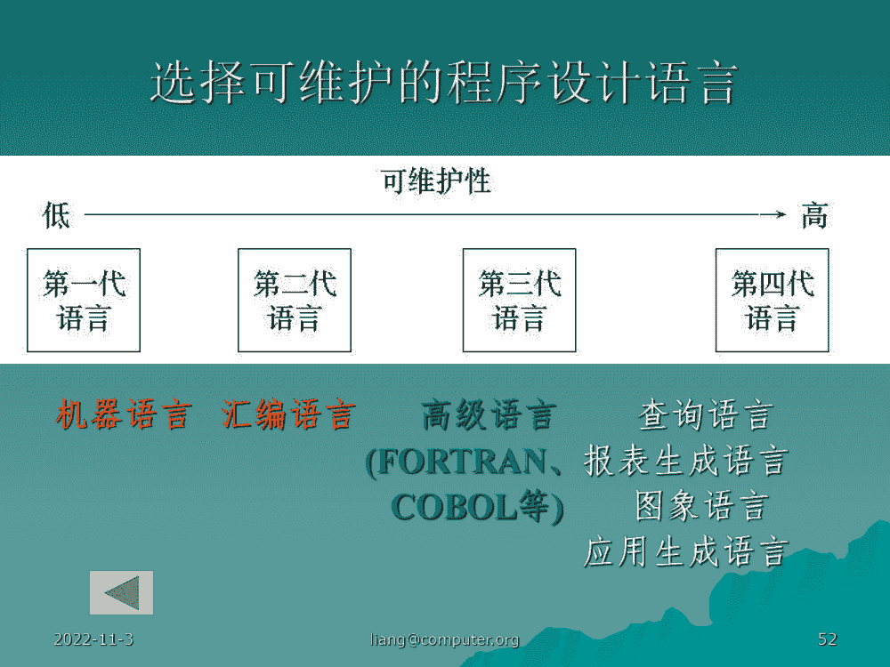

## 改进程序的文档

程序文档是对程序总目标、程序各组成部分之间的关系、程序设计策略、程序实现过程的历史数据等的说明和补充。

即使是一个十分简单的程序，要想有效地、高效率地维护它，也需要编制文档来解释其目的及任务。

对于程序维护人员来说，要想按程序编制人员的意图重新改造程序，并对今后变化的可能性进行估计，缺了文档是不行的。

因此，为了维护程序，人们必须阅读和理解文档。

另外，在软件维护阶段，利用历史文档，可以大大简化维护工作。通过了解原设计思想，可以判断出错之处，指导维护人员选择适当的方法修改代码而不危及系统的完整性。

## 8.4 软件的可维护性

### 8.4.2 文档

- 文档是影响软件可靠性的决定因素。
- 文档比程序代码更重要。
- 文档可分为用户文档和系统文档两类。
- 用户文档主要描述系统功能和使用方法。
- 系统文档描述系统设计、实现和测试等各个方面的内容。

软件文档应该满足下述要求。

- 必须描述如何使用这个系统。
- 必须描述怎样安装和管理这个系统。
- 必须描述系统需求和设计。
- 必须描述系统的实现和测试。

### 1. 用户文档

- 能使用户获得对系统的准确的初步印象。
- 功能描述、安装文档、使用手册、参考手册、操作员指南。

### 2. 系统文档

- 从问题定义、需求说明到验收测试计划这样一系列和系统实现有关的文档。
- 把读者从对系统概貌的了解，引导到对系统每个方面各个特点的更形式化更具体的认识。

### 8.4.3 可维护性复审

- 在软件工程过程的每个阶段都应该考虑并努力提高软件的可维护性，在每个阶段结束前的技术审查和管理复审中，应该着重对可维护性进行复审。
  - 需求分析阶段的复审
    - 对将来要改进的部分和可能会修改的部分加以注意并指明。
    - 应该讨论软件的可移植性问题。
    - 考虑可能影响软件维护的系统界面。


## 8.4 软件的可维护性

- 设计复审
  - 从容易修改、模块化和功能独立的目标出发，评价软件的结构和过程
  - 对将来可能修改的部分预作准备
- 代码复审
  - 编码风格
  - 内部说明文档
  - 尽量使用可重用的软件构件
- 测试阶段复审
  - 配置复审
  - 保证软件配置的所有成分是完整的、一致的和可理解的
  - 为了便于修改和管理已经编目归档了
- 完成了每项维护工作之后，都应该对软件维护本身进行仔细的复审
  - 维护应该针对整个软件配置，不应该只修改源程序代码
  - 对设计、数据、模块过程的修改体现在技术文档中
  - 对可执行部分的修改反映在用户文档中

## 8.5 预防性维护

几乎所有历史比较悠久的软件开发组织，都有一些十几年前开发出的“老”程序。

目前，某些老程序仍然在为用户服务，但是，这些程序的体系结构、数据结构可能很差，文档可能并不完整，做过的修改可能并没有记录。

满足用户对上述老程序的维护：

- 反复多次地修改程序的尝试；
- 通过仔细分析程序尽可能多地掌握程序的内部工作细节，以便有效修改它；
- 用软件工程的方法重新设计、重新编码和测试那些需要变更的软件部分；
- 对程序全部重新设计、重新编码和测试。

◆ 预防性维护由Miller提出来的，“把今天的方法学应用到昨天的系统上，以支持明天的需求”。

- 维护一行源代码的代价可能是最初来发运行代码代价的14~40倍
- 重新设计软件体系结构时试用了现代设计概念，它将对维护可能有很大的帮助
- 由于现有程序版本可作为软件原型使用，开发生产可大大高于平均水平
- 用户具有较多使用该软件的经验，因此，能够很容易地搞清新的变更需求和变更的范围
- 利用逆向工程和再工程的工具，可以使一部分工作自动化
- 在完成预防性维护的过程中可以建立完整的软件配置

## 8.6 软件再工程过程

### 相关概念

- 正向工程（Forward Engineering）：由抽象的、逻辑性的、不依存代码的设计逐步展开，直至具体代码实现的开发活动，即从需求规格设计到产品初次发布的过程或过程
- 逆向工程（Reverse Engineering）：对既存系统的分析过程，明确系统各组成部分及其相互间的关系，并将系统以转换成其他更抽象的形式来表现
- 重构（Restructuring）：在同一抽象级别上转换系统的描述形式
- 再工程（Reengineering）：在逆向工程所获信息的基础上修改或重构已有的系统，产生系统的一个新版本

◆ 再工程=逆向工程+重构+正向工程

### 软件正向工程与再工程

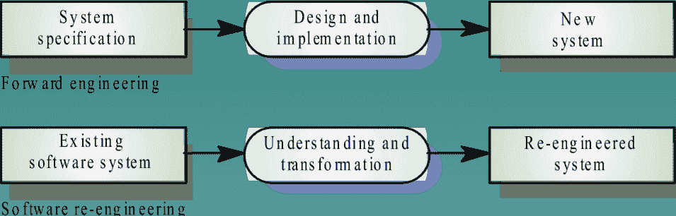

### 软件再工程过程模型

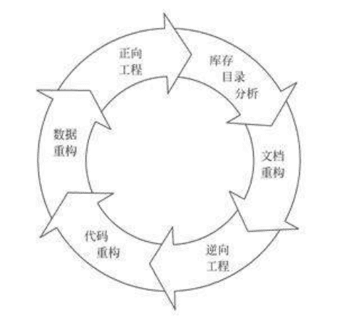

图8.2 软件再工程过程模型

### 软件再工程过程

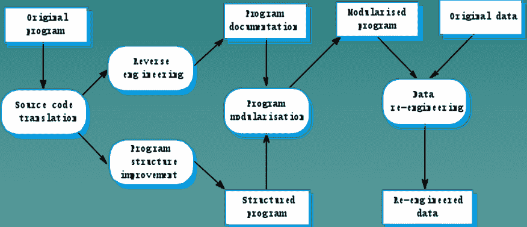

### 库存目录分析

- 每个软件组织都应该保存其拥有的所有应用系统的库存目录，该目录包含关于每个应用系统的基本信息
- 下列3类程序有可能成为预防性维护的对象：
  - 预定将使用多年的程序
  - 当前正在成功使用着的程序
  - 在最近的将来可能要做重大修改或增强的程序
- 应该仔细分析库存目录，按照业务重要程度、寿命、当前可维护性、预期的修改次数等标准，把库中的应用系统排序，从中选出再工程的候选者，然后明智地分配再工程所需要的资源

### 逆向工程

- 软件的逆向工程是分析程序以便在比源代码更高的抽象层次上创建出程序的某种表示的过程
- 逆向工程是一个恢复设计结果的过程
- 从现存的程序代码中抽取有关数据、体系结构、处理过程的设计信息

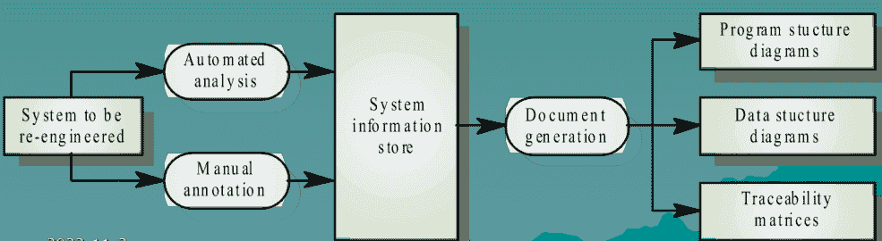

### 代码重构

- 首先用重构工具分析源代码，标注出和结构化程序设计概念相违背的部分
- 然后重构有问题的代码
- 最后，复审和测试生成的重构代码并更新代码文档
- 重构关注个体模块的设计细节以及在模块中定义的局部数据结构。如果重构扩展到边界之外并涉及软件体系结构，则重构变成了正向工程

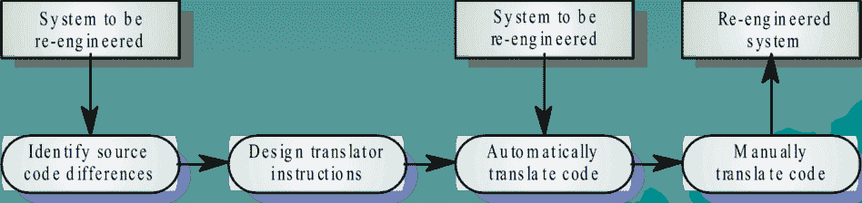

### 数据重构

- 数据重构发生在向当低的抽象层次上，它是一种全范围的再工程活动
- 数据结构始于逆向工程活动，分解当前使用的数据结构，必要时定义数据模型，标识数据对象和属性，并从软件质量的角度复审现存的数据结构
- 当数据结构较差时，应该对数据进行再工程
- 对数据的修改必然会导致体系结构或代码层的改变

### 数据重构

| Program to be re-engineered | Data analysis | Entity name modification | Literal replacement | Data definition re-ordering | Data re-formatting | Default value conversion | Validation rule modification | Data analysis | Data conversion | Change summary tables | Modified data |
|---|---|---|---|---|---|---|---|---|---|---|---|
| Stage 1 | Stage 2 | Stage 3 | | | | | | | | |

## 8.6 软件再工程过程

### 6.正向工程

- 正向工程也成为革新或改造
- 这项活动不仅从现有程序中恢复设计信息，而且使用该信息去改变或重构现有系统，以提高其整体质量。
- 正向工程过程应用软件工程的原理、概念、技术和方法重新开发某个现有的应用系统。具有原系统的所有功能，并加入了新的功能和提高了整体性能。

## 思考题

为了保证软件产品的可维护性，下列操作哪些是正确的？哪些是不正确的？

- 在分析用户需求时同时考虑维护问题。
  - 正确。
- 测试完程序后，删去程序中的注解以缩短源程序的长度。
  - 错误。
- 在软件开发过程中尽量保证各个阶段文档的正确性。
  - 正确。
- 编码时尽量多用全局变量。
  - 错误。违背局部化原理，并且使公共环境耦合的模块数量增多。
- 选用时间效率和空间效率尽可能高的算法。
  - 错误。一般来说，效率高的程序可理解性差。

## 思考题

- 尽可能利用硬件的特点以提高程序效率。
  - 错误。加大适应性维护工作量。
- 尽可能使用高级语言编写程序。
  - 正确。
- 进行总体设计时加强模块间的联系。
  - 错误。低耦合。
- 尽量减少程序模块的规模。
  - 错误。模块数量增多，使得模块间接口数量大大增加。
- 用数据库系统代替文件系统来存储需要长期保存的信息。
  - 正确。数据库系统更加安全、方便，降低改正性维护的需求。

## 概述

- 以算法为核心，数据和代码分离，反映了计算机的观点，数据和操作不易保持一致性。
- 软件系统的结构紧密依赖于系统所要完成的功能，功能需求的变化易引起软件结构的修改。
- 不易组织人员开发大型软件，开发出来的软件也很难维护。
  - 很难彻底消除软件危机

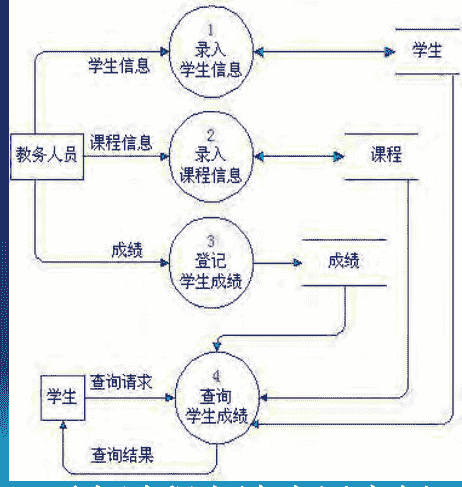

面向过程方法应用实例

## 第9章 面向对象方法学引论

1. 9.1 面向对象方法学概述
2. 9.2 面向对象的概念
3. 9.3 面向对象建模
4. 9.4 对象模型
5. 9.5 动态模型
6. 9.6 功能模型
7. 9.7 三种模型之间的关系
8. 9.8 小结

## 9.1 面向对象方法学概述

## 9.1.1 面向对象方法学的要点

面向对象(Object-Oriented,缩写为OO)方法学的出发点和基本原则，是尽可能模拟人类习惯的思维方式，使开发软件的方法与过程尽可能接近人类认识世界解决问题的方法与过程。

使描述问题的问题空间(也称为问题域)与实现解法的解空间(也称为求解域)在结构上尽可能一致。

Mapping from real world entities to system objects

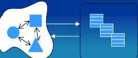

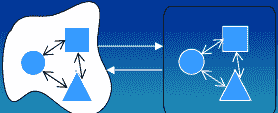


## 9.1 面向对象方法学概述

- 客观世界中的实体既具有静态的属性又具有动态的行为。
- 然而，传统语言提供的解空间对象实质上却仅是描述实体属性的数据，必须在程序中从外部对它施加操作，才能模拟它的行为。
- 软件系统本质上是信息处理系统。数据和操作原本是密切相关的，把数据和操作人为地分离成两个独立的部分，会增加软件开发的难度。

## 9.1.1 面向对象方法学的要点

- 与传统方法相反，面向对象方法是一种以数据或信息为主线，把**数据和处理相结合**的方法。把对象作为由数据及可以施加在这些数据上的操作所构成的统一体。
- 对象与传统的数据有本质区别，它不是被动地等待外界对它施加操作，相反，它是**进行处理的主体**。
- 必须发消息请求对象主动地执行它的某些操作，处理它的私有数据，而不能从外界直接对其私有数据进行操作。
- 面向对象方法学所提供的“对象”（objects）概念，是让软件开发者自己定义或选取解空间对象，然后把软件系统作为一系列离散的解空间对象的集合。
- 应该使这些解空间对象与问题空间对象尽可能一致。这些解空间对象彼此间通过发送消息而相互作用，从而得出问题的解。

也就是说，面向对象方法是一种新的思维方法，它不是把程序看作是工作在数据上一系列过程或函数的集合，而是把程序看作是相互协作而又彼此独立的对象的集合。

每个对象就像一个微型程序，有自己的数据、操作、功能和目的。在许多系统中解空间对象都可以直接模拟问题空间的对象，解空间与问题空间的结构十分一致，因此，这样的程序易于理解和维护。

概括地说，面向对象方法具有下述四个要点：

- 认为客观世界是由各种对象组成的，任何事物都是对象，复杂的对象可以由比较简单的对象以某种方式组合而成。按照这种观点，可以认为整个世界就是一个最复杂的对象。
- 因此，面向对象的软件系统是由对象组成的，软件中的任何元素都是对象，复杂的软件对象由比较简单的对象组合而成。
- 面向对象方法用对象分解取代了传统方法的功能分解。

把所有对象都划分成各种对象类（简称为类，Class），每个对象类都定义了一组数据和一组方法。数据用于表示对象的静态属性，是对象的状态信息。

- 每当建立该对象类的一个新实例时，就按照类中对数据的定义为这个新对象生成一组专用的数据，以便描述该对象独特的属性值。
- 如，荧光屏上不同位置显示的半径不同的几个圆，虽然都是 Circle 类的对象，但是，各自都有自己专用的数据，以便记录各自的圆心位置、半径等等。
- 类中定义的方法是允许施加于该类对象上的操作，是该类所有对象共享的，并不需要为每个对象都复制操作的代码。

按照子类（或称为派生类）与父类（或称为基类）的关系，把若干个对象类组成一个层次结构的系统（也称为类等级）。

- 在这种层次结构中，通常下层的派生类具有和上层的基类相同的特性（包括数据和方法），这种现象称为**继承（Inheritance）**。
- 但是，如果在派生类中对某些特性又做了重新描述，则在派生类中的这些特性将以新描述为准，也就是说，低层的特性将屏蔽高层的同名特性。

对象彼此之间仅能通过**传递消息**互相联系。

- 一切局部于该对象的私有信息，都被封装在该对象类的定义中，就好像装在一个不透明的黑盒子中一样，在外界是看不见的，更不能直接使用，这就是“封装性”（Encapsulation）。
- 对用户来说，接口是可见的，实现是不可见的。

综上所述，面向对象的方法学可以用下列方程来概括：
OO = Objects + Classes + Inheritance + Communication with messages

面向对象既使用对象又使用类和继承等机制，而且对象之间仅能通过传递消息实现彼此通信。

- 基于对象（Object-based）的方法：仅仅使用对象和消息
- 基于类（Class-based）的方法：把所有对象都划分成类
- 面向对象（OO）方法：同时使用对象、类、继承和消息的方法

## 9.1.2 面向对象方法学的主要优点

### 1. 与人类习惯的思维方法一致

面向对象的软件技术以对象（Object）为核心，用这种技术开发出的软件系统由对象组成。

对象是对现实世界实体的正确抽象，它是由描述内部状态表示静态属性的数据，以及可以对这些数据施加的操作（表示对象的动态行为），封装在一起所构成的统一体。对象间通过传递消息相互联系，以模拟客观世界事物间的联系。

### 2. 稳定性好

面向对象方法基于构造问题领域的对象模型，以对象为中心构造软件系统。

它的基本作法是用对象模拟问题领域中的实体，以对象间的联系刻画实体间的联系。

现实世界中实体的相对稳定性决定了以对象为中心构造的软件系统的稳定性。

### 3. 可重用性好

在面向对象方法所使用的对象中，数据和操作是作为平等伙伴出现的，对象具有很强的自含性。

对象所固有的封装性和信息隐藏机理，使得对象的内部实现与外界隔离，具有较强的独立性。对象类提供了比较理想的模块化机制和比较理想的可重用的软件成分。

有两种方法可以重复使用一个对象类：

- 一种方法是创建该类的实例，从而直接使用它；
- 另一种方法是从它派生出一个满足当前需要的新类。

继承性机制使得子类不仅可以重用其父类的数据结构和程序代码，而且可以在父类代码的基础上方便地修改和扩充，这种修改并不影响对原有类的使用。有人把对象类称为“软件IC”。

面向对象的软件技术所实现的可重用性是自然的和准确的，在软件重用技术中它是最成功的一个。


## 9.1.2 面向对象方法学的主要优点

### 4. 较易开发大型软件产品

当开发大型软件产品时，组织开发人员的方法不恰当往往是出现问题的主要原因。

用面向对象范型开发软件时，可以把一个大型产品看作是一系列本质上相互独立的**小产品**来处理，这就不仅降低了开发的技术难度，而且也使得对开发工作的管理变得容易。

许多软件开发公司的经验都表明，当把面向对象技术用于大型软件开发时，软件成本明显地降低了，软件的整体质量也提高了。

### 5. 可维护性好

由于下述因素的存在，使得用面向对象方法所开发的软件可维护性好。

- 面向对象的软件稳定性比较好。
- 面向对象的软件比较容易修改。
- 面向对象的软件比较容易理解。
- 易于测试和调试。

## 9.2 面向对象的概念

### 9.2.1 对象

在应用领域中有意义的、与所要解决的问题有关系的任何事物都可以作为对象(Object)，它既可以是具体的物理实体(Physical entities)，也可以是抽象的概念实体(Conceptual entities)，也可以是无明确边界和意义的软件实体(Software entities)。


### Objects

- 对象 = 属性 + 方法/服务

数据

操作

属性

表针 旋钮 其他机械机构

操作

调节旋钮

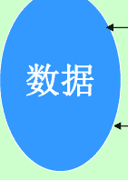

公有操作1

公有操作2

操作1的实现

操作2的实现

### 对象的形象表示

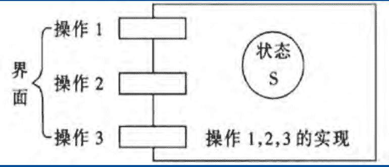

### 图9.1 对象的形象表示

### 对象的定义

#### 定义1（OO程序设计角度）

- 对象是具有相同状态的一组操作的集合。

#### 定义2（信息模拟角度）

- 对象是对问题域中某个东西的抽象，这种抽象反映了系统保存有关这个东西的信息或与它交互的能力。对象是对属性值和操作的封装。

#### 定义3（形式化的定义）

- 对象:: =<ID, MS, DS, MI>
- ID: 对象的标识或名字
- MS: 对象中的操作集合
- DS: 对象的数据结构
- MI: 对象受理的消息名集合（即对外接口）

对象是封装了数据结构及可以施加在这些数据结构上的操作的封装体，这个封装体有可以唯一地标识它的名字，而且向外界提供一组服务(即公有的操作)。

对象中的数据表示对象的状态，一个对象的状态只能由该对象的操作来改变。每当需要改变对象的状态时，只能由其他对象向该对象发送消息。对象响应消息时，按照消息模式找出与之匹配的方法，并执行该方法。

从动态角度或对象的实现机制来看，对象是一台自动机。

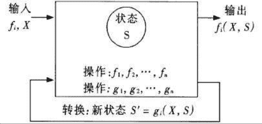

### 示例

- 对于民航机场的指挥控制系统，某航班就是该问题域中的对象
- 该对象的属性可以包含：航班号、起飞机场、降落机场、起飞时间、降落时间，位置等
- 可能的操作包括离港、到港等
- 当对该航班对象进行离港操作时，对象的状态将从停靠状态改变成飞行状态

### 对象的特点

- 以数据为中心。
- 对象是主动的。
- 实现了数据封装。
- 本质上具有并行性。
- 模块独立性好。

### 9.2.2 其他概念

#### 1. 类(Class)

在面向对象的软件技术中，“类”就是对具有相同数据和相同操作的一组相似对象的定义，类是对具有相同属性和行为的一个或多个对象的描述，通常在这种描述中也包括对怎样创建该类的新对象的说明。

#### 2. 实例(Instance)

实例就是由某个特定的类所描述的一个具体的对象。

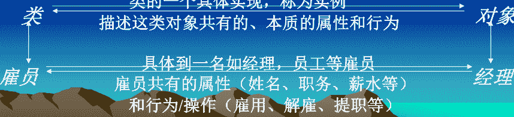

### 3. 消息(Message)

消息，就是要求某个对象执行在定义它的那个类中所定义的某个操作的规格说明。通常，一个消息由下述三部分组成：

- 接收消息的对象；
- 消息选择符(也称为消息名)；
- 零个或多个变元。

一个对象向另一个对象发消息请求某项服务，接收消息的对象响应该消息，激发所要求的服务操作，并把操作结果返回给请求服务的对象

例：myTelevision.changeChannel(channel)

### 4. 方法(Method)

方法，就是对象所能执行的操作，也就是类中所定义的服务。方法描述了对象执行操作的算法、响应消息的方法

C++中被称为member function，changeChannel (int Channel)

### 5. 属性(Attribute)

属性，就是类中所定义的数据，它是对客观世界实体所具有的性质的抽象。类的每个实例都有自己特有的属性值

C++中被称为data member

### 6. 封装(Encapsulation)

从字面上理解，所谓封装就是把某个事物包起来，使外界不知道该事物的具体内容。

具有封装性的条件如下：

- 有一个清晰的边界。所有私有数据和实现操作的代码都被封装在这个边界内，从外面看不见更不能直接访问。
- 有确定的接口(即协议)。这些接口就是对象可以接受的消息，只能通过向对象发送消息来使用它。
- 受保护的内部实现。实现对象功能的细节(私有数据和代码)不能在定义该对象的类的范围外进行访问。
- 封装性也就是信息隐藏，通过封装把对象的实现细节对外界隐藏起来了。

### 7. 继承(Inheritance)

广义地说，继承是指能够直接获得已有的性质和特征，而不必重复定义它们。在面向对象的软件技术中，继承是子类自动地共享基类中定义的数据和方法的机制。

当一个类只允许有一个父类时，也就是说，当类等极为树形结构时，类的继承是单继承；当允许一个类有多个父类时，类的继承是多重继承。

继承所带来的好处：

- 共享数据和代码→减少冗余
- 派生新的子类→容易修改

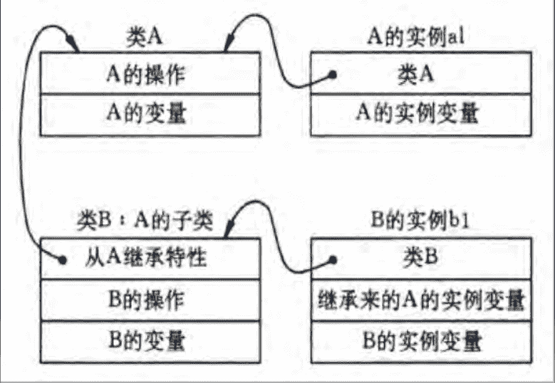

### Single Inheritance

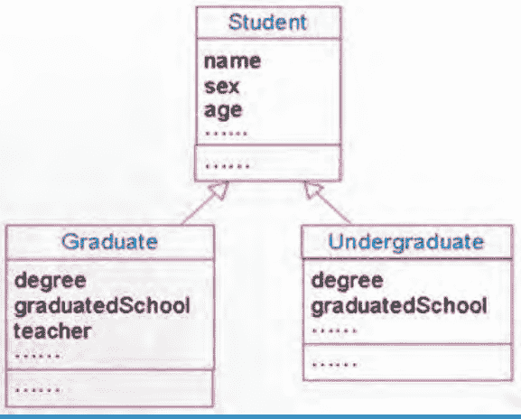

### Multiple Inheritance

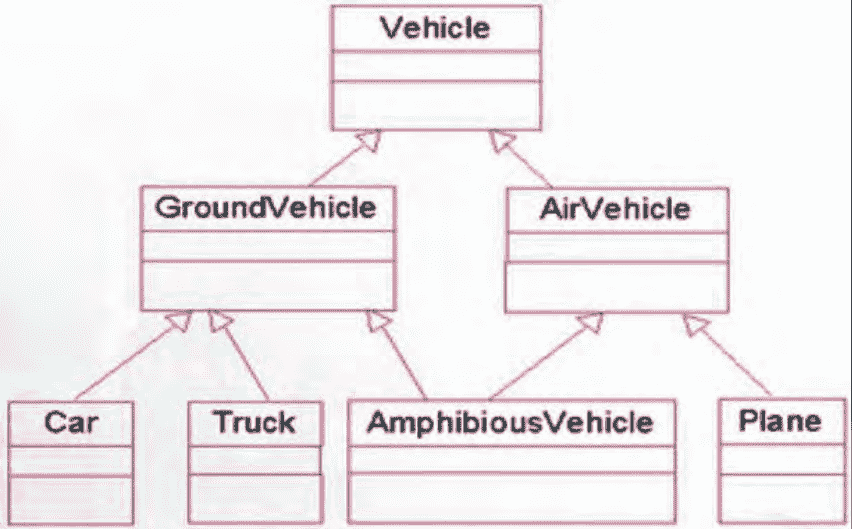

### 8. 多态性(Polymorphism)

- 多态性一词来源于希腊语，意思是“有许多形态”。
- 在面向对象的软件技术中，多态性是指**子类对象可以像父类对象那样使用**，同样的消息既可以发送给**父类对象**也可以发送给**子类对象**。
- 在类等级的不同层次中可以共享(公用)**一个行为**(方法)的名字，然后不同层次中的每个类却各自按自己的需要来实现这个行为。
- 当对象接收到发送给它的消息时，根据该对象所属的**类动态选用**在该类中定义的实现算法。


- **继承**和**多态**的组合，可以生成很多相似但又独一无二的对象
- 继承性使得这些对象可以共享许多相似特性
- 而多态又使同一个操作对不同对象产生不同表现形式
- 这样不仅提高了程序设计的灵活性，而且减轻了分别设计的负担

### 9. 重载(Overloading)

有两种重载：

- 函数重载是指在同一作用域内的若干个参数特征不同的函数可以使用相同的函数名字；
- 运算符重载是指同一个运算符可以施加于不同类型的操作数上面。

当然，当参数特征不同或被操作数的类型不同时，实现函数的算法或运算符的语义是不相同的。


## 9.3 面向对象建模

- 用面向对象方法开发软件，通常需要建立三种形式的模型，它们分别是描述系统数据结构的**对象模型(object model)**，描述系统控制结构的**动态模型(dynamic model)**和描述系统功能的**功能模型(functional model)**。
- 这三种模型从三个不同但又密切相关的角度模拟目标系统，它们各自从不同侧面反映了系统的**实质性内容**，综合起来则全面地反映了对**目标系统的需求**。
- 一个典型的软件系统组合了上述三方面内容：它使用**数据结构**（对象模型），执行**操作**（动态模型），并且完成**数据值的变化**（功能模型）。

## 9.4 对象模型

- 对象模型表示静态的、结构化的系统的“数据”性质。它是对模拟客观世界实体的对象以及对象彼此间的关系的映射，描述了系统的静态结构。
- 在UML(Unified Modeling Language)中用静态结构图（Static Structure Diagrams）——类图(Class Diagrams)表示

## 9.5 动态模型

- 📚 动态模型表示**瞬时的、行为化的**系统的“**控制**”性质，它规定了对象模型中的**对象的合法变化序列**。
- 📚 在UML中用**状态图**（State Diagrams）、**交互图**（Interaction Diagrams）和**活动图**（Activity Diagrams）来表示

### State Diagrams

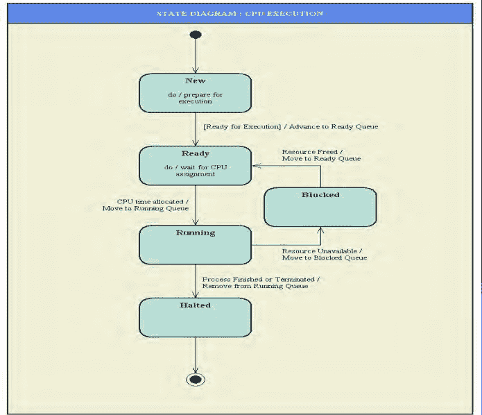

### Activity Diagrams

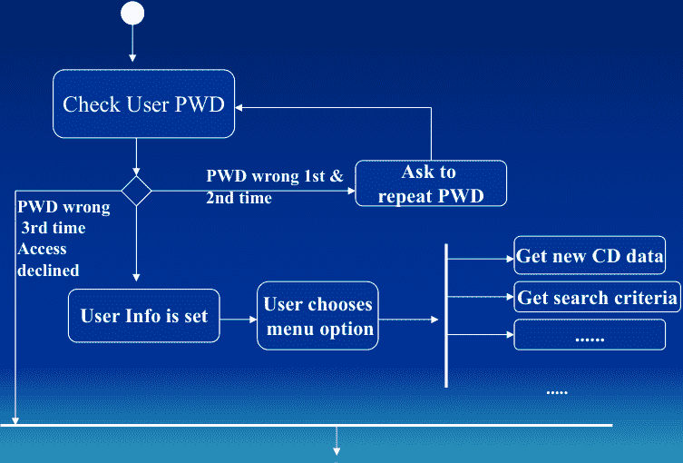

## 9.6 功能模型

- 功能模型表示变化的系统的“功能”性质，它指明了系统应该“做什么”，因此更直接地反映了用户对目标系统的需求。
- 在传统方法中，功能模型由一组数据流图组成。
- UML 中用用例图（Use Case Diagrams）来表示。

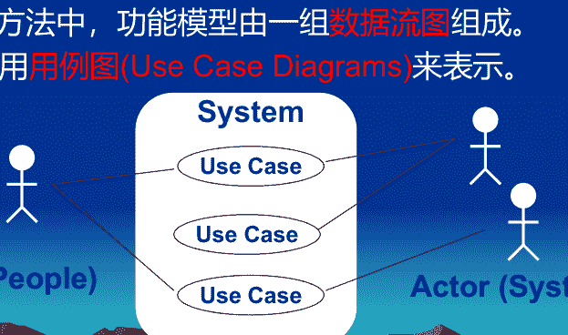

## 9.7 3种模型之间的关系

在面向对象方法学中，对象模型是最基本最重要的，为其他两种模型奠定基础，依靠对象模型完成三种模型的集成。

三种模型之间的关系：

- 针对每个类建立的**动态模型**，描述了类实例的生命周期或运行周期。
- **状态转换**驱使行为发生，这些行为在数据流图中被映射成处理，它们同时与对象模型中的服务相对应。
- 功能模型中的处理（或用例），对应于对象模型中类所提供的服务。
  - 复杂的处理（或用例）对应于复杂对象提供的服务；
  - 简单的处理（或用例）对应于基本对象提供的服务。
  - 有时一个处理（或用例）对应多个服务，也有一个服务对应多个处理的时候。

# 软件工程导论


### OOA及其所面对的问题

- OOA相当于软件开发过程中的**问题定义**和**需求分析**阶段
- OOA所面对的问题
  - 当开发一个新的产品或系统时，我们如何从遵循OO软件工程的方式来刻画它？
  - 什么是相关的对象？他们如何相互关联？
  - 对象如何在系统的范围内工作？
  - 应如何对问题刻画或建模以使得我们可创建一个有效的设计？

### SA vs. OOA

- 结构化分析对需求采取独特的“**输入—加工—输出**”视角，数据被脱离数据的变换过程而单独考虑
  - 系统行为虽然重要，但在结构化分析中往往扮演第二位的角色，结构化分析方法着重功能分解的使用。
- 面向对象的目标是开发一系列模型，这些模型被用来描述以满足一组客户需求的计算机软件。
  - OOA建造若干分析模型以满足这个目标。分析模型描述信息（对象模型）、功能（功能模型）和行为（动态模型）。

### OOA的主要工作

- 三项内容：理解、表达和验证
- 需求分析过程是系统分析员与用户及领域专家反复交流和多次修正的过程。即：理解和验证的过程通常交替进行，反复迭代，而且往往需要利用原型系统作为辅助工具。
- OOA的关键，是识别出问题域内的对象，并分析它们相互间的关系，最终建立起问题域的简洁、精确、可理解的正确模型。
- 在用面向对象观点建立起的三种模型中，对象模型是最基本、最重要、最核心的。

### 10.1 面向对象分析的基本过程

- 首先，系统分析员对需求文档进行分析。通过分析可以发现和改正需求文档中的歧义性、不一致性，剔除冗余的内容，挖掘潜在的内容，弥补不足，从而使需求文档更完整、更准确。
- 然后，是需求建模。系统分析员根据提取的用户需求，深入理解用户需求，识别出问题域内的对象，并分析它们相互之间的关系，抽象出目标系统应该完成的需求任务，并用OOA模型准确地表示出来，即用面向对象观点建立对象模型、动态模型和功能模型。
- 最后，是需求评审。通过用户、领域专家、系统分析员和系统设计人员的评审，并进行反复修改后，确定需求规格说明。

复杂问题（大型系统）的对象模型由下述五个层次组成：主题层（也称为范畴层）、类-&-对象层、结构层、属性层和服务层。

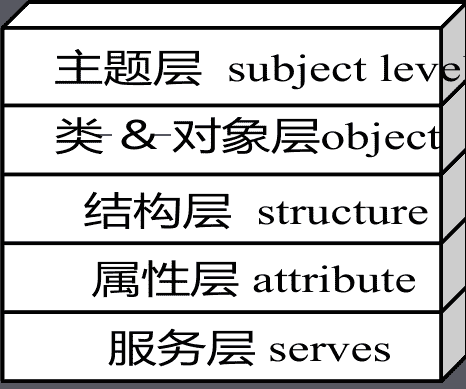

主题(Subject)层： 主题给出分析模型的总体概貌，是控制读者在同一时间所能考虑的模型规模的机制。

类-&-对象(Class & Object)层： 对象是数据及其处理的抽象。它反映了保存有关信息和与现实世界交互的能力。

结构(Structure)层： 结构表示问题域的复杂性。一般-特殊结构反映了继承关系，整体-部分结构反映了聚合的关系。

属性(Attribute)层： 属性是数据元素，用来描述对象或分类结构的实例，可在图中给出并在对象的储存中指定，即给出对象定义的同时，指定属性。

服务(Service)层： 服务是接收到消息后必须执行的一些处理，可在图上标明它并在对象的储存中指定，即给出对象定义的同时，定义服务。

### 5个层次对应5项活动

- 可以同时（并行）处理
- 没有必要遵循自顶向下，逐步求精的原则

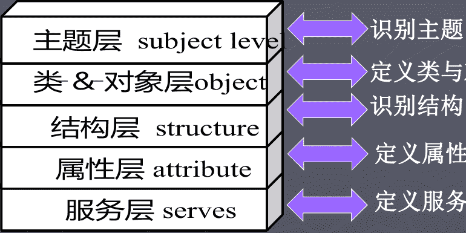

## 10.2 需求陈述

- 书写要点
- 通常，需求陈述的内容包括：问题范围，功能需求，性能需求，应用环境及假设条件等。总之，需求陈述应该阐明“做什么”而不是“怎么样做”。
- 描述用户的需求而不是提出解决问题的方法。应该指出哪些是系统必要的性质，哪些是任选的性质。
- 应该避免对设计策略施加过多的约束，也不要描述系统的内部结构，这样做将限制实现的灵活性。
- 对系统性能及系统与外界环境交互协议的描述，是合适的需求。
- 此外，对采用的软件工程标准、模块构造准则、将来可能做的扩充以及可维护性要求等方面的描述，也都是适当的需求。

### 10.2.2 例子

图10.2所示的自动取款机（ATM）系统，是本书讲述面向对象分析和面向对象设计时使用的一个实例。

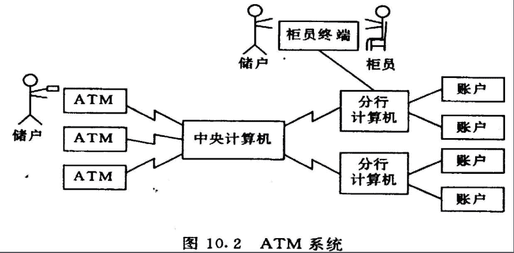

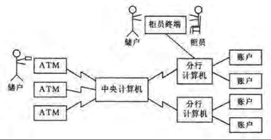

### 自动取款机系统

- 自动取款机(ATM)+中央计算机+分行计算机+柜员终端的网络系统
- ATM和中央计算机由总行投资购买
- 总行拥有多台 ATM，分别设在全市各主要街道上。
- 分行负责提供分行计算机和柜员终端
- 柜员终端设在分行营业厅及分行下属的各个储蓄所内；
- 该系统的软件开发成本由各个分行分摊。


## 10.2 需求陈述

- 银行柜员使用柜员终端处理储户提交的以下储蓄事务：
  - 用现金或支票存款
  - 开新账户
  - 从自己的账户中取款
  - 一个储户可能拥有多个账户

- 柜员职责：
  - 把储户提交的存款或取款事务输进柜员终端
  - 接收储户交来的现金或支票，或付给储户现金

柜员终端与相应的分行计算机通信，分行计算机具体处理针对某个账户的事务并且维护账户。

储户有权申领现金兑换卡。使用该卡可通过ATM访问自己的账户，实现如下功能：

- 在ATM上提取现金（即取款）
- 查询有关自己账户的信息（例如，某个指定账户上的余额）
- 将来可能还要求使用ATM办理转账、存款等事务

现金兑换卡：

- 一张特制的磁卡，上面有分行代码和卡号
- 分行代码唯一标识总行下属的一个分行，卡号确定了这张卡可以访问哪些账户
- 通常，一张卡可以访问储户的若干个账户，但是不一定能访问这个储户的全部账户
- 每张现金兑换卡仅属于一个储户所有，但是，同一张卡可能有多个副本，因此，必须考虑同时在若干台ATM上使用同样的现金兑换卡的可能性。也就是说，系统应该能够处理并发的访问

- 使用ATM过程
  - 用户插卡
  - ATM要求用户输入密码
  - ATM把从这张卡上读到的信息以及用户输入的密码传给中央计算机，请求中央计算机核对这些信息并处理这次事务
  - 中央计算机根据卡上的分行代码确定这次事务与分行的对应关系，并且委托相应的分行计算机验证用户密码。
  - 如果用户输入的密码是正确的，ATM就要求用户选择事务类型（取款、查询等）
  - 当用户选择取款时，ATM请求用户输入取款额
  - 最后，ATM从现金出口吐出现金，并且打印出账单交给用户

## 10.3 建立对象模型

- 对象模型通常有五个层次：
  - 确定类与对象→确定关联→划分主题→确定属性→确定继承关系

- 典型的工作步骤是：
  - 首先确定对象类和关联（因为它们影响系统整体结构和解决问题的方法），对于大型复杂问题还要进一步划分出若干个主题；
  - 然后给类和关联增添属性，以进一步描述它们；
  - 接下来利用适当的继承关系进一步合并和组织类；
  - 而对类中操作的最后确定，则需等到建立了动态模型和功能模型之后，因为这两个子模型更准确地描述了对类中提供的服务的需求。

另一种更简单的分析方法，是所谓的非正式分析。

这种分析方法以用自然语言书写的需求陈述为依据，把陈述中的名词作为类与对象的候选者，用形容词作为确定属性的线索，把动词作为服务（操作）的候选者。

认真阅读ATM系统的需求陈述，从陈述中找出下列名词，可以把它们作为类与对象的初步的候选者：

- 银行，自动取款机（ATM），系统，中央计算机，分行计算机，柜员终端，网络，总行，分行，软件，成本，市，街道，营业厅，储蓄所，柜员，储户，现金，支票，账户，事务，现金兑换卡，余额，磁卡，分行代码，卡号，用户，副本，信息，密码，类型，取款额，账单，访问

根据领域知识和常识提取隐含类：

- 通信链路、事务日志

## 2. 筛选出正确的类&对象

接下来应该严格考察每个候选对象，从中去掉不正确的或不必要的，仅保留确实应该记录其信息或需要其提供服务的那些对象。

筛选时主要依据下列标准：

### (1) 冗余

如果两个类表达了同样的信息，则应该保留在此问题域中最富于描述力的名称。

以ATM系统为例，应该去掉“用户”、“磁卡”、“副本”等冗余的类，仅保留“储户”和“现金兑换卡”这两个类。

### (2) 无关

仅需要把与本问题密切相关的类&对象放进目标系统中。

以ATM系统为例，因此，应该去掉候选类“成本”、“币”、“街道”、“营业厅”和“储蓄所”。

### (3) 笼统

在需求陈述中常常使用一些笼统的、泛指的名词，虽然在初步分析时把它们作为候选的类&对象列出来了，但是，要么系统无须记忆有关它们的信息，要么在需求陈述中有更明确更具体的名词对应它们所暗示的事务，因此，通常把这些笼统的或模糊的类去掉。

以ATM系统为例，应该去掉“银行”、“网络”、“系统”、“软件”、“信息”、“访问”等候选类。

### (4) 属性

在需求陈述中有些名词实际上描述的是其他对象的属性，应该把这些名词从候选类&对象中去掉。

在ATM系统的例子中，“现金”、“支票”、“取款额”、“账单”、“余额”、“分行代码”、“卡号”、“密码”、“类型”等，实际上都应该作为属性对待。

### (5) 操作

在需求陈述中有时可能使用一些既可作为名词，又可作为动词的词，应该慎重考虑它们在本问题中的含义，以便正确地决定把它们作为类还是作为类中定义的操作。

### (6) 实现

在分析阶段不应该过早地考虑怎样实现目标系统。因此，应该去掉仅和实现有关的候选的类&对象。

在ATM系统的例子中，应该暂时去掉“事务日志”和“通信链路”这两个类，在设计或实现时再考虑它们。

最终剩余的类：
ATM、中央计算机、分行计算机、柜员终端、总行、分行、柜员、储户、账户、事务和现金兑换卡

## 10.3.2 确定关联

- 关联：两个或多个对象之间相互依赖、相互作用的关系
- 分析确定关联，能促使分析员考虑问题域的边缘情况，有助于发现那些尚未被发现的类
- 在分析确定关联的过程中，不必花过多的精力去区分关联和聚集（事实上，聚集不过是一种特殊的关联，是关联的一个特例）

### 1. 初步确定关联

- 在需求陈述中使用的描述性动词或动词词组，通常表示关联关系。
- 因此，在初步确定关联时，大多数关联可以通过直接提取需求陈述中的动词词组而得出。
- 通过分析需求陈述，还能发现一些在陈述中隐含的关联。

#### （Ⅰ）直接提取动词短语得出的关联

- ATM、中央计算机、分行计算机及柜员终端组成网络
- 总行拥有多台ATM
- ATM设在主要街道上
- 分行提供分行计算机和柜员终端
- 柜员终端设在分行营业厅及储蓄所内
- 分行分摊软件开发成本
- 储户拥有账户
- 分行计算机处理针对账户的事务
- 分行计算机维护账户
- 柜员终端与分行计算机通信
- 柜员输入针对账户的事务
- ATM与中央计算机交换关于事务的信息
- 中央计算机确定事务与分行的对应关系
- ATM读现金兑换卡
- ATM与用户交互
- ATM吐出现金
- ATM打印账单
- 系统处理并发的访问

#### （2）需求陈述中隐含的关联

- 总行由各个分行组成。
- 分行保管账户。
- 总行拥有中央计算机。
- 系统维护事务日志。
- 系统提供必要的安全性。
- 储户拥有现金兑换卡。

#### （3）根据问题域知识得出的关联

- 现金兑换卡访问账户。
- 分行雇用柜员。

### 2. 筛选

经初步分析得出的关联只能作为候选的关联，还需经过进一步筛选，以去掉不正确的或不必要的关联。筛选时主要根据下述标准删除候选的关联：

#### （1）已删去的类之间的关联

如果在分析确定类&对象的过程中已经测掉了某个候选类，则与这个类有关的关联也应该删去。

#### （2）与问题无关的或应在实现阶段考虑的关联

- 应该把处在本问题域之外的关联或与实现密切相关的关联删去
- 例如，在ATM系统的例子中，“系统处理并发的访问”并没有标明对象之间的新关联，它只不过提醒我们在实现阶段需要使用实现并发访问的算法，以处理并发事务。

#### （3）瞬时事件

- 关联应该描述问题域的静态结构，而不应该是一个瞬时事件。
- 以ATM系统为例，“ATM读现金兑换卡”描述了ATM与用户交互周期中的一个动作，它并不是ATM与现金兑换卡之间的固有关系，因此应该删去。
- 类似地，还应该删去“ATM与用户交互”这个候选的关联。

#### （4）二元关联

- 三个或三个以上对象之间的关联，大多可以分解为二元关联或用词组描述成限定的关联。
  - 在ATM系统的例子中，“柜员输入针对账户的事务”可以分解成“柜员输入事务”和“事务修改账户”这样两个二元关联

#### （5）派生关联

- 应该去掉那些可以用其他关联定义的冗余关联。
  - 例如，在ATM系统的例子中，“总行拥有多台ATM”实质上是“总行拥有中央计算机”和“ATM与中央计算机通信”这两个关联组合的结果。而“分行计算机维护账户”的实际含义是，“分行保管账户”和“事务修改账户”。


## 3. 进一步完善

（1）**正名**：好的名字是帮助读者理解的关键因素之一。因此，应该仔细选择含义更明确的名字作为关联名。

（2）**分解**：为了能够适用于不同的关联，必要时应该分解以前确定的类&象。

- 例如，在ATM系统中，应该把“事务”分解成“远程事务”和“柜员事务”。

（3）**补充**：发现了遗漏的关联就应该及时补上。

- 例如，在ATM系统中把“事务”分解成上述两类之后，需要补充“柜员输入柜员事务”、“柜员事务输进柜员终端”、“在ATM上输入远程事务”和“远程事务由现金兑换卡授权”等关联。

（4）**标明重复**：应该初步判定各个关联的类型，并粗略地确定关联的重复。

## 原始类图

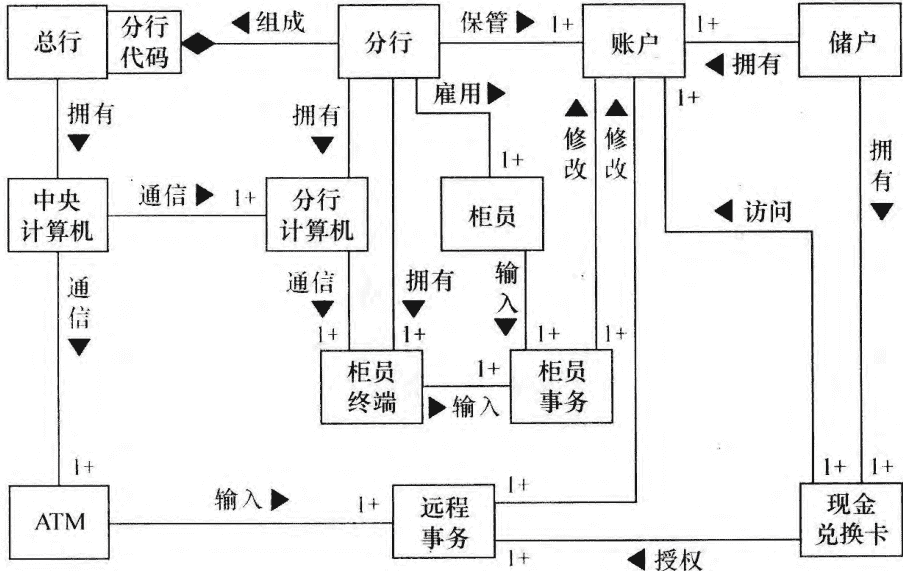

## 10.3.3 划分主题

- 在开发大型、复杂系统的过程中，为了降低复杂程度，人们习惯于把系统再进一步划分成几个不同的主题，也就是在概念上把系统包含的内容分解成若干个范畴。
- 应该按问题领域而不是用功能分解方法来确定主题。此外，应该按照使不同主题内的对象相互间依赖和交互最少的原则来确定主题（低耦合）。
- 以ATM系统为例，我们可以把它划分成“总行”、“分行”和“ATM”等三个主题。

## 划分为三个主题的类图

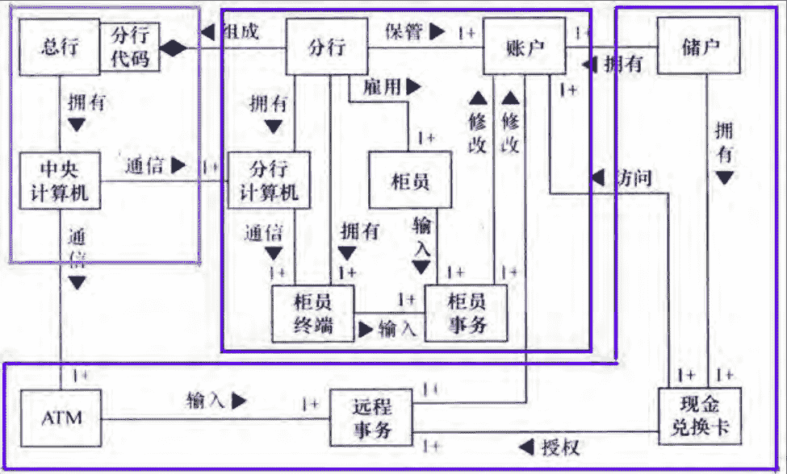

## 10.3.4 确定属性

属性是对象的性质，藉助于属性我们能对类&对象和结构有更深入更具体的认识。

- 注意，在分析阶段不要用属性来表示对象间的关系，使用关联能够表示两个对象间的任何关系，而且把关系表示得更清晰、更醒目。
- 一般说来，确定属性的过程包括分析和选择两个步骤。

### 1. 分析

- 名词词组表示属性；形容词可枚举具体属性。
- 属性的确定既与问题域有关，也和目标系统的任务有关。
  - 应该仅考虑与具体应用直接相关的属性，不要考虑那些超出所要解决的问题范围的属性。
  - 在分析阶段不要考虑那些纯粹用于实现的属性。

### 2. 选择

- 认真考察经初步分析而确定下来的那些属性，从中删掉不正确的或不必要的属性。通常有以下几种常见情况：

#### (1) 误把对象当作属性

- 如果某个实体的独立存在比它的值更重要，则应把它作为一个对象而不是对象的属性。
- 例如，在邮政目录中，“城市”是一个属性，而在人口普查中却应该把“城市”当作对象。

#### (2) 误把关联类属性作为一般对象的属性

- 如果某个性质依赖于某个关联链的存在，则该性质是关联类的属性，在分析阶段不应该把它作为对象的属性。

#### (3) 把限定误当成属性

- 限定是一种特殊的链属性。
- 在ATM系统的例子中，“分行代码”、“账号”、“雇员号”、“站号”等都是限定词。

#### (4）误把内部状态当成了属性

如果某个性质是对象的非公开的内部状态，则应该从对象模型中规掉这个属性。

#### (5）过于细化

在分析阶段应该忽略那些对大多数操作都没有影响的属性。

#### (6）存在不一致的属性

类应该是简单而且一致的。如果得出一些看起来与其他属性毫不相关的属性，则应该考虑把该类分解成两个不同的类。

经过筛选之后，得到ATM系统中各个类的属性，如图10. 5所示。

2022-11-3
41

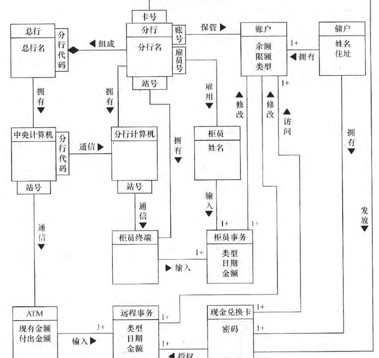

## 10.3.5 识别继承关系

可以使用两种方式建立继承（即归纳）关系：

（1）自底向上：抽象出现有类的共同性质泛化出父类。例如，在ATM系统中，“远程事务”和“柜员事务”是类似的，可以泛化出父类“事务”；

（2）自顶向下：把现有类细化成更具体的子类；

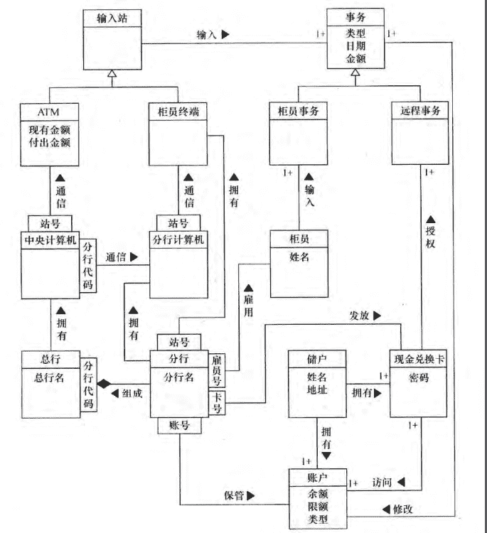

## 10.3.6 反复修改

仅仅经过一次建模过程很难得到完全正确的对象模型。事实上，软件开发过程就是一个多次反复修改、逐步完善的过程。在建模的任何一个步骤中，如果发现了模型的缺陷，都必须返回到前期阶段进行修改。

下面以ATM系统为例，讨论可能做的修改：

1. 分解 “现金兑换卡” 类

把 “现金兑换卡” 类分解为 “卡权限” 和 “现金兑换卡’ 两个类，将使每个类的功能更单一；

2. “事务” 由 “更新” 组成

“更新” 虽然代表一个动作，但是它有自己的属性（类型、金额等），应该独立存在，因此应该把它作为类-&-对象。

3. 把 “分行” 与 “分行计算机” 合并

应该合并 “分行” 与 “分行计算机”， “总行” 和 “中央计算机”。

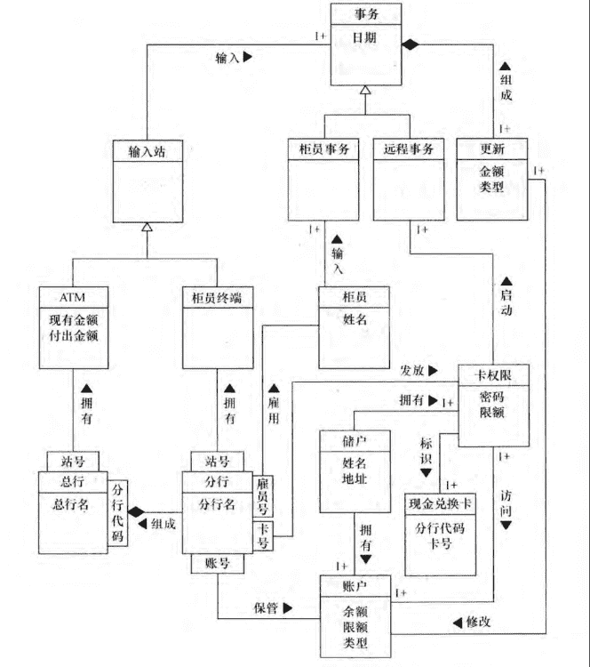

## 10.4 建立动态模型

- 对于仅存储静态数据的系统（例如数据库）来说，动态模型并没有什么意义。
- 然而在开发交互式系统时，动态模型却起着很重要的作用。如果收集输入信息是目标系统的一项主要工作，则在开发这类应用系统时建立正确的动态模型是至关重要的。

## 建立动态模型的步骤

- 第一步：是编写典型交互行为的脚本。虽然脚本中不可能包括每个偶然事件，但是，至少必须保证不遗漏常见的交互行为。
- 第二步：从脚本中提取出事件，确定触发每个事件的动作对象以及接受事件的目标对象。
- 第三步：排列事件发生的次序，确定每个对象可能有的状态及状态间的转换关系，并用状态图描绘它们。
- 最后：比较各个对象的状态图，检查它们之间的一致性，确保事件之间的匹配。

## 10.4.1 编写脚本

- 脚本：指系统在某一执行期间内出现的一系列事件
- 脚本描述用户（或其他外部设备）与目标系统之间的一个或多个典型的交互过程，以便对目标系统的行为有更具体的认识
- 编写脚本的目的，是保证不遗漏重要的交互步骤，它有助于确保整个交互过程的正确性的和清晰性
- 脚本描写的范围并不是固定的，既可以包括系统中发生的全部事件，也可以只包括由某些特定对象触发的事件。脚本描写的范围主要由编写脚本的具体目的决定。
- 编写脚本：正常情况→特殊情况→错误情况

## ATM系统的正常脚本

### 表 10.1 ATM 系统的正常情况脚本

- ATM 请客户插卡：客户插入一张现金兑换卡
- ATM 接受读卡并读它上面的分行代码和卡号
- ATM 要求客户输入密码；客户输入自己的密码 1234 等数字
- ATM 请求总行验证卡号和密码；总行要求 39 号分行核对客户密码，然后通知 ATM 说这张卡有效
- ATM 要求客户选择业务类型（取款、转账、查询等）；客户选择“取款”
- ATM 要求客户输入取款额；客户输入 880
- ATM 确认取款额在预先规定的限额内，然后要求总行处理这个事务；总行把请求转给分行，该分行成功地处理完这项事务并返回该账户的新余额
- ATM 吐出现钞并请客户拿走这些现金；客户拿走现金
- ATM 问客户是否继续这项事务；客户回答“不”
- ATM 打印账单，退出现金兑换卡，请客户拿走它们；客户取走账单和卡
- ATM 请客户掏卡

## ATM系统的异常脚本

### 表 10.2 ATM 系统的异常情况脚本

- ATM 请储户插卡；储户插入一张现金兑换卡
- ATM 接受这张卡并顺序读它上面的数字
- ATM 要求密码；储户误输入 8888
- ATM 请求总行验证输入的数字和密码；总行在向有关分行咨询之后拒绝这张卡
- ATM 显示“密码错误”，并请储户重新输入密码；储户输入 1234；ATM 请总行验证后知道这次输入的密码正确
- ATM 请储户选择事务类型；储户选择“取款”
- ATM 询问取款额；储户改变主意不想取款了，他按下“取消”键
- ATM 退出现金兑换卡，并请储户拿走它；储户拿走他的卡
- ATM 请储户插卡

## 自动售货机的脚本

- 顾客投入硬币
- 自动售货机计算并显示金额
- 顾客持续投入硬币直到足够的金额
- 自动售货机选择按钮灯亮
- 顾客选择饮料种类并按下选择按钮
- 自动售货机送出相应饮料并结算、找零
- 自动售货机扣除该饮料的存量
- 如自动售货机该饮料有存货，回到初始状态
- 如自动售货机该饮料无存货，显示该饮料“售空”灯亮，不再接受选择，回到初始状态

## 10.4.2 设计用户界面

- 大多数交互行为都可以分为应用逻辑和用户界面两部分。
- 通常，系统分析员首先集中精力考虑系统的信息流和控制流，而不是首先考虑用户界面。
- 应用逻辑是内在的、本质的内容，用户界面是外在的表现形式。动态模型着重表示应用系统的控制逻辑。
- 在分析阶段也不能完全忽略用户界面。
- 用户对系统的“第一印象”往往从界面得来，用户界面的好坏往往对用户是否喜欢、是否接受一个系统起很重要的作用。


## 向储户显示的信息

| 0 | 1 | 2 | 3 | 4 |
|---|---|---|---|---|
| 5 | 6 | 7 | 8 | 9 |
| ENTER | CLEAR | CANCEL | | |

| 账单出口 | 现金出口 |

## 10.4.3 画事件跟踪图

- 自然语言书写的脚本往往存在二义性。
- 通常在画状态图之前先画出事件跟踪图。
- 为此首先需要进一步明确事件及事件与对象的关系。

### 1. 确定事件

- 仔细分析脚本，从中提取出外部事件。
- 事件包括系统与用户（或外部设备）交互的所有信号、输入、输出、中断、动作等等（注意不要遗漏异常事件和出错条件）。
- 传递信息的对象的动作也是事件。大多数对象到对象的交互行为都对应着事件。
- 把对控制流产生相同效果的事件组合一类事件。
- 区分出每类事件发送对象和接受对象。

### 2. 画出事件跟踪图

- 脚本的扩充
- 简化了的顺序图
- 清晰的表示**事件序列以及事件与对象的关系**

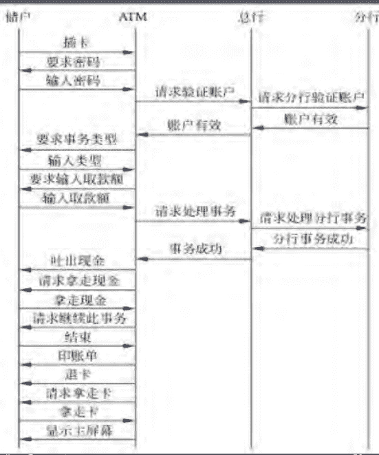

## ATM系统异常脚本事件跟踪图

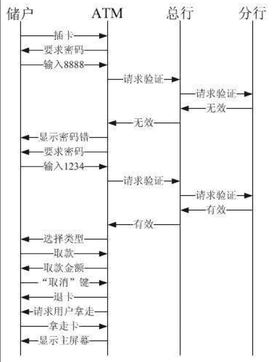

## 思考题

▶ 画出自动售货机的事件跟踪图

- 顾客、售货机、金额计算器、选择按钮、存量计算器、售空灯
  1. 顾客投入硬币
  2. 自动售货机计算并显示金额
  3. 顾客持续投入硬币直到足够的金额
  4. 自动售货机选择按钮灯亮
  5. 顾客选择饮料种类并按下选择按钮
  6. 自动售货机送出相应饮料并结算、找零
  7. 自动售货机扣除该饮料的存量
  8. 如自动售货机该饮料有存货，回到初始状态
  9. 如自动售货机该饮料无存货，显示该饮料“售空”灯亮，不再接受选择，回到初始状态

顾客 售货机 金额计算器 选择按钮 存量计算器 售空灯

投入硬币 → 累加 → 总额 → 显示总额 → 金额足够 → 灯亮 → 选择按钮 → 按下按钮 → 送出饮料 → 结算 → 余额 → 找零 → 扣减存量 → 存量为零 → 灯亮

## 10.4.4 画状态图

- 状态图描绘事件与对象状态的关系。
  - 下一个状态取决于当前状态+所接受的事件
  - 由事件引起的状态改变称为“转换”
  - 可忽略不引起当前状态发生转换的事件
- 状态图可描绘一类对象的行为，它确定了由事件序列引出的状态序列。

## 事件跟踪图→状态图

- 把事件跟踪图中指向某条竖线那些箭头线作为状态图的有向边，边上标上对应的事件名
- 两个事件之间的间隔就是一个状态
- 某对象对同一事件响应不同，则该对象处于不同状态
- 对状态的命名应准确且有实际意义
- 出向的箭头表示对象达到某个状态时所做的行为，且往往是引起另一类对象状态发生转换的事件

## ATM类的状态图

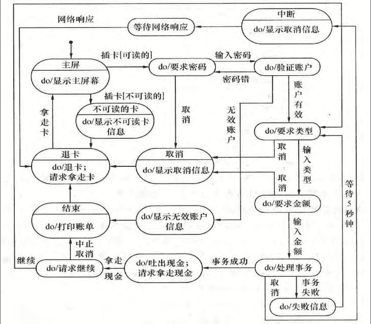

## 总行类的状态图

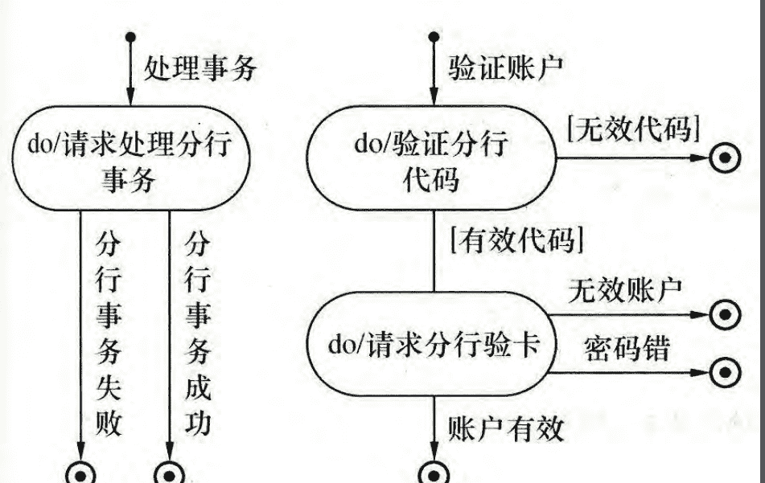

## 分行类的状态图

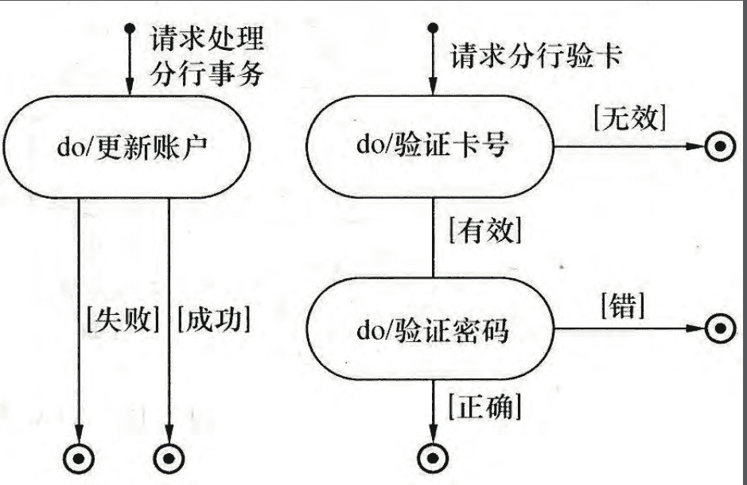

## 10.4.5 审查动态模型

- 各个类的状态图通过共享事件合并起来，构成了系统的动态模型。
- 在完成了每个具有重要交互行为的类的状态图之后，应该检查系统级的完整性和一致性。
- 重点检查没有前驱或者没有后继的状态

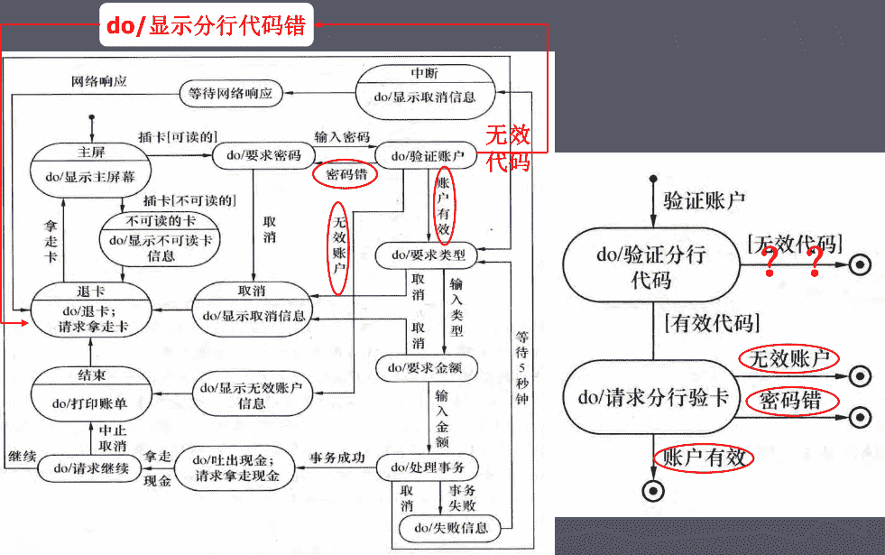

do/显示分行代码错

网络响应

等待网络响应

中断

do/显示取消信息

主屏

do/显示主屏幕

插卡可读的

do/要求密码

输入密码

do/验证账户

密码错

插卡不可读的

do/显示不可读卡信息

退卡

do/退卡；\n请求拿走卡

取消

do/显示取消信息

无效账户

账户有效

do/要求类型

取消

输入类型

等待5秒钟

取消

do/要求金额

输入金额

结束

do/显示无效账户\n信息

do/打印账单

中止\n取消

继续

do/请求继续

拿走\n现金

do/吐出现金；\n请求拿走现金

事务成功

do/处理事务

取消

事务失败

do/失败信息

# 验证账户

do/验证分行代码

[无效代码]

[有效代码]

do/请求分行验卡

无效账户

密码错

账户有效

红色手写标注：无效代码、密码错、无效账户、账户有效，以及右上方的“do/显示分行代码错”。

## 10.5 建立功能模型

功能模型由一组数据流图（DFD）组成

- 表明了系统中数据之间的**依赖关系**
- 及有关的**数据处理功能**
- 通常在建立了对象和动态模型后再建立功能模型

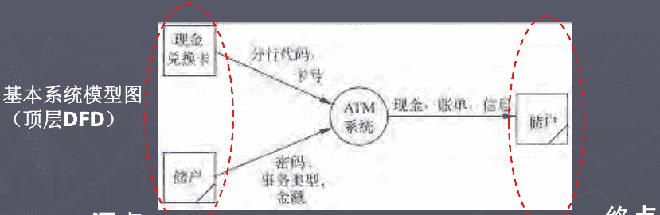

## 10.5.2 画出功能级DFD

▶ 把基本系统模型中单一的处理框分解成若干个处理框，以描述系统加工、变换数据的基本功能（**基本加工**），就得到功能级数据流图。

- SA和OOA中DFD的区别在于SA中的数据存储是作为文件或DB来存储的；而OOA中类的属性也可作为数据存储

## 10.5.3 描述处理框功能

▶ 对每个基本加工应该进行加以描述和说明（**加工小说明**）。

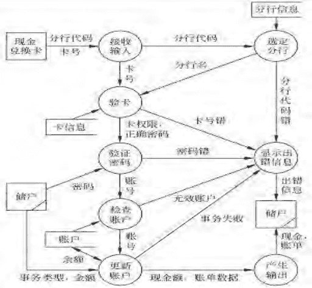

表 10.3 对更新账户功能的描述

更新账户（账号，事务类型，金额）→现金额，账单数据，信息

如果取款额超过账户当前余额，拒绝该事务且不付出现金。

如果取款额不超过账户当前余额，从余额中减去取款额后作为新的余额，付出储户要取的现金。

如果事务是存款，把存款额加到余额中得到新余额，不付出现金。

如果事务是查询，不付出现金。

在上述任何一种情况下，账单内容都是：ATM 号，日期，时间，账号，事务类型，事务金额（如果有的话），新余额。

## 面向对象分析实例

### 1、需求陈述

- 在一幢有m层楼的大厦中需要一套控制n部电梯的产品，要求这n部电梯根据下列约束条件在楼层间移动。
- C1：每部电梯有m个按钮，每个按钮代表一个楼层。当按下一个按钮时该按钮指示灯亮，同时电梯驶向相应的楼层，当到达由按钮指定楼层时指示灯熄灭。
- C2：除了大厦的最底层和最高层之外，每层楼都有两个按钮分别指示电梯上行和下行。当这两个按钮之一被按下时相应的指示灯亮，当电梯到达此楼层时灯熄灭，电梯向要求的方向移动。
- C3：当电梯无升降动作时，关门并停在当前楼层。

## 面向对象分析实例

### 2、建立对象模型

#### （1）精确地定义问题

用一句话表述目标系统：在一个m层楼的大厦里，用每层楼的按钮和电梯内的按钮来控制n部电梯的移动。

#### （2）提出非形式化策略

在一幢有m层楼的大厦里，用电梯内的和每个楼层的按钮控制n部电梯的运动，当按下电梯按钮以请求在某一指定楼层停下时，按钮指示灯亮；当请求获得满足时，指示灯熄灭。当电梯无升降操作时，关门并停在当前楼层。

## 面向对象分析实例

### （3）把策略形式化

- 类的候选：按钮、电梯、楼层、运动、大厦、指示灯、请求和门。
- 筛选：
  - 楼层和大厦处于问题边界之外
  - 运动、请求作为电梯的操作
  - 门作为电梯的属性
  - 指示灯作为按钮的属性
- 最终结果：电梯和按钮

## 电梯系统对象模型的第一次迭代

**确定继承关系：** 电梯和楼层两类按钮，可以泛化成一个父类——按钮类。得出初步的对象模型。

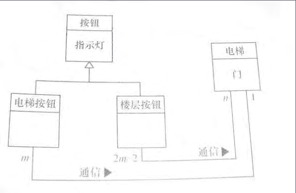

## 3、建立动态模型

### （1）编写脚本

电梯系统正常情况脚本

- 用户 A 在 3 楼按上行按钮呼叫电梯。用户 A 希望到 7 楼去
- 上行按钮指示灯亮
- 一部电梯到达 3 楼，电梯内的用户 B 已按下了到 9 楼的按钮
- 上行按钮指示灯熄灭
- 电梯开门
- 用户 A 进入电梯
- 用户 A 按下电梯内到 7 楼的按钮
- 7 楼按钮指示灯亮
- 电梯关门
- 电梯到达 7 楼
- 7 楼按钮指示灯熄灭
- 电梯开门
- 用户 A 走出电梯
- 电梯在等待时间后关门
- 电梯载着用户 B 继续上行到达 9 楼


## 3、建立动态模型

电梯系统异常情况脚本

- 用户 A 在 3 楼按上行按钮呼叫电梯，但是用户 A 希望到 1 楼
- 上行按钮指示灯亮
- 一部电梯到达 3 楼，电梯内用户 B 已按下了到 9 楼的按钮
- 上行按钮指示灯熄灭
- 电梯开门
- 用户 A 进入电梯
- 用户 A 按下电梯内到 1 楼的按钮
- 电梯内 1 楼按钮指示灯亮
- 电梯在等待超时后关门
- 电梯上行到达 9 楼
- 电梯内 9 楼按钮指示灯熄灭
- 电梯开门
- 用户 B 走出电梯
- 电梯在等待超时后关门
- 电梯载着用户 A 下行驶向 1 楼

## 3、建立动态模型

### （2）画状态图

电梯控制器是在电梯系统中起核心控制作用的类，我们将画出这个类的状态转换图。为简单起见，仅考虑一部电梯（即 n=1）的情况

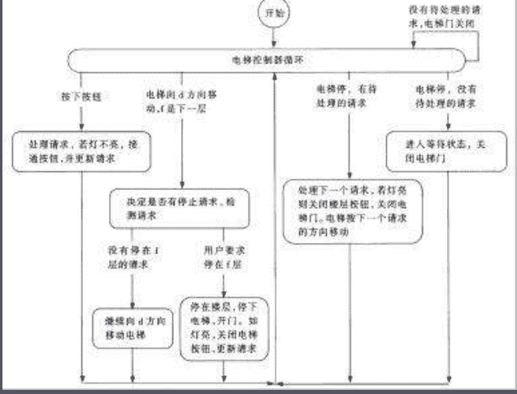

## 4、建立功能模型

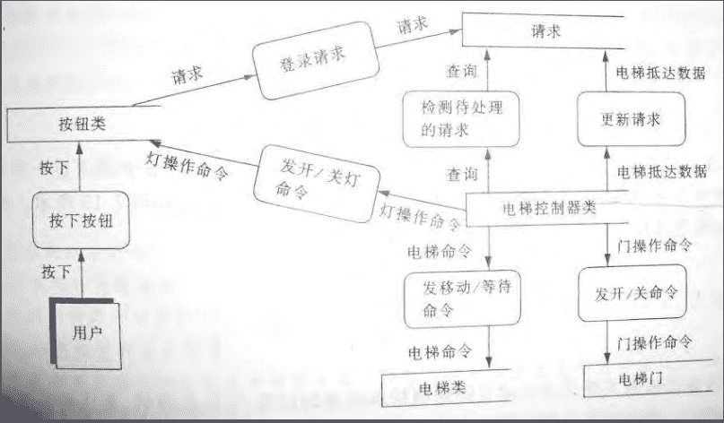

## 5、进一步完善

根据从功能模型中获得的信息，重新审查对象模型和动态模型。

- “电梯门”独立出来一个类。
- “请求”作为一个独立的类。

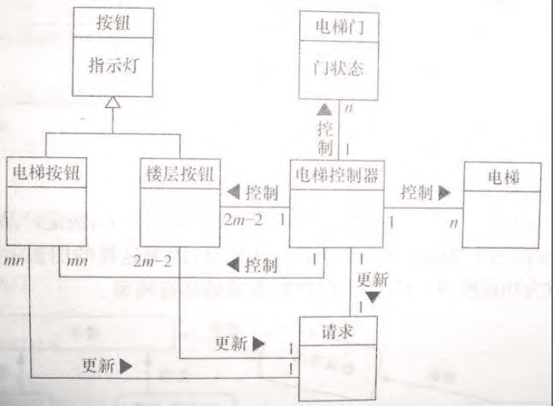

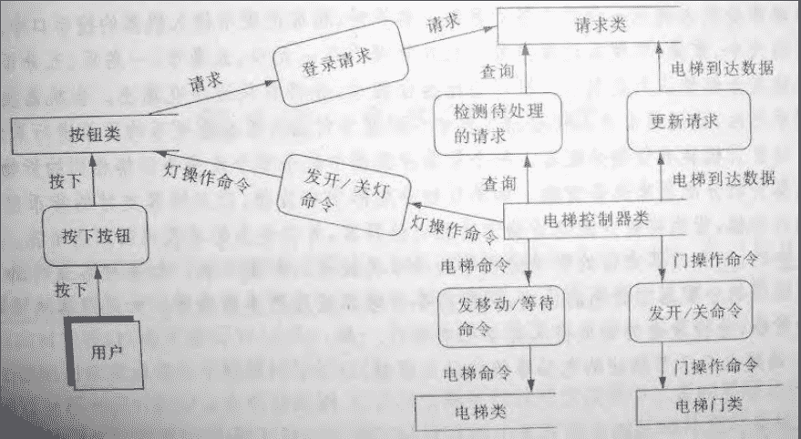

## 作业

### 1. 建立下述牙科诊所管理系统的对象模型：

王大夫在小镇上开了一家牙科诊所。他有一个牙科助手、一个牙科保健员和一个接待员。王大夫需要一个软件系统来管理预约。

当病人打电话预约时，接待员将查阅预约登记表，如果病人申请的就诊时间与已经定下的预约时间冲突，则接待员建议一个就诊时间以安排病人尽早得到诊治。如果病人同意建议的就诊时间，接待员将输入约定时间和病人的名字。系统将核实病人的名字并提供记录的病人数据，数据包括病人的病历号等。在每次治疗或清洗后，助手或保健员将标记相应的预约诊治已经完成，如果有必要的话会安排病人下一次再来。

系统能够按照病人名字和日期进行查询，能够显示记录的病人数据和预约信息。接待员可以取消预约，可以打印出前两天预约尚未就诊的病人清单。系统可以从病人记录中获得病人的电话号码。接待员还可以打印出关于所有病人的每天和每周工作安排。

2. 建立上述牙科诊所管理系统的用例模型
3. 用数据流图建立上述牙科诊所管理系统的功能模型
4. 写出上述牙科诊所管理系统的脚本
5. 画出上述牙科诊所管理系统的动态模型

## OOD概述

- 分析：用户需求→目标系统精确模型（正确、完整、无二义性）
- 设计：分析模型→系统设计模型（抽象的系统实现方案/软件构造的蓝图）
- 面向对象设计OOD就是用面向对象观点建立解空间模型的过程

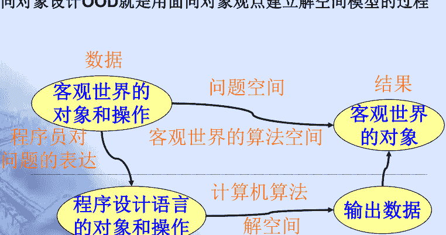

## OOD概述

- 结构化设计：总体设计(概要设计)和详细设计
- 面向对象设计:系统设计和对象设计(一共4个层次)
- 系统设计（①子系统层）
- 将系统分解成容易管理的各个部分（子系统，即系统级的“模块”）
- 对象设计确定解空间中的类和对象及其关联（②类&对象层）、接口形式（③消息层）及实现服务的算法（④责任层）

## OOD概述

OOD在设计阶段中继续采用分析阶段中提到的五个层次。  
这五个层次用于建立系统的四个组成成份。

### OOA分析阶段

### OOD设计阶段

- ✅ 定义主题 —— 主题层
- ✅ 标识对象 —— 类和对象层
- ✅ 标识对象所属类 —— 结构层
- ✅ 标识对象的属性 —— 属性层
- ✅ 标识对象的行为 —— 服务层

| 人机交互部分 | 主体（问题域）部分 | 任务管理部分 | 数据管理部分 | 主题层 类与对象层 结构层 属性层 服务层 |
|---|---|---|---|---|

## 第11章 面向对象设计

### 11.1 面向对象设计准则

## 11.2 启发规则

## 11.3 软件重用

## 11.4 系统分解

## 11.5 设计问题域子系统

## 11.6 设计人机交互子系统

## 11.7 设计任务管理子系统

## 11.8 设计数据管理子系统

## 11.9 设计类中的服务

## 11.10 设计关联

## 11.11 设计优化

### 11.12 小结

### 11.1 面向对象设计的准则

- 所谓**优秀设计**，就是权衡了各种因素，从而使得系统在其整个生命周期中的**总开销最小**的设计。
- 对大多数软件系统而言，**60%以上**的软件费用都用于软件维护，因此，优秀软件设计的一个主要特点就是**容易维护**。

1. 模块化
2. 抽象
3. 信息隐蔽
4. 弱耦合
5. 强内聚
6. 可重用

### 3. 信息隐藏

信息隐藏通过对象的封装实现

- 数据与处理的分离→数据为中心的处理一体化
- 实现了接口和实现的分离：属性和操作对外不可见

对象的用户没有必要了解对象的内部数据构造和实现方法


对象的提供者即使改变内部对象内部的数据构造和实现方法，对用户也没有影响


### 4. 弱耦合

#### （1）交互耦合（对象-消息-对象）

- 应尽量降低交互耦合程度
- 尽量降低消息连接的复杂程度（显式接口）
- 尽量减少消息中包含的参数个数（小接口），降低参数的复杂程度
- 减少对象发送(或接收)的消息数(少接口)

#### （2）继承耦合（一般类-特殊类，父类-子类）

- 与交互耦合相反，应该提高继承耦合程度。

### 5. 强内聚

#### （1）服务内聚

- 一个服务应该完成一个且仅完成一个功能。

#### （2）类内聚

- 一个类应该只有一个用途，它的属性和服务应该是高内聚的。
- 类的属性和服务应该全都是完成该类对象的任务所必需的，其中不包含无用的属性或服务。
- 如果某个类有多个用途，通常应该把它分解成多个专用的类。

#### （3）一般—特殊内聚

- 设计出的一般—特殊结构，应该符合多数人的概念，更准确地说，这种结构应该是对相应的领域知识的正确抽取。

### 6. 可重用

- 软件重用是提高软件开发生产率和目标系统质量的重要途径。重用基本上从设计阶段开始。
- 重用有两方面的含义：
- 一是尽量使用已有的类(包括开发环境提供的类库，及以往开发类似系统时创建的类)；
- 二是如果确实需要创建新类，则在设计这些新类的协议时，应该考虑将来的可重复使用性。

## 11.2 启发规则

1. 设计结果应该清晰易懂
2. 一般-特殊结构的深度应适当
3. 设计简单的类
4. 使用简单的协议
5. 使用简单的服务
6. 把设计变动减至最小

## 11.2 启发规则

#### 1. 设计结果应该清晰易懂

使设计结果清晰、易读、易懂，是提高软件可维护性和可重用性的重要措施。

##### 1. 用词一致

“名副其实”；
不同类中相似服务应采用相同的名字

##### 2. 使用已有的协议

##### 3. 减少消息模式的数目

##### 4. 避免模糊的定义

### 2 一般一特殊结构的深度应适当

- 应该使类等级中包含的层次数适当（7±2原则）

### 3 设计简单的类

- 应该尽量设计小而简单的类，以便于开发和管理。
1. 避免包含过多的属性
2. 有明确的定义
3. 尽量简化对象之间的合作关系（降低交互耦合度）
4. 不要提供太多服务（不超过7个）


## 11.2 启发规则

### 4 使用简单的协议

- 尽量降低交互耦合的程度。
- 一般来说，消息中的参数不要超过3个。

### 5 使用简单的服务

- 面向对象设计出来的类中的服务通常都很小，一般只有3～5行源程序语句，可以用仅含一个动词和一个宾语的简单句子描述它的功能。

### 6 把设计变动减至最小

- 通常，设计的质量越高，设计结果保持不变的时间也越长。

图11.1 理想的设计变动情况

## 11.3 软件重用

### 11.3.1 概述

#### 1. 重用（reuse）

重用也叫再用或复用，是指同一事物不做修改或稍加改动就多次重复使用。

- （1）知识重用
- （2）方法和标准重用
- （3）软件成分重用

### 3. 典型的可重用软件成分

- （1）项目计划
  - 减少计划制定时间
- （2）成本估计
  - 类似功能的成本估计可重用
- （3）体系结构
  - 领域体系结构的重用
- （4）需求模型和规格说明
  - 类和对象模型的重用
- （5）设计
  - 系统和对象设计都可被重用
- （6）源代码
  - 经过验证和测试的程序构件
- （7）用户文档和设计文档
- （8）用户界面
  - 最广泛被重用的部分
- （9）数据
  - 表、记录结构、文件及DB等
- （10）测试用例
  - 设计和代码构件所附带的测试用例

### 11.3.2 类构件

- 利用面向对象技术，可以更方便更有效地实现软件复用。
- 面向对象技术中的“类”，是比较理想的可重用软件构件，不妨称之为“**类构件**”。
  - 实例重用
  - 继承重用
  - 多态重用

### 1. 可重用软构件应具备的特点

#### （1）模块独立性强

- 高内聚：功能单一且完整
- 低耦合：外部不可见的封装体

#### （2）具有高度可塑性

- 可根据特定需求进行扩充和修改

#### （3）接口清晰、简明、可靠

### 2. 类构件的重用方式

#### （1）实例重用

- 使用适当的构造函数，按照需要创建类的实例。
- 用几个简单的对象作为类的成员创建出一个更复杂的类。

#### （2）继承重用

- 继承父类属性和操作+加入少量新的属性和操作
- 提高继承耦合度，降低接口复杂度

#### （3）多态重用

- 同一接口在不同类型的对象中可有不同的处理方法

### 11.3.3 软件重用的效益

#### 1. 质量

- 被重用的代码的错误率是每千行代码中有0.9个错误
- 新开发的软件的错误率是每千行代码中有4.1个错误
- 使用重用的开发可使软件质量改进35%。

#### 2. 生产率

- 30%-50%的重用大约导致生产率提高25%-40%

#### 3. 成本

- C=Cs-Cr-Cd

## 11.4 系统分解

- 大多数系统的面向对象设计模型，在逻辑上都由四大部分组成。这四大部分对应于组成目标系统的四个子系统，它们分别是 **问题域子系统、人机交互子系统、任务管理子系统和数据管理子系统**。
- 当然，在不同的软件系统中，这四个子系统的重要程度和规模可能相差很大，规模过大的在设计过程中应该进一步划分成更小的子系统，规模过小的可合并在其他子系统中。

### 1 子系统之间的两种交互方式

- 在软件系统中，子系统之间的交互有两种可能的方式：
  - 客户—供应商(client-supplier)关系
    - 单向交互：“客户”子系统调用“供应商”子系统
  - 平等伙伴(peer-to-peer)关系
    - 双向交互：任意子系统间均可相互调用
- 总的来说，单向交互比双向交互更容易理解，也更容易设计和修改，因此应该尽量使用客户—供应商关系。

### 2 组织系统的两种方案

- 把子系统组织成完整的系统时，有水平层次组织和垂直块组织两种方案可供选择。

#### （1）层次组织

- 这种组织方案把软件系统组织成一个层次系统，每层是一个子系统。
- 上层在下层的基础上建立，下层为实现上层功能而提供必要的服务。
- 每一层内所包含的对象，彼此间相互独立，而处于不同层次上的对象，彼此间往往有关联。
- 实际上，在上、下层之间存在客户—供应商关系。低层子系统提供服务，相当于供应商，上层子系统使用下层提供的服务，相当于客户。
- 分为封闭式（仅使用直接下层）和开放式（可使用任何下层）。
- 需求陈述中只描述了对系统顶层（用户所能看到的目标系统）和底层（系统可使用的资源）的需求。

#### （2）块状组织

- 这种组织方案把软件系统垂直地分解成若干个相对独立的、弱耦合的子系统，一个子系统相当于一块，每块提供一种类型的服务。
- 利用层次和块的各种可能的组合，可以成功地由多个子系统组成一个完整的软件系统。同一层可以由若干块组成，同一块也可以分为若干层

| 应用软件包 | 人机对话控制 | 窗口图形屏幕图形像素图形 | 仿真软件包 |
|---|---|---|---|
| 操作系统 | | | |
| 计算机硬件 | | | |

图11.3典型的应用系统组织结构

### (3) 设计系统的拓扑结构

由子系统组成完整的系统时，典型的拓扑结构有管道型（pipe）、树型（tree）、星型（star）等。设计者应该采用与问题结构相适应的、尽可能简单的拓扑结构，以减少子系统之间的交互数量。

## 11.5 设计问题域子系统

- 通过面向对象分析所得出的问题域精确模型，为设计问题域子系统奠定了良好的基础，建立了完整的框架。
- 只要可能，就应该保持面向对象分析所建立的问题域结构。通常，面向对象设计仅需从实现角度对问题域模型作一些补充或修改，主要是增添、合并或分解类与对象、属性及服务，调整继承关系等。
- 当问题域子系统过分复杂庞大时，应该把它进一步分解成若干个更小的子系统。

在面向对象设计过程中，可能对面向对象分析得出的问题域模型作的补充或修改：

### 1 调整需求

- 用户需求或者外部环境发生变化
- 分析员对问题域理解不透彻或缺乏领域专家帮助

简单修改面向对象分析结果，然后再把修改反映到问题域子系统中。

### 2 重用已有的类

重用已有类的典型过程：

- 选择有可能被重用的**已有类**，标出这些候选类中对本问题**无用**的属性和服务，尽量重用那些能使无用的属性和服务降到**最低程度**的类；
- 从被重用的已有类中**派生**出问题域类
- 标出问题域类中从已有类**继承**来的属性和服务
- 修改与问题域类相关的关联

### 5. 调整继承层次

- 如果面向对象分析模型中包含了多重继承关系，然而所使用的程序设计语言却并不提供多重继承机制，则必须修改面向对象分析的结果。
- 即使使用支持多重继承的语言，有时也会出于实现考虑而对面向对象分析结果作一些调整。

#### （1）使用多重继承机制

图11.4窄菱形模式

图11.5阔菱形模式


## 11.5 设计问题域子系统

### （2）使用单继承机制

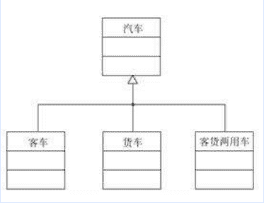

图11.6 把多重继承简化为单一层次的单继承

## 11.5 设计问题域子系统

### 6.ATM系统之例

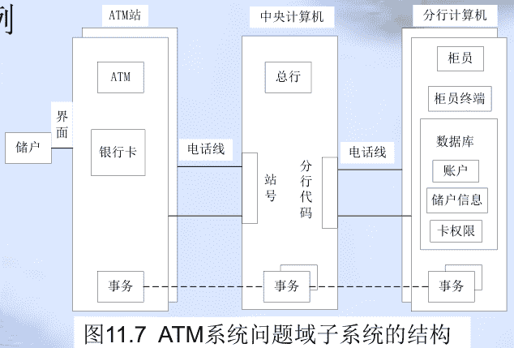

## 11.6 设计人机交互子系统

### 人机交互界面设计是一个迭代的过程

- 创建设计模型
- 用原型实现设计模型
- 由用户试用和评估
- 根据用户意见进行修改

## 11.6 设计人机交互子系统

### 设计人-机交互界面的准则

- 人-机交互界面设计应遵循以下准则：

1. 一致性

   - 使用一致的术语，一致的步骤，一致的动作。

2. 减少操作步骤

   - 应使用户为做某件事情而需**敲击键盘的次数**、**点按鼠标的次数**、或者**下拉菜单的距离**，都减至最少。

## 11.6 设计人机交互子系统

- 还应使得技术水平不同的用户，为获得有意义的结果所需使用的时间都减至最少。特别应该为熟练用户提供**简捷的操作方法**（例如，热键）。

### 3. 及时提供反馈信息

- 每当用户**等待系统完成一项工作时**，系统都应该向用户提供有意义的、及时的反馈信息，以便用户能够知道系统目前已经完成该项工作的多大比例。

## 11.6 设计人机交互子系统

### 4. 提供撤消命令

- 人在与系统交互的过程中难免会犯错误，因此，应该提供“撤消（undo）”命令，以便用户及时撤消错误动作，消除错误动作造成的后果。

### 5. 无须记忆

- 不应该要求用户记住在某个窗口中显示的信息，然后再用到另一个窗口中，这是软件系统的责任而不是用户的任务。

- 此外，在设计人-机交互部分时应该力求达到下述目标：用户在使用该系统时用于思考人-机交互方法所花费的时间减至最少，而用于做他实际想做的工作所用的时间达到最大值。更理想的情况是，人-机交互界面能够增强用户的能力。

## 11.6 设计人机交互子系统

### 6. 易学

- 人-机交互界面应该易学易用，应该提供联机参考资料，以便用户遇到困难时可随时参阅。

### 7. 富有吸引力

- 人-机交互界面不仅应该方便、高效，还应该使人在使用时感到心情愉快，能够从中获得乐趣，从而吸引人去使用它。

## 11.6 设计人机交互子系统

### 设计人-机交互子系统的策略

### 1. 分类用户

- 为了更好地了解用户的需要与爱好，以便设计出符合用户需要的界面，设计者首先应该把将来可能与系统交互的用户分类。通常从下列几个不同角度进行分类。

- 按技能水平分类(新手/初级/中级/高级/专家级)。

- 按职务分类(院长/副院长/系主任/教师)。

- 按组织层次分类(行政人员/专业教师/实验教师)。

- 按所属集团分类(教师/学生)。

## 11.6 设计人机交互子系统

### 2. 描述用户

- 应该仔细了解将来使用系统的每类用户的情况，把获得的下列各项信息记录下来。

  - 用户类型。
  - 使用系统欲达到的目的。
  - 特征（年龄、性别、受教育程度、限制因素等）。
  - 关键的成功因素（需求、爱好、习惯等）。
  - 技能水平。
  - 完成本职工作的脚本。

### 描述用户示例

- 用户类型——分析员
- 目的——要求一个工具来辅助分析工作（摆脱繁重的画图和检查图的工作）。
- 特点——年龄：42岁；教育水平：大学；限制：不要微型打印，小于9个点的打印太小。
- 成功的关键因素——工具应当使分析工作顺利进行；工具不应与分析工作冲突；工具应能捕获假设和思想，能适时做出折衷；应能及时给出模型各个部分的文档，这与给出需求同等重要。
- 熟练程度——专家。
- 任务脚本——

  - 主脚本：
    - 识别“核心的”类和对象；
    - 识别“核心”结构；
    - 在发现了新的属性或操作时随时都可以加进模型中去。
  - 检验模型：打印模型及其全部文档。

## 11.6 设计人机交互子系统

### 3. 设计命令层次

研究现行的人机交互活动的内容和准则：这些准则可以是非形式的，如“输入时眼睛不易疲劳”，也可以是正式规定的；

建立一个初始的命令层：可有多种形式，如一系列菜单、或一个窗口、或一系列图标。

细化命令层：考虑以下几个问题。

排列命令层次。把使用最频繁的操作放在前面；按照用户工作步骤排列。

通过逐步分解，找到整体一局部模式，以帮助在命令层中对操作分块。

根据人们短期记忆的“7±2”或“每次记忆3块 / 每块3项”的特点，把深度尽量限制在三层之内。

减少操作步骤：把点取、拖动和键盘操作减到最少。

## 11.6 设计人机交互子系统

### 4. 使用原型

- 用户界面原型是用户界面设计的重要工作。人需要对提交的人机交互活动进行体验、实地操作，并精炼成一致的模式。

- 使用快速原型工具或应用构造器，对各种命令方式，如菜单、弹出、填充以及快捷命令，做出原型让用户使用，通过用户反馈、修改、演示的迭代，使界面越来越有效。

## 11.6 设计人机交互子系统

### 5. 设计人机交互类

- 窗口需要进一步细化，通常包括：类窗口、条件窗口、检查窗口、文档窗口、画图窗口、过滤器窗口、模型控制窗口、运行策略窗口、模板窗口等。

- 设计人机交互类，首先从组织窗口和部件的用户界面的设计开始。

- 每个类包括窗口的菜单条、下拉菜单、弹出菜单的定义。还要定义用于创建菜单、加亮选择项、引用相应响应的操作。

## 11.6 设计人机交互子系统

### 6. 根据GUI界面进行设计

- 图形用户界面区分为 **字型、坐标系统和事件**。
  - **字型**是字体、字号、样式和颜色的组合。
  - **坐标系统**主要因素有原点（基准点）、显示分辨率、显示维数等。
  - **事件**则是图形用户界面程序的核心，操作将对事件做出响应。

## 11.7 设计任务管理子系统

### 1 分析并发性

- 通过面向对象分析建立起来的动态模型，是分析并发性的主要依据。

- 如果两个对象彼此间不存在交互，或者它们同时接受事件，则这两个对象在本质上是并发的。

## 11.7 设计任务管理子系统

### 2 设计任务管理子系统

- 常见的任务有事件驱动型任务（event-driven tasks）、时钟驱动型任务（clock-driven tasks）、优先任务（prior tasks）、关键任务（key tasks）和协调任务（collaborative tasks）等。
- 设计任务管理子系统，包括确定各类任务并把任务分配给适当的硬件或软件去执行。

## 11.7 设计任务管理子系统

### （2）确定时钟驱动型任务

- 某些任务**每隔一定时间间隔**就被触发以执行某些处理。
  - 某些设备需要周期性地获得数据；
  - 某些人-机接口、子系统、任务、处理器或其他系统也可能需要周期性地通信。

- 工作过程：睡眠→唤醒（时钟中断）→执行→睡眠
  - 睡眠：任务设置唤醒时间后睡眠
  - 唤醒：等待来自系统的时钟中断，一旦接收中断，任务被唤醒
  - 执行：完成相关工作，然后继续睡眠。

## 11.7 设计任务管理子系统

### （3）确定优先任务

- 根据任务的优先等级来安排处理。

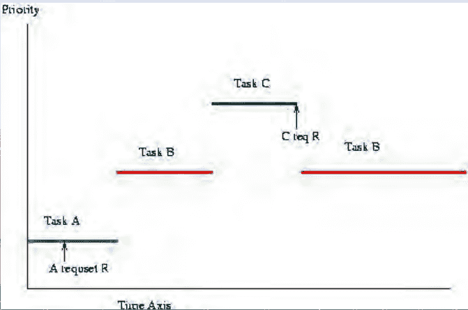

## 11.7 设计任务管理子系统

### （4）确定关键任务

- 关键任务是有关系统**成功或失败的关键处理**，这类处理通常都有严格的可靠性要求。
- 在设计过程中可能用额外的任务把这样的关键处理分离出来，以满足**高可靠性**处理的要求。
- 对高可靠性处理应该精心设计和编码，并且应该严格测试。

## 11.7 设计任务管理子系统

### （5）确定协调任务

- 当系统中存在三个以上任务时，就应该增加一个任务，用它作为协调任务。
- 引入协调任务会**增加系统总开销**，但有助于把不同任务之间的协调控制封装起来。
- 这类任务**仅完成协调工作**，不承担其他服务工作。
- 状态转换矩阵（State Transition Matrix）

**State transition matrix**

|  | Rainy | Cloudy | Sunny |
|---|---:|---:|---:|
| Rainy | 0.4 | 0.3 | 0.3 |
| Cloudy | 0.2 | 0.6 | 0.2 |
| Sunny | 0.1 | 0.1 | 0.8 |

rainy(today)→rainy→sunny→cloudy?

0.4*0.3*0.1=0.012


## 11.7 设计任务管理子系统

**（6）尽量减少任务数**

必须仔细分析和选择每个确实需要的任务。应该使系统中包含的任务数尽量少。

**（7）确定资源需求**

使用多处理器或固件，主要是为了满足高性能的需求。设计者必须通过计算系统载荷（即每秒处理的业务数及处理一个业务所花费的时间），来估算所需要的CPU（或其他固件）的处理能力。

## 11.8 设计数据管理子系统

数据管理子系统是系统存储或检索对象的基本设施，包括对永久性数据的访问和管理。

它建立在某种数据存储管理系统之上，并且隔离了数据存储管理模式（文件、关系数据库或面向对象数据库）的影响。

### 11.8.1 选择数据存储管理模式

不同的数据存储管理模式有不同的特点，适用范围也不相同。

**1. 文件管理系统（file management system）**

- 操作系统的一个组成部分
- 使用它长期保存数据具有成本低和简单等特点
- 文件操作的级别低，为提供适当的抽象级别还需要编写额外的代码
- 不同的操作系统的文件管理系统往往有差别

**2. 关系数据库管理系统（Relational DBMS, RDBMS）**

- 提供了各种最基本的数据管理功能
- 为多种应用提供了一致的接口
- 标准化语言（SQL）
- 运行开销大
- 不能满足高级应用的需求
- 与程序设计语言连接不自然（非过程语言vs. 过程性语言）

**3. 面向对象数据库管理系统（OO DBMS）**

面向对象数据库管理系统是一种新技术，主要有两种设计途径：**扩展的RDBMS**和**扩展的OOPL**。

- 扩展的关系数据库管理系统是在**关系数据库的基础**上，增加了**抽象数据类型和继承机制**，此外还增加了创建及管理类和对象的通用服务。
- 扩展的面向对象程序设计语言，扩充了面向对象程序设计语言的语法和功能，增加了**在数据库中存储和管理对象的机制**。

### 11.8.2 设计数据管理子系统

设计数据管理子系统，既需要设计**数据格式**又需要设计**相应的服务**。

**1. 设计数据格式**

设计数据格式的方法与所使用的**数据存储管理模式**密切相关。

**（1）文件系统**

- 定义1NF表（类的属性表）
- 为每个1NF表定义一个文件
- 测量性能和需要的存储容量
- 修改原设计的1NF，以满足性能和存储需求

**（2）关系数据库管理系统**

- 定义3NF表
- 为每个3NF表定义一个数据库表
- 测量性能和需要的存储容量
- 修改先前设计的3NF，以满足性能和存储需求

**（3）面向对象数据库管理系统**

扩展的关系数据库途径：使用与关系数据库管理系统相同的方法。

扩展的面向对象程序设计语言途径：不需要规范化属性的步骤，因为数据库管理系统本身具有把对象映射成存储值的功能。

**2. 设计相应的服务**

如果某个类的对象需要存储起来，则在这个类中增加一个属性和服务，用于完成存储对象自身的工作。

下面介绍使用不同数据存储管理模式时的设计要点。

**（1）文件系统**

注意，为提高性能应该批量处理访问文件的要求。

**（2）关系数据库管理系统**

访问哪些表、怎样访问需要的行、怎样检索。

**（3）面向对象数据库管理系统**

扩展的关系数据库途径：与使用关系数据库管理系统时方法相同。

## 11.9 设计类中的服务

### 11.9.1 确定类中应有的服务

需要综合考虑对象模型、动态模型和功能模型，才能正确确定类中应有的服务。

对象模型是进行对象设计的基本框架。但是，面向对象分析得出的对象模型，通常只在每个类中列出很少几个最核心的服务。

设计者必须把动态模型中对象的行为以及功能模型中的数据处理，转换成由适当的类所提供的服务。

### 11.9.2 设计实现服务的方法

在面向对象设计过程中还应该进一步设计实现服务的方法，主要应该完成以下几项工作。

1. 设计实现服务的算法
   - 算法复杂度
   - 容易理解与容易实现
   - 易修改
2. 选择数据结构
3. 算法与数据结构的关系

## 11.10 设计关联

在对象模型中，关联是联结不同对象的纽带，它指定了对象相互间的访问路径。

在面向对象设计过程中，设计人员必须确定实现关联的具体策略：全局策略、具体策略。

### 1 关联的遍历

在应用系统中，使用关联有两种可能的方式：单向遍历和双向遍历。

### 2 实现单向关联

用指针可以方便地实现单向关联。

- 如果关联的重数是一元的（如图11.8所示），则实现关联的指针是一个简单指针；
- 如果重数是多元的，则需要用一个指针集合实现关联（参见图11.9）。

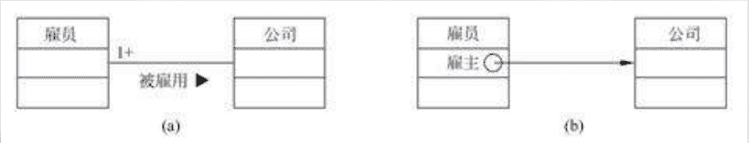

图11.8 用指针实现单向关联
(a) 关联；(b) 实现

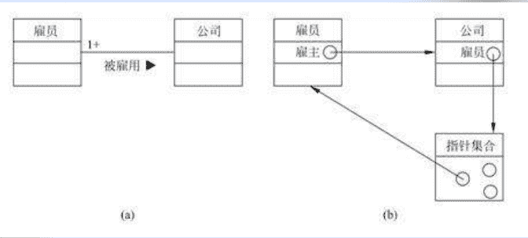

图11.9 用指针实现双向关联  
(a) 关联； (b) 实现

### 3 实现双向关联

许多关联都需要双向遍历，当然，两个方向遍历的频度往往并不相同。实现双向关联有下列三种方法。

- 只用属性实现一个方向的关联，当需要反向遍历时就执行一次正向查找。
- 两个方向的关联都用属性实现。
- 用独立的关联对象实现双向关联。

### 4 关联对象的实现

实现关联对象的方法，取决于关联的重数。

- 对于一对一关联来说，关联对象可以与任何一个对象合并。
- 对于一对多关联来说，关联对象可以与“多”端对象合并。
- 如果是多对多关联，通常使用一个独立的类来实现关联链，这个类的每个实例表示一条链及该链的属性（参见图11.10）。

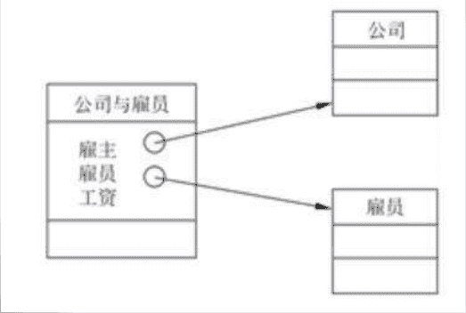

图11.10 用对象实现关联

## 11.11 设计优化

### 11.11.1 确定优先级

系统的各项质量指标并不是同等重要的，设计人员必须确定各项质量指标的**相对重要性**（即确定优先级），以便在优化设计时制定**折衷方案**。

### 11.11.2 提高效率的几项技术

1. 增加冗余关联以提高访问效率
2. 调整查询次序
3. 保留派生属性


图11.11 公司、雇员及技能之间的关联链


图11.12 为雇员技能数据库建立索引

### 11.11.3 调整继承关系

在面向对象设计过程中，建立良好的**继承关系**是优化设计的一项重要内容。

继承关系能够为一个类族定义一个协议，并能在类之间实现代码共享以减少冗余。

**与建立类继承有关的问题：**

1. 抽象与具体

   在设计类继承时，很少使用纯粹自顶向下的方法。通常的作法是，首先创建一些满足具体用途的类，然后对它们进行归纳，一旦归纳出一些通用的类以后，往往可以根据需要再派生出具体类。

   在进行了一些具体化（即专门化）的工作之后，也许就应该再次归纳了。对于某些类继承来说，这是一个持续不断的演化过程。

2. 为提高继承程度而修改类定义

   如果在一组相似的类中存在公共的属性和公共的行为，则可以把这些公共的属性和行为抽取出来放在一个共同的祖先类中，供其子类继承，如图11.13(a)和(b)所示。

   在对现有类进行归纳的时候，要注意下述两点：（1）不能违背领域知识和常识；（2）应该确保现有类的协议（即同外部世界的接口）不变。


## 11.11 设计优化

### 3. 利用委托实现行为共享

- 仅当存在真实的一般—特殊关系（即子类确实是父类的一种特殊形式）时，利用继承机制实现行为共享才是合理的。
- 如果只想把继承作为实现操作共享的一种手段，则利用委托（即把一类对象作为另一类对象的属性，从而在两类对象间建立组合关系）也可以达到同样目的，而且这种方法更安全。
- 使用委托机制时，**只有有意义的操作才委托另一类对象实现**，因此，不会发生不慎继承了无意义（甚至有害）操作的问题。

图11.14 用表实现栈的两种方法

(a) 用继承实现；(b) 用委托实现

# 软件工程导论

梁文新
办公室：综合楼105
电话：87571625
liang@computer.org

# 第12章 面向对象实现

- 目前，**软件测试**仍然是保证软件可靠性的主要措施，对于面向对象的软件来说，情况也是如此。
- 面向对象测试的**目标**，也是用尽可能低的测试成本和尽可能少的测试方案，发现尽可能多的错误。
- 面向对象程序中特有的**封装、继承和多态**等机制，也给面向对象测试带来一些新特点，增加了测试和调试的难度。
- 必须通过实践，努力探索适合于面向对象软件的更好的测试方法。

# 第12章 面向对象实现

- 12.1 程序设计语言
- 12.2 程序设计风格
- 12.3 测试策略
- 12.4 设计测试用例
- 12.5 小结

# 12.1 程序设计语言

## 12.1.1 面向对象语言的优点

选择编程语言的关键因素，是语言的一致的表达能力、可重用性及可维护性。

从面向对象观点看来，能够更完整、更准确地表达问题域语义的面向对象语言的语法是非常重要的，因为这会带来下述几个重要优点。

# 12.1 程序设计语言

## 1. 一致的表示方法

- 问题域——OOA——OOD——OOP
- 一致的表示方法既有利于在软件开发过程中始终使用统一的概念，也有利于维护人员理解软件的各种配置成份。

## 2. 可重用性

- 既可以重用某个问题域内的OOA结果，也可能重用相应的OOD和OOP结果。

## 3. 可维护性

- 维护人员最终面对的往往只有源程序本身。因此，程序显式地表达问题域语义，对维护人员理解待维护的软件有很大帮助。

# 12.1 程序设计语言

# 面向对象语言的发展历史

- 20世纪60年代，Norwegian Computing Center的Kristen Nygaard（1926-2002）和Ole-Johan Dahl（1931-2002）开发了首次引入对象、类及继承等基本概念的Simula67语言。
- 20世纪70年代，由美国国防部（DoD）资助开发的Ada语言，以它对抽象数据类型的支持，而在面向对象语言发展中占有重要地位。

> Simula 67 和Ada被看作是OOPL的两个直接“祖先”，一个引入“模拟”，一个引入“抽象”。

# 12.1 程序设计语言

# 12.1.2 面向对象语言的技术特点

- **纯面向对象语言**着重支持面向对象方法研究和快速原型的实现，而**混合型面向对象语言**的目标则是提高运行速度和使传统程序员容易接受面向对象思想。
- 成熟的面向对象语言通常都提供**丰富的类库**和**强有力的开发环境**。

# 12.1.2 面向对象语言的技术特点

1. 支持类与对象概念的机制
   - 允许动态创建对象
   - 内存管理：自动回收“垃圾”；编写释放内存代码(C++ destructor)

2. 实现整体—部分结构的机制
   - 可以使用指针和独立的关联对象实现整体-部分结构

3. 实现一般—特殊结构的机制
   - 继承和解决名字冲突(多重继承)的机制

4. 实现属性（实例链接、可见性、属性值约束）和服务（消息连接、可见性、动态联编）的机制

5. 类型检查
   - 弱类型：仅要求每个变量或属性隶属于一个对象（smalltalk）
   - 强类型：每个变量和属性必须准确的属于某个特定的类(C++, Eiffel)

# 12.1.2 面向对象语言的技术特点

6. 类库
   - 实现通用数据结构的包容类、实现各种关联的类、独立于具体设备的接口类、用户界面类→提高软件可重用性

7. 效率：使用类库提供的高效算法和好的数据结构

8. 持久保存对象
   - 使程序设计语言语法与对象存储管理语法无缝继承

9. 参数化类：使用一个或多个类型去参数化一个类

10. 开发环境
    - 编辑程序、编译程序或解释程序、浏览工具和调试器

# 12.1.3 选择面向对象语言

开发人员在选择面向对象语言时，还应该着重考虑以下一些实际因素：

1. 将来能否占主导地位
2. 可重用性
3. 类库和开发环境
4. 其他因素

培训服务、技术支持、开发平台、性能要求、集成已有软件的难易程度

# 12.1.3 选择面向对象语言

- 良好的程序设计风格对面向对象实现来说尤其重要，不仅能明显减少**维护或扩充的开销**，而且有助于在新项目中**重用**已有的程序代码。
- 良好的面向对象程序设计风格，既包括**传统的程序设计风格**准则，也包括**为适应面向对象方法**所特有的概念（例如，继承性）而必须遵循的一些新准则。
- 好的程序设计风格应：**提高可重用性、提高可扩充性、提高健壮性**

# 12.2 程序设计风格

# 12.2.1 提高可重用性

- 面向对象方法一个主要目标，就是提高软件的可重用性。
- 软件重用有多个层次，在编码阶段主要考虑代码重用的问题。
- 代码重用有两种
- 内部重用：本项目内的代码重用；外部重用：新项目重用旧项目的代码
- 内部重用主要是找出设计中相同或相似的部分，然后利用继承机制共享它们。
- 为做到外部重用(即一个项目重用另一项目的代码)，必须有长远眼光，需要反复考虑精心设计。

# 12.2.1 提高可重用性

1. 提高方法的内聚
   - 一个方法仅完成单一功能
2. 减小方法的规模：
   - 用简短的代码实现方法
3. 保持方法的一致性
   - 一致的名称、参数特征（个数、类型、次序）、返回值类型、使用条件、出错条件等

# 12.2.1 提高可重用性

## 4. 把策略与实现分开

- 策略(strategy)方法:负责做出决策，提供全局资源管理，检查系统运行状态、处理出错情况
- 实现(implementation)方法:负责实现算法（自含式），完成具体操作
- 为提高可重用性，在编程时不要把策略和实现放在同一个方法中，应该把算法的核心部分放在一个单独的具体实现方法中。
- 为此需要从策略方法中提取出具体参数，作为调用实现方法的变元。

# 12.2.1 提高可重用性

5. 全面覆盖：方法应覆盖所有输入条件的组合；除处理正常值外，对空值、极限值和边界值等异常情况也能处理
6. 尽量不使用全局信息：即降低该方法与外界的耦合程度
7. 利用继承机制：在OOP中，使用继承机制是实现共享和提高重用程度的主要途径。
   - （1）调用子过程
   - （2）分解因子
   - （3）使用委托
   - （4）把代码封装在类中

图12.2 通过因子分解实现代码重用

# 12.2.2 提高可扩充性

1. **封装实现策略**
   - 应将类的实现策略（属性的数据结构、修改属性的算法等）封装起来，对外只提供公共接口，便于将来修改
2. **不要用一个方法遍历多条关联链**
   - 一个方法应仅对应对象模型中有限的关联，避免出现过于复杂的方法
3. **避免使用多分支语句**
   - 避免使用 `DO_CASE` 语句来根据对象类型选择方法
4. **精心确定公有方法**

# 12.2.3 提高健壮性

- 健壮性指系统在硬件故障、输入无效数据或操作错误等异常情况下系统能做出适当响应的程度。
- 通常需要在健壮性与效率之间做出适当的折衷。必须认识到，对于任何一个实用软件来说，健壮性都是不可忽略的质量指标。
- 为提高健壮性应该遵守以下几条准则。
1. 预防用户的操作错误：允许用户犯错，但应自我保护、检查处理
2. 检查参数的合法性：用户往往违反公有方法参数的约束条件
3. 不要预先确定限制条件：使用动态内存分配机制
4. 先测试后优化：先测试性能再进行有侧重性的提高效率的优化


## 12.3 测试策略

- 测试计算机软件的经典策略：“小型测试” → “大型测试”
- 用软件测试专业术语来说，就是从单元测试开始，逐步进入集成测试，最后进行确认测试和系统测试。
- 对于传统软件系统，单元测试集中测试最小的可编译的程序单元（过程模块），一旦把这些单元都测试完后，就把它们集成到程序结构中去，与此同时应该进行一系列的回归测试，以发现模块接口错误和新单元加入到程序中所带来的副作用。
- 最后，把系统作为一个整体来测试，以发现软件需求中的错误。
- 测试面向对象软件的策略，与上述策略基本相同，但也有许多新特点。

### 12.3.1 面向对象的单元测试

OO Unit Testing又可称为Class Testing

最小的可测试单元是封装起来的类和对象。一个类可以包含一组不同的操作，而一个特定的操作也可能存在于一组不同的类中。因此，对于面向对象的软件来说，单元测试的含义发生了很大变化。

不能再孤立地测试单个操作，而应该把操作作为类的一部分来测试。

- 传统的单元测试是针对程序的函数、过程或完成某一定功能的程序块。OOT沿用单元测试的概念，实际测试类成员函数。
- 一些传统的测试方法在面向对象的单元测试中都可以使用。如等价类划分法，因果图法，边值分析法，逻辑覆盖法，路径分析法，等等。单元测试一般建议由程序员完成。
- 面向对象编程的特性使得对成员函数的测试，不完全等同于传统的函数或过程测试。尤其是继承特性和多态特性，使子类继承或过载的父类成员函数出现了传统测试中未遇见的问题。Brian Marick 给出了二方面的考虑：

#### 1. 继承的成员函数是否都不需要测试？

- 对父类中已经测试过的成员函数，有两种情况需要在子类中重新测试：a）继承的成员函数在子类中做了改动；b）成员函数调用了改动过的成员函数的部分。
- 例如：假设父类Base有两个成员函数：Inherited()和Redefined()，子类Derived只对Redefined()做了改动。Derived::Redefined()显然需要重新测试。对于Derived::Inherited()，如果它有调用Redefined()的语句(如：x=x/Redefined())，就需要重新测试，反之，无此必要。

#### 2. 对父类的测试是否能照搬到子类？

- 援用上面的假设，`Base::Redefined()`和`Derived::Redefined()`已经是不同的成员函数，它们有不同的服务说明和执行。
- 对此，照理应该对 `Derived::Redefined()`重新测试分析，设计测试用例。
- 但由于面向对象的继承使得两个函数有相似，故只需在 `Base::Redefined()`的测试要求和测试用例上添加对`Derived::Redfined()`新的测试要求和增补相应的测试用例。

#### 2. 例如：

Base::Redefined()含有如下语句  
If (value<0) message ("less");  
else if (value==0) message ("equal");  
else message ("more");  
Derived::Redefined()中定义为  
If (value<0) message ("less");  
else if (value==0) message ("It is equal");  
else  
{message ("more");  
if (value==88)message("luck");}

在原有的测试上，对Derived::Redefined()的测试只需做如下改动：  
将value==0的测试结果期望改动；增加value==88的测试。

### 12.3.2 面向对象的集成测试

- 传统的集成测试，指由底向上或自顶向下通过集成完成的功能模块进行的测试，一般可以在部分程序编译完成的情况下进行。
- 对于面向对象程序，相互调用的功能是散布在程序的不同类中，类通过消息相互作用来申请和提供服务。类的行为与它的状态密切相关，状态不仅仅是体现在类数据成员的值，也许还包括其他类中的状态信息。由此可见，类相互依赖极其紧密，根本无法在编译不完全的程序上对类进行测试。面向对象的集成测试通常需要在整个程序编译完成后进行。
- 面向对象程序具有动态特性，程序的控制流往往无法确定，因此也只能对整个编译后的程序做基于黑盒子的集成测试。

面向对象软件的集成测试有两种不同的策略。

1. 基于线程的测试(thread-based testing): 把响应系统的一个输入或一个事件所需要的一组类集成起来。分别集成并测试每个线程，同时应用回归测试以保证没有产生副作用。

2. 基于使用的测试(use-based testing)：首先测试几乎不使用服务器类的那些类(称为独立类)，接下来测试使用独立类的下一个层次的类(称为依赖类)。对依赖类的测试一个层次一个层次地持续进行下去，直至把整个软件系统构造完为止。

集群测试(cluster testing)是面向对象软件集成测试的一个步骤：用精心设计的测试用例检查一群相互协作的类(通过研究对象模型可以确定协作类)，这些测试用例试图发现协作错误。

### 12.3.3 面向对象的确认测试

通过单元测试和集成测试，仅能保证软件开发的功能得以实现。但不能确认在实际运行时，它是否满足用户的需要，是否大量存在实际使用条件下会被诱发产生错误的隐患。为此，对完成开发的软件必须经过规范的确认/系统测试。

系统测试应该尽量搭建与用户实际使用环境相同的测试平台，应该保证被测系统的完整性，对临时没有的系统设备部件，也应有相应的模拟手段。系统测试时，应该参考OOA的结果，对应描述的对象、属性和各种服务，检测软件是否能够完全“再现”问题空间。

系统测试不仅是检测软件的整体行为表现，从另一个侧面看，也是对软件开发设计的再确认。

在确认测试或系统测试层次，不再考虑类之间相互连接的细节。和传统的确认测试一样，面向对象软件的确认测试也集中检查用户可见的动作和用户可识别的输出。为了导出确认测试用例，测试人员应该认真研究动态模型和描述系统行为的脚本，以确定最可能发现用户交互需求错误的情景。

当然，传统的黑盒测试方法也可用于设计确认测试用例，但是，对于面向对象的软件来说，主要还是根据动态模型和描述系统行为的脚本来设计确认测试用例。

- 功能测试：测试是否满足开发要求，是否能够提供设计所描述的功能，是否用户的需求都得到满足。功能测试是系统测试最常用和必须的测试，通常还会以正式的软件说明书为测试标准。
- 强度测试：测试系统的能力最高实际限度，即软件在一些超负荷的情况，功能实现情况。如要求软件某一行为的大量重复、输入大量的数据或大数值数据、对数据库大量复杂的查询等。
- **性能测试：** 测试软件的运行性能。这种测试常常与强度测试结合进行，需要事先对被测软件提出性能指标，如传输连接的最长时限、传输的错误率、计算的精度、记录的精度、响应的时限和恢复时限等。
- **安全测试：** 验证安装在系统内的保护机构确实能够对系统进行保护，使之不受各种非常情况的干扰。安全测试时需要设计一些测试用例试图突破系统的安全保密措施，检验系统是否有安全保密的漏洞。
- 恢复测试：采用人工的干扰使软件出错，中断使用，检测系统的恢复能力，特别是通讯系统。恢复测试时，应该参考性能测试的相关测试指标。
- 可用性测试：测试用户是否能够满意使用。具体体现为操作是否方便，用户界面是否友好等。
- 安装/卸载测试（install/uninstall test）

## 12.4 设计测试用例

#### 12.4.1 测试类的方法

前面已经讲过，软件测试从“小型”测试开始，逐步过渡到“大型”测试。对面向对象的软件来说，小型测试着重测试单个类和类中封装的方法。

测试单个类的方法主要有，随机测试、划分测试和基于故障的测试等三种。

#### 1. 随机测试(random testing)

- 下面通过银行应用系统的例子，简要说明这种测试方法。
- 该系统的account(账户)类有下列操作：open(打开)，setup(建立)，deposit(存款)，withdraw(取款)，balance(余额)，summarize(清单)，creditLimit(透支限额)和close(关闭)。
- 上列每个操作都可以应用于account类的实例，但是，该系统的性质也对操作的应用施加了一些限制，例如，必须在应用其他操作之前先打开账户，在完成了全部操作之后才能关闭账户。
- 即使有这些限制，可做的操作也有许多种排列方法。一个account类实例的最小行为历史包括：open·setup·deposit·withdraw·close


## 12.4 设计测试用例

这就是对account类的最小测试序列。但是，在下面的序列中可能发生许多其他行为：

- open·setup·deposit·（deposit | withdraw | balance | summarize | creditLimit）·"withdraw·close

从上列序列可以随机产生一系列不同的操作序列，如：

- #r1:open·setup·deposit·deposit·balance·summarize·withdraw·close
- #r2:open·setup·deposit·withdraw·deposit·balance·creditLimit·withdraw·close

执行上述这些及另外一些随机产生的测试用例，可以测试类实例的不同生存历史。

## 2. 划分测试(partition testing)

- 与测试传统软件时采用等价划分方法类似，采用划分测试方法可以减少测试类时所需要的测试用例的数量。
- 首先，把输入和输出分类，然后设计测试用例以测试划分出的每个类别。下面介绍划分类别的方法。

## （2）基于属性的划分

这种方法根据类操作使用的属性来划分类操作。对于account类来说，可以使用属性balance来定义划分，从而把操作划分成三个类别：

- 使用balance的操作：balance, summarize
- 修改balance的操作：deposit, withdraw
- 不使用也不修改balance的操作：creditLimit

然后，为每个类别设计测试序列。

## （3）基于功能的划分

- 这种方法根据类操作所完成的功能来划分类操作。对于account类来说，可以分类为
- 初始化操作(open, setup)
- 计算操作(deposit, withdraw)
- 查询操作(balance, summarize, creditLimit)
- 终止操作(close)
- 然后，为每个类别设计测试序列。

## 3. 基于故障的测试(fault-based testing)

- 基于故障的测试与传统的错误推测法类似，也是首先推测软件中可能有的错误，然后设计出最可能发现这些错误的测试用例。
- 例如，软件工程师经常在问题的边界处犯错误，因此，在测试SQRT(计算平方根)操作(该操作在输入为负数时返回出错信息)时，应该着重检查边界情况：一个接近零的负数和零本身。
- 其中“零本身”用于检查程序员是否犯了如下错误：

- 把语句if(x>=0)calculate-square-root();
- 误写成if(x>0)calculate-square-root();
- 为了推测出软件中可能有的错误，应该仔细研究分析模型和设计模型，而且在很大程度上要依靠测试人员的经验和直觉。
- 如果推测得比较准确，则使用基于故障的测试方法能够用相当低的工作量发现大量错误；反之，如果推测不准，则这种方法的效果并不比随机测试技术的效果好。

## 12.4.2 集成测试方法

- 开始集成面向对象系统以后，测试用例的设计变得更加复杂。在这个测试阶段，必须对类间协作进行测试。
- 为了举例说明设计类间测试用例的方法，扩充12.4.1小节引入的银行系统的例子，使它包含图12.3所示的类和协作。

图中箭头方向代表消息的传递方向，箭头线上的标注给出了作为由消息所蕴含的协作的结果而调用的操作。

图12.3 银行系统的类—协作图

## 1. 多类测试

- Kirani和Tsai建议使用下列步骤，以生成多个类的随机测试用例。
- 对每个客户类，使用类操作符列表来生成一系列随机测试序列。这些操作符向服务器类实例发送消息。
- 对所生成的每个消息，确定协作类和在服务器对象中的对应操作符。
- 对服务器对象中的每个操作符(已经被来自客户对象的消息调用)，确定传递的消息。
- 对每个消息，确定下一层被调用的操作符，并把这些操作符结合进测试序列中。

- 考虑Bank类相对于ATM类（见图12.3）的操作序列：
- `verifyAcct·verifyPIN·[（verifyPolicy·withdrawReq）depositReqAcctInfoREQ]ⁿ`
- 对Bank类的随机测试用例可能是：
  - 测试用例#r3：`verifyAcct verifyPIN depositReq`

为了考虑在上述这个测试中涉及的协作者，需要考虑与测试用例#r3中的每个操作相关联的消息。Bank必须和ValidationInfo协作以执行verifyAcct和verifyPIN，Bank还必须和Account协作以执行depositReq。因此，测试上面提到的协作的新测试用例是：

- 测试用例#r4:verifyAcctBank
  - `[validAcctValidationInfo]` · `verifyPINBank`
  - `[validPINvalidationInfo]` · `depositReq` · `[depositaccount]`

多个类的划分测试方法类似于单个类的划分测试方法(见12.4.1节)。  
但是，对于多类测试来说，应该扩充测试序列以包括那些通过发送给协作类的消息而被调用的操作。

另一种划分测试方法，根据与特定类的接口来划分类操作。如图12.3所示，Bank类接收来自ATM类和Cashier类的消息，因此，可以通过把Bank类中的方法划分成服务于ATM的和服务于Cashier的两类来测试它们。

## 2. 从动态模型导出测试用例

在本书第9章中已经讲过，怎样用状态转换图作为表示类的动态行为模型。

类的状态图可以帮助导出测试该类(及与其协作的那些类)的动态行为的测试用例。

图12.4给出了前面讨论过的account类的状态图，从图可见，初始转换经过了empty acct和setup acct这两个状态，而类实例的大多数行为发生在working acct状态中，最终的withdraw和close使得account类分别向nonworking acct状态和dead acct状态转换。

图 12.4 account类的状态转换图

- 设计出的测试用例应该**覆盖所有状态**，也就是说，操作序列应该使得account类实例**遍历**所有允许的状态转换：
  - 测试用例
    - `$s1:open·setupAccnt·deposit(initial)·withdraw(final)·close`

应该注意，上面列出的序列与12.4.1节讨论的最小测试序列相同。向最小序列中加入附加的测试序列，可以得出其他测试用例：

- 测试用例
  - `#s2:open·setupAccnt·deposit(initial)·deposit·balance·credit·withdraw(final)·close`

- 测试用例
  - `#s3:open·setupAccnt·deposit(initial)·deposit·withdraw·accntInfo·withdraw(final)·close`

还可以导出更多测试用例，以保证该类的所有行为都被适当地测试了。在类的行为导致与一个或多个类协作的情况下，使用多个状态图去跟踪系统的行为流。

软件工程导论

梁文新
办公室：综合楼105
电话：87571625
liang@computer.org

# 第13章 软件项目管理

- 软件项目失败的主要原因是因为**管理不善**。
- 所谓**管理**就是通过**计划、组织和控制**等一系列活动，合理地配置和使用各种资源，以达到既定目标的过程。
- **软件项目管理（Software Project Management）**先于任何技术活动之前开始，并且贯穿于软件的整个生命周期之中。
- 目的：在一定的时间和预设范围内，有效地利用人力、资源、技术和工具，使软件系统或软件产品按原定计划和质量要求如期完成。


# 第13章 软件项目管理

## 13.1 估算软件规模

### 13.1.1 代码行技术

- 代码行技术是比较简单的定量估算软件规模的方法。这种方法根据以往开发类似产品的经验和历史数据，估计实现一个功能需要的源程序行数。

- 当有以往开发类似项目的历史数据可供参考时，用这种方法估计出的数据还是比较准确的。

- 把实现每个功能需要的源程序行数累加起来，就得到实现整个软件需要的源程序行数。

### 优点：

- 代码是所有软件开发项目都有的“产品”

- 很容易计算代码行数

### 缺点

- 源程序仅是软件配置的一个成分

- 不同语言实现同一个软件所需要的代码行数并不相同

- 不适用于非过程语言

### 13.1.2 功能点技术

- Developed by Allan Albrecht, IBM, 1979

- 功能点技术根据对**软件信息域特性**和**软件复杂性**的评估结果，估算软件规模。这种方法用功能点（Function Point）为单位，度量软件的规模。

#### 1. 信息域特性

- 功能点技术定义了信息域的**5个特性**，分别是输入项数（Inp）、输出项数（Out）、查询数（Inq）、主文件数（Maf）和外部接口数（Inf）。

#### 2. 估算功能点的步骤

用下述三个步骤，可以估算出一个软件的功能点数（即软件规模）。

（1）计算**未调整**的功能点数UFP（Unadjusted Function Points）

- 首先，把产品信息域的每个特性（即Inp、Out、Inq、Maf和Inf）都分类成简单级（simple）、平均级（average）或复杂级（complex）。根据其等级，为每个特性都分配一个功能点数。

- 然后，用下式计算未调整的功能点数UFP  
  UFP=a₁×Inp+a₂×Out+a₃×Inq+a₄×Maf+a₅×Inf。其中，  
  aᵢ（1≤i≤5）是信息域特性系数，其值由相应特性的**复杂级别**决定。

**表 13.1 信息域特性系数值**

| 特性系数 | 简单 | 平均 | 复杂 |
|---|---:|---:|---:|
| 输入系数 a₁ | 3 | 4 | 6 |
| 输出系数 a₂ | 4 | 5 | 7 |
| 查询系数 a₃ | 3 | 4 | 6 |
| 文件系数 a₄ | 7 | 10 | 15 |
| 接口系数 a₅ | 5 | 7 | 10 |

### 示例

- 某学院安装了一个工资系统，人事处要求创建一个子系统来分析每门课程的人力资源成本。

- 要求该子系统提供查询每门课程人力资源成本的功能。每名教师所得工资的细节可以通过工资系统中的文件得到，教师花在教每门课上的小时数可通过一个基于计算机的计时表系统中的文件得到。

- 该子系统将计算结果存放到由总会计系统读取的一个文件中，并产生一个报告，来显示每名教师每门课的课时数及这些课时数相应的成本。

- 问题：假设子系统产生的报告复杂度为高，其它所有元素的复杂度均为平均，计算该子系统的 UFP

| 功能计数项 | 计数 | 复杂度权重 |
|---|---|---|
| 外部输入 | 无 | |
| 外部输出 | 报告 1 | 7 |
| 外部查询 | 1 | 4 |
| 外部接口文件 | 工资文件 1，计时表文件 1，计算结果文件 1 | 7 |
| 内部文件 | 无 | |

UFP=1×7+1×4+3×7=32

**表 13.2 技术因素**

| 序号 | Fᵢ | 技术因素 |
|---:|:---:|---|
| 1 | F₁ | 数据通信 |
| 2 | F₂ | 分布式数据处理 |
| 3 | F₃ | 性能标准 |
| 4 | F₄ | 高负荷的硬件 |
| 5 | F₅ | 高处理率 |
| 6 | F₆ | 联机数据输入 |
| 7 | F₇ | 终端用户效率 |
| 8 | F₈ | 联机更新 |
| 9 | F₉ | 复杂的计算 |
| 10 | F₁₀ | 可重用性 |
| 11 | F₁₁ | 安装方便 |
| 12 | F₁₂ | 操作方便 |
| 13 | F₁₃ | 可移植性 |
| 14 | F₁₄ | 可维护性 |

#### （3）计算功能点数FP

- 功能点数FP由下式计算：

  FP=UFP（未调整的功能点数）×TCF（技术复杂性因子）

- 功能点数与所用的编程语言无关，因此，功能点技术比代码行技术更合理一些。但是，在判断信息域特性复杂级别及技术因素的影响程度时，存在相当大的主观因素。

生产率 = FP / PM （人月）  
质量 = 错误数 / FP  
成本 = 元 / FP  
文档 = 文档页数 / FP

### 示例

| 案例中技术复杂度影响因素的取值 | | | | | |
|---|---|---|---|---|---|
| F1 | 可靠的备份和恢复 | 1 | F2 | 数据通信 | 5 |
| F3 | 分布式函数 | 0 | F4 | 性能 | 3 |
| F5 | 大量使用的配置 | 1 | F6 | 联机数据输入 | 0 |
| F7 | 操作简单性 | 1 | F8 | 在线升级 | 0 |
| F9 | 复杂界面 | 1 | F10 | 复杂数据处理 | 4 |
| F11 | 重复使用性 | 0 | F12 | 安装简易性 | 3 |
| F13 | 多重站点 | 0 | F14 | 易于修改 | 3 |

sum(Fi)=22，TCF=0.65+0.01(sum(Fi))=0.65+0.01×22=0.87  
该子系统的功能点为：FP=UFP×TCF=32×0.87=27.8

## 13.2 工作量估算

计算机软件估算模型使用由经验导出的公式来预测软件开发的工作量，工作量是软件规模（LOC或FP）的函数，工作量的单位通常是人月（pm）。

支持大多数估算模型的经验数据，都是从有限个项目的样本集中总结出来的，因此，没有一个估算模型能够适用于所有类型的软件和开发环境。

### 13.2.1 静态单变量模型

- 这类模型的总体结构形式如下：

  E=A+B×（ev）<sup>C</sup>

- 其中，A、B和C是由经验数据导出的常数，E是以人月为单位的工作量，ev是估算变量（LOC或FP）。

- 此外，大多数模型都有某种形式的调整成分，使得E能够依据项目的其他特性（例如，问题的复杂程度、开发人员的经验、开发环境等）加以调整。

### 2. 面向FP的估算模型

#### 1. Albrecht & Gaffney模型

- E=-13.39+0.0545FP

#### 2. Kemerer模型

- E=60.62×7.728×10<sup>-8</sup>FP<sup>3</sup>

#### 3. Maston、Barnett和Mellichamp模型

- E=585.7+5.12FP


## 13.2 工作量估算

### 13.2.2 动态多变量模型

- 动态多变量模型也称为软件方程式(software equation)，它是根据从4000多个当代软件项目中收集的生产率数据推导出来的。
- 这种模型把工作量看作是软件规模和开发时间这两个变量的函数。

动态多变量估算模型的形式如下：

E= (LOC×B<sup>0.333</sup>/P) <sup>3</sup>× (1/t) <sup>4</sup>

- 其中，E是以人月或人年为单位的工作量；
- t是以月或年为单位的项目持续时间；
- B是“特殊技术因子”(special skills factor)，它随着对集成、测试、质量保证、文档及管理技术的需求的增长而缓慢增加；

| B Value | Size of Project |
|---------|-----------------|
| 0.16    | 5-15K           |
| 0.18    | 20K             |
| 0.28    | 30K             |
| 0.34    | 40K             |
| 0.37    | 50K             |
| 0.39    | >70K            |

P是“生产率参数”（productivity parameter），它反映了下述因素对工作量的影响：

- 总体的过程成熟度及管理水平；
- 使用良好的软件工程实践的程度；
- 使用的程序设计语言的级别；
- 软件环境的状态；
- 软件项目组的技术及经验；
- 应用系统的复杂程度。

| P Value | Description |
|---|---|
| 2000 | Real time embedded system |
| 10000 | Telecommunications system |
| 12000 | Scientific software |
| 28000 | Business system applications |

应该注意，软件方程式有两个独立的变量：①对软件规模的估算值(用LOC表示)；②以月或年为单位的项目持续时间t。

从下式可以看出，开发同一个软件(即LOC固定)的时候，如果把项目持续时间延长一些，则可降低完成项目所需要的工作量。

E= {LOC×B⁰.³³³/P} ³× (1/t) ⁴

### 13.2.3 COCOMO II模型

- 所谓COCOMO模型就是B. Boehm提出的**构造性成本模型**（Constructive Cost Model），给出了3种层次结构（应用系统组成、早期设计、后体系结构）的软件估算模型。
- 后体系结构模型把软件开发工作量表示成代码行数（KLOC）的非线性函数：

$$E = a \times KLOC^b \times \prod_{i=1}^{17} f_i$$

其中E是开发工作量(以人月为单位)，a，b是模型系数，KLOC是估计的代码行数(以千行为单位)，f<sub>i</sub>(i=1到17)是成本因素。

每个成本因素都根据它的重要程度和影响大小赋予一定数值（Effort Adjustment Factor，EAF）。成本因素影响所有工程项目，即使不使用COCOMO II模型估算成本，也应该注意这些因素。可以把成本因素划分成产品因素、平台因素、人员因素和项目因素等。

### 表 13.3 成本因素及工作量系数

| 成本因素 | 级别 | | | | | |
| --- | --- | --- | --- | --- | --- | --- |
| | 甚低 | 低 | 正常 | 高 | 甚高 | 特高 |
| 产品因素 | | | | | | |
| 要求的可靠性 | 0.75 | 0.88 | 1.00 | 1.15 | 1.39 | |
| 数据库规模 | | 0.93 | 1.00 | 1.09 | 1.19 | |
| 产品复杂程度 | 0.75 | 0.88 | 1.00 | 1.15 | 1.30 | 1.66 |
| 要求的可重用性 | | 0.91 | 1.00 | 1.14 | 1.29 | 1.49 |
| 需要的文档量 | 0.89 | 0.95 | 1.00 | 1.06 | 1.13 | |
| 平台因素 | | | | | | |
| 执行时间约束 | | | 1.00 | 1.11 | 1.31 | 1.67 |
| 主存约束 | | | 1.00 | 1.06 | 1.21 | 1.57 |
| 平台变动 | | 0.87 | 1.00 | 1.15 | 1.30 | |
| 人员因素 | | | | | | |
| 分析员能力 | 1.50 | 1.22 | 1.00 | 0.83 | 0.67 | |
| 程序员能力 | 1.37 | 1.16 | 1.00 | 0.87 | 0.74 | |
| 应用领域经验 | 1.22 | 1.10 | 1.00 | 0.89 | 0.81 | |
| 平台经验 | 1.24 | 1.10 | 1.00 | 0.92 | 0.84 | |
| 语言和工具经验 | 1.25 | 1.12 | 1.00 | 0.88 | 0.81 | |
| 人员连续性 | 1.24 | 1.10 | 1.00 | 0.92 | 0.84 | |
| 项目因素 | | | | | | |
| 使用软件工具 | 1.24 | 1.12 | 1.00 | 0.86 | 0.72 | |
| 多地点开发 | 1.25 | 1.10 | 1.00 | 0.92 | 0.84 | 0.78 |
| 要求的开发进度 | 1.29 | 1.10 | 1.00 | 1.00 | 1.00 | |

## 13.3 进度计划

- 项目管理者的目标是定义全部项目任务，识别出关键任务，跟踪关键任务的进展状况，以保证能及时发现拖延进度的情况。为了做到这一点，管理者必须制定一个足够详细的进度表，以便监督项目进度，并控制整个项目。
- 软件项目的进度安排是一项活动，它通过把工作量分配给特定的软件工程任务，并规定完成各项任务的起、止日期，从而将估算的工作量分布于计划好的项目持续期内。

### 13.3.1 估算开发时间

- 成本估计模型也同时提供了估算开发时间T的方程。T为开发工作量的函数（P. 312-313）。
- 软件的开发时间同从事开发工作的人数之间并不是简单的反比关系。
- 向一个已经延期的项目增加人力，只会使得它更延期。
- 软件项目的开发时间最多可以减少到正常开发时间的75%。

### 13.3.2 Gantt图(Gantt Chart)

Gantt图(甘特图)是历史悠久、应用广泛的进度计划工具，下面通过一个非常简单的例子介绍这种工具。

假设有一座陈旧的矩形木板房需要重新刷漆。这项工作必须分3步完成：首先刮掉旧漆，然后刷上新漆，最后清除溅在窗户上的油漆。假设一共分配了15名工人去完成这项工作，然而工具却很有限：只有5把刮旧漆用的刮板，5把刷漆用的刷子，5把清除溅在窗户上的油漆用的小刮刀。怎样安排才能使工作进行得更有效呢？

假设木板房的第2、4两面墙的长度比1、3两面墙的长度长一倍，不同工作需要用的时间也不同，如下表所示：

#### 表 13.5 各道工序估计需用的时间(小时)

| 墙壁 工序 | 刷旧漆 | 刷新漆 | 清理 |
|---|---|---|---|
| 1 或 3 | 2 | 3 | 1 |
| 2 或 4 | 4 | 6 | 2 |

如果不做优化，按照工序先刷旧漆，然后刷新漆、清理，一共需要36小时。

当把一个工程项目分解成许多子任务，并且它们彼此间的依赖关系又比较复杂时，仅仅用Gantt图作为安排进度的工具是不够的，不仅难于做出既节省资源又保证进度的计划，而且还容易发生差错。

工程网络是制定进度计划时另一种常用的图形工具，它同样能描绘任务分解情况以及每项作业的开始时间和结束时间，此外，它还显式地描绘各个作业彼此间的依赖关系。因此，工程网络是系统分析和系统设计的强有力的工具。

在工程网络中用**箭头表示作业**（例如，刮旧漆，刷新漆，清理等），用**圆圈表示事件**（一项作业开始或结束）。

注意，事件仅仅是可以明确定义的时间点，它并不消耗时间和资源。作业通常既消耗资源又需要持续一定时间。

图13.2是旧木板房刷漆工程的工程网络。图中表示刮第1面墙上旧漆的作业开始于事件1，结束于事件2。用**开始事件和结束事件的编号**标识一个作业，因此“刮第1面墙上旧漆”是作业1—2。


## 13.3 进度计划

- 在图13.2中还有一些虚线箭头，它们表示**虚拟作业（dummy activities）**，也就是事实上并不存在的作业。引入虚拟作业是为了显式地表示作业之间的**依赖关系**。
- 例如，事件4既是给第1面墙刷新漆结束，又是给第2面墙刷新漆开始（作业4—6）。但是，在开始给第2面墙刷新漆之前，不仅必须已经给第1面墙刷完了新漆，而且第2面墙上的旧漆也必须已经刮净（事件3）。也就是说，在事件3和事件4之间有依赖关系，或者说在作业2—3（刮第2面墙上旧漆）和作业4—6（给第2面墙刷新漆）之间有依赖关系，虚拟作业3—4明确地表示了这种依赖关系。
- 注意，虚拟作业既不消耗资源也不需要时间。

### 13.3.4 估算工程进度

画出类似图13.2那样的工程网络之后，系统分析员就可以借助它的帮助估算工程进度了。为此需要在工程网络上增加一些必要的信息。

首先，把每个作业估计需要使用的时间写在表示该项作业的箭头上方。注意，箭头长度和它代表的作业持续时间没有关系，箭头仅表示依赖关系，它上方的数字才表示作业的持续时间。

其次，为每个事件计算下述两个统计数字：最早时刻EET和最迟时刻LET。这两个数字将分别写在表示事件的圆圈的右上角和右下角，如图13.3左下角的符号所示。

- 事件的最早时刻EET是该事件可以发生的最早时间。
- 通常工程网络中第一个事件的最早时刻定义为零，其他事件的最早时刻在工程网络上从左至右按事件发生顺序计算。
- 计算最早时刻EET使用下述三条简单规则：
  - 考虑进入该事件的所有作业；
  - 对于每个作业都计算它的持续时间与起始事件的EET之和；
  - 选取上述和数中的最大值作为该事件的最早时刻EET。

- 事件的最迟时刻是在不影响工程竣工时间的前提下，该事件最晚可以发生的时刻。
- 按惯例，最后一个事件（工程结束）的最迟时刻就是它的最早时刻。其他事件的最迟时刻在工程网络上从右至左按逆作业流的方向计算。
- 计算最迟时刻LET使用下述三条规则：
  - 考虑离开该事件的所有作业；
  - 从每个作业的结束事件的最迟时刻中减去该作业的持续时间；
  - 选取上述差数中的最小值做为该事件的最迟时刻LET。

### 13.3.5 关键路径

- 图13.3中有几个事件的最早时刻和最迟时刻相同，这些事件定义了关键路径，在图中关键路径用粗线箭头表示。
- 关键路径上的事件（关键事件）必须**准时发生**，组成关键路径的作业（关键作业）的实际持续时间**不能超过估计的持续时间**，否则工程就不能准时结束。

| 作业    | LET(结束) | EET(开始) | 持续时间 | 机动时间 |
|---|---|---|---|---|
| 2—4    | 6    | 2    | 3    | 1    |
| 3—5    | 11    | 6    | 2    | 3    |
| 4—7    | 18    | 6    | 1    | 11    |
| 5—6    | 12    | 8    | 0    | 4    |
| 5—8    | 15    | 8    | 4    | 3    |
| 6—7    | 18    | 12    | 0    | 6    |
| 7—9    | 20    | 12    | 2    | 6    |
| 8—9    | 20    | 15    | 0    | 5    |
| 9—10    | 21    | 15    | 1    | 5    |

- 在工程网络中每个作业的机动时间写在代表该项作业的箭头下面的括弧里（参看图13.3）。
- 在制定进度计划时仔细考虑和利用工程网络中的机动时间，往往能够安排出既节省资源又不影响最终竣工时间的进度表。


图13.4 旧木板房刷漆工程改进的Gantt图之一（只需要两组工人）

## 13.4 人员组织

必须把多名软件开发人员合理地组织起来，使他们有效地分工协作共同完成开发任务。

管理者应该合理地组织项目组，使项目组有较高生产率，能够按预定的进度计划完成所承担的工作。

现有的软件项目组的组织方式很多，通常，组织软件开发人员的方法，取决于所承担的项目的特点、以往的组织经验以及管理者的看法和喜好。

下面介绍3种典型的组织方式。

### 13.4.1 民主制程序员组(Democratic Team)

- Described by Weinberg, 1971
- 民主制程序员组的一个重要特点是，小组成员完全平等，享有充分民主，通过协商做出技术决策。因此，小组成员间的通信是平行的，如果一个小组有n个成员，则可能的通信信道有n(n-1)/2条。
- 一般来说，程序设计小组的规模应该比较小，以2～8名成员为宜。如果项目规模很大，用一个小组不能在预定时间内完成开发任务，则应该使用多个程序设计小组，每个小组承担工程项目的一部分任务，在一定程度上独立自主地完成各自的任务。
- 必须改变评价程序员价值的标准，每名程序员都应该鼓励该组其他成员找出自己编写的代码中的错误。
- 不要认为存在错误是坏事，而应该认为是正常的事情，应该把找出模块中的一个错误看作是取得了一个胜利。任何人都不能嘲笑程序员所犯的编码错误。
- 程序员组作为一个整体，将培养一种平等的团队精神，坚信“每个模块都是属于整个程序员组的，而不是属于某个人的”。一组无私的程序员将构成一个民主制程序员组。
- 小组规模小，不仅可以减少通信问题，而且还有其他好处。例如，容易确定小组的质量标准，而且用民主方式确定的标准更容易被大家遵守；组员间关系密切，能够互相学习等。
- 民主制程序员组通常采用**非正式的组织方式**，也就是说，虽然名义上有一个组长，但是他和组内其他成员完成同样的任务。在这样的小组中，由全体讨论决定应该完成的工作，并且根据每个人的能力和经验分配适当的任务。

### 13.4.2 主程序员组(chief programmer team)

- 美国IBM公司在1971年(New York Times Project)开始采用主程序员组的组织方式。采用这种组织方式主要出于下述几点考虑：
  - 软件开发人员多数比较缺乏经验；
  - 程序设计过程中有许多事务性的工作，例如，大量信息的存储和更新；
  - 多渠道通信很费时间，将降低程序员的生产率。

一个典型的主程序员组如图13.5所示。该组由主程序员（chief programmer）、后备程序员（backup programmer）、编程秘书（programmer）以及1～3名程序员（programmer）组成。在必要的时候，该组还有其他领域的专家（例如，法律专家，财务专家等）协助。


主程序员组的结构

由于程序员组的成员人数不宜过多，当软件项目规模较大时，应该把程序员分成若干个小组，采用图13.7所示的组织结构。

该图描绘的是技术管理组织的结构，非技术管理组织的结构与此类似。

由图可以看出，产品的实现作为一个整体是在项目经理的指导下进行的，程序员向他们的组长汇报工作，而组长向项目经理汇报工作。

当产品规模更大时，可以增加中间管理层次。


图13.7 大型项目的技术管理组织结构

把民主制程序员组和主程序员组的优点结合起来的另一种方法，是在合适的地方采用 **分散做决定（decentralized decision-making）** 的方法，如图13.8所示。

这样做有利于形成 **畅通的通信渠道**，以便充分发挥每个程序员的积极性和主动性，集思广益攻克技术难关。

这种组织方式对于 **适合采用民主方法** 的那类问题（例如，研究性项目或遇到技术难题需要用集体智慧攻关）非常有效。


## 13.4 人员组织-现代程序员组

图13.8 包含分散决策的组织方式

## 13.4 人员组织

### 其他组织方式（略）

- Synchronize-and-Stabilize Teams
- Microsoft, 1997
- Products consist of 3 or 4 sequential builds
- Small parallel teams
- 3 to 8 developers
- 3 to 8 testers (work one-to-one with developers)
- The team is given the overall task specification
- They may design the task as they wish
- XP(eXtreme Programming) Teams
- Beck, 2000

| Team Organization | Strengths | Weaknesses |
|---|---|---|
| **Democratic teams**<br>(Section 4.2) | High-quality code as a consequence of positive attitude to finding faults<br>Particularly good with hard problems | Experienced staff resent their code being appraised by beginners<br>Cannot be externally imposed |
| **Classical chief programmer teams**<br>(Section 4.3) | Major success of *New York Times* project | Impractical |
| **Modified chief programmer teams**<br>(Section 4.3.1) | Many successes | No successes comparable to the *New York Times* project |
| **Modern hierarchical programming teams**<br>(Section 4.4) | Team manager/team leader structure obviates need for chief programmer<br>Scales up<br>Supports decentralization when needed | Problems can arise unless areas of responsibility of the team manager and the team leader are clearly delineated |
| **Synchronize-and-stabilize teams**<br>(Section 4.5) | Encourage creativity<br>Ensures that a huge number of developers can work toward a common goal | No evidence so far that this method can be utilized outside Microsoft |
| **Extreme programming teams**<br>(Section 4.6) | Programmers do not test their own code<br>Knowledge is not lost if one programmer leaves<br>Less-experienced programmers can learn from others<br>Group ownership of code | Still too little evidence regarding efficacy |

## 13.5 质量保证

### 13.5.1 软件质量

质量是产品的生命，不论生产什么产品，质量都是极端重要的。软件产品开发周期长，耗费巨大的人力和物力，更必须特别注意保证质量。

概括地说，软件质量就是“软件与明确地和隐含地定义的需求相一致的程度”。更具体地说，软件质量是软件符合明确地叙述的功能和性能需求、文档中明确描述的开发标准、以及所有专业开发的软件都应具有的隐含特征的程度。

上述定义强调了下述的三个要点。

1. 软件需求是度量软件质量的基础，与需求不一致就是质量不高。
2. 指定的标准定义了一组指导软件开发的准则，如果没有遵守这些准则，几乎肯定会导致质量不高。
3. 通常，有一组没有显式描述的隐含需求（例如，期望软件是容易维护的）。如果软件满足明确描述的需求，但却不满足隐含的需求，那么软件的质量仍然是值得怀疑的。

影响软件质量的主要因素

可以把这些质量因素划分成三组，它们分别反映用户在使用软件产品时的三种不同倾向或观点。

这三种倾向是：产品运行(product operation)，产品修改(product revision)和产品转移(product transition)。图13.9描绘了软件质量因素和上述三种倾向(或称为产品活动)之间的关系，表13.7给出了软件质量因素的简明定义。

可理解性（我能理解它么？）  
可维护性（我能修复它么？）  
灵活性（我能改变它么？）  
可测试性（我能测试它么？）

可移植性（我能在另外一台机器上使用它么？）  
可再用性（我能再用它的某些部分么？）  
互运行性（我能把它和另一个系统结合么？）

产品修改 产品转移 产品运行

正确性（它安装我的要求工作么？）  
健壮性（对意外环境它能适当地响应么？）  
效率（完成预定功能时它需要的计算机资源多么？）  
可用性（我能使用它么？）  
风险（能安装预定计划完成它么？）


### 表 13.7 软件质量因素的定义

| 质量因素 | 定义 |
|---|---|
| 正确性 | 系统满足规格说明和用户目标的程度，即，在预定环境下能正确地完成预期功能的程度 |
| 健壮性 | 在硬件发生故障、输入的数据无效或操作错误等意外环境下，系统能做出适当响应的程度 |
| 效率 | 为了完成预定的功能，系统需要的计算资源的多少 |
| 完整性（安全性） | 对未经授权的人使用软件或数据的企图，系统能够控制（禁止）的程度 |
| 可用性 | 系统在完成预定应该完成的功能时令人满意的程度 |
| 风险 | 按预定的成本和进度把系统开发出来，并且为用户所满意的概率 |
| 可理解性 | 理解和使用该系统的容易程度 |
| 可维修性 | 诊断和改正在运行现场发现的错误所需要的工作量的大小 |
| 灵活性（适应性） | 修改或改进正在运行的系统需要的工作量的多少 |
| 可测试性 | 软件容易测试的程度 |
| 可移植性 | 把程序从一种硬件配置和（或）软件系统环境转移到另一种配置和环境时，需要的工作量多少。有一定量度量的方法是：用原来程序设计和调试的成本除移植时需用的费用 |
| 可再用性 | 在其他应用中该程序可以被再次使用的程度（或范围） |
| 互运行性 | 把该系统和另一个系统结合起来需要的工作量的多少 |

### 13.5.2 软件质量保证措施

**软件质量保证**（Software Quality Assurance，通常缩写为SQA）的措施主要有，基于非执行的测试（**复审/评审**）、基于执行的测试（**测试**）和**程序正确性证明**。

#### 1. 技术复审的必要性

正式技术复审的明显优点是，能够较早地发现错误，防止错误被传播到软件过程的后续阶段。

正式技术复审实际上是一类复审方法，包括走查（Walkthrough）和审查（Inspection）等具体方法。走查的步骤比审查少，而且没有审查那样正规。

### 3. 审查

审查的范围要比走查广泛得多，它的步骤也比较多。一般来说，审查有5个基本步骤。

综述：由负责编写文档的一名成员向审查组成员综述该文档。在综述会议结束时把文档分发给每位与会者。

准备：评审员仔细阅读文档。最好列出在审查中发现的错误的类型，并按发生频率把错误类型分级，以辅助审查工作的进行。这些列表有助于评审员们把注意力集中到最常发生错误的区域。


## 13.5 质量保证

- **审查：** 评审组仔细走查整个文档。和走查一样，这一步的目的也是找出文档中的错误，而不是改正它们。审查组组长必须在一天之内写出一份关于审查的报告。通常每次审查会不超过90分钟。
- **返工：** 文档的作者负责解决在书面报告中列出的所有错误及问题。
- **跟踪：** 组长必须确保提出的每个问题都得到圆满的解决（要么修正了文档，要么澄清了被误认为是错误的条目）。必须检查对文档所做的每个修正，以确保没有引入新的错误。如果在审查过程中返工量超过5%，则应该召集审查组再对文档全面地审查一遍。

| 开发阶段 | 检查项目 |
|---|---|
| 需求分析<br>需求分析 → 功能设计 → 实施计划 | ① 开发目的。<br>② 目标值。<br>③ 开发（程序、文档）。<br>④ 所需资源。<br>⑤ 各阶段的产品、作业内容。<br>⑥ 开发体制。<br>以上内容的合理性。 |
| 设计<br>结构设计 → 数据设计 → 过程设计 | ① 产品的量（计划量、实际量）。<br>② 评审量。<br>③ 差错数。<br>④ 检出差错的内容和倾向。<br>⑤ 评审方法、覆盖性。<br>⑥ 出错原因、处理情况及对该阶段的影响。<br>⑦ 评审结束、阶段结束的判断标准。 |
| 实现<br>程序编制 → 单元测试 → 组装测试 → 确认测试 | ① 产品的量（计划量、实际量）、目标值完成情况。<br>② 评审量。<br>③ 检出的差错数。<br>④ 计算机使用时间。<br>⑤ 出错原因、处理情况及对该阶段的影响。<br>⑥ 检出的差错内容及倾向。<br>⑦ 评审方法、覆盖性。<br>⑧ 测试环境。<br>⑨ 测试项目设定种类、测试用例设计方法。<br>⑩ 评审结束、阶段结束的判断标准。 |
| 验收<br>检查、评价 | ① 说明书检查——检查与被检查程序有关的用户文档等。<br>② 程序检查——为了评价和保证程序质量，通过各种测试测试成品进行检查。 |
| 运行维护<br>运行、维护 | ① 掌握用户使用产品的质量情况，并反馈到开发部门。 |

## 13.5 质量保证

### 4. 程序正确性证明

- 正确性证明的基本思想是证明程序能完成预定功能。因此，应该提供对程序功能的严格数学说明，然后根据程序代码证明程序确实能实现它的功能说明。
- 如果在程序的若干个点上，设计者可以提出关于程序变量及它们的关系的断言，那么在每一点上的断言都应该永远是真的。
- 假设在程序的P₁，P₂，...，Pₙ等点上的断言分别是a(1)，a(2)，...，a(n)，其中a(1)必须是关于程序输入的断言，a(n)必须是关于程序输出的断言。
- 为了证明在点 Pᵢ 和 Pᵢ₊₁ 之间的程序语句是正确的，必须证明执行这些语句之后将使断言 a(i) 变成 a(i+1)。
- 如果对程序内所有相邻点都能完成上述证明过程，则证明了输入断言加上程序可以导出输出断言。
- 如果输入断言和输出断言是正确的，而且程序确实是可以终止的（不包含死循环），则上述过程就证明了程序的正确性。

## 13.6 软件配置管理

- 在开发计算机软件的过程中，**变化（或称为变动）是不可避免的**。如果不能适当地控制和管理变化，势必造成混乱并产生许多严重的错误。
- 软件配置管理（Software Configuration Management）是在计算机软件整个生命周期内**管理变化**的一组活动。具体地说，这组活动用来：①标识变化；②控制变化；③确保适当地实现了变化；④向需要知道这方面信息的人报告变化。
- 软件配置管理不同于软件维护。维护是在软件交付给用户使用后才发生的，而软件配置管理是在软件项目启动时就开始，并且一直持续到软件退役后才终止的一组跟踪和控制活动。
- 软件配置管理的目标是，使变化更容易被适应，并且在必须变化时减少所需花费的工作量。

### 13.6.1 软件配置（software configuration）

#### 1. 软件配置项

- 软件过程的 **输出信息** 可以分为三类：①计算机程序（源代码和可执行程序）；②描述计算机程序的文档（供技术人员或用户使用）；③数据（程序内包含的或在程序外的）。
- 上述这些项组成了在软件过程中产生的全部信息，把它们统称为**软件配置**，而这些项就是软件配置项。
- 可以把**软件配置管理**看作是应用于整个软件过程的软件质量保证活动，是专门用于管理和改化的**软件质量保证活动**。

#### 2. 基线(baseline)

- 基线是一个软件配置管理概念，它有助于在不严重妨碍合理变化的前提下来控制变化。IEEE把基线定义为：
  - 已经通过了正式复审的规格说明或中间产品，它可以作为进一步开发的基础，并且只有通过正式的变化控制过程才能改变它。
- 简而言之，基线就是通过了正式复审的软件配置项。在软件配置项变成基线之前，可以迅速而非正式地修改它。一旦建立了基线之后，虽然仍然可以实现变化，但是，必须应用特定的、正式的过程(称为规程)来评估、实现和验证每个变化。

软件开发各阶段的基线


#### 1. 标识软件配置中的对象

为了控制和管理软件配置项，必须单独命名每个配置项，然后用面向对象方法组织它们。

可以标识出两类对象： 基本对象和聚集对象（可以把聚集对象作为代表软件配置完整版本的一种机制）。

每个对象都有一组能惟一地标识它的特征： 名字、描述、资源表和 “实现” 。其中，对象名是无二义性地标识该对象的一个字符串。

#### 2. 版本控制（version control）

- **版本控制**联合使用规程和工具，以管理在软件工程过程中所创建的配置对象的不同版本。借助于版本控制技术，用户能够通过选择适当的版本来指定软件系统的配置。
- 实现这个目标的方法是，把**属性**和**软件的每个版本**关联起来，然后通过描述一组所期望的属性来指定和构造所需要的配置。
- “属性”，既可以简单到仅是赋给每个对象的特定版本号，也可以复杂到是一个布尔变量串（开关），该布尔变量串指明了施加到系统上的功能变化的特定类型。

#### 3. 变化控制(change control)

- 对于大型软件开发项目来说，无控制的变化将迅速导致混乱。变化控制把人的规程和自动工具结合起来，以提供一个控制变化的机制。
- 变化控制过程如图所示。


#### 4. 配置审计（configuration review）

为确保适当地实现了所需要的变化，从两方面采取措施：
① 正式的技术复审； ② 软件配置审计。

- 正式的技术复审（见13.5.2节）关注被修改后的配置对象的技术正确性。复审者评估该配置对象以确定它与其他软件配置项的一致性，并检查是否有遗漏或副作用。
- 软件配置审计通过评估配置对象的那些通常不在复审过程中考虑的特征，而成为对正式技术复审的补充。

#### 5. 状态报告(status accounting)

- 配置状态报告是软件配置管理的一项任务，它回答下述问题：
  ①发生了什么事？
  ②谁做的这件事？
  ③这件事是什么时候发生的？
  ④它将影响哪些其他事物？

| 文档 | 阶段 | 可行性研究与计划 | 需求分析 | 软件设计 | 编码与单元测试 | 集成与测试 | 运行维护 | 管理人员 | 开发人员 | 维护人员 | 用户 |
|---|---|---|---|---|---|---|---|---|---|---|---|
| 可行性研究报告 | | → | | | | | | ■ | ■ | | |
| 项目开发计划 | | | → | | | | | ■ | ■ | | |
| 软件需求规格说明 | | | → | | | | | | ■ | | |
| 数据要求规格说明 | | | → | | | | | | ■ | | |
| 测试计划 | | | | → | | | | | ■ | | |
| 概要设计规格说明 | | | | → | | | | | ■ | ■ | |
| 详细设计规格说明 | | | | → | | | | | ■ | ■ | |
| 用户手册 | | | → | | → | | | | | | ■ |
| 操作手册 | | | | → | → | | | | | | ■ |
| 测试分析报告 | | | | | | → | | | ■ | ■ | |
| 开发进度月报 | → | | | | | → | | ■ | | | |
| 项目开发总结 | | | | | | → | | ■ | | | |
| 程序维护手册（维护修改建议） | | | | | | | → | ■ | | ■ | |


## 能力成熟度模型CMM

- 卡耐基-梅隆大学SEI从1986年起开始研究CMM-SW（Capability Maturity Model for Software）
- 其目的在于提供一种评价软件承接方能力的方法
- 同时，也可用于帮助软件组织改进其软件过程

## CMM的结构

- 成熟度表明一个软件组织的过程能力的水平
- 每个成熟度等级都包含特定的KPA（关键过程域）
- 要达到某个成熟度等级，必须满足该级别及比其低的级别的所有KPA

## 13.7 能力成熟度模型

是指对过程计划或定义水平、过程实施水平、过程管理和控制水平、过程改善潜力等指标的综合评价。

评估软件过程时遵循的原则

- 在很大程度上，软件产品的质量取决于生产该产品的过程质量。
- 软件过程是一个可管理、可测量和可改进的过程。
- 软件过程的质量受其支持技术的影响。
- 用于软件工程的技术水平应与过程的成熟度相适应。

分为 5 级：初始级、可重复级、可定义级、可管理级、可优化级。

## 风险管理

- 软件开发几乎总会存在某些风险。对付风险应该采取主动的策略，早在技术工作开始之前就应该启动**风险管理活动**：标识出潜在的风险，评估它们出现的概率和影响，并且按重要性把风险排序，软件项目组制定一个计划来管理风险。
- 风险管理的主要目标是**预防风险**，但并非所有风险都能预防，因此项目组还必须制定一个**处理意外事件的计划**，以便一旦风险变成现实时能够以可控的和有效的方式作出反应。

## 风险管理

- 软件风险分类
- 风险有两个显著特点。
  - **不确定性**：标志风险的事件可能发生也可能不发生，也就是说，没有100%发生的风险（100%发生的风险是施加在软件项目上的约束）。
  - **损失**：如果风险变成了现实，就会造成不好的后果或损失。

1. 按照风险的影响范围分类
   - 项目风险
   - 技术风险
   - 商业风险

## 风险管理

### 2. 按照风险的可预测性分类

- 已知风险
- 可预测的风险
- 不可预测的风险

## 风险管理

- 风险识别

- 通过识别已知的和可预测的风险，项目管理者就朝着在可能时避免风险并且在必要时控制风险的目标迈出了第一步。

- 每一类风险又可进一步分成两种类型：一般性风险和特定产品的风险。

- 一般性风险对每个软件项目都是潜在的威胁。特定产品的风险只有那些对当前项目的技术、人员、及环境非常了解的人才能识别出来。为了识别出特定产品的风险，必须检查项目计划和软件范围说明，并且回答下述问题：“本项目有什么特殊的性质可能会威胁我们的项目计划”。

## 风险管理

事实上，“如果你不主动地攻击风险，风险将主动地攻击你”。因此，应该系统化地识别出一般性风险和特定产品的风险。

采用建立**风险条目检查表**的方法，人们可以集中精力识别下列已知的和可预测的风险。

- **产品规模**——与要开发或要修改的软件总体规模相关的风险。
- **商业影响**——与管理或市场所施加的约束相关的风险。
- **客户特性**——与客户素质以及开发者和客户定期通信的能力相关的风险。

## 风险管理

- **过程定义**—与软件过程已被定义的程度以及软件开发组织遵守软件过程的程度相关的风险。
- **开发环境**—与用来开发产品的工具的可用性和质量相关的风险。
- **所用技术**—与待开发系统的复杂性及系统所包含的技术的“新奇性”相关的风险。
- **人员数目与经验**—与参加工作的软件工程师的总体技术水平及项目经验相关的风险。

## 风险管理

### 风险预测

风险预测（也称为风险估算）试图从两个方面来评估每个风险：风险变成现实的可能性或概率，以及当风险变成现实所造成的后果。

### 评估风险后果

美国空军建议从性能、支持、成本和进度等四个方面评估风险的后果，他们把上述四个方面称为四个风险因素。下面给出这四个风险因素的定义。

- **性能风险**——产品能满足需求且符合其使用目的的不确定程度。
- **成本风险**——能够维持项目预算的不确定程度。

## 风险管理

- 支持风险——软件易于改错、适应和增强的不确定程度。
- 进度风险——能够实现项目进度计划且产品能按时交付的不确定程度。

- 根据风险发生时对上述四个风险因素影响的严重程度，可以把风险后果划分成四个等级：可忽略的、轻微的、严重的和灾难性的。

- 下表给出了由于软件中潜伏的错误所造成的各种后果的特点（由表中标为“1”的行描述），或由于没有达到预期的结果所造成的各种后果的特点（由表中标为“2”的行描述）。

- 按照实际后果与表中描述的特点的吻合程度，可以把风险后果划分成四个等级中的某一个。

## 风险管理

### 2. 建立风险表

建立风险表是一种简单的风险预测技术。

表 12.2 排序前的风险表

| 风险 | 类别 | 概率 | 影响 |
|---|---|---:|---:|
| 规模估算可能很不准确 | PS | 60% | 2 |
| 用户数目超出计划 | PS | 30% | 3 |
| 重用程度低于计划 | PS | 70% | 2 |
| 终端用户抵制该系统 | BU | 40% | 3 |
| 交付日期将要求提前 | BU | 50% | 2 |
| 资金将流失 | CU | 40% | 1 |
| 客户将改变需求 | CU | 80% | 2 |
| 技术达不到预期的水平 | TE | 30% | 1 |
| 缺少关于工具的培训 | DE | 80% | 3 |
| 人员缺乏经验 | ST | 30% | 2 |
| 人员流动频繁 | ST | 60% | 2 |

## 风险管理

- 表中第4列给出风险后果的整体等级值，其中，1代表灾难性的，2代表严重的，3代表轻微的，4代表可忽略。

- 一旦填好了风险表前4列的内容，就应该根据概率和影响来排序。**高概率、高影响的风险放在表的上方**，而低概率的风险放在表的下方，这样就完成了**第一次风险排序**。

- 项目管理者研究排好序的风险表，**并确定一条中止线**。该中止线是经过表中某一点的水平直线，它的含义是，只有位于线的上方的那些风险才会得到进一步的关注。对于处于线下方的风险要再次评估，以完成第二次排序。

## 风险管理

- 从管理的角度看，风险影响和风险概率的作用是不同的。对一个具有**高影响但发生概率很低**的风险因素，不应该花费太多管理时间。但是，高影响且发生概率为中到高的风险，以及低影响且高概率的风险，应该进入风险管理的下一个步骤。
- 应该在软件项目进展的过程中，迭代使用上述的风险预测与分析技术。项目组应该定期复查风险表，再次评估每个风险，以确定新情况是否引起它的概率和影响发生变化。
- 作为这项活动的结果，可能在表中添加了一些新风险，删除了某些与项目不再有关系的风险，并且改变了表中风险的相对位置。

## 风险管理

### 处理风险的策略

- 对于绝大多数软件项目来说，上述的4个风险因素（性能、成本、支持和进度）都有一个临界值，超过临界值就会导致项目被迫终止。也就是说，如果性能下降、成本超支、支持困难或进度延迟（或这4种因素的组合）超过了预先定义的限度，则因风险过大项目将被迫终止。

- 如果风险还没有严重到迫使项目终止的程度，则项目组应该制定一个处理风险的策略。

- 一个有效的策略应该包括下述三方面的内容：风险避免（或缓解）；风险监控；风险管理和意外事件计划。

## 思考题

- 假设有一项工程任务被分解成了a，b，...，i等9个子任务，完成每个子任务的时间及子任务之间的以来关系如表所示。请用工程网络描述表中给出的信息，并且计算每个时间的最早时刻和最迟时刻。

| 子任务标识 | 完成任务时间 | 依赖关系 |
|------------|--------------|----------|
| a | 8 | |
| b | 10 | |
| c | 8 | a, b |
| d | 9 | a |
| e | 5 | b |
| f | 3 | c, d |
| g | 2 | d |
| h | 4 | f, g |
| i | 3 | e, f |


# 软件工程导论
总复习

梁文新  
办公室：综合楼105  
电话：87571625  
wxliang@dlut.edu.cn  

## 考试方式与题型

- 考试时间：2018年1月11日 10:05-11:45  
- 考试方式：**闭卷**  
- 题型及分数：  
  - 单选题（20×2分=40分）  
    - **一定要在答题表中作答，否则不得分**  
  - 简答题（2×10分+2×5分=30分）  
  - 分析题（2×15分=30分）  

## Chap. 2 可行性分析

- 可行性分析包括哪几个方面  
- 可行性分析的基本过程  
- 系统流程图  
- 数据流图的概念和基本要素  
- 分层绘制数据流图  
- 数据字典的概念及基本功能  

## Chap. 3 需求分析

- 需求分析的任务  
- 获取需求的方法  
- 需求分析的过程及三种模型  
- 需求规格说明书及其主要内容  
- 实体-关系图  
- 状态转换图  
- 层次方框图、Warnier图和IPO图  

## Chap. 4 形式化技术

- 了解有穷状态机的基本概念和方法  
- 了解Petri网的基本概念和方法  
- 了解Z语言的基本概念和方法  

## Chap. 5 总体设计/概要设计

- 总体设计的过程  
- 模块化的基本概念和原理  
- 模块化设计的主要优点  
- 模块独立性的概念及衡量标准  
  - 各种耦合和内聚的概念及对独立性的影响  
- 概要设计的各种启发规则  
- 概要设计中描绘软件结构的图形工具  
- 面向数据流的设计方法（数据流图 → 软件结构图）  

## Chap. 6 详细设计

- 结构化程序设计的概念  
- 过程设计的工具  
  - 流程图、盒图，PAD图，伪码  
    - 能够根据其中任何之一画出另外的任一种图来  
  - 能根据条件描述绘制判定表、判定树  
- Jackson图及面向数据结构的设计  
- McCabe和Halstead方法  
  - 能根据源程序、流程图、盒图，PAD图或伪码绘制出流图  
  - 3种环形复杂度的计算方法  

## Chap. 7 编码与测试

- 了解程序设计语言选择方法及编码风格  
- 软件测试的定义、目的  
- 各种测试方法的概念、步骤及与生命周期各阶段的关系  
  - 单元测试、集成测试（含回归测试）、系统测试、验收测试  
- 白盒测试技术  
  - 基本概念  
  - 各种逻辑覆盖测试的概念和测试用例设计  
  - 基本路径测试和测试用例设计  
- 黑盒测试技术  
  - 基本概念  
  - 等价划分法、边界值分析等测试技术  
- 评估软件可靠性的各种参数  
  - 平均无故障时间、估计错误总数（植入错误法、分别测试法）  

## Chap. 8 软件维护

- 了解软件维护定义、分类及重要性  
- 了解软件维护的过程  
- 了解决定软件可维护性的因素  
- 了解软件再工程的概念和过程  

## Chap. 9 -12 面向对象方法学

- 面向对象方法学的要点和优点  
- 面向对象的基本概念  
- 面向对象分析和设计的基本原理、方法和启发式规则  
- 对象模型的五个层次  
- UML各种图的概念、特点和语法  
- 熟练掌握用UML进行面向对象建模  

- 功能模型-用例图  
- 对象模型-类图  
  - 识别并确定类  
  - 确定类之间的关系：关联、聚集（共享/复合）、泛化/继承、依赖等  
  - 定义类的属性和操作（可见性）  
- 动态模型-交互图及行为图  
  - 编制脚本、绘制顺序图、状态图、活动图等  

## OO设计原则与设计模式

- 各种OO设计原则的基本概念  
- 代表性的设计模式  
  - Factory Method、Abstract Factory、Singleton、Adapter、Observer、Composite等  

## Chap. 13 软件项目管理

- 软件项目管理的概念和过程  
- 软件规模和工作量的估算模型和方法  
  - 代码行、功能点、COCOMO模型  
- 了解甘特图和工程网络的基本概念和方法  
  - 了解甘特图和工程网络制定进度计划的方法  
- 了解人员组织、质量保证、软件配置管理及能力成熟度模型的基本概念和方法  

## 作业回顾

1、建立下述牙科诊所管理系统的对象模型：

王大夫在小镇上开了一家牙科诊所。他有一个牙科助手、一个牙科保健员和一个接待员。王大夫需要一个软件系统来管理预约。

当病人打电话预约时，接待员将查阅预约登记表，如果病人申请的就诊时间与已经定下的预约时间冲突，则接待员建议一个就诊时间以安排病人尽早得到诊治。如果病人同意建议的就诊时间，接待员将输入约定时间和病人的名字。系统将核实病人的名字并提供记录的病人数据，数据包括病人的病历号等。在每次治疗或清洗后，助手或保健员将标记相应的预约诊治已经完成，如果有必要的话会安排病人下一次再来。

系统能够按照病人名字和日期进行查询，能够显示记录的病人数据和预约信息。接待员可以取消预约，可以打印出前两天预约尚未就诊的病人清单。系统可以从病人记录中获得病人的电话号码。接待员还可以打印出关于所有病人的每天和每周工作安排。

## 提取初步候选对象

1、建立下述牙科诊所管理系统的对象模型：

王大夫在小镇上开了一家牙科诊所。他有一个牙科助手、一个牙科保健员和一个接待员。王大夫需要一个软件系统来管理预约。

当病人打电话预约时，接待员将查阅预约登记表，如果病人申请的就诊时间与已经定下的预约时间冲突，则接待员建议一个就诊时间以安排病人尽早得到诊治。如果病人同意建议的就诊时间，接待员将输入约定时间和病人的名字。系统将核实病人的名字并提供记录的病人数据，数据包括病人的病历号等。在每次治疗或清洗后，助手或保健员将标记相应的预约诊治已经完成，如果有必要的话会安排病人下一次再来。

系统能够按照病人名字和日期进行查询，能够显示记录的病人数据和预约信息。接待员可以取消预约，可以打印出前两天预约尚未就诊的病人清单。系统可以从病人记录中获得病人的电话号码。接待员还可以打印出关于所有病人的每天和每周工作安排。

## 确定对象和关联

- 对象：牙科诊所、病人、病人记录、预约、预约登记表、病人清单、每天工作安排、每周工作安排  
- 对象间联系：  
  - 泛化关系：工作安排  
  - 关联关系：牙科诊所诊治多名病人；病人有病人记录；病人可以预约；牙科诊所可以打印病人清单；牙科诊所有多份预约登记表；预约登记表记录了多位病人的预约；根据预约登记表可以安排工作安排。  

## 建立类图

### 1、牙科诊所对象模型


## 建立用例图

### 2、建立上述牙科诊所管理系统的用例模型


## 编写脚本

4、写出上述牙科诊所管理系统的脚本

（1）正常情况

- 病人甲请求预约  
- 系统识别出病人的名字  
- 系统建议一个就诊时间  
- 病人同意该时间，接待员输入该预约  
- 在预约的就诊日期到来之前两天，系统输出一份包含病人姓名和电话号码等信息的提醒清单  
- 接待员打电话提醒病人  
- 病人如约到来  
- 治疗完之后，牙医助手安排病人的下一次预约  

## 编写脚本

4、写出上述牙科诊所管理系统的脚本

（3）多个预约

- 病人两请将在未来两年内进行 16 次预约  
- 接待员将其姓名输入到系统中，系统提出建议的预约就诊时间  
- 病人同意后，接待员输入病人认可的预约  

## 画出状态图

5、画出上述牙科诊所管理系统的动态模型


## 统一建模语言UML

梁文新  
办公室：综合楼105  
电话：87571625  
liang@computer.org  


## UML的历史

面向对象分析与设计方法的发展在20世纪80年代末到90年代中出现了一个高潮，统一建模语言UML就是这个高潮的产物。

UML是由面向对象方法领域的 *Three Amigos*: James Rumbaugh、Ivar Jacobson和Grady Booch共同提出。

- 1991年由James Rumbaugh（1947–）等人提出了OMT（Object Modeling Technique）
- 1992年由Ivar Jacobson提出了OOSE（Object-Oriented Software Engineering）
- 1993年由Grady Booch（1955–）提出了Booch’s Method


1994年10月Jim Rumbaugh和Grady Booch共同合作把他们的OMT和Booch方法统一起来，到1995年成为“统一方法”（Unified Method）版本0.8。

随后，Ivar Jacobson加入，并采用他的用例（User case）思想。

最终由一个成立于1996年被称为UML Partners国际联盟统一了“三剑客”的记号系统，产生了UML版本0.9。


UML已经迅速成长为一个事实上的**工业标准**。

- 不论在计算机学术界、软件产业界还是在商业界，UML已经逐渐成为人们为各种系统建模、描述系统体系结构、商业体系结构和商业过程时使用的统一工具，而且在实践过程中人们还在不断扩展它的应用领域。
- 1996年底，UML已稳定占领OO技术市场的85%。

## UML的定义

UML是一种标准的图形化（即可视化）建模语言，它由图(diagram)和元模型(metamodel)组成。图是UML的语法，而元模型给出图的含义，即UML的语义(Semantics)。

### 1. UML的语义

UML的语义是定义在一个四层（四个抽象级别）元模型建模框架（meta-modeling architecture）中的，这四层分别是：

### Meta-modeling Architecture

上一层是下一层的基础，下一层是上一层的实例。

#### 1. M3: Meta-metamodel Level

- 由UML最基本的元素“事物(thing)”组成，代表要定义的所有事物。

元元模型示例

### Meta-modeling Architecture

#### 2. M2: Metamodel Level

- 由UML基本元素组成，包括面向对象和面向构件的概念。这一层的每个概念都是元元模型中“事物”概念的实例。

元模型示例

### Meta-modeling Architecture

#### 3. M1：User-defined Model

- 由UML模型组成，这一层的每个概念都是元模型中概念的实例。
- 这一层的模型通常称为类模型或类型模型。

用户定义模型实例

### Meta-modeling Architecture

#### 4. M0: Object Diagram/User Object Level

- 由UML模型的例子组成，这一层中的每个概念都是用戶定义模型层的一个实例，也是元模型层模型的一个实例。
- 这一层的模型通常称为对象模型或实例模型。

用户对象实例

## UML的表示法

UML由视图（views）、图（diagrams）、模型元素（model elements）和通用机制（general mechanism）等几个部分组成。

### 视图

- 每个视图是整个系统描述的一个投影，说明了系统的一个特殊侧面。
- 为了完整地描述一个系统，往往需要描述该系统的许多方面。用视图可以表示被建模系统的各个方面，即从不同目的出发可以为系统建立多个模型，这些模型都描述同一个系统，只是描述的角度不同，它们之间具有一致性。

## UML常用视图

### Design View
描述系统设计特征，包括结构模型视图和行为模型视图，前者描述系统的静态结构（类图、对象图），后者描述系统的动态行为（交互图、状态图、活动图）。

### Use Case View
描述系统的外部特性、系统功能等。

### Implementation View
表示系统的实现特征，常用构件图表示。

### Process View
表示系统内部的控制机制。常用类图描述过程结构，用交互图描述过程行为。

### Deployment View
配置视图描述系统的物理配置特征。用配置图表示。

## UML的表示法

### ② 图

- 图是用来表达一个视图的内容的，通常，一个视图由多张图组成。
- 一幅图包含了系统某一特殊方面的信息，阐明了系统的一个特定部分或方面。
- UML语言共定义了9种不同的图，把它们有机地结合起来就可以描述系统的所有视图。

## UML中的九种图

| 图名称 | 图定义 | 图性质 |
|---|---|---|
| 类图 | 一组类、接口、协作及它们的关系 | 静态图 |
| 对象图 | 一组对象及它们的关系 | 静态图 |
| 用例图 | 一组用例、参与者及它们的关系 | 静态图 |
| 顺序图 | 一个交互，强调消息的时间顺序 | 动态图 |
| 协作图 | 一个交互，强调消息发送和接受的对象的结构组织 | 动态图 |
| 状态图 | 一个状态机，强调对象按事件排序的行为 | 动态图 |
| 活动图 | 一个状态机，强调从活动到活动的流动 | 动态图 |
| 构件图 | 一组构件及关系 | 静态图 |
| 配置图（实施图） | 一组节点及它们的关系 | 静态图 |

## UML的表示法

### ③ 模型元素

- 可以在图中使用的概念（例如，用例、类、对象、包、构件等），统称为模型元素。模型元素在图中用相应的视图元素（图形符号）表示。
- 一个模型元素可以用在多个不同的图中，不管怎样使用，它总是具有相同的含义和相同的符号表示。

## 常用的模型元素

类
属性
操作

对象
属性
操作

状态

接口

用例

节点

构件

包

注释

## UML的图

### 1. 用例图 (use-case diagram)

- 用例是对系统提供的功能(即系统的具体用法)的描述。
- 用例图从**用户**的角度描述系统功能，并指出各个功能的操作者。
- 用例图用于需求获取和分析，定义了系统的**功能需求**。


## UML的图

### 静态图(static diagram)

- 这类图描述系统的静态结构，属于这类图的有类图(class diagram)和对象图(object diagram)。

- 类图不仅定义系统中的类，表示类与类之间的关系(例如，关联、依赖、泛化和细化等关系)，也表示类的内部结构(类的属性和操作)。

- 类图描述的是一种静态关系，在系统的整个生命期内都是有效的。对象图是类图的实例，它使用几乎与类图完全相同的图示符号。两者之间的差别在于，对象图表示的是类的多个对象实例，而不是实际的类。

- 由于对象有生命周期，因此对象图只能在系统的某个时间段内存在。

- 一般说来，对象图没有类图重要，它主要用来帮助对类图的理解，也可用在协作图中，表示一组对象之间的动态协作关系。


### 交互图 (interactive diagram)

- 这类图描述对象间的交互关系，包括**顺序图** (sequence diagram) 和**协作图** (collaboration diagram) 两种图形。
- 顺序图显示若干个**对象间的动态协作关系**，它强调对象之间发送消息的**先后次序**，描述对象之间的交互过程。
- 协作图与顺序图类似，也描述对象间的动态协作关系。除了显示对象间发送的消息之外，协作图还显示对象及它们之间的关系 (称为**上下文相关**)。
- 由于顺序图和协作图都描述对象间的交互关系，所以建模者可以选择其中一种表示对象间的协作关系：如果需要强调**时间和顺序**，最好选用顺序图；如果需要强调**上下文相关**，最好选择协作图。


### 5. 实现图(implementation diagram)

- 这类图提供关于系统实现方面的信息，构件图(component diagram)和配置图(deployment diagram)属于这类图。

- 构件图描述代码构件的物理结构及各个构件之间的依赖关系。构件可能是源代码、二进制文件或可执行文件。使用构件图有助于分析和理解构件之间的相互影响。

- 配置图定义系统中软件和硬件的物理体系结构。通常，配置图中显示实际的计算机和设备(用节点表示)，以及各个节点之间的连接关系，也可以显示连接的类型及构件之间的依赖关系。

- 在节点内部显示可执行的构件和对象，以清晰地表示出哪个软件单元运行在哪个节点上。


## UML的应用领域

- UML是一种建模语言，是一种**标准的表示方法**，而不是一种完整的方法学。

- 因此，人们可以用各种方法使用UML，无论采用何种方法，它们的基础都是UML的图，这就是UML的最终用途——为不同领域的人提供**统一的交流方法**。

- UML适用于系统开发的全过程，它的应用贯穿于**从需求分析到系统建成后测试**的各个阶段。


- 需求分析：可以用用例来捕获用户的需求。通过用例建模，可以描述对系统感兴趣的外部角色及其对系统的功能要求（用例）。

- 分析：分析阶段主要关心问题域中的基本概念（例如，抽象、类和对象等）和机制，需要识别这些类以及它们相互间的关系，可以用UML的逻辑视图和动态视图来描述。类图描述系统的静态结构，协作图、顺序图、活动图和状态图描述系统的动态行为。在这个阶段只为问题域的类建模，而不定义软件系统的解决方案细节（例如，处理用户接口、数据库、通信和并行性等问题的类）。


- 设计：把分析阶段的结果扩展成技术解决方案，加入新的类来定义软件系统的技术方案细节。设计阶段用和分析阶段类似的方式使用UML。

- 构造（编码）：这个阶段的任务是把来自设计阶段的类转换成某种面向对象程序设计语言的代码。

- 测试：对系统的测试通常分为单元测试、集成测试、系统测试和验收测试等几个不同步骤。UML模型可作为测试阶段的依据，不同测试小组使用不同的UML图作为工作的依据：

  - 单元测试使用类图和类规格说明；
  - 集成测试使用构件图和协作图；
  - 系统测试使用用例图来验证系统的行为；
  - 验收测试由用户进行，用与系统测试类似的方法，验证系统是否满足在分析阶段确定的所有需求。

UML适用于以面向对象方法来描述任何类型的系统，而且适用于系统开发的全过程，从需求规格描述直到系统建成后的测试和维护阶段。

## 静态建模机制

任何建模语言都以静态建模机制为基础，UML也不例外。UML的静态建模机制包括**用例图、类图、对象图和包（package）**等。

### 15.2.1 用例图

### 1. 用例模型(use case model)

用例模型描述的是外部执行者(actor)所理解的系统功能。用例模型用于需求分析阶段，它的建立是系统开发者和用户反复讨论的结果，描述了开发者和用户对需求规格达成的共识。

- 首先，描述了待开发系统的功能需求；
- 其次，把系统看作黑盒，从外部执行者的角度来理解系统；
- 第三，驱动了需求分析之后各阶段的开发工作，不仅在开发过程中保证了系统所有功能的实现，而且被用于验证和检测所开发的系统，从而影响到开发工作的各个阶段和UML的各个模型。

在UML中，一个用例模型由若干个用例图来描述，用例图的主要元素是系统、用例、用例之间的关系和执行者。

| Construct | Description | Syntax |
|---|---|---|
| **use case** | A sequence of actions, including variants, that a system (or other entity) can perform, interacting with actors of the system. | `UseCaseName`（椭圆） |
| **actor** | A coherent set of roles that users of use cases play when interacting with these use cases. | `ActorName`（小人图标） |
| **system boundary** | Represents the boundary between the physical system and the actors who interact with the physical system. | 矩形边界 |

### ① 系统 (system)

系统被看作一个提供用例的**黑盒子**。用方框表示。方框的边线用于表示系统的边界，划定了系统的功能范围、定义了系统所具有的功能。


# 自动售货机系统用例图

### ② 用例(use case)

一个用例实质上是用户与计算机系统之间的一次典型的交互作用，它代表的是系统的一个完整的功能。在UML中把用例定义成系统执行的一系列动作，动作的结果能被外部执行者察觉到。

在UML用例图中，用例表示为一个椭圆。例如一个自动售货机系统的用例图，其中“售货”、“供货”和“取货款”都是典型的用例。概括地说，用例有以下特点。

- 用例代表某些用户可见的功能，实现一个具体的用户目标。
- 用例由执行者激活，并提供确切的值给执行者。
- 用例可大可小，但它必须是对一个具体的用户目标实现的完整描述。


# 自动售货机系统用例图

### ③ 行为者(actor)

- 执行者是与系统交互的人或物，它代表外部实体，例如，用户、硬件设备或与本系统交互的另一个软件系统。使用用例并与系统交互的任何人或物都是执行者。
- 实践表明，执行者对确定用例是非常有用的。面对一个大型、复杂的系统，要列出用例清单往往很困难，这时可以**先列出执行者清单**，再针对每个执行者列出的用例。这样做可以使问题变得容易很多。


## 自动售货机系统

顾客

供货人

收银员

含扩展和使用关系的用例图


## 静态建模机制

## 2. 建立用例模型

几乎在任何情况下都需要使用用例，通过用例可以获取**用户需求**，规划和控制项目。

获取用例是需求分析阶段的主要工作之一，而且是首先要做的工作。大部分用例将在项目的需求分析阶段产生，并且随着开发工作的深入还会发现更多用例，这些新发现的用例都应及时补充进已有的用例集中。

用例集中的每个用例都是对系统的一个潜在的需求。


## 建立用例模型的过程

- 确定系统范围；
- 分析系统功能。

- 执行者通常是使用系统功能的外部用户或系统。
- 用例是一个子系统或系统的一个独立、完整功能。

- 各模型元素之间有：关联、使用、扩展及泛化等关系。

- 确认用例模型与用户需求的一致性，通常由用户与开发者共同完成。


## 确定用例

从本质上讲，一个用例是用户与计算机之间的一次典型交互作用。在UML中，用例被定义成系统执行的一系列动作（功能）。用例有以下特点：

- 用例实现一个具体的用户目标。
- 用例由执行者激活，并将结果值反馈给执行者。
- 用例必须具有功能上的完整描述。

### 如何确定用例：

1. 与系统实现有关的主要问题是什么？
2. 系统需要哪些输入/输出？这些输入/输出从何而来？到哪里去？
3. 执行者需要系统提供哪些功能？
4. 执行者是否需要对系统中的信息进行读、创建、修改、删除或存储？

## 确定用例间的关系


含有使用和扩展关系的用例图

## 应用举例

## 医院病房监护系统

### 一、问题描述

为了对危重病人进行实时监护，随时了解病人病情，及时进行处理，建立病房监护系统。

病症监视器安置在每个病床，通过网络将病人的病症信号（组合）实时传送到中央监护系统进行分析处理。

在中心值班室里，值班护士使用中央监护系统对病员的情况进行监控，监护系统实时地将病人的病症信号与标准的病诊信号进行比较分析，当病症出现异常时，系统会立即自动报警，并打印病情报告和更新病历。

系统根据医生的要求随时打印病人的病情报告，系统定期自动更新病历。


## 例2 医院病房监护系统


### 监视病情


### 产生病情报告


### 更新病历

经过初步的需求分析，得到系统功能要求：

1. 监视病员的病症（血压、体温、脉搏等）
2. 定时更新病历
3. 病员出现异常情况时报警。
4. 随时产生某一病员的病情报告。

### 二、简单的需求分析说明

对“医院病房监护系统”进行分析，确定系统的主要功能如下：

- 1. 病症监视器可以将采集到的病症信号（组合），格式化后实时的传送到中央监护系统。
- 2. 中央监护系统将病人的病症信号开解后与标准的病症信号库里的病症信号的正常值进行比较，当病症出现异常时系统自动报警。
- 3. 当病症信号异常时，系统自动更新病历并打印病情报告。
- 4. 值班护士可以查看病情报告并进行打印。
- 5. 医生可以查看病情报告，要求打印病情报告，也可以查看或要求打印病历。
- 6. 系统定期自动更新病历。


## 三、建立系统的用例模型

### 1. 通过以下六个问题识别角色

1. 谁使用系统的主要功能？ **值班护士、医生、病人**
2. 谁需要系统的支持以完成日常工作任务？ **值班护士、医生**
3. 谁负责维护，管理并保持系统正常运行？ **系统管理员**
4. 系统需要应付（或处理）哪些硬设备？ **监护器、网络、报警系统**
5. 系统需要和哪些外部系统交互？ **标准病症信号库、病历库**
6. 谁（或什么）对系统运行产生的结果（值）感兴趣？ **同(2)**


通过回答这六个问题以后，再进一步分析可以识别出本系统的四个角色：值班护士，医生，病人，标准病症信号库。

### 角色描述模板：

| 角色 | 角色职责 | 角色职责识别 |
| :--- | :--- | :--- |
| 病人 | 提供病症信号 | 负责生成、实时提供各种病症信号。 |
| 医生 | 对病人负责，负责处理病情的变化 | (1)需要系统支持以完成其日常工作 (2)对系统运行结果感兴趣 |
| 值班护士 | 负责监视病人的病情变化 | (1)使用系统主要功能 (2)对系统运行结果感兴趣 |
| 标准病症信号库 | 负责向系统提供病症信号的正常值 | (1)负责保持系统正常运行 (2)与系统交互 |

### 2. 识别用例

回答下面的问题：

(1) 与系统实现有关的主要问题是什么？
(2) 系统需要哪些输入/输出？这些输入/输出从何而来？到哪里去？
(3) 执行者需要系统提供哪些功能？
(4) 执行者是否需要对系统中的信息进行读、创建、修改、删除或存储？

通过分析可以初步识别出系统的用例为：中央监护，病症监护，提供标准病症信号，病历管理，病情报告管理。顶层用例图为：


通过分析可以初步识别出系统的用例为：中央监护，病症监护，提供标准病症信号，病历管理，病情报告管理。顶层用例图为：


医院病房监护系统高层用例图

## 进一步将用例细化，即分解用例：

### 1. 中央监护

分解：

a 分解信号 将从病症监护器传送来的组合病症信号分解为系统可以处理的信号。

b 比较信号 将病人的病症信号与标准信号比较 。

c 报警 如果病症信号发生异常（即高于峰值），发出报警信号。

d 数据格式化 将处理后的数据格式化以便写入病历库 。

### 2. 病症监护

分解：

e 信号采集 采集病人的病症信号。

f 模数转化 将采集来的模拟信号转化为数字信号。

g 信号数据组合 将采集到的脉搏，血压等信号数据组合为一组信号数据。

h 采样频率改变 根据病人的情况改变监视器采样频率。

3. 提供标准病症信号 i（此用例不分解）

### 4. 病历管理

分解为：

- j 生成病历
- k 查看病历
- l 更新病历
- m 打印病历

### 5. 病情报告管理

分解为：

- n 显示病情报告 在显示器上显示病情
- o 打印病情报告 在打印机打印病情报告


## 给出细化的用例图


## 统一建模语言UML

梁文新

办公室：综合楼105

电 话：87571625

liang@computer.org


### 类图

类图描述类及类与类之间的静态关系，从静态角度表示系统，因此类图属于一种静态模型。

类图是构建其他图的基础，没有类图就没有状态图、协作图等其他图，也就无法表示系统其他方面的特性。

1. 定义类

2. 类的属性

UML描述属性的语法格式为：

可见性 属性名：类型名=初值 {性质串}

其中，属性名和类型名必须有，其他部分根据需要可有可无。


### 类图

- 属性的可见性（即可访问性）通常分为三种：**公有的**（public）、**私有的**（private）和**保护的**（protected），分别用加号（+）、减号（-）和井号（#）表示。如果在属性名前面没有标注任何符号，则表示该属性的可见性**尚未定义**（注意，这里没有缺省的可见性）。
    - **+**：任何能见到该类的类都能访问；
    - **-**：只有该类自身能访问，“friend”可以允许访问；
    - **#**：该类本身及其子孙类可以访问。

- 属性名和类型名之间用**冒号（:）**分隔。类型名表示该属性的数据类型，它可以是基本数据类型，如整数、实数、布尔型等，也可以是用户自定义的类型。
    - 一般说来，可用的类型由所涉及的程序设计语言决定。


### 类图

- 属性的缺省值用初值表示，类型名和初值之间用等号隔开。
- 最后是用花括号括起来的性质串，列出该属性所有可能的取值。枚举类型的属性经常使用性质串，串中每个枚举值之间用逗号分隔。
- 也可以用性质串说明该属性的其他信息，比如，约束说明 {只读} 表明该属性是只读属性。
- 例如，“发货单”类的属性“管理员”、“货物数量”及“付款状态”，在UML类图中像下面那样描述：
    - 管理员：String="未定" {只读}
    - 货物数量：Integer=0 {value>=0}
    - +付款状态：Status=unpaid{unpaid, paid}


### 类图

### 3. 类的操作

- UML描述操作的语法格式为：
    - **可见性** **操作名(参数表)**：返回值类型 {性质串}
- 其中，**可见性和操作名**是不可缺少的。
- 操作的可见性通常分为公有（+）、保护（#）和私有（-）三种。
- 参数表由若干个参数（用逗号隔开）构成。参数的语法格式为：参数名：参数类型名=缺省值

```
+checkPassword(psd:string):boolean
```


### 类图

### 关系

如前所述，类图由类和它们之间的关系组成。定义了类之后，就可以定义类之间的各种关系了。类与类之间通常有关联、泛化（继承）、依赖和细化等四种关系。

### 1. 关联关系 (association)

#### ① 普通关联

- 普通关联是最常见的关联关系，只要在类与类之间存在连接关系就可以用普通关联表示。
- 普通关联的图示符号是连接两个类之间的直线，直线上可写上关联名，关联通常是双向的，因此可以有两个关联名。用实心三角形来指明关联的方向。
- 如果关联是单向的，则称为导航（navigation）关联，其符号是用实线箭头连接两个类。


### 普通关联


### 导航关联


### 关联与链接

- 关联（association）是两个或多个类之间的一个关系。链接（link）是关联的具体体现。
- 关联分为二元关联(binary)、三元关联(ternary)、多元关联(higher order)


二元关联的例子

三元关联的例子

链的例子

链的例子

(a) 二元关联

(b) 三元关联

### 类图

在类图中还可以表示关联中的数量关系，即参与关联的对象的个数。在UML中用**重数**(multiplicity)说明数量或数量范围，例如，

- 0..1表示0到1个对象
- 0..*或*表示0到多个对象
- 1..15表示1到15个对象
- 1,3,5表示1或3或5个对象（枚举型）
- 如果图中未明确标出关联的重数，则缺省重数是1。


递归关联中的角色

限定关联

### 类图

#### ④ 关联类（association class）

为了说明关联的性质可能需要一些附加信息。可以引入一个关联类来记录这些信息。关联中的每个连接与关联类的一个对象相联系。关联类通过一条虚线与关联连接。


### 类图

#### ⑤ 聚集(aggregation)

- 聚集也称为聚合，是关联的特例。聚集表示类与类之间的关系是整体与部分的关系。
- 如果在聚集关系中处于部分方的对象可同时参与多个处于整体方对象的构成，则该聚集称为**共享聚集(shared aggregation)**，用空心的菱形表示。
- 如果部分类完全隶属于整体类，部分与整体共存，整体不存在了部分也会随之消失(或失去了存在价值)，则该聚集称为**复合聚集(composite aggregation)**或简称为**组成（composition）**，用实心的菱形表示。


# 共享聚集示例


### 类图

### 2. 泛化关系（generalization）

- 泛化关系指出了类之间的一般-特殊（父类-子类）的关系。
- UML中的泛化关系就是通常所说的继承关系，它是通用元素和具体元素之间的一种分类关系。具体元素完全拥有通用元素信息，并且还可以附加一些其他信息。UML对定义泛化关系有下述三条要求。
- 具体元素应与通用元素完全一致，通用元素具有的属性、操作和关联，具体元素也都隐含地具有。
- 具体元素还应包含通用元素所没有的额外信息。
- 允许使用通用元素实例的地方，也应能够使用具体元素的实例。

### 类图

- 在UML中，用一端为空心三角形的连线表示泛化关系，三角形的顶角紧挨着通用元素。
- 注意，泛化针对类型而不针对实例，一个类可以继承另一个类，但一个对象不能继承另一个对象。
- 泛化可进一步划分成普通泛化和受限泛化。

① 普通泛化
- 普通泛化的概念与继承概念基本相同。

② 受限泛化
- 可以给泛化关系附加约束条件
    - complete: 说明泛化中所有子元素都已在模型中说明，不允许再增加其它子元素。
    - disjoint: 父类对象不能有多于一个类型的子对象。
    - incomplete: 说明不是泛化中所有子元素都已说明，允许再增加其它子元素。
    - overlapping: 给定父类对象可有多于一个类型的子对象，表示重载。


### 抽象类示例


> 抽象方法：没有具体实现方法的操作
> 用操作名后紧跟 `{abstract}`
> 或用斜体字来表示

> 抽象类：没有具体对象的类
> 用类名下方加 `{abstract}`
> 或用斜体字来表示


## 复杂类图示例


## 多重继承示例


## 受限泛化示例


## 3. 依赖和细化(dependency & Refinement)

### ① 依赖关系(dependency)

- 依赖关系描述两个或两个以上模型元素(类、用例等)之间的**语义连接关系**：其中一个模型元素是独立的，另一个模型元素不是独立的，它依赖于独立的模型元素。
- 用带箭头的虚线表示
- 针对不同的依赖形式，依赖关系有不同的**变体（varieties）**


## 依赖的不同变体

<1>抽象(abstraction)：从一个对象中提取一些特性，并用类方法表示。
<2>绑定(binding)：为模板参数指定值，以定义一个新的模板元素。
<3>组合(combination)：对不同类或包进行性质相似融合。
<4>许可(permission)：允许另一个对象对本对象的访问。
<5>使用(usage)：声明使用一个模型元素需要用到已存在的另一个模型元素，这样才能正确实现使用者的功能(包括调用、实例化、参数、发送)。
<6>跟踪(trace)：声明不同模型中元素的之间的存在一些连接。
<7>访问或连接(access)：允许一个包访问另一个包的内容。
<8>调用(call)：声明一个类调用其他类的操作的方法。


## 友元依赖关系示例


### ② 细化关系（refinement）

- 当对同一事物在不同抽象层次上描述时，这些描述之间具有细化关系。
- 细化是UML中的术语，表示对事物**更详细一层的描述**。假设两个元素A和B描述同一个事物，它们的区别是抽象层次不同，如果B是在A的基础上的更详细的描述，则称B细化了A，或称A细化成了B。
- 细化的图示符号为由元素B指向元素A的、一端为**空心三角的虚线（不是实线）**。
- 细化主要用于模型之间的合作，表示各开发阶段不同抽象层次的模型的相关性，常用于跟踪模型的演变。


## 细化关系示例


## UML 类图图示例

| 鸟类 |
|---|
| |
| |

| 动物 |
|---|
| +有生命 |
| +new代价(in o2：氧气 in water：水) |
| +繁殖() |

| 水 |
|---|
| |
| |

| 鸟 |
|---|
| +羽毛 |
| +有两只翅膀没有爪 |
| +飞() |

| 翅膀 |
|---|
| |
| |

依赖关系

合成(组合)关系

聚合关系

类继承关系

| 麻雀 |
|---|
| +VBE飞() |
| +-羽毛飞行() |

| 大雁 |
|---|
| +下蛋() |
| +飞() |

| 鸭 |
|---|
| +下蛋() |

| 鸵鸟 |
|---|
| +下蛋() |

| 气候 |
|---|
| |
| |

| <<interface>>
飞翔 |
|---|
| +飞() |

实现接口

继承关系

| 鸭老牌 |
|---|
| +下蛋() |

群人话

注释：类类名称为斜体字，因此类为抽象类

接口
接口名称表示法
接口第一行：接口名称
第二行：接口方法

接口
接口名称表示法
（圆括号为接口名称）
接口方法在实现类中出现

## 静态建模示例


## 静态建模示例

- 通过名词识别法和系统实体识别法识别出以下类：
- 值班护士 医生 病人 病症监视 中央监护系统
- 报警信号 标准病症信号库 病历库 病人病症信号 病情报告 病历 标准病症信号

| 值班护士 | 医生 | 病人 | 病症监视 |
|---|---|---|---|
| 用户名<br>密码 | 用户名<br>密码 | 姓名<br>性别<br>年龄<br>病症 | 采集频率<br>病症信号 |
| 查看病情报告（）<br>打印病情报告（） | 查看病情报告（）<br>要求打印病情报告（）<br>查看病历（）<br>要求打印病历（） | 提供病症信号（） | 格式化信号数据（）<br>采集信号（）<br>信号组合（） |

## 静态建模示例

| 中央监护系统 |
|---|
| 输入 |
| 输出 |
| 分解信号（ ） |
| 比较信号（ ） |
| 报警（ ） |
| 数据格式化（ ） |

| 报警信号 |
|---|
| 声音 |
| 灯光 |
| 文字 |
| 报警（ ） |
| 数模转化（ ） |

| 标准病症信号库 |
|---|
| 类型 |
| 大小 |
| 容量 |
| 提供标准信号（ ） |

| 病历库 |
|---|
| 类型 |
| 大小 |
| 容量 |
| 生成病历（ ） |
| 更新病历（ ） |
| 查看病历（ ） |
| 打印病历（ ） |

| 病人病症信号 |
|---|
| 脉搏 |
| 血压 |
| 体温 |
| 生成病症信号（ ） |

| 病情报告 |
|---|
| 标题 |
| 格式 |
| 生成病情报告（ ） |
| 查看病情报告（ ） |
| 打印病情报告（ ） |

| 病历 |
|---|
| 格式 |
| 病人基本情况 |
| 打印时间 |
| 生成病历（ ） |
| 查看病历（ ） |
| 打印病历（ ） |

| 标准病症信号 |
|---|
| 脉搏 |
| 血压 |
| 体温 |
| 生成标准信号（ ） |


## 建立类的联系——在类图中标明类之间的关系：


图中类名：值班护士、医生、病人、病房、病历库、病情报告、病症监视、报警信号、中央监护系统、病人病症信号、标准病症信号、标准病症信号库。

## 对象图

### 对象名有下列三种表示格式：

- 第一种格式形如：
  - 对象名：类名
  - 即对象名在前，类名在后，中间用冒号连接。

- 第二种格式形如：
  - ：类名
  - 这种格式用于尚未给对象命名的情况（**注意，类名前的冒号不能省略**）。

- 第三种格式形如：
  - 对象名
  - 这种格式不带类名（即省略类名）。

## 对象图示例


(a) 类图


(b) 对象图

## 包

包（package）是一种**组合机制**。把各种各样的模型元素通过内在的语义关系连在一起，形成一个高内聚、低耦合的整体就叫做包。包通常用于对模型的组织管理，因此有时又把包称为**子系统（subsystem）**。

1. 包的内容

- 构成包的模型元素称为包的内容，包的内容可以是一个类图也可以是另一个包图。包与包之间不能共用一个相同的模型元素。

2. 包的依赖和继承

- 包与包之间允许建立**依赖、泛化和细化**等关系。


## 包图示例

## 用包图描述医院监护系统的体系结构


## 动态建模机制

- 动态模型主要描述系统的**动态行为**和**控制结构**。

- 动态行为包括系统中对象生存期内可能的状态以及事件发生时状态的转移，对象之间动态合作关系，显示对象之间的交互过程以及交互顺序，同时描述了为满足用例要求所进行的活动以及活动间的约束关系。

- 在动态模型中，对象间的交互是通过**对象间消息的传递**来完成的。对象通过相互间的通信(消息传递)进行合作，并在其生命周期中根据通信的结果不断改变自身的状态。


## 消息

在UML的所有动态图(状态图、顺序图、协作图和活动图)中，消息都表示为连接发送者和接收者的一根箭头线，箭头的形状表示消息的类型。


## 消息

📌 UML定义了三种消息（message）。

- **简单（simple）消息**：表示简单的控制流，它只是表示控制从一个对象传给另一个对象，而没有描述通信的任何细节。
- **同步（synchronous）消息**：表示嵌套的控制流，操作的调用是一种典型的同步消息。调用者发出消息后必须等待消息返回，只有当处理消息的操作执行完毕后，调用者才可以继续执行自己的操作。
- **异步（asynchronous）消息**：表示异步控制流，发送者发出消息后不用等待消息处理完就可以继续执行自己的操作。异步消息主要用于描述实时系统中的并发行为。

📌 可以把一个简单消息和一个同步消息合并成一个消息，这样的消息意味着操作调用一旦完成就立即返回。


## 动态模型

- 动态模型主要描述系统的动态行为和控制结构。包括4类图：状态图、活动图、顺序图、合作图。
  - 状态图(state diagram)：状态图用来描述对象、子系统、系统的生命周期。
  - 活动图(activity diagram)：着重描述操作实现中完成的工作以及用例实例或对象中的活动，活动图是状态图的一个变种。
  - 顺序图(sequence diagram)：是一种交互图，主要描述对象之间的动态合作关系以及合作过程中的行为次序，常用来描述一个用例的行为。
  - 合作图(collaboration diagram)：用于描述相互合作的对象间的交互关系，它描述的交互关系是对象间的消息连接关系。


## 状态图

状态图描述一个特定对象的所有可能的状态以及引起状态转换的事件。大多数面向对象技术都用状态图表示单个对象在其生命周期中的行为。**一个状态图包括一系列状态、事件以及状态之间的转移。**

### 1. 状态

所有对象都具有状态，状态是对象执行了一系列活动的结果。当某个事件发生后，对象的状态将发生变化。在状态图中定义的状态可能有：**初态（初始状态）**、**终态（最终状态）**、**中间状态**和**复合状态**。

UML中表示初态和终态的符号与第3章所用的符号相同。在一张状态图中只能有一个初态，而终态则可以有多个。


中间状态用圆角矩形表示，其可能包含三个部分：第一部分为**状态的名称**；第二部分为**状态变量**的名字和值，这部分是可选的；第三部分是**活动表**，这部分也是可选的。

在活动表中经常使用下述三种标准事件：entry(进入)、exit(退出)和do(做)。entry事件指定进入该状态的动作，exit事件指定退出该状态的动作，而do事件则指定在该状态下的动作，这些标准事件一般不做它用。

活动部分的语法如下：

- 事件名(参数表)/动作表达式
- 其中，“事件名”可以是任何事件的名称，包括上述三种标准事件；需要时可为事件指定参数表，动作表达式指定应做的动作。


## 状态图的三个组成部分


## 状态图

### 2. 状态转换

状态图中两个状态之间带箭头的连线称为状态转换。

状态的变迁通常是由事件触发的，在这种情况下应在表示状态转换的箭头线上标出触发转换的**事件表达式**；

如果在箭头线上未标明事件，则表示在源状态的内部活动执行完之后自动触发转换。

事件表达式的语法如下：

- 事件说明[守卫条件]/动作表达式^发送子句

## 状态图示例


## 顺序图

- 顺序图描述对象之间的动态交互关系，着重表现对象间消息传递的**时间顺序**。顺序图有**两个坐标轴**：纵坐标轴表示时间，横坐标轴表示不同的对象。

- 顺序图中的对象用一个**矩形框**表示，框内标有对象名（对象名的表示格式与对象图中相同）。从表示对象的矩形框向下的垂直虚线是对象的“**生命线**”，用于表示在某段时间内该对象是存在的。

- 每条对象生命线上的细长矩形表示该对象正处于活动时期，细长矩形底部的“×”表示该对象被删除。


## 顺序图

- 对象间的通信用对象生命线之间的**水平消息线**来表示，消息箭头的形状表明消息的类型（同步、异步或简单）。
- 当收到消息时，接收对象立即开始执行活动，即对象被**激活**了。激活用对象生命线上的细长矩形框表示。
- 消息通常用消息名和参数表来标识。**消息还可以带有条件表达式**，用以表示分支或决定是否发送消息。如果用条件表达式表示分支，则会有若干个互斥的箭头，也就是说，在某一时刻仅可发送分支中的一个消息。


## 顺序图示例1

呼叫者

交换机

接受者

{B-A<1S}

{C-B<10S}

通过网络选择通话路径

{E-D<5S}

双方通话

A

B

C

D

E

拿起话筒

响拨号声

拨号码

路由选择

鸣响音

停音

响铃声

接电话

停铃声


## 顺序图示例2


## 协作图

- 协作图用于描述相互协作的对象间的**交互关系**和链接关系（链接是关联的实例）。

- 虽然**顺序图**和**协作图**都描述对象间的交互关系，但它们的侧重点不同：顺序图着重表现交互的时间顺序，协作图则着重表现交互对象的静态链接关系。

- 协作图中对象的图示与顺序图中一样。如果一个对象在消息交互中被创建，则在对象名之后标以 `{new}`，类似地，如果一个对象在交互期间被删除，则在对象名之后标以 `{destroy}`。


## 协作图—消息

在对象之间的静态链接关系上可标注消息，消息类型有简单消息、同步消息和异步消息三种。用标号表示消息执行的顺序。消息定义的格式如下：

消息类型 标号 控制信息：返回值：=消息名 参数表

### 标号有 3 种：

- 顺序执行：按整数大小执行。 1,2...
- 嵌套执行：标号中带小数点。 1.1， 1.2， 1.3， ...
- 并行执行：标号中带小写字母。 1.1.1a， 1.1.1b， ...

控制信息{ 条件控制信息 如： [ x > y ] 重复控制信息 如： * [ I = 1..n ]


## 协作图示例1

计算机

打印服务器

队列

打印机

1：打印文件

1.2：[打印机忙]
保存打印文件

1.3：[打印机空闲打印文件


## 协作图示例2

Redisplay() → :控制器 → 窗口 → :窗口  
↓  
1: displaypositions(window) ← 《参数》窗口 ← 1.1.3.1 add(self)  
↓  
1.1*[i:= 1..n]: drawsegment(i) ← 布线 ← 《局部》直线 ← 内容{new}  
↓  
:布线 ← 《自身》 ← i-1 ← i ← 1.1.2 Create(r0,r1)  
↓  
1.1.1a:r0:=position() ← 左:端点 ← 右:端点 ← 1.1.1b:r1:=position()  
↓  
1.1.3 display(window)

电路设计的合作图

在控制器控制下进行布线，找出左端点r0和右端点r1，创建对象“直线”，并在窗口显示出来。

## 活动图

- 活动图（Activity Diagram）的应用非常广泛，它既可用来描述操作（类的方法）的行为，也可以描述用例和对象内部的工作过程，并可用于表示并行过程。
- 活动图是由状态图变化而来的，它们各自用于不同的目的。活动图描述了系统中各种活动的**执行的顺序**。刻化一个方法中所要进行的各项活动的执行流程。
- 活动图中一个活动结束后将立即进入下一个活动（在状态图中状态的变迁可能需要事件的触发）。
- 构成活动图的模型元素有：**活动、转移、对象、信号、泳道（swimlane）等。**


## 活动

- 活动是构成活动图的核心元素，是具有内部动作的状态，由隐含的事件触发活动的转移。
- 活动的解释依赖于作图的目的和抽象层次，在概念层描述中，活动表示要完成的一些任务；在说明层和实现层中，活动表示类中的方法。
- 活动用圆角框表示，标注活动名。
- 活动还有其他符号：初态、终态、判断、同步


## 转移

- 转移描述活动之间的关系，描述由于隐含事件引起的活动变迁，即转移可以连接各活动及特殊活动（初态、终态、判断、同步）。
- 转移用带箭头的直线表示，可标注执行该转移的条件，无标注表示顺序执行。


## 泳道

一幅活动图可以分成若干矩形区，每个矩形区为一个泳道（swimlane），泳道名位于矩形区顶端。  
通常根据责任把活动组织到不同的泳道中，其表明动作在何处执行（在哪个对象中），或表明一个组织的哪部分工作（一个动作）被执行。


## 对象流及控制图符

活动图中可以出现对象，对象作为活动的输入 / 输出，用虚箭头表示。


活动图中可发送和接收信号，发送符号对应于与转移联系在一起的发送短句。接收符号也同转移联系在一起。


## 活动图示例


## 描述物理架构的机制

**系统架构**（或称为体系结构）是对构成系统的各个部分的框架性描述。在UML中，架构的定义是：

- 架构是系统的组织结构。可以递归地把架构分解成：通过接口交互的部分，连接各个部分的关系，组装各个部分的约束。

## 某一教学管理构件图

### 构件接口


课程管理.dll  
成绩管理.dll  
人事管理.dll  
课程  
开发课程  
选课注册  
教师  
学生

## 配置图

- 配置图描述处理器、硬件设备和软件构件在运行时的架构，它显示系统硬件的物理拓扑结构及在此结构上执行的软件。
- 使用配置图可以显示硬件节点的拓扑结构和通信路径、节点上运行的软件构件、软件构件包含的逻辑单元（对象、类）等。
- 配置图常用于帮助人理解分布式系统。


## 配置图

### 节点和连接

节点（node）代表一个物理设备及在其上运行的软件系统。

节点间的连线表示系统之间进行交互的通信线路，在UML中称为连接。通信类型用版类表示，写在表示连接的线旁，以指定所用的通信协议或网络类型。

### 构件和接口

在配置图中，构件代表可执行的物理代码模块（可执行构件的实例），在逻辑上它可以与类图中的包或类对应。因此，配置图显示运行时各个包或类在节点中的分布情况。

在面向对象方法中，并不是类和构件等元素的所有属性和操作都对外可见，它们对外提供的可见操作和属性称为接口。接口用一端是小圆圈的直线来表示。

### 对象

在一个面向对象的软件系统中运行着许多个对象。由于可以把构件看作是与包或类对应的物理代码模块，因此，构件中应该包含一些运行的对象。

配置图中的对象与对象图中的对象表示方法相同。


## 配置图示例


结点  
接口  
连接《TCP/IP》  
构件  
构件中包含的对象  
客户PC  
保险单填写界面  
保险服务器  
配置  
保险系统  
保险数据库  
保险系统配置  
保险政策  
保险用户

# 保险系统的配置图

## UML的内容结构


## UML的符号体系1

### 第一类：用例图常用到的图形符号

| 可视化图符 | 名称 | 描述 |
|---|---|---|
| 椭圆 | 用例 | 用于表示用例图中的用例，每个用例表示所建模系统的一项外部功能需求，即从用户的角度分析所得的需求。 |
| 小人 | 执行者 | 用于描述与系统功能有关的外部实体，它可以是用户，也可以是外部信息系统。 |
| 矩形 | 系统 | 用于界定系统功能范围。描述该系统功能的用例都置于其中，而描述外部实体的执行者都置于其外。 |
| 直线箭头 | 关联 | 连接执行者和用例，表示该执行者所代表的系统外部实体与该用例所描述的系统需求有关系。这是执行者和用例的连接。 |
| 带有“包含”标记的虚线箭头 | 包含 | 由用例连向用例，表示用例包含用例的行为或功能。 |
| 带有“泛化”标记的实线箭头 | 泛化 | 由用例连向用例，表示用例描述了一项基本需求，而用例A则描述了该基本需求的特殊情况。 |
| 带有“扩展”标记的虚线箭头 | 扩展 | 由用例A连向用例B，表示用例B描述了一项基本需求，并声明有扩展点，而用例A则描述了该基本需求在扩展点上的扩展。 |
| 矩形附注框 | 注释体 | 用于对UML实体进行文字描述。 |
| 虚线连接 | 注释连接 | 将注释体与要描述的实体相连。 |

## UML的符号体系2

### 第一类：静态图——类图和对象图中常用到的图符

| 可视化图符 | 名称 | 描述 |
|---|---|---|
| 类图符号 | 类 | 表示类，其中第一栏是类名，第二栏是类的属性，第三栏是类的操作 |
| 包图符号 | 包 | 表示类图的集合，是一种分组机制 |
| 关联图符号 | 关联 | 表示类的对象之间的关系，其特殊形式是组成关联和聚合关联 |
| 聚合关联图符号 | 聚合关联 | 表示类的对象之间是整体和部分之间的关系 |
| 组成关联图符号 | 组成关联 | 表示类的对象的这种关系：整体拥有部分，部分与整体共存。如果整体不存在了，则部分也随之消失 |
| 泛化关系图符号 | 泛化关系 | 也称继承关系，定义类和包之间的一般元素和特殊元素之间的分类关系 |
| 依赖关系图符号 | 依赖关系 | 有两个类元素A和B，如果修改A可能引起对另一个元素B的修改，则称B依赖A |
| 对象图符号 | 对象 | 对象是类的一个实例，第一栏表示对象名（带下划线），第二栏表示属性和值 |
| 注释体图符号 | 注释体 | 用于对UML实体进行文字描述 |
| 注释连接图符号 | 注释连接 | 将注释体与要描述的实体相连 |


## UML的符号体系3

### 第三类：行为图——状态图和活动图中常用到的图符

| 可视化图符 | 名称 | 描述 |
|---|---|---|
| ●→ | 初态 | 用于表示状态图的起始点 |
| 矩形框 | 活动状态 | 在框中标明活动的名称，用于表示内部行动执行的情形 |
| →● | 终态 | 用于表示状态图的终点 |
| 菱形 | 条件判断 | 用于表示状态之间的条件分支转移 |
| 并行分叉 | 并行 | 用于表示并发状态 |
| → | 转移 | 用于说明两个对象之间存在着某种关系，如果满足某个条件且当某个事件发生时，对象的状态发生转移 |
| 矩形框 | 注释体 | 用于对UML实体进行文字描述 |
| 连接线 | 注释连接 | 将注释体与要描述的实体相连 |
| 信号箭头 | 送出信号 | 将对象发出的信号送出到指定对象 |
| 带“信号”的图符 | 收到信号 | 接收指定对象发出的信号 |

## UML的符号体系4

### 第四类：交互图——时序图和合作图中常用到的图符

| 可视化图符 | 名称 | 描述 |
|---|---|---|
| ▭ | 对象 | 用于表示物理设备和在其上运行的软件系统。 |
| ▯ | 生命周期 | 用于表示可执行的物理代码模块。 |
| →● | 同步消息 | 用于表示嵌套的控制流，发出消息后要等操作处理完毕，调用者才能继续执行自己的操作。 |
| ──▷ | 异步消息 | 用于表示异步控制流，当消息发出后不用等待的返回即可继续执行自己的操作。 |
| ──> | 简单消息 | 用于表示控制如何在对象间进行传递。 |
| ──○ | 关联 | 表示对象之间的关系。 |

## UML的符号体系5

### 第五类：实现图——构件图和配置图中常用到的图符

| 可视化图符 | 名称 | 描述 |
|---|---|---|
| 节点 | 用于表示物理设备和在其上运行的软件系统 | |
| 构件 | 用于表示可执行的物理代码模块 | |
| 对象 | 用于表示类的一个实例 | |
| 接口界面 | 用于表示对外提供的可视操作和属性 | |
| 连接 | 用于表示节点之间的连接，表示系统之间进行的通信路径 | |
| 依赖关系 | 有两个类元素A和B，如果修改A则可能引起对另一个元素B的修改，则称B依赖A | |
| 注释体 | 用于对UML实体进行文字描述 | |
| 注释连接 | 将注释体与要描述的实体相连 | |

## 基于UML的软件开发

### 需求分析与设计

UML用例描述和图

对象模型

需求规格说明

场景

工作流图

类定义和关系

结构

交互


### UML如何支持开发过程

