# 大连理工软件测试课件（周勇）


## 软件开发的工程技术

- 业务建模
- 需求分析
- 架构设计
- 详细设计
- 数据库设计
- 测试技术软件工程
- ……
- 人才


## 开发技术与工具

- 语言
  - C/C++
  - C#
  - JAVA
- 开发工具
  - VC++
  - .NET
  - Jbuilder
  - Eclipse
- 测试工具
  - Rational Test Suite
  - MI
- 其他工具……

## 软件过程

- 软件过程管理
- 软件项目管理
- 软件配置管理
- ……
- 软件质量保证
- 软件度量
- 软件测试管理

### 软件产品的组成

- 软件产品的误区：软件产品就是编写出来的代码程序。
- 软件产品是在软件开发生命周期内产生的所有文件和程序，包括交付给客户的和非交付给客户的中间结果
- 所以，软件产品的生成并不仅仅是由程序员开发出来的程序
  - 需要在整个生命周期内的全方位投入
  - 包括大量看不见的努力

### 软件产品的组成

| 配置项 | 需求 | 设计 | 代码 | 测试 | 运行 |
|---|---|---|---|---|---|
| 客户需求 | × |  |  |  | × |
| 软件需求 | × |  |  |  | × |
| 总体设计 |  | × |  |  | × |
| 程序设计文档 |  | × |  |  | × |
| 数据库设计文档 |  | × |  |  | × |
| 源代码 |  |  | × | × | × |
| 可执行代码 |  |  | × | × | × |
| 测试计划 |  |  |  | × | × |
| 测试实例、测试方法 |  |  |  | × | × |
| 开发工具 |  |  | × |  |  |
| 用户手册 |  |  |  | × | × |
| 操作手册 |  |  |  | × | × |

## 软件开发的模式——螺旋模式

- 螺旋模型也是瀑布模型的一种变化模型，其中的每个回旋代表一个特定开发阶段。它区别于瀑布式的不同点是，它在每个主要阶段结合了风险分析和原型。

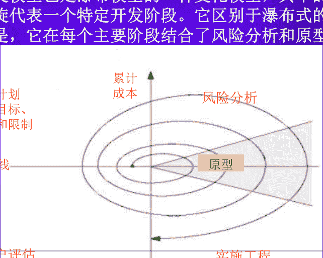

## 软件开发的模式——迭代式

- 多次执行各个开发工作流程，从而更好地理解需求、设计出强壮的构架、组建好开发组织并最终交付一系列渐趋完善的实施成果。
- 每次按顺序完成这一系列工作流程就叫做一次迭代。


### 软件测试与软件过程

## Rational Unified Process

| Disciplines | Phases |
|---|---|
|  | Inception Elaboration Construction Transition |
| Business Modeling |  |
| Requirements |  |
| Analysis \& Design |  |
| Implementation |  |
| Test |  |
| Deployment |  |
| Configuration \& Change Mgmt |  |
| Project Management |  |
| Environment |  |
|  | Initial Elab #1 Elab #2 Const #1 Const #2 Const #N Tran #1 Tran #2 |
|  | Iterations |

### 软件开发过程模型:CMMI

### Five Maturity Levels

- Process characterized for projects and is managed
- Process unpredictable, poorly controlled and reactive
- Process quantitatively measured and controlled
- Process characterized for the organization and is proactive
- Focus on Continuous process improvement


### 软件测试在CMMI中的位置

| Maturity Level | Focus | Process Areas |
|---|---|---|
| 5 Optimizing | Continuous Process Improvement | • Organization Innovation and Deployment<br>• Causal Analysis and Resolution |
| 4 Quantitatively Managed | Quantitative Management | • Organizational Process Performance<br>• Quantitative Project Management |
| 3 Defined | Process Standardization | • Requirements Development<br>• Technical Solution<br>• Product Integration<br>• Verification<br>• Validation<br>• Organizational Process Focus<br>• Organizational Process Definition<br>• Organizational Training<br>• Integrated Project Management<br>• Risk Management<br>• Decision Analysis and Resolution<br>• Organizational Environment for Integration<br>• Integrated Teaming<br>• Integrated Supplier Management |
| 2 Managed | Basic Project Management | • Requirements Management<br>• Project Planning<br>• Project Monitoring and Control<br>• Supplier Agreement Management<br>• Measurement and Analysis<br>• Product and Process Quality Assurance<br>• Configuration Management |
| 1 Initial |  |  |

## 书籍

本书全面地介绍了软件测试的基础知识和方法。通过问题、图表和案例研究，对软件测试数学问题和技术进行了深入的研究，并在例子中以更加通用的伪代码取代了过时的Pascal代码，从而使内容独立于具体的程序设计语言。本书还介绍了面向对象测试的内容，并完善了GUI测试内容。本书是ACM与IEEE计算机学会“软件工程知识体系”主要引用文献，并是国际众多大学的教材。本书适合作为相关专业高校教材，也可用于读者自学。

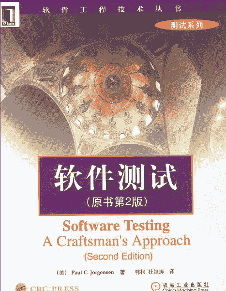


## 软件测试方法和技术

本书系统介绍了软件品质保证体系和软件测试原理。从软件工程学、质量保证、风险管理等角度阐述了软件测试以及软件测试策略的设计原则。

本书重点讲解软件测试的流程和技术/方法，深入剖析和探讨了各种测试类型和不同阶段比较成熟的技术以及方法，包括从单元测试到验收、安装测试，从应用服务器测试到本地化、自动化测试等。

本书作为软件测试的实际应用参考。从怎样组建测试队伍，搭建测试环境到测试用例组织、设计、化繁为简，将抽象理论知识变为可触摸到的实际操作，更好地理解和消化理论基础。

本书特色：

- 系统的软件品质保证体系和软件测试原理，从软件工程学、质量保证、风险管理等角度阐述了软件测试以及软件测试策略的设计原则
- 软件测试的流程和技术/方法，深入剖析和探讨了各种测试类型和不同阶段比较成熟的技术以及方法，包括从单元测试到验收、安装测试，从应用服务器测试到本地化、自动化测试等
- 软件测试的实际应用参考。从怎样组建测试队伍，搭建测试环境到测试用例组织、设计、化繁为简，将抽象理论知识变为可触摸到的实际操作，更好地理解和消化前面的理论基础


## 英文


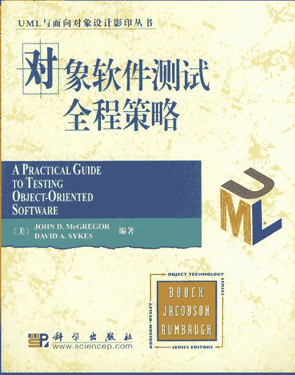

内容提要
软件测试是确保软件产品质量的必需过程和手段。在开发面向对象软件和基于组件的软件时，同样必须设计并实施有效的测试。本书明确指出了面向对象软件和面向过程软件测试任务的不同之处，论述了面向对象软件测试所面临的机遇和挑战。书中介绍了如何将测试工作整合进软件开发的各个阶段，以及各阶段的具体测试内容是什么。本书注重结合实例来讲解对象软件测试的过程和技巧，因而具有很强的实践性和指导意义。本书内容完整，结果合理，适合软件开发、测试领域的技术人员、软件工程专业的高年级本科生和研究生阅读，也可作为相关专业人员的参考用书。


本书系统地介绍了有关软件测试的基本知识和全过程。作者从软件测试的规划和方案设计，到测试分类、各种测试技术、手动测试、测试自动化、测试报告、测试管理，以及怎样选择和使用自动化测试工具等，都进行了深入的探讨。本书的独到之处在于除介绍最新的软件测试科技外，还是有很高的实用价值。基于作者在国外从事一线软件测试的实践经验，书中介绍了这项工作所需的基础知识、测试架构的建立、测试操作的流程及测试实例。本书适合从事软件测试工作的专业人员和相关人员阅读与参考。

## 议题：

- 软件的问题与质量
- 软件质量的评价
- 软件缺陷
- 软件测试的意义
- 软件测试工程师关注什么

## 软件的问题

- 软件项目经常无法按期完成，超出经费的预算，软件质量难以控制。
- 开发人员及开发过程之间管理不规范，约定不严格，文档书写不完整，软件可维护性不好。
- 缺少严密有效的质量检验手段，交付给用户的软件质量差，运行中出现许多问题，带来严重后果。
- 系统更新换代难度大
- 软件开发的产业模式已经不能适应信息时代。

### 软件问题的原因

是软件缺陷的积累和放大效应

- 失之毫厘，谬以千里
- 成本急剧增加，质量大幅下降
- 开发过程的混乱，效率很低

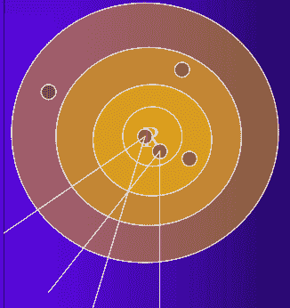

### 软件缺陷案例

- 千年虫　70年代的鼠目寸光
- 美国航天局火星登陆　90年代的测试不协调
- Intel CPU的浮点除法　缺陷带来的代价

## 软件质量的评价

- 满足客户的软件需求
- 遵循了软件开发过程所规定的各种标准
- 已经满足了那些明文规定的需求，同时也要满足那些隐含的需求

## 软件质量的评价指标

### 软件的运行特性

- 正确性：软件能满足需求规格说明，完成客户提出任务要求的程度
- 可靠性：软件精确地工作
- 有效性：是否能够在一定内存和外设容量下有效地运行
- 完整性：控制各类不同用户使用软件或数据的能力
- 可用性：软件被用户容易掌握

### 软件的维护特性

- 可维护性：找到错误发生的位置，加以修正的工作量
- 灵活性：是否可以修改，是否容易修改
- 可测性：是否可以测试，是否容易测试

### 软件的移植特性

- 可移植性：软件可以在不同的机器或环境下运行
- 可复用性：软件的重复使用

总之，软件的质量评价是比较复杂的，但是，有一条是要找到可以度量的指标来预测或评价软件的质量。

## 软件测试产生的背景

- 首先是尽可能地保证软件的质量
- 程序规模的爆炸式增长
- 在程序自身与用户需求之间寻找平衡点
- 解放程序员
- 解放售后服务人员
- 推动软件工程的发展

## 什么是软件测试

### PDCA 持续的测试周期

- Plan：定义目标、确定策略、决定方法
- Do：创建测试环境、执行计划
- Check：检查工作进程完成的情况
- Act：不合适，采取措施

## 软件测试相关的人员

- 软件客户
- 软件的使用者
- 软件开发者
- 软件测试人员
- 公司高层管理机构
- 审计和质检人员

## 什么是软件缺陷（defect）

- 术语：defect, variance, fault, failure, problem, error, bug, inconsistency
- 缺陷的类型：
  - 错误的：未将规格说明书正确实现
  - 遗漏的：规定的或者预期的需求没有体现在产品中
  - 额外的：规格说明书中未规定的需求被纳入产品加以实现

### 软件缺陷的定义

- 简单说：软件中不满足的问题称为软件缺陷
- 软件缺陷的详细定义：
  - 软件没有达到产品说明书表明的功能
  - 软件出现了产品说明书指明不会出现的问题
  - 软件功能超出产品说明书指明的范围
  - 软件没有达到产品说明书虽未指明，但应该达到的功能
  - 软件测试人员认为软件难以理解、不易使用、运行速度慢，或者用户认为不好。

### 为什么会出现软件缺陷

- 软件缺陷的产生原因：
  - 产品规格说明书（SRS）
    - 没有写
    - 不够全面、准确、细致
    - 经常变更
  - 软件的设计（Architecture）
    - 这是软件的蓝图
    - 描述不够清楚
    - 框架的结合不够紧密和连贯
    - 软件框架经常变动，不稳定
  - 代码错误
    - 编码人员造成的，人员素质和技术水平是其中原因之一
    - 间接的看，来自上层的分析和设计问题

## 软件测试的目标

- 发现软件缺陷，尽可能早地
- 软件测试是一个寻找错误的过程
- 测试是为了证明程序有错，而不是为了证明程序没有错误
- 一个成功的测试是指揭示了迄今为止尚未发现的错误的测试
- 一个好的测试用例是指可能找到迄今为止尚未发现的错误的用例
- 测试环节要严格，力求完美，要与软件测试成本、测试策略综合考虑

## 软件测试的原则

- 所有的测试都应追溯到用户需求
- 应该及早编写测试计划
- 测试应从小规模开始
- 穷举测试是不可能的
- 为了达到最佳效果，应该由独立的第三方来构造测试

## 软件测试使用的技术

黑盒测试、白盒测试

两种测试方法从不同的角度出发，反映了软件的不同侧面，也适用于不同的开发环境

## 软件测试的生命周期


- 测试计划
- 测试设计
- 测试开发
- 测试执行
- 测试评估


## 软件测试的V模型

需求分析

概要设计

详细设计

编码

代码审查

系统测试计划、设计、实现

执行系统测试

集成测试计划、设计、实现

执行集成测试

单元测试计划、设计、实现

执行单元测试

验证与确认

验证与确认

验证与确认

验证与确认

## 软件测试流程的分类

- 单元测试
- 集成测试
- 系统测试
- 验收测试


## 软件测试流程的不同阶段

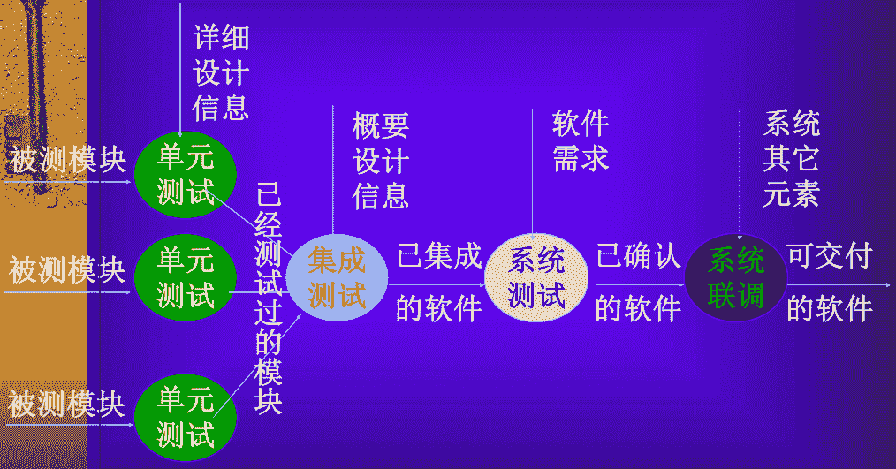

详细设计信息

概要设计信息

软件需求

系统其它元素

被测模块

单元测试

被测模块

单元测试

被测模块

单元测试

已经测试过的模块

集成测试

已集成的软件

系统测试

已确认的软件

系统联调

可交付的软件

## 软件测试中需要的文档

- 测试计划
- 测试设计
- 测试用例与测试记录
- 测试缺陷报告
- 测试评估报告
- 日志等

## 软件测试的工件产品

Test Manager
Test Plan
Test Evaluation Summary
Tester
Test Script
Test Log
Test Analyst
Test Ideas List
Test Case
Workload Analysis Model
Test Data
Test Results
Test Designer
Test Strategy
Test Automation Architecture
Test Interface Specification
Test Environment Configuration
Test Suite

## 软件测试组的结构

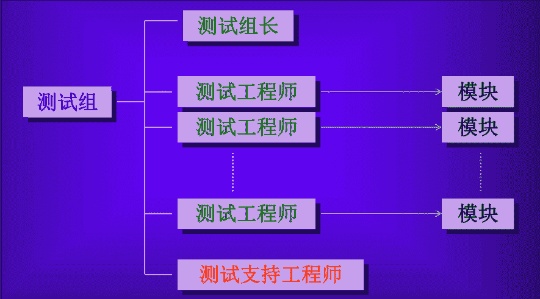

## 如何成为优秀的软件测试人员

- 探索精神
- 故障排除能手
- 不懈努力
- 创造性
- 追求完美
- 判断准确
- 老练稳重
- 说服力


## 一般需要的软件测试

- 功能测试
- 压力/负载测试
- 安装/卸载测试
- 数据库测试
- 界面测试
- 文档测试

- 可用性测试
- 配置测试
- 安全测试
- 其他非功能测试


## 手工测试

反复测试带来的倦怠情绪及其他人为因素使得测试标准前后不一，测试花费的时间越长，测试的严格性也就越低

受软件分发日期、开发成本及人员等诸多因素的限制，难以进行全面的测试

难以对不可视对象或对象的不可视属性进行测试

对测试过程中发现的大量缺陷缺乏科学、有效的管理手段，责任变的含混不清，没有人能向决策层提供精确的数据，以便度量当前的工作进度及工作效率

## 自动测试

所谓自动测试，实际上是将大量的重复性工作交给计算机去完成，节约大量的人力、物力、资金、时间等资源，并且测试脚本可以重复利用（可以是不同的项目）。

## 软件质量保证


## 软件质量保证（SQA）

- SQA 概述
- SQA 活动
- SQS 与软件测试的关系

## 什么是 SQA ?

软件质量保证是通过对软件产品和活动有计划的进行评审和审计来验证软件是否合乎标准的系统工程活动。

- 确保SQA活动要自始至有计划的进行
- 审查软件产品和活动是否遵守适用的标准、规程和要求并得到客观验证。
- SQA的活动和结果要保证全员参与，沟通顺畅。
- 逐级解决不符合问题

## SQA活动

- 技术方法的应用
- 正式技术评审的实施
- 软件测试
- 标准的执行
- 修改的控制
- 度量
- 质量记录和记录保存

## SQA活动的影响因素

- **知识结构：** 专业的技术，例如质量管理与控制知识、统计学知识等。
- **经验**
- **依据：** 如果没有这些标准，就无法准确地判断开发活动中的问题，容易引发不必要的争论，因此组织应当建立文档化的开发标准和规程。
- **全员参与：** 全员参与至关重要，高层管理者必须重视软件质量保证活动。
- **把握重点：** 一定要抓住问题的重点与本质，尽可能避免陷入对细节的争论之中。

## SQA策略

- **SQA策略主要分三个阶段：**
  - 以检测为重：产品制成之后进行检测，只能判断产品质量，不能提高产品质量。
  - 以过程管理为重：把质量的保证工作重点放在过程管理上，对制造过程中的每一道工序都要进行质量控制。
  - 以新产品开发为重：在新产品的开发设计阶段，采取强有力的措施来消灭由于设计原因而产生的质量隐患。

## SQA与软件测试有什么关系和区别？

## SQA与软件测试的关系

- SQA 是管理工作、审查对象是流程、强调以预防为主
- 测试是技术工作、测试对象是产品、主要是以事后检查

- SQA指导测试、监控测试
- 测试为SQA提供依据

## 测试周期

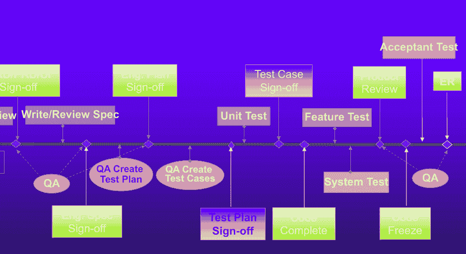

WERC: WebEx Engineering Release Cycle

2022-11-3

## 软件质量的可靠性评估

- 软件可靠性评估的概述
- 软件可靠性模型
- 可靠性评估过程

## 软件可靠性评估的概述

软件可靠性评估（Software Reliability Assessment）指根据软件系统可靠性结构（单元与系统间可靠性关系）、寿命类型和各单元的可靠性试验信息，利用概率统计方法，评估出系统的可靠性特征量。

## 软件可靠性评估的要素

- 1）规定的时间
- 2）规定的环境条件
- 3）规定的功能

## 软件可靠性模型

软件可靠性模型（Software reliability model）是指为预计或估算软件的可靠性所建立的可靠性结构和数学模型。建立可靠性模型是为了将复杂系统的可靠性逐级分解为简单系统的可靠性，以便于定量预计、分配、估算和评价复杂系统的可靠性。

1）可靠性结构模型，是依据系统结构逻辑关系，对系统的可靠性特征及其发展变化规律做出可靠性评价。

2）可靠性预计模型，是用来描述软件失效与软件缺陷的关系，借助这类模型，可以对软件的可靠性特征做出定量的预计或评估。依据软件缺陷与运行剖面数据，利用统计学原理建立二者之间的数学关系，获取开发过程中可靠性变化、软件在预定工作时间的可靠度、软件在任意时刻发生的失效数的平均值以及软件在规定时间间隔内发生失效次数的平均值。

## 可靠性评估过程

### 可靠性数据收集

用时间定义的软件可靠性数据可以分为四类：

- 失效时间数据，记录发生一次失效所累积经历的时间；
- 失效间隔时间数据，记录本次失效与上一次失效间的间隔时间；
- 分组数据，记录某个时间区内发生了多少次失效；
- 分组时间内的累积失效数，记录某个区间内的累积失效数。这四类数据可以互相转化。
- 测试时间；
- 含有测试用例的测试计划或测试说明；
- 所有与测试有关的测试结果，包括所有测试时发生的故障；
- 参与测试的个人身份。

### 可靠性评估报告

## 软件测试过程和策划

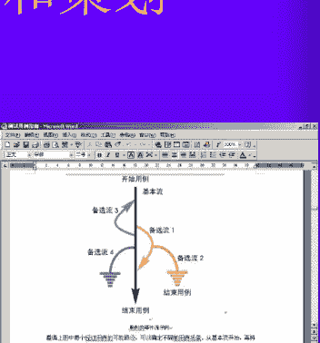

## 议题：

- 软件测试的过程
- 测试计划的目标
- 回顾开发和测试阶段
- 测试计划的结构
- 测试计划模板
- 测试计划举例

## 软件测试过程中的关键活动

测试设计

测试计划

测试构建

测试评估和报告

测试执行

测试结果分析


## 软件测试流程

测试经理  
测试策划  
测试设计员  
测试需求  
测试用例  
业务流  
业务流数据  
测试开发员  
设计自动测试框架  
验证自动测试框架  
设计用例生成脚本  
测试执行人员/测试工具  
启动测试  
执行测试  
验证结果  
报告缺陷  
测试经理  
测试报告  

## 测评需求分析

- 测试需求（分配需求）
- 测试需求分析的资料来源
- 被测软件分析
- 软件范围、测试级别与要求
- 功能性、非功能性测试需求项、测试类型与要求
- 需求追踪关系
- 方法、优先级
- 测试数据需求（类别、类型、格式、属性、量）

## 测试策划

- 测试策略
- 测试技术和方法
- 受控测试工作产品
- 测试资源要求
- 测试风险
- 测试活动的进度
- 需采集的度量及采集要求
- 测试充分性要求
- 测试终止要求
- 测试任务结束条件
- 被测软件的评价准则和方法

## 确定测试策略

确定测试需要的技术或方法  
确定要受控制的测试工作产品，清单  
确定每个测试项的测试充分性要求  
确定每个测试项测试终止的要求  
确定用于测试的资源要求  
进行测试风险分析  
确定测试任务的结束条件  
确定被测软件的评价准则和方法  
确定测试活动的进度  
确定需求采集的度量及采集要求  

## 测试设计和实现

测试设计 ↔ 测试实现  

- 分解测试项
- 设计测试环境
- 设计测试用例
- 编写测试用例概要说明

- 分解测试项
- 测试用例编码
- 定义测试条件
- 定义输入值/预期输出值
- 定义测试规程
- 编辑测试剧本

## 测试设计和实现

## 测试用例设计

分解测试项  

确定测试用例的：  
- 测试方法  
- 输入  
- 预期输出  
- 终止条件  

建立测试执行步骤  
建立测试用例评估准则  

### 测试环境的建立

准备和确认测试用数据  
准备测试环境所必须的软、硬件资源  
编写测试执行需要的支持程序  
建立和校核测试环境  

### 形成并管理测试说明

编写和评审测试说明  
按要求管理测试说明  
编写测试环境及其偏差说明  

## 测试就绪评审

## 测试用例设计

1. 测试项分析  
2. 测试数据分析  
3. 用例大小  
4. 步骤原则  
5. 用例与实例化  

## 测试说明文档化

- 确定对软件测试计划和测试需求规格说明的追踪关系，给出清晰、明确的追踪表  
- 经过评审，并得到相关人员的认同  
- 受到变更控制和版本控制  
- 根据测试进展情况（包括测试级别和测试过程）而不断得到修订  

## 测试执行

1. 根据测试计划  
2. 按照测试说明  
3. 操作测试实例步骤  
4. 运行测试代码、剧本  
5. 记录测试现场（结构）  
6. 预期与准则判定结论  
7. 处理记录与结论  

## 问题处理

当测试用例不通过时：  

- 对测试工作中的缺陷，记录到问题及变更报告中，并实施相应的变更。这类缺陷如：  
  - 软件测试说明的缺陷  
  - 测试数据的缺陷  
  - 执行测试步骤时的缺陷  
  - 测试环境中的缺陷  
- 对被测软件的缺陷，汇总到软件问题报告中。软件问题报告的格式应规范  

## 测试执行后

所有的测试用例都执行完毕后，应根据测试的充分性要求和有关原始记录，确定测试工作是否充分，是否需要进行补充测试：  

- 当测试过程正常终止时，如果发现测试工作不足，或测试未达到预期要求时，应进行补充测试。  
- 当测试过程异常终止时，应记录导致终止的条件、未完成的测试和未被修正的错误  

## 评估\交付

1. 分析本测评项目中积累的数据和文档，以供以后的测试使用。如：  
   - 缺陷数据（如数量、类型、严重性）  
   - 用例数据  
   - 管理数据（如生产率、工作量、进度）  
   - 文档（如好的用例设计、好的需求规格说明）  

2. 测试工作分析、评价  

3. 遗留问题分析、处理报告  

4. 被测软件质量分析、评价，形成测试（测评）报告  

5. 评审  

6. 交付、善后  

## 软件测试的工作流

- **活动：**  
  - 制定测试计划  
  - 设计测试  
  - 实施测试  
  - 集成和系统的测试  
  - 评估测试  

## 制定测试计划的目的

- 通过准确、详细描述测试过程中的关键活动、角色、进度，以确保测试工作成功完成。  
- 帮助组织、管理、安排测试工作  
- 帮助设计测试用例  
- 增强开发者和管理层的沟通  

## 制定测试计划的步骤

- 确定测试需求  
- 评估风险  
- 制定测试策略  
- 明确测试中的关键活动(WBS)  
- 估计测试成本和工作量  
- 定义角色和确定资源  
- 确定进度,创建时间表  
- 生成测试计划  

## 1.确定测试需求

确定测试需求是测试计划活动的开始。  

测试需求确定测试对象以及测试工作的范围和作用。测试需求还用来确定整个测试工作（如安排时间表、测试设计等）并作为测试覆盖的基础。  

被确定的测试需求项必须是可核实的。即，它们必须有一个可观察、可评测的结果。无法核实的需求不是测试需求  

## 1. 确定测试需求

- 测试需求所确定的是测试内容，即测试的具体对象。  
- 分类：  
  - 功能性测试需求  
  - 非功能性测试需求  

## 2.评估风险

- 最大限度地提高测试效率并确定测试工作的优先级。  
- 制定一个可接受的测试顺序。  

## 2.评估风险

- 评估风险的方法：  
  - 参见风险计算方法  

## 3.制定测试策略

- 确定并传达测试手段和工具  
- 确定并传达用于确定产品质量和测试是否完成的评估方法  
- 测试策略的内容：  
  - 确定和描述测试方法  
  - 确定测试标准  
  - 确定测试的特殊事项  


## 3. 制定测试策略

- 确定和描述测试方法举例：
  - 对于每一个用例，确定并执行测试用例，包括有效和无效的输入数据。
  - 对于每一个用例都将设计和开发测试流程。
  - 利用三个月的时间来实施测试过程以模拟客户账号管理。测试过程包括添加、修改和删除账号以及客户。
  - 实施测试过程并通过 1500 个虚拟用户来执行测试脚本，每个用户都执行功能 A、B 和 C，并且使用不同的输入数据。

- 确定测试标准举例：
  - 所有计划好的的测试用例和测试过程已被执行。
  - 所有确定的缺陷已被解决。
  - 所有计划好的的测试用例和测试过程已被重新执行并且没有发现新的缺陷。

## 4. 明确测试中的关键活动(WBS)

- WBS (Work Breakdown Structure)

- 任务分解的过程

- 将一个项目分解为更多的工作细目或者子项目，使项目变得更小、更易管理、更易操作。

- 任务分解的结果

- WBS（任务分解结构）。

- WBS

- 面向可交付成果的。

## WBS意义

- 提供了项目范围基线，是范围变更的重要输入
- 可以集中注意力到项目的目标上
- 对于开发项目提供了一个框架
- 责任更明确
- 为评估和分配任务提供具体的工作包
- 是进行估算和编制项目进度的基础
- 对整个项目成功的集成和控制起到非常重要的作用

## WBS实例


## 清单类型

1. 变化计数器
   - 1.1 比较两个版本的程序
     - 1.1.1 预处理
     - 1.1.2 文件比较
     - 1.1.3 结果处理
   - 1.2 找出修改后的程序中增加和删除的代码行
     - 1.2.1 找出增加的代码行
     - 1.2.2 找出删除的代码行
   - 1.3 统计修改后的程序中增加和删除的代码行数
     - 1.3.1 统计增加代码行数
     - 1.3.2 统计删除代码行数
   - 1.4 统计总的代码行数
   - 1.5 设定标记以指示修改的次数
   - 1.6 在程序的头部增加修改纪录

## 图表类型

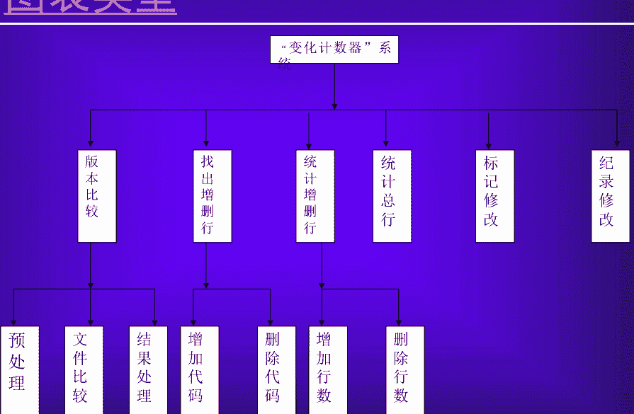

## WBS与OBS（组织分解结构）

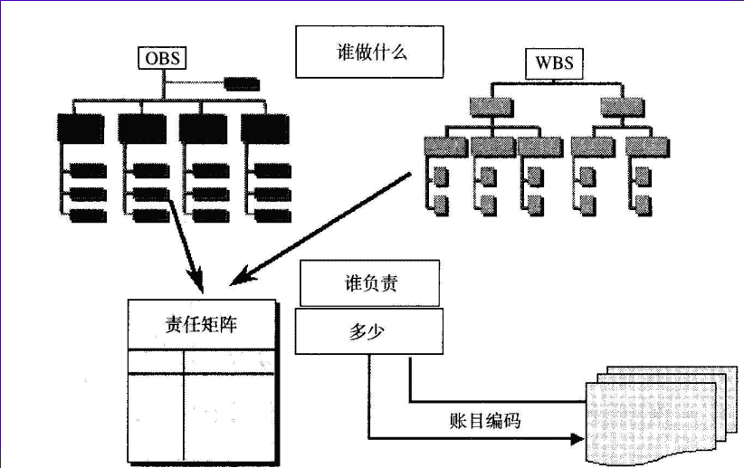

## 谁做什么

## OBS

## WBS

## 责任矩阵

## 谁负责

多少

账目编码

## 分解标准

1. **生存期：**
   1. 生存期各阶段为二级，每阶段的产品为第三级...

2. **功能组成**
   1. 产品组成为二级，产品组成的分解为三级，.....

3. 。 。 。 。 。

## WBS的指南（1）

- WBS分解的规模和数量因项目而异
- 收集与项目相关的所有信息
- 参看一下类似的项目的WBS，与相关人员讨论
- 可以参照模板
- 最低层是可控的和可管理的，但是避免不必要的过细
- 最好不要超过7层
- 软件项目推荐分解到40小时的任务
- 每个Work package必须有一个提交物

## WBS的指南（2）

- 定义任务完成的标准
- 每个WBS必须有利于责任分配
- 可以准备WBS的字典
- 最后与相关人员进行评审

## 软件测试WBS模板举例

- 参看模版样例

## WBS字典内容

| WBS表示号 |  |
| --- | --- |
| 名称 |  |
| 主题目标 |  |
| 描述 |  |
| 完成的任务 |  |
| 责任者 |  |
| 完成的标识 |  |
| 备注 | 1. |

## 5. 估计测试成本和工作量

- 估计的依据是WBS

估计测试工作时，应考虑如下假设：

投入到项目中的人力资源的生产率和技能/知识水平（比如他们使用测试工具或程序的能力）。

要构建的应用程序的有关参数（比如窗口数目、构件、数据实体和相互关系以及重复使用的百分比等）。

测试覆盖（实施并执行测试的可接受深度）。如果只实施和执行一个测试用例（对每一个用例/需求），则表述每一个用例/需求是不同的。经常需要多个测试用例来对某一个用例/需求进行可以接受的测试。

测试估计还应考虑到在测试生命周期的各个阶段使用不同方式对工作进行划分，这是因为某些类型的（工作）量在生命周期内是变化的。例如，性能测试工作，由于其包含在复杂环境中建立测试系统并执行测试的工作，因此该测试执行活动就占了工作估计的很大比重。

- 估计的方法可以用估计模型技术
  - Delphi方法
  - COCOMO模型
- 模版举例


## 6. 定义角色和确定资源

测试经理  
制定测试计划，组织自动测试工作的开展，撰写测试报告。

测试分析设计员  
分析测试需求，根据业务流程编写测试用例

测试开发员  
细化测试用例、开发自动测试脚本或驱动程序

测试员  
负责执行测试,记录测试结果

环境支持组  
部署被测系统、准备基础数据

- 确定资源
  - 人力资源（人员数量和技能）
  - 测试环境（包括硬件和软件）
  - 工具
  - 数据

## 7. 确定进度,创建时间表

测试项目时间表可以通过工作估计和资源分配来建立。  
将整个测试项目划分为多个阶段（测试需求分析、测试设计、脚本开发、测试环境准备、测试执行、结果分析）。  
资源应该包括人力资源、被测环境资源、测试环境资源。

| 入口条件 | 输入 | 工作 | 输出 | 出口条件 |
|---|---|---|---|---|
| WBS和工作量和成本完成 | 1. 软件成本工作量<br>2. WBS<br>3. 进度的历史数据<br>4. 可分配资源的数量 | - 最开始是估计每个活动的时间段，对大多数活动来说，应当用估计的工作量除于用于该活动的资源的比率来计算时间段。<br>- 下一步是确定活动之间的所有关系，可以通过画一个网络图表达。<br>- 将所有的可用资源分类，在计划能画出之前，必须考虑所需资源是否可用。<br>&nbsp;&nbsp;&nbsp;&nbsp;• 统计每个阶段（如：周）所需资源总和<br>&nbsp;&nbsp;&nbsp;&nbsp;• 决定一个能获得的员工计划<br>&nbsp;&nbsp;&nbsp;&nbsp;• 调整活动起始日期，使资源需求在任何时间段不超过有效范围<br>- 开发计划的最后一步是画一个Gantt图表，表示每个活动的起始和结束日期<br>- 将进度表的结果记录到测试计划中 | 1. 确定进度 | 1. 估计的过程和结果记录到测试计划文件中<br>2. 测试计划更新 |

- 样例

## 8. 生成测试计划

- 制定测试计划活动的最后步骤是生成测试计划。它通过集中收集到的所有测试信息来完成，并生成一份报告。
- 使用测试计划模板，如果没有设计一个
- [测试计划模板](测试计划模板)
- [测试计划的样例](测试计划的样例)


## 确认计划中的问题

- 测试方法
- 测试执行的设施
- 测试自动化
- 测试工具
- 支持软件
- 配置管理
- 风险（预算、进度等）

## 评审测试计划

- 使用评审规程
- 使用检查表


## 小结

- 学习了
  - 测试过程的计划
  - 完成一个计划的内容

## 软件测试的报告和分析

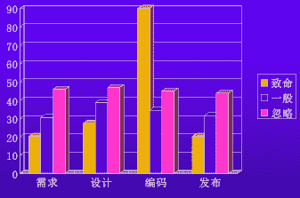

### 议题

- 使软件缺陷得以修复
- 分离和再现软件缺陷
- 对软件缺陷分等级
- 软件缺陷的生命周期
- 软件缺陷的跟踪
- 测试的评价和分析

## 使软件缺陷得以修复

- 软件缺陷可能不能修复
  - 没有足够的时间
  - 不算真正的软件缺陷
  - 修复的风险太大
  - 不值得修复
- 审查软件缺陷，判定是否可以修复
- 判定依据是软件测试的缺陷报告

## 分离和再现软件缺陷

- 不要想当然地接受任何假设
- 查找时间依赖和竞争条件的问题
- 与压力和负荷相关的边界条件软件缺陷、内存泄露和数据溢出等问题也许慢慢自己显现出来
- 状态缺陷仅在特定软件状态中显露出来
- 考虑资源依赖性和内存、网络、硬件共享的相互作用
- 不要忽视硬件

## 软件缺陷分等级

- 软件缺陷分出严重性和优先级
  - 严重性表示软件缺陷的恶劣程度，反映其对产品和用户的影响
  - 优先级表示修复缺陷的重要程度和应该何时修复

| 等级 | 严重性 | 优先级 |
|---|---|---|
| 1 | 系统崩溃、数据丢失、数据毁坏 | 立即修复，阻止进一步测试 |
| 2 | 操作性错误、错误结果、遗漏功能 | 在产品发布之前必须修复 |
| 3 | 小问题、错别字、UI布局 | 如果时间允许应该修复 |
| 4 | 建议 | 可能会修复，也可能会发布 |

## 软件缺陷的生命周期

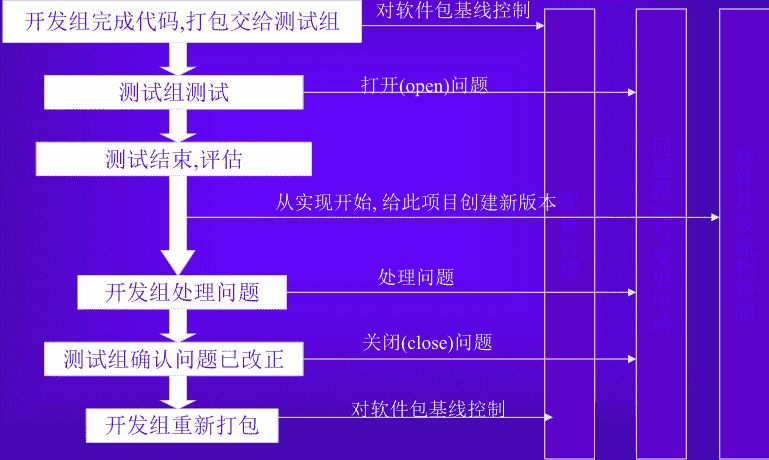

## 建立缺陷与产品的追踪矩阵

- 产品的目录结构可以分层管理，比如三层
  - 系统产品的目录结构
  - 子系统产品的目录结构
  - 构件产品的目录结构
- 产品的管理由配置管理决定
- 测试的缺陷要和产品的层次级别、测试用例、变更请求建立连接，用来分析产品质量

比如：

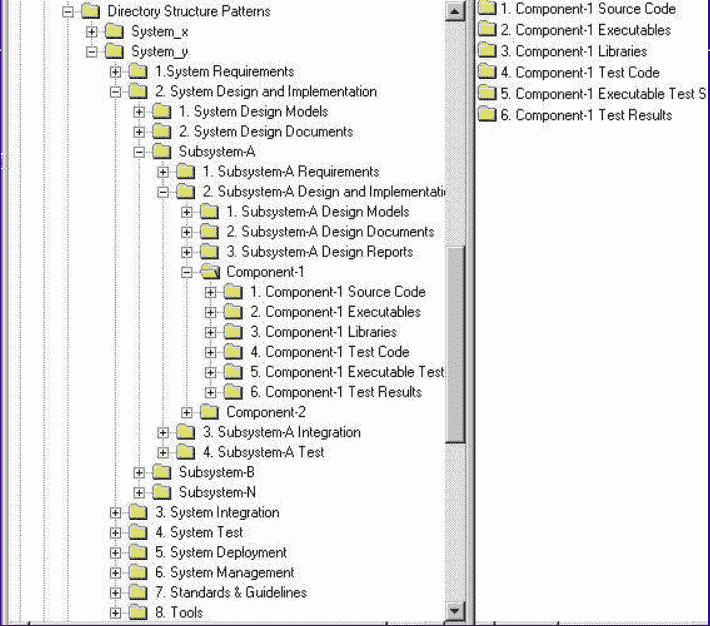

## 缺陷报告与跟踪

- 可以手动记录：参见文件testreport.doc
- 可以自动记录，数据库用于存放产品测试信息，一般包含四种角色：“测试组长”、“测试员”、“开发人员”、“项目经理”。
- 在使用数据库时，
  - 首先由具有“测试组长”角色的用户创建项目中的产品的描述文档。
  - 此后，测试人员应创建产品测试信息文档，并开始对产品进行测试。
  - 如果发现此产品存在问题，则填写一份产品测试跟踪报告，利用邮件通知给开发人员，由开发人员决定是否进行修改。
  - 如果开发人员和测试人员发生争议，可以提交给“测试组长”作出决定。
  - 在整个流程中共有八个可能的状态：草案，提交，拒绝，接受，终止，推迟，审定，解决。

## 测试结果的评价分析

- 评估测试的目的是生成并交付测试评估报告。
- 这是通过复审并评估测试结果、确定并记录变更请求，以及计算主要测试评测方法来完成的。
- 测试评估摘要以组织有序的格式提供测试结果和主要测试评测方法，用于评估测试对象和测试流程的质量。

## 测试分析的步骤

#### 步骤

1. 分析测试结果并提交变更请求
2. 评估基于需求的测试覆盖
3. 评估基于代码的测试覆盖
4. 分析缺陷
5. 确定是否达到了测试的完成标准和成功标准
6. 生成测试评估报告

## 小结

- 学习了
  - 测试的缺陷描述和缺陷的跟踪
  - 测试结果的评价

## 软件测试的层次阶段


## 软件测试的V模型

需求分析

概要设计

详细设计

编码

代码审查

单元测试计划、设计、实现

集成测试计划、设计、实现

系统测试计划、设计、实现

执行单元测试

执行集成测试

执行系统测试

验证与确认

验证与确认

验证与确认

验证与确认

软件测试的V模型

## 软件测试技术

不实际运行程序，而是通过检查和阅读等手段来发现错误并评估代码质量的软件测试技术。也称为静态分析技术。

实际运行程序，并通过观察程序运行的实际结果来发现错误的软件测试技术。

### 静态测试

### 动态测试

- 黑盒
- 白盒

- 黑盒
- 白盒

- 技术评审
- 代码审查

- 功能测试
- 性能测试
- 非功能测试

- 语句覆盖
- 判定覆盖
- 条件覆盖
- 路径覆盖

## 黑/白盒技术

- 黑盒：在不知道程序内部结构，只知道程序规格的情况下采用的测试技术或策略。
- 白盒：在知道程序内部结构的情况下采用的测试技术或策略。


## 测试层次阶段1：单元测试

- 单元测试：Unit Testing
  - 目标：
    - 检验程序最小单元有无错误
      - 接口、数据结构、边界、覆盖、逻辑
    - 检验单元编码与设计是否吻合
  - 时机：
    - 编码完成后，首先要实施的测试
  - 方法：
    - 静态测试
    - 白盒测试
  - 责任：
    - 开发工程师

## 测试层次阶段2：集成测试

- 集成测试：Integration Testing
  - 目标：
    - 检验组成系统的模块接口有无错误
    - 模块的数据流是否正确
    - 代码实现的系统设计与需求定义是否吻合
  - 时机：
    - 主要的单元测试完成后
  - 方法：
    - 黑盒测试
  - 责任：
    - 测试工程师

## 测试层次阶段4：验收测试

- 验收测试：Acceptance Testing
  - 目标：
    - 使用实际的业务数据测试软件的需求
    - 系统是否符合事先约定的验收标准
    - 使客户验收签字
  - 时机：
    - 系统测试完成后，在项目组看来开发和测试工作已经全部完成，可以交付使用
  - 方法：
    - 黑盒测试
  - 责任：
    - 产品经理或其他高级经理
    - 开发工程师
    - 测试工程师
    - 用户

## 回归测试

### 回归测试：Regression Testing

- 目标：
  - 验证程序修改或者版本更新以后，以前正确的功能和其他指标仍旧正确。
- 时机：
  - 每次错误修改之后，或者版本更新之后
- 方法：
  - 白盒测试 黑盒测试
- 责任：
  - 开发工程师
  - 测试工程师


# 面向对象的测试

## 面向对象的软件特征

- 软件缺陷可能不能修复
  - 没有足够的时间
  - 不算真正的软件缺陷
  - 修复的风险太大
  - 不值得修复

- 审查软件缺陷，判定是否可以修复
- 判定依据是软件测试的缺陷报告

## Object Orientation的原理

Object Orientation

- Abstraction
- Encapsulation
- Modularity
- Hierarchy

## 封装 Encapsulation

➢ Hide implementation from clients

❧ Clients depend on interface

Improves Resiliency

## 层次Hierarchy

### Levels of abstraction

Increasing abstraction

Decreasing abstraction

Bank Account

Security

Real Estate

Savings

Checking

Stock

Bond

Elements at the same level of the hierarchy should be at the same level of abstraction

## Object Orientation中的概念

- Object
- Class
- Attribute
- Operation
- Interface (Polymorphism)
- Component
- Package
- Relationships

## 对象 Object

Informally, an object represents an entity, either physical, conceptual, or software

- Physical entity

- Conceptual entity

- Software entity

## 对象的正式定义

- An object is a concept, abstraction, or thing with sharp boundaries and meaning for an application
- An object is something that has:
  - State
  - Behavior
  - Identity

## 对象表示

➢ An object is represented as rectangles with underlined names

Class Name Only

Object Name Only

Class and Object Name

Professor Clark

> _(stay tuned for classes)_

## 类Class

- A class is a description of a group of objects with common properties (attributes), behavior (operations), relationships, and semantics
  - An object is an instance of a class
- A class is an abstraction in that it:
  - Emphasizes relevant characteristics
  - Suppresses other characteristics

*OO Principle: Abstraction*

## 类举例

# Class

Course

**Properties**
- Name
- Location
- Days offered
- Credit hours
- Start time
- End time

**Behavior**
- Add a student
- Delete a student
- Get course roster
- Determine if it is full

## 类的表示

➢ A class is represented using a compartmented rectangle

| Professor |
|---|
| |
| |

Professor Clark

## 类的组成

- A class is comprised of three sections
  - The first section contains the class name
  - The second section shows the structure (attributes)
  - The third section shows the behavior (operations)

## 对象的类

### How many classes do you see?

## 类和对象之间的关系

### A class is an abstract definition of an object

- It defines the structure and behavior of each object in the class

- It serves as a template for creating objects

### Objects are grouped into classes

Professor Smith

Professor Mellon

Professor Jones

## 操作 Operation


## 多态 Polymorphism

> The ability to hide many different implementations behind a single interface


OO Principle: Encapsulation


### 接口 Interface

- Interfaces formalize polymorphism
- Interfaces support “plug-and-play” architectures

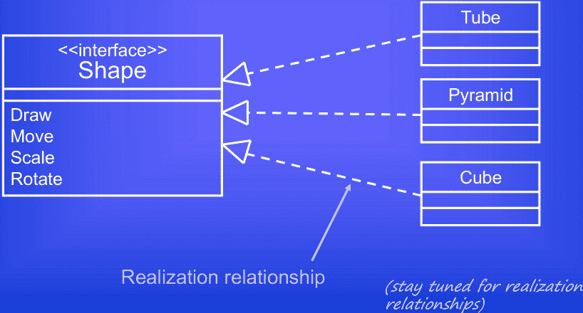

### 组件 Component

> A non-trivial, nearly independent, and replaceable part of a system that fulfills a clear function in the context of a well-defined architecture

- A component may be
  - A source code component
  - A run time component or
  - An executable component

> OO Principle: Encapsulation


### 包 Package

- A package is a general purpose mechanism for organizing elements into groups
- A model element which can contain other model elements


> OO Principle: Modularity

#### Uses

- Organize the model under development
- A unit of configuration management

### 关系 Relationships

- Association
  - Aggregation
  - Composition
- Dependency
- Generalization
- Realization

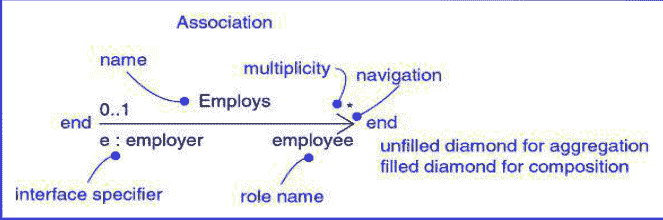

### Example: Single Inheritance

- One class inherits from another

Ancestor

Superclass (parent)

| Account |
|---|
| balance<br>name<br>number |
| Withdraw()<br>CreateStatement() |

Generalization Relationship

Subclasses

| Checking |
|---|
| Withdraw() |

| Savings |
|---|
| GetInterest()<br>Withdraw() |

Descendents

### Example: Multiple Inheritance

> A class can inherit from several other classes

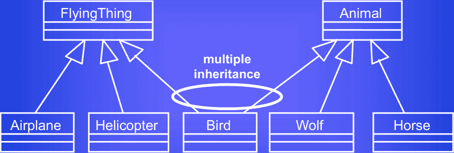

*Use multiple inheritance only when needed, and always with caution!*

### What Gets Inherited?

- A subclass inherits its parent’s attributes, operations, and relationships
- A subclass may:
  - Add additional attributes, operations, relationships
  - Redefine inherited operations (use caution!)
- Common attributes, operations, and/or relationships are shown at the highest applicable level in the hierarchy

*Inheritance leverages the similarities among classes*

### Example: What Gets Inherited

*Superclass*  
*(parent)*

*Subclass*

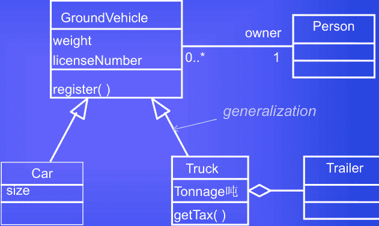

### Strengths of Object Orientation

- A single paradigm
- Facilitates architectural and code reuse
- Models more closely reflect the real world
  - More accurately describe corporate data and processes
  - Decomposed based on natural partitioning
  - Easier to understand and maintain
- Stability
  - A small change in requirements does not mean massive changes in the system under development

### A Simple Sales Order Example

Order

Product

Ship via


### Class Diagram for the Sales Example

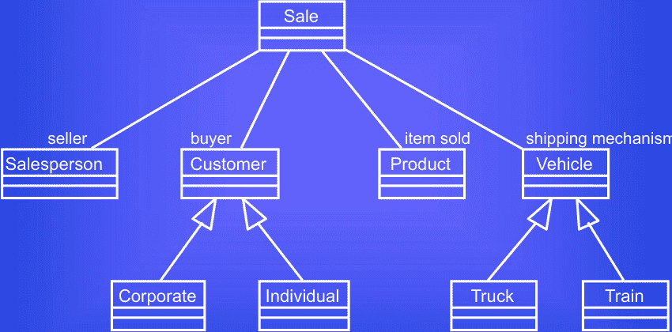

### Effect of Requirements Change

Suppose you need a new type of shipping vehicle ...

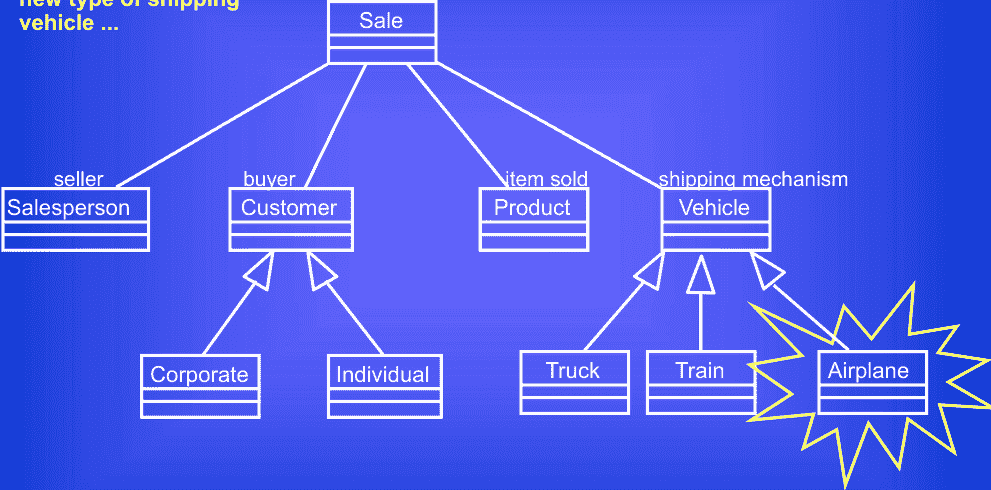

Change involves adding a new subclass

### 面向对象的测试层次

- 操作/方法测试：使用传统的单元测试技术
- 类测试：类内的测试
- 集成测试：类间的测试，主要是操作的交互测试
- 系统测试：接口事件层上进行测试，与传统的集成测试相同。

### 动态黑盒测试——边界值测试


#### 边界值

- 程序是函数
- 输入：函数的定义域
- 输出：函数的值域
- 定义域例
  - \(\infty\) a<x1<b
  - \(\infty\) c<x2<d

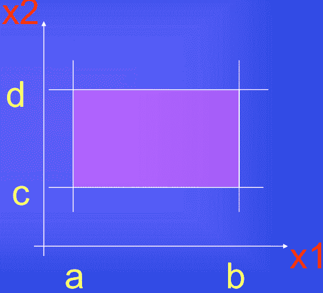


## 边界值分析思想

使用的输入变量是：min, min+, nom, max-, max

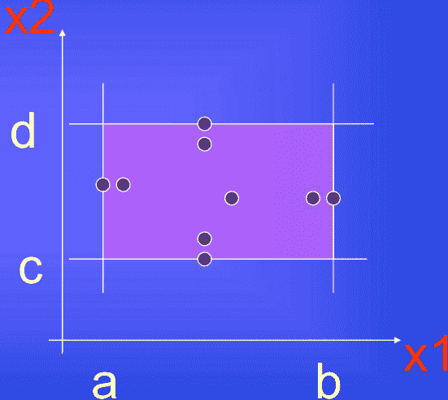

## 边界值分析假设

- 单缺陷假设
- 一个变量取极值，其他所有变量去正常值
  - X1nom:
    - x2min, x2min+,
    - x2nom,
    - x2max-, x2max
  - X2nom:
    - x1min, x1min+,
    - x1nom,
    - x1max-, x1max

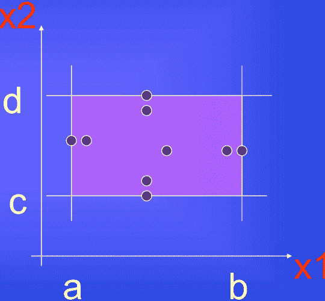

## 边界值分析的方式

- 通过变量的数量
  - 对于有N个变量的函数，边界值分析产生4N+1个测试用例
- 通过值域的种类
  - 取决于变量本身的类型
  - 显示的边界和有离散的边界，容易确定边界
  - 没有显示地给出边界的，需要人为地创建边界
- 多个独立的变量（变量之间没有依赖），受物理量（温度、压力等）的限制，比较适合边界值分析

## 健壮性测试

- 增加极限值
  - $\infty$Max+, min-
- 一个变量取极值，其他所有变量去正常值
- 主要是观察例外处理情况，即输出结果

X1nom:
X2min-, x2min, x2min+,
x2nom,
x2max-, x2max, x2max+

X2nom:
X1min-, x1min, x1min+,
x1nom,
x1max-, x1max, x1max+

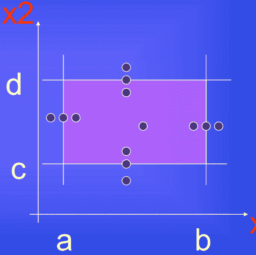

## 最坏情况测试

- 多个变量取极值
- 对每个变量，包含 min, min+, nom, max-, max 集合的测试
- 然后再对这些集合做笛卡尔积运算，生成测试用例
- N变量：5n个测试用例

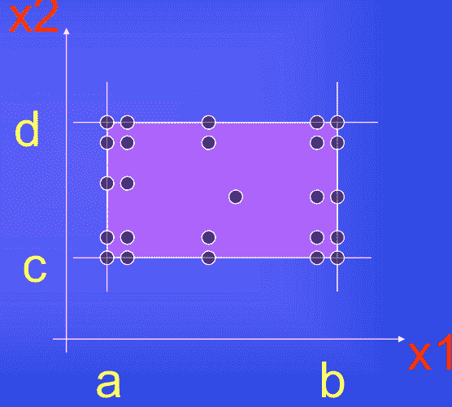

## 例子

参见书P75

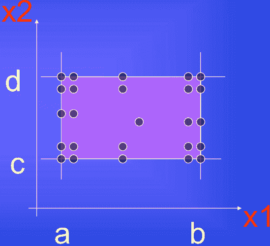

## 动态黑盒测试——决策表测试


## 决策表

- 决策表分为4部分
  - 栏
  - 条目
  - 条件
  - 行动

| 栏 | 规则1 | 规则2 | 规则3、4 | 规则5 | 规则6 | 规则7、8 |
|---|---|---|---|---|---|---|
| c1 | T | T | T | F | F | F |
| c2 | T | T | F | T | T | F |
| c3 | T | F | - | T | F | - |
| a1 | X | X | | X | | |
| a2 | X | | | | X | |
| a3 | | X | | X | | |
| a4 | | | X | | | X |

## 读决策表

| 桩 | 规则1 | 规则2 | 规则3、4 | 规则5 | 规则6 | 规则7、8 |
|---|---|---|---|---|---|---|
| c1 | T | T | T | F | F | F |
| c2 | T | T | F | T | T | F |
| c3 | T | F | - | T | F | - |
| a1 | X | X | | X | | |
| a2 | X | | | | X | |
| a3 | | X | | X | | |
| a4 | | | X | | | X |

- 如果C1、C2、C3条件都为真，则采取行动a1、a2
- 如果C1为真、C2为假，不关心C3，则采取行动a4

## 基于决策表的测试用例的表示方法

- 条件：
  - 输入
  - 可以是等价类
- 行动：
  - 输出
  - 软件功能的处理
- 规则
  - 测试用例

## 三角形问题决策表

| 桩 | 1 | 2 | 3 | 4 | 5 | 6 | 7 | 8 | 9 |
|---|---|---|---|---|---|---|---|---|---|
| C1: a,b,c构成三角形? | N | Y | Y | Y | Y | Y | Y | Y | Y |
| C2: a=b? | - | Y | Y | Y | Y | N | N | N | N |
| C3: a=c? | - | Y | Y | N | N | Y | Y | N | N |
| C4: b=c? | - | Y | N | Y | N | Y | N | Y | N |
| A1: 非三角形 | X | | | | | | | | |
| A2: 不等边三角形 | | | | | | | | | X |
| A3: 等腰三角形 | | | | X | | X | X | | |
| A4: 等边三角形 | | X | | | | | | | |
| A5: 不可能 | | | X | X | | X | | | |

## 相互排斥条件的决策表

| 条件 | 规则1 | 规则2 | 规则3 |
|---|---|---|---|
| C1：月份在M1中 | T | - | - |
| C2：月份在M2中 | - | T | - |
| C3：月份在M3中 | - | - | T |
| a1 | X | | |
| a2 | | X | |
| a3 | | | X |

## 规则数量

- 如果有N个条件，则必须有2^N条规则
- 如果出现不关心条目，则
  - 没有不关心条目的规则统计为1条规则
  - 规则中每出现一个不关心条目，则规则数乘一次2

## 相互排斥条件的决策表规则数量

| 条件 | 规则1 | 规则2 | 规则3 |
|---|---|---|---|
| C1：月份在M1中 | T | - | - |
| C2：月份在M2中 | - | T | - |
| C3：月份在M3中 | - | - | T |
| a1 | | | |
| | 4 | 4 | 4 |

- 规则数是2^3=8，但是算出的是4+4+4=12?

## 相互排斥条件的决策表规则数量

| 条件 | 规则1 | | | | 规则2 | | | | 规则3 | | | |
|---|---|---|---|---|---|---|---|---|---|---|---|---|
| C1：月份在M1中 | T | T | T | T | T | T | F | F | T | T | F | F |
| C2：月份在M2中 | T | T | F | F | T | T | T | T | T | F | T | F |
| C3：月份在M3中 | T | F | T | F | T | F | T | F | T | T | T | T |
| A1：可能 | | | | X | | | | X | | | X | |
| | A | B | C | | A | B | D | | A | C | D | |

- 排除冗余的规则

## 三角形问题的测试用例

| 用例ID | a | b | c | 预期输出 |
|---|---:|---:|---:|---|
| DT1 | 4 | 1 | 2 | 非 |
| DT2 | 1 | 4 | 2 | 非 |
| DT3 | 1 | 2 | 4 | 非 |
| DT4 | 5 | 5 | 5 | 等边 |
| DT5 | | | | |
| DT6 | | | | |
| DT7 | 2 | 2 | 3 | 等腰 |
| DT8 | | | | |
| DT9 | 2 | 3 | 2 | 等腰 |
| DT10 | 3 | 2 | 2 | 等腰 |
| DT11 | 3 | 4 | 5 | 不等边 |


## 决策表测试总结

- 决策表技术适用于以下特征的应用程序  
  - IF-THEN-ELSE逻辑突出  
  - 输入变量之间存在逻辑关系  
  - 涉及输出变量子集的计算  
  - 输入与输出之间存在因果关系  

- 决策表不能很好地伸缩，需要使用扩展条目决策表、代数简化表，将大表分解成小表  

- 可以使用迭代技术，逐渐改进，直到得到满意的决策表  

## 动态黑盒测试——等价类测试


### 等价类

- 测试的目的是进行完备的测试，同时避免测试用例冗余  
- 等价类是将集合划分成互不相交的一组子集，这些子集并不是整个集合  
- 子集是由等价关系决定的，子集元素都有共同点  
- 因此：  
  - 利用子集表示了集合的完备性  
  - 互不相交体现了无冗余性  
- 等价类测试是通过每个等价类中的一个元素标识测试用例，降低测试用例的冗余性。  

## 类的等价关系

- 等价关系的选择是重点  
- 举例：函数有两个变量 x1, x2  
  - a<=x1<=d 区间有[a,b) [b,c) [c,d]  
  - e<=x2<=g 区间有[e,f) [f,g]  

## 弱一般等价类测试

- 单缺陷假设  
- 通过使用一个测试用例中的每个等价类（区间）的一个变量实现  

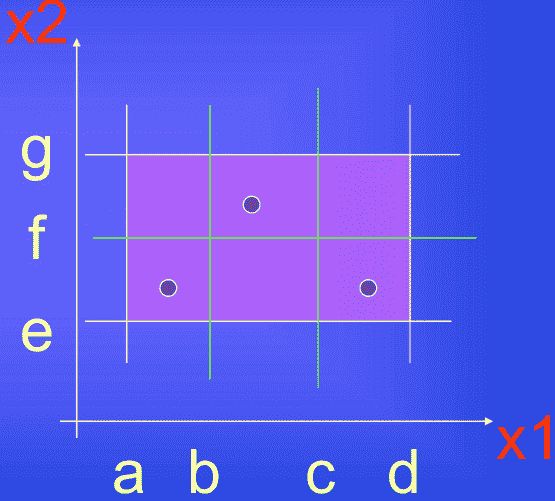

## 强一般等价类测试

- 多缺陷假设  
- 需要等价类笛卡儿积的每个元素对应的测试用例  
- 确保完备性  
  - 覆盖所有的等价类  
  - 有可能的输入组合中的一个  

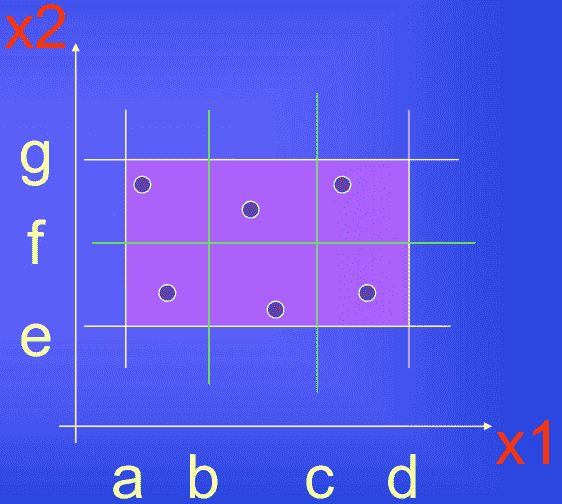

## 弱健壮等价类测试

- 单缺陷假设，弱  
- 考虑的无效值，健壮  

1. 对于有效输入，使用每个有效类的一个值，所有输入都是有效的  
2. 对于无效输入，测试用例将拥有一个无效值，并保持其余的值是有效的  

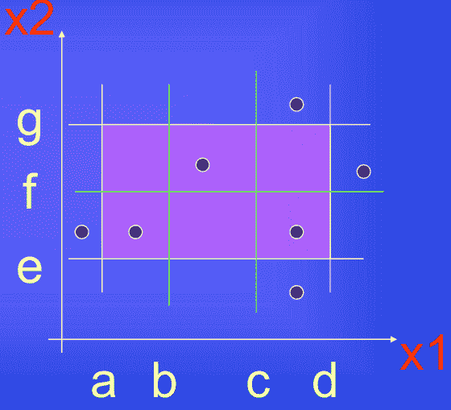

## 强健壮等价类测试

- 多缺陷假设，强  
- 考虑的无效值，健壮  

- 从所有等价类笛卡儿积的每个元素中获得测试用例  

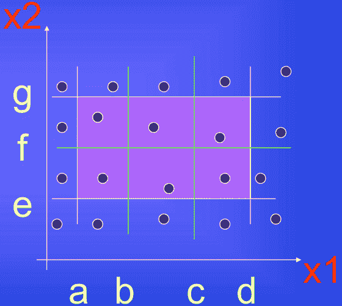

## 等价类测试用例举例-三角形

### 等价类

- R1={<a,b,c>:有三条边a，b和c的等边三角形}  
- R2={<a,b,c>:有三条边a，b和c的等腰三角形}  
- R3={<a,b,c>:有三条边a，b和c的不等边三角形}  
- R4={<a,b,c>:三条边a，b和c不构成三角形}  

### 弱一般等价类测试用例

| 测试用例 | a | b | c | 预期输出 |
|---|---|---|---|---|
| Wn1 | 5 | 5 | 5 | 等边 |
| Wn2 | 2 | 2 | 3 | 等腰 |
| Wn3 | 3 | 4 | 5 | 不等边 |
| Wn4 | 4 | 1 | 2 | 非三角形 |

### 弱健壮等价类增加的测试用例

| 测试用例 | a | b | c | 预期输出 |
|---|---:|---:|---:|---|
| WR1 | -1 | 5 | 5 | a非法 |
| WR2 | 5 | -1 | 5 | b非法 |
| WR3 | 5 | 5 | -1 | c非法 |
| WR4 | 201 | 5 | 5 | a非法 |
| WR5 | 5 | 201 | 5 | b非法 |
| WR6 | 5 | 5 | 201 | c非法 |

### 强健壮等价类增加的测试用例（部分）

| 测试用例 | a | b | c | 预期输出 |
|---|---:|---:|---:|---|
| SR1 | -1 | 5 | 5 | a非法 |
| SR2 | 5 | -1 | 5 | b非法 |
| SR3 | 5 | 5 | -1 | c非法 |
| SR4 | -1 | -1 | 5 | a,b非法 |
| SR5 | 5 | -1 | -1 | b,c非法 |
| SR6 | -1 | 5 | -1 | a,c非法 |
| SR7 | -1 | -1 | -1 | a,b,c非法 |

## 等价类测试用例设计的步骤

- 分析需求描述  
- 划分测试功能的粒度  
- 确定每个测试功能的输入和输出  
- 对输入/输出划分等价类  
- 选择等价类的方法，计算测试用例数量  
- 设计测试用例  

## 等价类测试总结

- 等价类测试的弱形式不如强形式的测试全面  
- 如果错误条件非常重要，有必要进行健壮形式的测试  
- 如果输入数据以离散值区间和集合定义，则等价类测试是合适的  
- 通过结合边界值测试，等价类测试可以得到加强  
- 如果函数很复杂，需要做等价类测试  
- 强等价类测试假设变量是独立的，相应的测试用例相乘会引起冗余问题。如果存在依赖关系，则常常会生成错误的测试用例  
- 在确定合适的等价关系之前，可能需要进行多次尝试  
- 强和弱形式的等价类测试之间的差别，有助于区分累进测试和回归测试  

## 等价类划分练习

这是一个航空行李托运费的算法，具体如下：

按规定：重量不超过30公斤的行李可免费托运；重量超过30公斤时，对超运部分，头等舱国内乘客收4元/公斤；其他舱位国内乘客收6元/公斤；外国乘客收费为国内乘客的2倍；残疾乘客的收费为正常乘客的1/2。

## 基于UML的系统测试

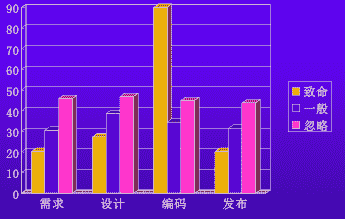

### 议题

- 基于UML的需求描述：用例图和用例规约  
- 使用用例图和用例规约设计系统测试用例  

## 软件需求描述

- 用例图（use case diagram），描述系统外部的执行者(Actor)与系统提供用例(Use Case)之间的关系。  
- 用于描述系统的需求  
- 用例规约和补充规约  

## 用例图

- （use case diagram），描述系统外部的执行者(Actor)与系统提供用例(Use Case)之间的关系。  
- 用于描述系统的需求  

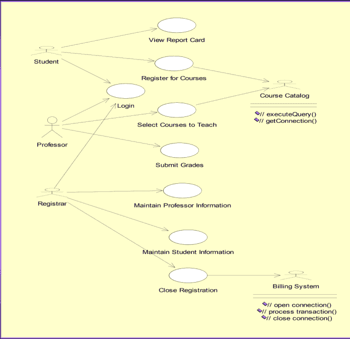

## 用例和参与者

- 用例：（Use Case）表示从用户角度对系统的要求，因此表示系统功能  
- 参与者：（Actor）是系统的主体，表示提供或接收系统信息的人或系统  

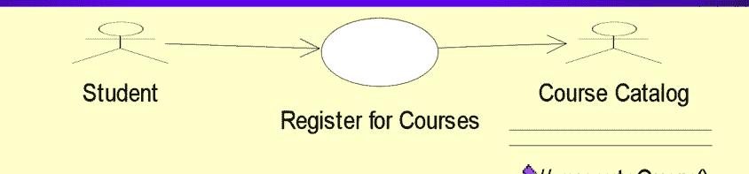

## 用例规约

- 课程注册用例规约  

## 基于用例设计系统测试用例的步骤

- 分析UML面向对象生成的需求——用例和用例规约  
- 分析并绘制出用例规约的事件流图，包括基本流和被选流  
- 根据系统功能要求，使用基本流和被选流形成若干个需要测试的用例场景  
- 分析确定每个测试用例场景的输入参数及其有效性  
- 设计出每个用例场景的测试用例  
- 用数据表格的形式或者动作-响应序列的形式书写用例  

## 测试用例详细说明

- ATM机的用例测试  

## 练习和实验

- 工资支付方式选择用例的测试  

## 集成测试

## 集成测试方法与原理

1、非渐增式测试（Big-bang testing）

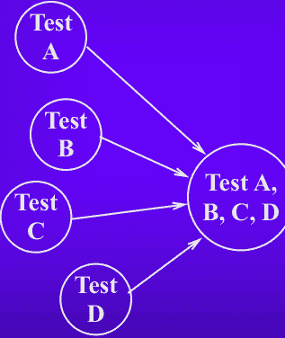

## 集成测试

2、Incremental testing 的几种策略

(1) Top-down testing

第1步：测试顶端模块，用存根程序（stub）代替直接附属的下层模块

stub: to simulate the activity of the component which is not yet tested.


## 集成测试

第2步：根据深度优先或宽度优先的策略，每次用一个实际模块代换一个 stub。

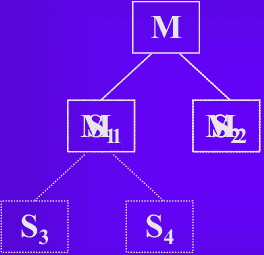

第3步：在结合进一个模块的同时进行测试。

第4步：回归测试（regression testing）——全部或部分地重复以前做过的测试。

## 集成测试

第3步：去掉Driver，自下而上把子功能族合成更大的子功能族。

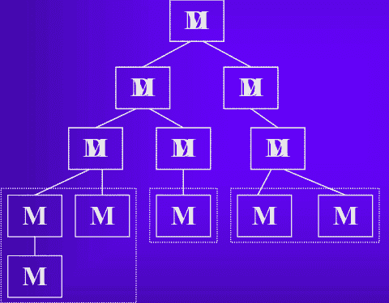

> 注意：两种策略的优、缺点刚好互补，但单用其中任一种都不实际，通常根据软件的特点将二者混用。

## 集成测试

### 两种方式的比较：

- Incremental testing 可以较早发现模块间的接口错误；Big-bang testing 最后才组装，因此错误发现得晚。
- Big-bang testing 中发现错误后难以诊断定位；Incremental testing 中，出现的错误往往跟最新加入的模块有关。
- Incremental testing 在不断集成的过程中使模块不断在新的条件下受到新的检测，测试更彻底。
- Incremental testing 较 Big-bang testing 费时。Big-bang testing 可以同时并行测试所有模块，能充分利用人力。


## OO中的集成测试

- OO没有层次控制结构，传统方式不再适用
- OO集成测试的策略
  - 基于线程的测试
    - 集成对回应系统的一个输入或事件所需的一组类，每个线程被集成并分别测试。
  - 基于使用的测试
    - 首先，测试独立类，从而开始构造系统
    - 然后，测试下一层的依赖类，通过依赖类层次的测试序列逐步构造完整的系统

## 面向对象的集成测试

## 集成测试的UML支持

在采用UML定义的面向对象软件中，协同图和序列图是集成测试的基础。在系统层，UML描述由各种层次的“用例”、“用例”图、类定义和类图组成。一旦定义了这一层，就增加了集成层细节。协同图显示类之间的（部分）信息传输。图18-1是o-oCalendar应用程序的协同图。

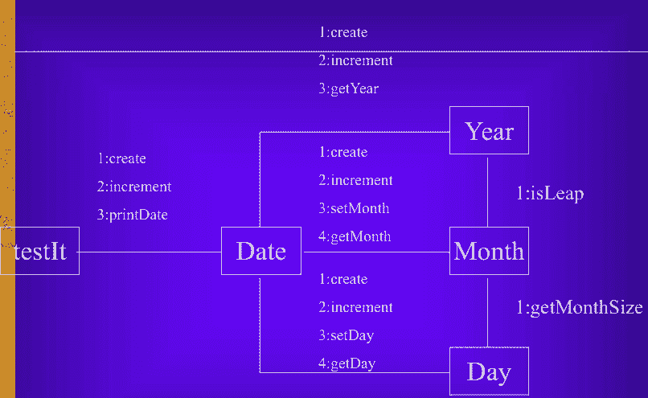

### O-OCalendar的协同图

根据协同图，可以得到以下要集成的类对：

- testIt和Date，为Year、Month和Day建立桩。
- Date和Year，为testIt、Month和Day建立桩。
- Date和Month，为testIt、Year和Day建立桩。
- Date和Day，为testIt、Month和Year建立桩。
- Year和Month，为Date和Day建立桩。
- Month和Day，为Date和Year建立桩。


以协同图为基础进行面向对象集成测试的缺点是，在类级，UML所选的行为模型是“状态图”。对于类级行为，“状态图”是测试用例的很好的基础，特别适合以类为单元的测试。不过问题是，一般来说很难合并“状态图”，以便在较高层次上观察行为。

这种序列图的实际测试应该采用与以下类似的伪代码：

1. testDriver
2. m.setMonth(1)
3. d.setDay(15)
4. y.setYear(2002)
5. Output(“expected value is 1/15/2002”)
6. Output(“actual output is”)
7. test.printDate()
8. End testDriver

## 面向对象软件的MM一路径

面向对象软件中的MM-路径是由消息连接起来的方法执行序列。

原子功能（ASF）是一种MM-路径，从输入端口事件开始，到输出端口事件结束。

```
Class Date
private Day d
private Month m
private Year y

4    Date(pMonth,pDay,pYear)                         msg4
5    y=instantiate Year(pYear)                       msg5
6    m=instantiate Month(pMonth,y)                    msg6
7    d=instantiate Day(pDay,m)
     End     ‘Date constructor
8    increment()
9    if(NOT(d.increment()))                            msg7
10   Then
11       if(NOT(m.increment()))                        msg8
12       Then
13	y.increment()msg9
14	m.setMonth(1,y)							msg10
15	Else
16	d.setDay(1,m)							msg11
17	EndIf
18	EndIf
End	'increment
19	printDate()
20	Output(m.getMonth()+"/"+d.getDay()+"/"+y.getYear())
msg12,msg13,msg14
End	'printDate
class Day isA calendarUnit
Private month m
21	Day(pDay,Month pMonth)
22	setDay(pDay,pMonth)							msg15
```

```
End    ‘Day constructor

23     setDay(pDay,Month pMonth)
24     setCurrentPos(pDay)                         msg16
25     m=pMonth
End    ‘setDay
26     getDay()
27     return currentPos
End    ‘getDay

28     boolean increment()
29     currentPos=currentPos+1
30     if(currentPos<=m.getMonthSize())             msg17
31     Then return true
32     Else return false
33     EndIf
End    ‘increment
```

## Class Month isA CalendarUnit

private Year y

private sizeIdx=<31,28,31,30,31,30,31,31,30,31,30,31>

34 Month(pcur,Year pYear)

35 setMonth(pCurrentPos,Year pyear) msg18

End ‘Month constructor

36 setMonth(pcur,Year pYear)

37 setCurrentPos(pcur) msg19

38 y=pYear

End ‘setMonth

39 getMonth()

40 return currentPos

End ‘getMonth

41 getMonthSize()

```
42 if(y.isleap())
43 Then sizeIndex[1]=29
44 Else sizeIndex[1]=28
45 EndIf
46 rturn sizeIndex[currentPos-1]
End 'getMonthSize
47 boolean increment()
48 currentPos=currentPos+1
49 if(currentPos>12)
50 Then return flase
51 Else return true
52 EndIf
End 'increment
class Year isACalendarUnit
53 Year(pYear)
```

```
54    setCurrentPos(pYear)
    End   'Year constructor
55    getYear()
56    return currentPos
    End   'getYear
57    boolean increment()
58    currentPos=currentPos+1
59    return true
    End   'increment
60    boolean isleap()
61    if(((currentPos MOD4=0)AND NOT(currentPos MOD400=0))OR
    (currentPos MOD400=0))
62    Then return true
63    Else return false
64    EndIf
    End   'isleap
```


## 2008年1月15日实例化Date的部分MM—路径：

```
testlt<1>

msg1

Date:testdate<4,5>

msg4

Year:y<53,54>

msg21

Year: setCurrentPos<a,b>

(return to Year:y)

(return to Date:testdate)

Date:testdate<6>

msg5

Month:m<34,35>

msg18
```


Month:m:setMonth<36,37>
msg19
Month:m:setCurrentPos<a,b>
(return to Month:m:setMonth)
(return to Month:m)
(return to Date:testdate)
Date:testdate<7>
msg6
Day:d<21,22>
msg15
Day:d:setDay<23,24>
msg16
Day:d:setCurrentPos<a,b>
(return to Day:d:setDay)

Day:d:setDay<25

(return to Day:d)

(return to Date:testdate)

以下是用2008年4月30日实例化的更有意思的MM一路径:

testlt<2>

msg2

Date:testdate.increment<8,9>

msg7

Day:d.increment<28,29> `now Day:d.currentPos=31

msg17

Month:m.getMonthSize<41,42>

msg20

Year:y.isleap<60,61,63,64> `not a leap year

(return to Month:m.getMonthSize)

Month:m.getMonthSize<44,45,46> `returns month size=30`

(return to Day:d.increment)

Day:d.increment<32,33> `returns false`

(return to Date:testdate.increment)

Date:testdate.increment<10,11>

msg8

Month:m.increment<47,48,49,51,52> `returns true`

(return to Date:testdate.increment)

Date:testdate.increment<15,16>

msg11

Day:d.setDay<23,24,25> `now dayis 1,month is 5`

(return to Date:testdate.increment)

Date:testdate.increment<17,18>

(return to test1)


实例化Date(2008年1月15日)的MM一路径：

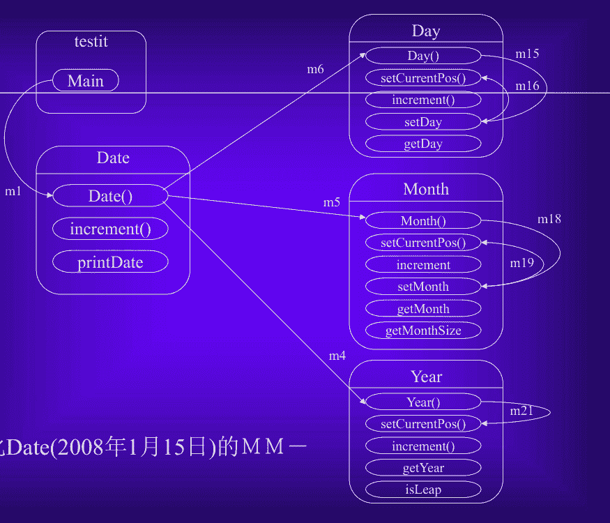

## Date.increment(2008年4月30日) 的 MM 一路径：

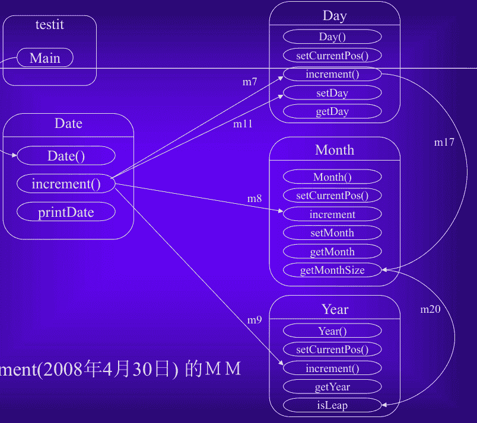

## 面向对象数据流集成测试框架

定义集成测试MM-路径可与DD-路径对比。DD-路径测试常常是不充分的，在这种情况下，采用数据流测试更合适。对于面向对象软件的集成测试也是这样，且需求更强烈。因为（1）取值可以通过继承树得到。（2）数据可以在消息传递的不同阶段定义。


# 图18-6 EMDPN的符号

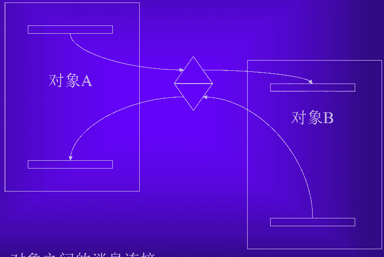

## 对象之间的消息连接

图18-9中的EMDPN给出了三个对象之间的消息通信。作为定义一使用路径的一个例子，假设mep3是要由mep5转发，在mep6中修改，并最终在Use节点mep3中使用的数据项的“定义”节点。我们可以标识这两条定义一使用路径：

du1<=<mep3,msg2,mep5,d6,mep6,return(msg2),mep4,return(msg1),mep2>

Du2<=<mep6,return(msg2),mep4,return(msg1),mep2>

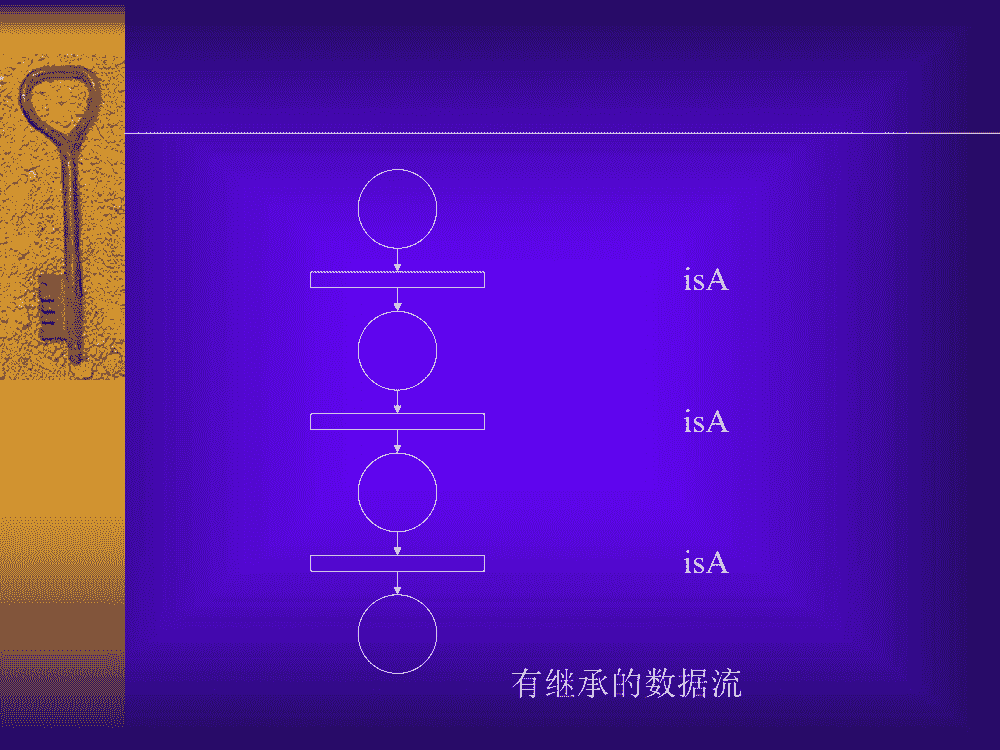

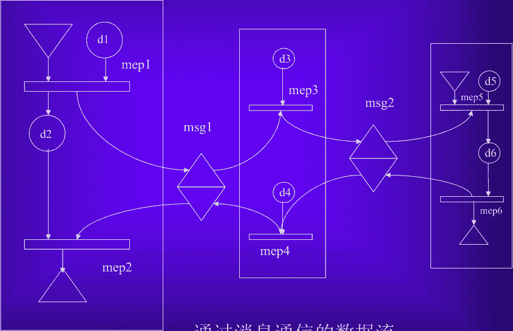

## 通过消息通信的数据流

左侧模块包含 d1、d2、mep1、mep2 和 msg1；中间模块包含 d3、d4、mep3、mep4 和 msg2；右侧模块包含 d5、d6、mep5、mep6。

## 单元测试


### 议题

- 单元测试
  - 目标
    - 任务
  - 单元测试技术
    - 静态分析
    - 测试设计
  - 单元测试流程
    - 管理流程
    - 测试文档

## 单元测试

### 概况

#### 定义：

- 检验程序最小单位有无错误。一般在编码之后，由开发人员完成。
  - 单元：软件开发中的最小的独立部分
    - C语言中的单元：函数或者是子过程
    - C++语言中的单元：类

#### 目前状况：

- 实施效果非常好，但是实施阻力比较大(主要是人员和管理因素)，一般只在关键的程序单元中实施
- 有比较系统的理论和方法，但也依赖于系统的特殊性和开发人员的经验
- 有大量的辅助工具，开发人员也经常自己开发测试代码和测试工具
- 主要使用白盒测试和静态分析，也使用黑盒测试

## 单元测试

- **任务1、模块接口测试**
  - 检查进出模块的数据是否正确
  - Checklist:
    - 模块的实际输入与定义的输入是否一致
      - 个数、类型、顺序
    - 模块中对于非内部/局部变量是否合理使用
    - 使用其他模块时，是否检查可用性和处理结果
    - 使用外部资源时，是否检查可用性并及时释放资源
      - 内存、文件、硬盘、端口等
    - 其他

## 单元测试

- 任务2、模块局部数据结构测试
  - 检查局部数据结构能否保持完整性
  - Checklist:
    - 变量从来没有被使用
      - 可能别的地方使用了错误的变量名
    - 变量没有初始化
    - 错误的类型转换
    - 数组越界
    - 非法指针
    - 变量或函数名称拼写错误
      - 使用了外部变量或函数
    - 其他

## 单元测试

### 任务3、模块边界条件测试

#### -检查临界数据是否正确处理

#### -Checklist:

- 普通合法数据是否正确处理
- 普通非法数据是否正确处理
- 边界内最接近边界的(合法)数据是否正确处理
- 边界外最接近边界的(非法)数据是否正确处理
- 其他

## 单元测试

- 任务4、模块独立执行通路(路径)测试
  - 检查由于计算错误、判定错误、控制流错误导致的程序错误
  - Checklist:
    - 死代码
    - 错误的计算优先级
    - 精度错误
      - 比较运算错误
      - 赋值错误
    - 表达式的不正确符号
      - >、>=; =、==、!=
    - 循环变量的使用错误
      - 错误赋值
    - 其他


## 单元测试

- 任务5、模块内部错误处理测试
  - 检查内部错误处理设施是否有效
  - Checklist:
    - 是否检查错误出现
      - 资源使用前后
      - 其他模块使用前后
    - 出现错误，是否进行错误处理
      - 抛出错误
      - 通知用户
      - 进行记录
    - 错误处理是否有效
      - 在系统干预前处理
      - 报告和记录的错误真实详细
    - 其他

## 单元测试技术

- 静态分析-走查
  - 定义：
    - 开发组内部进行的，采用讲解、讨论和模拟运行的方式进行的查找错误的活动。
  - 经验：
    - 限时
      - 避免跑题
    - 参加人员
      - 经验丰富的开发人员
      - 和本模块相关的开发人员
      - 本项目组的新人
    - 由本模块的开发者进行讲解、回答问题并记录
      - 不要现场修改
    - 检查要点
      - 逻辑错误
      - 代码标准/规范/风格

## 单元测试技术

- 静态分析-审查
  - 定义：
    - 开发组内部进行的，采用讲解、提问并使用Checklist方式进行的查找错误的活动。一般有正式的计划、流程和结果报告。
  - 经验：
    - 以会议的形式，制定会议目标、流程和规则，结束后要编写报告
    - 参加人员
      - 经验丰富的开发人员
      - 和本模块相关的开发人员
      - 本项目组的新人
    - 由另外一名开发者进行讲解、其他开发者主要按照Checklist进行提问并填表、本模块开发者回答问题并记录
      - 不要现场修改
    - 检查要点
      - 设计需求
      - 代码标准/规范/风格

## 单元测试技术

### ♦ 静态分析-评审

- 定义：
  - 开发组、测试组和相关人员(QA、产品经理等)联合进行的，采用讲解、提问并使用Checklist方式进行的查找错误的活动。一般有正式的计划、流程和结果报告。

- 经验：
  - 以会议的形式，制定会议目标、流程和规则，结束后要编写报告。相关资料要在会议前下发并阅读。
  - 参加人员
    - 经验丰富的开发人员
    - 和本模块相关的开发人员
    - 测试组和相关人员
  - 由另外一名开发者进行讲解，其他开发者主要按照Checklist进行提问并填表、本模块开发者回答问题并记录
    - 不要现场修改
  - 检查要点
    - 设计需求
    - 代码标准/规范/风格
    - 文档的完整性和一致性

## 单元测试技术

- 测试设计
  - 定义：
    - 依据模块的内部结构，设计测试用例的过程。
    - 主要采用白盒测试技术，关注逻辑覆盖
  - 原则：
    - 1、保证没有死代码
      - 保证一个模块中的每个独立路径都可能被使用到
    - 2、保证对所有的逻辑值都测试true和false
    - 3、在上下边界和合法的范围内运行所有的循环
    - 4、确保内部数据结构的有效性和完整性

## 单元测试技术

- 测试设计
  - 逻辑覆盖测试方法：
    - 1、语句覆盖
    - 2、判定覆盖
    - 3、条件覆盖
    - 4、判定/条件覆盖
      - 选择足够的测试用例，使得同时满足判定覆盖和条件覆盖。
    - 5、条件组合覆盖
      - 选择足够的测试用例，使得程序中每一个分支判断中的每一个条件的每一种可能组合结果都至少被执行一次。
    - 6、路径覆盖
      - 选择足够的测试用例，使得程序中所有的可能路径都至少被执行一次。

## 单元测试技术

- 测试设计
- 逻辑覆盖测试方法：

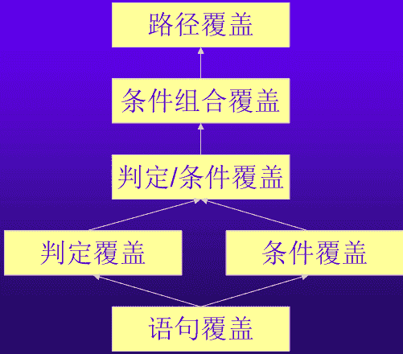

## 单元测试流程

◆ 管理流程
　主要指动态测试应用实施流程。

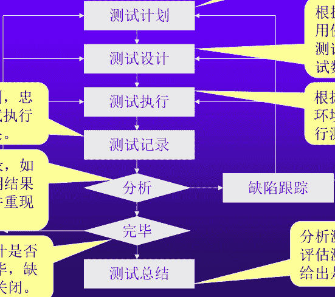

针对测试目标，规定测试任务、资源分配、人员角色、进度安排等。

根据测试计划，设计测试用例，包括：测试步骤、测试场景、测试代码、测试数据（包括预期结果）。

根据测试计划，配置测试环境，并手动或者自动执行测试设计。

记录、分发、评估、关闭缺陷报告。

分析测试过程和缺陷报告，评估测试质量和测试效果，给出是否通过测试的建议。

根据测试计划，忠实地记录测试执行的过程和结果。

分析测试记录，如果发现与预期结果不同，确定并重现缺陷。

检查测试设计是否全部执行完毕，缺陷是否全部关闭。

## DD_PATH测试

- 在测试过程中，选择足够的测试用例，使得程序中的每一条可能执行的路径都至少执行一次
- 参看例子

## 动态白盒测试

## 测试方案技术—白盒测试

# 2. 白盒法

- ✓ 白盒法需要了解程序的功能与结构，测试用例必须根据程序内部的逻辑来设计。如果想用白盒法发现程序中的所有错误，则至少必须使程序中每种可能的路径都执行一次。

- ✓ “彻底地测试”是不可能的，故策略是：在一定的研制时间、研制经费的限制下，通过执行有限的测试用例，尽可能多地发现一些错误。

- ✓ 白盒法又称为逻辑覆盖法，目前常用的覆盖法有：


## 测试方案技术—白盒测试

### (1)语句覆盖
✓即每个语句至少能执行一次

**Test case :**
**A=2 , B=0 , X=4.**

问题：若AND错写为OR，或X>1错写为X<1，则错误无法由上例测出。

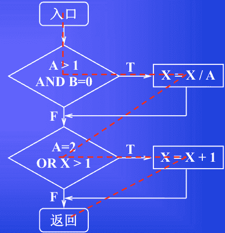

## 测试方案技术—白盒测试

# ## (2)判定覆盖

✔判定覆盖又叫分支覆盖，含义是：每个判定的分支至少执行一次。

Test cases:

①A=3，B=0，X=3

②A=2，B=1，X=1

问题：若X>1错写为X<1,仍然无法被测出。

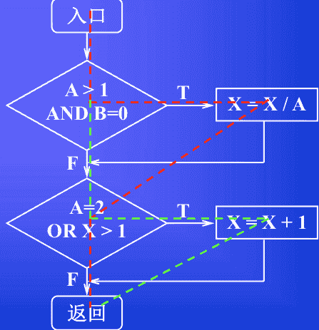

## 测试方案技术—白盒测试

# ## (3)条件覆盖

✓即一个判断语句中往往包含了若干条件。通过给出测试用例，使判断中的每个条件都获得各种可能的结果。

Test cases:
①A=2 , B=0 , X=4
（满足A>1, B=0; A=2, X>1）
②A=1, B=1, X=1
（满足A≤1, B≠0; A≠2, X≤1）

问：条件覆盖？—判定覆盖
答：不一定。
反例：①A=2, B=0, X=1
②A=1, B=1, X=2

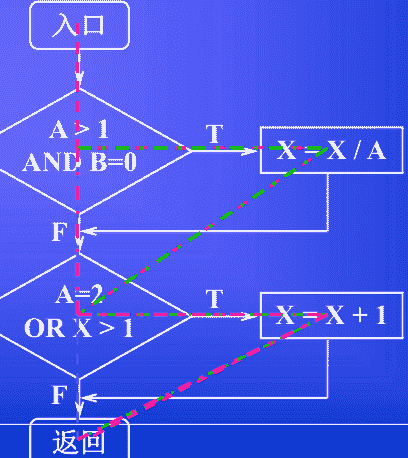

## 测试方案技术—白盒测试

# ## (5)条件组合覆盖

✓使得每个判断中条件的各种可能组合都至少出现一次。

全部可能的条件组合为：

① A>1, B=0  ② A>1, B≠ 0  
③ A≤1, B=0  ④ A≤1, B≠ 0  
⑤ A=2, X>1  ⑥ A=2, X≤ 1  
⑦ A ≠ 2, X>1  ⑧ A ≠ 2,X≤ 1

Test cases：

① A=2, B=0, X=4 ( T T)  
② A=2. B=1, X=1 ( F T)  
③ A=1, B=0, X=2 ( F T)  
④ A=1, B=1, X=1 ( F F)

问题：没有测试到（TF）的情形

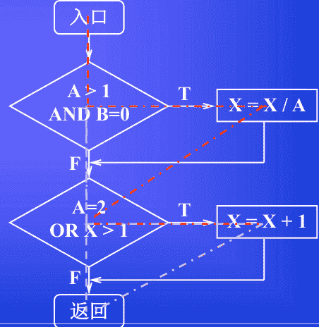

## 测试方案技术—白盒测试-路径覆盖

控制流程图：结点/分支/过程块/链

## 路径

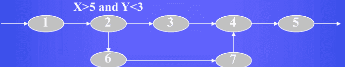

其中：节点1、节点3、节点5、节点6、节点7为过程块

节点2为分支，节点4为结点


### 举例

以下为一个程序流程图，其中该例子中有两个判断，每个判断都包含复合条件的逻辑表达式。

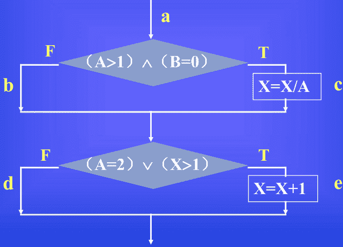

## 其控制流程图

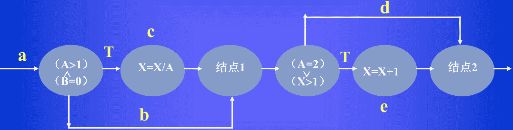

## 路径

该控制流程图有4条不同的路径。4条路径可表示为：

- L1（a→c→e）简写 ace、L2（a→b→d）简写 abd
- L3（a→b→e）简写 abe、L4（a→c→d）简写 acd

## 路径测试

- 执行所有可能的穿过程序的控制流程路径。
- 一般来说，这一测试严格地限制为所有可能的入口/出口路径。如果遵循这一规定，则我们说达到了100%路径覆盖率。在路径测试中，该策略是最强的，但一般是不可实现的。
- 针对该例子，要想实现路径覆盖，可选择以下一组测试用例（规定测试用例的设计格式为：【输入的（A，B，X），输出的（A，B，X）】）。

| 测试用例 | 覆盖路径 |
|---|---|
| 【（2，0，4），（2，0，3）】 | L1 |
| 【（1，1，1），（1，1，1）】 | L2 |
| 【（1，1，2），（1，1，3）】 | L3 |
| 【（3，0，3），（3，0，1）】 | L4 |

## 循环情况的路径选取

还要考虑循环变量的具体情况

### 关键路径的选取

- 主要功能路径
- 没有功能的路径
- 最短路径
- ...

## 程序复杂性度量与错误之间的关系

### ☆ 代码行度量

- 以源代码的行数--度量程序的复杂性。
- Thayer指出，程序出错率为100行源程序中可能存在0.04-7个错误

出错率与源程序行数之间不存在简单的线性关系

Lipow指出，对于小程序，每行代码（执行部分）的出错率为1.3%-1.8%

对于大程序，每行代码（执行部分）的出错率为2.7%-3.2%

对于少于100个语句的程序，出错率与源程序行数之间是线性关系的；

随着程序的增大，出错率以非线性方式增长。

## 程序复杂性度量与错误之间的关系

### 环路复杂性度量-McCabe度量法

-基于程序控制流的复杂性度量方法

程序图：把程序流程图中的每个处理符号退化为一个结点，把连接每个处理符号的链转变为连接结点的有向弧，所得到的有向图称为程序图。

程序图的语义：描述程序内部的控制流程，不表现对数据的具体操作以及分支和循环的具体条件。

即该方法把简单的条件语句与复杂的循环语句的复杂性视为一样；把嵌套的IF语句与CASE语句的复杂性视为一样。

根据图论，在一个强连通的有向图中，环的个数为：

$V(G)=m-n+p$

其中：m为图中的弧数，n为图中的结点数，p为图中强连通分量数

程序总是连通的，但一般不是强连通的，为此，需加一条从入口到出口的虚线。

据此，上例中的环数为：13-11+1=3

即McCabe度量法的度量值为3。

注：环路复杂度是可加的。

为软件测试的难度提供了一种定量度量方法。

McCabe发现，在276个程序中，有23%的子程序的复杂度超过10，
而在这些子程序中发现的错误占总错误的53%，因此，他建议，如果程序的复杂度超过10，那么就应该对这一程序进行分解。

## DD路径测试举例

## 小结

- 动态白盒测试
- DD路径测试

### 议题

- 以方法为单元的测试
- 以类为单元的测试

## OO中的单元测试

- 最小的测试单元是封装的类或对象
- 类或对象包含属性和一组操作方法
- 测试封装在类中的操作和类的状态变化

## 类图（UML）


**RegistrationController**（<<Control>>）

- `# submit schedule()`
- `# save schedule()`
- `# create schedule with offerings()`
- `# get course offerings()`

**ICourseCatalogSystem**（<<interface>>）

- `+ getCourseOfferings(in forSemester : Semester) : CourseOfferingList`

**Schedule**（<<entity>>）

- `- semester : Semester`
- `+ submit()`
- `+ save()`
- `# any conflicts()`
- `# create with offerings()`

**Student**（<<Entity>>）

- `- name`
- `- address`
- `- StudentID : int`
- `+ addSchedule(in aSchedule : Schedule)`
- `+ getSchedule(in forSemester : Semester) : Schedule`
- `+ hasPrerequisites(in forCourseOffering : CourseOffering) : boolean`
- `# passed(in aCourseOffering : CourseOffering) : boolean`

**CourseOffering**（<<Entity>>）

- `- number : String = "100"`
- `- startTime : Time`
- `- endTime : Time`
- `- day : String`
- `+ addStudent(in aStudentSchedule : Schedule)`
- `+ removeStudent(in aStudentSchedule : Schedule)`
- `+ new()`
- `+ setData()`

图中标注：`Global visibility`、`Field visibility`、`Parameter visibility`。

## 以方法为单元的测试

- 将面向对象的单元测试等同于传统的单元测试
- 方法/操作相当于过程函数
- 需要建立相应的测试驱动程序

## 单元测试

- 由于类的封装，使得类中方法的复杂度比较低，测试较为容易
- 主要使用传统的测试方法
  - 白盒测试
    - 审查
    - 覆盖性测试
  - 黑盒测试
    - 边界值
    - 等价类

## 以类为单元的测试

- 实际上是类内的单元测试和集成测试
- 主要是类内部的方法和消息带来的类状态的变化

- 定义类内的状态图
- 选择基于状态图的测试覆盖指标，比如
  - 每个事件
  - 组件中的每个状态
  - 组件中的每个转移
  - 所有交互状态对偶
  - 对应于客户定义用例的场景

### 举例

- ➤ 参见书17章

## 类的状态图（UML）


## 性能测试

### 1.响应时间

定义：
响应时间指的是从客户端发起一个请求开始，到客户端接收到从服务器端返回的响应结束，这个过程所耗费的时间。

响应时间通常用时间单位来衡量，

例如

秒（seconds）

或者

毫秒（milliseconds）

## 响应时间 vs 负载


## 图形中的拐点

- 表示响应时间突然增加
- 意味着一种或者多种系统资源的利用达到了极限

## 例如：

- 很多Web服务器可以设置固定数量的threads来处理用户同时发出的请求。
- 当这些并发的请求数量超过当前有效的threads数量时，任何新到的请求将会被放入一个队列中等待系统的处理。
- 这个在队列中等待的时间将会使响应时间大大的增加。


## 响应时间的分解

响应时间 = 网络响应时间 + 应用程序响应时间

### 网络响应时间

网络响应时间指的是数据从一个服务器到另一个服务器在网络上传输所需花费的时间。

### 应用程序响应时间

应用程序响应时间指的是服务器处理数据所需花费的时间。

## 2. 吞吐量

◆ 定义

吞吐量指的是单位时间内处理的客户端请求数量。

通常情况下，吞吐量用请求数/秒或页面数/秒来衡量。

从业务角度看，吞吐量也可以用访问人数/天或页面访问量/天来衡量。

### 吞吐量 vs 负载

## 3. 资源利用率

+ 定义

资源利用率指的是对不同系统资源的使用程度，例如服务器的CPU，内存，网络带宽等。

资源利用率通常以占用最大值的百分比来衡量。

### 资源利用率 vs 负载

+ 当某个资源利用率随着负载的增加最终在100%居高不下时，就可能意味着这个资源变成了系统的性能瓶颈所在。

提高这个资源的量，将会提高系统的吞吐量，同时降低交易的响应时间，即改进了系统的性能。

◆ 当你要衡量或者测试的某个资源总是无法达到100%的利用时，很有可能这时其他的某个或者某些资源已经达到了最大的使用率。它们已经变成了系统的性能瓶颈。

+ 现象：响应时间骤增到45秒，但是CPU的利用率只达到60%。
+ 说明：如果在测试中单独的观察CPU或者是内存的利用率，对于分析定位性能瓶颈是没有什么帮助的。

### 应用程序

+ 绝大部分的传统应用程序是针对单个用户的，而现在的 Web 应用程序都是被设计来能够支持大量的并发用户。
+ 性能测试已经成为部署 Web 应用程序及其他类似程序的不可或缺的步骤。

### 性能测试的应用领域

+ 能力规划
+ 性能调优
+ 缺陷修复

### 能力规划

#### 几个问题

+ 在要求平均响应时间小于5秒的前提下，你如何判断系统是否能够支持200万用户/天的访问量？
+ 如果你的公司计划在将来的两个月内把业务量提高200%，你如何判断公司的Web应用系统是否需要升级服务器的配置或者是增加服务器的数量？
+ 你的网站系统在每个月的纳税期高峰日中，能够承受往常6倍的访问量吗？

#### 方法一：负载测试

使用测试环境模拟不同程度的负载，收集系统在不同程度负载下的表现情况，依此来了解系统的能力（不同负载级别时的响应时间、吞吐量和资源利用率）。

#### 方法二：配置测试

在不同硬件配置的情况下对系统进行负载测试。例如CPU数量为1，2，4，6。

### 性能调优

#### 问题

- 当系统的用户访问量在不断的快速增加时，运营小组该怎么办？

#### 解决方法

+ 升级服务器的硬件，换成更快、更大的机器。
+ 增加服务器的数量。
+ 还有一种方法：
  - 对系统和应用程序进行仔细的调优，以提高响应时间、吞吐量和资源利用率的性能指标。

#### 1秒的影响

对于单个用户的响应时间，1秒的差距可能不显著，甚至被忽视。但是对于一个不间断的被成百上千用户同时访问的服务器来说，每个用户的响应时间都缩短1秒将是非常巨大的区别。

#### 调优的对象

+ 应用程序
+ 系统平台设置
+ Web服务器设置

#### 调优的方法

+ 每次改变一个系统参数或者一个应用逻辑
+ 使用固定的负载
+ 测试另一个设置之前收集本次性能测试的数据。
+ 重复测试过程，直到应用程序的性能达到了期望的状态。

### 缺陷修复

#### 问题

+ 某些缺陷只有在高负载的情况下才能暴露出来。
  例如：内存泄露

### 典型测试方法详解

+ 负载/压力测试
+ 能力测试
+ 事务资源消耗分析测试

### 负载/压力测试

+ 负载测试有时也称为压力测试
+ 负载测试的目的是在不同用户压力下检查相应的响应时间、吞吐量、资源利用和其他的指标
+ 需要模拟真实的用户行为
  - 服务器日志文件
  - 现有的Web站点
  - 类似业务的市场信息

#### 步骤

+ 第一步
  - 根据用户活动类型定义测试脚本
  - 定义每个测试脚本所占百分比
  - 定义 Think Time
  - 例如：

| 活动 | 百分比 | Think Time |
|---|---:|---:|
| 关键字检索 | 11% | 0s |
| 分类浏览 | 59% | 1s |
| 访问首页 | 30% | 5s |

+ 第二步
  - 使用测试工具执行测试
  - 根据应用程序性能和系统配置情况确定虚拟用户数序列
    `{50, 100, 200, 300, 500, 1000...}`
  - 预先做短时间测试，估计序列的合适范围

+ 第三步
  - 收集测试数据
  - 制作分析图形
    1. 响应时间 vs 负载
    2. 吞吐量 vs 负载
    3. 资源利用率 vs 负载
  - 理解性能状况

### 能力测试

+ 目的是确定扩展系统能力以处理更多并发用户的最佳策略
+ 方式是在不同系统配置下进行一系列的负载测试
+ 每次改变一个系统配置，而保持其他的配置不变

### 举例

+ 例子：CPU能力测试
  - 避免物理拔插CPU
  - 通过更改系统启动配置文件来改变CPU数量
    - Windows系统
      - 打开“开始”菜单
      - 点击“运行”
      - 输入“notepad C:\boot.ini”
      - Boot.ini文件被打开
      - 在[operating systems]部分的最后处添加新的一行：`/NUMPROC=x`（x表示CPU的使用数量）

### TCA的方法

+ 针对一个特定的事务进行负载测试
+ 在测试的同时收集度量数据
+ 根据度量数据计算单元资源消耗成本/单元事务吞吐量
+ 根据计算结果，估算针对特定吞吐量目标而需要的CPU能力级别

## 小结

+ 性能测试的基本概念
+ 性能测试的应用

### 非功能测试应用


## 测试应用

- 配置测试
- 兼容性测试

### 配置测试

- 配置测试：保证测试的软件使用尽可能多样化的硬件组合
- 配置：
  - 主机
  - 组件：主板、磁盘驱动器、CD-ROM驱动器、视频卡、声卡、调制解调器、网卡等
  - 外设：打印机、键盘、鼠标、显示器、扫描仪、游戏杆、数码设备、U盘等
  - 接口：内部或者外部的适配器接口，ISA、PCI、USB、PS/2、RS232等
  - 内存：主机内存、组件内存
  - 设备驱动程序：用来完成组件外设与操作系统和应用软件的通信

### 配置测试考虑什么？

- 配置与软件的关系
- 例如：
  - 游戏软件：考虑视频和声音部分
  - 通信软件：考虑调制解调器和网络配置
  - 绘图软件：考虑显卡和显存、打印
  - 嵌入式软件：考虑接口


### 分离配置缺陷

- 确定缺陷是配置缺陷还是普通缺陷
- 方法：
  - 在另一台有完全不同配置的计算机上执行导致问题的相同操作。
  - 如果缺陷没有产生，就可能是配置问题；如果缺陷在多种配置中出现，就可能只有普通缺陷
- 配置缺陷可能产生的情况
  - 在多种配置中出现的缺陷
  - 可能在某种特定配置中出现的缺陷
  - 硬件设备或驱动程序中可能出现的由软件揭示的缺陷
  - 硬件设备或驱动程序中可能出现的由许多其他软件揭示的缺陷

### 计算工作量

- 配置测试工作量一般都比较大
- 比如：
  - 测试软件所使用的各种主要配置组件
  - 测试软件使用的每一种组件的型号和驱动
- 原则
  - 采用等价分配
  - 测试目前主流的
  - 约定测试配置的限度


### 配置测试设计


1. 确定所需的硬件类型
   - 比如
     - 声音
     - 图像
     - 打印
     - 远程访问

2. 确定硬件商标、型号和驱动程序
   - 正在流行的型号
   - 可用的硬件
   - 使用地域
   - 需要支持的历史型号
   - 划分等价区间
   - 确定需要测试的驱动程序
     - 可以是操作系统支持的，可以是硬件所带的，可以是网络下载的。

3. 确定可能的硬件特性、模式和选项
   - 每一种设备的选项：
     - 最小
     - 中间
     - 优化
     - 最大
   - 选定软件需要支持的特性选项
     - 没有必要支持全部特性
     - 比如显卡的色彩数和分辨率
     - 比如MODEM的波特率

4. 将明确后的硬件缩减为可控制的范围
   - 软件测试人员与开发人员共同识别
   - 根据配置硬件的列表，选取可用的和最有价值的项目进行测试

5. 明确使用硬件的软件唯一特性
   - 确定软件中的唯一特性
     - 不应该也不必要在每一种配置中完全测试软件
     - 测试那些与硬件交互方式不相同的特性


6. 设计在每一种配置中执行的测试用例
   - 选取测试的配置
   - 根据软件与硬件配置的特性联系，编写用例
     - 初始化
     - 启动软件
     - 输入特性项
     - 执行步骤
     - 输出项与要求
     - 软件缺陷判定

7. 在每种配置中执行测试

8. 反复测试直到满意为止
   - 有计划地从少到多测试
   - 逐渐缩小范围，确保软件缺陷被修复
   - 最终达到没有软件的配置缺陷

### 兼容性测试

检查软件之间是否正确地交互和共享信息

### 举例

- 从WEB页面剪贴文字，在字处理程序打开的文档中粘贴
- 在电子表格程序保存账目数据，在另一个完全不同的电子表格程序中读入
- 使照片修饰软件在同一操作系统下的不同版本正常工作
- 升级到新的数据库程序，读入现存所有数据库，像老程序一样对其进行处理

### 兼容性测试要考虑的问题

- 软件设计要求与何种其他平台（操作系统、WEB浏览器或者操作系统）和应用软件保持兼容？如果要测试的软件是一个平台，那么设计要求其如何让应用程序在其上运行？
- 应该遵守何种定义软件之间交互的标准或者规范？
- 软件使用何种数据与其他平台和软件交互和共享信息？


### 平台和应用程序版本

- 软件设计用于某个操作系统、WEB浏览器等，同时还要明确需要兼容的版本
- 比如：
  - 适用于IE5.0以上版本和Netscape4.0以上版本
  - 可以应用于WIN9X/WINNT/WIN2000/WIN XP
  - 使用Tomcat 3.0/3.2/4.0

### 测试选择

- 向前和向后兼容：使用软件的版本
- 测试多个版本：
  1. 平台的修改带来软件的兼容性
  2. 软件在平台不同版本的兼容性

### 实际测试

**选择适用于软件或者平台的标准和规范**

- 总体标准和规范：应用程序应该遵守兼容平台的标准和规范
  - 比如MS
  - 支持鼠标
  - 支持在C:和D:以外的磁盘上安装
  - 支持长文件名
  - 不读写或以其他形式使用旧系统文件 win.ini、system.ini、autoexec.bat、config.sys
- 详细标准和规范
  - 比如
  - 文件格式符合标准格式，例如UEDIT打开各种格式文件
  - 图形标准得到遵守
  - 通信协议、编程语言语法和用于共享信息的任何形式要符合公开的标准和规范
- 例：AutoCAD2000中规定可以导出 *.wmf、*.3ds、*.bmp、*.dwg 文件格式，需要根据这些标准测试软件是否符合

## 小结

- 学习了
  - 配置测试
  - 兼容性测试

## 软件测试自动化


### 议题

- 自动测试的误区
- 自动测试的设计
- 自动测试脚本开发
- 自动测试工具简介

### 测试自动化的简介

所谓自动测试，实际上是将大量的重复性工作交给计算机去完成，节约大量的人力、物力、资金、时间等资源，并且测试脚本可以重复利用（可以是不同的项目）。

自动测试

= 一劳永逸？

= 立竿见影？

### 不规范的自动化测试过程中存在的风险


### 测试自动化的误区

**希望用自动化测试完全取代手工测试**

- 努力将所有的测试用例都自动化
- 导致某些花大力气完成的自动测试脚本只执行了少数几次、甚至一次就不再需要了
- 在制作自动测试脚本上耗费了巨大的工作量，而忽略了测试本身的目的

**急于实现自动化测试**

- 新测试工具的费用投入会带来对回报的巨大期望
- 不能理解：
  1. 初期应用测试工具时，成本反而增加
  2. 自动化测试在后续的版本测试时才能降低成本、提高效率
- 人们总是期望工具能立即降低成本和缩短工作周期


## 重复创建相同功能的自动测试脚本

随着测试脚本的不断增加，重复创建的脚本就越多

直观的将测试用例分解为功能单元，并创建自动测试脚本

当一个测试用例的内容发生变化后，需要改动的脚本可达数十个，造成脚本维护成本极高

当测试用例中的某一部分被其他测试用例也用到时，就会导致相同功能的自动测试脚本出现

## 自动测试工具不是万能的


- 自动测试脚本的维护会受到界面元素变动的影响
- 某些自动化测试工具识别第三方自制控件困难
- 测试工具选择的失误、操作的失误、理解的失误都会造成测试工作量增加、脚本运行频繁失败、维护量巨大的问题
- 自动测试脚本的制作会受到开发代码规范度的影响

## 不考虑工具的集成风险

（项目管理工具、需求工具、设计工具、缺陷工具、版本控制工具等）

- 项目过程不同阶段使用不同的工具

将不同工具中的信息导入测试过程需要大量的额外工作

测试过程需要不同工具中的信息

## 应用自动测试工具前，忽略培训过程

- 自动测试工具能录制/回放脚本

忽略了培训测试人员的过程，会导致测试人员不正确的使用测试工具；导致测试脚本质量差，难于维护和使用

- 自动测试工具的真正作用在于可以通过修改脚本代码来提高脚本的能

## 自动测试的管理和组织是容易进行的

认为自动测试只是把手工测试进行自动化，然后运行它就可以达到目标了

自动测试不是独立存在的。它需要与项目管理、质量管理、配置管理等工作进行交互，才能在促进软件系统质量上起到真正的作用

自动测试是一个自动化过程，就意味着它更应该具备严格的规范、精确的方法、正确的管理，才能自动起来

## 自动测试设计

- 自动测试必须遵照规范的测试流程
  - 测试需求分析、手工用例设计、用例需求跟踪关系的建立
- 自动测试脚本开发规范
  - 命名规范、脚本设计规范、数据管理规范、注释规范

## 自动测试框架的结构

测试用例设计

测试脚本生成

业务流定义

数据配置

测试调度

测试用例设计器

脚本生成器

业务流管理器

数据管理器

测试调度器

公用函数库

通用测试工具

## 自动测试技术

- Data-Driven Testing（数据驱动）技术
- Keyword-Driven Testing（关键字驱动）技术


## Keyword-Driven Testing（关键字驱动）

关键字驱动实际上是比较复杂的数据驱动技术的逻辑扩展。将数据文件变成测试用例的描述，用一系列关键字指定要执行的任务。


## QTP简介(1)


基于图标的树形视图  
业务专家和初学者即使没有编程经验也可以轻松创建自动测试用例

活动屏幕  
在录制时很好与对象的捕获相结合

数据表  
不同的数据可以同一个测试脚本所使用（替代手工测试时的反复执行）

## QTP简介 (2)

强大的脚本编程功能实现更加“健壮”的脚本：
用于有较强编程经验的用户
用于解决动态数据，扩展数据表等问题


Working with the Expert View is taught in the Advanced QuickTest Professional course.

## 软件测试自动化


## 纲要

- 一、Rational RUP软件过程与文撑环境
- 二、Rational Suite产品系列
- 三、构建典型的开发支撑环境


## Rational RUP软件过程与支撑环境

## 软件开发项目的目标

- 产品的交付时间
- 软件的质量（功能、性能等…）
- 开发与维护成本


## 软件项目三要素

Architecture（软件构架）

Process（开发过程）

Organization（团队组织）

## Rational Unified Process

提供完整的软件开发过程框架，可定制、裁剪，并得到Rational公司全套CASE工具支持，实施性很强  
用例（需求）驱动、以构架为中心、迭代的开发过程  
基于可视化建模（UML），纯粹的OOAD方法  
UCM统一变更管理  
使用过程定义语言来定义RUP框架，其过程元模型process meta-model基于OMG SPEM，具有较高的形式化结构

## RUP过程的基本结构（2003版）


## 迭代工作流 Iteration Workflow


## 角色与活动Roles & Activities


## 角色集 Role Sets

- Analysts 分析人员
- Developers 开发人员
- Managers 管理人员
- Production and Support 产品与支持人员
- Testers 测试人员
- Additional Roles 附属人员

## 工件集Artifact Sets

- Requirements Artifact Set
- Analysis & Design Artifact Set
- Implementation Artifact Set
- Test Artifact Set
- Deployment Artifact Set
- Configuration & Change Management Artifact Set
- Project Management Artifact Set
- Environment Artifact Set
- Business Modeling Artifact Set


## 最佳实践Best Practices


## Rational Suite

- Rational公司推出的Case工具套件
- 为RUP量身定做的全套解决方案
- 围绕各角色集（Role Set）的工作需要而打造不同的工具集合
- 将业界主流的曾经独立发展的Case工具集成为一体
- RUP Tool Mentor具体说明了这些工具的应用途径

## Rational Suite产品系列


## Rational产品（Cont’）

- Rational RequisitePro
- Rational Robot
- Rational Rose
- Rational Rose RealTime
- Rational SoDA(Software of Document Automatic)
- Rational TestManager
- Rational Test RealTime
- Rational TestFactory

## 团队统一开发平台套件

- Rational Unified Process
- RequisitePro
- ClearQuest
- SoDA（文档自动生成）
- ClearCase/ClearCase LT
- ClearCase MultiSite（多站点版）
- Test Manager
- Project Console


## 团队统一开发平台套件(Cont’)

- Project Manager项目经理
- Change Control Manager变更控制经理
- Configuration Manager配置经理
- Deployment Manager部署经理
- Process Engineer过程工程师
- Management Reviewer项目复审员


## 系统分析工作室套件

- UML建模
  - Rose, Rose RealTime（嵌入式实时系统）
- 团队统一开发平台套件
  - RUP，RequisitePro，ClearQuest，SoDA，ClearCase/ClearCase LT，ClearCase MultiSite，Test Manager，Project Console

## 系统分析工作室套件（Cont’）

- Business-Process Analyst业务流程分析员
- Business Designer业务设计员
- System Analyst系统分析员
- Requirements Specifier用例阐释者


## 软件开发工作室套件

- UML建模
  - Rose, Rose RealTime （嵌入式实时系统）
- 白盒测试工具
  - Purify, Quantify, PureCoverage
- 团队统一开发平台套件
  - RUP, RequisitePro, ClearQuest, SoDA,
  - ClearCase/ClearCase LT, ClearCase MultiSite,
  - Test Manager, Project Console

## 软件开发工作室套件（Cont’）

- Software Architect 软件构架师
- Designer 设计员
- User-Interface Designer 用户界面设计员
- Database Designer 数据库设计员
- Implementer 实施员
- Integrator 集成员

## 系统测试工作室套件

- Purify （运行时刻缺陷检测）
- Quantify （性能检测）
- PureCoverage （测试覆盖率检查）
- Robot
- Test Factory
- 团队统一开发平台套件

## 系统测试工作室套件(Cont')

- Tester测试员
- Test Analyst测试分析员
- Test Designer测试设计员
- Test Manager测试经理

## 构建典型的开发支撑环境

### 规划团队的工作环境

- **基础设施**
  研发团队进行其它工作所依赖的基础设施环境，包括网络操作系统、Internet网关等。
- **工作支撑环境**
  研发团队进行软件配置管理、需求管理、变更控制、项目跟踪、测试管理、沟通等日常工作所必需的基本支持环境。
- **开发环境**
  研发团队各项目组进行软件建立、集成、调试工作所必需的开发环境。
- **测试环境**
  研发团队各项目组进行软件部署、调试、集成测试和系统测试工作所必需的测试环境。

### 安装与配置服务器

- Install ClearCase Server
- Install Rational Suite Enterprise
- Install Sybase SQL Anywhere
- Install Microsoft SQL Server
- Create release area for ClearCase & Suite, and run SitePrep to config default Installation


### 创建 ClearCase UCM Project


### 创建Rational Suite Project


### 配置 Rational Suite Project


# Configure Project

# Requirements Assets

Associated Requirement Project:

```
`E:\Storage Base\Rational Project\Try\Try.rqs`
```

# Test Assets

Associated Test Datastore:

Create...

Select...

# Change Requests

Associated ClearQuest Database:

Create...

Select...

# Models

Associated Rose Models:

Add...

Remove...

OK

Close

Help

### 安装与配置客户端

- 在客户端运行服务器 release area共享目录下的 sitedef快捷键,分别安装ClearCase 和Suite
- 安装时直接选用sitedef配置好的缺省配置，ClearCase/ClearQuest等在安装后基本不需重新配置便已可用

### 开发人员Join ClearCase Project


### 从客户端注册Suite Project


## 小结

- Rational 工具介绍

