# 大连理工项目管理课件


--NEW Orleans河滩房地产开发项目

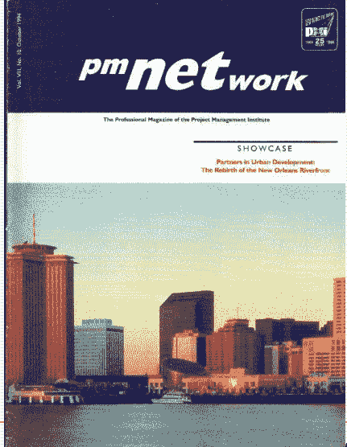


## 第15届奥林匹克冬季运动会

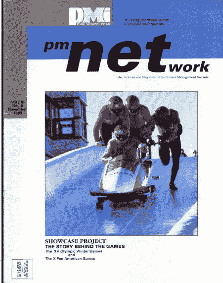


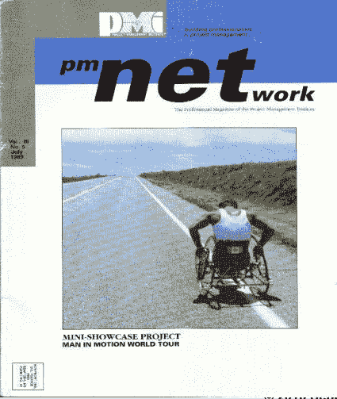

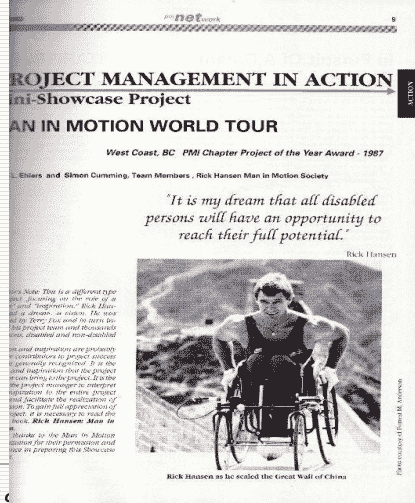


- 建造一座大楼、一座工厂或一座水库
- 举办各种类型的活动，如一次会议、一次晚宴、一次庆典等
- 新企业、新产品、新工程的开发
- 进行一个组织的规划、规划实施一项活动
- 进行一次旅行、解决某个研究课题、开发一套软件

> 在当今社会中，一切都是项目，一切也将成为项目。
> ——美国项目管理专业资质认证委员会主席
> Paul Grace


- 自从有了人类，人们就开展了各种有组织的活动。
  随着社会的发展，有组织的活动逐步分化为两种类型：

- 一类是连续不断、周而复始的活动，人们称之为“**运作**”（Operations），如企业日常的生产产品的活动；

- 另一类是临时性、一次性的活动，人们称之为“**项目**”（Projects），如企业的技术改造活动、一项环保工程的实施。


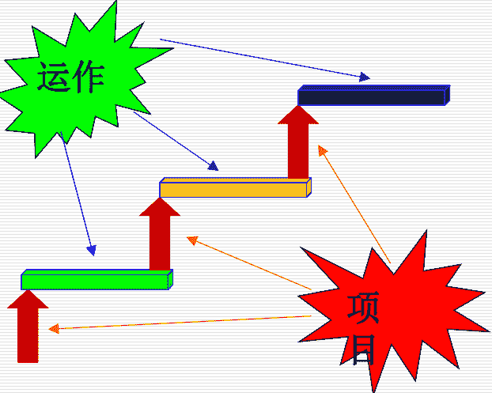


项目是一个特殊的将被完成的有限任务，它是在一定时间内，满足一系列特定目标的多项相关工作的总称。

此定义实际包含三层含义：

- 项目是一项有待完成的任务，且有特定的环境与要求

- 在一定的组织机构内，利用有限资源（人力、物力、财力等）在规定的时间内完成任务

- 任务要满足一定性能、质量、数量、技术指标等要求。


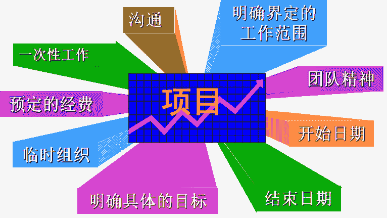


- 独特性/一次性
- 多目标属性
- 生命周期属性
- 相互依赖性
- 冲突属性


| 项目 | 作业 |
|---|---|
| 独一无二的 | 重复的 |
| 有限时间 | 无限时间（相对） |
| 革命性的改变 | 渐进性的改变 |
| 不均衡 | 均衡 |
| 目标之间不均衡 | 均衡 |
| 多变的资源需求 | 稳定的资源需求 |
| 柔性的组织 | 稳定的组织 |
| 效果型 | 效率型 |
| 以完成目标、目的为宗旨 | 以完成任务、指标为宗旨 |
| 风险和确定型 | 经验型 |


成功的项目必须满足客户、管理层和供应商在时间、费用和性能上的不同要求。


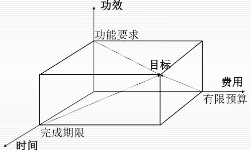


- 项目的(界定)范围
- 项目的组织结构
- 项目的质量
- 项目的费用
- 项目的时间进度

基本

依附于界定和组织

## 项目利益相关者

——参加或可能影响项目工作所有个人或组织

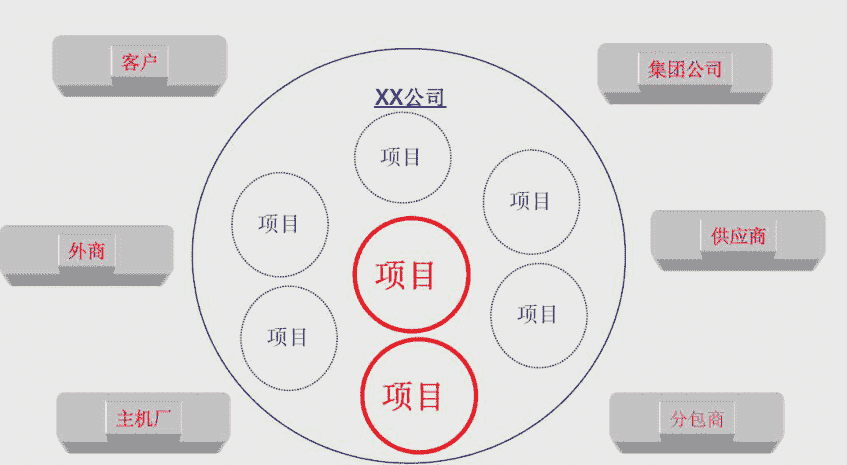

## 成功项目管理的目标是“利益相关者的满意”


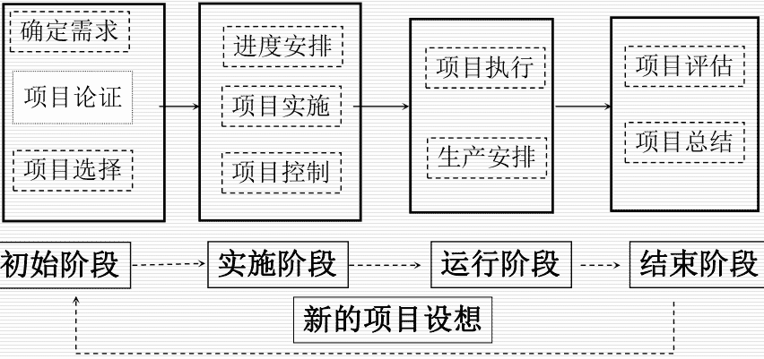


大类：工程、非工程

行业：建筑、制造、农业、医疗、金融、电子、纺织、交通、......

性质：研制、技改、引进、风险投资、产品开发、转包生产、组织活动、......

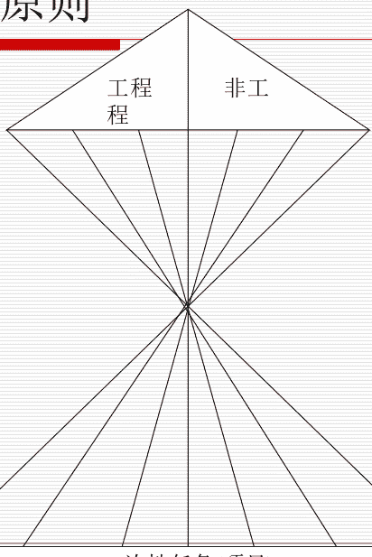


- 举出三个日常生活中你所参与过的项目，并分析这些项目的特点。


项目管理就是以项目为对象的系统管理方法，通过一个临时性的、专门的柔性组织，对项目进行高效率的计划、组织、指导和控制，以实现项目全过程的动态管理和项目目标的综合协调与优化。


- 项目管理的对象——项目
- 项目管理的组织特点——临时性、富有柔性
- 项目管理的手段——计划、组织、指导和控制
- 项目管理的目标——实现项目全过程的动态管理及项目的目标


- 项目管理的对象是项目或被当作项目来处理的运作。
- 项目管理的思想是系统管理的系统方法论。
- 项目管理的组织通常是临时性、柔性、扁平化的组织。
- 项目管理的机制是项目经理负责制，强调责权利的对等。
- 项目管理的方式是目标管理，包括进度、费用、技术与质量。
- 项目管理的要点是创造和保持一种使项目顺利进行的环境。
- 项目管理的方法、工具和手段具有先进性和开放性。


### 项目管理：

- ①充满了不确定因素
- ②跨越部门的界限
- ③有严格的时间期限要求

项目管理必须通过不完全确定的过程，在确定的期限内生产出不完全确定的产品，日程安排和进度控制常对项目管理产生很大的压力。

### 一般的作业管理：

- ①注重对效率和质量的考核
- ②注重当前执行情况与前期进行比较

在典型的项目环境中，尽管一般的管理办法也适用，但管理结构须以任务（活动）定义为基础来建立，以便进行时间、费用和人力的预算控制，并对技术、风险进行管理。


- 项目管理对象的特定性
- 项目管理组织的临时性
- 项目管理人员的专业性、权威性


- 科学化、民主化原则
- 系统性原则
- 动态性原则
- 责任、利益、风险对等的原则


- 两个层次：企业层次、项目层次
- 四个阶段：概念阶段、规划阶段、实施阶段、收尾阶段
- 五个过程：启动过程、计划过程、执行过程、控制过程、结束过程
- 九个领域：范围管理、时间管理、费用管理、质量管理、人力资源管理、沟通管理、采购管理、综合管理
- 考核要素


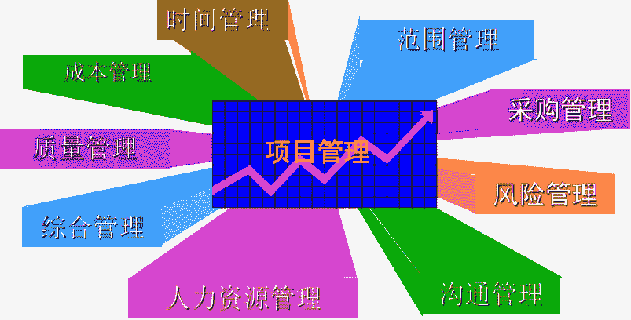


### 项目管理内容

- 投资战略
- 投资政策
- 投资规划
- 项目安排与审批
- ...

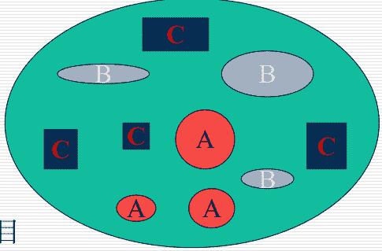

A、B、C—不同类别的项目


### 项目管理内容

- 部门投资战略和计划
- 项目的优先顺序
- 相应的行业政策
- 资金筹措、资源分配
- ......

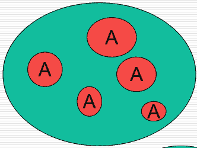

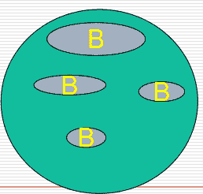

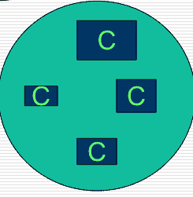
## 10. 微观管理--不同主体的项目管理

项目管理内容

- 甲—投资主体的项目管理
- 乙—设计主体的项目管理
- 丙—施工主体的项目管理
- 丁—监理主体的项目管理
- ......

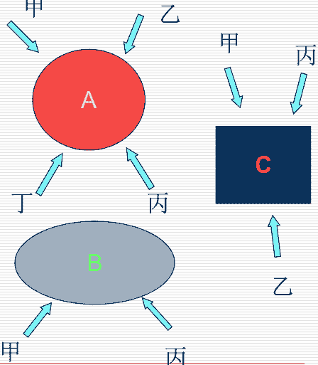


### 项目管理内容

- I —高层管理，主要负责总体以及与项目有关外部事务
- II — 中层管理，负责项目的关键工作及项目内、外部矛盾
- III — 基层管理，负责项目的各项具体技术及专业管理

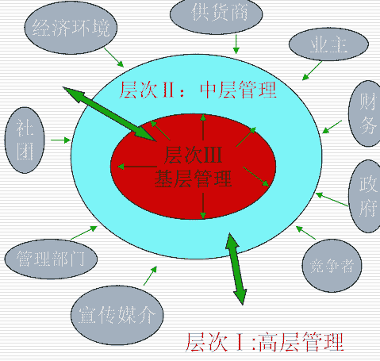


### 项目管理内容

- C —概念阶段，主要工作是组织好可行性论证
- D —开发阶段，组织好开工前的人、财、物及一切软件准备
- E —实施阶段，保证项目的质量、成本、进度的顺利完成
- F —结束阶段，评审、鉴定及项目交付和组织结束工作

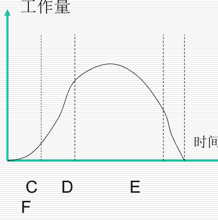


- 概念阶段
- 开发阶段
- 实施阶段
- 收尾阶段


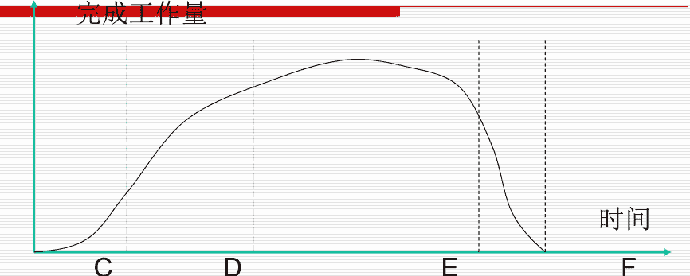

### C——概念阶段

- [ ] 明确需求、策划项目
- [ ] 调查研究、收集数据
- [ ] 确立目标
- [ ] 进行可行性研究
- [ ] 明确合作关系

- [ ] 风险分析
- [ ] 拟订战略方案
- [ ] 进行资源测算
- [ ] 提出组建项目组方案
- [ ] 提出项目建议书
- [ ] 获准进入下一阶段


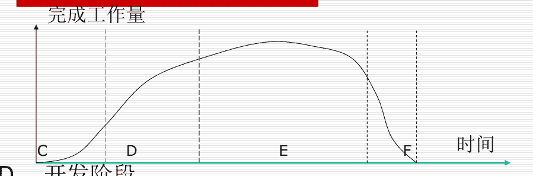

- 确定项目组主要成员
- 项目最终产品的范围确定
- 实施方案研究
- 项目质量标准的确定
- 项目的资源保证
- 项目的环境保证
- 主计划的制订

- 项目经费及现金流量的预算
- 项目的工作结构分解（WBS）
- 项目政策与程序的制订
- 风险评估
- 确认项目有效性
- 提出项目概要报告
- 获准进入下一阶段


### E ——实施阶段

- 建立项目组织
- 建立与完善项目联络渠道
- 实施项目激励机制
- 建立项目信息控制系统
- 建立项目工作包，细化各项技术需求

- 执行WBS的各项工作
- 获得订购物品及服务
- 指导/监督/预测/控制：范围、质量、进度、成本
- 解决实施中的问题


- 最终产品的完成
- 评估与验收
- 清算最后帐务
- 项目评估

- 文档总结
- 资源清理
- 转换产品责任者
- 解散项目组


- 项目孵化
- 项目启动
- 项目规划
- 项目实施
- 项目交付
- 项目运营

- 目的目标：找到合适的项目
- 赢得项目成功立项
- 做好项目实施方案
- 项目按计划进行
- 按合同要求交付
- 运行平稳可持续发展

- 主要工作：
  - 市场综合研究市场需求&机会
  - 项目投资初步分析
  - 项目盈利分析
  - 市场竞标
  - 自开发项目研究
- 项目投资分析
- 项目实施方案
- 项目可行性报告
- 商业计划书
- 项目范围目标组织构成
- 工作分解
- 里程碑计划
- 网络计划
- 人力资源配置
- 费用分解
- 费用进度控制体系
- 质量控制体系
- 成本费用控制管理
- 质量控制管理
- 项目信息管理
- 项目风险管理
- 项目可视化管理
- 过程偏差控制
- 项目验收成果交付
- 项目管理文件交付
- 资料交付
- 质量交付
- 项目决算
- 项目总结评价
- 发展规划
- 运营管理
- 营销

- 输出：
  - 投标书
  - 项目建议书
- 项目中标书、合同
- 项目立项批准书
- 项目各级实施方案
- 过程控制报表
- 阶段总结报告
- 业主验收报告
- 项目总结报告
- 计划、报表
- 财务分析

- 关键：
  - 市场信息系统
  - 企业核心竞争力
  - 企业决策能力
- 项目相关方需求细分
- 项目目标细分
- 技术实现可行性
- 资源需求可行度
- 费用分解
- 项目实施方案可行度
- 项目相关方关关系
- 合同管理
- 工期、成本、质量
- 控制方案
- 工期、成本、质量
- 控制管理
- 项目执行偏差分析
- 合同完成偏差分析
- 项目运营管理

- 项目评价体系
- 项目前评价
- 项目中评价
- 项目后评价


- [ ] 新形势下企业管理走向何方？
- [ ] 新商业环境的特点
- [ ] 新商业环境企业管理所面临的问题
- [ ] 项目管理是企业迎接挑战的有力武器
- [ ] 企业项目管理
- [ ] 按项目进行管理
- [ ] 项目管理给企业组织带来的变革


IBM、花旗银行(Citybank)、摩托罗拉(Motorola)、美国运通(American Express)、AT&T等成功企业的经验是：企业项目化管理是企业迎接挑战，面向未来，增强竞争力的有力武器。

这些成功的企业已经学会如何驾驭项目管理的能力，并将它转换成一套组织的哲学，这些公司被视为由「项目组合」而成的动态企业，并采用项目化的管理理念处理他们日常的经营活动。


### 特点：

- 不确定性的时代--瞬息万变

- 市场竞争日趋激烈化、国际化

- 客户类型日趋复杂化、需求日趋个性化

- 技术发展日新月异。

### 导致的变更：

- 一种产品从创意到退出市场的全过程也就具备了项目的特性；而产品生产过程的组织也因为客户需求的个性化及外协生产方式的采用也可当作一个项目来管理。

- 在新的商业环境下，企业传统的运作业务日趋具备了项目的特色，运作日趋项目化。


- 应变能力问题：及时调整组织，适应外部环境的变化；

- 降低成本问题：产品生命周期缩短，固定资产投入应慎重；

- 权力分散问题：顾客的需求变化快，直接与顾客接触的人需求有决策权，以保证快速决策；

- 降低风险问题：产品结构多元化趋势。


具体的讲，项目管理能有效地解决：

- 分权问题

- 多元化管理问题

- 资源共享问题

- 人员的进出问题

- ......


企业项目管理是伴随着项目管理方法在长期性组织中的广泛应用而逐步形成的一种以长期性组织为对象的管理方法和模式，其主导思想就是把任务当作项目以实行项目管理，即“按项目进行管理”。

企业项目管理就是站在企业高层管理者的角度对企业中各种各样的任务实行项目管理，是一种以“项目”为中心的长期性组织管理方式，其核心是基于项目管理的组织管理体系。

项目化管理模式的真正出现是在20世纪80年代末期开始的，特别是当时信息技术类企业的飞速发展和技术的急速变化使得此类企业在管理模式上出现了质的飞跃。一批信息技术类的龙头企业，诸如IBM、朗讯、AT&T等纷纷采用项目化的管理模式，并为企业带来了新的经营活力。


策略性项目管理机制整合架构 S M


- 按项目进行管理将传统的项目管理方法应用于全面的企业运作，是传统项目管理方法和技术在企业所有项目上的综合应用，冲破了传统的管理方式和界限。

- 按项目进行管理将项目观念渗透到企业所有的业务领域，包括市场、工程、质量管理、战略规划、人力资源管理、组织变革、业务管理等。


从TPM到MBP带来的新理念：

- 让好主意成为项目
- 让好项目成为现实

从TPM到MBP的成功实例：

- 天士力制药股份有限公司运用现代企业项目管理的知识和技术，使企业创新从过去的自发、自觉、自然的状态转变到了目前的规范化、制度化、系统化的体系中，形成了全员参与的项目管理文化，为企业向更高层次的发展打下了坚实的基础。


### 图例

- 公司级项目,成熟度高
- 部门级项目,成熟度中
- 小组级项目,成熟度低
- 可能发生的流程

### A级：

### B级：

### C级：

公司战略发展需求
公司指定项目经理

部门工作开展需要

TPM好主意好点子

决定立项
立项论证

部门经理申请立项

口头申请立项
部门批准备案

项目申请表

项目立项论证

批准
部门指定项目经理

项目经理制定项目计划

项目经理制定项目计划

每季度向项目办汇总

包括WBS、组织结构图、里程碑计划、责任矩阵、进度计划、网络图、资源计划、风险计划、成本费用计划

包括WBS、组织结构图、里程碑计划、责任矩阵、进度计划、成本费用计划

项目任务书
1、交付物
2、工期
3、预算
4、验收标准

项目中止申请报告

变更申请报告
重大突发性事件报告
项目进展报告
项目会议记录

项目关键点报告

项目完成报告单

项目完成报告

项目验收鉴定书

项目评价与奖励

项目终止

立项阶段

计划阶段

实施和控制阶段

验收和评奖阶段


天士力制药自2002年始，由总经理倡导，引入项目化管理的理念，将日常工作中跨部门的，涉及多人合作的，有确定完成期限的、确定预算的活动按项目进行管理，几年来，共有不同级别的249个项目立项，其中A级54个，B级80个，C级115个，主要包括研究、技改和管理三大类，有119人先后担任过项目经理，其中担任A级项目经理的有21人。


企业希望通过项目形式来保证：

- 组织的灵活性；
- 管理责任的分散；
- 对复杂问题的集中攻关；
- 以目标为导向解决问题的过程；
- 个人及组织发展的机会。


- 项目管理的矩阵式组织给传统的职能式组织带来了变革的活力
- 资源的优化整合和高效率发挥是矩阵式组织形式的最大特点
- 责、权、利的有效结合是矩阵组织的基本出发点
- 员工成长与企业发展在矩阵组织中得到了最佳的结合


- 著名管理顾问Tom Peters指出：在当今纷繁复杂的世界中，项目管理是成功的关键
- David Cleland认为：战略管理和项目管理在这全球性的市场变化中起着关键的作用


- 战略管理：面向未来，是企业发展的核心
- 项目管理：面向过程，是企业发展的载体
  - 项目管理是战略和营销中间的载体和过渡，它既是一种思维方式和工作方法，也是一种先进的文化理念。
- 营销管理：面向成果，是企业发展的命脉


### 背景

- 1988年AT&T公司为了应对电话行业业务的发展，重新组合公司，将公司分为19个战略单元，其商务通信系统(BCS)作为其中的一个业务单元，主要是开拓程控交换市场。
- 当时AT&T意识到传统的管理方式在新技术市场环境中，不再具有竞争力，为了更好地控制企业经营状况，提高企业竞争力，AT&T决定成为行业中项目管理的领先者。

### 已有的观念

- AT&T已经使用了多年的项目管理方法
- 强调协调管理，通过完成任务中的活动来达到完成项目的目的
- 协调被看作是一种临时性的工作
- 对良好的项目参与者奖励是提升其在职能部门的位置，然后脱离项目
- 这种管理方式有效吗？

### 改革面临的问题

- 项目经理候选人的选拔
- 教育和培训
- 职业发展
- 组织重构
- 方法的开发
- 解决方案呢？

### 组织机构

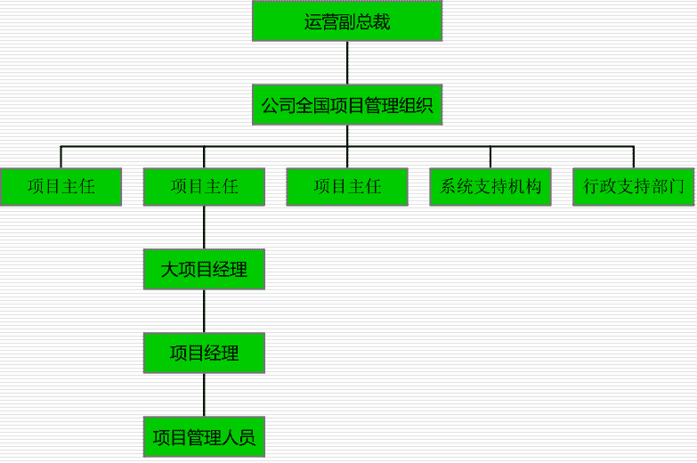

### 项目管理的职业道路

- 项目管理成员：接受6个月的项目管理岗位培训
- 成本/进度分析工程师：担任6～18个月的项目经理助理，直接向项目经理汇报
- 现场经理：做6-12个月的现场经理，负责一个大型的现场，向大项目经理汇报
- 小项目经理：独立负责一个100～300万美元的项目
- 项目经理：负责一个300～2500万美元的项目
- 大项目经理：负责一个长达多年的、2500万美元以上的项目

### 项目经理挑选标准

- 人际领导技能
- 口头及书面沟通能力
- 全局观念
- 政治敏感性
- 乐观精神
- 敢作敢为
- 不断进取的精神
- 统筹规划的能力
- 责任心和可靠性


### 目前的现状

- 项目管理组织包括总部的行政管理人员及遍布在全球的项目经理群组
- 负责着超过5亿美元的项目
- 项目规模从100万美元到上亿美元不等
- 项目管理方式被认为是最适合该领域的工作方式

## 讨论

结合你所参加的一个典型项目，分析其处在项目实施的哪个阶段及其管理内容，讨论项目管理与一般管理的差异性，分析如何才能使得项目管理走向成功。


### 学习目标

- 了解项目组织的类型和特点
- 了解项目经理的权力和责任
- 了解项目人力资源管理
- 了解项目团队的概念以及如何建设和管理项目团队
- 了解企业项目管理的相关概念

### 项目组织

- 组织的概念(了解)
- 项目组织特点(理解/掌握)
- 项目组织形式(理解/掌握)
- 正式组织与非正式组织的关系(了解)
- 项目组织的运行机制(了解)

### 组织的概念

> “组织：有意识形成的职务或岗位的结构”
> ——— [美]Harold Koontz


### 为什么需要组织？


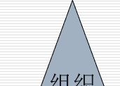


摩西的岳父注意到摩西花了太多的时间去监督太多的个人，给他提出类似部门划分的建议，摩西立刻遵从了他岳父的建议。因此他“……从全体以色列人中挑选出有能力的人来，使他们居于百姓之首，千人一长、百人一长、五十人一长，十人一长。他们按这样的原则审理百姓的事情：重大事情提交摩西，而所有的小事情，他们自己就审理了。……”

《出埃及记》第18章

### 组织管理

> “为了使人们能为实现目标而有效地工作，就必须设计和维持一种职务结构(a structure of roles)。
> 这就是组织管理的目的。”
>
> —— [美]Harold Koontz


### 组织设计过程的结果

- 组织图
- 职位说明书
- 组织手册

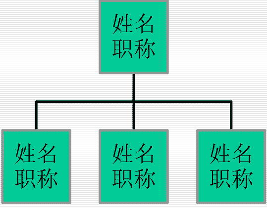


### 组织统一的两面

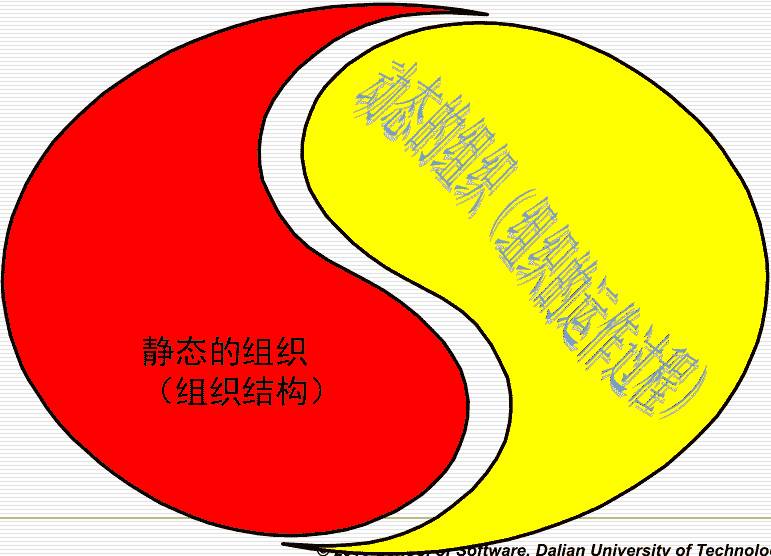

静态的组织（组织结构）

动态的组织（组织行为）

### 怎样才算一个合理的组织？


- 目标的一致性和管理的统一
- 有效的管理幅度和层次
- 责任和权利要对等
- 要合理分工和密切协作
- 集权与分权相结合
- 纪律和秩序
- 团队精神


### 影响管理幅度和层次的因素有哪些


### 影响管理幅度和层次的因素

- 工作能力
- 工作内容和性质
- 工作条件
- 工作环境


### 项目管理组织的特点

一般组织的特点

项目及项目管理的特殊性


- 职能制组织形式
- 项目式组织形式
- 矩阵制组织形式

### 职能式组织形式

#### 优点

- 有利于企业的技术水平的提升
- 资源利用的灵活性与低成本
- 有利于从整体协调企业活动

#### 缺点

- 协调的难度大
- 项目组成员责任淡化

### 项目式组织形式

执行主管  
Chief Executive

项目主管  
Project Manager

项目主管  
Project Manager

项目主管  
Project Manager

职员 Staff

职员 Staff

职员 Staff

职员 Staff

职员 Staff

职员 Staff

职员 Staff

职员 Staff

职员 Staff

#### 优点：

- 目标明确及统一指挥
- 有利于项目控制
- 具有灵活的资源能力，责权利比较充分，有利于全面型人才的成长

#### 缺点：

- 机构重复及资源的闲置
- 不利于企业专业技术水平的提高
- 不稳定性

| 职能制组织形式 | 项目式组织形式 |
|---|---|
| 优点：<br>有利于企业技术水平的提升。<br>资源利用灵活性与低成本<br>有利于从整体协调企业活动 | 缺点：<br>不利于企业专业技术水平的提高<br>机构重复以及资源闲置<br>不稳定性 |
| 缺点：<br>协调难度大<br>项目组的成员责任感淡化。 | 优点：<br>目标明确，指挥统一，有利于项目控制<br>具有灵活的资源能力，责权利比较充分，有利于全面型人才的成长。 |

### 弱矩阵式组织形式

执行主管  
Chief Executive

职能主管  
Functional Manager

职能主管  
Functional Manager

职能主管  
Functional Manager

- 职员 Staff
- 职员 Staff
- 职员 Staff

- 职员 Staff
- 职员 Staff
- 职员 Staff

- 职员 Staff
- 职员 Staff
- 职员 Staff

项目协调

### 平衡矩阵式组织形式

执行主管  
Chief Executive

职能主管  
Functional Manager

职能主管  
Functional Manager

职能主管  
Functional Manager

职员 Staff

职员 Staff

职员 Staff

职员 Staff

职员 Staff

职员 Staff

项目主管  
Project Manager

职员 Staff

职员 Staff

### 强矩阵式组织形式

### 复合式组织形式

执行主管  
Chief Executive

项目经理主管  
Manager of  
Project Managers

职能主管  
Functional Manager

职能主管  
Functional Manager

职能主管  
Functional Manager

项目经理  
Project manager

职员 Staff

职员 Staff

职员 Staff

项目经理  
Project manager

职员 Staff

职员 Staff

职员 Staff

项目经理  
Project manager

职员 Staff

职员 Staff

职员 Staff

项目A协调

项目B协调

### 矩阵式组织形式的优缺点

#### 优点

- 项目组织是又有有关项目活动的焦点
- 项目经理拥有对拨给的人力、资金等资源的最大控制权
- 职能组织中专家的储备提供了人力利用的灵活性
- 对环境的变化及项目的需要能够迅速做出反应
- 项目人员有明确归宿
- 关键技术人员能够为各项目共用，充分利用了人力资源

#### 缺点

- 职能组织与项目组织间的平衡需要持续的进行监视
- 在开始制定政策和方法时，需要花费较多的时间和工作量
- 每个项目独立进行，容易产生重复性的劳动
- 协调难度大，一个成员有两个上司，既难处，也难管
- 对时间、费用以及运行参数的平衡必须加以监控

## 项目管理的组织形式

例：某企业是以项目为基础的企业，即企业的经营活动是有许多项目活动有机构成。为了适应企业的这一特点，企业组织结构采用了矩阵式组织结构，但是在项目运作过程中，项目的资源如人员经常会受到项目经理及职能经理的双重领导，降低了运作效率和效果。某项目经理为了使项目成员在项目存续期间不受干扰，规定在项目成员进入项目组必须接受这样一条约束，即在项目组工作时不与原属职能部门发生任何联系。请分析这位项目经理的做法是否合理？

## 项目组织形式对项目的影响

| 特征 | 职能式 | 矩阵式 | | | 项目式 |
|---|---|---|---|---|---|
| | | 弱矩阵 | 平衡矩阵 | 强矩阵 | |
| 项目经理的权限 | 没有 | 有限 | 小到中等 | 中等到大 | 甚至全权 |
| 全职工作人员的比例 | 几乎没有 | 0%~25% | 15%~60% | 50%~95% | 85%~100% |
| 项目经理投入时间 | 几乎没有 | 半职 | 全职 | 全职 | 全职 |
| 项目经理的常用头衔 | 调员 | 调员 | 项目经理 | 项目经理 | 项目经理 |
| 项目管理行政人员 | 兼职 | 兼职 | 半职 | 全职 | 全职 |

## 影响组织结构影响形式的因素

- 不确定性
- 所用技术
- 复杂程度
- 持续时间
- 规模
- 重要性
- 客户类型
- 对内部依赖性
- 对外部依赖性
- 时间限制性

## 项目管理组织结构形式选择

- 职能式组织结构比较适用于规模较小、界面相对独立、偏重于技术的项目，不适应于项目的环境变化较大的项目，不适应于管理多个项目
- 当一个公司中包括许多项目或项目的规模比较大、技术复杂、进度或产品性能极为重要，开发成本相对不重要时，则应选择项目式的组织结构
- 矩阵式组织形式融合了两种组织结构的优点，充分利用企业资源，对技术复杂、规模巨大项目的管理呈现出了明显的优势。如果项目经理有权管理资金并与职能经理有业务关系（包括正式工作承诺和项目计划制定的参与），那么矩阵结构就会很好地发挥作用；相反，如果项目经理仅仅被看成一个协调员，依靠部门经理尽力去执行项目的话，矩阵结构就会失效。

## 正式组织与非正式组织

**正式组织**：当两个以上的人为了既定的目标而自觉协调其活动时，这样的组织就是“正式组织”

## 正式组织与非正式组织

非正式组织：没有自觉的共同目标（即使也可能产生共同的成果）的任何联合的个人活动称为非正式组织

## 问题：

1. 作为一个项目经理你考虑过你的组织中的一些“小群体”吗？你觉得他们“碍事”吗？
2. 作为一项目组成员，你觉得你和一些同事能形成“小群体”吗？你觉得你们之间讨论哪些事情？领导是否有意拆散你们的“小群体”？

## 非正式组织的积极性

- 满足员工部分需要
- 增强合作精神
- 互相帮助
- 规范行为

## 如何利用非正式组织？


## 项目经理与项目团队

## 项目经理就是项目的负责人！

## 项目的领导人！

- 领导（名词）----头面人物 领导人 联络人 监督人 传播人 发言人 企业家 应急人资源分配者 谈判人
- 领导（动词）----管理者利用组织赋予的职权和个人具备的能力去指挥命令影响和引导职工为实现组织目标而努力工作的活动过程

## 什么样的领导最有权利？

## 项目经理的责任

通过一系列的领导及管理活动使项目的目标成功实现并使项目相关者都获得满意！

## 项目相关者

参加或可能影响项目工作所有个人或组织。

- 顾客，项目产品的接受者
- 消费者，项目产品的使用者
- 业主，发起该项目的人
- 合伙人，项目的合作者
- 提供资金者，金融机构
- 承包商，为项目组织提供产品的组织
- 社会，司法、执法机构、社会大众
- 内部人员，项目组织的成员

## 项目的利益相关者

## 项目经理的责任

### 对于所属上级组织的责任

- 保证项目的目标符合于上级组织目标
- 充分利用和保管上级分配给项目的资源
- 及时与上级就项目进展进行沟通

## 项目经理的责任

### 对于所管项目的责任

- 明确项目目标及约束
- 制定项目的各种活动计划
- 确定适合于项目的组织机构
- 招募项目组成员，建设项目团队
- 获取项目所需资源
- 领导项目团队执行项目计划
- 跟踪项目进展及时对项目进行控制
- 处理与项目相关者的各种关系
- 项目考评与项目报告
- 考虑项目成员的未来

## 项目经理的权力

- 项目团队的组建权。包括两个方面：即项目经理班子（或管理班子）的组建权和项目团队的选拔权
- 财务决策权。项目经理必须拥有与项目经理负责制相符合的财务决策权，否则项目就难以顺利展开。主要包括：
  - 分配权
  - 在财务制度允许的范围内的费用控制权
  - 资金的融通、调配权力
- 项目实施控制权。

## 项目经理的素质和能力要求

## 高级管理人才需要怎样的必备素质

新的职业结构对高级人才的素质要求愈来愈高，未来的高级知识人才既不是单纯的技术专家，也不是精通领导艺术的专家。他们不仅要胜任卓有成效的管理工作，还要有力地领导自己的团队在同心协力完成既定目标的同时，时刻准备迎接新的挑战。

敏锐的洞察能力。国际交流更加频繁，竞争更加激烈，高级人才能否辨别真伪、分清得失，能否运筹帷幄、审时度势，能否居安思危、见微知著，能否沉着应对、趋利避害，很大程度上决定着我们能否掌握企业发展的主动权，有效地抵御风险。

- 灵敏的应变能力。新形势下，对领导方式和作风有新要求，能否在短时间在观念、作风上转变和适应是对其应变能力的巨大考验。
- 丰富的想像能力。它是必需的技能。富于想像力有利于收集并获得广泛、大量的信息和知识；想象力可以开拓思维方法及观察的视野。想象力在某种程度上可以带动创造性和创新能力
- 出色的指挥能力。越来越多的实践表明：企业需要的是能控制局面的领军人物——能够像装甲坦克一般用低沉的音调镇住整个会议室，不论有多大困难和障碍都能达到目的的人。成功的战地指挥家。
- 感染力和凝聚力。能用言传身教或已有的业绩，在领导层或员工中不断增加感染力、凝聚力的人。这种人在组织决策中，不是把信任建立在地位所带来的权威之上，而是靠自身的感染力来影响大家，坚定人们的信念。
- 培养员工的能力。努力培养员工的成长，不只是让员工感受到上司的器重，更重要的是在无形中提高企业的内在价值，实现个人、集体同升共荣的价值观
- 说服与交流能力。公司间的交往要求高级人才能应付越来越多的人际关系并具有愈来愈高的游说能力。在节奏本来就很快的工作环境中，内部的交流显得更加重要，尽管惜时如金，但没有交流就缺乏动力和发展的源泉
- 尊重别人的能力。在组织工作中不能只靠行政命令去强制人们的意志，而要努力了解别人并学会尊重别人的感情。选择人们普遍接受和认可的方式，让一颗博大的仁爱之心赢得众人的支持。

## 合格项目经理的基本要求

- 良好的道德素质
- 健康的身体素质
- 全面的理论知识素质
- 系统的思维能力
- 娴熟的管理能力
- 积极的创新能力
- 丰富的项目管理经验

## 创造性思维的特征

- 时间题的敏感性(Sensitivity)
- 思维的流畅性(Fluency)
- 思维的灵活性(Flexibility)
- 发挥创见的能力(Originality)
- 对问题重新认识的能力(Redefinition)

## 创造性技法示例

### 头脑风暴法

1. 目的在于产生尽可能多的观点
2. 所有的观点都必须被记录下来
3. 鼓励考虑其他人的观点，但不允许下判断和提出批评

## 项目团队 (Project Team)

## 项目人力资源管理

在项目拥有的所有资源中，人力资源是最重要的、最根本的资源，其它资源都要通过人力资源来发挥作用！

## 何为人力资源

## 是人力资源还是人力资源？

## 项目人力资源管理

- “企”——“人”=“止”
- “企业唯一真正的资源是人” ----彼德。杜拉克
- 项目的全过程缺少不了“人”

## 人力资源的特征

- 有自身需求
- 主观能动性
- 不可储存性
- 终身可开发性
- 耗费其他资源
- 社会环境约束

## 人有什么样的需求？

例：杨森这几天一直很焦虑，因为他觉得项目组成员的工作积极性并没有期望的那样高。他觉得现在项目组成员的工资、奖金及工作环境在同行业中算得上第一流了，但似乎并不满意，他真不知道在员工积极性调动上他还能想处什么新“招术”？他想问员工“你们真正想要什么？”。你能为他出些“点子”吗？

## 人有什么样的需求？

- 马斯洛的需要层次理论
- 赫茨伯格的双因素理论
- 麦克利兰的成就需要理论
- 佛罗姆的期望理论
- 亚当斯的公平理论


## 马斯洛的需要层次理论

王力是一位由部队转业的项目经理，他觉得理想的动力是巨大的，他觉得他过去就是在追求理想的动力下努力工作的。他在管理中鼓励员工树立远大理想，常用一些英雄人物如铁人王进喜等等教育员工，然而收效并没有预想的大，你能说出为什么吗？

1. 生理的需要
2. 安全的需要
3. 社交的需要
4. 尊重的需要
5. 自我实现的需要

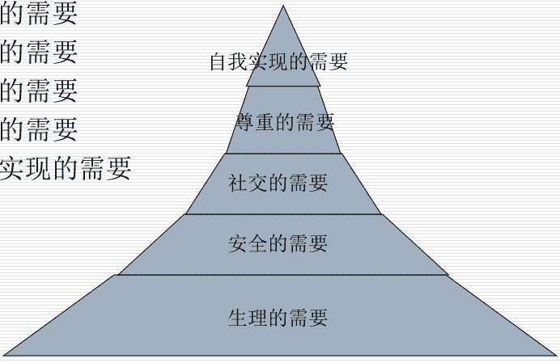

## 赫茨伯格的双因素理论

邱晨是一家软件企业经理，他深知“民以食为天”的道理，不断提高员工待遇，如工作环境质量改善、工资、福利水平提高，等等。但是他还是发现员工并没有他预期的满意水平。这是为什么？


- 保健因素是指那些与人们的不满情绪有关的因素，如企业政策，工资水平，工作环境，劳动保护，人际关系等
- 激励因素是指那些与人们的满意情绪有关的因素，如工作表现机会，工作带来的愉快，工作上的成就感，由于好的成绩而得到的奖励，未来发展的期望，职务上的责任感

## 麦克利兰的成就需要理论

郭飞在一家企业工作，他最近很烦恼，因为领导说他“权力欲望”太大，让他踏踏实实工作，否则就解雇他。他觉得我想“当官”又不是“不好好工作”，难道按领导的说法“当官的都不是好员工”吗？

- [ ] 权力的需要
- [ ] 社交的需要
- [ ] 成就的需要


## 弗鲁姆的期望理论

A企业因一客户拖欠货款而周转不灵，但利用多种方法也没催回。领导认为“重奖之下必有勇夫”，因此设重奖奖励能催回货款的人，但反应寥寥无几。为什么？


人们在工作中的积极性或努力程度（激发）力量M是效价V和期望值E的乘积

M = V × E


## 亚当斯的公平理论

要使组织成员保持较高的工作热情，必须使工作报酬公平合理，使组织的成员感到组织的分配是公正的。


## 需要的特点有哪些？

- 多样性
- 层次性
- 潜在性
- 可变性


## 项目人力资源管理一般过程

- 项目人力资源需求分析
- 项目人力资源招聘与选拔
- 项目人力资源培训学习及使用
- 项目人力资源绩效考核
- 项目人力资源激励

## 人力资源组织规划结果

1. 角色和责任分派矩阵
2. 人员配备计划
3. 组织结构图
4. 文字说明

### 责任分派表（矩阵）

| 承担者/项目阶段 | 张三 | 李四 | 王五 | 钱六 | 杨七 | 马八 | 牛九 |
|---|---|---|---|---|---|---|---|
| 明确用户要求 | 批准 | 审查 | 负责 | 参加 | 参加 | 参加 | 参加 |
| 明确产品功能 | 批准 | 负责 | 参加 | 参加 | 参加 | 参加 | 参加 |
| 产品设计 | 批准 | 审查 | 负责 | 提供资料 | 参加 | 参加 | 参加 |
| 产品研制 | 审查 | 批准 | 负责 | 参加 | 参加 | 参加 | 参加 |
| 产品试验 | 批准 | 参加 | 提供资料 | 负责 | 参加 | 参加 | 参加 |

## 项目经理绩效评价体系

- 项目总体结果绩效
- 管理过程绩效
- 团队管理绩效
- 关系处理绩效


老王是一家项目型企业的老总，他必须管理许多项目经理，那么从哪些方面考核这些年轻经理呢？他的老朋友建议说，“你不要管的太多，只要他们完成任务就行”。大家说这是个好建议吗？

## 项目组成员形成团队不仅是项目成功的保证而且也能满足成员的需求


## 项目团队的特征

- 共同认可的明确的目标
- 合理的分工与协作
- 积极的参与
- 互相信任
- 良好的信息沟通
- 高度的凝聚力与民主气氛
- 学习是一种经常化的活动


## 新“团队”的建立

- 利用WBS等工具决定需要做什么
- 通过前段的结果决定需要什么样的团队成员
- 招聘团队成员
- 通过团队成员的参与制定项目计划

## 项目团队的发展阶段

- [ ] 组建阶段（TO KNOW AND TO FIND POSITION）
- [ ] 磨合阶段（QUESTION AND PROBLEM APPEAR）
- [ ] 正规阶段（TO BE CO-OPERATIVE WITH OTHERS）
- [ ] 成效阶段（TO BE OF 1+1>2）
- [ ] 解散阶段（WHERE IS MY NEXT GROUP?）

## “团队”成员的基本要求

例：假设你是一个软件开发项目经理，你希望你的项目组成员能形成一个真正意义上的团队，那么你在招聘项目组成员时有什么要求？


- 候选人具备项目工作所需要的技能
- 候选人的需要可以通过参与项目而实现
- 候选人应具有与原有员工相融的个性
- 候选人应不反对项目工作的各种约束

## 建设团队的工具与方法

- 团队建设活动
- 一般管理技术
- 绩效考评与奖励系统
- 人员配置
- 培训


## “团队”发展的不同阶段

- 形成阶段(Forming)
- 疑问阶段(Storming)
- 规范阶段(Norming)
- 执行阶段(Performing)


## “团队”发展不同阶段需要的领导风格

- 形成阶段(Forming)——指导型的领导风格（Directive style）
- 疑问阶段(Storming)——影响型的领导风格（Selling or Influence style）
- 规范阶段(Norming)——参与型的领导风格（Participative style）
- 执行阶段(Performing)——授权型领导风格（Delegative style）

例：刘光是一个项目经理，他着意于建立项目团队，他认为既然项目团队成员有共同的目标，而且具有项目所需要的技术，关键是愿意为项目作出自己最大的贡献，那么在建立了团队后就要充分授权，让团队成员获得最大的自主权。然而他发现在项目一开始就遇到麻烦，甚至连团队也建立不起来，小组成员各自为政，特别是当项目中间进来新成员时，更是乱上加乱。您说刘先生应该采用什么类型的领导风格？

## 怎样才能使“团队”成员全身心投入于项目“团队”？

- 成员交流经常化，使他们感觉团队的存在
- 确保参与团队可以实现成员需要
- 使每个成员知道项目的重要性，每个成员不希望成为“失败者”
- 所有成员共享团队目标，“一只老鼠坏一锅汤”
- 使团队中的竞争减低到最小，团队成员只与其他团队的成员竞争


## Benchmarking——一种有效的组织学习方法

> “学习是任何一个组织环境适应性的最大特征” ——未名

## Benchmarking的出现

- 时间：70年代末80年代初
- 公司：Xerox施乐公司
- 缘由：市场占有率下降，产品逐渐失去竞争力
- 活动：了解自己、了解自己的对手以及那些行业中的一流企业，研究他们并向他们学习，善加利用他们的有益经验的活动。
- 结果：质量问题下降了2/3，制造成本降低了1/2，生产周期缩短2/3，提高产量的同时减少一线工人50%及职员35%。
- 广泛性：美国财富杂志500强中70%将Benchmarking作为一项经常性的管理活动，企业包括AT&T，Eastman Kodak，Ford Motor，IBM等

## 什么是Benchmarking？

Benchmarking就是对产生最佳绩效的最优的经营管理实践的探索，也就是以领先组织为标准或参照，通过资料收集，分析，比较，跟踪学习等一系列的规范化的程序，改进绩效，赶上并超过竞争对手，成为市场中的领先者。


## 为什么要Benchmarking？

- 可以评价企业绩效
- 建立了企业赶超的对象
- 可以提高产品质量降低成本即改善绩效
- 是一种学习方法
- 可以使企业形成外向型企业文化
- 提高了工作满足感

## Benchmarking的类型

- 内部Benchmarking（MEMBERSHIP）
- 竞争Benchmarking（COMPETITOR）
- 行业Benchmarking（INDUSTRY）
- 最优Benchmarking（CLOSE-RELATED）


## 怎样Benchmarking？

- Benchmarking计划
- AIM-SET, AIM-FOCUS ON
- 组建Benchmarking小组
- MANAGERS, ANALYST, VISITOR
- 信息收集
- 差距分析
- 采取改进行动


## Benchmarking中差距分析的5个问题

- 目的为何？为什么？某些作业（动作）可否省去？
- 在何处做？为什么？可否改变场所或放在一起做？
- 在何时做？为什么？可否改变时间、顺序或同时做？
- 如何做？为什么？可否简化或改善工作方法？
- 由谁做？为什么？可否更换人员或由同一人做？

## Benchmarking的阻力

- 骄傲自大不承认自己存在缺陷
- 害怕暴露自己的缺陷
- 习惯
- Benchmarking的难度
- 费用


## Benchmarking的成功因素

- 顾客导向
- 过程导向
- 企业高层领导的支持与参与
- 企业整体利益至上的观念
- 开放思想
- 共享信息
- 长期进行Benchmarking
- 全员参与

## 与Benchmarking区别的概念

- 发生于中国的“比、学、赶、帮、超”及“典型”学习
- 发生于西方的企业业务流程重组（BPR Business Process Reengineering）


## questions

- What is the next aim of your organization?
- What is the way to know more of your competitors?
- What is the way that you understand customer satisfaction?

- 项目组织
- 项目经理
- 项目人力资源
- 项目团队
- 企业项目管理


## 第三部分 项目论证与评估

孔祥杰  
xiangjie.kong@gmail.com  
大连理工大学软件学院

### 学习目标

- 了解项目论证在投资项目中的地位及应用
- 掌握项目论证的基本原理
- 熟悉可行性研究的主要内容
- 了解项目论证中多方案的比选方法
- 了解项目评估的主要内容

## 主要内容

- 项目论证的概念
- 项目论证的原理和方法
- 项目论证的基本程序
- 项目论证的内容
- 项目论证报告书的格式

### 一、项目论证的概念

- 项目论证的概念
- 项目论证的作用
- 项目论证的着力点
- 项目论证的层次
- 项目论证的质量、时间和费用

#### 1. 项目论证

项目论证又称可行性研究，是从市场预测开始，通过拟定多个方案进行比较论证，研究项目的规模、工艺、技术方案、原材料及能源供给、设备选型、厂址选择、投资估算、资金筹措和偿还、生产成本等各种要求与制约因素，分析评价项目：

- 建设上的必要性
- 技术上的可行性
- 经济上的合理性

最后提出项目可行或不可行的结论。

项目论证是一种综合分析和全面科学评价的技术经济研究活动。

#### 项目论证主要回答的问题

- 项目在技术上是否可行？
- 项目在经济上是否有生命力？
- 项目在财务上是否有利可图？
- 项目能否筹集到全部资金？
- 项目需要多少资金？
- 项目需要多长时间能建立起来？
- 项目需要多少物力、人力资源？

#### 通过项目论证要达到的结论

- 论证项目建设的条件是可靠的
- 项目采用的技术是先进的
- 经济上是有较大的利润可图的。

#### 2. 项目论证的作用

- 项目论证报告可作为：
  - 确定项目实施的依据
  - 向银行贷款的依据
  - 申请建设执照的依据
  - 与有关单位签订协作的依据
  - 项目实施基础资料的依据
  - 项目各项工作安排的依据

#### 3. 项目论证的出发点

- 要站在咨询的立场上
- 应提出多种替代方案
- 对各种方案要做经济分析
- 决定最佳投资时期和投资规模
- 要提出可能实施的具体措施
- 要把资源的有效利用放在中心位置。

#### 5. 项目论证的层次

- 机会研究
- 初步项目论证
- 辅助研究或功能研究
- 详细项目论证

#### 5.1 机会研究

机会研究是鉴定投资机会，它寻求的是投资应该用于哪些可能会有发展的部门，这种投资能给企业带来盈利，能给国民经济带来全面的或多方面的好处。

机会研究又分一般机会研究和特定项目机会研究两种。根据当时的条件，决定进行哪种机会研究，或两种机会研究都进行。

#### 投资机会研究

- 投资设想：寻找投资机会、选择机会、从各方面进行分析，提出概略的投资建议
- 着重点：投资环境分析
- 目的和作用：鉴别投资方向，选择建设项目，为下一步的研究打下基础

#### 一般机会研究

一般机会研究：这种研究主要是通过国家机关或公共机构进行的，目的是通过研究指明具体的投资建议。有以下三种情况：

- 地区研究
- 部门研究
- 以资源为基础的研究

#### 特定项目机会研究

具体项目机会研究：一般投资机会作出最初鉴别之后，即应进行这种研究，并应向潜在的投资者散发投资简介，实际上作这项工作的往往是未来的投资者或企业集团。主要内容为：

- 市场研究
- 项目意向的外部环境分析
- 项目承办者优劣势分析


## 5.2 初步项目论证

初步项目论证是在机会研究的基础上，对项目进行的更为详细的研究，以更清楚的阐述项目设想，它是介于项目机会研究和详细项目论证之间的一个中间阶段。

## 初步项目论证的目的

- 投资机会是否有前途，值不值得进一步作详细项目论证；
- 确定的项目概念是否正确，有无必要通过项目论证进一步详细分析；
- 项目中有哪些关键性问题，是否需要通过市场调查、试验室试验、工业性试验等功能研究作深入研究；
- 是否有充分的资料足以说明该项目设想可行，同时对某一具体投资者有无足够的吸引力。

## 5.3 辅助（功能）研究

辅助（功能）研究包括项目的一个或几个方面，但不是所有方面，并且只能作为初步项目论证、项目论证和大规模投资建议的前提或辅助。辅助研究分类如下：

- 对要制造的产品进行的市场研究
- 原料和投入物资的研究
- 试验室和中间工厂的试验
- 厂址研究
- 规模的经济性研究
- 设备选择研究

## 6. 项目论证的质量、时间和费用

| 研究阶段 | 投资误差百分比（论证质量） |
|----------|---------------------------|
| 机会研究 | ±30% |
| 初步项目论证 | ±20% |
| 详细项目论证 | ±10% |

研究的深度与时间、费用成正比：机会研究粗略，时间可能只要一个月；项目论证复杂而且详细，有的项目论证时间可能需要一、二年。

各项投资论证所占的费用大致如下：

- 机会研究，占0.2-1.0%。
- 初步项目论证，占0.25-1.5%。
- 详细项目论证，视项目的大小，从小型项目占1.0-3.0%到具有先进技术的大型项目占0.2-1.0%，不等。

## 7. 投资项目阶段划分

项目决策分析与评价一般采取分阶段由粗到细，由浅及深地进行，主要分为：

- 投资机会研究
- 编制项目建议书阶段，也称初步可行性研究阶段
- 可行性研究阶段
- 项目评估阶段
- 项目决策审批阶段

## 7.1 投资项目工作程序

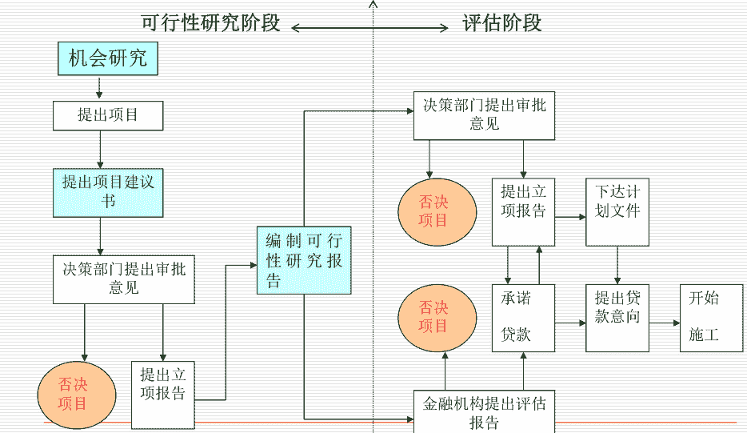

## 7.2 投资项目进展过程

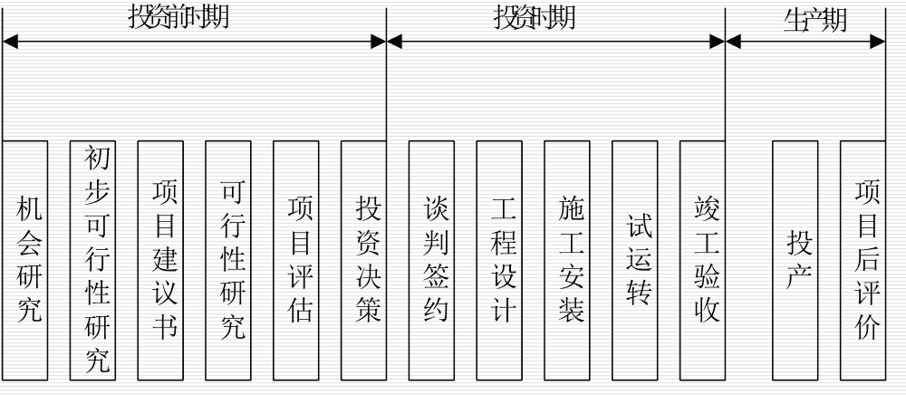

## 二、项目论证的原理和方法

- 投资成本和利税
- 静态评价方法
- 动态评价方法
- 多方案比较法
- 不确定性分析

## 1. 投资、成本和利税

- 利税
  - 销售收入和纯收入
  - 企业利润
  - 税金
- 现金流量
  - 现金支出
  - 现金收入
  - 现金流量=现金收入—现金支出

## 讨论题

例：假设一个企业某年的年销售收入为100万元，年销售成本为70万元，企业所得税税率为30%，年折旧费为20万元，请计算该企业的年净现金流量。

## 答案

1. 年销售收入 （+）100万元

2. 年销售成本 （-）70万元

3. 需纳税的收入 （+）30万元 （1）-（2）

4. 税金 （-）9万元 （3）×30%

5. 扣税后净利 （+）21万元 （3）-（4）

6. 年折旧费 （+）20万元

7. 年净现金流量 （+）41万元 （5）+（6）

企业的年净现金流量为41万元

## 2.1 投资收益率与投资回收期

**投资收益率E，又称投资利润率**，它是项目投资后所获得的年净现金收入（或利润）R与投资额K的比值，即

**E=R/K**

**投资回收期T**是指用项目投产后每年的净收入（或利润）补偿原始投资所需的年限，它是投资收益率的倒数，即

**T=1/E=K/R**

若项目的年净现金收入不等，则回收期为使用累计净现金收入补偿投资所需的年限，投资收益率则是相应投资回收期的倒数。

## 投资项目评价原则

- 投资项目的评价原则：
  - 投资收益率越大，或者说投资回收期越短，经济效益就越好。
  - 不同部门的投资收益率E和投资回收期T都有一个规定的标准收益率E标和标准回收期T标，只有评价项目的投资收益率E≥E标，投资回收期T≤T标时项目才是可行的；否则项目就是不可行的。

## 投资回收期的计算

### 投资回收期Pt：

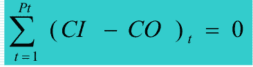


判别：Pt≤基准或行业平均投资回收期，表明项目的盈利能力和抗风险能力好。  
Pt—包括建设期，否则做特别说明

## 讨论例题

例：假设某项目的现金流量如下表所示：

| 年 | 0 | 1 | 2 | 3 | 4 |
|---|---:|---:|---:|---:|---:|
| 年净现金流量 | −5000 | 500 | 1000 | 2000 | 4000 |

假设该行业的标准投资收益率为12%，试分析该项目的投资是否可行？

## 投资回收期计算

### 计算累计现金流量

| 年 | 0 | 1 | 2 | 3 | 4 |
|---|---|---|---|---|---|
| 年净现金流量 | −5000 | 500 | 1000 | 2000 | 4000 |
| 净现金流量累计 | −5000 | −4500 | −3500 | −1500 | 2500 |

- 项目的投资回收期为：
  - T=4年—1年+1500/4000=3.38年

- 项目的投资收益率为：
  - E=1/T=0.296%≥12% 可行。

29.6%

## 3. 动态评价方法

- 资金的时间价值
- 净现值法
- 内部收益率法
- 外部收益率法
- 动态的投资回收期
- 现值指数法

## 3.1 资金的时间价值

资金的时间价值：  
资金的价值与时间有密切关系，同等数量的资金由于处于不同的时间而产生的价值差异。  
在投资者看来，投资的资金其价值随着时间的推移，按一定的复利率呈几何级数增长。

一般地讲，代表资金时间价值的利息是以百分比，即利率来表示的。在商品经济条件下，利率是由以下三部分组成的：

- 时间价值：即纯粹的时间价值，随着时间的推移而发生的价值增值。
- 风险价值：现在投入的资金，今后能否确保回收。
- 通货膨胀：资金会由于通货膨胀而发生贬值。

## 资金的计息方法

### 利息

一般我们把通过银行借贷资金，所付出的或得到的比本金多的那部分增值叫利息，而把资金投入生产或流通领域产生的增值，称为盈利或净收益。  
项目论证中利息是广义的概念，泛指投资净收益与贷款利息，当然这是由项目论证的任务决定的。

### 单利计算 F=P(1+ni)

F期末本利之和，P本金，i每一周期的利率，n计息周期数

### 复利计息

[ F = P(1 + i)^n ]


## 资金时间价值的涵义和意义

在项目论证时，对比不同的被选方案，会发现其现金流量存在两种性质的差异：  
一是现金流量大小的差异，即投入及产出数量上的差异；  
二是现金流量时间分布上的差异，即投入及产出发生在不同的时点。

如果只是简单地对比两个方案的现金流量，或将前期费用和后期收益直接作静态对比，是不可能得出正确结论的。

为了保证项目寿命期内不同时点发生的费用和收益具有可比性，必须运用资金时间价值的理论，将不同时点的现金流量折算成相同时点的具有可比价值的现值（或终值），才能科学判断方案优劣。

## 影响资金时间价值的因素

(3) 折现率及利息计算方式。

利息计算方式有单利法和复利法两种：

单利法公式为：

```
F = P(1+i×n)
```

复利法公式为：

```
F = P(1+i)^n
```

式中  
F —— 期末本利和；  
P —— 本金；  
i —— 利率；  
n —— 期数。

用单利计算的价值少于同期复利计算的价值，项目论证通常采用复利（即利滚利）的计算方法。


## 资金时间价值的计算方法

### 终值

复利终值是指一笔或多笔资金按照一定的利率复利计算若干年所得到的本利和，其计算公式为：

### 现值

未来资金的现在值称作现值，其计算公式为：

### 折现、折现率、折现系数

折现是指将来的一笔资金，用一定的利率折算成现在的资金。

折现率是指折现过程所采用的利率。

由于折现和复利是互逆运算，则折现系数是复利终值系数的倒数

(1+i)^-n ---- 折现系数

F = P(1+i)^n 或 （F/P,i,n）

P = F(1+i)^-n 或 （P/F,i,n）

- 为了比较不同时期的资金价值，只有把它们折算成现在的价值(例如0年的价值)，才使得不同时期的资金有一个共同的起点，才具有可比性。通常采用现值法。

- 在计算现值时，如果不加说明，一般地，都把每年的资金流入或流出看作是在年末发生，而不是年初发生。

### 年金现值

普通年金现值计算公式：

推导 : \( F_R = A \frac{(1+i)^n - 1}{i} \)

\( P_R = \frac{F_R}{(1+i)^n} = A \frac{(1+i)^n - 1}{i(1+i)^n} \)

\( P_R = A \frac{(1+i)^n - 1}{i(1+i)^n} \)
或： \( (P/A, i, n) \)

如果每年发生的款项大小不等，将如何计算？

© 2010 School of Software, Dalian University of Technology 45

### 不等额序列的终值、现值与年值

不等额序列的终值：

\( F = \sum_{t=1}^n A_t(1 + i)^{n-t} \)

不等额序列的现值：

\( P = \sum_{t=1}^n A_t(1 + i)^{-t} \)

不等额序列的年值：

\( A = \sum_{t=1}^n A_t(1+i)^{-t}(A/P,i,n) \)

### 3.2 净现值法

- 现值（PV）即将来某一笔金的现在价值。

- 净现值法是将整个项目投资过程的现金流按要求的投资收益率(折现率)，折算到时间等于零时，得到现金流的折现累计值（净现值NPV），然后加以分析和评估。

\[
NPV = \sum_{t=0}^n (B_t - C_t) \frac{1}{(1 + i_0)^t}
\]

式中B为收入额 C为支出额

- NPV指标的评价准则是：

- 当折现率取标准值时，若NPV≥0，则该项目是合理的

- 若NPV<0，则是不经济的。

### 3.3 内部收益率法

- 内部收益率法又称贴现法，就是求出一个内部收益率（IRR），这个内部收益率使项目使用期内现金流量的现值合计等于零，即

- NPV = \sum_{t=0}^{n} (B_t - C_t) \frac{1}{(1+i_0)^t} = 0

- 内部收益率的评价准则是：

- 当标准折现率为i0时，若IRR≥i0，则投资项目可以接受

- 若IRR＜i0，项目就是不经济的。

- 对两个投资相等的方案进行比较时，IRR大的方案较IRR小的方案可取。

### 3.4 外部收益率法

外部收益率法与内部收益率法相似，所不同的是要假设投资过程每年的收入都以相当于标准折现率的收益率进行再投资，到了项目有效期末必有一笔本利和，这是投资过程的收入，然而投资过程的每一年都有一笔投资支出，把这些支出按某一利率折算到项目有效期末，若其本利和等于投资收入本利和，则投资过程对该过程投资的折算利率来说是不盈不亏的，这个利率就叫投资过程的外部收益率ERR。

外部收益率的评价准则是：

- 当标准折现率为i0时，若ERR≥i0，则投资项目可以接受

- 若ERR＜i0，项目就是不经济的。

## 示例

- 例：假设某企业的总投资为4900万元，投产后每年的产值为990万元，企业年经营成本为450万元。试求其投资回收期？

- 如果不考虑时间因素，投资回收期T可由总投资额和年利润值算出，即

- T=4900/（990-450）≈9年

- 但是企业的投资是由银行贷款的，因此除偿还成本外，每年还要支付利息，年利率为10%。

- 考虑这一因素，则应按动态投资回收期计算，即

- Td=23年

- 不考虑时间因素的投资回收期是9年，可以认为经济效益可取，而考虑了贷款利息之后，投资回收期为23年，从经济效益看可能就是不可取了。

### 3.6 收益/成本比值法

- 项目收益为B,成本为C，则收益/成本比值为 B/C

- 收益/成本比值法的评判准则是：
  - 当B/C>1时，表明这个投资过程的收益大于成本，因此对于要求的投资收益率有盈余
  - 当B/C<1时，则这个投资过程的收益小于成本，对于要求的投资收益率是亏损的
  - 当B/C=1时，这个投资过程的收益等于成本，对于要求的投资收益率不亏不盈。

### 3.7 现值指数法

- 现值指数法是净现值除以投资额现值所得的比值，它是测定单位投资净现值的尺度，其计算公式为：

- NP=NPV/P

- 式中 NP—现值指数；NPV—净现值；

- P—投资额现值。

- 现值指数反映的是单位投资效果优劣的一个度量指标，它比较适用于多个投资方案进行评价比较。

- 一般来说，现值指数越大，单位投资效果越好；反之，现值指数越小，单位投资效果越差。

## 多方案经济比较

### 4.1 多方案经济比较概念与原则

- 方案经济比较是技术政策、发展战略、规划制定和项目评价的重要内容，在建设项目可行性研究中，各项主要经济与技术决策均应对各种技术上可行的方案进行技术经济对比分析计算，并结合其他因素详细论证、比较的基础上做出抉择。

- 方案经济比较是项目论证与评价的一项核心内容。

- 方案经济比较的原则：
  - 效益与费用计算口径一致原则
  - 各个方案间的可比性
  - 计算基础资料可比
  - 设计深度相同
  - 经济计算方法相同

- 在投资方案优选、评价过程中，按方案之间的关系可分为：独立、互补、互斥等几类方案。应用最多的是互斥方案的比较。

- 方案比较以动态分析法为主。

- 互斥方案经济比较方法
  - 动态分析法
    - 差额投资内部收益率法
    - 现值比较法
    - 年值比较法
    - 最低价格法
    - 效益/费用法
  - 静态分析法
    - 差额投资收益率法
    - 差额投资回收期法
    - 计算费用法

### 4.2 差额内部收益率法

差额内部收益率就是两个方案的差额净现值为零的内部收益率，差额净现值是指二方案逐年净现金流量差额折现累计值。差额内部收益率（IRR<sub>a</sub>）可由下式求得：

NPV<sub>1</sub>-NPV<sub>2</sub>=0，即NPV<sub>1</sub>=NPV<sub>2</sub>

就是说，二方案的差额内部收益率就是二方案净现值相等时的收益率。

评价标准是：当标准折现率为i0时，若差额内部收益率IRR<sub>a</sub>≥i0，则投资大的方案为优，否则，若IRR<sub>a</sub> < i0，则投资小的方案为优。

### 4.3 动态追加投资回收期

- 假设K₁和K₂是投资方案 I 及方案 II 的总投资额，K₁＞K₂；C₁和C₂是方案 I 和方案 II 的年生产成本，则追加投资回收期为：

\[
T_{ad} = \frac{-\log[1 - \frac{k_1 - k_2}{C_2 - C_1} i_0]}{\log(1 + i_0)}
\]

- 相应的追加投资收益率为E<sub>ad</sub> = 1/T<sub>ad</sub>

- 一般来说，如果动态追加投资回收期比标准投资回收期小或者说动态追加投资收益率较标准投资收益率大，则投资大的方案I是可选的，投资额小的方案 II 是不可选的；否则，投资小的方案较投资大的方案可取。

### 4.4 现值比较法

现值比较法就是把方案经济寿命期内的收益和费用按行业基准收益率或社会折现率折算成单一的现值来比较方案的优劣。现值法使用的条件可分为净现值法、费用现值法。

#### （1）净现值法

\[
\Delta NPV_{I-II} = \sum_{t=0}^{n} \left[ (CI - CO)_{II} - (CI - CO)_{I} \right]_t (P/F, i,t)
\]

当 \(\Delta NPV_{I-II} \geq i_c\)，投资大的I方案较优，反之，投资小的II方案较优。

#### （2）费用现值比较法

\[
PC = \sum_{t=0}^{n} (I + C - S_W - W)_t (P/F, i,t)
\]

当两个方案的服务年限相同时，\(PC_I > PC_{II}\)，则方案II优于方案I；当两个方案的服务年限不相同时，用研究期法比较两个方案的费用现值，则费用现值小的方案较优。


## 4.6 最低价格法

对产品产量不同，产品价格收费标准又难以确定的比较方案，当其产品为单一产品或能折合为单一产品时，可采用最低价格法，分别计算各比较方案净现值等于零时的产品价格并进行比较，以产品价格较低的方案为优。

Qt表示第t年的产品量

## 5. 不确定性分析

- 对投资项目风险的不确定性分析，常用的方法有：
  - 盈亏平衡分析
  - 敏感性分析
  - 风险决策分析
  - 计算机模拟
  - 经验方法

## 盈亏平衡点计算方法

### 1) 公式计算法

#### 用生产能力利用率表示：

\( BEP_{\text{生产能力利用率}} = [\frac{\text{年总固定成本 } F}{\text{年销售收入 } S - \text{年可变成本 } C_v - \text{年销售税金及附加 } T}] \times 100\% \),
\( = \frac{F}{S - C_v - T} \times 100\% \).

#### 用产量表示：

\( Q_{BEP} = \frac{\text{年总固定成本 } F}{\text{单位产品价格 } P - \text{单位产品可变成本 } V - \text{单位产品销售税金及附加 } T} \),
\( = \frac{F}{P - V - T} \),
\( = BEP_{\text{生产能力利用率}} \times \text{设计生产能力} \).

## 盈亏平衡点计算方法

### 2) 图解法

当0 < Q < Q<sub>BEP</sub>时，企业处于亏损状态。

当 Q > Q<sub>BEP</sub>时，企业处于盈利状态。

## 示例

例：假设某企业新建生产线投产后，正常年分固定成本总额为20000元，产品售价为每件10元，单位产品变动成本为6元，请计算该生产线的盈亏平衡点或保本销售量。

## 答案

- 总成本 C(Q)=固定成本 K＋单价 D×产品产量 Q
- 产品收入 B(Q)=销售价格 S×产品产量 Q
- 盈亏平衡即
  C(Q)=B(Q)　或　K＋DQ=SQ
- 盈亏平衡点
  Q=K/(S-D)=20000/(10-6)=5000件
  相应的保本销售额为：B=5000×10=50000元

## 练习题

例：某项目生产某种产品年设计生产能力为3万件，单位产品价格为3400元，单位销售税金与附加600元，总成本费为8800万元，其中固定成本2800万元，总变动成本与产品产量成正比例，请计算该生产线的盈亏平衡点或保本销售量。

## 5.2 敏感性分析

- 敏感性分析是通过分析、预测工程项目主要因素发生关系变化时对经济评价指标的影响，从中找出敏感因素，并确定其影响程度。

- 在项目计算期内可能发生变化的因素有产品产量、产品价格、产品成本或主要原材料与动力价格、固定资产投资、建设工期及汇率等。

- 敏感性分析通常是分析这些因素单独变化或多因素变化对内部收益率的影响。必要时也可分析对静态投资回收期和借款偿还期的影响。

- 项目对某因素的敏感程度可以表示为该因素按一定比例变化时引起评价指标变动的幅度，也可以表示为评价指标达到临界点（如财务内部收益率等于财务基准收益率或经济内部收益率等于社会贴现率）时允许某个因素变化的最大幅度，即极限变化，同时可绘制敏感分析图。

### 敏感性分析的一般内容

- 改变一种或多种不确定因素的数值

- 计算因素对项目效益的指标的影响

- 具体通过计算敏感度系数和临界点，估计项目效益指标对临界点的敏感程度

- 确定关键的敏感因素

### 单因素敏感性分析和多因素敏感性分析

- 单因素敏感性分析：每次只改变一个因素的数值

- 多因素敏感性分析：每次改变两个或两个以上因素的数值

- 通常多进行单因素敏感性分析

- 一般只考虑不确定因素的不利变化对项目效益的影响

## 敏感性分析的步骤

### 确定分析指标

- 一般选取最基本指标内部收益率，也可以选取净现值、投资回收期。

### 选定需要分析的不确定因素

- 因素：建设投资、产品价格、投入物价格、可变成本、生产负荷、建设期、汇率等

### 不确定因素变化程度的确定

- 一般选择不确定因素的百分比的变化，习惯上选取10%

### 确定敏感因素

## 敏感性分析的计算指标

- 敏感度系数：
  定义：
  
  某不确定因素敏感度系数 = Δ评价指标相对基本方案 / Δ该不确定因素
  
  特点：关注敏感度系数的相对值，而不是其绝对值
  
  判别：敏感性系数高，表示项目效益对该不确定因素敏感程度高

## 敏感性分析的计算指标

- 临界点：
  
  定义：当不确定因素使IRR=i₀或NPV=0时，其极限变化值。
  
  临界点与基准收益率的关系：
  
  同一个投资项目，随着设定基准收益率i₀的提高，临界点就会降低。
  
  判别：在基准收益率i₀为定值时，临界点越低，说明该因素对项目效益指标影响越大，项目对该因素就越敏感

## 敏感性分析结果汇总

| 序号 | 不确定因素 | 不确定因素变化率% | 项目财务内部收益率 | 敏感性系数 | 临界值 |
|---|---|---:|---:|---:|---:|
|  | 基本方案 |  | 15.3% |  |  |
| 1 | 建设投资 | 10.0% | 12.6% | 1.77 | 12.3% |
|  |  | -10.0% | 18.4% | 2.04 |  |
| 2 | 销售价格 | 10.0% | 19.6% | 2.84 |  |
|  |  | -10.0% | 10.6% | 3.05 |  |
| 3 | 原材料价格 | 10.0% | 13.8% | 0.95 | 22.4% |
|  |  | -10.0% | 16.7% | 0.94 |  |
| 4 | 汇率 | 10.0% | 14.2% | 0.71 | 32.2% |
|  |  | -10.0% | 16.4% | 0.75 |  |
| 5 | 生产负荷 | 10.0% | 17.9% | 1.72 |  |
|  |  | -10.0% | 12.4% | 1.92 | 11.2% |

| 敏感因素\变动幅 | -30% | -20% | -10% | 0% | 10% | 20% | 30% |
|---|---:|---:|---:|---:|---:|---:|---:|
| 建设投资 | 24.7% | 21.5% | 18.4% | 15.3% | 12.6% | 9.9% | 7.2% |
| 销售价格 | 1.3% | 6.0% | 10.6% | 15.3% | 19.6% | 24.0% | 28.3% |
| 原材料价格 | 19.6% | 18.2% | 16.7% | 15.3% | 13.8% | 12.4% | 10.9% |
| 汇率 | 18.7% | 17.6% | 16.4% | 15.3% | 14.2% | 13.1% | 12.0% |
| 生产负荷 | 6.5% | 9.4% | 12.4% | 15.3% | 17.9% | 20.6% | 23.2% |

## 敏感性分析图

纵轴：FIRR

横轴：不确定因素变动百分比

- 建设投资
- 销售价格
- 原材料价格
- 汇率
- 生产负荷

## 敏感性分析的结果在项目论证中的应用

- 内部收益率随不确定因素变化的曲线与基准收益率相交的交点，就是该不确定因素的临界值
- 一般临界值用临界点所对应的不确定因素的变化率来表示
- 敏感度系数较高或临界点较低者为较为敏感性因素
- 基准收益率选取高低，会改变不确定因素的临界值和敏感度系数数值的大小，但不改变其相对敏感程度

## 讨论题

例：已知某投资项目的各估算因素如下表所示：

| 因素 | 投资额 | 年收入 | 年支出 | 残值 | 寿命 | 折现率 |
|---|---|---|---|---|---|---|
| 预测值 | 170 | 35 | 3 | 20 | 10 | 12% |

请对年收入、年支出、残值、寿命四个因素分别按±10%，±20%，±30%的变化，分析对该项目的净现值的影响。


## 5.3 风险分析

风险分析又称概率分析，它是使用概率研究预测各种不确定性因素和风险因素的发生对项目评价指标影响的一种定量分析方法。

一般是计算项目净现值的期望值及净现值大于或等于零时的累计概率，累计概率值越大，说明项目承担的风险越小。也可通过模拟法测算项目评价指标（如内部收益率）的概率分析。

在进行风险分析时，先对各参数的值作出概率估计，并以此为基础计算项目的经济效益，最后通过经济效益期望值、标准差、实现概率及离差系数来反映方案的风险和不确定程度。

不确定因素使得未来的经济活动的实际结果可能偏离预期目标，与预期的结果发生偏差，有可能使实际结果低于预期的效果，甚至遭受一定的损失。这就是项目投资的风险所在。

设想状况 ≠ 预测基本方案 ≠ 实施后的结果

风险大小既与损失发生的可能性（概率）成正比，也与损失的严重性成正比

| 关系 | 内容 | 不确定分析 | 风险分析 |
|---|---|---|---|
| 区别 | 内容 | 各种不确定因素对项目效益的影响进行分析，确定敏感因素和敏感程度 | 确定各敏感因素发生的可能性和对项目效益影响发生的可能性 |
| 区别 | 方法 | 敏感性分析 | 概率分析 |
| 区别 | 作用 | 粗略估计项目风险 | 进行详细的风险分析，提出应对风险的措施 |
| 联系 | | 敏感性分析中敏感性因素和敏感程度是概率分析中风险因素确定的依据 | |

## 常见风险因素的归纳和分解

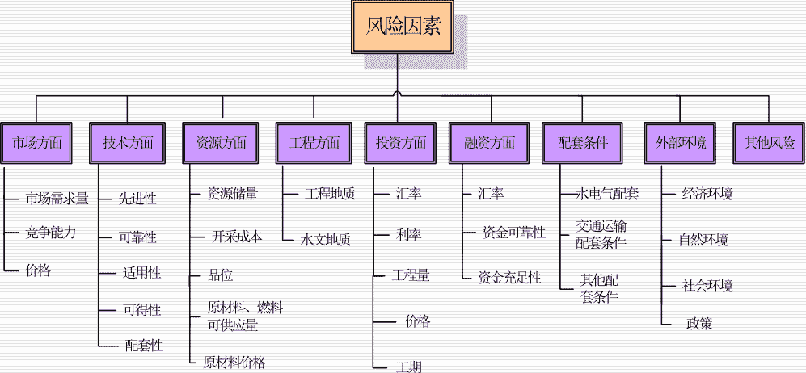

## 二、项目论证的基本程序

一个项目论证报告的编制，需要广泛的技术、经济和财务等方面的知识和技能。经过机会研究和初步项目论证后，才开始详细的项目论证。项目论证的目的是为投资决策提供技术、经济和财务依据，因而要分析各有关方面的因素，选择最佳方案并论证其生命力。

## 第一步：开始阶段

- 主要是要明确问题，包括
  - 弄清评价研究的范围
  - 雇主的目标

## 第二步：资料搜集与分析

- 包括
  - 实地调查
  - 市场分析
  - 技术分析
  - 竞争力分析
  - 原材料、能源供应分析
  - 工艺分析
  - 人力资源分析

## 第三步：建立各种可行的技术方案

为了达到目标通常会有多种可行的方法，因而就形成了多种可行的能够相互代替的技术方案。项目论证主要核心点是从多种可供实施的方案中选优，因此拟定相应的实施方案就是项目论证的关键一步工作。

- 组成技术专家组
- 提出各种可行的技术方案
- 专家组论证，发现技术和工艺上可行的技术方案

## 第四步：方案分析阶段

### 方案分析阶段包括

- 分析各个可行方案在技术上经济上的优缺点
- 方案各种技术经济指标
  - 投资费用
  - 经营费用
  - 收益
  - 投资回收期
  - 投资收益率
- 方案的综合评价与选优
  - 敏感分析
  - 各种方案结果的比较、分析和评价
  - 选择一个最优方案

## 第五步：编制已选择好的方案

- 包括
  - 进一步的市场分析
  - 方案实施的工艺流程
  - 项目地址的选择及服务设施
  - 劳动力及培训
  - 组织与经营管理
  - 现金流量及经济财务分析
  - 额外的效果

## 第六步：编制项目论证报告

- 项目论证报告其结构和内容常常有特定的要求

## 第七步：编制资金筹措计划

- 项目的资金筹措在比较方案时，已作过详细考查，其中一些潜在的项目资金会在与贷款者讨论可行性研究时冒出来。实施中的期限和条件的改变也会导致资金的改变，这些都应根据项目论证报告的财务分析作出相应的调整。同时应作出一个最终的决策，以说明项目可根据协议的实施进度及预算进行。

## 四、项目论证的主要内容

- 市场需求预测
- 原材料和投入的选择供应
- 产品结构和工艺方案的确定
- 生产规模（或生产能力）的确定
- 技术与设备选择
- 坐落地点和厂址选择
- 投资估算
- 资金筹措
- 经济评价
- 国民经济评价
- 不确定性与综合分析

## 可行性研究基本内容框图

| 研究课题 | 生产什么 | 资源条件 | 企业规模 | 项目方案 | 生产地点 | 三同时措施 | 项目实施 | 人员构成 | 其他 |
|---|---|---|---|---|---|---|---|---|---|
| 重点研究内容 | 市场需求价格销售量 | 原材料能源 | 产品方案建设规模 | 生产工艺设备选型 | 场址运输 | 节能环境劳动安全消防 | 实施进度安排 | 类别数量培训 | 生产组织机构设置 |
| 方案优化 | \multicolumn{9}{c}{产品品种规格、企业规模、工艺方案、设备选型、厂址、基建进度等} |
| 财务分析 | \multicolumn{5}{c}{估算投资：总额生产收入和成本等} & \multicolumn{4}{c}{资金筹措：方式、数额、利息等} |
| 经济评价与结论 | \multicolumn{9}{c}{经济评价和分析} |
| 财务评价 | 国民经济评价 | 环境评价 | 风险分析 | 不确定性分析 | | | | |

## 1. 市场需求预测——需求分析的内容

- 市场当前需求的大小与组成，该市场的地域范围
- 市场细分，主要按以下因素确定：
  - 最终用途（如消费者）
  - 消费者类别（如消费者的不同收入水平）
  - 地理区域（如区域市场、国内市场和出口市场）
- 对整个市场及其各部分在项目使用期间的某段时期，最好是头十年的需求预测
- 拟议中项目在国内与国际竞争发展和消费者反应变化的情况下，在所预测的时期内预期达到的市场渗透率；
- 作为预测增长与市场渗透依据的大致的订价结构。

## 1. 市场需求预测——需求预测

(1) 对某一种或几种产品的潜在需求的预测；
(2) 对潜在供应的估计；
(3) 对拟议中项目可能达到的市场渗透程度的估计；
(4) 某段时期内潜在需求的特性。需要有关于这些不同方面的数量和质量数字。

## 1. 市场需求预测——预测方法

- 常用的预测方法：
  - 时间序列预测法
  - 因果回归预测模型
  - 消费水平法（包括需求的收入弹性与价格弹性）
  - 最终用途（消费系数）法

## 1. 市场需求预测——预测程序

### 市场预测基础及预测过程

- 预测基础——市场调查结果

一般应预测 5—10 年。

- 预测过程（预测程序）：

——输入、处理、输出的动态反馈系统。全过程可分为 7 个主要步骤和一个反馈过程。

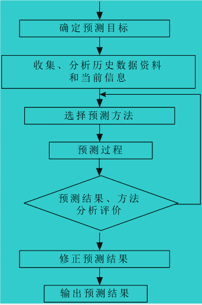

## 2. 原材料和投入的选择供应

### 原材料和投入的分类

原料（未加工或半加工的）；经过加工的工业材料（中间产品）；制成品（组件）；辅助材料；工厂供应品及公用设施（水、电、气、燃料、废水和废气处理等）。

### 原材料投入的选择与说明

在很多项目中，不同的原材料可用于同一生产，应确定哪一种原材料最为适宜。如果各种可供选择的原料都易于得到的话，问题就在于工艺与技术是否经济。

### 原材料和投入的特点

质量性能、来源和可得数量、单位成本

### 供应计划。

## 2. 原材料和投入的选择供应

- 方案研究内容：
  - 确定原材料、燃料的品种、质量和数量
  - 确定供应来源与方式
  - 确定运输方式
  - 选取原材料、燃料的价格

- 方案比选内容：
  - 满足生产要求的程度
  - 采购来源的可靠程度
  - 价格和运输费用是否经济合理

- 方案比选方法：单位产品边际利润法、盈亏平衡法、原材料最低成本法；运输方式和单位运量费用。

## 3. 技术方案、设备方案和工程方案

### 技术方案：

- 技术方案主要指生产方法、工艺流程等。
- 技术方案选择基本要求：先进性、适用性、可靠性、安全性、经济合理性
- 技术方案选择内容：
  - 生产方法选择
  - 工艺流程选择
  - 技术方案比选论证
  - 比选内容：技术的先进程度、技术的可靠程度、技术对产品质量性能的保证程度、技术对原材料的适用性以及购买技术或者专利费用等技术经济指标。


## 3. 技术方案、设备方案和工程方案

### 设备方案

- 设备方案选择是在研究和初步确定技术方案的基础上，对所需主要设备的规格型号、数量、来源价格等进行比选。
- 设备方案选择基本要求：与建设规模、产品方案相适应，设备之间相互配套，质量可靠稳定，经济合理。
- 设备方案选择内容：
  - 设备规格、型号、数量，设备来源与投资。
  - 超大、超重、超高设备安装的技术措施。
- 设备方案比选论证
  - 比选内容：设备对建设方案的满足程度，对产品质量和生产工艺要求的保证程度，设备使用寿命，备品备件保证程度，设备投资等。
  - 比选方法：运营成本比较、寿命周期费用比较、差额投资回收期

### 工程方案

- 工程方案是构成项目的实体。其选择是在建设和设备方案的基础上，研究论证主要建筑物、构筑物的建造方案。
- 工程方案选择基本要求：满足生产使用功能要求、适应已选定场址、符合工程标准规范要求、经济合理等。
- 工程方案研究内容：
  - 一般工业项目研究建筑物、构筑物的建筑特征、结构型式以及特殊要求，基础工程方案，抗震等
- 工程方案比选
  - 工程方案比选后，编制推荐方案的建筑物、构筑物一览表。

## 4. 生产规模（或生产能力）的确定

### 生产规模或生产能力的定义

- 生产规模或生产能力一般是指一个工厂在一定时期内能够生产的量或单位数。

### 确定可行的企业生产规模

- 最小经济规模和设备限制因素
- 资金和投入的限制因素
- 投资费用和生产成本

### 预计的销售额和企业的生产规模

## 5. 坐落地点和厂址选择

### 地点的选择

- 政府政策的作用
- 注重原材料还是注重市场
- 当地条件：基础设施和社会经济环境

### 厂址选择

- 土地费用
- 当地条件
- 场地整理和开拓

## 6. 环境保护

可行性研究报告中的环境保护篇章是项目建设方案设计的一部分，由可研报告编制单位统一编制，由项目业主审批。主要研究确定项目产生的污染物和污染源，并提出适当的治理措施。

### 环境保护方案设计主要内容

- 环境质量现状调查与分析
- 污染源和污染因素分析
- 治理措施

## 投资估算的步骤

- 分别估算各单项工程所需的建设工程费、设备及工器具购置费、安装工程费；
- 在汇总各单项工程费用的基础上，估算工程建设其他费用；
- 估算基本预备费、涨价预备费；
- 加和求得建设投资（不含建设期利息）总额；
- 在此基础上，计算建设期利息；
- 估算流动资金；
- 编制投资估算表和分年度投资计划表；
- 实际中使用“投资使用与资金筹措计划表”。

## 投资估算计算的内容和方法

| 名称 | 内容 | 估算方法 |
|---|---|---|
| 建筑工程费 | 为建造永久性建筑物和构筑物所需要的费用 | 单位建筑工程投资估算法、单位实物工程量投资估算法、概算指标投资估算法 |
| 设备 | 购置或自制国产设备 | 标准设备：带有和不带有备件原价，计算时采用带有备件原价 |
| | 非标设备 | 成本计算估算法、系列设备插入估算法、分部组合估算法、定额估算法 |
| 进口设备 | 进口设备货价 FOB/CIF、进口从属费用、国内运杂费 | 具体计算公式 |
| 工器具购置费 | 不构成固定资产的设施费用 | 以设备购置费为计算基数乘以费率 |
| 安装工程费 | 设备装配费用、装备设施工程费用、调试费用 | 按安装工程定额、取费标准和指标估算 |

### 基本预备费的内容和估算

- 设计变更及施工过程中可能增加工程量的费用

基本预备费 = (建设工程费 + 设备工器具购置费 + 安装工程费 + 工程建设其他费用) × 基本预备费率

### 涨价预备费的内容和估算

- 在建设期内价格上涨可能引起投资增加而预留的费用

\(PC = \sum_{t=1}^{n} I_t \left[ (1 + f)^t - 1 \right]\)

\(I_t =\) 建设工程费 + 设备工器具购置费 + 安装工程费

### 建设期利息估算

- 借款额在各年的年初发生：

建设期各年应计利息 = (上一年借款本息累计 + 本年借款额) × 年利率

- 借款额在各年均衡发生：（常用）

建设期各年应计利息 = (上一年借款本息累计 + 1/2 × 本年借款额) × 年利率

### 流动资金的估算

流动资金是指项目投产运营后，为进行正常生产运营，用于购买原材料、燃料，支付工资及其他经营费用等所必不可少的周转资金。它是伴随着固定资产投资而发生的永久性流动资产投资，等于项目投产运营后所需全部流动资产扣除流动负债后的余额。

- 流动资金构成：
  - 流动资产
    - 现金
    - 应收账款
    - 存货
  - 流动负债：应付账款
- 流动资金估算方法：
  - 分项详细估算法
    - 流动资金＝流动资产－流动负债
    - 流动资产＝应收账款＋存货＋现金
    - 流动负债＝应付账款
    - 流动资金本年增加额＝本年流动资金－上年流动资金
  - 扩大指标估算法
    - 按流动资金占某些基数的比例估算。
    - 基数：销售收入、经营成本、总成本、建设投资
    - 流动资金额＝年产值（年销售收入额）×产值（销售收入）资金率
    - 流动资金额＝年经营成本（年总成本）×经营成本资金率（总成本资金率）

## 8. 项目融资方案

- 项目投资的资金分为项目资本金和债务资金。
- 项目资本金是指项目投资中由投资者提供的资金，对项目来说是非债务资金，也是获得债务资金的基础。国家对经营性项目试行资本金制度，规定了经营性项目的建设都要有一定数额的资本金，并提出各行业项目资本金的最低比例要求。
- 资本金筹措分为新设项目法人资本金筹措和既有法人资本金的筹措。
- 债务资金是项目投资中除资本金外，需要从金融市场借入的资金。主要来源：
  - 信贷融资
  - 债券融资
  - 融资租赁

### 融资方案分析

- 在初步确定项目的资金筹措方式和资金来源后，应进一步对融资方案进行分析，比选并推荐资金来源可靠、资金结构合理、融资成本低、融资风险小的方案。
- 融资方案分析包括：
  - 资金来源可靠性分析
  - 融资结构分析
  - 融资成本分析
  - 融资风险分析

## 10. 财务评价

财务评价包括两方面内容：

- 一是财务评价的准备工作——基础数据和参数的确定、估算和分析；基础数据分为两类：一类是计算用数据和参数；另一类是判别用的参数。
- 二是进行财务分析与评价，包括盈利能力分析、偿债能力分析。

盈利能力分析是在现金流量表、损益表的基础上计算财务内部收益率、财务净现值、投资回收期和投资利润率等指标，分析项目的盈利能力。

偿债能力分析主要是编制借款还本付息计划表，计算利息备付率、偿债备付率或借款偿还期等指标来考察拟建项目的偿债能力。

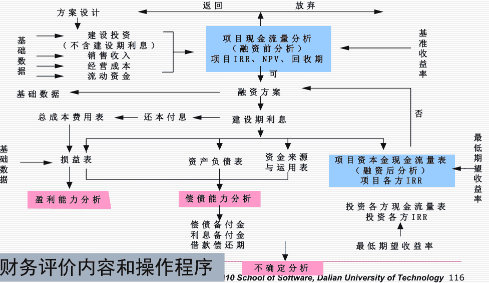

### 财务评价（基础数据的分析估算）


## 10. 财务评价

项目财务评价报表：利润表、现金流量表是用于计算项目盈利能力分析指标的报表。借款还本付息表、资金来源与运用表、资产负债表是用于计算项目清偿能力分析指标的报表。

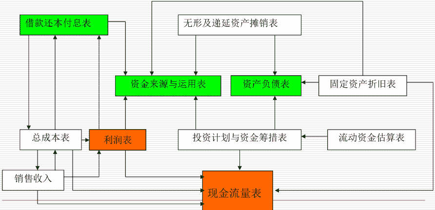

## 10. 财务评价

### 财务评价方法分类

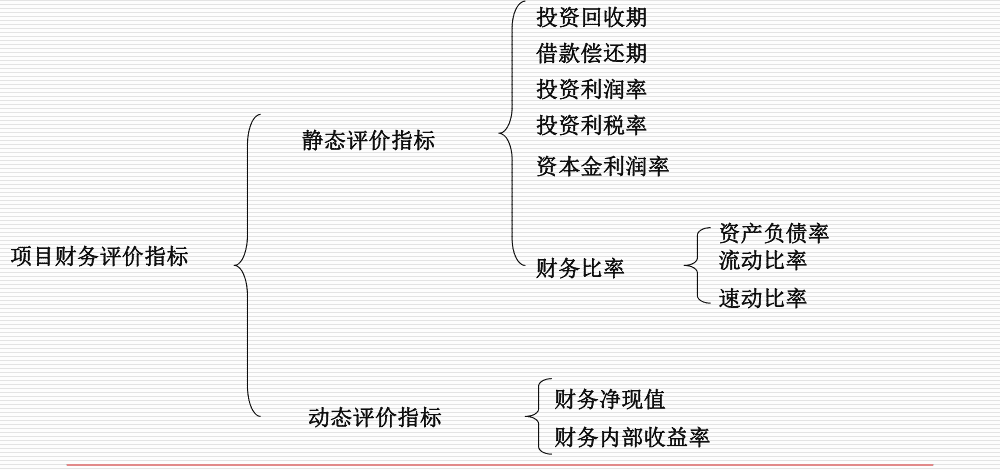

## 11. 国民经济评价及综合分析

### 国民经济评价

国民经济评价是从国家的角度，评价项目对实现国家经济发展战略目标及对社会福利的实际贡献。它除了对项目的直接经济效果考虑外，还要考虑项目对社会的全面的费用效益状况。与企业经济评价不同，它将工资、利息、税金作为国家收益，它所采用的产品价格为社会价格，采用的贴现率也为社会贴现率。

## 11. 国民经济评价

- 编制国民经济评价报表
- 如果以项目的财务评价为基础进行国民经济评价时，应从财务效益和费用中剔除“转移支付”部分，编制项目、国内投资国民经济效益费用流量表
  - 项目的某些财务收益和支出，从国民经济角度看并没有造成资源的实际增加或减少，而是国民经济内部的“转移支付”，不计做项目的国民经济效益和费用。
- 转移支付的主要内容包括：
  - 国家和地方政府的税收
  - 国内银行借款利息
  - 国家和地方政府给予项目的补贴
- 计算国民经济评价指标并进行方案比选
  - 指标：经济净现值、经济内部收益率

### 1. 国民经济评价

### 指标计算

#### 1) 经济内部收益率

对应指标：

$$\sum_{t=1}^{n}(B-C)_t(1+EIRR)^{-t}=0$$

EIRR ≥ 社会折现率 i_s，则投资项目可以接受；

- 目前 i_s = 10%
- i_s 的作用：
  1. 间接调控宏观投资规模
  2. 影响项目的选优和方案的比选

#### 2) 经济净现值

$$ENPV=\sum_{t=1}^{n}(B-C)_t(1+i_s)^{-t}$$

ENPV > 0，则投资项目可以接受。

## 12. 不确定分析与综合分析

### 综合分析

### 不确定性分析

- 产生不确定性的最普遍原因有：通货膨胀、技术变革、额定生产能力测定失实以及施工期和试车期的长短。
- 不确定分析分为三个步骤进行：盈亏平衡点分析、敏感性分析和概率分析

### 综合分析

- 政治和国防评估；工业配置评估；发展地区经济或部门经济的评估；提高国家、地区和部门科技水平的评估；减少进口、节约外汇和增加出口、创造外汇的评估；环境保护和生态平衡的评估；节约能源的评估；节约劳动力和提供就业机会的评估；产品质量评估；提高社会福利和人民物质文化生活的评估。

## 五、项目论证报告书的格式

- 第一章 实施要点
- 第二章 项目背景和历史
- 第三章 市场和工厂生产能力
- 第四章 原材料和投入
- 第五章 坐落地点和厂址
- 第六章 项目设计
- 第七章 工厂机构和管理费用
- 第八章 人力
- 第九章 项目执行时间安排
- 第十章 财务和经济评价

## 第一章：实施要点

实施要点这一章反映了项目论证报告各个章节的最关键部分及其最基本的结论，包括：

- 项目背景和历史
- 市场和工厂生产能力
- 原材料和投入
- 座落地点和厂址
- 项目设计
- 工厂机构和企业管理费用
- 人力
- 执行时间安排
- 财务和经济评价
- 结论

## 第三章：市场和工厂生产能力

在拟定项目前，应当分门别类地确定当前市场有效需求的规模和组成情况，以便估计某一产品可能的市场渗透程度。本章主要包括以下几个方面：

- 需求和市场预测
- 产品和副产品的销售预测和销售
- 生产计划
- 工厂的生产能力

## 第四章：原材料和投入

本章讨论关于制造规定的产品所需原材料和投入的选择和说明以及供应计划的确定和原材料费用的计算等。即本章主要包括以下两个方面：

- 原材料和投入
- 供应计划

## 第五章：座落地点和厂址

项目论证报告必须说明适合于所考虑的项目的地点或厂址。应该从一个相当大的地理区域选择地点，还必须从中多考虑几个可供选择的厂址，一旦选定厂址就要研究建立和经营工厂对周围环境的影响。本章主要包括以下几个方面：

- 座落地点
- 厂址
- 当地条件
- 对环境的影响

## 第六章：项目设计

本章主要包括以下几个方面：

- 项目范围
- 项目布局
- 技术
- 设备
- 土建工程

## 第七章：工厂机构和管理费用

制订机构规划将使得计算管理费用成为可能，而管理费用在有些项目中对项目的盈利性可以有决定意义。要对管理费用作出现实估价，必须把全厂可行地分成几个组成部分（生产、服务和行政等成本项目）。即本章主要包括以下两个方面：

- 工厂机构
- 企业管理费用

## 第八章：人力

在工厂的生产能力及所使用的生产过程确定之后，有必要对审议中项目的各级管理部门所需人员作出规定；对生产和其它有关活动进行估价时，应同时对项目各个阶段各级人员所需要的培训进行估计。即本章主要包括以下两个方面：

- 工人
- 职员

## 第九章：项目执行时间安排

项目执行时期是指从决定投资到开始大规模生产这段时期。这一时期包括谈判和签订合同、项目设计、施工和试运转等若干阶段。为了调节这些活动，在项目论证报告中应编制并提出最佳执行计划和时间安排。本章主要包括以下几个方面：

- 项目执行的基本数据和活动
- 项目执行计划和时间安排的选择
- 项目执行的成本估计

## 第十章：财务和经济评价

项目编制应当符合财务和经济评价的要求。在进行财务评价时最好采用动态评价方法，并结合采用敏感性分析。同时，还应从项目对国民经济的直接和间接影响方面对项目进行评价。 本章主要包括以下几个方面：

- 总投资费用
- 项目筹资
- 生产总成本
- 财务评价
- 国民经济评价

## 六、项目论证案例

某化学纤维厂经济评价

### （一）项目概述

某化学纤维厂是新建项目，其项目经济评价是在完成市场需求预测、生产规模、工艺技术方案、原材料、燃料及动力的供应、建厂条件和厂址方案、公用工程和辅助设施，环境保护、工厂组织和劳动定员以及项目实施规划诸方面进行研究论证和多方案比较后，确定了最佳方案的基础上进行的。

项目生产国内外市场均较紧俏的某种化纤N产品。这种产品是纺织品不可缺少的原料，国内市场供不应求，每年需要一定数量的进口。项目投产后可以产顶进。

主要技术和设备拟从国外引进。

厂址位于城市近郊，占地250亩，靠近铁路、公路、码头，并靠近主要原料和燃料产地，水、电供应可靠。

该项目主要设施包括生产车间、与工艺生产相适应的辅助生产设施、公用工程以及有关的生产管理、生活福利等设施。

### （二）项目的基础数据（1）

#### 1. 生产规模和产品方案

生产规模为年产2.3万吨N产品。产品方案为棉型及毛型二种，以棉型为主。

#### 2. 实施进度

项目拟三年建成，第四年投产，当年生产负荷达到设计能力的70%，第五年达到90%，第六年达到100%。生产期15年计算，计算期为18年。

### （二）项目的基础数据（2）

#### 3. 总投资估算

##### (1) 固定资产投资估算

a. 固定资产投资估算额为42542万元，其中外币3454万美元。外汇按国家外汇管理局1992年6月份公布的外汇牌价1美元=5.48无人民币计算

b. 固定资产投资方向调节税估算按国家规定本项目投资方向调节税税率为5%，投资方向调节税估算值为2127万元。

c. 建设期利息估算为4319万元，其中外汇为469万美元

##### (2) 流动资金估算

流动资金估算是按分项详细估算法进行估算，估算总额为7084万元。

##### (3) 总投资=固定资产投资+固定资产投资方向调节税+建设期利息+流动资金 = 42542 + 2127 + 4319 + 7084 = 56072 万元

### （二）项目的基础数据（3）

#### 4. 资金来源

（1）项目自有资金(资本金)为16000万元，其余为借款，外汇全部通过中国银行向国外借款，70%由中国工商银行代款，年利率为8.64%。

（2）投资分年使用计划按第一年20%，第二年55%，第三年25%的比例分配。

#### 5. 工资及福利费估算

全厂职员为1140人，工资及福利费按每人2800元估算，全年工资及福利费为320万元(其中福利费按工资总额的14%计取)。


## （三）项目财务评价

### 1. 年销售收入和年销售税金及附加估算

- （1）产品产量：N产品年产2.3万吨。
- （2）产品销售价格以近几年国内市场已实现的价格为基础，预测到生产期初的市场价格，每吨出厂按15400元计算。
- （3）年销售收入估算在正常年份为35420万元。
- （4）年销售税金及附加按国家规定计取，产品缴纳增值税，增值税税率为14%，城市维护建设税按增值税的7%计取，教育费附加按增值税的2%计取。销售税金及附加的估算值在正常生产年份为2689万元。

### 3. 利润总额及分配

利润总额正常年份估算为8916万元。所得税按利润总额的33%计取，特种基金和盈余公积金分别按税后利润的25%和10%计取。

### 4. 财务盈利能力分析

- （1）根据财务现金流量表（全部投资）计算以下财务评价指标：
  - a）所得税后财务内部收益率为12.27%，财务净现值（i=12%时）为676万元。
  - b）所得税前财务内部收益率为17.72%，财务净现值（i=12%时）为16309万元。
  - c）财务内部收益率均大于行业基准收益率，说明盈利能力满足了行业最低要求，财务净现值均大于零，该项目在财务上是可以考虑接受的。
  - d）所得税后的投资回收期为9.26年（含建设期），所得税前的投资回收期为7.8年（含建设期），均小于行业基准投资回收期10.3年，这表明项目投资能按时收回。

- （2）根据现金流量表（自有资金）计算以下指标：
  - a）自有资金财务内部收益率为14.10%。
  - b）自有资金财务净现值（i=12%）为2808万元。

- （3）根据损益表和固定资产投资估算表计算以下指标：
  - a）投资利润率=年利润总额/总投资×100%=16%。
  - b）投资利税率=年利税总额/总投资×100%=21%。
  - c）该项目投资利润率和投资利税率均大于行业平均利润率和平均利税率，说明单位投资对国家积累的贡献水平达到了本行业的平均水平。
  - d）资本金利润率=年利润总额/资本金总额×100%=56%。

### （5）清偿能力分析

- a）偿还借款的资金来源，本案例为简化计算，在还款期间将未分配利润、折旧费、摊销费全部用来还款，但在进行实际项目的还款计算时，可根据项目的实际情况确定。
- b）由于项目没有外汇收入，偿还外汇借款是项目投产后以1∶6的比价购买调剂外汇按7年等额还本，计算利息。固定资产投资国内借款偿还，在投产后按最大偿还能力计算还本付息。
- c）固定资产投资国内借款偿还期（从借款开始年算起）为8.08年，能满足贷款机构要求的期限。项目具有偿还能力。

### 财务敏感性分析表

| 序号 | 项目 | 基本方案 | 投资+10% | 投资-10% | 经营成本+10% | 经营成本-10% | 销售收入+10% | 销售收入-10% |
|---|---|---|---|---|---|---|---|---|
| 1 | 内部收益率（%） | 17.72 | 16.19 | 19.47 | 14.47 | 20.73 | 22.35 | 12.47 |
| 2 | 较基本方案增减（%） | | -1.53 | 1.75 | -3.25 | 3.01 | 4.63 | -5.25 |
| 3 | 投资回收期（年） | 7.8 | 8.19 | 7.44 | 8.75 | 7.16 | 6.87 | 9.48 |

可以看出，各因素不同程度上影响内部收益率和投资回收期，其中销售收入的提高和降低最为敏感。

### b. 盈亏平衡分析

① 以生产能力利用率表示的盈亏平衡点（BEP），其计算公式为：

BEP=年固定总成本/年销售盈利×100%
=5587/（35420-18228-2689）×100%
=39%

（年销售盈利=年销售收入-年可变总成本-年销售税金及附加）

② 计算结果表明，该项目只要达到设计能力的39%，也就是年产量达到0.90万吨，企业就可以保本，由此可见，该项目风险较小。

### 7. 财务评价结论

- 从上述财务评价看，财务内部收益率高于行业基准收益率，投资回收期低于行业基准投资回收期，借款偿还期能满足贷款机构要求，从敏感性分析看，项目具有一定的抗风险能力，因此项目从财务上讲是可行的。

## （四）国民经济评价

与财务评价的主要差异是对以下数据进行调整：

### （1）转移支付的处理

以下三项费用均属国民经济内部转移支付，不作为项目的费用：

- a. 该项目引进的设备、材料按国家规定缴纳的关税及增值税；
- b. 固定资产投资方向调节税对国民经济来说，无实质性的费用支出；
- c. 销售税金及附加和土地使用税。

### （2）关于间接效益和间接费用的计算

该项目引进先进的技术设备，通过技术培训、人才流动、技术推广和扩散，整个社会都将受益，这种效果在影子价格中没有得到反映，理应计为项目的间接效益，但由于计量困难，只作定性描述。

根据以上调整后的基础数据，计算的国民经济评价指标如下：

- （1）全部投资的经济内部收益率等于15.63%，大于社会折现率12%，说明项目是可以考虑接受的。
- （2）在社会折现率为12%时，全部投资的经济净现值为8192万元，大于零。这说明国家为这个项目付出代价后，除得到符合社会折现率的社会盈余外，还可以得到8192万元现值的超额社会盈余，所以该项目是可以考虑接受的。
- （3）国内投资经济内部收益率为18.09%，大于社会折现率12%。
- （4）国内投资经济净现值（i=12%）为9355万元，大于零。

## 七、项目评估

- 项目评估的概念
- 项目评估与项目可行性研究的关系
- 项目评估的依据
- 项目评估的程序
- 项目评估的内容
- 项目评估报告大纲

### 1. 项目评估的概念

- 项目评估是指在项目可行性研究的基础上，由第三方（国家、银行或有关机构）根据国家颁布的政策、法规、方法、参数和条例等，从项目（或企业）、国民经济、社会角度出发，对拟建项目建设的必要性、建设条件、生产条件、产品市场需求、工程技术、经济效益和社会效益等进行全面评价、分析和论证，进而判断其是否可行的一个评估过程。
- 项目评估是项目投资前期进行决策管理的重要环节，其目的是审查项目可行性研究的可靠性、真实性和客观性，为银行的贷款决策或行政主管部门的审批决策提供科学依据。

### 2. 项目评估与可行性研究的关系

**两者之间的关系**

- 工作关系：可行性研究为项目评估提供工作基础，项目评估则是可行性研究的延伸、深化和再研究。
- 工作时点：可行性研究在项目建议书批准之后进行工作；项目评估在项目可行性研究报告批准之后进行工作。
- 工作性质：
  - 可行性研究系从宏观到微观逐步深入的研究过程。
  - 评估则是将从微观问题再拿到宏观去衡量的过程。

**评估与可行性研究相同之处**

- 均处于项目发展周期的建设前期。
- 项目投资之前，都是为投资决策服务的经济分析手段。
- 工作的内容基本相同。
- 经济评价指标计算的基本原理、分析对象、分析依据、分析内容相同。
- 基础理论基本相同。
- 市场学、工程经济学、费用—效益分析。
- 最终工作的目标及要求相同。
- 判断项目的可行与否，使资源得到最佳配置。
- 在调查研究的基础上进行分析和预测，得出公正客观的结论。

**评估与可行性研究不同之处**

| 不同点 | 可行性研究 | 项目评估 |
|---|---|---|
| 行为主体 | 由建设单位（即投资者）负责组织委托 | 由贷款银行或有关部门负责组织委托 |
| 立足点 | 站在投资者的角度来考察项目 | 站在贷款银行或有关部门的角度来考察项目 |
| 侧重点 | 侧重于项目的必要性与技术方面的论证 | 侧重于考察项目建设的可能性与借款的偿还能力 |
| 作用 | 投资主体进行投资决策和计划部门审批项目的依据 | 贷款部门参与决策和决定贷款与否的依据，是项目投资最终决策的依据 |
| 所处阶段 | 可行性研究在先 | 项目评估在后，工作顺序不能颠倒 |

### 4. 项目评估的程序

- 1）成立评估小组并进行分工
- 2）对可行性研究报告和相关资料进行审查和分析
- 3）编写评估报告提纲
- 4）数据调查
- 5）分析与论证
- 6）编写评估报告
- 7）小组讨论
- 8）修改报告
- 9）专家论证会
- 10）评估报告定稿


## 6. 项目评估报告内容大纲

- 1）项目概况
  - a) 项目基本情况
  - b) 综合评估结论：提出是否批准或可否贷款的结论性意见。
- 2）详细评估意见
- 3）总结和建议
  - a) 存在或遗留的重大问题
  - b) 潜在的风险
- 4）建议

## 问题？

## Any Question?


## 项目计划与控制

孔祥杰

xiangjie.kong@gmail.com

大连理工大学软件学院

## 主要内容

- 1. 项目的计划与控制
- 2. 项目启动
- 3. 进度管理
- 4. 费用管理
- 5. 质量管理
- 6. 项目管理的主要方法
  - 工作分解结构
  - 网络计划技术
  - 资源费用曲线
  - 挣值分析法（赢得值分析法）

## 一、项目的计划与控制

- 项目计划与控制过程概览
- 项目计划与控制的概念
- 项目计划与控制的内容
- 项目计划与控制的层次
- 项目三坐标管理的概念
- 项目三坐标的平衡

### 项目计划与控制过程概览

#### 项目管理过程

项目的目标 问题或变化

项目

| 目标 |
|------|
| 管理控制 |
| 质量改进 |
| 商务需求 |
| 状态评审 |
| 指令 |
| 约束 |
| 管理层批准 |

活动报告

计划

| 可视性 |
|--------|
| 实践与计划 |
| 控制期 |

实际结果

| 详细数据报告 |
|--------------|

项目结束

| 工作说明 |
|----------|
| 工作分解结构 |
| 任务描述 |
| 责任矩阵 |
| 时间和成本估算 |
| 网络图 |
| 进度计划 |
| 资源负荷图 |
| 风险分析/防范计划 |
| 管理计划 |

© 2010 School of Software, Dalian University of Technology 4

### 项目计划与控制的层次

- 大项目管理的需要

- 项目总进度计划与控制 领导（高层次）
- 项目主进度计划与控制 项目经理
- 项目详细进度计划与控制 作业队、实施者

计划内容、计划层次、各层编制的责任人
多种计划如何合并、汇总、更新及变更控制

## 项目三坐标管理的概念

### ——项目目标约束的反映与平衡

### 项目管理的三坐标管理体系

- 项目的进度管理是项目能否按期实现的基本保证
- 项目的费用管理是对实现项目所需要的经费进行合理有效的管理，使得项目的费用支出与进度相协调
- 项目的质量管理是使所实施的项目达到设计质量及技术指标的关键，是项目得以顺利完成的基础

### 识别需求

- 需求的产生
  - 公共需求与公共项目
  - 个体需求与个体项目
- 识别需求或需求识别
  - 起始于需求、问题或机会的产生
  - 结束于需求建议书的发布
  - 清晰的需求是承约商规划与实施项目的基础。

### 需求识别与项目识别

一两个不同角色的问题，通过与培训对象相贴近的项目实例说明更为有效

- 假如您感到居住多年的房屋已显得陈旧，希望将房屋重新装修一番，当装修公司询问您需要什么样的布局、风格时，您如何描述需求呢？
- 需求的描述：“你看着办吧，只要好就行。”结果会如何呢？
- 也许你会说：“你怎么装修的如此浮华俗气，你知道我是一个知识分子，房间的布局、风格应充满书香墨气”
- 责任呢？
- 责任很明确：一方面是客户没有明确告诉委托人他所希望的目标，另一方面是委托人也没有进行充分调查与研究

## 需求建议书的内容(1)

- 项目工作陈述
  - 例：房屋装修要说明是对旧房子装修，风格及样式，装修的范围
- 项目的目标
  - 交付物、成本、进度
- 项目目标的规定
  - 物理参数、操作参数，如盖房要求可能包括总计5000平方米的面积，8间卧室，2间浴室，一间双车道车库，中央空调和一个游泳池。

### 需求建议书的内容(2)

- 客户供应
  - 项目实施上客户提供的保障，物品供应等
- 客户的付款方式
  - 这是承约商最为关心的，如分期付款、一次性付款等
  - 例：某房地产开发商在项目启动时支付给建筑公司20%的款项，项目完成50%再支付30%的款项，项目完成竣工后支付剩余50%资金。
- 项目的进度计划
  - 这是客户最为关心的，如装修房子的及时完成可以保证你尽早的享受舒适的居住条件

### 需求建议书的内容(3)

- 对交付物的评价标准
  - 项目实施的最终标准是客户满意，否则承约商很难获得所期望的利润
- 有关承约商投标的事项
  - 应规定建议书的格式及投标方案的内容
- 投标方案的评审标准
  - 可能包括：承约商背景及经历、技术方案、项目进度、项目成本

## 东方公司办公楼建设项目需求建议书

有关单位：

- 东方公司向具有建设部建筑一级认证企业的承约商征求办公大楼建设，项目目标是：建设1234平方米高3层框架结构的办公大楼。

### 1、工作表述

- 承约商将执行下面任务：
  - 主体框架工程建设、建筑设备安装、装修工程。

### 2、要求

- 承约商应根据国家标准建设，提供施工计划和施工方案。

### 3、交付物

- 符合国家建设标准的办公大楼。

### 4、东方公司提供的条款

- 东方公司将向承约商提供办公大楼施工图纸。

### 5、需求信息

- 承约商在执行工作之前，必须获得东方公司对施工方案的认可。

### 10、申请书内容

承约商的申请书至少必须包括如下内容：

- （1）方法。承约商能清晰地理解需求建议书，理解什么是被期望达到的要求。而且要详细描述承约商领导项目的方法，要求对每个任务的详细描述，任务如何完成的详细描述
- （2）交付物。承约商要提供交付物的详细描述
- （3）进度计划。列出甘特图或网络图表，列出每月要执行的详细任务的时间表，以便在要求的项目完成日期内能够完成项目
- （4）经验。叙述一下承约商最近已经执行的项目，包括客户姓名、地址和电话号码
- （5）人事安排。列出将被指定为项目主要负责人的姓名和详细简历，以及他们在类似项目中的成绩
- （6）成本。必须说明总成本并提供一份项目的预算清单。

### 11、申请书评价标准

- 1. 方案（30%）。承约商提出建设方案
- 2. 经验（30%）。被指定执行此项目的承约商和主要负责人的执行类似项目的经验
- 3. 成本（30%）。承约商申请书中所列的固定成本
- 4. 进度计划（10%）。为了要在项目完成之日期内或在此日期之前完成项目，承约商应提供详细的施工计划。

## 项目识别

- 所谓项目识别就是面对客户已识别的需求，承约商从备选的项目方案中选出一种可能的项目方案来满足这种需求。
- 项目识别与需求识别的不同：
  - 需求识别是客户的一种行为
  - 项目识别是承约商的行为。

## 识别需求与项目识别案例讨论

- 某居民区的张先生夫妇，过去一直在公共浴室洗澡，但自从喜添了小宝宝后也增加了新的忧愁：必须保证宝宝的清洁卫生，因此家里添置一套洗浴装置迫在眉睫！
- 本项目的**识别需求**和**项目识别**是什么呢？

### 识别需求：

- 从可能的方案有三个，在煤气管道上安装热水器、安装电热水器、安装太阳能热水器等
- 经过调查、比较及分析决定选用太阳能热水器，便可准备需求建议书。

### 项目识别：

- 承约商在接到需求建议书之后，虽然客户表明是安装一套太阳能热水器，但其类型、性能等差异很大
- 承约商所要作的工作就是根据具体情况确定满足客户需求的项目
- 客户的成本预算能否足以完成满足需求的项目
- 客户已识别的需求是否经济可行，这一点应以客户为中心

### 项目识别与需求识别的不同：

- 需求识别是客户的一种行为
- 项目识别是承约商的行为


## 需求建议书与项目建议书

### --两种不同的过程和结果

- 需求建议书对应于招标书，反映客户需求识别的结果。
- 项目建议书对应于投标书，反映承约商如何去保证项目的实施，是承约商项目识别的结果。

## 项目投标

- 客户向承约商发送需求建议书的过程就是项目的招标过程，根据客户的需求，承约商进行项目构思、可行性研究，最后向客户投送项目建议书的过程就是项目的投标。

## 项目投标过程(1)

### 1）项目构思

- 根据客户需求提出满足客户需求的各种实施方案
- 主要的方法是头脑风暴法，即让参与项目的成员提出尽可能多的想法或方案

### 2）项目筛选

- 从可供实施的备选方案中选择最佳的方案来满足客户的需求
- 选择在现实中可行的、投入少、收益大的项目方案
- 评价的标准主要有：满足客户的程度、时间和成本、实施的可行性、风险的大小

## 项目投标过程(2)

### 3) 项目的投标

- 与招标对应
- 公开招标
- 邀请招标
- 混合招标
- 协商议标
- 投标决策
- 分析会有哪些承约商参加投标，各自的优势，同客户的关系
- 主要考虑的因素自身的技术能力、项目风险、承约商的资源配置能力、其他因素等
- 投标申请书

## 投标申请书

- 一份申请书一般包括3个部分，技术的，管理的，成本的，如果一份较复杂的申请书，这三个部分可能是3个独立的册子
- 技术部分目的是让客户认识到：承约商理解需求或问题，并且能够提供风险最低且收益最大的解决方案
- 管理部分的目的上使客户确信，承约商能够做好项目所提出的工作，并且收到预期结果
- 成本部分的目的是使客户确信，承约商申请项目所提出的价格是现实的、合理的

## 二、项目计划的制定

1. 第一步：项目描述
2. 第二步：项目分解
3. 第三步：任务描述
4. 第四步：责任矩阵安排
5. 第五步：工作关系确定
6. 第六步：网络图绘制
7. 第七步：进度安排

## 成功的项目计划与控制工作流程

### 目标确定

### 成果交付

公司满意  
老板满意  
业主满意  
员工满意  
自己满意

项目目标确定

网络计划

甘特图计划

人力资源配置

费用分解

费用预算

费用累计曲线

项目论证与决策

组织机构

工作结构分解

里程碑计划

责任分配,工作关系,时间估计

计划实施

动态监控

挣值分析

费用控制

计划偏离调整计划

计划一致执行计划

范围确认质量验收资料验收

质量控制

进度控制

项目进度控制项目费用控制项目风险控制项目质量管理信息沟通管理

材料实际费用人工实际费用项目执行报告计算 SV / CV估算 EAC

## 成功的项目计划与控制特征

成功的项目计划与控制方法应该具有如下的特征：

- 体系化
- 程序化
- 可视化
- 动态化

## 三、项目目标与范围确定

- [ ] 项目目标的确定
- [ ] 里程碑计划及其制订
- [ ] 项目范围的确定
- [ ] 工作分解结构WBS的制定

## 1. 项目目标确定与项目描述

- 项目目标是项目**预期的结果或最终产品**，应明确具体，并尽量定量化，主要涉及：
    - 时间 约束性目标
    - 费用 约束性目标
    - 技术 Product requirements specification
    - 产品 满足特定需求、个性化的可交付性成果

- 目标确定的依据是项目论证报告和合同，总目标的确定通常包括：
    - 工作范围
    - 进度计划
    - 成本
    即要求在一定期限和预算内完成预定任务。

## 目标描述示例

1.在10个月内，在200万美元的预算内，把一种新型电子家用烹调产品打入市场，并达到预先规定的性能指标。

2.“建成一所房屋”的目标描述是否合理？
较好的描述应该是：在15万美元的预算内，根据5月15日的楼面布置图纸和说明书，在10月31日前建成这所房子。

## 某无人驾驶的小型气象探测飞机研制生产项目

某飞机制造公司承担无人驾驶的小型气象探测飞机研制生产项目。项目拟于2009年7月开始实施，市场需求为50-100架，首架交付日期为2013年12月。项目目标包括飞机研制和为保证飞机性能的特种设备/设施采购，为保障小型气象探测飞机研制与试飞任务的顺利进行，项目总投资为1.2亿元人民币。

问题：对项目的目标进行描述？

## 无人机研制项目目标

- 可交付成果：研制无人驾驶小型气象探测飞机；
- 工期：首架交付日期2013年12月，研制时间从2009年7月到2013年12月，总工期为3.5年；
- 费用：研制总经费为1.2亿元人民币。

## 豪华别墅建设项目

在一次福利彩票的购买中，你无意中得到了一笔500万元的头等奖金。在得到这比钱之后，你便想着手实现您过去的梦想，建造一栋豪华别墅。为了建造这座豪华别墅，你准备花费200万元，建筑面积共500平方米，包括上下两层，配有健身房、车库、卫生间、取暖设备及小花园。建设豪华别墅的工作可以于2010年5月1日开始，你希望在2011年新年到来之际搬进新房，同时要求在新房建设完成两个月后才可以搬进新房。

- 问题：对项目的目标进行描述？

## 项目目标与描述示例

### “中星22号”卫星业务管理站建设项目

“中星22号”卫星业务管理站建设项目主要是负责卫星运行业务管理。其建设项目主要包括：通信、天何馈、射频网络、遥测遥控、数据处理、在轨测试和测试模拟等。

项目总投资1800万元。为满足05年11月发射的卫星，本项目于2004年9月初开始，2005年9月前建设完成，工程总工期为1年。

## 确定项目目标

- 交付成果：卫星业务管理站建设项目
- 工期目标：工程于2004年9月初开工建设，2005年9月前完成，工程总工期为1年。
- 费用目标：总造价1800万元
- 质量目标：各单机设备合格率100%，优良率70%以上，争创一流。
- 安全目标：杜绝人为事故。

## 项目工作描述表

| 项目工作描述 | |
|---|---|
| 项目名称 | 卫星业务管理站建设项目 |
| 项目目标 | 2004年9月开工，用1年的时间完成“中星22号”卫星业务管理站的建设。项目总投资1800万元。 |
| 可交付物 | 卫星业务管理站 |
| 交付物完成准则 | 通信、天枢馈、射频网络、遥测遥控、数据处理研制技术要求 |
| 工作描述 | 系统分析、系统设计、系统研制、系统测试、系统交付 |
| 工作规范 | 依据卫星在轨测试规范 |
| 所需资源 | 人力、材料、经费、设备的需求预计 |
| 重大里程碑 | 04年12月15日系统设计、05年5月31日系统研制、05年7月31日系统测试、05年8月31日系统交付。 |
| 项目主管审核意见 | |


## 2. 里程碑计划及其制订

### 里程碑计划：

- 以项目中某些重要事件的完成或开始时间点作为基准所形成的计划，是一个战略计划或项目框架，以中间产品或可实现的结果为依据
- 显示了项目为达到最终目标而必须经过的条件或状态序列，描述了项目在每一阶段应达到的状态，而不是如何达到。
- 里程碑计划是项目进度计划的表达形式之一

### 三峡工程重大里程碑及其主要提交成果

- 1993年，宣布三峡工程正式开工
  - 若干提交成果必须验收完毕（如四通一平，工区征地，甚至包括主席台的准备）
- 1997年，右岸明渠通航、大江截流
- 2003年，首台机组开始发电
- 2009年，工程全部完工、电站全部投入运行。

## 里程碑计划的表达形式

#### ——里程碑事件

| 里程碑事件 | 一月 | 二月 | 三月 | 四月 | 五月 | 六月 | 七月 | 八月 |
|---|---|---|---|---|---|---|---|---|
| 转包签订 | | | ▲ | | | | | |
| 计划书的完成 | | | | ▲ | | | | |
| 设计检查 | | | | | ▲ | | | |
| 子系统测试 | | | | | | ▲ | | |
| 第一单元实现 | | | | | | ▲ | | |
| 产品计划完成 | | | | | | | | ▲ |

#### ——里程碑图

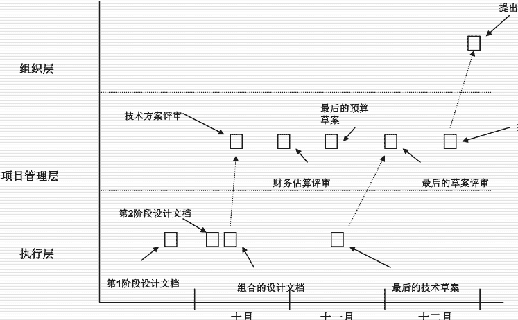

组织层

项目管理层

执行层

提出初步的项目申请

技术方案评审

最后的预算草案

提出预算要求

财务估算评审

最后的草案评审

第1阶段设计文档

第2阶段设计文档

组合的设计文档

最后的技术草案

十月

十一月

十二月

注：每一个方块（□）代表一个重要的里程碑；也就是，表示一项或多项任务（在此来画出）被安排在此完成的一个特殊的时间点。

### “中星22号”卫星业务管理站建设项目--里程碑计划图

| 里程碑 | 2004.9 | 2004.10 | 2004.11 | 2004.12 | 2005.1 | 2005.2 | 2005.3 | 2005.4 | 2005.5 | 2005.6 | 2005.7 | 2005.8 |
|---|---|---|---|---|---|---|---|---|---|---|---|---|
| | 2 | 4 | 6 | 8 | 10 | 12 | 14 | 16 | 18 | 20 | 22 | 24 |
| | 26 | 28 | 30 | 32 | 34 | 36 | 38 | 40 | 42 | 44 | 46 | 48 |
| 系统设计 | | | | | 2004年12月15日 | | | | | | | |
| 系统研制 | | | | | | | | | 2005年5月31日 | | | |
| 系统测试 | | | | | | | | | | | 2005年7月31日 | |
| 系统交付 | | | | | | | | | | | | 2005年8月31日 |

© 2010 School of Software, Dalian University of Technology

## 3. 项目范围的确定

### 项目范围管理的关键术语 （按重要性排序）

- WBS
- 范围定义与分解：过程
- 项目章程
- 项目选择标准
- 范围核实
- 范围管理定义
- WBS词典
- 目标管理（MBO）
- 限制条件、纠偏措施、工作范围（SOW）

### 案例：现实中的范围管理问题

- 在某管理系统开发项目中，由于甲乙双方对文档管理与办公自动化系统两个概念的理解发生差异，在项目执行过程中产生争执，造成人员的计划调整、窝工和工期拖延，并影响团队的士气。
- 在某抽水蓄能电站中，关于隧洞灌浆要求不明（设计图纸没有针对不同的围岩类型说明灌浆的技术要求）引起的范围变更，造成工期和费用的索赔；
- 材料或技术等级标准？
- 某建筑物承包合同有关室外场地竣工验收问题上存在模糊性，双方在场地平整的范围、是否包括排水和绿化等问题上出现分歧，造成项目的预算变更和工期推迟；

### 项目范围管理的要达到的目的

- 为项目实施提供任务范围的框架
  - 项目范围及其构成（WBS及其词典）；
  - 排除对于与完成项目目标无关的工作；

- 对项目的实施提供有效的控制
  - 与确认的项目范围不断进行对比，寻找偏差；
  - 变更控制与异常处理
  - 根据偏差产生的损益（包括项目将产生的商业利益）情况，决定是放弃项目以免造成更大的损失，还是对范围进行调整，并采取相应的纠偏行动。

### 对“范围”的定义

项目范围管理中所指的“范围”是产品范围和项目范围两个概念的总和。

- 产品范围：
  - 是指一个产品（服务）应该具有的特性和功能；
  - 标志产品范围完成的对比依据是产品（需求）说明。

- 项目范围：
  - 是指为提交上述具有该特性与功能的产品所必须完成的各项活动，包括管理工作和施工活动；
  - 项目范围的完成是以项目计划的完成为对比依据的。

### 项目范围管理

项目范围管理是指项目组织通过所需的管理过程，确保项目范围内的所有工作（且仅仅是这些工作，无关工作必须排除在管理范围之外）得以圆满完成，最终实现项目产品所需的特性与功能。

> Do what the customer asked for, no more and no less

项目要求的提交成果可能是分阶段提交的，每一个提交成果可能包含多个辅助部分，每个辅助部分都有其相应的范围管理。

“工作包”范围管理：项目的某个单元工程。

### 范围 Vs 需求

- 项目范围有时就是一系列更加详细的需求说明文件的总和；
- 组织业务必须反映客户需求的变化；
- 通过不断进行范围变更，以按客户所做的工作没有盲顾客户为什么总是反反复复？

- “客户怎么好象总是反反复复、粘粘乎乎的”，比如，开始提需求的时候和顾问表达了三点意见，顾问开始做方案以后又告诉顾问两点详细说明，看到顾问的方案以后，客户好象受了启发，一下子又冒出了五点六点的需求要顾问实现。

### 范围管理中的三个重要概念

- 项目章程（project charter）
- 项目范围说明书
- 产品说明书

- 开展该项目的商业目的是什么？
- 产品的特性与功能，开始时可能较粗，随项目进展而逐步明确；
- 产品（服务）与商业目的（或刺激因素）之间的关系。
- 项目提交成果：各种中间及最终成果；
- 项目目标：至少包括成本、进度、质量等的定量指标。

### 项目范围与其它项目管理领域

项目范围管理过程和项目管理的其它管理领域之间有着非常密切的关系，它们之间相互交叉、相互影响。

- TIME
- COST
- QUALITY
- RISK
- HUMAN RESOURCE
- PROCUREMENT
- COMMUNICATION

### 制定项目范围计划

- 编写一份书面的项目范围说明书（scope statement，作为未来项目或项目阶段验收决策的基础）以及项目范围管理计划的过程。
- 项目范围说明书在所有的项目干系人之间达成对项目范围共识，也是识别和决定范围变更的依据。

- 项目的驱动因素
- 项目产品说明书
- 项目的主要提交成果
- 项目的目标

### 范围定义出现问题的几种情况

- 标准选择问题
- 词汇的二意性或模糊性
- 缺乏合格技术翻译造成误解
- 武断地下结论
- 断章取义，忽视限制条件
- 本身很难进行范围界定
- 重视重点，轻视次重点
- 缺乏应有的知识
- 故意造成范围模糊

> 肯定是。。。
> 当。。时。。。
> 管理与自动化。。
> 10万元承诺。。

### 项目范围的细分

项目范围的细分，是指将项目范围说明书中描述的项目主要提交成果，按照一定的结构层次，进一步分解为更小、更加便于控制和管理的许多组成部分。——建立项目工作分解结构（WBS）

#### 细分项目范围的目的

- 提高项目成本、工期和资源估算的准确性
- 为项目实施的绩效度量和控制确定基准
- 便于明确分配任务和责任


## 项目范围变更控制

- 变是绝对的，不变是相对的；
- 需要考虑的问题

- 分析和确定项目范围变更的因素和环境条件
- 对可能的影响因素和环境条件进行控制管理
- 变更要求的合理性和可行性分析
- 风险和影响程度如何？
- 扩大发生变更带来的有利影响，控制和减少不利影响。

## 项目范围变更控制过程

项目范围基准

变更请求

分析与评价

批准/拒绝

处理

执行

变更

填写变更表单/登记

工期、成本、风险、合同

变更控制委员会

更新登记、计划、进度安排、预算修改、范围与合同

向项目干系人通报

## 项目范围变更控制举例

| 指标 | 基准计划 | 范围变更 | 批准的变更 | 新的基准 |
|---|---|---|---|---|
| 工期 | 6个月 | 1）增加A工作包<br>2）减少B包内容 | 1）+2个月<br>2）-1个月 | 7个月 |
| 成本 | 800万元 | 1）增加A工作包<br>2）减少B包内容 | 1）+250万元<br>2）-100万元 | 950万元 |

对风险、采购、资源有多大影响？

## 4. 工作分解结构（WBS）的制定

- WBS（Work Breakdown Structure）主要是将一个项目分解成易于管理的一个部分或几个组目，以便确保按时完成项目工作。通过将项目分解为若干个层次，逐步明确项目范围内各项工作的内容，并按照项目发展的需要进行调整和细化。WBS的层次结构应清晰，可以具体作为组织项目实施的工作依据。

- WBS通常是一种面向“成果”的“树”，其最底层是细化后的“可交付成果”，该树组织确定了项目的整个范围。但WBS的形式并不限于“树”状，还有多种形式。


## 项目工作分解的方法之一

- 模板法
  - 行业标准
  - 咨询公司的商业性模板库
  - 企业标准与惯例（知识经验库）


## 项目工作分解的方法之二

- 分解技术
  - 识别主要的项目要素或项目提交成果
  - 项目要素的构成分解，以便项目绩效度量和责任分配
  - 检查分解结果的正确性
    - 必要和充分性检查
    - 完整和模糊性检查
    - 可计划和控制性检查（分配工期、预算、资源和责任人）

## 项目工作分解的步骤

### 一步骤一：识别项目的主要组成部分

- 问题：要实现项目目标需要完成那些主要工作？

- 技巧：可以按照项目生命周期的阶段、项目的主要提交成果、产品、系统或者专业。

- 层次：在WBS中处于第二层上，并在结构图形上标示出来。

### 步骤二：判断

在已经分解的基础上，判断能否快速方便地估算各个组成部分各自所需的费用和时间，以及责任分配的可能性与合理性。

- 如果不可以，进入第三个步骤；

（一般情况下，在项目提交成果或阶段这么粗的层次上是很难进行时间或预算估算的，必须进行更细的分解。）

- 如果可以，则进入第四个步骤；

## 项目工作分解的步骤
——步骤四：检查工作

1. 如果不进行这一层次的工作，上一层的各项工作能否完成？
2. 完成了该层的所有工作，上一层次的工作就一定能完成吗？
3. 根据检查，对该当前层的工作进行增加、删除或者修改，或者对上层工作进行适当的整理；
4. 本层各项工作的内容、范围和性质是否都已经明确？如果回答肯定，则需要写出了相应的范围说明书，该说明书这就是工作包的范围说明书；
5. 对“4”的否定，进行必要的修改和补充。

## 项目工作分解注意要点

- 将项目的**产品结构划分**、项目的**阶段划分**以及项目**组织的责任划分**有机地结合起来；
- 最底层的工作包应当便于完整无缺地分派给项目内外的组织或个人，所以各个工作包之间必须有明确的界面。**界面清楚还有利于减少实施过程中的协调工作量**；
- 最底层的工作包应该非常具体，以便承担工作的组织或个人都能明确自己的任务、努力的目标以及承担的责任。越具体越利于监督和业绩考核；
- WBS的每个分支并不一定需要分解到相同的层次；
- 逐层分解项目或其主要可交付成果的过程，实际上就是分派角色和职责的过程。

## 决定WBS详细程度和层次多少的因素

- 为完成项目工作任务而分配给每个小组或个人的责任和这些责任者的能力；
  - 责任能力越强，层次可以越少；反之就需要分解得细些，层次多一些；

- 在项目运行期间管理和控制项目预算、监控和收集成本数据的水平；
  - 控制能力（水平）越高，层次可以越少；反之，就需要分解得细些，层次多一些，因为越细，项目就越容易管理，因而要求的能力就相对低一些。

## WBS工作编码

- 由高层向下层用多位码编排，要求每项工作有唯一的编码
  - 1000
    - 1100
      - 1110
        - 1111
        - 1112
        - 1113
      - 1120
        - 1121
        - 1122
        - 1123
    - 1200

## 编制WBS的几种思路

- 基于功能（系统）的分解结构

- 基于成果（系统）的分解结构

- 基于工作过程的分解结构

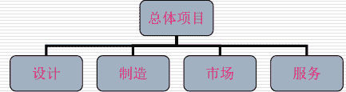

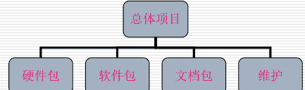

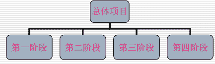

## WBS举例：轮船制造的WBS

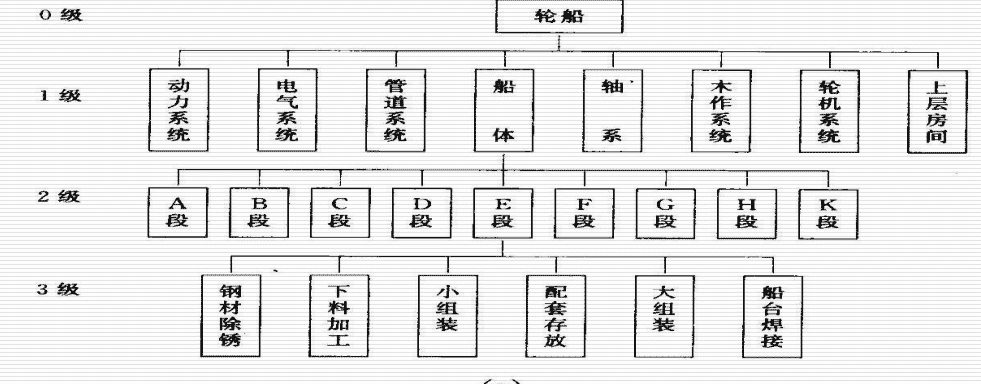

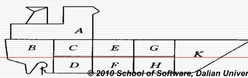

## 厂房建设项目WBS

GW高压电容器厂房建设项目
100

项目设计
110

厂房土建
120

生产设备建设
130

试制与验收
140

项目管理
150

总体设计
111

土建设计
112

设备设计
113

基础工程
121

框架工程
122

装饰工程
123

水电工程
124

设备采购
131

设备安装
132

设备调试
133

产品试制
141

项目验收
142

## 轿车仪表系统研制WBS

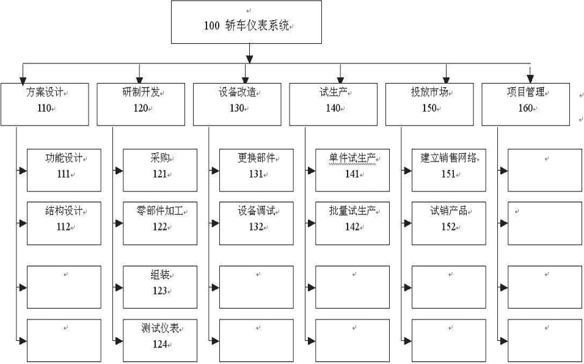

100 轿车仪表系统

方案设计 110

研制开发 120

设备改造 130

试生产 140

投放市场 150

项目管理 160

功能设计 111

结构设计 112

采购 121

零部件加工 122

组装 123

测试仪表 124

更换部件 131

设备调试 132

单件试生产 141

批量试生产 142

建立销售网络 151

试销产品 152

## “中星22号”卫星业务管理站建设项目-WBS

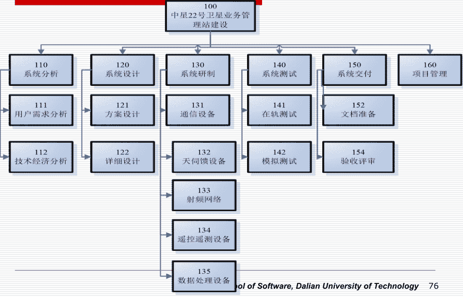

## WBS表达形式—层次结构图和锯齿列表

### 图形显示

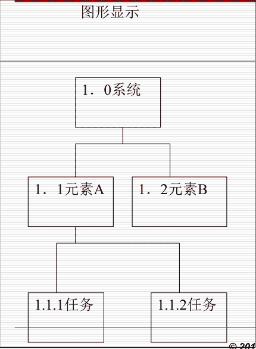

### 锯齿列表

+ 1．0系统
   1．1元素A
      1.1.1任务
      1.1.2任务
   1．2元素B

□ 以某个自己熟悉的项目类型为例进行项目范围 WBS 分解。

- 一栋公寓楼
- 一套办公管理软件的开发
- 一座大桥
- 一种药品研究
- 一条高速公路
- 一条彩电生产线

## 案例讨论—项目范围分解

| 项目名称 | 某型号多址通信与抗干扰关键技术研究和应用 |
|---|---|
| 项目目标 | 1．交付成果：<br>1) 伪码优选关键技术攻关应用成果；<br>2) 研制1套2MB数字微波扩频通信机；<br>3) 研制生产1套通信、导航、识别一体化的卫星报告系统；<br>4) 研制1套跳频/直扩混合扩频全双工频移动通信系统；<br>5) 改进某中高速跳频电台。<br><br>2．工期目标：三年，2002年1月1日～2004年12月31日；<br>3．成本目标：2000万元人民币。 |
| 交付物完成准则 | 符合研制总要求，以及军工产品、航天、航空产品定型工作条例，有关国军标及各项要求。 |
| 工作描述 | 伪码的优选技术应用研究，研制2MB数字微波扩频通信机；<br>研制生产一套通信、导航、识别一体化的卫星报告系统；合作研制跳频/直扩混合扩频全双工频移动通信系统；采用基于FPJA的高速DSP技术改进某中高速跳频电台，项目管理。 |
| 工作规范 | 符合合同及相关标准要求。 |
| 所需资源估计 | 人员、物资、设备及对外合作。 |
| 重大里程碑 | 见里程碑图。 |
| 项目经理审核意见 | 同意。在项目实施过程中，加强进度、质量控制，费用控制，确保项目按期优质完成。 |


## 工作分解结构图

- 多址通信与抗干扰关键技术研究和应用 100
  - 伪码优选 110
    - 方案设计 111
    - 方案验证 112
  - 2MB微波扩频通信机 120
    - 生产调试 121
    - 交付验收 122
  - 一体化位置报告系统 130
    - 设计 131
    - 生产调试 132
    - 交付验收 133
  - 全双工频移动通信系统 140
    - 接口协调 141
    - 设计 142
    - 生产 143
    - 联调 144
    - 交付验收 145
  - 高速跳频电台 150
    - 高速DSP应用 151
    - 联调 152
    - 交付验收 153
  - 项目管理 160

## 案例讨论

- 假设你现在有一笔50万元的资金，经过初步分析你决定开设一间咖啡屋，为了开办咖啡屋你需要进行许多方面的工作，那么请按照WBS原理将开设咖啡屋过程中所可能涉及的工作进行分解。

### 开设咖啡屋

- 1.0 开设咖啡屋
  - 1.1 地点选择
    - 1.1.1 市场调查
    - 1.1.2 地点考察
    - 1.1.3 房屋租赁
  - 1.2 房屋装修
    - 1.2.1 咖啡屋设计
    - 1.2.2 装修公司选择
    - 1.2.3 委托装修
    - 1.2.4 设备采购
  - 1.3 员工招募与培训
    - 1.3.1 岗位界定
    - 1.3.2 员工招募
    - 1.3.3 岗前培训
    - 1.3.4 制度建设
  - 1.4 工商税务
    - 1.4.1 相关文件准备
    - 1.4.2 工商登记
    - 1.4.3 税务登记
  - 1.5 开业
    - 1.5.1 开业规划
    - 1.5.2 嘉宾邀请
    - 1.5.3 开业庆典

### 咖啡屋开发WBS

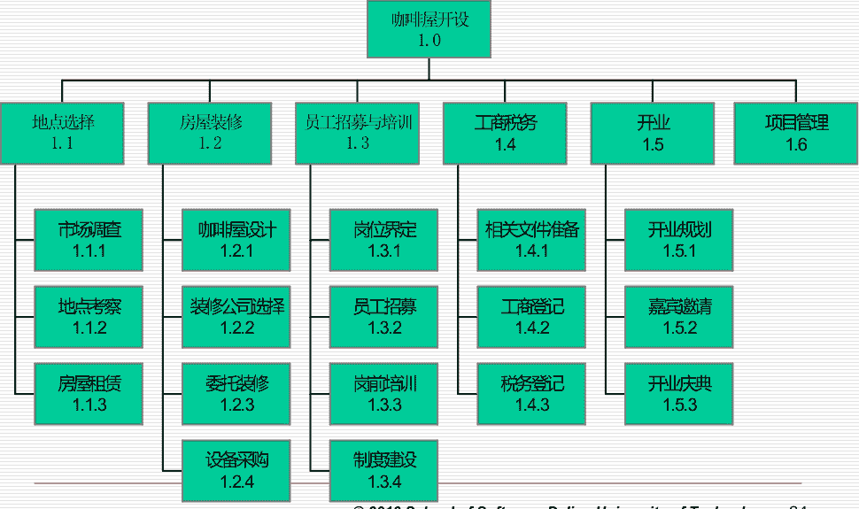

- 1.0 咖啡屋开发
  - 1.1 地点选择
    - 1.1.1 市场调查
    - 1.1.2 地点考察
    - 1.1.3 房屋租赁
  - 1.2 房屋装修
    - 1.2.1 咖啡屋设计
    - 1.2.2 装修预算
    - 1.2.3 委托装修
    - 1.2.4 设备采购
  - 1.3 员工招募与培训
    - 1.3.1 岗位确定
    - 1.3.2 员工招募
    - 1.3.3 岗前培训
    - 1.3.4 制度建设
  - 1.4 工商税务
    - 1.4.1 相关文件准备
    - 1.4.2 工商登记
    - 1.4.3 税务登记
  - 1.5 开业
    - 1.5.1 开业规划
    - 1.5.2 嘉宾邀请
    - 1.5.3 开业庆典
  - 1.6 项目管理

## 案例讨论

- 假如贵公司进行成立10周年庆典活动，如果请你负责此次活动，你将如何分析此次活动所应包含的工作？

## 工作列表包含的内容

| 项目 | 内容 |
| --- | --- |
| 工作代码 | 用计算机管理工作时的唯一标识符，可看出工作之间的父子关系 |
| 工作名称 | 该工作的名称 |
| 输出 | 完成该工作后应输出的信息（包括产品、图纸、技术文件、工装及有关决策信息）以及对输出信息的规范和内容定义 |
| 输入 | 完成本工作所要求的前提条件（包括设计文档、技术文件、资料等） |
| 内容 | 定义本工作要完成的具体内容和流程（包括应用文件、支撑环境、控制条件、工作流程） |
| 负责单位 | 本工作的负责单位或部门 |
| 协作单位 | 完成本工作的协作单位和部门 |
| 子工作 | WBS树型结构中与本工作直接相连的下属工作 |

## 工作(任务)描述表

| 项目 | 内容 |
| --- | --- |
| 任务名 | 订购材料，D |
| 任务交付物 | 签名并发出定单 |
| 验收标准 | 部门经理签字、定单发出。 |
| 技术条件 | 本公司采购工作程序 |
| 任务描述 | 根据第 X 号表格和工作程序第 X 条规定，完成定单并报批。 |
| 假设条件 | 所需材料存在 |
| 信息源 | 采购部、供应商广告等 |
| 约束 | 必须考虑材料的价格 |
| 其它 | 风险：材料可能不存在；防范计划：事先通知潜在的供应商，了解今后该材料的供货可能性 |
| 签名 | 项目组成员 A |

## 对一个建筑工程工作包的描述

| 项目 | 内容 |
| --- | --- |
| 作业编号 | A1020 |
| 责任人/授权人 | 张大千/李开明 |
| 作业内容 | 主楼建筑工程3~4层 |
| 施工条件 | 第2层施工完毕，图纸具备，现场具备施工条件 |
| 标准、规范、方法 | 按设计图纸要求，采用钢模板现浇结构混凝土 |
| 施工成果 | 结构混凝土符合设计要求，不包括。。。 |
| 质量控制方法 | 模板质量检查、面板安装检查、混凝土浇注质量 |
| 开工/完工日期 | 2002/07/21，2002/08/29 |
| 资源要求 | 吊车一台、模板工10个、混凝土工3个、84方砼 |
| 工程量要求 | 150平方米面板架设，浇注84方混凝土 |
| 假设条件 | 天气晴朗，电源有保障、不发生安全事故 |

## 项目工作列表

| 工作编码 | 工作名称 | 输入 | 输出 | 内容 | 负责单位 | 协作单位 | 相关工作 |
| --- | --- | --- | --- | --- | --- | --- | --- |

## 5.工作责任分配表制定

- 目的：对项目的每一项任务分配责任者和落实责任。
- 用途：明确各单位或个人的责任，便于项目管理部门在项目实施过程中的管理协调。
- 依据：以工作分解结构图表和项目组织结构图表为依据制作此表。
- 结果：工作责任分配表

### "中星22号"卫星业务管理站建设项目--责任分配矩阵

| 序号 | 工作 | 工程部 | 计划部 | 财务部 | 人力资源部 | 安全质量部 | 项目经理 |
| --- | --- | --- | --- | --- | --- | --- | --- |
| 110 | 系统分析 | F | C | C | C | J | P |
| 111 | 用户需求分析 | F | C | C | C | J | P |
| 112 | 技术经济分析 | F | C | F | C | J | P |
| 120 | 系统设计 | F | C | C | C | J | P |
| 121 | 方案设计 | F | C | C | C | J | P |
| 122 | 详细设计 | F | C | C | C | J | P |
| 130 | 系统研制 | F | C | C | C | J | P |
| 131 | 通信设备 | F | C | C | C | J | P |
| 132 | 天线设备 | F | C | C | C | J | P |
| 133 | 射频网络 | F | C | C | C | J | P |
| 134 | 遥控遥测设备 | F | C | C | C | J | P |
| 135 | 数据处理设备 | F | C | C | C | J | P |
| 140 | 系统测试 | F | C | C | C | J | P |
| 141 | 在轨测试 | F | C | C | C | J | P |
| 142 | 模拟测试 | F | C | C | C | J | P |
| 150 | 系统交付 | F | C | C | C | F | P |
| 151 | 文档准备 | F | C | C | C | J | P |
| 152 | 验收评审 | C | C | C | C | F | P |
| 160 | 项目管理 | C | F | C | C | C | P |

### 生日宴会工作责任分配表

| WBS | 工作活动 | 爷爷 | 奶奶 | 爸爸 | 妈妈 | 明明 | 亮亮 |
| --- | --- | --- | --- | --- | --- | --- | --- |
|  | 生日晚会 |  | S | P | S | S | S |
| 1.0 | 晚宴 |  | S | S | P | S |  |
| 1.1 | 生日蛋糕 |  |  |  |  | P |  |
| 1.2 | 饮料 |  |  | P |  |  |  |
| 1.3 | 清洗 | P |  | S |  |  |  |
| 1.3.1 | 食品 |  |  |  | P |  |  |
| 1.3.2 | 餐具 |  | P |  |  |  |  |
| 1.4 | 做菜 | S |  | P |  |  |  |
| 1.4.1 | 凉菜 | P |  |  |  |  |  |
| 1.4.2 | 热菜 |  |  | S | P |  |  |
| 1.4.2.1 | 蔬菜类 |  |  |  | P |  |  |
| 1.4.2.2 | 海鲜类 |  |  | P |  |  |  |
| 1.4.2.3 | 其他类 |  |  |  | P |  |  |
| 2.0 | 娱乐 |  |  | S |  | S | P |
| 2.1 | 音响 |  |  |  |  |  | P |
| 2.2 | 灯光布置 |  | P |  |  |  |  |
| 2.3 | 室内布置 |  |  |  |  | P |  |
| 2.4 | VCD 光碟 |  |  |  |  |  | P |


## 四、成功的项目计划制定方法

### 进度计划的表示方法

- 甘特图计划
- 单代号网络计划
- 双代号网络计划
- 时间坐标网络计划

### 资源费用计划的表示方法

- 资源负荷图
- 费用负荷图
- 费用计划曲线

## 工作相互关系确定的主要内容

① **强制性逻辑关系**的确定：这是工作相互关系确定的基础，工作逻辑关系的确定相对比较容易，由于它是工作之间所存在的内在关系，通常是不可调整的，主要依赖于技术方面的限制，因此确定起来较为明确，通常由技术和管理人员的交流就可完成。

② **组织关系**的确定：对于无逻辑关系的那些工作，由于其工作先后关系具有随意性，从而将直接影响到项目计划的总体水平。工作组织关系的确定一般比较难，它通常取决于项目管理人员的知识和经验，因此组织关系的确定对于项目的成功实施是至关重要的。

③ **外部制约关系**的确定：在项目的工作和非项目工作之间通常会存在一定的影响，因此在项目工作计划的安排过程中也需要考虑到外部工作对项目工作的一些制约及影响，这样才能充分把握项目的发展。

## “中星22号”卫星业务管理站建设项目--项目工作先后关系表

| WBS码 | 任务 | 持续时间 | 紧前工作 |
|---|---|---|---|
| 111 | 用户需求分析 | 2周 | --- |
| 112 | 技术经济分析 | 2周 | 111 |
| 121 | 方案设计 | 4周 | 112 |
| 122 | 详细设计 | 6周 | 121 |
| 131 | 通信设备研制 | 14周 | 122 |
| 132 | 天馈馈设备研制 | 22周 | 122 |
| 133 | 射频网络研制 | 8周 | 122 |
| 134 | 遥控遥测设备研制 | 18周 | 122 |
| 135 | 数据处理设备研制 | 16周 | 122 |
| 141 | 模拟测试 | 4周 | 131, 132, 133, 134, 135 |
| 142 | 在轨测试 | 4周 | 141 |
| 151 | 文档准备 | 2周 | 142 |
| 152 | 验收评审 | 2周 | 151 |
| 160 | 项目管理 | 48周 | 100 |

## 工作关系表示的工具和方法

- 单代号网络计划
- 双代号网络计划
- 样板网络

## 网络计划技术起源与发展

网络计划技术（*Network Planning Techniques*）是20世纪50年代中期发展起来的一种科学的**计划管理技术**。1956年杜邦.奈莫斯建筑公司与赖明顿.兰德公司开发了一种面向计算机描述工程项目的合理安排进度计划方法，称之为关键线路法（*Critical Path Method*），简称 CPM 。

1958年，美国海军军械局在制定研究“北极星”导弹计划时（几十亿个管理项目、250个承包商和9000多个分包商），又研究创造出了 计划评审技术（*Program Evaluation and Review Technique*），即PERT。使计划10年完成的项目提前2年多，并在成本控制上取得了显著效果。

## 网络计划技术的优势与特点

- 网络计划模型是一种简明直观、有逻辑关系的工程项目进展模型
- 网络计划能反映工程项目的关键路径及其变化
- 网络计划技术可以实现进度计划的优化
- 网络计划技术可以根据进展对未来作出 快速的预测
- 应用网络技术可取得显著的经济效果

## 1.项目计划制定的基础--工作持续时间的确定

+ 作用：工作延续时间的估计是项目计划制定的一项重要的基础工作，它直接关系到各事项、各工作网络时间的计算和完成整个项目任务所需要的总时间。若工作时间估计的太短，则会在工作中造成被动紧张的局面；相反，若工作时间估计的太长，会使项目的完工期延长。

+ 观念：项目的进度安排都是由工作的延续时间来推算，因此对延续时间的估计要做到客观正确的估计。这就要求在对工作作出时间估计时，不应受到工作重要性及工程完成期限的影响，要在考虑到各种资源、人力、物力、财力的情况下，把工作置于独立的正常状态下进行估计，要做统盘考虑，不可顾此失彼。

## 工期估计示例

| 任务名称 | 资源名称 | 工作量（工时） | 资源数量（人） | 工期（天） |
|---|---|---:|---:|---:|
| **100电动自行车** | | | | |
| **110总体方案** | | | | |
| 111车架 | 工程师 | 1600 | 20 | 10 |
| 112舵笼 | 工程师 | 1600 | 20 | 10 |
| **120车体** | | | | |
| 121车体装 | 工程师 | 1600 | 10 | 20 |
| 122车体辅 | 工人 | 3200 | 20 | 20 |
| 123车轮 | 试验人员 | 800 | 10 | 10 |
| **130电动机** | | | | |
| 131勘机研究 | 工程师 | 2400 | 20 | 15 |
| 132勘机设计 | 工程师 | 2000 | 10 | 25 |
| 133勘机装制 | 工人 | 4800 | 40 | 15 |
| 134勘机试验 | 试验人员 | 3200 | 20 | 20 |
| **140电池** | | | | |
| 141池硏 | 工程师 | 1600 | 10 | 20 |
| 142池装 | 工程师 | 1600 | 10 | 20 |
| 143池辅 | 工人 | 3200 | 20 | 20 |
| 144池试验 | 试验人员 | 2400 | 20 | 15 |
| **150总装与测试** | | | | |
| 151装 | 工人 | 1600 | 20 | 10 |
| 152测 | 试验人员 | 1600 | 20 | 10 |
| **小计** | | **33200** | | |

## 2. 甘特图计划

- 甘特图，又称条线图或横道图。这种方式早在20世纪初就开始应用和流行，主要用于项目计划和项目进度的安排；
- 甘特图是一个二维平面图，横维表示进度或活动时间，纵维表示工作包内容；
- 甘特图的特点是直观易懂，便于各级管理人员识别

## 传统的甘特图计划表示形式

| 时间（双周） | 1 | 2 | 3 | 4 | 5 | 6 | 7 | 8 | 9 | 10 | 11 | 12 | 13 | 14 | 15 | 16 | 17 | 18 | 19 | 20 | 21 | 22 | 23 | 24 |
|---|---|---|---|---|---|---|---|---|---|---|---|---|---|---|---|---|---|---|---|---|---|---|---|---|
| 1 需求分析 | ■ | ■ | ■ | ■ | ■ | | | | | | | | | | | | | | | | | | |
| 2 总体设计 | | | | | ■ | ■ | ■ | ■ | | | | | | | | | | | | | | | | |
| 3 界面详细设计 | | | | | | | | | ■ | ■ | ■ | | | | | | | | | | | | | |
| 4 动画详细设计 | | | | | | | | | ■ | ■ | ■ | ■ | | | | | | | | | | | | |
| 5 处理详细设计 | | | | | | | | | | ■ | ■ | ■ | ■ | | | | | | | | | | | |
| 6 界面编码 | | | | | | | | | | | | | ■ | ■ | | | | | | | | | | |
| 7 动画编码 | | | | | | | | | | | | | | | ■ | ■ | | | | | | | | |
| 8 处理编码 | | | | | | | | | | | | | | | | | ■ | ■ | | | | | | |
| 9 界面单元测试 | | | | | | | | | | | | | | | | | | ■ | ■ | | | | | |
| 10 动画单元测试 | | | | | | | | | | | | | | | | | | | ■ | ■ | | | | |
| 11 处理单元测试 | | | | | | | | | | | | | | | | | | | | ■ | ■ | | | |
| 12 系统联调与测试 | | | | | | | | | | | | | | | | | | | | | ■ | ■ | ■ | ■ |
| 13 项目管理 | ■ | ■ | ■ | ■ | ■ | ■ | ■ | ■ | ■ | ■ | ■ | ■ | ■ | ■ | ■ | ■ | ■ | ■ | ■ | ■ | ■ | ■ | ■ | ■ | ■ |

时间单位：双周

图4 游戏软件开发项目工作计划甘特图


## 反映工作关系的甘特图计划

| 序号 | 任务名称 | 工期 | 2007年1月 | 2007年2月 | 2007年3月 | 2007年4月 | 2007年5月 | 2007年6月 | 2007年7月 | 2007年8月 | 2007年9月 | 2007年10月 | 2007年11月 | 2007年12月 |
| --- | --- | --- | --- | --- | --- | --- | --- | --- | --- | --- | --- | --- | --- | --- |
| 1 | 111总体研讨 | 20工作日 | ███ |  |  |  |  |  |  |  |  |  |  |  |
| 2 | 112总体方案 | 20工作日 | ███ |  |  |  |  |  |  |  |  |  |  |  |
| 3 | 113初步设计 | 20工作日 | ███ |  |  |  |  |  |  |  |  |  |  |  |
| 4 | 121电站总图 | 20工作日 | ███ |  |  |  |  |  |  |  |  |  |  |  |
| 5 | 122电站水轮机 | 15工作日 | ██ |  |  |  |  |  |  |  |  |  |  |  |
| 6 | 123电站水泵 | 20工作日 | ███ |  |  |  |  |  |  |  |  |  |  |  |
| 7 | 124水轮机设计 | 40工作日 | █████ |  |  |  |  |  |  |  |  |  |  |  |
| 8 | 125水泵设计 | 40工作日 | █████ |  |  |  |  |  |  |  |  |  |  |  |
| 9 | 126电站厂房 | 40工作日 | █████ |  |  |  |  |  |  |  |  |  |  |  |
| 10 | 131电站电气设计 | 20工作日 | ██ |  |  |  |  |  |  |  |  |  |  |  |
| 11 | 132电站电气 | 10工作日 | █ |  |  |  |  |  |  |  |  |  |  |  |
| 12 | 133电站电气 | 30工作日 | ███ |  |  |  |  |  |  |  |  |  |  |  |
| 13 | 134电站设计 | 25工作日 | ███ |  |  |  |  |  |  |  |  |  |  |  |
| 14 | 135电站设计 | 40工作日 | █████ |  |  |  |  |  |  |  |  |  |  |  |
| 15 | 136电站设计 | 40工作日 | █████ |  |  |  |  |  |  |  |  |  |  |  |
| 16 | 141电站设计 | 15工作日 | ██ |  |  |  |  |  |  |  |  |  |  |  |
| 17 | 142电站设计 | 25工作日 | ███ |  |  |  |  |  |  |  |  |  |  |  |
| 18 | 151水泵水轮机 | 40工作日 | █████ |  |  |  |  |  |  |  |  |  |  |  |
| 19 | 152水泵机组 | 30工作日 | ████ |  |  |  |  |  |  |  |  |  |  |  |
| 20 | 153机电文件 | 30工作日 | ████ |  |  |  |  |  |  |  |  |  |  |  |
| 21 | 160项目管理 | 280工作日 | ████████████████████████████████████████████████████████████████████████████████████████████████████████████ |  |  |  |  |  |  |  |  |  |  |  |  |

## 结合网络计划参数的甘特图计划

| 代号 | 工作名称 | 1周 | 2周 | 3周 | 4周 | 5周 | 6周 | 7周 | 8周 | 9周 | 10周 | 11周 | 12周 | 13周 | 14周 | 15周 | 16周 | 17周 | 18周 | 19周 | 20周 | 21周 | 22周 | 23周 |
| --- | --- | --- | --- | --- | --- | --- | --- | --- | --- | --- | --- | --- | --- | --- | --- | --- | --- | --- | --- | --- | --- | --- | --- | --- |
| A₁ | 总体设计 | 关键工作时间 |  |  |  |  |  |  |  |  |  |  |  |  |  |  |  |  |  |  |  |  |  |  |
| B₁ | 单元定义 |  | 关键工作时间 |  |  |  |  |  |  |  |  |  |  |  |  |  |  |  |  |  |  |  |  |  |
| C₁ | 机械设计 |  |  | 非关键工作时间 |  |  |  |  |  |  |  |  |  |  |  |  |  |  |  |  |  |  |  |  |
| D₁ | 传动装置试制 |  |  |  | 非关键工作时间 |  |  |  |  |  |  |  |  |  |  |  |  |  |  |  |  |  |  |  |
| E₁ | 传动装置试验 |  |  |  |  |  |  |  |  |  |  |  |  |  |  |  |  |  |  |  |  |  |  |  |
| F₁ | 壳体试制 |  |  |  |  |  |  |  |  |  |  |  |  |  |  |  |  |  |  |  |  |  |  |  |
| G₁ | 控制系统设计 |  |  |  | 关键工作时间 |  |  |  |  |  |  |  |  |  |  |  |  |  |  |  |  |  |  |  |
| H₁ | 控制系统试制 |  |  |  |  |  |  |  |  |  |  |  |  |  |  |  |  |  |  |  |  |  |  |  |
| I₁ | 控制系统测试 |  |  |  |  |  |  |  |  |  |  |  |  |  |  |  |  |  |  |  |  |  |  |  |
| J₁ | 电动机设计 |  |  |  | 非关键工作时间 |  |  |  |  |  |  |  |  |  |  |  |  |  |  |  |  |  |  |  |
| K₁ | 电动机试制 |  |  |  |  |  |  |  |  |  |  |  |  |  |  |  |  |  |  |  |  |  |  |  |
| L₁ | 电动机测试 |  |  |  |  |  |  |  |  |  |  |  |  |  |  |  |  |  |  |  |  |  |  |  |
| M₁ | 总装 |  |  |  |  |  |  |  |  |  |  |  |  |  |  |  |  |  |  |  |  |  |  |  | 关键工作时间 |
| N₁ | 测试 |  |  |  |  |  |  |  |  |  |  |  |  |  |  |  |  |  |  |  |  |  |  |  | 关键工作时间 |

时间单位：周

图中：黑色实线表示关键工作时间；灰色或斜线填充表示非关键工作时间；点状填充表示总机动时间。

图5 全自动滚筒洗衣机研制项目甘特图计划

## 结合网络工作关系的条形图或甘特图

| 分项目 | 工序 | 时间坐标（天） |
| --- | --- | --- |
| 基础 | A B C D E F | 5 10 35 56 9 15 |
| 桥墩 | G H G' H' | 30 51 58 79 |
| 桥身 | I J | 82 108 |
| 装饰 | K | 126 |

## 3. 单代号网络计划

- 单代号网络图是一种使用节点表示工作、箭线表示工作关系的项目网络图。
- 单代号网络（简称AON）是大多数项目管理软件包所使用的方法。
- 单代号网络图的特点是工作先后关系表达直观，同时图形也易于标画。
- 西方国家通常使用单代号网络图。

### 工作之间的先后关系类型

- 工作之间的关系分为四种类型：
  - 结束到开始的关系
  - 结束到结束的关系
  - 开始到开始的关系
  - 开始到结束的关系

在网络计划中，结束到开始的关系最为常用，它是一种最为典型的逻辑关系。

## 工作之间先后关系的描述

#### 结束(Finish)到开始(Start)的关系FST(或FTS)


#### 开始到开始的关系SST(或STS)


## 工作之间先后关系的描述

- 结束到结束的关系**FFT(或FTF)**


- 开始到结束的关系**SFT(或STF)**

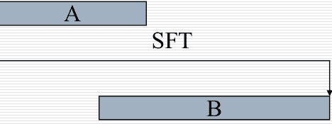

## 单代号网络计划的绘制

| 序号 | 工作代号 | 紧前工作 |
|---|---|---|
| 1 | A | -- |
| 2 | B | -- |
| 3 | C | A |
| 4 | D | B |
| 5 | E | B、C |
| 6 | F | D |

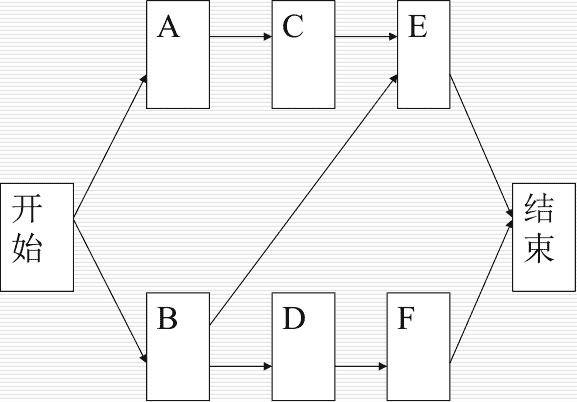

## 全自动滚筒洗衣机研制项目工作列表

| 代号 | 工作名称 | 工作时间（天） | 紧前工作 |
|---|---|---|---|
| A | 总体设计 | 15 | — |
| B | 单元定义 | 20 | A |
| C | 机体设计 | 15 | B |
| D | 传动装置试制 | 30 | C |
| E | 滚筒试制 | 20 | D |
| F | 壳体试制 | 10 | E |
| G | 电脑控制系统设计 | 30 | B |
| H | 电脑控制系统试制 | 30 | G |
| I | 电脑控制系统测试 | 30 | H |
| J | 电动机设计 | 20 | B |
| K | 电动机试制 | 40 | J |
| L | 电动机测试 | 10 | K、D |
| M | 总装 | 20 | F、I、L |
| N | 测试 | 15 | M |

## 全自动滚筒洗衣机研制项目单代号网络计划图

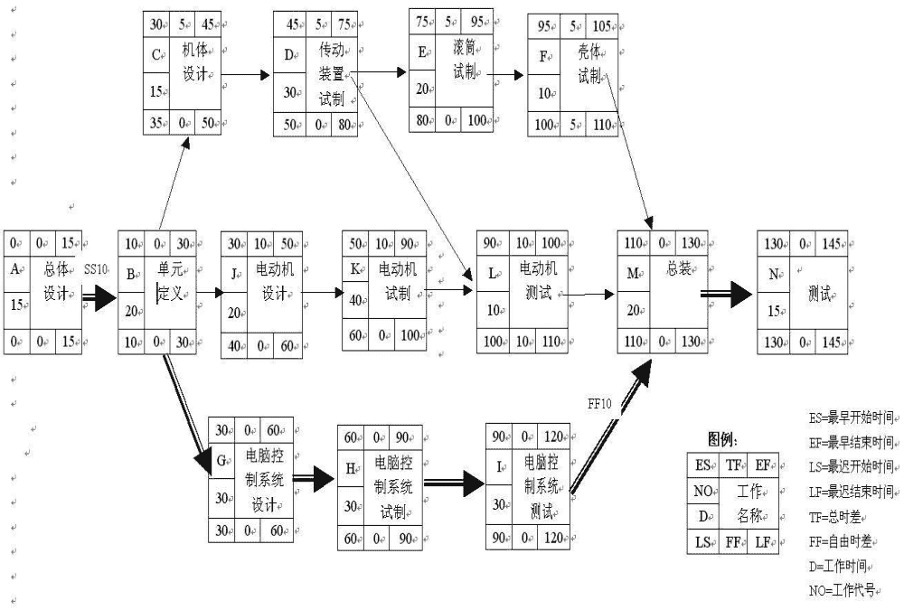

## 4.双代号网络计划

- 这是一种用箭线表示工作、节点表示工作相互关系的网络图方法，这种技术也称为双代号网络AOA
- 双代号网络计划一般仅使用结束到开始的关系表示方法，因此为了表示所有工作之间的逻辑关系往往需要引入虚工作加以表示
- 在我国这种方法应用较多，国内该方面的软件较多。

## 双代号网络计划图的绘制

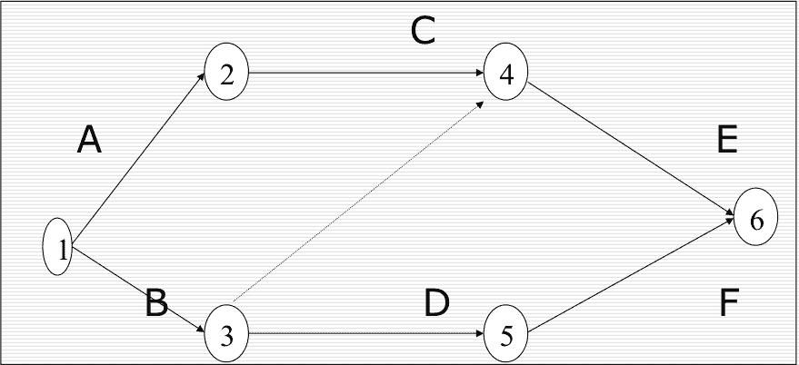

## 双代号网络计划示例

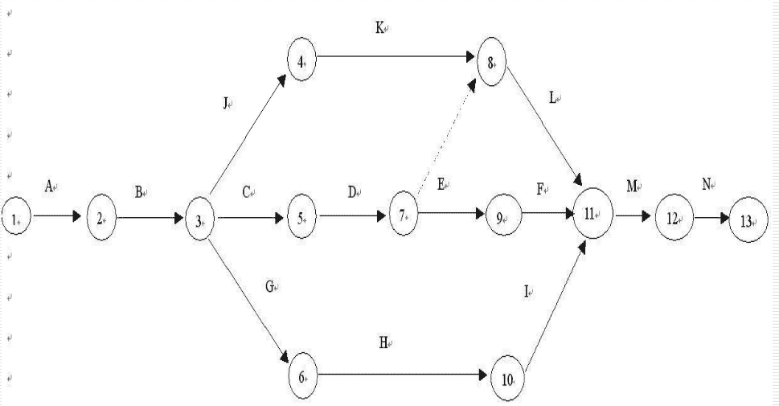

## 几种工作关系的表达（1）

A工作是B工作的紧前工作，或B是A的紧后工作

单代号

双代号


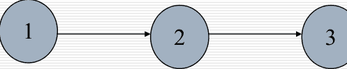

## 示例

### 单代号网络计划

油漆地板

摆放家具

图解

活动序号

活动描述

工期估计

1

5

2

1

## 示例

### 双代号网络计划

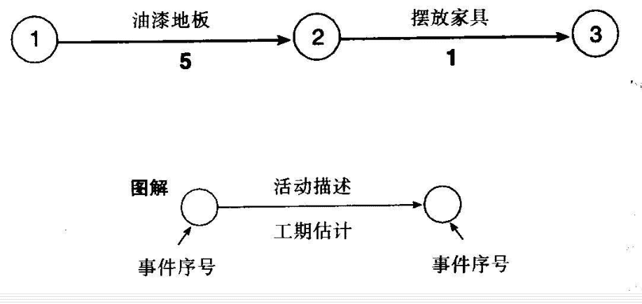

## 几种工作关系的表达（2）

### 多个紧前紧后工作情况


## 单代号网络图逻辑关系表达方法

| 工作关系描述 | 图示 |
|---|---|
| A工作是B工作的紧前工作 | A → B |
| D工作是B工作、C工作的紧后工作 | B → D；C → D |
| B工作是D工作、C工作的紧前工作 | B → D；B → C |
| A工作是C工作的紧前工作，C、D工作是B的紧后工作 | A → C；B → C；B → D |

## 单代号网络计划时间参数的标注形式


a）


b）

- a）单代号网络计划时间参数的圆圈标注形式
- b）单代号网络计划时间参数的矩阵形式标注

## 双代号网络图逻辑关系表达方法

| 序号 | 工作之间的逻辑关系 | 表示方法 |
|---|---|---|
| 1 | A、B、C平行进行 |  |
| 2 | A完成后，D才能开始；A、B均完成后，E才能开始；A、B、C均完成后，F才能开始 |  |

## 双代号网络图逻辑关系表达方法

| 3 | A、B均完成后，D才能开始；A、B、C均完成后，E才能开始；D、E完成后，F才能开始 | ![图片] |
|---|---|---|
| 4 | A结束后，B、C、D才能开始；B、C完成后，E才能开始 | ![图片] |

## 双代号网络图逻辑关系表达方法

| 5 | A完成后，B、C、D才能开始，但B、C、D不一定同时开始 |  |
|---|---|---|
| 6 | A、B完成后，D才能开始；B、C完成后，E才能开始 |  |

## 网络图绘制案例讨论

### —某软件系统开发网络图绘制

| 序号 | 工作名称 | 紧前工作 |
|---|---|---|
| 1 | 问题界定 | — |
| 2 | 研究现有系统 | 1 |
| 3 | 确定用户需求 | 1 |
| 4 | 逻辑系统设计 | 3 |
| 5 | 实体系统设计 | 2 |
| 6 | 系统开发 | 4,5 |
| 7 | 系统测试 | 6 |
| 8 | 转换数据库 | 4,5 |
| 9 | 系统转换 | 7,8 |
| 10 | 文档编制 | 7,8 |

## 网络图绘制案例讨论（续）

- 假设上述工作关系中，存在如下搭接关系：
  - “3.确定用户需求”工作开始4天之后，“4.逻辑系统设计”工作才可以开始。
  - “7.系统测试”工作完成6天之后“9.系统转换”工作才可以完成。

在网络图中如何表示上述信息呢？

## 案例讨论—绘制网络图

| 序号 | 工作代号 | 工作名称 | 紧前工作 | 延续时间 |
|---|---|---|---|---|
| 1 | A | 拆开 | — | 2 |
| 2 | B | 准备清洗材料 | — | 1 |
| 3 | C | 电器检查 | A | 2 |
| 4 | D | 仪表检查 | A | 2 |
| 5 | E | 机械检查 | A | 2 |
| 6 | F | 机械清洗组装 | B、E | 4 |
| 7 | G | 总装 | D、C、F | 2 |
| 8 | H | 仪表校准 | D | 1 |


## 工作时间估计

- **作用：** 工作延续时间的估计是项目计划制定的一项重要的基础工作，它直接关系到各事项、各工作网络时间的计算和完成整个项目任务所需要的总时间。若工作时间估计的太短，则会在工作中造成被动紧张的局面；相反，若工作时间估计的太长，就会使整个工程的完工期延长。
- **观念：** 网络中所有工作的进度安排都是由工作的延续时间来推算，因此，对延续时间的估计要做到客观正确的估计。这就要求在对工作作出时间估计时，不应受到工作重要性及工程完成期限的影响，要在考虑到各种资源、人力、物力、财力的情况下，把工作置于独立的正常状态下进行估计，要做统盘考虑，不可顾此失彼。

## 工作时间的估计主要依赖的数据基础

- ① 工作详细列表
- ② 项目约束和限制条件
- ③ 资源需求：大多数工作的时间将受到分配给该工作的资源情况以及该工作实际所需要的资源情况，比如说当人力资源减少一半时工作的延续时间一般来说将会增加一倍。
- ④ 资源能力：资源能力决定了可分配资源数量的大小，对多数工作来说其延续时间将受到分配给它们的人力及材料资源的明显影响，比如说一个全职的项目经理处理一件事情的时间将会明显的少于一个兼职的项目经理处理该事情的时间。
- ⑤ 历史信息：许多类似的历史项目工作资料对于项目工作时间的确定是很有帮助的，主要包括：项目档案、公用的工作延续时间估计数据库、项目团队的知识。


## 确定工作时间的主要方法

- ① 专家判断：专家判断主要依赖于历史的经验和信息，当然其时间估计的结果也具有一定的不确定性和风险。
- ② 类比估计：类比估计意味着以先前的类似的实际项目的工作时间来推测估计当前项目各工作的实际时间。当项目的一些详细信息获得有限的情况下，这是一种最为常用的方法，类比估计可以说是专家判断的一种形式。
- ③ 单一时间估计法：估计一个最可能工作实现时间，对应于CPM网络。
- ④ 三个时间估计法：估计工作执行的三个时间，乐观时间a、悲观时间b、正常时间m，对应于PERT网络期望时间 \( t=(a+4m+b)/6 \)。

## 示例

某一工作在正常情况下的工作时间是15天，在最有利的情况下工作时间是9天，在最不利的情况下其工作时间是18天，那么该工作的最可能完成时间是多少呢？

正常工作时间  
t=(9+4×15+18)/6=14.5天

## 工期估计示例

| 任务名称 | 资源名称 | 工作量（工时） | 资源数量（人） | 工期（天） |
|---|---|---|---|---|
| 100电动自行车 | | | | |
| 110总体方案 | | | | |
| 111框架 | 工程师 | 1600 | | 20 |
| 112雏笼 | 工程师 | 1600 | | 20 |
| 120车体 | | | | |
| 121框设 | 工程师 | 1600 | | 10 |
| 122框制 | 工人 | 3200 | | 20 |
| 123框验 | 试验人员 | 800 | | 10 |
| 130电动机 | | | | |
| 131动机壳 | 工程师 | 2400 | | 20 |
| 132动机计 | 工程师 | 2000 | | 10 |
| 133动机制 | 工人 | 4800 | | 40 |
| 134动机验 | 试验人员 | 3200 | | 20 |
| 140电池 | | | | |
| 141电壳 | 工程师 | 1600 | | 10 |
| 142电设 | 工程师 | 1600 | | 10 |
| 143电制 | 工人 | 3200 | | 20 |
| 144电验 | 试验人员 | 2400 | | 20 |
| 150总装与测试 | | | | |
| 151装 | 工人 | 1600 | | 20 |
| 152测 | 试验人员 | 1600 | | 20 |

## 工期估计示例

| 任务名称 | 资源名称 | 工作量（工时） | 资源数量（人） | 工期（天） |
|---|---|---|---|---|
| **100电动自行车** | | | | |
| **110总体方案** | | | | |
| 111 继棍 | 工程师 | 1600 | 20 | 10 |
| 112 舵笼 | 工程师 | 1600 | 20 | 10 |
| **120车体** | | | | |
| 121 铆铁 | 工程师 | 1600 | 10 | 20 |
| 122 犁铡 | 工人 | 3200 | 20 | 20 |
| 123 犁锉 | 试验人员 | 800 | 10 | 10 |
| **130电动机** | | | | |
| 131 勘杌究 | 工程师 | 2400 | 20 | 15 |
| 132 勘杌计 | 工程师 | 2000 | 10 | 25 |
| 133 勘杌制 | 工人 | 4800 | 40 | 15 |
| 134 勘杌验 | 试验人员 | 3200 | 20 | 20 |
| **140电池** | | | | |
| 141 池硫 | 工程师 | 1600 | 10 | 20 |
| 142 池谈 | 工程师 | 1600 | 10 | 20 |
| 143 池铡 | 工人 | 3200 | 20 | 20 |
| 144 池锉 | 试验人员 | 2400 | 20 | 15 |
| **150总装与测试** | | | | |
| 151 燕 | 工人 | 1600 | 20 | 10 |
| 152 阈 | 试验人员 | 1600 | 20 | 10 |
| 小计 | | 33200 | | |

## 工作时间估计结果

- 1. 各项工作时间的估计
- 2. 基本的估计假设
- 3. 工作列表的更新

## 网络图绘制的基本原则

- 正确表达项目各工作间的逻辑关系
- 不允许出现循环回路
- 节点之间严禁出现带双向箭头或无箭头的连线
- 严禁出现无箭头节点或无箭尾节点的箭线
- 网络图中，只能有一个起始节点和终止节点
- 网络图中不允许出现中断的线路
- 箭线应尽量避免交叉，不能避免时，采用过桥法
- 箭线采用直线或折线，避免采用圆弧线
- 箭线方向应从左向右趋势，顺着项目进展方向
- 双代号网络图中节点必须编号，不能重复，箭尾节点标号小于箭头节点标号，标号可采用连续或非连续编号的方式

## 6. 项目进度计划的安排

主要的项目进度安排时间参数包括：
- 工作的最早开始时间ES
- 工作的最早结束时间EF
- 工作的最迟开始时间LS
- 工作的最迟结束时间LF
- 工作的总时差TF
- 工作的自由时差FF

## 最早时间参数计算

- 最早开始时间ES  
  ES=MAX{紧前工作的EF}

- 最早结束时间EF  
  EF=ES+工作延续时间t

## 最早参数时间计算示例

项目从0开始

识别目标消费者  
设计初始问卷调查表  
试验性测试问卷调查表  
评审建议并确定最终调查表  
准备邮寄标签  
打印问卷调查表  
开发数据分析软件  
设计软件测试数据  

| 0 | 3 |
|---|---|
| 1 | Susan | 3 |

| 3 | 13 |
|---|---|
| 2 | Susan | 10 |

| 13 | 33 |
|---|---|
| 3 | Susan | 20 |

| 33 | 38 |
|---|---|
| 4 | Susan | 5 |

| 38 | 40 |
|---|---|
| 5 | Steve | 2 |

| 38 | 48 |
|---|---|
| 6 | Steve | 10 |

| 38 | 50 |
|---|---|
| 7 | Andy | 12 |

| 38 | 40 |
|---|---|
| 8 | Susan | 2 |

项目从（开始）  
识别目标  
消费者  
设计初始问  
卷调查表  
试验性测试  
问卷调查表  
评审建议并确  
定最终调查表  
打印问卷  
调查表  
邮寄问卷调查  
表并获得反馈  
输入反馈  
数据  
分析结果  
准备报告  
要求完工时间为130个工作日  
开发数据  
分析  
测试软件  
设计软件  
测试  
图解  
最早开  
始时间  
最早结  
束时间  
活动描述  
活动序号  
负责人  
工期估计  

识别目标  
消费者  
设计初始  
问卷调查  
表  
试验性测-  
试问卷调  
查表  
评审建议  
并确定最  
终调查表  
0  
3  
3  
13  
13  
33  
33  
38  
3  
10  
20  
5  
1  
2  
3  
4  
5  
38  
打印问卷调查表  
准备邮寄标签  
20  
40  
40  
6  
40  
邮寄问卷  
调查表并  
获得反馈  
输入反馈  
数据  
分析结果  
准备报告  
48  
113  
120  
128  
138  
7  
10  
11  
12  
13  
48  
113  
120  
128  
138  
7  
10  
11  
12  
13  
65  
7  
8  
10  
测试软件  
50  
40  
9  
50  
设计软件  
38 测试数据  
12  
开发数据  
38 分析软件  
40  
2  
40  
8  
要求完工时间为130个工作日  
图解  
最早开始  
时间  
最早结束  
时间  
活动描述  
负责人  
工期估计  
事件序号  
事件序号  

## 最早参数计算（练习）


示例：代码 时间

## 最迟时间参数计算

- 最迟结束时间LF  
  LF=MIN{紧后工作的LS}

- 最迟开始时间LS  
  LS=LF—工作延续时间t

## 最迟时间参数计算

a) 用节点表示活动形式  
b) 用箭头表示活动形式  

| 活动描述 | 最迟开始时间 | 最迟结束时间 |
|---|---|---|
| 散发广告 | 2 | 10 |
| 印刷广告和小册子 | 1 | 8 |
| 邮寄小册子 | 3 | 5 |

| 活动描述 | 最迟开始时间 | 最迟结束时间 |
|---|---|---|
| 散发广告 | 10 | 30 |
| 印刷广告和小册子 | 12 | 20 |
| 邮寄小册子 | 25 | 30 |


# 项目从 0 开始

| 识别目标消费者 | 设计初始问卷调查表 | 试验性测试问卷调查表 | 评审建议并确定最终测试表设计测试数据 | 打印问卷调查表 | 邮寄问卷调查表并获得反馈 | 输入反馈数据 | 分析结果 | 准备报告 |
|---|---|---|---|---|---|---|---|---|
| 1 3 | 2 10 | 3 20 | 4 5 | 6 10 | 9 65 | 11 7 | 12 8 | 13 10 |
| 38 40 | 38 40 | 38 48 | 38 50 | 40 50 | 40 55 | 105 112 | 112 120 | 120 130 |
| 38 40 | 38 50 | 38 50 | 38 50 | 38 50 | 38 50 | 38 50 | 38 50 | 38 50 |
| 88 100 | 88 100 | 88 100 | 88 100 | 88 100 | 88 100 | 88 100 | 88 100 | 88 100 |
| 98 100 | 98 100 | 98 100 | 98 100 | 98 100 | 98 100 | 98 100 | 98 100 | 98 100 |

**图例**

- 活动序号
- 最早开始时间
- 最早结束时间
- 活动描述
- 工期估计
- 负责人

要求完工时间为 130 个工作日

# 活动描述

最早开始时间 最早结束时间

事件序号 最迟开始时间 最迟结束时间 事件序号

负责人

工期估计

图解

要求完工时间为 130 个工作日

## 最迟参数计算（练习）

示例：代码 时间

## 总时差与自由时差

- 总时差是工作的 LF 与 EF 之差，是不影响整个工期工作可利用的机动时间，一旦某工作占用了一些时差，相关工作总时差就减少。
- 总时差为零的工作是关键工作，总时差小于零说明不能如期完工。
- 自由时差是一道工作不影响后续工作最早开工，工作可机动使用的时间，自由时差 = 后续工作 ES - 紧前工作 ES - D。

## 时差（机动时间）计算

总时差的计算：
总时差 = LF - EF
或
总时差 = LS - ES

自由时差：
自由时差 = min{ES(紧后工作)} - EF

## 总机动时间计算（练习）

示例：代号 时间

## 时间计算（答案）

示例：

| 代码 | 时间 |
|---|---|

## 有搭接情况的网络参数计算（练习）

## 有搭接情况下的网络参数计算（练习）

## 有搭接情况的网络参数计算（答案）

## 有搭接情况的网络参数计算（练习）

A 3

B 2

C 7

D 4

E 8

F 6

G 5

FS8

SS4

FF3

| 示例： | 代码 | 时间 |
|---|---|---|

## 项目进度安排的工具和技术 —— 工作时间的压缩

工作时间的压缩是数学分析方法为了缩短项目工期的一种特殊情况，通常是由于遇到一些特别的限制或者是其他进度目标的要求。延续时间压缩的技术主要包括：

费用交换：在进度和费用之间往往存在一定的转换关系，这里的目的是寻求压缩进度所需追加的最小费用，或者在最佳费用限额确定下如何保证压缩的工期最大，寻求工期和费用的最佳结合点。

- 在规定工期的条件下，确定项目的最低费用；
- 若需要缩短工期，则考虑如何使增加的费用最小；
- 若要求以最低费用完成整个项目计划，如何确定其最佳工期；
- 若增加一定数量的费用，则可使工期缩短多少。

## 项目进度安排的工具和技术 —— 工作时间的压缩

·并行处理：对于一个正常进行的工作可考虑按照并行方式进行，当然这种转换容易带来一定的风险。

## 4. 并行处理 —— 粉刷房间的项目（讨论）

- 要求：有三个房间要求粉刷，其中包括
  - 准备房间以备粉刷 需总工时 30 小时
  - 粉刷屋顶和墙 需总工时 90 小时
  - 漆贴面 需总工时 60 小时
- 条件
  - 有三个熟练工：一个准备，一个粉刷屋顶和墙，一个漆贴面
- 如何安排此项目呢？

## 粉刷房间的项目安排（串行安排）

a) 用节点表示活动形式

b) 用箭头表示活动形式

## 粉刷房间的项目安排（并行安排）

a) 用节点表示活动形式

b) 用箭头表示活动形式

## 粉刷房间的项目安排（并行交叉安排）

a) 用节点表示活动形式

b) 用箭头表示活动形式

## 项目进度安排的工具和技术 —— 项目管理软件

- 随着项目管理软件的功能的加强，计算机在项目计划管理中应用的越来越广泛。以 Project 2000 中文版为例，其强大功能主要体现在以下几个方面：
  - 仅输入任务、工期，并把资源的使用成本、所用材料的造价、人力资源的工资等一次性分配到任务上，即可得到该项目全面的成本预算。
  - 实时的任务跟踪，可以随时输入用户当前材料的使用状况或工程的完成情况，自动得到整个项目的进度图表及计划成本，也可以对自定义时间段进行跟踪。
  - 管理错综复杂的项目，包括含有多重关键路径的项目、跨项目的链接、动态任务进程和工作量的跟踪等，如资源的变动及对工作量的影响，均可精确地模型化。
  - 可以生成多种直观、易懂的图形及报表，如带逻辑关系日历时标的甘特图（即横道图）及工作安排日历等。

## 项目进度安排的成果 —— 项目进度

- 内容：项目进度至少应该包括每项工作的计划开始日期和期望完成的日期，当然这里的项目进度仍然是初步的，除非每项工作所需的资源已被分配。
- 形式：项目进度可以以提要的形式（称为主进度）或者以详细描述的形式表示，尽管项目进度可以表示为表格的形式，但是更常用的却是以多种形式的图形方式加以描述，图形描述常常直观易懂。

## 项目进度的表达形式 —— 带有日历的项目网络图

## 项目进度的表达形式 —— 里程碑事件

| 里程碑事件 | 二月 | 三月 | 三月 | 四月 | 五月 | 六月 | 七月 | 八月 |
|---|---|---|---|---|---|---|---|---|
| 转包签订 | | | ▲ | | | | | |
| 计划书的完成 | | | | ▲ | | | | |
| 设计检查 | | | | | ▲ | | | |
| 子系统测试 | | | | | | ▲ | | |
| 第一单元实现 | | | | | | ▲ | | |
| 产品计划完成 | | | | | | | | ▲ |

## 项目进度的表达形式 —— 里程碑图

注：每一个方块（□）代表一个重要的里程碑；也就是，表示一项或多项任务（在此未画出）被安排在此完成的一个特殊的时间点。


## 项目进度的表达形式—项目计划表

| 序号 | 任务名称 | 工期 | 开始时间 | 完成时间 | 资源名称 | 完成百分比 |
|---|---|---|---|---|---|---|
| 1 | 启动 | 0 工作日 | 2001年7月2日 | 2001年7月2日 |  | 0% |
| 2 | 编制项目任务书 | 20 工作日 | 2001年7月2日 | 2001年7月27日 |  | 0% |
| 3 | 制作工作计划书 | 20 工作日 | 2001年7月30日 | 2001年8月24日 |  | 0% |
| 4 | 总体设计 | 80 工作日 | 2001年8月27日 | 2001年12月14日 |  | 0% |
| 5 | 详细设计 | 140 工作日 | 2001年9月24日 | 2002年4月5日 |  | 0% |
| 6 | 工艺设计 | 40 工作日 | 2001年9月24日 | 2001年11月16日 |  | 0% |
| 7 | 工装设计 | 200 工作日 | 2001年7月2日 | 2002年4月5日 |  | 0% |
| 8 | 工装制造 | 200 工作日 | 2002年4月8日 | 2003年1月10日 |  | 0% |
| 9 | 零件制造 | 355 工作日 | 2002年4月8日 | 2003年8月15日 |  | 0% |
| 10 | 部件总配 | 180 工作日 | 2002年6月3日 | 2003年2月7日 |  | 0% |
| 11 | 总装 | 60 工作日 | 2003年8月18日 | 2003年11月7日 |  | 0% |
| 12 | 喷漆 | 40 工作日 | 2003年11月10日 | 2004年1月2日 |  | 0% |
| 13 | 地面测试 | 20 工作日 | 2004年1月5日 | 2004年1月30日 |  | 0% |
| 14 | 试飞前准备 | 100 工作日 | 2004年2月2日 | 2004年6月18日 |  | 0% |
| 15 | 地面测试 | 100 工作日 | 2004年2月2日 | 2004年6月18日 |  | 0% |
| 16 | 试飞鉴定 | 80 工作日 | 2004年6月21日 | 2004年10月8日 |  | 0% |
| 17 | 交付 | 60 工作日 | 2004年10月11日 | 2004年12月31日 |  | 0% |
| 18 | 结束 | 0 工作日 | 2004年12月31日 | 2004年12月31日 |  |  |


## 项目进度安排的成果——细节说明和进度管理计划

- 细节说明：对于项目进度的支持细节至少应该说明有关的假设和约束，此外还应包括各种应用方面的详细说明，例如：
  - 对于建筑项目多数情况下应该包括各种资源的直方图、费用流预测、以及订货和交货计划。
  - 对于电子项目：通常主要包括资源直方图。
- 进度管理计划：主要说明何种进度变化应给予处理，可以是正式的或非正式的、详细的说明或基本的框架，它是总项目计划的辅助说明。

## 项目的费用管理

项目的费用管理主要是在批准的预算条件下确保项目的优质按期完成，其主要包括：

- 资源计划
- 费用估计
- 费用安排
- 费用控制

### 1. 资源计划

资源计划涉及到决定什么样的资源（人、设备、材料）以及多少资源将用于项目的每一项工作的执行过程之中，因此它必然是与费用估计相对应起来的。

### ①资源计划所依赖的数据

- 工作分解结构WBS
- 项目工作进度计划
- 历史信息：历史信息记录了先前类似工作使用资源的需求情况，这些资料一般是可以获得的。
- 范围陈述：范围陈述包括了项目工作的说明和项目目标，这些应该在项目资源计划的编制过程中应特别考虑。
- 资源安排描述：什么资源是可能获得的，是项目资源计划所必须掌握的，特别是数量描述和资源水平对于资源安排描述是特别重要的。
- 组织策略：在资源计划的过程中还必须考虑人事组织、所需设备的租赁和购买策略。

### ③资源计划的工具——资源矩阵

| 任务    | 方法学家 | 课程专家 | 评估员 | 科学专家 | 数学专家 | 印刷设备 | 计算机主机 |
|---|---|---|---|---|---|---|---|
| 识别需求    | S    | P    |    |    |    |    |    |
| 建立需求    |    | P    |    |    |    |    |    |
| 设计预备课程    | S    | P    |    | S    | S    |    |    |
| 评价设计    | S    | S    | P    |    |    |    |    |
| 开发科学课程    |    | S    |    | P    |    |    |    |
| 开发数学课程    |    | S    |    |    | P    |    |    |
| 测试综合课程    | S    | S    | P    |    |    |    | S    |
| 印刷与分销    |    | S    |    |    |    | P    |    |

### 资源数据表

| 资源 | 1 | 2 | 3 | 4 | 5 | 6 | 7 | 8 | 9 | 10 | 11 | 12 | 13 | 14 | 15 | 16 | 17 | 18 | 19 | 20 | 21 | 22 | 23 | 24 | 25 | 26 |
|---|---|---|---|---|---|---|---|---|---|---|---|---|---|---|---|---|---|---|---|---|---|---|---|---|---|---|
| 方法学家 | 1.5 | 1.5 | 1.5 |  |  | 1 | 1 | 1 | 1 | 1 | 1 | 2 | 2 |  |  |  |  |  |  |  |  |  |  |  |  |  |
| 课程专家 | 1 | 1 | 1 | 1 | 1 | 1 | 1 | 1 | 1 | 1 | 1 | 1 | 1 | 1 | 1 | 1 | 1 | 1 | 1 | 1 | 1 | 1 | 1 | 1 | 1 | 1 |
| 评估员 |  |  |  |  |  |  |  |  |  |  |  | 2 | 2 |  |  |  |  |  |  | 2 | 2 | 2 |  |  |  |  |
| 科学家 |  |  |  |  |  | 0.7 | 0.7 | 0.7 | 0.7 | 0.7 | 0.7 |  |  | 2 | 2 | 2 | 2 | 2 | 2 | 2 | 2 |  |  |  |  |  |
| 数学家 |  |  |  |  |  | 0.7 | 0.7 | 0.7 | 0.7 | 0.7 | 0.7 |  |  | 2 | 2 | 2 | 2 | 2 | 2 | 2 | 2 |  |  |  |  |  |
| 印刷设备 |  |  |  |  |  |  |  |  |  |  |  |  |  |  |  |  |  |  |  |  |  |  | 0.3 | 0.3 | 0.3 |  |
| 大型计算机主机 |  |  |  |  |  |  |  |  |  |  |  |  |  |  |  |  |  |  |  | 0.1 | 0.1 | 0.1 |  |  |  |  |
| 合计 | 2.5 | 2.5 | 2.5 | 1 | 1 | 3.4 | 3.4 | 3.4 | 3.4 | 3.4 | 5 | 5 | 5 | 5 | 5 | 5 | 5 | 5 | 5 | 5 | 5 | 3.1 | 3.1 | 3.1 | 1.3 | 1.3 |

注：资源数据表中的数值是指工作的人周。 © 2010 School of Software, Dalian University of Technology 188


## 人力资源负荷图(计划)

## 人员分配计划


## 人力资源负荷图（实际分配）

## 实际分配的人员


## 资源负荷图(实际与计划)


人员负荷

实际的

计划的

当天

纵轴刻度：5、10、15、20、25、30；横轴刻度：0、5、10、15、20、25、30、35、40、45。

## 人力资源负荷图(偏差变化)

### 变化：计划与实际


## 资源计划总结

### 依据

- 工作分解结构
- 历史资料
- 范围说明书
- 备用资源说明
- 组织方针

### 工具与技术

- 专家判断
- 选择确认
- 数学模型

### 结果

- 资源需求
- 各种图表


## 案例讨论

人数/周

| 工作 | 01 | 02 | 03 | 04 | 05 | 06 | 07 | 08 | 09 | 10 |
|---|---:|---:|---:|---:|---:|---:|---:|---:|---:|---:|
| A | 10 | | | | | | | | | |
| B | 20 | | | | | | | | | |
| C | | | 20 | | | | | | | |
| D | | | | 15 | | | | | | |
| E | | | | | 25 | | | | | |
| F | | | | | | | 20 | | | |

## 资源负荷曲线


## 2.费用估计

- 费用估计指的是预估完成项目各工作所需资源（人、材料、设备等）的费用的近似值

- 当项目在一定的约束条件下实施时价格的估计是一项重要的因素

- 费用估计应该与工作质量的结果相联系。

- 费用估计过程中，亦应该考虑各种形式的费用交换，比如：在多数情况下，延长工作的延续时间通常是与减少工作的直接费用相联系在一起的，相反，追加费用将缩短项目工作的延续时间。因此，在费用估计的过程之中必须考虑附加的工作对工程期望工期缩短的影响。

## 费用估计的主要依赖的资料

- **工作分解结构WBS**

- **资源需求计划**：即资源计划安排结果

- **资源价格**：为了计算项目各工作费用必须知道各资源的单位价格，包括工时费、单位体积材料的费用等。如果某种资源的实际价格不知道，就应该给它的价格作出估计。

- **工作的延续时间**：工作的延续时间将直接影响到项目工作经费的估算，因为它将直接影响分配给它的资源数量。

- **历史信息**：同类项目的历史资料始终是项目执行过程中可以参考的最有价值的资料，包括项目文件、共用的项目费用估计数据库及项目工作组的知识等。

- **会计表格**：会计表格说明了各种费用信息项的代码结构，这对项目费用的估计应与正确的会计目录相对应很有帮助。

## 费用估计的工具和方法

- 类比估计法：通常是与原有的类似已执行项目进行类比以估计当期项目的费用

- 参数模型法：将项目的特征参数作为预测项目费用数学模型的基本参数。如果模型是依赖于历史信息、模型参数容易数量化，且模型应用仅是项目范围的大小，则它通常是可靠的。

- 从下向上的估计法：这种技术通常首先估计各个独立工作的费用，然后再汇总从下往上估计出整个项目的总费用。

- 从上往下估计法：同上述方法相反是从上往下逐步估计的，多在有类似项目已完成的情况下应用。

- 计算工具的辅助：项目管理软件及电子表格软件辅助项目费用的估计。

## 从下向上的估计法(示意图)

## 从下向上估计法:

- 估计进度
- 估计资源
- 估计费用


工作包

## 从上往下估计法(示意图)

从上向下估计法:

工作范围

进度目标

费用目标


## 费用估计示例


## 生日晚会
700

意外开支
40

晚宴
440

娱乐
220

蛋糕
80

饮料
50

清洗
30

做菜
280

音响
20

灯光布置
50

室内布置
50

VCD光碟
100

食品
20

餐具
10

凉菜
50

热菜
230

蔬菜类
80

海鲜类
100

其他类
100

## 费用估计的基本结果

- 项目的费用估计：描述完成项目所需的各种资源的费用，包括：劳动力、原材料、库存及各种特殊的费用项如折扣、费用储备等的影响，其结果通常用劳动工时、工日、材料消耗量等表示。

- 详细的说明：费用估计的详细说明应该包括：

  - 工作估计范围描述，通常是依赖于WBS作为参考

  - 对于估计的基本说明，比如费用估计是如何实施的

  - 各种所作假设的说明

  - 指出估计结果的有效范围

## 费用估计总结

依据

- 工作分解结构
- 资源需求
- 资源单价
- 活动时间估计值
- 历史资料
- 费用科目表

工具与技术

- 类比估计
- 参数建模
- 自下向上估计
- 自上向下估计
- 计算机化工具

结果

- 费用估计值
- 辅助的详细资料
- 费用管理计划

## 3.费用预算

- 费用预算包括给每一独立工作分配全部费用，以获得度量项目执行的费用基线(图示)

- 费用预算可以分为以下三部分：

  - 直接人工费用预算

  - 辅助服务费用预算

  - 采购物品费用预算

## 累积费用曲线


## 费用预算

①费用预算依赖的主要数据包括  
——费用估计  
——工作分解结构  
——项目进度：费用的分配和安排应该是与进度计划相适应的。

②费用预算的技术和方法：类同于费用的估计。

③费用预算的结果：费用预算的主要结果是获得费用线，费用线将作为度量和监控项目实施过程中费用支出的依据，通常的费用曲线随时间的关系是一个S型曲线。

## 费用预算表

| 预算值 | 1 | 2 | 3 | 4 | 5 | 6 | 7 | 8 | 9 | 10 | 11 |
|---|---|---|---|---|---|---|---|---|---|---|---|
| 400 | 100 | 200 | 100 | | | | | | | | |
| 400 | | 50 | 100 | 150 | 100 | | | | | | |
| 550 | | 50 | 100 | 250 | 150 | | | | | | |
| 450 | | | 100 | 100 | 150 | 100 | | | | | |
| 1100 | | | | | 100 | 300 | 300 | 200 | 200 | | |
| 600 | | | | | | | | 100 | 100 | 200 | 200 |
| 月计累计 3500 | 100 100 | 300 400 | 400 800 | 500 1300 | 500 1800 | 400 2200 | 300 2500 | 300 2800 | 300 3100 | 200 3300 | 200 3500 |

## 费用负荷曲线


## 费用累积负荷曲线(预算基准线)


## 费用预算总结

### 依据
- 费用估计值
- 工作分解结构
- 项目时间表

### 工具与技术
- 费用估计的工具与技术

### 结果
- 费用基准

## 案例讨论：绘制费用负荷及累积曲线

单位时间费用支出

| 工作 | 01 02 | 03 04 | 05 06 | 07 08 | 09 |
|---|---|---|---|---|---|
| | 10 | | | | |
| A | 10 | | | | |
| B | 20 | | | | |
| C | | 20 | | | |
| D | | | 15 | | |
| E | | | | 25 | |
| F | | | | | 20 |

## 费用负荷曲线


## 4.费用控制

费用管理不能脱离技术管理和进度管理独立存在，相反要在成本、技术、进度三者之间作综合平衡。及时、准确的成本、进度和技术跟踪报告，是项目经费管理和费用控制的依据。

费用控制就是要保证各项工作要在它们各自的预算范围内进行。费用控制的基础是事先就对项目进行的费用预算。

费用控制的基本方法是规定各部门定期上报其费用报告，再由控制部门对其进行费用审核，以保证各种支出的合法性，然后再将已经发生的费用与预算相比较，分析其是否超支，并采取相应的措施加以弥补。

## 费用控制的内容

费用控制主要关心的是影响改变费用线的各种因素、确定费用线是否改变以及管理和调整实际的改变。费用控制包括：

- 监控费用执行情况以确定与计划的偏差
- 确使所有发生的变化被准确记录在费用线上
- 避免不正确的、不合适的或者无效的变更反映在费用线上
- 股东权益改变的各种信息

费用控制还应包括寻找费用向工反两方面变化的原因，同时还必须考虑与其它控制过程（范围控制、进度控制、质量控制等）相协调，比如不合适的费用变更可能导致质量、进度方面的问题或者导致不接受的项目风险。

## 费用控制的方法与技术

- **费用控制改变系统**：通常是说明费用线被改变的基本步骤，这包括文书工作、跟踪系统及调整系统，费用的改变应该与其它控制系统相协调。
- **实施的度量**：主要帮助分析各种变化产生的原因，**挣得值分析法**是一种最为常用的分析方法。费用控制的一个重要工作是确定导致误差的原因以及如何弥补、纠正所出现的误差。
- **附加的计划**：很少有项目能够准确的按照期望的计划执行，不可预见的各种情况要求在项目实施过程中重新对项目的费用作出新的估计和修改。
- **计算工具**：通常是借助相关的项目管理软件和电子制表软件来跟踪计划费用、实际费用和预测费用改变的影响。

## 项目的费用控制图解

案例A 当天 确定需要 需求 设计 开发 系统测试

案例B 当天 确定需要 需求 设计 开发 系统测试


## 挣得值方法

挣得值方法是**对项目进度和费用进行综合控制**的一种有效方法。

挣得值方法的三个基本参数

- **计划工作量的预算费用**（BCWS，即 Budgeted Cost for Work Scheduled）。BCWS 是指项目实施过程中某阶段计划要求完成的工作量所需的预算工时（或费用）。计算公式为：BCWS = 计划工作量 × 预算定额。BCWS 主要是反映进度计划应当完成的工作量而不是反映应消耗的工时（或费用）。

## 挣得值方法(续1)

### 挣得值方法的三个基本参数

- **已完成工作量的实际费用（ACWP）**，即（Actual Cost for Work Performed）。

ACWP是指项目实施过程中某阶段实际完成的工作量所消耗的工时（或费用）。ACWP主要是反映项目执行的实际消耗指标。

## 挣得值方法(续2)

### 挣得值方法的三个基本参数

- 已完工作量的预算成本(BCWP)，即 (Budgeted Cost for Work Performed)。BCWP是指项目实施过程中某阶段按实际完成工作量及按预算定额计算出来的工时(或费用)，即挣得值(Earned Value)。BCWP的计算公式为：BCWP=已完工作量×预算定额。

## 挣得值方法(续3)

### 挣得值方法的四个评价指标

- **费用偏差**(Cost Variance-CV)：CV是指检查时间BCWP与ACWP之间的差异，计算公式为 CV=BCWP-ACWP。当CV为负值时表示执行效果不佳，即实际消费人工(或费用)超过预算值即超支。反之当CV为正值时表示实际消耗人工(或费用)低于预算值，表示有节余或效率高。

CV>0 表示完成某工作量时，实际资源消耗低于计划值（如图2.2-3）。

CV<0 表示完成某工作量时，实际资源消耗高于计划值（如图2.2-4）。

CV=0 表示完成某工作量时，实际资源消耗等于计划值。


## 挣得值方法(续4)

### 挣得值方法的四个评价指标

#### 进度偏差(Schedule Variance-SV):

SV是指检查日期BCWP与BCWS之间的差异。其计算公式为SV=BCWP-BCWS。当SV为正值时表示进度提前，SV为负值表示进度延误。


- **SV>0** 表示实际完成工作量超过计划预算值，即进度提前
- **SV<0** 表示实际完成工作量小于计划预算值，即进度拖延
- **SV=0** 表示实际完成工作量等于计划预算值，即符合计划进度

## 挣得值方法(续6)

### 挣得值方法的四个评价指标

#### 进度执行指标 (Schedule Performed Index-SPI)

SPI 是指项目挣得值与计划值之比，即 SPI = BCWP / BCWS

当 SPI > 1 表示进度提前  
SPI < 1 表示进度延误  
SPI = 1 表示实际进度等于计划进度

## 挣得值方法(续7)

BCWS：计划工程预算费用或计划工程投资额  
BCWP：完成工程预算费用或实现工程投资额  
ACWP：完成工作实际费用或消耗工程投资额  
BCWP-ACWP=费用偏差CV  
BCWP-BCWS=进度偏差SV  
BCWP/ACWP=CPI 费用业绩指标  
BCWP/BCWS=SPI 进度业绩指标

## 挣得值方法(续8)


| 序号 | 图型 | 三参数关系 | 分析 | 措施 |
|---|---|---|---|---|
| 1 | 曲线图：ACWP > BCWS > BCWP | ACWP > BCWS > BCWP<br>SV < 0　CV < 0 | 效率低<br>进度较慢<br>投入超前 | 用工作效率高的人员更换一批工作效率低的人员 |
| 2 | 曲线图：BCWP > BCWS > ACWP | BCWP > BCWS > ACWP<br>SV > 0　CV > 0 | 效率高<br>进度较快<br>投入延后 | 若偏离不大，维持现状 |
| 3 | 曲线图：BCWP > ACWP > BCWS | BCWP > ACWP > BCWS<br>SV > 0　CV > 0 | 效率较高<br>进度快<br>投入超前 | 抽出部分人员，放慢进度 |
| 4 | 曲线图：ACWP > BCWP > BCWS | ACWP > BCWP > BCWS<br>SV > 0　CV < 0 | 效率较低<br>进度较快<br>投入超前 | 抽出部分人员，增加少量骨干人员 |
| 5 | 曲线图：BCWS > ACWP > BCWP | BCWS > ACWP > BCWP<br>SV < 0　CV < 0 | 效率较低<br>进度慢<br>投入延后 | 增加高效人员投入 |
| 6 | 曲线图：BCWS > BCWP > ACWP | BCWS > BCWP > ACWP<br>SV < 0　CV > 0 | 效率较高<br>进度较慢<br>投入延后 | 迅速增加人员投入 |


## 费用控制的结果

- 修订费用估计
- 预算更新
- 纠正活动

估计EAC：按照完成情况估计在目前实施情况下完成项目所需的总费用EAC：

- EAC=实际支出+按照实施情况对剩余预算所作的修改，这种方法通常用于当前的变化可以反映未来的变化时。
- EAC=实际支出+对未来所有剩余工作的新估计，这种方法通常用于当过去的执行情况显示了原有的估计假设条件基本失效的情况下或者由于条件的改变原有的假设不再适用。
- EAC=实际支出+剩余的预算，适用于现在的变化仅是一种特殊的情况，项目经理认为未来的实施不会发生类似的变化。
- 经验教训：以案例库的形式保存下来，作为以后的参考

## 费用分析实例
—BCWS曲线


| 工作包 | 预算 | 1 | 2 | 3 | 4 | 5 |
|---|---:|---:|---:|---:|---:|---:|
| E121-AN02 | 120 | 60 | 60 | | | |
| E121-AN03 | 80 | 20 | 30 | 30 | | |
| E121-AN04 | 200 | | 60 | 100 | 40 | |
| E121-AN05 | 100 | | 60 | | 40 | |
| E121-AN06 | 30 | 20 | 10 | | | |
| E121-AN07 | 400 | | | 200 | 150 | 50 |
| E121-AN08 | 30 | | | | | 30 |
| E121-AN09 | 30 | | | | 20 | 10 |
| E121-AN10 | 20 | | | | 10 | 10 |
| E121-AN11 | 40 | | | | 20 | 20 |
| 累计 | 1050 | 100 | 220 | 330 | 280 | 120 |
| 累计 | | 100 | 320 | 650 | 930 | 1050 |


## ACWP曲线


## BCWP曲线


| 工作包 | 预算 | A 25% | B 50% | C 75% | D 100% | 赢得值 |
|---|---:|:---:|:---:|:---:|:---:|---:|
| E121-AN02 | 120 | ✓ | ✓ | ✓ | ✓ | 120 |
| E121-AN03 | 80 | ✓ | ✓ | ✓ | — | 80 |
| E121-AN04 | 200 | ✓ | ✓ | ✓ | ✓ | 200 |
| E121-AN05 | 100 | ✓ | ✓ | ✓ | — | 75 |
| E121-AN06 | 30 | ✓ | ✓ | ✓ | — | 22.5 |
| E121-AN07 | 400 | ✓ | ✓ | — | — | 200 |
| E121-AN08 | 30 | ✓ | ✓ | — | — | 15 |
| E121-AN09 | 30 | ✓ | ✓ | — | — | 15 |
| E121-AN10 | 20 | ✓ | — | — | — | 5 |
| E121-AN11 | 40 | ✓ | — | — | — | 10 |
| 检测周期内累计 | 1050 | 261.5 | 246.5 | 132.5 | 100 | 740.5 |
| 内累计 | | 261.5 | 50.8 | 640.5 | 740.5 | |


## 挣得值分析

### 编制进度

按进度分布预算资源并叠加为记账配的资源负荷曲线

### 进展情况检测

### 赢得值统计

| 工作包 | 预算 | 实量率 A 25% | B 50% | C 75% | D 100% | 赢得值 |
|---|---:|---:|---:|---:|---:|---:|
| AN02 | 120 | ✓ | ✓ | ✓ | | 120 |
| AN03 | 80 | ✓ | ✓ | ✓ | | 80 |
| AN04 | 200 | ✓ | ✓ | ✓ | | 200 |
| AN05 | 100 | ✓ | ✓ | | | 75 |
| AN06 | 30 | ✓ | | | | 22.5 |
| AN07 | 40 | ✓ | | | | 20 |
| AN08 | 30 | ✓ | | | | 15 |
| AN09 | 30 | ✓ | | | | 15 |
| AN10 | 20 | ✓ | | | | 5 |
| AN11 | 40 | ✓ | | | | 10 |
| 合计 | 650 | 261.9 | 246.5 | 132.5 | 100 | 740.5 |
| 计划完成 | 1050 | 261.5 | 508 | 640.5 | 740.5 | |

三个月赢得值（累计）7405

ACWP = 800

EAC = 1100

资源曲线积分生成 BCWS、EAC

当前检测时间

费用

检测周期(月)

## 费用控制

| 依据 | 工具与技术 | 结果 |
|---|---|---|
| 费用基准<br/>进展报告<br/>变更请求<br/>费用管理计划 | 费用变更控制系统<br/>进展度量<br/>补充计划<br/>计算机化工具 | 修订的费用估计值<br/>预算更新<br/>补救行动<br/>根据完成情况的项目总费用估算<br/>经验教训 |

## 图例：计划费用/周 （实际费用，完成百分比） 黑线：实际执行时间 灰线：计划执行时间

| 工作 | 01 02 | 03 04 | 05 06 | 07 08 | 09 |
|---|---|---|---|---|---|
| A | 10 10 | (20,100%) | | | |
| B | 20 | (25,100%) | | | |
| C | | 20 | (60,100%) | | |
| D | | 15 | | (50,75%) | |
| E | (50,40%) | | 25 | | |
| F | (0,0%) | | | 20 | |

## 费用预算负荷图


## BCWS/ACWP/BCWP费用曲线


## ACWP和BCWP

- BCWS=210
- ACWP=20+25+60+50+50+0=205
- BCWP=20+20+60+45+40=185

## 项目完工费用估计

- EAC=实际费用+(总预算成本−BCWP)*(ACWP/BCWP)
- EAC=205+(340−185)*205/185=376.75
- EAC=总预算成本*(ACWP/BCWP)
- EAC=340*205/185=376.75

## 项目的质量管理

- 质量的定义
- 项目的质量
- 质量计划
- 质量保证
- 质量控制

## 1. 质量的概念

- 质量定义：反映实体满足明确和隐含需要能力的特性集合

- 定义的说明：
  - 明确需要：指合同中用户明确提出的要求与需要
  - 隐含需要：指由生产企业通过市场调研进行识别与探明的要求或需要
  - 特性：实体所特有的性质，反映了实体满足需要的能力

## 项目的质量

### 质量的类型：

- 质量，通常指产品的质量，广义的还包括工作的质量
  - **产品质量**是指产品的使用价值及其属性；
  - 而**工作质量**则是产品质量的保证，它反映了与产品质量直接有关的工作对产品质量的保证程度。

## 项目的质量

- 项目的质量
  - 从项目作为一次性的活动来看，项目质量体现在由WBS反映出的项目范围内所有的阶段、子项目、项目工作单元的质量所构成，也即**项目的工作质量**；
  - 从项目作为一项最终产品来看，项目质量体现在其性能或者使用价值上，也即**项目的产品质量**。

- 项目是应业主的要求进行的，不同的业主有着不同的质量要求，其意图已反映在项目合同中。因此，**项目合同是进行项目质量管理的主要依据。**


## 工作质量—项目质量的保证

- 工作质量：参与项目的实施者，为了保证项目质量所从事工作的水平和完善程度
  - 社会工作质量
  - 生产工作质量
  - 管理工作质量
  - 技术工作质量

## 2.质量管理文件

质量管理文件指在项目实施过程中，为达到预期的项目质量和工作质量要求，对与管理有关的重复性事务和概念所做的规定。包括：

- 质量保证大纲
- 质量工作计划
- 技术文件
- 质量成本

## ①质量保证大纲

质量保证大纲的目标是：

- 提高项目实施的适用性和任务完成率
- 降低项目对维修和后勤保障的要求
- 提供基本的质量信息
- 提高工程实施的经济效益

质量保证大纲的内容是：

- 按项目特点和有关部门的要求，提出明确的质量指标要求
- 明确规定工艺技术、计划、质量和物资部门的质量责任
- 确定各实施阶段的工作目标
- 针对项目特点和实际实施能力，提出质量控制点和需要进行特殊控制的要求、措施、方法及相应的完成标识和评价标准
- 对设计、工艺和项目质量评审要有明确规定

## ②质量工作计划

- 质量工作计划是对特定的项目、服务、合同规定专门的质量措施、资源和活动顺序的文件。
- 质量工作计划的工作内容：
  - 实现的质量目标
  - 应承担的工作项目、要求、责任以及完成的时间等
  - 在计划期内应达到的质量指标和用户质量要求
- 计划期内质量发展的具体目标、分段进度、实现的工作内容、项目实施准备工作、重大技术改进措施、检测及技术开发等

## ③技术文件

技术文件是设计文件、工艺文件、研究试验文件的总称，是项目实施的依据和凭证。

全套技术文件应完整、准确、协调、一致；实际文件与项目技术文件状态一致；工艺文件与项目实施实际一致；研究试验文件与项目实际过程一致。全套技术文件的完整性应根据项目和工作的性质、复杂程度、研制阶段区别对待。

为保证每一项目和工作技术文件的完整性，总设计师、总工程师、项目负责人应根据技术文件的管理规定，在实施工作开始时，提出技术文件完整性的具体要求，列出文件目录，并组织实施。

## ④质量成本

质量成本是实施单位为了保证和提高产品质量、满足用户需要而支出的费用，以及因未达到质量标准而产生的一切损失费用的总和。

质量费用的归集：承制单位应严格遵守质量成本开支范围，根据审核无误的原始凭证，按质量成本核算对象及质量成本科目，分责任单位正确归集质量费用。

质量费用的分配：属于现行项目开支范围内的质量费用，应分别在项目和工作中进行核算，不属于现行项目成本开支范围的质量费用，统计归集后直接或分配计入完工项目和目前实施项目的质量成本。能够分清由哪个项目负担的费用直接计入该项目明细帐或成本质量费用统计表，不能分清的统计后，按工时分配计入。

## 3.质量计划

质量计划的目的主要是确保项目的质量标准能够得以满意的实现，其关键是在项目的计划期内确保项目按质按期完成，同时要处理与其他项目计划之间的关系。

## 质量计划的依据

- 质量方针：质量方针是对项目的质量目标和方向所作出的一个指导性文件，因此项目管理工作组应制定自己的质量工作方针，同时项目的质量方针应与项目的投资者完全共享。
- 范围陈述：项目的范围陈述说明了投资者的需求以及项目的主要要求和目标，因此范围陈述是项目质量计划确定的主要依据和基础。
- 产品描述：尽管产品描述的相关要素可能在范围描述中予以强调，然而产品的描述通常包含更加详细的技术要求和其它的内容，它对于项目质量计划的制定非常有用。
- 标准和规则：项目质量计划的制定必须考虑到任何实际应用领域的特殊的标准和规则，这些都将影响项目质量计划的制定。
- 其它工作的输出：除了上述范围陈述、产品描述之外，其他方面的工作输出也会对项目计划的制定产生影响，比如说采购计划就要说明承包人的质量要求从而影响到项目质量管理的计划。

## ②质量计划制定的方法和技术

利益/成本分析：质量计划必须综合考虑利益/成本的交换，满足质量需求的主要利益是减少重复性工作，这就意味着高的产出、低的支出及增加投资者的满意度。满足质量要求的基本费用是辅助项目质量管理活动的付出，其基本原则是利益与成本之比尽可能的大。

基准：基准主要是通过比较实际或计划项目的实施与其它同类项目的实施过程，为改进项目实施过程提供思路和提供一个实施的标准。

流程图：流程图是一个由任何箭线联系的若干因素关系图，流程图在质量管理中的应用主要包括如下几个方面：

- 原因结果图：主要用来分析和说明各种因素和原因如何导致或者产生各种各种潜在的问题和后果。
- 系统流程图：主要用来说明系统各种要素之间存在的相互关系，通过流程图可以帮助项目组提出解决所遇质量问题的相关方法。

试验设计：试验设计对于分析辨明对整个项目输出结果最有影响的因素是很为有效的，但该方法的应用存在着费用进度交换的问题。

原因结果图和系统流程图


## 质量计划的结果

- 质量管理计划：质量管理计划主要描述项目管理组应该如何实施它的质量方针。
- 具体操作说明：对于一些特殊条款需要附加的操作说明，包括对他们的解释及在质量控制过程中如何度量的问题。比如说满足项目进度日期不能足以说是对项目管理质量的度量，项目管理组还必须指出每一项工作是否按时开始或者按时结束，各个独立的工作是否被度量或者仅是做了一定的说明等类似情况。
- 检查表格：检查表格是一种用于对项目执行情况进行分析的工具，其可能是简单的也可能是复杂的，通常的描述包括命令和询问两种形式。许多组织已经形成了标准的确保频繁执行的工作顺利执行的体系。
- 其它过程的输入：质量计划过程也有助于对其它领域工作的开展。

## 质量计划总结

依据

- 质量方针
- 范围说明书
- 成果(产品)描述
- 标准与条例
- 其它过程的结果

工具与技术

- 成本/效益分析
- 比较衡量
- 流程图
- 实验设计

结果

- 质量管理计划
- 操作规范
- 核对表
- 为其它过程提供的依据

## 4.质量保证

质量保证是所有计划和系统工作实施达到质量计划要求的基础，为项目质量系统的正常运转提供可靠的保证，它应该贯穿于项目实施的全过程之中。在ISO9000系列实施之前，质量保证通常被描述在质量计划之中。

质量保证通常是由质量保证部门或者类似的组织单元提供，但是不必总是如此。质量保证通常提供给项目管理组以及实施组织（内部质量保证）或者提供给客户或项目工作涉及的其它活动（外部质量保证）。

## ①质量保证的依据

- 质量管理计划
- 质量控制度量的结果：质量控制度量是为了比较和分析所作的质量控制测试的记录和度量。
- 操作说明

## ②质量保证的工具和方法

质量计划工具和技术

质量审核：质量审核是确定质量活动及其有关结果是否符合计划安排，以及这些安排是否有效贯彻。通过质量审核：

- 保证项目质量符合规定要求；
- 保证设计、实施与组织过程符合规定要求；
- 保证质量体系有效运行并不断完善，提高质量管理水平。

质量审核的分类包括：

- 质量体系审核
- 过程（工序）质量审核
- 内部质量审核
- 项目质量审核
- 监督审核
- 外部质量审核

质量审核可以是有计划的，也可以是随机的，它可以由专门的审计员或者是第三方质量系统注册组织审核。

## ③质量保证的结果

质量改进：质量改进包括达到以下目的的各种行动：增加项目有效性和效率以提高项目投资者的利益。在大多数情况下，质量改进将要求改变不正确的行动以及克服这种不正确行动的过程。

## 质量保证总结

| 依 据 | 工具与技术 | 结 果 |
|---|---|---|
| 质量管理计划<br>质量测控结果<br>操作规范 | 质量规划的工具与技术<br>质量稽核 | 质量改进 |

## 5.项目质量控制

质量控制主要是监督项目的实施结果，将项目的结果与事先制定的质量标准进行比较，找出其存在的差距，并分析形成这一差距的原因，质量控制同样贯穿于项目实施的全过程。项目的结果包括产品结果（如交付）以及管理结果（如实施的费用和进度）。质量控制通常是由质量控制部门或类似的质量组织单元实施，但是也并非总是如此。

项目管理组应该具有统计质量控制的工作知识，特别是抽样检查和概率方面的知识，以便帮助他们评价质量控制的输出。他们应该清楚以下几个方面的不同：

- 预防和检查
- 特殊原因和随机原因
- 特征样本和随机样本
- 偏差和控制线


## ①质量控制的依据

- 工作结果：包括实施结果和产品结果
- 质量管理计划
- 操作规范
- 检查表格

## ②质量控制的方法和技术

- 检查：包括度量、考察和测试
- 控制图：控制图可以用来监控任何形式的输出变量，它用的最为频繁，可用于监控进度和费用的变化，范围变化的量度和频率，项目说明中的错误，以及其它管理结果。（图例）
- 统计样本：对项目实际执行情况的统计值是项目质量控制的基础，统计样本涉及到了样本选择的代表性，合适的样本通常可以减少项目控制的费用。
- 流图：通常被用于项目质量控制过程中，其主要的目的是分析问题产生的原因及要素间的关系。
- 趋势分析：趋势分析是应用数学的技术根据历史的数据预测项目未来的发展，趋势分析通常被用来监控：
  - 技术参数：多少错误或缺点已被识别和纠正，多少错误仍然未被校正
  - 费用和进度参数：多少工作在规定的时间内被按期完成

## 控制图示例

### 控制上限


### 控制下限

## ③质量控制的结果

- 质量改进措施
- 可接受的决定：每一项目都有接受和拒绝的可能，不被接受的工作需要重新进行
- 重新工作：不被接受的工作需要重新执行，项目工作组的目标是使得返工的工作最少。
- 完成检查表：当检查的时候，应该完成对项目质量的记录，及完成检查表格。
- 过程调整：过程调整包括对质量控制度量结果的纠正以及预防工作。

## ④提高质量的途径

### 提高质量的途径的6个步骤

1. 建立目标
2. 建立诊断分析方法
3. 建立行动计划
4. 实施
5. 行动计划的后续措施
6. 定期审查和更新

## 提高质量的途径

### 这种途径的6个步骤

**提高质量的途径**

> **满足要求：**
> - 最终客户
> - 直接过程客户
> - 公司客户

再实现

1. 目标
2. 诊断分析
3. 行动计划
4. 改进
5. 后续措施
6. 定期审查

## 过程控制保证质量

1. 风险控制
2. 过程评估
3. 10个标准
4. 预防
5. 监督

## 风险控制

- 人力
- 手段
- 材料
- 方法
- 环境

原因

原因

原因

故障

结果

结果

结果

临界状态

客户

## 提高质量的途径

### 行动

1. 选择被研究的过程。所有者。参与者。
2. 过程的定义：范围和限制。
3. 客户：他们是谁？他们希望什么？
4. 故障的风险？
5. 预防措施。
6. 选择检验方式：检查、自查，等
7. 监督系统：
   - 结束：预防偏差
   - 确定监督方法
8. 资格方法 + 培训和参与者资格

## 提高质量的途径

### 10个标准

1. 过程被确定，已知其界限，它的所有者、参与者和客户都被确定
2. 客户的需求被详细说明，并且确定了主要特点
3. 有一种方法用于测定需求的满意度
4. 评估了故障的风险，以最少的成本控制它们的起因（预防措施）
5. 尽早地进行检查和检测，以补救残留的风险
6. 参考文件中叙述了过程及其程序和指令
7. 证据已经备案并可用于增强客户的信任
8. 参与者了解并应用过程及其程序和指令
9. 对观察的故障采取补救和改进措施，所有的修改都由预防措施所补救
10. 确定并使用监督系统

## 提高质量的途径

### 过程评估

过程是按10个标准评估的

| 1 | 2 | 3 | 4 | 5 | 6 | 7 | 8 | 9 | 10 |
|---|---|---|---|---|---|---|---|---|---|
|   |   |   |   |   |   |   |   |   |   |

未达到的标准

使用质量管理方法和工具，按照未达到的标准进行调整

注意：恰当地使用工具

## 提高质量的途径

### 补救措施：

采取的措施是纠正不一致性或缺点，并恢复一致性

### 需要：

- 快速反应
- 对客户造成的后果最小
- 对公司造成的后果最小（特别是经济上）

## 提高质量的途径

预防行动按5点进行：

- 人力
- 手段
- 材料
- 方法
- 环境

避免故障

## 预防

### 人力方面的措施：

- 资格
- 培训
- 改进质量意识
- 证明书
- 等等

## 提高质量的途径

### 质量保证的工具

**S.P.C.：统计过程控制**

**最终：**

检查偏差，防止出现错误


**1 - 过程分析**

以排除故障原因

**2 - 统计过程控制**

以预防偏差

### 质量保证的工具

- **防错系统：**
  避免诸如不正确安装、操作等错误的手段

- **检查错误原因**
  例如：使用工具之前进行检查

- **经验计划**
  确定和量化影响过程、减少检测次数及更好地估算每个参数的因素。

## 提高质量的途径

### 质量保证的工具

#### 经验计划

**最终：**

了解表示产品或过程特性的不同参数的影响，以便控制它们。

**原理：**

- 确定所要控制的最终特性
- 列出有影响参数
- 选择并建立测试方案
- 性能测试
- 分析测试结果
- 控制不同参数的影响

## 提高质量的途径

### 质量保证的工具

其它保证质量的手段，如：

- 集思广益
- 举足轻重的投票
- 功能性分析，功能性工作规范
- 条线图
- 谁、什么、在哪里、什么时候、怎么样、为什么、一多少
- 等等

被恰当地采用

## 风险控制

- 人力
- 手段
- 材料
- 方法
- 环境


## 质量控制总结

### 依据

- 工作结果
- 质量管理计划
- 操作规范
- 核对表

### 工具与技术

- 检查
- 控制图
- 排列图
- 统计抽样
- 流程图
- 趋势分析

### 结果

- 质量改进
- 验收合格
- 返工
- 完善后的核对表
- 过程调整


## 问题？

## Any Question?


## 一、项目验收

- [ ] 项目验收
- [ ] 项目质量验收
- [ ] 项目文件验收
- [ ] 项目交接与清算

## 1. 项目验收

项目验收又叫移交或范围确认。项目或项目阶段结束时，项目班子在将项目最终交付成果交给使用者或接受者之前，接受方要对已经完成的工作成果进行审查，查核项目计划规定范围内的各项工作或活动是否已经完成，应交付成果是否令人满意。

如果项目提前结束或非正常结束，则应查明有哪些工作已经完成，完成到了什么程度，以及造成项目不能正常结束原因，并将核查结果记录在案，形成文件。

## 1.1 项目验收作用

- 项目验收标志着项目的结束
- 通过项目验收，项目当事人可以终止各自的义务与责任
- 是保证合同完成，提高质量水平的最后关口
- 通过项目验收，整理项目资料，保障项目的有效运行


## 1.2 项目验收分类

- 按项目生命周期分类（合同期验收、中间期验收、竣工验收）
- 按项目验收的范围分类（部分验收、全部验收）
- 按项目的特点分类（投资建设项目、生产性项目、R&D项目、系统开发项目、服务项目等）
- 按项目验收内容分类（质量验收、文件验收）

## 1.3 项目验收的依据

- 工作成果，即项目计划实施后的结果
- 成果文档。进行项目验收时，项目班子必须向接收方出示说明项目（或项目阶段）成果的文档，如项目计划、技术要求说明书、技术文件、图纸等，供其审查。

## 1.4 项目验收的方法

- 项目验收的方法是观测的方法。
- 为了核实项目或项目阶段是否已按规定完成，需要进行必要的测量、考察和试验等活动。

## 1.5 项目验收的结果

项目验收完成后，参加项目验收的项目班子和接受方人员应在事先准备好的文件上签字，表示接受方已正式认可并验收全部或阶段性成果。

一般情况下，这种认可和验收可以附有条件。如软件开发项目的移交和验收时，可规定以后发现软件有问题时仍然可以找该软件项目开发人员解决。

## 1.6 项目验收程序


## 2. 项目质量验收

项目质量验收是依据质量计划中在范围划分、指标要求、采购合同中的质量条款，遵循相关的质量检验评定标准，对项目的质量进行质量认可评定和办理验收交接手续的过程。质量验收是控制项目最终质量的重要手段，也是项目验收的重要内容。

## 2.1 项目质量验收的范围

项目概念阶段的质量验收：主要是检查项目进行可行性研究和机会研究时是否收集到足够多的和准确的信息；使用的方法是否合理；项目评估是否科学；评估的内容是否全面；是否考虑了项目的进度、成本与质量三者之间的制约关系；对客户的需求是否有科学、可行、量化的描述；对项目的质量目标与要求是否做出整体性、原则性的规定和决策。

项目规划阶段的质量验收：主要检验设计文件的质量，同时项目的全部质量标准及验收依据也是在规划设计阶段完成，因此，规划阶段的质量验收也是对质量验收评定标准与依据的合理性、完备性和可操作性的检验。

项目实施阶段的质量验收：项目实施阶段是项目质量产生的全部过程。实施阶段的质量验收要根据范围规划、工作分解和质量规划对每一个工序进行单个的评定和验收，然后根据各单个工序质量验收结果（如可以把单项工序的质量等级分成不合格、合格、良好、优等四级）进行汇总统计，形成上级工序的质量结果（合格率或优良率），以此类推，最终形成全部项目的质量验收结果。

项目收尾阶段的质量验收：对于大型、复杂项目的质量验收，可采用对项目实施阶段中每个工序的质量验收结果进行汇总、统计、澄清，得出项目最终的、整体的质量验收结果；对于比较简单的项目和特殊要求的项目（如系统软件等），收尾阶段的质量验收要依据验收标准，彻底进行检验，以保证项目质量。

## 2.2 项目质量验收的标准与依据

在项目概念阶段，必须依据项目质量目标决策，在平衡项目进度、造价与质量三者之间制约关系的基础上对项目的质量目标与要求作出总体性、原则性的规定和决策。

在项目规划阶段，必须根据概念阶段决策的质量目标进行分解，在相应的设计文件是否指出达到质量目标的途径和方法，同时指明项目竣工验收时质量验收评定的范围、标准与依据，质量事故的处理程序和奖惩措施等。

在项目实施阶段，质量控制关键是过程控制，质量保证与控制的过程就是根据项目规划阶段规定的质量验收范围和评定标准、依据，在下一个工序开始之前，对每一个刚完成的工序进行及时的质量检验和记录，并分发给质量保证体系中的所有单位。

在项目收尾阶段，依据项目规划阶段制定的项目竣工质量验收评定的范围、标准与依据进行验收。

## 2.3 项目质量验收的结果

- 质量验收的结果是产生质量验收评定报告和项目技术资料。
- 项目最终质量报告的质量等级一般分“合格”和“优良”两级，凡不合格的项目不予验收。
- 项目每一个工序的质量检验评定报告经汇总成相应的技术资料，是项目资料的重要组成内容。

## 3. 项目文件验收

项目文件（资料）是项目竣工验收和质量保证的重要依据之一，项目资料也是项目交接、维护和后评价的重要原始凭证，在项目验收工作中起着十分重要的作用，因此，项目资料验收是项目竣工验收前提条件，只有项目资料验收合格，才能开始项目竣工验收。

## 3.2 项目规划阶段应验收移交归档的资料

- 项目描述资料（范围划分报告，详细设计报告等）
- 项目计划资料（完整的项目进度计划，质量计划，费用计划和资源计划）

## 3.4 项目收尾阶段应验收移交归档的资料

- 项目竣工图
- 项目竣工报告
- 项目质量验收报告
- 项目后评价资料

## 3.5 项目文件验收程序

- 项目资料整理
- 自检和预验收
- 资料装订成册，送交验收方验收
- 验收方按合同资料清单和档案法规的要求，进行验收
- 项目资料验收报告确认和签证

## 3.6 项目文件验收的结果

- 项目资料档案
- 项目资料验收报告

## 4. 项目交接与清算

项目交接是指全部合同收尾以后，在政府项目监管部门或社会第三方中介组织协助下，项目业主与全部项目参与方之间进行项目所有权移交的过程。

项目清算是项目收尾的另一种结果和方式。项目交接是正常的项目收尾过程，项目清算是非正常的项目终止过程。

## 4.1 项目竣工、验收、交接关系

项目竣工（项目团队）

竣工验收（验收班子）

返工或处理（项目团队）

不通过

通过

交接（项目团队，项目接受方，项目监理等）

## 4.2 项目交接的程序及结果

项目经竣工验收合格后，便可办理项目交接手续即：将项目的所有权移交给建设单位。项目的移交包括项目实体移交和项目文件移交两部分。以工程项目移交为例，移交的内容如下：

- 工程实体移交，即建（构）筑物实体和工程项目内所包括的各种设备实体的交接。
- 工程技术档案文件移交。

结果：项目交接报告

## 4.3 项目的回访与保修

### 项目回访目的

- 质量问题
- 新思想、新工艺、新材料、新技术、新设备的性能与效果

### 回访的方式

- 季节性
- 技术性
- 保修期满前

### 项目的保修

## 1. 项目审计

项目审计是指审计机构依据国家的法令和财务制度、企业的经营方针、管理标准和规章制度，对项目的活动用科学的方法和程序进行审核检查，判断其是否合法、合理和有效的一种活动。

特征：独立性、权威性、科学性

职能：经济监督、经济评价、经济鉴证、支持

## 2. 项目审计的目的

确定项目的各项经济活动的合法性：项目全生命周期内各种审批手续是否完备，投资是否符合国家有关规定和政策，建设内容有无改变，项目采购与质量是否符合国家有关规定、要求，财务收支活动是否符合相应的法规与会计制度

项目的公允性：各项资金收支活动是否真实存在，与项目有关的各种图纸、合同、报告书等资料是否真实存在，内容是否真实

项目的合理性：与项目有关的各项活动是否必要，有无不当之处

项目的效益性：是否用较小的投入取得较大的产出，是否存在重复建设问题

## 3. 项目审计的程序

- 审计准备
  - 选择项目确定目的范围
  - 组建班子
  - 熟悉资料
  - 制定计划
- 实施审计
  - 常规审查
  - 详细审查
- 报告审计结果（审计报告）
- 后续工作
  - 建议的实施
  - 资料归档

## 4. 项目审计的范围

- 按审计的内容不同而分为：
  - 工程质量审计
  - 资金使用审计
  - 合同审计
- 按项目周期分类分为：
  - 项目前期审计
  - 项目实施期审计
  - 项目竣工期审计

## 5. 项目审计的任务

- 检查审核项目建设活动是否符合相关规章制度的规定。
- 检查审核项目建设活动是否符合国家的政策、法律、法规和条例，有无违法乱纪、营私舞弊等现象。
- 检查审核项目活动是否合理。
- 检查审核建设项目的效益。
- 检查和审核各类项目报告、会计记录和财务报表等反映项目建设和管理状况的资料是否真实和公允，有无弄虚作假或文过饰非的现象。
- 在检查审核项目建设和管理状况的基础上，提出改进建议，为企业决策者提供决策依据，促使项目组织改善管理工作。


## 6. 项目前期审计

- 可行性研究审计
- 项目计划审计
- 项目组织审计
- 招标审计
- 投标审计
- 项目合同审计

## 8. 项目的竣工审计

- [ ] 项目验收审计
- [ ] 竣工决算审计
- [ ] 项目建设经济效益审计
- [ ] 项目人员业绩评价

## 9. 项目费用决算与审计

费用决算是指项目从筹建开始到项目结束交付使用为止的全部费用的确定。

- 决算的依据：项目决算依据主要是合同、合同的变更。
- 决算的内容：项目决算的内容包括项目生命周期各个阶段支付的全部费用。

### 9.1 费用决算的结果

决算的结果形成项目决算书，经项目各参与方共同签字后作为项目验收的核心文件。决算书由两部分组成：文字说明和决算报表。

- 文字说明。主要包括工程概况、设计概算、实施计划和执行情况、各项技术经济指标的完成情况，项目的成本和投资效益分析、项目实施过程中的主要经验、存在的问题、解决意见等。
- 决算报表。分大中型项目和小型项目两种。大中型项目的决算表包括：竣工项目概况表、财务决算表、交付使用财产总表、交付使用财产明细表；小型项目决算表按上述内容并简化为小型项目决算总表和交付使用财产明细表。

### 9.2 费用审计

费用审计贯穿在项目全过程中，包括：

- 项目计划时期的费用审计
- 项目实施过程中的费用审计
- 项目结束时的费用审计

#### 9.2.1 项目计划时期的费用审计

- 审计内容：费用估算采用了哪种方法，采用的方法是否合理；费用估算的依据是否合理；费用估算的结果是否准确；费用计划采用了什么方法，方法是否科学，是粗线条还是细线条的；费用计划的依据是否充分；费用计划能否满足控制成本的要求；不可预见费用的数量是否合理等等。
- 审计的依据：费用预算、费用计划等。
- 审查的结果：形成审计报告。

#### 9.2.2 项目实施过程中的费用审计

- 成本报告的审计。包括审核成本报告的内容是否全面，报告格式是否规范；审查报告与实际发生成本的吻合情况；结合进度报告和质量报告判断成本报告的真实性。
- 实施成本的审计。主要工作有审查成本的超出和实际支出偏低的情况，查明发生成本与计划成本的偏差幅度及其原因；审查发生的成本是否合理，有无因管理不善造成成本上升的问题；审查成本控制方法、程序是否有效，是否有严密的规章制度；审查有无擅自改变项目范围。若存在成本失控问题，应查明原因，提出整改建议。
- 审计的依据：成本报告、进度报告、质量报告。
- 审查的结果：形成审计报告。

#### 9.2.3 项目结束时的费用审计

- 项目结束阶段，项目业主要对项目进行全面审计并进行验收，这个时期的费用审计主要进行项目成本审计。其做法是对照项目预算审核实际成本的发生情况，看是超支还是节约。如果超支，要查明是因为成本控制不利还是因为擅自扩大项目范围或乱摊成本所致；如果节约，则要查明是否缩小了项目范围或降低了适宜标准。
- 审计的依据：成本报告、进度报告、质量报告。
- 审查的结果：形成审计报告。

### 9.3 现代审计特征

- 审计成为一种社会政治和经济生活的真正需要：需要的程度决定审计发挥作用的范围程度，社会的民主与法律建设发展到一定程度需要对社会各层次的经济责任履行情况进行监督时审计才能全面发挥；市场经济化越高不同主体之间以及与政府社会公众之间经济信息交流越多对作为经济信息可靠性保证手段之一的审计的要求会随之增加。
- 审计职业规范体系形成，审计方法适应时代需要：建立在内部控制基础上的抽样审计法，强调审计主体对审计结论的责任，用风险基础审计方法体系，计算机网络方法
- 有一支具有现代知识素养和职业经验的审计队伍


## 三、项目后评价

- [ ] 项目后评价概念
- [ ] 项目后评价内容
- [ ] 项目后评价程序
- [ ] 项目后评价方法
- [ ] 项目后评价报告

### 1.项目后评价概念

项目后评价是指对已完成的项目(或规划)的目的、执行过程、效益、作用和影响所进行的系统的、客观的分析，通过项目活动实践的检查总结，确定项目预期的目标是否达到，项目或规划是否合理有效，项目的主要效益指标是否实现，通过分析评价找出成功失败的原因，总结经验教训，通过及时有效的信息反馈，为未来新项目的决策和提高完善投资决策管理水平提出建议，同时也为后评价项目实施运营中出现的问题提供改进意见，从而达到提高投资效益的目的。

#### 项目后评价概念的理解

- 一个学习的过程
- 增强投资活动工作者责任心和工作水平的重要手段
- 为投资决策服务

### 2. 项目后评价的内容

项目后评价通常在项目竣工以后项目运作阶段或项目结束之前进行。它的内容包括：

- 项目竣工验收
- 项目效益后评价
- 项目管理后评价。

#### 项目后评价与前评价的区别

| 对比项目 | 前评价 | 后评价 |
|---|---|---|
| 时点 | 项目的起点 | 项目建成后 |
| 目的 | 确定项目是否可以立项 | 总结经验教训，改进决策和管理服务 |
| 内容 | 应用预测技术来分析评价项目未来的效益，确定项目投资是否值得、可行 | 总结项目的准备、实施、完工和运营，通过预测对项目未来进行分析评价 |
| 判别标准 | 投资者要求获得的收益率或基准收益率（社会折现率） | 与前期评估的结论对比 |

#### 2.2 项目竣工验收

项目的竣工验收是投资由建设转入生产、使用和运营的标志，是全面考核和检查项目实践工作是否符合设计要求和达到要求工程质量的环节，是项目业主、合同商向投资者汇报建设成果和交付新增固定资产的过程。在这阶段进行的工作将为以后开展的项目效益后评价和项目管理后评价作基础。项目竣工验收分为以下几个方面：

- 竣工验收
- 竣工决算
- 技术资料的整理和移交

#### 2.3 项目效益后评价

项目效益后评价是项目后评价理论的重要组成部分。它以项目投产后实际取得的效益（经济、社会、环境等）及其隐含在其中的技术影响为基础，重新测算项目的各项经济数据，得到相关的投资效果指标，然后将它们与项目前评价时预测的有关经济效果值（如净现值NPV、内部收益率IRR、投资回收期等）、社会环境影响值（如环境质量值IEQ等）进行对比，评价和分析其偏差情况以及原因，吸取经验教训，从而为提高项目的投资管理水平和投资决策服务。具体包括以下几个方面：

- 经济效益后评价
- 环境效益和社会效益后评价
- 项目可持续性后评价
- 项目综合效益后评价

#### 2.4 项目管理后评价

项目管理后评价是以项目竣工验收和项目效益后评价为基础，在结合其它相关资料的基础上，对项目整个生命周期中各阶段管理工作进行评价。目的是通过对项目各阶段管理工作的实际情况进行分析研究，形成项目管理情况的总体概念。通过分析、比较和评价，能知道目前项目管理的水平。通过吸取经验和教训，来不断提高项目管理水平，以保证更好地完成以后的项目管理工作，促使项目预期目标很好地完成。项目管理后评价包括以下几个方面：

- 项目的过程后评价
- 项目综合管理的后评价
- 项目管理者的评价

#### 2.5 案例讨论

如何对项目经理进行综合评价？请根据自己的经验尽可能的提出相应的评价体系和评价方法？

#### 项目经理评价指标体系

- 技术能力
- 计划能力
- 组织能力
- 全局观
- 控制能力
- 预见性
- 表达能力

- 诚实性
- 效率性
- 责任心
- 潜力
- 判断力
- 健康

### 3.项目后评价的程序

- 后评价项目的选定
- 确定后评价计划
- 确定后评价范围
- 自我评价
- 独立后评价
- 后评价报告

### 4.项目后评价的方法

- 统计预测的原理与方法
- 对比原则（前后对比、有无对比）
- 逻辑框架法（LFA）
- 项目成功度评价法

#### 4.1 逻辑框架法

| 层次描述 | 客观验证指标 | 验证方法 | 重要外部条件 |
|---|---|---|---|
| 目标 | 目标指标 | 检测和监督手段及方法 | 实现目标的主要条件 |
| 目的 | 目的指标 | 检测和监督手段及方法 | 实现目的的主要条件 |
| 产出 | 产出物定量指标 | 检测和监督手段及方法 | 实现产出的主要条件 |
| 投入 | 投入物定量指标 | 检测和监督手段及方法 | 落实投入的主要条件 |


### 4.2 项目后评价的LFA

| 目标层次 | 项目原定指标 | 实际实现指标 | 差别或变化 | 主要内部原因 | 主要外部原因 | 可持续性（风险） |
|---|---|---|---|---|---|---|
| 宏观目标（影响） |  |  |  |  |  |  |
| 项目目的（作用） |  |  |  |  |  |  |
| 项目产出（实施结果） |  |  |  |  |  |  |
| 项目投入（建设条件） |  |  |  |  |  |  |

### 4.3 项目成功度评价法

依靠评价专家或专家组的经验，综合后评价各项指标的评价结果，对项目的成功程度作出定性的结论；是以逻辑框架法分析的项目目标的实现程度和经济效益分析的评价结论为基础，以项目的目标和效益为核心所进行的全面系统的评价。

**评价标准：**

- 成功的（A）：项目的各项目标都已全面实现或超过；相对成本而言，项目取得了巨大的效益和影响
- 部分成功的（B）：项目的大部分目标已经实现；相对成本而言，项目达到了预期的效益和影响
- 不成功的（C）：项目实现的目标非常有限；相对成本而言，项目几乎没有产生什么正效益和影响
- 失败的（D）：项目的目标是不现实的，无法实现；相对成本而言，项目不得不终止

### 4.4 项目后评价的执行过程

- 资料信息的收集
  - 项目论证、实施及执行各种报告和文件
- 后评价现场调查
  - 项目基本情况
  - 目标实现程度
  - 作用及影响
- 分析和结论
  - 总体结果
  - 可持续性
  - 比选方案
  - 经验教训

### 5.项目后评价报告

- 项目后评价报告是评价结果的汇总，是反馈经验教训的重要文件。
- 后评价报告必须反映真实情况，报告的文字要准确、简炼，尽可能不用过分生疏的专业化词汇；
- 报告内容的结论、建议要和问题分析相对应，并把评价结果与将来规划和政策的制订、修改相联系。

### 项目后评价报告提纲

- 1) 前言
- 2) 项目概况
  - 建设目的和目标
  - 工程建设内容和进度
  - 项目投资和资金来源
  - 项目运营情况
- 3) 项目实施过程评价
  - 项目实施过程
  - 项目实施过程中的变化
  - 主要问题及原因分析
- 4) 财务和经济效益评价
  - 财务评价
  - 国民经济评价
  - 效益分析
- 5) 社会效益及影响
- 6) 结论
- 7) 主要经验教训
- 8) 建议

## 四、项目后评价案例

- 项目名称：某船厂10万吨级修船坞项目
- 评价背景：本案例为某船厂扩建船坞工程项目，扩建项目对原有企业产生了什么样的作用和影响是这类项目后评价的重点之一。对于此类项目多采用有无对比的方法，以便准确地分析评价项目的效益及对整个企业的影响。

### 1. 项目概况

- 船坞项目地处船厂东侧边区，项目业主是中国船舶工业总公司某船厂，位于新港经济开发区。
- 项目的提出主要是满足对外开放及外贸发展的要求，建设一座10万吨级修船坞，项目总投资为19832万元。
- 船坞项目设计任务书批复的内容为：新建10万吨级船坞1座，修船码头、船体加工工场、变电所、空压站等公用设施，新增起重机等修船设备以及其它相关工程。项目建成后的生产纲领为，年修1～10万吨级船舶62艘。


### 2. 项目的实施和经营情况

**项目进度**

- 国家计委1990年9月批准项目建议书，1991年10月批准设计任务书
- 1991年12月中船总公司批准初步设计
- 1992年6月正式开工，1995年3月建成投产，1997年6月通过国家竣工验收
- 船坞项目建设工期两年八个月，比计划工期提前约四个月


**工程技术和项目实施**

- 船坞项目的准备和实施基本按国家规定的程序执行，工程设计符合规范要求，技术合理，设计和施工采用了多项较先进的技术。
- 在项目实施过程中，项目业主狠抓管理，积极推行工程监理，保证了工程质量和工程的顺利实施。
- 船坞工程竣工验收报告的批复认定，修船坞水工建筑、绿化及大型非标设备安装工程质量优良，其余为合格。
- 项目的工程设计总体是好的，但设计管理上也存在一些问题如投资概算、预算资料不能及时到位，项目竣工图没有系统整理。
- 船坞项目实际总投资36351万元，项目固定资产为35492万元，其中国家经营性资金12100万元，建行贷款12200万元，工厂自筹11192万元。

**项目经营**

- 船坞工程建成后修船市场良好，尤其是大型外轮修理市场比可行性研究的分析更为广阔。
- 1995年4月投产后，全年修船39艘，销售收入7560万元。1996年修船64艘，销售收入14838万元，提前达到预期生产目标。
- 各项经济指标均超过立项时的原定指标，经营状况良好。

### 3. 主要变化及原因分析

**工程地质勘探问题**

- 船坞项目工程地质勘探问题主要表现在所需填砂的来源变化和土质变化。
- 初始设计时考虑用到船坞的航道中的砂，但是由于当时未对航道与调度区详细探测，使用的是70年代的资料，导致实际挖填方量多60万立方米，增加近一倍。实际开挖中还遇到少量花岗岩，需要水下炸礁、清礁，导致工程量大幅增加，增加投资1400万元。
- 工程前期勘察工作不充分是问题产生的主要原因。

**机械设备配置变化**

初始设计时，为了将投资规模控制在2亿元以内，人为地砍掉了实际生产中需要的高空作业车、坞壁作业车等部分机械设备，但试投产实践证明，因设备配套不足导致实际修船效率非常低，难以达到设计生产能力的要求。为此，企业不得不在项目建成后再提出补足这部分设备的投资要求。

按1991年不变价测算，设计时需增加2800万元投资即可。

可以看出，用砍掉必要的建设内容的方法来维持一个人为的投资规模的管理办法是不可取的。

**增加下坞公路**

初始设计时未考虑下坞公路的建设，后经考察，发现下坞公路对于方便作业、降低修船成本有积极作用，因此在施工过程中临时变更设计，增加下坞公路并比船坞主体先行完工。

虽然增加了一些投资，但由于船坞施工方法得以改进，方便了大型施工机械、施工材料等的运输，为船坞的提前竣工创造了条件；在船坞投资后又为各种车辆上下坞底提供了便利条件，利于降低了修船成本。

该项目增设下坞公路是适宜的。

**投资变化**

- 与1991年批准的项目初设总概算19832万元相比，1997年竣工决算的项目总投资为36351万元，增加了16515万元。
- 扣除投资方向调节税，投资增幅78.7%，主要原因为：
  - 初步设计的工程概算不佳：主要原因是概算计算偏紧，项目概算少算3200万元，约占总增资额的19%
  - 设计变更和工程量变化，增加工程量，增加投资3400万元，约占总增资额的21%
  - 建设期利息增加约1199万元，约占总增资额的7%
  - 国家、行业和地方收费定额标准增加2500万元，约占总增资额15%
  - 材料物价上涨增加5400万元，约占总增资额的33%

### 4. 项目效益及对企业效益的影响

**项目财务效益**

根据有无对比原则，船坞项目是该船厂的一个扩建工程，项目的财务效益要计算其增量部分的效益。

| 指标 | 计量单位 | 可研批复 | 初设/调概 | 后评价实际 |
|---|---|---|---|---|
| 项目总投资 | 万元 | 18396 | 19832/30661 | 36351 |
| 建设工期 | 月 | 36 | 36/36 | 32 |
| 年销售收入 | 万元 | 7035 | 14070 | 14838 |
| 年利润总额 | 万元 | 1407 | — | 5499 |
| 投资利润率 | % | 8.4 | — | 11.95 |
| 内部收益率 | % | 6.34 | — | 8.35 |
| 投资回收期 | 年 | 12.2 | — | 8.02 |
| 借款偿还期 | 年 | 13.8 | — | 14 |
| 年销售利润率 | % | 14.2 | — | 37 |

项目的赢利能力、清偿能力和抗风险能力是比较强的。

**项目对企业效益所产生影响**

通过评价有无对比的形式分析企业的利润指标

| 单位 | 指标 | 有项目 | 无项目 | 有:无 | 项目后 | 项目前 | 后:前 |
|---|---|---|---|---|---|---|---|
| 修船分厂 | 销售收入（万元） | 24041 | 9203 | 2.6:1 | 24041 | 13812 | 1.7:1 |
| 修船分厂 | 销售利润率（%） | 29 | 17 | 1.7:1 | 29 | 31 | 0.9:1 |
| 某船厂 | 销售收入（万元） | 46731 | 31875 | 1.5:1 | 46731 | 47174 | 1.0:1 |
| 某船厂 | 销售利润率（%） | 4 | -11 | — | 4 | 5 | 0.8:1 |

分析认为，由于1995年以来修船造船单价下滑20%，企业销售收入下降，如果该船厂目前没有修建新船坞的话，可能面临亏损。因此，项目的建成对于该船厂的企业效益产生了积极影响。


## 5.船坞项目评价逻辑框架

| 原定目标 | 实际目标 | 原因分析 | 可持续条件 |
|---|---|---|---|
| 宏观目标 | 为发展远洋海运，缓解华南地区大型修船能力不足 | 建成了船坞，填补了不足，缓解了修船矛盾 | 国家的开放政策，劳动力资源和价格优势 |
| 项目目的 | 填补了我国10万吨级船坞的空白，生产纲领：年修1-10万吨级船舶62艘 | 实际年修万吨级以上船62艘，最大为20万吨级的国外轮船，市场竞争能力大增 | 我国对外贸易的增加，远洋航运事业的发展，修船行业的发达 |
| 项目产出 | 新建10万吨级船坞1座，配套码头，辅助设施等 | 船坞及配套辅助设施建成，工程质量和进度好，但部分设备配套不足，影响坞期 | 项目实施管理得力，方案优化，前期投资估算不足，工程受投资限制 |
| 项目投入 | 投资1.84亿元，工期3年 | 总投资3.64亿元，超投资，工期缩短4个月 | 物价、定额收费上涨，设计施工变更，施工方案优化 |
| | | | 设备填平补齐，加强管理，提高人员素质 |

## 6. 评价结论和主要经验

### 评价结论

- 项目布局、规模合理，有较强的市场竞争能力。
- 项目实施顺利，提前完工投产，实现了预期的目标。
- 项目经济效益良好，并带动了原有企业的发展，项目是成功的。

### 主要经验

- 项目实施过程中采取了一切必要的措施，使得工期缩短，给企业带来了更多的机遇。
- 项目实施过程中十分重视技术进步，在设计、制造、施工过程中采用了较先进的技术和方案，对后来的生产运营产生了积极效应。
- 科学严格的管理是项目成败的关键，船坞项目的机构设置、规章制度、监督监理机制及良好的项目团队是项目顺利实施的保证。

### 几点教训

- 项目前期的投资估算不能人为地加以“控制”，应该实事求是，否则将给项目在资金筹措、工程进度、生产运行等方面带来一系列困难。这是项目决策和初步设计时急待解决的一个重要问题。
- 工程地质勘探是项目前期工作的一个重要环节，应加强该方面的工作。
- 设计部门的概预算应及时提供，以免影响投资的计划安排；竣工验收时，设计单位应按时提供竣工图，以利总结经验教训。

## 7. 建议

- 现有大中型企业依靠技术进步，进行有效的扩建是实现企业经济规模，使之具有更强的市场竞争能力的关键。建议在投资建设决策中更加注重这类项目的发展。
- 该地区除该船厂外，还有不少不同规模的修、造船坞，建议通过地区跨部门的联合，组成综合修船能力，以便提高在国际市场上的竞争力。

## 船坞项目成功度评价表

| 评定项目指标 | 相关重要性 | 评定等级 | 备注 |
|---|---|---|---|
| 宏观目标和产业政策 | 重要 | A | |
| 决策及其程序 | 重要 | B | |
| 布局与规模 | 重要 | A | |
| 项目目标及市场 | 重要 | A | |
| 设计与技术装备水平 | 次重要 | B | |
| 资源和建设条件 | 次重要 | A | |
| 资金来源和融资 | 重要 | A | |
| 项目进度及其控制 | 重要 | A | |
| 项目质量及其控制 | 重要 | A | |
| 项目的投资及其控制 | 重要 | A | |
| 项目经营 | 重要 | A | |
| 机构和管理 | 重要 | B | |
| 项目财务效益 | 重要 | A | |
| 项目经济效益和影响 | 次重要 | A | |
| 社会和环境影响 | 次重要 | A | |
| 项目可持续性 | 重要 | A | |
| 项目总评价 | 重要 | A | |

## 8. 讨论题

- 项目后评价与项目审计的区别？

## 项目后评价与项目审计区别

| 对比项目 | 后评价 | 审计 |
|---|---|---|
| 执行机构 | 后评价机构 | 审计机构 |
| 服务对象 | 投资决策层 | 政府、委托方 |
| 目的 | 总结经验教训 | 审查项目各项经济活动的合法性、公允性、合理性及效益性 |
| 内容 | 重点是项目的可持续性及项目的宏观影响和作用 | 重点是经济活动、财务方面，报表审计、符合性审计、绩效审计 |

问，聆？

Any Question?


## 项目综合管理

孔祥杰  
xiangjie.kong@gmail.com  
大连理工大学软件学院

## 目标

一般而言的“项目管理”都涉及项目的各个方面、各个环节以及项目相关方等各种因素。为此，项目综合管理从项目信息管理、沟通管理、冲突管理、风险管理四个方面进行阐述，以达到项目综合考虑、综合管理的目的。


## 项目管理剖析

**PROJECT** management

- P: **Planning** 计划
- R: **Researching** 研究
- O: **Organizing** 组织
- J: **Joining** 参与
- E: **Encouraging** 激励
- C: **Checking** 检查
- T: **Training** 培训


## 项目综合管理


项目综合管理

范围管理

质量管理

时间管理

费用管理

沟通管理

冲突管理

信息管理

组织管理

风险管理

> 项目利益相关方满意

## 主要内容

- 项目信息管理
- 项目沟通管理
- 项目冲突管理
- 项目风险管理

## 一、项目信息管理

- 信息的定义
- 信息的特征
- 管理信息
- 项目管理信息
- 项目计划与信息系统
- 项目管理信息系统的发展

## 1.信息的定义

现代汉语词典：
1）音信、消息；
2）信息论中指用符号传递的报道，报道的内容是接受符号者预先不知道的。

> 好像是10年前的概念；目前“信息”的含义已经远远不限于此定义了

## 1.信息的定义


Information 现代英汉词典：

- 1) 通知、报告；
- 2) 消息、报道、情报；
- 3) 知识、见闻、资料。

## 2. 信息的特征

信息的特征/特性有哪些？

请各位将自己认为信息有那些特征罗列出来。

## 2. 信息的特征

| 类别 | 特征 |
|---|---|
| 通知 | 可传递性 |
| 报告 | 可加工性 |
| 消息 | 时效性、真假性 |
| 报道 | 客观性 |
| 情报 | 价值性、可靠性、共享性 |
| 知识 | 资源性、传授性 |
| 见闻 | 广博性、多样性 |
| 资料 | 可存储性、安全性 |


## 2. 信息的特征

信息的特征

- [ ] 客观性
- [ ] 可存储性
- [ ] 可传递性
- [ ] 可加工性
- [ ] 可共享性

## 2.1 信息特性详解（1）

客观性

信息是对客观实际的反映，因而它应该真实反映客观情况

对项目的意义

要求

项目中获得的信息以及在项目组内流通的信息务必是正确的

项目执行过程中，必须有一套保证信息正确、完整、及时的机制

## 2.2 信息特性详解（2）

可存储性

存档的合理性与有序性

存储方式

大脑

文字载体

音像载体

数字文档载体

注意！

计算机时代的信息**保密性**和**安全性**

## 2.3 信息特性详解（3）

- 可传递性

信息通过媒体进行传递和传播

传播方式

广播 电报 传真 电话 短信 电视 网络


## 2.4 信息特性详解（4）

可加工性

信息可以进行形式上的转换

- 加工分类
  - I类
  - II类

I类

文字 ⇄ 语言  
A语言 ⇄ B语言  
一种载体 ⇄ 另一载体

II类

数学统计的方法加工处理得出的新的有用信息。

## 2.5 信息特性详解（5）

### 可共享性

信息可以被不同的使用者所加以利用，而信息本身没有损耗

项目相关方1  
项目相关方2  
信息共享  
项目相关方N  
项目组成员A  
项目组成员B  
项目组成员N

信息共享促进了成员之间的协作！

与干系人(项目利益相关方或项目组内成员)共享项目信息正变得越来越普遍；当项目信息共享时，就促进了干系人的协作。

信息共享的建议：避免自己和自己所在的环境信息闭塞


企业等组织传统管理模式最大的弊端及特征就是：组织内部一般是按部门而不是按流程设定职责，于是彼此独立的各个部门就成了一个个**信息孤岛**。国家制定的以信息化带动传统产业的提升战略，除了流程的改进，另一个作用就是企业内的信息流通和共享。

但信息共享是有原则的，不是什么信息都要共享，不能走极端。

## 2.6 信息特性详解（6）

- 时效性

如何有效利用信息

- 价值性

信息就是资源，可以创造价值。许多情况下靠自己发掘！

- 保密性

信息=情报  
军事机密、商业机密  
失密和窃密的分析

- 案例

- 案例

- 举例

- 案例

## 2.8 目前的信息环境

信息量爆炸性产生，以几何级数增长；传播方式增多，跨越了距离和时空。

环境特征：

> “人类社会已经进入信息社会”


## 2.9 信息的负面效应

### 信息疲惫：

人对信息大量涌来的一种穷于应付

不要被信息海洋所淹没；

除了以往的：信息搜集能力和敏感度、分析判断能力，在信息泛滥的环境下要求驾驭信息的能力，不能作信息的奴隶。


## 3. 管理信息的含义

管理信息是指在管理活动中，经过加工处理后，对管理决策和管理控制具有影响的数据。它能够反映组织活动的现状、发展趋势以及各项管理工作的实际情况，为管理者进行决策、计划、组织、领导和控制提供依据。


## 3.1 对管理信息的一般要求

- 准确性

虚假信息往往导致组织决策者决策失误！  
不清晰的信息致使工作偏离了目标方向！

- 及时性

信息如果延误：失去支持决策作用！  
信息如果迟误：影响工作进展及正确性！

- 可靠性

信息的可靠性与精确度和完整性有关；  
完整性：信息收集加工全面、系统、连续性

- 适用性

不同部门对信息的种类范围内容要求不同  
信息的收集加工一定要有针对性，计划性

## 3.2 管理信息的分类

- 信息来源
  - 内生信息、外生信息
- 组织层次
  - 计划信息、控制信息、作业信息
- 产生时间
  - 历史信息、现时信息、未来信息
- 信息稳定性
  - 固定信息、流动信息

> 为了有效地对信息加以分析和利用，就要对信息进行科学的分类

> 如何衡量分类的科学性？

### 按产生时间划分

#### 历史信息

已经发生的信息，一般已经使用过，仍具有过程记录、检查、借鉴和启发价值。

以资料文档形式存在。

#### 现在信息

反映组织当前活动情况和外部环境特征的信息。

该类信息的时效性很强，是组织信息工作的重点，对于指导和控制活动具有非常重要的作用。

#### 未来信息

在掌握前两种信息的基础上，科学预测和判断组织未来活动和环境的信息。

这类信息对于高层主管人员的及时决策、尽早做出相应的准备有重大的意义。

### 按组织层次划分

#### 计划信息

组织目标、战略、政策、规划、资源配置等信息

如：经济形势资料；市场竞争对手情况；国家政策/法律/法规颁布及变更。

#### 控制信息

组织的中层管理部门为了实现组织的经营目标而对生产经营各环节进行监控的信息。

控制信息主要来自内部，要求比较具体和详细。

#### 作业信息

组织日常活动的信息，用以保证基层管理部门切实地完成具体作业。

基层主管人员是该类信息的主要使用者，其信息要求明确、具体、详细。

### 按信息稳定性划分

#### 固定信息

组织内相对稳定、可以供管理工作重复使用。

以项目为例：固定信息有定额标准信息、计划信息、合同信息等。对于企业而言，固定信息约占企业管理系统中总信息流量的75%。

#### 流动信息

又称 作业统计信息；它是由组织的劳动活动所产生，反映活动进程实际状况的信息，并随着活动而不断变化更新。

例如：企业的库存量、产品的生产进度、企业的设备损耗情况等。这类信息一般只有一次性实用价值，所以时效性强。

## 4. 项目管理信息

### 项目管理中信息的定义：

经过加工处理能对人们各种具体活动有参考价值的数据资料。


### 项目管理信息

另一种说法  
数据和信息

一个常见的错误观念是数据等于信息，这是一个很大的错误。数据只是原材料，不经过提炼它什么都不是。经过提炼，把数据构建成有意识的元素，分析其成分，将数据和已存在的标准比较，这样，数据就成为了信息。

> 意义  
> 我们对任何“信息”都要先进行分析和判断，不能人云亦云，或被表象所迷惑。

### 4.1 讨论

请各位按照下列要求，简单将各方面需要的信息用框图画下来。

某产品/项目投资上线可行性需要那些信息的分析


### 某产品/项目投资上线可行性分析


### 4.2 项目信息管理的基本理念

确保项目的所有利益相关方(包括项目组织内部)都可以定期获得相应的信息，以便更为有效地对项目工作实施控制。


### 4.3 项目信息管理的缘由

一般来讲，对于周期短的小型项目，不必在项目管理的业务流程中单独构成一个独立的项目信息管理环节。但对于较大型项目则须导入项目管理信息系统，即需对项目实施信息化管理。

### 项目信息的形式

- 个别谈话
  - 分析工作
  - 检验工作
  - 个人建议
  - 帮助
- 书面材料
  - 信件
  - 谈话记录
  - 工作条例
  - 进展报告
- 集体口头形式
  - 会议
  - 人员集体讨论
  - 培训班
  - 讲座
- 技术形式
  - 录音
  - 电话
  - 广播
  - 网络

### 4.4 项目信息的来源

- 记录
- 抽样调查
- 文件报告
- 业务会议
- 直接观测
- 个人交谈


### 4.5 项目信息流路线

- 由上而下的信息
- 由下而上的信息
- 横向信息
- 与顾问室的信息关系

中大型或重要的项目，在项目组织系统中一般设立顾问室。  
其目的是为项目经理决策做准备工作或提供分析建议。


### 项目管理信息流向及分类

由上而下

项目经理

子项目A  
负责人

横向

子项目B  
负责人

成员A  
成员B  
成员C  
成员D

顾问室

由下而上

### 项目管理信息流向及分类

- 自上而下的项目信息：
  管理目标、命令、工作条例、办法、规定、业务指导意见等；

- 自下而上的项目信息：
  目标的进度、成本质量、安全、消耗、效率情况等；

- 横向流动的项目信息：
  同一层工作部门及人员之间的交流信息，这是普遍的薄弱环节，应是项目管理重点建设的；

- 以顾问室或经理办公室等综合部门为中心的项目信息

- 项目管理班子与环境之间进行流动的项目信息


## 4.6 项目信息管理的含义

对项目信息的收集、整理、处理、储存、传递、与应用等一系列活动的总称。


信息收集 → 信息传递 → 信息加工 → 信息使用

**项目信息管理**

- 项目信息收集
  - 来源、对象、收集方法
- 项目信息传递
  - 专人传递、通讯方式、会议方式
- 项目信息加工处理
  - 判断、分类整理、分析计算、编辑归档保存
- 项目管理信息系统（PMIS）

## 4.7 项目信息的内容举例

一、项目应收集并整理下列信息：

1. 法律、法规与部门规章信息。
2. 市场信息。
3. 自然条件信息。

二、项目应收集并整理下列工程概况信息：

1. 工程实体概况。
2. 场地与环境概况。
3. 参与建设的各单位概况。
4. 施工合同。
5. 工程造价计算书。

三、项目应收集并整理下列施工信息：

1. 施工记录信息。
2. 施工技术资料信息。

四、项目应收集并整理下列项目管理信息：

1. 项目管理规划大纲信息和项目管理实施规划信息。
2. 项目进度控制信息。
3. 项目质量控制信息。
4. 项目安全控制信息。
5. 项目成本控制信息。
6. 项目现场管理信息。
7. 项目合同管理信息。
8. 项目材料管理信息、构配件管理信息和工具、器具管理信息。
9. 项目人力资源管理信息。
10. 项目机械设备管理信息。
11. 项目资金管理信息。
12. 项目技术管理信息。
13. 项目组织协调信息。
14. 项目竣工验收信息。
15. 项目考核评价信息。

## 5. 项目计划与信息系统

一个项目计划可以看作是一个信息系统；

它提供了一个按时间分阶段的工作包的安排，根据资源估算，按WBS的顺序排列，以在合适的时间阶段内和完成项目计划的工作范围为目标。这种基准的项目计划使监督和控制更加容易，通过提供所需的信息来确定和度量合适的控制点。当项目计划实施后，有实际的状态数据时，项目计划和网络图就得到更新，这样，就能进行项目跟踪和监控，确保项目的顺利进行。

### 建立项目管理信息系统的条件

- 领导的支持
- 科学的管理基础
- 创新精神、信心
- （计算机硬件、软件条件）


正如国内很多企业实施ERP等管理软件大多数都不是很成功一样，项目管理软件系统效果也不尽如人意，使用上也有阻力，不是软件不科学，而是软件所依托的管理环境还不配套，使用人并不完全认同或掌握，致使没带来多大效益。

## 6.管理信息系统的发展

- 手工式管理信息系统
- 电子数据处理系统（EDS）
- 管理信息系统（MIS）
- 决策支持系统（DSS）
- 经理信息系统（EIS）

### 6.1 项目管理信息系统的设计

**项目管理信息系统包含的9个子系统**

- 造价管理子系统
- 进度管理子系统
- 设备管理子系统
- 材料管理子系统
- 合同管理子系统
- 财务管理子系统
- 投资控制子系统
- 档案管理子系统
- 工程质量管理子系统

### 6.3 项目管理软件主要具备的功能

- 资源管理
- 制定计划
- 成本预算与控制
- 报表与查询
- 监督与跟踪项目的执行
- 处理多个项目和子项目
- 安全性
- 假设分析

## 二、沟通管理

- 沟通的概念
- 沟通的种类
- 沟通的方式
- 沟通管理的概念
- 项目沟通管理
- 项目沟通计划
- 沟通
- 沟通渠道
- 沟通技巧
- 沟通场合详解

### 一个沟通不畅的夸张举例

在没有进行有效沟通的情况下，项目的相关方输出的是：


按照项目出资方提出的要求


按照项目要求的说明


按照工程师的设计


由制造部门生产的情况


在用户处的安装情况


用户想要的

### 用户真正想要的是


按照项目出资方提出的要求

按照项目要求的说明

按照工程师的设计

由制造部门生产的情况

在用户处的安装情况

用户原来想要的

### 1. 沟通的概念

沟通就是信息的交流。

包括：信息的交换、传递信息的行为或实例、口头或书面消息、有效表达想法的技术/技巧、在个人之间通过一般的符号系统交换意见的过程等内容。


我眼中的“我”

我愿望中的“我”

现实中的“我”

我试图设计的“我”

其他人眼中的“我”

过去的“我”

其他人试图改变的“我”

客观的“你”

你心中的“你”

他人心中的“你”


伟业大厦销售：

你：是房地产导购人员；
地点：售楼处
职责：购房推介
时间：中午
天气：下雨
进来一穿西装中年男子……

你如何沟通、推销？

伟业大厦背景：
开发商：一家民营企业
18小高层；
港式全物业极高品质管理；
产品定位：商务/公寓
地段/交通/环境：较佳
房价：均价3000元/平米
物业管理费适中。

### 2. 沟通的类型

- 人际沟通
  1. 人与人之间的沟通，主要通过语言进行的；
  2. 沟通不限于消息的交流，还包括情感、思想、态度、观点等；
  3. 沟通中，交流动机、目的、态度等心理因素很重要，交流结果能改变人的行为。
  4. 交流过程中，会出现特殊的沟通障碍，即人特有的心理障碍。
- 组织沟通

### 项目管理沟通流向


下行沟通

项目经理

对外沟通

子项目A负责人

子项目B负责人

平行沟通

上行沟通

成员A

成员B

成员C

成员D

### 3. 沟通方式


口头沟通带来高度的弹性，以个人间的接触、小组会议或电话为媒介。

书面沟通则是准确的，它以通信（记录/信件/备忘录/报告）、电子邮件和项目管理信息系统为媒介传送。

一些人把视觉的沟通，如手势和身体语言也作为接收的方式。


## 4. 沟通管理的概念

沟通：为了设定的**目标**，把信息、**思想**和**情感**在个人或群体间传递，并达成共同协**议**的过程。


## 5. 项目沟通管理

项目沟通管理就是要保证项目信息及其正确地提取、收集、传播、存储以及最终进行处置，保证项目信息畅通。

### 信息编码

项目信息产生、收集、传播、保存和配置利用的过程，要有规范的信息编码来统一沟通的标准；如作业分类码、资源费用码、WBS编码、作业代码、文件格式标准等，以便于信息汇总、分类与管理。


## 6. 项目沟通计划

项目沟通计划是项目整体计划中的一部分，它的作用非常重要，也常常容易被忽视。

严格说来，一种高效的体系不应该只在大脑中存在，也不应该仅仅依靠口头传授，落实到规范的计划编制中很有必要。因而，在项目初始阶段也应该包含沟通计划。

很少有人这样做，认为没必要，或者嫌麻烦！

### 6.1 项目沟通计划的内容

项目沟通计划的内容

信息收集渠道的结构

信息分发格式

信息分发渠道的结构

沟通日程表

沟通计划更新和细化方案

沟通管理过程控制

- 沟通计划
- 消息传递
- 实施情况
- 行政总结

### 6.2 沟通计划过程

| 输入 | 工具和方法 | 输出 |
| --- | --- | --- |
| 1 沟通要求<br>2 工作结果<br>3 制约因素<br>4 假设因素 | 1 涉及人分析 | 1 沟通管理计划 |

### 6.3 信息发送过程

| 输入 | 工具和方法 | 输出 |
| --- | --- | --- |
| 1 工作结果<br>2 沟通管理计划<br>3 项目计划 | 1 沟通技巧<br>2 信息检索系统<br>3 信息发送系统 | 1 项目计划 |

### 6.4 执行报告过程

| 输入 | 工具和方法 | 输出 |
| --- | --- | --- |
| 1 项目计划<br>2 工作结果<br>3 其它项目纪录 | 1 执行复查<br>2 差异分析<br>3 趋势分析<br>4 盈余量分析<br>5 信息发送的工具和方法 | 1 执行报告<br>2 变更请求 |

### 6.5 项目阶段总结过程

| 输入 | 工具和方法 | 输出 |
| --- | --- | --- |
| 1 衡量执行的文件资料<br>2 项目产品的文件资料<br>3 其它项目纪录 | 1 执行报告的工具和方法 | 1 项目案卷<br>2 正式接收<br>3 经验总结 |

## 7. 沟通

### 有效的信息发送

- 谁该接受信息？
  - 先获得接受者的注意
  - 接受者的观念/需要/情绪

- 何处发送信息？
  - 地点是否合适
  - 不被干扰

Who?

Where?

### 7.1 沟通过程的一般模式


#### 过程可逆

### 7.2 沟通的重要性

- 决策和计划的基础
- 组织和控制管理过程的依据和手段
- 成功领导的重要手段
- 建立和改善人际关系必不可少的条件


许多管理专家和知名企业家都把沟通能力看作是高层主管的第一领导力！

国内外众多的项目失败最主要的共性原因之一就是未能有效沟通。二十年来的国企改革始终没有突破，很重要的一点就是领导与员工没有真正意义上的沟通；领导们踌躇满志宏大的改革计划，不乏有眼光、有胆识、有魄力；但是他们往往不重视与基层员工的沟通，变革没有得到普遍的理解和认可，没有及时沟通妥善解决变革的利益损失方的阻力问题，所以往往失利。

### 7.3 沟通方式方法

- 正式沟通、非正式沟通
- 上行沟通、下行沟通、平行沟通
- 单向沟通、双向沟通
- 书面沟通、口头沟通
- 言语沟通、体语沟通

## 8. 沟通渠道

当项目组成员为解决某个问题和协调某一方面的事，并在明确规定的组织系统内进行协调工作时，就会选择和组建项目组织内部不同的信息沟通渠道，即信息网络。

在信息传递过程中，发信者并非都是直接将信息传给接收者，中间需要某些人的转承，这就导致了不同的沟通渠道和沟通网络。

### 8.1 沟通渠道（正式）


### 8.2 沟通渠道（非正式）


单线式

流言式

### 8.3 沟通渠道（非正式）


偶然式

集束式

### 9.1 有效信息沟通的障碍

- 语义上的障碍
- 知识经验水平的限制
- 知觉的选择性
- 心理因素的影响
- 组织结构的影响
- 沟通渠道的选择
- 信息量过大
- 环境混乱
- 无反馈


### 9.3 有效的沟通行为法则

一个人的成功，20%靠专业知识，40%靠人际关系，另外40%需要观察力的帮助。因此为了提升我们个人的竞争力，获得成功，就必须不断地运用有效的沟通方式和技巧，随时有效地与人接触沟通，只有这样，才有可能使你事业成功。以下提供几个有效的沟通行为法则：

#### 自信的态度

一般经营事业相当成功的人士，他们不随波逐流或唯唯诺诺，有自己的想法与作风；且很少对别人吼叫、谩骂，甚至连争辩都极为罕见。他们对自己了解得相当清楚，并且肯定自己，他们的共同点是自信，日子过得很开心，有自信的人常常是会沟通的人。

#### 体谅他人的行为

这其中包含体谅对方与表达自我两方面，所谓体谅是指设身处地为别人着想，并且体会对方的感受与需要。在经营人的事业过程中，当我们想对他人表示体谅与关心，惟有我们自己设身处地为对方着想。由于你的了解与尊重，对方也相对体谅你的立场与好意，因而做出积极而合适的回应。

#### 善用询问与倾听

询问与倾听的行为，是用来控制自己的，让自己不要为了维护权力而侵犯他人。尤其是在对方行为退缩，默不作声或欲言又止的时候，可用询问行为引出对方真正的想法，了解对方的立场以及对方的需求、愿望、意见与感受。运用积极倾听的方式，来诱导对方发表意见，进而对自己产生好感。

问要问到对方的兴趣点上！

一位优秀的沟通好手，很善于询问以及积极倾听他人的意见与感受。在许多人与人接触以及沟通的机会里，如果我们能随时随地仔细观察并且重视他人情绪上的表现，慢慢就可以清楚了解他人的想法及感受，进而加以引导激励。

#### 直接告诉对方是有效的方法

一位知名的谈判专家谈到他谈判成功的经验时说道：“我在各个国际商谈的场合中，时常会以‘我觉得’（说出自己的感受：适用于平级沟通）‘我希望’（说出自己的要求或期望：适用于上下沟通）为开端，结果常会令人极为满意。”

这种行为是直言无讳地告诉对方我们的要求与感受，若能直接有效地表达你的观点，将会有效帮助我们建立良好的人际网络。但要注意时间、气氛、对象是否适宜。

### 9.4 沟通时注意的问题

信息传递者沟通时明确：

- 信息是传递给谁的？
- 我为什么要进行沟通？我的动机是什么？
- 确定和明白需要沟通的是什么信息？
- 选择最佳时间
- 使用接收者能够理解的语言，语言明确，不可含糊其词
- 选择不妨碍信息接收、理解和接受的地点
- 与接收者保持联系

#### 信息接收者沟通时

- 密切关注传递者
- 积极倾听正传递的信息
- 如有必要请求解释或重复
- 与传递者保持联系


# 项目经理应该具有以下几种交流技能

- 怎样简明扼要说明任务的性质？
- 怎样告知员工去做什么、如何做？
- 怎样鼓励圆满完成任务的员工？
- 怎样与职员一起探讨问题，听取他们的意见，了解他们的感情？
- 怎样有效地委托职责，以便了解员工应该向你提出的问题？
- 作为领导，怎样解释在特定环境中你的失常行为？

# 10. 沟通场合详解


# 沟通场合

- 演讲
- 会见
- 会议
- 谈判
- 调查

# ## 10.1 会见步骤

- 确定目的
- 制定计划
- 选择合适场所
- 为会见做准备
- 进行会见
- 判断分析会见结果


# ## 成功的会见

只有会见双方在会见之前做好准备，初始阶段建立和谐的会见氛围，会见时运用有效的提问方式，对会见实施有效的控制，才能取得会见的成功！


# 10.2 演讲


# ## 10.2.1 演讲步骤

- 确定演讲目标
- 筹划演讲
- 准备素材
- 预讲或实习
- 做好演讲准备工作
- 演讲
- 总结经验


# ## 10.2.2 演讲时间安排


10%、20%

40%

20%、10%

开场白、引入主题、

阐述主题、

集合、结尾

# 10.3 会议


# 10.3.2 讨论

有则“笑话”：市上召开一个农村工作会，8点半开会，通知区上8点到，区上通知乡上7点到，乡上通知村上6点到，村上通知参加人5点到。于是参加人4点钟就起床了！

> 在一个研究所，开会迟到严重，如果让你拿出改进迟到的方案和措施，你会怎么做？

# ## 主持人责任

### 会前

- 会议目的、议事日程、与会人员、时间地点、会议类型、应散发的材料

### 会间

- 创造和谐的会议气氛，宣布开会、控制议程、鼓励讨论、总结发言、控制发言、作出决议、确认行动和责任、闭会

### 会后

- 回顾会议情形，评价会议进展情况和结果

# 记录员责任

### 会前

- 检查会场情况、通知会议参加人员、准备必要的文件、资料、饮品、座位、视听设备

### 会间

- 记录会议备忘录、与会人数、应采取的行动、具体实施人员及实施约束

### 会后

- 备忘录整理成文、核对必要事实数据、向主持人递交备忘录并与之达成一致、散发备忘录

# ## 会议成员责任

### 会前

- 研究问题、记住开会时间地点、准备在会间发挥作用

### 会间

- 倾听他人观点、积极发表自己意见、与主持人密切配合

### 会后

- 努力完成会议安排的各项任务

# ## 项目沟通管理课后实践

1. ISO9000标准中，大陆、香港、台湾  
   有一些术语翻译使用不一致；假如你新到  
   东莞一外资企业从事质量管理工作，你会  
   怎么做？

2. 你将要参加IPMP C级面试，请你制定  
   小组的沟通计划。

# 三、冲突管理


# ## 主要内容

- 项目冲突的概念

- 冲突的分析

- 冲突来源

- 项目冲突的原因

- 项目冲突的阶段

- 项目冲突的管理


# 1. 项目冲突的概念

1、“矛盾表面化、发生激烈争斗”（《现代汉语词典》）
2、项目冲突即是项目中产生的矛盾，并引起某种程度上的争执。


# ## 1.1 冲突的定义

冲突是两个或两个以上的决策者在
在某个争端问题上的纠纷。

从心理学的角度讲，冲突是指发生
于两个或两个以上的当事人，因其对目
标理解的矛盾以及对自己实现目标的妨
碍而导致的一种激烈争斗。

# ## 1.2 冲突剖析

1 冲突是发生于两个或两个以上当事人的。

2 冲突只有在所有的当事人都意识到了争议存在时才发生。

3 所有的冲突都存在着赢或输的潜在结局；参与冲突的各方为了达到各自的目标总会千方百计地阻碍对方实现其目标。

4 冲突总是以当事人各方相互依存的关系来满足各方的需求。

# ## 1.3 对待冲突有两种观念

1 传统的观念是：害怕冲突，极力避免冲突，消灭冲突，回避冲突。典型表现—和为贵，拉不下面子；

2 现代的观念是：冲突是不可避免的，只要有人群的地方就有可能存在冲突。许多冲突本身并不可怕，可怕的是对待冲突的态度和处理的不当。

有些冲突可以待其发展到一定阶段再合理加以解决  
有些冲突如不及时处理，则可能引发混乱，导致项目的失败，危害组织的发展；

# ## 1.4 项目冲突积极性与消极性

处理得好，不仅可以解决矛盾问题，还可以产生创新

处理不好，不仅本身矛盾没解决，还可能引发更多冲突

冲突即矛盾


# 1.5 项目冲突的良、恶分类


判断界定良性/恶性的依据：对目标实现的影响、对团队建设的影响；

# 2. 冲突的分析

在项目环境中，冲突是不可避免的。

大多数情况下，冲突总是因人而起。

如果采取正确的方式，这些冲突通常在不影响计划之前就化解。

认识冲突的起因和来源有助于更好地识别预付冲突和解决冲突。


# ## 冲突产生的起因


# ## 3.1 冲突来源之一： 项目成员

在项目的进行过程中，项目成员在项目的开始时间、项目进度、实施技术等方挥发生分歧。

涉及到项目组成员的冲突主要有四个方面：

1 项目成员的个性冲突；（遇到挫折的消沉）
2 队员之间的冲突；（两人无法相处；一人不合团队）
3 团队之间的冲突；（同一目标不同团队之间的角逐）
4 团队内部的冲突；（帮派、小集体的内讧）

# 3.3 冲突来源之三：技术问题

当项目采用新技术或需要技术创新时，冲突便随技术的不确定性相伴而来。

> 这种冲突应该属于一种良性冲突，技术问题只有充分的讨论，分析，验证才能有正确的结论。所谓：“不辩不明”就是这个道理。


## 3.4 冲突来源之四：项目计划

项目计划几乎是产生冲突的最主要因素。

项目团队总是认为他们没有足够的时间来规划出一份完善的项目计划，时间的仓促会导致粗略的可行性分析，这不可避免的会导致决策时的争议和冲突。

> 制定一个完美无缺的计划是每一个项目管理人员梦寐以求的，可是，这的确很难！

除了时间因素，复杂项目的不确定因素多，许多情况在计划制定阶段是无法准确预计的，所以也导致计划的欠缺。

## 3.5 冲突来源之五：成本

在项目过程中，经常会由于某项工作需要多少成本而产生冲突。这种冲突多发生在客户和项目团队之间。

在签订合同时，就要考虑有关物件的涨价和降价事宜。

这个涨价了，要追加费用！否则不能按期完工。

#* (%¥#·!


## 3.6 冲突来源之六：资源分配

在资源分配中，首先人员是关键，这会引起很大的冲突。

此外，设备、工具、设施等资源上也是冲突的诱因。

> 资源配置的合理利用，也是非常重要的一个问题。


> 我要这个，女士优先。

> 啊、啊、这个…

## 3.7 冲突来源之七：组织结构

在传统的组织结构里，冲突常因队员的惹事生非、自私自利而引起。这种冲突极度有害；在现代的项目组织机构里，冲突还取决于组织的系统结构和各组成部分之间的关系。


## 3.8 冲突来源之八：优先权问题

优先权问题有两方面的冲突：工作活动的优先顺序；

资源分配的优先顺序。

确立优先权的责任在上层管理人员，确定的原则是：大家都感到公平和合适。

1 2 3 4 顺序排队


## 3.9 冲突来源之九：管理程序

在项目管理中，项目报告的数量，种类以及信息管理渠道等管理程序，也会引发冲突。如：项目成员常常会因信息的获得产生冲突。

为什么不给我们？！

合适的原则是:大家都感到公平和合适。


## 4. 项目冲突的原因

### [美]戴维·威尔蒙

- 项目团队队员的专业技能差异越大，其间发生冲突的可能性越大
- 项目决策人员对项目目标的理解越不一致，冲突越容易发生
- 项目团队成员的职责越不明确，冲突越容易发生
- 项目经理的管理权利越小、威信越低，项目越容易发生冲突
- 项目经理班子对上级目标越趋一致，项目中有害冲突的可能性越小
- 项目组织中，管理层次越高，由于某些积怨而产生冲突的可能性越大

## 项目管理者就是项目冲突解决者！

> [加]明茨伯格在研究管理者角色时指出管理者其中之角色为“救火员”


## 讨论

企业一号公园定于9月18日晚在现场召开中华环球小姐代言42栋产业别墅活动，由于下雨，活动延期（具体日期未定），但是有一位感兴趣的北京客户不知道延期，下午来到了售楼处；如果你是销售经理，你会怎么办？


## 6. 项目冲突管理

- 1、项目冲突源
- 2、项目冲突强度
- 3、项目冲突解决方法


## 6.1 项目冲突源

- 人力资源冲突
- 成本费用冲突
- 技术冲突
- 管理程序冲突
- 项目优先权冲突
- 项目进度冲突
- 项目成员个性冲突


## 6.2 项目进程中平均冲突强度


## 6.3 项目生命周期中冲突强度（项目启动）

| 项目优先权冲突 | 管理程序冲突 | 项目进度冲突 | 人力资源冲突 | 成本费用冲突 | 技术冲突 | 项目成员个性冲突 |
|---|---|---|---|---|---|---|

## 6.4 项目生命周期中冲突强度（项目规划）

- 项目优先权冲突
- 项目进度冲突
- 管理程序冲突
- 技术冲突
- 人力资源冲突
- 项目成员个性冲突
- 成本费用冲突


## 6.5 项目生命周期中冲突强度（项目实施）


## 6.6 项目生命周期中冲突强度（项目结束）

项目进度冲突

项目成员个性冲突

人力资源冲突

项目优先权冲突

成本费用冲突

技术冲突

管理程序冲突

## 6.7 项目冲突解决方案


## 6.7.1 回避或撤出

卷入冲突的项目成员一方撤出，有时这不是一种积极的解决途径；特别是工作上的回避。

意义：避免和稀泥；

避免暂时的冲突和争论，没有把问题讨论清楚，认识没有统一；或者把隐患隐藏下来；

## 6.7.2 竞争或逼迫

这种方法的实质就是：“非赢即输”。这种观点认为在冲突中一方获胜或占上风分出输赢或对错，要比“勉强”保持人际关系重要。这是一种积极的的冲突解决方式。


## 6.7.4 妥协

这种方法的实质是：协商并寻求争论双方在一定程度上都满意。这一冲突解决的主要特征是“妥协”，并寻求一个调和的折中方案。

但两个方案难分优劣时，妥协折中也许是恰当的方式；

项目中A B两组一组认为费用是5万，一组认为是9万；经过妥协，双方都接受了7万，但这不是最好的预计方案。

## 6.7.5 正视

直接面对冲突是克服分歧、解决冲突的有效途径。

# 需要环境：

团队之间的关系是开放的，真诚的、友善的。这样队员之间才能以积极的态度面对冲突，暴露冲突和分歧，经过分析和讨论，寻求到最好的解决方案。

## 6.7.6 解决冲突的5种基本模式的使用几率


## 项目生命周期主要冲突源及建议

(项目启动阶段)

- 优先权 清楚定义的项目计划。联合决策以及与有关部门协商
- 程序 建立详细的在项目执行中队员都要遵守的管理作业程序。建立理解说明或证明。
- 进度 在项目开始前建立进度计划。预测其他部门优先权和对项目可能带来的影响。

## 项目生命周期主要冲突源及建议

（项目规划阶段）

| 主题 | 建议 |
|---|---|
| 优先权 | 通过碰头会向项目计划需求提供反馈 |
| 进度 | 与志能部门的合作中，完成工作任务包的进度 |
| 程序 | 制定关键管理管理问题的预备计划。 |

## 项目生命周期主要冲突源及建议

# （项目实施阶段）

| 冲突源 | 建议 |
|---|---|
| 进度 | 监控与有关部门的沟通，遇见问题并考虑替代方案，确定需要密切监督的问题或方面。 |
| 技术 | 尽早解决项目技术问题，尽早对项目的技术方案达成共识。 |
| 人力 | 尽早预测和协调对人力资源的需求；并确定有关优先权方案。 |

## 项目生命周期主要冲突源及建议（项目结束阶段）

- **进度**：在项目生命期中密切监督进度，及时解决可能影响项目进度的技术问题。
- **个性和人力**：在项目接近完成时做好人员重新分配计划，与项目班子和写作方保持和谐的工作关系，努力缓解紧张的工作环境。

## 讨论

请各位写下对“和”字的理解。

讨论：以“和”为工具的中国“儒家”传统管理  
以“竞争”为工具的西方传统管理


## 四、风险管理

- 不确定性
- 风险的定义
- 风险的属性
- 风险的类型
- 风险分析
- 项目风险


### 1. 不确定性

不确定性，是与风险紧密联系的概念。

由于人们对于将来活动或事件一般不能掌握全部信息，因此事先不能确知最终会产生什么样的后果，这种现象就叫不确定性。

有关活动或事件的信息掌握的越充分，不确定性越小。

### 1.1 不确定性有三种类型

说明或结构的不确定性。

指人们由于认识不足，不能清楚地描述和说明项目的目的、内容、范围、组成和性质以及项目同环境之间的关系。

例如：算某个项目引进投资回报率，年产50万台，70万台，100万台都卖出去算回报率8/6/4年就收回成本！

计量的不确定性。

指在确定项目变量数值大小时由于缺少必要的信息、尺度或准则而产生的不确定性。

例如：准则举例：房产开发商将部分公建绿地改为停车位，这对物管和有车业主有利，但对一般住户则不一定。

事件后果的不确定性

- 干事情前不知道后果或程度会怎样。
- 例如：经常没有把握，只好试一试。修理精密仪器，哑巴治成聋子。
- 电路排故：
- 不会进行电路分析计算，只好试不同的器件。
- 高层决策失误的例子教训多！私利只是极小的一部分，更多的是尽往好处想；想当然。

### 1.2 案例分析

慎密思维的典范：

树上有十只鸟，开枪打死一只，还剩几只？


某日，老师在课堂上想看看一学生智商有没有问题，问他：

"树上有十只鸟，开枪打死一只，还剩几只？"

他反问：

"是无声手枪或别的无声的枪吗？"

"不是。"

"枪声有多大？"

"80—100分贝。"

"那就是说会震的耳朵疼？"

"是。"

"在这个城市里打鸟犯不犯法？"

"不犯。"


"您确定那只鸟真的被打死啦？"

"确定。"老师已经不耐烦了"拜托，你告诉我还剩几只就行了，OK"

"OK，树上的鸟里有没有雀子？"

"没有。"

"有没有关在笼子里的？"

"没有。"

"边上还有没有其他的树，树上还有没有其他鸟？"

"没有。"

"有没有残疾的或饿的飞不动的鸟？"

"没有。"

(2)

> "会不会一枪打死两只？"
>
> "不会。"
>
> "所有的鸟都可以自由活动吗？"
>
> "完全可以。"
>
> “如果您的回答没有骗人，”学生满怀信心地说，“打死的鸟要是挂在树上没掉下来，那么就剩一只，如果掉下来，就一只不剩。”

老师晕倒！

（4）

### 2. 风险的定义

当活动或项目具有：

- 1 与损失或收益相关时；
- 2 涉及到某种或然性或不确定性；
- 3 涉及到某种选择时；

才称为有风险。

风险的定义：

所有影响项目目标实现的客观不确定性事件或因素的集合，是在项目管理中不希望发生的。

### 2.1 风险来源

给项目带来机会、造成损失或损坏、人员伤亡的原因就是风险。


### 2.2 风险的转化条件和触发条件

风险是潜在的，只有具备了一定条件时，才有可能发生风险事件。这一定的条件称为转化条件。即使具备了转化条件，风险也不一定演变成风险事件。只有具备了另一些条件时，风险事件才会真的发生，这后面的条件称为触发事件。

> 了解转化条件和触发条件及其过程对于控制风险非常重要。控制风险，实际就是控制转化条件和触发条件。


### 3. 风险的属性

#### 1、风险事件的随机性

#### 2、风险的相对性

#### 3、风险的可变化

风险事件的发生及其结果都具有偶然性。符合某种统计规律。

同一风险对不同的主体有不同的影响，甚至有好坏的不同。

风险在一定条件下可以反向转化

风险性质变化

风险结果发生变化

出现新风险

### 4. 风险的类型

- 纯粹风险、投机风险
- 自然风险、人为风险
- 可管理风险、不可管理风险
- 总体风险、局部风险
- 可预测风险、不可预测风险
- 不同承担者的风险


- 项目业主风险 政府风险 承包商风险 投资方风险 设计单位风险
- 监理单位风险 供应商风险 担保方风险 保险公司风险等

### 5. 风险管理

利用科学的方法去识别风险、评价风险并设计、实施有效的方法去控制风险。

### 5.1 案例分析

### 钢筋砼下水管泄漏污染地下水源的风险分析

背景资料：90%的地下水源污染是由（水泥管）下水管泄漏造成的。

| 故障模式 | 危害度 | 原因分析 | 发生概率 | 补救代价 | 应对方案 |
|---|---|---|---|---|---|
| 下水管泄漏 | 污染地下水源污染物分类：1. 生活污水洗涤剂等化学制剂2. “产业”废水 | 水泥管寿命短，到寿；水锤管抗渗透性差；水泥管耐压性差；硬接头沉降位移密封失效连接低劣接头泄漏胶片老化软接头连接低劣密封失效 | 需统计水泥管有关技术指标的可靠性参数；地质状况；承载及环境状况； | | 水泥管替代物方案研究合同规定水泥管定点采购水泥管品质保证措施承建商管路铺设质量控制 |

### 5.2 风险管理策略

- □ 风险回避
- □ 风险减轻
- □ 风险自担
- □ 风险转移
- □ 风险共担

风险控制

风险“融资”


### 5.3 风险管理规划

风险管理规划是规划和设计如何进行项目风险管理的过程。该过程包括定义项目组织及成员风险管理的行动方案及方式，选择适合的风险管理方法，确定风险判断的依据等。

### 风险管理规划的方法及内容

风险管理规划一般通过规划会议的形式制定。风险管理规划将针对整个项目生命周期制定如何组织和进行风险识别、风险评估、风险量化、风险应对计划及风险监控的规划。风险管理规划应包括：方法、人员、时间周期、类型级别及说明、基准、汇报形式、跟踪等。

© 2010 School of Software, Dalian University of Technology 171

### 5.3 风险管理过程

明确目标

风险识别

风险评价

设计、评价、抉择风险应对方案

实施方案

评估与审核

### 5.4 风险工具技术


| 风险识别 | 风险分析与评估 | 风险处理 | 风险监督 |
|---|---|---|---|
| 识别询问 | 环境分析 | 风险处理 | 建立项目 |
| 层次分析 | 财务分析 | 回避大的风险 | 风险管理 |
| 历史资料统计 | 流程分析 | 损失控制 | 制度 |
| 现场勘查 | 历史数据 | 转移（保险） | 组建风险 |
| | 风险量测量 | 分离 | 管理小组 |
| | 概率分布 | 分散 | |

### 风险识别的方法

1、 问询法（头脑风暴法、面谈法和德尔菲法等）

2、 财务报表法（各种财务报表和记录）

3、 流程图法（网络图或WBS法）

4、 现场观察

5、 历史资料（索赔记录及其他风险信息）

6、 环境分析法（相关方和社会环境变化趋势，可能变更的法律法规）等。

### 5.6 风险评估

风险评估常用的方法有：

1、概率分布（专家预测）

2、外推法（使用历史数据）

3、定性评估

4、矩阵图分析

5、风险发展趋势评价方法

6、项目假设前提评价及数据准确度评估

### 5.7 风险量化和处理

依据风险管理计划、风险及风险条件排序表、历史资料、专家判断及其他计划结果，利用面谈、灵敏度分析、决策分析和模拟的方法和技术、得出量化序列表、项目确认研究，以及所需应急资源等量化结果。
风险量化后，要进行风险评价，常用方法有：
1、 项目风险费用分析
2、 项目风险评价准则
3、 风险评价的策略分析法
4、 风险评价的层次分析


## 5.8 风险应对的方法

风险应对计划是针对风险量化结果，为降低项目风险的负面效应制定风险应对策略和技术手段的过程。

风险应对计划依据风险管理计划、风险排序、风险认知等依据，得出风险应对计划、剩余风险、次要风险、合同协议、以及为其他过程提供的依据。

## 5.9 风险监控

风险监控就是要跟踪识别的风险，识别剩余风险和出现的风险，修改风险管理计划，保证风险计划的实施，并评估消减风险的效果。

风险监控依据风险管理计划、风险应对计划、附加风险识别和分析、项目审计，利用核对表、定期项目风险评估、挣值分析、附加风险应对计划和独立风险分析，得出工作计划、纠正计划、项目变更请求、风险应对计划更新等成果。

## 5.10 风险识别过程

| 输入 | 工具与工具 | 输出 |
| --- | --- | --- |
| 1 产品说明<br>2 项目计划<br>3 历史数据 | 1 核对表<br>2 流量表<br>3 访谈 | 1 风险因素<br>2 潜在风险事件<br>3 风险征兆 |

## 5.11 风险量化过程

| 输入 | 工具与工具 | 输出 |
| --- | --- | --- |
| 1 投资者对风险的承受度<br>2 风险因素<br>3 潜在风险事件<br>4 风险成本评估<br>5 运作周期评估 | 1 资金期望值<br>2 统计法<br>3 模拟法<br>4 决策树<br>5 专家判断 | 1 需要跟踪的机会<br>2 应反映的威胁<br>3 被忽视的机会<br>4 被接纳的威胁 |

## 5.12 风险对策过程

| 输入 | 工具与工具 | 输出 |
| --- | --- | --- |
| 1 需跟踪的机会<br>2 应反应的威胁<br>3 被忽视的机会<br>4 被接纳的威胁 | 1 采购<br>2 预防性计划<br>3 替代战略<br>4 投保 | 1 风险管理方案<br>2 预防性计划<br>3 储备<br>4 契约 |

## 5.13 风险对策实施控制过程

| 输入 | 工具与工具 | 输出 |
| --- | --- | --- |
| 1 风险管理方案<br>2 实际风险事件<br>3 附加风险识别 | 1 工作区管理<br>2 策略研究 | 1 校正活动<br>2 风险管理计划调整 |

## 5.14 讨论

大学毕业10年，小张奉同学命组织一次老同学聚会。他进行细致周密的谋划，但他仍担心完不了大家托付他的任务。请你们帮他分析一下影响这个项目成功的因素有哪些？

## 6. 项目风险

造成项目达不到预期目标甚至失败的可能性。

## 6.1 项目风险产生的原因

- 项目的未来性
- 项目的复杂性
- 项目环境的变化
- 项目中人的因素


## 6.2 现代项目风险产生的原因

- 生产极度复杂的产品
- 依赖多种数据来源
- 采用功能交叉的方法
- 项目管理与企业战略的紧密结合
- 产品从概念到市场的时间缩短
- 满足顾客需求
- 市场的国际化
- 鼓励参与者取得更大的合伙权和所有权
- 分散经营
- 应用更多专业技术
- 依赖更复杂的工具

## 6.3 项目风险管理系统


## 6.4 项目风险识别的依据

- 产品或服务的说明书
- 项目的前提、假设、制约因素
- 项目规划
- 可以类比的项目

> 这只适用于某一类项目，实际上不同的项目由大量不同的识别依据

## 6.5 项目风险识别方法

- 基于损失的识别方法与系统安全技术
- 现场检查法
- 检核表及问卷调查法
- 流程图及组织结构图
- 故障树
- 归因策略

不同特点的项目，适用于不同的识别方法。

## 6.6 项目风险衡量

- 风险事故发生造成损失衡量
- 损失发生概率衡量


## 6.7 项目风险管理课后实践

- 假设将举办TPMP培训班作为一个项目，那么可能遇到的风险有哪些？


## 问题？

## Any Question?


## 复习大纲

## 题型

- 名词解释
- 选择题
- 简答题
- 案例分析题

## 复习纲要

- 项目
- 项目管理
- 项目范围
- 质量
- PMBOK
- PMI
- PMP
- 甘特图
- 网络图中项目任务之间的四种搭接关系
- 矩阵型组织
- 挣得值
- 自由时差
- 项目干系人

## 项目是一个特殊的将被完成的有限任务，它是在一定时间内，满足一系列特定目标的多项相关工作的总称。

## 此定义实际包含三层含义：

- 项目是一项有待完成的任务，且有特定的环境与要求
- 在一定的组织机构内，利用有限资源（人力、物力、财力等）在规定的时间内完成任务
- 任务要满足一定性能、质量、数量、技术指标等要求。

项目管理就是以项目为对象的系统管理方法，通过一个临时性的、专门的柔性组织，对项目进行高效率的计划、组织、指导和控制，以实现项目全过程的动态管理和项目目标的综合协调与优化。

- 项目范围（Project Scope）是指为交付具有规定特征与功能产品、服务或成果所必须完成的工作。也可以说是产生项目产品所包括的所有工作及产生这些产品所用的过程。项目干系人必须在项目要产生什么样的产品方面达成共识，也要在如何生产这些产品方面达成一定的共识。
- 质量是产品或服务的总体特征和特性，基于此能力来满足明确或隐含的需要。

## 矩阵型组织

- 按照职能划分的纵向领导系统和按项目（任务或产品）划分的横向领导系统相结合的组织形式。这种纵横交叉的领导系统构成了矩阵结构，故名。又称任务组织或项目组织。矩阵型组织已广泛运用于行政组织和其他组织。

- 甘特图：它是以图示的方式通过活动列表和时间刻度形象地表示出任何特定项目的活动顺序与持续时间。
- PMI是世界领先的非营利会员协会的项目管理专业机构
- PMP（Project Management Professional）指项目管理专业人士资格认证。美国项目管理协会（PMI）举办的项目管理专业人员（PMP）认证考试在全球180多个国家和地区推广，是目前项目管理领域含金量最高的认证。获取PMP证书，不仅提升项目经理的项目管理水平，也直接体现项目经理的个人竞争力，是项目管理专业人士身份的象征。

项目干系人又称为项目相关利益者，是指积极参与项目、或其利益会受到项目执行或完成情况影响的个人或组织。项目干系人对项目的目的和结果施加影响。项目管理团队必须识别项目干系人，确定他们的需求和期望，尽最大可能地管理与需求相关的影响，以获得项目的成功。

PMBOK是Project Management Body Of Knowledge的缩写，即项目管理知识体系，是美国项目管理协会（PMI）对项目管理所需的知识、技能和工具进行的概括性描述。

## BCWS,BCWP都是预算，ACWSP是实际

- 指标：BCWS表示计划的任务对应的预算成本；ACWP表示实际完成的任务对应的实际成本；BCWP表示实际完成的任务对应的预算成本，就是挣值（EV）。
- 成本差异：CV=BCWP-ACWP，都是实际完成的任务，比较预算成本和实际成本之差。
- 进度差异：SV=BCWP-BCWS，都是预算成本，比较实际完成的任务和计划中应完成的任务。

## 复习纲要

- “一切活动皆项目”，“成也项目管理，败也项目管理”，谈谈你对这些说法的看法。
- 可行性研究包括哪些内容？应注意哪些问题？
- 就你所知，谈谈质量管理的一些理念和技术。
- 项目经理与职能部门经理的角色有何异同？说说项目经理应具备的技能与素质。
- 什么是项目的“三约束”？你认为保障项目成功的最主要的因素/条件有哪些？
- 项目前期评价与后期评价的区别是什么？
- 项目的组织结构有几种类型？各有什么特点？
- 项目团队发展有哪四个阶段，你认为怎样的团队是一个有效的团队？


## 可行性研究包括哪些内容？应注意哪些问题？

项目论证是一个连续的过程，包括问题的提出、制定目标、拟定方案、分析评价，最后从多种可行的方案中选出一种比较理想的最佳方案，供投资者决策。

项目可行性研究的主要内容：

- 市场需求预测
- 原材料和投入的选择与供应
- 产品结构和工艺方案的确定
- 生产规模（或生产能力）的确定
- 技术与设备选择
- 坐落地点和厂址选择
- 投资估算
- 资金筹措
- 经济评价
- 国民经济评价
- 不确定性与综合分析

下表是某个项目的现金流出和流入。

- （1）将表中3、4、6、7行空格填满
- （2）判断该项目的净现值。
- （3）计算静态投资回收期。
- （4）计算动态投资回收期。

| 序号 | 项目 | 1年 | 2年 | 3年 | 4年 | 5年 |
| :--- | :--- | ---: | ---: | ---: | ---: | ---: |
| 1 | 现金流入 | 100 | 200 | 400 | 400 | 400 |
| 2 | 现金流出 | 200 | 200 | 200 | 200 | 200 |
| 3 | 净现金流量 | -100 | 0 | 200 | 200 | 200 |
| 4 | 累计净现金流量 | -100 | -100 | 100 | 300 | 500 |
| 5 | 10%折现因子 | 0.91 | 0.83 | 0.75 | 0.68 | 0.62 |
| 6 | 净现值 |  |  |  |  |  |
| 7 | 累计净现值 |  |  |  |  |  |

## 复习纲要

| 工作 | 持续时间 | 紧前工作 |
| :--- | ---: | :--- |
| A | 3 | -- |
| B | 2 | A |
| C | 6 | -- |
| D | 7 | -- |
| E | 5 | B，C |
| F | 4 | E，D |
| G | 6 | A |
| H | 1 | G |

表中给出了一个项目各项工作之间的关系、工作持续时间。

1. 绘制单代号网络计划图。
2. 用图上计算法计算时间参数（ES、EF、LS、LF、TF、FF）。
3. 用双线表示关键线路，计算出项目总工期。

- 某项目进展到7周时，对前6周的工作进行统计，有关情况见下表。
- 计算出前6周每项工作的BCWP。
- 计算6周末的合计ACWP、BCWS、BCWP。计算6周末的CV、SV并进行分析。
- （4）计算6周末的CPI、SPI并进行分析。（5）对6周末的情况进行综合分析。

CV=BCWP-ACWP=2520-2740=-220　　SV = BCWP - BCWS = 2520 - 3250 = -730

| 工作 | 计划完成工作BCWS预算费用(万元) | 已完工作量 % | 实际发生费用ACWP (万元) | BCWP/挣得值 (万元) |
| :--- | ---: | ---: | ---: | ---: |
| A | 300 | 100 | 300 | 300 |
| B | 350 | 100 | 360 | 350 |
| C | 500 | 80 | 530 | 400 |
| D | 100 | 100 | 100 | 100 |
| E | 400 | 100 | 410 | 400 |
| F | 700 | 50 | 350 | 350 |
| G | 700 | 60 | 490 | 420 |
| H | 200 | 100 | 200 | 200 |
| 合计 | 3250 |  | 2740 | 2520 |

## BCWS、BCWP、ACWP的理解

举例：某土方工程总挖方量为 4000立方米，计划用10天完成，每天400立方米，预算单价为45元/立方米，该挖方工程预算总费用为180000元。开工后第7天早晨刚上班时业主项目管理人员前去测量，取得了两个数据：已完成挖方2000立方米，支付给承包单位的工程进度款累计已达120000元。

1. 计算BCWP（实际完成工作的预算成本）

BCWP =45元/立方米 ×2000立方米=90000元

从这里可以看出，实际完成工作预算成本（BCWP）与项目进度没有直接关系，并不关心项目实际进度到了什么程度，只关心实际完成的工作量。

2. 计算BCWS（计划工作预算成本）

开工后第6天结束时，承包单位应得到的工程进度款累计额为BCWS=108000元。

3. 计算ACWP（完成工作的实际成本）

本案例的ACWP很明显，直接给出了，ACWP=120000

### 记忆方法：

1. BCWS、BCWP、ACWP是基础的术语，这个一定要记住（B：预算；C：成本；S：计划；P：执行）
2. BCWS（计划预算），是说在某个时刻，计划应该完成的工作的预算成本，只有这个指标与项目进度有关
3. BCWP（执行预算），是说已经完成的工作，所对应的预算成本，很明显这个指标关心的是已经完成的工作的预算，至于这个工作是否超时、超支，并不关心
4. ACWP（执行成本），就是说已经完成的工作，所已经花费的成本，很明显这个指标关心的是已经完成的工作的成本，至于是否超时、超支，并不关心
5. 在实际工作中，我们要关心项目是否超时，这必然要与进度有关，所以与BCWS、BCWP有关

SV = BCWP - BCWS   SPI = BCWP / BCWS

6. 在实际工作中，我们要关心项目是否超支，这与进度无关，所以与BCWS无关，只与BCWP、ACWP有关

CV = BCWP - ACWP   CPI = BCWP / ACWP

7. 在公式5和6中，被减数（被除数）都是BCWP

## 一、项目管理的发展及其应用

- 项目管理的历史
- 项目管理的发展过程
- 项目管理和其它学科的关系
- 项目管理的发展现状
- 关于IPMP认证

### 7.国内项目管理专业组织

- 中国项目管理研究委员会PMRC
    - 是中国唯一的一个全国性跨行业项目管理学术组织
    - 1991年成立，至今已有10年的历史
    - 举行了三次国内项目管理学术会议、两次国际会议
    - 建立了中国项目管理知识体系，引进了国际项目管理专业资质认证IPMP
    - 代表中国加入了国际项目管理协会IPMA，成为其会员国组织
    - PMRC的目标是致力于中国项目管理的专业化和国际化发展

### 10. 关于国际项目管理专业资质认证

1. PMI的PMBOK和PMP，1991(1985)

   美国项目管理协会的项目管理知识体系和项目管理专业人士资格认证。

2. IPMA的ICB

   IPMP,1996(1987,1993)

3. C-PMBOK和C-NCB

4. 中国的认证体系及其组织机构

### IPMA的IPMP

### IPMA 全球四级证书体系（IPMP）

| Title 头衔 | Capabilities 能力 | Certification Process 认证程序 | Validity 有效期 |
|---|---|---|---|
| 国际特级项目经理 (IPMA Level A) | Competence = knowledge + experience + personal attitude | Stage 1 阶段 1：Application, curriculum vitae, project list, references, self assessment；Stage 2 阶段 2：Projects director report 项目群管理报告；Stage 3 阶段 3：Interview 面试 | 5-years 5年 |
| 国际高级项目经理 (IPMA Level B) | 能力 = 知识 + 经验 + 个人素质 | Stage 1 阶段 1：Application, curriculum vitae, self assessment 申请 履历 项目清单 证明材料 自我评估；Stage 2 阶段 2：Project report 项目报告 |  |
| 国际项目经理 (IPMA Level C) | 能力 = 知识 + 经验 + 个人素质 | Stage 1 阶段 1：Application, curriculum vitae, self assessment 申请 履历 自我评估；Stage 2 阶段 2：笔试 二选一：案例研讨或短项目报告 |  |
| 国际助理项目经理 (IPMA Level D) | Knowledge 知识 | Stage 1 阶段 1：Application, curriculum vitae, self assessment 申请 履历 自我评估；Stage 2 阶段 2：Written exam 笔试 | 有效期 可选：10年 |


### 11.关于IPMP考试

- IPMP注重能力考核，能力=知识+经验+个人素质是其基本定义
- IPMP C级以上考核，级别越高对于经验的要求越严格
- IPMP 笔试考核注重于解决实际问题的能力，并且试题考核以案例为导向
- WORKSHOP与案例报告是IPMP特有的考核形式，对于应试者个人素质及解决问题的能力考核非常重要
- IPMP面试着重于对应试者综合素质的考核，全面了解应试者从事项目管理的理念

### 12.关于IPMP笔试

- IPMP C级(certificated project management professional)
  - 以实际案例为导向
  - 注重项目管理核心方法的考核
  - 强调方法的应用
  - 题型为问答题
- IPMP D级(certificated project management practitioner)
  - 注重理论与案例相结合的考核
  - 相对全面的综合考核
  - 题型以选择题和问答题相结合


### 14.IPMP的考核标准

- **IPMP D级**
  - 仅有笔试
  - 笔试总分为160分
  - 通过标准为110分
- **IPMP C级**
  - 笔试160分
  - 案例讨论120分
  - 面试120分
  - 总分为400分
  - 通过标准：
    - 笔试最低100分
    - 案例讨论＋面试最低140分
    - 总分最低为280分


## 二、项目

- 项目的概念
- 项目与企业发展
- 项目的定义
- 项目定义的说明
- 项目的主要属性
- 项目的三重约束
- 项目的生命周期


### 3.项目的概念

自从有了人类，人们就开展了各种有组织的活动。随着社会的发展，有组织的活动逐步分化为两种类型：

- 一类是连续不断、周而复始的活动，人们称之为“运作”（Operations），如企业日常的生产产品的活动；
- 另一类是临时性、一次性的活动，人们称之为“项目”（Projects），如企业的技术改造活动、一项环保工程的实施。

### 5. 项目的定义

项目是一个特殊的将被完成的有限任务，它是在一定时间内，满足一系列特定目标的多项相关工作的总称。

此定义实际包含三层含义：

- 项目是一项有待完成的任务，且有特定的环境与要求
- 在一定的组织机构内，利用有限资源（人力、物力、财力等）在规定的时间内完成任务
- 任务要满足一定性能、质量、数量、技术指标等要求。

### 7. 项目的主要属性

- 独特性/一次性
- 多目标属性
- 生命周期属性
- 相互依赖性
- 冲突属性


### 8. 项目与作业的比较

| 项目 | 作业 |
|---|---|
| 独一无二的 | 重复的 |
| 有限时间 | 无限时间（相对） |
| 革命性的改变 | 渐进性的改变 |
| 不均衡 | 均衡 |
| 目标之间不均衡 | 均衡 |
| 多变的资源需求 | 稳定的资源需求 |
| 柔性的组织 | 稳定的组织 |
| 效果型 | 效率型 |
| 以完成目标、目的为宗旨 | 以完成任务、指标为宗旨 |
| 风险和确定型 | 经验型 |

### 10. 项目的组成要素

- 项目的(界定)范围
- 项目的组织结构
- 项目的质量
- 项目的费用
- 项目的时间进度

基本

依附于界定和组织

### 11. 项目的生命周期


### 12.项目的分类原则

- 大类：工程、非工程
- 行业：建筑、制造、农业、医疗、金融、电子、纺织、交通、……
- 性质：研制、技改、引进、风险投资、产品开发、转包生产、组织活动、……


## 三、项目管理

- [ ] 项目管理的概念
- [ ] 项目管理的特点
- [ ] 不同层次项目的管理
- [ ] 项目管理的主要内容

### 1. 项目管理的定义

项目管理就是以项目为对象的系统管理方法，通过一个临时性的、专门的柔性组织，对项目进行高效率的计划、组织、指导和控制，以实现项目全过程的动态管理和项目目标的综合协调与优化。

### 全生命周期项目管理核心工作要点

- 项目阶段：项目孵化 → 项目启动 → 项目规划 → 项目实施 → 项目交付 → 项目运营

| 类别 | 项目孵化 | 项目启动 | 项目规划 | 项目实施 | 项目交付 | 项目运营 |
|---|---|---|---|---|---|---|
| 目标 | 找到合适的项目 | 赢得项目，成功立项 | 做好项目实施方案 | 项目按计划进行 | 按合同要求交付 | 运行平稳，可持续发展 |
| 主要工作 | 市场综合研究；市场需求和机会；项目投资初步分析；项目盈利分析；市场概标；自开发项目研究 | 项目投资分析；项目实施方案；项目可行性报告；商业计划书 | 项目范围目标；组织构成；工作分解；里程碑计划；网络计划；人力资源配置；费用分解；费用进度控制体系；质量控制体系 | 成本费用控制管理；质量控制管理；项目信息管理；项目风险管理；项目可视管理；过程偏差控制 | 项目验收；成果交付；项目管理文件交付；资料交付；质量交付；项目决算；项目总结评价 | 发展规划；运营管理；营销 |
| 输出 | 投标书；项目建议书 | 项目中标书、合同；项目立项批准书 | 项目各级实施方案 | 过程控制报表；阶段总结报告 | 业主验收报告；项目总结报告 | 计划、报表；财务分析 |
| 关键 | 市场信息系统；企业核心竞争力；企业决策能力 | 项目相关方需求分析；项目目标细分；技术实现可行度；资源需求可行度；费用分解；项目实施方案可行度；项目相关方公关方案 | 合同管理；工期、成本、质量控制方案 | 工期、成本、质量控制管理；项目执行偏差分析 | 合同完成偏差分析 | 项目运营管理 |
