# 天津大学 C++ 课件（罗凯）


## First Class

- Syllabus
- Start first Chapter from the book
- Student Questionnaire

## Instructor Information

- **Lonnie Heinke,** 罗凯
- **Other Information:** ??????
- Email address: lonnie_heinke@tju.edu.cn
- Class Web Page: www.luokai.org
  - assignments
  - grades
  - other articles, and files to help you

## Teaching Style

- Interactive and casual
- Students need to be actively thinking during class

## Class Time (Time Requirement)

**Classroom Instruction and Lab Time:** 4 hrs / week  
**Class:** Monday & Thursday: 8 – 9:35  
**Building 24, Room 103**

- **Lab:** 2 hrs / every other week
  - Thursday: 8 - 9:35am - Computer Lab Building
- **Additional Time:**
  - 2 hrs / week reading and experimenting with code (**at the least**)
  - ? hrs writing programming assignments

## Text Books

- Introduction to Programming with C++  
  by Y. Daniel Liang

about 500 pages

We will cover over half of the chapters this semester

## Grading Percentages

### (general ideas, may change as needed)

- **70%** Midterm exam (35%) and Final exam (35%)
- **5%** Quizzes
  - 6-8 during the semester.
- **25%** Programming Assignments
  - about 7 - 8 during the semester

## Grading Notes

- **Programs**
  - all programming must be handed in in working order
  - marked down 10% per school day when handed in late
    - weekends are free.
    - -60% is the maximum points that will be taken off due to being late

- **Quizzes**
  - may or may not be announced ahead of time
  - cannot be made up if missed.

## ☠️ Cheating ☠️

- My goal is that you will be _learning_ in this class.

- Cheating is about getting points without doing the work or learning.

- I take cheating **very seriously**, and so please do not try to cheat.
  - If you are caught cheating, you will lose most or all of the points for the assignment, quiz, or exam.
  - If you are caught cheating twice, you will fail the course, and **I will ask the department to remove you from the university.**

### Types of cheating:

- looking at someone else's quiz or exam
- { getting answers from anywhere _other than your brain_ }
- changing the output of your program so it looks like the program is working
- changing the input to your program, so your program will run
- copying code from others (students, internet, or other sources) { or allowing others to copy from you }
  - I encourage you to talk with your classmates about programming questions, but it is not ok to copy their code.


## Goal

- My personal goal for the class is that you will:
  - be able to learn the C++ language
  - be comfortable and confident in using it.

- I will make every effort as a teacher to help you learn

....but you are still the one who has to do the learning.

## How to be successful in this class and with programming

- Do the reading (text book and other books)

- Ask questions (in class, while reading, while programming)

- Experiment.....write little programs to try out new ideas or questions.

## Lunch

- I am happy to have lunch with students after classes
- Where:
  - cafeteria (I have a meal card)
  - other restaurants on or off campus
- Who:
  - groups of students who want to talk about:
    - C++ Programming
    - programming in general
    - anything....life (English practice)

## Office Hours (Da Yi答疑)

- To answer programming questions
  - there is a computer in the office

- Where:
  - Building 25B, Room 523

- When:
  - Tuesdays & Wednesday 12:20(after lunch) - 1:40pm

## What is Programming?

The giving of commands to a computer

## Are computers smart?

## What does a program look like?

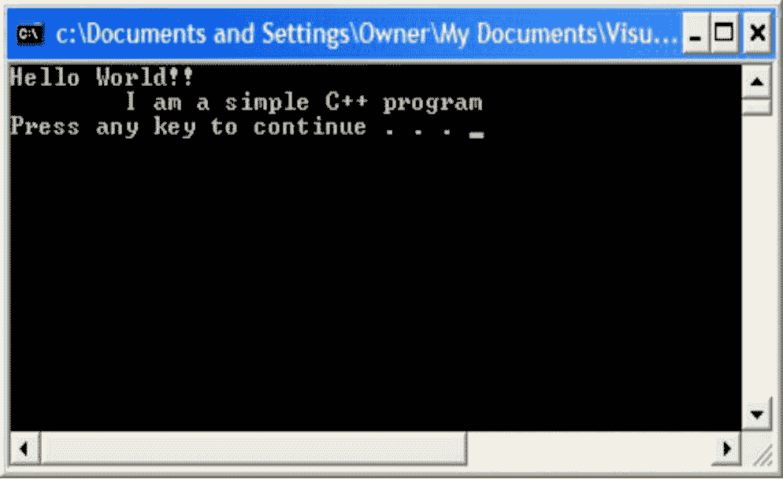

```
Hello World!
        I am a simple C++ program
Press any key to continue . . .
```

## Here is the code

```
// Simple program to display some text

#include <iostream>
#include <cstdlib>

int main() {
	std::cout << "Hello World!!\n";
	std::cout << "\tI am a simple C++ program\n";

	system("pause");

	return 0;
}
```

## Tells the compiler that we need to use someone else's code (stored in a library file)

// Simple program to display some text

```cpp
#include <iostream>
#include <cstdlib>
```

```cpp
int main(){

std::cout << "Hello World!\n";
std::cout << "\tI am a simple C++ program\n";

system("pause");

return 0;
}
```

## Programs always start at `main()`

```cpp
// Simple program to display some text
#include <iostream>
#include <cstdlib>

int main(){
    std::cout << "Hello World!\n";
    std::cout << "\tI am a simple C++ program\n";

    system("pause");

    return 0;
}
```

## Programs always start at main()

// Simple program to display some text

```cpp
#include <iostream>
#include <cstdlib>
```

```cpp
int main() {
std::cout << "Hello World!\n";
std::cout << "\tI am a simple C++ program\n";
system("pause");
return 0;
}
```

> What is “inside” of main?
> { ...... }

## Commands used to display text to the screen

```cpp
// Simple program to display some text
#include <iostream>
#include <cstdlib>

int main(){
    std::cout << "Hello World!\n";
    std::cout << "\tI am a simple C++ program\n";
    system("pause");
    return 0;
}
```

## Command to make the program wait before finishing (so we can see it)

// Simple program to display some text

#include <iostream>
#include <cstdlib>

int main() {
std::cout << "Hello World!\n";
std::cout << "\tI am a simple C++ program\n";

system("pause");

return 0;
}

## Command to tell the program that it is done

```cpp
// Simple program to display some text
#include <iostream>
#include <cstdlib>

int main(){
    std::cout << "Hello World!\n";
    std::cout << "\tI am a simple C++ program\n";

    system("pause");

    return 0;
}
```

## So how do I convert my code into a program?

// Simple program to display some text

#include <iostream>
#include <cstdlib>

int main() {
std::cout << "Hello World!\n";
std::cout << "\tI am a simple C++ program\n";
system("pause");

return 0;
}

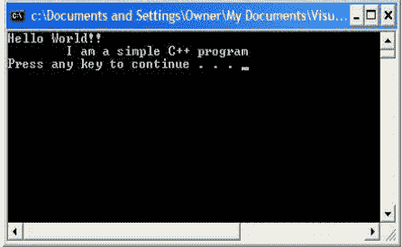


## How does my program becomes an executable code

C++ source code 源代码 yuán dài mǎ

Compiling

executable code .exe file

## How does my program becomes an executable code

C++ source code 源代码 yuán dài mǎ

Compiling

~ Magic ~

executable code .exe file

## How does my program becomes an executable code

C++ source code 源代码 yuán dài mǎ

Compiler 编译器 biān yì qì

Object code 目标码 mù biāo mǎ

Object code from libraries

Linker 链接程序 liàn jiē chéng xù

executable code .exe file

## How does my program becomes an executable code

## Source Code is the code that we type in (our program)

```cpp
// Simple program to display some text
#include <iostream>
#include <cstdlib>

int main() {
    std::cout << "Hello World!\n";
    std::cout << "I am a simple C++ program";

    system("pause");

    return 0;
}
```

## Compiler will translate the source code (almost English) to something closer to what the computer understands

**(checking for grammar mistakes)**

## Compiler will translate the source code (almost English) to something closer to what the computer understands

**C++ source code** 源代码 yuán dài mǎ

**Compiler** 编译器 biān yì qì

Object code 目标码 mù biāo mǎ

> sometimes called Machine Code

**(checking for grammar mistakes)**

## Source Code is the code that we type in (our program)

```cpp
// Simple program to display some text
#include <iostream>
#include <cstdlib>

int main() {
    std::cout << "Hello World!\n";
    std::cout << "\tI am a simple C++ program";

    system("pause");

    return 0;
}
```

## Linker then will combine our code with code from libraries and change it into an executable

## Tells the compiler that we need to use other libraries of code

// Simple program to display some text

```cpp
#include <iostream>
#include <cstdlib>
```

```cpp
int main() {
    std::cout << "Hello World!\n";
    std::cout << "\tI am a simple C++ program\n";
    system("pause");
    return 0;
}
```

## These commands are used from the libraries

```cpp
// Simple program to display some text
#include <iostream>
#include <cstdlib>

int main() {
    std::cout << "Hello World!\n";
    std::cout << "\tI am a simple C++ program\n";

    system("pause");

    return 0;
}
```

## Another Example

| Hardware | Software |
|---|---|
| air plane | pilot |

Is everyone a pilot (good pilot)?

## Another Example

Hardware Software air plane pilot

Is everyone a pilot (good pilot)?

If a person knows all the dials and buttons does this make them a pilot?

## Learning Programming

- **Programming commands:** pretty easy to teach/learn
- **Algorithms (算法 suàn fǎ):** (step by step process to solve a problem) - harder to teach, and often gained through experience
  - learned by doing the programming assignments

## Programming Process

### Problem Solving Phase

thinking about solving the problem

(using your brain and paper)

## Programming Process

### Problem Solving Phase

## Programming Process

### Problem Solving Phase

Understand the problem

Design Solution

## Programming Process

### Problem Solving Phase

## Programming Process

### Problem Solving Phase

Understand the problem

Design Solution

Test Solution

does your “solution” solve the problem

if no

## Programming Process

### Problem Solving Phase

Understand the problem

Design Solution

Test Solution

> thinking about solving the problem
> **(still using your brain and paper)**


## Programming Process

### Problem Solving Phase

### Implementation Phase (coding)

| Understand the problem |
|------------------------|
| Design Solution        |
| Test Solution          |
| Encode Solution        |

## Programming Process

### Problem Solving Phase

### Implementation Phase (coding)

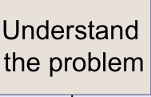

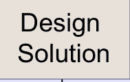

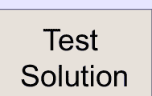

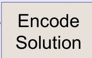

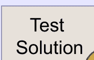


## Programming Process

### Problem Solving Phase

### Implementation Phase (coding)

Understand the problem

Design Solution

Test Solution

Encode Solution

Test Solution

Finished


## Problem Solving Practice

### Number List:

- 10
- 3
- 5
- 9
- 2
- 13

Write simple commands
(like for a 6yr old child)

To sort the list of numbers
from smallest to largest

## Possible Solution

- 1) find smallest number in list (even this could be broken down into easier task)
- 2) create a new list and add smallest number to new list
- 3) find smallest number in old list
- 4) add smallest number to end of new list
- 5) cross smallest number from old list
- 6) repeat 3-5 until no more numbers in old list

## Possible Solution

- 1) create a new list that is empty

- 2) find smallest number in old list

- 3) add smallest number to end of new list

- 4) cross smallest number from old list

- 5) repeat 2-4 until no more numbers in old list

## Possible Solution  
Will this work?

- 1) create a new list that is empty

- 2) find smallest number in old list

- 3)

- 4) cross smallest number from old list

- 5) repeat 2-4 until no more numbers in old list

## Reading

- Chapter 1
  - skim through chapter 1
  - read the Chapter Summary on page 30

- Start reading Chapter 2
  - start memorizing key terms (in the margin)

## Who am I ?

- • What questions do you have about who I am?


?

## Chapter 2

### Foundations: numbers, cin, cout

## C++ Topics

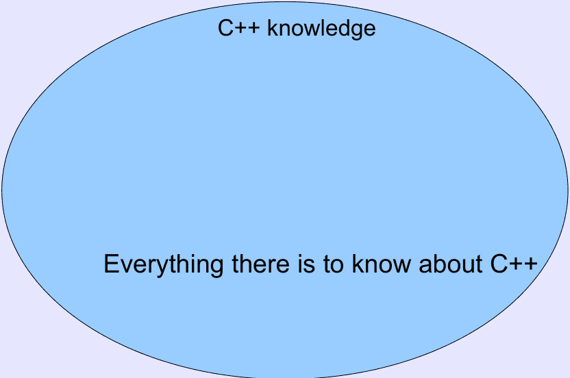

## C++ Topics

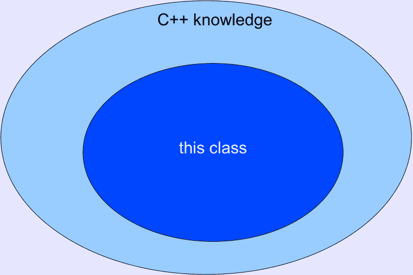

C++ knowledge

this class

## C++ Topics

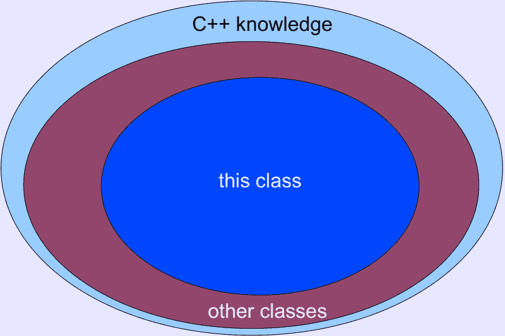

C++ knowledge

this class

other classes

## Back to learning about code...

- • What do we use cout for?

A: it is used to send information to the screen

## ....and here is the program running

c:\Documents and Settings\Owner\My Documents\Visu...
Hello World!!
I am a simple C++ program
Press any key to continue . . . -

## cout information

- - Any guesses what **cout** stands from?

## cout information

- • Any guesses what **cout** stands from?
- character out put stream

this is a data stream that goes
from your program 🡪 to the screen

So what is a data stream?
(see next slide)

## Data Stream

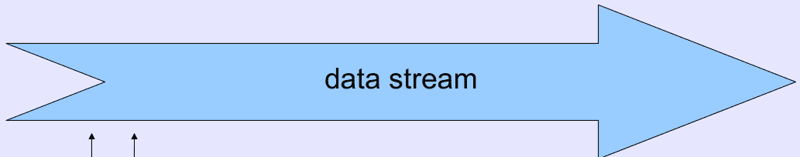

Just like a real stream you can put things in it and they will flow in a direction

## Data Stream

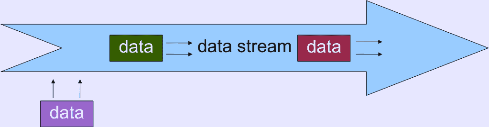

## Data Stream

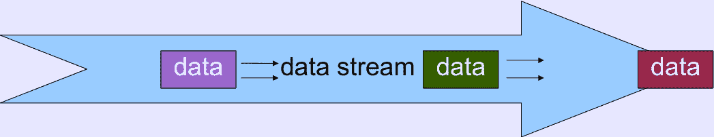

## More examples of cout

```cpp
std::cout << “data1” << “data2”;
```

// puts two piece into the stream

How do you think will they display on the screen?

- a) data1  data2

- b) data1
   data2

- c) data1data2


## More examples of cout

std::cout << "data1" << "data2";

// puts two piece into the stream

How do you think will they display on the screen?

- a) data1  data2
- b) data1
  data2
- c) data1data2

## More examples of cout

Here is the code to get the different options

a) data1 data2

std::cout << "data1" << "data2";

## More examples of cout

Here is the code to get the different options

a) data1 data2
std::cout << "data1" << "data2";

b) data1
data2
std::cout << "data1\n" << "data2";

## More examples of cout

Here is the code to get the different options

a) data1 data2
std::cout << "data1" << "data2";

b) data1
data2
std::cout << "data1\n" << "data2";

c) data1data2
std::cout << "data1" << "data2";

## Different ways to do the same thing

```
std::cout << "data1" << "data2";
```

```
std::cout << "data1data2";
```

```
std::cout << "data1"
<< "data2";
```

```
std::cout << "data1";
std::cout << "data2";
```

> Note: all these statements do the same thing

## Different types of data

`"data"` string, text, or string literal

`'d'` character, or char

`42` number, integer, or int

.....more information later

## cout and different kinds of data (more examples)

```
std::cout << "5 + 4 = " << 5 + 4 ;
```

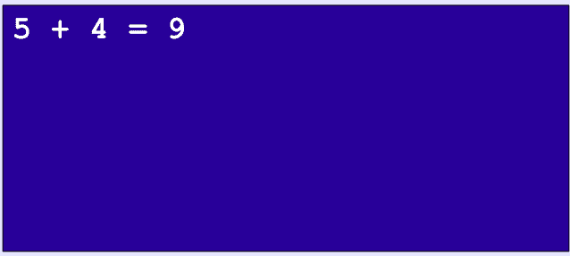

## String Literals

- **String Literals** (sometimes called a **string**)
  - 0 or more character inside of “  “
  - when a string literal is sent to cout it will display all the characters that are inside the “  “ just as they are shown.

```
std::cout << “hello world”;
```

```
hello world
```

## String Literals

- That is true most of the time......
  - what do you think this would do?

std::cout << “He said “Hello there” ” ;

## String Literals

- That is true most of the time……
  - what do you think this would do?

```
std::cout << “He said “Hello there” ”;
```

COMPILE ERROR: Because the “ is used to mark the beginning and end of a string literal

## String Literals

- If we want do display a “ then we must put a signal in the string to tell it

```
std::cout << "He said \"Hello there\" ";
```


## Number Data types in C++

C++ has two main number types

- **Integer:** （整数 zhēng shù）
  - whole numbers  -2,  -1,  0,  1,  2
- **Floating-point:** （浮点数 fú diǎn shù）
  - decimal numbers    -2.5,  0.0,  2.5,

## Numbers and Math Operators

```cpp
// integer division
std::cout << "5 / 4 = " << 5 / 4 << std::endl;
```

5 / 4 = 1

## Numbers and Math Operators

```cpp
// integer division
std::cout << "5 / 4 = " << 5 / 4 << std::endl;
```

```cpp
// floating point division
std::cout << "5 / 4.0 = " << 5 / 4.0 << std::endl;
```

```
5 / 4 = 1
5 / 4.0 = 1.25
```

## Integers and Modulus Operator

```cpp
// integer division
std::cout << "6 / 4 = " << 6 / 4 << std::endl;
```

```
6 / 4 = 1
```

## Integers and Modulus Operator

```cpp
// integer division
std::cout << "6 / 4 = " << 6 / 4 << std::endl;

// modulus operation (remainder)
std::cout << "6 % 4 = " << 6 % 4 << std::endl;
```

```
6 / 4 = 1

6 % 4 = 2
```

## Something to think about

- Let x be some whole positive number
  then what are the answers to the following

x % 1 → [ ? ]

x % 2 → [ ? ]

x % 3 → [ ? ]

## Something to think about

- Let x be some whole positive number then what are the answers to the following

- x % 1 → [ 0 ]

- x % 2 → [ 0, 1 ]

- x % 3 → [ 0, 1, 2 ]

## Something to think about

- Let x be some whole **positive** number then what are the answers to the following

  - x % 1 → [ 0 ]

  - x % 2 → [ 0, 1 ]

  - x % 3 → [ 0, 1, 2 ]

so if n is some **positive** number

- x % n → [ 0, ... n-1 ]


## More to think about

- Often we want to use a dice roll in games. If we have a random positive number (0 - 32,000) called **rpn**, how could we convert this into a dice roll?

`rpn % 6`

[ 0, 1, 2, 3, 4, 5 ]

`rpn % 6` → `[ 0, 1, 2, 3, 4, 5 ]`

`( rpn % 6 ) + 1` → `[ 1, 2, 3, 4, 5, 6 ]`

## More Modulus Operations

```cpp
// integer division
std::cout << "-6 / 4 = " << -6 / 4 << std::endl;

// modulus operation (remainder)
std::cout << "-6 % 4 = " << -6 % 4 << std::endl;

std::cout << "6 % -4 = " << 6 % -4 << std::endl;
```

-6 / 4 = ??
-6 % 4 = ??
6 % -4 = ??

// integer division
std::cout << "-6 / 4 = " << -6 / 4 << std::endl;

// modulus operation (remainder)
std::cout << "-6 % 4 = " << -6 % 4 << std::endl;
std::cout << "6 % -4 = " << 6 % -4 << std::endl;

## Something to think about

- Let x be some whole **negative** number then what are the answers to the following

- x % 1 → [ 0 ]

- x % 2 → [ -1, 0 ]

- x % 3 → [ -2, -1, 0 ]

so if n is some **negative** number

- x % n → [ -(n - 1), ..... 0 ]

## So what is std ?

```cpp
std::cout << 45 << std::endl;
```

- **std** is short for **standard**

- ....but what does that mean ?
  - student example

std is short for **standard**

....but what does that mean ?
- student example

so std is a “grouping” of names (or a “holder”)
in C++ this is called a **namespace**

## using std::cout

```cpp
// Simple program to display some text
#include <iostream>
#include <cstdlib>

using std::cout;        // tells which cout to use

int main(){
    cout << "Hello World!!" << std::endl;
    cout << "\tI am a simple C++ program\n";

    system("pause");

    return 0;
}
```

## When do you use what?

### using namespace std;

- makes all names in std available for use

- a little dangerous when using more than one code libraries (standard C++, and another company's)

- for this class we will use this way

### using std::cout;

- only makes cout available for use

- much safer, but more typing

## Back to numbers and math

What will the output be?

```cpp
cout << 10 - 6 * 3 + 4 << endl;
```

What will the output be?

`cout << 10 - 6 * 3 + 4 << endl;`

or it could be written to be more clear

`cout << 10 - ( 6 * 3 ) + 4 << endl;`

-4

## Back to numbers and math

20 - 4 / 5 * 2 + 3 * 5 % 4

What is the answer for this equation?

## Back to numbers and math

20 - 4 / 5 * 2 + 3 * 5 % 4
20 - 0 * 2 + 3 * 5 % 4

## Back to numbers and math

```
20 - 4 / 5 * 2 + 3 * 5 % 4
20 - 0   * 2 + 3 * 5 % 4
20 -     0 + 3 * 5 % 4
```

## Back to numbers and math

20 − 4 / 5 * 2 + 3 * 5 % 4
20 − 0 * 2 + 3 * 5 % 4
20 − 0 + 3 * 5 % 4
20 − 0 + 15 % 4

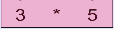

## Back to numbers and math

```
20 - 4 / 5 * 2 + 3 * 5 % 4
20 - 0 * 2 + 3 * 5 % 4
20 - 0 + 3 * 5 % 4
20 - 0 + 15 % 4
20 - 0 + 3
```

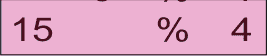

## Back to numbers and math

20 - 4 / 5 * 2 + 3 * 5 % 4
20 - 0 * 2 + 3 * 5 % 4
20 - 0 + 3 * 5 % 4
20 - 0 + 15 % 4
20 - 0 + 3
20 + 3


## Using ( ) to change order

20 − 4 / 5 * ( 2 + 3 ) * 5 % 4

now the 2 + 3 would be the first operation
- just as we would expect from normal math

## Something to think about

Where do you think the `<<` operator is on the precedence chart (high or low)?

```
cout << 10 + 4 * 3 << endl ;
```

## Something to think about

Where do you think the << operator is on the precedence chart (high or low)?

```cpp
cout << 10 + 4 * 3 << endl;
```

Which operation is first?

## How does a program remember?

(How does a program store data?)

**Variables** (变量 *biàn liàng*): a named location in memory that will store data of a certain data type

## How does a program remember?

(How does a program store data?)

**Variables** (变量 biàn liàng): a named location in memory that will store data of a certain data type

How do you create a variable?

- You need to give two pieces of information
- data type ( 数据类型 shù jù lèi xíng )
- variable name

```
int numStudents;
```

## What happens when a variable is created?

- Reserves some memory
- Associates the name with the memory
  - **Note:** *it does not erase the memory*

example:

```cpp
int num;
```

associate: 联系; 联想

## Using a variable

```
int num;     // create an int variable

num = 5;     // store 5 in the variable

cout << " num = " << num << endl;

What will be displayed on the screen?
```

## Using a variable

```
int num;    // create an int variable

num = 5;    // store 5 in the variable

cout << " num = " << num << endl;

What will be displayed on the screen?

num = 5
```

## Using a variable

```cpp
int num;    // create an int variable
```

```cpp
num = 5;    // store 5 in the variable
```

```cpp
cout << num + 3 << endl;
```

What will be displayed on the screen?

## Using a variable

```
int num;    // create an int variable

cout << num + 3 << endl;
```

What will be displayed on the screen?

## Using a variable

```
int num;    // create an int variable

cout << num + 3 << endl;
```

What will be displayed on the screen?

## Other ways to declare variables

int num;    // create, (declare) one variable

int x, y;    // create two variables

int numberOfStudents = 65;  // declare and initialize

int speed = 0, distance = 0;

int classes = 16, semester = 2, year;

## Other ways to declare variables

int num;    // create, (declare) one variable

int x, y;   // create two variables

int numberOfStudents = 65; // declare and initialize

int speed = 0, distance = 0;

int classes = 16, semester = 2, year;

**initialize:** _to give a value at creation time (when declared)_
准备使用

**declare:** _to create a variable_

## Good Variable Names

- Variable names should describe their information
  - studentID
  - screenWidth
  - screenHeight
  - hoursWorked

## Good Variable Names

Variable names should describe their information

- `studentID` or `student_ID`
- `screenWidth` or `screen_width`
- `screenHeight` or `screen_height`
- `hoursWorked` or `hours_worked`

## Variable Name Examples

What does this formula calculate?
– this is a very famous formula

```
x = y * z ;
```

## Variable Name Examples

What does this formula calculate?
- this is a very famous formula

x = y * z ;

d = r * t ;

## Variable Name Examples

What does this formula calculate?
- this is a very famous formula

```
x = y * z ;
```

```
d = r * t ;
```

```
distance = speed * timeSpent ;
```


## Variable Names

Variable names should start with a lower case letter

studentName   or   student_name

**not**

StudentName   or   STUDENT_NAME

these will have a different meaning to us programmers

## Summary: Integers (整数 zhěng shù)

- Integers are positive or negative **whole** numbers
  - ex 1 23 -56

- What numbers can be stored in an int?
  - older machines and compilers: -32,768 to 32,767
  - modern machines and compilers: ≈ ± 2,147,483,678

- The basic integer data type is `int`
  - there are other integer data types that use less or more memory (short, long, unsigned int ....)


## Some experiments

**INT_MAX** is a variable that holds the largest int value
- can be used to determine the maximum size of an int
- defined in **climits** library

```
cout << "INT_MAX = " << INT_MAX << endl;
```

```
INT_MAX = 2147483647
```

## Some experiments

**INT_MAX** is a variable that holds the largest int value
- can be used to determine the size of an int
- defined in **climits** library

cout << "INT_MAX = " << INT_MAX << endl;

What happens when we do this?

cout << "INT_MAX + 1 = " << INT_MAX + 1 << endl;

```
INT_MAX + 1 = -2147483648
```

## Assignment Operator (赋值操作符)

※ in math = is used to say “equals”

2x = 6

## Assignment Operator (赋值操作符)

⌘ in math = is used to say “equals”

2x = 6 → x = 3

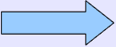

## Assignment Operator (赋值操作符)

⌘ in math = is used to say “equals”

⌘ in programming = is the assignment operator

⌘ store information from the right into the variable on left

```
int num;

num = 5;

cout << num << endl;
```

## ...more examples

one of the most common commands:

```
num = num + 1; // add one to num
```

## ...more examples

```
int num;
num = 42;
cout << num + 2 << endl;
cout << num << endl;
```

What will be displayed on the screen?

## ...more examples

```
int num;

num = 42;

cout << num + 2 << endl;

cout << num << endl;
```

```
44
42
```

Why?

## ...more examples

```
int num;
num = 42;
cout << (num = num + 2 ) << endl;
cout << num << endl;
```

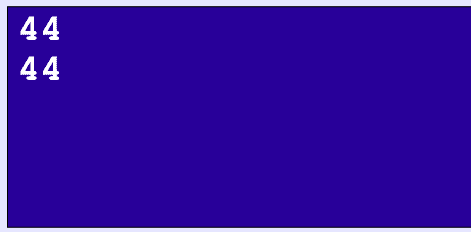

Why?

## Operators and order of operation (precedence)

| Operators | Association |
|---|---|
| `( )` | left to right |
| `*`, `/`, `%` | left to right |
| `+`, `-` | left to right |
| `<<` | left to right |
| `=` | right to left |

⌘ with the addition of the **assignment** operator

## Floating-Point Numbers （浮点数 fú diǎn shù）

- Floating-point data type can store numbers with a fractional part
  - ex 3.254 -12.002

- Can store numbers that are very large or very small
  - ≈ ±10<sup>±308</sup>

- Positive numbers could be from:
  - ≈10<sup>-308</sup> to 10<sup>308</sup>

## Floating-Point Numbers (浮点数 fú diǎn shù)

Stored in memory in scientific notation

ex:
1345.2 would be stored as 1.3452e3 or 1.3452 * 10³
0.00057 would be 5.7e-4 or 5.7 * 10⁻⁴

## Floating-Point Numbers

• Stored in memory in scientific notation

ex:
1345.2 would be stored as 1.3452e3 or 1.3452 * 10³
0.00057 would be 5.7e-4 or 5.7 * 10⁻⁴

25.46 => scientific notation => ?????
.0045 => scientific notation => ?????
1.3e4 => fixed notation => ?????
1.3e-4 => fixed notation => ?????

## Floating-Point Numbers

- Can store numbers that are very large or very small
  - \(\approx \pm 10^{\pm 308}\)

- Positive numbers could be from
  - \(\approx 10^{-308} \text{ to } 10^{308}\)

- C++ provides three floating-point data types
  - `float` : 4 bytes ~ 7 digits of precision (精度 jīng dù)
  - `double` (default) 8 bytes ~ 15 digits of precision
  - `long double`


## Problem with Floating-Point numbers

+   - **float** : 4 bytes ~ 7 digits of [precision](精度 jing du)

```cpp
float x, y;
x = 3.9e8 + 123;
y = x - 3.9e8;
cout << y;    // expect ????
```

## Floating-Point Constants

+   - Standard decimal notation
+   134.123
+   0.15F

+   - Standard scientific notation
+   1.45E6
+   0.979e-3L

+   - When not specified, floating-point constants are of type **double**

> > F or f indicates data type of float

> > L or l indicates long double

## Automatic Promotion

When we do an operation with two different data types, the computer will try to change them to the same type.

```cpp
float x, y;
x = 3.9e8 + 123;
y = x - 3.9e8;
cout << y;
```

> > Here the 123 is changed (promoted) to 123.0 (which is actually a double)

## Automatic Promotion

+   - The change is only **temporary** (for the math operation)

```cpp
int i = 5;
double d = 1.5, ans;

ans = d * i;

cout << i << endl;    // i still stores int value of 5
```

## Types of Conversion

+   - ***int to floating type:*** ok, because no information is lost

```cpp
double d = 5;    // implicit conversion
```

## Quick English Lesson

+   - Implicit: a meaning that is not directly communicated or expressed

+   - Explicit: Fully and clearly expressed; leaving nothing implied.

## Types of Conversion

+   - **int to floating type:** OK, because no information is lost

```cpp
double d = 5;    // implicit conversion
```

+   - **floating type to int:** a little dangerous, because information is lost

```cpp
int i = 2.54869;    // implicit conversion
```

+   - some compilers will give a warning
+     - warning are good, because they keep us from stupid mistakes

## Explicit Conversion

+   - You can tell the compiler that you know what you are doing by doing the following:

```cpp
double d;
.......                    // d is changed to some value
int i = static_cast<int>(d);
```

+   - tells the compiler to get the value from d and change it to an int and then assign it to i.

+   - this way there is no warning, because with the static_cast you are telling the compiler you know information will be lost

## Casting (the old way)

+   - In some (older) books, you will see casting done like this:

```cpp
int i = (int) d;
```

or

```cpp
int i = int ( d);
```

These will both work, but the safer (better) way is to use

```cpp
int i = static_cast < int > ( d );
```

This way allows better error checking by the compiler

### Most Common Command

num = num + 1;

so in C++ they offer a shorter version

### Most Common Command

```cpp
num = num + 1;
```

so in C++ they offer a shorter version

```cpp
num += 1;
```

-=, *=, /=, %= are all also available

## Compound Assignment

+   • How should we shorten:

```
price = price - discount + tax;
```

## Compound Assignment

+   • How should we shorten:

```
price = price - discount + tax;
```

```
price += -discount + tax;
```

## unary operator -

+   - only has one operand
+     ( num = -num    like    num = num * -1 )

## unary operator -

+   - only has one operand
+     ( num = -num    like    num = num * -1 )

```cpp
int num = 5;
num = - num;
cout << num;    // ??
```

```
num = - num;
cout << num;    // ??
```

## unary operator -

+   - only has one operand
+     ( num = -num    like    num = num * -1 )

```cpp
int num = 5;
num = - num;
cout << num;    // -5

num = - num;
cout << num;    // 5
```

## Would these do the same thing?

```cpp
int num = 5;
num = - num;
cout << num;
```

```cpp
int num = 5;
num -= num;
cout << num;
```

## Would these do the same thing?

```cpp
int num = 5;
num = - num;
cout << num; // -5
```

```cpp
int num = 5;
num -= num;
cout << num; // 0
```

num -= num;

> > num = num - num;

### Most Common Command

```cpp
num = num + 1;
```

so in C++ they offer a shorter version

```cpp
num += 1;
```

and even this can be made shorter....


### Most Common Command

```cpp
num = num + 1;
```

so in C++ they offer a shorter version

```cpp
num += 1;
```

and even this can be made shorter....

```cpp
num++;
```

### What's the difference

- `+=` can be used to increment by different amounts  
  num += 5;

- `++` always just adds one  
- `++` can be added before or after the variable for different effects  
  num++;  
  or  
  ++num;

### Pre (before) or Post (after)

- **Preincrement**: add one immediately  
  int i = 1;  
  cout << ++i << endl;   // displays 2

- **Postincrement**: do all the other commands  
  and then add one  
  int i = 1;  
  cout << i++ << endl;   // displays 1  
  cout << i << endl;   // displays 2

### Positive and Negative

- **Predecrement:** subtract one immediately  
  int i = 1;  
  cout << --i << endl;    // displays 0

- **Postdecrement:** do all the other commands  
  and then subtract one  
  int i = 1;  
  cout << i-- << endl;    // displays 1  
  cout << i << endl;      // displays 0

### What would the output be?

```cpp
int num = 5;
cout << num++;
cout << num;
cout << --num;
cout << num++;
```

// after output **num == 6**

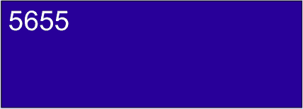

## Operators and order of operation (precedence)

| Operators | Association |
|---|---|
| `()` | left to right |
| `++, --, static_cast<>` | left to right (post) |
| `++, --, -` | right to left (pre) |
| `*, /, %` | left to right |
| `+, -` | left to right |
| `=, +=, -=, *=, /=, %=` | right to left |

## Class Exercise

- I told you when you create a variable, that it does not erase the previous information in the variable.  
- Write a program that will create a variable, and then display what is stored in the variable.

```cpp
// Simple program to display a variable
#include <iostream>
using std::cout;
using std::endl;
int main( )
{
    int num;
    cout << num << endl;
    return 0;
}
```

## Data Type

- Review: What is a data type?  
- Answer: ????

## Data Type

- Review: What is a data type?  
- Answer: A type of data .... or ..... a kind of data

## Character Data Types

- Character type **char** is related to the integer types  
  'a'   'A'   '1'   '$'   ''   '\n'

## Character Data Types

- Character type **char** is related to the integer types  
- Characters are **stored** as an **integer**, but are **displayed** as a **character**

## Character Data Types

- Character type **char** is related to the integer types  
- Characters are **stored** as an **integer**, but are **displayed** as a **character**  
- ASCII is a common encoding standard  

- Examples  
  - `' '` encoded as 32	`'+'` encoded as 43  
  - `'A'` encoded as 65	`'Z'` encoded as 90  
  - `'a'` encoded as 97	`'z'` encoded as 122  


## Character Operations

- **Arithmetic** operations are defined for characters types  
  char ch = 'a';  
  ch++;  
  cout << ch;    // displays b

## Discovering the ASCII encoding

- Here is some code to show you how int's and char's can be interchanged  
  char ch = ' ';\nint i = ch;\n\ncout << i++ << " : " << ch++ << endl;  

  
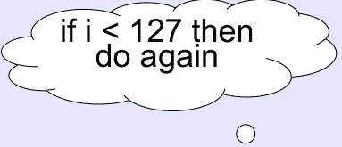

- Some of the output  
  62 : >  
  63 : ?  
  64 : @  
  65 : A  
  66 : B  
  67 : C  
  68 : D  
  69 : E  
  70 : F  
  71 : G  
  72 : H  
  73 : I  
  74 : J  
  75 : K  
  76 : L  
  77 : M  
  78 : N  
  79 : O  
  80 : P  
  81 : Q  
  82 : R  
  83 : S  
  84 : T  
  85 : U  
  86 : V  
  87 : W  
  88 : X  
  89 : Y  
  90 : Z  
  91 : [  
  92 : \  
  93 : ]  
  94 : ^  
  95 : _  
  96 : `  
  97 : a  
  98 : b  
  99 : c  
  100 : d  
  101 : e  
  102 : f  
  103 : g  
  104 : h  
  105 : i  
  106 : j  
  107 : k  


## Or we could use casting

- Here is some code to show you how int's and char's can be interchanged

```cpp
char ch = ' ';
```

```cpp
cout << static_cast<int> ch << " : " << ch++ << endl;
```


- Same output as before

```
62 : >
63 : ?
64 : @
65 : A
66 : B
67 : C
68 : D
69 : E
70 : F
71 : G
72 : H
73 : I
74 : J
75 : K
76 : L
77 : M
78 : N
79 : O
80 : P
81 : Q
82 : R
83 : S
84 : T
85 : U
86 : V
87 : W
88 : X
89 : Y
90 : Z
91 : [
92 : \
93 : ]
94 : ^
95 : _
96 : `
97 : a
98 : b
99 : c
100 : d
101 : e
102 : f
103 : g
104 : h
105 : i
106 : j
107 : k
```

## Constants

- What does **constant** mean in English?
- Answer: something that does not change

```cpp
int num = 5;  // can 5 ever change in the program
```

`5` is a **literal integer constant**

```cpp
int num = 5;    // can 5 ever change in the program
                // can the value in num be changed
```

int num = 5; // can 5 ever change in the program
// can the value in num be changed

5 is a **literal integer constant**
num is a **variable** (something that varies (changes) )

## Character Constants

- Explicit characters within single quotes
  - 'a', 'D', '*'

- Special characters - delineated by a backslash \
  - Two character sequences (escape codes)
    - Some important special escape codes
      - '\t' a tab
      - '\n' a new line
      - '\\' a backslash
      - '\'' a single quote
      - '\"' a double quote

## Constant Variables

- I want to introduce the concept of **Constant Variables** (常量 cháng liàng )
  - **Constant**: unchanging (不变)
  - **Variable**: changeable (多变)

- in C++, a constant variable is a variable that can not be change (after being created)
  - a named value

## Creating and using a Constant Variable

- use the keyword **const**
- use all capital letters for the variable name
- give it a value at creation (initialization)

**Example:**

```cpp
const double CITY_TAX_PER = 0.14;

// later in the program
cityTax = grossPay * CITY_TAX_PER;
```

## Why use Constant Variables

* They help to document a program

literal numbers are not clear

```cpp
cityTax = (16.75 * hours) * 0.14;
```

Constant variables can make it clear

```cpp
cityTax = ( HOURLY_PAY * hours) * CITY_TAX_PER;
```

- **Clarity:** if we have a long program where we often calculate employee wages.
  - in the program we often use
    - 40 for the maximum hours a person can work
    - we also have 40 stores.
  - What happens when we need to change one of these values through out the program?

- A better solution:
  const int NUM_STORES = 40;
  const int MAX_HOURS = 40;

- **Error prevention:** suppose we have a program where we often use the value of pi (π = 3.14149).

- If we use constant variable:

```cpp
const float PI = 3.14149
```

- if we typed PI (PO) wrong the compiler would give us an error

- but if we accidentally typed the value of pi as 3.4149 then our calculation would be wrong without us knowing it


## So in your programs…..

- In your programs you will lose points if you have literal numbers in your program

For example:

```text
cityTax = (16.75 * hours) * 0.14;
```

instead use…..

```text
cityTax = ( HOURLY_PAY * hours) * CITY_TAX_PER;
```

## cin


```cpp
cin >> num ;
```

extraction: to get from

## How the input stream works

```cpp
int num1, num2;

cout << "num1 before input: " << num1 << endl;
cout << "num2 before input: " << num2 << endl;

cin >> num1;
cin >> num2;

cout << "num1 after input: " << num1 << endl;
cout << "num2 after input: " << num2 << endl;
```

## cin Notes

- `>>` operator will consume(eat) white space
  - white space (space, new line, tab)

- `>>` operator will read as much as legally possible into a variable

- `>>` operator will consume(eat) white space
  - white space (space, new line, tab)

- `>>` operator will read as much as legally possible into a variable

- if given the wrong type of data, the input stream (cin) will be corrupted (made bad)
  - once a stream is corrupted, all extractions (reads) will be skipped

## How the input stream works

```cpp
int num1, num2;

cout << "num1 before input: " << num1 << endl;
cout << "num2 before input: " << num2 << endl;

cin >> num1;
cin >> num2;

cout << "num1 after input: " << num1 << endl;
cout << "num2 after input: " << num2 << endl;
```

other examples

## Multiple reads on the same line

```cpp
int num1, num2;

cout << "num1 before input: " << num1 << endl;
cout << "num2 before input: " << num2 << endl;

cin >> num1 >> num2;

cout << "num1 after input: " << num1 << endl;
cout << "num2 after input: " << num2 << endl;
```

## Class Exercise

Write the code that will ask the user for two numbers and then give them the total of the two numbers

number1
+ number2
────────
answer

given by user

give the answer back to the user

```cpp
// Simple program to display the total of
// two numbers
#include <iostream>
using namespace std;
int main( )
{
    int num1, num2;
    cout << "Enter two numbers: ";
    cin >> num1 >> num2;
    cout << num1 << " + " << num2 << " = ";
    cout << num1 + num2 << endl;
    return 0;
}
```

## That's it for Chapter 2 !!

and a little beyond

## Questions

## Make sure you understand how to

- read and write to the screen
- do simple math operations

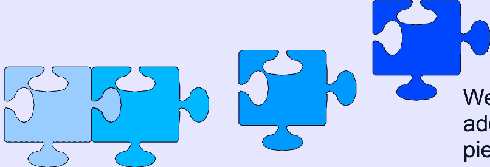

We will be adding more pieces later

## Chapter 3

## Making decisions in your program

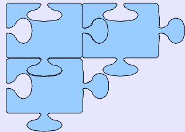

## C++ Keywords

Keywords are words that are reserve for used by the C++ language (**you can't use them for variable names**)

```cpp
#include <iostream>
#include <cstdlib>

using namespace std;

int main(){

cout << "Hello World!\n";
cout << "I am a simple C++ program\n";

system("pause");

return 0;
}
```


## How does the program make decisions?

## ⌘ True & False Decisions

```
numStudents < 200
```

```
name == “Frank”    // checking equality
```

```
temperature >= 30
```

- ⌘ Boolean Expressions: an operation that results in a true or false answer

boolean expression: 布尔表达式

## Relational Operators

| equals | == | x == y |
| not equals | != | x != y |
| less than | < | x < y |
| less than or equals | <= | x <= y |
| greater than | > | x > y |
| greater than or equals | >= | x >= y |

Returns an answer of true or false

## Operators and order of operation (precedence)

| Operators | Association |
|---|---|
| `()` | left to right |
| `*`, `/`, `%` | left to right |
| `+`, `-` | left to right |
| `<<`, `>>` | left to right |
| `<`, `<=`, `>`, `>=` | left to right |
| `==`, `!=` | left to right |
| `=` | right to left |


## Lets give it a try

```cpp
int num1, num2;

cout << "Enter two numbers: ";
cin >> num1 >> num2;

cout << (num1 == num2) << endl;
```

**Boolean Logic:**

0 is False
non-zero is True


## Lets give it a try

```cpp
int num1, num2;

cout << "Enter two numbers: ";
cin >> num1 >> num2;

cout << boolalpha;
cout << (num1 == num2) << endl;
```


## Making a decision

```cpp
if ( num1 == num2 )
    cout << “num1 and num2 are equal \n”;

...more code
```

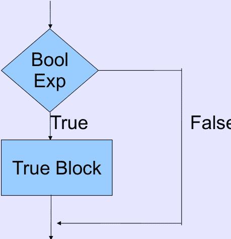

## Making a decision

```cpp
if ( num1 == num2 )
cout << "num1 and num2 are equal \n";
...more code
```

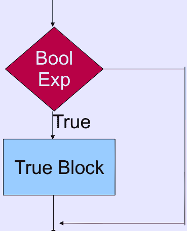

## Making a decision

```cpp
if ( num1 == num2 )
```

```cpp
cout << “num1 and num2 are equal \n”;
```

...more code

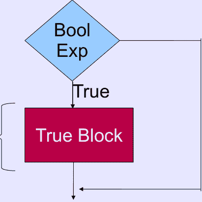

Bool Exp

True

False

True Block

Can be one or more lines of code (>1 line, then use { } )

## Making a decision

```cpp
if ( num1 == num2 ) {
cout << "num1 and num2 are equal \\n";
cout << "num1 is not less than num2 \\n";
cout << "num1 is not greater than num2 \\n";
}
```

...more code

Can be one or more lines of code (>1 line, then use {} )

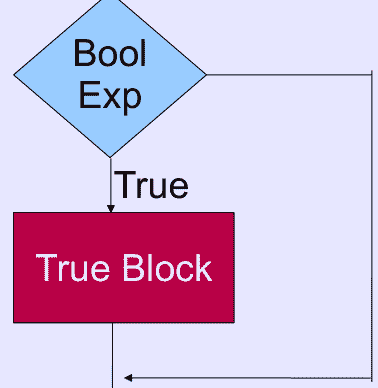

## Making a decision

```cpp
if ( num1 == num2 )
cout << "num1 and num2 are equal \n";
```

...more code

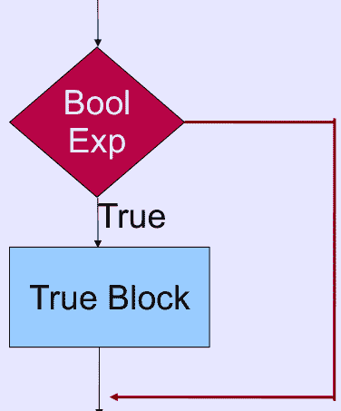

## if, else

```cpp
if ( num1 == num2 )
    cout << “num1 and num2 are equal \n”;
else
    cout << “num1 and num2 are not equal \n”;

...more code
```

## Boolean Expression

```cpp
if ( num1 == num2 )
    cout << “num1 and num2 are equal \n”;
else
    cout << “num1 and num2 are not equal \n”;

...more code
```

## True Block

```cpp
if ( num1 == num2 )
    cout << “num1 and num2 are equal \n”;
else
    cout << “num1 and num2 are not equal \n”;

...more code
```

## False Block

```cpp
if ( num1 == num2 )
    cout << "num1 and num2 are equal \n";
else
cout << "num1 and num2 are not equal \n";
...more code
```

## Class Exercise

Write the code to do the following:

- ask the user for a number
- check to see if the number is even ( 0, 2, 4, 6...)
- give the user a message about their number
- is it even or odd

## A Boolean data type

- C++ contains a data type named `bool`
- Type `bool` has two possible values
  - `true`
  - `false`

## Boolean Algebra

- **Truth tables**
  - Lists all combinations of operand values and the result of the operation for each combination

- **Example:** *And* (&&) truth table

| P | Q | P && Q |
|---|---|---|
| False | False | False |
| False | True | False |
| True | False | False |
| True | True | True |

## Boolean Algebra

- *Or* (||) truth table

| P | Q | P \|\| Q |
|---|---|---|
| False | False | False |
| False | True | True |
| True | False | True |
| True | True | True |

## Boolean Algebra

- *Not* ( ! ) truth table

| P | ! P |
|---|---|
| False | True |
| True | False |

## Boolean Algebra

- Can create complex logical expressions by combining simple logical expressions

- Example
  - not (P and Q)

- A truth table can be used to determine when a logical expression is true

| P | Q | P && Q | !(P && Q) |
|---|---|--------|-----------|
| False | False | False | True |
| False | True | False | True |
| True | False | False | True |
| True | True | True | False |

## A Boolean Type

- Example logical expressions

```cpp
bool p = true;
bool q = false;
bool r = true;

bool s = (p && q);    // true or false
bool t = ((!q) || r ); // true or false
bool u = !(r && (!q)); // true or false
```


## A Boolean Type

Example logical expressions

```cpp
bool p = true;
bool q = false;
bool r = true;

bool s = (p && q);      // false
bool t = ((!q) || r );  // true
bool u = !(r && (!q));  // false
```

## Type conversion with a bool

- Internally in memory a bool stores  
  - true as 1  
  - false as 0  

- bool ➡ int  
  - true ➡ 1  
  - false ➡ 0  

## Boolean expressions that don't look like a Boolean Expression

```cpp
int i = 11;

cout << i << endl;  // Output countdown
```

> if (i--) then  
> do again


When will this loop finish?

- 10  
- 9  
- 8  
- …  
- 2  
- 1  
- 0  

## Short Circuit Evaluation

- A boolean expression will quit as soon as it can make an accurate decision  
- Examples:

```cpp
if ( a < b && a > c ) // and
```

only if this is **true** will we check the other

```cpp
if ( a < b || a > c ) // or
```

only if this is **false** will we check the other  

## Review of if's

- Basic if statement:

```cpp
if ( num > 0 )
    cout << num << “ is greater than 0 \n”;
```

can be one line  
or a block of lines  
with the use of { }

- if else statement:

```cpp
if ( num > 0 )
    cout << num << “ is greater than 0 \n”;
else
    cout << num << “ is not greater than 0 \n”;
```

can be one line  
or a block of lines  
with the use of { }

## BAD STYLE: Do not do this!!!

- Basic if statement:

```cpp
if ( num > 0 ) cout << num << " is greater than 0 \n";
```

- if else statement:

```cpp
if ( num > 0 ) cout << num << " is greater than 0 \n";
else cout << num << " is not greater than 0 \n";
```

## Multiple lines in a block

- **Good Code Style** for the basic if statement:

```cpp
if ( life <= 0 ) {
    cout << “Gasp......I am dead \n”;
    cout << “......goodbye cruel world..... \n”;
}
```

or

```cpp
if ( life <= 0 )
{
    cout << “Gasp......I am dead \n”;
    cout << “......goodbye cruel world..... \n”;
}
```

- Good code style for the **if else** statement:

```cpp
if ( life > 0) {
    cout << “I'm feeling pretty good \n”;
    cout << “....let's go fight some bad guys \n”;
}
else {
    cout << “Gasp......I am dead \n”;
    cout << “......goodbye cruel world..... \n”
}
```

or.......

## A little about Code Style

- The compiler does not need spaces

```cpp
specDistance=speed+time/1.5235;
```

- but for us humans it is much easier to read

```cpp
specDistance = speed + time / 1.5235;
```

....put spaces before and after operators  

## Dangling Else

- a common problem

```cpp
life = 5, energyFromFood = 8;
......
if ( life > 0 )                 // if alive
    if ( energyFromFood <= 0 )              // if hungry
        cout “wow, I’m pretty hungry. \n\n”;
else
    cout << “....go on without me....... \n\n”;
```

- From the indentation, you can see the programmer wants the else to go with the first if (if alive)

```cpp
life = 5, energyFromFood = 8;
......
if ( life > 0 )      // if alive
  if ( energyFromFood <= 0 )  // if hungry
    cout "wow, I'm pretty hungry.. \n\n";
else
  cout << "....go on without me......... \n\n";
but......
```


## Dangling Else

- The compiler will connect the else with the nearest if that does not have an else

```cpp
life = 5, energyFromFood = 8;

if ( life > 0 )                         // if alive
    if ( energyFromFood <= 0 )          // if hungry
        cout << "wow, I'm pretty hungry.. \n\n";
else
    cout << "....go on without me....... \n\n";

but......
```

## The fix for a Dangling Else

- use `{ }` to force the compiler to use the else as you would like it to

```cpp
life = 5, energyFromFood = 8;
......
if ( life > 0 ) {
    if ( energyFromFood <= 0)
        cout << "wow, I'm pretty hungry.. \n\n";
}
else
    cout << "....go on without me....... \n\n";
```

## else if chain

- a long `else if` chain can “walk” off the screen

```cpp
if ( grd > 90 )
	cout << " Grade: A \n";
else
	if ( grd > 80 )
		cout << " Grade: B \n";
	else
		if ( grd > 70 )
			cout << " Grade: C \n";
		else
			if ( grd > 60 )
				cout << " Grade: D \n";
			else
				cout << " Grade: F \n";
```

## else if chain

- so instead it will often be written like this

```cpp
if ( grd > 90 )
    cout << " Grade: A \n";
else if ( grd > 80 )
    cout << " Grade: B \n";
else if ( grd > 70 )
    cout << " Grade: C \n";
else if ( grd > 60 )
    cout << " Grade: D \n";
else
    cout << " Grade: F \n";
```

> The purpose of the *else if* chain is to find the **one** right answer

## An alternative for simple if’s

- For simple if statements *with an assignment:*

```cpp
// num1, num2 and max are int's

if ( num1 > num2 )
    max = num1;
else
    max = num2;
```

....We can use a new operator (Conditional operator)

## Conditional Operator

```cpp
// num1, num2 and max are int's

if ( num1 > num2 )
    max = num1;
else
    max = num2;
```

could be written as

```cpp
max = ( num1 > num2 ? num1 : num2 )
```

Boolean Expression

true

false

## Conditional Operator

- Conditional Operator  
  - has three operands  
  - used for simple if statements

cout << ( num1 > num2 ? num1 : num2 ) ;

Boolean Expression true false

Do we need the ( ) ? Let's take a look at the precedence table

## Operators and order of operation
(precedence)

| Operators | Association |
|---|---|
| `( )` | left to right |
| `*`, `/`, `%` | left to right |
| `+`, `-` | left to right |
| `<<`, `>>` | left to right |
| `<`, `<=`, `>`, `>=` | left to right |
| `==`, `!=` | left to right |
| `?:` | right to left |
| `=` | right to left |

## ...and what does this do?

- What is the purpose of this code?

```cpp
if (grd == 'A')
    cout << "Excellent job, your grade is an A \n"; 
else if (grd == 'B')
    cout << "Good job, your grade is a B \n"; 
else if (grd == 'C')
    cout << "You did OK, your grade is a C \n"; 
else if (grd == 'D')
    cout << "You did poorly, your grade is a D \n"; 
else if (grd == 'F')
    cout << "You flunked, your grade is a F \n"; 
else
    cout << "Your grade has an problem \n";
```

## The Switch Statement

```cpp
switch (grd) {
    case 'A':
        cout << "Excellent job, your grade is an A \n";
        break;
    case 'B':
        cout << "Good job, your grade is a B \n";
        break;
    case 'C':
        cout << "You did OK, your grade is a C \n";
        break;
    case 'D':
        cout << "You did poorly, your grade is a D \n";
        break;
    case 'F':
        cout << "You flunked, your grade is a F \n";
        break;
    default:
        cout << "Your grade has an problem \n";
}
```

## Switch Statement

- **switch** statement can switch on
  - integers, char, bool

- **default** is optional (not required)

- **break** keyword is used to designate the end of a case

- what would be the output if grd == 'B' ?
```cpp
switch (grd) {
  case 'A':
    cout << "Excellent job, your grade is an A \n";
  case 'B':
    cout << "Good job, your grade is a B \n";
  default:
    cout << "Your grade has an problem \n";
}
```


## Switch Statement

- switch statement is good for switching on small number of values
  - not good for a range of values 1-100
- ......but sometimes there are other solutions
- How could we use a switch statement to assign a letter grade based on a number grade?

'A' == 90 – 100  
'B' == 80 – 89  
'C' == 70 – 79  
'D' == 60 – 69  
'F' == 0 – 59  

```cpp
int score    // contain a number [1 – 100]
char grd     // be give a letter grade based on score
```

## Switch Example

```cpp
switch( score / 10 ) {
    case 10:
    case 9:
        grd = 'A';
        break;
    case 8:
        grd = 'B';
        break;
    case 7:
        grd = 'C';
        break;
    case 6:
        grd = 'D';
        break;
    default:
        grd = 'F';
}
```

## Another Switch Example

```cpp
cout << "Enter a simple math expression(+,-,*,/) : ";
int left;
int right;
char operator;

cin >> left >> operator >> right;
cout << left << " " << operator << " " << right << " = ";
switch (operator) {
case '+' : cout << left + right << endl; break;
case '-' : cout << left - right << endl; break;
case '*' : cout << left * right << endl; break;
case '/' : cout << left / right << endl; break;
default:
cout << "Illegal operation" << endl;
}
```

## Another Switch Example

```cpp
int left, right;
char operator;
cout << "Enter simple math expression(+,-,*,/): ";
cin >> left >> operator >> right;
cout << left << " " << operator << " " << right << " = ";
switch (operator) {
case '+':
cout << left + right << endl;
break;
case '-':
cout << left - right << endl;
break;
case '*':
cout << left * right << endl;
break;
case '/':
cout << left / right << endl;
break;
default:
cout << "Illegal operation" << endl;
}
```

## Class Exercise

- Write a **switch** statement that we will eventually use to move a robot based on **char** input. For now just cout a message for each command. Also display a message if a bad command is given (one that is unknown)
- In the program, a **char** variable `cmd` will store one command
- The commands are:
  - f = forward
  - b = back
  - l = left
  - r = right

## An Example Solution

```cpp
switch (cmd) {
  case 'f':
    cout << "move forward \n";
    break;
  case 'l':
    cout << "move left \n";
    break;
  case 'r':
    cout << "move right \n";
    break;
  case 'b':
    cout << "move back \n";
    break;
  default:
    cout << "unknown command \n";
}
```

## Controlling the Output of Floats

double d = 32.4e2;
cout << d ;

May display as:
3.24e3
3240
3240.000

Unless you tell the compiler how you want the
number to be displayed, the compiler can
“decide” (which is not good)

## Controlling the Output of Floats

```cpp
double d = 32.4e2;
cout << setprecision( 2 ) << fixed;
cout << d ;
```

would force the compiler to display:

3240.00

## Controlling the Output of Floats

What if our number was like this:
double d = 3.578e-2;
cout << setprecision( 2 ) << fixed;
cout << d ;
would force the compiler to display:
0.04

for the cout, d is _rounded_ to two decimal places

## Controlling the Output of Floats

```cpp
cout << setprecision( 2 ) << fixed;
```

Once these commands are given, they will **affect all following outputs of floats**.....until it is changed again.

These commands are called **Stream Manipulators**, because they change how the data stream will be used

## Controlling the Output of Floats

```cpp
double d = 12.3456;
cout << setprecision( 2 ) << fixed;
......
cout << d << endl;
cout << setprecision( 3 );
......
cout << d << endl;
......
cout << scientific;
......
cout << d << endl;
```

```
// 12.35
// 12.346
//1.235e+001
```

## Setting the Width of an Output

- To make output look nicer you can create a “field” of a certain width to put the **next thing in**.

```cpp
cout << setw( 5 ) << 123 << endl;
cout << setw( 5 ) << 1234 << endl;
cout << setw( 5 ) << 123456 << endl;
```

- By default, the output is right aligned
- setw() only effects the next thing sent out
- if the field is too small, it has no effect


## Setting the Width of an Output

```cpp
cout << left << setw(10) << "Frank"
<< right << setw( 5 ) << 123 << endl;
cout << left << setw(10) << "Zhang"
<< right << setw( 5 ) << 1234 << endl;
cout << left << setw(10) << "Wang"
<< right << setw( 5 ) << 12345 << endl;
```

- By default, the output is right aligned
- setw() only effects the next thing sent out
- if the field is too small, it has no effect

## Enumeration

- Enumeration (枚举数据类型 méi jǔ shù jù lèixíng)
  - Allows creation of a new data type with a limited set of values.
  - Example:
    - days of the week [ Sunday – Saturday ]
    - months of the year [ January – December]
    - colors used in a program [ red, blue, ….., black]

## Behind the scenes....

- enums are just a user defined collection of const’s
  - stored as int
  - so they can be given a special int value if wanted

### Example:

```cpp
enum Month {JAN = 1, FEB = 2, ..... , DEC = 12};
```

- By default the values are started with 0 and then increment by one for each new value, so we could do this as a shortcut

```cpp
enum Month { JAN = 1, FEB, MAR, ..... , DEC };
```

```cpp
enum Month { JAN = 1, FEB, MAR, ....., DEC };

Month thisMonth = OCT;   // this is ok

// want to change to the next month
```

```cpp
enum Month { JAN = 1, FEB, MAR, ...., DEC };

Month thisMonth = OCT;      // this is ok

// want to change to the next month
thisMonth = 11;              // compile error
```

```cpp
enum Month { JAN = 1, FEB, MAR, ......, DEC };
```

```cpp
Month thisMonth = OCT;      // this is ok
```

```cpp
// want to change to the next month
thisMonth = 11;      // compile error
```

```cpp
thisMonth = static_cast< Month > 11; // this is ok
```

```cpp
if ( thisMonth < DEC )   // also OK
```

.....and now we are done with chapter 3

## Chapter 4

### *Looping*

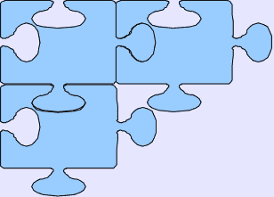

## Advantages of Computers

- Computers are really quick
- Computers don't get bored
  - They can do the same thing over and over and be “happy”

## Loops

- What is the effect of a loop?

```cpp
{
    some C++ code;
    some C++ code;
    some C++ code;
    some C++ code;
    some C++ code;
    some C++ code;
    some C++ code;
}
```

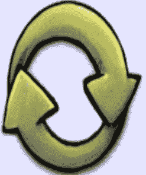

as long as some
condition is true

## While loops

```cpp
while ( num < 10 ) {
cout << "num = " << num << endl;
num = num + 1;
}
```

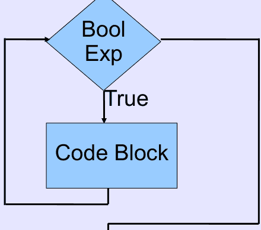

## While loops

while ( num < 10 )
cout << "Hello there \n" ;

As before if there is
only one line in the
body of the loop, the { }
are not needed.

But....what is the
problem?

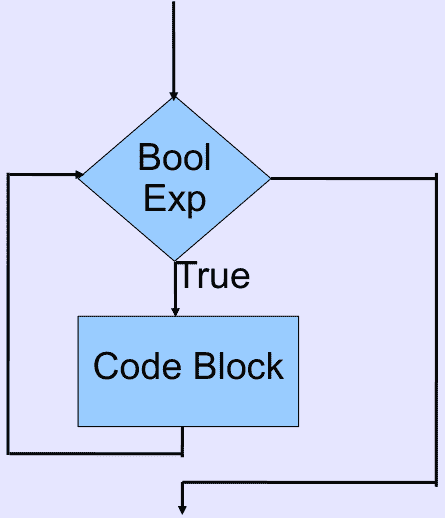

## While loops

while ( num < 10 )
cout << "Hello there \n" ;

As before if there is
only one line in the
body of the loop, the { }
are not needed.

But....what is the
problem?

Infinite Loop:
a loop that doesn't
end

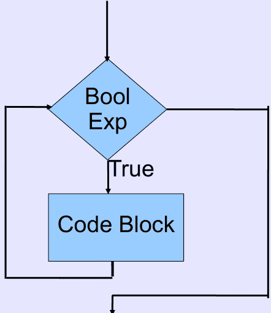

## What is a difference between if and while

• Which of the following is the if (left or right)?

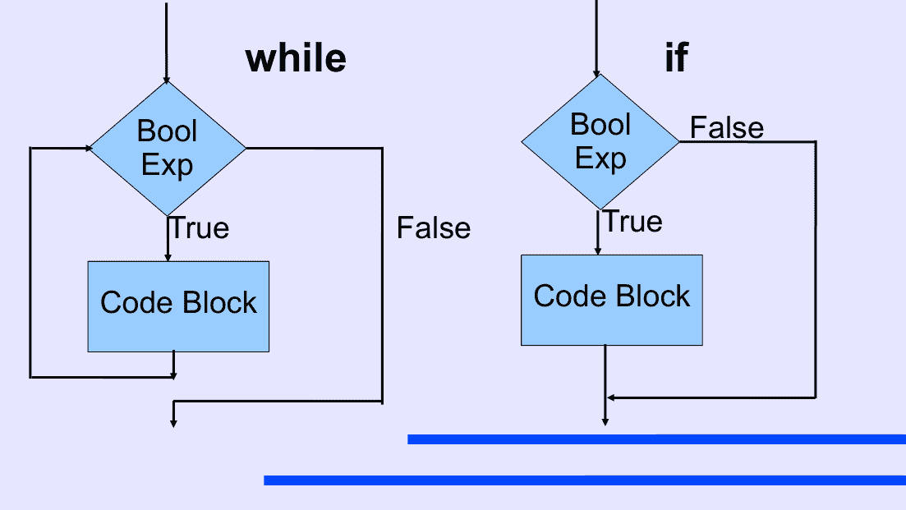

## Answer

```cpp
int num = 1, total = 0, temp;

cout << “Please enter 10 numbers \n”

while ( num <= 10 ) {
    cout << “num “ << num << “:”; 
    cin >> temp ;
    total = total + temp;
    num ++ 1;
}

cout << “The total of your 10 numbers is: “ << total << endl;
cout << “The average of your 10 number is: << ( total / 10 ) << endl;
```


## Another Class Exercise

- Most of the time our DOS screen is 80 characters wide
- To help with making a “pretty” display, make a loop that will print 80 numbers across the screen…..but always print from 1 to 10 ( 0 will represent a 10)

```
123456789012345................................................................67890
```

## Answer

```cpp
int count = 1, output = 1;

while ( count <= 80 ) {
    cout << output ;
    count = count + 1;
    output = output + 1;

    if (output > 9)        // reset output to 0 if over 9
        output = 0;
}
```

## Another Answer

```cpp
int count = 1, output = 1;

while ( count <= 80 ) {
    cout << output ;
    count = count + 1;

    // reset output to 0 if over 9
    output = ( output > 9 ? 0 : output + 1 );
}
```

## Another Answer

```cpp
int num = 1 ;

while ( num <= 80 ) {
    cout << ( num % 10 ) ;
    num = num + 1;
}
```

## While loops

- You can put any kind of code in the code block…..

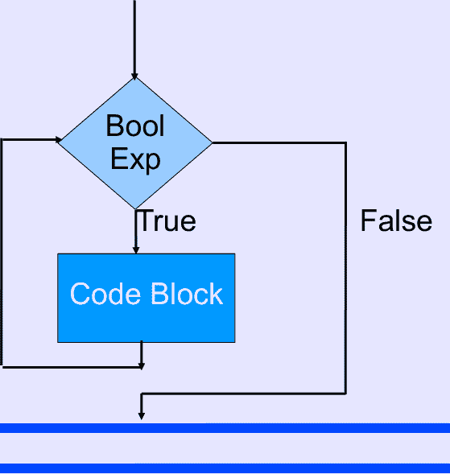

## Embedded loops
(a loop inside of another loop)

- In everyday life we have an embedded loop: **Time**

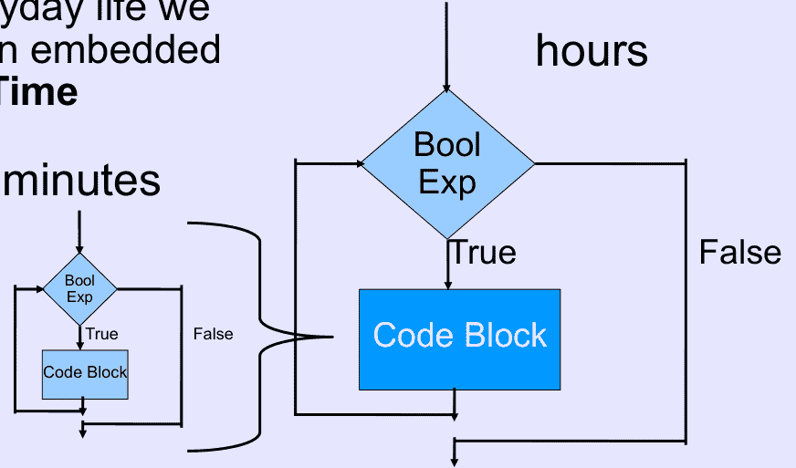

hours

minutes

Bool Exp

True

False

Bool Exp

True

False

Code Block

Code Block

## Creating Some Time Output

```cpp
int hour = 0, min;

while (hour < 24) {
    min = 0;
    while (min < 60) {
        cout << hour << ':' << min << endl;

        min = min + 1;
    }  // end of minute loop
    hour = hour + 1;
}  // end of hour loop
```

## Now What is the Output?

```cpp
int hour = 0, min;

while ( hour < 24 ) {
    min = 0;
    while ( min < 60 ) {
        cout << (hour < 10 ? '0' : "") << hour;
        cout << ':';
        cout << (min < 10 ? '0' : "") << min << endl;
        min = min + 1;
    }   // end of minute loop
    hour = hour + 1;
}       // end of hour loop
```

## Random Numbers

- Generating random numbers is often useful
  - In a game, player do not want the same behavior/moves each time
  - In a simulation of a complex system, random numbers can be used to help generate random events
    - Car crash in a simulation of a highway system
    - Likelihood of a gene in cell mutation
    - Weather simulation


## Random numbers in real life

## Examples

- Generate a random number sequence in the range 1 to 6
  - Use a six-sided die（色子 shǎi zi）
  - Each roll represents a new random number

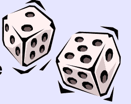

- Generate a random number sequence in the range 1 to 2
  - Use a fair coin
    - Heads: 1, Tails: 2


## Random Numbers

- We can write an algorithm
  for generating what looks
  like random numbers


- Because it’s an algorithm,
  we know the rules for generating the next
  number
  - The generated numbers are not really random
    - They are properly called pseudo-random numbers

## Stdlib Library

- Provides functions for generating pseudo-random numbers
  - `rand()`
    - Returns a pseudo-random *unsigned int* in the range of 0 to `RAND_MAX` (32,767)

```cpp
#include <iostream>
#include <cstdlib>
using namespace std;
int main() {
    int i = 1;
    while( i <= 5) {
        cout << rand() << endl;
        ++i;
    }
    return 0;
}
```

## Program Output

Output

- 41
- 18467
- 6334
- 26500
- 19169

## Program Output for two runs

## Output #1

41
18467
6334
26500
19169

## Output #2

41
18467
6334
26500
19169

Every time the program is run we will get the same "random" numbers


## Different Sequences

To produce a different sequence, use another function (seed random)

```cpp
void srand(unsigned int);
```

Example

```cpp
srand(10);
cout << rand() << endl;
```

## Different Sequences

### Consider seed.cpp

```cpp
int main() {
	cout << "Enter a seed: ";
	unsigned int seed;
	cin >> seed;
	srand(seed);
	int i = 1;
	while(i <= 5) {
		cout << rand() << endl;
		++i;
	}
	return 0;
}
```

## Different Sequences

- To automatically get a different sequence each time
- Need a method of setting the seed to a random value
- The standard method is to use the computer's clock as the value of the seed
- The function `time()` can be used
- Returns an integer value
- `time(0)` returns a good value for generating a random sequence

## Randseed.cpp

```cpp
#include <iostream>
#include <cstdlib>
#include <ctime>
using namespace std;

int main() {
    srand( time(0) );
    int i = 1;
    while(i <= 5) {
        cout << rand() << endl;
        ++i;
    }
    return 0;
}
```

## Program Output for two runs

## Output #1

26534
17998
26189
13533
22067

## Output #2

26779
4928
22514
16041
9228

Every time the program is run we will get the *different* "random" numbers

## Sentinel Controlled Loops

- Continue doing the loop until a special value (the sentinel) is encounter

### Example:

- Before we asked the user for 10 numbers and then we told the user
  - total of the 10 numbers
  - average of the 10 numbers

## Sentinel Controlled Loops

- Continue doing the loop until a special value (the sentinel) is encounter

### Example:

- Before we asked the user for 10 numbers and then we told the user
  - total of the 10 numbers
  - average of the 10 numbers

- Now we want the user to enter as many numbers as they want
  - a negative number is the signal that they are done (the sentinel)

## Will this work?

```cpp
int count = 1, total = 0, input = 0;

cout << "Please enter some positive numbers that I will average \n";
cout << "Enter a negative number to signal that you are done \n";

while ( input >= 0 ) {
  cout << "# " << count << ": " ;
  cin >> input;
  total = total + input;
  count = count + 1;
}

count = count - 1;

if ( count > 0 ) {
  cout << "The total of your " << count ;
  cout << " numbers is: " << total << endl;
  cout << "The average of your " << count
  cout << " number is: << ( total / count ) << endl;
}
```

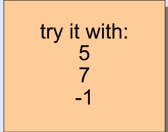

```cpp
int count = 1, total = 0, input = 0;

cout << "Please enter some positive numbers that I will average\\n";
cout << "Enter a negative number to signal that you are done \\n";

while ( input >= 0 ) {
    cout << "#" << count << ":";
    cin >> input;
    total = total + input;
    count = count + 1;
}

count = count - 1;

if ( count > 0 ) {
    cout << "The total of your " << count;
    cout << " numbers is: " << total << endl;
    cout << "The average of your " << count
    cout << " number is: " << ( total / count ) << endl;
}
```


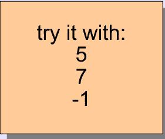

## Will this work?

```cpp
int count = 0, total = 0, input = 0;

cout << “Please enter some positive numbers that I will average \n”;
cout << “Enter a negative number to signal that you are done \n”;

while ( input >= 0 ) {
    total = total + input;
    count = count + 1;
    cout << “# “ << count << “: ”;
    cin >> input;
}

count = count − 1;

if ( count > 0 ) {
    cout << “The total of your “ << count ;
    cout << “ numbers is: “ << total << endl;
    cout << “The average of your “ << count
    cout << “ number is: “ << ( total / count ) << endl;
}
```

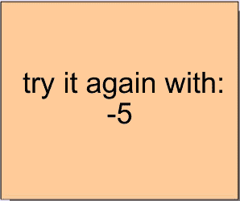

## Infinite loops
(无限循环 wú xiàn xún huán)

## Common Infinite Loops

```c
while ( ch = ‘y’ ) {
    ....
    ....
}
```

**Remember:** non-zero numbers ⇒ true

zero          ⇒ false


## Looping Control Structures

- Three different commands
  - while statement
  - do-while statement
  - ......

## The Do-While Statement

### Syntax

```cpp
do
  code block
while (bool expr);
```

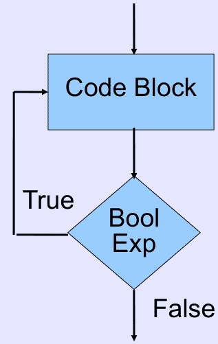

## Using a do while loop

```cpp
char reply;

do {
    ..........        // some code
    ..........
    cout << "Do you want to continue?(y):";
    cin >> reply;
} while(reply == 'y');
```

## Why use a ........?

- What is the advantage of a
- while:
- do...while:

## Looping Control Structures

- Three different commands
  - while statement
  - do-while statement
  - for statement

## 1. 多模态大语言模型(MLLM)

多模态大语言模型 (Multimodal Large Language Model， MLLM) 是指能够处理和融合多种模态信息 (如文本、图像、音频、视频等) 的大语言模型。

多模态大语言模型架构由模态编码器、输入投影器、大语言模型(LLM)和输出投影器组成。

## The for loop

- Syntax
  
  `for (initialization ; bool expression ; update action)`
  
  body of the loop

- Example
  
  ```cpp
  for (int i = 0; i < 3; i++) {
      cout << "i is " << i << endl;
  }
  ```

## Initialization

Executed once at the beginning of the for loop's execution

## Bool Exp

The Bool Exp is evaluated at the start of each iteration of the loop

true

false

## Body

## Update Action

## Execution Example


```cpp
for (int i = 0; i < 3; ++i) {
    cout << "i is " << i << endl;
}
cout << "all done" << endl;
```

## Execution Example

```cpp
for (int i = 0; i < 3; ++i) {
    cout << "i is " << i << endl;
}
cout << "all done" << endl;
```

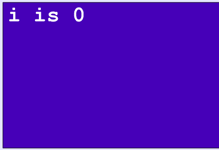

## Execution Example

```cpp
for (int i = 0; i < 3; ++i) {
    cout << "i is " << i << endl;
}
cout << "all done" << endl;
```

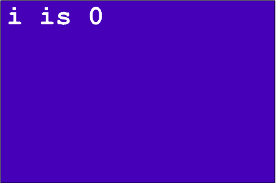

## Execution Example

```cpp
for (int i = 0; i < 3; ++i) {
    cout << "i is " << i << endl;
}
cout << "all done" << endl;
```

i is 0

## Execution Example

```cpp
for (int i = 0; i < 3; ++i) {
    cout << "i is " << i << endl;
}
cout << "all done" << endl;
```

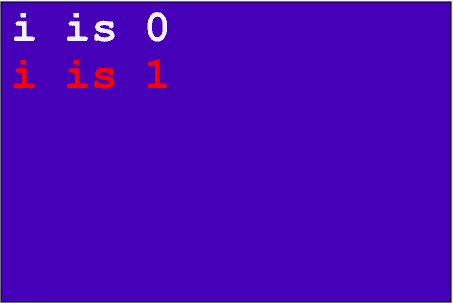

## Execution Example

```cpp
for (int i = 0; i < 3; ++i) {
    cout << "i is " << i << endl;
}
cout << "all done" << endl;
```

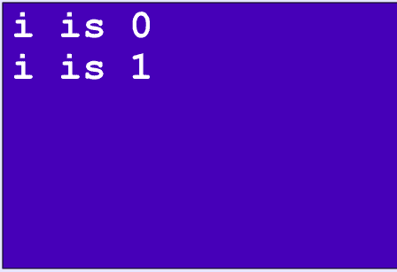

## Execution Example

```cpp
for (int i = 0; i < 3; ++i) {
    cout << "i is " << i << endl;
}
cout << "all done" << endl;
```

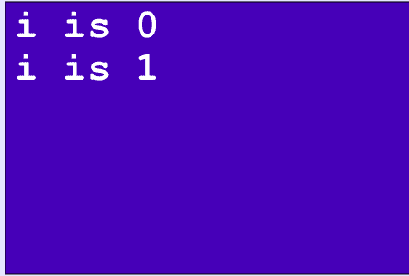

## Execution Example

```cpp
for (int i = 0; i < 3; ++i) {
    cout << "i is " << i << endl;
}
cout << "all done" << endl;
```

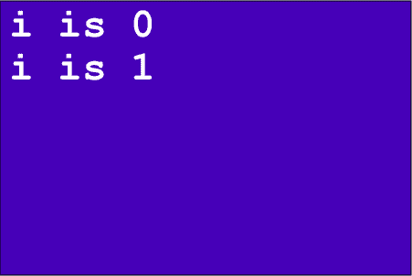

## Execution Example

```cpp
for (int i = 0; i < 3; ++i) {
    cout << "i is " << i << endl;
}
cout << "all done" << endl;
```

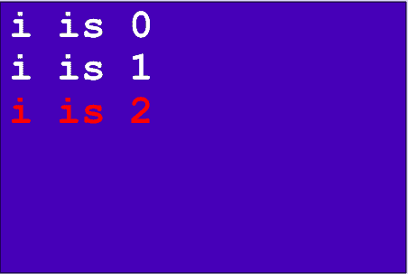

## Execution Example

```cpp
for (int i = 0; i < 3; ++i) {
    cout << "i is " << i << endl;
}
cout << "all done" << endl;
```

```
i is 0
i is 1
i is 2
```

## Execution Example

```cpp
for (int i = 0; i < 3; ++i) {
    cout << "i is " << i << endl;
}
cout << "all done" << endl;
```

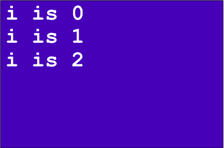

## Execution Example

```cpp
for (int i = 0; i < 3; ++i) {
cout << "i is " << i << endl;
}
cout << "all done" << endl;
```

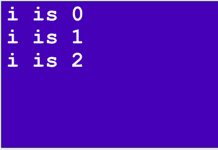

## Execution Example

```cpp
for (int i = 0; i < 3; ++i) {
cout << "i is " << i << endl;
}

cout << "all done" << endl;
```

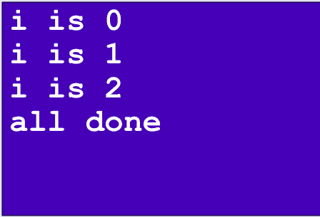

## Embedding for loops

- Just like **while** loops, **for** loops can also be embedded inside other loops
- in fact, due to there compactness (information being easier to read) many embedded loops will be **for** loops


## What is the output?

```cpp
int cntr1 = 0, cntr2 = 0, cntr3 = 0, cntr4 = 0, cntr5 = 0;
cntr1++;

for (int i = 1; i <= 10; ++i) {
    cntr2++;

    for (int j = 1; j <= 20; ++j) {
        cntr3++;
    }

    cntr4++;
}

cntr5++;

cout << "cntr1: " << cntr1 << endl
     << "cntr2: " << cntr2 << endl
     << "cntr3: " << cntr3 << endl
     << "cntr4: " << cntr4 << endl
     << "cntr5: " << cntr5 << endl;
```

## Class Exercise

- Write code to display a grid.
  - For each position, display the location's row and column number. Put two blanks between each location.

Ex:

```text
1,1   1,2   1,3 ....  1,9
2,1   2,2     ....      2,9
....
8,1   8,2     ....      8,9
9,1   9,2   9,3 ......  9,9
```

### One solution to grid exercise

```cpp
for(int row = 1; row < 10; row++ ){

    for(int col = 1; col < 10; col++) {
        cout << row << ',' << col << "  ";
    } // end of col loop

    cout << endl;

}  // end of row loop
```

## Another use of break

- break can be used to exit a loop

```cpp
// in some game

while ( life > 0 ) {
    ..........                 // play game
    cout << "Do you want to quit(q):";
    cin >> userResponse;
    if (userResponse == 'q' )
        break;
} // end while loop
```

not the best example

### A better solution

```cpp
// in some game
userResponse = 'c';
while ( life > 0 && userResponse != 'q' ) {
    // play game
    ....
    cin >> userResponse;
} // end while loop
```

### The best solution

```cpp
// in some game

do {
    // play game
    ...
    cin >> userResponse;
} while ( life > 0 && userResponse != 'q' );
```

## Another use of break

- break will only exit out of **one** loop (if embedded)

```cpp
for ( int row = 1; row < 10; row++ ) {

    for ( int col = 1; col < 10; col++) {
        // do something

        if ( ???? )
            break;    // this will stop the col loop
    }  // col loop

}  // row loop
```

## Continue, the brother of break

- The key word, **continue**, will cause execution to skip to the boolean expression

```cpp
while( something == true ) {
    // do something
    if ( x > 0 )
        continue;        // skip to end of block
    // do some more
    ....
}  // end of while
```


## Using break and continue in loops

- First look for a solution that does not use **break** or **continue**
  - Only use break and continue
    - if it is the _only_ solution, or
    - it makes the code _easier_ to understand

**Note:** always avoid using **goto**.... there is almost always a better way


## Chapter 5: Functions

### Intro to Functions

- Functions in math may be a good illustration of functions in C++
- Example from math functions:

  f(x) = 2x

  f(3) = ???

  y = 4 + f(5)    so y = ???

### Functions { Math vs Programming }

- Functions in math
- **Example:**

  f(x) = 2x

- When f(x) is solved it is just a number

  y = 4 + f(5)

- In math, there are no data types, so x is some number.
- Functions in C++
  - The same math function could be written as...

```cpp
int f ( int x ) {
    int num;
    num = x * 2;
    return num;
}
```

- C++ has different data types, and so we have to add this information


## Functions in Programming

- Where could the **f** function be used (in what kind of code)?

```c
int f(int x) {
    ???
}
```

Answer: anywhere that an int can be used

The function header promises that when the function is finished it will solve down to an int (return type)

## Functions in Programming

- Examples of using the f function

```c
int f(int x) {
    ???
}
```

y = 4 + 3;
⇒ y = 4 + f(3);

or
if (5 > x)
⇒ if (5 > f(y))

or
switch (x)
⇒ switch (f(x))

## Functions in Programming

- Example of shortening the function

```c
int f(int x) {
    int num;
    num = 2 * x;
    return num;
}
```

```c
int f(int x) {
    return 2 * x;
}
```

## So what are functions…..

- What are functions? Why use them? (to think of this think about math functions)

## So what are functions......

- What are functions? Why use them? (to think of this think about math functions)

- Example from math functions:

f(x) = (x * 5)x²

z = f(23)

y = 4 + f(8) so y = ???

## So what are functions…..

- What are functions?
  - group of action that we want to think of as one action
    - break big problems into smaller problems
  - can be repeated….done more than once
  - actions that can change data (information)
    - some actions need to be given information
    - some actions will give back information

## Using a Function

- In the C++ Standard Library files there are a number of functions that can be used

For Example

```cpp
// from cctype

int isdigit(char c);    // function prototype
```


## Using a Function

- In the C++ Standard Library files there are a number of functions that can be used

For Example

```cpp
// from cctype

int isdigit(char c);    // function prototype
```


## Using a Function

- In the C++ Standard Library files there are a number of functions that can be used

## For Example

```
// from cctype
```

```
int isdigit(char c);
```

```
// function prototype
```

> this int is used like a bool, this is an old C library, and there was no bool

## Using a Function

- In the C++ Standard Library files there are a number of functions that can be used

```cpp
// from cctype   int isdigit( char c );
cout << “please enter a number:”
char ch;
cin >> ch;

if (isdigit(ch))
    cout << “Thank you for the number \n”
else
    cout << “That's no number....”
         << “don't you know what a number is?\n”
```

## Other cctype functions

int isdigit(char c); // 0-9
int isalpha(char c); // a-z, A-Z
int isspace(char c); // \n, \t, space
int islower(char c); // a-z
int isupper(char c); // A-Z
....and others

int toupper(char c); // a ⇒ A
int tolower(char c); // A ⇒ a

ch = toupper(ch); // no problem
cout << toupper('a') // ! problem !

## C++ Standard Library

- How can you find out more about the libraries and functions available:
  - from our book…..and others
  - from a good web page (there are a couple links from the class web page):

http://www.cppreference.com/
http://www.cplusplus.com/reference/

## Order for Simple Programs

- Single file programs
  - include statements
  - using statements
  - function prototypes
  - main function definition
  - other functions definitions

```cpp
#include <iostream>
using namespace std;

float circleArea(float r);          // func prototype

// main(): calculate area of circle
int main() {
    cout << "Enter radius: ";
    float myRadius;
    cin >> myRadius;
    float area = circleArea(myRadius);  // func call
    cout << "Circle has area " << area;
    return 0;
}

// circleArea(): compute area of a circle
float circleArea(float radius) {     // func definition
    const float PI = 3.1415;
    return PI * radius * radius;
}
```


## Function Definition

- Contains two parts
  - **Interface / Header**
    - Similar to a function prototype, *but parameters’ names are required (example is give later)*
  - **Body**
    - Statement within curly braces
    - Return statement to indicate value to be given back

## Function Body

```cpp
float circleArea (float radius) {
    const float PI = 3.1415;
    return PI * radius * radius;
}
```

Local variable definition

Return statement

Function body

## Function Definition

Return type

Function name

Parameter

Local variable definition

Return statement

Function body

## Parameters and Arguments

```cpp
#include <iostream>
using namespace std;

float circleArea(float r); // func prototype

// main(): calculate area of circle
int main() {
    cout << "Enter radius: ";
    float myRadius;
    cin >> myRadius;
    float area = circleArea(myRadius); // func call
    cout << "Circle has area " << area;
    return 0;
}

// circleArea(): compute area of a circle
float circleArea(float radius) { // func definition
    const float PI = 3.1415;
    return PI * radius * radius;
}
```

## Parameter Variable Rules

- Parameter variables are created when the function is called and are initialized with the value of the argument
- Changes to parameter variable do not affect argument
- New parameter variables are created for every function call
- Parameter variable names are only known within its function
- Parameter variable ceases to exist when the function completes

Example: `int squared( int num )`

## 环境管理

保护环境，防治环境污染和其他公害，保障公众健康，推进生态文明建设，促进经济社会可持续发展。

- 环境保护规划
- 环境影响评价
- 污染物排放控制

| 指标 | 目标值 | 现状值 |
|------|--------|--------|
| 空气质量优良率 | 85% | 78% |
| 地表水水质达标率 | 90% | 82% |
| 森林覆盖率 | 40% | 35% |

> 绿水青山就是金山银山。

```python
def check_emission(data):
    return data < threshold
```

## promptAndReadInt()

// promptAndReadInt(): prompt and read next integer

```cpp
int promptAndReadInt() {
    cout << "Enter number (integer): ";
    int response;
    cin >> response;

    return response;
}
```

## sum()

```cpp
// sum(): compute sum of all integers from start to
//         end
int sum(int start, int end) {
    int total = 0;
    for (int i = start; i <= end; ++i) {
        total += i;
    }
    return total;
}
```

What is wrong with this function?

## range.cpp (part 1)

```cpp
#include.....

int promptAndReadInt();        // function prototypes
int sum(int start, int end);

int main() {
    int num1 = promptAndReadInt(); // function calls
    int num2 = promptAndReadInt();
    if ( num1 > num2 ) {
        int temp = num1;
        num1 = num2;
        num2 = temp;
    }

    int rangeSum = sum( num1 , num2 );
    cout  << "The sum from " << num1 << " to " << num2
          << " is " << rangeSum << endl;
    return 0;
}
```

## range.cpp (part 1)

```cpp
#include <iostream>
using namespace std;

int promptAndReadInt();    // function prototypes
int sum(int start, int end);

int main() {
    int num1 = promptAndReadInt(); // function calls
    ......
```

## range.cpp (below main)

```cpp
// sum(): compute sum of all integers from start to
//          end.
//          If start > end, then returns 0
int sum(int start, int end) {
    int total = 0;
    for (int i = start; i <= end; ++i) {
        total += i;
    }
    return total;
}
```

## promptAndReadInt()

```cpp
// promptAndReadInt(): prompt and read next integer

int promptAndReadInt() {
    cout << "Enter number (integer): ";
    int response;
    cin >> response;

    return response;
}
```

What is wrong with this function?


## promptAndReadInt( ): better version

```cpp
// promptAndReadInt(): prompt and read next integer
int promptAndReadInt() {
    cout << "Enter a whole number:";
    char ch;
    cin >> ch;
    while( isdigit( ch ) == false ) // cctype lib
        cin >> ch;
    cin.putback( ch );
    int response;
    cin >> response;

    return response;
}
```

## putback()

- putback allows a char to be **put back** into the input stream....
- ....usually so it can then be re-read as a different data type

## Another look at promptAndReadInt()

```cpp
// promptAndReadInt(): prompt and read next integer
int promptAndReadInt() {
    cout << "Enter a whole number:";
    char ch;
    cin >> ch;
    while( isdigit( ch ) == false ) // cctype lib
        cin >> ch;
    cin.putback( ch );
    int response;
    cin >> response;

    return response;
}
```

## Class Exercise

- Write a function that will receive two integer arguments and will give back the larger number.
- Example of calling the function

cout << max( a, b ) << " is the larger of " << a << " and " << b << endl;

- Write the function prototype and function definition

## Class Exercise Answer

```cpp
int max (int num1, int num2);    // function prototype

int main() {
    int a = -5, b = -3;
    cout << max( a, b ) << " is the larger of " << a
         << " and " << b << endl;
    .....
}

int max(int num1, int num2) {    // function definition
    return ( num1 > num2 ? num1 : num2 );
}
```

## Void functions

- Sometimes a function just does an action, but does not give back information
  - return type is **void** (means: nothing there [空虚 kongxu])
  - return statement is optional (not needed)

example:

## Void functions

- Sometimes a function just does an action, but does not give back information
  - return type is **void** (means: nothing there [空虚 kōngxū] )
  - return statement is optional (not needed)

example:

```
void displayGreeting( ) {
cout << " ~World of Codecraft~ \n\n";
cout << " In this game you will be playing a Software \n";
cout << "Engineering student, and you will be faced with \n";
..... ( 8-10 more lines of text )
}
```

## Scope:（作用域 zuò yòng yù）

- refers to when a variable name is seen or available for use
- Two types of scope
  - local: within a block
  - global: outside of a block (not in a block)

## Blocks and Local Scope

- A block is a list of statements inside of curly braces
  `{ }`
- Blocks can be put anywhere a statement can be put
- A block within a block is a nested or embedded block
- A variable name is known only in the block that it is created in
  - and any nested blocks inside that block

## Name Reuse

- If a nested block defines a variable with the same name as an outer block, the new variable definition is in effect in the nested block
- local (inner) variable names hide the view of outer variable names

## However, Don’t Do This At Home

```
void foo() {
    {
        int i = 1;
        cout << i << endl;        // prints 1
        {
            cout << i << endl;    // prints 1
            char i = 'a';
            cout << i << endl;    // prints a
        }
        cout << i << endl;        // prints 1
    }
    cout << i << endl;            // unknown variable
}
```

## However, Don’t Do This At Home

```cpp
void foo() { // #1
    { // #2
        int i = 1;
        cout << i << endl;        // prints 1
        { // #3
            cout << i << endl;    // prints 1
            char i = 'a';
            cout << i << endl;    // prints a
        } // closes #3
        cout << i << endl;        // prints 1
    } // closes #2
    cout << i << endl;            // unknown variable
} // closes #1
```

## Global Scope

- Variable not defined inside a block are global variables
- A global variable can be used by any function that is defined after the global variable
  - Global variables should be avoid unless they are constant
    - For this class, only global constants are allowed


## Global Scope

- Variable not defined inside a block are global variables
- A global variable can be used by any function that is defined after the global variable
  - Global variables should be avoid unless they are constant
    - For this class, only global constants are allowed
- Global variables can even be used in other program files
  - cout and cin are global variables that are defined in the iostream
- Local variables can reuse a global variables's name
  - unary scope operator :: can give access to the global variable even if the name is being reused locally

## Don’t Do This At Home Either

```cpp
int i = 1;                 // creates global

int main() {
    cout << i << endl;     // uses global
    {
        char i = 'a';      // creates local
        cout << i << endl; // prints local
        ::i = 2;           // refer to global
        cout << i << endl; // prints local
        cout << ::i << endl; // print global
    }
    cout << i << endl;     // uses ????
    return 0;
}
```

## Why do we only use global constants?

```cpp
int i = 1;        // creates global

int main() {
  .......
  i = 2;           // Change i to 2
  ......
  ......
  cout << i ;      // i displays a value of -243
  return 0;
}
// 10 other functions
```

What is the problem?

## Why do we only use global constants?

```cpp
int i = 1; // creates global

int main() {
    ......
    i = 2; // change i to 2
    ...... // ...possibly hundreds of lines
    cout << i ; // i displays a value of -243
    return 0;
}
// 10 other functions
```

problem: where did i change.... you will have to look through all of the program

## Global variables are like global bank accounts

**General Rule:** Global variables should be made **constant**

## Let’s review some names associated with functions…..

void test (int d, int e, int f);

Function Prototype
Function Declaration

int main ( )
{
int a, b, c;
...
test ( a, b, c );
}

Function Heading / Header
Function Interface

Function Body

void test ( int d, int e, int f)
{
int g, h;
...
}

Function Heading / Header
Function Interface

Function Definition

void test (int d, int e, int f);

const int TABLE_SIZE = 20;

int main ( )
{
int a, b, c;
...
test ( a, b, c );
}

void test ( int d, int e, int f)
{
int g, h;
...
}

## Parameters

## Global variable

## Local variables

## Arguments

## Parameters

## Local variables

void test (int, int, int);

int main ( )
{
int a, b, c;
...
test( a, b, c);
}

Parameter names are not required in function prototype
... but it is usually **best** to use them

void test ( int d, int e, int f)
{
int g, h;
...
}

Parameter names **are** required in the function definition

## ......enough of a review, back to new material

### Consider

```cpp
int main() {
    int number1 = promptAndReadInt();
    int number2 = promptAndReadInt();
    if (number1 > number2) {
        swap(number1, number2);
    }
    cout << "The numbers in sorted order:"
         << number1 << ", " << number2 << endl;
    return 0;
}
```

## Using

```c
void swap(int a, int b) {
  int temp = a;
  a = b;
  b = temp;
  return;
}
```

Does this function do what we want?

**Remember:** if returning nothing and the return is the last statement then the return statement is not needed

### Consider

- What we want is a parameter passing method where changes to the parameter would change the arguments

```cpp
int num1 = 5, num2 = 12;
swap(num1, num2);
cout << num1 << "  " << num2 << endl;
```

displays:

12   5

That would work!

## Reference Variables

- Special meaning of `&` when used in a variable declaration
  - create a reference variable

```cpp
int & refVar = num;
```

How about doing this ?

```cpp
& refVar = num2;    // This has another meaning
```


## Reference Parameters

- If the parameter is a *reference* parameter then
  - parameter becomes an *alias*（别名 **bié míng**）for the argument
    - *Changes to the reference parameter, are actually changing the argument*
    - *The reference parameter is just a local name for argument*

- Function header determines whether a parameter is passed by value or reference
  - Reference parameter form

```cpp
void swap ( int & a, int & b )
```

## Reconsider

```cpp
void swap( int &a, int &b);

int main() {
    int number1 = promptAndReadInt();
    int number2 = promptAndReadInt();
    if (number1 > number2) {
        swap(number1, number2);
    }
    cout << "The numbers in sorted order: "
         << number1 << ", " << number2 << endl;
    return 0;
}
```

## Using reference parameters

```cpp
void swap(int &a, int &b) {
    int temp = a;
    a = b;
    b = temp;
}
```

> Passed by reference -- when called the parameter becomes a second name for the argument

## Constant Parameters

- The `const` modifier can be used with parameter declarations
  - `const` indicates that the function may not modify the parameter

```cpp
void promptAndGetInt(int &n, const string &s){
    cout << s ;
    cin >> n ;
    s = "Got it";        // illegal assignment
}                         // caught by compiler
```

- Sample function call

```cpp
int x;
promptAndGetInt( x, "Enter number (n): ");
```

## Constant Reference Parameters

- Usefulness
  - when we want to pass a variable by reference,
    but we don't want to let the variable be changed

- Question
  - Why not just pass the variable by value?

- Answer:
  - For large variables, making a copy of the
    variable can take time and be slow

## Review

- if we call this function, how is the parameter “passed” in?

```cpp
int foo ( int num );
```

- if we call this function, how is the parameter “passed” in?

```cpp
int foo ( int num );
```

  ANS: the value of the argument is copied to num

- if we call this function, how is the parameter “passed” in?

```cpp
bool baz ( int & grade );
```

  ANS: grade becomes a second name for the argument

- what does the const do to the parameter “passed” in?

```cpp
string bar ( const int & testScore );
```

  ANS: testScore is read-only (can't be changed in the func)

### Consider

```cpp
void printChar(char c = '~', int n = 80) {
    for (int i = 0; i < n; ++i)
        cout << c;
}
```

- What happens in the following function calls?

```cpp
printChar('*', 20);
printChar('-');
printChar();
```

## Default Parameters

- Default parameters must appear after any normal parameters
  - (must be given from right to left )

- **Bad example**  
  `void trouble(int x = 5, double z, double y);`

> Cannot come before normal parameters

- Default parameters must appear after any normal parameters
  - (must be given from right to left )

- **Good** example

```cpp
void goodEx(int x, double z, double y = 10);
```

Must come after
normal parameters


### Consider

If a function prototype looks like the following:

```cpp
void foo(int num1, int num2 = 0, int num3 = 100);
```

and function calls like this, what values are copied to which parameters?

```cpp
foo(12, 34);
foo(74);
foo();
foo(1, 2, 3);
```

## Function Overloading 函数重载 hán shù chóng zài

- Sometimes we want to use the same function name to do similar actions (different functions).

- Example: find the smallest (minimum, or smallest):
  - integer
  - float
  - string

```cpp
int min(int num1, int num2);
float min(float num1, float num2);
string min(string word1, string word2);
```

- A function name can be overloaded if the two functions have a **different parameter list**.

- Difference in **number** of parameters:

  ```text
  min(a, b, c)
  min(a, b)
  ```

- Difference in **types** of parameters:

  ```text
  min(10, 20)
  min(4.4, 9.2)
  ```

- A function name can be overloaded if the two functions have a difference in the parameter list.
  - Different **number** of parameters
  - Different **type** of parameters
  - You **can't** use function overloading if the only difference is the **return** type.

```cpp
int min(int a, int b);
string min(int a, int b);
```

```cpp
int min(int a, int b) {
    cout << "Using int min()" << endl;
    if (a < b)
        return a;
    else
        return b;
}
```

```cpp
double min(double a, double b) {
    cout << "Using double min()" << endl;
    return (a < b) ? a : b;
}
```

```cpp
int main() {
    int a = 10;
    int b = 20;
    double x = 4.4;
    double y = 9.2;
    int c = min(a, b); // which function is used?
    cout << "c is " << c << endl;

    int z = min(x, y); // which function is used?
    cout << "z is " << z << endl;
    return 0;
}
```

```cpp
int main() {
    int a = 10;
    int b = 20;

    int c = min(a, 5.2); // which one gets called?

    cout << "c is " << c << endl;
    return 0;
}
```

- The compiler will try to find the function with the "best fit".
  - First looks for a function definition where the arguments and parameters exactly match.
  - If there is no exact match, the compiler will attempt to cast (change) the arguments so a function can be called.

- The rules for function definition overloading are very complicated.
  - Advice: **Be very careful when using this feature**.

### Consider

```cpp
int min(int n1, int n2);        // function a
int min(int n1, float f1);      // function b
int min(float f1, int n1);      // function c

int main() {
    cout << min(2, 1) << endl;   // calls?
    cout << min(2, 3.2) << endl; // calls?
    cout << min(2.5, 4) << endl; // calls?
}
```

Causes a compiler error. Why?

```cpp
int min(int n1, int n2);
int min(int n1, float f1);
int min(float f1, int n1);

int main() {
    cout << min(2, 1) << endl;    // calls?
    cout << min(2, 3.2) << endl;  // calls?
    cout << min(2.5, 4) << endl;  // calls?
}
```

The compiler thinks of this as a double, and needs to convert it, but to what? int or float?

```cpp
int min(int n1, int n2);        // function a
int min(int n1, float f1);      // function b
int min(float f1, int n1);      // function c

int main() {
    cout << min(2, 1) << endl;     // calls a
    cout << min(2, 3.2f) << endl;  // calls b
    cout << min(2.5f, 4) << endl;  // calls c
}
```

Now there is no confusion. The trailing `f` tells the compiler the numbers are floats.


## ....and that ends Chapter 5


- Function
  - Arguments
  - Parameters
  - Local Variables
  - Scope of a Variable
  - Func. Definitions
  - Func. Declarations
  - Reference Variables
  - Default Arguments
- Function Overloading

## Recursion (递归 dí guī) *(actually chap 8)*

- Recursion is the ability of a function to solve a problem by calling itself

- Consider the mathematical function n!  
  (factorial - 阶乘 jiē chéng)

- Consider the following definition  
  \(n! = 1\), if \(n == 1\)  
  \(n! = n * (n - 1)!\), if \(n > 1\)

– The factorial function is defined in by referring to itself

## Using

```cpp
int factorial(int n) {
    if (n == 1) {
        return 1;
    }
    else {
        return n * factorial(n-1);
    }
}
```

- C++ function mirrors the mathematical factorial definition
  - If the value of `n` is 1, the value 1 is returned.
  - Otherwise, the product of `n` and `factorial(n-1)` is returned.

## Recursion Visualization

+   • Consider `cout << 3! = " << factorial(3) << endl;`


## Recursion Visualization

- Consider `cout << 3! = " << factorial(3) << endl;`

## Function memory

```
`cout << "n! = " << factorial(3) << endl;`
```

n = 3

call factorial(3)

```
`factorial(3) = 3 * factorial(2)`
```

n = 2

call factorial(2)

```
`factorial(2) = 2 * factorial(1)`
```

## Recursion Visualization

- Consider cout << 3! = " << factorial(3) << endl;


cout << "n! = " << factorial(3) << endl;

factorial(3) = 3 * factorial(2)

factorial(2) = 2 * factorial(1) = 2 * 1 = 2

factorial(1) =

1

## Abstract

In the era of large language models (LLMs), modern coding agents have demonstrated substantial advances in automating software development tasks. However, their performance and reliability are often hindered by the quality of the code they generate. To address this, we introduce CodeFix, a novel multi-agent framework aimed at improving code generation accuracy through iterative feedback and refinement. CodeFix adopts a two-stage pipeline comprising a generation agent and a review agent. The review agent, guided by a comprehensive checklist, provides precise, actionable feedback on the generated code. This feedback is then used by the generation agent to iteratively refine the output. We evaluate CodeFix on three widely used benchmarks—HumanEval, MBPP, and CodeContests—and demonstrate that it significantly improves the performance of base models, including GPT-4o, Llama-3.1-8B, and Qwen-2.5-7B. Our best configuration achieves pass@1 scores of 91.2% and 88.4% on HumanEval and MBPP, respectively, surpassing existing state-of-the-art methods by a large margin. Furthermore, we conduct extensive analyses on the impact of different checklist designs, feedback granularity, and the number of iteration rounds, providing valuable insights into the design of effective code generation systems.

## 1 Introduction

Recent advances in large language models (LLMs) have revolutionized the field of automated code generation [1, 2, 3]. Models such as GPT-4 [4], Gemini [5], and Llama-3 [6] are capable of generating code snippets that are often indistinguishable from those written by human programmers. Despite this progress, the generated code frequently contains subtle bugs, logical errors, or inefficiencies that require manual inspection and correction. Consequently, the practical deployment of these models in real-world software engineering remains limited.

To bridge this gap, researchers have explored various strategies, including fine-tuning on code-specific datasets [7, 8], prompting-based techniques such as chain-of-thought [9] and self-consistency [10], and the use of external tools such as linters and test runners [11, 12]. However, these methods often rely on a single model that both generates and evaluates the code, leading to a bias where the model fails to detect its own mistakes. In contrast, multi-agent systems [13, 14] offer a more promising direction: by assigning different roles to different agents, it is possible to introduce diversity and reduce systematic errors.

In this work, we propose CodeFix, a multi-agent code generation framework that decouples the generation and review processes. The framework consists of two agents: (i) a generation agent that produces an initial draft based on a natural language instruction, and (ii) a review agent that inspects the generated code against a predefined checklist comprising correctness, efficiency, readability, and edge-case coverage. The review agent outputs a list of issues with specific suggestions. The generation agent then revises the code accordingly. This cycle repeats until the review agent finds no further issues or a maximum number of iterations is reached.

We evaluate CodeFix on three benchmarks: HumanEval [15], MBPP [16], and CodeContests [17]. Our results show that CodeFix consistently improves the pass@1 accuracy across different base models and benchmarks. Moreover, we analyze the effect of several design choices, such as the content of the checklist, the granularity of feedback, and the number of refinement rounds, to provide practical guidelines for future work.

## 2 Related Work

### 2.1 Large Language Models for Code Generation


## Thoughts on Recursion

- Recursion is another way of doing looping but using function calls instead
  - a little bit slower than normal looping, but sometimes a very good solution
  - an infinite recursive loop (*or even one that runs a long time*) will crash the program due to running out of memory
  - advanced topic and will be revisited in later classes

## ....and that ends Chapter 5

- Function
  - Arguments
  - Parameters
  - Local Variables
  - Scope of a Variable
  - Func. Definitions
  - Func. Declarations
  - Reference Variables
  - Default Arguments
- Function Overloading
- Recursive Functions


## Chapter 6 Arrays

### Holding multiple pieces of data

- What “tools” do we have so far for **holding** more than one piece of data ?

- nothing…..maybe multiple variables

- Solution: **Collections** or list – allows the storing of **like** data
  - array
  - vector

## List

- C++ provides two list mechanisms
- Arrays
  - Traditional and important because of old libraries (C and C++)
  - Restrictions on its use
- Container classes ( next semester)
  - Common containers provided by STL (Standard Template Library)
  - vector, queue, stack, map, …
  - New to C++
  - more flexible…and better features (similar ideas)

### Array Overview

Suppose we wanted a collection of 10 ints

```c
int a[10];
```


### Array Vocabulary

- Each piece of the array is called an *element*

- Array elements are of the same data type — the *base* type

```c
int a[10];
```


### Array Vocabulary

- Each piece of the array is called an *element*

- Array elements are of the same data type — the *base* type

- Elements of an array are access by using *subscripting* or *indexing* with the array name

```c
int a[10];
```


### Basic Array Definition: Creating

```
dataType  name [ sizeExp ];
```

Data Type of elements in array

Name of array

**constant value (not a variable)**

gives the number of elements in array

```
double grades [ 100 ];
```

```
// elements have indexed from 0 through 99
```

### Example Definitions (creating an array)

• if we have....

const int N = 20;
const int M = 40;
const int MAX_STRING_SIZE = 80;
const int MAX_LIST_SIZE = 1000;

• Then the following are all correct array definitions

int nums[10]; // array of 10 ints
char answer[MAX_STRING_SIZE]; // array of 80 chars
double sales[M*N]; // 800 floats
int values[MAX_LIST_SIZE]; // 1000 ints
Color favoriteColors[15]; // array of 5 Colors

What do you notice
about all the sizes?

## Initializing an array

We can use an **initializer list** to initialize an array (when the array is being created

int nums[5] = { 1, 2, 3, 4, 5 }; // what is nums[ 1 ] == ???

## Initializing an array

- We can use an **initializer list** to initialize an array (when the array is being created)

```cpp
int nums[5] = { 1, 2, 3, 4, 5 };    // what is nums[1] == ???
```

```cpp
int grades[100] = { 0 };              // all elements equal 0
```

## Initializing an array

- We can use an **initializer list** to initialize an array (when the array is being created)

```cpp
int nums[5] = { 1, 2, 3, 4, 5};
```

// what is nums[1] == ???

```cpp
int grades[100] = { 0 };
```

// all elements equal 0

```cpp
int arr[50] = {100, 50};
```

// arr[0] = 100, arr[1] = 50; rest = 0


## Initializing an array

- We can use an **initializer list** to initialize an array (when the array is being created)

```cpp
int nums[5] = { 1, 2, 3, 4, 5 };
```

// what is nums[1] == ???

```cpp
int grades[100] = { 0 };
```

// all elements equal 0

```cpp
int arr[50] = {100, 50};
```

// arr[0] = 100, arr[1] = 50; rest = 0

```cpp
int arr2[] = { 2, 4, 6, 8, 10 };
```

// creates an array of length 5 with
// the values from the initializer list

## Array Elements

Suppose

```cpp
int a[10]; // array of 10 uninitialized ints
```


To access an individual element we must use an index (subscript) to the array named **a**

```cpp
a[0] = 10;
```

Suppose

```cpp
int a[10]; // array of 10 uninitialized ints
```


To access an individual element we must use an index (subscript) to the array named **a**

```cpp
a[0] = 10;
```

Suppose

```cpp
int a[10]; // array of 10 uninitialized ints
```


To access an individual element we must use an index
(subscript) to the array named **a**

```cpp
a[0] = 10;

a[9] = a[0] + 5;
```

Suppose

- `int a[10]; // array of 10 uninitialized ints`
- `char ch = 'c';`


To access an individual element we must use an index
(subscript) to the array named `a`

```cpp
a[0] = 10;
a[9] = a[0] + 5;
a[10] = a[9];
cout << ch;
```

## Array Element Manipulation

- Consider that we wanted to fill the array with 1's

```cpp
int nums[10];

for ( int i = 0; i < 10; i++ )
    num[i] = 1;
```


- Consider

```cpp
int a[10];
int i = 7, j = 2, k = 4;
a[0] = 1;
a[i] = 5;
a[j] = a[i] + 3;
a[j+1] = a[i] + a[0];
a[ a[j] ] = 12;
cin >> a[k];    // where next input value is 3
```


- Consider

```cpp
int a[10];
int i = 7, j = 2, k = 4;
a[0] = 1;
a[i] = 5;
a[j] = a[i] + 3;
a[j+1] = a[i] + a[0];
a[ a[j] ] = 12;
cin >> a[k];    // where next input value is 3
```


- Consider

```cpp
int a[10];
int i = 7, j = 2, k = 4;
a[0] = 1;
a[i] = 5;
a[j] = a[i] + 3;
a[j+1] = a[i] + a[0];
a[ a[j] ] = 12;
cin >> a[k];    // where next input value is 3
```


- Consider

```cpp
int a[10];
int i = 7, j = 2, k = 4;
a[0] = 1;
a[i] = 5;
a[j] = a[i] + 3;
a[j+1] = a[i] + a[0];
a[ a[j] ] = 12;
cin >> a[k];    // where next input value is 3
```


- Consider

```cpp
int a[10];
int i = 7, j = 2, k = 4;
a[0] = 1;
a[i] = 5;
a[j] = a[i] + 3;
a[j+1] = a[i] + a[0];
a[ a[j] ] = 12;
cin >> a[k];    // where next input value is 3
```


- Consider

```cpp
int a[10];
int i = 7, j = 2, k = 4;
a[0] = 1;
a[i] = 5;
a[j] = a[i] + 3;
a[j+1] = a[i] + a[0];
a[ a[j] ] = 12;
cin >> a[k];    // where next input value is 3
```


- Consider

```cpp
int a[10];
int i = 7, j = 2, k = 4;
a[0] = 1;
a[i] = 5;
a[j] = a[i] + 3;
a[j+1] = a[i] + a[0];
a[ a[j] ] = 12;
cin >> a[k];    // where next input value is 3
```


## Reading from a file into an Array

// read MAX_ARRAY_SIZE int’s from a file, or until end
// end of file

```cpp
int nums[MAX_ARRAY_SIZE];
int cnt = 0;
int currentInput;
while((cnt < MAX_ARRAY_SIZE) && (fin >> currentInput)){
    nums[cnt] = currentInput;
    ++cnt;
}
```


## Reading from a file into an Array

```cpp
// read MAX_ARRAY_SIZE int’s from a file, or until end
//   end of file

int nums[MAX_ARRAY_SIZE];
int cnt = 0;
int currentInput;
while((cnt < MAX_ARRAY_SIZE) && (fin >> currentInput)){
    nums[cnt] = currentInput;
    ++cnt;
}
```

What is cnt equal to when the code finishes?

Answer: the number of int’s read

## Displaying an array

`// display cnt elements of nums array`

`for (int i = 0; i < cnt; ++i) {`

`cout << nums[i] << " ";`

`}`

`cout << endl;`

## Passing an array to a function

- arrays are always passed by “reference” without using the &

```cpp
int sumArray( int arr[], int size); // function prototype
```

```cpp
// in main
```

```cpp
int nums[] = { 1, 2, 3, 4 };
```

```cpp
cout << sumArray( nums, 4 ); // display 10
```

```cpp
cout << sumArray( nums, 2);         // displays 3
```

```cpp
cout << sumArray( nums[0], 4)       // error, why
```

## Using an array in a function

```cpp
int sumArray(const int arr[], int size ) {
  int total = 0;

  for (int i = 0; i < size; i++ )
    total += arr[ i ];

  return total;
}
```

**Note:** An array doesn’t know it’s size so it must be passed as a parameter

## Class Exercise

- Problem
  - Write a function to find the smallest value in an array of integers

- Input (parameters)
  - An array of integers and the size of the array

- Output (return value)
  - Smallest value in the array

- Note
  - array can’t be changed

## An Answer

```cpp
int findSmallest(const int arr[], int asize) {
  int smallest = arr[0];
  for (int i = 1; i < asize; ++i) {
    if ( arr[i] < smallest ) {
      smallest = arr[i];
    }
  }
  return smallest;
}
```

## Using findSmallest()

- What happens with the following?

```cpp
int number[6] = { 3, 88, -7, 9, 1, 24};

cout << findSmallest(number, 6) << endl;

int list[3];
list[0] = 12;
list[1] = 9;
list[2] = 45;

cout << findSmallest(list, 3) << endl;
```

## Some Useful Functions

```cpp
void getList(int arr[], int &n, int size ) {
    for (n = 0; (n < size) && (cin >> arr[n]); ++n);
    // empty for loop
}
```

> Note: cntl-q will cause a cin >> to stop

```cpp
void displayList(const int arr[], int n) {
    for (int i = 0; i < n; ++i) {
        cout << arr[i] << " ";
    }
    cout << endl;
}
```

## Using the functions

```cpp
const int MAX_SIZE = 250;
int values[MAX_SIZE];
int numValues;

getList(values, numValues, MAX_SIZE);
displayList(values, numValues);
```


## Some Useful Functions

```cpp
void getList(int arr[], int &n, int size ) {
    for (n = 0; (n < size) && (cin >> arr[n]); ++n);
    // empty for loop
}
```

> Why is n a reference variable in the above and normal variable below

```cpp
void displayList(const int arr[], int n) {
    for (int i = 0; i < n; ++i) {
        cout << arr[i] << " ";
    }
    cout << endl;
}
```

## Searching

### Problem

- Determine whether a value (key) is found in the array

### Solution:

- check each element, if element == key, if equal then return location (index)
- if not found, then return the search size

## Example using search

```cpp
int values[SIZE];

// fill the values array
cin >> target;
int spot = search(values, numberValues, target);

if (spot != numberValues) {        // its there
    cout << values[spot]
         << " already in the array \n";
}
else {                             // its not there
    values[numberValues] = target;
    ++numberValues;
}
```

## Array Review

- When do you set the size of an array?
  - When it is created.

Can you change the size of an array once it is created?

## Array Review

- When do you set the size of an array?
  - When it is created.

- Can you change the size of an array once it is created?
  - No

- When accessing an array, does the compiler check to make sure the access is legal?

## Array Review

- When do you set the size of an array?
  - When it is created.

- Can you change the size of an array once it is created?
  - No

- When accessing an array, does the compiler check to make sure the access is legal?
  - No, this is left up to the programmer

- How are arrays passed to functions?

## Array Review

- When do you set the size of an array?
  - When it is created.

- Can you change the size of an array once it is created?
  - No

- When accessing an array, does the compiler check to make sure the access is legal?
  - No, this is left up to the programmer

- How are arrays passed to functions?
  - By reference....without needing to use the & operator

## Common Sorting Techniques

- Selection sort
  - On ith iteration (重复 chóng fù) place the ith smallest element in the ith list location

- Bubble sort
  - Go through the list and examining adjacent pairs of elements and if necessary swap them to put them in order.
  - Repeat the process until no swaps are necessary

- Insertion sort (example given in the book)

## Common Sorting Techniques

### Selection sort

On ith iteration (重复 chóng fù) place the ith smallest element in the ith list location

find the smallest, then move it to the 1st location (index 0)

## Common Sorting Techniques

- **Selection** sort
  - On **i**th iteration (重复 chóng fù) place the **i**th smallest element in the **i**th list location
  - find the smallest, then move it to the 1<sup>st</sup> location (index 0)
  - find the 2<sup>nd</sup> smallest and move it to the 2<sup>nd</sup> location

## Common Sorting Techniques

### Selection sort

- On ith iteration (重复 chóng fù) place the ith smallest element in the ith list location
- find the smallest, then move it to the 1st location (index 0)
- find the 2nd smallest and move it to the 2nd location
- find the 3rd smallest and move it to the 3rd location
- find the n smallest and move it to the n location

## Speed of Sorting Algorithm

- Common question when sorting
  - How long does the sorting function take to run – in Data Structures class they will discuss this
    - how our arrays are small, but imagine if you were sorting 10,000 numbers
    - simple sorting algorithms are good for small amounts of data


## Understanding is more important than memorizing

**Understanding** last for a lifetime,

Memorizing last for a couple weeks....
maybe a month


## Arrays

We can store any data type in an array.....so that we have
a collection of elements of the same data type

```cpp
int arr[10];				// int array
```

```cpp
Color colorsUsed[20]		// Color array
```

## Arrays

- We can store any data type in an array.....so that we have
a collection of elements of the same data type

```cpp
int arr[10];		// int array
```

- We can even have an array of arrays

```cpp
int arr2[5][10];		// array of int arrays
```

lets take a closer look......

## Arrays of arrays

Creates an array of arrays

```cpp
int arr2[5][10];
```

> // array of int arrays


## Arrays of arrays

Access an array of int arrays

```cpp
int arr2[5][10];    // array of int array
```

```cpp
arr2[0];
```


## Arrays of arrays

### Access an array of int arrays

```cpp
int arr2[5][10];   // array of int array
arr2[0][1];
```


## Arrays of arrays

Called _multi-dimensional_ arrays
or _multi-subscripted_ arrays

```cpp
int arr2[5][10];
```


## Using Multi-Dimension Arrays

- Creating
  
  double salesData [100] [5];

- Creating and initializing
  
  int arr [4] [10] = { {0} };
  
  int arr2 [2] [3] = { {1,2,3} , {4,5,6} };

## Using Multi-Dimension Arrays

```cpp
int studentScores [NUM_CLASSES] [STDS_PER_CLASS];
int total = 0;

// grades are inputted into the array some how

for ( int i = 0; i < NUM_CLASSES; i++ ) {
    for ( int j = 0; j < STDS_PER_CLASS; j++ ) {
        total += studentScores [ i ] [ j ];
    }
}
cout << "Average Student Score: "
     <<  total / ( NUM_CLASSES * STDS_PER_CLASS )
     <<  endl;
```

## Calling a Function with Multi-Dim Arrays

```cpp
const int NUM_CLSS = 5, NUM_STDS = 35;
```

```cpp
// function prototype
```

```cpp
int averageScore( int scores [ ] [ NUM_STDS ], int numClss );
```

```cpp
// in main
```

```cpp
int studentScores [NUM_CLSS] [NUM_STDS];
```

```cpp
int average = 0;
```

```cpp
........
```

```cpp
average = averageScores( studentScores, NUM_CLSS );
```

## Calling a Function with Multi-Dim Arrays

```cpp
const int NUM_CLSS = 5, NUM_STDS = 35;
```

```cpp
// function prototype
```

```cpp
int averageScore( int scores [][NUM_STDS] );
```

```cpp
// in main
```

```cpp
int studentScores [NUM_CLSS] [NUM_STDS];
int average = 0;
.......

average = averageScores( studentScores, NUM_CLSS );
```

> > What is wrong with this example?

## Calling a Function with Multi-Dim Arrays

```cpp
const int NUM_CLSS = 5, NUM_STDS = 35;
// function prototype
int averageScore ( int scores [][] NUM_STD
// in main
int studentScores [NUM_CLSS] [NUM_STDS];
int average = 0;
.........
average = averageScores ( studentScores, N
```


## Calling a Function with Multi-Dim Arrays

const int NUM_CLSS = 5, NUM_STDS = 35;
// function prototype
int averageScore ( int scores [ ] [ NUM_STDS?
// in main
int studentScores [NUM_CLSS] [NUM_STDS];
int average = 0;
......
average = averageScores ( studentSco

> The classes don't have the same number of students

> Use a sentinel value to mark the end of the scores (-99) in each classes

## Fixing our Problem

```cpp
// above main
const int END = -99;     // signal for no more scores

// below main
int averageScore ( int scores[][ NUM_STDS ],
                   int numClasses ) {
    int total = 0, stdCount = 0;
    for ( int i = 0; i < numClasses; i++ ) {
        for ( int j = 0; j < NUM_STDS &&
             scores[ i ][ j ] != END ; j++ ) {
            total += scores [ i ] [ j ];
            stdCount++;
        }
    }
    return total / stdCount ;
}
```


## Multi-dimensional Arrays

- Can we make 3 dimensional arrays?

Sure, there is no limit to the number of dimensions,
.....but most of the time we will use 1-3
dimensional arrays.

- Why is that ?

This is what is easy for us to picture.

## Arrays of arrays

Access an array of int arrays

int arr2[3][5][10] ;


## Arrays of arrays

Access an array of int arrays

```cpp
int arr2[3][5][10];

arr2[0][0][1];    // an int
```


## Arrays of arrays

Access an array of int arrays

int arr2[3][5][10];

arr2[0][0];   // an int array or array of ints


## Arrays of arrays

Access an array of int arrays

```cpp
int arr2[3][5][10];
```

```cpp
arr2[0];  // a 2 dim int array
```


## Arrays and Data Types

```cpp
int foo[4][5][6];
```

```cpp
foo[1][2]; // what data type is this?
```

```cpp
foo[1]; // what data type is this?
```

```cpp
foo[1][2][3]; // what data type is this?
```

```cpp
foo; // what data type is this?
```

## Arrays and Data Types

```cpp
int foo [4] [5] [6];
```

```cpp
foo[1] [2];
```

// array of ints

```cpp
foo[1];
```

// what data type is this?

```cpp
foo[1] [2] [3];
```

// what data type is this?

```cpp
foo;
```

// what data type is this?

## Arrays and Data Types

int foo [4] [5] [6];

foo[1] [2];

foo[1];

foo[1] [2] [3];

foo;

// array of ints

// 2 dimension array of ints

// what data type is this?

// what data type is this?

## Arrays and Data Types

```c
int foo[4][5][6];

foo[1][2];        // array of ints

foo[1];           // 2 dimension array of ints

foo[1][2][3];     // int

foo;              // what data type is this?
```

## Arrays and Data Types

```cpp
int foo [4] [5] [6];

foo[1] [2];                 // array of ints

foo[1];                     // 2 dimension array of ints

foo[1] [2] [3];             // int

foo;                        // 3 dimension array of ints
```

## Class Exercise

Using the following array, find the highest average class score
(which class has the highest average score )
~ each class has the same number of students

`int studentScores[NUM_CLSS][NUM_STDS];`

## Solution to Exercise

```cpp
int studentScores [NUM_CLSS] [NUM_STDS];
int total , highestAve = 0, ave;

for ( int i = 0; i < NUM_CLSS; i++ ) {
    total = 0;
    for ( int j = 0; j < NUM_STDS; j++ ) {
        total += studentScores [ i ] [ j ];
    }
    ave = total / NUM_STDS;
    if ( ave > highestAve )
        highestAve = ave;
}

cout << "Highest Class Average: " << highestAve << endl;
```

## Something to think about

int num = 5;

- When var is created, what happens?
  - memory is set aside (reserved)
  - the name var is associated with the memory location
  - the value 5 is stored in the memory location

- When is the memory requested? or as the program is running could we change the variable to hold more elements
  - the memory is requested at run time, but it is set (decided) at compile time
  - no

## Pointers: a special kind of variable

- Pointer is a variable that stores a memory address of another variable (similar to a reference, but not the same)  
  (指针 zhǐ zhēn pointer)

```cpp
int num = 5;        // creates a normal int
int * intPtr;       // creates a int pointer
```


## Pointers: a special kind of variable

Pointer is a variable that stores a memory address of another variable (similar to a reference, but not the same)
(指针zhǐ zhēn pointer )

```cpp
int num = 5;
int * intPtr;

intPtr = &num;
*intPtr = 6;

cout << num;
```

## Different uses of *

- How many different ways can we use * ? 3

1. Create a pointer variable

```c
int * intPtr;
```

2. Get what the pointer is pointing at (dereference)

```cpp
*intPtr = *intPtr + 2;
```

3. As the multiplication operation

```cpp
num = 24 * someNum;
```

How can the compiler tell them apart?

## Different uses of &

- How many different ways can we use & ?

2 (that we know of)

1. Create a reference variable

```cpp
int num;
int & intRef = num;
```

2. Get address of a variable

```cpp
intPtr = & num;
```

How can the compiler tell them apart?

## “Address of” Operator

- using the “address of“ operator

```cpp
int i = 1;
int j = 2;
int *ptr;

ptr = &i;      // ptr points to location of i
*ptr = 3;      // value of i are changed
ptr = &j;      // ptr points to location of j
*ptr = 4;      // value of j are changed
cout << i << " " << j << endl;
```

## Revisiting the Swap Function

### swap function using reference parameters

```cpp
void swap(char & ch1, char & ch2) {
    char ch = ch1;
    ch1 = ch2;
    ch2 = ch;
}
```

```cpp
int main() {
    char a = 'y';
    char b = 'n';
    swap(a, b);
    cout << a << b << endl;
    return 0;
}
```

### Swap Func. using Pointers (the C way)

```cpp
void swap(char *ptr1, char *ptr2) {
    char c = *ptr1;
    *ptr1 = *ptr2;
    *ptr2 = c;
}
```

```cpp
int main() {
    char a = 'y';
    char b = 'n';
    swap(&a, &b);
    cout << a << b << endl;
    return 0;
}
```

> In C, there are no reference parameters.
> - Pointers are used instead.

## Reference vs Pointers

- Reference can **only** be assigned (initialized) at creation

```cpp
int num = 5, num2 = 8;
int & ref = num;
int * ptr = & num;

// later
ptr = & num2;  // can be changed a second variable
```

- Reference can be use like a normal variable (don't need to be dereferenced), but a pointer must be dereferenced

```cpp
ref = 6;
*ptr = 9;
cout << ref << *ptr << endl;
```

## Null Address

- 0 represents the empty or null address
  (空指针kōng zhǐ zhēn **null pointer**)
- Used to indicates that pointer is not pointing to a valid object
- Good Programming Practice: Whenever a pointer is not being used, set it equal to 0
- Cannot dereference a pointer whose value is null

```cpp
int *ptr = 0;
cout << *ptr << endl;  // invalid, ptr
        // does not point to
        // a valid int
if ( ptr )        // false if null (0)
```

```cpp
int *ptr = 0;
if ( ptr )              // if points to something
    cout << *ptr << endl;  // valid, ptr
```


## Constants and Pointers

- A **constant pointer** is a pointer that cannot change the location that the pointer points to

```cpp
char c = 'c', e = 'e';

char * const ptr1 = &c;
ptr1 = &e;      // illegal
*ptr1 = 'k';    // ok
```

- A **pointer to constant data** is a pointer that points to data that can't be changed

```cpp
const char d = 'd';
const char * ptr2 = &d;
*ptr2 = 'f';      // illegal: cannot change d
                  // through ptr2
ptr2 = &e;       // ok
```

| C++ Code | Can point to diff data | Can change the data pointed to |
|---|---|---|
| `int * iptr;` | TRUE | TRUE |
| `const int *iptr;` | TRUE | FALSE |
| `int * const iptr;` | FALSE | TRUE |
| `const int * const iptr;` | FALSE | FALSE |

> Read from right to left and it becomes easy to understand

## So why use Pointers

- Seems like a lot of trouble to use......
  - now we have reference variables

## Big benefit of Pointers

- You can ask for memory while the program is running

```cpp
int numStd;
cout << "Please enter the number of students: ";
cin >> numStd;    // could be 10, 100, 1000
if ( numStd > 0 )
    int * studentScores = new int[ numStd ];
```

- This memory is called Dynamic memory

## New Operator Behavior

- Memory for dynamic variables
  - Requested from the free store
    - (or also called heap 堆duī or 堆栈 duī zhàn)

- If there is sufficient (enough) memory to satisfy the request
  - A pointer to the memory is returned by the operation

- If there is insufficient (not enough) memory to satisfy the request
  - An exception is generated
    - An exception is an error message which if not handled (corrected) causes the program to terminate
    - more on this next semester

## Differences: Local Variable vs Dynamic Memory

- **Local variables and parameters**
  - Variable memory is acquired automatically

- **Dynamic Memory**
  - Dynamic memory is acquired by program with a memory request (allocation)
    - **new** operation
  - Dynamic memory can exist beyond the function in which they were allocated
  - Dynamic memory is returned by a deallocation request
    - **delete** operation


## The Basic New Form

### Syntax

```
ptr = new SomeDataType ;
```

- Where
  - ptr is a pointer of type SomeDataType

### Beware

- The newly acquired memory is uninitialized (contains garbage)

## Examples

```
int *iptr = new int(10);
Time *tptr = new Time(12,30);  // an object ???
```


## Pointers and “arrays”

### Syntax

```
p = new SomeDataType [size];
```

- Where
  - p is a pointer of type SomeDataType
  - size is the number of elements of type SomeDataType to be constructed – this can be a variable (not just constants)
- indexing ( [ ] ) can be used on a pointer variable in the same way as an array

## Examples

```cpp
int *a = new int [3];
Time *t = new Time [2];
```

```cpp
a[1] = 5;
Time tm(2, 30);
t[0] = tm;
```


## Giving back the memory

- Forms of request

```
delete ptr;        // if storage came from new
delete [] arrPtr;  // if storage came from new[]
```

- Storage pointed to by ptr and arrPtr is returned to free store
  - ptr and arrPtr are now undefined

## Pointers and arrays

```cpp
const int ARRSIZE = 20;
int arr[ ARRSIZE ];
```

```cpp
int * ptr = arr;   // how can we do this ?
                   // what is stored in arr ?
```

arr stores the address of the start of the array

Hmmm....if `arr` stores the address of the start of the array,
then how does this work? :

```cpp
arr[x] = 3;
```

## Chap 6: Passing an array to a function

arrays are always passed by “reference” without using the &

```cpp
// in main
int nums [ ] = { 1, 2, 3, 4 };
cout << sumArray( nums, 4 );       // display 10
cout << sumArray( nums, 2);        // displays 3
cout << sumArray( nums[0], 4);     // error, why
```

```cpp
// below main
int sumArray(const int arr[ ], int size ) {
    int total = 0;
    for (int i = 0; i < size; i++ )
        total += arr[ i ];
    return total;
}
```

## Chap 6: Passing an array to a function

arrays are passed by “reference”.....actually the address is passed by value ( so this **acts** the same as pass by refence)

```
int nums[ ] = { 1, 2, 3, 4 };
cout << sumArray( nums, 4 );        // display 10
cout << sumArray( nums, 2 );        // displays 3
cout << sumArray( nums[0], 4 );     // error, why
```

```
// below main
int sumArray(const int arr[ ], int size ) {
    int total = 0;
    for (int i = 0; i < size; i++ )
        total += arr[ i ];
    return total;
}
```

## Pointers and arrays

```cpp
const int ARRSIZE = 20;
int arr[ ARRSIZE ];
```

```cpp
int * ptr = arr;
```

```cpp
// fill arr with numbers
```

```cpp
for( int i = 0; i < ARRSIZE; i++ ) {
    cout << ptr[i] << endl;
}
```

## Pointer Arithmetic and arrays

++ and -- can be use to move a pointer in an array

```cpp
const int ARRSIZE = 20;
int arr[ ARRSIZE ];
int * ptr = arr;
```

// fill arr with numbers

```cpp
for( int i = 0; i < ARRSIZE; i++ ) {
    cout << *ptr << endl;
    ptr++;
}
```

## Pointer Arithmetic and arrays

++ and -- can be use to move a pointer in an array

```cpp
const int ARRSIZE = 20;
int arr[ ARRSIZE ];
int * ptr = arr;
// fill arr with numbers
for( int i = 0; i < ARRSIZE; i++ ) {
    cout << *ptr++ << endl;
}
```

**Note**: which has higher precedence (goes first) ++ or * ?

## Pointer Arithmetic and arrays

- ++ and -- can be use to move a pointer in an array

```cpp
const int ARRSIZE = 20;
int arr[ ARRSIZE ];
int * ptr = arr;

// fill arr with numbers

for( int i = 0; i < ARRSIZE; i++ ) {
    cout << *ptr++ << endl;
}
```

**Note:** which has higher precedence (goes first) ++ or *?

**Answer:** ++ has the higher precedence and then *


## Pointer Arithmetic and arrays

```cpp
int * ptr;
```

- How far will the ptr++ move the pointer?

Answer: it will move the length of one of its data type... in other words it will move over one int (4 bytes)

## Dangling Pointer Problem

```cpp
int *a = new int[5];
for (int i = 0; i < 5; ++i)
    a[i] = i;
int *b = a;
```


```cpp
delete [] a;
```


Locations do not belong to program

Note: b may look like it "works" for a little while

## Memory Leak Problem

```cpp
int *arr = new int [5];
for (int i = 0; i < 5; ++i)
    arr[i] = i;
```


```cpp
arr = new int [5];
```


> These locations now can't be accessed by program

```cpp
delete arr;
```


## C's way of doing strings: cstring

- "strings" in c are char arrays with a '\0' at the end
- '\0' in ASCII is zero and is called null. (remember 'a' in ASCII is stored as 97 internally)
- So a cstring is a null terminated (ended) char array

```cpp
char cstr[80];
cout << "Please enter your name: ";
cin >> cstr;
cout << "Welcome " << cstr << endl;

// write the cstr one char per line
char * cptr = cstr;
while ( *cptr )              // == ( *cptr != '\0' )
    cout << *cptr++ << endl;
```

> cout can work with cstrings

### cstring's strlen (string length)

```cpp
char * cstr = new char[80];
cout << "Please enter your name: ";
cin >> cstr;
cout << "Welcome " << cstr << endl;

cout << "Your name is " << strlen( cstr )
     << " characters long \n";
```

### strlen: String Length for cstrings

cstring function to return the length of a cstring

```cpp
int strlen( const char * cptr ) { // in cstring lib
    int i;
    for ( i = 0; cptr[i] != '\0' ; i++ ) ; // empty loop
    return i;
}
```

What does strlen need to work?

Answer: the cstring must be null terminated ( end with a '\0' )

### Using strlen

```cpp
char * name = new char[80];
cout << "Please enter your family name: ";
cin >> name;

cout << "Your name is " << strlen( name )
     << "characters long \n";
```

```cpp
char name[80];
cout << "Please enter your family name: ";
cin >> name;

cout << "Your name is " << strlen( name )
     << "characters long \n";
```

### Passing Arrays to Functions

```cpp
int strlen( const char cptr[] ) {
    int i;
    for ( i = 0; cptr[i]; i++ ) ;
    return i;
}
```

```cpp
int strlen( const char * cptr ) { // in cstring lib
    int i;
    for ( i = 0; cptr[i]; i++ ) ; // empty loop
    return i;
}
```


## strcpy: String copy for cstrings

cstring library has a function for copying one cstring to another.

Here is the function prototype:
`char * strcpy( char * dest, const char * source );`

it copies from the source to the dest (destination) and returns a pointer to the destination

Class exercise: With your neighbor, write this function.

It could be written like this.....

```c
char * strcpy( char * dest, const char * source ) {
    char * start = dest;
    while( (*dest = *source) != '\0' ) {
        dest++;
        source++;
    }
    return start;
}
```

or it could be written like this.....

```c
char * strcpy( char * dest, const char * source ) {
    char * start = dest;
    while( *dest++ = *source++ );    // empty loop
    return start;
}
```

## Calling the strcpy

```c
char original[80], copy[80];

cout << "please type a word ( < 80 chars):" ;
cin >> original;

strcpy( copy, original );
```

or

```c
char original[] = "hello there", copy[80];

strcpy( copy, original );
```

Would the following work?

```c
char original[] = { 'h','e','l','l','o'}, copy[80];

strcpy( copy, original );
```

**No**, original is a char array…..no null terminator ('\0')

cstring functions need the null terminator to work.

## Leaving Chapter 7

- **Pointers**
  - creating
  - using * (dereference)
  - using & (address of)
  - using [ ]
  - using ++, --
  - new, delete


- **cstring**
  - null terminator
  - strlen or strcpy

## Kinds of Variables

Besides “normal” variables, what other kinds of variables do we know of?

- arrays:
- pointers:


Besides “normal” variables, what other kinds of variables do we know of?

**arrays**: store many elements of same type

**pointers**: can point to dynamic memory


Besides “normal” variables, what other kinds of variables do we know of?

**arrays:** store many elements of same type

**pointers:** can point to dynamic memory

- can make decisions about memory at run time

## Structures and Structure Variables

### Structures

- define a new data type
- can hold multiple pieces of data
- data can be of different types

### Example:

- Student data type
- name: string
- id: int
- year: int [ 1 = Freshman, 2 = Sophomore, ....]
- .....

## Defining a Structure

Defining a structure creates a new data type

```c
struct Student {
string name;
int id;
int grade;
};
```


## Creating a Structure Variable

◆ If we have this Structure definition

```c
struct  Student {
    string name;
    int id;
    int grade;
};
```

```c
// in other parts of the program
Student student1, student2; // uninitialized
```

```c
student1.name = “Frank Smith”
student2.name = “Zhang Li Feng”
```

## Operators for Structures

- There are five operators that can be used with a structure
  - dot operator – access a member of the structure

```c
student1.name = “Zippy Smith”;
cout << student1.name << endl;
```

- There are five operators that can be used with a structure
  - . dot operator – access a member of the structure

```cpp
student1.name = "Zippy Smith";
cout << student1.name << endl;
```

- = assignment operator – copy one structure to another

```cpp
student1 = student2;  // copies all member vars
```


## Operators for Structures

- There are five operators that can be used with a structure
  - `.` dot operator — access a member of the structure

```cpp
student1.name = “Zippy Smith”; \ncout << student1.name << endl;
```

  - `=` assignment operator — copy one structure to another

```cpp
student1 = student2;  // copies all member vars
```

  - `&` reference operator — allows passing by reference

## Structures and functions

- Structures can be passed to and returned from functions
  - silly example

```cpp
int averageStudentGrades( Student s1, Student s2 ) {
    return (s1.grade + s2.grade) / 2;
}
```

How could this function be made better?
Hint: how are the variables passed?

## Structures and functions

### A better way to pass structure variables

```cpp
struct Student { // for reference sake
string name;
int id;
int grade;
};
```

```cpp
int averageStudentGrades( const Student & s1,
const Student & s2 ) {
return (s1.grade + s2.grade) / 2;
}
```

- this way the structures are not copied, which can take time for large structures

## Returning a Structure

### Returning a structure

```cpp
// in main
Student student1 = getStudentInfo();
Student student2 = getStudentInfo();
```

```cpp
// below main
Student getStudentInfo() {
    Student std;
    cout << "Please enter the student's name:";
    cin >> std.name;
    std.id = promptAndGetInt(
        "Please enter the student's id:" );
    std.grade = promptAndGetInt(
        "Please enter the student's grade:" );
    return std;
}
```

> How does the information get returned?

## Better to use Reference with large Structures

```cpp
// in main
Student student1, student2;
getStudentInfo( student1 );
getStudentInfo( student2 );

// below main
void getStudentInfo( Student & std ) {
    cout << "Please enter the student’s name:";
    cin >> std.name;
    std.id = promptAndGetInt(
        "Please enter the student’s id:" );
    std.grade = promptAndGetInt(
        "Please enter the student’s grade:" );
}
```

## Structures can be used in other Structures

```cpp
struct Date {
    int month;
    int day;
    int year;
};

struct Student {
    string name;
    ......
    Date birthDate;
};

// using
student.birthDate.month = 10;
```

## What data type is this?

```cpp
struct Date {
    int month;
    int day;
    int year;
};
```

```cpp
struct Student {
    string name;
    int id;
    Date birthDate;
};
```

```cpp
Student std;
```

```cpp
std          // ? data type ?
std.id       // ? data type ?
std.birthDate // ? data type ?
std.birthDate.month // ? data type ?
```

## What data type is this?

```cpp
struct Date {
    int month;
    int day;
    int year;
};

struct Student {
    string name;
    int id;
    Date birthDate;
};

Student std;

std        // Student
std.id     // int
std.birthDate   // Date
std.birthDate.month // int
```

## Initializing a Structure

- Structures can be initialized with an initializer list

```cpp
struct Date {
    int month;
    int day;
    int year;
};
```

```cpp
// in other code
Date startDate = { 10, 12, 2009 },
     finishDate = { 10, 28, 2009 };
```

**Note:** this works with only simple data types (int, double, char, bool), not string or other classes

## Member Arrays

```cpp
struct Date {
    int month;
    int day;
    int year;
};

Student std;
```

```cpp
struct Student {
    string name;
    int id;
    Date birthDate;
    int grades[100];
};
```

```cpp
std.grades[0] = 95;
....
for(int i = 0; std.grades[i] != END; i++)
    cout << std.grades[i] << endl;
```

## Arrays of Structures

```cpp
struct Date {
    int month;
    int day;
    int year;
};
```

```cpp
struct Student {
    string name;
    int id;
    Date birthDate;
    int grades[100];
};
```

```cpp
Student stds[50];
stds[0].grades[0] = 95;
```

```cpp
for( int numStd = 0; numStd < 50; numStd++){
    cout << stds[numStd].name << endl;
    for(int i = 0; stds[numStd].grades[i] != END; i++)
        cout << stds[numStd].grades[i] << endl;
}
```


## One last bit......

```cpp
struct Date {
int month;
int day;
int year;
} yesterday, today, tomorrow ;
```


// in other code
today.month = 11;
tomorrow.month = 11;

## Class Exercise

- Create a **time** structure that has hours and minutes
- Create two variables **startTime** and **endTime** and set them equal to the starting and ending time of this class

## Answer

```cpp
struct Time {
    int hour;
    int minute;
} ;
```

```cpp
Time startTime = { 9, 55 }, endTime;
endTime.hour = 11;
endTime.minute = 30;
```

## Review of Structures

- What do structures allow us to do?

## Review of Structures

- What do structures allow us to do?
  - create a new data type that can hold multiple pieces of information (can be of different data types)
- What are two problems that normal variables and structures have in common?

## Review of Structures

- What do structures allow us to do?
  - create a new data type that can hold multiple pieces of information (can be of different data types)
- What are two problems that normal variables and structures have in common?
  - contain “garbage” information when created

```cpp
Date today;
cout << today.day << endl;
```

- no error checking (program has direct access)

```cpp
today.month = 14;
```

> classes can fix
> these problems

## OOP ???

- Object <u>Oriented</u> Programming
  - towards
  - in relation to
  - concerning

## OOP ???

- Object Oriented Programming
  - towards
  - in relation to
  - concerning

or this could have been written as

- Programming using Objects

So what are Objects.....?

## Some Definitions that I want you to **memorize**

- **Object**: a logical combination of data and actions
  - Button

## Some Definitions that I want you to **memorize**

- **Object**: a logical combination of data and actions
  - Button
- **Class**: the definition of an object or the blue print of an object

## Some Definitions that I want you to **memorize**

- **Object:** a logical combination of data and actions
  - Button
- **Class:** the definition of an object or the blue print of an object
- **Instance:** a variable that is created from a class

## Comparison

- Before OOP
  - code was very closely connected
    - like a rug
- With OOP
  - program is a collection of objects that work with each other

## Comparison

- Before OOP
  - code was very closely connected
    - like a rug
- Hard to write and test
- With OOP
  - program is a collection of objects that work with each other
- Easier to write and test
  - write and test one object at a time

## Comparison

- Before OOP
  - code was very closely connected
    - like a rug
- With OOP
  - program is a collection of objects that work with each other
- Hard to write and test
- Easier to write and test
  - write and test one object at a time
- Harder to modify
  - often easier to start over
- Easier to modify
  - can swap objects
    (even at run time)

## Comparison


- **With OOP**
  - program is a collection of objects that work with each other
  - **Easier to write and test**
    - write and test one object at a time
  - **Easier to modify**
    - can swap objects (even at run time)

## Something to think about

- What would a MP3 player object be like?
- Data:
- Actions:


## Something to think about

- What would a MP3 player object be like?
  - Data:
    - number of songs
    - current song
    - power level
    - songs – could be objects
  - Actions:
    - play
    - pause
    - rewind
    - forward
    - on/off


## Goals of an Object

- Protect the data
  - make sure it is valid (good)
    - Example: Time object
  - control the access to the data
- Provide actions so the object is useful

## Example: Time Class

- Simple class to hold a time of the day
  - Display: HH:MM
  - Range: 00:00 – 23:59
  - Actions:
    - **print**: show the time in HH:MM format
    - more actions will be added later....

## UML: Unified Modeling Language

- We will use a UML class diagram to show the information of a class


Name of the class

Data for the class

Actions for the class

## Here is a class definition

```cpp
class Time {
public:
    void print() {
        cout << hour << ":" << min;
    }

    int hour, min;
}; // end of the Time class
```

- Keyword to start the definition of a class (`class`)
- Name of the new class (we will **always** start the name of a class with a capital letter)
- Access specifier:
  - **public**: available *inside* and *outside* of the class
  - **private**: available only *inside* of the class
- Action for the class (also known as: a function, a method or a procedure)
- Data for the class

## UML: Unified Modeling Language

- We will use a class diagram to show the information of a class


Name of the class

**Members** of the class (belongs to class)

## Members

```cpp
class Time {
public:
    void print() {
        cout << hour << ":" << min;
    }

    int hour, min;
}; // end of the Time class
```

- member functions
- member data

## Two Problems

```cpp
int main( ) {
    Time t, t2;

    t.hour = 12;
    t.min = 67; // can set a bad value
    t.print( );

    t2.print( ); // can print t2 before it has good info
    cout << "\n\n";
    return 0;
}
```

## New version of the class definition

```cpp
class Time {
public:
    void print() {
        cout << hour << ":" << min;
    }

    void setHour(int hr) {
        hour = 0;
        if (hr >= 0 && hr <= 23 ) {
            hour = hr;
        }
    } // end of setHour

private:
    int hour, min;
};
```

> NOTE: setMin is very similar to setHour but checks for 0-59 and is not shown due to space

## Using an instance

```cpp
int main() {
    Time t, t2;

    // t.hour = 12;        Can't access directly
    //                       hour is private
    t.setHour( 12 );       // set the hour of t
    t.setMin( 67 );
    t.print( );            // use the print function of t

    t2.print( );           // use the print function of t2
    cout << "\n\n";
    return 0;
}
```

```cpp
int main() {
    Time t, t2;

    // t.hour = 12;
    t.setHour(12);
    t.setMin(67);
    t.print();

    t2.print();
    cout << "\n\n";
    return 0;
}
```

```cpp
class Time {
public:
    void setHour( int hr ) {
        hour = 0;
        if (hr >= 0 && hr <= 23)
            hour = hr;
    } // end of setHour

private:
    int hour, min;
};
```


## Using an instance

```cpp
int main() {
    Time t, t2;
    // t.hour = 12;
    t.setHour(12);
    t.setMin(67);
    t.print();
    t2.print();
    cout << "\n\n";
    return 0;
}
```

```cpp
class Time {
public:
    void setHour(int hr) {
        hour = 0;
        if (hr >= 0 && hr <= 23)
            hour = hr;
    } // end of setHour
private:
    int hour, min;
};
```

## Using an instance

```cpp
int main() {
    Time t, t2;

    // t.hour = 12;   // hour is private
    t.setHour(12);    // set the hour of t
    t.setMin(67);
    t.print();          // use the print function of t

    t2.print();         // this is still a problem !!!
    cout << "\n\n";
    return 0;
}
```

## New version of the class definition

```cpp
class Time {
public:
    Time(int hr, int mn) {
        setHour(hr);
        setMin(mn);
    }

    void print() {
        cout << hour << ":" << min;
    }

    void setHour(int hr) {
        ......
    } // end of setHour

private:
    int hour, min;
};
```

> What do you notice that is different about the Time function?

## New version of the class definition

```cpp
class Time {
public:
    Time(int hr, int mn) {
        setHour(hr);
        setMin(mn);
    }

    void print() {
        cout << hour << ":" << min;
    }

    void setHour(int hr) {
        ......
    } // end of setHour

private:
    int hour, min;
};
```

> What do you notice that is different about the Time function?

- 1. Same name as the class
- 2. No return type

## Where do you think the Time function is being called (used)

```cpp
int main() {
    Time t(12, 30), t2(-1, 78);

    t.print();
    cout << endl;
    t2.print();

    cout << endl << endl;
    return 0;
}
```

## Where do you think the Time function is being called (used)

```cpp
int main() {
    Time t(12, 30), t2(-1, 78);

    t.print();
    cout << endl;
    t2.print();

    cout << endl << endl;
    return 0;
}
```

## Using the constructor

```cpp
int main() {
    Time t(12, 30);
    Time t2(-1, 78);
    t.print();
    cout << endl;
    t2.print();

    cout << endl << endl;
    return 0;
}
```

```cpp
Time(int hr, int mn) {
    setHour(hr);
    setMin(mn);
}
```

```cpp
void setHour(int hr) {
    hour = 0;
    if (hr >= 0 && hr <= 23) {
        hour = hr;
    }
} // end of setHour
```

## Constructor Functions

- Special features of Constructor Function:
  - (understand and **memorize**)
  - same names as the class
  - no return type

## Constructor Functions

- **Special features of Constructor Function:** (understand and *memorize*)
  - same names as the class
  - no return type
  - called when a instance is created
  - every class has one… *if the programmer doesn’t create one* then one is given by the compiler

## Using the constructor function

```cpp
int main() {
    Time t(12, 30), t2(-1, 78);
    Time t3;

    t.print();
    cout << endl;
    t2.print();

    cout << endl << endl;
    return 0;
}
```

```cpp
// in Time class
Time(int hr, int mn) {
    setHour(hr);
    setMin(mn);
}
```

> **NOTE:** variable t3 would have used the “free” constructor, but since we created a constructor, we no longer get the free one

## Old Example of Creating and Using an instance

```cpp
int main() {
    Time t, t2;

    t.hour = 12;
    t.min = 30;
    t.print();

    t2.print();
    cout << "\n\n";
    return 0;
}
```

## Old Example of Creating and Using an instance

```cpp
int main() {
    Time t, t2;              // uses the “free” constructor

    t.hour = 12;
    t.min = 30;
    t.print();

    t2.print();
    cout << "\n\n";
    return 0;
}
```


## Default Constructor

**Default Constructor** is a constructor that does not have any parameters (need any arguments)


## New version of the class definition

```cpp
class Time {
public:
    Time(int hr, int mn) {
        setHour(hr);
        setMin(mn);
    }

    Time() {
        setHour(0);
        setMin(0);
    }

    void setHour(int hr) {
        ......
    } // end of setHour

private:
    int hour, min;
};
```

> The default constructor:
> sets our member variables
> to zero


## Using the constructor functions

```cpp
int main() {
    Time t(12, 30);        // uses 2 parameter constr
    Time t2(-1, 78);       // uses 2 parameter constr

    Time t3;               // uses default constr

    t.print();
    cout << endl;
    t2.print();

    cout << endl << endl;
    return 0;
}
```

## Adding comparison functions

| Time |
| --- |
| - hour: int<br>- min: int |
| +Time( )<br>+Time(hr: int, mn: int)<br>+equals( tm: Time): bool<br>+lessThan( tm: Time): bool<br>+ print( )<br>+setHour(hr: int)<br>+setMin(mn: int) |

Adding a couple functions to allow us to compare Time instances

| Time |
|---|
| - hour: int<br>- min: int |
| +Time( )<br>+Time(hr: int, mn: int)<br>+equals(tm: Time): bool<br>+lessThan( tm: Time): bool<br>+ print( )<br>+setHour(hr: int)<br>+setMin(mn: int) |

```cpp
class Time {
public:
    Time(int hr, int mn) {
        ....
    }

    bool equals( Time tm ) {
        bool ans = false;
        if (tm.hour == hour) {
            if ( tm.min == min )
                ans = true;
        }
        return ans;
    } // end of equals
} // rest of Time definition
```

## Using the *equals* function

```cpp
// in main
cout << "Testing Time Class" << endl;
cout << endl << boolalpha;

t.print();
cout << " == ";
t2.print();
cout << "." << t.equals( t2 ) << endl;

t2.print();
cout << " == ";
t3.print();
cout << "." << t2.equals( t3 ) << endl;
cout << endl << endl;
```

## Example of the output


## Using the equals function

```cpp
// in main
cout << "Testing Time Class" << endl;
cout << endl << boolalpha;

t.print();
cout << " == ";
t2.print();
cout << ": " << t.equals( t2 ) << endl;

t2.print();
cout << " == ";
t3.print();
cout << ": " << t2.equals( t3 ) << endl;
cout << endl << endl;
```

```cpp
// above main
class Time {
public:
    Time(int hr, int mn ){
        .....
    }

    bool equals( Time tm ) {
        bool ans = false;
        if (tm.hour == hour ) {
            if ( tm.min == min )
                ans = true;
        }
        return ans;
    } // end of equals

    // rest of Time definition
};
```

## Hmmm, the output could be better


```
Testing Time Class

12:30 == 0:0 : false
0:0 == 0:0 : true

Press any key to continue . . .
```

## A simple change to print( )

```cpp
class Time {
public:
......
// Display time in HH:MM format
void print() {
    if(hour < 10 )
        cout << "0";
    cout << hour << ":";
    if (min < 10 )
        cout << "0";
    cout << min;
}
// rest of Time class
```

## Ahhh, that is much better


```
Testing Time Class

12:30 == 00:00 : false
00:00 == 00:00 : true

Press any key to continue . . .
```

## Lets take a rest and review

- We can control access to the data
  - The member functions
    - are public (accessible)
    - are used to give outsiders access the data


## One Problem!!!

```cpp
#include <iostream>
using namespace std;
class Time {
Time(int hr, int mn ) {......}
private:
int hour, min;
}; // end of Time class
int main() {
Time t(12, 30) , t2(-1, 67);
t.print();
cout << " == ";
t2.print();
cout << " : " << t.equals( t2 ) << endl;
return 0;
} // end of main
```

**Time** can only be used with this one program.
What if we want to use the Time class in other programs (make it **reusable**)


## One Problem!!!

```cpp
#include <iostream>
using namespace std;

class Time {
Time(int hr, int mn ) {......}
private:
int hour, min;
}; // end of Time class

int main() {
Time t(12, 30) , t2(-1, 67);
t.print();
cout << " == ";
t2.print();
cout << " : " << t.equals( t2 ) << endl;
return 0;
} // end of main
```

**Time** can only be used with this one program.

What if we want to use the Time class in other programs (make it **reusable**)

**Answer:** we need to separate the Time class into another file

Like a library file

## Program using Time

```cpp
#include <iostream>
using namespace std;
#include "time.h"

int main() {
  Time t(12, 30) , t2(-1, 67), t3;

  cout << "Testing Time Class" << endl;
  cout << endl << boolalpha;

  t.print();
  cout << " == ";
  t2.print();
  cout << " : " << t.equals( t2 ) << endl;

  t2.print();
  cout << " == ";
  t3.print();
  cout << " : " << t2.equals( t3 ) << endl;
  cout << endl << endl;

  return 0;
}
```

Client Code Programmer

time.h

main

compiler

C++
Std Libs
(obj code)

main
(object
code)

linker

executable
program

Program user

## Time Class Programmer

I have an great idea for a class.

Someone may pay me money for it.

Time Class Programmer

Client Code Programmer

Hmm... that is a great Class. I want to use it in my program.

It will be much quicker if I use his class

Time Class
Programmer

Client Code
Programmer

> Wow !!
> That is a great
> program, where can
> I buy it?

Program
user

## Time Class Programmer

Wants to design a class:

- wants programmers who use the class to know about the actions
- but wants to keep the actual code secret (so he can sell the class)
- will need to split the information into two files

- Class Programmer writes two files

- Time.h – gives all the actions for the class
  – has the same information as the UML diagram
  – class definition

- Time.cpp – this is where the actual functions (actions) are written

- Class Programmer writes two files
- Time.h – gives all the actions for the class
  – has the same information as the UML diagram
- Time.cpp – this is where the actual functions
  (actions) are written
  – only the compiled version of this file is given to
    the client programmer, so the code can still be a
    secret of the class programmer

## Time Class Programmer

## Client Code Programmer

time.cpp

time.h

main

compiler

compiler

Time
(object
code)

C++
Std Libs
(obj code)

main
(object
code)

linker

Program
user

executable
program

## Lets take a
look at the
time.h

## So what does this look like?

```cpp
#ifndef TIME_H
#define TIME_H

class Time {
public:
    Time( );
    Time(int hr, int mn );

    bool equals( Time tm );
    bool lessThan( Time tm );
    void print();
    void setHour(int hr);
    void setMin(int mn);

private:
    int hour, min;
};

#endif
```

- Time.cpp – called the implementation for the class
  - contains the code for the member functions (function definitions)
  - client programmer doesn't need to see this code
  - client programmer should not be able to change things directly


## Time Class Programmer

time.cpp

compiler

Time (object code)

## Client Code Programmer

main

compiler

main (object code)

time.h

C++ Std Libs (obj code)

linker

## Program user

executable program

## Program using Time

```cpp
#include <iostream>
using namespace std;
#include "time.h"

int main() {
    Time t(12, 30) , t2(-1, 67), t3;

    cout << "Testing Time Class" << endl;
    cout << endl << boolalpha;

    t.print();
    cout << " == ";
    t2.print();
    cout << " : " << t.equals( t2 ) << endl;

    t2.print();
    cout << " == ";
    t3.print();
    cout << " : " << t2.equals( t3 ) << endl;
    cout << endl << endl;

    return 0;
}
```

## Difference between “time” and <time>

- Example:
  ```cpp
  #include <iostream>
  #include "time.h"
  ```

- `<somename>` tells the compiler that the header file is a **normal C++ library header** and in the **normal place**

- “somename“ tells the compiler that the header file is a **non-normal header** and so will be found in the **current directory** (or a special file path needs to be given)

```cpp
#ifndef TIME_H
#define TIME_H

class Time {
public:
    Time();
    Time(int hr, int mn);

    bool equals(Time tm);
    ......
    void setHour(int hr);
    void setMin(int mn);

private:
    int hour, min;
};
#endif
```

## So what about the new stuff?

- We'll get to that but first a little review


## First a little review

```cpp
#ifndef TIME_H
#define TIME_H

class Time {
public:
    Time();
    Time(int hr, int mn);

    bool equals(Time tm);
    ......
    void setHour(int hr);

    void setMin(int mn);

private:
    int hour, min;
};
#endif
```

- What are we doing with time.h


## First a little review

```cpp
#ifndef TIME_H
#define TIME_H

class Time {
public:
    Time();
    Time(int hr, int mn);

    bool equals(Time tm);
    ......
    void setHour(int hr);

    void setMin(int mn);

private:
    int hour, min;
};
#endif
```

- What are we doing with `time.h`
  - defining a new class called **Time**
  - say what a Time class can do


## Name Conflict

- In a program, you can't create two variables with the same name.

- In the same way, you can't create two classes with the same name.

example:

```cpp
int num, num2;
......
// later in the program
int num;
```

.....and so we use the #ifndef to make sure our class is created only once


## The Details

```cpp
#ifndef CLASSNAME_H
#define CLASSNAME_H
class ClassName {
}; // end of ClassName
#endif
```

- define  
  - (create a name called CLASSNAME_H)  
    - use the same name as the class.h but use all capital letters and an _  
    - time.h => TIME_H

## So how does it work?

```cpp
#ifndef TIME_H
#define TIME_H

class Time {
public:
    Time();
    Time(int hr, int mn);

    bool equals( Time tm );
    bool lessThan( Time tm );
    void print();
    void setHour(int hr);
    void setMin(int mn);

private:
    int hour, min;
};

#endif
```

```cpp
// sets hour and min = 0
// uses setHour and setMin

// display in HH:MM format to cout
// if valid, sets hour = hr, if not then 0
// if valid, sets min = mn, if not then 0
```


## Time Class Programmer


- Class Programmer writes two files

- Time.h – gives all the actions for the class  
  – has the same information as the UML diagram  
  – class defition

- Time.cpp – this is where the actual functions  
  (actions) are written

## Time Class Programmer

## Client Code Programmer

## Program user


Client Code  
Programmer  

main  

time.h  

compiler  

C++  
Std Libs  
(obj code)  

main  
(object  
code)  

linker  

executable  
program  

Program  
user  


Client Code  
Programmer  

time.h  

main  

compiler  

C++  
Std Libs  
(obj code)  

Time  
(object  
code)  

main  
(object  
code)  

linker  

executable  
program  

Program  
user  

## Things you need to know from

- What are the following:  
  - object, class, instance  
  - public, private  
  - constructor function  
    - when are they called  
    - what is special about them  
  - member function  
  - Class  
    - interface file (.h), implementation file (.cpp)


## File Streams and File I/O

## Chapter 12


## Now a deeper look at Streams

What is a stream (in real life)?

## Now a deeper look at Streams

What is a stream (in real life)?

- a flow of water from one place to another  
- iostreams are the same concept, but are a flow of data from one point to another  
  - istream: bring information in (cin)  
  - ostream: take information out (cout)  

- ifstream: bring information in from a file  
- ofstream take information out to a file  

**ifstream** will have the same operations as **istream**  
**ofstream** will have the same operations as **ostream**

## File Streams: fstream

- So what do we want to do with files  
  - open them for reading or writing  
  - read or write to them  
  - check if we have finished reading  
  - close them after using them  

## Opening a File

- Create a variable of ifstream or ofstream  
- Use the open function  

```cpp
ifstream fin;         // create the ifstream variable
fin.open("myfile.txt"); // tries to open the file
int i;
fin >> i;             // reading from the file
```

**Note:** myfile.txt will need to be in the same directory as where the program is running.


## Opening a File

- Opening an **ifstream** variable
  - tries to open an existing file
  - read only mode
- Opening an **ofstream** variable opens
  - a new file with the file name given by your program
  - write only mode

```cpp
ofstream fout;              // create ofstream variable
fout.open("myfile.txt");   // tries to create the file
```

## Checking to see if a file opened

- Two ways to check to see if a file is ready for use:
  - `fail()` function – returns true if not ready to read
  - `if ( fin == false )` – fstream variable will be equal to false if not ready

```cpp
ifstream fin;
fin.open("myfile.txt");
if ( fin.fail() ) {
  // do something
}
```

## What can you do if you fail?

- One option is to quit the program

```cpp
ifstream fin;                    // create the ifstream variable
fin.open("myfile.txt");          // tries to open the file
if ( fin.fail() ) {               // check if file is ready
    cout << "Program Error:Unable to open input file\n";
    exit(1);                       // quits program
}
```

**Note:** the **exit( )** function is part of the cstdlib library

## File Locations

- By default the program will look in the same directory
  - if run from CodeBlocks, then this is the project directory
  - if run from the exe file, then it is the directory where the exe is

```cpp
ifstream fin;                 // create variable
fin.open("myfile.txt");       // tries to open the file
```

- A file path can also be given.

```cpp
ifstream fin;                         // create variable
fin.open("c:\\mydata\\numbers.txt");   // open the file
```

## Giving file name at run time

- We can use a string variable to hold the file name

```cpp
string fname;
cout << "Enter the name of the file to be opened: ";
cin >> fname;
```

```cpp
ifstream fin;
fin.open( fname.c_str() );
```

```cpp
if( fin.fail() ) {
    // do some thing
}
```

## Closing a file

When finished with a file you should always close it. Closing the file….

- makes sure the information is saved
- frees the file to be used by other programs

- when your program finishes it should close all files, but don’t depend on this…..**_close your files your self_**

```cpp
ifstream fin;             // create variable
fin.open("myfile.txt");   // tries to open the file
// read from the file

fin.close();
```

## Reusing a file variable

if you want to reuse a file variable to read or write another file, then you need to do....

1. close the file variable
2. clear the file variable
3. re-open the file variable

```cpp
ifstream fin;
fin.open("myfile.txt");
....                  // uses fin to read from
fin.close( );           // closes myfile.txt
fin.clear( );           // clear the ifstream var
fin.open("file2.txt"); // opens a second file
```

## Resetting a file variable

- if you want to reset a file variable after it has **failed**, then you need to do....
  1. close the file
  2. clear the file information

```cpp
ifstream fin;
string fileName = "myfile.txt";
fin.open( fileName.c_str( ) );
while ( fin.fail() ) {
    cout << "Could not open input file :"
    << fileName << endl;
    fin.close();
    fin.clear();
    cout << "What file would you like to open: " ;
    cin >> fileName;
    fin.open( fileName.c_str( ) );
}
```

## EOF: End of File

### Knowing when you are done reading

- There are two ways to know that you are at the end of the file

`( fin >> in )` — does an extraction and if there is nothing to read, this will return false

`eof()` — returns true if you have tried to do a read and there is nothing left to be read

## EOF: End of File

### Knowing when you are done reading

- `(fin >> in)` – doing a extraction and if there is nothing to read, this will return false

```cpp
// open file with fin
int num;

while( fin >> num )
    cout << num << endl;
```


## Class Exercise

- Write the code that will
  - open an input file called infile.txt
  - read from the file all the integer numbers and
    - write to the screen the total of all the numbers
    - write to the screen the average of all the numbers

## Sample Answer

```cpp
#include <iostream>
#include <fstream>
#include <cstdlib>
using namespace std;

int main( ) {
    int num = 0, total = 0, count = 0;
    ifstream fin;

    fin.open( “infile.txt” );
    if( fin.fail( ) ){
        cout << “Error opening input file\n”;
        exit(1);
    }
```

## Sample Answer

```cpp
while( fin >> num ) {
    count ++;
    total += num;
}
if (count > 0 ) {
    cout << "The numbers in infile.txt have a\n";
    cout << "Total:    " << total << endl;
    cout << "Average: " << total / count << endl;
}

fin.close( );
return 0;
}
```

## Something to think about.....

- What if we want to make a copy of a file that contains integers

.....will the following code be able to do this?

## Get Function for istream

`get()` extracts the next **char** (visible or invisible (white space))

- **Two ways to use the function**

```
cin.get( ch );
```

```
ch = cin.get( );
```

## Read Functions for istream

>> extracts next visible piece of data (can read different kinds of data types (**consumes whitespace** [space, tab, newline])

**get** extracts the next **char** (visible or invisible)

```
cin.get( ch );
ch = cin.get();
```

## # Input Using >>

```
char menuCh;

cout << "Enter a menu choice: ";
cin >> menuCh;

cout << menuCh;
```


What will the output be ?

## # Input Using get( )

```
char menuCh;

cout << "Enter a menu choice: ";
cin.get( menuCh );

cout << menuCh;
```


What will the output be ?

## # A better copy solution

```
#include <iostream>
#include <fstream>
#include <cstdlib>
using namespace std;

int main() {
    char ch;
    ifstream fin;
    ofstream fout;

    fin.open("infile.txt");
    if (fin.fail()) {
        cout << "Error opening input file\n";
        exit(1);
    }
}
```

## Sample Answer

```cpp
while( fin >> num ) {
    count ++;
    total += num;
}
if (count > 0 ) {
    cout << "The numbers in infile.txt have a\n";
    cout << "Total:    " << total << endl;
    cout << "Average: " << total / count << endl;
}

fin.close( );
return 0;
}
```

## Extraction

- Function to extract (read) a value from a given stream

```
int getNumber( istream &sin ){\n    char ch;\n    int inputNum;\n    do\n        sin >> ch;\n    while( ! isdigit(ch) );\n    sin.putback(ch);\n    sin >> inputNum;\n}
```

> Why is the stream a reference parameter?


...that is enough about files for now.

we have used sequential reading & writing

Chp 12 also talks about
Random Access reading & writing

(not on the exams)

check it out if you are bored....


