# 天津大学 Java 课件（赵政）


## 软件下载

笔记（Slide）下载：
http://202.113.12.9/ -> 教学课件下载 -> 面向对象方法学 -> Java 2

**JDK 下载：** java.sun.com/j2se

java.sun.com/Sun_ONE_Studio_4_update_1

- **JDK 下载：** ftp://202.113.12.9/pub/Develop/Java/jdk/
  - (1) j2eesdk-1_4_1_01-windows.exe (Java 1.4.1)
  - (2) j2sdk-1_4_2_04-windows-586-p.exe (Java 1.4.2)
  - (3) jdk-1_5_2_0-windows-586-p.exe (Java 1.5)
- **JDK 下载：** ftp://202.113.12.9/pub/ByCompany/Borland/
  Borland.Jbuilder/
  - (4) Borland Jbuilder 9 Enterprise (Java 1.4.1 GUI)

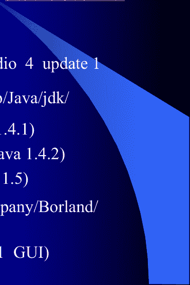

## 历史简短回顾

- BCPL语言导致了 B语言
- B语言导致了 C语言
- C语言演变出了 C++ 语言
- C++ 语言将让位于 Java 语言


## 语言的发展需要2个因素的驱动

- 适应正在变化的环境和需求
- 实现编程艺术的完善与提高


#### 1.1 Java 的由来

- Java 总是和 C++ 联系在一起
- C++ 则是从 C 语言派生而来的
- Java 语言继承了这两种语言的大部分特性


##### 1.1.1 现代编程语言的诞生：C语言

- 易用性与功能
- 安全性和效率性
- 稳定性和可扩展性

- FORTRAN、BASIC、汇编语言
  没有考虑结构化设计原则
- Pascal
  效率比较低，缺少几个必需的特性

#### 1.1.2 对 C++ 的需要

- C 使用结构化方法，不超过 25 000~100 000 行代码。
- 面向对象编程（object-oriented programming，OOP）新方法解决了结构化方法的极限。
- 面向对象的编程是通过使用继承性、封装性和多态性来帮助组织复杂程序的编程方法。
- 1979年，Bjarne Stroustrup 发明了 C++。
- 新语言称为“带类的C”。1983年，改名为 C++。
- C++ 在1997年11月被标准化（ANSI/ISO）。

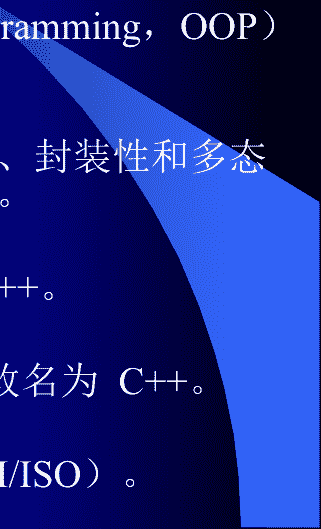

#### 1.1.3 Java 出现的时机已经到来

- 在20世纪80年代末和90年代初，使用面向对象编程的 C++ 语言占主导地位。
- 万维网（WWW）和 Internet 的发展促成编程的另一场革命。


#### 1.2 Java 的产生

- Java 是由 James Gosling 等于1991年在 Sun 公司设计出来的。
- 开始名叫“Oak”，于1995年更名为“Java”。
- 源于对独立于平台（体系结构中立）语言的需要。
- 嵌入微波炉、遥控器等各种家用电器设备的软件。
- C 和 C++ 以及其他语言只能对特定目标进行编译。
- 万维网需要可移植的程序。
- Java 的重心由电子消费品转移到 Internet 编程。
- Java 的大部分特性是从 C 和 C++ 中继承的。
- Java 受到 C++ 的影响，但它并不是 C++ 的增强版。
- Java 与 C++ 既不向上兼容，也不向下兼容。
- Java 对 C++ 面向对象范例进行的增强和完善。

#### 1.3 Java 对 Internet 为什么重要

##### 1.3.1 Java 小应用程序和应用程序

- Java applet 是在 Internet 中传输并由 Web 浏览器中运行的应用程序。
- Java applet 是一个智能的程序，能对用户的输入作出反应，并且能动态变化。
- Java applet 能像图像文件、声音文件和视频片段那样通过网络动态下载。

##### 1.3.2 安全性

- 病毒感染的危险。
- 恶意的程序。
- Java 在网络应用程序和你的计算机之间提供了一道防火墙（firewall）。
- 可以安全地下载 Java 小应用程序。

##### 1.3.3 可移植性

- 使连接到 Internet 上的各种各样的平台都能动态下载同一个程序。
- 能够生成可移植的执行代码。

#### 1.4 Java 的魔力：字节码

- Java 编译器的输出并不是可执行的代码，而是字节码（bytecode）
- Java 虚拟机（Java Virtual Machine，JVM）是一个字节码解释器
- JIT（Just In Time）是 Java 虚拟机的一部分，它根据需要、一部分一部分地将字节码实时编译为可执行代码。
- JIT 不能将整个 Java 程序一次性全部编译为可执行的代码。

#### 1.5 Java 常用语

- 简单（Simple）
- 安全（Secure）
- 可移植（Portable）
- 面向对象（Object-oriented）
- 健壮（Robust）
- 多线程（Multithreaded）
- 体系结构中立（Architecture-neutral）
- 解释执行（Interpreted）
- 高性能（High performance）
- 分布式（Distributed）
- 动态（Dynamic）

#### 1.6 继续革命

- Java 1： Java 1.0、 Java 1.1
- Java 2： Java 1.2、 Java 1.3、 Java 1.4、 Java 1.5、 Java 1.6

#### 2.1 面向对象编程

##### 2.1.1 两种范型

- 计算机程序由两类元素组成：代码和数据。

- 面向过程（process-oriented model）的程序都具有线性执行的特点。面向过程的模型可以看作是代码作用于数据。程序围绕“正在发生什么”编写。

- 面向对象（object-oriented programming）的编程围绕它的数据（即对象）和为这个数据严格定义的接口来组织程序。面向对象的程序实际上是用数据控制对代码的访问。程序则围绕“谁将被影响”编写。


## 2.1.2 抽象

- 面向对象编程的一个实质性的要素是抽象。
- 将汽车作为一个整体来加以利用。
- 使用层级分类是管理抽象的一个有效方法。
- 程序中的过程步骤可看成是在这些对象之间进行消息收集。

## 2.1.3 面向对象编程的3个原则

### （1）封装

- 封装（Encapsulation）是将代码及其处理的数据绑定在一起的一种编程机制。
- 把它想成一个黑匣子，它可以阻止在外部定义的代码随意访问内部代码和数据。
- 类（class）定义了将被一个对象集共享的结构和行为（数据和代码）。
- 类的代码和数据称为该类的成员（members）。
  - 类定义的数据称为成员变量（member variables）
  - 操作数据的代码称为成员方法（member methods）

### 封装（继续）

- 类的目的是封装复杂性，应有隐藏实现复杂性机制。
- 类中的每个方法或变量都可以被标记为私有（private）或公共（public）。

封装：可用来保护私有数据的公共方法

### （2）继承

- 继承（Inheritance）是一个对象获得另一个对象的属性的过程。
- 它支持了按层分类的概念。
- 使一个对象成为一个更具通用类的一个特定实例成为可能。
- 如果一个给定的类封装了一些属性，那么它的任何子类将具有同样的属性，而且还添加了子类自己特有的属性。

### （3）多态性

- 多态性（Polymorphism）是允许一个接口被多个同类动作使用的特性，具体使用哪个动作与应用场合有关。
- 多态性的概念经常被说成是“一个接口，多种方法”。
- 假设你有一个程序，需要3种不同类型的堆栈（整数、浮点数、字符）。
- 允许同一个接口被属于同一类的多个动作使用，这样就降低了程序的复杂性。

### （4）多态性、封装性与继承性相互作用

- 在由多态性、封装性和继承性共同组成的编程环境中可以写出比面向过程模型环境更健壮、扩展性更好的程序。
- 类层级结构是重用程序的基础
- 封装可以使你在不破坏依赖于类公共接口的代码基础上对程序进行升级迁移。
- 多态性则有助于你编写清楚、易懂、易读、易修改的程序。

## 2.2 第1个简单程序

```
/*
This is a simple Java program.
Call this file "Example.java".
*/
class Example {
// Your program begins with a call to main().
public static void main(String args[]) {
System.out.println("This is a simple Java program.");
}
}
```

This is a simple Java program.

### 2.2.1 键入程序

- 源程序文件名应该是 Example.java。
- 一个源程序文件被称为一个编译单元（compilation unit）。
- 它是一个包含一个或多个类定义的文本文件。
- Java编译器要求源程序文件使用 .java 文件扩展名。
- 类名必须与源程序的文件名相同，确保文件名的大小写字母与类名一样。

### 2.2.2 编译程序

- 编译：`C:\>javac Example.java`
- 编译器 javac 产生名为 `Example.class` 的文件，该文件包含程序的字节码。
- 运行必须使用 Java 解释器：
  `C:\>java Example`
- 输出如下内容：
  `This is a simple Java program.`
- 当 Java 源代码被编译后，每个单独的类都被放入自己的输出文件中，并以类的名字加“.class”扩展名为其文件名。

### 2.2.3 详细讨论第1个示例程序

- Java支持3种类型的注释
  - 多行注释：`/*    */`
  - 单行注释：`//`
  - 文档注释：`/**    */`
- 关键字 `class` 声明了一个新类，Example 是类名称，整个类定义（包括其所有成员）都将位于一对花括号（`{}`）之间。

### 例 P16

```
/*
This is a simple Java program.
Call this file "Example.java".
*/
class Example {
  // Your program begins with a call to main().
  public static void main(String args[]) {
    System.out.println("This is a simple Java program.");
  }
}
```

类方法，通过类名可直接调用，参数（引数）列表

程序入口，整个程序只能有一个 main()

所有的类都可用此方法

类System提供程序访问系统资源的方法。

System.in 代表键盘，System.out 代表监视器

## 2.3 第2个示例程序

- 变量是一个有名字的内存位置，能够被赋值。
- 该程序也说明了控制台输出的某些新特点。

### 例 P19

```
/*
Here is another short example.
Call this file "Example2.java".
*/
class Example2 {
    public static void main(String args[]) {
        int num; // this declares a variable called num
        num = 100; // this assigns num the value 100
        System.out.println("This is num. " + num);
        num = num * 2;
        System.out.print("The value of num * 2 is ");
        System.out.println(num);
    }
}
// 方法print（）和方法println（）能输出Java的任何内置类型的值。
```

This is num: 100

The value of num * 2 is 200

## 2.4 两个控制语句

### 2.4.1 if 控制语句

- if(condition) statement;

- 运算符 含义

- < 小于

- > 大于

- == 等于

### 例 P21

```
/*
  Demonstrate the if. Call this file "IfSample.java".
*/
class IfSample {
  public static void main(String args[]) {
    int x, y;
    x = 10;
    y = 20;
    if(x < y) System.out.println("x is less than y");
    x = x * 2;
    if(x == y) System.out.println("x now equal to y");
    x = x * 2;
    if(x > y) System.out.println("x now greater than y");
    // this won't display anything
    if(x == y) System.out.println("you won't see this");
  }
}


## 例 P22

```java
/*
Demonstrate the for loop.
Call this file "ForTest.java".
*/
class ForTest {
    public static void main(String args[]) {
        int x;
        for(x = 0; x < 10; x = x + 1) // for(x = 0; x < 10; x++)
            System.out.println("This is x: " + x);
    }
}
```

## 2.5 使用程序块

- 可以将 2 个或 2 个以上的语句组成一组，这样的一组语句称为程序块（Codeblocks）。
- 程序块是通过将所属语句放在花括号中来实现。
- 它就成为一个逻辑单元，可以作为一个单独的语句来使用。

## 例 P24

```java
/*
Demonstrate a block of code.
Call this file "BlockTest.java"
*/
class BlockTest {
    public static void main(String args[]) {
        int x, y;
        y = 20;
        // the target of this loop is a block
        for(x = 0; x < 10; x++) {
            System.out.println("This is x: " + x);
            System.out.println("This is y: " + y);
            y = y - 2;
        }
    }
}


```

Ans:

This is X: 0
This is Y: 20
This is X: 1
This is Y: 18
This is X: 2
This is Y: 16
This is X: 3
This is Y: 14
This is X: 4
This is Y: 12
This is X: 5
This is Y: 10
This is X: 6
This is Y: 8
This is X: 7
This is Y: 6
This is X: 8
This is Y: 4
This is X: 9
This is Y: 2
## 2.6 基本词汇

### 2.6.1 空白分隔符（whitespace）

空白分隔符可以是空格，Tab 跳格键或是换行符。

### 2.6.2 标识符（identifiers）

标识符是赋给类、方法或是变量的名字。
一个标识符可以是大写和小写字母、数字、下划线、美元符号的任意顺序组合，但不能以一个数字开始。

## 基本词汇（续）

### 2.6.3 常量（literal）

100 98.6 'X' "This is a test"

### 2.6.4 注释（comments）

单行注释、多行注释、文档注释。

### 2.6.5 分隔符（separators）

| 分隔符 | 名称 | 用途 |
| :--- | :--- | :--- |
| () | 圆括号 | 在定义和调用方法时用来容纳参数表。在控制语句或强制类型转换组成的表达式中用来表示执行或计算的优先权。 |
| {} | 花括号、大括号 | 用来包括自动初始化的数组的值。也用来定义程序块、类、方法以及局部范围。 |
| [] | 方括号、中括号 | 用来声明数组的类型，也用来表示撤消对数组值的引用。 |
| ; | 分号 | 用来终止一个语句。 |
| ， | 逗号 | 在变量声明中，用于分隔变量表中的各个变量。在 for 控制语句中，用来将圆括号内的语句连接起来。 |
| . | 句号（点） | 用来将软件包的名字与它的子包或类分隔。也用来将引用变量与变量或方法分隔。 |

## 基本词汇（续）

## 2.6.6 Java 关键字：48 个保留关键字

abstract const finally int public this boolean continue float interface return throw break default for long short throws byte do goto native static transient Case double if new strictfp try Catch else implements package super void char extends import private switch volatile Class final instanceof protected synchronized while

Java 还有以下保留字：true，false，null。

## 2.6.7 Java 类库

作为一个整体，Java 是 Java 语言本身和它的标准类的组合体。

类库包含许多内置的方法，用以提供对诸如输入/输出（I/O）、字符串处理、网络、图形的支持。标准的类还提供对窗口输出的支持。

## 3.1 Java 语言是强类型语言

- Java 语言强类型语言。
- Java 的安全和健壮性部分来自于强类型语言。
- 每个变量有类型，每个表达式有类型，而且每种类型是严格定义的。
- 所有的数值传递，不管是直接的还是通过方法调用经由参数传过去的都要先进行类型相容性的检查。
- Java 编译器对所有的表达式和参数都要进行类型相容性的检查以保证类型是兼容的。
- 任何类型的不匹配都是错误的，在编译器完成编译以前，错误必须被改正。

## 3.3 整数类型

- Java 定义了 4 个整数类型：byte, short, int, long。
- Java 不支持无符号的整数。

| 类型 | 位数 | 范围 |
| :--- | :--- | :--- |
| 长整型 | 64 | -9,223,372,036,854,775,808 ~ 9,223,372,036,854,775,807 |
| 整型 | 32 | -2,147,483,648 ~ 2,147,483,647 |
| 短整型 | 16 | -32,768 ~ 32,767 |
| 字节型 | 8 | -128 ~ 127 |

## 3.3.1 字节型（byte）

- 有符号的 8 位类型。
- 数的范围是 -128～127。
- 从网络或文件处理数据流的时候，字节类型的变量特别有用。
- 处理未加工的二进制的数据时，它们也是有用的。
- 例如：byte b, c;

## 3.3.2 短整型（short）

- 有符号的 16 位类型。
- 数的范围是 -32,768 ~ 32,767。
- 可能是 Java 中使用得最少的类型。
- 例如：
  ```java
  short s;
  short t;
  ```

## 3.3.3 整型（int）

- 最常用的整数类型是 int。它是有符号的 32 位类型。
- 数的范围是 -2,147,483,648～2,147,483,647。
- 包含 byte，short，int 及字面量数字，有进行计算以前，所有表达式的类型被提升到 int。
- 整型是最通用并且有效的类型。

## 3.3.4 长整型（long）

- 有符号的 64 位类型
- 数的范围是 -9,223,372,036,854,775,808 ~ 9,223,372,036,854,775,807
- 对于那些整型不足以保存所要求的数值时是有用的。

## 例 P30

```java
// Compute distance light travels using long variables.
class Light {
    public static void main(String args[]) {
        int lightspeed;
        long days;
        long seconds;
        long distance;
        // approximate speed of light in miles per second
        lightspeed = 186000;
        days = 1000; // specify number of days here
        seconds = days * 24 * 60 * 60; // convert to seconds
        distance = lightspeed * seconds; // compute distance
        System.out.print("\n " + days);
        System.out.print(" days light will travel about ");
        System.out.println(distance + " miles.");
    }
}

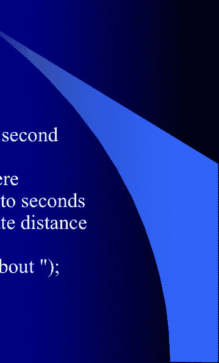


```
## Ans:

In 1000 days light will travel about 16070400000000 miles.
## 3.4.1 单精度浮点型（float）

- 占用32位存储空间的单精度（single-precision）值。
- 比双精度更快且只占用双精度一半的空间。
- 当值很大或很小时，它将变得不精确。
- 例子：

```java
float hightemp, lowtemp;

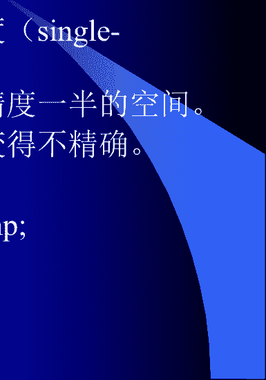

```
## 3.4.2 双精度浮点型（double）

- 占用64位的存储空间。
- 数学函数，如 `sin()`、`cos()` 和 `sqrt()` 均返回双精度的值。
- 当你需要保持多次反复迭代的计算的精确性，或在操作值很大的数字时，双精度型是最好的选择。

### 例 P32

```java
// Compute the area of a circle.
class Area {
    public static void main(String args[]) {
        double pi, r, a;
        r = 10.8; // radius of circle
        pi = 3.1416; // pi, approximately
        a = pi * r * r; // compute area
        System.out.println("Area of circle is " + a);
    }
}


```

## 3.5 字符

- Java 使用 Unicode 码代表字符。
- Java 中的 `char` 类型是16位，其范围是0～65,535，没有负数的 `char`。
- 有关 Unicode 码的更多信息可在网址 http://www.unicode.org 上找到。
### 例 P32

```java
// Demonstrate char data type.
class CharDemo {
    public static void main(String args[]) {
        char ch1, ch2;
        ch1 = 88; // code for X
        ch2 = 'Y';
        System.out.print("ch1 and ch2: ");
        System.out.println(ch1 + " " + ch2);
    }
}


```
### Ans:

ch1 and ch2: X Y

### 例 P33

```java
// char variables behave like integers.
class CharDemo2 {
    public static void main(String args[]) {
        char ch1;
        ch1 = 'X';
        System.out.println("ch1 contains " + ch1);
        ch1++; // increment ch1, 像整数一样进行运算操作
        System.out.println("ch1 is now " + ch1);
    }
}


```

### Ans:

ch1 contains X

ch1 is now Y
## 3.6 布尔型

- 表示逻辑值的简单类型。
- 值只能是真或假。
- 当用方法 `println()` 输出布尔的值时，显示的是“true”或“false”。
- 布尔变量的值本身就足以用来控制 `if` 语句。
- 关系运算符（例如 `<`）的结果是布尔值。

### 例 P33

```java
// Demonstrate boolean values.
class BoolTest {
    public static void main(String args[]) {
        boolean b;
        b = false;
        System.out.println("b is " + b);
        b = true;
        System.out.println("b is " + b);
        // a boolean value can control the if statement
        if(b) System.out.println("This is executed.");
        b = false;
        if(b) System.out.println("This is not executed.");
        // outcome of a relational operator is a boolean value
        System.out.println("10 > 9 is " + (10 > 9));
    }
}

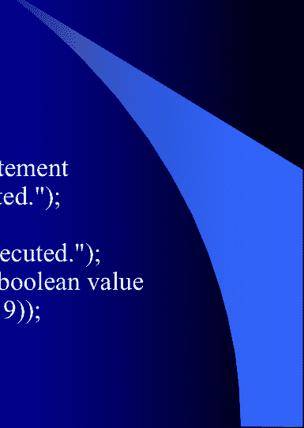

```
## 3.7 进一步研究字面量

### 3.7.1 整数字面量

- 任何一个数字的值就是一个整数字面量。
- 十进制（decimal，基数是10）。
- 八进制（octal，基数是8）：
  - 前导为 0
- 十六进制（hexadecimal，基数是16）：
  - 前导为 `0x` 或 `0X`
- Long 字面量：后面加 `l` 或 `L`。

### 3.7.3 布尔型字面量

- 布尔型字面量仅仅有2个逻辑值，真或假。
- Java 中，真字面量的值不等于 1，假字面量的值也不等于 0。

### 3.7.4 字符字面量

- 可见的 ASCII 字符都能直接被包括在单引号之内，例如 `'a'`、`'z'` 和 `'@'`。
- 八进制记法，使用反斜线加3个阿拉伯数字。例如，`'\141'` 是字母 `'a'`。
- 十六进制记法，使用反斜线和 u（`\u`）加4个十六进制阿拉伯数字。例如，`'\u0061'` 因为高位字节是零，代表 ISO-Latin-1 字符集中的 `'a'`。

### 3.7.5 字符串字面量

- 字符串字面量将一系列字符用双引号括起来。
- 为字符串定义的字符转义序列和八进制/十六进制记法在字符串内的工作方式一样。
- 例如：
  - `"Hello World"`
  - `"two\nlines"`
  - `"\"This is in quotes\""`

## 3.8 变量

- 变量是 Java 程序的一个基本存储单元。
- 变量由一个标识符、类型及一个可选初始值的组合定义。
- 所有的变量都有一个作用域，定义变量的可见性和生存期。

### 3.8.1 声明一个变量

- 所有的变量必须先声明再使用。
- 基本的变量声明方法如下：

  `type identifier [ = value][, identifier [= value] ...] ;`

- 变量声明的例子：

  ```java
  int a, b, c; // declares three ints, a, b, and c.
  int d = 3, e, f = 5; // declares three more ints, initializing
  // d and f.
  byte z = 22; // initializes z.
  double pi = 3.14159; // declares an approximation of pi.
  char x = 'x'; // the variable x has the value 'x'.
  ```

- Java 允许任何合法的标识符具有任何它们声明的类型。

### 3.8.2 动态初始化

- 允许在变量声明时使用任何有效的表达式来动态地初始化变量。
- 例如：例 P37

```java
// Demonstrate dynamic initialization.
class DynInit {
    public static void main(String args[]) {
        double a = 3.0, b = 4.0;
        // c is dynamically initialized
        double c = Math.sqrt(a * a + b * b);
        System.out.println("Hypotenuse is " + c);
    }
}
```


## 3.8.3 变量的作用域和生存期

- Java 允许变量在任何程序块内被声明。
- 一个程序块定义了一个作用域（scope）。
- 一个作用域决定了哪些对象对程序的其他部分是可见的，它也决定了这些对象的生存期。
- 在一个作用域中定义的变量对于该作用域外的程序是不可见（即访问）的。
- 作用域规则为封装提供了基础。
- 作用域可以进行嵌套。外面的作用域包含内部的作用域。内部作用域定义的对象对于外部是不可见的。

### 例 P38

```java
// Demonstrate block scope.
class Scope {
    public static void main(String args[]) {
        int x;                 // known to all code within main
        x = 10;
        if(x == 10) {          // start new scope
            int y = 20;        // known only to this block
            // x and y both known here.
            System.out.println("x and y: " + x + " " + y);
            x = y * 2;
        }
        // y = 100;             // Error! y not known here
        // x is still known here.
        System.out.println("x is " + x);
    }
}


```
- 变量可以在程序块内的任何地方被声明，但是只有在它们被声明以后才是合法有效的。
- 例如：

```java
// This fragment is wrong!
count = 100; // oops! cannot use count before it is declared!
int count;
```

- 变量在其作用域内被创建，离开其作用域时被撤消。
- 在一个方法内定义的变量在几次调用该方法之间将不再保存它们的值。
- 在块内定义的变量在离开该块时也将丢弃它的值。
- 一个声明定义包括一个初始化，那么每次进入声明它的程序块时，该变量都要被重新初始化。

### 例 P39

```java
// Demonstrate lifetime of a variable.
class LifeTime {
  public static void main(String args[]) {
    int x;
    for(x = 0; x < 3; x++) {
      int y = -1;    // y is initialized each time block is entered
      System.out.println("y is: " + y); // this always prints -1
      y = 100;
      System.out.println("y is now: " + y);
    }
  }
}
```

### Ans

```text
y is: -1
y is now: 100
y is: -1
y is now: 100
y is: -1
y is now: 100
```

- 尽管程序块能被嵌套，你不能将内部作用域声明的变量与其外部作用域声明的变量重名。
- Java不同于 C 和 C++。
- 例子：P39

```java
// This program will not compile
class ScopeErr {
    public static void main(String args[]) {
        int bar = 1;
        { // creates a new scope
            int bar = 2; // Compile-time error – bar already defined!
        }
    }
}


```
## 3.9 类型转换与强制类型转换

- 编程时把一种类型的值赋给另外类型的一个变量是相当常见的。
- 如果这2种类型是兼容的，那么Java将自动地进行转换。例如，`int` ➔ `long`。
- 使用强制类型转换，能完成两个不兼容的类型之间的显式变换。

## 3.9.1 Java的自动转换

- 下列2个条件都能满足，将执行自动类型转换（automatic type conversion）：
  - 这2种类型是兼容的。例如 integer 和 floating-point 彼此兼容
  - 目的类型数的范围比来源类型的大。例如 int 型比 byte 型的范围大
- 数字类型（包括整数和浮点）都是彼此兼容。
- 数字类型和字符类型或布尔类型是不兼容的
- 字符类型和布尔类型是不兼容的。
## 3.9.2 不兼容类型的强制转换

- 强制类型转换是一种显式的类型变换。
- 强制类型转换通用格式如下：

```java
(target-type)value // target-type 指定了转换成类型。
```

- 如果整数的值超出了 byte 型的取值范围，它的值将会因为对 byte 型值域取模而减少。例如：

```java
int a;
byte b;
b = (byte) a;
```

- 把浮点值赋给整数类型时发生了截断，浮点值的小数部分会被舍去。
- 如果浮点值太大而不能适合目标整数类型，那么它的值将会因为对目标类型值域取模而减少。

### 例 P41

```java
// Demonstrate casts.
class Conversion {
    public static void main(String args[]) {
        byte b;
        int i = 257;
        double d = 323.142;
        System.out.println("\nConversion of int to byte.");
        b = (byte) i;   // 257 -> byte , 257 mod 256 = 1
        System.out.println("i and b " + i + " " + b);
        System.out.println("\nConversion of double to int.");
        i = (int) d;    // 323.142 -> 323
        System.out.println("d and i " + d + " " + i);
        System.out.println("\nConversion of double to byte.");
        b = (byte) d;   // 323.142 -> 323 mod 256 -> 67
        System.out.println("d and b " + d + " " + b);
    }
}
```

### Ans

```text
Conversion of int to byte.
i and b 257 1
Conversion of double to int.
d and i 323.142 323
Conversion of double to byte.
d and b 323.142 67
```

## 3.10 表达式中类型的自动提升

- 对中间值的精确要求有时超过任何一个操作数的范围。例如：

```java
byte a = 40;
byte b = 50;
byte c = 100;
int d = a * b / c;  // 自动提升byte型或short型操作数到int型。
```

- 自动类型提升有好处，也会引起编译错误。例如：

```java
byte b = 50;  // 表达式求值时自动提升为int
b = b * 2;    // Error! Cannot assign an int to a byte!
```

- 使用一个显式的强制类型转换，

```java
byte b = 50;
b = (byte)(b * 2);
```


## 3.10.1 类型提升的约定

- byte 型和 short 型提升到 int 型。
- 如果一个操作数是 long 型，整个表达式将被提升到 long 型。
- 如果一个操作数是 float 型，整个表达式将被提升到 float 型。
- 如果有一个操作数是 double 型，计算结果就是 double 型。

### 例 P42

```java
class Promote {
    public static void main(String args[]) {
        byte b = 42;
        char c = 'a';
        short s = 1024;
        int i = 50000;
        float f = 5.67f;
        double d = .1234;
        double result = (f * b) + (i / c) - (d * s);
        // b -> float : float,  c -> int : int,  s -> double : double
        // float + int - double  → double
        System.out.println((f * b) + " + " + (i / c) + " - " + (d * s));
        System.out.println("result = " + result);
    }
}
```

## 3.11 数组

- 数组（array）是相同类型变量的集合。
- 可以使用共同的名字引用它。
- 数组可被定义为任何类型。
- 可以是一维或多维。
- 数组是通过下标来访问它。

### 3.11.1 一维数组

- 一维数组实质上是相同类型变量列表。
- 一维数组的声明格式是：

```java
type var-name[ ];
int month_days[ ];
```

- 用运算符 `new` 分配地址并把它赋给数组的形式如下：

```java
var-name = new type[size];
month_days = new int[12];
```

- 你可以在方括号内指定它的下标来访问数组中特定的元素。所有的数组下标从零开始

```java
month_days[1] = 28; // 值28赋给数组的第2元素
```

### 例 P44 定义的数组存储了每月的天数

```java
// Demonstrate a one-dimensional array.
class Array {
  public static void main(String args[]) {
    int month_days[];
    month_days = new int[12];
    month_days[0] = 31;
    month_days[1] = 28;
    month_days[2] = 31;
    month_days[3] = 30;
    month_days[4] = 31;
    month_days[5] = 30;
    month_days[6] = 31;
    month_days[7] = 31;
    month_days[8] = 30;
    month_days[9] = 31;
    month_days[10] = 30;
    month_days[11] = 31;
    System.out.println("April has " + month_days[3] + " days.");
  }
}


```

Ans:

April has 30 days.
### 例 P44

```java
// An improved version of the previous program.
class AutoArray {
    public static void main(String args[]) {
        int month_days[] = { 31, 28, 31, 30, 31, 30, 31, 31, 30, 31, 30,
            31 };
        System.out.println("April has " + month_days[3] + " days.");
    }
}
```

Ans: 同上题

April has 30 days.

### Java 严格地检查数组越界

例 P45 运用一维数组来计算一组数字的平均数

```java
class Average {
    public static void main(String args[]) {
        double nums[] = {10.1, 11.2, 12.3, 13.4, 14.5};
        double result = 0;
        int i;
        for(i=0; i<5; i++)
            result = result + nums[i];
        System.out.println("Average is " + result / 5);
    }
}
```

Ans:

Average is 12.3

### 3.11.2 多维数组

- 在Java中，多维数组实际上是数组的数组。
- 下面语句定义了一个名为 twoD 的二维数组变量。

```java
int twoD[][] = new int[4][5];

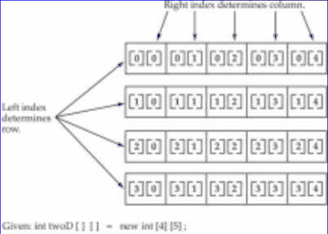

```

- 该语句分配了一个4行5列的数组并把它分配给数组 twoD。
- 二维数组（4行5列）的概念性表示
例 P46上 从左到右，从上到下为数组的每个元素赋值，显示数组的值

```java
// Demonstrate a two-dimensional array.
class TwoDArray {
    public static void main(String args[]) {
        int twoD[][] = new int[4][5];
        int i, j, k = 0;
        for(i=0; i<4; i++)
            for(j=0; j<5; j++) {
                twoD[i][j] = k;
                k++;
            }
        for(i=0; i<4; i++) {
            for(j=0; j<5; j++)
                System.out.print(twoD[i][j] + " ");
            System.out.println();
        }
    }
}
```

Ans:

0 1 2 3 4
5 6 7 8 9
10 11 12 13 14
15 16 17 18 19

- 当你给多维数组分配内存时，你只需指定第一个（最左边）维数的内存即可。
- 你可以单独地给余下的维数分配内存。
- 例如

```java
int twoD[][] = new int[4][];
twoD[0] = new int[5];
twoD[1] = new int[5];
twoD[2] = new int[5];
twoD[3] = new int[5];


```

- 程序定义了一个二维数组，它的第二维的大小可以是不相等的。
例 P46下 三维数组第二维的大小是不相等

```java
// Manually allocate differing size second dimensions.
class TwoDAgain {
  public static void main(String args[]) {
    int twoD[][] = new int[4][];
    twoD[0] = new int[1];
    twoD[1] = new int[2];
    twoD[2] = new int[3];
    twoD[3] = new int[4];
    int i, j, k = 0;
    for(i=0; i<4; i++)
      for(j=0; j<i+1; j++) {
        twoD[i][j] = k;
        k++;
      }
    for(i=0; i<4; i++) {
      for(j=0; j<i+1; j++)
        System.out.print(twoD[i][j] + " ");
      System.out.println();
    }
  }
}
```


## Ans:

0
1 2
3 4 5
6 7 8 9

- 不规则多维数组在某些情况下使用效率较高。
- 稀疏矩阵。

## 例 P47 初始化多维数组

```java
// Initialize a two-dimensional array.
class Matrix {
    public static void main(String args[]) {
        double m[][] = {
            { 0*0, 1*0, 2*0, 3*0 },
            { 0*1, 1*1, 2*1, 3*1 },
            { 0*2, 1*2, 2*2, 3*2 },
            { 0*3, 1*3, 2*3, 3*3 }
        };
        int i, j;
        for(i=0; i<4; i++) {
            for(j=0; j<4; j++)
                System.out.print(m[i][j] + " ");
            System.out.println();
        }
    }
}


```

Ans:

| 0.0 | 0.0 | 0.0 | 0.0 |
|---|---|---|---|
| 0.0 | 1.0 | 2.0 | 3.0 |
| 0.0 | 2.0 | 4.0 | 6.0 |
| 0.0 | 3.0 | 6.0 | 9.0 |
## Ans:

| 0 | 0 | 0 | 0 | 0 |
|---|---|---|---|---|
| 0 | 0 | 0 | 0 | 0 |
| 0 | 0 | 0 | 0 | 0 |
| 0 | 0 | 0 | 0 | 0 |
| 0 | 0 | 0 | 0 | 0 |
| 0 | 1 | 2 | 3 | 4 |
| 0 | 2 | 4 | 6 | 8 |
| 0 | 3 | 6 | 9 | 12 |
| 0 | 0 | 0 | 0 | 0 |
| 0 | 2 | 4 | 6 | 8 |
| 0 | 4 | 8 | 12 | 16 |
| 0 | 6 | 12 | 18 | 24 |

# 3.11.3 另一种数组声明语法

- 声明数组还有第二种格式：
  ```java
  type[] var-name;
  ```
- 下面的两个定义是等价的：
  ```java
  int a1[] = new int[3];
  int[] a2 = new int[3];
  ```
- 下面的两个定义也是等价的：
  ```java
  char twood1[][] = new char[3][4];
  char[][] twood2 = new char[3][4];


  ```
- 包含这种数组声明格式主要是为了方便。

# 第一部分 Java语言

## 第04章 运算符
- Java有4大类运算符：算术运算、位运算、关系运算和逻辑运算。
- Java 的绝大多数运算符和 C/C++ 中的用法一样。

## 4.1.1 基本算术运算符

```java
// Demonstrate the basic arithmetic operators.
class BasicMath {
    public static void main(String args[]) {
        // arithmetic using integers
        System.out.println("Integer Arithmetic");
        int a = 1 + 1;
        int b = a * 3;
        int c = b / 4;
        int d = c - a;
        int e = -d;
        System.out.println("a = " + a);
        System.out.println("b = " + b);
        System.out.println("c = " + c);
        System.out.println("d = " + d);
        System.out.println("e = " + e);
    }
}


```
```java
// arithmetic using doubles
System.out.println("\nFloating Point Arithmetic");
double da = 1 + 1;
double db = da * 3;
double dc = db / 4;
double dd = dc - a;
double de = -dd;
System.out.println("da = " + da);
System.out.println("db = " + db);
System.out.println("dc = " + dc);
System.out.println("dd = " + dd);
System.out.println("de = " + de);
}
}
```

## Ans:

### Integer Arithmetic

a = 2
b = 6
c = 1
d = -1
e = 1

### Floating Point Arithmetic

da = 2.0
db = 6.0
dc = 1.5
dd = -0.5
de = 0.5

## 4.1.2 模运算符

- 模运算符%，其运算结果是整数除法的余数。它能像整数类型一样被用于浮点类型（C/C++中模运算符%仅仅能用于整数类型）。

例 P52

```java
// Demonstrate the % operator.
class Modulus {
    public static void main(String args[]) {
        int x = 42;
        double y = 42.25;
        System.out.println("x mod 10 = " + x % 10);
        System.out.println("y mod 10 = " + y % 10);
    }
}
```

## Ans:

x mod 10 = 2
y mod 10 = 2.25

## 4.1.3 算术赋值运算符

- 算术赋值运算的语句格式：
  ```java
  var = var op expression; // a = a + 4;
  ```
  可以被重写为：算术赋值运算
  ```java
  var op = expression; // a += 4;
  ```
- 它们比准的等式要紧凑。
- 它们有助于提高 Java 的运行效率。

## 例 P53

```java
// Demonstrate several assignment operators.
class OpEquals {
  public static void main(String args[]) {
    int a = 1;
    int b = 2;
    int c = 3;
    a += 5;
    b *= 4;
    c += a * b;   // c = c + a*b = 3 + 6*8 = 51
    c %= 6;
    System.out.println("a = " + a);
    System.out.println("b = " + b);
    System.out.println("c = " + c);
  }
}


```

Ans:

- a = 6
- b = 8
- c = 3
## 例 P55

```java
// Demonstrate ++.
class IncDec {
    public static void main(String args[]) {
        int a = 1;
        int b = 2;
        int c;
        int d;
        c = ++b;
        d = a++;
        c++;
        System.out.println("a = " + a);
        System.out.println("b = " + b);
        System.out.println("c = " + c);
        System.out.println("d = " + d);
    }
}


```
## 4.2 位运算符

- 位运算（bitwise operators）直接对整数类型的位进行操作。
- 这些整数类型包括 long，int，short，char，and byte。
- Java 所有的整数类型以二进制数字位的变化及其宽度来表示。
- Java 使用2的补码（two's complement）编码来表示负数。
- 42 是 \(2^1+2^3+2^5\) 的和，即 \(2+8+32 \rightarrow 00101010\)。
- -42 对 00101010原码 取反得到 11010101反码，然后再加1，得到11010110补码。

## 4.2.1 位逻辑运算符

- 位逻辑运算符: AND、OR、XOR、NOT。
- 分别用“&”、“|”、“^”、“~”表示。
- 位逻辑运算符的结果

| A | B | A\|B | A&B | A^B | ~A |
|---|---|---|---|---|---|
| 0 | 0 | 0 | 0 | 0 | 1 |
| 1 | 0 | 1 | 0 | 1 | 0 |
| 0 | 1 | 1 | 0 | 1 | 1 |
| 1 | 1 | 1 | 1 | 0 | 0 |

### 按位非（NOT）： “~”

- 对其运算数的每一位取反。
- 数字42二进制代码为：00101010
- 按位非运算成为：11010101

### 按位与（AND）：“&”

- 如果两个运算数都是 1，则结果为 1。
- 其他情况下，结果均为零。
- 例子：

```
00101010  42
& 00001111  15
-----------
00001010  10
```

### 按位或（OR）：“|”

- 任何一个运算数为1，则结果为1。
- 例子：
```
00101010  42
| 00001111  15
-----------
00101111  47
```

### 按位异或（XOR）："^"

- 只有在两个比较的位不同时其结果是 1。
- 否则，结果是零。
- 第二个运算数有数字 0 的位，第一个运算数对应位的数字不变。
- 例子：
```
00101010  42
^ 00001111  15
--------
00100101  37
```

### 位逻辑运算符的应用：例 P58

```java
// Demonstrate the bitwise logical operators.
class BitLogic {
  public static void main(String args[]) {
    String binary[] = {
      "0000", "0001", "0010", "0011", "0100", "0101", "0110", "0111",
      "1000", "1001", "1010", "1011", "1100", "1101", "1110", "1111"
    };
    int a = 3;    // 0 + 2 + 1 or 0011 in binary
    int b = 6;    // 4 + 2 + 0 or 0110 in binary
    int c = a | b;  int d = a & b;  int e = a ^ b;  int f = (~a & b) | (a & ~b);
    int g = ~a & 0x0f;
    System.out.println(" a = " + binary[a]);
    System.out.println(" b = " + binary[b]);
    System.out.println(" a|b = " + binary[c]);
    System.out.println(" a&b = " + binary[d]);
    System.out.println(" a^b = " + binary[e]);
    System.out.println("~a&b|a&~b = " + binary[f]);
    System.out.println(" ~a = " + binary[g]);
  }
}
```

Ans:

a = 0011
b = 0110
a|b = 0111
a&b = 0010
a^b = 0101
~a&b|a&~b = 0101
~a = 1100

## 4.2.2 左移运算符

- 左移运算符 `<<` 使指定值的所有位都左移规定的次数。
- 通用格式：`value << num`
- 每左移一个位，高阶位都被移出（并且丢弃），并用 `0` 填充右边。
- 对 `byte` 和 `short` 类型的值进行移位运算时，你必须小心。将自动把这些类型扩展为 `int` 型。为了得到正确的结果，你就要舍弃得到结果的高位。这样做的最简单办法是将结果转换为 `byte` 型。

### 例 P59上

### 将结果转换为byte型

```java
// Left shifting a byte value.
class ByteShift {
  public static void main(String args[]) {
    byte a = 64, b;
    int i;   // << 2
    i = a << 2;   // 64=0100 0000->1 0000 0000
    b = (byte) (a << 2);
    System.out.println("Original value of a: " + a);
    System.out.println("i and b: " + i + " " + b);
  }
}
```

Ans:

Original value of a: 64
i and b: 256  0

例 P59下 将1移进高阶位（31或63位），该值变为负值

```java
// Left shifting as a quick way to multiply by 2.
class MultByTwo {
    public static void main(String args[]) {
        int i;
        int num = 0xFFFFFFFE;
        for(i=0; i<4; i++) {
            num = num << 1;
            System.out.println(num);
        }
    }
}
```

Ans:

536870908
1073741816
2147483632
-32

## 4.2.3 右移运算符

- 右移运算符>>使指定值的所有位都右移规定的次数。
- 通用格式如下所示： value >> num
- 例：int a = 32;
  a = a >> 2; // a now contains 8
- 例：int a = 35;
  a = a >> 2; // a still contains 8
  二进制表示该过程
  00100011 35
  >> 2
  00001000 8
- 负数右移：符号位扩展（保留符号位）
- 例：-8 >> 1 是-4
  11111000 -8
  >> 1
  11111100 -4

### 例 P61上

### 不希望在右移时保留符号

- 右移后的值与 `0x0f` 进行按位与运算，这样可以舍弃任何的符号位扩展
- 得到的值可以作为定义数组的下标，从而得到对应数组元素代表的十六进制字符。

```java
// Masking sign extension.
class HexByte {
  static public void main(String args[]) {
    char hex[] = {
      '0', '1', '2', '3', '4', '5', '6', '7',
      '8', '9', 'a', 'b', 'c', 'd', 'e', 'f'
    };
    byte b = (byte) 0xf1;
    System.out.println("b = 0x" + hex[(b >> 4) & 0x0f] + hex[b & 0x0f]);
  }
}
```


## 4.2.4 无符号右移

- 不希望进行符号位扩展（保留符号位）。
- 无符号移动：移位后总是在高位（最左边）补0。
- 例：
  ```c
  int a = -1;
  a = a >>> 24;  // a = 255
  ```

下面用二进制形式进一步说明该操作：

11111111 11111111 11111111 11111111    int型 (-1)₂
>>> 24    无符号右移24位
00000000 00000000 00000000 11111111    int型 (255)₂

## 例 P61下 无符号右移运算符>>对byte型值处理

```java
// Unsigned shifting a byte value.
class ByteUShift {
    static public void main(String args[]) {
        char hex[] = {
            '0','1','2','3','4','5','6','7','8','9','a','b','c','d','e','f'
        };
        byte b = (byte) 0xff;
        byte c = (byte) (b >> 4);
        byte d = (byte) (b >>> 4);
        byte e = (byte) ((b & 0xff) >> 4);
        System.out.println(" b = 0x"
            + hex[(b >> 4) & 0x0f] + hex[b & 0x0f]);
        System.out.println(" b >> 4 = 0x"
            + hex[(c >> 4) & 0x0f] + hex[c & 0x0f]);
        System.out.println(" b >>> 4 = 0x" // b int型，已有符号扩展位。
            + hex[(d >> 4) & 0x0f] + hex[d & 0x0f]);
        System.out.println("( b & 0xff) >> 4 = 0x"
            + hex[(e >> 4) & 0x0f] + hex[e & 0x0f]);
    }
}

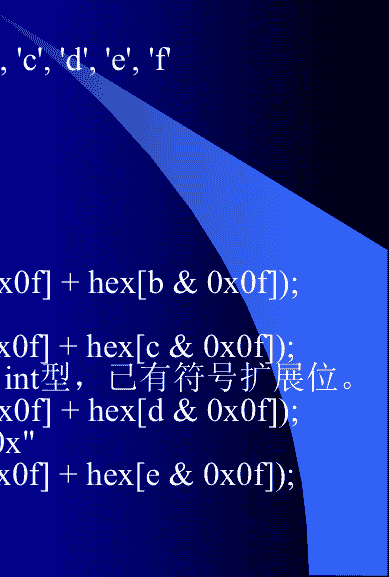

```
Ans:

B = 0xf1
b >> 4 = 0xff
b >>> 4 = 0xff
(b & 0xff) >> 4 = 0x0f

## 4.2.5 位运算符赋值

- 下两语句都是将变量 a 右移 4 位后赋给 a：
  ```
  a = a >> 4;
  a >>= 4;
  ```
- 下两语句都是将表达式 a OR b 运算后的结果赋给 a：
  ```
  a = a | b;
  a |= b;
  ```

## 例 P62

```java
class OpBitEquals {
    public static void main(String args[]) {
        int a = 1;
        int b = 2;
        int c = 3;
        a |= 4;
        b >>= 1;
        c <<= 1;
        a ^= c;
        System.out.println("a = " + a);
        System.out.println("b = " + b);
        System.out.println("c = " + c);
    }
}
```

Ans:

a = 3
b = 1
c = 6

## 4.3 关系运算符

### 关系运算符及其意义

+   == 等于
+   != 不等于
+   > 大于
+   < 小于
+   >= 大于等于
+   <= 小于等于

### 关系运算符（续）

- 关系运算符决定值和值之间的关系。例如决定相等不相等以及排列次序。
- 关系运算符产生的结果是布尔值。
- 整数，浮点数，字符，以及布尔型都可用 “==” 来比较是否相等，用 “!=” 来测试是否不等。
- 整数、浮点数和字符运算数可以用来比较哪个大哪个小。
- c 的赋值是有效的：
  ```
  int a = 4;
  int b = 1;
  boolean c = a < b;  // c = false


  ```

## 4.4 布尔逻辑运算符

- 布尔逻辑运算符及其意义
  - `&` 逻辑与
  - `|` 逻辑或
  - `^` 异或
  - `||` 短路或
  - `&&` 短路与
  - `!` 逻辑反
  - `&=` 逻辑与赋值（赋值的简写形式）
  - `|=` 逻辑或赋值（赋值的简写形式）
  - `^=` 异或赋值（赋值的简写形式）
  - `==` 相等
  - `!=` 不相等
  - `?:` 三元运算符（IF-THEN-ELSE）
### 布尔逻辑运算符（续）

- 布尔逻辑运算符的运算数只能是布尔型，而且结果也是布尔类型。
- 布尔逻辑运算符的运算

| A | B | A\|B | A&B | A^B | !A |
|---|---|---|---|---|---|
| False | False | False | False | False | True |
| True | False | True | False | True | False |
| False | True | True | False | True | True |
| True | True | True | True | False | False |
### 例 P65

```java
// Demonstrate the boolean logical operators.
class BoolLogic {
public static void main(String args[]) {
boolean a = true;
boolean b = false;
boolean c = a | b;
boolean d = a & b;
boolean e = a ^ b;
boolean f = (!a & b) | (a & !b);
boolean g = !a;
System.out.println(" a = " + a);
System.out.println(" b = " + b);
System.out.println(" a|b = " + c);
System.out.println(" a&b = " + d);
System.out.println(" a^b = " + e);
System.out.println("!a&b|a&!b = " + f);
System.out.println(" !a = " + g);
}
}
```

Ans:

a = true
b = false
a|b = true
a&b = false
a^b = true
a&b|a&!b = true
!a = false

## 4.4.1 短路（short-circuit）逻辑运算符

- 在逻辑 OR 的运算中，如果第一个运算数 A 为真，则不管第二个运算数 B 是真是假，其运算结果为真。
- 在逻辑 AND 的运算中，如果第一个运算数 A 为假，则不管第二个运算数是真是假，其运算结果为假。
- 防止被 0 除的错误：

```
if (denom != 0 && num / denom > 10)
```

## 4.5 赋值运算符

其用格式为：var = expression;

允许一连串变量赋值。例如，

```
int x, y, z;
x = y = z = 100; // set x, y, and z to 100
```

“串赋值”是给一组变量赋同一个值的简单办法。


## 4.6 ? 运算符

- 二元运算符用于取代某个类型的 if-then-else 语句。
- 通用格式如下：

    `expression1 ? expression2 : expression3`

- exp1 是一个布尔表达式，exp2 和 exp3 是除了 void 以外的任何类型的表达式，且它们的类型必须相同。
- 例子：

    `ratio = denom == 0 ? 0 : num / denom;`

## 4.7 运算符优先级

- 圆括号被用来改变运算的优先级。
- 方括号用来表示数组的下标。
- 点运算符用来将对象名和成员名连接起来。

### Java 运算符优先级

| 运算符 |
| --- |
| () |
| ++ |
| * |
| + |
| >> |
| >>= |
| == |
| & |
| ^ |
| \| |
| && |
| \|\| |
| ?: |
| = |
| [] |
| -- |
| / |
| - |
| >>> |
| <<= |
| != |
| . |
| ~ |
| % |
| << |
| ! |
| op= |

## 4.8 使用圆括号

- 圆括号提高了括在其中的运算的优先级。
- 3 加到变量 b，得到一个中间结果，然后将变量 a 右移该中间结果位：

    ```java
    a >> b + 3
    ```

    或 `a >> (b + 3)` 而不是 `(a >> b) + 3`

- 括号有时被用来帮助澄清表达式的含义：

    ```java
    a | 4 + c >> b & 7
    (a | ((((4 + c) >> b) & 7)))


    ```

- 圆括号（不管是不是多余的）不会降低你程序的运行速度。

## 第1部分 Java语言

## 第05章 程序控制语句
- 编程语言使用控制（control）语句来产生执行流，从而完成程序状态的改变。
- 重复：（Iteration）语句使程序能够重复执行一个或一个以上语句（也就是说，重复语句形成循环）。
- 跳转：（Jump）语句允许你的程序以非线性的方式执行。
- Java 的控制语句与 C/C++ 中的语句几乎完全相同。

### 5.1 Java 的选择语句

### 5.1.1 if 语句

- If 语句是 Java 中的条件分支语句。
- 完整格式如下：

    ```java
    if (condition) statement1;
    else statement2;
    ```

- 例子：

    ```java
    int a, b;
    // ...
    if(a < b) a = 0;
    else b = 0;
    ```

### 5.1.1 if 语句（续）

- 建一个程序块以包含更多的语句：

    ```java
    int bytesAvailable;
    // ...
    if (bytesAvailable > 0) {
      ProcessData();
      bytesAvailable -= n;
    } else
      waitForMoreData();
    ```

- 适当定义块：

    ```java
    int bytesAvailable;
    // ...
    if (bytesAvailable > 0) {
      ProcessData();
      bytesAvailable -= n;
    } else {
      waitForMoreData();
      bytesAvailable = n;
    }
    ```

### 嵌套 if 语句

- 嵌套 if 语句是指该 if 语句为另一个 if 或者 else 语句的对象。
- 一个 else 语句总是对应着和它在同一个块中的最近的 if 语句。
- 例子：

    ```java
    if(i == 10) {
      if(j < 20) a = b;
      if(k > 100) c = d;  // this if is
      else a = c;         // associated with this else
    }
    else a = d;           // this else refers to if(i == 10)
    ```

### if-else-if 阶梯

- 语法如下：

    ```java
    if(condition)
      statement;
    else if(condition)
      statement;
    else if(condition)
      statement;
    .
    .
    .
    else
      statement;
    ```

### 例 P71 使用if-else-if阶梯来确定某个月是什么季节

```java
// Demonstrate if-else-if statements.
class IfElse {
    public static void main(String args[]) {
        int month = 4; // April
        String season;
        if(month == 12 || month == 1 || month == 2)
            season = "Winter";
        else if(month == 3 || month == 4 || month == 5)
            season = "Spring";
        else if(month == 6 || month == 7 || month == 8)
            season = "Summer";
        else if(month == 9 || month == 10 || month == 11)
            season = "Autumn";
        else
            season = "Bogus Month";
        System.out.println("April is in the " + season + ".");
    }
}


```

Ans:

April is in the Spring.
### 5.1.2 switch语句

- 基于一个表达式的值来使程序执行不同部分的简单方法。
- 通用形式如下：

    ```java
    switch (expression) {    // exp 必须为 byte，short，int 或 char 类型
        case value1:          // value 必须是与表达式类型兼容的常量
            // statement sequence
            break;    // 当遇break时，程序将从switch后的第一行代码开始继续执行
        case value2:
            // statement sequence
            break;
        .
        .
        case valueN:
            // statement sequence
            break;
        default: // 若无case常量与值相匹配，则执行default语句。default是可选。
        // default statement sequence
    }
    ```

### 例 P72 使用switch语句的简单例子

```java
// A simple example of the switch.
class SampleSwitch {
    public static void main(String args[]) {
        for(int i=0; i<6; i++)
            switch(i) {
                case 0:
                    System.out.println("i is zero.");
                    break;
                case 1:
                    System.out.println("i is one.");
                    break;
                case 2:
                    System.out.println("i is two.");
                    break;
                case 3:
                    System.out.println("i is three.");
                    break;
                default:
                    System.out.println("i is greater than 3.");
            }
    }
}


```
### Ans:

- i is zero.
- i is one.
- i is two.
- i is three.
- i is greater than 3.
- i is greater than 3.
### Ans:

```text
i is less than 5
i is less than 5
i is less than 5
i is less than 5
i is less than 5
i is less than 10
i is less than 10
i is less than 10
i is less than 10
i is less than 10
i is 10 or more
i is 10 or more
```

## 例 P74 使用 switch 语句来使程序的执行更高效

```java
// An improved version of the season program.
class Switch {
    public static void main(String args[]) {
        int month = 4;
        String season;
        switch (month) {
            case 12:
            case 1:
            case 2:
                season = "Winter";
                break;
            case 3:
            case 4:
            case 5:
                season = "Spring";
                break;
            case 6:
            case 7:
            case 8:
                season = "Summer";
                break;
            case 9:
            case 10:
            case 11:
                season = "Autumn";
                break;
            default:
                season = "Bogus Month";
        }
        System.out.println("April is in the " + season + ".");
    }
}
```

### Ans:

April is in the Spring.

### 嵌套 switch 语句

- 嵌套 switch 语句：将一个 switch 语句作为一个外部 switch 语句的语句序列的一部分。
- switch 语句只能寻找 case 常量中某个值与表达式的值相匹配。
- 在同一个 switch 语句中没有两个相同的 case 常量。
- switch 语句通常比一系列嵌套 if 语句更有效。

例如，下面的程序段是完全正确的：

```java
switch (count) {
    case 1:
        switch (target) { // nested switch
            case 0:
                System.out.println("target is zero");
                break;
            case 1: // no conflicts with outer switch
                System.out.println("target is one");
                break;
        }
        break;
    case 2: // ...
```

### 5.2 循环语句

- Java 的循环语句有 for、while 和 do-while。
- 这些语句创造了我们通常所称的循环（loops）。
- 一个循环重复执行同一套指令直到一个结束条件出现。

### 5.2.1 while 语句

- while 语句是 Java 最基本的循环语句。
- 当它的控制表达式是真时，while 语句重复执行一个语句或语句块。
- 通用格式如下：

```java
while(condition) {
    // body of loop
}
```

- 如果只有单个语句需要重复，大括号是不必要的。
- 若开始时条件为假，则循环体一次也不会执行。

```java
int a = 10, b = 20;
while(a > b)
    System.out.println("This will not be displayed");
```

## 例 P76 从10开始减计数，打印出10行“tick”

```java
// Demonstrate the while loop.
class While {
    public static void main(String args[]) {
        int n = 10;
        while(n > 0) {
            System.out.println("tick " + n);
            n--;
        }
    }
}

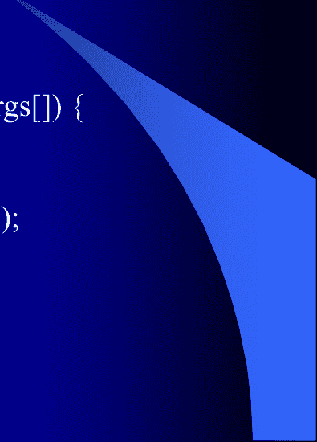


```
### Ans:

- tick 10
- tick 9
- tick 8
- tick 7
- tick 6
- tick 5
- tick 4
- tick 3
- tick 2
- tick 1
### 5.2.2 do-while 循环

- 因为条件表达式在循环的结尾，do-while 循环总是执行它的循环体至少一次。
- 通用格式如下：

```java
do {
    // body of loop
} while (condition);
```

### 例 P77 重写的“tick”程序

```java
// Demonstrate the do-while loop.
class DoWhile {
    public static void main(String args[]) {
        int n = 10;
        do {
            System.out.println("tick " + n);
            n--;
        } while(n > 0);
    }
}
// 像下面这样编写更为高效：
// do {
//     System.out.println("tick " + n);
// } while(--n > 0);
```

### 例 P78 编制菜单选择

```java
// Using a do-while to process a menu selection
class Menu {
    public static void main(String args[])
        throws java.io.IOException { // 使用 read()，须指定 throws 子句。
        char choice;
        do {
            System.out.println("Help on:");
            System.out.println(" 1. if");
            System.out.println(" 2. switch");
            System.out.println(" 3. while");
            System.out.println(" 4. do-while");
            System.out.println(" 5. for\n");
            System.out.println("Choose one:");
            // 从标准输入读取字符，返回整数，因此匹配 choice 字符型
            choice = (char) System.in.read();
        } while( choice < '1' || choice > '5');
        System.out.println("\n");

        switch(choice) {
            case '1':
                System.out.println("The if:\n");
                System.out.println("if(condition) statement;");
                System.out.println("else statement;");
                break;
            case '2':
                System.out.println("The switch:\n");
                System.out.println("switch(expression) {");
                System.out.println(" case constant:");
                System.out.println(" statement sequence");
                System.out.println(" break;");
                System.out.println(" // ...");
                System.out.println("}");
                break;
            case '3':
                System.out.println("The while:\n");
                System.out.println("while(condition) statement;");
                break;
        }
    }
}


```java
case '4':
System.out.println("The do-while:\n");
System.out.println("do {");
System.out.println(" statement;");
System.out.println("} while (condition);");
break;
case '5':
System.out.println("The for:\n");
System.out.print("for(init; condition; iteration)");
System.out.println(" statement;");
break;
}
}
}
}
```

#### 例 P80上 使用 for 循环的“tick”程序

```java
// Demonstrate the for loop.
class ForTick {
    public static void main(String args[]) {
        int n;
        for(n=10; n>0; n--)
            System.out.println("tick " + n);
    }
}
```

#### 在 for 循环中声明循环控制变量

- 控制 for 循环的变量经常只是用于该循环，而不用在程序的其他地方。
- 可以在循环的初始化部分中声明变量。
- 例 P80 中：

```java
// Declare a loop control variable inside the for.
class ForTrick {
    public static void main(String args[]) {
        // here, n is declared inside of the for loop
        // 在 for 循环外，变量 n 就不存在了
        for(int n=10; n>0; n--)
            System.out.println("tick " + n);
    }
}
```


#### 例 P80下 测试素数的一个简单程序

```java
// Test for primes.
class FindPrime {
    public static void main(String args[]) {
        int num;
        boolean isPrime = true;
        num = 14;
        for(int i=2; i <= num/2; i++) {
            if((num % i) == 0) {
                isPrime = false;
                break;
            }
        }
        if(isPrime) System.out.println("Prime");
        else System.out.println("Not Prime");
    }
}
```

**Ans:** Not Prime


#### 使用逗号

- 在初始化和 for 循环的反复部分包括超过一个变量的声明。
- 例 P81中：

```java
class Sample {
    public static void main(String args[]) {
        int a, b;
        b = 4;
        for(a=1; a<b; a++) {
            System.out.println("a = " + a);
            System.out.println("b = " + b);
            b--;
        }
    }
}
```

#### 使用逗号，for 循环将更高效

```java
// Using the comma.
class Comma {
  public static void main(String args[]) {
    int a, b;
    for(a=1, b=4; a<b; a++, b--) {
      System.out.println("a = " + a);
      System.out.println("b = " + b);
    }
  }
}
```

**Ans:**

```
a = 1
b = 4
a = 2
b = 3
```

### 5.2.4 for 循环的一些变化

- 控制 for 循环的条件可以是任何布尔表达式：

```java
boolean done = false;
for(int i=1; !done; i++) {
    // ...
    if(interrupted()) done = true;
}
```

- for 循环的初始化、条件或者反复部分中的任何或者全部都为空：

```java
// Parts of the for loop can be empty.
class ForVar {
    public static void main(String args[]) {
        int i;
        boolean done = false;
        i = 0;
        for( ; !done; ) {
            System.out.println("i is " + i);
            if(i == 10) done = true;
            i++;
        }
    }
}
```

- for 循环的三个部分全为空，你就可以创建一个无限循环（从来不停止的循环）。

```java
for( ; ; ) {
    // ...
}
```

### 5.2.5 循环嵌套

- 例 P83

```java
// Loops may be nested.
class Nested {
    public static void main(String args[]) {
        int i, j;
        for(i=0; i<10; i++) {
            for(j=i; j<10; j++)
                System.out.print(" ");
            System.out.println();
        }
    }
}
```

**Ans:**

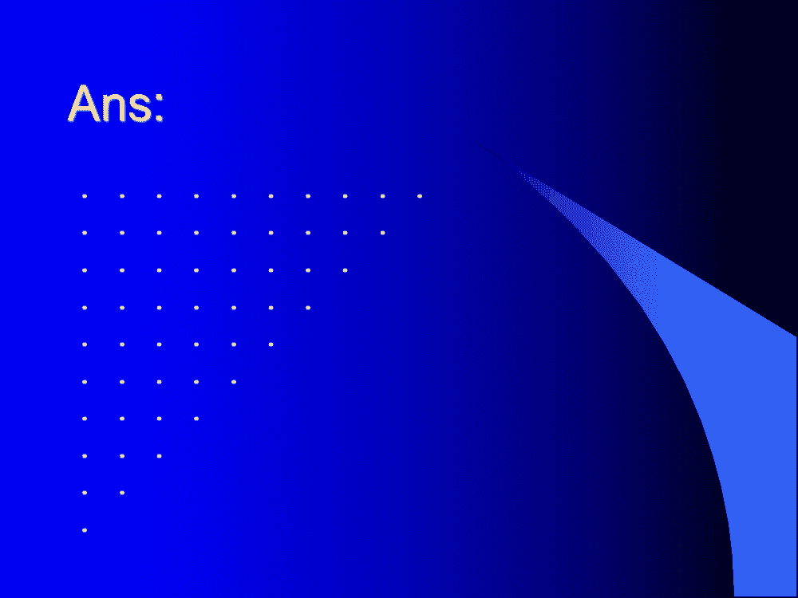

## 5.3 跳转语句

- Java 支持 3 种跳转语句：`break`、`continue` 和 `return`。
- 异常处理使程序捕获并处理运行时刻错误。
- 异常处理由下列五个关键字来控制：`try`、`catch`、`throw`、`throws` 和 `finally`。


### 5.3.1 使用 break 语句

在 Java 中，break 语句有 3 种作用：

- 在 switch 语句中，它被用来终止一个语句序列。
- 它能被用来退出一个循环。
- 它能作为一种“先进”的 goto 语句来使用。

#### 使用 break 退出循环

- 使用 break 语句直接强行退出循环，忽略循环体中的任何其他语句和循环的条件测试。
- 在循环中遇到 break 语句时，循环被终止，程序控制在循环后面的语句重新开始。

#### 例 P84上 使用 break 语句直接强行退出循环

```java
// Using break to exit a loop.
class BreakLoop {
  public static void main(String args[]) {
    for(int i=0; i<100; i++) {
      if(i == 10) break; // terminate loop if i is 10
      System.out.println("i: " + i);
    }
    System.out.println("Loop complete.");
  }
}
```

## Ans:

i: 0
i: 1
i: 2
i: 3
i: 4
i: 5
i: 6
i: 7
i: 8
i: 9
Loop complete.

### 例 P84下

将上一个程序用 while 循环改写

```java
// Using break to exit a while loop.
class BreakLoop2 {
    public static void main(String args[]) {
        int i = 0;
        while(i < 100) {
            if(i == 10) break; // terminate loop if i is 10
            System.out.println("i: " + i);
            i++;
        }
        System.out.println("Loop complete.");
    }
}
```

### 例 P85 嵌套循环中使用 break，仅终止最里面的循环

```java
// Using break with nested loops.
class BreakLoop3 {
    public static void main(String args[]) {
        for(int i=0; i<3; i++) {
            System.out.print("Pass " + i + ": ");
            for(int j=0; j<100; j++) {
                if(j == 10) break; // terminate loop if j is 10
                System.out.print(j + " ");
            }
            System.out.println();
        }
        System.out.println("Loops complete.");
    }
}
```

Ans:

Pass 0: 0 1 2 3 4 5 6 7 8 9

Pass 1: 0 1 2 3 4 5 6 7 8 9

Pass 2: 0 1 2 3 4 5 6 7 8 9

Loops complete.


## 把 break 当作 goto 的一种形式来用

- 能作为 goto 语句的一种“文明”形式来使用。
- 能从嵌套很深的循环中退出。
- 带有标签的 break 语句，可以跳出带标签的代码块。
- 标签（label）可以是任何合法有效的 Java 标识符后跟一个冒号。
- 标签 break 语句的通用格式如下所示：

  ```
  break label;
  ```

- 被加标签的代码块必须包围 break 语句，但是它不需要是直接的包围 break 的块。
- 意味着你可以使用一个加标签的 break 语句退出一系列的嵌套块。

### 例 P86上　带有标签的 break 语句

```java
// Using break as a civilized form of goto.
class Break {
    public static void main(String args[]) {
        boolean t = true;
        first: {
            second: {
                third: {
                    System.out.println("Before the break.");
                    if(t) break second; // break out of second block
                    System.out.println("This won't execute");
                }
                System.out.println("This won't execute");
            }
            System.out.println("This is after second block.");
        }
    }
}
```

Ans:

Before the break.

This is after second block.


### 例 P86下　当内部循环退到外部循环，两循环都终止

```java
// Using break to exit from nested loops
class BreakLoop4 {
  public static void main(String args[]) {
    outer: for(int i=0; i<3; i++) {
      System.out.print("Pass " + i + ": ");
      for(int j=0; j<100; j++) {
        if(j == 10) break outer; // exit both loops
        System.out.print(j + " ");
      }
      System.out.println("This will not print");
    }
    System.out.println("Loops complete.");
  }
}
```


Ans:

Pass 0: 0 1 2 3 4 5 6 7 8 9 Loops complete.

### 例 P87上 标签不在包围break的块中定义，不会被编译

```java
// This program contains an error.
class BreakErr {
public static void main(String args[]) {
one: for(int i=0; i<3; i++) {
System.out.print("Pass " + i + ": ");
}
for(int j=0; j<100; j++) {
if(j == 10) break one; // WRONG
System.out.print(j + " ");
}
}
}
```

### 5.3.2 使用 continue 语句

- 使用 continue 语句，忽略这次剩余的循环体的语句，然后循环继续执行。
- 对于这 3 种循环，任何中间的代码将被旁路。

### 例 P87下

使用 continue 语句，使每行打印2个数字

```java
// Demonstrate continue.
class Continue {
public static void main(String args[]) {
for(int i=0; i<10; i++) {
System.out.print(i + " ");
//使用%（模）运算符来检验变量 i 是否为偶数
if (i%2== 0) continue;
System.out.println("");
}
}
}
```

Ans:

- 0 1
- 2 3
- 4 5
- 6 7
- 8 9


Ans:

- 0
- 0 1
- 0 2 4
- 0 3 6 9
- 0 4 8 12 16
- 0 5 10 15 20 25
- 0 6 12 18 24 30 36
- 0 7 14 21 28 35 42 49
- 0 8 16 24 32 40 48 56 64
- 0 9 18 27 36 45 54 63 72 81

### 5.3.3 使用 return 语句

- return 语句用来明确地从一个方法返回。
- return 语句使程序控制返回到调用它的方法。

### 例 P88下 使程序执行返回到Java运行系统

```java
// Demonstrate return.
class Return {
public static void main(String args[]) {
boolean t = true;
System.out.println("Before the return.");
if(t) return; // return to caller
// Java 编译器将标记 （unreachable code） 错误
System.out.println("This won't execute.");
}
}
```

Ans:
Before the return.


## 6.1 类基础

- 类的最重要的事情就是它定义了一种新的数据类型。
- 定义后，就可以用这种新类型来创建该类型的对象。
- 类就是对象的模板（template），而对象就是类的一个实例（instance）。

### 6.1.1 类的通用格式

- 可以通过指定它包含的数据和操作数据的代码来定义类。
- 类的代码定义了该类数据的接口。
- 类定义的通用格式如下所示：

```java
class classname {
    type instance-variable1;    // 数据或变量被称为实例变量
    // ...
    type instance-variableN;
    type methodname1(parameter-list) {    // 代码包含在方法内

    // body of method
    }
    // ...
    Type methodnameN(parameter-list) {
    // body of method
    }
}
```

### 6.1.2 一个简单的类

- 定义了一个名为 Box 的类，它定义了3个实例变量，不包含任何方法：

```java
class Box {
    double width;
    double height;
    double depth;
}
```

- 创建一个 Box 对象：

```java
// create a Box object called mybox
Box mybox = new Box();
```

- 该对象包含它自己的由类定义的每个实例变量的拷贝。
- 使用点号 “.” 运算符访问这些变量：

```java
mybox.width = 100;
```

### 例 P92上 Box 类的完整程序

```java
/* A program that uses the Box class.
Call this file BoxDemo.java
*/
class Box {
    double width; double height; double depth;
}
// This class declares an object of type Box.
class BoxDemo {
    public static void main(String args[]) {
        Box mybox = new Box();
        double vol;
        // assign values to mybox's instance variables
        mybox.width = 10;
        mybox.height = 20;
        mybox.depth = 15;
        // compute volume of box
        vol = mybox.width * mybox.height * mybox.depth;
        System.out.println("Volume is " + vol);
    }
}
```

Ans:

Volume is 3000.0

### 例 P92下 两个 Box 对象

```java
// This program declares two Box objects.
class Box {
    double width;
    double height;
    double depth;
}
class BoxDemo2 {
    public static void main(String args[]) {
        Box mybox1 = new Box();
        Box mybox2 = new Box();
        double vol;

        // assign values to mybox1's instance variables
        mybox1.width = 10;
        mybox1.height = 20;
        mybox1.depth = 15;
        /* assign different values to mybox2's
           instance variables */
        mybox2.width = 3;
        mybox2.height = 6;
        mybox2.depth = 9;
        // compute volume of first box
        vol = mybox1.width * mybox1.height * mybox1.depth;
        System.out.println("Volume is " + vol);
        // compute volume of second box
        vol = mybox2.width * mybox2.height * mybox2.depth;
        System.out.println("Volume is " + vol);
    }
}
```


Ans:

Volume is 3000.0

Volume is 162.0

/* 改变一个对象的实例变量对另外一个对象的实例变量没有任何影响，mybox1 的数据与 mybox2 的数据完全分离。 */

## 6.2 声明对象

- 用下面的语句来声明一个 Box 类型的对象：

```java
Box mybox = new Box();
```

- 改写为下面的形式：

```java
Box mybox; // declare reference to object
mybox = new Box(); // allocate a Box object
```

- 效果如图：

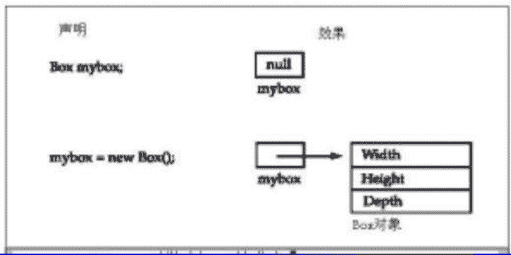

### 6.2.1 深入研究 new 运算符

- new 运算符的通用格式如下：

```java
class-var = new classname();
```

- class-var 是所创建类类型的变量（对象名）。
- classname 是被实例化的类的名字。
- （）指定了类的构造函数。
- 简单类型不是作为对象实现的，所以不使用 new 运算符。
- new 有可能由于内存不足而无法给一个对象分配内存。就会发生运行时异常。

## 6.3 给对象引用变量赋值

- 对象变量的赋值：

```java
Box b1 = new Box();
Box b2 = b1;
```

- 对象变量的赋值将引用同样的对象。
- 没有分配任何内存或对原对象做任何部分的拷贝。它们是同一个对象。如图所示。
- 脱离（unhook）初始对象：

```java
Box b1 = new Box();
Box b2 = b1;
// ...
b1 = null;
```

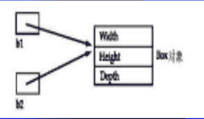

## 6.4 方法

- 方法一般的形式：

```java
type name(parameter-list) {
    // body of method
}
```

- Type: 方法返回的数据类型。可以是任何合法有效的类型，包括你创建的类的类型。
- 如果该方法不返回任何值，则它的返回值 type 必须为 void。
- 方法名由 name 指定。除了被当前作用域中的其他项使用的标识符以外，方法名可以是任何合法的标识符。
- 自变量列表：是一系列类型和标识符对，用逗号分开。如果方法没有自变量，那么自变量列表就为空。
- 对于不返回 void 类型的方法，使用下面格式的 return 语句，方法返回值到它的调用程序：

```java
return value;
```

### 6.4.1 为 Box 类添加一个方法

- 当一个实例变量不是被该实例变量所在类的部分代码访问时，它必须通过该对象加点运算符来访问。
- 但是当一个实例变量被定义该变量的类的代码访问时，该变量可以被直接引用。

```java
class BoxDemo3 {
    public static void main(String args[]) {
        Box mybox1 = new Box();
        Box mybox2 = new Box();
        // assign values to mybox1's instance variables
        mybox1.width = 10;
        mybox1.height = 20;
        mybox1.depth = 15;
        /* assign different values to mybox2's
           instance variables */
        mybox2.width = 3;
        mybox2.height = 6;
        mybox2.depth = 9;
        // display volume of first box
        mybox1.volume();
        // display volume of second box
        mybox2.volume();
    }
}
```


Ans:

Volume is 3000.0

Volume is 162.0


### 例 P98　计算的盒子体积的结果返回给它的调用者

```java
// Now, volume() returns the volume of a box.
class Box {
    double width;
    double height;
    double depth;

    // compute and return volume
    double volume() {
        return width * height * depth;
    }
}
```


```java
class BoxDemo4 {
    public static void main(String args[]) {
        Box mybox1 = new Box();
        Box mybox2 = new Box();
        double vol;

        // assign values to mybox1's instance variables
        mybox1.width = 10;
        mybox1.height = 20;
        mybox1.depth = 15;

        /* assign different values to mybox2's
           instance variables */
        mybox2.width = 3;
        mybox2.height = 6;
        mybox2.depth = 9;

        // get volume of first box
        vol = mybox1.volume();
        System.out.println("Volume is " + vol);

        // get volume of second box
        vol = mybox2.volume();
        System.out.println("Volume is " + vol);
    }
}
```


### 6.4.3 加入带自变量的方法

- 不带自变量的 `square()`：返回数字 10 的平方

  ```java
  int square() {
      return 10 * 10;
  }
  ```

- 带一个自变量的 `square()`：返回任何值的平方

  ```java
  int square(int i) {
      return i * i;
  }
  ```

- 一个例子：

  ```java
  int x, y;
  x = square(5); // x equals 25
  x = square(9); // x equals 81
  y = 2;
  x = square(y); // x equals 4
  ```

### 例 P100 创建一个自变量代表盒子尺寸的方法

```java
// This program uses a parameterized method.
class Box {
    double width;
    double height;
    double depth;

    // compute and return volume
    double volume() {
        return width * height * depth;
    }

    // sets dimensions of box
    void setDim(double w, double h, double d) {
        width = w;
        height = h;
        depth = d;
    }
}

class BoxDemo5 {
    public static void main(String args[]) {
        Box mybox1 = new Box();
        Box mybox2 = new Box();
        double vol;

        // initialize each box
        mybox1.setDim(10, 20, 15);
        mybox2.setDim(3, 6, 9);

        // get volume of first box
        vol = mybox1.volume();
        System.out.println("Volume is " + vol);

        // get volume of second box
        vol = mybox2.volume();
        System.out.println("Volume is " + vol);
    }
}
```

## 6.5 构造函数

- Java 允许对象在它们被创造时初始化自己。
- 构造函数在对象创建时初始化。它与它的类同名，它的语法与方法类似。
- 在 `new` 运算符完成前，构造函数立即自动调用。
- 构造函数没有任何返回值，即使是 `void` 型的值也不返回。

### 例 P102　简单的构造函数

```java
/* Here, Box uses a constructor to initialize the
dimensions of a box.
*/
class Box {
    double width;
    double height;
    double depth;

    // This is the constructor for Box.
    Box() {
        System.out.println("Constructing Box");
        width = 10;
        height = 10;
        depth = 10;
    }

    // compute and return volume
    double volume() {
        return width * height * depth;
    }
}
```


```java
class BoxDemo6 {
    public static void main(String args[]) {
        // declare, allocate, and initialize Box objects
        Box mybox1 = new Box();
        Box mybox2 = new Box();
        double vol;

        // get volume of first box
        vol = mybox1.volume();
        System.out.println("Volume is " + vol);

        // get volume of second box
        vol = mybox2.volume();
        System.out.println("Volume is " + vol);
    }
}
```

### Ans:

Constructing Box
Constructing Box
Volume is 1000.0
Volume is 1000.0

### 6.5.1 带自变量的构造函数

### 例 P103　一种能够构造各种各样尺寸盒子对象的方法。

```java
/* Here, Box uses a parameterized constructor to
initialize the dimensions of a box.
*/
class Box {
    double width;
    double height;
    double depth;

    // This is the constructor for Box.
    Box(double w, double h, double d) {
        width = w;
        height = h;
        depth = d;
    }

    // compute and return volume
    double volume() {
        return width * height * depth;
    }
}
```

Ans:

Volume is 3000.0

Volume is 162.0


## 6.6.1 隐藏的实例变量

- 局部变量，包括传递到方法的正式的自变量，可以与类的实例变量的名字重叠。
- 因为 `this` 可以使你直接引用对象，你能用它来解决可能在实例变量和局部变量之间发生的任何同名的冲突。
- 例如：

```java
// Use this to resolve name-space collisions.
Box(double width, double height, double depth) {
    this.width = width;
    this.height = height;
    this.depth = depth;
}
```

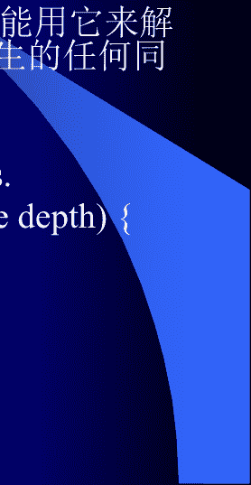

## 6.8 `finalize()` 方法

- 有时当撤消一个对象时，需完成一些操作。例如，非 Java 资源的文件句柄或 window 字符字体，要确保对象被撤消前保证释放资源。
- 收尾（finalization）在一个对象将要被垃圾回收程序释放时执行。
- Java 回收该类的一个对象时，会调用 `finalize()` 方法，你要指定在一个对象被撤消前必须执行的操作。
- `finalize()` 方法的通用格式如下：

```java
protected void finalize() // 防止该类外定义的代码访问finalize()
{
// finalization code here
}
```

- 你不可能知道何时——甚至是否——`finalize()` 被调用。

## 6.9 一个堆栈类

- 用一个更复杂的例子来说明类的强大功能。
- 面向对象编程的最重要好处是对数据和操作该数据的代码的封装。
- 无须关心它的实现细节或在类的内部数据实际上是如何被管理的。
- 细节被隐藏，当需要时，它的内部工作可以被改变。
- 代码通过类的方法来使用，内部的细节可以改变而不会对类的外部带来负面影响。
- 堆栈可以被存储在一个更复杂的数据结构中，例如一个链表，但 push() 和 pop() 定义的接口仍然是一样的。

### 例 P106 实现整数的堆栈

```java
// This class defines an integer stack that can hold 10 values.
class Stack {
    int stck[] = new int[10];
    int tos;
    // Initialize top-of-stack
    Stack() { tos = -1; }
    // Push an item onto the stack
    void push(int item) {
        if(tos==9)
            System.out.println("Stack is full.");
        else stck[++tos] = item;
    }
    // Pop an item from the stack
    int pop() {
        if(tos < 0) {
            System.out.println("Stack underflow.");  return 0;
        }
        else  return stck[tos--];
    }
}

class TestStack {
public static void main(String args[]) {
Stack mystack1 = new Stack();
Stack mystack2 = new Stack();
// push some numbers onto the stack
for(int i=0; i<10; i++) mystack1.push(i);
for(int i=10; i<20; i++) mystack2.push(i);
// pop those numbers off the stack
System.out.println("Stack in mystack1:");
for(int i=0; i<10; i++)
System.out.println(mystack1.pop());
System.out.println("Stack in mystack2:");
for(int i=0; i<10; i++)
System.out.println(mystack2.pop());
}
}
```

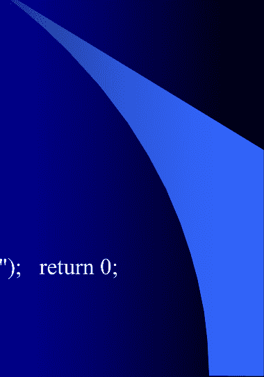

### Ans:

```text
Stack in mystack1:
9
8
7
6
5
4
3
2
1
0
Stack in mystack2:
19
18
17
16
15
14
13
12
11
10
```

- 方法重载
- 参数传递和递归
- 讨论存取控制
- 关键字 static 的用法
- 内置类: String。

## 7.1 方法重载

- 重载（overloaded）：同一个类中的2个或2个以上的方法可以有同一个名字，只要它们的参数声明不同即可。
- 当 Java 调用一个重载方法时，参数与调用参数匹配的方法被执行。
- 当你重载一个方法时，该方法的每个版本都能够执行你想要的任何动作。没有什么规定要求重载方法之间必须互相关联。
- 在实际的编程中，你应该只重载相互之间关系紧密的操作。

```java
class Overload {
public static void main(String args[]) {
OverloadDemo ob = new OverloadDemo();
double result;
// call all versions of test()
ob.test();
ob.test(10);
ob.test(10, 20);
result = ob.test(123.25);
System.out.println("Result of ob.test(123.25): " + result);
}
}
```

### Ans:

```text
No parameters  
a: 10  
a and b: 10 20  
double a: 123.25  
Result of ob.test(123.25): 15190.5625
```

### 例 P110 自动类型转换适用于重载方法的自变量

```java
// Automatic type conversions apply to overloading.
class OverloadDemo {
    void test() {
        System.out.println("No parameters");
    }
    // Overload test for two integer parameters.
    void test(int a, int b) {
        System.out.println("a and b: " + a + " " + b);
    }
    // overload test for a double parameter
    void test(double a) {
        System.out.println("Inside test(double) a: " + a);
    }
}

class Overload {
    public static void main(String args[]) {
        OverloadDemo ob = new OverloadDemo();
        int i = 88;
        ob.test();
        ob.test(10, 20);
        ob.test(i);        // this will invoke test(double)
        ob.test(123.2);    // this will invoke test(double)
    }
}
```


**Ans:**

```text
No parameters
a and b: 10 20
Inside test(double) a: 88
Inside test(double) a: 123.2
```

### 7.1.1 构造函数重载

- 除了重载正常的方法外，构造函数也能够重载。
- 最新版本的 Box 类的例子：

```java
class Box {
double width;
double height;
double depth;
// This is the constructor for Box.
Box(double w,  double h, double d) {
width = w;
height = h;
depth = d;
}
// compute and return volume
double volume() {
return width * height * depth;
}
}
```

### 例 P112：对 Box 构造函数的重载

```java
/* Here, Box defines three constructors to initialize
the dimensions of a box various ways.
*/
class Box {
double width;
double height;
double depth;
// constructor used when all dimensions specified
Box(double w, double h, double d) {
width = w;
height = h;
depth = d;
}
// constructor used when no dimensions specified
Box() {
width = -1; // use -1 to indicate
height = -1; // an uninitialized
depth = -1; // box
}
// constructor used when cube is created
Box(double len) {
width = height = depth = len; }
// compute and return volume
double volume() {
return width * height * depth; }
}
class OverloadCons {
public static void main(String args[]) {
// create boxes using the various constructors
Box mybox1 = new Box(10, 20, 15);
Box mybox2 = new Box();
Box mycube = new Box(7);
double vol;
// get volume of first box
vol = mybox1.volume();
System.out.println("Volume of mybox1 is " + vol);
// get volume of second box
vol = mybox2.volume();
System.out.println("Volume of mybox2 is " + vol);
// get volume of cube
vol = mycube.volume();
System.out.println("Volume of mycube is " + vol);
}
}
```

## 7.2 把对象作为参数

- 用简单类型作为方法的参数。
- 用对象作为方法的参数。
- 构造一个新对象，使它的初始状态与一些已经存在的对象一样：将一个对象作为它的类的一个参数。

### 例 P113：给方法传递对象

```java
// Objects may be passed to methods.
class Test {
    int a, b;
    Test(int i, int j) { a = i; b = j; }
    // return true if o is equal to the invoking object
    boolean equals(Test o) {
        if(o.a == a && o.b == b) return true;
        else return false;
    }
}
class PassOb {
    public static void main(String args[]) {
        Test ob1 = new Test(100, 22);
        Test ob2 = new Test(100, 22);
        Test ob3 = new Test(-1, -1);
        System.out.println("ob1 == ob2: " + ob1.equals(ob2));
        System.out.println("ob1 == ob3: " + ob1.equals(ob3));
    }
}
```


**Ans：**

```text
ob1 == ob2: true
ob1 == ob3: false
```


### 例 P114：允许一个对象初始化另一个对象

```java
// Here, Box allows one object to initialize another.
class Box {
   double width;
   double height;
   double depth;

   // construct clone of an object
   Box(Box ob) {       // pass object to constructor
      width = ob.width;
      height = ob.height;
      depth = ob.depth;
   }

   // constructor used when all dimensions specified
   Box(double w, double h, double d) {
      width = w;
      height = h;
      depth = d;
   }

   // constructor used when no dimensions specified
   Box() {
       width = -1;   // use -1 to indicate
       height = -1;  // an uninitialized
       depth = -1;   // box
   }

   // constructor used when cube is created
   Box(double len) {
       width = height = depth = len;
   }

   // compute and return volume
   double volume() {
       return width * height * depth;
   }
}

class OverloadCons2 {
public static void main(String args[]) {
// create boxes using the various constructors
Box mybox1 = new Box(10, 20, 15);
Box mybox2 = new Box();
Box mycube = new Box(7);
Box myclone = new Box(mybox1);
double vol;
// get volume of first box
vol = mybox1.volume();
System.out.println("Volume of mybox1 is " + vol);
// get volume of second box
vol = mybox2.volume();
System.out.println("Volume of mybox2 is " + vol);
// get volume of cube
vol = mycube.volume();
System.out.println("Volume of cube is " + vol);
// get volume of clone
vol = myclone.volume();
System.out.println("Volume of clone is " + vol);
}
}
```


### Ans:

- Volume of mybox1 is 3000
- Volume of mybox2 is −1
- Volume of cube is 343
- Volume of clone is 3000


## 7.3 参数是如何传递的

- 按值传递（call-by-value）：将一个参数值复制成为子程序的形式参数。
- 引用调用（call-by-reference）：参数的引用（而不是参数值）被传递给子程序参数。

  引用调用对子程序参数的改变将会影响调用子程序的参数。

### 例 P116 传递一个简单类型时，是按值传递

```java
// Simple types are passed by value.
class Test {
  void meth(int i, int j) {
    i *= 2;
    j /= 2;
  }
}

class CallByValue {
  public static void main(String args[]) {
    Test ob = new Test();
    int a = 15, b = 20;
    System.out.println("a and b before call: " + a + " " + b);
    ob.meth(a, b);
    //在 meth() 内部发生的操作不影响调用中 a 和 b 的值。
    System.out.println("a and b after call: " + a + " " + b);
  }
}
```

### Ans:

a and b before call: 15 20

a and b after call: 15 20

### 例 P117上 对象是通过引用调用传递给方法的

```java
// Objects are passed by reference.
class Test {
    int a, b;

    Test(int i, int j) {
        a = i;
        b = j;
    }

    // pass an object
    void meth(Test o) {
        o.a *= 2;
        o.b /= 2;
    }
}

class CallByRef {
    public static void main(String args[]) {
        Test ob = new Test(15, 20);
        System.out.println("ob.a and ob.b before call: " + ob.a + " " + ob.b);
        ob.meth(ob);
        System.out.println("ob.a and ob.b after call: " + ob.a + " " + ob.b);
    }
}
```

### Ans:

ob.a and ob.b before call: 15 20

ob.a and ob.b after call: 30 10

### 例 P117下 方法返回一个对象

```java
// Returning an object.
class Test {
    int a;
    Test(int i) {
        a = i;
    }
    Test incrByTen() { //每次调用 incrByTen()，产生一个新对象
        Test temp = new Test(a+10);
        return temp;
    }
}
class RetOb {
    public static void main(String args[]) {
        Test ob1 = new Test(2);
        Test ob2;
        ob2 = ob1.incrByTen();
        System.out.println("ob1.a: " + ob1.a);
        System.out.println("ob2.a: " + ob2.a);
        ob2 = ob2.incrByTen();
        System.out.println("ob2.a after second increase: " + ob2.a);
    }
}
```

## 7.5 递归

- Java 支持递归（recursion）。
- 递归就是依照自身定义事物的过程。
- 在 Java 编程中，递归是允许方法调用自身调用的属性。

### 例 P118 使用递归来计算数字的阶乘

```java
// A simple example of recursion.
class Factorial {
    // this is a recursive function
    int fact(int n) {
        int result;
        if(n == 1) return 1;    // 当 fact(1) 被调用时，该方法返回 1
        result = fact(n-1) * n; // 否则它返回 fact(n-1) 与 n 的乘积
        return result;
    }
}
class Recursion {
    public static void main(String args[]) {
        Factorial f = new Factorial();
        System.out.println("Factorial of 3 is " + f.fact(3));
        System.out.println("Factorial of 4 is " + f.fact(4));
        System.out.println("Factorial of 5 is " + f.fact(5));
    }
}
```

### Ans:

Factorial of 3 is 6

Factorial of 4 is 24

Factorial of 5 is 120


### 例 P120 递归方法打印数组中的前 i 个元素

```java
// Another example that uses recursion.
class RecTest {
  int values[];
  RecTest(int i) {
    values = new int[i];
  }
  // display array - recursively
  void printArray(int i) {
    if(i==0) return;
    else printArray(i-1);
    System.out.println("[" + (i-1) + "] " + values[i-1]);
  }
}
class Recursion2 {
  public static void main(String args[]) {
    RecTest ob = new RecTest(10);
    int i;
    for(i=0; i<10; i++) ob.values[i] = i;
    ob.printArray(10);
  }
}
```

## 7.6 介绍访问控制

- 封装将数据和代码连接起来。封装也提供另一个重要属性：访问控制（access control）。
- 通过封装你可以控制程序的哪一部分可以访问类的成员。
- Java提供丰富的访问指示符：public（公共的，全局的）、private（私有的，局部的）、protected（受保护的）和 package（包）。
- 当一个类成员被 public 指示符修饰时，该成员可以被你的程序中的任何其他代码访问。
- 当一个类成员被指定为 private 时，该成员只能被它的类中的其他成员访问。
- 访问指示符位于成员类型的其他说明的前面：

  ```java
  public int i;
  private double j;
  private int myMethod(int a, char b) { // ...
  ```


## 例 P121　public 和 private 对访问的作用

```java
/* This program demonstrates the difference between
public and private.
*/
class Test {
    int a;                 // default access
    public int b;          // public access
    private int c;         // private access
    // methods to access c
    void setc(int i) {     // set c's value
        c = i;
    }
    int getc() {           // get c's value
        return c;
    }
}
```


```java
class AccessTest {
    public static void main(String args[]) {
        Test ob = new Test();
        // These are OK, a and b may be accessed directly
        ob.a = 10;
        ob.b = 20;
        // This is not OK and will cause an error
        // ob.c = 100; // Error!
        // You must access c through its methods
        ob.setc(100); // OK
        System.out.println("a, b, and c: " + ob.a + " " +
                           ob.b + " " + ob.getc());
    }
}
```

Ans:

a, b, and c: 10 20 100

## 例 P122　Stack 类的改进版本

```java
// This class defines an integer stack that can hold 10 values.
class Stack {
  /* Now, both stck and tos are private. This means
     that they cannot be accidentally or maliciously
     altered in a way that would be harmful to the stack.
  */
  private int stck[] = new int[10]; // 堆栈 stck 和堆栈顶下标 tos,
  private int tos;                  // 都被指定为private

  // Initialize top-of-stack
  Stack() { tos = -1; }

  // Push an item onto the stack
  void push(int item) {              // push()或pop()才能访问或改变
    if(tos==9)
      System.out.println("Stack is full.");
    else
      stck[++tos] = item;
  }

  // Pop an item from the stack
  int pop() {
    if(tos < 0) {
        System.out.println("Stack underflow.");
        return 0;
    }
    else
        return stck[tos--];
  }
}
```

```java
class TestStack {
public static void main(String args[]) {
Stack mystack1 = new Stack();
Stack mystack2 = new Stack();
// push some numbers onto the stack
for(int i=0; i<10; i++) mystack1.push(i);
for(int i=10; i<20; i++) mystack2.push(i);
// pop those numbers off the stack
System.out.println("Stack in mystack1:");
for(int i=0; i<10; i++)
System.out.println(mystack1.pop());
System.out.println("Stack in mystack2:");
for(int i=0; i<10; i++)
System.out.println(mystack2.pop());
// these statements are not legal
// mystack1.tos = -2;
// mystack2.stck[3] = 100;
}
}
```

## 7.7 理解 static

- 一个类成员的使用完全独立于该类的任何对象。
- 在成员的声明前面加上关键字 static（静态的）就能创建这样的成员。
- 如果一个成员被声明为 static，它就能够在它的类的任何对象创建之前被访问，而不必引用任何对象。
- static 成员的最常见的例子是main()。
- 声明为 static 的变量实质上就是全局变量。该类所有的实例变量共用同一个 static 变量。

声明为 static 的方法有以下几条限制：

- 它们仅能调用其他的 static 方法。
- 它们只能访问 static 数据。
- 它们不能以任何方式引用 this 或 super。

- 初始化 static 变量，可以声明一个 static 块，static 块仅在该类被加载时执行一次。

## 例 P124　static方法，static变量，static初始化块

```java
// Demonstrate static variables, methods, and blocks.
class UseStatic {
    static int a = 3;
    static int b;
    static void meth(int x) {
        System.out.println("x = " + x);
        System.out.println("a = " + a);
        System.out.println("b = " + b);
    }
    static {
        System.out.println("Static block initialized.");
        b = a * 4;
    }
    public static void main(String args[]) {
        meth(42);
    }
}
```

Ans:

Static block initialized.
x = 42
a = 3
b = 12

// 一旦UseStatic被装载,所有Static语句被执行,
// 执行顺序如下:
// a->3, static块执行(打印一条消息), b->a*4=12
// ->main()->meth(42)
// 3个println () ->a, ->b, ->x 。

## 例 P125　static方法和static变量b在它们的类之外被访问

```java
// static 方法和变量能独立于任何对象而被使用。
// 你只要在类的名字后面加点号运算符即可。
class StaticDemo {
    static int a = 42;
    static int b = 99;
    static void callme() {
        System.out.println("a = " + a);
    }
}
class StaticByName {
    public static void main(String args[]) {
        StaticDemo.callme();
        System.out.println("b = " + StaticDemo.b);
    }
}
```

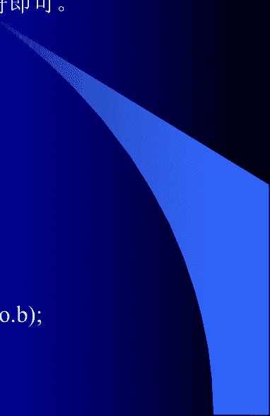


## 7.8 介绍 final

- 一个变量可以声明为 final，这样做的目的是阻止它的内容被修改。
- 在声明 final 变量的时候，你必须初始化。
- 例如：
  ```java
  final int FILE_NEW = 1;
  final int FILE_OPEN = 2;
  final int FILE_SAVE = 3;
  final int FILE_SAVEAS = 4;
  final int FILE_QUIT = 5;
  ```
- final 变量的所有的字符一般都大写。
- 一个 final 变量实质上是一个常数。

## 7.9 重新温习数组

- 数组是作为对象来实现的。
- 数组的大小（一个数组能保存的元素的数目）可以在数组的 `length` 实例变量中找到。
- 所有的数组都有这个变量，并且它总是保存数组的大小。
- `length` 的值和数组实际使用的元素的个数没有关系。`Length` 仅反映了数组能够包含的元素的数目。

## 例 P126 上

### 数组的大小

```java
// This program demonstrates the length array member.
class Length {
public static void main(String args[]) {
int a1[] = new int[10];
int a2[] = { 3, 5, 7, 1, 8, 99, 44, -10 };
int a3[] = { 4, 3, 2, 1 };
System.out.println("length of a1 is " + a1.length);
System.out.println("length of a2 is " + a2.length);
System.out.println("length of a3 is " + a3.length);
}
}
```

### Ans:

length of a1 is 10
length of a2 is 8
length of a3 is 4

## 例 P126 下

### 任意长度的堆栈

```java
// Improved Stack class that uses the length array member.
class Stack {
    private int stck[];
    private int tos;
    // allocate and initialize stack
    Stack(int size) {
        stck = new int[size];
        tos = -1;
    }
    // Push an item onto the stack
    void push(int item) {
        // use length member, stck.length的值用来防止堆栈溢出。
        if(tos==stck.length-1)
            System.out.println("Stack is full.");
        else
            stck[++tos] = item;
    }
    // Pop an item from the stack
    int pop() {
        if(tos < 0) {
            System.out.println("Stack underflow.");
            return 0;
        }
        else return stck[tos--];
    }
}

class TestStack2 {
    public static void main(String args[]) {
        Stack mystack1 = new Stack(5);
        Stack mystack2 = new Stack(8);
        // push some numbers onto the stack
        for(int i=0; i<5; i++) mystack1.push(i);
        for(int i=0; i<8; i++) mystack2.push(i);
        // pop those numbers off the stack
        System.out.println("Stack in mystack1:");
        for(int i=0; i<5; i++)
            System.out.println(mystack1.pop());
        System.out.println("Stack in mystack2:");
        for(int i=0; i<8; i++)
            System.out.println(mystack2.pop());
    }
}
```

### Ans:

Stack in mystack1:
4
3
2
1
0
Stack in mystack2:
7
6
5
4
3
2
1
0

## 7.10 介绍嵌套类和内部类

- 在另一个类中定义的类就是嵌套类（nested classes）。
- 嵌套类可以访问包围类的成员，包括 private 成员。包围类不能访问嵌套类的成员。
- 前面加 static 标识符：只能通过对象来访问它包围类的成员，static 嵌套类很少使用。
- 前面不加 static 标识符（inner class）：可以访问它的包围类的所有变量和方法。
- 尽管嵌套类在日常的大多数编程中不使用，但当处理 applet 时是特别有帮助的。

## 例 P128上 如何定义和使用一个内部类

```java
// Demonstrate an inner class.
class Outer {
    int outer_x = 100;
    void test() {
        Inner inner = new Inner();
        inner.display();
    }
    // this is an inner class
    class Inner {
        void display() {
            System.out.println("display: outer_x = " + outer_x);
        }
    }
}
class InnerClassDemo {
    public static void main(String args[]) {
        Outer outer = new Outer();
        outer.test();
    }
}
```

### Ans:

display: outer_x = 100

## 例 P128下 内部类的成员不能被外部类使用

```java
// This program will not compile.
class Outer {
  int outer_x = 100;
  void test() {
    Inner inner = new Inner();
    inner.display();
  }
  // this is an inner class
  class Inner {
    int y = 10; // y is local to Inner
    void display() {
      System.out.println("display: outer_x = " + outer_x);
    }
  }
  void showy() {
    System.out.println(y);  // error, y not known here!
  }
}

class InnerClassDemo {
public static void main(String args[]) {
Outer outer = new Outer();
outer.test();
}
}
```

// y 是作为 Inner 的一个实例变量来声明的。这样对
// 于该类的外部它就是不可知的，因此不能被
// showy() 使用。


## 例 P129下 在几个程序块的范围之内定义内部类

```java
// Define an inner class within a for loop.
class Outer {
    int outer_x = 100;
    void test() {
        for(int i=0; i<10; i++) {
            class Inner {
                void display() {
                    System.out.println("display: outer_x = " + outer_x);
                }
            }
            Inner inner = new Inner();
            inner.display();
        }
    }
}
class InnerClassDemo {
    public static void main(String args[]) {
        Outer outer = new Outer();
        outer.test();
    }
}
```

Ans:

```
display: outer_x = 100
display: outer_x = 100
display: outer_x = 100
display: outer_x = 100
display: outer_x = 100
display: outer_x = 100
display: outer_x = 100
display: outer_x = 100
display: outer_x = 100
display: outer_x = 100
```


## 7.11 探索 String 类

- String 类是 Java 类库中最常用的类。
- 创建的每一个字符串实际上都是 String 类型的一个对象，即使是字符串常量实际上也是 String 对象。
  如：`System.out.println("This is a String, too");`
- 一旦创建了一个字符串对象，它的内容是不能被改变的。如果你需要改变一个字符串，你可以创建一个新的字符串，其中包含修改后的字符串即可。
  Java 定义了一个和 String 类同等的类叫 StringBuffer，它允许字符串改变。
- 多种方法构造，最容易的一种用如下的语句：
  `String myString = "this is a test";`
- String 对象的运算符：`"+"`。它用来连接两个字符串。
  `String myString = "I" + " like " + "Java."`
  结果是 myString 包含 `"I like Java."`

Ans:

- First String
- Second String
- First String and Second String


## String 类包含的方法

- 检验两个字符串是否相等：
  `boolean equals(String object)`
- 获得一个字符串的长度：
  `int length()`
- 获得一个字符串指定索引的字符：
  `char charAt(int index)`

## 例 P131下 示例各种方法

```java
// Demonstrating some String methods.
class StringDemo2 {
    public static void main(String args[]) {
        String strOb1 = "First String";
        String strOb2 = "Second String";
        String strOb3 = strOb1;
        System.out.println("Length of strOb1: " + strOb1.length());
        System.out.println("Char at index 3 in strOb1: " +
                           strOb1.charAt(3));
        if(strOb1.equals(strOb2))
            System.out.println("strOb1 == strOb2");
        else
            System.out.println("strOb1 != strOb2");
        if(strOb1.equals(strOb3))
            System.out.println("strOb1 == strOb3");
        else
            System.out.println("strOb1 != strOb3");
    }
}
```

## Ans:

Length of strOb1: 12
Char at index 3 in strOb1: s
strOb1 != strOb2
strOb1 == strOb3

## 例 P132上

## Strings 组成数组

```java
// Demonstrate String arrays.
class StringDemo3 {
    public static void main(String args[]) {
        String str[] = { "one", "two", "three" };
        for(int i=0; i<str.length; i++)
            System.out.println("str[" + i + "]: " + str[i]);
    }
}
```

## Ans:

- str[0]: one
- str[1]: two
- str[2]: three

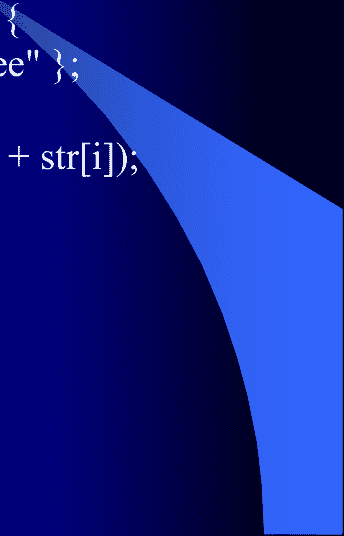

## 例 P132下

## 调用的所有的命令行参数

```java
// Display all command-line arguments.
class CommandLine {
    public static void main(String args[]) {
        for(int i=0; i<args.length; i++)
            System.out.println("args[" + i + "]: " +args[i]);
    }
}
```

Ans:

C:java Commandline this is a test 100 -1

- args[0]: this
- args[1]: is
- args[2]: a
- args[3]: test
- args[4]: 100
- args[5]: -1


# 第1部分 Java语言

## 第08章 继承

- 继承是面向对象编程技术的一块基石，因为它允许创建分等级层次的类。
- 运用继承，你能够创建一个通用类，它定义了一系列相关项目的一般特性。
- 该类可以被更具体的类继承，每个具体的类都增加一些自己特有的东西。
- 被继承的类叫超类（superclass）。
- 继承超类的类叫子类（subclass）。

## 8.1 继承的基础

- 用 extends 关键字把一个类的定义合并到另一个中。
- 声明一个继承超类的类的通常形式如下：
  ```
  class subclass-name extends superclass-name {
  // body of class
  }
  ```
- Java 不支持多超类的继承。
- 与 C++ 不同，在 C++ 中，你可以继承多个基础类。
- 子类B包括它的超类A中的所有成员。
- 尽管A是B的超类，它也是一个完全独立的类。
- 一个子类可以是另一个类的超类。


### 例 P134　一个超类A和一个名为B的子类

```java
// A simple example of inheritance.
// Create a superclass.
class A {
    int i, j;
    void showij() {
        System.out.println("i and j: " + i + " " + j);
    }
}
// Create a subclass by extending class A.
class B extends A {
    int k;
    void showk() {
        System.out.println("k: " + k);
    }
    void sum() {
        System.out.println("i+j+k: " + (i+j+k));
    }
}
```


### Ans:

Contents of superOb:

i and j: 10 20

Contents of subOb:

i and j: 7 8

k: 9

Sum of i, j and k in subOb:

i+j+k: 24

### 8.1.1 成员的访问和继承

- 尽管子类包括超类的所有成员，它不能访问超类中被声明成 private 的成员。
- 一个被定义成 private 的类成员为此类私有，它不能被该类外的所有代码访问，包括子类。

### 例 P135 不能访问超类中被声明成 private 的成员

```java
/* In a class hierarchy, private members remain private
to their class.
This program contains an error and will not compile.
*/
// Create a superclass.
class A {
int i; // public by default
private int j; // private to A
void setij(int x, int y) {
i = x;
j = y;
}
}
// A's j is not accessible here.
class B extends A {
int total;
void sum() {
total = i + j; // ERROR, j is not accessible here
}
}
class Access {
public static void main(String args[]) {
B subOb = new B();
subOb.setij(10, 12);
subOb.sum();
System.out.println("Total is " + subOb.total);
}
}
```

### 8.1.2 更实际的例子

### Box 类扩展成员 weight

```java
// This program uses inheritance to extend Box.
class Box {
    double width;
    double height;
    double depth;
    // construct clone of an object
    Box(Box ob) { // pass object to constructor
        width = ob.width;
        height = ob.height;
        depth = ob.depth;
    }
    // constructor used when all dimensions specified
    Box(double w, double h, double d) {
        width = w;
        height = h;
        depth = d;
    }
    // constructor used when no dimensions specified
    Box() {
        width = -1; // use -1 to indicate
        height = -1; // an uninitialized
        depth = -1; // box
    }
    // constructor used when cube is created
    Box(double len) {
        width = height = depth = len;
    }
    // compute and return volume
    double volume() {
        return width * height * depth;
    }
}
class BoxWeight extends Box {
    double weight; // weight of box
    // constructor for BoxWeight
    BoxWeight(double w, double h, double d, double m) {
        width = w;
        height = h;
        depth = d;
        weight = m;
    }
}
class DemoBoxWeight {
public static void main(String args[]) {
BoxWeight mybox1 = new BoxWeight(10, 20, 15, 34.3);
BoxWeight mybox2 = new BoxWeight(2, 3, 4, 0.076);
double vol;
vol = mybox1.volume();
System.out.println("Volume of mybox1 is " + vol);
System.out.println("Weight of mybox1 is " + mybox1.weight);
System.out.println();
vol = mybox2.volume();
System.out.println("Volume of mybox2 is " + vol);
System.out.println("Weight of mybox2 is " + mybox2.weight);
}
}
```

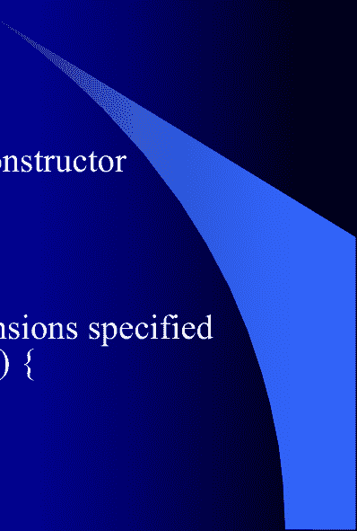

### Ans:

Volume of mybox1 is 3000.0

Weight of mybox1 is 34.3

Volume of mybox2 is 24.0

Weight of mybox2 is 0.076


### 例 P138　Box并增加了一个颜色属性

// 每一个子类只增添它自己独特的属性。这是继承的本质。

```java
// Here, Box is extended to include color.
class ColorBox extends Box {
  int color ;       // color of box
  ColorBox(double w, double h, double d, int c) {
    width = w;
    height = h;
    depth = d;
    color = c;
  }
}
```

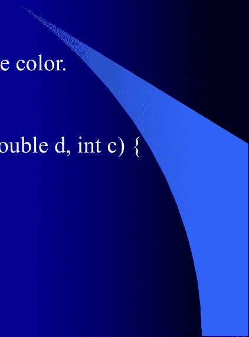

### 8.1.3 超类变量可以引用子类对象

- 超类的一个引用变量可以被任何从该超类派生的子类的引用赋值。
- 继承的这个方面在很多条件下是很有用的。
- Weightbox 是 BoxWeight 对象的一个引用，plainbox 是 Box 对象的一个引用。
- BoxWeight 是 Box 的一个子类，允许用一个 weightbox 对象的引用给 plainbox 赋值。

### 例 P138下

```java
class RefDemo {
    public static void main(String args[]) {
        BoxWeight weightbox = new BoxWeight(3, 5, 7, 8.37);
        Box plainbox = new Box();
        double vol;
        vol = weightbox.volume();
        System.out.println("Volume of weightbox is " + vol);
        System.out.println("Weight of weightbox is " +
                           weightbox.weight);

        System.out.println();
        // assign BoxWeight reference to Box reference
        plainbox = weightbox;
        vol = plainbox.volume(); // OK, volume() defined in Box
        System.out.println("Volume of plainbox is " + vol);
        /* The following statement is invalid because plainbox
           does not define a weight member. */
        // System.out.println("Weight of plainbox is " + plainbox.weight);
    }
}
```


## 8.2 使用 super

- 创建一个超类，该超类可以保持它自己实现的细节（它保持私有的数据成员）。
- 子类没有办法直接访问或初始化它自己的这些变量。
- 子类若直接访问超类，可以用关键字 super 来实现。
- 第一种：调用超类的构造函数。
- 第二种：用来访问被子类的成员隐藏的超类成员。

## 例 P139

# Box Weight()的改进版本

```java
// Box Weight now uses super to initialize its Box attributes.

class BoxWeight extends Box {
    double weight;        // weight of box
    // initialize width, height, and depth using super()
    BoxWeight(double w, double h, double d, double m) {
        super(w, h, d); // call superclass constructor
        weight = m;
    }
}
// BoxWeight不再自己初始化width, height, and depth。
// 只需初始化它自己的特殊值：weight。
// 使Box可以自由的根据需要把这些值声明成private。
```

## 例 P140

# Box Weight()的完整的实现版本

```java
// A complete implementation of Box Weight.
class Box {
    private double width;
    private double height;
    private double depth;

    // construct clone of an object
    Box(Box ob) {       // pass object to constructor
        width = ob.width;
        height = ob.height;
        depth = ob.depth;
    }

    // constructor used when all dimensions specified
    Box(double w, double h, double d) {
        width = w;
        height = h;
        depth = d;
    }
}
```

```java
// constructor used when no dimensions specified
Box() {
    width = -1; // use -1 to indicate
    height = -1; // an uninitialized
    depth = -1; // box
}
// constructor used when cube is created
Box(double len) {
    width = height = depth = len;
}
// compute and return volume
double volume() {
    return width * height * depth;
}
}
```

```java
// Box Weight now fully implements all constructors.
class BoxWeight extends Box {
    double weight; // weight of box

    // construct clone of an object
    BoxWeight(BoxWeight ob) { // pass object to constructor
        super(ob);
        weight = ob.weight;
    }

    // constructor when all parameters are specified
    BoxWeight(double w, double h, double d, double m) {
        super(w, h, d); // call superclass constructor
        weight = m;
    }

    // default constructor
    BoxWeight() {
        super();
        weight = -1;
    }

    // constructor used when cube is created
    BoxWeight(double len, double m) {
        super(len);
        weight = m;
    }
}
```

```java
class DemoSuper {
public static void main(String args[]) {
BoxWeight mybox1 = new BoxWeight(10, 20, 15, 34.3);
BoxWeight mybox2 = new BoxWeight(2, 3, 4, 0.076);
BoxWeight mybox3 = new BoxWeight(); // default
BoxWeight mycube = new BoxWeight(3, 2);
BoxWeight myclone = new BoxWeight(mybox1);
double vol;
vol = mybox1.volume();
System.out.println("Volume of mybox1 is " + vol);
System.out.println("Weight of mybox1 is " + mybox1.weight);
System.out.println();
vol = mybox2.volume();
System.out.println("Volume of mybox2 is " + vol);
System.out.println("Weight of mybox2 is " + mybox2.weight);
System.out.println();
vol = mybox3.volume();
System.out.println("Volume of mybox3 is " + vol);
System.out.println("Weight of mybox3 is " + mybox3.weight);
System.out.println();
vol = myclone.volume();
System.out.println("Volume of myclone is " + vol);
System.out.println("Weight of myclone is " + myclone.weight);
System.out.println();
vol = mycube.volume();
System.out.println("Volume of mycube is " + vol);
System.out.println("Weight of mycube is " + mycube.weight);
System.out.println();
}
}
```

## ## 8.2.2 Super的第2种用法

- 总是引用它所在子类的超类，它的行为有点像 this。
- 通用形式：
  ```
  super.member
  ```
  // member既可以是1个方法也可以是1个实例变量。
- 多数是用于超类成员名被子类中同样的成员名隐藏的情况。

## # 例 P142

// Using super to overcome name hiding.
class A {
int i;
}
class B extends A {
int i; // this i hides the i in A
B(int a, int b) {
super.i = a; // i in A
i = b; // i in B
}
void show() {
System.out.println("i in superclass: " + super.i);
System.out.println("i in subclass: " + i);
}
}
class UseSuper {
public static void main(String args[]) {
B subOb = new B(1, 2);
subOb.show();
}
}


## 8.3 创建多级类层次

- 可以建立包含任意多层继承的类层次。
- 例如，C 是 B 的一个子类，而 B 又是 A 的一个子类。
- 每个子类继承它的所有超类的属性。
- super() 总是引用子类最接近的超类的构造函数。
- Shipment 中 super() 调用了 BoxWeight 的构造函数。BoxWeight 中的 super() 调用了 Box 中的构造函数。
- 在类层次结构中，如果超类构造函数需要参数，那么不论子类它自己需不需要参数，所有子类必须向上传递这些参数。

### 例 P142

### Box -> BoxWeight -> Shipment

```java
// Extend BoxWeight to include shipping costs.
// Start with Box.
class Box {
    private double width;
    private double height;
    private double depth;
    // construct clone of an object
    Box(Box ob) { // pass object to constructor
        width = ob.width;
        height = ob.height;
        depth = ob.depth;
    }
    // constructor used when all dimensions specified
    Box(double w, double h, double d) {
        width = w;
        height = h;
        depth = d;
    }
    // constructor used when no dimensions specified
    Box() {
        width = -1; // use -1 to indicate
        height = -1; // an uninitialized
        depth = -1; // box
    }
    // constructor used when cube is created
    Box(double len) {
        width = height = depth = len;
    }
    // compute and return volume
    double volume() {
        return width * height * depth;
    }
}
```

```java
// Add weight.
class BoxWeight extends Box {
    double weight; // weight of box
    // construct clone of an object
    BoxWeight(BoxWeight ob) { // pass object to constructor
        super(ob);
        weight = ob.weight;
    }
    // constructor when all parameters are specified
    BoxWeight(double w, double h, double d, double m) {
        super(w, h, d); // call superclass constructor
        weight = m;
    }
    // default constructor
    BoxWeight() {
        super();
        weight = -1;
    }
    // constructor used when cube is created
    BoxWeight(double len, double m) {
        super(len);
        weight = m;
    }
}
```

```java
// Add shipping costs
class Shipment extends BoxWeight {
    double cost;
    // construct clone of an object
    Shipment(Shipment ob) { // pass object to constructor
        super(ob);
        cost = ob.cost;
    }
    // constructor when all parameters are specified
    Shipment(double w, double h, double d,
             double m, double c) {
        super(w, h, d, m); // call superclass constructor
        cost = c;
    }
    // default constructor
    Shipment() {
        super();
        cost = -1;
    }
    // constructor used when cube is created
    Shipment(double len, double m, double c) {
        super(len, m);
        cost = c;
    }
}
```

```java
class DemoShipment {
    public static void main(String args[]) {
        Shipment shipment1 =
            new Shipment(10, 20, 15, 10, 3.41);
        Shipment shipment2 = new Shipment(2, 3, 4, 0.76, 1.28);
        double vol;
        vol = shipment1.volume();
        System.out.println("Volume of shipment1 is " + vol);
        System.out.println("Weight of shipment1 is " +
            shipment1.weight);
        System.out.println("Shipping cost: $" + shipment1.cost);
        System.out.println();
        vol = shipment2.volume();
        System.out.println("Volume of shipment2 is " + vol);
        System.out.println("Weight of shipment2 is " +
            shipment2.weight);
        System.out.println("Shipping cost: $" + shipment2.cost);
    }
}
```

## Ans:

Volume of shipment1 is 3000.0  
Weight of shipment1 is 10.0  
Shipping cost: $3.41  
Volume of shipment2 is 24.0  
Weight of shipment2 is 0.76  
Shipping cost: $1.28

## 8.4 何时调用构造函数

- 在类层次结构中，构造函数以派生的次序调用，从超类到子类。
- 尽管 super() 必须是子类构造函数的第一个执行语句，无论你用到了 super() 没有，这个次序不变。
- 如果 super() 没有被用到，每个超类的默认的或无参数的构造函数将执行。

## Ans:

Inside A's constructor  
Inside B's constructor  
Inside C's constructor

## 8.5 方法重写

- 子类方法与它超类方法有相同的方法名和类型声明，称方法重写（override）。
- 从子类中调用重写方法时，它总是引用子类定义的方法。而超类中定义的方法将被隐藏。

### 例 P146

### 重写（override）

```java
// Method overriding.
class A {
    int i, j;
    A(int a, int b) {
        i = a;
        j = b;
    }
    // display i and j
    void show() {
        System.out.println("i and j: " + i + " " + j);
    }
}
```

```java
class B extends A {
    int k;
    B(int a, int b, int c) {
        super(a, b);
        k = c;
    }
    // display k – this overrides show() in A
    void show() {
        System.out.println("k: " + k);
    }
}
class Override {
    public static void main(String args[]) {
        B subOb = new B(1, 2, 3);
        subOb.show();       // this calls show() in B
    }
}
```

Ans:

k: 3

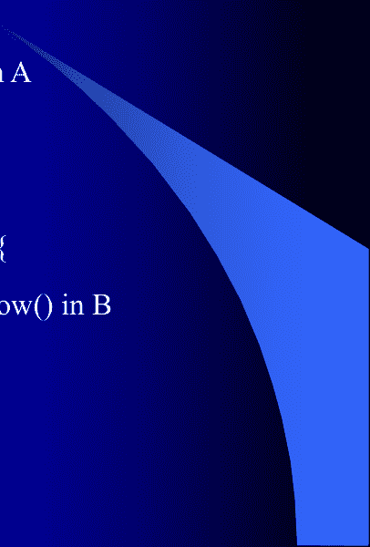


## 重载（overload）

### 例 P148下

```java
// Methods with differing type signatures are overloaded – not
// overridden.
class A {
    int i, j;
    A(int a, int b) {
        i = a;
        j = b;
    }
    // display i and j
    void show() {
        System.out.println("i and j: " + i + " " + j);
    }
}

// Create a subclass by extending class A.
class B extends A {
    int k;
    B(int a, int b, int c) {
        super(a, b);
        k = c;
    }

    // overload show()
    void show(String msg) {
        System.out.println(msg + k);
    }
}

class Overload {
    public static void main(String args[]) {
        B subOb = new B(1, 2, 3);
        subOb.show("This is k: "); // this calls show() in B
        subOb.show(); // this calls show() in A
    }
}
```

### Ans:

```text
This is k: 3
i and j: 1 2
```

## 8.6 动态方法调度（dynamic method dispatch）

- 一种在运行时而不是编译时调用重写方法的机制。
- 是 Java 实现运行时多态性的基础。
- 超类的引用变量可以引用子类对象。
- Java 根据当前被引用对象的类型来决定执行哪个版本的方法。
- Java 中的重写方法与 C++ 中的虚函数类似。

### 例 P150

```java
// Dynamic Method Dispatch
class A {
    void callme() {
        System.out.println("Inside A's callme method");
    }
}

class B extends A {
    void callme() {    // override callme()
        System.out.println("Inside B's callme method");
    }
}

class C extends A {
    void callme() {    // override callme()
        System.out.println("Inside C's callme method");
    }
}

class Dispatch {
    public static void main(String args[]) {
        A a = new A(); // object of type A
        B b = new B(); // object of type B
        C c = new C(); // object of type C
        A r;
        // obtain a reference of type A
        r = a; // r refers to an A object
        r.callme(); // calls A's version of callme
        r = b; // r refers to a B object
        r.callme(); // calls B's version of callme
        r = c; // r refers to a C object
        r.callme(); // calls C's version of callme
    }
}
```

### Ans:

- Inside A's callme method
- Inside B's callme method
- Inside C's callme method


### 8.6.1 为什么要重写方法

- 重写方法允许 Java 支持运行时多态性。
- 允许通用类指定方法，且对所有派生类都是公用的。同时该方法允许子类定义这些方法中的某些或全部的特殊实现。
- 实现多态性——“一个接口，多个方法”的另一种方式。
- 超类提供子类可以直接运用的所有元素。多态也定义了这些派生类必须自己实现的方法。
- 通过继承和重写方法的联合，超类可以定义供它的所有子类使用的方法的通用形式。

### 8.6.2 应用方法重写

- 通过继承和运行时多态的双重机制，可以定义一个被很多不同却有关的对象类型运用的一致的接口。

### 例 P151

```java
// Using run-time polymorphism.
class Figure {
    double dim1;
    double dim2;
    Figure(double a, double b) {
        dim1 = a;
        dim2 = b;
    }
    double area() {
        System.out.println("Area for Figure is undefined.");
        return 0;
    }
}
```

```java
class FindAreas {
    public static void main(String args[]) {
        Figure f = new Figure(10, 10);
        Rectangle r = new Rectangle(9, 5);
        Triangle t = new Triangle(10, 8);
        Figure figref;
        figref = r;
        System.out.println("Area is " + figref.area());
        figref = t;
        System.out.println("Area is " + figref.area());
        figref = f;
        System.out.println("Area is " + figref.area());
    }
}
```

### Ans:

```text
Inside Area for Rectangle.
Area is 45

Inside Area for Triangle.
Area is 40

Area for Figure is undefined.
Area is 0
```


## 8.7 使用抽象类

- 定义一个超类，该超类定义了一种给定结构的抽象，但不提供任何完整的方法实现。
- 创建一个只定义一个被它的所有子类共享的通用形式，由每个子类自己去填写细节。
- 为了确保子类真正重写所有必需的方法，Java 使用抽象方法（abstract method）。
- 声明一个抽象方法，通用形式：（不存在方法体）

  ```java
  abstract type name(parameter-list);
  ```

- 抽象类没有对象，一个抽象类不能通过 new 操作符直接实例化。
- 抽象类的子类必须实现超类中的所有抽象方法，或者自己也声明成 `abstract`。

### 例 P153 抽象方法类，该类后面是实现抽象方法的类

```java
// A simple demonstration of abstract.
abstract class A {
    abstract void callme();
    // concrete methods are still allowed in abstract classes
    void callmetoo() {
        System.out.println("This is a concrete method.");
    }
}

class B extends A {
    void callme() {
        System.out.println("B's implementation of callme.");
    }
}

class AbstractDemo {
    public static void main(String args[]) {
        B b = new B();
        b.callme();
        b.callmetoo();
    }
}
```


## Ans:

B's implementation of callme.
This is a concrete method.

## 例 P154

改善Figure类，从Figure派生的所有类都必须重载area()方法

```java
// Using abstract methods and classes.
abstract class Figure {
    double dim1;
    double dim2;
    Figure(double a, double b) {
        dim1 = a;
        dim2 = b;
    }
    // area is now an abstract method
    abstract double area();
}
```

```java
class Rectangle extends Figure {
    Rectangle(double a, double b) {
        super(a, b);
    }
    // override area for rectangle
    double area() {
        System.out.println("Inside Area for Rectangle.");
        return dim1 * dim2;
    }
}

class Triangle extends Figure {
    Triangle(double a, double b) {
        super(a, b);
    }
    // override area for right triangle
    double area() {
        System.out.println("Inside Area for Triangle.");
        return dim1 * dim2 / 2;
    }
}
```

```java
class AbstractAreas {

    public static void main(String args[]) {

        // Figure f = new Figure(10, 10);      // illegal now
        Rectangle r = new Rectangle(9, 5);
        Triangle t = new Triangle(10, 8);
        Figure figref;      // this is OK, no object is created, 引用变量
        figref = r;
        System.out.println("Area is " + figref.area());
        figref = t;
        System.out.println("Area is " + figref.area());
    }
}
```

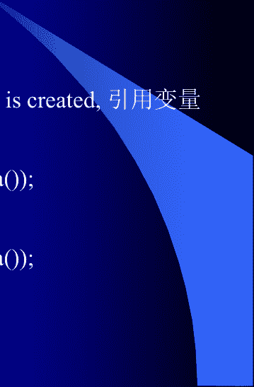

## Ans:

Inside Area for Rectangle.
Area is 45.0

Inside Area for Triangle.
Area is 40.0


## 8.8 继承中使用final

- 用来创建一个已命名常量
- 使用final阻止重写
- 使用final阻止继承


### 8.8.1 使用final阻止重写

- 声明成final的方法不能被重载

```java
class A {
    final void meth() {
        System.out.println("This is a final method.");
    }
}

class B extends A {
    void meth() {   // ERROR! Can't override. 编译错误
        System.out.println("Illegal!");
    }
}
```

- final方法可以形成内嵌代码（inline）。
- 早期绑定（early binding）。

### 8.8.2 使用final阻止继承

- 只需在类声明前加final，可防止一个类被继承
- 声明一个final类，它的所有方法也都是final。
- 声明一个既是abstract的又是final的类是不合法的。
- 下面是一个final类的例子：

```java
final class A {
    // ...
}
// The following class is illegal.
class B extends A { // ERROR! Can't subclass A
    // ...
}
```

## Object 类定义的方法及其用途

| 方法 | 用途 |
|---|---|
| `Object clone()` | 创建一个和被复制的对象完全一样的新对象 |
| `boolean equals(Object object)` | 判断对象内容是否相等 |
| `void finalize()` | 在一个不常用的对象被使用前调用 |
| `Class getClass()` | 获取运行时一个对象的类 |
| `int hashCode()` | 返回调用对象有关的散列值 |
| `void notify()` | 恢复一个等待调用对象线程的执行 |
| `void notifyAll()` | 恢复所有等待调用对象线程的执行 |
| `String toString()` | 返回描述对象的一个字符串，`println()` 输出时自动调用。很多类重载该方法。 |
| `void wait()` | 等待另一个线程的执行 |
| `void wait(long milliseconds)` | 等待指定毫秒数 |
| `void wait(long milliseconds, int nanoseconds)` | 等待指定毫秒数和纳秒数 |

注：`getClass()`、`notify()`、`notifyAll()` 和 `wait()` 被定义成 `final`。

## 第1部分 Java语言

## 第09章 包和接口

- 包（package）是类的容器，用来保存划分的类名空间。
- 包允许创建一个类，可以保存在自己的包中而不用考虑和其他地方的某个同名类相冲突。
- 接口可以定义一系列的被一个类或多个类执行的方法。
- 接口自己不定义任何实现。
- 与抽象类相似，接口有一个特殊的功能：类可以实现多个接口。
- 类只能继承一个超类（抽象类或其他）。

## Java源程序可以包含下面的四个内部部分的任何一个（或所有）：

- 单个接口声明（可选）
- 任意数目的引入语句（可选）
- 单个公共类声明（必须）
- 对包来说是私有的任意数目的类（可选）

## 9.1 包

- 在前面的章节，每个类名从相同的名称空间获得。
- 为避免名称冲突每个类都必须用惟一的名称。
- Java提供了把类名空间划分为易管理的块的机制——包。
- 包既是命名机制也是可见度控制机制。
- 在包内定义类，包外的代码不能访问该类，类相互之间有隐私。

### 9.1.1 定义包

- 创建包：用一个package命令作为一个Java源文件的第一句语句。
- 该文件中定义的任何类将属于指定的包。
- package语句定义了一个存储类的名字空间。
- 若省略package 语句，类名被包含在一个默认的没有名称的包。
- 多数情况，需要为自己的代码定义一个包。

## package 声明的通用形式：

- 创建了一个名为MyPackage的包：
  ```java
  package MyPackage;
  ```
- Java用文件系统目录来存储包。
- 任何声明的MyPackage中类的.class文件被存储在一个MyPackage目录中。
- 目录名必须和包名严格匹配。
- 多个文件可以包含相同package声明。
- 多级包的声明：`package pkg1[.pkg2[.pkg3]];`
- 包层次要在Java开发系统的文件系统中有所反映。
  例如：`package java.awt.image;`
- 注意：
  - UNIX：`java/awt/image`
  - Windows：`java\awt\image`
  - Macintosh：`java:awt:image`


### 9.1.3 一个简短的包的例子

```java
// A simple package
package MyPack;
class Balance {
  String name;
  double bal;
  Balance(String n, double b) {
    name = n;
    bal = b;
  }
  void show() {
    if(bal<0)
      System.out.print("--> ");
    System.out.println(name + ": $" + bal);
  }
}
```

```java
class AccountBalance {
public static void main(String args[]) {
Balance current[] = new Balance[3];
current[0] = new Balance("K. J. Fielding", 123.23);
current[1] = new Balance("Will Tell", 157.02);
current[2] = new Balance("Tom Jackson", -12.33);
for(int i=0; i<3; i++) current[i].show();
}
}
```

Ans:
K. J. Fielding: $123.23
Will Tell: $157.02
--> Tom Jackson: $-12.33

## 运行程序：

- 文件 AccountBalance.java，存放在 MyPack 目录中。
- 编译文件。
- 确信结果文件.class在MyPack 目录中。
- 命令行执行 AccountBalance 类：
  ```
  java MyPack.AccountBalance
  ```
- 执行该命令时必须在MyPack的上级目录，或者把类路径环境变量设置成合适的值。
- 不能用下面的命令行：
  ```
  java AccountBalance
  ```
- AccountBalance必须和它的包名一起使用。
- JBuilder

## 9.2 访问保护

- 类和包都是封装和容纳名称空间和变量及方法范围的方法。
- 包是盛装类和下级包的容器。
- 类就像是数据和代码的容器。类是Java的最小的抽象单元。
- Java将类成员的可见度分为四个种类：
  - 相同包中的子类
  - 相同包中的非子类
  - 不同包中的子类
  - 既不在相同包又不在相同子类中的类
- 三个访问控制符，private、public 和 protected

## 类成员访问

| | Private 成员 | 默认 成员 | Protected 成员 | Public 成员 |
|---|---|---|---|---|
| 同一类中可见 | 是 | 是 | 是 | 是 |
| 同一个包中对子类可见 | 否 | 是 | 是 | 是 |
| 同一个包中对非子类可见 | 否 | 是 | 是 | 是 |
| 不同包中对子类可见 | 否 | 否 | 是 | 是 |
| 不同的包中对非子类可见 | 否 | 否 | 否 | 是 |

### 9.2.1 一个访问的例子

下面是Protection.java文件：

```java
package p1;
public class Protection {
    int n = 1;
    private int n_pri = 2;
    protected int n_pro = 3;
    public int n_pub = 4;
    public Protection() {
        System.out.println("base constructor");
        System.out.println("n = " + n);
        System.out.println("n_pri = " + n_pri);
        System.out.println("n_pro = " + n_pro);
        System.out.println("n_pub = " + n_pub);
    }
}
```

P162

下面是Derived.java文件：

```java
package p1;

class Derived extends Protection {
    Derived() {
        System.out.println("derived constructor");
        System.out.println("n = " + n);
        // class only
        // System.out.println("n_pri = " + n_pri);
        System.out.println("n_pro = " + n_pro);
        System.out.println("n_pub = " + n_pub);
    }
}
```

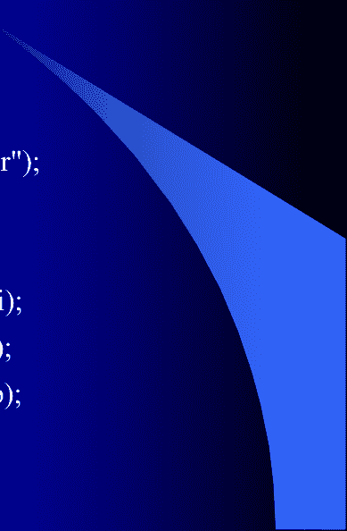

下面是SamePackage.java文件：

```java
package p1;
class SamePackage {
    SamePackage() {
        Protection p = new Protection();
        System.out.println("same package constructor");
        System.out.println("n = " + p.n);
        // class only
        // System.out.println("n_pri = " + p.n_pri);
        System.out.println("n_pro = " + p.n_pro);
        System.out.println("n_pub = " + p.n_pub);
    }
}
```

下面是Protection2.java文件：

```java
package p2;
class Protection2 extends p1.Protection {
    Protection2() {
        System.out.println("derived other package constructor");
        // class or package only
        // System.out.println("n = " + n);
        // class only
        // System.out.println("n_pri = " + n_pri);
        System.out.println("n_pro = " + n_pro);
        System.out.println("n_pub = " + n_pub);
    }
}
```

下面是OtherPackage.java文件：

```java
package p2;
class OtherPackage {
    OtherPackage() {
        p1.Protection p = new p1.Protection();
        System.out.println("other package constructor");
        // class or package only
        // System.out.println("n = " + p.n);
        // class only
        // System.out.println("n_pri = " + p.n_pri);
        // class, subclass or package only
        // System.out.println("n_pro = " + p.n_pro);
        System.out.println("n_pub = " + p.n_pub);
    }
}
```

// Demo package p2.
package p2;
// Instantiate the various classes in p2.
public class Demo {
public static void main(String args[]) {
Protection2 ob1 = new Protection2();
OtherPackage ob2 = new OtherPackage();
}
}


## 9.3 引入包

- 为每个使用的包写一个长的逗点分离的包路径名是枯燥的。
- Java使用import语句来引入特定的类甚至是整个包。
- import声明的通用形式：
  ```java
  import pkg1[.pkg2].(classname|*);
  ```
- 星号表明Java编译器应该引入整个包（星号会增加编译时间，对运行时间性能和类的大小没有影响。）
- 若星号引用两个包中有同类名的类，编译器不报错，运行则出编译错误，且必须明确的命明指定包中的类。
- 有import语句的例子如下：
  ```java
  import java.util.*;
  class MyDate extends Date {
  }
  ```
- 没有import语句的例子如下：
  ```java
  class MyDate extends
  java.util.Date {
  }
  ```

## 例P165

## package的使用

```java
package MyPack;
/* Now, the Balance class, its constructor, and its
show() method are public. This means that they can
be used by non-subclass code outside their package.
*/
public class Balance {
String name;
double bal;
public Balance(String n, double b) {
name = n;
bal = b;
}
public void show() {
if(bal<0)
System.out.print(
```

## 9.4 接口 (interface)

- 用 interface，可以指定一个类必须做什么，而不是规定它如何去做。
- 接口在语句上与类相似，但缺少实例变量，且定义的方法是不含方法体的。
- 一个类可以实现多个接口。
- Java允许利用多态性的“一个接口，多个方法”。
- 因为接口是在和类不同的层次中，与类层次无关的类实现相同的接口是可行的。
- 接口完成C++的多重继承


### 9.4.1 接口定义

- 接口定义的通用形式：

```
access interface name { // access是public，或无修饰符
return-type method-name1(parameter-list); // 抽象方法
return-type method-name2(parameter-list);
type final-varname1 = value; // final 和static型， 以常量值初始化
type final-varname2 = value;
// ...
return-type method-nameN(parameter-list);
type final-varnameN = value;
}
```

- 接口定义的例子：

```
interface Callback {
void callback(int param);
}
```

### 9.4.2 实现接口

- 接口被定义后，一个或多个类可以实现该接口。
- 在类定义中包括implements子句，然后创建接口定义的方法。
- implements类的一般形式如下：
  ```java
  access class classname [extends superclass]
  [implements interface [,interface...]] {
  // access是public，或无修饰符
  // 如果一个类实现多个接口，这些接口被逗号分隔
  // class-body //方法必须声明成public。
  //方法的类型须与接口定义类型相匹配。
  }
  ```

实现Callback接口的例子程序：

```java
class Client implements Callback {
// Implement Callback's interface
public void callback(int p) { // 必须声明成public
System.out.println("callback called with " + p);
}
}
```

定义它自己的附加的成员：

```java
class Client implements Callback {
// Implement Callback's interface
public void callback(int p) {
System.out.println("callback called with " + p);
}
void nonIfaceMeth() { // 增加了nonIfaceMeth()方法
System.out.println("Classes that implement interfaces " +
"may also define other members, too.");
}
}
```

## 通过接口引用实现接口

- 可以把变量定义成接口对象引用而不是类的类型。
- 通过引用调用方法时，方法被正确调用。这是接口的最显著特性之一。
- 被执行的方法在运行时动态操作，允许在调用方法代码后创建类。
- 调用代码在完全不知“调用者”的情况下可以通过接口来调度。
- Java中在运行时动态查询方法比通常的方法调用有庞大的花费

例：接口引用变量调用callback()方法：

```java
class TestIface {
public static void main(String args[]) {
Callback c = new Client();
c.callback(42);
}
}
```

Ans：

callback called with 42
//变量c被定义成接口类型Callback，且被Client实例赋值。
//c可访问Callback()方法，不能访问Client类中的其他成员。
//接口引用变量仅知道被其接口声明的方法，因此，c不能访问nonIfceMeth() 。

## 引用的多态功能

```java
// Another implementation of Callback.
class AnotherClient implements Callback {
    // Implement Callback's interface
    public void callback(int p) {
        System.out.println("Another version of callback");
        System.out.println("p squared is " + (p*p));
    }
}
class TestIface2 {
    public static void main(String args[]) {
        Callback c = new Client();
        AnotherClient ob = new AnotherClient();
        c.callback(42);
        c = ob;  // c now refers to AnotherClient object
        c.callback(42);
    }
}
```

Ans:

callback called with 42
Another version of callback
p squared is 1764


## 局部实现

- 如果类包含一个接口但不完全实现接口定义的方法，那么该类必须定义成 abstract 型。
- 例如：
  ```java
  abstract class Incomplete implements Callback {
  int a, b;
  void show() {
  System.out.println(a + " " + b);
  }
  // ...
  }
  ```
- 任何继承Incomplete的类都必须实现 callback() 方法或者它自己定义成 abstract 类。


### 9.4.3 应用接口

- 开发一个名为Stack的类。

- 堆栈的大小可以固定也可以不固定。堆栈还可以保存在数组、链表和二叉树中等。

- 堆栈的接口保持不变。push()和pop()方法定义了独立实现细节的堆栈的接口。

- 堆栈的接口与它的实现是分离的。

### 例P170 定义—整数堆栈接口，保存在IntStack.java文件中

```java
// Define an integer stack interface
interface IntStack {
    void push(int item);   // store an item
    int pop();             // retrieve an item
}
```

### 例P170 该类实现一个固定长度的整数堆栈

```java
// An implementation of IntStack that uses fixed storage.
class FixedStack implements IntStack {
    private int stck[];    private int tos;
    // allocate and initialize stack
    FixedStack(int size) {    stck = new int[size];    tos = -1;    }
    // Push an item onto the stack
    public void push(int item) {
        if(tos == stck.length-1)          // use length member
            System.out.println("Stack is full.");
        else
            stck[++tos] = item;
    }
    public int pop() {                    // Pop an item from the stack
        if(tos < 0) {
            System.out.println("Stack underflow.");
            return 0;
        }
        else    return stck[tos--];
    }
}
```

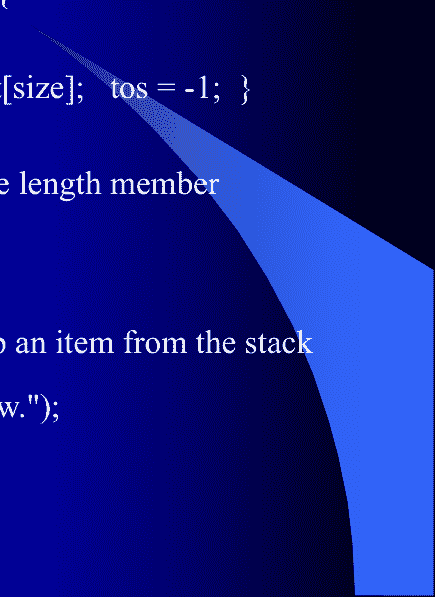

```java
class IFTest {
    public static void main(String args[]) {
        FixedStack mystack1 = new FixedStack(5);
        FixedStack mystack2 = new FixedStack(8);
        // push some numbers onto the stack
        for(int i=0; i<5; i++) mystack1.push(i);
        for(int i=0; i<8; i++) mystack2.push(i);
        // pop those numbers off the stack
        System.out.println("Stack in mystack1:");
        for(int i=0; i<5; i++)
            System.out.println(mystack1.pop());
        System.out.println("Stack in mystack2:");
        for(int i=0; i<8; i++)
            System.out.println(mystack2.pop());
    }
}
```


### 例P171 相同接口定义IntStack 创建了动态堆栈

```java
// Implement a "growable" stack.
class DynStack implements IntStack {
    private int stack[];
    private int tos;
    // allocate and initialize stack
    DynStack(int size) {
        stack = new int[size]; tos = -1;
    }

    // Push an item onto the stack
    public void push(int item) { // if stack is full, allocate a larger stack
        if(tos==stack.length-1) {
            int temp[] = new int[stack.length * 2];     // double size
            for (int i=0; i<stack.length; i++) temp[i] = stack[i];
            stack = temp;
            stack[++tos] = item;
        }
        else
            stack[++tos] = item;
    }

    // Pop an item from the stack
    public int pop() {
        if(tos < 0) {
            System.out.println("Stack underflow."); return 0;
        }
        else return stack[tos--];
    }
}

class IFTest2 {
    public static void main(String args[]) {
        DynStack mystack1 = new DynStack(5);
        DynStack mystack2 = new DynStack(8);
        // these loops cause each stack to grow
        for(int i=0; i<12; i++) mystack1.push(i);
        for(int i=0; i<20; i++) mystack2.push(i);
        System.out.println("Stack in mystack1:");
        for(int i=0; i<12; i++)
            System.out.println(mystack1.pop());
        System.out.println("Stack in mystack2:");
        for(int i=0; i<20; i++)
            System.out.println(mystack2.pop());
    }
}
```

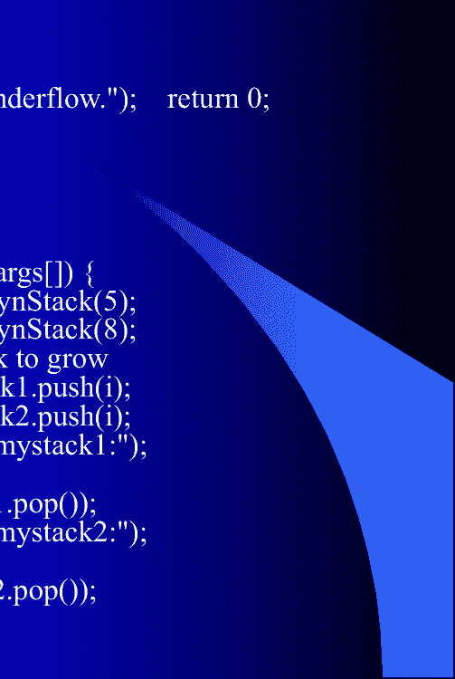

### 例P172 对push() 和 pop()的调用在运行时解决。

```java
/* Create an interface variable and access stacks through it.*/
class IFTest3 {
public static void main(String args[]) {
IntStack mystack; // create an interface reference variable
DynStack ds = new DynStack(5);
FixedStack fs = new FixedStack(8);
mystack = ds; // load dynamic stack
for(int i=0; i<12; i++) mystack.push(i); // push some numbers onto stack
mystack = fs; // load fixed stack
for(int i=0; i<8; i++) mystack.push(i);
mystack = ds;
System.out.println("Values in dynamic stack:");
for(int i=0; i<12; i++) System.out.println(mystack.pop());
mystack = fs;
System.out.println("Values in fixed stack:");
for(int i=0; i<8; i++) System.out.println(mystack.pop());
}
}
```


### 9.4.4 接口中的变量

- 使用接口来引入多个类的共享常量。
- 只需包含变量初始化简单的声明。
- 一个类中包含那个接口（就是说当你实现了接口时），所有的这些变量名都将作为常量看待。
- 就像类在类名字空间引入常量作final变量。

## 例P173

## 实现一个自动的“作决策者”

```java
import java.util.Random;
interface SharedConstants {
    int NO = 0; int YES = 1; int MAYBE = 2; int LATER = 3;
    int SOON = 4; int NEVER = 5;
}
class Question implements SharedConstants {
    Random rand = new Random();             // Random类提供伪随机机
    int ask() {
        int prob = (int) (100 * rand.nextDouble()); // 返回0.0到1.0之间的随机数
        if (prob < 30)  return NO;                  // 30%
        else if (prob < 60) return YES;             // 30%
        else if (prob < 75) return LATER;           // 15%
        else if (prob < 98) return SOON;            // 13%
        else return NEVER;                          // 2%
    }
}

class AskMe implements SharedConstants {
    static void answer(int result) {
        switch(result) {
            case NO:
                System.out.println("No");
                break;
            case YES:
                System.out.println("Yes");
                break;
            case MAYBE:
                System.out.println("Maybe");
                break;
            case LATER:
                System.out.println("Later");
                break;
            case SOON:
                System.out.println("Soon");
                break;
            case NEVER:
                System.out.println("Never");
                break;
        }
    }
}

public static void main(String args[]) {
    Question q = new Question();
    answer(q.ask());
    answer(q.ask());
    answer(q.ask());
    answer(q.ask());
}
```

Ans:  // 注意每次运行结果不同

- Later
- Soon
- No
- Yes


## 例P174

## 接口继承链表

```java
// One interface can extend another.
interface A {
    void meth1();
    void meth2();
}
// B now includes meth1() and meth2() -- it adds meth3().
interface B extends A {
    void meth3();
}
// This class must implement all of A and B
class MyClass implements B {
    public void meth1() {
        System.out.println("Implement meth1().");
    }
    public void meth2() {
        System.out.println("Implement meth2().");
    }
    public void meth3() {
        System.out.println("Implement meth3().");
    }
}

class IFExtend {
    public static void main(String arg[]) {
        MyClass ob = new MyClass();
        ob.meth1();
        ob.meth2();
        ob.meth3();
    }
}
```

Ans:
Implement meth1().
Implement meth2().
Implement meth3().

## 第1部分 Java语言

## 第10章 异常处理

- 异常(exception)是在运行时，代码序列中产生一种异常情况。
- 异常是一个运行时错误。
- 不支持异常处理的计算机语言中，错误必须被手工的检查和处理。
- Java的异常处理避免手工的检查和处理，而且把运行时错误的管理带到了面向对象的世界。


## 10.1 异常处理基础

- 当异常发生，代表该异常的对象被创建，且在导致该错误的方法中被引发（throw）。
- 该方法可以选择自己处理异常或传递该异常。
- 该异常被捕获（caught）并处理。
- 异常可能是由Java运行时系统产生，或者是由你的手工代码产生。
- 被Java引发的异常与违反语言规范或超出Java执行环境限制的基本错误有关。

## 5个关键字：try、catch、throw、throws和finally

- **Try：** 异常监控包含在一个try块中。
- **Catch：** 在try块中发生异常，它被抛出。代码捕捉这个异常（用catch）并且用方法处理该异常。
- 系统产生的异常被Java运行时系统自动引发。
- **Throw：** 手动引发一个异常，用关键字throw。
- **Throws：** 任何被引发方法的异常须通过throws子句定义。
- **Finally：** 方法返回前绝对被执行的代码被放置在finally块中。

## 异常处理块的通常形式：

```java
try {
// block of code to monitor for errors
} // ExceptionType 是发生异常的类型
catch (ExceptionType1 exOb) {
// exception handler for ExceptionType1
}
catch (ExceptionType2 exOb) {
// exception handler for ExceptionType2
}
// ...
finally {
// block of code to be executed before try block ends
}
```

## 10.3 未被捕获的异常

- 程序包括被零除错误的表达式：

```java
class Exc0 {
    public static void main(String args[]) {
        int d = 0;
        int a = 42 / d;
    }
}
```

- 标准javaJDK解释器执行该程序所产生的输出：

```
java.lang.ArithmeticException: / by zero
at Exc0.main(Exc0.java:4)
```

## 程序的另一个版本

```java
class Exc1 {
    static void subroutine() {
        int d = 0;
        int a = 10 / d;
    }
    public static void main(String args[]) {
        Exc1.subroutine();
    }
}
```

- 标准javaJDK解释器执行该程序所产生的输出：

```
java.lang.ArithmeticException: / by zero
at Exc1.subroutine(Exc1.java:4)  //该方法在第4行导致了异常。
at Exc1.main(Exc1.java:7)       //栈底是main第7行，调用subroutine()方法
```


## 例P179

### 发生被零除错误，程序继续运行

```java
// Handle an exception and move on.
import java.util.Random;
class HandleError {
    public static void main(String args[]) {
        int a=0, b=0, c=0;
        Random r = new Random();
        for(int i=0; i<32000; i++) {
            try {
                b = r.nextInt();
                c = r.nextInt();
                a = 12345 / (b/c);
            } catch (ArithmeticException e) {
                System.out.println("Division by zero.");
                a = 0; // set a to zero and continue
            }
            System.out.println("a: " + a);
        }
    }
}
```

## 10.4.1 显示一个异常的描述

- Throwable重载toString()方法（由Object定义），它返回一个包含异常描述的字符串。
- 你可以通过在println()中传给异常一个参数来显示该异常的描述。

catch块可以被重写成

```java
catch (ArithmeticException e) {
    System.out.println("Exception: " + e);
    a = 0;   // set a to zero and continue
}
```

输出：
Exception: java.lang.ArithmeticException: / by zero

## 10.5 使用多重catch语句

- 由单个代码段可能引起多个异常。
- 可以定义多个catch子句，每个子句捕获一种类型的异常。
- 每一个catch子句被依次检查，第一个匹配异常类型的子句执行。
- 当一个catch语句执行以后，其他的子句被旁路。
- 继续从try/catch块以后的代码执行。

## Ans:

C:\>java MultiCatch   // 无命令行参数
a = 0
Divide by 0: java.lang.ArithmeticException: / by zero
After try/catch blocks.

C:\>java MultiCatch TestArg   // 有命令行参数
a = 1
Array index oob: java.lang.ArrayIndexOutOfBoundsException
After try/catch blocks.

## 例P181 父类异常和子类异常的catch语句的顺序

```java
/* This program contains an error. A subclass must come before its
   superclass in a series of catch statements. If not, unreachable
   code will be created and a compile-time error will result. */
class SuperSubCatch {
   public static void main(String args[]) {
      try {
         int a = 0;  int b = 42 / a;
      } catch(Exception e) {
         System.out.println("Generic Exception catch.");
      }

      /* This catch is never reached because
         ArithmeticException is a subclass of Exception. */
      catch(ArithmeticException e) {  // ERROR - unreachable
         System.out.println("This is never reached.");
      }
   }
}
```

## 10.6 嵌套try语句

- 一个try语句可以在另一个try块内部。
- 每次进入try语句，异常的前后关系都会被推入堆栈。
- 若一个内部的try语句不含匹配的catch处理程序，堆栈将弹出，下一个try语句的catch将检查是否与之匹配。
- 过程继续直到一个catch语句匹配成功，或直到所有嵌套try语句被检查耗尽。
- 若无catch匹配，Java运行系统将处理这个异常。

## 例P181

### 嵌套try语句

```java
// An example of nested try statements.
class NestTry {
    public static void main(String args[]) {
        try {
            int a = args.length;
            int b = 42 / a;
            System.out.println("a = " + a);
            try {
                if(a == 1) a = a/(a-a);
                if(a == 2) {
                    int c[] = { 1 };
                    c[42] = 99;
                }
            } catch(ArrayIndexOutOfBoundsException e) {
                System.out.println("Array index out-of-bounds: " + e);
            }
        } catch(ArithmeticException e) {
            System.out.println("Divide by 0: " + e);
        }
    }
}
```

## Ans:

C:\>java NestTry
Divide by 0: java.lang.ArithmeticException: / by zero

C:\>java NestTry One
a = 1
Divide by 0: java.lang.ArithmeticException: / by zero

C:\>java NestTry One Two
a = 2
Array index out-of-bounds:
java.lang.ArrayIndexOutOfBoundsException

## 例P182 嵌套的try块移到了方法nesttry()内部

```java
/* Try statements can be implicitly nested via calls to methods. */
class MethNestTry {
    static void nesttry(int a) {
        try {                                  // nested try block
            if(a==1) a = a/(a-a);              // division by zero
            if(a==2) {
                int c[] = {1};
                c[42] = 99;                    // generate an out-of-bounds exception
            }
        } catch(ArrayIndexOutOfBoundsException e) {
            System.out.println("Array index out-of-bounds: " + e);
        }
    }

    public static void main(String args[]) {
        try {
            int a = args.length;
            int b = 42 / a;
            System.out.println("a = " + a);
            nesttry(a);
        } catch(ArithmeticException e) {
            System.out.println("Divide by 0: " + e);
        }
    }
}
```

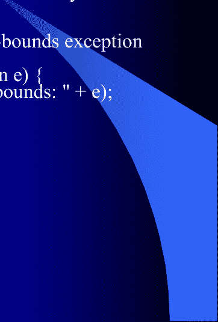


## 10.7 引发（throw）

- 程序可用throw语句引发明确的异常。
- Throw语句的通常形式如下：

```java
throw ThrowableInstance;    // Throwable类或子类对象
```

- 两种获得Throwable对象的方法：
  在catch子句中使用参数或者用new操作符创建。
- 程序执行在throw语句之后立即停止；后面的语句不被执行。
- 最外围的try块检查是否含有一个与异常类型匹配的catch语句。如果发现了匹配的块，控制转向该语句；
- 如果没有发现，次包围的try块来检查，以此类推。
- 如果没有发现匹配的catch块，默认异常处理程序中断程序的执行并且打印堆栈轨迹。

## 例P184 创建并引发异常，再把它引发给外层的处理程序

```java
// Demonstrate throw.
class ThrowDemo {
  static void demoproc() {
    try {
      throw new NullPointerException("demo");
    } catch(NullPointerException e) {
      System.out.println("Caught inside demoproc.");
      throw e;        // rethrow the exception
    }
  }

  public static void main(String args[]) {
    try {
      demoproc();
    } catch(NullPointerException e) {
      System.out.println("Recaught: " + e);
    }
  }
}
```

Ans:

Caught inside demoproc.  
Recaught: java.lang.NullPointerException: demo

// Java内置的异常有两个构造函数：一个没有参数，  
// 一个带有一个字符串参数。  
// 第二种形式时，参数指定描述异常的字符串。  
// 用作print()或println()的参数时，该字符串被显示。  
// 可调用getMessage()(由Throwable所定义)得到该字符串

## throws子句的方法声明的通用形式：

```java
type method-name(parameter-list) throws exception-list
{
// body of method
}
```

// exception-list是该方法引发的以有逗号分割的异常列表

## 例P185上

没有指定一个throws子句

```java
// This program contains an error and will not compile.
class ThrowsDemo {
    static void throwOne() {
        System.out.println("Inside throwOne.");
        // 因为程序没有指定一个throws子句来声明这一事实
        throw new IllegalAccessException("demo");
    }
    public static void main(String args[]) {
        throwOne();
    }
}
// 程序不会编译
```

## 例P185下

指定了throws子句

```java
// This is now correct.
class ThrowsDemo {
    static void throwOne() throws IllegalAccessException {
        System.out.println("Inside throwOne.");
        throw new IllegalAccessException("demo");
    }
    public static void main(String args[]) {
        try {
            throwOne();
        } catch (IllegalAccessException e) {
            System.out.println("Caught " + e);
        }
    }
}
```

Ans:

inside throwOne  
caught java.lang.IllegalAccessException: demo

## 例P186

3种退出方法，都执行finally子句

```java
// Demonstrate finally.
class FinallyDemo {
    // Through an exception out of the method.
    static void procA() {
        try {
            System.out.println("inside procA");
            throw new RuntimeException("demo");
        } finally {
            System.out.println("procA's finally");
        } //引发一个异常中断了try。Finally子句在退出时执行
    }

    // Return from within a try block.
    static void procB() {
        try {
            System.out.println("inside procB");
            return;
        } finally {
            System.out.println("procB's finally");
        }
    }
```


```java
// Execute a try block normally.
static void procC() {
    try {
        System.out.println("inside procC");
    } finally {
        System.out.println("procC's finally");
    }
}

public static void main(String args[]) {
    try {
        procA();
    } catch (Exception e) {
        System.out.println("Exception caught");
    }
    procB();
    procC();
}
```

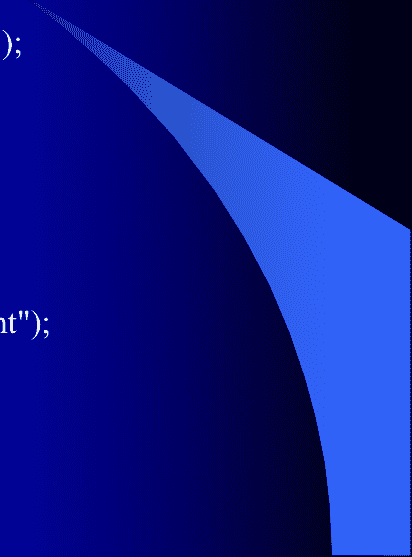

## 10.10 Java的内置异常

- 在标准包java.lang中，Java定义了若干个异常类。
- 因为java.lang实际上被所有的Java程序引入，多数从RuntimeException派生的异常都自动可用。
- 不需要throws子句，未经检查的异常。
- 需要throws子句，受检查的异常。

## java.lang中定义的未经检查异常子类

| 异常 | 说明 |
|---|---|
| ArithmeticException | 算术错误，如被0除 |
| ArrayIndexOutOfBoundsException | 数组下标出界 |
| ArrayStoreException | 数组元素赋值类型不兼容 |
| ClassCastException | 非法强制转换类型 |
| IllegalArgumentException | 调用方法的参数非法 |
| IllegalMonitorStateException | 非法监控操作，如等待一个未锁定线程 |
| IllegalStateException | 环境或应用状态不正确 |
| IllegalThreadStateException | 请求操作与当前线程状态不兼容 |
| IndexOutOfBoundsException | 某些类型索引越界 |
| NullPointerException | 非法使用空引用 |
| NumberFormatException | 字符串到数字格式非法转换 |
| SecurityException | 试图违反安全性 |
| StringIndexOutOfBounds | 试图在字符串边界之外索引 |
| UnsupportedOperationException | 遇到不支持的操作 |


## java.lang 中定义的检查异常

| 异常 | 意义 |
|---|---|
| ClassNotFoundException | 找不到类 |
| CloneNotSupportedException | 试图克隆一个不能实现 Cloneable 接口的对象 |
| IllegalAccessException | 对一个类的访问被拒绝 |
| InstantiationException | 试图创建一个抽象类或者抽象接口的对象 |
| InterruptedException | 一个线程被另一个线程中断 |
| NoSuchFieldException | 请求的字段不存在 |
| NoSuchMethodException | 请求的方法不存在 |

## 10.11 创建自己的异常子类

- 建立自己的异常类型来处理特殊情况。
- 定义Exception的一个子类，（Exception是Throwable的一个子类）。
- 创建的子类不需要实际执行什么。
- 创建的子类可以获得Throwable定义的方法。
- 创建的异常类中可覆盖一个或多个方法。

## Throwable 定义的方法

| 方法 | 描述 |
|---|---|
| `Throwable fillInStackTrace()` | 返回一个包含完整堆栈轨迹的 `Throwable` 对象，该对象可能被再次引发 |
| `String getLocalizedMessage()` | 返回一个异常的局部描述 |
| `String getMessage()` | 返回一个异常的描述 |
| `void printStackTrace()` | 显示堆栈轨迹 |
| `void printStackTrace(PrintStream stream)` | 把堆栈轨迹送到指定的流 |
| `String toString()` | 返回一个包含异常描述的 `String` 对象。当输出一个 `Throwable` 对象时，该方法被 `println()` 调用 |

## 例P189

## 创建自己的异常子类

```java
// This program creates a custom exception type.
class MyException extends Exception {
  private int detail;
  MyException(int a) {
    detail = a;
  }
  public String toString() {
    return "MyException[" + detail + "]";
  }
}
```

```java
class ExceptionDemo {
static void compute(int a) throws MyException {
System.out.println("Called compute(" + a + ")");
if(a > 10)
throw new MyException(a);
System.out.println("Normal exit");
}
public static void main(String args[]) {
try {
compute(1);
compute(20);
} catch (MyException e) {
System.out.println("Caught " + e);
}
}
}
```

Ans:

Called compute(1)
Normal exit
Called compute(20)
Caught MyException[20]

## 10.12 使用异常

- 异常处理为控制复杂程序提供了一个强大的机制。
- 把try，throw，和catch当成处理错误条件是很重要的。
- 当方法失败时，引发一个异常。这是处理失败模式的一个更简洁的方法。
- Java的异常处理语句不应该被当作是一个非本地分支的通常机制。

## 第1部分 Java语言

## 第11章 多线程编程

- Java内置支持多线程编程。
- 多线程程序包含两条或两条以上并发运行的部分。
- 多线程是多任务处理的一种特殊形式。
- 多任务处理有两种类型：基于进程和基于线程。
- 进程(process)是一个执行的程序。程序是调度程序所分派的最小代码单位。
- 进程是重量级的任务，需要分配自己独立的地址空间。
- 进程间通信是昂贵和受限的。进程间的转换是高成本的。
- 线程(thread)的多任务处理环境中，线程是最小的执行单位。
- 线程是轻量级的任务。
- 线程共享相同的地址空间且共同分享同一个进程。
- 线程间通信是便宜的，线程间的转换是低成本的。
- 因为空闲时间保持最低，多线程最大利用CPU。

## 11.1 Java线程模型

- 单线程处理使用一种轮询的事件循环方法。
- 单线程在一无限循环中运行，轮询一个事件序列来决定下一步做什么。
- 直到事件处理程序返回，系统中没有其他事件发生。这就浪费了CPU时间。
- 单线程环境，当一个线程因为等待资源时阻塞，整个程序停止运行。
- 多线程的优点在于取消了主循环/轮询机制。
- 一个线程可以暂停而不影响程序的其他部分。
- 多线程允许活的循环在每一帧间隙中沉睡一秒而不暂停整个系统。
- 在Java程序中出现线程阻塞，仅有一个线程暂停，其他线程继续运行。
- 线程状态：运行、挂起、恢复、阻塞、终止。

### 11.1.2 同步性

- 多线程在程序中引入了异步行为，所以必须要加强同步性。
- Java在进程间同步性方法：管程（monitor）。
- 一旦线程进入管程，所有线程必须等待直到该线程退出了管程。管程可以用来防止共享的资源被多个线程操纵。
- Java没有“Monitor”类：当对象的同步方法被调用时管程自动载入隐式管程。
- 一个线程包含在一个同步方法中，没有其他线程可以调用相同对象的同步方法。

### 11.1.3 消息传递

- 程序分成若干线程后，就要定义各线程之间的联系。
- Java提供了多线程间会话的简洁、低成本途径——通过调用所有对象都有的预先确定的方法。
- Java的消息传递系统允许一个线程进入一个对象的一个同步方法，然后在那里等待，直到其他线程明确通知它。

### 11.1.4 Thread 类和Runnable 接口

- 为创建一个新的线程，你的程序必须扩展Thread或实现Runnable接口。

管理线程的方法

| 方法 | 意义 |
|---|---|
| getName | 获得线程名称 |
| getPriority | 获得线程优先级 |
| jsAlive | 判定线程是否仍在运行 |
| join | 等待一个线程终止 |
| run | 线程的入口点。 |
| sleep | 在一段时间内挂起线程 |
| start | 通过调用运行方法来启动线程 |

## 11.2 主线程

- 当Java程序启动时，一个线程立刻运行，该线程通常叫做程序的主线程（main thread）。
- 它是产生其他子线程的线程。
- 它必须最后完成执行（因为它执行各种关闭动作）。
- 主线程可以由一个Thread对象控制。
- 调用方法currentThread()获得它的一个引用：
  static Thread currentThread()
  // 返回一个调用它的线程的引用

## 例P194

## 调用 currentThread()

```java
// Controlling the main Thread.
class CurrentThreadDemo {
    public static void main(String args[]) {
        Thread t = Thread.currentThread();
        System.out.println("Current thread: " + t);
        // change the name of the thread
        t.setName("My Thread");        //改变线程的内部名称
        System.out.println("After name change: " + t);
        try {
            for(int n = 5; n > 0; n--) {
                System.out.println(n);
                Thread.sleep(1000);      // Sleep() 规定延迟单位是1毫秒
            }
        } catch (InterruptedException e) {
            System.out.println("Main thread interrupted");
        }
    }
}
```


## 11.3 创建线程

- 实现 Runnable 接口。
- 可以继承 Thread 类。

## 创建一个实现 Runnable 接口的类

- 通过实现 Runnable 接口的方法创建每一个对象的线程。
- 一个类仅需实现一个 run() 的简单方法：该方法声明如下：

  ```java
  public void run()
  ```

  // run() 可以调用其他方法，引用其他类，声明变量。
  // 当 run() 返回时，该线程结束。

- 实现 Runnable 接口的类以后，在类内部实例化一个 Thread 类的对象：

  ```java
  Thread(Runnable threadOb, String threadName)
  ```

- 调用 start() 方法，执行的是一个对 run() 的调用。

  ```java
  void start()
  ```

## 例 P196

## 创建一个新的线程并启动它运行

```java
// Create a second thread.
class NewThread implements Runnable {
  Thread t;
  NewThread() {
    // 表明在 this 对象中你想要新的线程调用 run() 方法
    t = new Thread(this, "Demo Thread");
    System.out.println("Child thread: " + t);
    t.start();                 // Start the thread
  }
  public void run() {
    try {
      for (int i = 5; i > 0; i--) {
        System.out.println("Child Thread: " + i);
        Thread.sleep(500);
      }
    } catch (InterruptedException e) {
      System.out.println("Child interrupted.");
    }
    System.out.println("Exiting child thread.");
  }
}
```

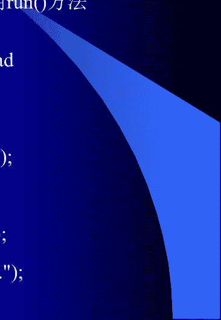

```java
class ThreadDemo {
  public static void main(String args[]) {
    new NewThread(); // create a new thread
    try {
      for (int i = 5; i > 0; i--) {
        System.out.println("Main Thread: " + i);
        Thread.sleep(1000);
      }
    } catch (InterruptedException e) {
      System.out.println("Main thread interrupted.");
    }
    System.out.println("Main thread exiting.");
  }
}
```

## Ans:

Child thread: Thread[Demo Thread,5,main]
Main Thread: 5
Child Thread: 5
Child Thread: 4
Main Thread: 4
Child Thread: 3
Child Thread: 2
Main Thread: 3
Child Thread: 1
Exiting child thread.
Main Thread: 2
Main Thread: 1
Main thread exiting.

### 11.3.2 扩展 Thread

- 创建一个新类来扩展 Thread 类。
- 然后创建该类的实例。
- 重写 run() 方法（新线程的入口）。
- 调用 start() 方法去启动新线程执行。


## 例 P197

## 扩展 Thread 类重写前面的程序

```java
// Create a second thread by extending Thread
class NewThread extends Thread {
    NewThread() {
        // Create a new, second thread
        super("Demo Thread"); // public Thread(String threadName)
        System.out.println("Child thread: " + this);
        start();                    // Start the thread
    }

    // This is the entry point for the second thread.
    public void run() {
        try {
            for (int i = 5; i > 0; i--) {
                System.out.println("Child Thread: " + i);
                Thread.sleep(500);
            }
        } catch (InterruptedException e) {
            System.out.println("Child interrupted.");
        }
        System.out.println("Exiting child thread.");
    }
}
```

```java
class ExtendThread {
    public static void main(String args[]) {
        new NewThread();        // create a new thread
        try {
            for (int i = 5; i > 0; i--) {
                System.out.println("Main Thread: " + i);
                Thread.sleep(1000);
            }
        } catch (InterruptedException e) {
            System.out.println("Main thread interrupted.");
        }
        System.out.println("Main thread exiting.");
    }
}
```

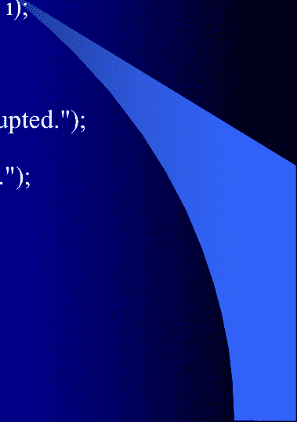

### 11.3.3 选择合适方法

- Java 有两种创建子线程的方法。
- Thread 类定义了多种方法可以被派生类重载。
- 对于所有的方法，惟一的必须被重写的是 run() 方法。
- 你不重写 Thread 的其他方法时，最好只实现 Runnable 接口。

## 11.4 创建多线程

## 例 P198 三个子线程

```java
// Create multiple threads.
class NewThread implements Runnable {
  String name;                    // name of thread
  Thread t;
  NewThread(String threadname) {
    name = threadname;
    t = new Thread(this, name); System.out.println("New thread: " + t);
    t.start();                    // Start the thread
  }
  // This is the entry point for thread.
  public void run() {
    try {
      for (int i = 5; i > 0; i--) {
        System.out.println(name + ": " + i); Thread.sleep(1000);
      }
    } catch (InterruptedException e) {
      System.out.println(name + "Interrupted");
    }
    System.out.println(name + " exiting.");
  }
}
```


## 11.5 使用 isAlive() 和 join()

- 主线程希望最后结束。
- 前例在 main() 中调用 sleep() 来实现的。
- Thread 类提供一个线程如何知道另一线程已经结束的问题。
- 可以在线程中调用 isAlive()：
  ```java
  final boolean isAlive() // 返回 true 或 false
  ```
- 常用方法是调用 join() 等待线程结束：
  ```java
  final void join() throws InterruptedException
  // join() 方法等待所调用线程结束。
  // 线程等待直到指定线程参与。
  // 附加形式允许给指定线程结束定义最大时间。
  ```

## 例P200

### join()保证主线程最后结束

```java
// Using join() to wait for threads to finish.
class NewThread implements Runnable {
    String name;                 // name of thread
    Thread t;
    NewThread(String threadname) {
        name = threadname;
        t = new Thread(this, name);
        System.out.println("New thread: " + t);
        t.start(); // Start the thread
    }

    // This is the entry point for thread.
    public void run() {
        try {
            for(int i = 5; i > 0; i--) {
                System.out.println(name + ": " + i);
                Thread.sleep(1000);
            }
        } catch (InterruptedException e) {
            System.out.println(name + " interrupted.");
        }
        System.out.println(name + " exiting.");
    }
}
```


```java
class DemoJoin {
    public static void main(String args[]) {
        NewThread ob1 = new NewThread("One");
        NewThread ob2 = new NewThread("Two");
        NewThread ob3 = new NewThread("Three");
        System.out.println("Thread One is alive: " + ob1.t.isAlive());
        System.out.println("Thread Two is alive: " + ob2.t.isAlive());
        System.out.println("Thread Three is alive: " + ob3.t.isAlive());
        // wait for threads to finish
        try {
            System.out.println("Waiting for threads to finish.");
            ob1.t.join(); // 调用join()后返回，线程终止执行。
            ob2.t.join();
            ob3.t.join();
        } catch (InterruptedException e) {
            System.out.println("Main thread Interrupted");
        }
        System.out.println("Thread One is alive: " + ob1.t.isAlive());
        System.out.println("Thread Two is alive: " + ob2.t.isAlive());
        System.out.println("Thread Three is alive: " + ob3.t.isAlive());
        System.out.println("Main thread exiting.");
    }
}
```

## Ans:

New thread: Thread[One,5,main]
New thread: Thread[Two,5,main]
New thread: Thread[Three,5,main]
Thread One is alive: true
Thread Two is alive: true
Thread Three is alive: true
Waiting for threads to finish.
One: 5
Two: 5
Three: 5
One: 4
Two: 4
Three: 4
One: 3
Two: 3
Three: 3
One: 2
Two: 2
Three: 2
One: 1
Two: 1
Three: 1
Two exiting.
Three exiting.
One exiting.
Thread One is alive: false
Thread Two is alive: false
Thread Three is alive: false
Main thread exiting.

## 11.6 线程优先级

- 线程优先级用来判定何时每个线程允许运行。
- 优先级高的线程比优先级低的线程获得更多的CPU时间。
- 当低优先级线程正在运行，而一个高优先级的线程被恢复，它将抢占低优先级线程所使用的CPU。
- 在无优先级的环境下，多数线程仍然有机会运行。

## 设置线程的优先级

- setPriority() 方法：设置线程的优先级。
  ```java
  final void setPriority(int level)
  ```
  Level：final型变量
  - MIN_PRIORITY （= 1）
  - NORM_PRIORITY （= 5）
  - MAX_PRIORITY （= 10）

- getPriority()方法：获得当前的优先级设置。
  ```java
  final int getPriority()
  ```

## 例P203

// Demonstrate thread priorities.
class clicker implements Runnable {
    int click = 0;
    Thread t;
    private volatile boolean running = true; // 每次值都得到验证
    public clicker(int p) {
        t = new Thread(this);
        t.setPriority(p);
    }
    public void run() {
        while (running) {
            click++;
        }
    }
    public void stop() {
        running = false;
    }
    public void start() {
        t.start();
    }
}

两个不同优先级的线程

// volatile阻止了自由的优化循环
//改变方式不以直接代码形式显示


```java
class HiLoPri {
    public static void main(String args[]) {
        Thread.currentThread().setPriority(Thread.MAX_PRIORITY);
        clicker hi = new clicker(Thread.NORM_PRIORITY + 2);
        clicker lo = new clicker(Thread.NORM_PRIORITY - 2);
        lo.start();
        hi.start();
        try {
            Thread.sleep(10000);
        } catch (InterruptedException e) {
            System.out.println("Main thread interrupted.");
        }
        lo.stop();
        hi.stop();
        // Wait for child threads to terminate.
        try {
            hi.t.join();
            lo.t.join();
        } catch (InterruptedException e) {
            System.out.println("InterruptedException caught");
        }
        System.out.println("Low-priority thread: " + lo.click);
        System.out.println("High-priority thread: " + hi.click);
    }
}
```

## Ans:

将会有不同的结果

Low-priority thread: 4408112
High-priority thread: 589626904

## 11.7 线程同步

- 当两个或两个以上线程要共享资源，它们需要某种方法来确定资源在某一刻仅被一个线程占用。达到此目的的过程叫做同步（synchronization）。
- 同步的关键是管程（monitor）。管程是一个互斥独占锁定的对象，或称互斥体（mutex）。
- 在给定的时间，仅有一个线程可以获得管程。
- 当一个线程需要锁定，它必须进入管程。
- 其他线程试图进入已经锁定的管程，必须挂起直到第一个线程退出管程。这些其他的线程被称为等待管程。
- 一个拥有管程的线程如果愿意的话可以再次进入相同的管程。

### 11.7.1 使用同步方法

- 所有对象都有它们与之对应的隐式管程。
- 调用被 `synchronized` 修饰的方法，可进入某一对象的管程。
- 当一个线程在一个同步方法内部，其他线程必须等待。
- 拥有管程的线程仅需从同步方法中返回，可退出管程。

### 例P206 使用同步

- 只需在 `call()` 定义前加上关键字 `synchronized`：

  ```java
  class Callme {
      synchronized void call(String msg) {
          ...
      }
  }
  ```

- 若有一方法或多方法操纵对象的内部状态，都必须用 `synchronized` 关键字来防止状态出现竞争。
- 该实例的其他不同步方法却仍然可以被调用。

Ans:

[Hello]
[Synchronized]
[World]


### 11.7.2 同步语句

- 在不知源代码时，不能在方法前加 `synchronized`。
- 需将对这个类定义的方法的调用放入一个 `synchronized` 块内。
- `synchronized` 语句的普通形式：

  ```java
  synchronized(object) { // object是被同步对象的引用
      // statements to be synchronized
  }
  ```

- 一个同步块确保对 `object` 成员方法的调用仅在当前线程成功进入 `object` 管程后发生。

### 例P207 在 run() 方法内用了同步块

```java
// This program uses a synchronized block.
class Callme {
    void call(String msg) {
        System.out.print("[" + msg);
        try {
            Thread.sleep(1000);
        } catch (InterruptedException e) {
            System.out.println("Interrupted");
        }
        System.out.println("]");
    }
}

class Caller implements Runnable {
    String msg;
    Callme target;
    Thread t;

    public Caller(Callme targ, String s) {
        target = targ;
        msg = s;
        t = new Thread(this);
        t.start();
    }

    // synchronize calls to call()
    public void run() {
        synchronized(target) { // synchronized block
            target.call(msg);
        }
    }
}
```

## 11.8 线程间通信

- 多线程把任务分成离散的和合乎逻辑的单元，代替了事件循环程序。
- 线程远离了轮询。轮询由重复监测条件的循环实现。
- 为避免轮询，Java通过 `wait()`、`notify()` 和 `notifyAll()` 方法实现线程间通信。
- 这三个方法是 `final`，所有的类都含有它们。仅在 `synchronized` 方法中才能被调用。

### 线程间通信机制

- `final void wait() throws InterruptedException`  
  使调用线程放弃管程进入睡眠，直到其他线程进入相同管程并且调用 `notify()`。
- `final void notify()`  
  恢复相同对象中第一个调用 `wait()` 的线程。
- `final void notifyAll()`  
  恢复相同对象中所有调用 `wait()` 的线程。  
  具有最高优先级的线程最先运行。

### 例P209 错误地实现了一个简单生产者/消费者的问题

```java
// An incorrect implementation of a producer and consumer.
class Q {                                      // 设法获得同步的序列
    int n;
    synchronized int get() {
        System.out.println("Got: " + n);
        return n;
    }
    synchronized void put(int n) {
        this.n = n;
        System.out.println("Put: " + n);
    }
}

class Producer implements Runnable {  // 产生排队的线程对象
    Q q;
    Producer(Q q) {
        this.q = q;
        new Thread(this, "Producer").start();
    }
    public void run() {
        int i = 0;
        while(true) {
            q.put(i++);
        }
    }
}

class Consumer implements Runnable {  // 消费序列的线程对象
    Q q;
    Consumer(Q q) {
        this.q = q;
        new Thread(this, "Consumer").start();
    }
    public void run() {
        while(true) {
            q.get();
        }
    }
}

class PC {  // 创建单个 Q，Producer，和Consumer的子类
    public static void main(String args[]) {
        Q q = new Q();
        new Producer(q);
        new Consumer(q);
        System.out.println("Press Control-C to stop.");
    }
}
```

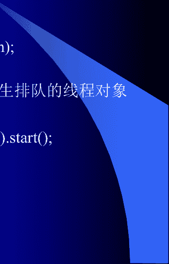

尽管 Q 中 `put()` 和 `get()` 方法是同步的，没有东西阻止生产者超越消费者，也没有东西阻止消费者消费同样的序列两次。


### 11.8.1 死锁

- 需要避免特殊错误类型是死锁（deadlock）。
- 死锁发生在当两个线程对一对同步对象有循环依赖关系时。
- 假定一个线程进入了对象X的管程而另一个线程进入了对象Y的管程。
  - 如果X的线程试图调用Y的同步方法，它将像预料的一样被锁定。
  - 而Y的线程同样希望调用X的一些同步方法，线程永远等待，因为到达X，必须释放自己的Y的锁定以使第一个线程可以完成。
- 死锁是很难调试的错误：
  - （1）极少发生，只有到两线程的时间段刚好符合时才能发生。
  - （2）可能包含多于两个的线程和同步对象

## 例P212

### 使用sleep()强迫死锁现象发生

```java
// An example of deadlock.
class A {
    synchronized void foo(B b) {
        String name = Thread.currentThread().getName();
        System.out.println(name + " entered A.foo");
        try {
            Thread.sleep(1000);
        } catch(Exception e) {
            System.out.println("A Interrupted");
        }
        System.out.println(name + " trying to call B.last()");
        b.last();
    }
    synchronized void last() {
        System.out.println("Inside A.last");
    }
}
```

```java
class B {
    synchronized void bar(A a) {
        String name = Thread.currentThread().getName();
        System.out.println(name + " entered B.bar");
        try {
            Thread.sleep(1000);
        } catch(Exception e) {
            System.out.println("B Interrupted");
        }
        System.out.println(name + " trying to call A.last()");
        a.last();
    }
    synchronized void last() {
        System.out.println("Inside A.last");
    }
}
```

```java
class Deadlock implements Runnable {
    A a = new A();
    B b = new B();
    Deadlock() {
        Thread.currentThread().setName("MainThread");
        Thread t = new Thread(this, "RacingThread");
        t.start();
        a.foo(b); // get lock on a in this thread.
        System.out.println("Back in main thread");
    }
    public void run() {
        b.bar(a); // get lock on b in other thread.
        System.out.println("Back in other thread");
    }
    public static void main(String args[]) {
        new Deadlock();
    }
}
```

### Ans:

按CTRL-C来结束程序，按CTRL-BREAK可看到全线程和管程缓冲堆

MainThread entered A.foo

RacingThread entered B.bar

MainThread trying to call B.last()

RacingThread trying to call A.last()

> // 看到RacingThread在等待管程a时占用管程b，
> // 同时，MainThread占用a等待b。

## 11.9 挂起、恢复和终止线程

- 线程的挂起是很有用的。
- 一个独立的线程可以用来显示当前的时间。
- 挂起，终止和恢复线程机制在 Java 2 和早期版本中有所不同。

## 例P212

### Using suspend() and resume()

```java
class NewThread implements Runnable {
    String name; // name of thread
    Thread t;
    NewThread(String threadname) {
        name = threadname;
        t = new Thread(this, name);
        System.out.println("New thread: " + t);
        t.start(); // Start the thread
    }
    public void run() {
        try {
            for(int i = 15; i > 0; i--) {
                System.out.println(name + ": " + i);
                Thread.sleep(200);
            }
        } catch (InterruptedException e) {
            System.out.println(name + " interrupted.");
        }
        System.out.println(name + " exiting.");
    }
}
```

```java
class SuspendResume {
    public static void main(String args[]) {
        NewThread ob1 = new NewThread("One");
        NewThread ob2 = new NewThread("Two");
        try {
            Thread.sleep(1000);
            ob1.t.suspend();
            System.out.println("Suspending thread One");
            Thread.sleep(1000);
            ob1.t.resume();
            System.out.println("Resuming thread One");
            ob2.t.suspend();
            System.out.println("Suspending thread Two");
            Thread.sleep(1000);
            ob2.t.resume();
            System.out.println("Resuming thread Two");
        } catch (InterruptedException e) {
            System.out.println("Main thread Interrupted");
        }
    }
}
```


```java
// wait for threads to finish
try {
    System.out.println("Waiting for threads to finish.");
    ob1.t.join();
    ob2.t.join();
} catch (InterruptedException e) {
    System.out.println("Main thread Interrupted");
}
System.out.println("Main thread exiting.");
}
}
```

### Ans:

```text
New thread: Thread[One,5,main]
One: 15
New thread: Thread[Two,5,main]
Two: 15
One: 14
Two: 14
One: 13
Two: 13
One: 12
Two: 12
One: 11
Two: 11
Suspending thread One
Two: 10
Two: 9
Two: 8
Two: 7
Two: 6
Resuming thread One
Suspending thread Two
One: 10
One: 9
One: 8
One: 7
One: 6
Resuming thread Two
Waiting for threads to finish.
Two: 5
One: 5
Two: 4
One: 4
Two: 3
One: 3
Two: 2
One: 2
Two: 1
One: 1
Two exiting.
One exiting.
Main thread exiting.
```

### 11.9.2 Java 2 中挂起、恢复和终止线程

- Java 2 中不能使用 `suspend()`、`resume()` 和 `stop()` 方法来控制线程：
- `suspend()` 和 `stop()` 方法有时会造成严重的系统故障。
- `resume()` 方法不引起问题，但不能离开 `suspend()` 方法而独立使用。
- 线程被设计以使 `run()` 方法定期检查，以判定线程是否应该被挂起，恢复或终止它自己的执行。
- 由建立一个指示线程状态的标志变量来完成。

```java
// This is the entry point for thread.
public void run() {
try {
for(int i = 15; i > 0; i--) {
System.out.println(name + ": " + i);
Thread.sleep(200);
synchronized(this) {
while(suspendFlag) {
wait();
}
}
}
} catch (InterruptedException e) {
System.out.println(name + " interrupted.");
}
System.out.println(name + " exiting.");
}
void mysuspend() {
suspendFlag = true;
}
synchronized void myresume() {
suspendFlag = false;
notify();
}
```

```java
// wait for threads to finish
try {
    System.out.println("Waiting for threads to finish.");
    ob1.join();
    ob2.join();
} catch (InterruptedException e) {
    System.out.println("Main thread Interrupted");
}
System.out.println("Main thread exiting.");
}
}
```

Ans: 同例P212

## 11.10 使用多线程机制

- 在语言中加入多线程是很新鲜的事物。
- 有效运用多线程的关键是并发思考而不是连续思考。
- 仔细运用多线程，能编写出非常有效的程序。
- 如果创建太多的线程，可能会减弱而不是加强程序的性能。
- 如果创建了太多的线程，更多的CPU时间会用于上下文转换而不是用来执行程序。

## 第1部分 Java语言

## 第12章 输入/输出、小应用程序和其他主题

### 12.1.1 流的概念

- Java程序通过流来完成输入/输出（C/C++）。
- 流通过Java的输入/输出系统与物理设备连接。
- 尽管物理设备不同，所有流的行为具有同样的方式。
- 一个输入流能够抽象多种不同类型的输入：从磁盘文件，从键盘或从网络套接字。
- 一个输出流能抽象多种不同类型的输出：控制台，磁盘文件或相连的网络。
- Java流的实现是在 java.io 包中定义的类层次结构。
- 要使用流类，必须导入 java.io 包。

### 12.1.2 字节流和字符流

- Java 2 定义了两种类型的流：字节类和字符类。
- 字节流（byte stream）处理字节的输入和输出（二进制数据）。
- 字符流（character stream）处理字符的输入和输出（统一的编码标准，国际化）。
- 在某些场合，字符流比字节流更有效。
- Java的原始版本（Java 1.0）不包括字符流。
- 在最底层，所有的输入/输出都是字节形式的。

### 字节流类

- 顶层有两个抽象类：
  - `InputStream` 和 `OutputStream`。
- 每个抽象类都有多个具体的子类，这些子类对不同的外设进行处理。
- 抽象类 `InputStream` 和 `OutputStream` 的最重要的两种抽象方法：
  - `read()` 和 `write()`，分别对数据的字节进行读写。
- 抽象方法被派生的流类重载。

### 表12-2 字符流的输入/输出类

| 流类 | 含义 |
| --- | --- |
| BufferedReader | 缓冲输入字符流 |
| BufferedWriter | 缓冲输出字符流 |
| CharArrayReader | 从字符数组读取数据的输入流 |
| CharArrayWriter | 向字符数组写数据的输出流 |
| FileReader | 读取文件的输入流 |
| FileWriter | 写文件的输出流 |
| FilterReader | 过滤读 |
| FilterWriter | 过滤写 |
| InputStreamReader | 把字节转换成字符的输入流 |
| LineNumberReader | 计算行数的输入流 |
| OutputStreamWriter | 把字符转换成字节的输出流 |
| PipedReader | 输入管道 |
| PipedWriter | 输出管道 |
| PrintWriter | 包含print()和println()的输出流 |
| PushbackReader | 允许字符返回到输入流的输入流 |
| Reader | 描述字符流输入的抽象类 |
| StringReader | 读取字符串的输入流 |
| StringWriter | 写字符串的输出流 |
| Writer | 描述字符流输出的抽象类 |

### 12.1.3 预定义流

- Java程序自动导入 java.lang 包（定义了 System 类）。
- System 包含三个预定义的流变量：
  - in、out 和 err（定义成 public 和 static）
- System.out 是标准输出流（默认是控制台）。
- System.in 是标准输入流（默认是键盘）。
- System.err 是标准错误流（默认是控制台）。
- 可以重定向到任何兼容的输入/输出设备。
- System.in 是 InputStream 的对象；System.out 和 System.err 是 PrintStream 的对象。
- 都是字节流，尽管它们用来读写外设的字符。

## 12.2 读取控制台输入

- Java 1.0 完成控制台输入的唯一途径是字节流。
- Java 2 首选方法是字符流，使程序容易符合国际标准并且易于维护。
- 在 BufferedReader 对象中包装 System.in。
- 构造函数：
  - `BufferedReader(Reader inputReader)`
  - Reader 是一个抽象类。它的一个具体的子类是 `InputStreamReader`
  - `InputStreamReader(InputStream inputStream)`
- `BufferedReader br = new BufferedReader(new InputStreamReader(System.in));`


### 12.2.1 读取字符

- 从BufferedReader读取字符，用read()。
- int read() throws IOException
- 该方法每次执行都从输入流读取一个字符然后以整型返回。
- 当遇到流的末尾时它返回 -1。要引发一个IOException异常。

## 例P222

演示read()方法，键入“q”退出

```java
// Use a BufferedReader to read characters from the console.
import java.io.*;
class BRRead {
    public static void main(String args[]) throws IOException
    {
        char c;
        BufferedReader br = new
            BufferedReader(new InputStreamReader(System.in));
        System.out.println("Enter characters, 'q' to quit.");
        // read characters
        do {
            c = (char) br.read();
            System.out.println(c);
        } while(c != 'q');
    }
}
```

Ans:

// 因为System.in在默认情况下是以行来缓冲的

Enter characters, 'q' to quit.

- 123abcq
- 1
- 2
- 3
- a
- b
- c
- q


## 例P224

```java
// A tiny editor.
import java.io.*;
class TinyEdit {
public static void main(String args[]) throws IOException
{
BufferedReader br = new BufferedReader(new
InputStreamReader(System.in));
String str[] = new String[100];
System.out.println("Enter lines of text.");
System.out.println("Enter 'stop' to quit.");
for(int i=0; i<100; i++) {
str[i] = br.readLine();
if(str[i].equals("stop")) break;
}
System.out.println("\nHere is your file.");
for(int i=0; i<100; i++) {
if(str[i].equals("stop")) break;
System.out.println(str[i]);
}
}
}
```

Ans:

Enter lines of text.
Enter ‘stop’ to quit.
This is line one.
This is line two.
Java makes working with strings easy.
Just create String objects.
stop
Here is your file:
This is line one.
This is line two.
Java makes working with strings easy.
Just create String objects.


## 12.3 向控制台写输出

- 常用 `print()` 和 `println()`：由 `PrintStream`（`System.out` 引用的对象类型）定义。
- `OutputStream` -> `PrintStream`
- `PrintStream` 定义的低级方法 `write()` 可用来向控制台写数据。
- `write()` 的最简单的形式如下：
  `void write(int byteval)` // byteval 只低位的 8 字节被写入
- 一般不用 `write()` 来完成向控制台的输出。

## 例P225

用 write()向屏幕输出字符“A”

```java
// Demonstrate System.out.write().
class WriteDemo {
    public static void main(String args[]) {
        int b;
        b = 'A';
        System.out.write(b);
        System.out.write('\n');
    }
}
```

Ans:
A

## 12.4 PrintWriter类

- 基于字符的类PrintWriter向控制台写数据使程序更为国际化。
- PrintWriter定义了多个构造函数：
  `PrintWriter(OutputStream outputStream, boolean flushOnNewline)` // true，输出流刷新自动发生
- PrintWriter支持所有类型（包括Object）的print()和println()方法。可以像用System.out那样用这些方法。
- 如果遇到不同类型，PrintWriter方法调用对象的toString()方法并打印结果。
- `PrintWriter pw = new PrintWriter(System.out, true);`

Ans:

This is a string
-7
4.5E-7

## 例P227 用read()来输入和显示文本文件的内容

```java
import java.io.*;
class ShowFile {
  public static void main(String args[]) throws IOException
  {
    int i;
    FileInputStream fin;
    try {
      fin = new FileInputStream(args[0]);
    } catch(FileNotFoundException e) {
      System.out.println("File Not Found"); return;
    } catch(ArrayIndexOutOfBoundsException e) {
      System.out.println("Usage: ShowFile File"); return;
    }
    // read characters until EOF is encountered
    do {
      i = fin.read();
      if(i != -1) System.out.print((char) i);
    } while(i != -1);
    fin.close();
  }
}
```

## 例P226 用write()拷贝一个文本文件

/\* Copy a text file.  
To use this program, specify the name of the source file and the destination file.For example, to copy a file called FIRST.TXT to a file called SECOND.TXT, use the following command line. Java CopyFile FIRST.TXT SECOND.TXT \*/

```java
import java.io.*;
class CopyFile {
public static void main(String args[]) throws IOException
{
int i;
FileInputStream fin;
FileOutputStream fout;
try {
// open input file
try {
fin = new FileInputStream(args[0]);
} catch(FileNotFoundException e) {
System.out.println("Input File Not Found");
return;
}
```


```java
// open output file
try {
    fout = new FileOutputStream(args[1]);
} catch(FileNotFoundException e) {
    System.out.println("Error Opening Output File");
    return;
}
catch(ArrayIndexOutOfBoundsException e) {
    System.out.println("Usage: CopyFile From To");
    return;
}
// Copy File
try {
    do {
        i = fin.read();
        if(i != -1) fout.write(i);
    } while(i != -1);
}
catch(IOException e) {
    System.out.println("File Error");
}
fin.close();    fout.close();
}
}
```

## 12.6 小应用程序基础

- Java 程序分为两种：application（应用程序）、applet（小应用程序）
- applet 是访问 Internet 服务器，在 Internet 上传播的，自动安装的，作为部分 Web 文档运行的小应用程序。
- 当小应用程序到达客户端时，它被限制访问资源，无法读写本机磁盘内容。
- 不再有安装问题
- 不担心错误程序破坏他人系统
- applet 与以前的程序具有不同的结构。
- 用户输入/输出不是由 Java 的输入/输出流类来完成的。相反，applet 运用 AWT 提供的界面。

## SimpleApplet 运行结果：

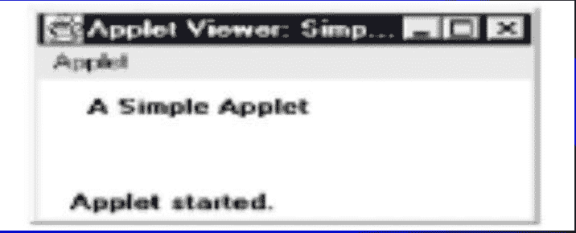

## 12.7 transient 和 volatile 修饰符

- 用 transient 声明实例变量，当对象被写入一个持久的存储区域，它的值不需要维持。例如：

  ```java
  class T {
      transient int a;   // will not persist
      int b;              // will persist
  }
  ```

- volatile 告诉编译器变量可以被程序的其他部分改变：
  在多线程程序里，有时两个或更多的线程共享一个相同的实例变量，每个线程可以自己保存该共享变量的私有拷贝。告诉编译器必须总是使用 volatile 变量的主副本。

## 12.8 使用 instanceof

- 在运行时间内知道对象类型是很有用的：线程在接受对象时需知对象的类型。强制类型转换。
- Java 提供运行时运算符 instanceof 来解决这个问题。
- instanceof 运算符的一般形式：

  ```java
  object instanceof type

  // object 是指定的 type 或者可强制转换成 type，instanceof 将返回 true，
  ```


### 例P233

### instanceof 的应用

```java
// Demonstrate instanceof operator.
class A {
    int i, j;
}
class B {
    int i, j;
}
class C extends A {
    int k;
}
class D extends A {
    int k;
}
```


```java
class InstanceOf {
    public static void main(String args[]) {
        A a = new A();
        B b = new B();
        C c = new C();
        D d = new D();

        if(a instanceof A)
            System.out.println("a is instance of A");
        if(b instanceof B)
            System.out.println("b is instance of B");
        if(c instanceof C)
            System.out.println("c is instance of C");
        if(c instanceof A)
            System.out.println("c can be cast to A");
        if(a instanceof C)
            System.out.println("a can be cast to C");
        System.out.println();

        // compare types of derived types
        A ob;
        ob = d; // A reference to d
        System.out.println("ob now refers to d");

        if(ob instanceof D)
            System.out.println("ob is instance of D");
        System.out.println();

        ob = c; // A reference to c
        System.out.println("ob now refers to c");
        if(ob instanceof D)
            System.out.println("ob can be cast to D");
        else
            System.out.println("ob cannot be cast to D");

        if(ob instanceof A)
            System.out.println("ob can be cast to A");
        System.out.println();

        // all objects can be cast to Object
        if(a instanceof Object)
            System.out.println("a may be cast to Object");
        if(b instanceof Object)
            System.out.println("b may be cast to Object");
        if(c instanceof Object)
            System.out.println("c may be cast to Object");
        if(d instanceof Object)
            System.out.println("d may be cast to Object");
    }
}
```

### Ans:

```text
a is instance of A
b is instance of B
c is instance of C
c can be cast to A
ob now refers to d
ob is instance of D
ob now refers to c
ob cannot be cast to D
ob can be cast to A
a may be cast to Object
b may be cast to Object
c may be cast to Object
d may be cast to Object
```

## 12.10 本机方法

- Java 可以调用不是用 Java 语言写的子程序。
- CPU 所工作环境的执行代码——本机代码。
- Java 提供了关键字 native 用来声明本机代码方法。
- 在方法前用 native 修饰符，但不定义方法体。例如：

  `public native int meth();`

- 把 C 代码结合到 Java 的机制是调用 Java Native Interface (JNI)。（Java 1.1 创建，Java 2 增强）
- 所需执行的精确的步骤随 Java 环境和版本的不同而不同，它还依赖于所要实现的本机方法使用的语言。


## 例P235

### 使用test()的native方法

```java
// A simple example that uses a native method.
public class NativeDemo {
    int i;
    public static void main(String args[]) {
        NativeDemo ob = new NativeDemo();
        ob.i = 10;
        System.out.println("This is ob.i before the native method:" + ob.i);
        ob.test();              // call a native method
        System.out.println("This is ob.i after the native method: " + ob.i);
    }

    // declare native method
    public native void test();    // test()声明为native且不含方法体
    // load DLL that contains static method
    static {    //仅在程序开始执行时执行，即当类被加载时执行
        System.loadLibrary("NativeDemo");//是System类的组成单元
    }
}
```

### 联编步骤：

- 编译，生成NativeDemo.class。
- 须用javah.exe生成文件：NativeDemo.h
  `c:\>javah -jni NativeDemo`

```c
/* DO NOT EDIT THIS FILE - it is machine generated */
#include <jni.h>
/* Header for class NativeDemo */

#ifndef _Included_NativeDemo
#define _Included_NativeDemo
#ifdef __cplusplus
extern "C" {
#endif
/*
 * Class:     NativeDemo
 * Method:    test
 * Signature: ()V
 */
JNIEXPORT void JNICALL Java_NativeDemo_test
  (JNIEnv *, jobject);

#ifdef __cplusplus
}
#endif
#endif
```

- 编写test()文件，存在一个名为NativeDemo.c的文件中：

```c
/* This file contains the C version of the
   test() method.
*/
#include <jni.h>   // 该文件由Java编译器提供
#include "NativeDemo.h"   //头文件NativeDemo.h预先已由javah创建
#include <stdio.h>
JNIEXPORT void JNICALL Java_NativeDemo_test(JNIEnv *env, jobject obj)
{
    jclass cls;
    jfieldID fid;
    jint i;
    printf("Starting the native method.\n");
    cls = (*env)->GetObjectClass(env, obj);   // 获得含NativeDemo类信息的C结构
    fid = (*env)->GetFieldID(env, cls, "i", "I");   //返回含该类域名"i"信息的C结构
    if(fid == 0) {
        printf("Could not get field id.\n");
        return;
    }
    i = (*env)->GetIntField(env, obj, fid);   // 检索该域原来的值
    printf("i = %d\n", i);
    (*env)->SetIntField(env, obj, fid, 2*i);   // 存储该域的一个更新值
    printf("Ending the native method.\n");
}
```

- 生成NativeDemo.c文件后，必须编译它生成一个DLL文件。
- `c:\> Cl /LD NativeDemo.c`
- 生成了NativeDemo.dll文件。

### 执行Java程序：`c:\>java NativeDemo`

**Ans：**

```text
This is ob.i before the native method: 10
Starting the native method.
i = 10
Ending the native method.
This is ob.i after the native method: 20
```

## 12.11 使用本机方法的问题

- 使程序有权使用已经存在的库程序。
- 使快速执行成为可能。
- 潜在的安全隐患
- 丧失了可移植性
