# 天津大学操作系统课件（吴）


## Introduction

### What Is An Operating System (2)

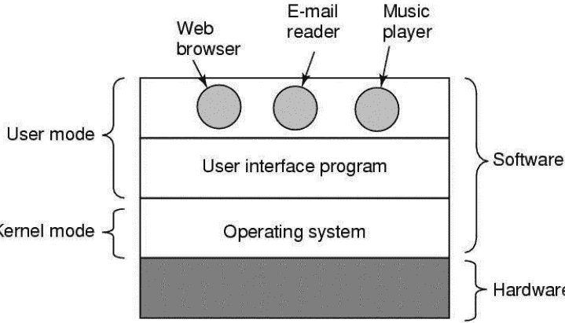

Figure 1-1. Where the operating system fits in.

### The Operating System as an Extended Machine

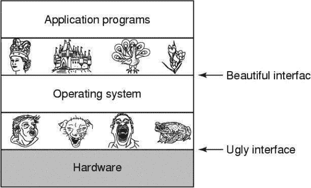

Figure 1-2. Operating systems turn ugly hardware into beautiful abstractions.

### The Operating System as a Resource Manager

- Allow multiple programs to run at the same time
- Manage and protect memory, I/O devices, and other resources
- Includes multiplexing (sharing) resources in two different ways:
  - In time
  - In space


### 1945-1955 Vacuum Tubes

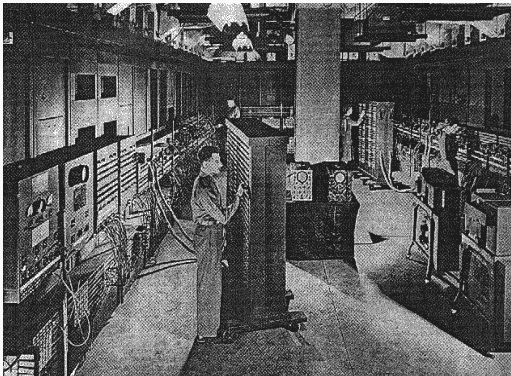

ENIAC


Ada Lovelace

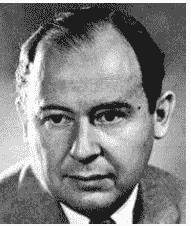

John Von Neumann

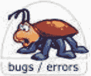


Alan Turing

### Transistors and Batch Systems (1)

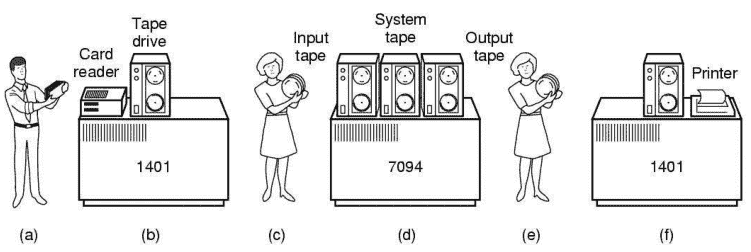

Figure 1-3. An early batch system. (a) Programmers bring cards to 1401. (b) 1401 reads batch of jobs onto tape.

### Transistors and Batch Systems (2)

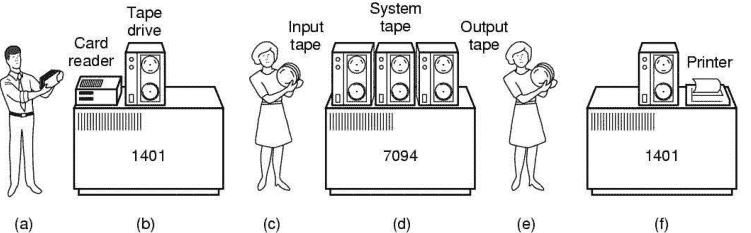

Figure 1-3. (c) Operator carries input tape to 7094. (d) 7094 does computing. (e) Operator carries output tape to 1401. (f) 1401 prints output.

### Transistors and Batch Systems (4)

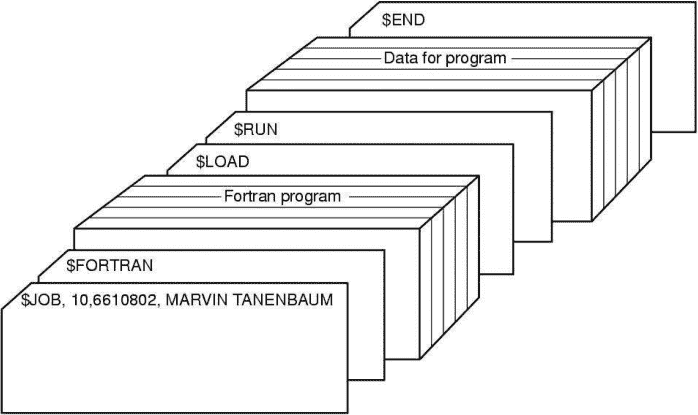

Figure 1-4. Structure of a typical FMS job.

### IBM System/360

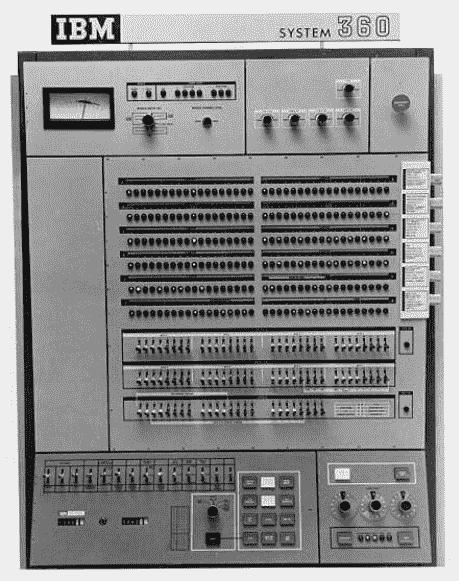

- One Family
- OS/360
- Multiprogramming
- SPOOLING (Simultaneous Peripheral Operation On Line)

### OS/360


Written by Fred Brooks, one of the designers of OS/360

- CTSS
  - Compatible Time Sharing system
  - MIT, 7094
- MULTICS
  - MULTiplexed Information and Computing Service
  - MIT, Bell Labs, General Electric
  - Sold by Honeywell

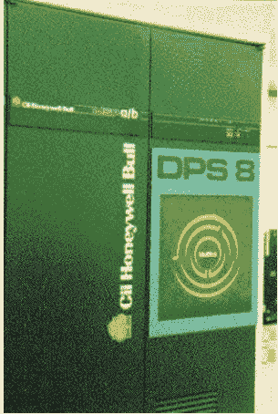

GE-645

### History of UNIX

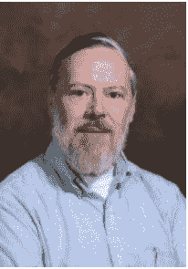


Dennis Ritchie

Ken Thompson

- 1969: UNIX
  - Ken Thompson
  - Bell Labs (AT&T)
  - DEC PDP-7
  - space travel
  - UNICS -> UNIX
  - Written in assembly language

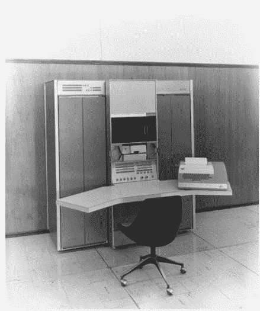

PDP - Programmed Data Processor

- 1970: PDP-11/20
- 1971: Unix Programmer's Manual
- 1972: Ritchie BCPL (Basic Combined Programming Language) -> B -> C, *The C Programming Language*
- 1973: *The UNIX Time – Sharing System*
- 1983 Turing Award

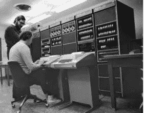

### First Microcomputer

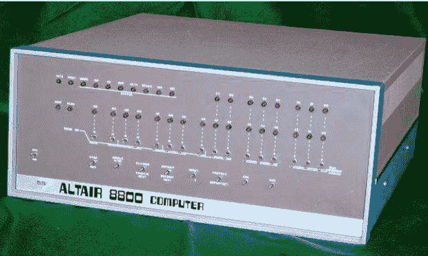

1975: MITS Altair 8800 (Intel 8080)

### 1984: Motorola 68000

### 1998: PowerPC

### 2006: Intel

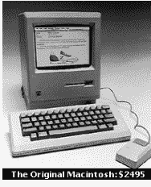


### IBM PC

- 1981: IBM Personal Computer
  - Intel 8088 (4.77MHz) 16KB
  - MS-DOS/PC-DOS
- 1985: Intel 80386
- 1986: Compaq 386
- 1987: IBM PS/2 (386, MCA)
  - IBM OS/2
- RISC: PowerPC vs Intel
- 1993: Intel Pentium


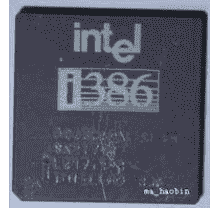

### Microsoft Windows

- 1985: Windows 1.0; 1987: 2.0
- 1990: Windows 3.0; 1992: 3.1
- 1993: Windows NT 3.1
- 1995: Windows 95; 1996: NT 4.0
- 1998: Windows 98
- 2000: Windows ME; Win2000 (NT 5.0)
- 2001: XP (NT 5.1); 2003: Server 2003
- 2006: Vista; 2008: Server 2008
- 2009: Windows 7 (NT 6.1)


## Minix – AST

- Andrew S. Tanenbaum (AST)
- http://www.cs.vu.nl/~ast/
- http://www.minix3.org/


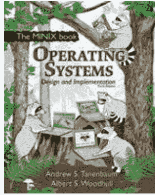

## General Public License

- Most software (including the Linux kernel) is GPL'ed (GNU General Public License)
  - http://www.gnu.org/copyleft/gpl.html

- Linux is called "copyleft" (instead of "copyright").
  - You can copy the software.
  - You get the source code.
  - You can alter the source code and recompile it.
  - You can distribute the altered source and binaries.
  - You can charge money for all this.

- You cannot change the license.
  - So all your customers have the same rights as you.
  - So you really cannot make money from selling the software alone.

- Other Open Source licenses (for example, BSD) are also used


## Linux Kernel vs Distributions

- Kernel version like: 2.6.32-24
- Distributions:
  - RedHat: Fedora, RHEL, CentOS
  - Ubuntu: from Debian
  - Slackware
  - SuSE: OpenSuSE
  - RedFlag
  - ...


## Linux Today

- Linux covers the whole spectrum of computing
  - Embedded devices
  - Laptops
  - Desktop systems
  - Development systems
  - Small and large servers
  - Megaclusters/supercomputers

- Linux is used throughout the world
  - ... and in space

- Linux is used by home users
  - ... and by some of the largest companies in the world
  - IBM
  - Boeing
  - NASA

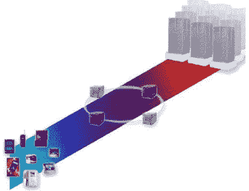

## Computer Hardware Review

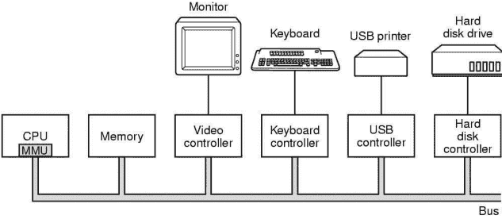

Figure 1-6. Some of the components
of a simple personal computer.

### CPU Pipelining

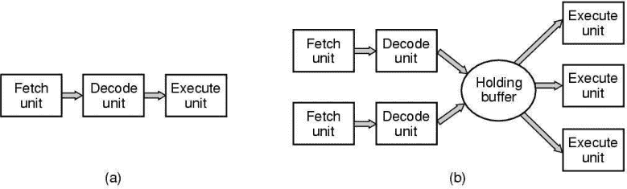

Figure 1-7. (a) A three-stage pipeline. (b) A superscalar CPU.

### Multithreaded and Multicore Chips

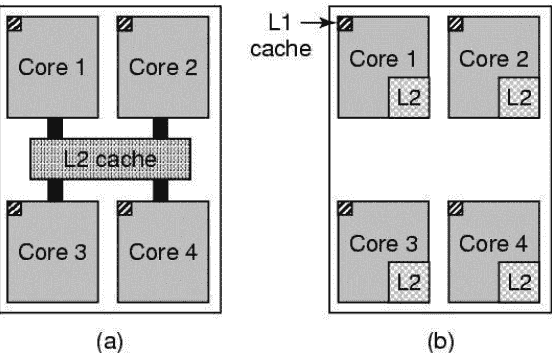

Figure 1-8. (a) A quad-core chip with a shared L2 cache.
(b) A quad-core chip with separate L2 caches.

### Memory (1)

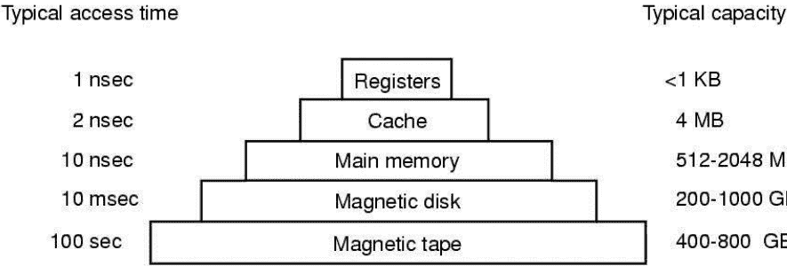

Figure 1-9. A typical memory hierarchy.
The numbers are very rough approximations.

### Memory (2)

Questions when dealing with cache:

- When to put a new item into the cache.
- Which cache line to put the new item in.
- Which item to remove from the cache when a slot is needed.
- Where to put a newly evicted item in the larger memory.

### Disks

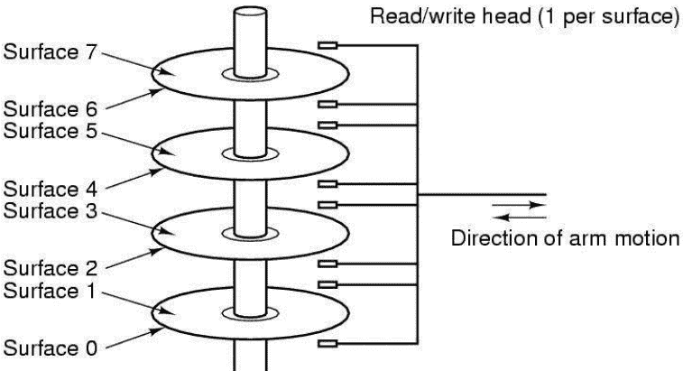

Figure 1-10. Structure of a disk drive.

### Buses

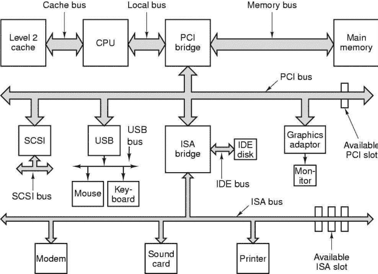

Figure 1-12. The structure of a large Pentium system

## Operating System Concepts

- Processes
- Address spaces
- Files
- Input/Output
- Protection
- The shell
- Ontogeny recapitulates phylogeny
  - Large memories
  - Protection hardware
  - Disks
  - Virtual memory

### Processes

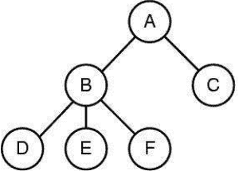

Figure 1-13. A process tree. Process A created two child processes, B and C. Process B created three child processes, D, E, and F.

### Files (1)

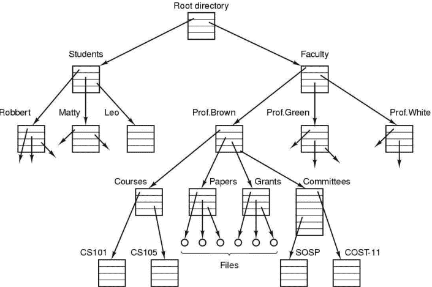

Figure 1-14. A file system for a university department.


### System Calls

Figure 1-17. The 11 steps in making the system call read(fd, buffer, nbytes).

### System Calls for Process Management

| **Process management** |  |
|---|---|
| **Call** | **Description** |
| `pid = fork()` | Create a child process identical to the parent |
| `pid = waitpid(pid, &statloc, options)` | Wait for a child to terminate |
| `s = execve(name, argv, environ)` | Replace a process’ core image |
| `exit(status)` | Terminate process execution and return status |

Figure 1-18. Some of the major POSIX system calls.

### System Calls for File Management (1)

| **File management** |  |
|---|---|
| **Call** | **Description** |
| `fd = open(file, how, ...)` | Open a file for reading, writing, or both |
| `s = close(fd)` | Close an open file |
| `n = read(fd, buffer, nbytes)` | Read data from a file into a buffer |
| `n = write(fd, buffer, nbytes)` | Write data from a buffer into a file |
| `position = lseek(fd, offset, whence)` | Move the file pointer |
| `s = stat(name, &buf)` | Get a file’s status information |

Figure 1-18. Some of the major POSIX system calls.

### System Calls for File Management (2)

| Call | Description |
|---|---|
| `s = mkdir(name, mode)` | Create a new directory |
| `s = rmdir(name)` | Remove an empty directory |
| `s = link(name1, name2)` | Create a new entry, name2, pointing to name1 |
| `s = unlink(name)` | Remove a directory entry |
| `s = mount(special, name, flag)` | Mount a file system |
| `s = umount(special)` | Unmount a file system |

Figure 1-18. Some of the major POSIX system calls.

### Miscellaneous System Calls

| Call | Description |
|---|---|
| `s = chdir(dirname)` | Change the working directory |
| `s = chmod(name, mode)` | Change a file’s protection bits |
| `s = kill(pid, signal)` | Send a signal to a process |
| `seconds = time(&seconds)` | Get the elapsed time since Jan. 1, 1970 |

Figure 1-18. Some of the major POSIX system calls.

### A Simple Shell

```c
#define TRUE 1

while (TRUE) {
    type_prompt();
    read_command(command, parameters);

    if (fork() != 0) {
        /* Parent code. */
        waitpid(-1, &status, 0);
    } else {
        /* Child code. */
        execve(command, parameters, 0);
    }
}
```

Figure 1-19. A stripped-down shell.

### Memory Layout

Figure 1-20. Processes have three segments:  
text, data, and stack.

### Linking

Figure 1-21. (a) Two directories before linking /usr/jim/memo to ast’s directory. (b) The same directories after linking.

### Mounting

Figure 1-22. (a) File system before the mount.  
(b) File system after the mount.

### Windows Win32 API

| UNIX | Win32 | Description |
|---|---|---|
| fork | CreateProcess | Create a new process |
| waitpid | WaitForSingleObject | Can wait for a process to exit |
| execve | (none) | CreateProcess = fork + execve |
| exit | ExitProcess | Terminate execution |
| open | CreateFile | Create a file or open an existing file |
| close | CloseHandle | Close a file |
| read | ReadFile | Read data from a file |
| write | WriteFile | Write data to a file |
| seek | SetFilePointer | Move the file pointer |
| stat | GetFileAttributesEx | Get various file attributes |
| mkdir | CreateDirectory | Create a new directory |
| rmdir | RemoveDirectory | Remove an empty directory |
| link | (none) | Win32 does not support links |
| unlink | DeleteFile | Destroy an existing file |
| mount | (none) | Win32 does not support mount |
| umount | (none) | Win32 does not support mount |
| chdir | SetCurrentDirectory | Change the current working directory |
| chmod | (none) | Win32 does not support security (although NT does) |
| kill | (none) | Win32 does not support signals |
| time | GetLocalTime | Get the current time |

Figure 1-23. The Win32 API calls that roughly correspond to the UNIX calls of Fig. 1-18.


## Operating Systems Structure

### Monolithic Systems

Monolithic systems – basic structure:

- A main program that invokes the requested service procedure.
- A set of service procedures that carry out the system calls.
- A set of utility procedures that help the service procedures.

```
#define FALSE 0
#define TRUE 1
#define N 2 /* number of processes */
int turn; /* whose turn is it? */
int interested[N]; /* all values initially 0 (FALSE) */
void enter_region(int process) /* process is 0 or 1 */
{
    int other; /* number of the other process */
    other = 1 - process; /* the opposite of process */
    interested[process] = TRUE; /* show that you are interested */
    turn = process; /* set flag */
    while (turn == process && interested[other] == TRUE) /* null statement */ ;
}
void leave_region(int process) /* process: who is leaving */
{
    interested[process] = FALSE; /* indicate departure from critical region */
}
```

Figure 1-24. A simple structuring model for a monolithic system.

### Client-Server Model

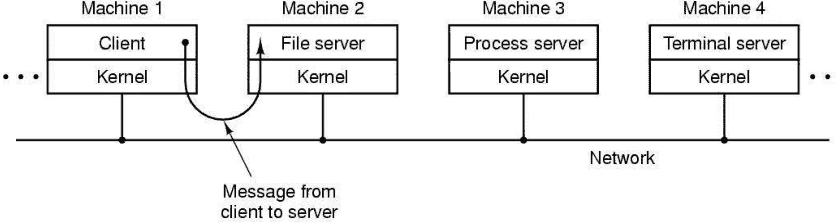

Figure 1-27. The client-server model over a network.

### Virtual Machines (2)

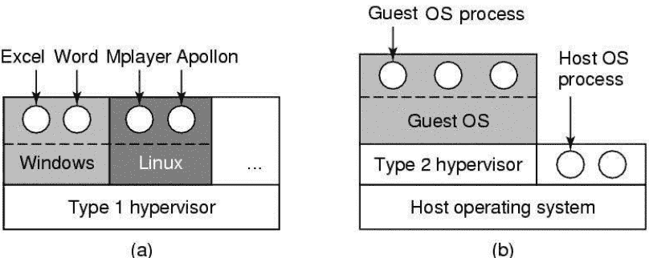

Figure 1-29. (a) A type 1 hypervisor. (b) A type 2 hypervisor.

## The World According to C

- The C language
- Header files
- Large programming projects
- The model of run time

### The Model of Run Time

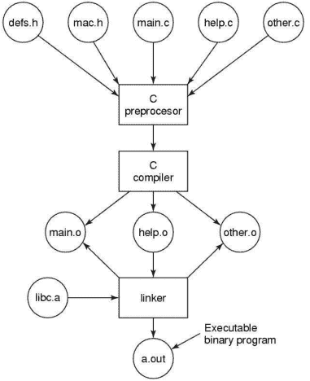

Figure 1-30. The process of compiling C and header files to make an executable.

## Operating Systems

### Processes

### Objectives

- 1. What is a process?
- 2. What is the difference between program and process?
- 3. What about process’s lifecycle?

### The Process Model

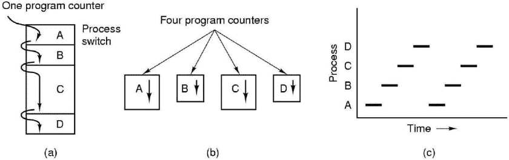

- (a) Multiprogramming of four programs.
- (b) Conceptual model of four independent, sequential processes.
- (c) Only one program is active at once.

### Process

- What is a process?
  - A process is an instance of a computer program that is being executed. It contains the program code and its current activity.
- What is the difference between program and process?
  - Program is just the static text.
  - Process is a dynamic entity being executed and has a lifecycle.
- A process consists of three parts:
  - Process Control Block (Process Table Entry)
  - Program (Text)
  - Data

### Process Control Block

| Process management | Memory management | File management |
|---|---|---|
| Registers<br>Program counter<br>Program status word<br>Stack pointer<br>Process state<br>Priority<br>Scheduling parameters<br>Process ID<br>Parent process<br>Process group<br>Signals<br>Time when process started<br>CPU time used<br>Children's CPU time<br>Time of next alarm | Pointer to text segment info<br>Pointer to data segment info<br>Pointer to stack segment info | Root directory<br>Working directory<br>File descriptors<br>User ID<br>Group ID |

Some of the fields of a typical process table entry.

### Process Creation

**Events which cause process creation:**

- System initialization.
- Execution of a process creation system call by a running process.
- A user request to create a new process.
- Initiation of a batch job.

### fork

```
main()
{
    pid_t val;
    printf("PID before fork(): %d \n",(int)getpid());
    val=fork();
    if ( val > 0) {
        printf("Parent PID: %d\n",(int)getpid());
    } else if (val == 0) {
        printf("Child PID: %d\n",(int)getpid());
    } else {
        printf("Fork failed!");
        exit(1);
    }
}
```

### Shell and its children

- All processes are started by other processes
  - Parent/Child relationship

```
$ ls -l
```

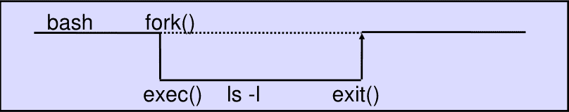

- A process can be terminated for two reasons:
  - The process terminates itself when done.
  - The process is terminated by a signal from another process.


### Code

```c
pid_t val;
int exit_code = 0;

val=fork();
if (val > 0) {
    int stat_val;
    pid_t child_pid;
    child_pid = waitpid(val,&stat_val,0);
    printf("Child has finished: PID = %d\n", child_pid);
    if(WIFEXITED(stat_val))
        printf("Child exited with code %d\n", WEXITSTATUS(stat_val));
    else
        printf("Child terminated abnormally\n");
    exit(exit_code);
} else if (val == 0) {
    execlp("ls","ls","-l",NULL);
}
```

### Process States

1. Process blocks for input
2. Scheduler picks another process
3. Scheduler picks this process
4. Input becomes available

A process can be in running, blocked, or ready state. Transitions between these states are as shown.

### Scheduling

The lowest layer of a process-structured operating system handles interrupts and scheduling. Above that layer are sequential processes.

### Process Termination

#### Events which cause process termination:

- Normal exit (voluntary).
- Error exit (voluntary).
- Fatal error (involuntary).
- Killed by another process (involuntary).

### Modeling Multiprogramming

CPU utilization as a function of the number of processes in memory.

### Summary

1. Pseudo-parallelism vs. multiprocessor
2. Program vs. process
3. Process Hierarchies
4. Process lifecycle
5. Process states
6. System Calls:
   - fork() vfork()
   - exec() execv() execle() execve() execlp() execvp()
   - wait() waitpid()
   - exit()
   - system()

## Operating Systems

### Threads

#### Thread Usage (1)

Figure 2-7. A word processor with three threads.

#### Thread Usage (2)

Figure 2-8. A multithreaded Web server.

#### Thread Usage (3)

```c
while (TRUE) {
get_next_request(&buf);
handoff_work(&buf);
}
```

```c
while (TRUE) {
wait_for_work(&buf)
look_for_page_in_cache(&buf, &page);
if (page_not_in_cache(&page))
read_page_from_disk(&buf, &page);
return_page(&page);
}
```

(a)

(b)

Figure 2-9. A rough outline of the code for Fig. 2-8. (a) Dispatcher thread. (b) Worker thread.

#### Thread Usage (4)

| Model | Characteristics |
|---|---|
| Threads | Parallelism, blocking system calls |
| Single-threaded process | No parallelism, blocking system calls |
| Finite-state machine | Parallelism, nonblocking system calls, interrupts |

#### The Classical Thread Model (1)

Figure 2-11. (a) Three processes each with one thread. (b) One process with three threads.

#### The Classical Thread Model (2)

| Per process items | Per thread items |
|---|---|
| Address space | Program counter |
| Global variables | Registers |
| Open files | Stack |
| Child processes | State |
| Pending alarms |  |
| Signals and signal handlers |  |
| Accounting information |  |

Figure 2-12. The first column lists some items shared by all threads in a process. The second one lists some items private to each thread.

#### The Classical Thread Model (3)

Figure 2-13. Each thread has its own stack.

#### POSIX Threads (1)

| Thread call | Description |
|---|---|
| Pthread_create | Create a new thread |
| Pthread_exit | Terminate the calling thread |
| Pthread_join | Wait for a specific thread to exit |
| Pthread_yield | Release the CPU to let another thread run |
| Pthread_attr_init | Create and initialize a thread's attribute structure |
| Pthread_attr_destroy | Remove a thread's attribute structure |

Figure 2-14. Some of the Pthreads function calls.


#### POSIX Threads (2)

```c
#include <pthread.h>
#include <stdio.h>
#include <stdlib.h>

#define NUMBER_OF_THREADS    10

void *print_hello_world(void *tid)
{
        /* This function prints the thread’s identifier and then exits. */
        printf("Hello World. Greetings from thread #%d.\n", tid);
        pthread_exit(NULL);
}

int main(int argc, char *argv[])
{
        /* The main program creates 10 threads and then exits. */
        pthread_t threads[NUMBER_OF_THREADS];
        int status, i;

        for(i=0; i < NUMBER_OF_THREADS; i++) {
                printf("Main here. Creating thread #%d.\n", i);
                status = pthread_create(&threads[i], NULL, print_hello_world, (void *)i);

                if (status != 0) {
                        printf("Oops. pthread_create returned error code %d\n", status);
                        exit(-1);
                }
        }
        pthread_exit(NULL);
}
```

Figure 2-15. An example program using threads.

#### Implementing Threads in User Space

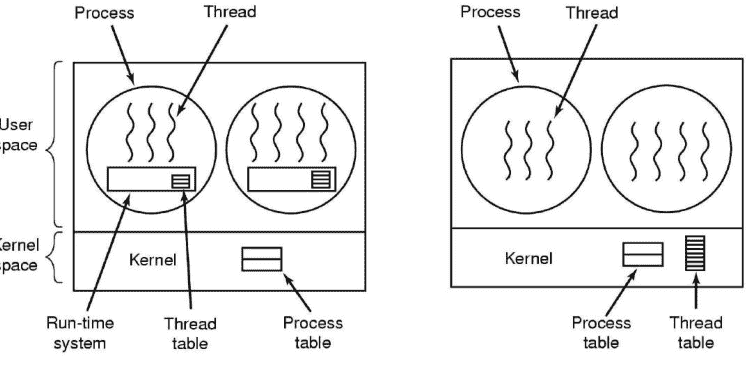

Figure 2-16. (a) A user-level threads package. (b) A threads package managed by the kernel.

#### Hybrid Implementations

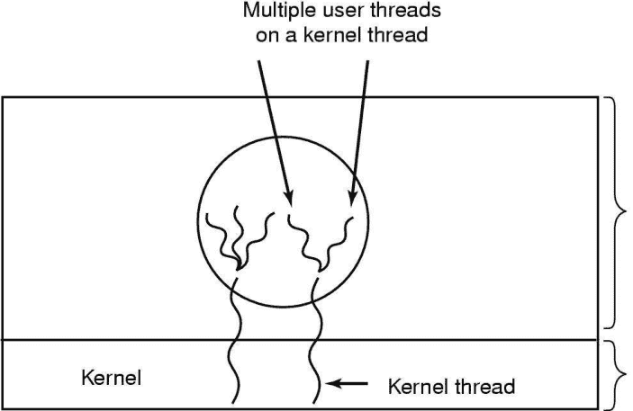

Multiple user threads on a kernel thread

User space

Kernel

Kernel thread

Kernel space

Figure 2-17. Multiplexing user-level threads onto kernel-level threads.

#### Pop-Up Threads

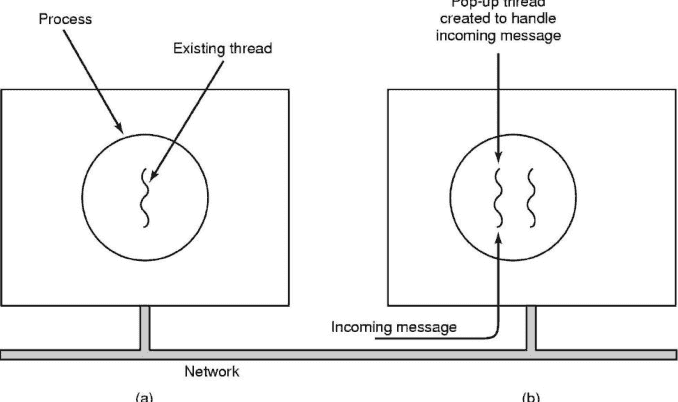

Figure 2-18. Creation of a new thread when a message arrives.
(a) Before the message arrives.
(b) After the message arrives.

#### Making Single-Threaded Code Multithreaded (1)

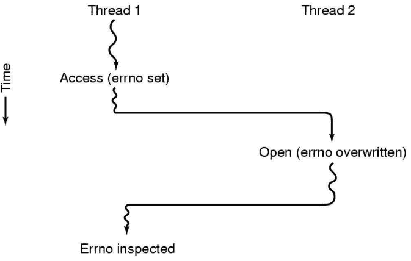

Figure 2-19. Conflicts between threads over the use of a global variable.

#### Making Single-Threaded Code Multithreaded (2)

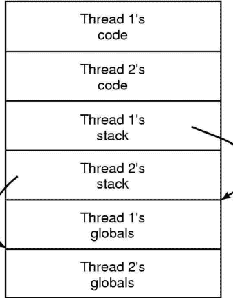

Figure 2-20. Threads can have private global variables.

## Operating Systems

### Scheduling

#### Scheduling – Process Behavior

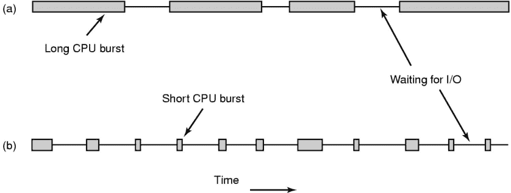

Bursts of CPU usage alternate with periods of waiting for I/O. (a) A CPU-bound process. (b) An I/O-bound process.

#### Categories of Scheduling Algorithms

- Batch
- Interactive
- Real time

#### Scheduling in Batch Systems

- First Come First Served
- Shortest Job First
- Shortest Remaining-time Next
- High Response-radio First

Batch Systems are usually non-preemptible.

#### Shortest Job First

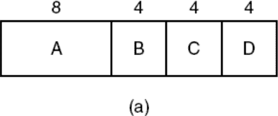

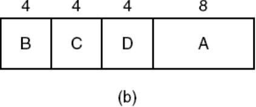

An example of shortest job first scheduling. (a) Running four jobs in the original order. (b) Running them in shortest job first order.

#### Scheduling in Interactive Systems

- Round-robin scheduling
- Priority scheduling
- Multiple queues
- Shortest process next
- Guaranteed scheduling
- Lottery scheduling
- Fair-share scheduling

#### Round-Robin Scheduling

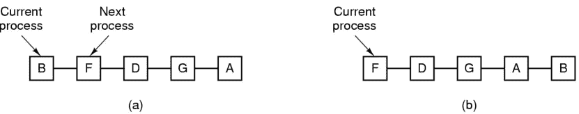

Round-robin scheduling.
(a) The list of runnable processes. (b) The list of runnable processes after B uses up its quantum.

#### Priority Scheduling

| Queue headers |
|---|
| Priority 4 |
| Priority 3 |
| Priority 2 |
| Priority 1 |

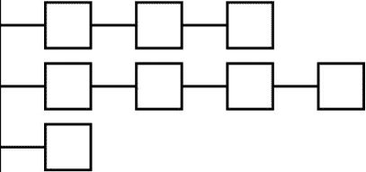

(Highest priority)

(Lowest priority)

A scheduling algorithm with four priority classes.

#### Thread Scheduling (1)

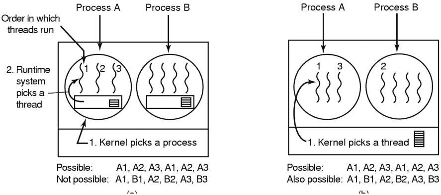

(a) Possible scheduling of user-level threads with a 50-msec process quantum and threads that run 5 msec per CPU burst.

#### Thread Scheduling (2)

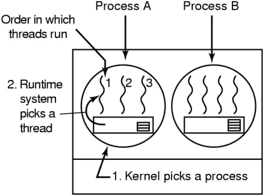

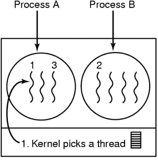

(b) Possible scheduling of kernel-level threads with the same characteristics as (a).


### Relationship of Processes

- Two types of relationship
  - Mutex
  - Synchronization
- Solutions
  - Busy Waiting
  - Sleep and Wakeup

### Critical Regions (2)

Mutual exclusion using critical regions.

### Mutual Exclusion with Busy Waiting

Proposals for achieving mutual exclusion:

- Disabling interrupts
- Lock variables
- Strict alternation
- Peterson's solution
- The TSL instruction

### Strict Alternation

```c
while (TRUE) {
    while (turn != 0)
        /* loop */;
    critical_region();
    turn = 1;
    noncritical_region();
}
```

```c
while (TRUE) {
    while (turn != 1)
        /* loop */;
    critical_region();
    turn = 0;
    noncritical_region();
}
```

A proposed solution to the critical region problem. (a) Process 0. (b) Process 1. In both cases, be sure to note the semicolons terminating the while statements.

### Peterson's Solution

```c
#define FALSE 0
#define TRUE 1
#define N 2            /* number of processes */

int turn;              /* whose turn is it? */
int interested[N];     /* all values initially 0 (FALSE) */

void enter_region(int process) /* process is 0 or 1 */
{
    int other;         /* number of the other process */

    other = 1 - process; /* the opposite of process */
    interested[process] = TRUE; /* show that you are interested */
    turn = process;    /* set flag */
    while (turn == process && interested[other] == TRUE) /* null statement */ ;
}

void leave_region(int process) /* process: who is leaving */
{
    interested[process] = FALSE; /* indicate departure from critical region */
}
```

Peterson's solution for achieving mutual exclusion.

### The TSL Instruction (1)

```
enter_region:
    TSL REGISTER,LOCK        | copy lock to register and set lock to 1
    CMP REGISTER,#0          | was lock zero?
    JNE enter_region         | if it was nonzero, lock was set, so loop
    RET                      | return to caller; critical region entered

leave_region:
    MOVE LOCK,#0             | store a 0 in lock
    RET                      | return to caller
```

Entering and leaving a critical region using the TSL instruction.

### The TSL Instruction (2)

```
enter_region:
MOVE REGISTER,#1
XCHG REGISTER,LOCK
CMP REGISTER,#0
JNE enter_region
RET
| put a 1 in the register
| swap the contents of the register and lock variable
was lock zero?
| if it was non zero, lock was set, so loop
| return to caller; critical region entered

leave_region:
MOVE LOCK,#0
RET
| store a 0 in lock
| return to caller
```

Entering and leaving a critical region using the XCHG instruction.

### Semaphore

- Semaphore
  - 1965 E. W. Dijkstra
- PV operations
  - Atomic operations: very quick and uninterruptable
  - Also known as down/up or wait/signal operations
- Semaphore can be operated by PV operation only.
  - The only exception is the initialization.
  - Even read the value is prohibited

### Semaphore

- What’s is semaphore?
  - An integer variable
  - In sleep and wakeup, with a process waiting queue (usu. first in first out)

- Variable range has different definitions:
  - Whole integer (sleep and wakeup)
    - Positive: the number of resources available
    - Zero: no resource available, no waiting process
    - Negative: the number of processes waiting to use the resources
  - Zero and positive integer (busy waiting)
    - Positive: the number of resources available
    - Zero: no resource available
  - Zero and One only (mutex)
    - Binary semaphores

### PV in Sleep and Wakeup

```
P (Semaphore s)
{
    s=s-1;
    if (s<0)
    {
        added to the semaphore's
        queue and sleep;
    }
}
```

```
V (Semaphore s)
{
    s=s+1;
    if (s<=0)
    {
        wakeup the waiting process
        in the semaphore's queue;
    }
}
```


Process A:

```
...
P(S);
Print(a.doc);
V(S);
...
```

Process B:

```
...
P(S);
Print(b.doc);
V(S);
...
```

Process C:

```
...
P(S);
Print(c.doc);
V(S);
...
```

P (Semaphore s){
    s=s-1;
    if (s<0){
        sleep...;
    }
}

V (Semaphore s){
    s=s+1;
    if (s<=0){
        wakeup...;
    }
}

- S = 1: Process A — Runnable
- S = 1 -> 0: Process A — Runnable
- S = 1 -> 0 -> -1: Process A — Runnable; Process B — Blocked; Process C — Runnable
- S = 1 -> 0 -> -1 -> -2: Process A — Runnable; Process B — Blocked; Process C — Blocked
- S = 1 -> 0 -> -1 -> -2 -> -1: Process A — Runnable; Process B — Runnable; Process C — Blocked
- S = 1 -> 0 -> -1 -> -2 -> -1 -> 0: Process A — Runnable; Process B — Runnable; Process C — Runnable
- S = 1 -> 0 -> -1 -> -2 -> -1 -> 0 -> 1: Process A — Runnable; Process B — Runnable; Process C — Runnable


### PV in Busy Waiting

```c
P (Semaphore s)
{
    while (!s > 0)
        yield the CPU;
    s--;
}
```

```c
V (Semaphore s)
{
    s++;
}
```

S = 1 -> 0

Process A:
...
P(S);
Print(a.doc);
V(S);
... ...

Runnable

```c
P (Semaphore s){
    while (!s > 0)
        yield;
    s--;
}
```

```c
V (Semaphore s){
    s++;
}
```

S = 1 -> 0

Process A:
...
P(S);
Print(a.doc);
V(S);
... ...

Process B:
...
P(S);
Print(b.doc);
V(S);
... ...

```c
P (Semaphore s){
while (!s > 0)
yield;
s--;
}

V (Semaphore s){
s++;
}
```

S = 1 -> 0

Process A:
...
P(S);
Print(a.doc);
V(S);
... ...

Process B:
...
P(S);
Print(b.doc);
V(S);
... ...

Process C:
...
P(S);
Print(c.doc);
V(S);
... ...

```c
P (Semaphore s){
while (!s > 0)
yield;
s--;
}

V (Semaphore s){
s++;
}
```

Runnable

Runnable

Runnable

S = 1 -> 0

Process A:
... ...
P(S);
Print(a.doc);
V(S);
... ...

Runnable

Process B:
... ...
P(S);
Print(b.doc);
V(S);
... ...

Runnable

Process C:
... ...
P(S);
Print(c.doc);
V(S);
... ...

Runnable

```c
P (Semaphore s){
    while (!s > 0)
        yield;
    s--;
}
```

```c
V (Semaphore s){
    s++;
}
```

S = 1 -> 0 -> 1

### The Producer-Consumer Problem

```c
#define N 100
int count = 0;
void producer(void)
{
    int item;
    while (TRUE) {
        item = produce_item();
        if (count == N) sleep();
        insert_item(item);
        count = count + 1;
        if (count == 1) wakeup(consumer);
    }
}
void consumer(void)
{
    int item;
    while (TRUE) {
        if (count == 0) sleep();
        item = remove_item();
        count = count - 1;
        if (count == N - 1) wakeup(producer);
        consume_item(item);
    }
}
```

The producer-consumer problem with a fatal race condition.

### Semaphores

```c
#define N 100                         /* number of slots in the buffer */
typedef int semaphore;                 /* semaphores are a special kind of int */
semaphore mutex = 1;                  /* controls access to critical region */
semaphore empty = N;                  /* counts empty buffer slots */
semaphore full = 0;                   /* counts full buffer slots */

void producer(void)
{
    int item;

    while (TRUE) {                     /* TRUE is the constant 1 */
        item = produce_item();         /* generate something to put in buffer */
        down(&empty);                  /* decrement empty count */
        down(&mutex);                  /* enter critical region */
        insert_item(item);             /* put new item in buffer */
        up(&mutex);                    /* leave critical region */
        up(&full);                     /* increment count of full slots */
    }
}

void consumer(void)
{
    int item;

    while (TRUE) {                     /* infinite loop */
        down(&full);                   /* decrement full count */
        down(&mutex);                  /* enter critical region */
        item = remove_item();          /* take item from buffer */
        up(&mutex);                    /* leave critical region */
        up(&empty);                    /* increment count of empty slots */
        consume_item(item);            /* do something with the item */
    }
}
```

The producer-consumer problem using semaphores.

## Operating Systems

### Inter-Process Communications

#### Dining Philosophers Problem (2)

```c
#define N 5
void philosopher(int i)
{
    while (TRUE) {
        think();
        take_fork(i);
        take_fork((i+1) % N);
        eat();
        put_fork(i);
        put_fork((i+1) % N);
    }
}
```

/* number of philosophers */
/* i: philosopher number, from 0 to 4 */
/* philosopher is thinking */
/* take left fork */
/* take right fork; % is modulo operator */
/* yum-yum, spaghetti */
/* put left fork back on the table */
/* put right fork back on the table */

A nonsolution to the dining philosophers problem.


#### Dining Philosophers Problem (3)

```c
#define N                    5             /* number of philosophers */
#define LEFT                 (i+N-1)%N     /* number of i's left neighbor  */
#define RIGHT                (i+1)%N       /* number of i's right neighbor */
#define THINKING             0             /* philosopher is thinking */
#define HUNGRY               1             /* philosopher is trying to get forks */
#define EATING               2             /* philosopher is eating */
typedef int semaphore;                     /* semaphores are a special kind of int */
int state[N];                              /* array to keep track of everyone's state */
semaphore mutex = 1;                       /* mutual exclusion for critical regions */
semaphore s[N];                            /* one semaphore per philosopher */
void philosopher(int i)                    /* i: philosopher number, from 0 to N-1 */
{
    while (TRUE) {
        think();                           /* philosopher is thinking */
        take_forks(i);                     /* acquire two forks or block */
        eat();                             /* yum-yum, spaghetti */
        put_forks(i);                      /* put both forks back on table */
    }
}
```

A solution to the dining philosophers problem.

#### Dining Philosophers Problem (4)

```c
void take_forks(int i)
{
    down(&mutex);
    state[i] = HUNGRY;
    test(i);
    up(&mutex);
    down(&s[i]);
}
```

A solution to the dining philosophers problem.

#### Dining Philosophers Problem (5)

```c
void put_forks(i)
{
    down(&mutex);
    state[i] = THINKING;
    test(LEFT);
    test(RIGHT);
    up(&mutex);
}

void test(i) /* i: philosopher number, from 0 to N−1 */
{
    if (state[i] == HUNGRY && state[LEFT] != EATING && state[RIGHT] != EATING) {
        state[i] = EATING;
        up(&s[i]);
    }
}
```

A solution to the dining philosophers problem.

#### The Readers and Writers Problem (1)

```c
typedef int semaphore;                         /* use your imagination */
semaphore mutex = 1;                            /* controls access to ’rc’ */
semaphore db = 1;                               /* controls access to the database */
int rc = 0;                                     /* # of processes reading or wanting to */

void reader(void)
{
        while (TRUE) {                          /* repeat forever */
                down(&mutex);                   /* get exclusive access to ’rc’ */
                rc = rc + 1;                    /* one reader more now */
                if (rc == 1) down(&db);         /* if this is the first reader ... */
                up(&mutex);                     /* release exclusive access to ’rc’ */
                read_data_base();               /* access the data */
                down(&mutex);                   /* get exclusive access to ’rc’ */
                rc = rc − 1;                    /* one reader fewer now */
                if (rc == 0) up(&db);            /* if this is the last reader ... */
                up(&mutex);                     /* release exclusive access to ’rc’ */
                use_data_read();                /* noncritical region */
        }
}
```

A solution to the readers and writers problem.

#### The Readers and Writers Problem (2)

```c
void writer(void)
{
    while (TRUE) {
        think_up_data();
        down(&db);
        write__data_base();
        up(&db);
    }
}
```

A solution to the readers and writers problem.

#### Mutexes

```asm
mutex_lock:
        TSL REGISTER,MUTEX       | copy mutex to register and set mutex to 1
        CMP REGISTER,#0          | was mutex zero?
        JZE ok                   | if it was zero, mutex was unlocked, so return
        CALL thread_yield        | mutex is busy; schedule another thread
        JMP mutex_lock           | try again
ok:     RET                      | return to caller; critical region entered

mutex_unlock:
        MOVE MUTEX,#0            | store a 0 in mutex
        RET                      | return to caller
```

Implementation of mutex lock and mutex unlock.


#### Mutexes in Pthreads (2)

| Thread call | Description |
|---|---|
| Pthread_cond_init | Create a condition variable |
| Pthread_cond_destroy | Destroy a condition variable |
| Pthread_cond_wait | Block waiting for a signal |
| Pthread_cond_signal | Signal another thread and wake it up |
| Pthread_cond_broadcast | Signal multiple threads and wake all of them |

Some of the Pthreads calls relating to condition variables.

#### Monitors (1)

```
monitor example
integer i;
condition c;
procedure producer();
.
.
.
end;
procedure consumer();
.
.
.
end;
end monitor;
```

A monitor.

#### Message Passing (1)

```java
public class ProducerConsumer {
static final int N = 100;   // constant giving the buffer size
static producer p = new producer();   // instantiate a new producer thread
static consumer c = new consumer();   // instantiate a new consumer thread
static our_monitor mon = new our_monitor();   // instantiate a new monitor

public static void main(String args[]) {
p.start();   // start the producer thread
c.start();   // start the consumer thread
}

static class producer extends Thread {
public void run() {   // run method contains the thread code
int item;
while (true) {   // producer loop
item = produce_item();
mon.insert(item);
}
}

private int produce_item() { ... }   // actually produce
}
```

#### A solution to the producer-consumer problem in Java.

#### Message Passing (3)

...

```java
public synchronized int remove() {
    int val;
    if (count == 0) go_to_sleep();    // if the buffer is empty, go to sleep
    val = buffer [lo]; // fetch an item from the buffer
    lo = (lo + 1) % N;    // slot to fetch next item from
    count = count − 1;    // one few items in the buffer
    if (count == N − 1) notify(); // if producer was sleeping, wake it up
    return val;
}
private void go_to_sleep() { try{wait();} catch(InterruptedException exc) {};}
}
}
```

A solution to the producer-consumer problem in Java.

#### Producer-Consumer Problem with Message Passing (1)

```c
#define N 100                         /* number of slots in the buffer */

void producer(void)
{
        int item;
        message m;                     /* message buffer */

        while (TRUE) {
                item = produce_item(); /* generate something to put in buffer */
                receive(consumer, &m);  /* wait for an empty to arrive */
                build_message(&m, item);/* construct a message to send */
                send(consumer, &m);     /* send item to consumer */
        }
}
```

...

The producer-consumer problem with N messages.

#### Producer-Consumer Problem with Message Passing (2)

```c
void consumer(void)
{
    int item, i;
    message m;
    for (i = 0; i < N; i++) send(producer, &m); /* send N empties */
    while (TRUE) {
        receive(producer, &m);       /* get message containing item */
        item = extract_item(&m);     /* extract item from message */
        send(producer, &m);          /* send back empty reply */
        consume_item(item);          /* do something with the item */
    }
}
```

The producer-consumer problem with N messages.

#### Barriers

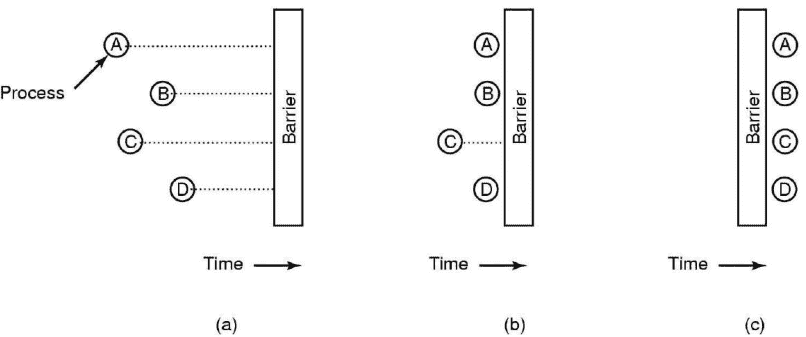

Use of a barrier. (a) Processes approaching a barrier. (b) All processes but one blocked at the barrier. (c) When the last process arrives at the barrier, all of them are let through.

## Deadlocks

### Preemptable and Nonpreemptable Resources

Sequence of events required to use a resource:

+   1. Request the resource.
+   2. Use the resource.
+   3. Release the resource.

### Resource Acquisition (1)

```c
typedef int semaphore;
semaphore resource__1;

void process__A(void) {
    down(&resource__1);
    use__resource__1();
    up(&resource__1);
}
```

```c
typedef int semaphore;
semaphore resource__1;
semaphore resource__2;

void process__A(void) {
    down(&resource__1);
    down(&resource__2);
    use__both__resources();
    up(&resource__2);
    up(&resource__1);
}
```

Figure 6-1. Using a semaphore to protect resources.
(a) One resource. (b) Two resources.


### Resource Acquisition (2)

```c
typedef int semaphore;
semaphore resource_1;
semaphore resource_2;
void process_A(void) {
    down(&resource_1);
    down(&resource_2);
    use_both_resources();
    up(&resource_2);
    up(&resource_1);
}
void process_B(void) {
    down(&resource_1);
    down(&resource_2);
    use_both_resources();
    up(&resource_2);
    up(&resource_1);
}
```

Figure 6-2. (a) Deadlock-free code.

### Resource Acquisition (3)

```c
semaphore resource_1;
semaphore resource_2;

void process_A(void) {
    down(&resource_1);
    down(&resource_2);
    use_both_resources();
    up(&resource_2);
    up(&resource_1);
}

void process_B(void) {
    down(&resource_2);
    down(&resource_1);
    use_both_resources();
    up(&resource_1);
    up(&resource_2);
}
```

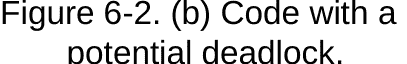

### Introduction To Deadlocks

Deadlock can be defined formally as follows:

*A set of processes is deadlocked if each process in the set is waiting for an event that only another process in the set can cause.*

### Conditions for Resource Deadlocks

1. Mutual exclusion condition
2. Hold and wait condition.
3. No preemption condition.
4. Circular wait condition.

### Deadlock Modeling (2)

A
Request R
Request S
Release R
Release S
(a)

B
Request S
Request T
Release S
Release T
(b)

C
Request T
Request R
Release T
Release R
(c)

1. A requests R
2. B requests S
3. C requests T
4. A requests S
5. B requests T
6. C requests R
deadlock
(d)

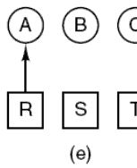

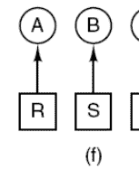

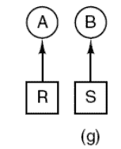

Figure 6-4. An example of how deadlock occurs and how it can be avoided.

### Deadlock Modeling (3)

1. A requests R
2. B requests S
3. C requests T
4. A requests S
5. B requests T
6. C requests R deadlock

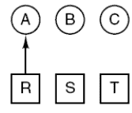


Figure 6-4. An example of how deadlock occurs and how it can be avoided.

### Deadlock Modeling (5)

Strategies for dealing with deadlocks:

1. Just ignore the problem.
2. Detection and recovery. Let deadlocks occur, detect them, take action.
3. Dynamic avoidance by careful resource allocation.
4. Prevention, by structurally negating one of the four required conditions.

### Deadlock Detection with One Resource of Each Type (1)


Figure 6-5. (a) A resource graph. (b) A cycle extracted from (a).

### Deadlock Detection with One Resource of Each Type (2)

Algorithm for detecting deadlock:

1. For each node, N in the graph, perform the following five steps with N as the starting node.
2. Initialize L to the empty list, designate all arcs as unmarked.
3. Add current node to end of L, check to see if node now appears in L two times. If it does, graph contains a cycle (listed in L), algorithm terminates.

### Deadlock Detection with One Resource of Each Type (3)

1. From given node, see if any unmarked outgoing arcs. If so, go to step 5; if not, go to step 6.
2. Pick an unmarked outgoing arc at random and mark it. Then follow it to the new current node and go to step 3.
3. If this is initial node, graph does not contain any cycles, algorithm terminates. Otherwise, dead end. Remove it, go back to previous node, make that one current node, go to step 3.

### Deadlock Detection with Multiple Resources of Each Type (1)

Resources in existence
(E1, E2, E3, ..., Em)

Resources available
(A1, A2, A3, ..., Am)

Current allocation matrix

| C11 | C12 | C13 | ... | C1m |
|-----|-----|-----|-----|-----|
| C21 | C22 | C23 | ... | C2m |
| ... | ... | ... | ... | ... |
| Cn1 | Cn2 | Cn3 | ... | Cnm |

Request matrix

| R11 | R12 | R13 | ... | R1m |
|-----|-----|-----|-----|-----|
| R21 | R22 | R23 | ... | R2m |
| ... | ... | ... | ... | ... |
| Rn1 | Rn2 | Rn3 | ... | Rnm |

Row n is current allocation to process n

Row 2 is what process 2 needs

Figure 6-6. The four data structures needed by the deadlock detection algorithm.


### Deadlock Detection with Multiple Resources of Each Type (2)

Deadlock detection algorithm:

- 1. Look for an unmarked process, _P<sub>i</sub>_, for which the i-th row of _R_ is less than or equal to _A_.

- 2. If such a process is found, add the _i-th_ row of _C_ to _A_, mark the process, and go back to step 1.

- 3. If no such process exists, the algorithm terminates.

### Deadlock Detection with Multiple Resources of Each Type (3)

E = (4 2 3 1) A = (2 1 0 0)

Current allocation matrix

C = [
0 0 1 0
2 0 0 1
0 1 2 0
]

Request matrix

R = [
2 0 0 1
1 0 1 0
2 1 0 0
]

Figure 6-7. An example for the deadlock detection algorithm.

### Recovery from Deadlock

- Recovery through preemption
- Recovery through rollback
- Recovery through killing processes

### Safe and Unsafe States (1)

#### (a)

|   | Has | Max |
|---|---:|---:|
| A | 3 | 9 |
| B | 2 | 4 |
| C | 2 | 7 |

Free: 3

#### (b)

|   | Has | Max |
|---|---:|---:|
| A | 3 | 9 |
| B | 4 | 4 |
| C | 2 | 7 |

Free: 1

#### (c)

|   | Has | Max |
|---|---:|---:|
| A | 3 | 9 |
| B | 0 | — |
| C | 2 | 7 |

Free: 5

#### (d)

|   | Has | Max |
|---|---:|---:|
| A | 3 | 9 |
| B | 0 | — |
| C | 7 | 7 |

Free: 0

#### (e)

|   | Has | Max |
|---|---:|---:|
| A | 3 | 9 |
| B | 0 | — |
| C | 0 | — |

Free: 7

Figure 6-9. Demonstration that the state in (a) is safe.

### The Banker's Algorithm for a Single Resource

Has Max

| A | 0 | 6 |
|---|---|---|
| B | 0 | 5 |
| C | 0 | 4 |
| D | 0 | 7 |

Free: 10

(a)

Has Max

| A | 1 | 6 |
|---|---|---|
| B | 1 | 5 |
| C | 2 | 4 |
| D | 4 | 7 |

Free: 2

(b)

Has Max

| A | 1 | 6 |
|---|---|---|
| B | 2 | 5 |
| C | 2 | 4 |
| D | 4 | 7 |

Free: 1

(c)

Figure 6-11. Three resource allocation states: (a) Safe. (b) Safe. (c) Unsafe.

### The Banker's Algorithm for Multiple Resources (1)


E = (6342)
P = (5322)
A = (1020)

Figure 6-12. The banker's algorithm with multiple resources.

### The Banker's Algorithm for Multiple Resources (2)

Algorithm for checking to see if a state is safe:

- 1. Look for row, R, whose unmet resource needs all ≤ A. If no such row exists, system will eventually deadlock since no process can run to completion

- 2. Assume process of row chosen requests all resources it needs and finishes. Mark process as terminated, add all its resources to the A vector.

- 3. Repeat steps 1 and 2 until either all processes marked terminated (initial state was safe) or no process left whose resource needs can be met (there is a deadlock).

### Deadlock Prevention

- Attacking the mutual exclusion condition
- Attacking the hold and wait condition
- Attacking the no preemption condition
- Attacking the circular wait condition

### Attacking the Circular Wait Condition

- 1. Imagesetter
- 2. Scanner
- 3. Plotter
- 4. Tape drive
- 5. CD-ROM drive


(a)

(b)

Figure 6-13. (a) Numerically ordered resources.
(b) A resource graph.

### Approaches to Deadlock Prevention

| Condition | Approach |
|---|---|
| Mutual exclusion | Spool everything |
| Hold and wait | Request all resources initially |
| No preemption | Take resources away |
| Circular wait | Order resources numerically |

Figure 6-14. Summary of approaches to deadlock prevention.

### Other Issues

- Two-phase locking
- Communication deadlocks
- Livelock
- Starvation

### Communication Deadlocks


Figure 6-15. A resource deadlock in a network.

### Livelock

```
void process_A(void) {
    enter_region(&resource_1);
    enter_region(&resource_2);
    use_both_resources();
    leave_region(&resource_2);
    leave_region(&resource_1);
}
```

```
void process_B(void) {
    enter_region(&resource_2);
    enter_region(&resource_1);
    use_both_resources();
    leave_region(&resource_1);
    leave_region(&resource_2);
}
```

Figure 6-16. Busy waiting that can lead to livelock.

