# 天津大学数据结构课件（李晓红）

## 第一章 绪论

- 什么是数据结构
- 基本概念和术语
- 抽象数据类型
- 算法分析
- 性能分析与度量

## 学生成绩表格

|   | 学号 | 姓名 | 数据结构 | 系统结构 | 数学 |
|---|---|---|---|---|---|
| 1 | 20001 | 刘扬 | 89 | 69 | 67 |
| 2 | 20002 | 李平 | 70 | 83 | 89 |
| 3 | 20003 | 王方 | 86 | 81 | 78 |
| 4 | 20004 | 张策 | 69 | 69 | 78 |
| 5 | 20005 | 董立 | 79 | 89 | 68 |
| 6 | 20006 | 谢平 | 80 | 88 | 79 |
| 7 | 20007 | 高月 | 81 | 81 | 80 |
| 8 | 20008 | 刘平 | 89 | 85 | 87 |
| 9 | 20009 | 好园 | 86 | 80 | 84 |

## 选课单

| 学号 | 课程号 | 时间 | 成绩 |
|---|---|---|---|
| 20001 | DS2000 SX2000 | 2001,2 2000,9 | 78 87 |
| 20002 | ART2000 DS2000 | 2002,2 2001,2 | 68 90 |
| 20003 | SX2000 DS2000 | 2000,9 2001,2 | 87 78 |
| 20004 | SX2000 ART2000 | 2000,9 2002,2 | 89 76 |

# UNIX文件系统结构图

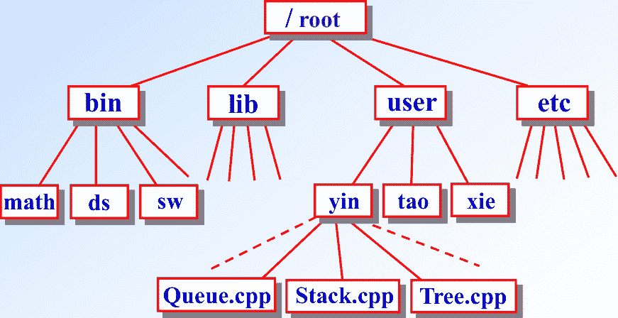

- 在应用程序中涉及到各种各样的数据，如何在计算机中组织、存储、传递数据，需要讨论它们的归类及它们之间的关系，从而建立相应的数据结构，依此实现软件功能。
- 综合上，描述这类非数值计算问题的数学模型不是数学方程，而是树、表和图之类的数据结构。
- 因此从广义上讲，数据结构描述现实世界实体的数学模型及其上的操作在计算机中的表示和实现。

## 基本概念和术语

### 数据(Data)

- 是信息的载体，是描述客观事物的数、字符、以及所有能输入到计算机中，被计算机程序识别和处理的符号的集合。
- 数值性数据
- 非数值性数据

# 数据元素（Data Element）

- 数据的基本单位。在计算机程序中常作为一个整体进行考虑和处理。
- 有时一个数据元素可以由若干数据项（Data Item）组成。数据项是具有独立含义的最小标识单位。
- 数据元素又称为元素、结点、记录

## 数据项(Data Item)

| 姓名 | 俱乐部名称 | 出生日期 | 入队日期 | 职位 | 业绩 |
|---|---|---|---|---|---|
| | | 年 月 日 | | | |

# 数据对象 (data object)

- 具有相同性的 数据元素的集合。
  - 整数数据对象
    N = { 0, ±1, ±2, … }
  - 字母字符数据对象
    C={ ‘A’, ‘B’, ‘C’, … ‘F’ }

## 数据结构（Data Structure）

- 形式定义：

某一数据对象的所有数据成员之间的关系。记为：

Data_Structure = {D, S}

其中，D 是某一数据对象，S 是该对象中所有数据成员之间的关系的有限集合。

## 四个基本结构

- 集合

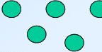

- 线性结构

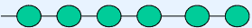

- 树形结构

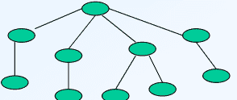

- 网状结构

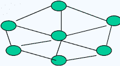

# 数据的逻辑结构

- 从逻辑关系上描述数据，与数据的存储无关；
- 从具体问题抽象出来的数据模型；
- 与数据元素本身的形式、内容无关；
- 与数据元素的相对位置无关。

## 数据的逻辑结构分类

- 线性结构
  - 线性表
- 非线性结构
  - 树
  - 图（或网络）

# 线性结构


# 树形结构

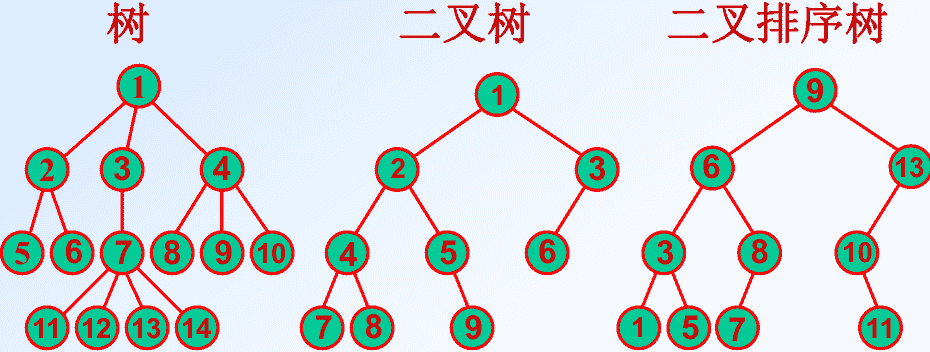

## 堆结构

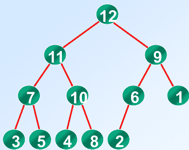

## 图结构

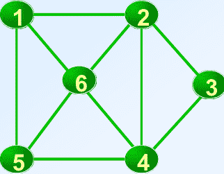

## 网络结构

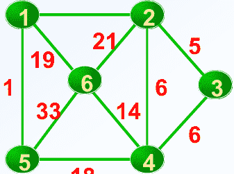

# 抽象数据类型（Abstract Data Type）

- 数据类型
  定义：一个值的集合和定义在这个值集上的一组操作的总称。
- C语言中的基本数据类型
  `int` `char` `float` `double` `void`
  整型 字符型 浮点型 双精度型 无值

## 抽象数据类型

- 是指一个数学模型以及定义在此数学模型上的一组操作
- 数据结构+定义在此数据结构上的一组操作 = 抽象数据类型
- 例如：矩阵 + （求转置、加、乘、求逆、求特征值）构成一个矩阵的抽象数据类型

## 抽象数据类型的表示和实现

- 抽象数据类型可以通过固有数据类型(高级编程语言中已实现的数据类型)来实现
  - 抽象数据类型 类 class
  - 数据对象 数据成员
  - 基本操作 成员函数(方法)
- 在C++中，类的成分(数据成员和成员函数)可以有三种访问级别
  - Private 私有成分（只允许类的成员函数进行访问）
  - protected 保护成分（只允许类的成员函数及其子孙类进行访问）
  - public 公有成分（允许类的成员函数、类的实例及其子孙类、子孙类的实例进行访问）

## 算法分析

- 定义：为了解决某类问题而规定的一个有限长的操作序列。
- 特性：
  - 有穷性：算法在执行有限步后能结束
  - 确定性：每步定义都是确切、无歧义
  - 可行性：每一条运算应足够基本
  - 输入：有0个或多个输入
  - 输出：有一个或多个输出

## 算法设计

- 例子：选择排序
- 问题：递增排序
- 解决方案：逐个选择最小数据
- 算法框架：

```cpp
for ( int i = 0; i < n-1; i++ ) { //n-1趟
从a[i]检查到a[n-1];
若最小整数在a[k], 交换a[i]与a[k];
}
```

- 细化：Select Sort

```c
void selectSort ( int a[ ], int n ) {
    //对n个整数a[0],a[1],...,a[n-1]按递增顺序排序
    for ( int i = 0; i < n-1; i++ ) {
        int k = i;
        //从a[i]查到a[n-1], 找最小整数， 在a[k]
        for ( int j = i+1; j < n; j++ )
            if ( a[j] < a[k] ) k = j;
        int temp = a[i]; a[i] = a[k]; a[k] = temp;
    }
}
```


## 算法的后期测试

在算法中的某些部位插装时间函数 `time()`，测定算法完成某一功能所花费的时间。

```c
double start, stop;
time (&start);
int k = seqsearch (a, n, x);
time (&stop);
double runTime = stop - start;
printf ("%d %f\n", n, runTime);
```

```c
int seqsearch (int a[], int n, int x) {
    // 在 a[0] ... a[n-1] 中搜索 x
    int i = 0;
    while (i < n && a[i] != x)
        i++;
    if (i == n) return -1;
    return i;
}
```

## 算法的事前估计

### 空间复杂度度量

- **存储空间的固定部分**：程序指令代码的空间，常数、简单变量、定长成分（如数组元素、结构成分、对象的数据成员等）变量所占空间。
- **可变部分**：尺寸与实例特性有关的成分变量所占空间、引用变量所占空间、递归栈所用空间、通过 `new` 和 `delete` 命令动态使用的空间。

### 时间复杂度度量

- 运行时间 = 算法中每条语句执行时间之和。
- 每条语句执行时间 = 该语句的执行次数（频度）* 语句执行一次所需时间。
- 语句执行一次所需时间取决于机器的指令性能、速度和编译所产生的代码质量，很难确定。
- 设每条语句执行一次所需时间为单位时间，则一个算法的运行时间就是该算法中所有语句的频度之和。

## 第二章 线性表

- 线性表
- 顺序表
- 链表
- 顺序表与链表的比较

### 线性表

定义：n（≥0）个数据元素的有限序列，记作

$$(a_1,\ldots,a_{i-1},a_i,a_{i+1},\ldots,a_n)$$

其中，$a_i$ 是表中数据元素，n 是表长度。

特点：

- 同一线性表中元素具有相同特性。
- 相邻数据元素之间存在序偶关系。
- 除第一个元素外，其他每一个元素有一个且仅有一个直接前驱。
- 除最后一个元素外，其他每一个元素有一个且仅有一个直接后继。

### 顺序表

定义：将线性表中的元素相继存放在一个连续的存储空间中。

存储结构：数组。

特点：线性表的顺序存储方式。

存取方式：可以随机存取。

顺序存储结构示意图：

| 0 | 1 | 2 | 3 | 4 | 5 |
|---|---|---|---|---|---|
| 45 | 89 | 90 | 67 | 40 | 78 |

顺序表的存储方式：

$$LOC(a_{i+1}) = LOC(a_i) + l$$

$$LOC(a_i) = LOC(a_1) + (i-1) \times l$$

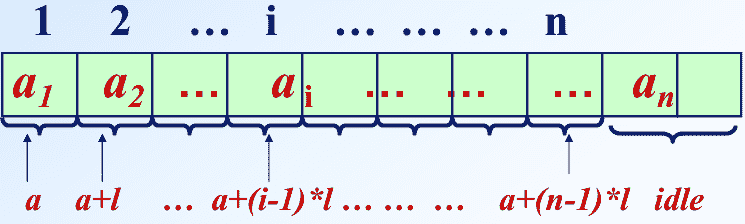

#### 顺序表（SeqList）的类型定义

```c
#define ListSize 100    // 最大允许长度
typedef int ListData;

typedef struct {
    ListData *data;     // 存储空间基址
    int length;         // 当前元素个数
} SeqList;
```

#### 顺序表基本运算

### 初始化

```c
void InitList (SeqList &L) {
    L.data = (ListData *) malloc (ListSize * sizeof (ListData));
    if (L.data == NULL) {
        printf ("存储分配失败!\n");
        exit (1);
    }
    L.length = 0;
}
```

## C语言描述

```cpp
Status InitList(SqList &L)
{ // 操作结果：构造一个空的顺序线性表
    L.elem = (ElemType *) malloc (LIST_INIT_SIZE * sizeof(ElemType));
    if (!L.elem)
        exit(OVERFLOW);          // 存储分配失败
    L.length = 0;                // 空表长度为0
    L.listsize = LIST_INIT_SIZE; // 初始存储容量
    return OK;
}
```

```cpp
Status DestroyList(SqList &L)
{
    // 初始条件：顺序线性表L已存在。操作结果：销毁顺序线性表L
    free(L.elem);
    L.elem = NULL;
    L.length = 0;
    L.listsize = 0;
    return OK;
}
```

```cpp
Status ClearList(SqList &L)
{
    // 初始条件：顺序线性表L已存在。操作结果：将L重置为空表
    L.length = 0;
    return OK;
}

Status ListEmpty(SqList L)
{
    // 初始条件：顺序线性表L已存在。操作结果：若L为空表，则返回TRUE，否则返回FALSE
    if (L.length == 0)
        return TRUE;
    else
        return FALSE;
}
```

- **按值查找：** 在顺序表中从头查找结点值等于给定值 x 的结点。

  ```c
  int Find (SeqList &L, ListData x) {
      int i = 0;
      while (i < L.length && L.data[i] != x)
          i++;
      if (i < L.length) return i;
      else return -1;
  }
  ```

- **求表的长度**

  ```c
  int Length (SeqList &L) {
      return L.length;
  }
  ```

- **提取函数：** 在表中提取第 i 个元素的值

  ```c
  ListData GetData (SeqList &L, int i) {
      if (i >= 0 && i < L.length)
          return L.data[i];
      else
          printf ("参数 i 不合理！\n");
  }
  ```

## C语言描述

```c
int ListLength(SqList L) {
    // 初始条件：顺序线性表L已存在。
    // 操作结果：返回L中数据元素个数
    return L.length;
}

Status GetElem(SqList L, int i, ElemType &e)
{
    // 初始条件：顺序线性表L已存在，1≤i≤ListLength(L)
    // 操作结果：用e返回L中第i个数据元素的值
    if (i < 1 || i > L.length)
        exit(ERROR);
    e = *(L.elem + i - 1);
    return OK;
}
```

## 插入

插入 x=50 示意图：

| 位置 | 0 | 1 | 2 | 3 | 4 | 5 | 6 | 7 |
|---|---|---|---|---|---|---|---|---|
| 插入前 | 25 | 34 | 57 | 16 | 48 | 09 | 63 |  |
| 插入后 | 25 | 34 | 50 | 57 | 16 | 48 | 09 | 63 |

$$E_{ins}=\frac{1}{n+1}\sum_{i=0}^{n}(n-i)=\frac{1}{n+1}(n+\cdots+1+0)=\frac{1}{n+1}\cdot\frac{n(n+1)}{2}=\frac{n}{2}$$

#### 顺序表的插入

```cpp
int Insert (SeqList &L, ListData x, int i) {
    // 在表中第 i 个位置插入新元素 x
    if (i < 0 || i > L.length || L.length == ListSize)
        return 0;          // 插入不成功
    else {
        for (int j = L.length; j > i; j--)
            L.data[j] = L.data[j - 1];
        L.data[i] = x;
        L.length++;
        return 1;          // 插入成功
    }
}
```


## C语言描述

```
Status ListInsert(SqList &L,int i,ElemType e)
{
    // 初始条件：顺序线性表L已存在，1≤i≤ListLength(L)+1
    // 操作结果：在L中第i个位置之前插入新的数据元素e，L的长度加1
    ElemType *newbase,*q,*p;
    if(i<1||i>L.length+1) // i值不合法
        return ERROR;
    if(L.length>=L.listsize) // 当前存储空间已满,增加分配
    {
        if(!(newbase=(ElemType
        *)realloc(L.elem,(L.listsize+LISTINCREMENT)*sizeof(ElemType))))
        exit(OVERFLOW); // 存储分配失败
        L.elem=newbase; // 新基址
        L.listsize+=LISTINCREMENT; // 增加存储容量
    }
    q=L.elem+i-1; // q为插入位置
    for(p=L.elem+L.length-1;p>=q;--p) // 插入位置及之后的元素右移
        *(p+1)=*p;
    *q=e; // 插入e
    ++L.length; // 表长增1
    return OK;
}
```

## 删除

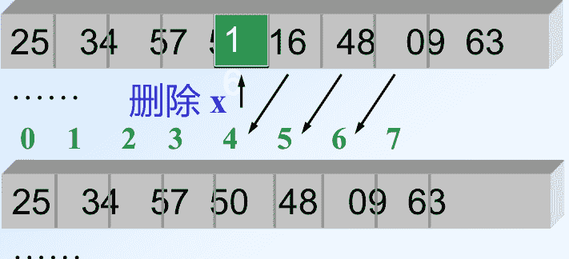

$$E_{dl}=\frac{1}{n}\sum_{i=0}^{n-1}(n-i-1)=\frac{1}{n}\cdot\frac{(n-1)n}{2}=\frac{n-1}{2}$$

### 顺序表的删除

```
int Delete ( SeqList &L, ListData x ) {
//在表中删除已有元素 x
int i = Find (L, x);    //在表中查找 x
if ( i >= 0 ) {
L.length -- ;
for ( int j = i; j < L.length; j++ )
L.data[j] = L.data[j+1];
return 1;    //成功删除
}
return 0;    //表中没有 x
}
```

## C语言描述

```
Status ListDelete(SqList &L,int i,ElemType &e) // 算法2.5
{
    // 初始条件： 顺序线性表L已存在， 1≤i≤ListLength(L)
    // 操作结果： 删除L的第i个数据元素， 并用e返回其值， L的长度减1
    ElemType *p,*q;
    if(i<1||i>L.length) // i值不合法
        return ERROR;
    p=L.elem+i-1; // p为被删除元素的位置
    e=*p; // 被删除元素的值赋给e
    q=L.elem+L.length-1; // 表尾元素的位置
    for(++p;p<=q;++p) // 被删除元素之后的元素左移
        *(p-1)=*p;
    L.length--; // 表长减1
    return OK;
}
```

## 顺序表的应用：集合的“并”运算

```
void Union ( SeqList &A, SeqList &B ) {
int n = Length ( A );
int m = Length ( B );
for ( int i = 0; i < m; i++ ) {
int x = GetData ( B, i ); //在B中取一元素
int k = Find ( A, x); //在A中查找它
if ( k == -1 ) //若未找到插入它
{ Insert ( A, x, n ); n++; }
}
}
```

### 集合的“交”运算

```
void Intersection ( SeqList &A, SeqList &B ) {
int n = Length ( A );
int m = Length ( B );
int i = 0;
while ( i < n ) {
int x = GetData ( A, i); //在A中取一元素
int k = Find ( B, x); //在B中查找它
if ( k == -1 ) { Delete ( A, i); n--; }
else i++; //未找到在A中删除它
}
}
```

## 链表（Linked List）

链表是线性表的链接存储表示

- 单链表
- 静态链表
- 循环链表
- 双向链表

### 单链表(Singly Linked List)

**定义：**用一组地址任意的存储单元存放线性表中的数据元素。

| 存储地址 | 数据域 | 指针域 |
|---|---|---|
| 1 | ZHANG | 13 |
| 7 | WANG | 1 |
| 13 | LI | null |
| 19 | ZHAO | 37 |
| 25 | WU | 7 |
| 31 | ZHOU | 19 |
| 37 | SUN | 25 |

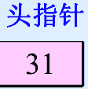

每个元素由结点(Node)构成，它包括两个域:数据域Data和指针域Link


存储结构：链式存储结构

特点：存储单元可以不连续。

存取方式：顺序存取。

### 单链表的基本运算

**插入**

- **第一种情况：在第一个结点前插入**

```
newnode->link = first ;
first = newnode;
```

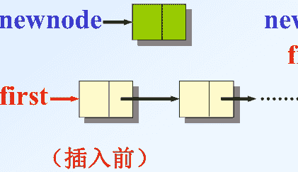

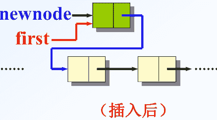

- **第二种情况：在链表中间插入**

```
newnode->link = p->link;
p->link = newnode;
```

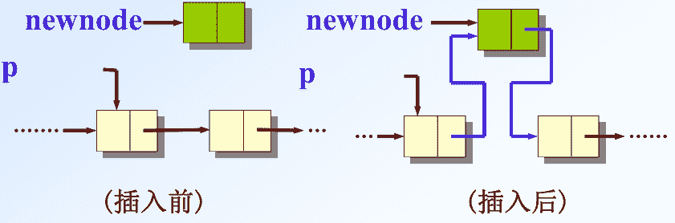

- **第三种情况：在链表末尾插入**

```
newnode->link = p->link;
p->link = newnode;
```

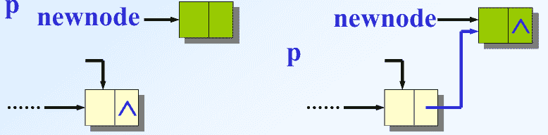

完整插入函数：

```
int Insert ( LinkList& first, int x, int i ) {
//在链表第 i 个结点处插入新元素 x
ListNode * p = first; int k = 0;
while ( p != NULL && k < i - 1 )
{ p = p->link; k++; } //找第 i-1个结点
if ( p == NULL && first != NULL ) {
printf( "无效的插入位置!\n" );
return 0;
}
ListNode * newnode = //创建新结点
(ListNode *) malloc ( sizeof (ListNode) );
newnode->data = x;
if ( first == NULL || i == 1 ) { //插在表前
    newnode->link = first;
    first = newnode;
}
else { //插在表中或末尾
    newnode->link = p->link;
    p->link = newnode;
}
return 1;
}
```

**删除**

在单链表中删除 aᵢ 结点

```
q = p->link;
p->link = q->link;
```

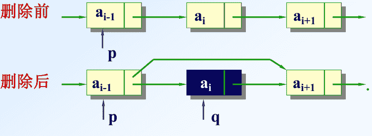

完整删除函数：

```
int Delete ( LinkList& first, int i ) {
    //在链表中删除第 i 个结点
    ListNode *p, *q;
    if ( i == 1 )              //删除表中第 1 个结点
    { q = first; first = first->link; }
    else {
        p = first; int k = 0;  //找第 i-1 个结点
        while ( p != NULL && k < i-1 )
        { p = p->link; k++; }
    }
}
```

```c
if ( p == NULL || p->link == NULL ){
    printf("无效的删除位置!\n");
    return 0;
}
else {
    //删除元素
    q = p->link;
    p->link = q->link;
}
}
free ( q );       //释放q
return 1;
}
```

## 带表头结点的单链表

- 表头结点位于表的最前端，本身不带数据，仅标志表头。
- 设置表头结点的目的：
  - 简化链表操作的实现。

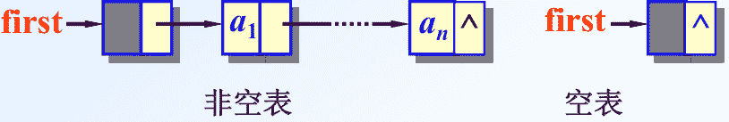

## 插入

```c
q->link = p->link;
p->link = q;
```

### 插入前

### 插入后

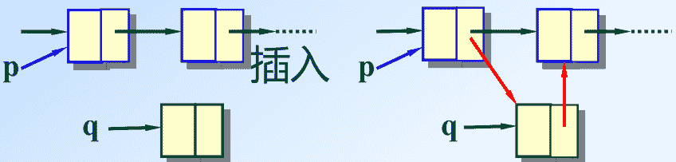

```c
int Insert (LinkList first, ListData x, int i ) {
//将新元素 x 插入在链表中第 i 号结点位置
ListNode * p = Locate ( first, i-1 );
if ( p == NULL ) return 0;
ListNode * newnode = //创建新结点
(ListNode *) malloc (sizeof (ListNode) );
newnode->data = x;
newnode->link = p->link; //链入
p->link = newnode;
return 1;
}
```

## C语言描述

```c
Status ListInsert(LinkList L,int i,ElemType e)
{ // 在带头结点的单链线性表L中第i个位置之前插入元素e
    int j=0;
    LinkList p=L,s;
    while(p&&j<i-1) // 寻找第i-1个结点
    {
        p=p->next;
        j++;
    }
    if(!p||j>i-1) // i小于1或者大于表长
        return ERROR;
    s=(LinkList)malloc(sizeof(LNode)); // 生成新结点
    s->data=e; // 插入L中
    s->next=p->next;
    p->next=s;
    return OK;
}
```

## 删除

```c
q = p->link;
p->link = q->link;
delete q;
```

### 删除前

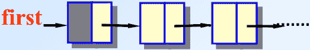

### 删除后

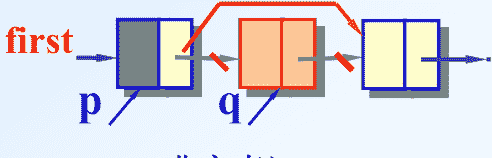

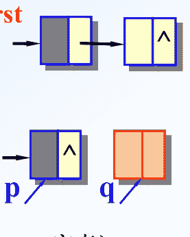

```c
int Delete ( LinkList first, int i ) {
//将链表第 i 号元素删去
ListNode * p, * q;
p = Locate ( first, i-1 ); //寻找第i-1个结点
if ( p == NULL || p->link == NULL)
    return 0;
q = p->link;
p->link = q->link;    //删除结点
free ( q);    //释放
return 1;
}
```

## 前插法建立单链表

- 从一个空表开始，重复读入数据：
  - 生成新结点
  - 将读入数据存放到新结点的数据域中
  - 将该新结点插入到链表的前端
- 直到读入结束符为止。

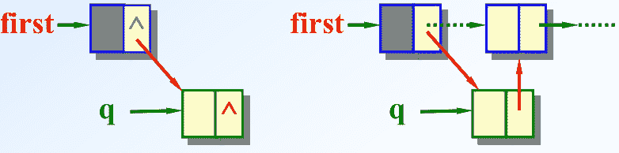

```c
LinkList createListF ( void ) {
char ch; ListNode *s;
LinkList head = //建立表头结点
(LinkList) malloc (sizeof (ListNode));
head->link = NULL;
while ( (ch = getchar( ) ) != '\n' ) {
s = (ListNode *) malloc (sizeof(ListNode));
s->data = ch; //建立新结点
s->link = head->link; //插入到表前端
head->link = s;
}
return head;
}
```

## 后插法建立单链表

- 每次将新结点加在链表的表尾；
- 尾指针r，总是指向表中最后一个结点，新结点插在它的后面；

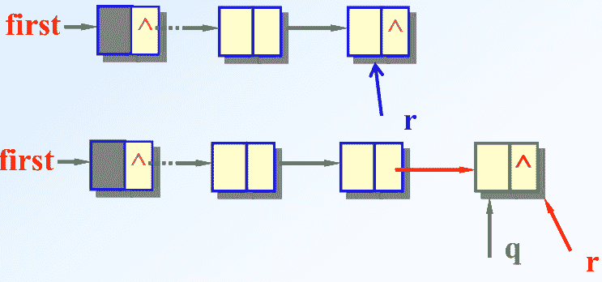

```c
LinkList createListR ( void ) {
char ch;
LinkList head = //建立表头结点
(LinkList) malloc (sizeof (ListNode));
ListNode *q, *r = NULL;
while ( (ch = getchar( ) ) != '\n' ) {
q = (ListNode *) malloc (sizeof(ListNode));
q->data = ch; //建立新结点
r->link = q; r = q; //插入到表末端
}
r->link = NULL;
return head;
}
```

## 单链表清空

```c
void makeEmpty ( LinkList first ) {
//删去链表中除表头结点外的所有其它结点
ListNode *q;
while ( first->link != NULL ) {
q = first->link; first->link = q->link;
//将表头结点后第一个结点从链中摘下
free( q ); //释放
}
}
```

## Status InitList(LinkList &L)

```c
{
    // 操作结果：构造一个空的线性表L
    L=(LinkList)malloc(sizeof(LNode)); // 产生头结点,并使L指向此头结点
    if(!L) // 存储分配失败
        exit(OVERFLOW);
    L->next=NULL; // 指针域为空
    return OK;
}
```

```c
Status DestroyList(LinkList &L)
{
    // 初始条件：线性表L已存在。操作结果：销毁线性表L
    LinkList q;
    while(L)
    {
        q=L->next;
        free(L);
        L=q;
    }
    return OK;
}
```

## Status ListEmpty(LinkList L)

```c
{ // 初始条件：线性表L已存在。操作结果：若L为空表，则返回TRUE，否则返回FALSE
    if(L->next) // 非空
        return FALSE;
    else
        return TRUE;
}
```

## 计算单链表长度

```c
int Length ( LinkList first ) {
    ListNode *p = first->link;
    //指针 p 指示第一个结点
    int count = 0;
    while ( p != NULL ) {    //逐个结点检测
        p = p->link; count++;
    }
    return count;
}
```

## 按值查找

```c
ListNode * Find ( LinkList first, ListData value )
{
    //在链表中从头搜索其数据值为value的结点
    ListNode * p = first->link;
    //指针 p 指示第一个结点
    while ( p != NULL && p->data != value )
        p = p->link;
    return p;
}
```


## 按序号查找（定位）

ListNode * Locate ( LinkList first, int i ) {
//返回表中第 i 个元素的地址
    if ( i < 0 ) return NULL;
    ListNode * p = first;  int k = 0;
    while ( p != NULL && k < i )
        { p = p->link;  k++; }   //找第 i 个结点
    if ( k == i ) return p; //返回第 i 个结点地址
    else return NULL;
}

## C语言描述

Status GetElem(LinkList L,int i,ElemType &e) // 算法2.8
{
    // L为带头结点的单链表的头指针。 当第i个元素存在时,其值赋给e并返回OK,否则返回ERROR
    int j=1; // j为计数器
    LinkList p=L->next; // p指向第一个结点
    while(p&&j<i) // 顺指针向后查找,直到p指向第i个元素或p为空
    {
        p=p->next;
        j++;
    }
    if(!p||j>i) // 第i个元素不存在
        return ERROR;
    e=p->data; // 取第i个元素
    return OK;
}

int LocateElem(LinkList L,ElemType e,Status(*compare)(ElemType,ElemType))
{
    // 初始条件：线性表L已存在,compare()是数据元素判定函数(满足为1,否则为0)
    // 操作结果：返回L中第1个与e满足关系compare()的数据元素的位置。
    //          若这样的数据元素不存在,则返回值为0
    int i=0;
    LinkList p=L->next;
    while(p)
    {
        i++;
        if(compare(p->data,e)) // 找到这样的数据元素
            return i;
        p=p->next;
    }
    return 0;
}

Status PriorElem(LinkList L,ElemType cur_e,ElemType &pre_e)
{
    // 初始条件：线性表L已存在
    // 操作结果：若cur_e是L的数据元素,且不是第一个,则用pre_e返回它的前驱,
    //          返回OK;否则操作失败,pre_e无定义,返回INFEASIBLE
    LinkList q,p=L->next; // p指向第一个结点
    while(p->next) // p所指结点有后继
    {
        q=p->next; // q为p的后继
        if(q->data==cur_e)
        {
            pre_e=p->data;
            return OK;
        }
        p=q; // p向后移
    }
    return INFEASIBLE;
}

Status NextElem(LinkList L,ElemType cur_e,ElemType &next_e)
{
    // 初始条件：线性表L已存在
    // 操作结果：若cur_e是L的数据元素，且不是最后一个，则用next_e返回它的后继，
    // 返回OK;否则操作失败，next_e无定义，返回INFEASIBLE
    LinkList p=L->next; // p指向第一个结点
    while(p->next) // p所指结点有后继
    {
        if(p->data==cur_e)
        {
            next_e=p->next->data;
            return OK;
        }
        p=p->next;
    }
    return INFEASIBLE;
}

### 定义

const int MaxSize = 100;  //静态链表大小

typedef int ListData;

typedef struct node {   //静态链表结点
    ListData data;
    int link;
} SNode;

typedef struct {   //静态链表
    SNode Nodes[MaxSize];
    int newptr;   //当前可分配空间首地址
} SLinkList;

## 链表空间初始化

void InitList ( SLinkList SL ) {
    SL.Nodes[0].link = 1;
    SL.newptr = 1;    //当前可分配空间从 1 开始
    //建立带表头结点的空链表
    for ( int i = 1; i < MaxSize-1; i++ )
        SL.Nodes[i].link = i+1;
        //构成空闲链接表
    SL.Nodes[MaxSize-1].link = -1;
    //链表收尾
}

## 在静态链表中查找具有给定值的结点

int Find ( SLinkList SL, ListData x ) {
    int p = SL.Nodes[0].link;
    //指针 p 指向链表第一个结点
    while ( p != -1 )
        if ( SL.Nodes[p].data != x)
            p = SL.Nodes[p].link;
        else break;
    //逐个结点查找具有给定值的结点
    return p;
}

## 在静态链表的表尾追加一个新结点

int Append ( SLinkList SL, ListData x ) {
    if ( SL.newptr == -1 ) return 0; //追加失败
    int q = SL.newptr;    //分配结点
    SL.newptr = SL.Nodes[SL.newptr].link;
    SL.Nodes[q].data = x;
    SL.Nodes[q].link = NULL;
    int p = 0;    //查找表尾
    while ( SL.Nodes[p].link != -1 )
        p = SL.Nodes[p].link;
    SL.Nodes[p].link = q;    //追加
    return 1;
}

## 在静态链表中查找第 i 个结点

int Locate ( SLinkList SL, int i ) {
    if ( i < 0 ) return -1;   //参数不合理
    int j = 0, p = SL.Nodes[0].link;
    while ( p != -1 && j < i ) {
    //循环查找第 i 号结点
        p = SL.Nodes[p].link;
        j++;
    }
    if ( i == 0 ) return 0;
    return p;
}

## 在静态链表第 i 个结点处插入一个新结点

int Insert ( SLinkList SL, int i, ListData x ) {
    int p = Locate ( SL, i-1);
    if ( p == -1 ) return 0;        //找不到结点
    int q = SL.newptr;              //分配结点
    SL.newptr = SL.Nodes[SL.newptr].link;
    SL.Nodes[q].data = x;
    SL.Nodes[q].link = SL.Nodes[p].link;
    SL.Nodes[p].link = q;            //插入
    return 1;
}

## 在静态链表中释放第 i 个结点

int Remove ( SLinkList SL, int i ) {
    int p = Locate ( SL, i-1);
    if ( p == -1) return 0;      //找不到结点
    int q = SL.Nodes[p].link;    //第 i 号结点
    SL.Nodes[p].link = SL.Nodes[q].link;
    SL.Nodes[q].link = SL.newptr; //释放
    SL.newptr = q;
    return 1;
}


## 循环链表 (Circular List)

- 特点：最后一个结点的 link 指针不为 NULL，而是指向头结点。
- 存储结构：链式存储结构
- 带表头结点的循环链表

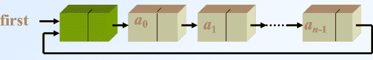

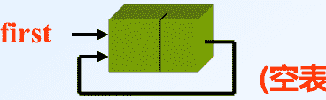

## 双向链表 (Doubly Linked List)

- 双向链表结点结构：

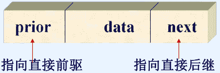

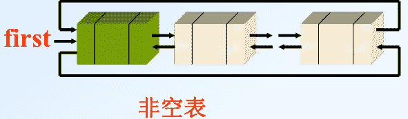

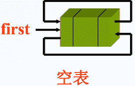

## 双向循环链表的定义

```c
typedef int ListData;
typedef struct dnode {
    ListData data;
    struct dnode *prior, *next;
} DblNode;
typedef DblNode *DblList;
```

## 建立空的双向循环链表

```c
void CreateDblList(DblList &first) {
    first = (DblNode *)malloc(sizeof(DblNode));
    if (first == NULL) {
        printf("存储分配错!\n");
        exit(1);
    }
    first->prior = first->next = first;
    //表头结点的链指针指向自己
}
```

## 计算双向循环链表的长度

```c
int Length(DblList first) {
    //计算带表头结点的双向循环链表的长度
    DblNode *p = first->next;
    int count = 0;
    while (p != first) {
        p = p->next;
        count++;
    }
    return count;
}
```

## 双向循环链表的插入（非空表）

在结点 *p* 后插入25

```c
q->prior = p;
q->next = p->next;
p->next = q;
q->next->prior = q;
```

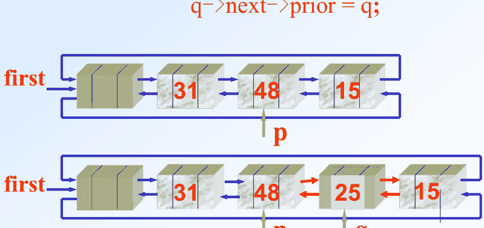

## 双向循环链表的插入（空表）

在结点 *p* 后插入25

```c
q->prior = p;
q->next = p->next;
p->next = q;
q->next->prior = q;
```

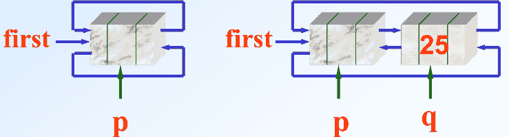

```c
int Insert(DblList first, int i, ListData x) {
    DblNode *p = Locate(first, i - 1);
    //指针定位于插入位置
    if (p == first && i != 1) return 0;
    DblNode *q = (DblNode *)malloc(sizeof(DblNode)); //分配结点
    q->data = x;
    q->prior = p;
    p->next->prior = q;
    //在前驱方向链入新结点
    q->next = p->next;
    p->next = q;
    //在后继方向链入新结点
    return 1;
}
```

## 双向循环链表的删除

```c
p->next->prior = p->prior;
p->prior->next = p->next;
```

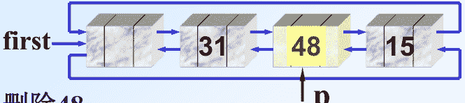

删除48

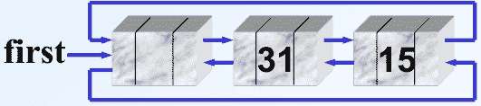

（非空表）

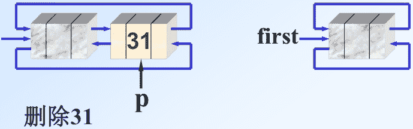

```c
p->next->prior = p->prior;
p->prior->next = p->next;
```

```c
int Remove(DblList first, int i) {
    DblNode *p = Locate(first, i);
    //指针定位于删除结点位置
    if (p == first) return 0;
    p->next->prior = p->prior;
    p->prior->next = p->next;
    //删除结点 p
    free(p);      //释放
    return 1;
}
```

## 顺序表与链表的比较

### 基于空间的比较

- 存储分配的方式
  - 顺序表的存储空间是静态分配的
  - 链表的存储空间是动态分配的
- 存储密度 = 结点数据本身所占的存储量 / 结点结构所占的存储总量
  - 顺序表的存储密度 = 1
  - 链表的存储密度 < 1

### 基于时间的比较

- **存取方式**
  - 顺序表可以随机存取，也可以顺序存取
  - 链表是顺序存取的
- **插入/删除时移动元素个数**
  - 顺序表平均需要移动近一半元素
  - 链表不需要移动元素，只需要修改指针

## 第三章 栈和队列

- 栈
- 队列
- 递归

## 栈（Stack）

- 定义：是限定仅在表尾进行插入或删除操作的线性表。
- 允许插入和删除的一端称为栈顶（top），另一端称为栈底（bottom）。
- 特点：后进先出（LIFO）。

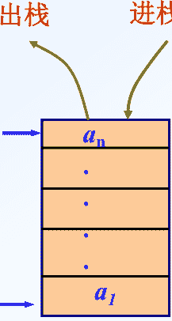

## 栈的主要操作

```c
ADT Stack {
    //对象由数据类型为StackData的元素构成
    int Push(Stack *S, StackData x); //进栈
    int Pop(Stack *S, StackData &x); //出栈
    int GetTop(Stack *S, StackData &x); //取栈顶
    void InitStack(Stack *S); //置空栈
    int StackEmpty(Stack *S); //判栈空否
    int StackFull(Stack *S); //判栈满否
}
```

## 栈的表示和实现

- 顺序栈：栈的顺序存储结构，利用一组地址连续的存储单元依次存放自栈底到栈顶的数据元素，指针 top 指向栈顶元素在顺序栈中的下一个位置，base 为栈底指针，指向栈底的位置。

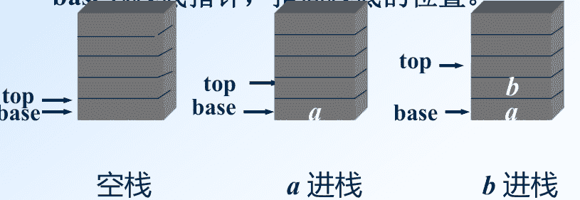

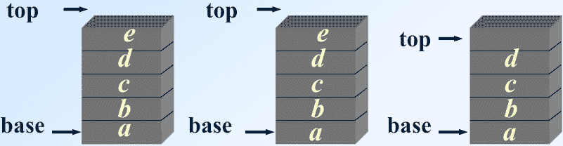

e 进栈

f 进栈溢出

e 出栈

## 顺序栈的类型表示：

```c
#define STACK_INIT_SIZE 100
#define STACKINCREMENT 10

typedef char StackData;

typedef struct {    //顺序栈定义
    StackData *base;    //栈底指针
    StackData *top;     //栈顶指针
    int stacksize;      //当前已分配的存储空间
} SeqStack;
```

## 顺序栈的基本运算：

### 判栈空

```c
int StackEmpty(SeqStack *S) {
    if (S->top == S->base) return 1; //判栈空，空则返回1
    else return 0; //否则返回0
}
```

### 判栈满

```c
int StackFull(SeqStack *S) {
    if (S->top - S->base >= S->stacksize) return 1; //判栈满，满则返回1
    else return 0; //否则返回0
}
```

### 初始化

```c
void InitStack(SeqStack *S) { //置空栈
    S->base = (StackData *)malloc(STACK_INIT_SIZE * sizeof(StackData));
    if (!S->base) exit(OVERFLOW);
    S->top = S->base;
    S->stacksize = STACK_INIT_SIZE;
    return OK;
}
```

## 入栈

```c
int Push(SeqStack *S, StackData x) {
    // 插入元素x为新的栈顶元素
    if (StackFull(S)) {
        S->base = (StackData *)realloc(S->base,
                      (S->stacksize + STACKINCREMENT) *
                      sizeof(StackData));
        if (!S->base) exit(OVERFLOW);
        S->top = S->base + S->stacksize;
        S->stacksize += STACKINCREMENT; // 追加存储空间
    }
    *(S->top) = x;
    (S->top)++;
    return OK;
}
```

## 取栈顶元素

```cpp
int GetTop(SeqStack *S, StackData &x) {
    // 若栈空返回0, 否则栈顶元素读到x并返回1
    if (StackEmpty(S)) return 0;
    (S->top)--;
    x = *(S->top);
    return 1;
}
```

## 出栈

```cpp
int Pop(SeqStack *S, StackData &x) {
    // 若栈空返回0, 否则栈顶元素退出到x并返回1
    if (StackEmpty(S)) return 0;
    --(S->top);
    x = *(S->top);
    return 1;
}
```

## C语言描述

```cpp
Status InitStack(SqStack &S)
{
    if (!(S.base = (SElemType *)malloc(STACK_INIT_SIZE * sizeof(SElemType))))
        exit(OVERFLOW); // 存储分配失败
    S.top = S.base;
    S.stacksize = STACK_INIT_SIZE;
    return OK;
}
```

```cpp
Status DestroyStack(SqStack &S)
{
    // 销毁栈S，S不再存在
    free(S.base);
    S.base = NULL;
    S.top = NULL;
    S.stacksize = 0;
    return OK;
}
```

```cpp
Status ClearStack(SqStack &S)
{
    // 把S置为空栈
    S.top = S.base;
    return OK;
}
```

```cpp
Status StackEmpty(SqStack S)
{
    // 若栈S为空栈，则返回TRUE，否则返回FALSE
    if (S.top == S.base)
        return TRUE;
    else
        return FALSE;
}
```

```cpp
int StackLength(SqStack S)
{
    // 返回S的元素个数，即栈的长度
    return S.top - S.base;
}
```

```cpp
Status GetTop(SqStack S, SElemType &e)
{
    // 若栈不空，则用e返回S的栈顶元素，并返回OK；否则返回ERROR
    if (S.top > S.base)
    {
        e = *(S.top - 1);
        return OK;
    }
    else
        return ERROR;
}
```

```cpp
Status Push(SqStack &S, SElemType e)
{
    // 插入元素e为新的栈顶元素
    if (S.top - S.base >= S.stacksize) // 栈满，追加存储空间
    {
        S.base = (SElemType *)realloc(S.base, (S.stacksize + STACKINCREMENT) * sizeof(SElemType));
        if (!S.base)
            exit(OVERFLOW); // 存储分配失败
        S.top = S.base + S.stacksize;
        S.stacksize += STACKINCREMENT;
    }
    *(S.top)++ = e;
    return OK;
}
```

## 链式栈：栈的链接表示

- 链式栈无栈满问题，空间可扩充
- 插入与删除仅在栈顶处执行
- 链式栈的栈顶在链头
- 适合于多栈操作

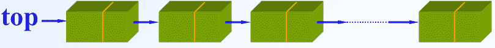

### 链式栈（LinkStack）的定义

```c
typedef int StackData;
typedef struct node {
    StackData data;        // 结点
    struct node *link;     // 链指针
} StackNode;
typedef struct {
    StackNode *top;        // 栈顶指针
} LinkStack;
```

### 链式栈操作实现

**初始化**

```c
void InitStack(LinkStack *S) {
    S->top = NULL;
}
```

**入栈**

```c
int Push(LinkStack *S, StackData x) {
    StackNode *p = (StackNode *)malloc(sizeof(StackNode));
    p->data = x;
    p->link = S->top;
    S->top = p;
    return 1;
}
```

**判栈空**

```c
int StackEmpty(LinkStack *S) {
    return S->top == NULL;
}
```

**出栈**

```cpp
int Pop(LinkStack *S, StackData &x) {
    if (StackEmpty(S)) return 0;
    StackNode *p = S->top;
    S->top = p->link;
    x = p->data;
    free(p);
    return 1;
}
```

**取栈顶**

```cpp
int GetTop(LinkStack *S, StackData &x) {
    if (StackEmpty(S)) return 0;
    x = S->top->data;
    return 1;
}
```

**置栈空**

```c
int MakeEmpty(LinkStack *S) {
    while (S->top != NULL) {
        StackNode *p = S->top;
        S->top = S->top->link;
        free(p);
    }
}
```

## 栈的应用举例

- 数制转换
- 行编辑程序
- 迷宫求解
- 表达式求值

### 数制转换

N = (N div d) × d + N mod d

例如：`(1348)₁₀ = (2504)₈`，其运算过程如下：

| N | N div 8 | N mod 8 |
|---:|---:|---:|
| 1348 | 168 | 4 |
| 168 | 21 | 0 |
| 21 | 2 | 5 |
| 2 | 0 | 2 |

计算顺序 ↓

输出顺序 ↑

```c
void conversion() {
    InitStack(S);
    scanf("%d", &N);
    while (N) {
        Push(S, N % 8);
        N = N / 8;
    }
    while (!StackEmpty(S)) {
        Pop(S, e);
        printf("%d", e);
    }
} // conversion
```

### 行编辑程序

在用户输入一行的过程中，允许用户输入出差错，并在发现有误时可以及时更正。

设立一个输入缓冲区，用以接受用户输入的一行字符，然后逐行存入用户数据区；并假设“#”为退格符，“@”为退行符。

假设从终端接受两行字符：

```text
whli##ilr#e (s#*s)
```

```text
outcha@putchar(*s=#++);
```

实际有效行为：

```c
while (*s)
```

```c
putchar(*s++);
```


## 迷宫求解

通常用的是“穷举求解”的方法

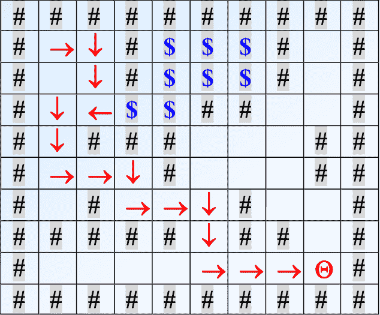

设定当前位置的初值为入口位置；
do {
    若当前位置可通，
    则 {
        将当前位置插入栈顶；
        若该位置是出口位置，则算法结束；
        否则切换当前位置的东邻方块为新的当前位置；
    }
    否则 {
        ..........
    }
} while (栈不空)；

将从栈底到栈顶的字符传送至调用过程的数据区；

ClearStack(S); // 重置S为空栈

if (ch != EOF) ch = getchar();

}

DestroyStack(s);

}

## 表达式求值

限于二元运算符的表达式定义：

表达式 ::= (操作数) + (运算符) + (操作数)

操作数 ::= 简单变量 | 表达式

简单变量 ::= 标识符 | 无符号整数

Exp = S1 + OP + S2

+ 前缀表示法 OP + S1 + S2
+ 中缀表示法 S1 + OP + S2
+ 后缀表示法 S1 + S2 + OP

## 表达式标识方法

例如：Exp = a×b+(c-d/e)×f

前缀式：+×ab×-c/def

中缀式：a×b+c-d/e×f

后缀式：ab×cde/-f×+

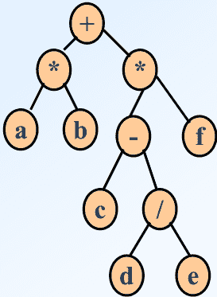

## 后缀表达式求值

### 先找运算符，再找操作数

# 例如：

ab×cde/-f×+

a×b

d/e

c-d/e

(c-d/e)×f

## 从原表达式求得后缀式方法

+ 1) 设立暂存运算符的栈；
+ 2) 设表达式的结束符为“#”，予设运算符栈的栈底为“#”
+ 3) 若当前字符是操作数，则直接发送给后缀式；
+ 4) 若当前运算符的优先数高于栈顶运算符，则进栈；
+ 5) 否则，退出栈顶运算符发送给后缀式；
+ 6) “(”对它之前后的运算符起隔离作用，“)”为自左括弧开始的表达式的结束符。

## 队列

+ 定义:只允许在表的一端进行插入，而在另一端删除元素的线性表。
+ 在队列中，允许插入的一端叫队尾（rear）
+ ，允许删除的一端称为对头(front)。
+ 特点：先进先出 (FIFO)

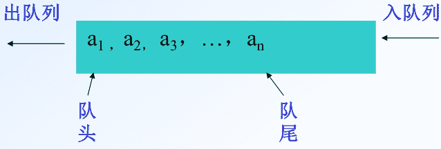

## 链队列：队列的链式表示

+ 链队列中，有两个分别指示队头和队尾的指针。
+ 链式队列在进队时无队满问题，但有队空问题。

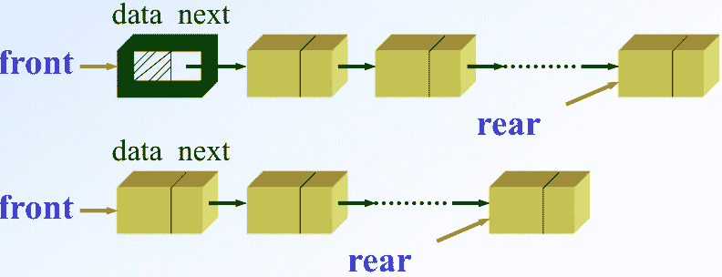

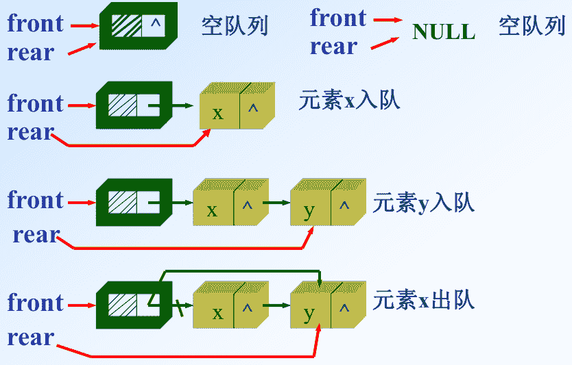

front rear 空队列

front rear NULL 空队列

front rear 元素 x 入队

front rear 元素 y 入队

front rear 元素 x 出队

## 链式队列的定义

typedef int QueueData;

typedef struct node {
QueueData data; //队列结点数据
struct node *link; //结点链指针
} QueueNode;

typedef struct {
QueueNode *rear, *front;
} LinkQueue;

## 链队列的主要操作

### 初始化

void InitQueue ( LinkQueue *Q ) {
    Q->rear = Q->front = NULL;
}

### 队空

int QueueEmpty ( LinkQueue *Q ) {
    return Q->front == NULL;
}

### 取队头元素

int GetFront ( LinkQueue *Q, QueueData &x ) {
    if ( QueueEmpty (Q) ) return 0;
    x = Q->front->data;  return 1;
}

## C语言描述

Status InitQueue(LinkQueue &Q)

+ { // 构造一个空队列Q
+ if(!(Q.front=Q.rear=(QueuePtr)malloc(sizeof(QNode))))
+ exit(OVERFLOW);
+ Q.front->next=NULL;
+ return OK;
+ }

Status DestroyQueue(LinkQueue &Q)
• { // 销毁队列Q(无论空否均可)
• while(Q.front)
• {
• Q.rear=Q.front->next;
• free(Q.front);
• Q.front=Q.rear;
• }
• return OK;
• }

## Status ClearQueue(LinkQueue &Q)

+ { // 将Q清为空队列
+ QueuePtr p,q;
+ Q.rear=Q.front;
+ p=Q.front->next;
+ Q.front->next=NULL;
+ while(p)
+ {
+ q=p;
+ p=p->next;
+ free(q);
+ }
+ return OK;
+ }

## Status QueueEmpty(LinkQueue Q)

+ • { // 若Q为空队列,则返回TRUE,否则返回FALSE
+ • if(Q.front==Q.rear)
+ • return TRUE;
+ • else
+ • return FALSE;
+ • }

int QueueLength(LinkQueue Q)
{ // 求队列的长度
int i=0;
QueuePtr p;
p=Q.front;
while(Q.rear!=p)
{
i++;
p=p->next;
}
return i;
}

## Status GetHead(LinkQueue Q,QElemType &e)

+ `{ // 若队列不空,则用e返回Q的队头元素,并返回OK,否则返回ERROR`
+ `QueuePtr p;`
+ `if(Q.front==Q.rear)`
+ `return ERROR;`
+ `p=Q.front->next;`
+ `e=p->data;`
+ `return OK;`
+ `}`

## 入队

int EnQueue ( LinkQueue *Q, QueueData x ) {
    QueueNode *p = ( QueueNode * ) malloc
    ( sizeof ( QueueNode ) );
    p->data = x; p->link = NULL;
    if ( Q->front == NULL )
    //空,创建第一个结点
    Q->front = Q->rear = p;
    else Q->rear->link = p; //入队
    Q->rear =p;
    return 1;
}

## C语言描述

Status EnQueue(LinkQueue &Q,QElemType e)

+ { // 插入元素e为Q的新的队尾元素
+ QueuePtr p;
+ if(!(p=(QueuePtr)malloc(sizeof(QNode)))) // 存储分配失败
+ exit(OVERFLOW);
+ p->data=e;
+ p->next=NULL;
+ Q.rear->next=p;
+ Q.rear=p;
+ return OK;
+ }


## 出队

int DeQueue ( LinkQueue *Q, QueueData &x) {
//删去队头结点，并返回队头元素的值
if ( QueueEmpty (Q) ) return 0; //判队空
QueueNode *p = Q->front;
x = p->data; //保存队头的值
Q->front= Q->front->link; //新队头
free (p);
return 1;
}

## C语言描述

- Status DeQueue(LinkQueue &Q,QElemType &e)
- {{ // 若队列不空,删除Q的队头元素,用e返回其值,并返回OK,否则返回ERROR
- QueuePtr p;
- if(Q.front==Q.rear)
- return ERROR;
- p=Q.front->next;
- e=p->data;
- Q.front->next=p->next;
- if(Q.rear==p)
- Q.rear=Q.front;
- free(p);
- return OK;
- }}

## 循环队列 (Circular Queue)

- 顺序队列—队列的顺序存储表示。 用一组地址连续的存储单元依次存放从队列头到队列尾的元素， 指针front和rear分别指示队头元素和队尾元素的位置。
- 插入新的队尾元素， 尾指针增1， rear = rear + 1，
- 删除队头元素， 头指针增1， front = front + 1，
- 因此， 在非空队列中， 头指针始终指向队列头元素， 而尾指针始终指向队列尾元素的下一个位置。
- 队满时再进队将溢出
- 解决办法： 将顺序队列臆造为一个环状的空间， 形成循环(环形)队列

## 队列的进队和出队

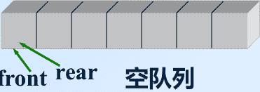

空队列

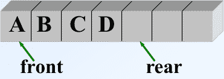

A,B,C,D进队

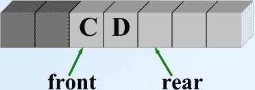

A,B出队

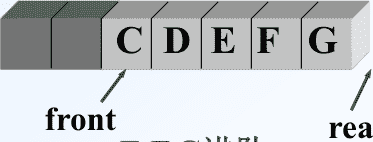

E,F,G进队

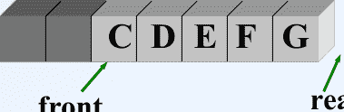

H进队,溢出

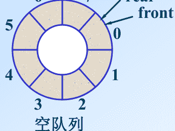

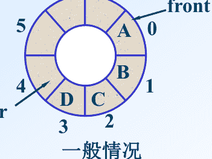


## 循环队列的类型定义

```c
#define MAXSIZE 100
Typedef struct{
    QueueData *data;
    int front;
    int rear;
} SeqQueue
```

## 循环队列操作的实现

- 初始化队列

void InitQueue ( SeqQueue *Q ) {
//构造空队列
Q->data=(QueueData *)malloc(MAXSIZE
*sizeof(QueueData));
If(! Q->data)exit(OVERFLOW);
Q->rear = Q->front = 0;
Return ok
}

## 判队空

int QueueEmpty ( SeqQueue *Q ) {
    return Q->rear == Q->front;
}

## 判队满

int QueueFull ( SeqQueue *Q ) {
    return (Q->rear+1) % QueueSize == Q->front;
}

## 入队

int EnQueue ( SeqQueue *Q, QueueData x ) {
    if ( QueueFull (Q) ) return 0;
    Q->data[Q->rear] = x;
    Q->rear = ( Q->rear+1 ) % MAXSIZE;
    return 1;
}

## 队列应用举例
—打印二项展开式 $(a+b)^i$ 的系数

## 杨辉三角形（Pascal's triangle）

$$\begin{array}{cccccccc}
&&&&1&1&&&i=1\\
&&&1&2&1&&&2\\
&&1&5&5&1&&&3\\
&1&4&6&4&1&&&4\\
1&5&10&10&5&1&&&5\\
1&6&15&20&15&6&1&&&6
\end{array}$$

## 分析第 i 行元素与第 i+1 行元素的关系


目的是从前一行的数据可以计算下一行的数据

## 从第 i 行数据计算并存放第 i+1 行数据


```cpp
void YANGVI ( int n ) {
    Queue q;                 //队列初始化
    q.MakeEmpty ( );
    q.EnQueue (1);  q.EnQueue (1);//预放入第一行的两个系数
    int s = 0;
    for ( int i=1; i<=n; i++ ) {  //逐行处理
        cout << endl;
        q.EnQueue (0);
        for ( int j=1; j<=i+2; j++ ) { //处理第i行的i+2个系数
            int t = q.DeQueue ();//读取系数
            q.EnQueue ( s+t );//计算下一行系数，并进队列
            s = t;
            if ( j != i+2 ) cout << s << ' ';//打印一个系数，第i+2个为0
        }
    }
}
```

## 优先级队列 (Priority Queue)

- 优先级队列 是不同于先进先出队列的另一种队列。每次从队列中取出的是具有最高优先权的元素

- 例如下表： 任务的优先权及执行顺序的关系

| 任务编号 | 1 | 2 | 3 | 4 | 5 |
|---|---|---|---|---|---|
| 优先权 | 20 | 0 | 40 | 30 | 10 |
| 执行顺序 | 3 | 1 | 5 | 4 | 2 |

数字越小， 优先权越高

## 优先队列的类定义

```cpp
#include <assert.h>
#include <iostream.h>
#include <stdlib.h>
const int maxPQSize = 50;  // 缺省元素个数

template <class Type> class PQueue {
public:
    PQueue();
    ~PQueue() { delete [] pqelements; }
    void PQInsert(const Type & item);
    Type PQRemove();
```

void makeEmpty() { count = -1; }
int IsEmpty() const
{ return count == -1; }
int IsFull() const
{ return count == maxPQSize; }
int Length() const { return count; } //优先级队列元素个数
private:
Type *pqelements; //存放数组（优先级队列数组）
int count; //队列元素计数
}

## 优先级队列部分成员函数的实现

```cpp
template <class Type>
PQueue<Type>::PQueue ( ) : count (-1) {
    pqelements = new Type[maxPQSize];
    assert ( pqelements != 0 ); //分配断言
}
```

```cpp
template <class Type> void PQueue<Type>::
PQInsert ( const Type & item ) {
    assert ( !IsFull ( ) );           //判队满断言
    count ++;    pqelements[count] = item;
}
```


## 递归

- **定义** 若一个对象部分地包含它自己，或用它自己给自己定义，则称这个对象是递归的；若一个过程直接地或间接地调用自己，则称这个过程是递归的过程。

- **三种递归情况**

  - 定义是递归的
  - 数据结构是递归的
  - 问题的解法是递归的

## 求解阶乘 n! 的过程

主程序 main：fact(4)

参数 4 计算 4*fact(3) 返回 24

参数 3 计算 3*fact(2) 返回 6

参数 2 计算 2*fact(1) 返回 2

参数 1 计算 1*fact(0) 返回 1

参数 0 直接定值 = 1 返回 1

递归调用

参数传递

结果返回

回归求值

## 例2.计算斐波那契数列函数Fib(n)的定义

$$\mathrm{Fib}(n)=\begin{cases}n, & n=0,1\\\mathrm{Fib}(n-1)+\mathrm{Fib}(n-2), & n>1\end{cases}$$

如 $F_0=0,\ F_1=1,\ F_2=1,\ F_3=2,\ F_4=3,\ F_5=5$

## 递归算法

```cpp
long Fib ( long n ) {
    if ( n <= 1 ) return n;
    else return Fib (n-1) + Fib (n-2);
}
```

## 数据结构是递归的

### 例如单链表结构

#### 只有一个结点的单链表


#### 有若干结点的单链表


## 例1. 搜索链表最后一个结点并打印其数值

```cpp
void Search ( ListNode *f ) {
    if ( f->link == NULL )
        printf ( "%d\n", f->data );
    else Search ( f->link );
}
```


## 例2.在链表中寻找等于给定值的结点,并打印其数值

```cpp
void Search ( ListNode *f, ListData& x ) {
    if ( f != NULL )
        if ( f->data == x )
            printf ("%d\n", f->data );
        else Search ( f->link, x );
}
```


## 问题的解法是递归的

例如，汉诺塔(Tower of Hanoi)问题的解法：
如果 n = 1，则将这一个盘子直接从 A 柱移到 C 柱上。否则，执行以下三步：
① 用 C 柱做过渡，将 A 柱上的 (n-1) 个盘子移到 B 柱上；
② 将 A 柱上最后一个盘子直接移到 C 柱上；
③ 用 A 柱做过渡，将 B 柱上的 (n-1) 个盘子移到 C 柱上。


## 算法

```cpp
#include <iostream.h>
#include "strclass.h"
void Hanoi (int n, String A, String B, String C) {
//解决汉诺塔问题的算法
if ( n == 1 ) printf (" move %s",A, " to %s",C);
else { Hanoi ( n-1, A, C, B );
printf (" move %s",A, " to %s",C);
Hanoi ( n-1, B, A, C );
}
}
```

## 递归过程与递归工作栈

- 递归过程在实现时，需要自己调用自己。
- 层层向下递归，退出时的次序正好相反：

递归调用
n! → (n-1)! → (n-2)! → ... → 1! → 0!=1
返回次序

- 主程序第一次调用递归过程为外部调用；
- 递归过程每次递归调用自己为内部调用。

## 递归工作栈

- 每一次递归调用时，需要为过程中使用的参数、局部变量等另外分配存储空间。

- 每层递归调用需分配的空间形成递归工作记录，按后进先出的栈组织。


## 函数递归时的活动记录

调用块

函数块

```
····················
<下一条指令>
```

```
Function(<参数表>)
····················
<return>
```

| 返回地址(下一条指令) | 局部变量 | 参数 |
|---|---|---|

```cpp
long Factorial ( long n ) {
    int temp;
    if ( n == 0 ) return 1;
    else temp = n * Factorial (n-1);
    return temp;
}
void main () {
    int n;
    n = Factorial (4);
}
```

## 计算Fact时活动记录的内容

参数 返回地址

返回时的指令

递归调用序列


```
RetLoc1 return 4*6 //返回24
RetLoc2 return 3*2 //返回6
RetLoc2 return 2*1 //返回2
RetLoc2 return 1*1 //返回1
RetLoc2 return 1 //返回1
```

## 递归过程改为非递归过程

- 递归过程简洁、易编、易懂
- 递归过程效率低，重复计算多
- 改为非递归过程的目的是提高效率
- 单向递归和尾递归可直接用迭代实现其非递归过程
- 其他情形必须借助栈实现非递归过程

## ◆ 斐波那契数列的递归调用树


栈结点

| n | tag |
|---|---|
|   |     |

tag = 1, 向左递归； tag = 2, 向右递归


Fib(4)

Fib(3)

Fib(2)

Fib(2)

Fib(1)

Fib(1)

Fib(0)

Fib(1)

Fib(0)

| 2 | 1 |
|---|---|
| 3 | 1 |
| 4 | 1 |

n=1
sum=0+1

| 2 | 2 |
|---|---|
| 3 | 1 |
| 4 | 1 |

n=2-2

|   |   |
|---|---|
| 3 | 1 |
| 4 | 1 |

n=0
sum=1+0

|   |   |
|---|---|
| 3 | 2 |
| 4 | 1 |

n=3-2

|   |   |
|---|---|
| 4 | 1 |

n=1
sum=1+1

|   |   |
|---|---|
| 4 | 2 |

n=4-2


## 递归与回溯

### n皇后问题

在 n 行 n 列的国际象棋棋盘上，若两个皇后位于同一行、同一列、同一对角线上，则称为它们为互相攻击。n皇后问题是指找到这 n 个皇后的互不攻击的布局。

# k = i+j

+ 0#次对角线
+ 1#次对角线
+ 2#次对角线
+ 3#次对角线
+ 4#次对角线
+ 5#次对角线
+ 6#次对角线

+ 0#主对角线
+ 1#主对角线
+ 2#主对角线
+ 3#主对角线
+ 4#主对角线
+ 5#主对角线
+ 6#主对角线

# k = n+i-j-1

### 解题思路

+ 安放第 i 行皇后时，需要在列的方向从 0 到 n-1 试探（j = 0, …, n-1）
+ 在第 j 列安放一个皇后：
  + 如果在列、主对角线、次对角线方向有其它皇后，则出现攻击，撤消在第 j 列安放的皇后。
  + 如果没有出现攻击，在第 j 列安放的皇后不动，递归安放第 i+1 行皇后。

### 设置 4 个数组

+ col [n] : col[i] 标识第 i 列是否安放了皇后
+ md[2n-1] : md[k] 标识第 k 条主对角线是否安放了皇后
+ sd[2n-1] : sd[k] 标识第 k 条次对角线是否安放了皇后
+ q[n] : q[i] 记录第 i 行皇后在第几列

```cpp
void Queen( int i ) {
for ( int j = 0; j < n; j++ ) {
if ( 第 i 行第 j 列没有攻击 ) {
在第 i 行第 j 列安放皇后；
if ( i== n-1 ) 输出一个布局；
else Queen ( i+1 );
撤消第 i 行第 j 列的皇后；
}
}
}
```

```cpp
void Queen( int i ) {
for ( int j = 0; j < n; j++ ) {
if ( !col[j] && !md[n+i-j-1] && !sd[i+j] )
{ /*第 i 行第 j 列没有攻击 */
col[j] = md[n+i-j-1] = sd[i+j] = 1;
q[i] = j; /*在第 i 行第 j 列安放皇后*/
if ( i == n-1 ) { /*输出一个布局*/
for ( int k = 0; k < n; k++ )
cout << q[k] << ' ';
cout << endl;
}
else Queen ( i+1 );
col[j] = md[n+i-j-1] = sd[i+j] = 0;
q[i] = 0; /*撤消第 i 行第 j 列的皇后*/
}
}
}
```

### 字符串 (String)

字符串是 n（≥ 0 ）个字符的有限序列，记作 S：“c₁c₂c₃...cₙ” 其中，S 是串名字 “c₁c₂c₃...cₙ”是串值 cᵢ 是串中字符 n 是串的长度。

例如，S = “Tsinghua University”

### 字符串抽象数据类型和类定义

```cpp
const int maxLen = 128;
class String {
    int curLen;          //串的当前长度
    char *ch;            //串的存储数组
public:
    String(const String& ob);
    String(const char *init);
    String();
    ~String() { delete [] ch; }
};
```

int Length ( ) const { return curLen; }

//求当前串*this的实际长度

String &operator ( ) ( int pos, int len );

//取*this从pos开始len个字符组成的子串

int operator == ( const String &ob )
    { return strcmp (ch, ob.ch) == 0; }

//判当前串*this与对象串ob是否相等

int operator != ( const String &ob )
    const { return strcmp (ch, ob.ch) != 0; }

//判当前串*this与对象串ob是否不等

int operator!() const { return curLen == 0; }

//判当前串*this是否空串

String &operator = (String &ob);

//将串ob赋给当前串*this

String &operator += (String &ob);

//将串ob连接到当前串*this之后

char &operator []( int i );

//取当前串*this的第 i 个字符

int Find ( String& pat ) const;

### 字符串部分操作的实现

```cpp
String :: String ( const String& ob ) {
//复制构造函数：从已有串ob复制
ch = new char[maxLen+1]; //创建串数组
if( ch == NULL ) {
    cerr << “存储分配错! \n”;
    exit(1);
}
curLen = ob.curLen; //复制串长度
strcpy ( ch, ob.ch); //复制串值
}
```

```cpp
String :: String ( const char *init ) {
//复制构造函数：从已有字符数组*init复制
ch = new char[maxLen+1]; //创建串数组
if ( ch == NULL ){
cerr << "存储分配错！\n";
exit(1);
}
curLen = strlen ( init ); //复制串长度
strcpy ( ch, init ); //复制串值
}
```

### 提取子串的算法示例

pos = 2, len = 3

pos+len -1
≤ curLen-1

pos = 5, len = 4

pos+len -1
≥ curLen

```cpp
String& String :: operator () (int pos, int len) {
//从串中第 pos 个位置起连续提取 len 个字符
//形成子串返回
    String * temp = new String; //动态分配
    if (pos<0 || pos+len-1 >= maxLen || len<0) {
        temp->curLen = 0;       //返回空串
        temp->ch[0] = '\0';
    }
    else {                      //提取子串
        if ( pos+len -1 >= curLen )
            len = curLen - pos;

```


```cpp
temp->curLen = len;          //子串长度
for (int i = 0, j = pos; i < len; i++, j++)
    temp->ch[i] = ch[j];      //传送串数组
temp->ch[len] = '\0';         //子串结束
return *temp;
}
```

例：串 st = "university"，pos = 3，len = 4

使用示例：`subSt = st (3, 4)`

提取子串：`subSt = "vers"`

```cpp
String& String::operator=(String& ob) {
    //串赋值：从已有串ob复制
    if (&ob != this) {
        delete[] ch;
        ch = new char[maxLen + 1]; //重新分配
        if (ch == NULL) {
            cerr << "内存不足!\n";
            exit(1);
        }
        curLen = ob.curLen; //串复制
        strcpy(ch, ob.ch);
    } else {
        cout << "字符串自身赋值出错!\n";
    }
    return *this;
}
```

```cpp
char& String::operator[](int i) {
    //按串名提取串中第 i 个字符
    if (i < 0 || i >= curLen) {
        cout << "串下标越界!\n";
        exit(1);
    }
    return ch[i];
}
```

例：串 `st = "university"`

使用示例：`newSt = st;`、`newChar = st[1];`

串赋值：`newSt = "university"`

提取字符：`newChar = 'n'`

```cpp
String& String::operator+=(String& ob) {
    //串连接
    char* temp = ch;    //暂存原串数组
    curLen += ob.curLen; //串长度累加
    ch = new char[maxLen + 1];
    if (ch == NULL) {
        cerr << "存储分配错!\n";
        exit(1);
    }
    strcpy(ch, temp);    //拷贝原串数组
    strcat(ch, ob.ch);   //连接ob串数组
    delete[] temp;
    return *this;
}
```

例：串 st1 = "beijing "，st2 = "university"

使用示例：`st1 += st2;`

连接结果：st1 = "beijing university"，st2 = "university"

## 串的模式匹配

- 定义：在串中寻找子串（第一个字符）在串中的位置。
- 词汇：在模式匹配中，子串称为模式，串称为目标。
- 示例：目标 T："Beijing"，模式 P："jin"，匹配结果 = 3。

### 穷举的模式匹配过程

- 第1趟：T: abbaba，P: aba
- 第2趟：T: abbaba，P: aba
- 第3趟：T: abbaba，P: aba
- 第4趟：T: abbaba，P: aba √

```cpp
int String::Find(String& pat) const {
    //穷举的模式匹配
    for (int i = 0; i <= curLen - pat.curLen; i++) {
        //逐趟比较
        int j = 0; //从ch[i]与模式pat.ch比较
        while (j < pat.curLen)
            if (ch[i + j] == pat.ch[j]) j++;
            else break;
        if (j == pat.curLen) return i;
        //pat扫描完, 匹配成功
    }
    return -1;
}
```

## 第五章 数组和广义表

- 数组
- 稀疏矩阵
- 广义表

## 数组

### 一维数组

- 定义：相同类型的数据元素的集合。
- 一维数组的示例：

| 0 | 1 | 2 | 3 | 4 | 5 | 6 | 7 | 8 | 9 |
|---|---|---|---|---|---|---|---|---|---|
| 35 | 27 | 49 | 18 | 60 | 54 | 77 | 83 |   |   |
| 41 | 02 |   |   |   |   |   |   |   |   |

### 数组的定义和初始化

```c
main() {
    int a[3] = {3, 5, 7}, *elem;
    for (int i = 0; i < 3; i++)
        printf("%d", a[i], "\n");    //静态数组
    elem = a;
    for (int i = 0; i < 3; i++) {
        printf("%d", *elem, "\n");   //动态数组
        elem++;
    }
}
```

### 一维数组存储方式

$$
LOC(i)=
\begin{cases}
a, & i=0\\
LOC(i-1)+l=a+i*l, & i>0
\end{cases}
$$


$$
LOC(i)=LOC(i-1)+l=a+i*l
$$

### 二维数组

\[
a=\left(\begin{array}{cccc}
a[0][0] & a[0][1] & \cdots & a[0][m-1] \\
a[1][0] & a[1][1] & \cdots & a[1][m-1] \\
a[2][0] & a[2][1] & \cdots & a[2][m-1] \\
\vdots & \vdots & \ddots & \vdots \\
a[n-1][0] & a[n-1][1] & \cdots & a[n-1][m-1]
\end{array}\right)
\]

行优先存放：

设数组开始存放位置 \(LOC(0,0)=a\)，每个元素占用 \(l\) 个存储单元

\[
LOC(i,j)=a+(i*m+j)*l
\]

### 三维数组

- 各维元素个数为 \(m_1, m_2, m_3\)
- 下标为 \(i_1, i_2, i_3\) 的数组元素的存储地址：
- （按页/行/列存放）

\[
LOC(i_1,i_2,i_3)=a+(i_1*m_2*m_3+i_2*m_3+i_3)*l
\]

前 \(i_1\) 页总元素个数

第 \(i_1\) 页的前 \(i_2\) 行总元素个数

### n 维数组

- 各维元素个数为 \(m_1, m_2, m_3, \dots, m_n\)
- 下标为 \(i_1, i_2, i_3, \dots, i_n\) 的数组元素的存储地址：

\[
\text{LOC}(i_1,i_2,\dots,i_n)=a+(i_1*m_2*m_3*\dots*m_n+i_2*m_3*m_4*\dots*m_n+\dots+i_{n-1}*m_n+i_n)*l
\]

\[
=a+\left(\sum_{j=1}^{n-1} i_j*\prod_{k=j+1}^{n} m_k+i_n\right)*l
\]

### 特殊矩阵的压缩存储

- 特殊矩阵是指非零元素或零元素的分布有一定规律的矩阵。
- 特殊矩阵的压缩存储主要是针对阶数很高的特殊矩阵。为节省存储空间，对可以不存储的元素，如零元素或对称元素，不再存储。
  - 对称矩阵
  - 三对角矩阵

### 对称矩阵的压缩存储

设有一个 \(n\times n\) 的对称矩阵 \(A\)。


在矩阵中，\(a_{ij}=a_{ji}\)。

为节约存储空间，只存对角线及对角线以上的元素，或者只存对角线及对角线以下的元素。前者称为上三角矩阵，后者称为下三角矩阵。

把它们按行存放于一个一维数组 B 中，称之为对称矩阵 A 的压缩存储方式。

数组 B 共有 \(n+(n-1)+\cdots+1=n*(n+1)/2\) 个元素。


### 上三角矩阵


## 下三角矩阵


若 i ≥ j, 数组元素A[i][j]在数组B中的存放位置为 1 + 2 + ⋯ + i + j = (i + 1)* i / 2 + j

前i行元素总数 第i行第j个元素前元素个数

若 i < j，数组元素 A[i][j] 在矩阵的上三角部分，在数组 B 中没有存放，可以找它的对称元素 A[j][i]，A[j][i] 在数组 B 中的存放位置为 j*(j+1)/2 + i

### 上三角矩阵

n = 4


B [ a00 a01 a02 a03 a11 a12 a13 a22 a23 a33 ]

若 \( i \leq j \)，数组元素 A[i][j] 在数组 B 中的存放位置为 \( n + (n-1) + (n-2) + \cdots + (n-i+1) + j-i \)

前i行元素总数 第i行第j个元素前元素个数

若 \(i\le j\)，数组元素 \(A[i][j]\) 在数组 \(B\) 中的存放位置为

\(n+(n-1)+(n-2)+\cdots+(n-i+1)+j-i\)

\(=(2*n-i+1)*i/2+j-i\)

\(=(2*n-i-1)*i/2+j\)

若 \(i>j\)，数组元素 \(A[i][j]\) 在矩阵的下三角部分，在数组 \(B\) 中没有存放。因此，找它的对称元素 \(A[j][i]\)。

\(A[j][i]\) 在数组 \(B\) 的第 \((2*n-j-1)*j/2+i\) 的位置中找到。

## 三对角矩阵的压缩存储

$$A=\begin{bmatrix}a_{00}&a_{01}&0&0&0&0\\a_{10}&a_{11}&a_{12}&0&0&0\\0&a_{21}&a_{22}&a_{23}&0&0\\\cdots&\cdots&\cdots&\cdots&\cdots&\cdots\\0&0&0&a_{n-2,n-3}&a_{n-2,n-2}&a_{n-2,n-1}\\0&0&0&0&a_{n-1,n-2}&a_{n-1,n-1}\end{bmatrix}$$

**B**

| 0 | 1 | 2 | 3 | 4 | 5 | 6 | 7 | 8 | 9 | 10 |
|---|---|---|---|---|---|---|---|---|---|---|
| $a_{00}$ | $a_{01}$ | $a_{10}$ | $a_{11}$ | $a_{12}$ | $a_{21}$ | $a_{22}$ | $a_{23}$ | $\cdots$ | $a_{n-1,n-2}$ | $a_{n-1,n-1}$ |

## 稀疏矩阵 (Sparse Matrix)

$$A_{6\times7}=\begin{pmatrix}0&0&0&22&0&0&15\\0&11&0&0&0&17&0\\0&0&0&-6&0&0&0\\0&0&0&0&0&39&0\\91&0&0&0&0&0&0\\0&0&28&0&0&0&0\end{pmatrix}$$

非零元素个数远远少于矩阵元素个数

### 稀疏矩阵的抽象数据类型

```cpp
template<class Type> class SparseMatrix;
template<class Type> class Trituple { //三元组
    friend class SparseMatrix<Type>;
private:
    int row, col;   //非零元素行号/列号
    Type value;     //非零元素的值
};
template <class Type> class SparseMatrix {
    //稀疏矩阵类定义
```

## 稀疏矩阵

$$
\begin{pmatrix}
0 & 0 & 0 & 22 & 0 & 0 & 15 \\
0 & 11 & 0 & 0 & 0 & 17 & 0 \\
0 & 0 & 0 & -6 & 0 & 0 & 0 \\
0 & 0 & 0 & 0 & 0 & 39 & 0 \\
91 & 0 & 0 & 0 & 0 & 0 & 0 \\
0 & 0 & 28 & 0 & 0 & 0 & 0
\end{pmatrix}
$$

| 行 (row) | 列 (col) | 值 (value) |
|---:|---:|---:|
| 0 | 3 | 22 |
| 0 | 6 | 15 |
| 1 | 1 | 11 |
| 1 | 5 | 17 |
| 2 | 3 | −6 |
| 3 | 5 | 39 |
| 4 | 0 | 91 |
| 5 | 2 | 28 |

## 转置矩阵

|   |   |   |   |   |   |
|---|---|---|---|---|---|
| 0 | 0 | 0 | 0 | 91 | 0 |
| 0 | 11 | 0 | 0 | 0 | 0 |
| 0 | 0 | 0 | 0 | 0 | 28 |
| 22 | 0 | −6 | 0 | 0 | 0 |
| 0 | 0 | 0 | 0 | 0 | 0 |
| 0 | 17 | 0 | 39 | 0 | 0 |
| 15 | 0 | 0 | 0 | 0 | 0 |

|  | 行 (row) | 列 (col) | 值 (value) |
|---|---:|---:|---:|
| [0] | 0 | 4 | 91 |
| [1] | 1 | 1 | 11 |
| [2] | 2 | 5 | 28 |
| [3] | 3 | 0 | 22 |
| [4] | 3 | 2 | −6 |
| [5] | 5 | 1 | 17 |
| [6] | 5 | 3 | 39 |
| [7] | 6 | 0 | 15 |

### 用三元组表表示的稀疏矩阵及其转置

| 行 (row) | 列 (col) | 值 (value) |
|---|---|---|
| 0 | 3 | 22 |
| 0 | 6 | 15 |
| 1 | 1 | 11 |
| 1 | 5 | 17 |
| 2 | 3 | -6 |
| 3 | 5 | 39 |
| 4 | 0 | 91 |
| 5 | 2 | 28 |

| 行 (row) | 列 (col) | 值 (value) |
|---|---|---|
| 0 | 4 | 91 |
| 1 | 1 | 11 |
| 2 | 5 | 28 |
| 3 | 0 | 22 |
| 3 | 2 | -6 |
| 5 | 1 | 17 |
| 5 | 3 | 39 |
| 6 | 0 | 15 |

## ❖ 稀疏矩阵转置算法思想

- 设矩阵列数为 **Cols**，对矩阵三元组表扫描 **Cols** 次。第 **k** 次检测列号为 **k** 的项。
- 第 **k** 次扫描找寻所有列号为 **k** 的项，将其行号变列号、列号变行号，顺次存于转置矩阵三元组表。

## 稀疏矩阵的转置

```cpp
template <class Type> SparseMatrix<Type>&
SparseMatrix<Type>::Transpose
    (SparseMatrix<Type>& a) {
    SparseMatrix<Type> b (a.Cols, a.Rows);
    b.Rows = a.Cols;  b.Cols = a.Rows;
    b.Terms = a.Terms;
    //转置矩阵的列数,行数和非零元素个数
    if ( a.Terms > 0 ) {
        int CurrentB = 0;
        //转置三元组表存放指针
        for ( int k = 0; k < a.Cols; k++ )
            //对所有列号处理一遍
            for ( int i = 0; i < a.Terms; i++ )
                if ( a.smArray[i].col == k ) {
                    b.smArray[CurrentB].row = k;
                    b.smArray[CurrentB].col =
                        a.smArray[i].row;
                    b.smArray[CurrentB].value=
                        a.smArray[i].value;
                    CurrentB++;
                }
    }
    return b;
}
```

### 广义表 (General Lists)

- 广义表的概念 n ( ≥ 0 )个表元素组成的有限序列，记作 LS = (a₀, a₁, a₂, ..., aₙ₋₁)。LS是表名，aᵢ是表元素，它可以是表 (称为子表)，可以是数据元素(称为原子)。
- n为表的长度。n = 0 的广义表为空表。
- n > 0时，表的第一个表元素称为广义表的表头(head)，除此之外，其它表元素组成的表称为广义表的表尾(tail)。


## 广义表存储结构

表结点

原子结点

```c
typedef struct GLNode{
    int tag;
    union{
        char atom;
        struct {struct GLNode hp,*yp;}ptr;
    };
}
```

| Tag=1 | hp | tp |
|---|---|---|

| Tag=0 | atom |
|---|---|

### 方法一


### 方法二


## 第六章 树和二叉树

- 树的概念和基本术语
- 二叉树
- 二叉树遍历
- 二叉树的计数
- 树与森林
- 霍夫曼树

### 树的概念和基本术语

#### 树的定义

树是由 n（n ≥ 0）个结点的有限集合。如果 n = 0，称为空树；如果 n > 0，则

- 有且仅有一个特定的称之为根(Root)的结点，它只有直接后继，但没有直接前驱；
- 当 n > 1，除根以外的其它结点划分为 m（m > 0）个互不相交的有限集 T₁、T₂、…、Tₘ，其中每个集合本身又是一棵树，并且称为根的子树(SubTree)。

## 例如


只有根结点的树

有13个结点的树

其中：A是根；其余结点分成三个互不相交的子集，T1={B,E,F,K,L}；T2={C,G}；T3={D,H,I,J,M}，T1,T2,T3都是根A的子树，且本身也是一棵树

### 树的基本术语


- 结点
- 结点的度
- 叶结点
- 分支结点
- 子女
- 双亲
- 兄弟
- 祖先
- 子孙
- 结点层次
- 树的深度
- 树的度
- 森林

## 二叉树 (Binary Tree)

**定义** 一棵二叉树是结点的一个有限集合，该集合或者为空，或者是由一个根结点加上两棵分别称为左子树和右子树的、互不相交的二叉树组成。

**特点** 每个结点至多只有两棵子树（二叉树中不存在度大于2的结点）

### 五种形态


性质2 深度为 k 的二叉树至多有 2^k-1 个结点（k≥1）。

证明：由性质1可见，深度为 k 的二叉树的最大结点数为

$$\sum_{i=1}^{k}\text{（第 }i\text{ 层上的最大结点数）}$$

$$=\sum_{i=1}^{k}2^{i-1}=2^0+2^1+\cdots+2^{k-1}=2^k-1$$

性质3 对任何一棵二叉树T，如果其叶结点数为 n₀，度为2的结点数为 n₂，则 n₀=n₂+1。

证明：若度为1的结点有 n₁ 个，总结点个数为 n，总边数为 e，则根据二叉树的定义，

$$n=n_0+n_1+n_2 \qquad e=2n_2+n_1=n-1$$

因此，有 2n₂+n₁=n₀+n₁+n₂-1

$$n_2=n_0-1 \quad\Longrightarrow\quad n_0=n_2+1$$

## 两种特殊形态的二叉树

### 定义1 满二叉树 (Full Binary Tree)

一棵深度为k且有2^k-1个结点的二叉树称为满二叉树。


满二叉树

### 定义2 完全二叉树 (Complete Binary Tree)

若设二叉树的高度为h，则共有h层。除第 h 层外，其它各层（0 ~ h-1）的结点数都达到最大个数，第 h 层从右向左连续缺若干结点，这就是完全二叉树。

完全二叉树 →

非完全二叉树


### 性质5

如将一棵有n个结点的完全二叉树自顶向下，同一层自左向右连续给结点编号0, 1, 2, ..., n-1，则有以下关系：

- 若i = 0，则 i 无双亲；若i > 0，则 i 的双亲为⌊(i - 1)/2⌋
- 若2*i+1 < n，则 i 的左子女为 2*i+1，若2*i+2 < n，则 i 的右子女为2*i+2
- 若结点编号i为偶数，且i!=0，则左兄弟结点i-1
- 若结点编号i为奇数，且i!=n-1，则右兄弟结点为i+1
- 结点i 所在层次为⌊log2(i+1)⌋


## 二叉树的存储结构

### 顺序表示


完全二叉树的顺序表示

一般二叉树的顺序表示

### 链表表示


含两个指针域的结点结构

含三个指针域的结点结构

二叉链表

三叉链表

## 二叉树链表表示的示例

二叉树

二叉链表

三叉链表

## 三叉链表的静态结构


|   | data | parent | leftChild | rightChild |
|---|---|---|---|---|
| 0 | A | -1 | 1 | -1 |
| 1 | B | 0 | 2 | 3 |
| 2 | C | 1 | -1 | -1 |
| 3 | D | 1 | 4 | 5 |
| 4 | E | 3 | -1 | -1 |
| 5 | F | 3 | -1 | -1 |

## 二叉链表的定义

typedef char TreeData; //结点数据类型

typedef struct node { //结点定义
TreeData data;
struct node * leftChild, * rightchild;
} BinTreeNode;

typedef BinTreeNode * BinTree;
//根指针

## 基本算法

```cpp
Void destroy ( BinTreeNode *current )
{//删除根为current的子树
    if ( current != NULL ){
        destroy ( current -> leftChild );
        destroy ( current -> rightChild );
        delete current;
    }
}
```

BinTreeNode *Parent ( BinTreeNode * start,
BinTreeNode * cuurent )
{//找当前结点的双亲结点， 并返回
    if ( start == NULL ) return NULL;
    if ( start->leftChild == current ||
        start->rightChild == current )
    return start; //找到
    BinTreeNode *p; //否则
    if (( p = Parent ( start->leftChild,
    current ))!= NULL ) return p; //在左子树中找
    else return Parent(start->rightChild,
    current); //在右子树中找
}


```cpp
void BinaryTree::Traverse(BinTreeNode *current, ostream &out)
{//搜索并输出根为current的二叉树
    if (current != NULL) {
        out << current->data << ' ';
        Traverse(current->leftChild, out);
        Traverse(current->rightChild, out);
    }
}

istream& INTree(istream& in, BinaryTree& Tree)
{//输入并建立一棵二叉树Tree
    Type item;
    in >> item;
    while (item != RefValue)
    {
        CreateBinTree(in, root);
        cout << " ";
        in >> item;
    }
    return in;
}

ostream& OUTree(ostream& out, BinaryTree& Tree)
{//输出一棵二叉树Tree
    out << "二叉树的前序遍历.\n";
    Traverse(root, out);
    out << endl;
    return out;
}
```

## 二叉树遍历

树的遍历就是按某种次序访问树中的结点，要求每个结点访问一次且仅访问一次。

- 设访问根结点记作 V
- 遍历根的左子树记作 L
- 遍历根的右子树记作 R

则可能的遍历次序有

- 前序 VLR
- 中序 LVR
- 后序 LRV


## 中序遍历 (Inorder Traversal)

- 中序遍历二叉树算法的定义：
  - 若二叉树为空，则空操作；
  - 否则
    - 中序遍历左子树 (L)；
    - 访问根结点 (V)；
    - 中序遍历右子树 (R)。

遍历结果

a + b * c - d - e / f


## 前序遍历 (Preorder Traversal)

- 前序遍历二叉树算法的定义：
  - 若二叉树为空，则空操作；
  - 否则
    - 访问根结点 (V)；
    - 前序遍历左子树 (L)；
    - 前序遍历右子树 (R)。

遍历结果：- + a * b - c d / e f


### 前序遍历二叉树的递归算法

```cpp
void PreOrder(BinTreeNode *T) {
    if (T != NULL) {
        cout << T->data;
        PreOrder(T->leftChild);
        PreOrder(T->rightChild);
    }
}
```

## 后序遍历 (Postorder Traversal)

### 后序遍历二叉树算法的定义：

- 若二叉树为空，则空操作；
- 否则
  - 后序遍历左子树 (L)；
  - 后序遍历右子树 (R)；
  - 访问根结点 (V)。

### 遍历结果

a b c d - * + e f / -


### 后序遍历二叉树的递归算法：

```cpp
void PostOrder(BinTreeNode *T) {
    if (T != NULL) {
        PostOrder(T->leftChild);
        PostOrder(T->rightChild);
        cout << T->data;
    }
}
```

## 二叉树遍历应用

### 1. 按前序建立二叉树(递归算法)

- 以递归方式建立二叉树。
- 输入结点值的顺序必须对应二叉树结点前序遍历的顺序。并约定以输入序列中不可能出现的值作为空结点的值以结束递归，此值在RefValue中。例如用“@”或用“-1”表示字符序列或正整数序列空结点。

如图所示的二叉树的前序遍历顺序为

A B C @ @ D E @ G @ @ F @ @ @


```cpp
void Crt_BinTree(ifstream& in, BinTreeNode *& T) {
    TreeData x;
    if (!in.eof()) {
        in >> x; //读入根结点的值
        if (x != RefValue) {
            T = new BinTreeNode; //建立根结点
            if (T == NULL) {
                cerr << "存储分配错!" << endl;
                exit(1);
            }
            T->data = x;
            Crt_BinTree(in, T->leftChild);
            Crt_BinTree(in, T->rightChild);
        }
        else T = NULL;
    }
}

void createBinTree(char *filename, BinTreeNode *& Tree)
{//建立一棵二叉树Tree.
    TreeData item;
    ifstream fin(filename); //打开文件
    if (!fin) {
        cerr << "文件未发现!" << endl;
        exit(1);
    }
    Crt_BinTree(fin, Tree);
    fin.close(); //关闭文件
}
```

### 3. 求二叉树中叶子结点的个数

```cpp
int Leaf_Count(BiTree T)
{//求二叉树中叶子结点的数目
    if(!T) return 0; //空树没有叶子
    else if(!T->lchild&&!T->rchild) return 1;
    //叶子结点
    else return Leaf_Count(T->lchild)+Leaf_Count(T->rchild); //左子树的叶子数加上右子树的叶子数
}
```

## 中序遍历二叉树(非递归算法)用栈实现

- a b入栈
- b退栈访问
- d入栈
- d退栈访问
- a退栈访问
- c e入栈
- e退栈访问
- c退栈访问
- 栈空


## 前序遍历二叉树(非递归算法)用栈实现


访问 a，进栈 c，左进 b；访问 b，进栈 d，左进 d；退栈 d，访问 d，左进空；退栈 c，访问 c，进栈 e，左进 e；访问 e，退栈，左进空，结束。


```cpp
void PreOrder( BinTree T ) {
    stack S;   InitStack(&S); //递归工作栈
    BinTreeNode * p = T; Push (&S, NULL);
    while ( p != NULL ) {
        cout << p->data << endl;
        if ( p->rightChild != NULL )
            Push ( &S, p->rightChild );
        if ( p->leftChild != NULL )
            p = p->leftChild; //进左子树
        else Pop( &S, p);
    }
}
```


## 后序遍历二叉树（非递归算法）用栈实现

### 后序遍历时使用的栈的结点定义

```cpp
typedef struct {
    BinTreeNode *ptr;   //结点指针
    enum tag { L, R } tag;   //该结点退栈标记
} StackNode;
```

`ptr   tag{L,R}`

根结点的 tag = L，表示从左子树退出，访问右子树。  
tag = R，表示从右子树退出，访问根。

```cpp
void PostOrder ( BinTree T ) {
    stack S; InitStack(&S); StackNode w;
    BinTreeNode * p = T;
    do {
        while ( p != NULL ) { //向左子树走
            w.ptr = p; w.tag = L; Push (&S, w);
            p = p->leftChild;
        }
        int continue = 1; //继续循环标记
        while ( continue && !StackEmpty(&S) ) {
            Pop (&S, w); p = w.ptr;
            switch ( w.tag ) {   //判断栈顶tag标记
            case L : w.tag = R;  Push (&S, w);
                continue = 0;
                p = p->rightChild;   break;
            case R : cout << p->data << endl;
            }
        }
    } while ( p != NULL || !StackEmpty(&S) );
    cout << endl;
}
```

## 线索二叉树 (Threaded Binary Tree)

### 结点结构


- LeftChild
- LeftThread
- data
- RightThread
- RightChild

- LeftThread=0, LeftChild为左子女指针
- LeftThread=1, LeftChild为前驱线索
- RightThread=0, RightChild为右子女指针
- RightThread=1, RightChild为后继指针

```cpp
template <class Type> class ThreadNode {
    friend class ThreadTree<Type>;
private:
    int leftThread, rightThread;
    ThreadNode<Type> *leftChild, *rightChild;
    Type data;
public:
    ThreadNode ( const Type item )
        : data (item), leftChild (NULL),
          rightChild (NULL), leftThread (0),
          rightThread (0) { }
};
```


### 中序线索二叉树的类定义

```cpp
template <class Type> class ThreadTree;
```

```cpp
template <class Type> class ThreadTree {
private:
    ThreadNode<Type> * root; //根
    void InThread ( ThreadNode<Type> * current,
                    ThreadNode<Type> * pre ); //建树
public:
    ThreadTree () : root (NULL) { } //构造函数
    ThreadNode<Type> *
    First ( ThreadNode<Type> * current );
    ThreadNode<Type> *
    Last ( ThreadNode<Type> * current );
    ThreadNode<Type> *
    Next ( ThreadNode<Type> * current );
    ThreadNode<Type> *
    Prior ( ThreadNode<Type> * current );
    ......
};
```

```cpp
if ( pre != NULL &&
     pre->rightChild == NULL ) {
    pre->rightChild = current;
    pre->rightThread = 1;
} //建立前驱结点的后继线索
pre = current; //前驱跟上当前指针
InThread ( current->rightChild, pre );
//递归, 右子树线索化
}
}
```

## 用双亲表示实现的树定义

```c
#define MaxSize        //最大结点个数

typedef char TreeData; //结点数据

typedef struct {      //树结点定义
    TreeData data;
    int parent;
} TreeNode;

typedef TreeNode Tree[MaxSize]; //树
```

## 左子女-右兄弟表示法


空链域 n(k−1)+1 个

### 第一种解决方案　等数量的链域

| data | child₁ | child₂ | child₃ | …… | child_d |
|---|---|---|---|---|---|

### 第二种解决方案 树的左子女-右兄弟表示（二叉链表表示）

结点结构

| data | firstChild | nextSibling |
|---|---|---|

空链域 n+1 个


## 森林与二叉树的转换


### 3 棵树的森林


### 各棵树的二叉树表示


### 森林的二叉树表示

## 深度优先遍历

### 树的先根次序遍历

- 当树非空时：
  - 访问根结点
  - 依次先根遍历根的各棵子树
- 树先根遍历 ABEFCDG
- 对应二叉树前序遍历 ABEFCDG
- 树的先根遍历结果与其对应二叉树表示的前序遍历结果相同
- 树的先根遍历可以借助对应二叉树的前序遍历算法实现


## 树的后根次序遍历

- 当树非空时
  - 依次后根遍历根的各棵子树
  - 访问根结点

- 树后根遍历 EFBCGDA
- 对应二叉树中序遍历 EFBCGDA
- 树的后根遍历结果与其对应二叉树表示的中序遍历结果相同
- 树的后根遍历可以借助对应二叉树的中序遍历算法实现


## 二叉树的计数

- 由二叉树的前序序列和中序序列可唯一地确定一棵二叉树。

例，前序序列 {ABHFDECKG} 和中序序列 {HBDF­AEKCG}，构造二叉树过程如下：


如果前序序列固定不变，给出不同的中序序列，可得到不同的二叉树。


- 固定前序排列，选择所有可能的中序排列，可以构造多少种不同的二叉树？

## 计算具有 n 个结点的不同二叉树的棵数

[ b_n = \sum_{i=0}^{n-1} b_i \cdot b_{n-i-1} ]


最终结果：

[ b_n = \frac{1}{n+1} C_{2n}^n = \frac{1}{n+1} \frac{(2n)!}{n! \cdot n!} ]

## 霍夫曼树 (Huffman Tree)

### 路径长度 (Path Length)

两个结点之间的路径长度 PL 是连接两结点的路径上的分支数。  
树的外部路径长度是各叶结点(外结点)到根结点的路径长度之和 EPL。  
树的内部路径长度是各非叶结点(内结点)到根结点的路径长度之和 IPL。  
树的路径长度 PL = EPL + IPL


树的外部路径长度  
EPL = 3*1+2*3 = 9

树的外部路径长度  
EPL = 1*1+2*1+3*1+4*1 = 10

### ■带权路径长度 (Weighted Path Length, WPL)

二叉树的带权（外部）路径长度是树的各叶结点所带的权值 \(w_i\) 与该结点到根的路径长度 \(l_i\) 的乘积的和。

\(WPL = \sum_{i=0}^{n-1} w_i * l_i\)


WPL = 2*2 + 4*2 + 5*2 + 7*2 = 36


WPL = 2*1 + 4*2 + 5*3 + 7*3 = 46


WPL = 7*1 + 5*2 + 2*3 + 4*3 = 35

带权（外部）路径长度达到最小

## 霍夫曼树

- 带权路径长度达到最小的二叉树即为霍夫曼树。

- 在霍夫曼树中，权值大的结点离根最近。

## 霍夫曼算法

(1) 由给定的 n 个权值 {w₀, w₁, w₂, ..., wₙ₋₁}，构造具有 n 棵扩充二叉树的森林 F = { T₀, T₁, T₂, ..., Tₙ₋₁ }，其中每棵扩充二叉树 Tᵢ 只有一个带权值 wᵢ 的根结点，其左、右子树均为空。

(2) 重复以下步骤，直到 F 中仅剩下一棵树为止：

1. 在 F 中选取两棵根结点的权值最小的扩充二叉树，做为左、右子树构造一棵新的二叉树。置新的二叉树的根结点的权值为其左、右子树上根结点的权值之和。
2. 在 F 中删去这两棵二叉树。
3. 把新的二叉树加入 F。

## 举例霍夫曼树的构造过程

F : {7} {5} {2} {4}

7   5   2   4

初始

F : {7} {5} {6}

7   5   6
   / \
  2   4

合并{2} {4}

F : {7} {11}

   11
  / \
 7   5   6
    / \
   2   4

合并{5} {6}

F : {18}

    18
   / \
  7   11
     / \
    5   6
   / \
  2   4

合并{7} {11}

## 上例存储结构

|  | Weight | parent | leftChild | rightChild |
|---|---:|---:|---:|---:|
| 0 | 7 | -1 | -1 | -1 |
| 1 | 5 | -1 | -1 | -1 |
| 2 | 2 | -1 | -1 | -1 |
| 3 | 4 | -1 | -1 | -1 |
| 4 |  | -1 | -1 | -1 |
| 5 |  | -1 | -1 | -1 |
| 6 |  | -1 | -1 | -1 |

初态

| Weight | parent | leftChild | rightChild |
|--------|--------|-----------|------------|
| 7      | -1     | -1        | -1         |
| 5      | -1     | -1        | -1         |
| 2      | 4      | -1        | -1         |
| 4      | 4      | -1        | -1         |
| 6      | -1     | 2         | 3          |
|        | -1     | -1        | -1         |
|        | -1     | -1        | -1         |


过程


|  | Weight | parent | leftChild | rightChild |
|---:|---:|---:|---:|---:|
| 0 | 7 | -1 | -1 | -1 |
| 1 | 5 | 5 | -1 | -1 |
| 2 | 2 | 4 | -1 | -1 |
| 3 | 4 | 4 | -1 | -1 |
| 4 | 6 | 5 | 2 | 3 |
| 5 | 11 | -1 | 1 | 4 |
| 6 |  | -1 | -1 | -1 |

| Weight | parent | leftChild | rightChild |
|--------|--------|-----------|------------|
| 7      | 6 -1   | -1        | -1         |
| 5      | 5      | -1        | -1         |
| 2      | 4      | -1        | -1         |
| 4      | 4      | -1        | -1         |
| 6      | 5      | 2         | 3          |
| 11     | 6 -1   | 1         | 4          |
| 18     | -1     | 0 -1      | 5 -1       |


终态

## 霍夫曼树的定义

const int n = 20;//叶结点数  
const int m = 2*n - 1;//结点数

typedef struct {
float weight;
int parent, leftChild, rightChild;
} HTNode;

typedef HTNode HuffmanTree[m];


### 建立霍夫曼树的算法

```cpp
void CreateHuffmanTree ( HuffmanTree T,
float fr[] ) {
for ( int i = 0; i < n; i++ )
T[i].weight = fr[i];
for ( i = 0; i < m; i++ ) {
T[i].parent = -1;
T[i].leftChild = -1;
T[i].rightChild = -1;
}
for ( i = n; i < m; i++ ) {
int min1 = min2 = MaxNum;
int pos1, pos2;
for ( int j = 0; j < i; j++ )
    if ( T[j].parent == -1 )
        if ( T[j].weight < min1 )
        {
            pos2 = pos1; min2 = min1;
            pos1 = j; min1 = T[j].weight;
        }
        else if ( T[j].weight < min2 )
        { pos2 = j; min2 = T[j].weight; }
T[i].leftChild = pos1;
T[i].rightChild = pos2;
T[i].weight =
T[pos1].weight + T[pos2].weight;
T[pos1].parent = T[pos2].parent = i;
}
}
```

### 最佳判定树

**考试成绩分布表**

| [0, 60 ) | [60, 70 ) | [70, 80 ) | [80, 90 ) | [90, 100 ) |
|---|---|---|---|---|
| 不及格 | 及格 | 中 | 良 | 优 |
| 0.10 | 0.15 | 0.25 | 0.35 | 0.15 |

### 判定树

WPL = 0.10*1+0.15*2+0.25*3+0.35*4+0.15*4
= 3.15


### 最佳判定树


WPL = 0.10*3+0.15*3+0.25*2+0.35*2+0.15*2

= 0.3+0.45+0.5+0.7+0.3 = 2.25

### 霍夫曼编码

主要用途是实现数据压缩。

设给出一段报文：

CAST CAST SAT AT A TASA

字符集合是 { C, A, S, T }， 各个字符出现的频度(次数)是 W={ 2, 7, 4, 5 }。

若给每个字符以等长编码

A : 00   T : 10   C : 01   S : 11

则总编码长度为 (2+7+4+5) * 2 = 36.

A : 0   T : 10   C : 110   S : 111

它的总编码长度：7*1+5*2+(2+4)*3 = 35。

比等长编码的情形要短。

总编码长度正好等于霍夫曼树的带权路径长度WPL。

霍夫曼编码是一种无前缀编码。解码时不会混淆。


## 第七章 图

- 图的基本概念
- 图的存储结构
- 图的遍历
- 图的连通性问题
- 最小生成树
- 最短路径
- 活动网络

### 图的基本概念

图定义 图是由顶点集合(vertex)及顶点间的关系集合组成的一种数据结构：
Graph=( V, E )
其中 V = { x | x ∈ 某个数据对象 }
是顶点的有穷非空集合；
E1 = {(x, y) | x, y ∈ V }
或 E2 = {<x, y> | x, y ∈ V && Path (x, y)}
其中， E1是顶点之间关系的有穷集合，也叫做边(edge)集合，此时的图称为无向图。 E2 表示从 x 到 y 的一条弧，且称x为弧尾， y为弧头，这样的图称为有向图。

- **有向图与无向图**　在有向图中，顶点对 <x, y> 是有序的。在无向图中，顶点对 (x, y) 是无序的。
- **完全图**　若有 n 个顶点的无向图有 n(n-1)/2 条边，则此图为无向完全图。有 n 个顶点的有向图有 n(n-1) 条边，则此图为有向完全图。


- 邻接顶点 如果 (u, v) 是 E(G) 中的一条边，则称 u 与 v 互为邻接顶点。
- 子图 设有两个图 G=(V, E) 和 G'=(V', E')。若 V'⊆V 且 E'⊆E，则称 图G' 是 图G 的子图。


- 权 某些图的边具有与它相关的数，称之为权。这种带权图叫做网络。
- **顶点的度** 一个顶点 v 的度是与它相关联的边的条数。记作 TD(v)。在有向图中，顶点的度等于该顶点的入度与出度之和。
- **顶点 v 的入度** 是以 v 为终点的有向边的条数，记作 ID(v)；**顶点 v 的出度**是以 v 为始点的有向边的条数，记作 OD(v)。
- **路径** 在图 G=(V, E) 中，若从顶点 vi 出发，沿一些边经过一些顶点 vp1，vp2，…，vpm，到达顶点 vj。则称顶点序列 (vi，vp1，vp2 … vpm，vj) 为从顶点 vi 到顶点 vj 的路径。它经过的边 (vi，vp1)、(vp1，vp2)、…、(vpm，vj) 应是属于 E 的边。

**有向图**


顶点的出度：以顶点 v 为弧尾的弧的数目；
顶点的入度：以顶点 v 为弧头的弧的数目。

**例如：**

顶点的度（TD）= 出度（OD）+ 入度（ID）

**TD(B) = OD(B) + ID(B) = 3**

- **路径长度** 非带权图的路径长度是指此路径上边的条数。带权图的路径长度是指路径上各边的权之和。
- **简单路径** 若路径上各顶点 v1,v2,...,vm 均不互相重复，则称这样的路径为简单路径。
- **简单回路** 若路径上第一个顶点 v1 与最后一个顶点vm 重合，则称这样的路径为回路或环。


如：从A到F长度为 3 的路径{A,B,C,F}


无向图，若图中任意两个顶点之间都有路径相通，则称此图为连通图；


若无向图为非连通图，则图中各个极大连通子图称作此图的连通分量。

**生成树**：假设一个连通图有 $n$ 个顶点和 $e$ 条边，其中 $n-1$ 条边和 $n$ 个顶点构成一个极小连通子图，称该极小连通子图为此连通图的**生成树**。

在极小连通子图中增加一条边，则一定有环。在极小连通子图中去掉一条边，则成为非连通图。


**有n个顶点，n-1条边的图必定是生成树吗？**


对非连通图，则称由各个连通分量的生成树的集合为此非连通图的生成森林。


## 网络的邻接矩阵

$$A.edge[i][j]=\begin{cases}W(i,j),&\text{若 }i\ne j\text{ 且 }\langle i,j\rangle\in E\text{ 或 }(i,j)\in E\\\infty,&\text{若 }i\ne j\text{ 且 }\langle i,j\rangle\notin E\text{ 或 }(i,j)\notin E\\0,&\text{若 }i==j\end{cases}$$

$$A.edge=\begin{bmatrix}0&1&\infty&4\\\infty&0&9&2\\3&5&0&8\\\infty&\infty&6&0\end{bmatrix}$$

## 用邻接矩阵表示的结构定义

#define MaxValue Int_Max    //在<limits.h>中

const int NumEdges = 50;    //边条数

const int NumVertices = 10;    //顶点个数

typedef char VertexData;    //顶点数据类型

typedef int EdgeData;    //边上权值类型

typedef struct {

VertexData vexList[NumVertices];    //顶点表

EdgeData Edge[NumVertices][NumVertices];

//邻接矩阵，可视为边之间的关系

int n, e;    //图中当前的顶点个数与边数

} MTGraph;

## 邻接表 (Adjacency List)

- 邻接表:是图的一种链式存储结构。
- 弧的结点结构

adjvex; // 该弧所指向的顶点的位置

nextarc;// 指向下一条弧指针

info; // 该弧相关信息的指针

- 顶点的结点结构

data; // 顶点信息

firstarc; //指向第一条依附该顶点的弧

| adjvex | nextarc | info |
|---|---|---|

| data | firstarc |
|---|---|

## 无向图的邻接表

同一个顶点发出的边链接在同一个边链表中，每一个链结点代表一条边(边结点)，结点中有另一个顶点的下标 dest 和指针 link。

## 有向图的邻接表和逆邻接表

**邻接表（出边表）**

| data adj | dest link |
|---|---|
| 0: A | 1 → 2 → ∧ |
| 1: B | 0 → 2 → ∧ |
| 2: C | ∧ |

**逆邻接表（入边表）**

| data adj | dest link |
|---|---|
| 0: A | 1 → ∧ |
| 1: B | 0 → ∧ |
| 2: C | 1 → ∧ |

## 图的邻接表存储表示

```c
#define MAX_VERTEX_NUM 20

typedef struct ArcNode {
    int adjvex;                    // 该弧所指向的顶点的位置
    struct ArcNode *nextarc;       // 指向下一条弧指针
    InfoType *info;                // 该弧相关信息的指针
} ArcNode;

typedef struct VNode {
    VertexType data;               // 顶点信息
    ArcNode *firstarc;             // 指向第一条依附该顶点的弧
} VNode, AdjList[MAX_VERTEX_NUM];
```

```c
typedef struct {
    AdjList vertices;
    Int vexnum, arcnum; // 图的当前顶点数和弧数
    Int kind;           // 图的种类标志
} ALGraph;
```

## 邻接表表示的图的定义（为算法）

typedef char VertexData; //顶点数据类型

typedef int EdgeData; //边上权值类型

typedef struct node { //边结点
    int dest; //目标顶点下标
    EdgeData cost; //边上的权值
    Struct node * link; //下一边链接指针
} EdgeNode;

typedef struct {
    VertexData data;    //顶点数据域
    EdgeNode * firstAdj; //边链表头指针
} VertexNode;

typedef struct {
    VertexNode VexList [NumVertices]; //邻接表
    int n, e;    //图中当前的顶点个数与边数
} AdjGraph;

## 邻接表的构造算法

void CreateGraph (AdjGraph G) {
    cin >> G.n >> G.e;    //输入顶点个数和边数
    for ( int i = 0; i < G.n; i++) {
        cin >> G.VexList[i].data;    //输入顶点信息
        G.VexList[i].firstAdj = NULL;
    }
    for ( i = 0; i < e; i++) {    //逐条边输入
        cin >> tail >> head >> weight;
        EdgeNode * p = new EdgeNode;
        p->dest = head;  p->cost = weight;

//链入第 tail 号链表的前端
p->link = G.VexList[tail].firstAdj;
G.VexList[tail].firstAdj = p;

p = new EdgeNode;
p->dest = tail;  p->cost = weight;
//链入第 head 号链表的前端
p->link = G.VexList[head].firstAdj;
G.VexList[head].firstAdj = p;
    }
}

## 图的遍历

- 从图中某一顶点出发访问图中所有的顶点，且使每个顶点仅被访问一次，这一过程就叫做图的遍历（Traversing Graph）。
- 图中可能存在回路，且图的任一顶点都可能与其它顶点相通，在访问完某个顶点之后可能会沿着某些边又回到了曾经访问过的顶点。
- 为了避免重复访问，可设置一个标志顶点是否被访问过的辅助数组 visited [ ]。

辅助数组 visited [] 的初始状态为 0，在图的遍历过程中，一旦某一个顶点 i 被访问，就立即让 visited [i] 为 1，防止它被多次访问。

两种图的遍历方法：

- 深度优先搜索
- DFS (Depth First Search)

- 广度优先搜索
- BFS (Breadth First Search)

DFS 在访问图中某一起始顶点 v 后，由 v 出发，访问它的任一邻接顶点 w₁；再从 w₁ 出发，访问与 w₁ 邻接但还没有访问过的顶点 w₂；然后再从 w₂ 出发，进行类似的访问，... 如此进行下去，直到到达所有的邻接顶点都被访问过的顶点 u 为止。接着，退回一步，退到前一次刚访问过的顶点，看是否还有其它没有被访问的邻接顶点。如果有，则访问此顶点，之后再从此顶点出发，进行与前述类似的访问；如果没有，就再退回一步进行搜索。重复上述过程，直到连通图中所有顶点都被访问过为止。


## 广度优先搜索BFS（Breadth First Search）

### 广度优先搜索过程


### 广度优先生成树

BFS在访问了起始顶点 v 之后，由 v 出发，依次访问 v 的各个未被访问过的邻接顶点 w1，w2，..., wt，然后再顺序访问 w1，w2，..., wt 的所有还未被访问过的邻接顶点。再从这些访问过的顶点出发，再访问它们的所有还未被访问过的邻接顶点，... 如此做下去，直到图中所有顶点都被访问到为止。

广度优先搜索是一种分层的搜索过程，每向前走一步可能访问一批顶点，不像深度优先搜索那样有往回退的情况。因此，广度优先搜索不是一个递归的过程。

+ 为了实现逐层访问，算法中使用了一个队列，以记忆正在访问的这一层和下一层的顶点，以便于向下一层访问。

+ 为避免重复访问，需要一个辅助数组 visited []，给被访问过的顶点加标记。

# 图的广度优先搜索算法

```
void Graph_Traverse (AdjGraph G) {
......
for ( int i = 0; i < G.n; i++ )
if ( ! visited[i] ) BFS (G, i, visited );
......
}
```

```
void BFS (AdjGraph G, int v, int visited[ ]) {
    cout << GetValue (v) << ' ';  visited[v] = 1;
    Queue<int> q;  InitQueue(&q);
    EnQueue (&q, v);  //进队列
    while ( ! QueueEmpty (&q) ) {  //队空搜索结束
        DeQueue (&q, v);
        int w = GetFirstNeighbor (G, v);
        while ( w != −1) {  //若邻接顶点 w 存在
            if ( !visited[w] ) {  //未访问过
                cout << GetValue (w) << ‘ ’;
            }
        }
    }
}
```

## C语言描述

```
void BFSTraverse(ALGraph G,void(*Visit)(char*))
{\//按广度优先非递归遍历图G。使用辅助队列Q和访问标志数组visited。
    int v,u,w;
    VertexType u1,w1;
    LinkQueue Q;
    for(v=0;v<G.vexnum;++v)
        visited[v]=FALSE; // 置初值
    InitQueue(Q); // 置空的辅助队列Q
    for(v=0;v<G.vexnum;++v) // 如果是连通图,只v=0就遍历全图
        if(!visited[v]) // v尚未访问
        {
            visited[v]=TRUE;
            Visit(G.vertices[v].data);
            EnQueue(Q,v); // v入队列
            while(!QueueEmpty(Q)) // 队列不空
            {
                DeQueue(Q,u); // 队头元素出队并置为u
                strcpy(u1,GetVex(G,u));
                for(w=FirstAdjVex(G,u1);w>=0;w=NextAdjVex(G,u1,strcpy(w1,GetVex(G,w))))
                    if(!visited[w]) // w为u的尚未访问的邻接顶点
                    {
                        visited[w]=TRUE;
                        Visit(G.vertices[w].data);
                        EnQueue(Q,w); // w入队
                    }
            }
        }
    printf("\n");
}
```

# 图的连通性问题

## 连通分量 (Connected component)

+ 当无向图为非连通图时，从图中某一顶点出发，利用深度优先搜索算法或广度优先搜索算法不可能遍历到图中的所有顶点，只能访问到该顶点所在的最大连通子图(连通分量)的所有顶点。

+ 若从无向图的每一个连通分量中的一个顶点出发进行遍历，可求得无向图的所有连通分量。

求连通分量的算法需要对图的每一个顶点进行检测：若已被访问过，则该顶点一定是落在图中已求得的连通分量上；若还未被访问，则从该顶点出发遍历图，可求得图的另一个连通分量。

对于非连通的无向图，所有连通分量的生成树组成了非连通图的生成森林。

# 非连通无向图的三个连通分量

# 非连通图的连通分量的极小连通子图

# 重连通分量 (Biconnected Component)

+ 在无向连通图G中，当且仅当删去G中的顶点v及所有依附于v的所有边后，可将图分割成两个或两个以上的连通分量，则称顶点v为关节点。

+ 没有关节点的连通图叫做重连通图。

+ 在重连通图上，任何一对顶点之间至少存在有两条路径，在删去某个顶点及与该顶点相关联的边时，也不破坏图的连通性。

+ 一个连通图G如果不是重连通图，那么它可以包括几个重连通分量。

+ 在一个无向连通图 G 中，重连通分量可以利用深度优先生成树找到。

+ 在图中各顶点旁标明的深度优先数，给出进行深度优先搜索时各顶点访问的次序。

+ 深度优先生成树的根是关节点的充要条件是它至少有两个子女。


## 连通图和它的连通分量

## 普里姆(Prim)算法

- 普里姆算法的基本思想：从连通网络 N = {V, E} 中的某一顶点 u₀ 出发，选择与它关联的具有最小权值的边（u₀, v），将其顶点加入到生成树顶点集合 U 中。以后每一步从一个顶点在 U 中，而另一个顶点不在 U 中的各条边中选择权值最小的边 (u, v)，把它的顶点加入到集合 U 中。如此继续下去，直到网络中的所有顶点都加入到生成树顶点集合 U 中为止。

- 采用邻接矩阵作为图的存储表示。

在构造过程中，还设置了两个辅助数组：

- lowcost[] 存放生成树顶点集合内顶点到生成树外各顶点的各边上的当前最小权值；

- nearvex[] 记录生成树顶点集合外各顶点距离集合内哪个顶点最近(即权值最小)。

### 例子


若选择从顶点 0 出发，即 $u_0=0$，则两个辅助数组的初始状态为：

|  | 0 | 1 | 2 | 3 | 4 | 5 | 6 |
|---|---:|---:|---:|---:|---:|---:|---:|
| lowcost | 0 | 28 | ∞ | ∞ | ∞ | 10 | ∞ |
| nearvex | -1 | 0 | 0 | 0 | 0 | 0 | 0 |

然后反复做以下工作：

- 在 lowcost[] 中选择 nearvex[i] ≠ -1 && lowcost[i] 最小的边，用 v 标记它。则选中的权值最小的边为 (nearvex[v], v)，相应的权值为 lowcost[v]。

- 将 nearvex[v] 改为-1，表示它已加入生成树顶点集合。

- 将边 (nearvex[v], v, lowcost[v] ) 加入生成树的边集合。

- 取 lowcost[i] = min{ lowcost[i], Edge[v][i] }，即用生成树顶点集合外各顶点 i 到刚加入该集合的新顶点 v 的距离 Edge[v][i] 与原来它们到生成树顶点集合中顶点的最短距离lowcost[i] 做比较，取距离近的作为这些集合外顶点到生成树顶点集合内顶点的最短距离。

- 如果生成树顶点集合外顶点 i 到刚加入该集合的新顶点 v 的距离比原来它到生成树顶点集合中顶点的最短距离还要近，则修改nearvex[i]：nearvex[i] = v。表示生成树外顶点i到生成树内顶点v当前距离最近。

|    | 0   | 1   | 2   | 3   | 4   | 5   | 6   |
|---|---|---|---|---|---|---|---|
| lowcost | 0   | 28  | ∞   | ∞   | ∞   | 10  | ∞   |
| nearvex | -1  | 0   | 0   | 0   | 0   | 0   | 0   |

选 v=5 选边 (0,5)

### 顶点v=5加入生成树顶点集合：

lowcost 0 28 ∞ ∞ 25 10 ∞

nearvex -1 0 0 0 5 -1 0

选 v=4 选边 (5,4)

原图

边 (0,5,10) 加入生成树


### 顶点v=4加入生成树顶点集合：

选 v=3    选边 (4,3)

原图

边 (5,4,25) 加入生成树

|   | 0 | 1 | 2 | 3 | 4 | 5 | 6 |
|---|---|---|---|---|---|---|---|
| lowcost | 0 | 28 | ∞ | 22 | 25 | 10 | 24 |
| nearvex | -1 | 0 | 0 | 4 | -1 | -1 | 4 |


### 顶点v=3加入生成树顶点集合：

lowcost 0 28 12 22 25 10 18

nearvex -1 0 3 -1 -1 -1 3

选 v=2 ↑ 选边 (3,2)

原图

边 (4,3,22) 加入生成树


### 顶点v=1加入生成树顶点集合：

lowcost 0 16 12 22 25 10 14

nearvex -1 -1 -1 -1 -1 -1 1

选 v=6 选边 (1,6)

原图

边 (2,1,16) 加入生成树


### 顶点v=6加入生成树顶点集合：

|    | 0   | 1   | 2   | 3   | 4   | 5   | 6   |
|---|---|---|---|---|---|---|---|
| lowcost | 0   | 16  | 12  | 22  | 25  | 10  | 14  |
| nearvex | -1  | -1  | -1  | -1  | -1  | -1  | -1  |

原图

边 (1,6,14) 加入生成树


```cpp
nearex[u] = -1; //加到生成树顶点集合
int k = 0; //存放最小生成树结点的变量
for ( i = 0; i < G.n; i++ )
if ( i != u ) { //循环n-1次，加入n-1条边
EdgeData min = MaxValue; int v = 0;
for ( int j = 0; j < NumVertices; j++ )
if ( nearex[j] != -1 && //=-1不参选
lowcost[j] < min )
{ v = j; min = lowcost[j]; }
//求生成树外顶点到生成树内顶点具有最
//小权值的边，v是当前具最小权值的边
```

```cpp
if ( v ) {   //v=0表示再也找不到要求顶点
T[k].tail = nearvex[v]; //选边加入生成树
T[k].head = v;
T[k++].cost = lowcost[v];
nearvex[v] = -1;   //该边加入生成树标记
for ( j = 0; j < G.n; j++ )
    if ( nearvex[j] != -1 &&
        G.Edge[v][j] < lowcost[j] ) {
        lowcost[j] = G.Edge[v][j];   //修改
        nearvex[j] = v;
    }
}
```

```cpp
} //循环n-1次，加入n-1条边
}
```

- 分析以上算法，设连通网络有 n 个顶点，则该算法的时间复杂度为 O(n²)，它适用于边稠密的网络。

- 注意：当各边有相同权值时，由于选择的随意性，产生的生成树可能不唯一。当各边的权值不相同时，产生的生成树是唯一的。

| 课程代号 | 课程名称 | 先修课程 |
|---|---|---|
| C₁ | 高等数学 | |
| C₂ | 程序设计基础 | |
| C₃ | 离散数学 | C₁，C₂ |
| C₄ | 数据结构 | C₃，C₂ |
| C₅ | 高级语言程序设计 | C₂ |
| C₆ | 编译方法 | C₅，C₄ |
| C₇ | 操作系统 | C₄，C₉ |
| C₈ | 普通物理 | C₁ |
| C₉ | 计算机原理 | C₈ |


# 学生课程学习工程图


## 拓扑排序

可以用有向图表示一个工程。在这种有向图中，用顶点表示活动，用有向边<V<sub>i</sub>, V<sub>j</sub>>表示活动V<sub>i</sub>必须先于活动V<sub>j</sub>进行。这种有向图叫做顶点表示活动的AOV网络（Activity On Vertices）。

在AOV网络中不能出现有向回路，即有向环。如果出现了有向环，则意味着某项活动应以自己作为先决条件。

因此，对给定的AOV网络，必须先判断它是否存在有向环。

检测有向环的一种方法是对AOV网络构造它的拓扑有序序列。即将各个顶点（代表各个活动）排列成一个线性有序的序列，使得AOV网络中所有应存在的前驱和后继关系都能得到满足。

这种构造AOV网络全部顶点的拓扑有序序列的运算就叫做拓扑排序。

如果通过拓扑排序能将AOV网络的所有顶点都排入一个拓扑有序的序列中，则该网络中必定不会出现有向环。

如果AOV网络中存在有向环，此AOV网络所代表的工程是不可行的。

例如，对学生选课工程图进行拓扑排序，得到的拓扑有序序列为

C1，C2，C3，C4，C5，C6，C8，C9，C7

或 C1，C8，C9，C2，C5，C3，C4，C7，C6


## 拓扑排序的方法

- ① 输入AOV网络。令 n 为顶点个数。
- ② 在AOV网络中选一个没有直接前驱的顶点，并输出之；
- ③ 从图中删去该顶点，同时删去所有它发出的有向边；
- ④ 重复以上 ②、③步，直到
  - 全部顶点均已输出，拓扑有序序列形成，拓扑排序完成；或
  - 图中还有未输出的顶点，但已跳出处理循环。说明图中还剩下一些顶点，它们都有直接前驱。这时网络中必存在有向环。

# (e) 输出顶点C2

# (f) 输出顶点C1

# (g) 输出顶点C5

# (h) 拓扑排序完成

最后得到的拓扑有序序列为 C₄，C₀，C₃，C₂，C₁，C₅。它满足图中给出的所有前驱和后继关系，对于本来没有这种关系的顶点，如C₄和C₂，也排出了先后次序关系。

## AOV网络及其邻接表表示

| count | data | adj |
|---|---|---|
| 0 | C0 | → |
| 1 | C1 | → |
| 2 | C2 | → |
| 3 | C3 | 0 |
| 4 | C4 | → |
| 5 | C5 | 0 |


在邻接表中增设一个数组 `count[]`，记录各顶点入度。入度为零的顶点即无前驱顶点。

在输入数据前，顶点表 `VexList[]` 和入度数组 `count[]` 全部初始化。在输入数据时，每输入一条边 `<j, k>`，就需要建立一个边结点，并将它链入相应边链表中，统计入度信息：

```
EdgeNode * p = new EdgeNode;  // 建立边结点
p->dest = k;
p->link = G.VexList[j].firstAdj;
VexList[j].firstAdj = p;  // 链入顶点 j 的边链表的前端
count[k]++;  // 顶点 k 入度加一
```

## 拓扑排序的算法

```
void TopologicalSort (AdjGraph G) {
Stack S; StackEmpty(S); int j;
//入度为零的顶点栈初始化
for ( int i = 0; i < n; i++ ) //入度为零顶点
if ( count[i] == 0 ) Push(S, i); //进栈
for ( i = 0; i < n; i++ ) //期望输出 n 个顶点
if ( StackEmpty(S) ) { //中途栈空,转出
cout << “网络中有回路！" << endl;
return;
}
else {
    //继续拓扑排序
    Pop( S, j );    //退栈
    cout << j << endl;    //输出
    EdgeNode * p = VexList[j].firstAdj;
    while ( p != NULL ) {    //扫描出边表
        int k = p->dest;    //另一顶点
        if ( --count[k] == 0 )    //顶点入度减一
            Push( S, k );
        //顶点的入度减至零，进栈
        p = p->link;
    }
}
}
}
}
```

为缩短完成工程所需的时间，应当加快哪些活动？

从源点到各个顶点，以至从源点到汇点的有向路径可能不止一条。这些路径的长度也可能不同。完成不同路径的活动所需的时间虽然不同，但只有各条路径上所有活动都完成了，整个工程才算完成。

因此，完成整个工程所需的时间取决于从源点到汇点的最长路径长度，即在这条路径上所有活动的持续时间之和。这条路径长度最长的路径就叫做关键路径(Critical Path)。

要找出关键路径，必须找出关键活动，即不按期完成就会影响整个工程完成的活动。

关键路径上的所有活动都是关键活动。因此，只要找到了关键活动，就可以找到关键路径。例如，下图就是一个AOE网。


## 定义几个与计算关键活动有关的量：

- ① 事件 V<sub>i</sub> 的最早可能开始时间 Ve(i)
  是从源点 V<sub>0</sub> 到顶点 V<sub>i</sub> 的最长路径长度。

- ② 事件 V<sub>i</sub> 的最迟允许开始时间 Vl[i]
  是在保证汇点 V<sub>n-1</sub> 在 Ve[n-1] 时刻完成的前提下，事件 V<sub>i</sub> 的允许的最迟开始时间。

- ③ 活动 a<sub>k</sub> 的最早可能开始时间 e[k]
  设活动 a<sub>k</sub> 在边 <V<sub>i</sub>, V<sub>j</sub>> 上，则 e[k] 是从源点 V<sub>0</sub> 到顶点 V<sub>i</sub> 的最长路径长度。因此，
  
  e[k] = Ve[i]。

- ④ 活动 a<sub>k</sub> 的最迟允许开始时间 l[k]

l[k]是在不会引起时间延误的前提下，该活动允许的最迟开始时间。

l[k] = Vl[j] - dur(<i, j>)。

其中，dur(<i, j>)是完成 a<sub>k</sub> 所需的时间。

## ⑤ 时间余量 l[k] - e[k]

表示活动 a<sub>k</sub> 的最早可能开始时间和最迟允许开始时间的时间余量。l[k] == e[k] 表示活动 a<sub>k</sub> 是没有时间余量的关键活动。

为找出关键活动，需要求各个活动的 e[k] 与 l[k]，以判别是否 l[k] == e[k]。

为求得 $e[k]$ 与 $l[k]$，需要先求得从源点 $V_0$ 到各个顶点 $V_i$ 的 $Ve[i]$ 和 $Vl[i]$。

求 $Ve[i]$ 的递推公式

从 $Ve[0]=0$ 开始，向前递推

$$Ve[i]=\max_j\{Ve[j]+dur(\langle V_j,V_i\rangle)\},\quad \langle V_j,V_i\rangle\in S2,\quad i=1,2,\ldots,n-1$$

$S2$ 是所有指向 $V_i$ 的有向边 $\langle V_j,V_i\rangle$ 的集合。

从 $Vl[n-1]=Ve[n-1]$ 开始，反向递推

$$Vl[i]=\min_j\{Vl[j]-dur(\langle V_i,V_j\rangle)\},\quad \langle V_i,V_j\rangle\in S1,\quad i=n-2,n-3,\ldots,0$$

$S1$ 是所有源自 $V_i$ 的有向边 $\langle V_i,V_j\rangle$ 的集合。

这两个递推公式的计算必须分别在拓扑有序及逆拓扑有序的前提下进行。

设活动 $a_k\ (k=1,2,\ldots,e)$ 在带权有向边 $<V_i,V_j>$ 上，其持续时间用 $dur(<V_i,V_j>)$ 表示，则有：

$$
e[k] = Ve[i];
$$

$$
l[k] = Vl[j] - dur(<V_i,V_j>);\quad k=1,2,\ldots,e
$$

这样就得到计算关键路径的算法。

为了简化算法，假定在求关键路径之前已经对各顶点实现了拓扑排序，并按拓扑有序的顺序对各顶点重新进行了编号。


| Ve/Vl | 1 | 2 | 3 | 4 | 5 | 6 | 7 | 8 |
|---|---:|---:|---:|---:|---:|---:|---:|---:|
| Ve | 0 | 8 | 12 | 22 | 28 | 40 | 46 | 58 |
| Vl | 0 | 8 | 12 | 22 | 28 | 40 | 46 | 58 |

| e/l | 1 | 2 | 3 | 4 | 5 | 6 | 7 | 8 | 9 | 10 |
|---|---:|---:|---:|---:|---:|---:|---:|---:|---:|---:|
| e | 0 | 0 | 8 | 12 | 12 | 22 | 22 | 28 | 40 | 46 |
| l | 0 | 0 | 8 | 12 | 12 | 32 | 22 | 28 | 40 | 46 |


| 事件 | Ve[i] | Vl[i] |
|---|---|---|
| V0 | 0 | 0 |
| V1 | 6 | 6 |
| V2 | 4 | 6 |
| V3 | 5 | 8 |
| V4 | 7 | 7 |
| V5 | 7 | 10 |
| V6 | 16 | 16 |
| V7 | 14 | 14 |
| V8 | 18 | 18 |


| 边 | <0,1> | <0,2> | <0,3> | <1,4> | <2,4> | <3,5> | <4,6> | <4,7> | <5,7> | <6,8> | <7,8> |
|---|---|---|---|---|---|---|---|---|---|---|---|
| 活动 | a1 | a2 | a3 | a4 | a5 | a6 | a7 | a8 | a9 | a10 | a11 |
| e | 0 | 0 | 0 | 6 | 4 | 5 | 7 | 7 | 7 | 16 | 14 |
| l | 0 | 2 | 3 | 6 | 6 | 8 | 7 | 7 | 10 | 16 | 14 |
| l-e | 0 | 2 | 3 | 0 | 2 | 3 | 0 | 0 | 3 | 0 | 0 |
| 关键是 | | | 是 | | | 是 | 是 | | 是 | 是 |

# 利用关键路径法求AOE网的各关键活动

```cpp
void graph::CriticalPath() {
```

//在此算法中需要对邻接表中单链表的结点加以修改，在各结点中增加一个int域 cost，记录该结点所表示的边上的权值。

```cpp
int i, j;  int p, k;  int e, l;
Ve = new int[n];  Vl = new int[n];
for (i = 0; i < n; i++) Ve[i] = 0; //初始化
for (i = 0; i < n; i++) { //顺向计算事件最早允许开始时间
    Edge<int> *p = NodeTable[i].adj; //该顶点边链表链头指针p
    while (p != NULL) { //找所有后继邻接顶点
        k = p->dest; //i的后继邻接顶点k
        if (Ve[i] + p->cost > Ve[k])
            Ve[k] = Ve[i] + p->cost;
        p = p->link; //找下一个后继
    }
}
```

```cpp
{
for (i = 0; i < n; i++) Vl[i] = Ve[n-1];//逆向计算事件
的最迟开始时间
for (i = n-2; i; i--) {//按逆拓扑有序顺序处理
p = NodeTable[i].adj;//该顶点边链表链头指针p
while (p != NULL) {
k = p->dest; //i的后继邻接顶点k
if (Vl[k] - p->cost < Vl[i])
Vl[i] = Vl[k] - p->cost;
p = p->link; //找下一个后继
}
}
}
```

```cpp
for (i = 0; i < n; i++) {//逐个顶点求各活动的e[k]和l[k]
p = NodeTable[i].adj; //该顶点边链表链头指针p
while (p != NULL) {
k = p->dest; //k是i的后继邻接顶点
e = Ve[i]; l = Vl[k] - p->cost;
if (l == e)//关键活动
cout << "<" << i << "," << k
<< ">" << "是关键活动" << endl;
p = p->link; //找下一个后继
}
}
}
}
```

# 注意

在拓扑排序求 $Ve[i]$ 和逆拓扑有序求 $Vl[i]$ 时，所需为 $O(n+e)$，求各个活动的 $e[k]$ 和 $l[k]$ 时所需时间为 $O(e)$，总共花费时间仍然是 $O(n+e)$。

- 所有顶点按拓扑有序的次序编号
- 仅计算 $Ve[i]$ 和 $Vl[i]$ 是不够的，还须计算 $e[k]$ 和 $l[k]$。
- 不是任一关键活动加速一定能使整个工程提前。
- 想使整个工程提前，要考虑各个关键路径上所有关键活动。

# 边上权值非负情形的单源最短路径问题

- 问题的提法：给定一个带权有向图D与源点 v，求从 v 到D中其它顶点的最短路径。限定各边上的权值大于或等于0。

- 为求得这些最短路径，Dijkstra提出按路径长度的递增次序，逐步产生最短路径的算法。首先求出长度最短的一条最短路径，再参照它求出长度次短的一条最短路径，依次类推，直到从顶点v到其它各顶点的最短路径全部求出为止。

- 举例说明


# Dijkstra逐步求解的过程

| 源点 | 终点 | 最短路径 | 路径长度 |
|---|---|---|---|
| $v_0$ | $v_1$ | $(v_0,v_1)$ | 10 |
|  | $v_2$ | —；$(v_0,v_1,v_2)$；$(v_0,v_3,v_2)$ | $\infty,60,50$ |
|  | $v_3$ | $(v_0,v_3)$ | 30 |
|  | $v_4$ | $(v_0,v_4)$；$(v_0,v_3,v_4)$；$(v_0,v_3,v_2,v_4)$ | 100,90,60 |

- 引入辅助数组dist。它的每一个分量dist[i]表示当前找到的从源点 $v_0$到终点 $v_i$ 的最短路径的长度。初始状态：
  - 若从源点$v_0$到顶点 $v_i$ 有边，则dist[i]为该边上的权值；
  - 若从源点$v_0$到顶点 $v_i$ 无边，则dist[i]为∞。
- 假设 S 是已求得的最短路径的终点的集合，则可证明：下一条最短路径必然是从$v_0$出发，中间只经过 S 中的顶点便可到达的那些顶点$v_x$ ($v_x\in V-S$) 的路径中的一条。
- 每次求得一条最短路径后，其终点$v_k$ 加入集合 S， 然后对所有的$v_i \in V-S$， 修改其 dist[i]值。

# Dijkstra算法

- ① 初始化：\( S \leftarrow \{ v_0 \} \); 
  \( \text{dist}[j] \leftarrow \text{Edge}[0][j], \quad j = 1, 2, \ldots, n-1 \); 
  // \( n \) 为图中顶点个数

- ② 求出最短路径的长度： 
  \( \text{dist}[k] \leftarrow \min \{ \text{dist}[i] \}, \quad i \in V - S \); 
  \( S \leftarrow S \cup \{ k \} \);

- ③ 修改： 
  \( \text{dist}[i] \leftarrow \min\{ \text{dist}[i], \text{dist}[k] + \text{Edge}[k][i] \}, \) 
  对于每一个 \( i \in V - S \);

- ④ 判断： 若 \( S = V \)，则算法结束，否则转 ②。

# 计算从单个顶点到其它各顶点最短路径

void ShortestPath (MTGraph G, int v ){
//MTGraph是一个有 n 个顶点的带权有向图,各边上的
权值由Edge[i][j]给出。
//dist[j], 0≤j<n, 是当前求到的从顶点v 到顶点 j 的最短
路径长度, 用数组path[j], 0≤j<n, 存放求到的最短路径。
EdgeData dist[G.n]; //最短路径长度数组
int path[G.n]; //最短路径数组
int S[G.n]; //最短路径顶点集


```cpp
for (int i = 0; i < n; i++) {
    dist[i] = G.Edge[v][i];  // dist数组初始化
    S[i] = 0;                // 集合S初始化
    if (i != v && dist[i] < MaxValue)
        path[i] = v;
    else path[i] = -1;       // path数组初始化
}
S[v] = 1;  dist[v] = 0;      // 顶点v加入顶点集合
for (i = 0; i < n-1; i++) {  // 从顶点v确定n-1条路径
    float min = MaxValue;  int u = v;
    for (int j = 0; j < n; j++) //选当前不在集合S中具有最短路径的顶点u
        if (!S[j] && dist[j] < min) {
            u = j; min = dist[j];
        }
    S[u] = 1; //将顶点u加入集合S，表示它已在最短路径上
    for (int w = 0; w < n; w++) //修改
        if (!S[w] && G.Edge[u][w] < MaxValue
            && dist[u] + G.Edge[u][w] < dist[w]) {
            //顶点w未加入S，且绕过u可以缩短路径
            dist[w] = dist[u] + G.Edge[u][w];
            path[w] = u; //修改到w的最短路径
        }
} //选定各顶点到顶点 v 的最短路径
```

//打印各顶点的最短路径: 路径是逆向输出的
for (i = 0; i < G.n; i++) {
    cout << endl;
    cout << "Distance: " << dist[i]
         << " Path: " << i;

    //输出终点的最短路径长度和终点
    int pre = path[i];    //取终点的直接前驱
    while (pre != v) {  //沿路径上溯输出
        cout << "," << pre;
        pre = path[pre];
    }
}

# 第九章 查找

- 查找的概念
- 静态查找表
- 动态查找表
- 哈希表


## 查找的概念

查找表 是由同一类型的数据元素(或记录)构成的集合,由于“集合”中的数据元素之间存在着松散的关系，因此查找表是一种应用灵便的数据结构。

### 对查找表的操作：

- 查询某个“特定的”数据元素是否在查找表中。
- 检索某个“特定的”数据元素的各种属性；
- 在查找表中插入一个数据元素；
- 从查找表中删去某个数据元素


## 查找表的分类：

## 静态查找表

仅作查询和检索操作的查找表。

## 动态查找表

在查找过程中同时插入查找表中不存在的数据元素，或者从查找表中删除已存在的某个数据元素,此类表为动态查找表。

# 关键词

是数据元素（或记录）中某个数据项的值，用以标识（识别）一个数据元素（或记录）。若此关键字可以识别唯一的一个记录，则称之谓“主关键字”。若此关键字能识别若干记录，则称之谓“次关键字”。

# 查找

根据给定的某个值，在查找表中确定一个其关键字等于给定值的数据元素或（记录）。

若查找表中存在这样一个记录，则称“查找成功”，查找结果：给出整个记录的信息，或指示该记录在查找表中的位置；

否则称“查找不成功”，查找结果：给出“空记录”或“空指针”。

# 如何进行查找？

查找的方法取决于查找表的结构。由于查找表中的数据元素之间不存在明显的组织规律，因此不便于查找。

为了提高查找的效率，需要在查找表中的元素之间人为地附加某种确定的关系，换句话说，用另外一种结构来表示查找表。

## 查找方法评价

- 查找速度
- 占用存储空间多少
- 算法本身复杂程度
- 平均查找长度ASL(Average Search Length): 为确定记录在表中的位置，需和给定值进行比较的关键字的个数的期望值叫查找算法的~

对含有\(n\)个记录的表，\(ASL = \sum_{i=1}^n p_i c_i\)

其中：\(p_i\)为查找表中第\(i\)个元素的概率，\(\sum_{i=1}^n p_i = 1\)

\(c_i\)为找到表中第\(i\)个元素所需比较次数

## 静态查找表

抽象数据类型静态查找表的定义：
ADT StaticSearchTable {
数据对象D： D是具有相同特性的
数据元素的集合。每
个数据元素含有类型
相同的关键字，可唯
一标识数据元素。
数据关系R： 数据元素同属一个集合。


### 基本操作 P：

Create(&ST, n);

Destroy(&ST);

Search(ST, key);

Traverse(ST, Visit());

} ADT StaticSearchTable

//构造一个含 n 个数据元素的静态查找表ST。
//销毁表ST。
//查找 ST 中其关键字等于kval 的数据元素。
//按某种次序对ST的每个元素调用函数Visit()一次且仅一次，

## 顺序表的查找

以顺序表表示静态查找表，则Search函数可用顺序查找来实现。其顺序存储结构如下：

```cpp
typedef struct {
    ElemType *elem; // 数据元素存储空间基址，建表时按实际长度分配，0号单元留空
    int length; // 表的长度
} SSTable;
```

## 算法描述：

int Search_Seq(SSTable ST,
KeyType kval) {
// 在顺序表ST中顺序查找其关键字等于
// key的数据元素。若找到，则函数值为
// 该元素在表中的位置，否则为0。
ST.elem[0].key = kval; // 设置 “哨兵”
for (i=ST.length; ST.elem[i].key!=kval; --i);
// 从后往前找
return i; // 找不到时，i为0
} // Search_Seq

## C语言描述

int Search_Seq(SSTable ST,KeyType key)
{
    // 在顺序表ST中顺序查找其关键字等于key的数据元素。若找到，则函数值为
    // 该元素在表中的位置，否则为0。算法9.1
    int i;
    ST.elem[0].key=key; // 哨兵
    for(i=ST.length;!EQ(ST.elem[i].key,key);--i);
    // 从后往前找
    return i; // 找不到时， i为0
}

# 顺序查找性能分析

## 查找算法的平均查找长度（Average Search Length）：

为确定记录在查找表中的位置，需和给定值进行比较的关键字个数的期望值。

$$ASL=\sum_{i=1}^{n}P_iC_i$$

其中：n 为表长

$P_i$ 为查找表中第 $i$ 个记录的概率，$\sum_{i=1}^{n}P_i=1$

$C_i$ 为找到该记录时，曾和给定值比较过的关键字的个数

在不等概率查找的情况下，ASL<sub>ss</sub> 在  
\( P_n \geqslant P_{n-1} \geqslant \cdots \geqslant P_2 \geqslant P_1 \)  
时取极小值。表中记录按查找概率由小到大重新排列，以提高查找效率。  
若查找概率无法事先测定，则查找过程采取的改进办法是，在每次查找之后，将刚刚查找到的记录直接移至表尾的位置上。

## 有序表的查找

顺序表的查找算法简单，但平均查找长度较大，不适用于表长较大的查找表。
若以有序表表示静态查找表，则查找过程可以基于“折半”进行。

## 折半查找

查找过程：每次将待查记录所在区间缩小一半。
适用条件：采用顺序存储结构的有序表。

### 折半查找算法实现

1. 设表长为 n，low、high 和 mid 分别指向待查元素所在区间的上界、下界和中点，k 为给定值。
2. 初始时，令
   ```
   low=1, high=n, mid=⌊(low+high)/2⌋
   ```
   让 k 与 mid 指向的记录比较：
   - 若 k==r[mid].key，查找成功
   - 若 k<r[mid].key，则 high=mid-1
   - 若 k>r[mid].key，则 low=mid+1
3. 重复上述操作，直至 low>high 时，查找失败。


## 例如 key = 21 的查找过程

low 指示查找区间的下界；
high 指示查找区间的上界；
mid = (low+high)/2。

## 例 key = 70 的查找过程

| 1 | 2 | 3 | 4 | 5 | 6 | 7 | 8 | 9 | 10 | 11 |
|---|---|---|---|---|---|---|---|---|---|---|
| 5 | 13 | 19 | 21 | 37 | 56 | 64 | 75 | 80 | 88 | 92 |

| 1 | 2 | 3 | 4 | 5 | 6 | 7 | 8 | 9 | 10 | 11 |
|---|---|---|---|---|---|---|---|---|---|---|
| 5 | 13 | 19 | 21 | 37 | 56 | 64 | 75 | 80 | 88 | 92 |

当下界 low 大于上界 high 时，则说明表中没有关键字等于 Key 的元素，查找不成功。

## 折半查找算法

```c
int Search_Bin ( SSTable ST, KeyType kval ) {
    low = 1; high = ST.length;    // 置区间初值
    while (low <= high) {
        mid = (low + high) / 2;
        if ( kval == ST.elem[mid].key )
            return mid;       // 找到待查元素
        else if ( kval < ST.elem[mid].key )
            high = mid - 1;   // 继续在前半区间进行查找
        else low = mid + 1; // 继续在后半区间进行查找
    }
    return 0;                // 顺序表中不存在待查元素
} // Search_Bin
```

## C 语言描述

```c
int Search_Bin(SSTable ST, KeyType key)
{ // 在有序表 ST 中折半查找其关键字等于 key 的数据元素。若找到，则函数值为
    // 该元素在表中的位置，否则为 0。算法 9.2
    int low, high, mid;
    low = 1; // 置区间初值
    high = ST.length;
    while (low <= high)
    {
        mid = (low + high) / 2;
        if EQ(key, ST.elem[mid].key)  // 找到待查元素
            return mid;
        else if LT(key, ST.elem[mid].key)
            high = mid - 1; // 继续在前半区间进行查找
        else
            low = mid + 1; // 继续在后半区间进行查找
    }
    return 0; // 顺序表中不存在待查元素
}
```

## 折半查找的性能分析

- 判定树：描述查找过程的二叉树。
- 有 n 个结点的判定树的深度为 ⌊log₂ n⌋ + 1
- 折半查找法在查找过程中进行的比较次数最多不超过 ⌊log₂ n⌋ + 1

先看一个有 11 个元素的表的例子：n = 11

| i | 1 | 2 | 3 | 4 | 5 | 6 | 7 | 8 | 9 | 10 | 11 |
|---|---|---|---|---|---|---|---|---|---|---|---|
| Ci | 3 | 4 | 2 | 3 | 4 | 1 | 3 | 4 | 2 | 3 | 4 |

假设 有序表的长度 n = 2^h - 1 （反之 h = log₂(n + 1)），则描述折半查找的判定树是深度为 h 的满二叉树。树中层次为 1 的结点有 1 个，层次为 2 的结点有 2 个，层次为 h 的结点有 2^(h-1) 个。假设表中每个记录的查找概率相等

则查找成功时折半查找的平均查找长度

\(ASL_{bs} = \frac{1}{n} \sum_{i=1}^{n} C_i = \frac{1}{n} \left[ \sum_{j=1}^{h} j \times 2^{j-1} \right] = \frac{n+1}{n} \log_2(n+1) - 1\)

在 n > 50 时，可得近似结果

\(ASL_{bs} \approx \log_2(n+1) - 1\)

可见，

- 折半查找的效率比顺序查找高。
- 折半查找只能适用于有序表，并且以顺序存储结构存储。

## 顺序表和有序表的比较

| | 顺序表 | 有序表 |
|---|---|---|
| 表的特性 | 无序 | 有序 |
| 存储结构 | 顺序或链式 | 顺序 |
| 插删操作 | 易于进行 | 需移动元素 |
| ASL 的值 | 大 | 小 |

## 索引顺序表

在建立顺序表的同时，建立一个索引项，包括两项：关键字项和指针项。索引表按关键字有序，表则为分块有序

### 顺序表

| 0 | 1 | 2 | 3 | 4 | 5 | 6 | 7 | 8 | 9 | 10 | 11 | 12 | 13 | …… |
|---|---|---|---|---|---|---|---|---|---|---|---|---|---|---|
| 17 | 08 | 21 | 19 | 14 | 31 | 33 | 22 | 25 | 40 | 52 | 61 | 78 | 46 | …… |

| 21 | 0 | 40 | 5 | 78 | 10 | …… |
|---|---|---|---|---|---|---|

索引表

索引顺序表 = 索引 + 顺序表

## 索引顺序查找

### 又称分块查找

查找过程：将表分成几块，块内无序，块间有序；先确定待查记录所在块，再在块内查找

适用条件：分块有序表

算法实现：

用数组存放待查记录，每个数据元素至少含有关键字域

建立索引表，每个索引表结点含有最大关键字域和指向本块第一个结点的指针

## 例如

## 分块查找方法评价

$$ASL_{bs} = L_b + L_w$$

其中：$L_b$——查找索引表确定所在块的平均查找长度

$L_w$——在块中查找元素的平均查找长度

若将表长为 $n$ 的表平均分成 $b$ 块，每块含 $s$ 个记录，并设表中每个记录的查找概率相等，则：

- (1) 用顺序查找确定所在块：
$$ASL_{bs} = \frac{1}{b} \sum_{j=1}^{b} j + \frac{1}{s} \sum_{i=1}^{s} i$$
$$= \frac{b+1}{2} + \frac{s+1}{2} = \frac{1}{2} \left( \frac{n}{s} + s \right) + 1$$

- (2) 用折半查找确定所在块：
$$ASL_{bs} \approx \log_2 \left( \frac{n}{s} + 1 \right) + \frac{s}{2}$$

## 几种查找表的特性

| 查找 | 插入 | 删除 |
|---|---|---|
| 无序顺序表 | O(n) | O(n) | O(n) |
| 无序线性链表 | O(n) | O(1) | O(1) |
| 有序顺序表 | O(logn) | O(n) | O(n) |
| 有序线性链表 | O(n) | O(1) | O(1) |
| 静态查找树表 | O(logn) | O(nlogn) | O(nlogn) |

## 结论：

- 从查找性能看，最好情况能达 O(logn)，此时要求表有序；
- 从插入和删除的性能看，最好情况能达 O(1)，此时要求存储结构是链表。

## 动态查找表

动态查找表的特点：表结构本身是在查找过程中动态生成。若表中存在其关键字等于给定值 key 的记录，表明查找成功；否则插入关键字等于 key 的记录。

抽象数据类型动态查找表的定义：

```
ADT DynamicSearchTable {
```

数据对象 D：D 是具有相同特性的数据元素的集合。每个数据元素含有类型相同的关键字，可唯一标识数据元素。

数据关系 R：数据元素同属一个集合。


## 基本操作：

InitDSTable(&DT)//构造一个空的动态查找表DT。
DestroyDSTable(&DT)//销毁动态查找表DT。
SearchDSTable(DT, key);//查找 DT 中与关键字key等值的元素。
InsertDSTable(&DT, e);//若 DT 中不存在其关键字等于 e.key 的 数据元素，则插入 e 到 DT。
DeleteDSTable(&T, key);//删除DT中关键字等于key的数据元素。
TraverseDSTable(DT, Visit());//按某种次序对DT的每个结点调用函数 Visit() 一次且至多一次。

## }ADT DynamicSearchTable

## 二叉排序树（二叉查找树）

### 定义

二叉排序树或者是一棵空树；或者是具有如下特性的二叉树：

- 若它的左子树不空，则左子树上所有结点的值均小于根结点的值；
- 若它的右子树不空，则右子树上所有结点的值均大于根结点的值；
- 它的左、右子树也都分别是二叉排序树。

## 二叉排序树的存储结构

以二叉链表形式存储

```c
typedef struct BiTNode { // 结点结构
    TElemType data;
    struct BiTNode *lchild, *rchild; // 左右指针
} BiTNode, *BiTree;
```

## 二叉排序树的查找算法

若二叉排序树为空，则查找不成功；否则

1. 若给定值等于根结点的关键字，则查找成功；
2. 若给定值小于根结点的关键字，则继续在左子树上进行查找；
3. 若给定值大于根结点的关键字，则继续在右子树上进行查找。

在二叉排序树中查找关键字值等于50,35,90,95

```c
Status SearchBST (BiTree T, KeyType kval, BiTree f, BiTree &p ) {
    if (!T)
    {
        p = f; return FALSE; } // 查找不成功
    else if ( EQ(kval, T->data.key) )
    {
        p = T; return TRUE; } // 查找成功
    else if ( LT(kval, T->data.key) )
        return SearchBST (T->lchild, kval, T, p ); // 在左子树中继续查找
    else
        return SearchBST (T->rchild, kval, T, p );
        // 在右子树中继续查找
} // SearchBST
```

```c
Status InsertBST(BiTree &T, ElemType e ) {
    if (!SearchBST ( T, e.key, NULL, p ))
    {
        s = new BiTNode; // 为新结点分配空间
        s->data = e;
        s->lchild = s->rchild = NULL;
        if ( !p ) T = s; // 插入 s 为新的根结点
        else if ( LT(e.key, p->data.key) )
            p->lchild = s; // 插入 *s 为 *p 的左孩子
        else p->rchild = s; // 插入 *s 为 *p 的右孩子
        return TRUE; // 插入成功
    }
    else return FALSE;
} // InsertBST
```

## 结论

- 一个无序序列可以通过构造一棵二叉排序树而变成一个有序序列
- 每次插入的新结点都是二叉排序树上新的叶子结点
- 插入时不必移动其它结点，仅需修改某个结点的指针

## 二叉排序树的删除算法

和插入相反，删除在查找成功之后进行，并且要求在删除二叉排序树上某个结点之后，仍然保持二叉排序树的特性。

可分三种情况讨论：

- 被删除的结点是叶子；
- 被删除的结点只有左子树或者只有右子树；
- 被删除的结点既有左子树，也有右子树。

被删除的结点是叶子结点,如Key = 88  
结果,其双亲结点中相应指针域的值改为空

被删除的结点只有左子树或者只有右子树如  
key=80  
结果,其双亲结点的相应指针域的值改为 “指向被删除结点的左子树或右子树”。

被删除的结点既有左子树，也有右子树  
如被删关键字 key = 50  
结果，以其前驱替代之，然后再删除该前驱结点

## 算法

```c
Status DeleteBST (BiTree &T, KeyType kval ) {
    if (!T) return FALSE;
    // 不存在关键字等于kval的数据元素
    else {if ( EQ (kval, T->data.key) )
    { Delete (T); return TRUE; }}
    // 找到关键字等于key的数据元素
    else if ( LT (kval, T->data.key) )
    return DeleteBST ( T->lchild, kval );
    // 继续在左子树中进行查找
    else
    return DeleteBST ( T->rchild, kval );
    // 继续在右子树中进行查找
    }
} // DeleteBST
```

其中删除操作过程如下：

```c
void Delete ( BiTree &p){
    // 从二叉排序树中删除结点 p，
    // 并重接它的左子树或右子树
    if (!p->rchild) {      ……    }
    else if (!p->lchild) {      ……    }
    else { …… }
} // Delete
```

### 右子树为空树则只需重接它的左子树

`q = p; p = p->lchild; delete(q);`

左子树为空树只需重接它的右子树

```
q = p; p = p->rchild; delete(q);
```

### 左右子树均不空

```
q = p; s = p->lchild;
while (s->rchild)
    { q = s; s = s->rchild; }
    // s 指向被删结点的前驱
p->data = s->data;
if (q != p) q->rchild = s->lchild;
else q->lchild = s->lchild;
// 直接*q的左子树
delete(s);
```

## 二叉排序树查找性能的分析

对于每一棵特定的二叉排序树，均可按照平均查找长度的定义来求它的 ASL 值，显然，由值相同的 n 个关键字，构造所得的不同形态的各棵二叉排序树的平均查找长度的值不同，甚至可能差别很大。

# 例如：

由关键字序列 1，2，3，4，5构造而得的二叉排序树，

**ASL** = (1+2+3+4+5) / 5  
= 3

由关键字序列 3，1，2，5，4构造而得的二叉排序树

**ASL** = (1+2+3+2+3) / 5  
= 2.2


下面讨论平均情况：

不失一般性，假设长度为 n 的序列中有 k 个关键字小于第一个关键字，则必有 n-k-1 个关键字大于第一个关键字，由它构造的二叉排序树


的平均查找长度是 n 和 k 的函数

P(n, k) （0≤k≤n-1）

假设 n 个关键字可能出现的 n! 种排列的可能性相同，则含 n 个关键字的二叉排序树的平均查找长度

\(ASL = P(n) = \frac{1}{n}\sum_{k=0}^{n-1}P(n,k)\)

在等概率查找的情况下，

\(P(n,k) = \sum_{i=1}^n p_i C_i = \frac{1}{n}\sum_{i=1}^n C_i\)

\(P(n,k)=\frac{1}{n}\sum_{i=1}^n C_i=\frac{1}{n}\left(C_{root}+\sum_L C_i+\sum_R C_i\right)\)

\(=\frac{1}{n}\left(1+k(P(k)+1)+(n-k-1)(P(n-k-1)+1)\right)\)

\(=1+\frac{1}{n}\left(k \times P(k)+(n-k-1) \times P(n-k-1)\right)\)

## 平衡二叉树

二叉平衡树是二叉查找树的另一种形式，其特点为：树中每个结点的左、右子树深度之差的绝对值不大于1

|h<sub>L</sub> - h<sub>R</sub>| ≤ 1

# 例如：


是平衡树


不是平衡树

# 构造二叉平衡（查找）树的方法：

在插入过程中，采用平衡旋转技术。

例如：依次插入的关键字为5，4，2，8，6，9


向右旋转一次

先向右旋转，再向左旋转


> 向左旋转一次

# 继续插入关键字 9

# 哈希表

- 哈希表的相关定义
- 哈希函数的构造方法
- 处理冲突的方法
- 哈希表的查找
- 哈希表的插入
- 哈希查找分析


# 哈希表的相关定义

# 哈希查找

又叫散列查找，利用哈希函数进行查找的过程。
基本思想：在记录的存储地址和它的关键字之间建立一个确定的对应关系；这样，不经过比较，一次存取就能得到所查元素的查找方法。

# 哈希函数

在记录的关键字与记录的存储地址之间建立的一种对应关系。哈希函数是一种映象，是从关键字空间到存储地址空间的一种映象。
可写成，`addr(ai)=H(ki)`

- 其中：
  - `ai`是表中的一个元素
  - `addr(ai)`是`ai`的存储地址
  - `ki`是`ai`的关键字

# 哈希表

根据设定的哈希函数 H(key) 和所选中的处理冲突的方法，将一组关键字映象到一个有限的、地址连续的地址集（区间）上，并以关键字在地址集中的“象”作为相应记录在表中的存储位置，如此构造所得的查找表称之为“哈希表”。

# 例 30个地区的各民族人口统计表

| 编号 | 地区别 | 总人口 | 汉族 | 回族…… |
|---|---|---|---|---|
| 1 | 北京 |  |  |  |
| 2 | 上海 |  |  |  |
| ⋮ | ⋮ |  |  |  |

以编号作关键字，构造哈希函数：H(key)=key
H(1)=1
H(2)=2

以地区别作关键字，取地区名称第一个拼音字母的序号作哈希函数：
H(Beijing)=2
H(Shanghai)=19
H(Shenyang)=19

从例子可见：哈希函数只是一种映象，所以哈希函数的设定很灵活，只要使任何关键字的哈希函数值都落在表长允许的范围之内即可。

**冲突：** key1≠key2，但 H(key1)=H(key2)的现象

# 哈希函数构造的方法

- 直接定址法
- 数字分析法
- 平方取中法
- 折叠法
- 除留余数法
- 随机数法

## 直接定址法

哈希函数为关键字的线性函数

H(key) = key 或者 H(key) = a × key + b

此法仅适合于：

地址集合的大小 == 关键字集合的大小

其中a和b为常数

## 数字分析法

假设关键字集合中的每个关键字都是由 s 位数字组成 (u₁, u₂, ..., uₛ)，分析关键字集中的全体，并从中提取分布均匀的若干位或它们的组合作为地址。此法适于能预先估计出全体关键字的每一位上各种数字出现的频度。

例 有80个记录，关键字为8位十进制数，哈希地址为2位十进制数

①②③④⑤⑥⑦⑧

8 1 3 4 6 5 3 2
8 1 3 7 2 2 4 2
8 1 3 8 7 4 2 2
8 1 3 0 1 3 6 7
8 1 3 2 2 8 1 7
8 1 3 3 8 9 6 7
8 1 3 6 8 5 3 7
8 1 4 1 9 3 5 5

分析：①只取8 ②只取1 ③只取3、4 ④只取2、7、5 ④⑤⑥⑦数字分布近乎随机 所以：取④⑤⑥⑦任意两位或两位与另两位的叠加作哈希地址

# 平方取中法

以关键字的平方值的中间几位作为存储地址。求“关键字的平方值”的目的是“扩大差别”，同时平方值的中间各位又能受到整个关键字中各位的影响。

此方法适合于：

- 关键字中的每一位都有某些数字重复出现频度很高的现象。

## 折叠法

将关键字分割成若干部分，然后取它们的叠加和为哈希地址。两种叠加处理的方法：

移位叠加:将分割后的几部分低位对齐相加

间界叠加:从一端沿分割界来回折送，然后对齐相加

此法适于关键字的数字位数特别多。

例 关键字为：0442205864，哈希地址位数为4

5 8 6 4  
4 2 2 0  
0 4  
1 0 0 8 8  
H(key)=0088

移位叠加

5 8 6 4  
0 2 2 4  
0 4  
6 0 9 2  
H(key)=6092

间界叠加

## 除留余数法

设定哈希函数为：

H(key) = key MOD p （ p≤m ）

其中， m为表长

p 为不大于 m 的素数

或是

不含 20 以下的质因子

# 为什么要对 p 加限制？

# 例如：

给定一组关键字为: 12, 39, 18, 24, 33, 21，

若取 p=9, 则他们对应的哈希函数值将为:

3, 3, 0, 6, 6, 3

可见，若 p 中含质因子 3, 则所有含质因子 3 的关键字均映射到“3 的倍数”的地址上，从而增加了“冲突”的可能

# 随机数法

设定哈希函数为：

H(key) = Random(key)

其中，Random 为伪随机函数

此法用于对长度不等的关键字构造哈希函数。

# 选取哈希函数考虑的因素：

- 计算哈希函数所需时间
- 关键字长度
- 哈希表长度（哈希地址范围）
- 关键字分布情况
- 记录的查找频率

## 处理冲突的方法

“处理冲突”的实际含义是：
为产生冲突的地址寻找下一个哈希地址。

- 开放定址法
- 再哈希法
- 链地址法

## 开放定址法

为产生冲突的地址 H(key) 求得一个地址序列：  
\( H_0, H_1, H_2, \ldots, H_s \quad 1 \leq s \leq m-1 \)  

\( H_i = ( H(key) + d_i ) \, \text{MOD} \, m \)  

其中：  
\( i = 1, 2, \ldots, s \)  

\( H(key) \) 为哈希函数；\( m \) 为哈希表长；  
\( d_i \) 为增量序列，有下列三种取法：

# 对增量 d<sub>i</sub> 的三种取法：

1. 线性探测再散列
   
   d<sub>i</sub> = c× i　最简单的情况　c=1

2. 二次探测再散列
   
   d<sub>i</sub> = 1<sup>2</sup>, -1<sup>2</sup>, 2<sup>2</sup>, -2<sup>2</sup>, ....

3. 随机探测再散列
   
   d<sub>i</sub> 是一组伪随机数列 或者
   
   d<sub>i</sub>=i× H<sub>2</sub>(key) (又称双散列函数探测)


注意：增量 d<sub>i</sub> 应具有 “完备性”  
即：产生的 H<sub>i</sub> 均不相同，且所产生的  
s(m-1)个 H<sub>i</sub> 值能覆盖哈希表中所有  
地址。则要求：

- 平方探测时的表长 m 必为形如 4j+3 的素数（如：7, 11, 19, 23, ... 等）；
- 随机探测时的 m 和 d<sub>i</sub> 没有公因子。

例 表长为11的哈希表中已填有关键字为17，60，29 的记录，H(key)=key MOD 11，现有第4个记录，其关键字为38，按三种处理冲突的方法，将它填入表中

|   |   |   |   |   |   |   |   |   |   |   |
|---|---|---|---|---|---|---|---|---|---|---|
| 0 | 1 | 2 | 3 | 4 | 5 | 6 | 7 | 8 | 9 | 10 |
|   |   |   | 38 | 38 | 60 | 17 | 29 | 38 |   |   |

(1) H(38)=38 MOD 11=5 冲突  
H1=(5+1) MOD 11=6 冲突  
H2=(5+2) MOD 11=7 冲突  
H3=(5+3) MOD 11=8 不冲突  

(2) H(38)=38 MOD 11=5 冲突  
H1=(5+1²) MOD 11=6 冲突  
H2=(5-1²) MOD 11=4 不冲突  

(3) H(38)=38 MOD 11=5 冲突  
设伪随机数序列为9，则：  
H1=(5+9) MOD 11=3 不冲突

# 例如：给定关键字集合构造哈希表

{ 19, 01, 23, 14, 55, 68, 11, 82, 36 }

# 设定哈希函数 H(key) = key MOD 11 ( 表长=11 )

# 若采用线性探测再散列处理冲突

| 0 | 1 | 2 | 3 | 4 | 5 | 6 | 7 | 8 | 9 | 10 |
|---|---|---|---|---|---|---|---|---|---|---|
| 55 | 01 | 23 | 14 | 68 | 11 | 82 | 36 | 19 | | |

# 若采用二次探测再散列处理冲突

| 0 | 1 | 2 | 3 | 4 | 5 | 6 | 7 | 8 | 9 | 10 |
|---|---|---|---|---|---|---|---|---|---|---|
| 55 | 01 | 23 | 14 | 36 | 82 | 68 | | 19 | 11 | |

## 链地址法

将所有哈希地址相同的记录都链接在同一链表中。
例:给定关键字{ 19, 01, 23, 14, 55, 68, 11, 82,36 }

哈希函数为 H(key)=key MOD 7


例 已知一组关键字(19,14,23,1,68,20,84,27,55,11,10,79)

哈希函数为：H(key)=key MOD 13，

用链地址法处理冲突


# 再哈希法

方法：构造若干个哈希函数，当发生冲突时，计算下一个哈希地址，直到冲突不再发生。
即：Hi=Rhi(key) i=1,2,......k
其中：Rhi——不同的哈希函数
特点：计算时间增加

# 哈希表的查找

## 哈希查找过程


对于给定值 K，  
计算哈希地址 i = H(K)  
若 r[i] = NULL 则查找不成功  
若 r[i].key = K 则查找成功  
否则 “求下一地址 Hi”，  
直至 r[Hi] = NULL (查找不成功)  
或 r[Hi].key = K (查找成功) 为止。

# 查找算法

Status SearchHash (HashTable H, KeyType K, int &p, int &c) {
// 在开放定址哈希表H中查找关键码为K的记录
p = Hash(K);    // 求得哈希地址
while ( H.elem[p].key != NULLKEY &&
!EQ(K, H.elem[p].key))
collision(p, ++c);    // 求得下一探查地址 p
if (EQ(K, H.elem[p].key)) return SUCCESS;
// 查找成功， 返回待查数据元素位置 p
else return UNSUCCESS; // 查找不成功
} // SearchHash

例 已知一组关键字(19,14,23,1,68,20,84,27,55,11,10,79)，哈希函数为H(key)=key MOD 13，哈希表长为m=16，用线性探测再散列处理冲突得哈希表

| 0 | 1 | 2 | 3 | 4 | 5 | 6 | 7 | 8 | 9 | 10 | 11 | 12 | 13 | 14 | 15 |
|---|---|---|---|---|---|---|---|---|---|---|---|---|---|---|---|
|   | 14 | 1 | 68 | 27 | 55 | 19 | 20 | 84 | 79 | 23 | 11 | 10 |   |   |   |

给定值K=84的查找过程为：
H(84)=6 不空且不等于84，冲突
H1=(6+1)MOD16=7不空且不等于84，冲突
H2=(6+2)MOD16=8不空且等于84，查找成功，返回记录在表中的序号。

给定值K=38的查找过程为：
H(38)=12 不空且不等于38,冲突
H1=(12+1)MOD16=13空记录
表中不存在关键字等于38的记录,查找不成功。

# 哈希表查找的分析

从查找过程得知，哈希表查找的平均查找长度实际上并不等于零。
决定哈希表查找的ASL的因素：

- 1) 选用的哈希函数；
- 2) 选用的处理冲突的方法；
- 3) 哈希表饱和的程度，装载因子α=n/m 值的大小（n—表中填入的记录数，m—表的长度）

# 可以证明：查找成功时有下列结果：

## 线性探测再散列

$S_{nl} \approx \frac{1}{2}\left(1+\frac{1}{1-\alpha}\right)$

## 随机探测再散列

$S_{nr} \approx -\frac{1}{\alpha}\ln(1-\alpha)$

## 链地址法

$S_{nc} \approx 1+\frac{\alpha}{2}$

# 第十章内部排序

- 概述
- 插入排序
- 快速排序
- 选择排序
- 归并排序
- 基数排序
- 各种内排序方法比较

# 概述

- **排序：** 将一个数据元素的任意序列，重新排列成一个按关键字有序的序列。
- **数据表(datalist)：** 它是待排序数据对象的有限集合。
- **主关键字(key)：** 数据对象有多个属性域，即多个数据成员组成，其中有一个属性域可用来区分对象，作为排序依据，称为关键字。也称为排序码。

排序的时间开销： 排序的时间开销是衡量算法好坏的最重要的标志。排序的时间开销可用算法执行中的数据比较次数与数据移动次数来衡量。

# 内排序分类

- 依不同原则
  - 插入排序、交换排序、选择排序、归并排序、和计数排序等。
- 依所须工作量
  - 简单排序---时间复杂度o(n2)
  - 先进排序方法---时间复杂度o(n logn)
  - 基数排序---时间复杂度o(d.n)

# 插入排序（Insert Sorting）

**基本思想** 每步将一个待排序的对象，按其排序码大小，插入到前面已经排好序的一组对象的适当位置上，直到对象全部插入为止。

# 直接插入排序（Insert Sort）

- **基本思想** 当插入第 i（i ≥ 1）个对象时，前面的 V[0]，V[1]，…，V[i-1] 已经排好序。这时，用 V[i] 的排序码与 V[i-1]，V[i-2]，…的排序码顺序进行比较，找到插入位置即将 V[i] 插入，原来位置上的对象向后顺移。

# 直接插入排序过程


## 算法分析

- 设待排序对象个数为 n，则该算法的主程序执行 n-1 趟。
- 排序码比较次数和对象移动次数与对象排序码的初始排列有关。
- 最好情况下，排序前对象已按排序码从小到大有序，每趟只需与前面有序对象序列的最后一个对象比较 1 次，移动 2 次对象，总的排序码比较次数为 n-1，对象移动次数为 2(n-1)。
- 最坏情况下，第 i 趟时第 i 个对象必须与前面 i 个对象都做排序码比较，并且每做 1 次比较就要做 1 次数据移动。则总排序码比较次数 KCN 和对象移动次数 RMN 分别为：

  $$
  KCN = \sum_{i=1}^{n-1} i = n(n-1)/2 \approx n^2/2,
  $$

  $$
  RMN = \sum_{i=1}^{n-1} (i+2) = (n+4)(n-1)/2 \approx n^2/2
  $$

- 在平均情况下的排序码比较次数和对象移动次数约为 n²/4。因此，直接插入排序的时间复杂度为 O(n²)。
- 直接插入排序是一种稳定的排序方法。

## 折半插入排序 (Binary Insertsort)

基本思想 设在顺序表中有一个对象序列 V[0], V[1], ..., V[n-1]。其中，V[0], V[1], ..., V[i-1] 是已经排好序的对象。在插入 V[i] 时，利用折半搜索法寻找 V[i] 的插入位置。

### 折半插入排序的算法

```c
typedef int SortData;
void BinInsSort ( SortData V[ ], int n ) {
    SortData temp; int Left, Right;
    for ( int i = 1; i < n; i++ ) {
        Left = 0; Right = i-1; temp = V[i];
        while ( Left <= Right ) {
            int mid = ( Left + Right )/2;
            if ( temp < V[mid] ) Right = mid - 1;
            else Left = mid + 1;
        }
        for ( int k = i-1; k >= Left; k-- ) V[k+1] = V[k];//记录后移
        V[Left] = temp; //插入
    }
}
```

## 折半插入排序

i = 1

0

21

1

2

3

4

5

temp

5

0

1

2

3

4

5

temp

i = 2

5

21

3

0

1

2

3

4

5

temp

i = 3

3

5

21

4

0

1

2

3

4

5

temp

i = 4

3

4

5

21

8

0

1

2

3

4

5

temp

i = 5

3

4

5

8

21

16

0

1

2

3

4

5

temp

3

4

5

8

16

21

## 算法分析

- 折半搜索比顺序搜索查找快，所以折半插入排序就平均性能来说比直接插入排序要快。
- 它所需的排序码比较次数与待排序对象序列的初始排列无关，仅依赖于对象个数。在插入第 i 个对象时，需要经过 ⌊log₂i⌋+1 次排序码比较，才能确定它应插入的位置。因此，将 n 个对象(为推导方便，设为 n=2ᵏ)用折半插入排序所进行的排序码比较次数为：

  $$
  \sum_{i=1}^{n-1}(\lfloor\log_2 i\rfloor+1) \approx n \cdot \log_2 n
  $$

- 当 n 较大时，总排序码比较次数比直接插入排序的最坏情况要好得多，但比其最好情况要差。
- 在对象的初始排列已经按排序码排好序或接近有序时，直接插入排序比折半插入排序执行的排序码比较次数要少。折半插入排序的对象移动次数与直接插入排序相同，依赖于对象的初始排列。
- 折半插入排序是一个稳定的排序方法。
- 折半插入排序的时间复杂度为 O(n²)。

## 希尔排序（Shell Sort）

基本思想设待排序对象序列有 n 个对象，首先取一个整数 gap < n 作为间隔，将全部对象分为 gap 个子序列，所有距离为 gap 的对象放在同一个子序列中，在每一个子序列中分别施行直接插入排序。然后缩小间隔 gap，例如取 gap = ⌈gap/2⌉，重复上述的子序列划分和排序工作。直到最后取 gap == 1，将所有对象放在同一个序列中排序为止。

希尔排序方法又称为缩小增量排序。

## 希尔排序过程

i = 3
Gap = 3

| 0 | 1 | 2 | 3 | 4 | 5 |
|---|---|---|---|---|---|
| 21 | 25 | 49 | 25* | 16 | 08 |

| 0 | 1 | 2 | 3 | 4 | 5 |
|---|---|---|---|---|---|
| 21 | 16 | 08 | 25* | 25 | 49 |

i = 2
Gap = 2

21 16 08 25* 25 49
08 16 21 25* 25 49

i = 1
Gap = 1

08 16 21 25* 25 49
08 16 21 25* 25 49

## 希尔排序的算法

```c
typedef int SortData;
void ShellSort ( SortData V[] , int n ) {
    SortData temp; int gap = n / 2;   //gap是间隔
    while ( gap != 0 ) {   //循环,直到gap为零
        for ( int i = gap; i < n; i++ ) {
            temp = V[i];   //直接插入排序
            for ( int j = i; j >= gap; j = j-gap )
                if ( temp < V[j-gap] )
                    V[j] = V[j-gap];
                else break;
                V[j] = temp;
        }
        gap = ( int ) ( gap / 2 );
    }
}
```

- 开始时 gap 的值较大，子序列中的对象较少，排序速度较快；随着排序进展，gap 值逐渐变小，子序列中对象个数逐渐变多，由于前面大多数对象已基本有序，所以排序速度仍然很快。
- Gap 的取法有多种。shell 提出取 gap = ⌊n/2⌋，gap = ⌊gap/2⌋，直到 gap = 1。
- 对特定的待排序对象序列，可以准确地估算排序码的比较次数和对象移动次数。
- 希尔排序所需的比较次数和移动次数约为 n^1.3，当 n 趋于无穷时可减少到 n(log₂ n)²。

## 快速排序（Exchange Sort）

基本思想是两两比较待排序对象的排序码，如发生逆序（即排列顺序与排序后的次序正好相反），则交换之，直到所有对象都排好序为止。

## 起泡排序（Bubble Sort）

- 基本方法设待排序对象序列中的对象个数为 n。一般地，第 i 趟起泡排序从 1 到 n−i+1 依次比较相邻两个记录的关键字，如果发生逆序，则交换之，其结果是这 n−i+1 个记录中，关键字最大的记录被交换到第 n−i+1 的位置上，最多作 n−1 趟。

## 起泡排序的过程


初始关键字

第一趟排序

第二趟排序

第三趟排序

第四趟排序

第五趟排序

## 起泡排序的算法

```c
typedef int SortData;

void BubbleSort ( SortData V[ ], int n ) {
    int i = 1;
    int exchange = 1;
    while ( i < n && exchange ){
        exchange = 0;  //标志置为0,假定未交换
        for ( int j = n-1; j >= i; j-- )
            if ( V[j-1] > V[j] ) {  //逆序
                Swap ( V[j-1], V[j] ); //交换
                exchange = 1;  //标志置为1,有交换
            }
        i++;
    }
}
```

思考题：如何实现双起泡


- 第i趟对待排序对象序列 V[i−1], V[i], …, V[n−1] 进行排序，结果将该序列中排序码最小的对象交换到序列的第一个位置(i−1)，其它对象也都向排序的最终位置移动。
- 最多做n−1趟起泡就能把所有对象排好序。
- 在对象的初始排列已经按排序码从小到大排好序时，此算法只执行一趟起泡，做n−1次排序码比较，不移动对象。这是最好的情形。
- 最坏的情形是算法执行 n−1 趟起泡，第 i 趟（1≤i<n）做 n−i 次排序码比较，执行 n−i 次对象交换。这样在最坏情形下总的排序码比较次数 KCN 和对象移动次数 RMN 为：
  $$KCN=\sum_{i=1}^{n-1}(n-i)=\frac{1}{2}n(n-1)$$
  $$RMN=3\sum_{i=1}^{n-1}(n-i)=\frac{3}{2}n(n-1)$$
- 起泡排序是一个稳定的排序方法。

## 快速排序 (Quick Sort)

基本思想是任取待排序对象序列中的某个对象（例如取第一个对象）作为基准，按照该对象的排序码大小，将整个对象序列划分为左右两个子序列：

- 左侧子序列中所有对象的排序码都小于或等于基准对象的排序码
- 右侧子序列中所有对象的排序码都大于基准对象的排序码
- 基准对象则排在这两个子序列中间(这也是该对象最终应安放的位置)。
- 然后分别对这两个子序列重复施行上述方法，直到所有的对象都排在相应位置上为止。
- 基准对象也称为**枢轴（或支点）记录**。

### 快速排序的过程

初始关键字 pivotkey

一次交换

二次交换

三次交换

四次交换

完成一趟排序

| 过程 | 结果 |
| --- | --- |
| 完成一趟排序 | 08 16 21 25* 49 25 |
| 分别进行快速排序 | 08 16 21 25 25* 49 |
| 有序序列 | 08 16 21 25 25* 49 |

### 快速排序的算法

```
void QuickSort ( SqList &L, int low, int high ){
//在序列low~high 中递归地进行快速排序
if ( low < high ) {
    int pivotloc= Partition (L, low, high);  //划分

    QuickSort ( L, low, pivotloc-1); //对左序列同样处理
    QuickSort ( L, pivotloc+1, high); //对右序列同样处理
    }
}
```

```cpp
int Partition ( SqList &L, int low, int high ) {
    L.r[0]=L.r[low]; //子表的第一个记录作基准对象
    pivotkey = L.r[low].key; //基准对象关键字
    while(low<high){
        while(low<high && L.r[high].key >= pivotkey) --high;
        L.r[low] = L.r[high]; //小于基准对象的移到区间的左侧
        while(low<high&& L.r[low].key <= pivotkey) ++low;
        L.r[high] = L.r[low]; //大于基准对象的移到区间的右侧
    }
    L.r[low] = L.r[0];
    return low;
}
```

T(n) ≤ cn + 2T(n/2)　// c 是一个常数
≤ cn + 2(cn/2 + 2T(n/4)) = 2cn + 4T(n/4)
≤ 2cn + 4(cn/4 + 2T(n/8)) = 3cn + 8T(n/8)
……
≤ cn log₂n + nT(1) = O(n log₂n)

- 可以证明，函数 quicksort 的平均计算时间也是 O(n log₂n)。实验结果表明：就平均计算时间而言，快速排序是所有内排序方法中最好的一个。
- 快速排序是递归的，需要有一个栈存放每层递归调用时的指针和参数。
- 最大递归调用层次数与递归树的高度一致，理想情况为「log₂(n+1)」。因此，要求存储开销为 O(log₂n)。
- 在最坏的情况，即待排序对象序列已经按其排序码从小到大排好序的情况下，其递归树成为单支树，每次划分只得到一个比上一次少一个对象的子序列。总的排序码比较次数将达

  $$\sum_{i=1}^{n-1}(n-i)=\frac{1}{2}n(n-1)\approx\frac{n^2}{2}$$

- 快速排序是一种不稳定的排序方法。

## 选择排序

基本思想：每一趟（例如第 i 趟，i = 0, 1, ..., n−2）在后面 n−i 个待排序记录中选出排序码最小的记录，作为有序序列中的第 i 个记录。待到第 n−2 趟作完，待排序记录只剩下1个，就不用再选了。

### 直接选择排序 (Select Sort)

直接选择排序是一种简单的排序方法，它的基本步骤是：

- ① 在一组对象 V[i]～V[n-1] 中选择具有最小排序码的对象；
- ② 若它不是这组对象中的第一个对象，则将它与这组对象中的第一个对象对调；
- ③ 在这组对象中剔除这个具有最小排序码的对象。在剩下的对象V[i+1]～V[n-1]中重复执行第①、②步，直到剩余对象只有一个为止。


各趟排序后的结果

### 直接选择排序的算法

```
typedef int SortData;

void SelectSort ( SortData V[ ], int n ) {
    for ( int i = 0; i < n-1; i++ ) {
        int k = i;    //选择具有最小排序码的对象
        for ( int j = i+1; j < n; j++)
            if ( V[j] < V[k] )
                k = j;    //当前具最小排序码的对象
        if ( k != i )    //对换到第 i 个位置
            Swap ( V[i], V[k] );
    }
}
```

- 直接选择排序的排序码比较次数 \( KCN \) 与对象的初始排列无关。设整个待排序对象序列有 \( n \) 个对象，则第 \( i \) 趟选择具有最小排序码对象所需的比较次数总是 \( n-i-1 \) 次。总的排序码比较次数为
  $$KCN = \sum_{i=0}^{n-2} (n - i - 1) = \frac{n(n - 1)}{2}$$
- 对象的移动次数与对象序列的初始排列有关。当这组对象的初始状态是按其排序码从小到大有序的时候，对象的移动次数 \( RMN = 0 \)，达到最少。
- 最坏情况是每一趟都要进行交换，总的对象移动次数为 \( RMN = 3(n-1) \)。
- 直接选择排序是一种不稳定的排序方法。

## 堆排序( Heap sort )

堆（ Heap ）设有一个关键字集合，按完全二叉树的顺序存储方式存放在一个一维数组中。对它们从根开始，自顶向下，同一层自左向右从 0开始连续编号。若满足

\( K_i \le K_{2i+1} \&\& K_i \le K_{2i+2} \)

或 \( K_i \ge K_{2i+1} \&\& K_i \ge K_{2i+2} \),

则称该关键字集合构成一个堆。

前者称为最小堆，后者称为最大堆。


完全二叉树顺序表示 \(K_i \le K_{2i+1} \&\& K_i \le K_{2i+2}\)


完全二叉树顺序表示 \(K_i \ge K_{2i+1} \&\& K_i \ge K_{2i+2}\)

### 堆排序（Heap Sort）

- 利用堆及其运算，可以很容易地实现选择排序的思路。
- 堆排序分为两个步骤
  - 根据初始输入数据，利用堆的调整算法 **FilterDown()** 形成初始堆；
  - 通过一系列的对象交换和重新调整堆进行排序。


## 初始小顶堆的建立过程

自下向上逐步调整为小顶堆


i = 4


i = 3


i

i

i = 2


## 堆的建立

```cpp
void Crt_MinHeap ( MinHeap *H,
    HeapData arr[], int n ) {
    //根据给定数组中的数据和大小,建立堆
    for ( int i = 0; i < n; i++ ) H->data[i] = arr[i];
    H->CSize = n;       //数组传递及当前堆大小
    int CPos = (H->CSize-2)/2;  //最后分支结点
    while ( CPos >= 0 ) {  //从下到上逐步扩大堆
        FilterDown ( &H, CPos, H->CSize-1 );
        CPos--;
    }
}
```

## 最小堆的向下调整算法

```cpp
void FilterDown ( MinHeap *H, int start,
int EndOfHeap ) {
int i = start, j = 2*i+1; //j 是 i 的左子女
HeapData temp = H->data[i];
while ( j <= EndOfHeap ) {
if ( j < EndOfHeap && //两子女中选小者
H->data[j] > H->data[j+1] ) j++;
if ( temp <= H->data[j] ) break;
else { H->data[i] = H->data[j];
i = j; j = 2*j+1; } //向下滑动
}
H->data[i] = temp;
}
```

## 初始大顶堆的建立过程


初始排序码集合

i = 2 时的局部调整


i = 1 时的局部调整

i = 0 时的局部调整形成最大堆

## 最大堆的向下调整算法

```cpp
void FilterDown ( MaxHeap *H,
int start, int EndOfHeap ) {
int i = start; int j = 2*i+1;
HeadData temp = H->data[i];
while ( j <= EndOfHeap ) { //最后位置
if ( j < EndOfHeap &&
H->data[j] < H->data[j+1] )
j = j+1; //选两子女的大者
if ( temp >= H->data[j] ) break;
else {
H->data[i] = H->data[j];    //大子女上移
i = j;  j = 2*j+1;    //向下继续调整
}
}
H->data[i] = temp;    //回放到合适位置
}
```

将表转换成堆

```cpp
for ( int i = ( H->CSize-2) / 2 ; i >= 0; i-- )
    FilterDown ( H, i, H->CSize-1 );
```

## 基于初始堆(大顶堆)进行堆排序

- 最大堆堆顶V[0]具有最大的排序码，将V[0]与V[n-1]对调，把具有最大排序码的对象交换到最后，再对前面的n-1个对象，使用堆的调整算法FilterDown(0, n-2)，重新建立最大堆，具有次最大排序码的对象又上浮到V[0]位置。
- 再对调V[0]和V[n-2],调用FilterDown(0, n-3)，对前n-2个对象重新调整，...。
- 如此反复执行，最后得到全部排序好的对象序列。这个算法即堆排序算法。

## 基于初始堆进行堆排序

初始最大堆

交换 0 号与 5 号对象， 5 号对象就位

| 49 | 25 | 21 | 25* | 16 | 08 |
|---|---|---|---|---|---|
| 08 | 25 | 21 | 25* | 16 | 49 |


| 25 | 25* | 21 | 08 | 16 | 49 |
|---|---|---|---|---|---|
| 16 | 25* | 21 | 08 | 25 | 49 |

从 0 号到 4 号 重新调整为最大堆

交换 0 号与 4 号对象，4 号对象就位


从 0 号到 3 号重新调整为最大堆

交换 0 号与 3 号对象，3 号对象就位


| 21 | 16 | 08 | 25* | 25 | 49 |
|---|---|---|---|---|---|

从 0 号到 2 号重新调整为最大堆

| 08 | 16 | 21 | 25* | 25 | 49 |
|---|---|---|---|---|---|

交换 0 号与 2 号对象，2 号对象就位


| 16 | 08 | 21 | 25* | 25 | 49 |
|---|---|---|---|---|---|
| 08 | 16 | 21 | 25* | 25 | 49 |

从 0 号到 1 号 重新调整为最大堆

交换 0 号与 1 号对象，1 号对象就位

## 堆排序的算法

```cpp
void HeapSort ( MaxHeap *H ) {
//对表heap[0]到heap[n-1]进行排序，使得表中
//各个对象按其排序码非递减有序。
    for ( int i = ( H->CSize-2 ) / 2; i >= 0; i-- )
        FilterDown ( H, i, H->CSize-1 );  //初始堆
    for ( i = H->CSize-1; i >= 1; i-- ) {
        Swap ( H->data[0], H->data[i] );  //交换
        FilterDown ( H, 0, i-1 );         //重建最大堆
    }
}
```

\( 2 \cdot \sum_{i=0}^{k-2} 2^i \cdot (k-i-1) = 2 \cdot \sum_{j=1}^{k-1} 2^{k-j-1} \cdot j = \)

\( = 2 \cdot 2^{k-1} \sum_{j=1}^{k-1} \frac{j}{2^j} \leq 2 \cdot n \sum_{j=1}^{k-1} \frac{j}{2^j} < 4n \)

- 第二个for循环中调用了n-1次FilterDown()算法，该循环的计算时间为O(nlog₂n)。因此，堆排序的时间复杂性为O(nlog₂n)。
- 该算法的附加存储主要是在第二个for循环中用来执行对象交换时所用的一个临时对象。因此，该算法的空间复杂性为O(1)。
- 堆排序是一个不稳定的排序方法。


## 归并排序 (Merge Sort)

- 归并将两个或两个以上的有序表合并成一个新的有序表。
- 两路归并 (2-way merging)：原始序列 initList[ ] 中两个有序表 initList[l] ... initList[m] 和 initList[m+1] ... initList[n]，它们可归并成一个有序表，存于另一对象序列 mergedList 的 l ... n 中。


- 设变量 i 和 j 是表 initList[l ... m] 和 initList[m+1... n] 的当前检测指针，k 是存放指针。
- 当 i 和 j 都在两个表的表长内变化时，根据对应项的排序码的大小，依次把排序码小的对象排放到新表 k 所指位置中；
- 当 i 与 j 中有一个已经超出表长时，将另一个表中的剩余部分照抄到新表中。

### 两路归并算法

```c
typedef int SortData;
void merge(SortData InitList[], SortData mergedList[], int left, int mid, int right) {
    int i = left, j = mid + 1, k = left;
    while (i <= mid && j <= right) // 两两比较将较小的并入
        if (InitList[i] <= InitList[j])
            { mergedList[k] = InitList[i]; i++; k++; }
        else
            { mergedList[k] = InitList[j]; j++; k++; }
    while (i <= mid)
        { mergedList[k] = InitList[i]; i++; k++; } // 将mid前剩余的并入
    while (j <= right)
        { mergedList[k] = InitList[j]; j++; k++; } // 将mid后剩余的并入
}
```

### 一趟归并排序的情形

- 设 initList[0] 到 initList[n-1] 中 n 个对象已经分为一些长度为 len 的归并项，将这些归并项两两归并，归并成长度为 2len 的归并项，结果放到 mergedList[ ] 中。
- 如果 n 不是 2len 的整数倍，则一趟归并到最后，可能遇到两种情形：
  - 剩下一个长度为 len 的归并项和另一个长度不足 len 的归并项，可用 merge 算法将它们归并成一个长度小于 2len 的归并项。
  - 只剩下一个归并项，其长度小于或等于 len，将它直接抄到 MergedList[ ] 中。

### 迭代的归并排序算法

- 迭代的归并排序算法就是利用两路归并过程进行排序的。其基本思想是：
- 假设初始对象序列有 n 个对象，首先把它看成是 n 个长度为 1 的有序子序列（归并项），先做两两归并，得到 ⌈n/2⌉ 个长度为 2 的归并项（如果 n 为奇数，则最后一个有序子序列的长度为1）；再做两两归并，...，如此重复，最后得到一个长度为 n 的有序序列。

示例：

```
21 25 49 25* 93 62 72 08 37 16 54 len=1
21 25 25* 49 62 93 08 72 16 37 54 len=2
21 25 25* 49 08 62 72 93 16 37 54 len=4
08 21 25 25* 49 62 72 93 16 37 54 len=8
08 16 21 25 25* 37 49 54 62 72 93 len=16
```

```c
void MergePass(SortData initList[], SortData mergedList[], int len) {
    int i = 0;
    while (i + 2 * len - 1 <= n - 1) {
        merge(initList, mergedList, i, i + len - 1, i + 2 * len - 1);
        i += 2 * len; // 循环两两归并
    }
    if (i + len <= n - 1)
        merge(initList, mergedList, i, i + len - 1, n - 1);
    else
        for (int j = i; j <= n - 1; j++)
            mergedList[j] = initList[j];
}
```

### 归并排序的主算法

```c
void MergeSort(SortData initList[], int n) {
    // 按对象排序码非递减的顺序对表中对象排序
    SortData tempList[n];
    int len = 1;
    while (len < n) {
        MergePass(initList, tempList, len);
        len *= 2;
        MergePass(tempList, initList, len);
        len *= 2;
    }
}
```

- 在迭代的归并排序算法中，函数 MergePass() 做一趟两路归并排序，要调用 merge() 函数「n/(2*len)」≈ O(n/len) 次，函数 MergeSort() 调用 MergePass() 正好 ⌈log₂n⌉ 次，而每次 merge() 要执行比较 O(len) 次，所以算法总的时间复杂度为 O(nlog₂n)。
- 归并排序占用附加存储较多，需要另外一个与原待排序对象数组同样大小的辅助数组。这是这个算法的缺点。
- 归并排序是一个稳定的排序方法。

## 基数排序

### ·多关键字排序

例 对52张扑克牌按以下次序排序：
♣2<♣3<......<♣A<♦2<♦3<......<♦A<
♥2<♥3<......<♥A<♠2<♠3<......<♠A

两个关键字：
- 花色（♣<♦<♥<♠）
- 面值（2<3<......<A）

并且“花色”地位高于“面值”。

### ·多关键字排序方法

最高位优先法（MSD）：先对最高位关键字 k1（如花色）排序，将序列分成若干子序列，每个子序列有相同的 k1 值；然后让每个子序列对次关键字 k2（如面值）排序，又分成若干更小的子序列；依次重复，直至就每个子序列对最低位关键字 kd 排序；最后将所有子序列依次连接在一起成为一个有序序列。

最低位优先法（LSD）：从最低位关键字 kd 起进行排序，然后再对高一位的关键字排序，……依次重复，直至对最高位关键字 k1 排序后，便成为一个有序序列。

### 链式基数排序

- 基数排序：借助“分配”和“收集”对单逻辑关键字进行排序的一种方法。
- 链式基数排序方法：用链表作存储结构的基数排序。
- 设置10个队列，f[i] 和 e[i] 分别为第 i 个队列的头指针和尾指针。
- 第一趟分配对最低位关键字（个位）进行，改变记录的指针值，将链表中记录分配至10个链队列中，每个队列记录的关键字的个位相同。
- 第一趟收集是改变所有非空队列的队尾记录的指针域，令其指向下一个非空队列的队头记录，重新将10个队列链成一个链表。
- 重复上述两步，进行第二趟、第三趟分配和收集，分别对十位、百位进行，最后得到一个有序序列。

**例：初始状态**

→ 278 → 109 → 063 → 930 → 589 → 184 → 505 → 269 → 008 → 083

**一趟分配**

| 队列 | 记录 |
|------|------|
| 0 | 930 |
| 3 | 063 → 083 |
| 4 | 184 |
| 5 | 505 |
| 8 | 278 → 008 |
| 9 | 109 → 589 → 269 |

**一趟收集**

→ 930 → 063 → 083 → 184 → 505 → 278 → 008 → 109 → 589 → 269

**二趟分配**

| 队列 | 记录 |
|------|------|
| 0 | 505 → 008 → 109 |
| 3 | 930 |
| 6 | 063 → 269 |
| 7 | 278 |
| 8 | 083 → 184 → 589 |

**二趟收集**

→ 505 → 008 → 109 → 930 → 063 → 269 → 278 → 083 → 184 → 589

**三趟分配**

| 队列 | 记录 |
|------|------|
| 0 | 008 → 063 → 083 |
| 1 | 109 → 184 |
| 2 | 269 → 278 |
| 5 | 505 → 589 |
| 9 | 930 |

**三趟收集**

→ 008 → 063 → 083 → 109 → 184 → 269 → 278 → 505 → 589 → 930


## 各种排序方法的比较

| 排序方法 | 比较次数 | 移动次数 | 稳定性 | 附加存储 |
|---|---|---|---|---|
| 直接插入排序 | n | n² | √ | 1 |
| 折半插入排序 | n log n | n² | √ | 1 |
| 起泡排序 | n | n² | √ | 1 |
| 快速排序 | n log n | n² | × | log n |
| 简单选择排序 | n² | n | × | 1 |
| 锦标赛排序 | n log n | n log n | √ | n |
| 堆排序 | n log n | n log n | × | 1 |
| 归并排序 | n log n | n log n | √ | n |

