# 天津大学算法分析课件（GongXiuJun）


## Chapter 04: Dynamic Programming Algorithm


## An example of task scheduling

In a weighted staged directed graph $G$, we want to search the shortest path from start node $s$ to the terminal node $e$.

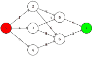

## An example of task scheduling

In a weighted staged directed graph G, we want to search the shortest path from start node s to the terminal node e.

The sub-path from a node in the Global Shortest Path (GSP) to the terminal node is also shortest.

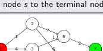

## An example of task scheduling

In a weighted staged directed graph G, we want to search the shortest path from start node s to the terminal node e.

The sub-path from a node in the DAG is the shortest path (SP) to the terminal node is also shortest for the node.

For the node 1, whichever its neighbor is: 2, 3, 2, 4, it is in SP, then sub-path of SP from it to the terminal is also shortest.

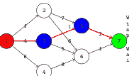

We call this property as the Optimal Substructure of subproblems in the procedure of problem decomposition.

We also should noted that there are some overlapping subproblems in seeking the shortest paths.

Define that c(i) is the shortest distance from i to e, then

## An example of task scheduling

In a weighted staged directed graph $G$, we want to search the shortest path from start node $s$ to the terminal node $e$.

The sub-path from a node in the graph to the terminal node is also the shortest path.

For the node $i$, whichever of its neighbor is in $\{1,2,3,4\}$, if it is an OSP, then sub-path of OSP from it to the terminal is also shortest.

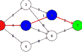

We call this property as the Optimal Substructure of global since the procedure of problem decomposition.

It also should noted that there are some overlapping subproblems in seeking the shortest paths.

Define that $c(i)$ is the shortest distance from $i$ to $e$, then

$c(e)=0$ and $c(s)$ is the goal

## An example of task scheduling

In a weighted staged directed graph G, we want to search the shortest path from start node s to the terminal node e.

The sub-path from a node in the Global Shortest Path(GSP) to the terminal node is also shortest path.

For example, if node i’s neighbor is in (2,3,4), if it is in GSP, then sub-path of GSP from i to the terminal is also shortest.

We call that property as the Optimal Substructure of subproblems in the procedure problem decomposition.

We also should noted that there are some overlapped subproblems in seeking the shortest paths.

Define that c(i) is the shortest distance from i to e, then c(e) = 0 and c(s) is the goal

c(i) = min
j∈N(i)(c(j) + cost(i,j))

where N(i) is the set of neighbors of i

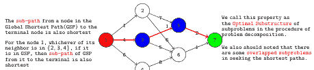

## An example of task scheduling

In a weighted staged directed graph $G$, we want to search the shortest path from start node $s$ to the terminal node $e$.

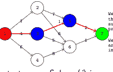

The sub-path from a node in the global Shortest Path (GSP) to the terminal node is also shortest.

For the node $i$, whichever its neighbor node is $n$, $c(i) = 4$, if it is the GSP, the sub-path of GSP from $i$ to terminal is also shortest.

We call this property as the Optimal Substructure of subproblems in the procedure of problem decomposition.

We also should noted that there is some overlapped subproblems in solving the shortest paths.

Define that $c(i)$ is the shortest distance from $i$ to $e$, then $c(e)=0$ and $c(s)$ is the goal

$$c(i)=\min_{j\in N(i)}\{c(j)+cost(i,j)\}$$

where $N(i)$ is the set of neighbors of $i$

Solve $c(i)$ in reverse order


## An example of task scheduling

In a weighted staged directed graph \(G\), we want to search the shortest path from start node \(s\) to the terminal node \(e\).

The sub-path from a node in the Global Shortest Path (GSP) to the terminal node is also shortest path.

For example, if node \(i\) is in GSP, then its neighbor is in \(\{2,3,4,6\}\), if it is in GSP, then sub-path of GSP from \(i\) to \(e\) is also shortest.

Define that \(c(i)\) is the shortest distance from \(i\) to \(e\), then \(c(e) = 0\) and \(c(s)\) is the goal

\[
c(i) = \min_{j\in N(i)} \{c(j) + cost(i,j)\}
\]

where \(N(i)\) is the set of neighbors of \(i\)

We call this property as the Optimal Substructure of subproblems in the procedure problem decomposition

We also should noted that there are some overlapped subproblems in seeking the shortest paths.

Solve \(c(i)\) in reverse order

\(c(7) = 0\)


## An example of task scheduling

In a weighted staged directed graph \(G\), we want to search the shortest path from start node \(s\) to the terminal node \(e\).

The sub-path from a node in the Global Shortest Path (GSP) to the terminal node is also shortest path.

For example, if node \(j\) is a neighbor of \(i\) in \((2,3,4)\), if it is in GSP, then sub-path of GSP from \(i\) to \(e\) is the terminal node is also shortest.

Define that \(c(i)\) is the shortest distance from \(i\) to \(e\), then \(c(e) = 0\) and \(c(s)\) is the goal

\[
c(i) = \min_{j\in N(i)} (c(j) + cost(i,j))
\]

where \(N(i)\) is the set of neighbors of \(i\)

we call that property as the Optimal Substructures of subproblems in the procedure problem decomposition.

we also should noted that there are some overlapped subproblems in seeking the shortest paths.

Solve \(c(i)\) in reverse order

\(c(7) = 0\)

\(c(6) = 1, c(5) = 2\)

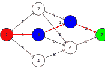

## An example of task scheduling

In a weighted staged directed graph \(G\), we want to search the shortest path from start node \(s\) to the terminal node \(e\).

The sub-path from a node in the Global Shortest Path (GSP) to the terminal node is also shortest. For the node 1, whichever of its neighbors is 2, 3, 4, 5 in GSP, the sub-path of GSP from it to the terminal is also shortest.

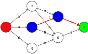

We call this property as the Optimal Substructure of subproblems in the procedure of problem decomposition. We also should noticed that there are some overlapped subproblems in seeking the shortest path.

Define that \(c(i)\) is the shortest distance from \(i\) to \(e\), then \(c(e)=0\) and \(c(s)\) is the goal

\[
c(i)=\min_{j\in N(i)}\{c(j)+\operatorname{cost}(i,j)\}
\]

where \(N(i)\) is the set of neighbors of \(i\).

Solve \(c(i)\) in reverse order

\(c(7)=0\)

\(c(6)=1,\ c(5)=2\)

\(c(4)=8+c(6)=9\)

## An example of task scheduling

In a weighted staged directed graph \(G\), we want to search the shortest path from start node \(s\) to the terminal node \(e\).

The sub-path from a node in the Global Shortest Path (GSP) to the terminal node is also shortest path.

Proof: If there is a shorter path from its neighbor is in \((2,3,4)\), if it is in GSP, then sub-path of GSP from \(i\) to \(e\) is the terminal path is also shortest.

We call this property as the **Optimal Substructure** of subproblems in the procedure of problem decomposition.

We also should noted that there are some overlapped subproblems in seeking the shortest paths.

Define that \(c(i)\) is the shortest distance from \(i\) to \(e\), then \(c(e) = 0\) and \(c(s)\) is the **goal**

\[
c(i) = \min \{c(j) + cost(i,j)\}
\]

where \(N(i)\) is the set of neighbors of \(i\)

Solve \(c(i)\) in reverse order

\(c(7) = 0\)

\(c(6) = 1, c(5) = 2\)

\(c(4) = 8+c(6)=9\)

\(c(3) = \min\{1 + c(5), 5 + c(6)\} = \min\{3,6\} = 3\)

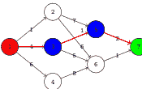

## An example of task scheduling

In a weighted staged directed graph \(G\), we want to search the shortest path from start node \(s\) to the terminal node \(e\).

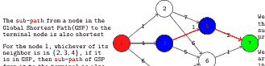

We call this property as the **Optimal Substructure** of subproblems in the procedure of problem decomposition.

We also should noted that there are some **overlapped subproblems** in solving the shortest paths.

The sub-path from a node in the middle of an STP (shortest path) to the terminal node is also shortest.

For the node 1, whichever its neighbor node is \(2, 3, 4\), if it is in SP, the sub-path of SP from it to the terminal is also shortest.

Define that \(c(i)\) is the shortest distance from \(i\) to \(e\), then \(c(e)=0\) and \(c(s)\) is the goal.

\[
c(i)=\min_{j\in N(i)}\{c(j)+cost(i,j)\}
\]

where \(N(i)\) is the set of neighbors of \(i\)

Solve \(c(i)\) in reverse order

\(c(7)=0\)

\(c(6)=1, c(5)=2\)

\(c(4)=8+c(6)=9\)

\(c(3)=\min\{1+c(5), 5+c(6)\}=\min\{3,6\}=3\)

\(c(2)=7, c(1)=7\)


## Definition

- The term **dynamic programming** was originally used in the 1940s by Richard Bellman (Bellman equation).
- DP refers specifically to **nesting smaller** decision problems **inside larger decisions**.
- Dynamic was chosen because it sounded **impressive**, not because it described how the method worked.
- Programming referred to the use of the method to find an optimal.
- A method of solving complex problems by breaking them down into simpler steps (**subproblems**) in **recursive manner**.
  - the solution can be produced by combining solutions to subproblems;
  - the solution to each subproblem can be produced by combining solutions to sub-subproblems, etc;
  - the total number of subproblems arising recursively is polynomial.

## Where DP applicable?

- **Optimal substructure** (Principle of Optimization)
  - A problem is said to have optimal substructure if an optimal solution can be constructed efficiently from optimal solutions to its subproblems.
- **In other words**, a problem exhibits optimal substructure if an optimal solution to the problem contains within it optimal solutions to subproblems.


## Where DP applicable?

- **Optimal substructure** (Principle of Optimization)
  - A problem is said to have optimal substructure if an optimal solution can be constructed efficiently from optimal solutions to its subproblems.
  - **In other words**, a problem exhibits optimal substructure if an optimal solution to the problem contains **within it** optimal solutions to subproblems.
  - Subproblems must be only ’slightly’ smaller than the larger problem
    - A constant additive factor
    - A multiplicative factor: D&C
- **Overlapping subproblems**
  - A problem is said to have overlapping subproblems if the problem can be broken down into subproblems which are reused several times.
- DP ⇒ **Recursion** + **Memoization**

## Procedures

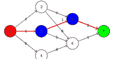

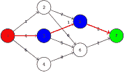

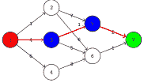

| # | 内容 | 说明 |
| --- | --- | --- |
| 1 | Identifying subproblems | 1-2, 1-3 or 1-4? |
| 2 | Validating principle of optimization | What happens if not |
| 3 | Defining an optimal value function | Assumed that c(i) is the shortest distance from i to e |


## Procedures


| # | Procedure | Description |
|---|---|---|
| 1 | Identifying subproblems | 1-2 , 1-3 or 1-4 ? |
| 2 | Validating principle of optimization | What happen if not |
| 3 | Defining an optimal value function | Assumed that c(i) is the shortest distance from i to e |
| 4 | Deriving the recursive equation | c(i)=\min_{j\in N(i)}\{c(j)+cost(i,j)\} |

## Procedures


| # | Procedure | Question / Explanation |
|---|---|---|
| 1 | Identifying subproblems | 1-2, 1-3 or 1-4 ? |
| 2 | Validating principle of optimization | What happen if not |
| 3 | Defining an optimal value function | Assumed that c(i) is the shortest distance from i to e |
| 4 | Deriving the recursive equation | c(i) = min<sub>j∈N(i)</sub> { c(j) + cost(i,j) } |
| 5 | Solving the recursive equation | c(7) - c(6) - c(5) - c(4) - c(3) - c(2) - c(1) |

## Procedures

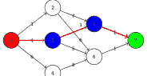

| 序号 | 内容 | 备注 |
|---|---|---|
| 1 | Identifying subproblems | 1-2 , 1-3 or 1-4 ? |
| 2 | Validating principle of optimization | What happen if not |
| 3 | Defining an optimal value function | Assumed that c(i) is the shortest distance from i to e |
| 4 | Deriving the recursive equation | c(i)= min {c(j) + cost(i,j) } j∈N(i) |
| 5 | Solving the recursive equation | c(7) - c(6) - c(5) - c(4) - c(3) - c(2) -c(1) |
| 6 | Tracebacking the optimal solution | P(1) - P(3) -P(5) -P(7) |


## Problem statements

Given a set of items, each with a mass and a value, determine the number of each item to include in a collection so that the total weight is less than or equal to a given limit(capacity) and the total value is as large as possible.

**Formal representation**: Given \( n > 0 \), \( c > 0 \) and two n-tuples of positive numbers: \( (w_1, w_2, \cdots, w_n) \) and \( (p_1, p_2, \cdots, p_n) \).

we wish to determine the subset
\( T \subset \{1 \dots n\} \) such that

## Problem statements

Given a set of items, each with a mass and a value, determine the number of each item to include in a collection so that the total weight is less than or equal to a given limit (capacity) and the total value is as large as possible.

**Formal representation:** Given $n > 0$, $c > 0$ and two $n$-tuples of positive numbers: $(w_1,w_2,\cdots,w_n)$ and $(p_1,p_2,\cdots,p_n)$.

we wish to determine the subset $T \subset \{1..n\}$ such that

```
Maximize:  $\sum_{i\in T} p_i$

Subject to:  $\sum_{i\in T} w_i \leq c$
```

## Problem statements

Given a set of items, each with a mass and a value, determine the number of each item to include in a collection so that the total weight is less than or equal to a given limit(capacity) and the total value is as large as possible.

**Formal representation**: Given \( n > 0 \), \( c > 0 \) and two n-tuples of positive numbers: \( (w_1, w_2, \cdots, w_n) \) and \( (p_1, p_2, \cdots, p_n) \).

we wish to determine the subset \( T \subset \{1 \dots n\} \) such that

Maximize: \( \sum_{i \in T} p_i \)
Subjects to: \( \sum_{i \in T} w_i \leq c \)

If used a n-tuple of indicator variables \( (x_1, x_2, \cdots, x_n) \), then


## Problelm statements

Given a set of items, each with a mass and a value, determine the number of each item to include in a collection so that the total weight is less than or equal to a given limit(capacity) and the total value is as large as possible.

**Formal representation**: Given _n_ > 0, _c_ > 0 and two n-tuples of positive numbers: \((w_1, w_2, \cdots, w_n)\) and \((p_1, p_2, \cdots, p_n)\).

we wish to determine the subset \( T \subset \{1 \dots n\} \) such that

If used a n-tuple of indicator variables \((x_1, x_2, \cdots, x_n)\) , then

Maximize: \(\sum_{i \in T} p_i\)
Subjects to: \(\sum_{i \in T} w_i \le c\)

Maximize: \(\sum_{i=1}^n x_i * p_i\)
Subjects to: \(\sum_{i=1}^n x_i * w_i \le c\)

## Solutions

- Brute force: Try all $2^n$ possible subsets $T$
- Greedy
  - choose items maximizing value ?
  - choose items maximizing value/size
  - the second looks much great, but what if items don’t exactly fit (non-divisible items)?
  - any others?
    - traceback
    - branch and bound

## Step 1. Identifying subproblems

n=5, c=10

p = 6 3 5 4 6
w = 2 2 6 5 4
X x1 x2 x3 x4 x5

- By fewer items: exclude an item \( i \), what changed?
  - the number of items \( n \) becomes \( n - 1 \), and
  - the capacities become \( c \) or \( c - w_i \), why?
  - So the subproblem is constrained by **two parameters**.
- By smaller knapsack capacities: reduce the capacity, what changed?
  - the capacities become smaller \( c' \)
  - supposed that this is caused by adding an item \( i \), \( c' = c - w_i \), and thus the optimal value \( f(c) = f(c - w_i) + v_i \)


## Step 1. Identifying subproblems

n=5, c=10

p = 6 3 5 4 6
w = 2 2 6 5 4
X = x1 x2 x3 x4 x5

- By fewer items: exclude an item \( i \), what changed?
  - the number of items \( n \) becomes \( n - 1 \), and
  - the capacities become \( c \) or \( c - w_i \), why?
  - So the subproblem is constrained by **two parameters**.

- By smaller knapsack capacities: reduce the capacity, what changed?
  - the capacities become smaller \( c' \)
  - supposed that this is caused by adding an item \( i \), \( c' = c - w_i \),
  - and thus the optimal value \( f(c) = f(c - w_i) + v_i \)
  - however, we do not know which \( i \),
  - \( f(c) = \max_{i=1, w_i < c} \{ f(c - w_i) + v_i \} \)

## Step 2. Validating Principle of Optimization

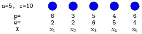

[Optimal substructure] A problem exhibits optimal substructure if an optimal solution to the problem contains within it optimal solutions to subproblems.

- Supposed that \((x_1, x_2, \cdots, x_n)\) is the optimal solution of original problem \(P^0\).

n=5, c=10

p = 6 3 5 4 6
w = 2 2 6 5 4
X = x1 x2 x3 x4 x5

[Optimal substructure] A problem exhibits optimal substructure if an optimal solution to the problem contains within it optimal solutions to subproblems.

- Supposed that \((x_1, x_2, \cdots, x_n)\) is the optimal solution of original problem \(P^0\).
- \((y_1, y_2, \cdots, y_{n-1})\) is the optimal solution of its subproblem \(P'\) with items \(1, 2, \cdots, n-1\) and capacities \(c - x_n * w_n\).

n=5, c=10

p = 6 3 5 4 6
w = 2 2 6 5 4
x = x1 x2 x3 x4 x5

[Optimal substructure] A problem exhibits optimal substructure if an optimal solution to the problem contains within it optimal solutions to subproblems.

- Supposed that \( (x_1, x_2, \cdots, x_n) \) is the optimal solution of original problem \( P^0 \).
- \( (y_1, y_2, \cdots, y_{n-1}) \) is the optimal solution of its subproblem \( P' \) with items \( 1, 2, \cdots, n-1 \) and capacities \( c - x_n * w_n \).
- We should show that \( (y_1, y_2, \cdots, y_{n-1}, x_n) \) is no worse than \( (x_1, x_2, \cdots, x_n) \) to \( P^0 \).

n=5, c=10

p = 6 3 5 4 6
w = 2 2 6 5 4
x = x₁ x₂ x₃ x₄ x₅

## [Optimal substructure]

A problem exhibits optimal substructure if an optimal solution to the problem contains **within it** optimal solutions to subproblems.

- Supposed that \((x_1, x_2, \cdots, x_n)\) is the optimal solution of original problem \(P^0\).
- \((y_1, y_2, \cdots, y_{n-1})\) is the optimal solution of its subproblem \(P'\) with items \(1, 2, \cdots, n-1\) and capacities \(c - x_n * w_n\).
- We should show that \((y_1, y_2, \cdots, y_{n-1}, x_n)\) is **no worse than** \((x_1, x_2, \cdots, x_n)\) to \(P^0\).
- How? using a "cut-and-paste" technique (homework)

## Step 3. Defining an optimal value function

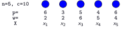

We have known that a subproblem is constrained by two parameters: number of items and capacities.

## Step 3. Defining an optimal value function

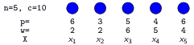

We have known that a subproblem is constrained by two parameters: number of items and capacities.

- For a given subproblem with items \(i, i+1, \cdots, n\) and capacities \(y\), we define its optimal value by \(f(i,y)\).
- \(f(n,0)=0\), and \(f(n,w_n)=p_n\) if \(w_n<c\) else 0
- \(f(1,c)\) is our goal, why?


## Step 3. Defining an optimal value function

n=5, c=10

6 3 5 4 6

p= 6 3 5 4 6

w= 2 2 6 5 4

x= x1 x2 x3 x4 x5

We have known a subproblem is constrained by two parameters: number of items and capacities.

- For a given subproblem with items \(i, i+1, \cdots, n\) and capacities \(y\), we define its optimal value by \(f(i, y)\).

- \(f(n, 0) = 0\), and \(f(n, w_n) = p_n\) if \(w_n < c\) else 0

- \(f(1, c)\) is our goal, why?

- How to get \(f(1, c)\) from \(f(n, y)\)?

## Step 4. Deriving the recursive equation

|  | n=5, c=10 |  |  |  |  |
|---|---|---|---|---|---|
| p= | 6 | 3 | 5 | 4 | 6 |
| v= | 2 | 2 | 6 | 5 | 4 |
| x | x₁ | x₂ | x₃ | x₄ | x₅ |

To calculate *f(i, y)* from *f(i + 1, y)*, we only need know if item *i* could be included

## Step 4. Deriving the recursive equation

n=5, c=10

p= 6 3 5 4 6
w= 2 2 6 5 4
X= x1 x2 x3 x4 x5

To calculate _f(i,y)_ from _f(i+1,y)_, we only need know <u>if item _i_ could be included</u>

- If _w<sub>i</sub> > y_, item _i_ couldn’t be included, _f(i, y) = f(i+1, y)._

## Step 4. Deriving the recursive equation

n=5, c=10
pᵢ: 6 3 5 4 6
wᵢ: 2 2 6 5 4
xᵢ: x₁ x₂ x₃ x₄ x₅

To calculate *f(i, y)* from *f(i + 1, y)*, we only need know if item *i* could be included

- If *wᵢ > y*, item *i* couldn't be included, *f(i, y) = f(i + 1, y)*.
- If *wᵢ ≤ y*, item *i* might be included:
  - if so, *f(i, y) = f(i + 1, y − wᵢ) + pᵢ*

## Step 4. Deriving the recursive equation

|  | Item 1 | Item 2 | Item 3 | Item 4 | Item 5 |
|---|---:|---:|---:|---:|---:|
| \(p\) | 6 | 3 | 5 | 4 | 6 |
| \(w\) | 2 | 2 | 6 | 5 | 4 |
| \(x\) | \(x_1\) | \(x_2\) | \(x_3\) | \(x_4\) | \(x_5\) |

\(n=5,\ c=10\)

To calculate \(f(i,y)\) from \(f(i+1,y)\), we only need know if item \(i\) could be included

- If \(w_i > y\), item \(i\) couldn’t be included, \(f(i,y)=f(i+1,y)\).
- If \(w_i \leq y\), item \(i\) might be included
  - if so, \(f(i,y)=f(i+1,y-w_i)+p_i\)
  - else, \(f(i,y)=f(i+1,y)\), why?

## Step 4. Deriving the recursive equation

n=5, c=10

p = 6 3 5 4 6
w = 2 2 6 5 4
X = x1 x2 x3 x4 x5

To calculate f(i, y) from f(i + 1, y), we only need know if item i could be included

- If w_i > y, item i couldn't be included, f(i, y) = f(i + 1, y).
- If w_i <= y, item i might be included
  - if so, f(i, y) = f(i + 1, y - w_i) + p_i
  - else, f(i, y) = f(i + 1, y), why?
  - finally, we use the larger one.

## Step 5. Solve recursive equation

Now we have the recursive equation

$$f(i,y)=\begin{cases} f(i+1,y), & \text{if } 0\le y<w_i \\ \max\{f(i+1,y-w_i)+p_i,\ f(i+1,y)\}, & \text{if } y\ge w_i \end{cases} \tag{1}$$

and the initial condition

$$f(n,y)=\begin{cases} p_n, & \text{if } y\ge w_n \\ 0, & \text{if } 0\le y<w_n \end{cases} \tag{2}$$

## Step 5. Solve recursive equation

Now we have the recursive equation

$$f(i,y)=\begin{cases}\max\{f(i+1,y),\ f(i+1,y-w_i)+p_i,\ f(i+1,y)\}, & \text{if } 0\le y<w_i\\ f(i+1,y-w_i)+p_i, & \text{if } y\ge w_i\end{cases} \tag{1}$$

and the initial condition

$$f(n,y)=\begin{cases}p_n, & \text{if } y\ge w_n\\ 0, & \text{if } 0\le y<w_n\end{cases} \tag{2}$$

How to solve them?

- Recursive version
- Non-recursive version
- Tuple version

## Recursive version

### Algorithm 1: RKnapsack

**Input**: n,c,p[1..n],w[1..n]
**Output**: the optimal value f(1, c)

```
Function f(int i, int y)
1    if (i==n) then
2        return (y<w[n]?0 : p[n]
3        );
4    if (y<w[i]) then
5        return f(i+1,y) ;
6    return max(f(i+1,y),f(i+1.y-
    w[i])+p[i]) ;
```

## Recursive version

```
**Algorithm 2:** RKnapsack

**Input:** n, c, p[1..n], w[1..n]

**Output:** the maximum profit value \(f(1,c)\)

**Function** \(f(i, int\ y)\)

1. `if (i == n) then`
   `return (y < w[n] ? 0 : p[n])`
2. `if (y < w[i]) then`
   `return f(i+1,y)`
3. `return max(f(i+1,y), f(i+1,y-w[i])+p[i])`
```

## Algorithm complexity:

We use \(t(n)\) to denote the algorithm time complexity with n items

- \(t(1)=a\)
- At the base case (step4), \(t(n)=t(n-1)+b\), so \(t(n)=O(n)\)
- At the worst case (step6), \(t(n)=2t(n-1)+b\), so \(t(n)=O(2^n)\)


## Recursive version: an example

n=5, c=10

p= 6 3 5 4 6
w= 2 2 6 5 4
x= x₁ x₂ x₃ x₄ x₅

### Recursive call relation tree

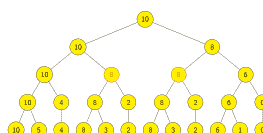

The number in the node is y value and the layer order corresponds to i, there are total 26 nodes;

If these repetitive calls are saved, the algorithm complexity should be reduced!

| | x₁ | x₂ | x₃ | x₄ | x₅ |
|---|---:|---:|---:|---:|---:|
| n=5, c=10 | | | | | |
| pᵢ | 2 | 3 | 5 | 4 | 6 |
| wᵢ | 2 | 2 | 6 | 5 | 4 |
| xᵢ | x₁ | x₂ | x₃ | x₄ | x₅ |

### Recursive call relation tree

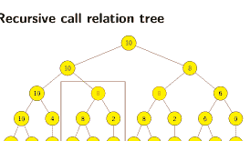

The number in the node is y value and the layer order corresponds to i, there are total 26 nodes;

If these repetitive calls are saved, the algorithm complexity should be reduced!

| | | | | | |
|---|---:|---:|---:|---:|---:|
| n=5, c=10 | | | | | |
| p | 2 | 3 | 5 | 4 | 6 |
| w | 2 | 2 | 6 | 5 | 4 |
| x | x₁ | x₂ | x₃ | x₄ | x₅ |

### Recursive call relation tree

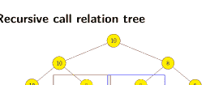

The number in the node is y value and the layer order corresponds to i, there are total 26 nodes;

If these repetitive calls are saved, the algorithm complexity should be reduced!

## First attempt: using array

```cpp
template<class T>
void Knapsack(T p[], int w[], int c, int n, T** f)
{
// Compute f[i][y] for all i and y.
    // initialize f[i][0]
    int ymax = min(w[0],c+1);
    for (int y = 0; y < ymax; y++)
        f[0][y] = 0;
    for (int y = w[0]; y <= c; y++)
        f[0][y] = p[0];
    // compute remaining f's
    for (int i = 1; i < n; i++) {
        ymax = min(w[i],c+1);
        for (int y = 0; y < ymax; y++)
            f[i][y] = f[i-1][y];
        for (int y = w[i]; y <= c; y++)
            f[i][y] = max(f[i-1][y], f[i-1][y-w[i]] + p[i]);
    }
    f[n][c] = f[n-1][c];
    if (c >= w[n])
        f[n][c] = max(f[n][c], f[n-1][c-w[n]] + p[n]);
}
```

## First attempt: using array

```cpp
template<class T>
void Knapsack(T p[], int w[], int c, int n, T** f)
{
// Compute f[i][y] for all i and y.
	// initialize f[i][0]
	int ymax = min(n,c-1,c);
	for (int i = 0; i <= ymax; i++)
		f[i][0] = 0;
	// f[i][y] = p[i]; y <= c; y++)
	// compute remaining f's
	for (int i = 1; i < n; i++)
		for (int y = 1; y <= ymax; y++)
			f[i][y] = f[i-1][y];
			for (int y = w[i]; y <= c; y++)
				f[i][y] = max(f[i-1][y], f[i-1][y-w[i]] + p[i]);
	}
	f[n][c] = f[n-1][c];
	if (c > w[n])
		f[n][c] = max(f[n-1][c], f[n-1][c-w[n]] + p[n]);
}
```

- The algorithm saves all possible values using an array f, so that every f(i,y) is calculated only once.
- It needs Θ(nc) extra space.
- Its time complexity is Θ(nc):
  - It is not polynomial: to describe c need log2c bits
  - but pseudo-polynomial: exponential dependence on numerical inputs
- Its disadvantage:
  - The capacity c must an integer
  - The complexity might still be very high when c is large enough; for instance c = 2^n.

## Second attempt: using a tuple

n=5, c=10

p=

w=

X

6

2

x₁

3

2

x₂

5

6

x₃

4

5

x₄

6

4

x₅

- Calculate _f_ values using array

## Second attempt: using a tuple

n=5, c=10

p = 6 3 5 4 6
w = 2 2 6 5 4
X = x1 x2 x3 x4 x5

- Calculate f values using array
  - f(5, 0) = 0, ..., f(5, 4) = 6, ..., f(5, 10) = 6

## Second attempt: using a tuple

| n = 5, c = 10 | | | | | |
|---|---:|---:|---:|---:|---:|
| p | 6 | 3 | 5 | 4 | 6 |
| v | 2 | 2 | 6 | 5 | 4 |
| x | x₁ | x₂ | x₃ | x₄ | x₅ |

- Calculate f values using array
  - f(5, 0) = 0, …, f(5, 4) = 6, …, f(5, 10) = 6
  - f(4, 0) = 0, …, f(4, 4) = 6, …, f(4, 9) = 10), f(4, 10) = 10

## Second attempt: using a tuple

n=5, c=10
p= 6 3 5 4 6
w= 2 2 6 5 4
x= x₁ x₂ x₃ x₄ x₅

- Calculate f values using array
  - f(5, 0) = 0, ..., f(5, 4) = 6, ..., f(5, 10) = 6
  - f(4, 0) = 0, ..., f(4, 4) = 6, ..., f(4, 9) = 10), f(4, 10) = 10
  - ...


## Second attempt: using a tuple

n = 5, c = 10

| x | x₁ | x₂ | x₃ | x₄ | x₅ |
|---:|---:|---:|---:|---:|---:|
| p | 6 | 3 | 5 | 4 | 6 |
| w | 2 | 2 | 6 | 5 | 4 |

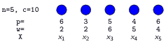

- Calculate f values using array
  - \(f(5,0)=0,\ldots,f(5,4)=6,\ldots,f(5,10)=6\)
  - \(f(4,0)=0,\ldots,f(4,4)=6,\ldots,f(4,9)=10,\ f(4,10)=10\)
  - \(\ldots\)
- Save step points only for each \(i\)
  - Define a tuple \((a,b)\), where \(a=y\) and \(b=f(i,y)\)
  - \((a,b)\) corresponds to an optimal loading with capacity \(a\) and value \(b\)
  - Put all tuples into a set \(P_i\)
  - \(P_n\) can be got easily. \(P_n=\{(0,0),(w_n,p_n)\}\)
  - \(P_1\) contains our goal! Why?

## Tuple method: principle

- Let \(Q=\{(s,t)\mid w_i\le s<c,\ (s-w_i,t-p_i)\in P_{i+1}\}\)
  - \(Q\) corresponds to \(P_i\) in which item \(i\) **has been selected**
  - \(P_{i+1}\) corresponds to \(P_i\) in which item \(i\) **has not been selected**
  - Thus, \(P_i = Q \cup P_{i+1}\)
- Merge \(Q\) and \(P_{i+1}\) to get \(P_i\)


## Tuple method: principle

- Let \(Q=\{(s,t)\mid w_i\le s<c,\ (s-w_i,t-p_i)\in P_{i+1}\}\).
  - \(Q\) corresponds to \(P_i\) in which item \(i\) has been selected.
  - \(P_{i+1}\) corresponds to \(P_i\) in which item \(i\) has not been selected.
  - Thus, \(P_i=Q\cup P_{i+1}\).
- Merge \(Q\) and \(P_{i+1}\) to get \(P_i\).
  - Remove dominated tuples (a tuple \((a,b)\) is dominated by \((u,v)\) if \(a\ge u\), but \(b<v\)).
  - Remove repeated tuples.
  - Remove over-capacity tuples in which \(a>c\).
- The complexity is still \(O(2^n)\). The number of elements in \(P_i\) increases exponentially in the worst case.

## Tuple method: an example

\(n=5,\ c=10\)

| item | 1 | 2 | 3 | 4 | 5 |
| --- | --- | --- | --- | --- | --- |
| p | 6 | 3 | 5 | 4 | 6 |
| w | 2 | 2 | 6 | 5 | 4 |
| x | x₁ | x₂ | x₃ | x₄ | x₅ |

| Step | \(P\) | \(Q\) |
| --- | --- | --- |
| 1 | \(P(5)=[(0,0),(4,6)]\) | \(Q=[(5,4),(9,10)]\) |
| 2 | \(P(4)=[(0,0),(4,6),(9,10)]\) | \(Q=[(6,5),(10,11)]\) |
| 3 | \(P(3)=[(0,0),(4,6),(9,10),(10,11)]\) | \(Q=[(2,3),(6,9)]\) |
| 4 | \(P(2)=[(0,0),(2,3),(4,6),(6,9),(9,10),(10,11)]\) | \(Q=[(2,6),(4,9),(6,12),(8,15)]\) |
| 5 | \(P(1)=[(0,0),(2,6),(4,9),(6,12),(8,15)]\) |  |

The optimal value is 15 and the optimal solution is \([1,1,0,0,1]\) by traceback.


## Problem Description

- Two matrices \(A\times B\) with dimension \((m,n)\) and \((n,q)\) takes \(mnq\) multiplications.
- Let's consider three matrices: \(A\times B\times C\) with dimension \((100,1), (1,100)\), and \((100,1)\). The product can be done:


## Problem Description

- Two matrices A×B with dimension (m,n) and (n,q) takes mnq multiplications.
- Let's consider three matrices: A×B×C with dimension (100,1), (1,100) and (100,1). The product can be done:
  - (A×B)×C takes 20000 multiplications.
  - A×(B×C) takes 200 multiplications.
  - Any other way? No
    - Associative law: (A×B)×C = A×(B×C)
    - Commutative law: A×B ≠ B×A
    - the order of multiplications makes a big difference in the final running time!
- Matrix Multiplication Chains. Suppose that we multiply q matrices.
  - M(1,q) ≡ M₁ × M₂ × ⋯ × M_q
  - There are q+1 (r₁, r₂, ⋯, r_q, r_{q+1}) numbers(parameters) to constrain their dimensions. Why?


## Identifying subproblems

- The number of orders of multiplications equal to the number of parenthesization

P(q) = \begin{cases} 1 & \text{if } q = 2 \\ \sum_{k=1}^{q-1} p(k)p(q-k) & \text{if } q \ge 2 \end{cases}

T(q) \approx O(4^q q^{3/2}) \approx O(2^q)

- In fact, a particular parenthesization can be represented by a binary tree

- The leaves correspond to matrices

- The root corresponds to the final product

- Interior nodes are intermediate products

- If a tree is optimal, its subtrees must also be optimal.

- The binary tree representation suggests that

- A subtree corresponds to a subproblem in MPC, so

- MPC satisfies the principle of optimality


## Define the optimal function

Define \(c(i,j)\) to be the cost of \(M_i \times M_{i+1} \times \cdots \times M_j\).

- \(c(0,0)=0\)
- \(c(i,i)=0\)
- \(c(i,i+1)=r_i \times r_{i+1} \times r_{i+2}\)
- \(c(1,q)\) is our goal
- The recursive equation is

$$
c(i,j)=\min_{i\le k<j}\{c(i,k)+c(k+1,j)+r_i \times r_{k+1} \times r_{j+1}\}\tag{3}
$$

- Let \(k(i,j)\) be the number minimizing the above equation.
  - \(k(i,i)=0\)
  - \(k(i,i+1)=i\)

## An example

Suppose that \(q=5\) and \(r=(10,5,1,10,2,10)\), find the optimal orders of multiplications.

| Subproblem | Calculation | Result |
|---|---|---|
| \(c(1,5)\) | \(\min\{c(1,1)+c(2,5)+500,\ c(1,2)+c(3,5)+100,\ c(1,3)+c(4,5)+1000,\ c(1,4)+c(5,5)+200\}\) | |
| \(c(2,5)\) | \(\min\{c(2,2)+c(3,5)+50,\ c(2,3)+c(4,5)+500,\ c(2,4)+c(5,5)+100\}\) | \(c(2,5)=90,\ k(2,5)=2\) |
| \(c(3,5)\) | \(\min\{c(3,3)+c(4,5)+100,\ c(3,4)+c(5,5)+20\}=\min\{300,40\}=40\) | \(c(3,5)=40,\ k(3,5)=4\) |
| \(c(2,4)\) | \(\min\{c(2,2)+c(3,4)+10,\ c(2,3)+c(4,4)+100\}=\min\{30,150\}=30\) | \(c(2,4)=30,\ k(2,4)=2\) |


## An example

Suppose that q = 5 and r = (10, 5, 1, 10, 2, 10), find the optimal orders of multiplications

| c(1,5)=min | c(1,1)+c(2,5)+500, c(1,2)+c(3,5)+100, c(1,3)+c(4,5)+1000, c(1,4)+c(5,5)+200; | c(1,3)=150, kay(1,3)=2 c(1,4)=90, kay(1,4)=2 |
| --- | --- | --- |
| c(2,5)=min | c(2,2)+c(3,5)+50, c(2,3)+c(4,5)+500, c(2,4)+c(5,5)+100; | c(2,5)=90, kay(2,5)=2 |
| c(3,5)=min | c(3,3)+c(4,5)+100, c(3,4)+c(5,5)+20 min[300,40]=40 | c(3,5)=40.kay(3,5)=4 |
| c(2,4)=min | c(2,2)+c(3,4)+10, c(2,3)+c(4,4)+100; min[30,150]=30 | c(2,4)=30.kay(2,4)=2 |

Suppose that q = 5 and r = (10, 5, 1, 10, 2, 10), find the optimal orders of multiplications

c(1,5)=min {c(1,1)+c(2,5)+500, c(1,2)+c(3,5)+100, c(1,3)+c(4,5)+1000, c(1,4)+c(5,5)+200}; c(1,5)=190, kay(1,5)=2 c(1,3)=150, kay(1,3)=2 c(1,4)=90, kay(1,4)=2

c(2,5)=min {c(2,2)+c(3,5)+50, c(2,3)+c(4,5)+500, c(2,4)+c(5,5)+500}; c(2,5)=90, kay(2,5)=2

c(3,5)=min {c(3,3)+c(4,5)+100, c(3,4)+c(5,5)+20, min[300,40] =40}; c(3,5)=40,kay(3,5)=4

c(2,4)=min {c(2,2)+c(3,4)+10, c(2,3)+c(4,4)+100; min[30,150] =30}; c(2,4)=30,kay(2,4)=2

Suppose that q=5 and r=(10,5,1,10,2,10), find the optimal orders of multiplications

| M(1,5)=M(1,2)×M(3,5) |
|---|
| c(1,5)=min {c(1,1)+c(2,5)+500, c(1,2)+c(3,5)+100, c(1,3)+c(4,5)+1000, c(1,4)+c(5,5)+200} |
| c(1,5)=190, kay(1,5)=2 |
| c(1,3)=150, kay(1,3)=2 |
| c(1,4)=90, kay(1,4)=2 |
| c(2,5)=min {c(2,2)+c(3,5)+50, c(2,3)+c(4,5)+100, c(2,4)+c(5,5)+100} |
| c(2,5)=90, kay(2,5)=2 |
| c(3,5)=min {c(3,3)+c(4,5)+100, c(3,4)+c(5,5)+20} |
| min[300,40]=40 |
| c(3,5)=40,kay(3,5)=4 |
| c(2,4)=min {c(2,2)+c(3,4)+10, c(2,3)+c(4,4)+100} |
| min[30,150]=30 |
| c(2,4)=30,kay(2,4)=2 |

Suppose that q = 5 and r = (10, 5, 1, 10, 2, 10), find the optimal orders of multiplications

| M(1,5) = M(1,2) × M(3,5) | M(3,5) = M(3,4) × M(5,5) |
|---|---|
|c(1,5)=min {c(1,1)+(c(2,5)+500, c(1,2)+(c(3,5)+100, c(1,3)+(c(4,5)+1000, c(1,4)+(c(5,5)+200} | c(1.5)=190, kay(1,5)=2 c(1.3)=150, kay(1,3)=2 c(1.4)=90, kay(1,4)=2 |
|c(2,5)=min {c(2,2)+(c(3,5)+50, c(2,3)+(c(4,5)+100, c(2,4)+(c(5,5)+100} | c(2,5)=90, kay(2,5)=2 |
|c(3,5)=min {c(3,3)+(c(4,5)+100, c(3,4)+(c(5,5)+20 min{300,40} =40} | c(3,5)=40,kay(3,5)=4 |
|c(2,4)=min {c(2,2)+(c(3,4)+10, c(2,3)+(c(4,4)+100; min{30,150} =30} | c(2,4)=30,kay(2,4)=2 |

## Recursive Algorithm for MPC

```c
int RC(int i, int j) {
    // Return c(i, j) and complete key(i, j) array[s]
    // Base cases
    // if i == j return 0
    // if c[i][j] > 0 return c[i][j]
    // if (i == j - 1) return 0;
    // if (i == j - 1) return 0;
    // ...
    return c[i][j];
}

void Traceback(int i, int j, int *key)
{
    if (i == j) return;
    Traceback(i, key[i][j], key);
    Traceback(key[i][j] + 1, j, key);
    cout << "(" << "M" << key[i][j] << ")";
}
```

## Revision recursive algorithm

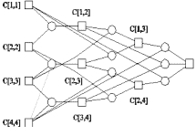

The above figure suggest that c(i,j) can be calculated in an iterative manner

$$c(i,i+s)=\min_{i\leq k<s}\{c(i,k)+c(k,j)+r_i*r_k*r_{i+s+1}\}$$

$$s=1,2,\cdots,q$$

## Iterative algorithm for MPC

```c
void MatrixChain(int r[], int q, int **c, int **key)
{
    //Compute costs and hay for all Mij's.
    for (int i = 1; i <= q; i++) c[i][i] = 0;
    for (int i = 1; i <= q; i++) {
        c[i][i] = 0; i <= q; i++) {
        c[i][i+1] = r[i-1]*r[i]*r[i+2];
        key[i][i+1] = i;
    }
    //c[i][j] = 0;
    //Computing c's and hay's
    for (int s = 2; s <= q; s++) {
        for (int i = 1; i <= q - s + 1; i++) {
            // min term for i
            int min = c[i+1][i+s] + c[i][i+1] * r[i-1]*r[i]*r[i+s+1];
            key[i][i+s] = i;
            // min term
            for (int k = i+1; k < i + s; k++) {
                int t = c[i][k] + c[k+1][i+s] +
                    r[i-1]*r[k+1]*r[i+s+1];
                if (t < min) { // smaller min term
                    min = t;
                    key[i][i+s] = k;
                }
            }
        }
    }
}
```


# Outline

- What is DP
- 0/1 Knapsack Problem
- Matrix Multiplication Chains
- All Pairs Shortest Path
- Maximum Non-crossing Subset of Nets
- Longest Common Subsequences

## Problem statement

- **Input:** Given a directed graph $G=(V,E)$ and a matrix $(a_{ij})$ where
  $$V=\{1,2,\ldots,n\},$$
  with edge weight function $W:E\to\mathbb{R}$,
  $$
  a_{ij}=\begin{cases}
  w(i,j) & \text{if }(i,j)\in E\\
  0 & \text{if }i=j\\
  \infty & \text{otherwise}
  \end{cases}
  $$

- **Output:** An $n\times n$ matrix of shortest-path lengths $c(i,j)$

- **Assumption:** No negative-weight cycles

## Subproblem identification by edges

- Define \( d_{ij}^m \) = weight of a shortest path from i to j that only uses at most m edges
- \( d_{ij}^{n-1} \) is our goal
- We have known that
  - \( d_{ij}^0 = 0 \) if i = j, and \( \infty \) if i \(\neq\) j
  - \( d_{ij}^1 = 0 \) if i = j, and \( a_{ij} \) if i \(\neq\) j

Theorem 7

For m = 1, 2, \(\cdots\), n - 1, we have

\( d_{ij}^m = \min_k \{ d_{ik}^{m-1} + a_{kj} \} \)

## Proof

\( d_{ij}^m = \min_k \{ d_{ik}^{m-1} + a_{kj} \} \)

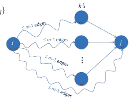

$d_{ij}^{m} = \min_k \{d_{ik}^{m-1} + a_{kj}\}$

- for $k=1$ to $n$
- if $d_{ij} > d_{ik} + a_{kj}$
- $d_{ij} = d_{ik} + a_{kj}$

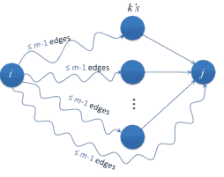

$d_{ij}^{m}=\min_k\{d_{ik}^{m-1}+a_{kj}\}$

for k=1 to n

if $d_{ij}>d_{ik}+a_{kj}$

$d_{ij}=d_{ik}+a_{kj}$

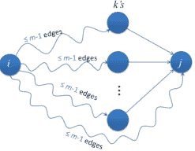

Running time $O(n^4)$ - similar to n runs of Bellman-Ford algorithm

The Bellman-Ford algorithm is an algorithm that computes shortest paths from a single source vertex to all of the other vertices in a weighted digraph.

## Subproblems identification by intermediate vertices

- Define \( d_{ij}^m = \) weight of a shortest path from i to j that only uses intermediate vertices from set \(\{1, ..., m\}\), or
- Define \( d_{ij}^m \) = weight of a shortest path from i to j that the orders of intermediate vertices is no larger than m
- \( d_{ij}^n \) is our goal
- We have known that
  - \( d_{ij}^{0} = a_{ij} \)


## Subproblems identification by intermediate vertices

- Define \( d_{ij}^m = \) weight of a shortest path from i to j that only uses intermediate vertices from set \(\{1, \dots, m\}\) or
- Define \( d_{ij}^m = \) weight of a shortest path from i to j that the orders of intermediate vertices is no larger than m
- \( d_{ij}^n \) is our goal
- We have known that
  - \( d_{ij}^0 = a_{ij} \)
  - \( d_{ik}^{k-1} = d_{ik}^k \)
  - \( d_{kj}^{k-1} = d_{kj}^k \)

## Theorem 16

For m = 1, 2, \(\cdots\), n-1, we have

\( d_{ij}^m = \min\{d_{ij}^{m-1}, d_{im}^{m-1} + d_{mj}^{m-1}\} \)

## Proof

\( d_{ij}^m = \min\{d_{ij}^{m-1}, d_{im}^{m-1} + d_{mj}^{m-1}\} \)

Running time \( O(n^3) \) Known as Floyd-Warshall algorithm

## Iterative algorithm for ASAP

```cpp
template<class T>
void AdjacencyWDigraph<T>::AllPairs(T **c, int n)
{
    // All pairs shortest paths.
    // Compute c(i][j] and hay[i][j] for all i
    // and j.
    // initialize c(i][j] = c[i][j]
    for (int i = 1; i <= n; i++)
        for (int j = 1; j <= n; j++)
            c[i][j] = a[i][j];
    for (int i = 1; i <= n; i++)
        c[i][i] = 0;
    for (int i = 1; i <= n; i++)
        for (int j = 1; j <= n; j++)
            if (c[i][j] < MaxInt)
                hay[i][j] = j;
            else hay[i][j] = 0;
    // compute c(i][j] = c[i][k] + c[k][j]
    for (int k = 1; k <= n; k++)
        for (int i = 1; i <= n; i++)
            if (c[i][k] != MaxInt)
                for (int j = 1; j <= n; j++)
                    if (c[k][j] != MaxInt &&
                        t2 = c[i][k] + c[k][j])
                        c[i][j] = t2;
                        hay[i][j] = hay[i][k];
}
```

```cpp
Key[][] is used to store the largest vector in the
shortest path from i to j, so that traceback the
shortest path.
void outputPath(int **key, int i, int j)
{
    // Actual code to output i to j path.
    if (i == j) return;
    if (key[i][j] == 0) cout << j << " ";
    else {
        outputPath(key, i, key[i][j]);
        outputPath(key, key[i][j], j);
    }
};
template<class T>
void OutputPath(T **c, int **key, T
    // NoEdge,
    // Output shortest path from i to j.
    if (c[i][j] == NoEdge)
        cout << "There is no path from "
             << i << " to " << j;
    else if (i != j)
        cout << i << " ";
    return;
    cout << "The path is " << endl;
    cout << i << " ";
    outputPath(key,i,j);
    cout << endl;
}
```

## An example

Adjacent matrix

| 0 | 1 | 4 | 4 | 8 |
|---|---|---|---|---|
| 3 | 0 | 1 | 5 | 9 |
| 2 | 2 | 0 | 1 | 8 |
| 8 | 8 | 9 | 0 | 1 |
| 8 | 8 | 2 | 9 | 0 |

Distance matrix of shortest path

| 0 | 1 | 2 | 3 | 4 |
|---|---|---|---|---|
| 3 | 0 | 1 | 2 | 3 |
| 2 | 2 | 0 | 1 | 2 |
| 5 | 5 | 3 | 0 | 1 |
| 4 | 4 | 2 | 3 | 0 |

matrix kayij

| 0 | 0 | 2 | 3 | 4 |
|---|---|---|---|---|
| 0 | 0 | 0 | 3 | 4 |
| 0 | 0 | 0 | 0 | 4 |
| 5 | 5 | 5 | 0 | 0 |
| 3 | 3 | 0 | 3 | 0 |

- we can traceback the shortest paths from matrix \( (kay_{ij}) \), for example, from 1 to 5
  - \( \text{kay}(1,5) = 4 \), \( \text{kay}(4,5) \equiv 0 \), \( 4 \rightarrow 5 \) is a sub-path


## An example

**Adjacent matrix**

|   |   |   |   |   |
|---|---|---|---|---|
| 1 | 4 | 4 | 8 | 0 |
| 3 | 0 | 1 | 5 | 9 |
| 2 | 2 | 0 | 1 | 8 |
| 8 | 8 | 9 | 0 | 1 |
| 8 | 8 | 2 | 9 | 0 |

**Distance matrix of shortest path**

|   |   |   |   |   |
|---|---|---|---|---|
| 0 | 1 | 2 | 3 | 4 |
| 3 | 0 | 1 | 2 | 3 |
| 2 | 2 | 0 | 1 | 2 |
| 5 | 5 | 5 | 0 | 1 |
| 4 | 4 | 2 | 3 | 0 |

**matrix Rᵢⱼ**

|   |   |   |   |   |
|---|---|---|---|---|
| 0 | 0 | 2 | 3 | 4 |
| 0 | 0 | 0 | 3 | 4 |
| 0 | 0 | 0 | 0 | 4 |
| 5 | 5 | 5 | 0 | 0 |
| 3 | 3 | 0 | 3 | 0 |

- we can traceback the shortest paths from matrix $(k_{ij})$, for example, from 1 to 5
  - $k(1,5)=4$, $k(4,5)=0$, $4 \to 5$ is a sub-path
  - $k(1,4)=3$, $k(3,4)=0$, $3 \to 4$ is a sub-path

## An example

Adjacent matrix

0 1 4 4 8
3 0 1 5 9
2 2 0 1 8
8 8 9 0 1
8 8 2 9 0

Distance matrix of shortest path

0 1 2 3 4
3 0 1 2 3
2 2 0 1 2
5 5 3 0 1
4 4 2 3 0

matrix kayij

0 0 2 3 4
0 0 0 3 4
0 0 0 0 4
5 5 5 0 0
3 3 0 3 0

- we can traceback the shortest paths from matrix \( (kay_{ij}) \), for example, from 1 to 5
  - \( kay(1,5)=4 \), \( kay(4,5)=0 \), \( 4 \rightarrow 5 \) is a sub-path
  - \( kay(1,4)=3 \), \( kay(3,4)=0 \), \( 3 \rightarrow 4 \) is a sub-path
  - \( kay(1,3)=2 \), \( kay(2,3)=0 \), \( 2 \rightarrow 3 \) is a sub-path

## An example

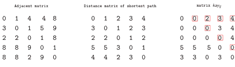

- we can traceback the shortest paths from matrix $(k_{ayj})$, for example, from 1 to 5
  - $key(1,5)=4$, $key(4,5)=0$, $4 \rightarrow 5$ is a sub-path
  - $key(1,4)=3$, $key(3,4)=0$, $3 \rightarrow 4$ is a sub-path
  - $key(1,3)=0$, $key(2,3)=0$, $2 \rightarrow 3$ is a sub-path
  - $key(1,2)=0$, $1 \rightarrow 2$ is a sub-path

## An example

**Adjacent matrix**

|   |   |   |   |   |
|---|---|---|---|---|
| 1 | 4 | 4 | 8 | 8 |
| 3 | 0 | 1 | 5 | 9 |
| 2 | 2 | 0 | 1 | 8 |
| 8 | 8 | 9 | 0 | 1 |
| 8 | 8 | 2 | 9 | 0 |

**Distance matrix of shortest path**

|   |   |   |   |   |
|---|---|---|---|---|
| 0 | 1 | 2 | 3 | 4 |
| 3 | 0 | 1 | 2 | 3 |
| 2 | 2 | 0 | 1 | 2 |
| 5 | 5 | 5 | 0 | 1 |
| 4 | 4 | 2 | 3 | 0 |

**matrix Rᴵʸ**

|   |   |   |   |   |
|---|---|---|---|---|
| 0 | ① | ② | ③ | ④ |
| 0 | 0 | ① | ③ | ④ |
| 0 | 0 | 0 | ③ | ④ |
| 5 | 5 | 5 | 0 | ④ |
| 3 | 3 | 3 | 0 | 0 |

- we can traceback the shortest paths from matrix $(k_{ayj})$, for example, from 1 to 5
  - $kay(1,5)=4$, $kay(4,5)=0$, $4 \rightarrow 5$ is a sub-path
  - $kay(1,4)=3$, $kay(3,4)=0$, $3 \rightarrow 4$ is a sub-path
  - $kay(1,3)=2$, $kay(2,3)=0$, $2 \rightarrow 3$ is a sub-path
  - $kay(1,2)=0$, $1 \rightarrow 2$ is a sub-path
  - The final shortest path is $1 \rightarrow 2 \rightarrow 3 \rightarrow 4 \rightarrow 5$

# Outline

- What is DP
- 0/1 Knapsack Problem
- Matrix Multiplication Chains
- All Pairs Shortest Path
- Maximum Non-crossing Subset of Nets
- Longest Common Subsequences

## Problem statement

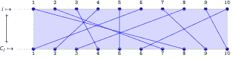

- A 1-1 map $(i,c)$ is called a subnet
- Two subnets $(i,c_i)$ and $(j,c_j)$ are non-crossed if $i<j$ then $c_i<c_j$

## Problem statement

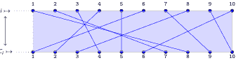

- A 1-1 map $(i,c_i)$ is called a subnet
- Two subnets $(i,c_i)$ and $(j,c_j)$ are non-crossed if $i < j$ then $c_i < c_j$
- The set $MNS(i,j)=\{(u,c_u)\mid i\leq u,c_u\leq j\}$ is called non-crossing set if for $\forall(p,c_p)$ and $\forall(q,c_q)\in MNS(i,j)$ then $(p,c_p)$ and $(q,c_q)$ are non-crossed

## Problem statement

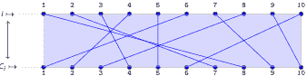

- A 1-1 map $(i,c_i)$ is called a subnet.
- Two subnets $(i,c_i)$ and $(j,c_j)$ are non-crossed if $i < j$ then $c_i < c_j$.
- The set $MNS(i,j)=\{(u,c_u)\mid u\leq i, c_u\leq j\}$ is called non-crossing set if for $\forall(p,c_p)$ and $\forall(q,c_q)\in MNS(i,j)$ then $(p,c_p)$ and $(q,c_q)$ are non-crossed.
- Our goal is to find a MNS(n,n) with the maximum number of elements.


## Problem statement

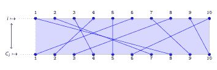

- A 1-1 map \((i, c_i)\) is called a subnet.
- Two subnets \((i, c_i)\) and \((j, c_j)\) are non-crossed if \(i < j\), then \(c_i < c_j\).
- The set \(MNS(i,j) = \{(u, c_u) \mid u \le i, c_u \le j\}\) is called a non-crossing set if, for all \((p, c_p)\) and \((q, c_q) \in MNS(i,j)\), \((p, c_p)\) and \((q, c_q)\) are non-crossed.
- Our goal is to find an \(MNS(n,n)\) with the maximum number of elements.
- Define \(size(i,j) = |MNS(i,j)|\).

## Derive the recursive equation

- Our goal is to maximize \(size(n,n)\).
- We have known that

\[
size(1,j)=\begin{cases}
0 & \text{if } j<c_1 \\
1 & \text{if } j\ge c_1
\end{cases} \tag{4}
\]

- We want to know the relationship between \(size(i,j)\) and \(size(i-1,j)\).
  - If \(j<c_i\), then \((i,c_i)\notin MNS(i-1,j)\), thus \(size(i,j)=size(i-1,j)\).
  - If \(j\ge c_i\), there are two cases.
    - Put \((i,c_i)\) into \(MNS(i-1,j)\), but \((i,c_i)\) might cross with items in \(MNS(i-1,j)\) or result in a smaller size, we have \(size(i,j)=size(i-1,j)\).

# Outline

- What is DP
- 0/1 Knapsack Problem
- Matrix Multiplication Chains
- All Pairs Shortest Path
- Maximum Non-crossing Subset of Nets
- Longest Common Subsequences

## Problem statements

### Definition 1: Subsequence

Given a sequence \(X = x_1x_2\ldots x_m\), another sequence \(Z = z_1z_2\ldots z_k\) is a subsequence of \(X\) if there exists a strictly increasing sequence \(i_1 < i_2 < \ldots < i_k\) of indices of \(X\) such that for all \(j = 1, 2, \ldots, k\), we have \(x_{i_j} = z_j\).

Example 1: If X = abcdefg, Z = abdg is a subsequence of X.

### Definition 2: Common subsequence

Given two sequences X and Y, a sequence Z is a common subsequence of X and Y if Z is a subsequence of both X and Y.

Example 2: X = abcdefg and Y = aaadgfd. Z = adf is a common subsequence of X and Y.

## Definitions

### Definition 3: Longest common subsequence: LCS

A **longest common subsequence** of X and Y is a common subsequence of X and Y with the longest length.

- The longest common subsequence may not be unique; for example, both `acd` and `abd` are LCSs of `abcd` and `acbd`.
- LCS has been successfully applied to many fields.


## Definitions

## Definition 3: Longest common subsequence: LCS

A **longest common subsequence** of X and Y is a common subsequence of X and Y with the longest length.

- Longest common subsequence may not be unique, for example, strings both acd and abd are LCSs of abcd and acbd
- LCS has been successfully applied to many fields
  - Bioinformatics, e.g. long preserved regions in genomes
  - file comparison, e.g. diff
- Solutions
  - Brute force approach: $O(n^2m)$
  - DP approach: $O(nm)$

## DP approach for LCS

- Let’s consider the prefixes of x and y
  - x[1..i] ith prefix of x[1..m]
  - y[1..j] jth prefix of y[1..n]
- Subproblem: define c[i,j] = |LCS(x[1..i], y[1..j])|
- c[m,n] is our goal
- We have known that c[1,1] = 1 if x₁ = y₁, otherwise 0
- To derive recursive relationship, we use the following theorem

> Theorem: Let X=x₁x₂⋯xₘ and Y=y₁y₂⋯yₙ be two sequences, and Z=z₁z₂⋯zₖ be any LCS of X and Y, then
- If xₘ = yₙ, then zₖ = xₘ = yₙ and Z[1..k-1] is an LCS of X[1..m-1] and Y[1..n-1].


## DP approach for LCS

- Let’s consider the prefixes of x and y
  - x[1..i] prefix of x[1..m]
  - y[1..j] prefix of y[1..n]
- Subproblem: define c[i,j] = |LCS(x[1..i], y[1..j])|
- c[m,n] is our goal
- We have known that c[1,1] = 1 if x₁ = y₁, otherwise 0
- To derive recursive relationship, we use the following theorem

> **Theorem:** Let X=x₁x₂⋯xₘ and Y=y₁y₂⋯yₙ be two sequences, and Z=z₁z₂⋯zₖ be any LCS of X and Y, then

- If xₘ = yₙ, then zₖ = xₘ = yₙ, and Z[1..k−1] is an LCS of X[1..m−1] and Y[1..n−1].
- If xₘ ≠ yₙ, then zₖ ≠ xₘ implies that Z is an LCS of X[1..m−1] and Y.
- If xₘ ≠ yₙ, then zₖ ≠ yₙ implies that Z is an LCS of X and Y[1..n−1].

## Recursive equation

By the theorem, we can easily get the recursive equation

$$c[i,j] = \begin{cases} 0 & \text{if } i=0 \text{ or } j=0 \\ c[i-1,j-1]+1 & \text{if } x[i]=y[j] \\ \max\{c[i-1,j],c[i,j-1]\} & \text{otherwise} \end{cases} \tag{6}$$

```
LCS(X,Y,m,n,b) {
  for i=1 to m do
    c[i,0]=0;
  for j=0 to n do
    c[0,j]=0;
  for i=1 to m do
    for j=1 to n do
      if x[i]=y[j] then
        c[i,j]=c[i-1,j-1]+1;
        b[i,j]="↖";
      else if c[i-1,j] >= c[i,j-1] then
        c[i,j]=c[i-1,j];
        b[i,j]="↑";
      else
        c[i,j]=c[i,j-1];
        b[i,j]="←";
}
```

```
PrintLCS(b,X,i,j) {
  if i==0 or j==0 then exit;
  if b[i,j] == "↖" {
    PrintLCS(b,X,i-1,j-1);
    print x[i];
  }
  if b[i,j] == "↑" PrintLCS(b,X,i-1,j);
  if b[i,j] == "←" PrintLCS(b,X,i,j-1);
}
```

LCS algorithm

Print LCS algorithm

## Coming up: Backtracking Algorithm

# Chapter 05: Backtracking Algorithm Design and Analysis of Computer Algorithms

GONG Xiu-Jun

School of Computer Science and Technology, Tianjin University

Email: gongxj@tju.edu.cn

October 29, 2019

# Outline

1. Definition and Representations
2. Two-Ship-Loading Problem: TSLP
3. 0/1 Knapsack
4. Max Clique
5. Traveling Sales Problem

## Motivations

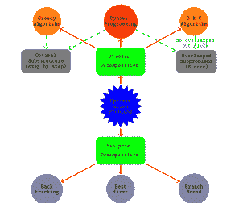

## Solution space

- A solution to a specific problem can be represented by a n tuple \( (x_1, x_2, \cdots, x_n) \)
  - \(x_i\) comes from a limited set \(S_i\)
  - The dimensions of tuples for different solutions might vary depending on its definition, thus the representation can be classified:
    - **Fixed Length Tuple (FLT)** representation: all tuples have same dimensions


## Solution space

- A solution to a specific problem can be represented by a n tuple \((x_1, x_2, \cdots, x_n)\)
  - \(x_i\) comes from a limited set \(S_i\).
  - The dimensions of tuples for different solutions might vary depending on its definition, thus the representation can be classified:
    - Fixed Length Tuple (FLT) representation: all tuples have same dimensions
    - Varied Length Tuple (VLT) representation: tuples have different dimensions

**Solution space**: A set consists of all enumerates in the form of solution representation.

- For FLT: \(X = \{(x_1, x_2, \cdots, x_n) | x_i \in S_i\}\)
- For VLT: \(X = \{X^1, X^2, \cdots, X^k\}\) where \(X^j = \{(x_{j1}, x_{j2}, \cdots, x_{jk}), k \in [1..n]\}\)

## Solution space, cont.

- Not all \(x \in X\) is the real solution
  - **Feasible solution**: if \(x\) holds all constrain conditions
    \(g(x) = true \ (i \in [1..m])\), simply as \(g(x)\)
  - **Optimal solution**: if \(x\) maximize/minimize target functions
    \(f_i(x) \ (i \in [1..k])\), simply as \(f(x)\)
- Our goal is to search for the feasible/optimal solutions from solution space
  - Define solution representations


## Solution space, cont.

- Not all \( x \in X \) is the real solution
  - Feasible solution: if x holds all constrain conditions
    \( g(x) = true \ (i \in [1..m]), \ simply \ as \ g(x) \)
  - Optimal solution: if x maximize/minimize target functions
    \( f_i(x) \ (i \in [1..k]), \ simply \ as \ f(x) \)
- Our goal is to search for the feasible/optimal solutions from solution space
  - Define solution representations
  - Formulate solution space

## Define solution representations

### Eight queens puzzle

Using a regular chess board, the challenge is to place eight queens on the board such that no queen is attacking any of the others.

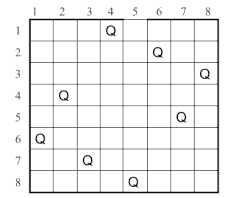

The solution can be represented by a 8-tuple \((x_1, \cdots, x_8)\) where \(x_i\) is the column number of i-th queen

The size of solution space is \(8^8\)

Constrains: \(x_i \neq x_j\) and \(|x_i - x_j| \neq |j - i|\) for all i, j

### Subset sum problem

Finding what subset of a set of positive integers \( S = \{w_1, w_2, \cdots, w_n\} \) has a given sum \( M \).

For an example, M=31, n=4 and W=(11, 13, 24, 7), then 11+13+7=31 and 24+7=31

The solution can be represented by

| FLT \(\mapsto\) | \((x_1, x_2, \cdots, x_n)\) where \(x_i = 1\) if it is chosen else 0 | (1,1,0,1) (0,0,1,1) | \(O(2^n)\) |
|---|---|---|---|
| VLT\(\mapsto\) | \((j_1, j_2, \cdots, j_k)\) where \(j_i\) is the order number of i-th integer chosen in \(S\) and k is the total number chosen | (1,2,4) (3,4) | \(O(2^n)\) |

## Formulate solution space

- **Problem state**: a point in solution subspace. We can check if it reaches the goal.
- **Start state** (root): a problem state at which we start to search for the goal
- **Solution state**: a path from current (visiting) state to the root


## Formulate solution space

- **Problem state**: a point in solution subspace. We can check if it reaches the goal
- **Start state** / (root): a problem state at which we start to search for the goal
- **Solution state**: a path from current (visiting) state to the root
- **Answer/goal state**: a point in solution space that is the goal

## Definition

The **state space** of a problem is a 4-tuple (N, A, S, G) where:

- N is a set of problem states
- A is a set of arcs connecting the states
- S is a nonempty subset of N that contains start states
- G is a nonempty subset of N that contains the goal states.
- Our goal is to **find paths** from S to G

## State space tree

State space tree is the representation of state space in the form of tree structures

### 4-queens puzzle

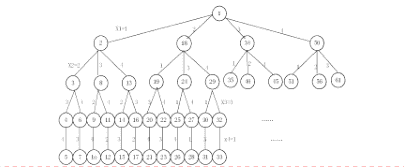

- Number inside a node is the order of depth first searching the tree;
- Edge label is x<sub>i</sub> and i is the depth of tree
- This kind of tree is called Permutation Tree.

## Subset sum using FLT representation

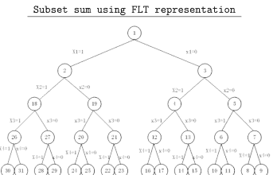

M=31, n=4, and W=(11,13,24,7)\nSubset tree

### Subset sum using VLT representation

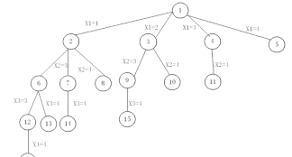

M=31, n=4, and W=(11,13,24,7)

## Searching solution space

- Searching for solutions equals to traverse the state space tree
- Node has three states during expending a tree
  - Live node: A node that has been reached, but not all of its children have been explored
  - Dead node: A node where all of its children have been explored
  - E-Node (expansion node): A live node in which its children are currently being explored.
- Search strategy
  - Backtrack: A variant version of depth first search with a bound function


## Searching solution space

- Searching for solutions equals to traverse the state space tree
- Node has three states during expending a tree
  1. Live node: A node that has been reached, but not all of its children have been explored
  2. Dead node: A node where all of its children have been explored
  3. E-Node (expansion node): A live node in which its children are currently being explored.
- Search strategy
  1. Backtrack: A variant version of depth first search with a bound function
  2. Branch-bound(Best first search): an enhancement of backtracking

Bounding is a boolean function to kill a live node

## Bounding function for Subset sum problem

- Simple bounding: B(X(1),⋯,X(k))=true iff

\(\sum_{i=1}^k W(i)X(i) + \sum_{i=k+1}^n W(i) < M\) (1)

- Simple bounding: B(X(1),...,X(k))=true iff

\[
\sum_{i=1}^{k} W(i)X(i)+\sum_{i=k+1}^{n} W(i)<M
\tag{1}
\]

- Tighter bounding: B(X(1),...,X(k))=true iff (1) and

\[
\sum_{i=1}^{k} W(i)X(i)+W(k+1)>M
\tag{2}
\]

when sorting W(i) by non-decreasing order

## Subset sum algorithm with bounding

**Algorithm 2:** Subset sum problem: pseudo code

```text
Let s=w(1)+⋯+w(k−1);
    r′=w(k)+⋯+w(n), assumed s+r′≥M;
Expanding left child node;
if S + W(k) > M then
    stop expanding;
    r′=r−w(k);
    Expanding right child node;
else
    x(k)=1;
    s=s+w(k);
    r′=r−w(k);
    let (x(1),⋯,x(k)) be E-Node;
Expanding right child node;
if s+r′ < M or s+w(k+1) > M then
    stop expanding;
else
    x(k)=0
```

## State space tree with bounding

### Subset sum problem

M=30,n=6 and w=(5,10,12,13,15,18)

UPDATED

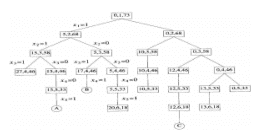

Numbers in a rectangle node corresponds to s, k and r values respectively. Circle nodes correspond to answer states, There are only 23 nodes, but 2<sup>7</sup> − 1 = 63 nodes without bounding

# Outline

1. Definition and Representations
2. Two-Ship-Loading Problem:TSLP
3. 0/1 Knapsack
4. Max Clique
5. Traveling Sales Problem

## Problem statement

- Given two ships with capacities \(c_1\) and \(c_2\), and \(n\) containers with weights \((w_1, \cdots, w_n)\), such that

$$
\sum_{i=1}^n w_i \leq c_1 + c_2
\tag{3}
$$

- We wish to determine whether there is a way to load all \(n\) containers into ships without sinking.

Note that

- When \(\sum_{i=1}^n w_i = c_1 + c_2\), it is equivalent to the sum-of-subset problem
- When \(c_1 = c_2\), it is equivalent to the partition problem

## Solution

1. load the first ship as close to its capacity as possible and
2. put the remaining containers into the second ship.

To load the first ship as close to capacity as possible, we need to select a subset of containers with total weight as close to \( c_1 \) as possible.

Using fixed length tuple \( x = (x_1, \cdots, x_n) \) (\( x_i = 1 \), if container i is loaded) as solution space representation, just need

\[ \max \sum_{i=1}^n w_i x_i \tag{4} \]

An example of state space tree is shown below.

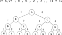


## Bound function

- Suppose node i-1 is the E-node, let

cw = \(\sum_{j=1}^{i-1} x_j w_j\) total weight of containers loaded already

r = \(\sum_{j=i}^{n} w_j\) total weight of unloaded containers

bestw = the optimal total weight up to now

- Bound1(x1, ..., xi) = true if cw + wi > c: Kill node i

- Bound2(x1, ..., xk) = true cw+r ≤ bestw : stop expanding node i.

- Above two bounding functions can be used at same time

## State space tree with bounding

n= 4, w= [ 8 , 6 , 2 , 3 ], c= 12

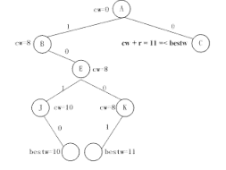

# Outline

- 1. Definition and Representations
- 2. Two-Ship-Loading Problem: TSLP
- 3. 0/1 Knapsack
- 4. Max Clique
- 5. Traveling Sales Problem

## Bound function for 0/1 Knapsack

- Suppose that items are sorted in non-decreasing miner of p/w and node k-1 is the E-node, let

cp = \(\sum_{j=1}^{k-1} x_j p_j\) profit of current packing

rp = \(\sum_{j=k}^{n} p_j\) total profit of remain items

bestp = max profit so far

- Bound(x) = true if cp+rp ≤ bestp

## Backtrack algorithm for Knapsack

```cpp
template<class Tv, class Tp>
void KnapTv, Tp>::Knapsack(int i)
{ // Search the i - th node
    if (i > n) { // Leaf node
        bestp = cp;
        return;
    }
    if (remainweight >= w[i])
    { // Left subtree
        x[i] = 1; // try x[i] = 1
        cp += v[i];
        remainweight -= w[i];
        Knapsack(i + 1);
    }
    if (Bound(i + 1) > bestp) // try x[i] = 0
        Knapsack(i + 1);
}
```

```cpp
template<class Tv, class Tp>
Tp Knap<Tv, Tp>::Bound(int i)
{ // Return upper bound on value of
  // best leaf in i - subtree
    Tp c = cp; // remaining
    Tp bound = c; // profit bound
    while (i <= n && c + w[i] <= W)
    { // fill node of profit density
        c -= w[i];
        bound += v[i];
        i++;
    }
    if (i <= n)
        bound += (W - c) * p[i] / w[i];
    return bound;
}
```

## NEW

Assumed that items have been sorted by the profit density \(\left(\frac{p_i}{w_i}\right)\)

# Outline

- 1. Definition and Representations
- 2. Two-Ship-Loading Problem: TSLP
- 3. 0/1 Knapsack
- 4. Max Clique
- 5. Traveling Sales Problem

## Max Clique: problem statements

A subgraph $G' \subseteq V', E'$ is a complete subgraph of a graph $G = \langle V, E \rangle$ if and only if $V' \subseteq V$ and for $\forall u \in V', \forall v \in V', (u,v) \in E' \subseteq E$.

**A clique** is a complete subgraph of $G$ if no larger inclusion of other complete subgraphs.

**A independent vertex set** is a subgraph of $G$ with no empty edges if no larger inclusion of other independent vertex sets.

**A max clique** is a clique of the largest possible size in a given graph.

**A max independent vertex set** is a independent vertex set of the largest possible size in a given graph.


## An example

- {1,2} is a complete subgraph, but not a clique
- {1,2,5}, {1,4,5}, {2,3,5} are max cliques
- {2,4} is a max independent vertex set

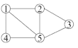

- {1,2} is an empty subgraph, but not a max independent vertex set
- {2,3}, {1,2,5} are independent vertex sets
- {1,2,5} is also a max independent vertex set

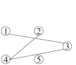

## Max clique: bounding

- Our goal is to find the max cliques of given graph G
- Using fixed length tuple X=x[1..n] (x[i]=1 if vertex i is included) to represent solution space
- Its state space tree is a subset tree
- Bounding
  - B(x)=true if the vertices from root to i cannot form a complete subgraph
  - B(x)=true if the number of vertices from root to i plus remaining vertices is no larger than bestn

## Backtrack algorithm for maxclique

```
int AdjacencyGraph::MaxClique(int v) {
    // Return size of largest clique.
    // Return clique size
    if (n == 0)
        return 0;
    // initialize for maxClique
    int x[n+1];
    cn = 0;
    bestn = 0;
    bestv = v;

    // find max clique
    maxClique(1);
    
    delete [] x;
    return bestn;
}
```

```
void AdjacencyGraph::maxClique(int i)
{
    // Backtracking code to compute largest clique.
    // (i) if a vertex is connected to
    // all vertices in a larger clique, update count
    for (int j = 1; j < i; j++)
        bestc[j] = x[j];
    return;

    // see if vertex i connects to others
    // in current clique
    int OK = 1;
    for (int j = 1; j < i; j++)
        if (x[j] == 1 && !AdjMat[i][j])
        {
            OK = 0; // not connected to j
            break;
        }

    if (OK) { // try x[i] = 1
        x[i] = 1; // add i to clique
        cn++;
        maxClique(i+1);
        x[i] = 0;
        cn--;
    }

    if (cn + n - i > bestn) { // try x[i] = 0
        x[i] = 0;
        maxClique(i+1);
    }
}
```

# Outline

- Definition and Representations
- Two-Ship-Loading Problem: TSLP
- 0/1 Knapsack
- Max Clique
- Traveling Salesman Problem

## TSP

- Given a list of cities and the distances between each pair of cities, what is the **shortest possible route** that visits each city **exactly once** and returns to the **origin city**?
- It can be modeled as an undirected weighted graph, such that cities are the graph's vertices, paths are the graph's edges, and a path's distance is the edge's length.
- It is a minimization problem starting and finishing at a specified vertex after having visited each other vertex exactly once.


## Bounding

- Define x=x[1..n] (x_i is the order number of i-th vertex in the route) as the solution representation
- Its state space tree is a permutation tree
- Bounding
  - B(i)=true if no edge connection between x[i] and x[i-1]
  - B(i)=true if route distance from root to x[i] is larger than best (bestc is the shortest route distance so far)

## Backtrack algorithm for maxclique

```cpp
void Maxclique(int n) {
    // Backtracking code for traveling salesperson.
    int i;
    if (n == 0) { // at parent of leaf
        // complete tours by adding last two edges
        if (a[x[n-1]][x[n]] != NoEdge &&
            (a[x[n]][1] != NoEdge &&
             (c + a[x[n-1]][x[n]] + a[x[n]][1] < bestc ||
              bestc == 0)))
            bestc = c + a[x[n-1]][x[n]] + a[x[n]][1];
    }
    else { // try out subtrees
        for (int j = 1; j <= n; j++) {
            // see if edge is labeled x[j]
            if (a[x[n-1]][x[j]] != NoEdge &&
                (c + a[x[n-1]][x[j]] < bestc || bestc == 0)) {
                // search this subtree
                swap(x[n], x[j]);
                c += a[x[n-1]][x[n]];
                TSP(n-1);
                c -= a[x[n-1]][x[n]];
                swap(x[n], x[j]);
            }
        }
    }
}
```

```cpp
template<class T>
void maxclique(int n, TSP(int)) {
    // Traveling salesperson
    // Backtracking.

    // Return cost of best tour,
    // return 0 for n<=1.
    if (n <= 1) return;
    x[1] = 1;
    // x is a random permutation
    for (int i = 2; i <= n; i++)
        x[i] = i;
    bestc = 0;
    // search whole array of vertices
    TSP(n-1);
    c = 0;

    // search permutations of x
    TSP(2);

    delete [] x;
    return bestc;
}
```

## Coming up: Branch & Bound Algorithm

# Chapter 06: Branch & Bound Algorithm

### Design and Analysis of Computer Algorithms

GONG Xiu-Jun  
School of Computer Science and Technology, Tianjin University  
Email: gongxj@tjtu.edu.cn  
November 5, 2019

# Outline

- Definition and Representations
- Job sequencing with deadlines
- Traveling Salesperson Problem
- A-star algorithm

## Motivations

Let’s consider the 0/1 knapsack problem, its state space can be expanded in two ways using fixed length tuple representation of solution space: (n=4,c=7,p=[4,7,9,10], w=[1,2,3,5])

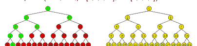

Using DFS:

- E-node produces one child at a time
- It needs O(n) space to store live nodes


## Motivations

Let’s consider the 0/1 knapsack problem, its state space can be expanded in two ways using fixed length tuple representation of solution space: (n=4,c=7,p=[4,7,9,10], w=[1,2,3,5])

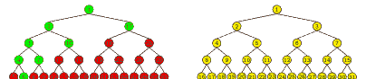

Using DFS:

- E- node produces one child at a time
- It needs O(n)space to store live nodes
- Bounding reduces node number from 31 to 8

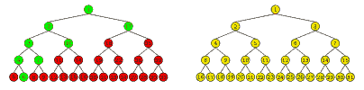

Using DFS:

- E- node produces one child at a time
- It needs O(n)space to store live nodes
- Bounding reduces node number from 31 to 8

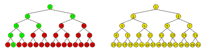

Using DFS:

- E- node produces one child at a time
- It needs O(n)space to store live nodes
- Bounding reduces node number from 31 to 8

Using BFS:

- E- node produces all children at a time

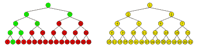

Using DFS:

- E- node produces one child at a time
- It needs O(n)space to store live nodes
- Bounding reduces node number from 31 to 8

Using BFS:

- E- node produces all children at a time
- It needs O(2^n) space to store live nodes

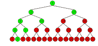

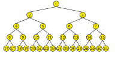

Using DFS:

- E- node produces one child at a time
- It needs O(n)space to store live nodes
- **Bounding** reduces node number from 31 to 8

Using BFS:

- E- node produces all children at a time
- It needs O(2^n) space to store live nodes
- How to **manage** the live nodes and How to **bound**?

## Managing live nodes

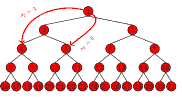

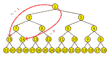

- FIFO: Live nodes are stored in a queue

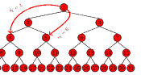


- FIFO: Live nodes are stored in a queue
- LIFO: Live nodes are stored in a stack


- FIFO: Live nodes are stored in a **queue**
- LIFO: Live nodes are stored in a **stack**
- Max Profit(Least cost): Live nodes are stored in a **max/min heap**


- FIFO: Live nodes are stored in a queue
- LIFO: Live nodes are stored in a stack
- Max Profit(Least cost): Live nodes are stored in a max/min heap

> we need bound solution states so that the best possible solutions can be reached and fruitless candidates are discarded quickly . How to?

## Bounding solution states

We have known that greedy algorithm can find the optimal value for fractional knapsack problem.

> Fractional relaxation: The optimal value for fractional knapsack problem is the upper bound of 0/1 knapsack problem

We have known that **greedy algorithm** can find the optimal value for fractional knapsack problem.

**Fractional relaxation:** The optimal value for fractional knapsack problem is the **upper bound** of 0/1 knapsack problem

Therefore,

- we can calculate **upper bound** for each sub problem (corresponding to a solution state )


## Bounding solution states

We have known that **greedy algorithm** can find the optimal value for fractional knapsack problem.

**Fractional relaxation:** The optimal value for fractional knapsack problem is the **upper bound** of 0/1 knapsack problem

Therefore,

- we can calculate **upper bound** for each sub problem (corresponding to a solution state)
- also, its **lower bound** corresponds to the value of current packing
- the **upper/lower bound** can guide the search for the optimal solution;
- for each state, its lower bound should no larger than upper bound
- for two states A and B, if A’s upper bound is no larger than B’s lower bound, then A should be discarded

## State space tree with lower/upper bounds

(n=4,c=7,p=[4,7,9,10], w=[1,2,3,5])


- for node 1, upper bound=4+7+9+(7-1-2-3)*(10/5)=22, lower bound=0
- for node 2, upper bound=4+7+9+(7-1-2-3)*(10/5)=22, lower bound=4

## Problem statements

- **Branch & Bound** (BB) is an enhancement of backtracking for searching solution space with bounding, respect to a global optimization problem (min/max, for simplicity, just consider the min problem)

$$\min_{x \in S} f(x)$$  (1)

where $x=(x_1,x_2,\cdots,x_n)$, $x\in S_i$, $S=S_1\cup S_2\cup\cdots\cup S_n$, and each $S_i$ is a limited set. Usually, $x$ is constrained with

$$g(x)<b$$  (2)

- It consists of systematic enumeration of all candidate solutions, discarding large subsets of fruitless candidates by using **upper** and **lower** estimated bounds of quantity being optimized

- The implementation of this approach is a modification of the **breadth-first** search with branch-and-bound pruning.


## Procedures

- B&B requires two subroutines
  - **Branch** (Splitting): given a set $S$ of candidates, returns two or more smaller sets $S_1, S_2, \cdots$ whose union covers $S$
  - **Bounding** (Pruning): computes upper and lower bounds for the minimum value $f(x)$ of $x$ within a given subset of $S$

- Basic ideas that B&B works:
  - if the lower bound for some tree node (set of candidates) $A$ is greater than the upper bound for some other node $B$, then $A$ may be **safely discarded** from the search.
  - This step is usually implemented by maintaining a **global variable** (shared among all nodes of the tree) that records the minimum upper bound seen among all subregions examined so far.
  - The recursion **stops** when the current candidate set $S$ is reduced to a single element, or when the upper bound for set $S$ matches the lower bound.

## B&B vs Backtrack

- B&B is an enhancement of backtrack with lower/upper bounds.
- B&B does not limit us to any particular way of traversing the tree, while backtrack is limited to DFS.
- B&B is used only for optimization problems, while backtrack is also used for searching feasible solutions.
- B&B can easily handle problems having both discrete and continuous variables.


## B&B vs Backtrack

- B&B is an enhancement of backtrack with lower/upper bounds.
- B&B does not limit us to any particular way of traversing the tree, while backtrack to the one of DFS.
- B&B is used only for optimization problems, while backtrack also for searching feasible solutions.
- B&B can easily handle problems having both discrete and continuous variables.

> I have always wanted to prove a lower bound about the behavior of branch and bound, but I never could.
> —One of the mysteries of computational theory
> —George Nemhauser, DECEMBER 19, 2012

# Outline

- Definition and Representations
- Job sequencing with deadlines
- Traveling Sales Problem
- A-star algorithm

## Problem statements

Given n jobs and 1 processor, each job \( j_i \) has a 3-tuple \( (p_i; d_i; t_i) \) associated with it, where \( t_i \) is the number of units of processing time for job \( j_i \), \( p_i \) is a penalty if processing is not completed by deadline \( d_i \).

Aiming at selecting a subset J of n jobs such that all jobs in J can be completed by their deadline and minimizing 3.

\(\sum_{j \notin J} p_j\) (3)

Representing solution space using fixed length tuple \( x[1..n] \), \( x_i = 1 \) if \( x_i \in J \), otherwise \( x_i = 0 \).

The problem can be formulated as

\(\min_{x[1..n]} \sum_{i=1}^{n}(1-x_i) * p_i\) (4)

**Subject to:** \( t_i \leq d_i \) (5)

## B&B solutions

- **Branch:** Let \( i \) be the E-node, it splits the sub solution space \( S_i \) into:
  1. Sub solution space \( S_i^0 \) with \( x_{i+1} = 0 \)
  2. Sub solution space \( S_i^1 \) with \( x_{i+1} = 1 \)
  3. \( S_i = S_i^0 \cup S_i^1 \)
- Estimate the lower/upper bound of \( S_i^0 \) and \( S_i^1 \)
  1. lower bound(current penalties): \( L(i+1) = \sum_{j=1}^{i+1}(1-x_j) * p_j \)


## B&B solutions

- Branch: let \( i \) be the E-node, it splits the sub solution space \( S_i \) into
  - Sub solution space \( S_i^0 \) with \( x_{i+1} = 0 \)
  - Sub solution space \( S_i^1 \) with \( x_{i+1} = 1 \)
  - \( S_i = S_i^0 \cup S_i^1 \)

- Estimate the lower/upper bound of \( S_i^0 \) and \( S_i^1 \)
  - lower bound(current penalties): \( L(i+1) = \sum_{j=1}^{i+1} (1 - x_j) * p_j \)
  - upper bound(at worst case): \( U(i+1) = L(i+1) + \sum_{j=i+2}^{n} p_j \)

- Bound: for each \( S_i^0 \) and \( S_i^1 \)
  - Check for feasible conditions: if not hold, discard it
  - Check for lower bound: if it is greater than any of upper bounds of live nodes, discard it
  - Enhanced upper bound: using \( U(i) \) to update a global \( U \) such that keeping it as the smallest upper bound

## An example

(n=4, (p, d, t)<sup>4</sup><sub>1</sub> = {(5, 1, 1), (10, 3, 2), (6, 2, 1), (3, 1, 1)})


Every time the machine is freed or a new job is released, pick the uncompleted job with minimum due date.

## The basic idea

Problem statement of TSP can refer to previous lecture.
For B & B solutions of TSP, we need consider:

- How to branch? we have known that a TSP tour with n vertexes has and only has n edges.
- Define x=x[1..n] (x is the order number of i-th vertex in the route ) as the solution representation


## The basic idea

Problem statement of TSP can refer to previous lecture.
For B & B solutions of TSP, we need consider:

- How to branch? we have known that a TSP tour with n vertexes has and only has n edges.
- Define x=x[1..n] (x<sub>i</sub> is the order number of i-th vertex in the route ) as the solution representation
- Its state space tree is a permutation tree
- How to bound
  - the initial upper bound can be set sum of n largest edges
  - the lower bound can be obtained using reduction matrix approach

## Matrix reduction

For a \( n \times n \) matrix A= (A(i,j)),

**Row reduction**: Let \( r_i = \min_{j=1}^n \{A(i,j)\} \) and \( r = \sum_{j=1}^n r_i \), then
\( R = (A(i,j)) - (r_{\_}) \) is the row reduced matrix of A, r is the row reduced number.

**Column reduction**: Let \( c_j = \min_{i=1}^n \{A(i,j)\} \) and \( c = \sum_{j=1}^n c_j \), then
\( C = (A(i,j)) - (r_{\_}) \) is the column reduced matrix of A, c is the column reduced number.

|    |    |    |    |    |    |
|---|---|---|---|---|---|
| ∞  | 20 | 30 | 10 | 11 | -10 |
| 15 | ∞  | 16 | 4  | 3  | -2  |
| 3  | 8  | ∞  | 2  | 4  | -2  |
| 19 | 6  | 18 | ∞  | 3  | -5  |
| 16 | 4  | 7  | 16 | ∞  | -4  |
|    |    |    |    |    | -21 |

| cost matrix | row reduced matrix |
|---|---|
| ∞ 20 30 10 11 -10 | ∞ 10 20 0 1 |
| 15 ∞ 16 4 2 -2 | 13 ∞ 14 2 0 |
| 3 8 ∞ 2 4 -2 | 1 3 ∞ 0 2 |
| 19 6 16 ∞ 3 -3 | 16 3 15 ∞ 0 |
| 16 4 7 16 -4 -21 | 12 0 3 12 ∞ |
| -21 -1 -5 -3 0 -4 | |


## Lower bound estimation

Let \( f = (e_1, e_2, \cdots, e_n) \) is a TSP tour of the undirected weighted graph \( G = <V, E> \), \( A = (A(i,j)) \) is its cost matrix, and \( e_i \) is the edge from i-th row.

### Theorem

> If A is reduced to B by row number r and B is reduced to C by column number c, then \( cost(f) - cost(C) + r + c \geq r + c \)

We use the reduced number \( r + c \) as the estimation of lower bounds.
Let S be a sub node of R and \( (i,j) \) a edge from i to j:

- If S is non-leaf node, then \( LB(S) = LB(R) + R(i,j) + rn \), where \( rn \) is the reduced number of S by
  - Let all numbers in i-th row and j-th column of R be \( \infty \)
  - Let \( R(i,j) \) be \( \infty \)
  - Let S=R

- If S is leaf node, \( LB(S) = L(S) + A(S, root) \)

## An example of state space tree


# Outline

- Definition and Representations
- Job sequencing with deadlines
- Traveling Sales Problem
- **A-star algorithm**

## Definitions

- A-star was first described in 1968 by Peter Hart, Nils Nilsson, and Bertram Raphael.
- It uses a best-first search and finds a least-cost path from a given initial node to one goal node.
- It uses a knowledge-plus-heuristic cost function of node x : f(x)=g(x)+h(x), to determine the order in which the search visits nodes in the tree.
  - g(x): the past path-cost function, which is the known distance from the starting node to the current node x
  - h(x): a future path-cost function, which is an admissible "heuristic estimate" of the distance from x to the goal
- A-star vs B&B
  - In B&B, the node with the best (shortest) path that you've found so far is expanded first.
  - In A-star, the node with the shortest estimated total length from start to goal, where the total length is estimated as length so far plus heuristic estimate of the remaining distance to the goal, is expanded first.


## Properties of A-star

In practice, how to estimate h(x) to its real value h*(x) is a hard point

- Admissibility: the heuristic function h(x) is admissible, meaning that it never overestimates the actual minimal cost of reaching the goal.

- Monotonicity (Consistency): the heuristic function h(x) is monotonic, means that for any pair of adjacent nodes x and y, \( h(x) \leq h(y) + d(x, y) \)

**Theorem**
A-star is the optimal if h holds admissibility and monotonicity.

## An example: 8 puzzle problem

**Problems statements:** The 8 puzzle is a simple game which consists of eight sliding tiles, numbered by digits from 1 to 8, placed in a 3 × 3 squared board of nine cells.

- One of the cells is always empty
- Any adjacent (horizontally and vertically) tile can be moved into the empty cell
- The objective of the game is to start from an initial configuration and end up in a configuration which the tiles are placed in ascending number order.

| 2 | 8 | 3 |
|---|---|---|
| 1 | 6 | 4 |
| 7 |   | 5 |

⇒

| 1 | 2 | 3 |
|---|---|---|
| 8 |   | 4 |
| 7 | 6 | 5 |

## Design a heuristic cost function


For a given state x, we need a heuristic cost function

$\hat{f}(x)=\hat{g}(x)+\hat{h}(x)$　　　　　　　　　　　　　　　　　(6)

Where

- $\hat{g}(x)$: the number of moves from initial state to state x.
- $\hat{h}(x)$: the number of tiles out of place (compared with the goal state) (Hamming priority function)

## State space tree


## Pseudo code of A-star algorithm

```
function A*(start,goal)
    closedset := the empty set    // The set of nodes already evaluated.
    openset := {start}    // The set of tentative nodes to be evaluated, initially containing the start node
    came_from := the empty map    // The map of navigated nodes.
    g_score[start] := 0    // Cost from start along best known path.
    // Estimated total cost from start to goal through y.
    f_score[start] := g_score[start] + heuristic_cost_estimate(start, goal)
    while openset is not empty
        current := the node in openset having the lowest f_score[] value
        if current = goal
            return reconstruct_path(came_from, goal)
        remove current from openset
        add current to closedset
        for each neighbor in neighbor_nodes(current)
            if neighbor in closedset
                continue
            tentative_g_score := g_score[current] + dist_between(current,neighbor)
            if neighbor not in openset or tentative_g_score < g_score[neighbor]
                came_from[neighbor] := current
                g_score[neighbor] := tentative_g_score
                f_score[neighbor] := heuristic_cost_estimate(neighbor,
                    goal)
                if neighbor not in openset
                    add neighbor to openset
    return failure
function reconstruct_path(came_from, current_node)
    if current_node in came_from
        p := reconstruct_path(came_from,
            came_from[current_node])
        return (p + current_node)
    else
        return current_node
```

# Coming up: NP Complete Problems

# Chapter 07: Non-deterministic Polynomial Complete Problems

Design and Analysis of Computer Algorithms

GONG Xiu-Jun

School of Computer Science and Technology, Tianjin University

Email: gongxj@tjtu.edu.cn

May 26, 2019


# Outline

## Are problems easy or hard?

- Problem stacks
- tractable problems
- intractable problems
- unsolvable problems
- Decision vs Optimization problems

## What makes a problem hard ?

## Hardness equivalence of problems

## Are problems easy or hard?

### Problem stacks

Linear Sorting

Matrix Multiplying

Path Finding

Graph Searching

Item Loading

Job Scheduling

Quick Sort

Merge Sort

Select number

Matrix Blocks

Matrix Chain

One pair shortest path

All pairs shortest path

Traveling salesman problem

Max Clique

Non crossing subset

LCS problem

Container Loading

Subset Sum

0/1 Knapsack

Bin Processor

Nuns Processors

Dense Puzzles

Algorithms

Greedy algorithm

Divide & conquer

Dynamic programming

Backtracking algorithm

Branch & bound

T(n) = O(n^2)

T(n) = O(2^n)

GONG Xiu-Jun

Algorithms

NPC Problems

We have seen many problems that can be solved in polynomial time, for instances,

- Sorting n numbers
- Finding the shortest path between a pair vertices in a graph
- Calculating the square root of an integer
- ...

These problems are computationally tractable, means that

- A tractable problem can be solved by a polynomial-time algorithm.
- Its upper bound is polynomial, such as bounded by \(log(n)\), \(nlog(n)\), \(n^2\), etc.
- This complexity holds for reasonable input size other than for Internet-size.

We have seen many problems that cannot be solved in polynomial time.

## intractable problem

a problem that cannot be solved by a polynomial-time algorithm. The lower bound is exponential.

Examples include:

- Some of them require a non-polynomial amount of output, so they clearly will take a non-polynomial amount of time
- Towers of Hanoi: we can prove that any algorithm that solves this problem must have a worst-case running time that is at least 2^n − 1.


## intractable problem

a problem that cannot be solved by a polynomial-time algorithm. The lower bound is exponential.

Examples include:

- Some of them require a non-polynomial amount of output, so they clearly will take a non-polynomial amount of time.
  - Towers of Hanoi: we can prove that any algorithm that solves this problem must have a worst-case running time that is at least $2^n - 1$.
  - List all permutations (all possible orderings) of $n$ numbers.
- Others have polynomial amounts of output, but still cannot be solved in polynomial time:
  - Knapsack problem
  - TSP
  - LCS

## Are problems easy or hard?

## unsolvable problems

An **unsolvable** (or "impossible") problem is one for which there is NO algorithm at all, not even an inefficient, exponential time one.

## Examples

- **HALTING PROBLEM** – Given an arbitrary algorithm and its input, determine whether the algorithm will halt (terminate), or run forever in an “infinite loop”. This is the most infamous unsolvable problem.
- EQUIVALENCE PROBLEM - Given two programs, test to see if they are equivalent.


## Are problems easy or hard?

## unsolvable problems

An unsolvable (or "impossible") problem is one for which there is NO algorithm at all, not even an inefficient, exponential time one.

## Examples

- HALTING PROBLEM - Given an arbitrary algorithm and its input, determine whether the algorithm will halt (terminate), or run forever in an "infinite loop". This is the most infamous unsolvable problem.

- EQUIVALENCE PROBLEM - Given two programs, test to see if they are equivalent.

- VERIFICATION PROBLEM - Given the statement of a problem and a proposed program for solving it, verify whether the program really does solve the problem (i.e. check that a program is correct).

- THEOREM RECOGNITION PROBLEM - Given a mathematical statement, test whether or not it is a theorem (i.e. whether or not it is "true"). For example, test a first order logical formula to see if it is valid (in all models), or test a statement of number theory to see if it holds.

A decision problem asks us to check if something is true (possible answers: “yes” or “no”).

Examples:

- PRIMES: Is a positive integer \(n\) prime?

- PRIMES: Is a positive integer *n* prime?

- COMPOSITES NUMBERS: Are there integers *k* > 1 and *p* > 1 such that *n* = *kp*?

- PRIMES: Is a positive integer $n$ prime?

- COMPOSITES NUMBERS: Are there integers $k > 1$ and $p > 1$ such that $n = kp$?

- PRIMES: Is a positive integer *n* prime?

- COMPOSITES NUMBERS: Are there integers *k* > 1 and *p* > 1 such that *n* = *kp*?

**An optimization problem** asks us to find, among all feasible solutions, one that maximizes or minimizes a given objective function.

Examples:

- Shortest-Path Problem

- Shortest-Path Problem

- 0/1 Knapsack Problem

A decision version of a given optimization problem can easily be defined with the help of a **bound** on the value of feasible solutions

- Clearly, if one can solve an optimization problem (in polynomial time), then one can answer the decision version (in polynomial time)

- Conversely, by doing binary search on the bound b, one can transform a polynomial time answer to a decision version into a polynomial time algorithm for the corresponding optimization problem


A decision version of a given optimization problem can easily be defined with the help of a **bound** on the value of feasible solutions

- Clearly, if one can solve an optimization problem (in polynomial time), then one can answer the decision version (in polynomial time)
- Conversely, by doing binary search on the bound b, one can transform a polynomial time answer to a decision version into a polynomial time algorithm for the corresponding optimization problem
- In that sense, these are essentially equivalent. We will then restrict ourselves to decision problems

**Input length** of an algorithm is defined as the length of the binary string encoded by input instances.

## Example 1. 0/1 Knapsack problem

- input size: \( m = \Theta(\log_2 n + \log_2 c + \sum \log_2 p_i + \sum \log_2 w_i) \)
- algorithm complexity: \(T = \Theta(nc)\) is **pseudo polynomial**

> Proof.
> Supposed that \(p_i = O(c)\) and \(w_i = O(c)\), we have \(m = O(n \log_2 c)\)
> \(c = O(2^m)\)
> \(T = \Theta(nc) = O(n2^m)\)

# Example 2. Composites numbers: Are there integers $k > 1$ and $p > 1$ such that $n = kp$?

```
int ComNum(int n)
{
    factor=0;
    for(j=2;j<n;j++)
    {
        if((n mod j)==0)
        {
            factor=j;
            break;
        }
    }
    return factor;
}
```

Time complexity: $T(n) = \Theta(n\log^2 n)$ is **pseudo** polynomial

> **Proof.**
> Input length $m = \log_2 n$
> $n = 2^m$
> $T(n) = \Theta(n\log^2 n) = \Theta(m^2 \times 2^m)$

## Definition

a nondeterministic algorithm is an algorithm that, even for the same input, can exhibit different behaviors on different runs

There are several ways an algorithm may behave differently from run to run.

- A probabilistic algorithm's behaviors depends on a random number generator.
- A concurrent algorithm can perform differently on different runs due to a race condition(竞态条件).

```
void random(String s) {
    String c=genCertif();
    boolean checkK=verify(s,c)
    if (checkK) output "yes" return; //SUCCESS
    FAILURE
}
```

# Outline

- 1. Are problems easy or hard?
- 2. What makes a problem hard?
- 3. **Hardness equivalence of problems**
  - Class P
  - class NP
  - NP Complete

## Definition

Class P contains all decision problems that can be solved by a deterministic Turing machine using a polynomial amount of computation time, or polynomial time.

- Polynomial-time algorithms are closed under composition, addition and multiplication.
- Any problem solved by composition, addition and multiplication of polynomial-time algorithms is also in class P.
- Notable problems in P include greatest common divisor, prime and linear programming problems.


## Definition

A decision problem is said to be in class NP (Non-deterministic Polynomial) if there exists a verifier V for the problem. Given any instance w of the problem, where the answer is "yes", there must exist a certificate (also called a witness) c such that, given the ordered pair (w,c) as input, V returns the answer "yes" in polynomial time.

- if the answer to w is "no", the verifier will return "no" with input (w,c) for all possible c.
- V could return the answer "No" even if the answer to w is "yes", if c is not a valid witness.
- Notable problems in class NP include all problems in P, graph isomorphism problem, travelling salesman problem, and boolean satisfiability problem.

## Polynomial Reduction

## Definition

If problem X can be reduced to problem Y (X ≤P Y) polynomially **if and only if** there exists a polynomial deterministic algorithm T such that

- for each input string x, T generates a string T(x)
- x is an admissible input and corresponds a “yes” answer for X **if and only if** T(x) is an admissible input and corresponds a “yes” answer for Y.


## Theorem 1

If $X \leq_P Y$ and $Y$ is in class P, then $X$ is also in class P.

## Proof

- there exists polynomial algorithm with complexity $q$ for $Y$
- let the complexity of $T$ be polynomial $p$, then the length of $T(x)$ is $O(p(|x|))$
- for input $T(x)$, complexity for $Y$ is $O(q(p(|x|)))$
- so, complexity for solving $X$ is $O(p(x) + q(p(|x|)))$

> $X \leq_P Y$ means that $Y$ is at least as hard as $X$.

## Definition

Problem Y is said to be a NP-hard problem if every problem X in class NP can be polynomially reduced to problem Y.

## Definition

Problem Y is said to be a NP-Complete (NPC) problem if Y is in class NP and Y is a NP-hard problem.

- all NPC problems consist of a closed set with respect to polynomial reduction (reflexive, symmetric, transitive).
- if there exists a polynomial algorithm for an NPC problem, then P = NP.
- we know that there are some NP-hard problems, but it is not clear whether they are in class NP (kth largest subset problem: 第 K 大子集问题).

## Kth largest subset problem

### Instance:

- A finite set A of positive integers,
- Two nonnegative integers \(K \le 2^{|A|}\) and \(B \le \sum_{a \in A} a\).

### Question: Are there at least K distinct subsets \(Y \subseteq A\) such that

\(\sum_{a \in Y} a \le B\) (1)

or

\(\left| Y \subseteq A : \sum_{a \in Y} a \le B \right| \ge K\) (2)

## Euler Diagram


## Lists of NP-Complete Problems

- Boolean satisfiability problem (SAT)
- N-puzzle
- Knapsack problem
- Hamiltonian path problem
- Traveling salesman problem
- Subgraph isomorphism problem
- Subset sum problem
- Clique problem
- Vertex cover problem
- Independent set problem
- Graph coloring problem

## Summary

### N- Nondeterministic Algorithms

- Deterministic algorithm: Given a particular input, it will always produce the same correct output
- Non-deterministic algorithm: with one or more choice points where multiple different continuations are possible, without any specification of which one will be taken

### P- Polynomial Time Complexity

- Computable
- Polynomial time is assumed to be the lowest complexity

### C- Complete Transformation Closed

- Reducible

Coming up: The End.

Thank You
