# 天津大学组成原理课件（李雪威）


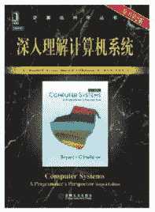

## SLIDES FOR CHAPTER 1

## Overview

# Some interesting questions

- What’s inside a computer？
  计算机里有什么？
- How does a computer work？
  这些家伙怎么工作？

- Powering on a computer
- BIOS and the POST
- Booting the operating system.
- Hardware devices communicating with the computer.

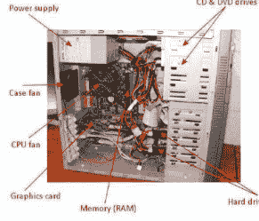

# Some interesting questions(cond.)

## How does a computer program work？

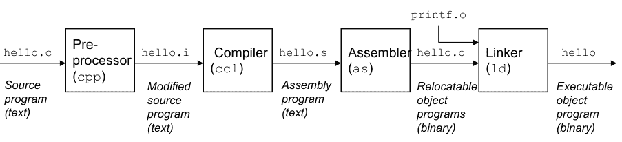

# Some interesting questions(cond.)

## How does a computer program work？

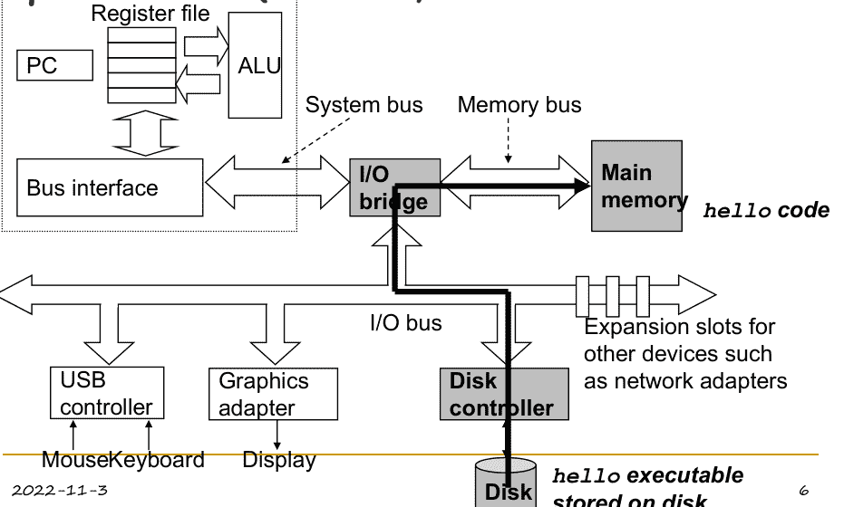

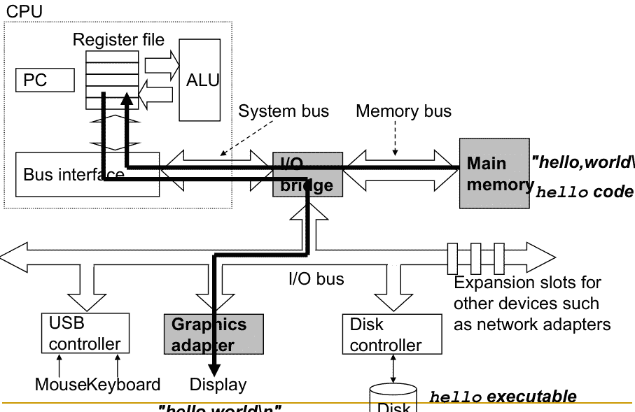

# 本课程的目标

- 深入理解计算机系统的硬件组成和工作原理
  - 系统构成、总线、存储器、I/O系统
- 深入理解处理器的内部结构和工作原理

从程序员的角度了解计算机系统

# 计算机基本组成

- 计算机的基本组成60多年
- 关键的部件没有发生大的变化
  - CPU
    - 运算器、控制器
  - Memory
  - I/O

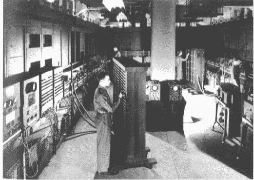

# 现代计算机

- CPU
  - 运算器、控制器
- Memory
- I/O


# 冯诺依曼结构

- 采用存储程序方式，指令和数据不加区别混合存储在同一个存储器中。指令和数据都可以送到运算器进行运算，即由指令组成的程序是可以修改的。
- 存储器是按地址访问的线性编址的一维结构，每个单元的位置是固定的。
- 指令由操作码和地址组成。操作码指明本指令的操作类型，地址码指明操作数和地址。
- 指令在存储器中按其执行顺序存放，由指令计数器指明要执行的指令所在的单元地址。指令计数器只有一个，一般按顺序递增，但执行顺序可按运算结果或当时的外界条件而改变。
- 以运算器为中心，I/O设备与存储器间的数据传送都要经过运算器。
- 数据以二进制表示。

# 冯诺依曼体系结构的特点

- 计算机处理的数据和指令一律用二进制数表示
- 顺序执行程序

计算机运行过程中，把要执行的程序和处理的数据首先存入主存储器（内存），计算机执行程序时，将自动地并按顺序从主存储器中取出指令一条一条地执行，这一概念称作顺序执行程序。

- 计算机硬件由运算器、控制器、存储器、输入设备和输出设备五大部分组成。

# 图灵

- 1937年，Alan Turing提出一种“通用”计算机的概念，它可以执行任何一个描述好的程序（算法），实现需要的功能，形成了“可计算性”概念的基础。
- 存储程序的思想，使计算机从专用走向通用。正是这一创新，开创了计算机的新时代。
- 50年代，Turing提出了“人工智能”的概念。Turing测试

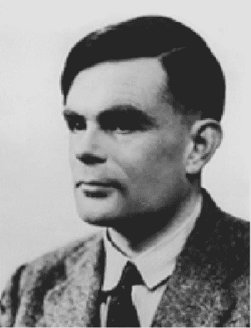

# 中断

纯粹冯·诺依曼体系结构的计算机完全串行工作，程序的执行过程也完全按照事先安排好的顺序执行。

1951年Presper Eckert和John Mauchly在设计UNIVAC I 计算机时，为了能够使计算机自动处理运算溢出问题，第一次设计并实现了自动处理异常情况的方法。

# 中断

具体的处理方法是：

- 在主存的0地址单元存放2条指令；
- 当计算机系统出现程序员设定的异常情况时（如：运算溢出等），计算机就自动地执行存放在主存0地址单元的指令。
- 如果在主存的0地址单元放入停机指令，一旦在程序运行过程中出现运算溢出等异常情况，计算机就可以停止运行。如果在主存0地址单元放入转移到异常处理程序入口的指令，一旦在程序运行过程中出现运算溢出等异常情况，计算机就可以转去执行预先设置好的异常处理程序。

# 中断

- 这种处理异常情况的方法，就相当于在出现运算溢出等异常情况时，在正常的程序执行顺序中插入另一段处理程序。由于事先根本无法预知何时会出现运算溢出等异常情况，因此也就无法预知插入程序的位置。在无法预知程序插入位置的情况下实现一段程序的插入，正是 UNIVAC 计算机的一项重要贡献。

# 虚拟存储器

1958年由英国曼彻斯特大学研制的Atlas 计算机，第一次使用了虚拟存储器技术，1962年Atlas 计算机投入运行。虚拟存储器的核心思想就是把当前使用的部分程序放在主存储器中，而把暂时不使用的部分程序放在辅存储器中，但是给程序员的感觉是计算机有很大的主存储器。后来出现的高速缓冲存储器（Cache memory）基本上使用的就是虚拟存储器的思想。

# 指令流水线

指令流水线的基本思想是把指令的执行过程划分成几个不同的阶段，并设法使几条指令分别处于不同的执行阶段，从而提高了处理器的指令吞吐量。一个五段指令流水线的指令执行过程示意如图所示。指令流水线第一次使计算机可以同时处理多条指令，第一次实现了在CPU内部的指令并行执行。

| IF | ID | EX | MEM | WB |
|---|---|---|---|---|
| ↓ i | IF | ID | EX | MEM | WB |
| ↓ t | | IF | ID | EX | MEM | WB |
| | | IF | ID | EX | MEM | WB |
| | | | IF | ID | EX | MEM | WB |
| | | | | IF | ID | EX | MEM | WB |

# 计算机系统的基本组成

## 计算机系统的软硬件概念

- 一个完整的计算机系统应该包括硬件和软件两大部分。
- 硬件是指构成计算机的所有物理部件的集合，这些部件是由电子元器件、各类光、机电设备、电子线路等构成的有形物体。
- 软件是指运行、维护、管理及应用计算机所编制的所有程序的总和。

硬件是计算机系统的物质基础，软件必须在硬件的支持下才能运行。

# 计算机体系结构（Computer architecture）：

- 指程序员所看到的一个计算机系统的属性。包括概念特性和功能特性。

# 计算机组成（Computer organization）

- 计算机体系结构的逻辑实现，包括物理机器级内的数据流和控制流的组成以及逻辑设计等。

# 计算机实现（Computer implementation）

- 计算机组成的物理实现。着眼于器件技术和微组装技术。

# 计算机系统的层次结构

（1）层次结构。计算机系统是一个复杂的软、硬件结合体，它包含硬件系统和软件系统两部分。它通常由6个（或5个）不同的级组成，在每一级都能够进行程序设计——虚拟机。

| 高级语言级（应用程序） | 软件部分 |
| --- | --- |
| 汇编语言级（系统程序） | |
| 操作系统级（操作系统） | |
| 传统机器级（指令系统） | 硬、软界面 |
| 微程序级（微程序控制器） | 硬件部分 |
| 逻辑部件级（硬件逻辑部件） | |

计算机系统的层次结构

站在不同层次上编程的程序员所看到的计算机属性各不相同。


## Application (Netscape)

Operating System (Windows 2K)

Compiler

Assembler

Software

Hardware

Memory

Processor

I/O system

Instruction Set Architecture (ISA)

Datapath & Control

Digital Design

Circuit Design

Layout

## 计算机的工作过程

- 冯·诺依曼计算机特点基本上指出了计算机的工作过程。冯·诺依曼体系结构的基本思想是：存储程序，并且按照地址顺序自动执行。首先将指令和数据存储到计算机中，计算机启动后，就能够按顺序取出指令并依次执行，直到程序执行完毕，得到计算结果为止。

- 冯·诺依曼体系结构计算机包含5个基本部件：运算器、控制器、存储器、输入设备和输出设备。运算器进行数据运算和数据变换；控制器为计算机的工作提供统一的时钟，对程序的各基本操作进行时序划分，产生相应的控制信号，驱动计算机的各部件有序地完成程序规定的操作内容；存储器用来存放程序、数据和运算结果；输入输出设备则完成相应的输入输出转换。

- 一条指令操作包括：取指令、分析（译码）和执行指令3个阶段

  - PC→MAR，MDR →IR

  - OP（IR） → CU，操作数地址码→MAR，操作数→MDR，MDR →ACC

  - （PC）+1 →PC

## 内存

## CPU

进程

指令1
指令2
指令3
...
指令k
...
指令n

数据1
数据2
...
数据m

代码段

数据段

指令地址

指令

操作数地址

数据

指令计数器

指令寄存器

控制单元

控制指令

存储单元

数据

运算单元

2022-11-3

28

```
Dump of assembler code for function main:
   0x08048c70 <+0>:    lea    0x8(%esp),%ecx
   0x08048c74 <+4>:    and    $0xfffffff0,%esp
   0x08048c77 <+7>:    pushl  -0x4(%ecx)
   0x08048c7a <+10>:   push   %ebp
   0x08048c7b <+11>:   mov    %esp,%ebp
   0x08048c7d <+13>:   push   %ecx
   0x08048c7e <+14>:   sub    $0xc,%esp
=> 0x08048c81 <+17>:   pushl  0x4(%ecx)
   0x08048c84 <+20>:   pushl  (%ecx)
   0x08048c86 <+22>:   call   0x804f6f0 <init_monitor>
   0x08048c8b <+27>:   call   0x8049d50 <reg_test>
   0x08048c90 <+32>:   call   0x804f710 <restart>
   0x08048c95 <+37>:   call   0x80506c0 <ui_mainloop>
   0x08048c9a <+42>:   mov    -0x4(%ebp),%ecx
   0x08048c9d <+45>:   add    $0x10,%esp
   0x08048ca0 <+48>:   xor    %eax,%eax
   0x08048ca2 <+50>:   leave
   0x08048ca3 <+51>:   lea    -0x4(%ecx),%esp
   0x08048ca6 <+54>:   ret
End of assembler dump.
(gdb) x /4xh 0x08048c70
0x8048c70 <main>:       0x4c8d  0x0424  0xe483  0xfff0
(gdb) x /4xb 0x08048c70
0x8048c70 <main>:       0x8d  0x4c  0x24  0x04
(gdb) 0x8d  0x4c  0x24  0x04
```

## 内存Memory

- 主存储器，也称内存储器，指CPU能够直接访问的存储器，简称主存或内存。主存存放当前计算机运行所需要的程序和数据，以便向CPU高速传送信息。主存容量一般较小，但存取速度高。

- 辅助存储器（外存储器，简称辅存或外存）用来存放当前暂时不用的程序和数据，在需要时可与主存成批交换数据。常用的外存储器有磁盘机，磁带机和光盘机等。外存储器属于外部设备。

## 总线Bus

如果说主板（Mother Board）是一座城市，那么总线就像是城市里的公共汽车（bus），能按照固定行车路线，传输来回不停运作的比特（bit）。这些线路在同一时间内都仅能负责传输一个比特。因此，必须同时采用多条线路才能传送更多数据，而总线可同时传输的数据数就称为宽度（width），以比特为单位，总线宽度愈大，传输性能就愈佳。

- 数据总线（Data Bus）：在CPU与RAM之间来回传送需要处理或是需要储存的数据。

- 地址总线（Address Bus）：用来指定在RAM（Random Access Memory）之中储取的数据的地址。

- 控制总线（Control Bus）：将微处理器控制单元（Control Unit）的信号，传送到周边设备。

## 计算机的性能指标

## 基本字长

指计算机内，表示一个操作数或一条指令所用的基本二进制位数。

- 是CPU一次能处理的数据宽度，与加法器、寄存器的位数和内部数据总线的宽度等有关。
- 字长标志着精度，字长越长，运算精度越高。
- 影响计算机的处理能力和运行性能。
- 通常选字节的整数倍：2、4、8倍等。

## 主存容量

计算机主存储器所能够存储的信息的全部总量，称为主存容量。以字节数来表示存储容量的计算机称为字节编码计算机；而以字为单位编址的计算机，存储容量等于字数乘以字长。

## 主频

每台计算机的内部都有一个不断地产生固定频率时钟脉冲的装置，称为主时钟。主时钟的频率通常是机器的主频率，主频率是衡量一台计算机速度的重要参数。

运算速度：运算速度通常反映计算机运算的快慢。对运算速度的衡量有以下几种方法：

- 根据不同类型指令在计算过程中出现的频率乘上不同的系数，求得统计平均值，这时所指的运算速度是平均运算速度。
- 直接给出每条指令的实际执行时间。
- 以MIPS和MFLOPS作为计量单位来衡量运算速度。MIPS表示每秒百万条指令，MFLOPS表示每秒百万次浮点运算。

1. 吞吐量、响应时间

(1) 吞吐量：单位时间内可执行程序的个数。

(2) 响应时间：从事件开始到事件结束的时间，也称执行时间。

## 2. 主频、CPU时钟周期、CPI、CPU执行时间

（1）主频：CPU工作主时钟的频率，机器主频f或Rc

（2）CPU时钟周期：机器主频的倒数，Tc

（3）CPI：执行一条指令所需要的平均时钟周期

（4）CPU执行时间：T<sub>CPU</sub>=In×CPI×Tc

In执行程序中指令的总数，CPI执行每条指令所需的平均时钟周期数，TC时钟周期时间的长度。

## 3. MIPS、MFLOPS

（1）MIPS (Million Instructions Per Second)：CPU每秒钟平均执行的整数指令条数（百万条）

MIPS = In/(T_CPU × 10⁶)
= In/(In × CPI × Tc × 10⁶)
= Rc/(CPI × 10⁶)

In：执行该程序的总指令条数，T_CPU：执行该程序的总时间，Tc：CPU时钟周期，Rc：主频 Rc=1/Tc

MIPS只适合评价标量机，不适合评价向量机。标量机执行一条指令，得到一个运行结果。而向量机执行一条指令，可以得到多个运算结果。

（2）MFLOPS(Million Floating Point Operations Per Second)：每秒钟平均执行的浮点数的运算次数(百万次) MFLOPS=Ifn/(T_CPU×10^6) Ifn：程序中浮点数的运算次数 MFLOPS测量单位比较适合于衡量向量机的性能。一般而言，同一程序运行在不同的计算机上时往往会执行不同数量的指令数，但所执行的浮点数个数常常是相同的。


## 作业：

- 安装虚拟机（Debian、Ubuntu64位）
- 安装相应的工具
- 熟悉GDB的使用
- 简单了解一下C语言的输入输出
- 运行一个hello world！，并且用GDB调试，查看一下反汇编程序。

## Bits, Bytes, and Integers

15-213: Introduction to Computer Systems
2nd and 3rd Lectures, Sep. 3 and Sep. 8, 2015

## Today: Bits, Bytes, and Integers

- Representing information as bits
- Bit-level manipulations
- Integers
  - Representation: unsigned and signed
  - Conversion, casting
  - Expanding, truncating
  - Addition, negation, multiplication, shifting
  - Summary
- Representations in memory, pointers, strings

## Everything is bits

- Each bit is 0 or 1
- By encoding/interpreting sets of bits in various ways
  - Computers determine what to do (instructions)
  - ... and represent and manipulate numbers, sets, strings, etc...
- Why bits? Electronic implementation
  - Easy to store with bistable elements
  - Reliably transmitted on noisy and inaccurate wires

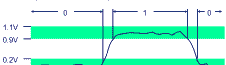

## For example, can count in binary

- Base 2 Number Representation
  - Represent 15₁₀ as 1111₂
  - Represent 1.20₁₀ as 1.0011001100110011…₂
  - Represent 1.5213 × 10³ as 1.011110101101101₂ × 2¹⁰

## Encoding Byte Values

- Byte = 8 bits
  - Binary: 00000000₂ to 11111111₂
  - Decimal: 0₁₀ to 255₁₀
  - Hexadecimal 00₁₆ to FF₁₆
    - Base 16 number representation
    - Use characters '0' to '9' and 'A' to 'F'
    - Write FA1D37B₁₆ in C as
      - 0xFA1D37B
      - 0xfa1d37b

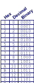

## Example Data Representations

| C Data Type | Typical 32-bit | Typical 64-bit | x86-64 |
|---|---:|---:|---:|
| char | 1 | 1 | 1 |
| short | 2 | 2 | 2 |
| int | 4 | 4 | 4 |
| long | 4 | 8 | 8 |
| float | 4 | 4 | 4 |
| double | 8 | 8 | 8 |
| long double | 8 | 8 | 10/16 |
| pointer | 4 | 8 | 8 |

## Today: Bits, Bytes, and Integers

- Representing Information as Bits
- Bit-level manipulations
- Integers
  - Representation: unsigned and signed
  - Conversion, casting
  - Expanding, truncating
  - Addition, negation, multiplication, shifting
  - Summary
- Representations in memory, pointers, strings

## Boolean Algebra

- Developed by George Boole in 19th Century
  - Algebraic representation of logic
    - Encode "True" as 1 and "False" as 0
- And
  - A&B = 1 when both A=1 and B=1
  - A&B = 0 when either A=0 or B=0
- Not
  - ~A = 1 when A=0
  - ~A = 0 when A=1
- Exclusive-Or (Xor)
  - A^B = 1 when either A=0 or B=1, but not both
  - A^B = 0 when A=0 or B=1, but not both

## General Boolean Algebras

- Operate on Bit Vectors
  - Operations applied bitwise
- All of the Properties of Boolean Algebra Apply

## Example: Representing & Manipulating Sets

- Representation
  - Width w bit vector represents subsets of {0, ..., w-1}
  - a[j] = 1 if j ∈ A
    - 01101010 -> {0, 3, 5, 6}
    - 76543210
- Operations
  - Intersection
  - Union
  - Symmetric difference
  - Complement

## Bit-Level Operations in C

- Operations &, |, ~, ^ Available in C
  - Apply to any "integral" data type
    - long, int, short, char, unsigned
    - View as bit vectors
    - Don't apply to float or double
- Examples (Char data type)
  - ~0x41 -> 0xBE
    - ~0xA -> 0xF5
    - ~0x00 -> 0xFF
    - ~0xFF -> 0x00
  - 0x69 & 0x55 -> 0x49
    - 0x69 | 0x55 -> 0x7D
  - 0x69 ^ 0x55 -> 0x3C
    - 0xFF ^ 0xFF -> 0x00

## Contrast: Logic Operations in C

- Contrast to Logical Operators
  - &&, ||, !
    - View 0 as "False"
    - Anything nonzero as "True"
    - Always return 0 or 1
    - Early termination
- Examples (char data type)
  - !0x41 -> 0x00
  - !0x00 -> 0x01
  - !!0x41 -> 0x01
  - 0x69 && 0x55 -> 0x01
  - 0x69 || 0x55 -> 0x01
  - p && *p (don't cause null pointer access)


## Contrast: Logic Operations in C

- Contrast to Logical Operators
  - `&&`, `||`
    - View 0 as “False”
    - Anything else as “True”
    - Always evaluate left operand first
    - Early exit
  - Examples
    - `!0x41`
    - `!0x00`
    - `!0x41 && 0x55`
    - `0x6 && 0x55 == 0x01`
    - `0x6 || 0x55 == 0x01`
    - `p && *p` (avoids null pointer access)

## Shift Operations

- Left Shift: `x << y`
  - Shift bit-vector x left y positions
    - Throw away extra bits on left
    - Fill with 0s on right
- Right Shift: `x >> y`
  - Shift bit-vector x right y positions
    - Throw away extra bits on right
  - Logical shift
    - Fill with 0s on left
  - Arithmetic shift
    - Replicate most significant bit on left
- Undefined Behavior
  - Shift amount < 0 or >= word size

| Argument x | 01100100 |
|---|---|
| `x << 3` | 00100000 |
| `Log. >> 2` | 00011001 |
| `Arith. >> 2` | 00011001 |

| Argument x | 10100100 |
|---|---|
| `x << 3` | 00100000 |
| `Log. >> 2` | 00101001 |
| `Arith. >> 2` | 10101001 |

## Today: Bits, Bytes, and Integers

- Representing information as bits
- Bit-level manipulations
- Integers
  - Representation: unsigned and signed
    - Conversion, casting
    - Expanding, truncating
    - Addition, negation, multiplication, shifting
    - Summary
  - Representations in memory, pointers, strings
- Summary

## Encoding Integers

**Unsigned**
`B2U(X) = Σ x_i 2^i`

**Two’s Complement**
`B2T(X) = -x_{w-1}2^{w-1} + Σ_{i=0}^{w-2} x_i2^i`

```
short int x = 15213;
short int y = -15213;
```

- C short 2 bytes long
- Sign Bit
  - For 2’s complement, most significant bit indicates sign
    - 0 for nonnegative
    - 1 for negative

| Decimal | Hex | Binary |
|---:|---|---|
| 15213 | 3B 6D | 00111011 01101101 |
| -15213 | C4 93 | 11000100 10010011 |

## Two-complement Encoding Example (Cont.)

| Weight | 15213 | -15213 |
|---:|---:|---:|
| 1 | 1 | 1 |
| 2 | 0 | 0 |
| 4 | 1 | 1 |
| 8 | 1 | 1 |
| 16 | 0 | 0 |
| 32 | 1 | 1 |
| 64 | 1 | 1 |
| 128 | 0 | 0 |
| 256 | 1 | 1 |
| 512 | 1 | 1 |
| 1024 | 0 | 0 |
| 2048 | 1 | 1 |
| 4096 | 1 | 1 |
| 8192 | 1 | 1 |
| 16384 | 0 | 1 |
| -32768 | 0 | -32768 |

## Numeric Ranges

- Unsigned Values
  - `UMin = 0`
  - `UMax = 2^w − 1`
- Two’s Complement Values
  - `TMin = −2^{w−1}`
  - `TMax = 2^{w−1} − 1`
- Other Values
  - Minus 1
    - `111...1`

**Values for w = 16**

| | Decimal | Hex | Binary |
|---|---:|---|---|
| UMax | 65535 | FF FF | 11111111 11111111 |
| UMin | 0 | 00 00 | 00000000 00000000 |
| TMax | 32767 | 7F FF | 01111111 11111111 |
| TMin | -32768 | 80 00 | 10000000 00000000 |
| -1 | -1 | FF FF | 11111111 11111111 |

## Values for Different Word Sizes

| W | 8 | 16 | 32 | 64 |
|---|---:|---:|---:|---:|
| UMax | 255 | 65,535 | 4,294,967,295 | 18,446,744,073,709,551,615 |
| TMax | 127 | 32,767 | 2,147,483,647 | 9,223,372,036,854,775,807 |
| TMin | -128 | -32,768 | -2,147,483,648 | -9,223,372,036,854,775,808 |

- **Observations**
  - `|TMin| = TMax + 1`
  - Asymmetric range
  - `UMax = 2 * TMax + 1`

- **C Programming**
  - `#include <limits.h>`
  - Declares constants, e.g.,
    - `ULONG_MAX`
    - `LONG_MAX`
    - `LONG_MIN`
  - Values platform specific

## Unsigned & Signed Numeric Values

| X | B2U(X) | B2T(X) |
|---|---:|---:|
| 0000 | 0 | 0 |
| 0001 | 1 | 1 |
| 0010 | 2 | 2 |
| 0011 | 3 | 3 |
| 0100 | 4 | 4 |
| 0101 | 5 | 5 |
| 0110 | 6 | 6 |
| 0111 | 7 | 7 |
| 1000 | 8 | -8 |
| 1001 | 9 | -7 |
| 1010 | 10 | -6 |
| 1011 | 11 | -5 |
| 1100 | 12 | -4 |
| 1101 | 13 | -3 |
| 1110 | 14 | -2 |
| 1111 | 15 | -1 |

- **Equivalence**
  - Same encoding for nonnegative values
- **Uniqueness**
  - Every bit pattern represents a unique integer value
  - Each representable integer has a unique bit encoding
- **Can Invert Mappings**
  - `U2B(x) = B2U⁻¹(x)`
    - Bit pattern for unsigned integer
  - `T2B(x) = B2T⁻¹(x)`
    - Bit pattern for two’s comp integer

## Today: Bits, Bytes, and Integers

- Representing information as bits
- Bit-level manipulations
- **Integers**
  - Representation: unsigned and signed
  - **Conversion, casting**
    - Expanding, truncating
    - Addition, negation, multiplication, shifting
  - Summary
- Representations in memory, pointers, strings

## Mapping Between Signed & Unsigned

**Mappings between unsigned and two’s complement numbers:**
**Keep bit representations and reinterpret**

## Mapping Signed ↔ Unsigned

## Mapping Signed ↔ Unsigned


## Relation between Signed & Unsigned

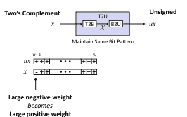

## Conversion Visualized

- 2's Comp. -> Unsigned
  - Ordering Inversion
  - Negative -> Big Positive

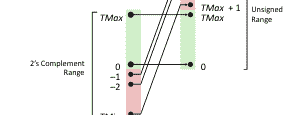

## Signed vs. Unsigned in C

- Constants
  - By default are considered to be signed integers
  - Unsigned if have "U" as suffix
    - 0, 4294967259U
- Casting
  - Explicit casting between signed & unsigned as if u2T and T2U
    - int tx, ty;
    - unsigned ux, uy;
    - tx = (int) ux;
    - uy = (unsigned) ty;
  - Implicit casting also occurs via assignments and procedure calls
    - tx = ty;
    - uy = ux;

## Casting Surprises

- Expression Evaluation
  - If there is a unsigned and signed in single expression, signed values implicitly casted to unsigned
  - Including comparison operations <<, >>, <=, ==, >=, >
- Examples for W = 32: TMIN = -2,147,483,648, TMAX = 2,147,483,647

| Constant | Constant | Relation | Evaluation |
|----------|----------|----------|------------|
| 0 | 0 | == | unsigned |
| -1 | 0 | > | unsigned |
| -1 | 0U | > | unsigned |
| 2147483647 | -2147483647-1 | > | signed |
| 2147483647 | -2147483647-1 | > | unsigned |
| -1 | -2 | > | signed |
| (unsigned) -1 | -2 | > | unsigned |
| 2147483647 | 2147483648U | < | unsigned |
| 2147483647 | (int) 2147483648U | > | signed |

## Summary

## Casting Signed <-> Unsigned: Basic Rules

- Bit pattern is maintained
- But reinterpreted
- Can have unexpected effects: adding or subtracting >>
- Expression containing signed and unsigned int
  - Cast to unsigned

## Today: Bits, Bytes, and Integers

- Representing information as bits
- Bit-level manipulations
- Integers
  - Representation: unsigned and signed
  - Conversion, casting
  - Expanding, truncating
  - Addition, negation, multiplication, shifting
  - Summary
- Representations in memory, pointers, strings

### Sign Extension

- **Task:**
  - Given w-bit signed integer x
  - Convert it to w+k-bit integer with same value
- **Rule:**
  - Make k copies of sign bit
  - `X′ = x_{w−1}, …, x_{w−1}, x_{w−1}, x_{w−2}, …, x₀`

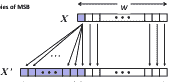

## Sign Extension Example

```c
short int x = -15213;
int      iy = x;
short int y = -15213;
int      iy = (int) y;
```

|   | Decimal | Hex | Binary |
|---|---:|---|---|
| x | -15213 | 0x C4 93 | 1100 0100 1001 0011 |
| ix | -15213 | 0x FF FF C4 93 | 11111111 11111111 11000100 10010011 |
| y | -15213 | 0x C4 93 | 1100 0100 1001 0011 |
| iy | -15213 | 0x FF FF C4 93 | 11111111 11111111 11000100 10010011 |

- Converting from smaller to larger integer data type
- C automatically performs sign extension

## Summary: Expanding, Truncating: Basic Rules

- **Expanding (e.g., short int to int)**
  - Unsigned: zeros added
  - Signed: sign extension
  - Both yield expected result
- **Truncating (e.g., unsigned to unsigned short)**
  - Unsigned: signed bits are truncated
  - Result reinterpreted
  - Unsigned: mod operation
  - Signed: similar to mod
  - For small numbers yields expected behavior

## Today: Bits, Bytes, and Integers

- Representing information as bits
- Bit-level manipulations
- **Integers**
  - Representation: unsigned and signed
  - Conversion, casting
  - Expanding, truncating
  - **Addition, negation, multiplication, shifting**
- Representations in memory, pointers, strings
- Summary

## Unsigned Addition

Operands: w bits
True Sum: w+1 bits
Discard Carry: w bits
`UAdd_w(u, v)`

- **Standard Addition Function**
  - Ignores carry output
- **Implements Modular Arithmetic**
  - `s = UAdd_w(u, v) = u + v mod 2^w`

## Visualizing (Mathematical) Integer Addition

- **Integer Addition**
  - 4-bit integers u, v
  - Compute true sum `Add₄(u, v)`
  - Values increase linearly with u and v
  - Forms planar surface

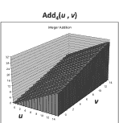


## Visualizing Unsigned Addition

- Wraps Around
  - If true sum ≥ 2<sup>w</sup>
  - At most once

### True Sum

2<sup>w</sup>-1  
Overflow  
2<sup>w</sup>  
0  
Modular Sum  

u  
v  
UAdd<sub>w</sub>(u, v)  
Overflow  

Randall E. Bryant, Computer Science, CMU 15-213 "Introduction to Computer Systems" 27

## Two's Complement Addition

Operands: w bits  
True Sum: w+1 bits  
Discard Carry: w bits  
TAdd<sub>w</sub>(u, v)

- TAdd and UAdd have Identical Bit-Level Behavior
  - Signed vs. unsigned addition in C:
    - int u, v;
    - unsigned uu = (unsigned) u;
    - unsigned uv = (unsigned) v;
    - u + v == uu + uv
  - Will give a == c

Randall E. Bryant, Computer Science, CMU 15-213 "Introduction to Computer Systems" 28

## TAdd Overflow

- Functionality
  - True sum requires w+1 bits
  - Drop off MSB
  - Treat remaining bits as 2<sup>w</sup>'s comp. integer

0111 ...  
0100 ...  
0000 ...  
1011 ...  
1000 ...  
True Sum  
2<sup>w</sup>-1  
2<sup>w-1</sup>-1  
0  
-2<sup>w-1</sup>  
-2<sup>w</sup>  
TAdd Result  
011...  
100...  
000...  
TOverflow  
Negative  
Overflow  

Randall E. Bryant, Computer Science, CMU 15-213 "Introduction to Computer Systems" 30

## Visualizing 2's Complement Addition

- Values
  - 4-bit two's comp.
  - Range from -8 to +7
- Wraps Around
  - If sum ≥ 2<sup>w-1</sup>
    - Becomes negative
  - If sum < -2<sup>w-1</sup>
    - Becomes positive
  - At most once

NegOver  
TAdd<sub>w</sub>(u, v)  
PosOver  
u  
v  

Randall E. Bryant, Computer Science, CMU 15-213 "Introduction to Computer Systems" 44

## Multiplication

- Goal: Computing Product of w-bit numbers x, y
  - Either signed or unsigned
- But, exact results can be bigger than w bits
  - Unsigned: x * y ≤ (2<sup>w</sup>-1)<sup>2</sup> = 2<sup>2w</sup> - 2<sup>w+1</sup> + 1
    - Can drop most significant bits without loss
  - Two's complement min: x = y = -2<sup>w-1</sup> → x * y = 2<sup>2w-2</sup>
    - Result range x * y ≤ 2<sup>2w-2</sup> -(2<sup>w+1</sup>-1) * 2<sup>w-1</sup> + 2<sup>w-1</sup>
    - Drop some high bits, like unsigned, but only for [TMin, Tmax]
    - Result *will* fit in w bits - 2's comp.
- So, maintaining exact results:
  - would need to keep expanding word size with each product computed
    - done in software, if needed
  - e.g., by "arbitrary precision" arithmetic packages

Randall E. Bryant, Computer Science, CMU 15-213 "Introduction to Computer Systems" 45

## Unsigned Multiplication in C

Operands: w bits  
True Product: 2*w bits  
Discard w bits: w bits  
UMul<sub>w</sub>(u, v)

- Standard Multiplication Function
  - Ignores high order w bits
- Implements Modular Arithmetic
  - UMul<sub>w</sub>(u, v) = u * v mod 2<sup>w</sup>

Randall E. Bryant, Computer Science, CMU 15-213 "Introduction to Computer Systems" 46

## Signed Multiplication in C

Operands: w bits  
True Product: w× bits  
Discard w bits: w bits

- **Standard Multiplication Function**
  - Ignores high order w bits
  - Some of which are different for signed vs. unsigned multiplication
  - Lower bits are the same

## Power-of-2 Multiply with Shift

- **Operation**
  - `u << k` gives `u * 2^k`
  - Both signed and unsigned
- Operands: w bits
- True Product: w+k bits
- Discard k bits: w bits
- **Examples**
  - `u << 3 == u * 8`
  - `(u << 5) - (u << 3) == u * 24`
  - Most machines shift and add faster than multiply
    - Compiler generates this code automatically

## Unsigned Power-of-2 Divide with Shift

- **Quotient of Unsigned by Power of 2**
  - `u >> k` gives `⌊u / 2^k⌋`
  - Uses logical shift

| Division | Computed | Hex | Binary |
|---|---:|---|---|
| `x >> 1` | 756213 | 16 3B | 00000001 01110111 |
| `x >> 2` | 950625 | 16 5B | 00000001 01011011 |
| `x >> 3` | 9508125 | 90 03 | 00000000 10001101 |
| `x >> 8` | 59.4257813 | 59 | 00000000 00111011 |

## Today: Bits, Bytes, and Integers

- Representing information as bits
- Bit-level manipulations
- **Integers**
  - Representation: unsigned and signed
  - Conversion, casting
  - Expanding, truncating
  - Addition, negation, multiplication, shifting
  - **Summary**
- Representations in memory, pointers, strings

## Arithmetic: Basic Rules

- **Addition:**
  - Unsigned/signed: Normal addition followed by truncate, same operation on bit level
  - Unsigned: addition mod 2^w
    - Mathematical addition + possible subtraction of 2^w
  - Signed: modified addition mod 2^w (result in proper range)
    - Mathematical addition + possible addition or subtraction of 2^w
- **Multiplication:**
  - Unsigned/signed: Normal multiplication followed by truncate, same operation on bit level
  - Unsigned: multiplication mod 2^w
  - Signed: modified multiplication mod 2^w (result in proper range)

## Why Should I Use Unsigned?

- **Don't use without understanding implications**
  - Easy to make mistakes
    ```c
    unsigned i;
    for (i = cnt-2; i >= 0; i--)
        a[i] += a[i+1];
    ```
  - Can be very subtle
    ```c
    #define DELTA sizeof(int)
    int i;
    for (i = CNT; i >= DELTA >= 0; i -= DELTA)
        ...
    ```


## Counting Down with Unsigned

- **Proper way to use unsigned as loop index**
  ```c
  unsigned cnt;
  for (i = cnt-2; i < cnt; i--)
      ...
  ```
- **See Robert Seacord, _Secure Coding in C and C++_**
  - C standard guarantees that unsigned addition will behave like modular arithmetic
  - `0 - 1 → UMax`
- **Even better**
  ```c
  size_t i;
  for (i = cnt-2; i < cnt; i--)
      ...
  ```
  - Data type `size_t` defined as unsigned value with length = word size
  - Code will work even if `cnt = UMax`
  - What if `cnt` is signed and `< 0`?

## Why Should I Use Unsigned? (cont.)

- **Do Use When Performing Modular Arithmetic**
  - Multiplication arithmetic
- **Do Use When Using Bits to Represent Sets**
  - Logical right shift, no sign extension

## Today: Bits, Bytes, and Integers

- Representing information as bits
- Bit-level manipulations
- Integers
  - Representation: unsigned and signed
  - Conversion, casting
  - Expanding, truncating
  - Addition, subtraction, multiplication, shifting
  - Summary
- **Representations in memory, pointers, strings**

## Byte-Oriented Memory Organization

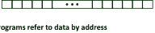

- **Programs refer to data by address**
  - Conceptually, envision it as a very large array of bytes
    - In reality, it’s not, but can think of it that way
  - An address is like an index into that array
    - and, a pointer variable stores an address
- **Note: system provides private address spaces to each “process”**
  - Think of a process as a program being executed
  - So, a program can clobber its own data, but not that of others

## Machine Words

- **Any given computer has a “Word Size”**
  - Normal size of integer-valued data
    - and of addresses
  - Until recently, most machines used 32 bits (4 bytes) as word size
    - limits addresses to 4G (2³²) bytes
  - Increasingly, machines have 64-bit word size
    - Potentially, could have 18 EB (exabytes) of addressable memory
    - That’s 18.4 × 10¹⁸
  - Machines still support multiple data formats
    - Fractions or multiples of word size
    - Always integral number of bytes

## Word-Oriented Memory Organization

- **Addresses Specify Byte Locations**
  - Address of first byte in word
  - Addresses of successive words differ by 4 (32-bit) or 8 (64-bit)

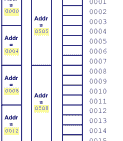

## Example Data Representations

| C Data Type | Typical 32-bit | Typical 64-bit | MIPS64 |
|---|---|---|---|
| char | 1 | 1 | 1 |
| short | 2 | 2 | 2 |
| int | 4 | 4 | 4 |
| long | 4 | 8 | 8 |
| float | 4 | 4 | 4 |
| double | 8 | 8 | 8 |
| long double | - | - | 10/16 |
| pointer | 4 | 8 | 8 |

## Byte Ordering

- So, how are the bytes within a multi-byte word ordered in memory?
- Conventions
  - Big Endian: Sun, PPC Mac, Internet
    - Least significant byte has highest address
  - Little Endian: x86, ARM processors running Android, iOS, and Windows
    - Least significant byte has lowest address

## Byte Ordering Example

- Example
  - Variable x is a 4-byte value of 0x1234567
  - Address given by &x is 0x100

Big Endian

| 0x100 | 0x101 | 0x102 | 0x103 |
|-------|-------|-------|-------|
| 12 | 34 | 56 | 78 |

Little Endian

| 0x100 | 0x101 | 0x102 | 0x103 |
|-------|-------|-------|-------|
| 78 | 56 | 34 | 12 |

## Representing Integers

int A = 15213;

int B = -15213;

Two's complement representation

## Examining Data Representations

- Code to Print Byte Representation of Data
  Casting pointer to unsigned char * allows treatment as byte array

```c
typedef unsigned char *byte_pointer;

void show_bytes(byte_pointer start, size_t len) {
    size_t i;
    for (i = 0; i < len; i++)
    fprintf("%.2x", start[i]);    // Line A
    printf("\n");
}
```

- Print directives:
  - %p: Print pointer
  - %x: Print hexadecimal
  - %lx: Print hexadecimal

## show_bytes Execution Example

```c
int a = 15213;
printf("int a = %d\n", a);
show_bytes((byte_pointer) &a, sizeof(int));
```

Result (Linux x86-64):
int a = 15213;
69 3d 00 00
0xf7fff7c4: 3d
0xf7fff7c5: 69
0xf7fff7c6: 00
0xf7fff7c7: 00


## Representing Pointers

```c
int * B = 1221213;
int * A = B;
```

Different compilers & machines assign different locations to objects

Even get different results each time run program

## Representing Strings

- Strings in C
  - Represented by array of characters
    - Each character encoded in ASCII format
    - Standard 7-bit encoding of character set
    - Character "0" has code 48₁₀ = 30₁₆
    - Digit i has code 48₁₀+i
    - String should be null-terminated
      - Final character = 0
  - Compatibility
    - Byte ordering not an issue

## Integer C Puzzles

```c
Initialization
int x = foo();
int y = bar();
unsigned ux = x;
unsigned uy = y;
```

- x < 0
- ux > 0
- x & 7 == 7
- ux ~ -1
- x > y
- -x > y
- x > y
- x * 4 >= 0
- x > 0
- x < 0
- (x * -21) == -21
- (x >> 2) << 2 <= x
- x >> 3 == x/8
- x & (x-1) == 0

- ((x*2) < 0)
- ((x<30) < 0
- x < -y
- x * y > 0
- x + y >= 0
- x >> 0
- x > 0
- -1
- ux/8 == ux/8
- x == 0

## Bonus extras

## Application of Boolean Algebra

- Applied to Digital Systems by Claude Shannon
  - 1937 MIT Master’s Thesis
- Reason about networks of switches
  - Encode closed switch as 1, open switch as 0

## Binary Number Property

- Claim
  - \(1+1+2+4+8+\dots+2^{n-1}=2^n\)
    - \(\sum_{i=0}^{n-1}2^i = 2^n\)
- w.r.t.
  - 1 + 2ⁿ
- Assume true for w-1:
  - \(1+1+2+4+8+\dots+2^{w-2}+2^{w-1}=2^{w-1}+2^{w-1}\)
    - \(=2^w\)

## Code Security Example

```c
/* Kernel memory region holding user-accessible data */
#define KERNEL_MEM 1024

/* Copy at most nbytes bytes from kernel region to user buffer */
int copy_from_kernel(void *user_dest, int *nbytes) {
    int kernel_mem[KERNEL_MEM];
    int *src = kernel_mem;
    int *dest = user_dest;
    int len = *nbytes;
    if (len > KERNEL_MEM) {
        return -EINVAL;
    }
    memcpy(dest, src, len);
    return len;
}
```

- Similar to code found in FreeBSD’s implementation of getpeername
- There are legions of smart people trying to find vulnerabilities in programs

## Typical Usage

```c
/* Kernel memory region holding user-accessible data */
#define KERNEL_MEM 1024

/* Copy at most nbytes bytes from kernel region to user buffer */
int copy_from_kernel(void *user_dest, int *nbytes) {
    int kernel_mem[KERNEL_MEM];
    int *src = kernel_mem;
    int *dest = user_dest;
    int len = *nbytes;
    if (len > KERNEL_MEM) {
        return -EINVAL;
    }
    memcpy(dest, src, len);
    return len;
}
```

```c
#define KERNEL_MEM 512
void syscall(int syscall_id) {
    copy_from_kernel(userbuf, KERNEL_MEM);
    copy_from_kernel(mybuf, KERNEL_MEM);
    printf("Value = %d\n", mybuf[0]);
}
```

## Malicious Usage

```c
/* Declaration of library function memcpy */
void *memcpy(void *dest, const void *src, size_t n);

/* Kernel memory region holding user-accessible data */
char kbuf[1024];

/* Copy at most nbytes bytes from kernel region to user buffer */
int copy_from_kernel(void *user_dest, int *nbytes) {
    int len = *nbytes;
    if (len > KERNEL_MEM) {
        return -EINVAL;
    }
    /* Byte count len is minimum of buffer size and nbytes */
    memcpy(user_dest, kbuf, len);
    return len;
}
```

```c
#define KERNEL_MEM 512
void getstuf(void) {
    copy_from_kernel(mybuf, KERNEL_MEM);
    copy_from_kernel(mybuf, KERNEL_MEM);
}
```

## Mathematical Properties

- Modules Additions Forms an Abelian Group
  - Closed under addition
    - \( 0 \leq u, v \leq 2^w - 1 \)
  - Commutative
    - \( u \oplus_w v = v \oplus_w u \)
  - Associative
    - \( u \oplus_w (v \oplus_w w) = (u \oplus_w v) \oplus_w w \)
  - Is additive identity
    - \( u \oplus_w 0 = u \)
  - Every element has additive inverse
    - Let \( u \oplus_w Comp_w(u) = 2^w - u \)
    - \( u \oplus_w u \oplus_w Comp_w(u) = 0 \)

## Mathematical Properties of TAdd

- Isomorphic Group to unsigneds with TAdd
  - \( TAdd_w[u, v] = T2U_w(U2T_w[u] + T2U_w[v]) \)
    - Since both have identical bit patterns
- Two’s Complement Under TAdd Forms a Group
  - Closed, Commutative, Associative, 0 is additive identity
  - Every element has additive inverse
    - \( TComp_w(u) = \begin{cases} u & u = 0 \\ TMin_w & u = TMin_w \end{cases} \)

## Characterizing TAdd

- Functionality
  - True sum requires w+1 bits
  - Drop off MSB
  - Treat remaining bits as 2’s comp. integer

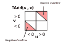

```c
TAdd_w(u, v) = \begin{cases} u + v & u + v \leq TMax_w \\ u + v - 2^w & TMin_w \leq u + v \leq TMax_w \\ u + v + 2^w & TMin_w \leq u + v \end{cases}
```


## Negation: Complement & Increment

- **Claim:** Following Holds for 2’s Complement
  - $x + \sim x = -1$
- **Complement**
  - Observation: $-x + x = 1111\_1111 = -1$
- **Complete Proof?**

## Complement & Increment Examples

$x = 15213$

|   | Decimal | Hex | Binary |
|---|---:|---|---|
| $x$ | 15213 | 3B 6D | 00111011 01101101 |
| $\sim x$ | -15214 | C4 92 | 11000100 10010010 |
| $x+1$ | 15213 | C4 93 | 11000100 10010011 |
| $x-1$ | -15213 | C4 93 | 11000100 10010011 |

$x = 0$

|   | Decimal | Hex | Binary |
|---|---:|---|---|
| $x$ | 0 | 00 00 | 00000000 00000000 |
| $\sim 0$ | -1 | FF FF | 11111111 11111111 |
| $-0+1$ | 0 | 00 00 | 00000000 00000000 |

## Code Security Example #2

- **SUN XDR library**
  - Widely used library for transferring data between machines

```c
void* copy_elements(void *ele_src[], int ele_cnt, size_t ele_size)
```

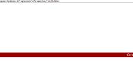

## XDR Code

```c
void* copy_elements(void *ele_src[], int ele_cnt, size_t ele_size) {
    /* Allocate buffer for ele_cnt objects, each of size ele_size bytes,
       and copy from locations designated by ele_src */
    void *result = malloc(ele_cnt * ele_size);
    if (result == NULL)
        return NULL;
    void *next = result;
    for (int i = 0; i < ele_cnt; i++) {
        /* Copy object i to destination */
        memcpy(next, ele_src[i], ele_size);
        /* Move pointer to next memory region */
        next += ele_size;
    }
    return result;
}
```

## XDR Vulnerability

**malloc(ele_cnt * ele_size)**

- **What if:**
  - `ele_cnt = 2^20 + 1`
  - `ele_size = 4096 = 2^12`
  - Allocation = ??
- **How can I make this function secure?**

## Compiled Multiplication Code

```c
long mult12(long x) {
    return x*12;
}
```

| Compiled Arithmetic Operations | Explanation |
|---|---|
| `leaq (%rax,%rax,2), %rax`<br>`salq $2, %rax` | `t ← x*3*4`<br>`return t ← x*12` |

## Compiled Unsigned Division Code

### C Function

```c
unsigned long udiv8(unsigned long x)
{
    return x / 8;
}
```

### Compiled Arithmetic Operations

```asm
udiv8: %rax, %rax
```

- Uses logical shift for unsigned
- For Java Users
  - Legal shifting written as >>>

### Explanation

```asm
# Logical shift
return x >> 3;
```

- For Java Users

## Signed Power-of-2 Divide with Shift

- Quotient of Signed by Power of 2
  - x >> k gives ⌊x / 2<sup>k</sup>⌋
  - Uses arithmetic shift
  - Rounds wrong direction when x < 0

- Operands:
  - x / 2<sup>k</sup>
  - Divisor: y / 2<sup>k</sup>
  - Result: RoundDown(y / 2<sup>k</sup>)

| y    | Division | Computed | Fix | Binary Point |
|------|----------|----------|-----|--------------|
| y > 0 | 76561    | 38281    | 44  | 11001010 11001001 |
| y = 0 | 7606.8   | 7607     | 82  | 11101000 01001001 |
| y < 0 | -7656.8  | -7657    | 44  | 11110010 01001001 |
| y > 0 | 484297813 | 40      | 77  | 11111111 11000100 |
| y < 0 | -484297813 | -40     | 77  | 11111111 11000100 |

## Correct Power-of-2 Divide

- Quotient of Negative Number by Power of 2
  - Want ⌊x / 2<sup>k</sup>⌋ (Round Toward 0)
  - Compute as ⌊(x + (2<sup>k</sup>−1)) / 2<sup>k</sup>⌋
  - In C: (x + ((1<<k)−1)) >> x
  - Biases dividend toward 0

### Case 1: No rounding

- Dividend:
  - x / 2<sup>k</sup>
  - Divisor:
  - y / 2<sup>k</sup>
  - Result:
  - ⌊x / 2<sup>k</sup>⌋

- Biasing has no effect

## Correct Power-of-2 Divide (Cont.)

### Case 2: Rounding

- Dividend:
  - x / 2<sup>k</sup>
  - Divisor:
  - y / 2<sup>k</sup>
  - Result:
  - ⌊x / 2<sup>k</sup>⌋

- Incremented by 1
- Biasing adds 1 to final result

## Compiled Signed Division Code

### C Function

```c
long idiv8(long x)
{
    return x / 8;
}
```

### Compiled Arithmetic Operations

```asm
idiv8: %rax, %rax
    $0x7, %rcx
    $63, %rdx
    sarq $3, %rax
    addq $7, %rax
    idivq %rdx
```

### Explanation

```asm
if x < 0
    x += 7;
    Arithmetic shift
return x >> 3;
```

- Uses arithmetic shift for int
- For Java Users
  - Arith. shift written as >>

## Arithmetic: Basic Rules

- Unsigned ints, 2’s complement ints are isomorphic rings: isomorphism is casting

- Left shift
  - Unsigned/signed: multiplication by 2<sup>k</sup>
  - Always logical shift

- Right shift
  - Unsigned: logical shift
  - Signed: arithmetic shift (division + round to zero) by 2<sup>k</sup>
    - Positive numbers: div/division + round to zero by 2<sup>k</sup>
    - Negative numbers: div/division + round away from zero by 2<sup>k</sup>
    - Use biasing to fix


## Properties of Unsigned Arithmetic

- **Unsigned Multiplication with Addition Forms Commutative Ring**
  - Addition is a commutative group
  - Closed under Multiplication
    - $0 \leq UMult(u,v) \leq 2^w - 1$
  - Multiplication is commutative
    - $UMult(u,v) = UMult(v,u)$
  - Multiplication is associative
    - $UMult(u, UMult(v,w)) = UMult(UMult(u,v),w)$
  - 1 is multiplicative identity
    - $UMult(u,1) = u$
  - Multiplication distributes over addition
    - $UMult(u, UAdd(v,w)) = UAdd(UMult(u,v), UMult(u,w))$

## Properties of Two’s Comp. Arithmetic

- **Isomorphic Algebras**
  - Unsigned multiplication and addition
    - Truncating to w bits
  - Two’s complement multiplication and addition
    - Truncating to w bits
- **Both Form Rings**
  - Isomorphic to ring of integers mod $2^w$
- **Comparison to (Mathematical) Integer Arithmetic**
  - Both are rings
  - Integers obey ordering properties, e.g.,
    - $u \geq 0 \Rightarrow u+v \geq v$
    - $u \geq 0, v > 0 \Rightarrow u \cdot v > 0$
  - These properties are not obeyed by two’s complement arithmetic
    - $TMax + 1 = TMin$
    - $1, 2, 3, \ldots, 2^{w-1}-1, TMin, \ldots, -2, -1, 0$ (16-bit words)

## Reading Byte-Reversed Listings

- **Disassembly**
  - Text representation of binary machine code
  - Generated by program that reads the machine code
- **Example**

| Address | Instruction Code | Assembly Rendition |
|---|---|---|
| 80483e5: | 5b | pop %ebx |
| 80483e6: | 81 c3 ab 12 00 00 | add $0x12ab, %ebx |
| 80483ec: | 83 2c 28 00 | subl $0x0, (%eax, %ebp, 1) |

- **Deciphering Numbers**
  - Value: $0x12ab$
  - Pad to 32 bits: $0x000012ab$
  - Split into bytes: $00\ 00\ 12\ ab$
  - Reverse: $ab\ 12\ 00\ 00$

## Bits, Bytes, and Integers – Part 2

15-213: Introduction to Computer Systems
3rd Lecture, Jan. 24, 2017

Instructors: Franz Franchetti, Seth Copen Goldstein

## Autolab/TPZ/GitLab accounts

- You should have all your accounts by now
- You must be enrolled to get an account
- If you are on waitlist, just keep on hanging in there

## First Assignment: Data Lab

- Due: Thursday, Feb 2, 11:59:00 pm
- Last Possible Time to Turn in: Fri, Feb 3, 11:59PM
- Read the instructions carefully
- You should have started (but 100+ have not finished handout!)
- Seek help (office hours have started)
- Based on Lecture 2, 3, and 4
- After today’s lecture you know everything for the integer problems, float problems covered on Thursday

## Summary From Last Lecture

- Representing information as bits
- Bit-level manipulations
- Integers
  - Representation: unsigned and signed
  - Conversion, casting
  - Expanding, truncating
  - Addition, negation, multiplication, shifting
- Representations in memory, pointers, strings
- Summary

## Bit-Level Operations in C

- Operations &, |, ~, ^ Available in C
- Apply to any “integral” data type
- long, int, short, char, unsigned
- View arguments as bit vectors
- Arguments applied bit-wise
- Examples (char data type)
  - ~0x41 → 0xBE
  - ~0100 0001₂ → 1011 1110₂
  - ~0x00 → 0xFF
  - ~0000 0000₂ → 1111 1111₂
  - 0x69 & 0x55 → 0x41
  - 0110 1001₂ & 0101 0101₂ → 0100 0001₂
  - 0x69 | 0x55 → 0x7D
  - 0110 1001₂ | 0101 0101₂ → 0111 1101₂

| Hex | Decimal | Binary |
|---|---|---|
| 0 | 0 | 0000 |
| 1 | 1 | 0001 |
| 2 | 2 | 0010 |
| 3 | 3 | 0011 |
| 4 | 4 | 0100 |
| 5 | 5 | 0101 |
| 6 | 6 | 0110 |
| 7 | 7 | 0111 |
| 8 | 8 | 1000 |
| 9 | 9 | 1001 |
| A | 10 | 1010 |
| B | 11 | 1011 |
| C | 12 | 1100 |
| D | 13 | 1101 |
| E | 14 | 1110 |
| F | 15 | 1111 |

## Logic Operations in C

- **Logic Operations: &&, ||, !**
  - View 0 as “False”
  - Anything nonzero as “True”
  - Always return 0 or 1
  - Early termination
- **Examples (char data type)**
  - !0x41 → 0x00
  - !0x00 → 0x01
  - !!0x41 → 0x01
  - 0x69 && 0x55 → 0x01
  - 0x69 || 0x55 → 0x01
  - p && *p (avoids null pointer access)


## Encoding Integers

### Unsigned

B2U(X) = \(\sum_{i=0}^{w-1} x_i \cdot 2^i\)

### Two's Complement

B2T(X) = \(-x_{w-1} \cdot 2^{w-1} + \sum_{i=0}^{w-2} x_i \cdot 2^i\)

Sign Bit

### Two's Complement Examples (w = 5)

-16 8 4 2 1

10 = 0 1 0 1 0

-16 8 4 2 1

-10 = 1 0 1 1 0

8 + 2 = 10

-16 + 4 + 2 = -10

## Unsigned & Signed Numeric Values

| X   | B2U(X) | B2T(X) |
|-----|--------|--------|
| 0000 | 0      | 0      |
| 0001 | 1      | 1      |
| 0010 | 2      | 2      |
| 0011 | 3      | 3      |
| 0100 | 4      | 4      |
| 0101 | 5      | 5      |
| 0110 | 6      | 6      |
| 0111 | 7      | 7      |
| 1000 | 8      | -8     |
| 1001 | 9      | -7     |
| 1010 | 10     | -6     |
| 1011 | 11     | -5     |
| 1100 | 12     | -4     |
| 1101 | 13     | -3     |
| 1110 | 14     | -2     |
| 1111 | 15     | -1     |

### Equivalence

- Same encodings for nonnegative values

### Uniqueness

- Every bit pattern represents unique integer value
- Each representable integer has unique bit encoding

### Expression containing signed and unsigned int: int is cast to unsigned!!

## Sign Extension and Truncation

### Sign Extension

### Truncation

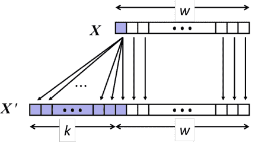

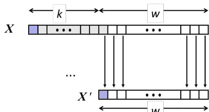

## Today: Bits, Bytes, and Integers

- Representing information as bits
- Bit-level manipulations
- Integers
  - Representation: unsigned and signed
  - Conversion, casting
  - Expanding, truncating
  - Addition, negation, multiplication, shifting
- Representations in memory, pointers, strings
- Summary

## Unsigned Addition

- Operands: w bits
- True Sum: w+1 bits
- Discard Carry: w bits

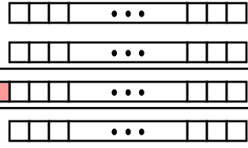

- **Standard Addition Function**
  - Ignores carry output
- **Implements Modular Arithmetic**

s = UAdd_w(u, v) = u + v mod 2^w

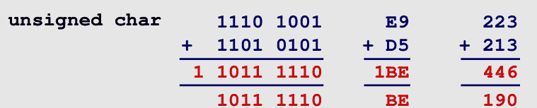

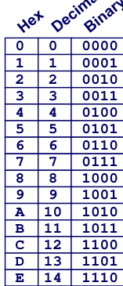

## Visualizing (Mathematical) Integer Addition

### Integer Addition

- 4-bit integers $u, v$
- Compute true sum
  - Add$_4(u, v)$
- Values increase linearly with $u$ and $v$
- Forms planar surface

### Add$_4(u, v)$

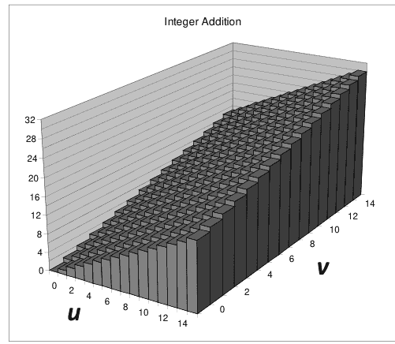

## Visualizing Unsigned Addition

### Wraps Around

- If true sum ≥ 2^w
- At most once

**True Sum**

**Modular Sum**

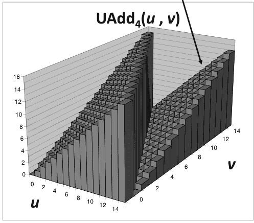

## Two’s Complement Addition

- Operands: w bits
- True Sum: w+1 bits
- Discard Carry: w bits

```text
u
+ v
u + v
TAdd_w(u, v)
```

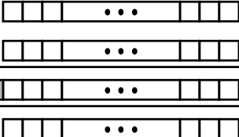

### TAdd and UAdd have Identical Bit-Level Behavior

- Signed vs. unsigned addition in C:

  ```c
  int s, t, u, v;
  s = (int) ((unsigned) u + (unsigned) v);
  t = u + v;
  ```

- Will give s == t

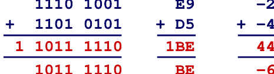

## TAdd Overflow

### Functionality

- True sum requires w+1 bits
- Drop off MSB
- Treat remaining bits as 2’s comp. integer

- 0 111...1
- 0 100...0
- 0 000...0
- 1 011...1
- 1 000...0

**True Sum**

- 2^w-1
- 2^(w-1)-1
- 0
- -2^(w-1)
- -2^w
- PosOver
- NegOver

**TAdd Result**

- 011...1
- 000...0
- 100...0

## Visualizing 2’s Complement Addition

### Values

- 4-bit two’s comp.
- Range from -8 to +7

### Wraps Around

- If sum ≥ 2<sup>w-1</sup>
  - Becomes negative
  - At most once
- If sum < -2<sup>w-1</sup>
  - Becomes positive
  - At most once

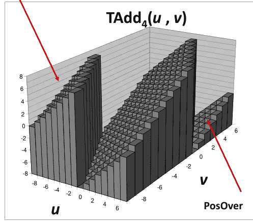

## Characterizing TAdd

- **Functionality**
  - True sum requires *w*+1 bits
  - Drop off MSB
  - Treat remaining bits as 2’s comp. integer

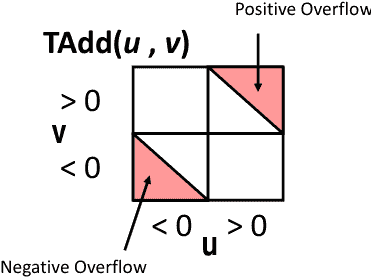

$$
TAdd_w(u,v)=\begin{cases}
u+v+2^w & u+v<TMin_w\quad\text{(NegOver)}\\
u+v & TMin_w\le u+v\le TMax_w\\
u+v-2^w & TMax_w<u+v\quad\text{(PosOver)}
\end{cases}
$$


## Negation: Complement & Increment

- Negate through complement and increase
  - ~x + 1 == -x

- Example
  - Observation: ~x + x == 1111...111 == -1

x  1000111101
+ ~x  0111000010
-1  1111111111

x = 15213

| | Decimal | Hex | Binary |
|---|---|---|---|
| x | 15213 | 3B 6D | 00111011 01101101 |
| ~x | -15214 | C4 92 | 11000100 10010010 |
| ~x+1 | -15213 | C4 93 | 11000100 10010011 |
| y | -15213 | C4 93 | 11000100 10010011 |

## Complement & Increment Examples

x = 0

| | Decimal | Hex | Binary |
|---|---|---|---|
| 0 | 0 | 00 00 | 00000000 00000000 |
| ~0 | -1 | FF FF | 11111111 11111111 |
| ~0+1 | 0 | 00 00 | 00000000 00000000 |

x = TMin

| | Decimal | Hex | Binary |
|---|---|---|---|
| x | -32768 | 80 00 | 10000000 00000000 |
| ~x | 32767 | 7F FF | 01111111 11111111 |
| ~x+1 | -32768 | 80 00 | 10000000 00000000 |

## Canonical counter example

## Multiplication

- Goal: Computing Product of \( w \)-bit numbers \( x \), \( y \)
  - Either signed or unsigned

- But, exact results can be bigger than \( w \) bits
  - Unsigned: up to \( 2w \) bits
    - Result range: \( 0 \leq x * y \leq (2^w - 1)^2 = 2^{2w} - 2^{w+1} + 1 \)
  - Two’s complement min (negative): Up to \( 2w-1 \) bits
    - Result range: \( x * y \geq (-2^{w-1}) * (2^{w-1}-1) = -2^{2w-2} + 2^{w-1} \)
  - Two’s complement max (positive): Up to \( 2w \) bits, but only for \( (TMin_w)^2 \)
    - Result range: \( x * y \leq (-2^{w-1})^2 = 2^{2w-2} \)

- So, maintaining exact results...
  - would need to keep expanding word size with each product computed
  - is done in software, if needed
    - e.g., by “arbitrary precision” arithmetic packages

## Unsigned Multiplication in C

Operands: w bits

True Product: 2*w bits

Discard w bits: w bits

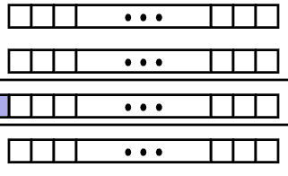

- **Standard Multiplication Function**
  - Ignores high order w bits
- **Implements Modular Arithmetic**
  - UMul_w(u, v) = u · v mod 2^w

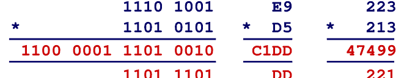

## Signed Multiplication in C

Operands: w bits

True Product: 2∗w bits \( u \cdot v \)

Discard w bits: w bits

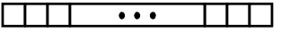

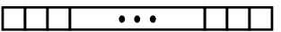


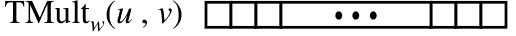

### Standard Multiplication Function

- Ignores high order w bits
- Some of which are different for signed vs. unsigned multiplication
- Lower bits are the same

```
*   1110 1001    E9    -23
    1101 0101    D5    -43
  1100 0001 1101 0010  C1DD   16896
    1101 1101    DD    -35
```

## Power-of-2 Multiply with Shift

### Operation

- `u << k` gives `u * 2^k`

- Both signed and unsigned

Operands: w bits

True Product: w+k bits

Discard k bits: w bits

### Examples

- `u << 3` == `u * 8`

- `(u << 5) - (u << 3) == u * 24`

- Most machines shift and add faster than multiply

- Compiler generates this code automatically

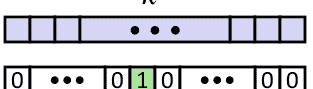

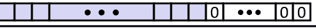

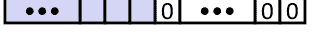

## Unsigned Power-of-2 Divide with Shift

### Quotient of Unsigned by Power of 2

- `u >> k` gives `⌊ u / 2^k ⌋`

- Uses logical shift

Operands:

Division:

Result:

| | Division | Computed | Hex | Binary |
|---|---|---|---|---|
| x | 15213 | 15213 | 3B 6D | 00111011 01101101 |
| x >> 1 | 7606.5 | 7606 | 1D B6 | 00011101 10110110 |
| x >> 4 | 950.8125 | 950 | 03 B6 | 00000011 10110110 |
| x >> 8 | 59.4257813 | 59 | 00 3B | 00000000 00111011 |

## Signed Power-of-2 Divide with Shift

- **Quotient of Signed by Power of 2**
  - `x >> k` gives ⌊x / 2^k⌋
  - Uses arithmetic shift
  - Rounds wrong direction when **u < 0**

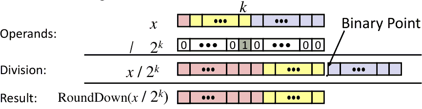

| | Division | Computed | Hex | Binary |
|---|---|---|---|---|
| y | -15213 | -15213 | C4 93 | 11000100 10010011 |
| y >> 1 | -7606.5 | -7607 | E2 49 | 11100010 01001001 |
| y >> 4 | -950.8125 | -951 | FC 49 | 11111100 01001001 |
| y >> 8 | -59.4257813 | -60 | FF C4 | 11111111 11000100 |


## Correct Power-of-2 Divide

- **Quotient of Negative Number by Power of 2**
  - Want `⌈x / 2^k⌉` (Round Toward 0)
  - Compute as `⌊(x + 2^k − 1) / 2^k⌋`
    - In C: `(x + (1<<k)−1) >> k`
    - Biases dividend toward 0

### Case 1: No rounding

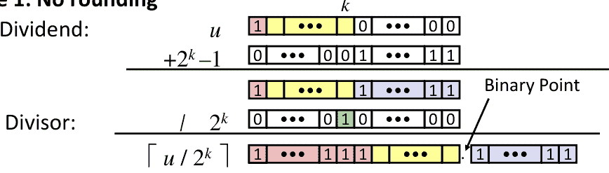

**Biasing has no effect**

## Correct Power-of-2 Divide (Cont.)

### Case 2: Rounding

Dividend: \(x\)

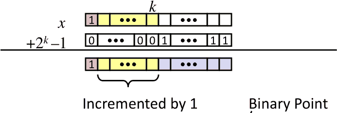

Incremented by 1

Binary Point

Divisor: \(\displaystyle /\;2^k\)

\(\left\lceil x / 2^k \right\rceil\)

Incremented by 1

**Biasing adds 1 to final result**

## Today: Bits, Bytes, and Integers

- Representing information as bits
- Bit-level manipulations
- Integers
  - Representation: unsigned and signed
  - Conversion, casting
  - Expanding, truncating
  - Addition, negation, multiplication, shifting
  - Summary
- Representations in memory, pointers, strings

Bryant and O'Hallaron, Computer Systems: A Programmer's Perspective, Third Edition

## Arithmetic: Basic Rules

### Addition:

- Unsigned/signed: Normal addition followed by truncate, same operation on bit level
- Unsigned: addition mod 2<sup>w</sup>
  - Mathematical addition + possible subtraction of 2<sup>w</sup>
- Signed: modified addition mod 2<sup>w</sup> (result in proper range)
  - Mathematical addition + possible addition or subtraction of 2<sup>w</sup>

### Multiplication:

- Unsigned/signed: Normal multiplication followed by truncate, same operation on bit level
- Unsigned: multiplication mod 2<sup>w</sup>
- Signed: modified multiplication mod 2<sup>w</sup> (result in proper range)

## Why Should I Use Unsigned?

- Don’t use without understanding implications
  - Easy to make mistakes
    ```c
    unsigned i;
    for (i = cnt-2; i >= 0; i--)
        a[i] += a[i+1];
    ```
  - Can be very subtle
    ```c
    #define DELTA sizeof(int)
    int i;
    for (i = CNT; i-DELTA >= 0; i-= DELTA)
        . . .
    ```

## Counting Down with Unsigned

- Proper way to use unsigned as loop index

    ```c
    unsigned i;
    for (i = cnt-2; i < cnt; i--)
        a[i] += a[i+1];
    ```

- See Robert Seacord, *Secure Coding in C and C++*
  - C Standard guarantees that unsigned addition will behave like modular arithmetic
    - 0 − 1 → UMax

- Even better

    ```c
    size_t i;
    for (i = cnt-2; i < cnt; i--)
        a[i] += a[i+1];
    ```

  - Data type `size_t` defined as unsigned value with length = word size
  - Code will work even if `cnt = UMax`
  - What if `cnt` is signed and < 0?

## Why Should I Use Unsigned? (cont.)

- **Do Use When Performing Modular Arithmetic**
  - Multiprecision arithmetic
- **Do Use When Using Bits to Represent Sets**
  - Logical right shift, no sign extension
- **Do Use In System Programming**
  - Bit masks, device commands,...

## Integer Arithmetic Example

unsigned char

1111 0011
+ 0101 0010
1 0100 0101
0101 0101

F3
+ 52
145
45

243
+ 82
325
69

unsigned char

0001 1001
* 0000 0010
0 0011 0010
0011 0010

19
* 02
032
32

25
* 2
50
50

| Hex | Decimal | Binary |
|---|---|---|
| 0 | 0 | 0000 |
| 1 | 1 | 0001 |
| 2 | 2 | 0010 |
| 3 | 3 | 0011 |
| 4 | 4 | 0100 |
| 5 | 5 | 0101 |
| 6 | 6 | 0110 |
| 7 | 7 | 0111 |
| 8 | 8 | 1000 |
| 9 | 9 | 1001 |
| A | 10 | 1010 |
| B | 11 | 1011 |
| C | 12 | 1100 |
| D | 13 | 1101 |
| E | 14 | 1110 |
| F | 15 | 1111 |

## Byte-Oriented Memory Organization

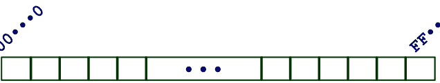

### Programs refer to data by address

- Conceptually, envision it as a very large array of bytes
  - In reality, it’s not, but can think of it that way
- An address is like an index into that array
  - and, a pointer variable stores an address

### Note: system provides private address spaces to each “process”

- Think of a process as a program being executed
- So, a program can clobber its own data, but not that of others

Bryant and O’Hallaron, Computer Systems: A Programmer’s Perspective, Third Edition


## Machine Words

- Any given computer has a “Word Size”
  - Nominal size of integer-valued data
  - and of addresses

- Until recently, most machines used 32 bits (4 bytes) as word size
  - Limits addresses to 4GB (2^32 bytes)

- Increasingly, machines have 64-bit word size
  - Potentially, could have 18 EB (exabytes) of addressable memory
  - That’s 18.4 X 10^18

- Machines still support multiple data formats
  - Fractions or multiples of word size
  - Always integral number of bytes

## Word-Oriented Memory Organization

- **Addresses Specify Byte Locations**
  - Address of first byte in word
  - Addresses of successive words differ by 4 (32-bit) or 8 (64-bit)

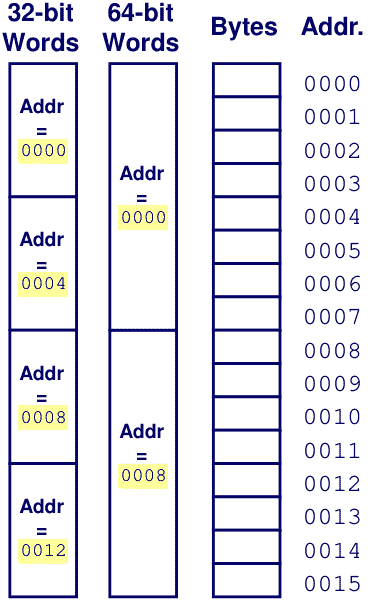

## Example Data Representations

| C Data Type | Typical 32-bit | Typical 64-bit | x86-64 |
|---|---:|---:|---:|
| **char** | 1 | 1 | 1 |
| **short** | 2 | 2 | 2 |
| **int** | 4 | 4 | 4 |
| **long** | 4 | 8 | 8 |
| **float** | 4 | 4 | 4 |
| **double** | 8 | 8 | 8 |
| pointer | 4 | 8 | 8 |

## Byte Ordering

- So, how are the bytes within a multi-byte word ordered in memory?

- Conventions

- Big Endian: Sun, PPC Mac, *Internet*

- Least significant byte has highest address

- Little Endian: x86, ARM processors running Android, iOS, and Windows

- Least significant byte has lowest address

## Byte Ordering Example

## Example

- Variable x has 4-byte value of 0x01234567

- Address given by &x is 0x100

### Big Endian

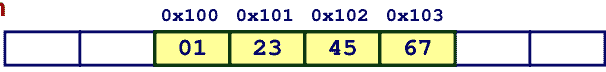

## Little Endian

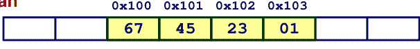

## Representing Integers

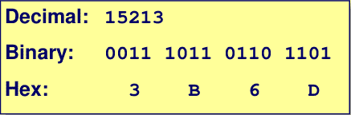

`int A = 15213;`

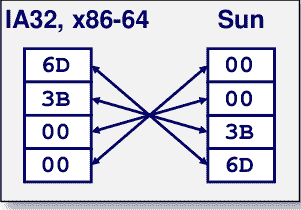

`int B = -15213;`

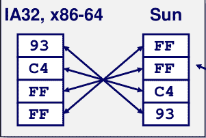

`long int C = 15213;`

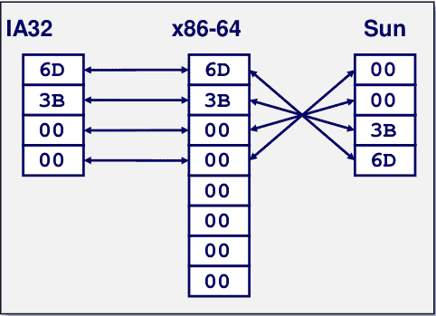

Two’s complement representation

## Examining Data Representations

### Code to Print Byte Representation of Data

- Casting pointer to unsigned char * allows treatment as a byte array

```c
typedef unsigned char *pointer;

void show_bytes(pointer start, size_t len) {
    size_t i;
    for (i = 0; i < len; i++)
        printf(" %p\t0x%.2x\n", start+i, start[i]);
    printf("\n");
}
```

**Printf directives:**

%p: Print pointer

%x: Print Hexadecimal

## Representing Pointers

```c
int B = -15213;
int *P = &B;
```

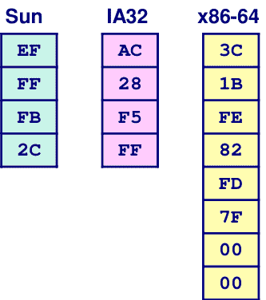

Different compilers & machines assign different locations to objects

Even get different results each time run program

## Representing Strings

### Strings in C

- Represented by array of characters
- Each character encoded in ASCII format
  - Standard 7-bit encoding of character set
  - Character “0” has code 0x30
    - Digit *i* has code 0x30+i
- String should be null-terminated
  - Final character = 0

### Compatibility

- Byte ordering not an issue

```c
char S[6] = "18213";
```

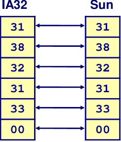

## Integer C Puzzles

- `x < 0` ⇒ `((x*2) < 0)` ❌
- `ux >= 0` ✅
- `x & 7 == 7` ⇒ `(x<<30) < 0` ✅
- `ux > -1` ❌
- `x > y` ⇒ `-x < -y` ❌
- `x * x >= 0` ❌
- `x > 0 && y > 0` ⇒ `x + y > 0` ❌
- `x >= 0` ⇒ `-x <= 0` ✅
- `x <= 0` ⇒ `-x >= 0` ❌
- `(x|-x)>>31 == -1` ❌
- `ux >> 3 == ux/8` ✅
- `x >> 3 == x/8` ❌
- `x & (x-1) != 0` ❌

### Initialization

```c
int x = foo();

int y = bar();

unsigned ux = x;

unsigned uy = y;
```

## Summary

- Representing information as bits
- Bit-level manipulations
- Integers
  - Representation: unsigned and signed
  - Conversion, casting
  - Expanding, truncating
  - Addition, negation, multiplication, shifting
- Representations in memory, pointers, strings
- Summary


### Floating Point

**15-213: Introduction to Computer Systems**  
**4th Lecture, Jan. 26, 2017**

**Instructors:**  
Franz Franchetti, Seth Copen Goldstein

## Today: Floating Point

- Background: Fractional binary numbers
- IEEE floating point standard: Definition
- Example and properties
- Rounding, addition, multiplication
- Floating point in C
- Summary

## Fractional binary numbers

- What is 1011.101₂?

## Fractional Binary Numbers

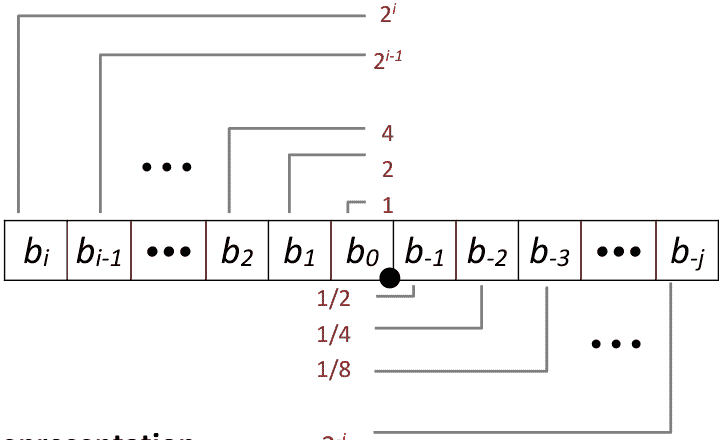

### Representation

- Bits to right of "binary point" represent fractional powers of 2
- Represents rational number:

$$
\sum_{k=-j}^{i} b_k \times 2^k
$$

Bryant and O’Hallaron, Computer Systems: A Programmer’s Perspective, Third Edition

## Fractional Binary Numbers: Examples

| Value | Representation | Expansion |
|---|---|---|
| 5 3/4 | `101.11₂` | = 4 + 1 + 1/2 + 1/4 |
| 2 7/8 | `10.111₂` | = 2 + 1/2 + 1/4 + 1/8 |
| 1 7/16 | `1.0111₂` | = 1 + 1/4 + 1/8 + 1/16 |

### Observations

- Divide by 2 by shifting right (unsigned)
- Multiply by 2 by shifting left
- Numbers of form 0.111111...₂ are just below 1.0
  - 1/2 + 1/4 + 1/8 + ... + 1/2ⁱ + ... ➞ 1.0
  - Use notation 1.0 − ε

## Representable Numbers

- **Limitation #1**
  - Can only exactly represent numbers of the form x/2ᵏ
    - Other rational numbers have repeating bit representations
    - Value   Representation
      - 1/3   0.0101010101[01]…₂
      - 1/5   0.001100110011[0011]…₂
      - 1/10   0.0001100110011[0011]…₂

- **Limitation #2**
  - Just one setting of binary point within the w bits
    - Limited range of numbers (very small values? very large?)

## IEEE Floating Point

### IEEE Standard 754

- Established in 1985 as uniform standard for floating point arithmetic
  - Before that, many idiosyncratic formats
- Supported by all major CPUs
- Some CPUs don’t implement IEEE 754 in full
  e.g., early GPUs, Cell BE processor

### Driven by numerical concerns

- Nice standards for rounding, overflow, underflow
- Hard to make fast in hardware
  - Numerical analysts predominated over hardware designers in defining standard

## Floating Point Representation

### Numerical Form:

$(-1)^s M 2^E$

- **Sign bit** $s$ determines whether number is negative or positive
- **Significand** $M$ normally a fractional value in range [1.0, 2.0).
- **Exponent** $E$ weights value by power of two

### Encoding

- MSB S is sign bit $s$
- **exp** field encodes $E$ (but is not equal to E)
- **frac** field encodes $M$ (but is not equal to M)

| s | exp | frac |
|---|---|---|


## Precision options

- **Single precision: 32 bits**
  ≈ 7 decimal digits, 10±38


- **Double precision: 64 bits**
  ≈ 16 decimal digits, 10±308


- **Other formats: half precision, quad precision**

## Three "kinds" of floating point numbers


1 e-bits f-bits

- 00...00 denorm
- exp ≠ 0 and exp ≠ 11...11 normalized
- 11...11 special

## "Normalized" Values

- When: exp ≠ 000...0 and exp ≠ 111...1

- Exponent coded as a biased value: E = Exp – Bias

- Exp: unsigned value of exp field

- Bias = 2<sup>k-1</sup> - 1, where k is number of exponent bits

- Single precision: 127 (Exp: 1...254, E: -126...127)

- Double precision: 1023 (Exp: 1...2046, E: -1022...1023)

- Significand coded with implied leading 1: M = 1.xxx...x₂

- xxxx...x: bits of frac field

- Minimum when frac=000...0 (M = 1.0)

- Maximum when frac=111...1 (M = 2.0 – ε)

- Get extra leading bit for “free”


## Denormalized Values

- Condition: exp = 000...0
- Exponent value: E = 1 – Bias (instead of E = 0 – Bias)
- Significand coded with implied leading 0: M = 0.xxx...x₂
  - xxx...x: bits of frac
- Cases
  - exp = 000...0, frac = 000...0
    - Represents zero value
    - Note distinct values: +0 and −0 (why?)
  - exp = 000...0, frac ≠ 000...0
    - Numbers closest to 0.0
    - Equispaced


## Special Values

- **Condition: `exp = 111...1`**
- **Case: `exp = 111...1, frac = 000...0`**
  - **Represents value ∞ (infinity)**
  - Operation that overflows
  - Both positive and negative
  - E.g., `1.0/0.0 = +∞, 1.0/-0.0 = −∞`
- **Case: `exp = 111...1, frac ≠ 000...0`**
  - **Not-a-Number (NaN)**
  - Represents case when no numeric value can be determined
  - E.g., `sqrt(−1), ∞ − ∞, ∞ × 0`

## C float Decoding Example

float: 0xC0A00000

binary:

1

8-bits

23-bits

E =

-> Exp =

(decimal)

S =

M =

v = (-1)^s M 2^E =

V = (-1)^s M 2^E

E = Exp - Bias

Bias = 2^(k-1) - 1 = 127

| Hex | Decimal | Binary |
|-----|---------|--------|
| 0   | 0       | 0000   |
| 1   | 1       | 0001   |
| 2   | 2       | 0010   |
| 3   | 3       | 0011   |
| 4   | 4       | 0100   |
| 5   | 5       | 0101   |
| 6   | 6       | 0110   |
| 7   | 7       | 0111   |
| 8   | 8       | 1000   |
| 9   | 9       | 1001   |
| A   | 10      | 1010   |
| B   | 11      | 1011   |
| C   | 12      | 1100   |
| D   | 13      | 1101   |
| E   | 14      | 1110   |
| F   | 15      | 1111   |

## C float Decoding Example

float: 0xC0A00000

binary: `1100 0000 1010 0000 0000 0000 0000 0000`


1                         8-bits                                      23-bits

E =       -> Exp =                         (decimal)

S =

M = 1.

| Hex | Decimal | Binary |
|---|---:|---|
| 0 | 0 | 0000 |
| 1 | 1 | 0001 |
| 2 | 2 | 0010 |
| 3 | 3 | 0011 |
| 4 | 4 | 0100 |
| 5 | 5 | 0101 |
| 6 | 6 | 0110 |
| 7 | 7 | 0111 |
| 8 | 8 | 1000 |
| 9 | 9 | 1001 |
| A | 10 | 1010 |
| B | 11 | 1011 |
| C | 12 | 1100 |
| D | 13 | 1101 |
| E | 14 | 1110 |
| F | 15 | 1111 |

$$v = (-1)^S M 2^E =$$

## C float Decoding Example

float: 0xC0A00000

binary: 1100 0000 1010 0000 0000 0000 0000 0000

1 | 1000 0001 | 010 0000 0000 0000 0000 0000
1 | 8-bits | 23-bits

E = 129 -> Exp = 129 - 127 = 2 (decimal)

S = 1 -> negative number

M = 1.010 0000 0000 0000 0000 0000
= 1 + 1/4 = 1.25

v = (-1)^s M 2^E = (-1)^1 * 1.25 * 2^2 = -5

V = (-1)^s M 2^E
E = Exp - Bias
Bias = 2^(k-1) - 1 = 127

| Hex | Decimal | Binary |
|-----|---------|--------|
| 0   | 0       | 0000   |
| 1   | 1       | 0001   |
| 2   | 2       | 0010   |
| 3   | 3       | 0011   |
| 4   | 4       | 0100   |
| 5   | 5       | 0101   |
| 6   | 6       | 0110   |
| 7   | 7       | 0111   |
| 8   | 8       | 1000   |
| 9   | 9       | 1001   |
| A   | 10      | 1010   |
| B   | 11      | 1011   |
| C   | 12      | 1100   |
| D   | 13      | 1101   |
| E   | 14      | 1110   |
| F   | 15      | 1111   |

## Visualization: Floating Point Encodings


Bryant and O'Hallaron, Computer Systems: A Programmer's Perspective, Third Edition

19

## Today: Floating Point

- Background: Fractional binary numbers
- IEEE floating point standard: Definition
- Example and properties
- Rounding, addition, multiplication
- Floating point in C
- Summary

## Tiny Floating Point Example


- **8-bit Floating Point Representation**
  - the sign bit is in the most significant bit
  - the next four bits are the exponent, with a bias of 7
  - the last three bits are the `frac`
- **Same general form as IEEE Format**
  - normalized, denormalized
  - representation of 0, NaN, infinity


## Dynamic Range (Positive Only)

| s | exp | frac | E | Value |
|---|-----|------|---|-------|
| 0 | 0000 | 000 | -6 | 0 |
| 0 | 0000 | 001 | -6 | 1/8*1/64 = 1/512 |
| 0 | 0000 | 010 | -6 | 2/8*1/64 = 2/512 |
| ... | ... | ... | ... | ... |
| 0 | 0000 | 110 | -6 | 6/8*1/64 = 6/512 |
| 0 | 0000 | 111 | -6 | 7/8*1/64 = 7/512 |
| 0 | 0001 | 000 | -6 | 8/8*1/64 = 8/512 |
| 0 | 0001 | 001 | -6 | 9/8*1/64 = 9/512 |
| ... | ... | ... | ... | ... |
| 0 | 0110 | 110 | -1 | 14/8*1/2 = 14/16 |
| 0 | 0110 | 111 | -1 | 15/8*1/2 = 15/16 |
| 0 | 0111 | 000 | 0 | 8/8*1 = 1 |
| 0 | 0111 | 001 | 0 | 9/8*1 = 9/8 |
| 0 | 0111 | 010 | 0 | 10/8*1 = 10/8 |
| ... | ... | ... | ... | ... |
| 0 | 1110 | 110 | 7 | 14/8*128 = 224 |
| 0 | 1110 | 111 | 7 | 15/8*128 = 240 |
| 0 | 1111 | 000 | n/a | inf |

Denormalized numbers

Normalized numbers

closest to zero

largest denorm

smallest norm

closest to 1 below

closest to 1 above

largest norm

```
v = (-1)^s M 2^E
n: E = Exp - Bias
d: E = 1 - Bias
```

```
(-1)^0 (0+1/4) *2^-6
```

```
(-1)^0 (1+1/8) *2^-6
```

## Distribution of Values

### 6-bit IEEE-like format

- e = 3 exponent bits
- f = 2 fraction bits
- Bias is 2<sup>3-1</sup>-1 = 3


### Notice how the distribution gets denser toward zero.


## Distribution of Values (close-up view)

- **6-bit IEEE-like format**
  - e = 3 exponent bits
  - f = 2 fraction bits
  - Bias is 3


◆ Denormalized  ▲ Normalized  ▦ Infinity

## Special Properties of the IEEE Encoding

### FP Zero Same as Integer Zero
- All bits = 0

### Can (Almost) Use Unsigned Integer Comparison
- Must first compare sign bits
- Must consider -0 = 0
- NaNs problematic
  - Will be greater than any other values
  - What should comparison yield? The answer is complicated.
- Otherwise OK
  - Denorm vs. normalized
  - Normalized vs. infinity

## Today: Floating Point

- Background: Fractional binary numbers
- IEEE floating point standard: Definition
- Example and properties
- Rounding, addition, multiplication
- Floating point in C
- Summary

## Floating Point Operations: Basic Idea

- `x +_f y = Round(x + y)`
- `x ×_f y = Round(x × y)`

- **Basic idea**
  - First **compute exact result**
  - Make it fit into desired precision
    - Possibly overflow if exponent too large
    - Possibly **round to fit into** `frac`

## Rounding

▪ Rounding Modes (illustrate with $ rounding)

| Rounding mode | $1.40 | $1.60 | $1.50 | $2.50 | −$1.50 |
|---|---:|---:|---:|---:|---:|
| Towards zero | $1 ↓ | $1 ↓ | $1 ↓ | $2 ↓ | −$1 ↑ |
| Round down (−∞) | $1 ↓ | $1 ↓ | $1 ↓ | $2 ↓ | −$2 ↓ |
| Round up (+∞) | $2 ↑ | $2 ↑ | $2 ↑ | $3 ↑ | −$1 ↑ |
| Nearest Even (default) | $1 ↓ | $2 ↑ | $2 ↑ | $2 ↓ | −$2 ↓ |

## FP Multiplication

- \((-1)^{s1} M1\ 2^{E1} \times (-1)^{s2} M2\ 2^{E2}\)

- **Exact Result:** \((-1)^s M\ 2^E\)
  - Sign \(s\): \(s1 \mathbin{\hat{~}} s2\)
  - Significand \(M\): \(M1 \times M2\)
  - Exponent \(E\): \(E1 + E2\)

- **Fixing**
  - If \(M \ge 2\), shift \(M\) right, increment \(E\)
  - If \(E\) out of range, overflow
  - Round \(M\) to fit `frac` precision

- **Implementation**
  - Biggest chore is multiplying significands

```
4 bit mantissa: 1.010*2² × 1.110*2³ = 10.0011*2⁵
                         = 1.00011*2⁶ = 1.001*2⁶
```

## Mathematical Properties of FP Add

- **Compare to those of Abelian Group**
  - Closed under addition? **Yes**
    - But may generate infinity or NaN
  - Commutative? **Yes**
  - Associative? **No**
    - Overflow and inexactness of rounding
    - `(3.14+1e10)-1e10 = 0, 3.14+(1e10-1e10) = 3.14`
  - 0 is additive identity? **Yes**
  - Every element has additive inverse? **Almost**
    - Yes, except for infinities & NaNs

- **Monotonicity**
  - a ≥ b ⇒ a+c ≥ b+c? **Almost**
    - Except for infinities & NaNs


## Mathematical Properties of FP Mult

### Compare to Commutative Ring

- Closed under multiplication? Yes
- But may generate infinity or NaN
- Multiplication Commutative? Yes
- Multiplication is Associative? No
- Possibility of overflow, inexactness of rounding
- Ex: `(1e20*1e20) *1e-20 = inf, 1e20* (1e20*1e-20) = 1e20`
- 1 is multiplicative identity? Yes
- Multiplication distributes over addition? No
- Possibility of overflow, inexactness of rounding
- `1e20* (1e20-1e20) = 0.0, 1e20*1e20 - 1e20*1e20 = NaN`

### Monotonicity

- \( a \ge b \ \& \ c \ge 0 \Rightarrow a * c \ge b * c\)? Almost
- Except for infinities & NaNs

Bryant and O’Hallaron, Computer Systems: A Programmer’s Perspective, Third Edition

## Today: Floating Point

- Background: Fractional binary numbers
- IEEE floating point standard: Definition
- Example and properties
- Rounding, addition, multiplication
- Floating point in C
- Summary

## Floating Point in C

### C Guarantees Two Levels

- **float** single precision
- **double** double precision

### Conversions/Casting

- Casting between `int`, `float`, and `double` changes bit representation
- **double/float → int**
  - Truncates fractional part
  - Like rounding toward zero
  - Not defined when out of range or NaN: Generally sets to TMin
- **int → double**
  - Exact conversion, as long as `int` has ≤ 53 bit word size
- **int → float**
  - Will round according to rounding mode

## Summary

- **IEEE Floating Point has clear mathematical properties**
- **Represents numbers of form M x 2<sup>E</sup>**
- **One can reason about operations independent of implementation**
  - As if computed with perfect precision and then rounded
- **Not the same as real arithmetic**
  - Violates associativity/distributivity
  - Makes life difficult for compilers & serious numerical applications programmers


## Additional Slides

## Postnormalize

### Issue

- Rounding may have caused overflow
- Handle by shifting right once & incrementing exponent

| Value | Rounded | Exp | Adjusted | Result |
|---|---|---|---|---|
| 128 | 1.000 | 7 | | 128 |
| 15 | 1.101 | 3 | | 15 |
| 17 | 1.000 | 4 | | 16 |
| 19 | 1.010 | 4 | | 20 |
| 138 | 1.001 | 7 | | 134 |
| 63 | 10.000 | 5 | 1.000/6 | 64 |

## Interesting Numbers

## `{single, double}`

| Description | exp | frac | Numeric Value |
|---|---|---|---|
| Zero | 00...00 | 00...00 | 0.0 |
| Smallest Pos. Denorm. | 00...00 | 00...01 | 2<sup>-{23,52}</sup> x 2<sup>-{126,1022}</sup> |
| Largest Denormalized | 00...00 | 11...11 | (1.0 - ε) x 2<sup>-{126,1022}</sup> |
| Smallest Pos. Normalized | 00...01 | 00...00 | 1.0 x 2<sup>-{126,1022}</sup> |
| One | 01...11 | 00...00 | 1.0 |
| Largest Normalized | 11...10 | 11...11 | (2.0 - ε) x 2<sup>{127,1023}</sup> |

# Machine-Level Programming I: Basics

15-213/18-213: Introduction to Computer Systems
5ᵗʰ Lecture, January 31, 2017

**Instructors:**
Franz Franchetti and Seth C. Goldstein

# Office Hours

- Not too well attended (yet?)
- Ask your TAs about how it was last year...
- You can choose from coffee, tea, and hot chocolate
- Here’s where my office is: HH A312
- The time: Wed. 1:30pm-2:30pm


[https://users.ece.cmu.edu/~franzf/officelocation.htm](https://users.ece.cmu.edu/~franzf/officelocation.htm)

## Today: Machine Programming I: Basics

- History of Intel processors and architectures
- Assembly Basics: Registers, operands, move
- Arithmetic & logical operations
- C, assembly, machine code


## Intel x86 Processors

- **Dominate laptop/desktop/server market**

- **Evolutionary design**
  - Backwards compatible up until 8086, introduced in 1978
  - Added more features as time goes on
    - Now 3 volumes, about 5,000 pages of documentation

- **Complex instruction set computer (CISC)**
  - Many different instructions with many different formats
    - But, only a small subset encountered with Linux programs
  - Hard to match performance of Reduced Instruction Set Computer (RISC)
  - But, Intel has done just that!
    - In terms of speed. Less so for low power.

## Intel x86 Processors, cont.

### Machine Evolution

| Processor | Year | Transistors |
|-----------|------|-------------|
| 386 | 1985 | 0.3M |
| Pentium | 1993 | 3.1M |
| Pentium/MMX | 1997 | 4.5M |
| Pentium Pro | 1995 | 6.5M |
| Pentium III | 1999 | 8.2M |
| Pentium 4 | 2000 | 42M |
| Core 2 Duo | 2006 | 291M |
| Core i7 | 2008 | 731M |


### Added Features

- Instructions to support multimedia operations
- Instructions to enable more efficient conditional operations
- Transition from 32 bits to 64 bits
- More cores

### Past Generations

- 1st Pentium Pro 1995
- 1st Pentium III 1999
- 1st Pentium 4 2000
- 1st Core 2 Duo 2006

### Recent Generations

1. Nehalem 2008
2. Sandy Bridge 2011
3. Ivy Bridge 2012
4. Haswell 2013
5. Broadwell 2014
6. Skylake 2015
7. Kaby Lake 2016

### Upcoming Generations

- Cannonlake 2017?

#### Process technology

- 600 nm
- 250 nm
- 180 nm
- 65 nm

- 45 nm
- 32 nm
- 22 nm
- 22 nm
- 14 nm
- 14 nm
- 14 nm

- 10 nm

> Process technology dimension = width of narrowest wires (10 nm ≈ 100 atoms wide)

Bryant and O’Hallaron, Computer Systems: A Programmer’s Perspective, Third Edition

## x86 Clones: Advanced Micro Devices (AMD)

### Historically

- AMD has followed just behind Intel
- A little bit slower, a lot cheaper

### Then

- Recruited top circuit designers from Digital Equipment Corp. and other downward trending companies
- Built Opteron: tough competitor to Pentium 4
- Developed x86-64, their own extension to 64 bits

### Recent Years

- Intel got its act together
  - Leads the world in semiconductor technology
- AMD has fallen behind
  - Relies on external semiconductor manufacturer

## Intel’s 64-Bit History

### 2001: Intel Attempts Radical Shift from IA32 to IA64

- Totally different architecture (Itanium)
- Executes IA32 code only as legacy
- Performance disappointing

### 2003: AMD Steps in with Evolutionary Solution

- x86-64 (now called “AMD64”)

### Intel Felt Obligated to Focus on IA64

- Hard to admit mistake or that AMD is better

### 2004: Intel Announces EM64T extension to IA32

- Extended Memory 64-bit Technology
- Almost identical to x86-64!

### All but low-end x86 processors support x86-64

- But, lots of code still runs in 32-bit mode

## Our Coverage

- **IA32**
  - The traditional x86
  - For 15/18-213: RIP, Summer 2015

- **x86-64**
  - The standard
  - `shark> gcc hello.c`
  - `shark> gcc -m64 hello.c`

- **Presentation**
  - Book covers x86-64
  - Web aside on IA32
  - We will only cover x86-64

## Today: Machine Programming I: Basics

- History of Intel processors and architectures
- Assembly Basics: Registers, operands, move
- Arithmetic & logical operations
- C, assembly, machine code

## Levels of Abstraction

C programmer

C code

Nice clean layers, but beware...

Assembly programmer

Computer Designer

Caches, clock freq, layout, ...

Of course, you know that: It’s why you are taking this course.


Bryant and O’Hallaron, Computer Systems: A Programmer’s Perspective, Third Edition


## Definitions

- **Architecture:** (also ISA: instruction set architecture) The parts of a processor design that one needs to understand for writing assembly/machine code.
  - Examples: instruction set specification, registers
- **Microarchitecture:** Implementation of the architecture
  - Examples: cache sizes and core frequency
- **Code Forms:**
  - **Machine Code:** The byte-level programs that a processor executes
  - **Assembly Code:** A text representation of machine code
- **Example ISAs:**
  - Intel: x86, IA32, Itanium, x86-64
  - ARM: Used in almost all mobile phones
  - RISC V: New open-source ISA

## Assembly/Machine Code View


### Programmer-Visible State

- **PC: Program counter**
  - Address of next instruction
  - Called “RIP” (x86-64)
- **Register file**
  - Heavily used program data
- **Condition codes**
  - Store status information about most recent arithmetic or logical operation
  - Used for conditional branching

- **Memory**
  - Byte addressable array
  - Code and user data
  - Stack to support procedures

## Assembly Characteristics: Data Types

- **“Integer” data of 1, 2, 4, or 8 bytes**
  - Data values
  - Addresses (untyped pointers)

- **Floating point data of 4, 8, or 10 bytes**

- **(SIMD vector data types of 8, 16, 32 or 64 bytes)**

- **Code: Byte sequences encoding series of instructions**

- **No aggregate types such as arrays or structures**
  - Just contiguously allocated bytes in memory

## x86-64 Integer Registers

| Register | Low-order register | Register | Low-order register |
|---|---|---|---|
| `%rax` | `%eax` | `%r8` | `%r8d` |
| `%rbx` | `%ebx` | `%r9` | `%r9d` |
| `%rcx` | `%ecx` | `%r10` | `%r10d` |
| `%rdx` | `%edx` | `%r11` | `%r11d` |
| `%rsi` | `%esi` | `%r12` | `%r12d` |
| `%rdi` | `%edi` | `%r13` | `%r13d` |
| `%rsp` | `%esp` | `%r14` | `%r14d` |
| `%rbp` | `%ebp` | `%r15` | `%r15d` |

- Can reference low-order 4 bytes (also low-order 1 & 2 bytes)
- Not part of memory (or cache)

## Some History: IA32 Registers

| Register | Sub-registers | Origin |
|----------|---------------|--------|
| %eax | %ax, %ah, %al | accumulate |
| %ecx | %cx, %ch, %cl | counter |
| %edx | %dx, %dh, %dl | data |
| %ebx | %bx, %bh, %bl | base |
| %esi | %si | source index |
| %edi | %di | destination index |
| %esp | %sp | stack pointer |
| %ebp | %bp | base pointer |

16-bit virtual registers (backwards compatibility)

Bryant and O'Hallaron, Computer Systems: A Programmer's Perspective, Third Edition

18

## Moving Data

- **Moving Data**
  `movq Source, Dest`

- **Operand Types**
  - **Immediate**: Constant integer data
    - Example: `$0x400`, `$-533`
    - Like C constant, but prefixed with `$`
    - Encoded with 1, 2, or 4 bytes
  - **Register**: One of 16 integer registers
    - Example: `%rax`, `%r13`
    - But `%rsp` reserved for special use
    - Others have special uses for particular instructions
  - **Memory**: 8 consecutive bytes of memory at address given by register
    - Simplest example: `(%rax)`
    - Various other “addressing modes”

| Register   |
|------------|
| `%rax`     |
| `%rcx`     |
| `%rdx`     |
| `%rbx`     |
| `%rsi`     |
| `%rdi`     |
| `%rsp`     |
| `%rbp`     |
| `%rN`      |

> Warning: Intel docs use `mov Dest, Source`

## movq Operand Combinations

| Source | Dest | Src,Dest | C Analog |
|---|---|---|---|
| Imm | Reg | movq $0x4,%rax | temp = 0x4; |
| | Mem | movq $-147,(%rax) | *p = -147; |
| Reg | Reg | movq %rax,%rdx | temp2 = temp1; |
| | Mem | movq %rax,(%rdx) | *p = temp; |
| Mem | Reg | movq (%rax),%rdx | temp = *p; |

Cannot do memory-memory transfer with a single instruction

## Simple Memory Addressing Modes

- **Normal** (R) Mem[Reg[R]]
  - Register R specifies memory address
  - Aha! Pointer dereferencing in C

  ```asm
  movq (%rcx), %rax
  ```

- **Displacement** D(R) Mem[Reg[R]+D]
  - Register R specifies start of memory region
  - Constant displacement D specifies offset

  ```asm
  movq 8(%rbp), %rdx
  ```


## Example of Simple Addressing Modes

```c
void
whatAmI(<type> a, <type> b)
{
	????
}
```

```asm
whatAmI:
	movq	(%rdi), %rax
	movq	(%rsi), %rdx
	movq	%rdx, (%rdi)
	movq	%rax, (%rsi)
	ret
```


## Example of Simple Addressing Modes

```c
void swap
(long *xp, long *yp)
{
    long t0 = *xp;
    long t1 = *yp;
    *xp = t1;
    *yp = t0;
}
```

```asm
swap:
    movq    (%rdi), %rax
    movq    (%rsi), %rdx
    movq    %rdx, (%rdi)
    movq    %rax, (%rsi)
    ret
```

## Understanding Swap()

```c
void swap
(long *xp, long *yp)
{
    long t0 = *xp;
    long t1 = *yp;
    *xp = t1;
    *yp = t0;
}
```

### Registers

| Register |   |
|----------|---|
| %rdi     | ● |
| %rsi     | ● |
| %rax     |   |
| %rdx     |   |

### Memory

|   |
|---|
|   |
|   |
|   |
|   |
|   |
|   |

| Register | Value |
|----------|-------|
| %rdi     | xp    |
| %rsi     | yp    |
| %rax     | t0    |
| %rdx     | t1    |

```asm
swap:
    movq  (%rdi), %rax    # t0 = *xp
    movq  (%rsi), %rdx    # t1 = *yp
    movq  %rdx, (%rdi)    # *xp = t1
    movq  %rax, (%rsi)    # *yp = t0
    ret
```

Bryant and O’Hallaron, Computer Systems: A Programmer’s Perspective, Third Edition

25

## Understanding Swap()

### Registers

| Register | Value |
|---|---|
| `%rdi` | `0x120` |
| `%rsi` | `0x100` |
| `%rax` | |
| `%rdx` | |

### Memory

| Memory | Address |
|---:|---:|
| `123` | `0x120` |
|  | `0x118` |
|  | `0x110` |
|  | `0x108` |
| `456` | `0x100` |

```asm
swap:
    movq    (%rdi), %rax  # t0 = *xp
    movq    (%rsi), %rdx  # t1 = *yp
    movq    %rdx, (%rdi)  # *xp = t1
    movq    %rax, (%rsi)  # *yp = t0
    ret
```

## Understanding Swap()

### Registers

| Register | Value   |
|----------|---------|
| %rdi     | 0x120   |
| %rsi     | 0x100   |
| %rax     | 123     |
| %rdx     |         |

### Memory

| Address | Value |
|---------|-------|
| 0x120   | 123   |
| 0x118   |       |
| 0x110   |       |
| 0x108   |       |
| 0x100   | 456   |

A red arrow points from `%rax` (value 123) to the memory address `0x120` (value 123).

```asm
swap:
    movq  (%rdi), %rax    # t0 = *xp
    movq  (%rsi), %rdx    # t1 = *yp
    movq  %rdx, (%rdi)    # *xp = t1
    movq  %rax, (%rsi)    # *yp = t0
    ret
```

Bryant and O'Hallaron, Computer Systems: A Programmer's Perspective, Third Edition

27

## Understanding Swap()


```asm
swap:
    movq    (%rdi), %rax    # t0 = *xp
    movq    (%rsi), %rdx    # t1 = *yp
    movq    %rdx, (%rdi)    # *xp = t1
    movq    %rax, (%rsi)    # *yp = t0
    ret
```

## Understanding Swap()

Registers

| %rdi | 0x120 |
|------|-------|
| %rsi | 0x100 |
| %rax | 123   |
| %rdx | 456   |

Memory

| Address |
|---------|
| 456     | 0x120 |
|         | 0x118 |
|         | 0x110 |
|         | 0x108 |
| 456     | 0x100 |

swap:

movq    (%rdi), %rax    # t0 = *xp
movq    (%rsi), %rdx    # t1 = *yp
movq    %rdx, (%rdi)    # *xp = t1
movq    %rax, (%rsi)    # *yp = t0
ret

## Understanding Swap()

### Registers

| Register | Value |
|---|---|
| `%rdi` | `0x120` |
| `%rsi` | `0x100` |
| `%rax` | `123` |
| `%rdx` | `456` |

### Memory

| Address | Value |
|---|---|
| `0x120` | `456` |
| `0x118` | |
| `0x110` | |
| `0x108` | |
| `0x100` | `123` |


```asm
swap:
    movq    (%rdi), %rax   # t0 = *xp
    movq    (%rsi), %rdx   # t1 = *yp
    movq    %rdx, (%rdi)   # *xp = t1
    movq    %rax, (%rsi)   # *yp = t0
    ret
```

## Simple Memory Addressing Modes

+   - **Normal** 	 **(R)** 	 **Mem[Reg[R]]**
+     - Register R specifies memory address
+     - Aha! Pointer dereferencing in C

```
movq (%rcx), %rax
```

+   - **Displacement** 	 **D(R)** 	 **Mem[Reg[R]+D]**
+     - Register R specifies start of memory region
+     - Constant displacement D specifies offset

```
movq 8(%rbp), %rdx
```


## Complete Memory Addressing Modes

### Most General Form

D(Rb,Ri,S)   Mem[Reg[Rb]+S*Reg[Ri]+ D]

- D: Constant “displacement” 1, 2, or 4 bytes
- Rb: Base register: Any of 16 integer registers
- Ri: Index register: Any, except for `%rsp`
- S: Scale: 1, 2, 4, or 8 (why these numbers?)

### Special Cases

(Rb,Ri)   Mem[Reg[Rb]+Reg[Ri]]
D(Rb,Ri)   Mem[Reg[Rb]+Reg[Ri]+D]
(Rb,Ri,S)   Mem[Reg[Rb]+S*Reg[Ri]]

## Address Computation Examples

| %rdx | 0xf000 |
|---|---|
| %rcx | 0x0100 |

| Expression | Address Computation | Address |
|---|---|---|
| 0x8 (%rdx) | 0xf000 + 0x8 | 0xf008 |
| (%rdx,%rcx) | 0xf000 + 0x100 | 0xf100 |
| (%rdx,%rcx,4) | 0xf000 + 4*0x100 | 0xf400 |
| 0x80 (, %rdx,2) | 2*0xf000 + 0x80 | 0x1e080 |

## Today: Machine Programming I: Basics

- History of Intel processors and architectures
- Assembly Basics: Registers, operands, move
- Arithmetic & logical operations
- C, assembly, machine code

## Address Computation Instruction

- `leaq Src, Dst`
  - *Src* is address mode expression
  - Set *Dst* to address denoted by expression

- **Uses**
  - Computing addresses without a memory reference
    - E.g., translation of `p = &x[i];`
  - Computing arithmetic expressions of the form x + k*y
    - k = 1, 2, 4, or 8

## Example

```
long m12(long x)
{
    return x*12;
}
```

# Converted to ASM by compiler:

```
leaq (%rdi,%rdi,2), %rax  # t = x+2*x
salq $2, %rax             # return t<<2
```

## Some Arithmetic Operations

### Two Operand Instructions:

| Format | Computation | |
|---|---|---|
| `addq` | `Src,Dest` | `Dest = Dest + Src` |
| `subq` | `Src,Dest` | `Dest = Dest - Src` |
| `imulq` | `Src,Dest` | `Dest = Dest * Src` |
| `salq` | `Src,Dest` | `Dest = Dest << Src` | Also called `shlq` |
| `sarq` | `Src,Dest` | `Dest = Dest >> Src` | Arithmetic |
| `shrq` | `Src,Dest` | `Dest = Dest >> Src` | Logical |
| `xorq` | `Src,Dest` | `Dest = Dest ^ Src` |
| `andq` | `Src,Dest` | `Dest = Dest & Src` |
| `orq` | `Src,Dest` | `Dest = Dest | Src` |

### Watch out for argument order! `Src,Dest`

(Warning: Intel docs use “op `Dest,Src`”)

### No distinction between signed and unsigned int (why?)

## Some Arithmetic Operations

### One Operand Instructions

```
incq Dest Dest = Dest + 1
decq Dest Dest = Dest - 1
negq Dest Dest = -Dest
notq Dest Dest = ~Dest
```

### See book for more instructions

## Arithmetic Expression Example

```
long arith
(long x, long y, long z)
{
    long t1 = x+y;
    long t2 = z+t1;
    long t3 = x+4;
    long t4 = y * 48;
    long t5 = t3 + t4;
    long rval = t2 * t5;
    return rval;
}
```

```
arith:
leaq    (%rdi,%rsi), %rax
addq    %rdx, %rax
leaq    (%rsi,%rsi,2), %rdx
salq    $4, %rdx
leaq    4(%rdi,%rdx), %rcx
imulq   %rcx, %rax
ret
```

### Interesting Instructions

- leaq: address computation
- salq: shift
- imulq: multiplication
  - But, only used once

## Understanding Arithmetic Expression Example

```c
long arith
(long x, long y, long z)
{
    long t1 = x+y;
    long t2 = z+t1;
    long t3 = x+4;
    long t4 = y * 48;
    long t5 = t3 + t4;
    long rval = t2 * t5;
    return rval;
}
```

```asm
arith:
leaq    (%rdi,%rsi), %rax    # t1
addq    %rdx, %rax            # t2
leaq    (%rsi,%rsi,2), %rdx
salq    $4, %rdx              # t4
leaq    4(%rdi,%rdx), %rcx    # t5
imulq   %rcx, %rax            # rval
ret
```

| Register | Use(s) |
|---|---|
| `%rdi` | Argument **x** |
| `%rsi` | Argument **y** |
| `%rdx` | Argument **z**, **t4** |
| `%rax` | **t1**, **t2**, **rval** |
| `%rcx` | **t5** |

## Today: Machine Programming I: Basics

- History of Intel processors and architectures
- Assembly Basics: Registers, operands, move
- Arithmetic & logical operations
- C, assembly, machine code

## Turning C into Object Code

- Code in files `p1.c p2.c`
- Compile with command: `gcc -Og p1.c p2.c -o p`
  - Use basic optimizations (`-Og`) [New to recent versions of GCC]
  - Put resulting binary in file `p`


## Compiling Into Assembly

### C Code (sum.c)

```c
long plus(long x, long y);
void sumstore(long x, long y,
              long *dest)
{
    long t = plus(x, y);
    *dest = t;
}
```

### Generated x86-64 Assembly

```asm
sumstore:
    pushq   %rbx
    movq    %rdx, %rbx
    call    plus
    movq    %rax, (%rbx)
    popq    %rbx
    ret
```

**Obtain (on shark machine) with command**

```bash
gcc -Og -S sum.c
```

**Produces file sum.s**

**Warning:** Will get very different results on non-Shark machines (Andrew Linux, Mac OS-X, ...) due to different versions of gcc and different compiler settings.

### What it really looks like

```asm
.globl  sumstore
.type   sumstore, @function
sumstore:
.LFB35:
    .cfi_startproc
    pushq   %rbx
    .cfi_def_cfa_offset 16
    .cfi_offset 3, -16
    movq    %rdx, %rbx
    call    plus
    movq    %rax, (%rbx)
    popq    %rbx
    .cfi_def_cfa_offset 8
    ret
    .cfi_endproc
.LFE35:
    .size   sumstore, .-sumstore
```

Things that look weird and are preceded by a ’ are generally directives.

```asm
sumstore:
pushq %rbx
movq %rdx, %rbx
call plus
movq %rax, (%rbx)
popq %rbx
ret
```

## Assembly Characteristics: Operations

- Transfer data between memory and register
  - Load data from memory into register
  - Store register data into memory
- Perform arithmetic function on register or memory data
- Transfer control
  - Unconditional jumps to/from procedures
  - Conditional branches
  - Indirect branch

### Object Code

### Code for sumstore

0x400595:
0x53
0x48
0x89
0xd3
0xe8
0xf2
0xff
0xff
0xff
0xff
0x48
0x89
0x03
0x03
0x5b
0xc3

- Total of 14 bytes
- Each instruction
  - 1, 3, or 5 bytes
- Starts at address
  - 0x400595

### Assembler

- Translates `.s` into `.o`
- Binary encoding of each instruction
- Nearly-complete image of executable code
- Missing linkages between code in different files

### Linker

- Resolves references between files
- Combines with static run-time libraries
  - E.g., code for `malloc`, `printf`
- Some libraries are *dynamically linked*
  - Linking occurs when program begins execution

## Machine Instruction Example

### C Code

- Store value `t` where designated by `dest`

### Assembly

- Move 8-byte value to memory
  - Quad words in x86-64 parlance
- Operands:
  - `t`: Register `%rax`
  - `dest`: Register `%rbx`
  - `*dest`: Memory `M[%rbx]`

### Object Code

- 3-byte instruction
- Stored at address `0x40059e`

```c
*dest = t;
```

```asm
movq %rax, (%rbx)
```

```
0x40059e: 48 89 03
```

## Disassembling Object Code

### Disassembled

```
0000000000400595 <sumstore>:
  400595:  53                 push   %rbx
  400596:  48 89 d3           mov    %rdx,%rbx
  400599:  e8 f2 ff ff ff     callq  400590 <plus>
  40059e:  48 89 03           mov    %rax,(%rbx)
  4005a1:  5b                 pop    %rbx
  4005a2:  c3                 retq
```

- **Disassembler**
  - `objdump -d sum`
  - Useful tool for examining object code
  - Analyzes bit pattern of series of instructions
  - Produces approximate rendition of assembly code
  - Can be run on either a `.out` (complete executable) or `.o` file

## Alternate Disassembly

### Disassembled

```
Dump of assembler code for function sumstore:
  0x0000000000400595 <+0>: push   %rbx
  0x0000000000400596 <+1>: mov    %rdx,%rbx
  0x0000000000400599 <+4>: callq  0x400590 <plus>
  0x000000000040059e <+9>: mov    %rax,(%rbx)
  0x00000000004005a1 <+12>: pop   %rbx
  0x00000000004005a2 <+13>: retq
```

- **Within gdb Debugger**
  - Disassemble procedure
    ```bash
    gdb sum
    disassemble sumstore
    ```


## What Can be Disassembled?

```
% objdump -d WINWORD.EXE

WINWORD.EXE:   file format pei-i386

No symbols in "WINWORD.EXE".
Disassembly of section .text:

30001000 <.text>:
30001000:
30001001:
30001003:
30001005:
3000100a:
```

Reverse engineering forbidden by Microsoft End User License Agreement

- Anything that can be interpreted as executable code
- Disassembler examines bytes and reconstructs assembly source

## Machine Programming I: Summary

- History of Intel processors and architectures
  - Evolutionary design leads to many quirks and artifacts
- C, assembly, machine code
  - New forms of visible state: program counter, registers, ...
  - Compiler must transform statements, expressions, procedures into low-level instruction sequences
- Assembly Basics: Registers, operands, move
  - The x86-64 move instructions cover wide range of data movement forms
- Arithmetic
  - C compiler will figure out different instruction combinations to carry out computation

## Office Hours—Thanks for Coming!


- ...and sorry for no coffee/tea/hot chocolate due to the water problem.
- But it’s fine now, I am told.

https://users.ece.cmu.edu/~franzf/officelocation.htm

Bryant and O’Hallaron, Computer Systems: A Programmer’s Perspective, Third Edition

## Reminder: Turning C into Object Code

- Code in files `p1.c p2.c`
- Compile with command: `gcc -Og p1.c p2.c -o p`
- Use basic optimizations (-Og) [New to recent versions of GCC]
- Put resulting binary in file `p`


## Reminder: Address Modes

### ■ Most General Form

**D(Rb,Ri,S)**　　　　　　　　　**Mem[Reg[Rb]+S*Reg[Ri]+D]**

- **D:** Constant “displacement” 1, 2, or 4 bytes
- **Rb:** Base register: Any of 16 integer registers
- **Ri:** Index register: Any, except for `%rsp`
- **S:** Scale: 1, 2, 4, or 8 *(why these numbers?)*

### ■ Special Cases

| Address form | Effective address |
|---|---|
| `(Rb,Ri)` | `Mem[Reg[Rb]+Reg[Ri]]` |
| `D(Rb,Ri)` | `Mem[Reg[Rb]+Reg[Ri]+D]` |
| `(Rb,Ri,S)` | `Mem[Reg[Rb]+S*Reg[Ri]]` |

## Today

- Control: Condition codes
- Conditional branches
- Loops
- Switch Statements

## Processor State (x86-64, Partial)

- Information about currently executing program
  - Temporary data (%rax, ...)
  - Location of runtime stack (%rsp)
  - Location of current code control point (%rip, ...)
  - Status of recent tests (CF, ZF, SF, OF)


## CF set when


## SF set when


## OF set when


z = ~y

## ZF set when

```
00000000000000...00000000000000
```

## Condition Codes (Explicit Setting: Compare)

### Explicit Setting by Compare Instruction

- `cmpq Src2, Src1`
- `cmpq b,a` like computing `a-b` without setting destination
- **CF set** if carry out from most significant bit (used for unsigned comparisons)
- **ZF set** if `a == b`
- **SF set** if `(a-b) < 0` (as signed)
- **OF set** if two’s-complement (signed) overflow
- `(a>0 && b<0 && (a-b)<0) || (a<0 && b>0 && (a-b)>0)`

## Condition Codes (Explicit Setting: Test)

- **Explicit Setting by Test instruction**
  - `testq` *Src2, Src1*
    - `testq b,a` like computing `a&b` without setting destination
  - Sets condition codes based on value of *Src1 & Src2*
  - Useful to have one of the operands be a mask
  - **ZF set** when `a&b == 0`
  - **SF set** when `a&b < 0`

Very often:

```
testq %rax, %rax
```


## Reading Condition Codes

### SetX Instructions

- Set low-order byte of destination to 0 or 1 based on combinations of condition codes
- Does not alter remaining 7 bytes

| SetX | Condition | Description |
|---|---|---|
| sete | ZF | Equal / Zero |
| setne | ~ZF | Not Equal / Not Zero |
| sets | SF | Negative |
| setns | ~SF | Nonnegative |
| setg | ~(SF^OF) &~ZF | Greater (Signed) |
| setge | ~(SF^OF) | Greater or Equal (Signed) |
| setl | (SF^OF) | Less (Signed) |
| setle | (SF^OF) | ZF | Less or Equal (Signed) |
| seta | ~CF&~ZF | Above (unsigned) |
| setb | CF | Below (unsigned) |

## x86-64 Integer Registers

| %rax | %al |
|------|-----|
| %rbx | %bl |
| %rcx | %cl |
| %rdx | %dl |
| %rsi | %sil |
| %rdi | %dil |
| %rsp | %spl |
| %rbp | %bpl |

| %r8 | %r8b |
|-----|------|
| %r9 | %r9b |
| %r10 | %r10b |
| %r11 | %r11b |
| %r12 | %r12b |
| %r13 | %r13b |
| %r14 | %r14b |
| %r15 | %r15b |

- Can reference low-order byte

## Reading Condition Codes (Cont.)

- **SetX Instructions:**
  - Set single byte based on combination of condition codes

- **One of addressable byte registers**
  - Does not alter remaining bytes
  - Typically use `movzbl` to finish job
    - 32-bit instructions also set upper 32 bits to 0


| Register | Use(s) |
|---|---|
| `%rdi` | Argument x |
| `%rsi` | Argument y |
| `%rax` | Return value |

```
cmpq    %rsi, %rdi    # Compare x:y
setg    %al           # Set when >
movzbl  %al, %eax      # Zero rest of %rax
ret
```

## Reading Condition Codes (Cont.)

### Beware weirdness movzbl (and others)

movzbl %al, %eax


Zapped to all 0's

```
cmpq  %rsi, %rdi    # Compare x:y
setg  %al           # Set when >
movzbl %al, %eax    # Zero rest of %rax
ret
```

| Use(s) |
|--------|
| Argument x |
| Argument y |
| Return value |

## Today

- Control: Condition codes
- **Conditional branches**
- Loops
- Switch Statements

### Jumping

### jX Instructions

- Jump to different part of code depending on condition codes

| jX | Condition | Description |
|---|---|---|
| jmp | 1 | Unconditional |
| je | ZF | Equal / Zero |
| jne | ~ZF | Not Equal / Not Zero |
| js | SF | Negative |
| jns | ~SF | Nonnegative |
| jg | ~ (SF^OF) &~ZF | Greater (Signed) |
| jge | ~ (SF^OF) | Greater or Equal (Signed) |
| jl | (SF^OF) | Less (Signed) |
| jle | (SF^OF) | ZF | Less or Equal (Signed) |
| ja | ~CF &~ZF | Above (unsigned) |
| jb | CF | Below (unsigned) |

## Conditional Branch Example (Old Style)

- **Generation**

`shark<> gcc -Og -S -fno-if-conversion cond`

```
long absdiff
(long x, long y)
{
  long result;
  if (x > y)
    result = x-y;
  else
    result = y-x;
  return result;
}
```

```
absdiff:
    cmpq    %rsi, %rdi    # x:y
    jle     .L4
    movq    %rdi, %rax
    subq    %rsi, %rax
    ret
.L4:             # x <= y
    movq    %rsi, %rax
    subq    %rdi, %rax
    ret
```

| Register | Use(s) |
|---|---|
| `%rdi` | Argument x |
| `%rsi` | Argument y |
| `%rax` | Return value |


## Conditional Branch Example (Old Style)

### Generation

shark> gcc -Og -S -fno-if-conversion control.c

```
long absdiff
(long x, long y)
{
    long result;
    if (x > y)
    result = x-y;
    else
    result = y-x;
    return result;
}
```

```
absdiff:
cmpq	%rsi, %rdi # x:y
jle	.L4
movq	%rdi, %rax
subq	%rsi, %rax
ret
.L4:
# x <= y
movq	%rsi, %rax
subq	%rdi, %rax
ret
```

| Register | Use(s) |
|---|---|
| %rdi | Argument x |
| %rsi | Argument y |
| %rax | Return value |

## Expressing with Goto Code

- C allows goto statement
- Jump to position designated by label

```c
long absdiff
(long x, long y)
{
    long result;
    if (x > y)
    result = x-y;
    else
    result = y-x;
    return result;
}
```

```c
long absdiff_j
(long x, long y)
{
    long result;
    int ntest = x <= y;
    if (ntest) goto Else;
    result = x-y;
    goto Done;
Else:
    result = y-x;
Done:
    return result;
}
```


## General Conditional Expression Translation (Using Branches)

### C Code

```c
val = Test ? Then_Expr : Else_Expr;
```

```c
val = x>y ? x-y : y-x;
```

### Goto Version

```c
test = !Test;
if (ntest) goto Else;
val = Then_Expr;
goto Done;
Else:
val = Else_Expr;
Done:
. . .
```

- Create separate code regions for then & else expressions
- Execute appropriate one

## Using Conditional Moves

### Conditional Move Instructions

- Instruction supports:
  - if (Test) Dest ← Src

- Supported in post-1995 x86 processors

- GCC tries to use them
  - But, only when known to be safe

### Why?

- Branches are very disruptive to instruction flow through pipelines

- Conditional moves do not require control transfer

### C Code

```c
val = Test
  ? Then_Expr
  : Else_Expr;
```

### Goto Version

```c
result = Then_Expr;
eval = Else_Expr;
nt = !Test;
if (nt) result = eval;
return result;
```

## Conditional Move Example

```c
long absdiff
(long x, long y)
{
    long result;
    if (x > y)
        result = x-y;
    else
        result = y-x;
    return result;
}
```

| Register | Use(s) |
|----------|--------|
| %rdi     | Argument x |
| %rsi     | Argument y |
| %rax     | Return value |

```asm
absdiff:
    movq    %rdi, %rax    # x
    subq    %rsi, %rax    # result = x-y
    movq    %rsi, %rdx
    subq    %rdi, %rdx    # eval = y-x
    cmpq    %rsi, %rdi    # x:y
    cmovle  %rdx, %rax    # if <=, result = eval
    ret
```

## Bad Cases for Conditional Move

### Expensive Computations

```c
val = Test(x) ? Hard1(x) : Hard2(x);
```

- Both values get computed
- Only makes sense when computations are very simple

### Risky Computations

```c
val = p ? *p : 0;
```

- Both values get computed
- May have undesirable effects

### Computations with side effects

```c
val = x > 0 ? x*=7 : x+=3;
```

- Both values get computed
- Must be side-effect free

## Bad Performance

## Unsafe

## Illegal

Bryant and O’Hallaron, Computer Systems: A Programmer’s Perspective, Third Edition

27

## Exercise

| SetX | Condition | Description |
|---|---|---|
| sete | ZF | Equal / Zero |
| setne | ~ZF | Not Equal / Not Zero |
| sets | SF | Negative |
| setns | ~SF | Nonnegative |
| setg | ~(SF^OF) & ~ZF | Greater (Signed) |
| setge | ~(SF^OF) | Greater or Equal (Signed) |
| setl | (SF^OF) | Less (Signed) |
| setle | (SF^OF) \| ZF | Less or Equal (Signed) |
| seta | ~CF & ~ZF | Above (unsigned) |
| setb | CF | Below (unsigned) |

- `cmpq b,a` like computing `a-b` without setting destination
- **CF set** if carry out from most significant bit (used for unsigned comparisons)
- **ZF set** if `a == b`
- **SF set** if `(a-b) < 0` (as signed)
- **OF set** if two’s-complement (signed) overflow
  - `(a>0 && b<0 && (a-b)<0) || (a<0 && b>0 && (a-b)>0)`

```asm
xor    %rax, %rax
sub    $1, %rax
cmp    $2, %rax
setl   %al
movzbl %al, %eax
```

| %rax | SF | CF | OF | ZF |
|---|---|---|---|---|
|  |  |  |  |  |
|  |  |  |  |  |
|  |  |  |  |  |
|  |  |  |  |  |
|  |  |  |  |  |

## Exercise

| SetX | Condition | Description |
|---|---|---|
| sete | ZF | Equal / Zero |
| setne | ~ZF | Not Equal / Not Zero |
| sets | SF | Negative |
| setns | ~SF | Nonnegative |
| setg | ~(SF^OF) & ~ZF | Greater (Signed) |
| setge | ~(SF^OF) | Greater or Equal (Signed) |
| setl | (SF^OF) | Less (Signed) |
| setle | (SF^OF) | Less or Equal (Signed) |
| seta | ~CF&~ZF | Above (unsigned) |
| setb | CF | Below (unsigned) |

- `cmpq b, a` like computing `a−b` without setting destination
- **CF set** if carry out from most significant bit (used for unsigned comparisons)
- **ZF set** if `a == b`
- **SF set** if `(a−b) < 0` (as signed)
- **OF set** if two’s-complement (signed) overflow
  - `(a>0 && b<0 && (a−b)<0) || (a<0 && b>0 && (a−b)>0)`

```asm
xor    %rax, %rax
sub    $1, %rax
cmp    $2, %rax
setl   %al
movzbl %al, %eax
```

| %rax | SF | CF | OF | ZF |
|---:|---:|---:|---:|---:|
| 0x0000 0000 0000 0000 | 0 | 0 | 0 | 1 |
| 0xFFFF FFFF FFFF FFFF | 1 | 1 | 0 | 0 |
| 0xFFFF FFFF FFFF FFFF | 1 | 0 | 0 | 0 |
| 0xFFFF FFFF FFFF FF01 | 1 | 0 | 0 | 0 |
| 0x0000 0000 0000 0001 | 1 | 0 | 0 | 0 |


## Today

- Control: Condition codes
- Conditional branches
- Loops
- Switch Statements

## “Do-While” Loop Example

### C Code

```c
long pcount_do
    (unsigned long x) {
    long result = 0;
    do {
        result += x & 0x1;
        x >>= 1;
    } while (x);
    return result;
}
```

### Goto Version

```c
long pcount_goto
    (unsigned long x) {
    long result = 0;
loop:
    result += x & 0x1;
    x >>= 1;
    if(x) goto loop;
    return result;
}
```

- Count number of 1’s in argument x (“popcount”)
- Use conditional branch to either continue looping or to exit loop

## “Do-While” Loop Compilation

### Goto Version

```c
long pcount_goto
  (unsigned long x) {
  long result = 0;
loop:
  result += x & 0x1;
  x >>= 1;
  if(x) goto loop;
  return result;
}
```

| Register | Use(s) |
|---|---|
| %rdi | Argument x |
| %rax | result |

```asm
        movl    $0, %eax     #  result = 0
.L2:                         # loop:
        movq    %rdi, %rdx
        andl    $1, %edx      #  t = x & 0x1
        addq    %rdx, %rax    #  result += t
        shrq    %rdi          #  x >>= 1
        jne     .L2           #  if (x) goto loop
        rep; ret
```

## General “Do-While” Translation

### C Code

```c
do
  Body
while ( Test );
```

### Goto Version

```c
loop:
  Body
  if ( Test )
    goto loop
```

### Body:

```c
{
  Statement₁;
  Statement₂;
  ...
  Statementₙ;
}
```

## General "While" Translation #1

- "Jump-to-middle" translation
- Used with -Og

### While version

```c
while ( Test)
Body
```

### Goto Version

```c
goto test;
loop:
Body
test:
if ( Test)
    goto loop;
done:
```

## While Loop Example #1

### C Code

```c
long pcount_while
    (unsigned long x) {
    long result = 0;
    while (x) {
        result += x & 0x1;
        x >>= 1;
    }
    return result;
}
```

### Jump to Middle

```c
long pcount_goto_jtm
    (unsigned long x) {
    long result = 0;
    goto test;
loop:
    result += x & 0x1;
    x >>= 1;
test:
    if (x) goto loop;
    return result;
}
```

- Compare to do-while version of function
- Initial goto starts loop at test

## While Loop Example #2

### C Code

```c
long pcount_while
(unsigned long x) {
long result = 0;
while (x) {
result += x & 0x1;
x >>= 1;
}
return result;
}
```

### Do-While Version

```c
long pcount_goto_dw
(unsigned long x) {
long result = 0;
if (!x) goto done;
loop:
result += x & 0x1;
x >>= 1;
if(x) goto loop;
done:
return result;
}
```

- Compare to do-while version of function
- Initial conditional guards entrance to loop

## “For” Loop Form

### General Form

```c
for (Init; Test; Update)
    Body
```

```c
#define WSIZE 8*sizeof(int)
long pcount_for
    (unsigned long x)
{
    size_t i;
    long result = 0;
    for (i = 0; i < WSIZE; i++)
    {
        unsigned bit =
            (x >> i) & 0x1;
        result += bit;
    }
    return result;
}
```

### Init

```c
i = 0
```

### Test

```c
i < WSIZE
```

### Update

```c
i++
```

### Body

```c
{
    unsigned bit =
        (x >> i) & 0x1;
    result += bit;
}
```

## "For" Loop → While Loop

### For Version

```c
for ( Init; Test; Update )
    Body
```

### While Version

```c
Init;
while ( Test ) {
    Body
    Update;
}
```

## For-While Conversion

### Init

```c
i = 0
```

### Test

```c
i < WSIZE
```

### Update

```c
i++
```

### Body

```c
{
    unsigned bit =
        (x >> i) & 0x1;
    result += bit;
}
```

```c
long pcount_for_while
(unsigned long x)
{
    size_t i;
    long result = 0;
    i = 0;
    while (i < WSIZE)
    {
        unsigned bit =
            (x >> i) & 0x1;
        result += bit;
        i++;
    }
    return result;
}
```

## "For" Loop Do-While Conversion

### C Code

```c
long pcount_for
(unsigned long x)
{
	size_t i;
	long result = 0;
	for (i = 0; i < WSIZE; i++)
	{
		unsigned bit =
			(x >> i) & 0x1;
		result += bit;
	}
	return result;
}
```

### Goto Version

```c
long pcount_for_goto_dw
(unsigned long x) {
	size_t i;
	long result = 0;
	i = 0;
	if (!(i < WSIZE))
		goto done;
	loop:
	{
		unsigned bit =
			(x >> i) & 0x1;
		result += bit;
	}
	i++;
	if (i < WSIZE)
		goto loop;
	done:
	return result;
}
```

Initial test can be optimized away

Bryant and O’Hallaron, Computer Systems: A Programmer’s Perspective, Third Edition


## Today

- Control: Condition codes
- Conditional branches
- Loops
- Switch Statements

## Switch Statement Example

- Multiple case labels
  - Here: 5 & 6
- Fall through cases
  - Here: 2
- Missing cases
  - Here: 4

```c
long switch_eg
(long x, long y, long z)
{
    long w = 1;
    switch(x) {
    case 1:
        w = y*z;
        break;
    case 2:
        w = y/z;
        /* Fall Through */
    case 3:
        w += z;
        break;
    case 5:
    case 6:
        w -= z;
        break;
    default:
        w = 2;
    }
    return w;
}
```

## Jump Table Structure

### Switch Form

```c
switch (x) {
  case val_0:
    Block 0
  case val_1:
    Block 1
    ...
  case val_n-1:
    Block n-1
}
```

## Jump Table

```
jtab:  Targ0
       Targ1
       Targ2
        .
        .
        .
       Targn-1
```

### Jump Targets

```
Targ0:  Code Block
        0

Targ1:  Code Block
        1

Targ2:  Code Block
        2
        .
        .
        .

Targn-1: Code Block
         n-1
```

### Translation (Extended C)

```c
goto *JTab[x];
```

## Switch Statement Example

```c
long switch_eg(long x, long y, long z)
{
    long w = 1;
    switch(x) {
    ...
    }
    return w;
}
```

### Setup:

switch_eg:
movq	%rdx, %rcx
cmpq	$6, %rdi	# x:6
ja	.L8
jmp	*.L4(,%rdi,8)

| Register | Use(s) |
|---|---|
| %rdi | Argument x |
| %rsi | Argument y |
| %rdx | Argument z |
| %rax | Return value |

Note that w not initialized here

## Switch Statement Example

```c
long switch_eg(long x, long y, long z)
{
    long w = 1;
    switch(x) {
    ...
    }
    return w;
}
```

### Setup:

```asm
switch_eg:
    movq    %rdx, %rcx
    cmpq    $6, %rdi        # x:6
    ja      .L8             # Use default
    jmp     *.L4(,%rdi,8)   # goto *JTab[x]
```

### Jump table

```asm
.section    .rodata
    .align 8
.L4:
    .quad   .L8             # x = 0
    .quad   .L3             # x = 1
    .quad   .L5             # x = 2
    .quad   .L9             # x = 3
    .quad   .L8             # x = 4
    .quad   .L7             # x = 5
    .quad   .L7             # x = 6
```

Bryant and O’Hallaron, Computer Systems: A Programmer’s Perspective, Third Edition

46

## Assembly Setup Explanation

### Table Structure

- Each target requires 8 bytes
- Base address at `.L4`

### Jumping

- Direct: `jmp .L8`
- Jump target is denoted by label `.L8`

- Indirect: `jmp *.L4(,%rdi,8)`
- Start of jump table: `.L4`
- Must scale by factor of 8 (addresses are 8 bytes)
- Fetch target from effective Address `.L4 + x*8`
  - Only for `0 ≤ x ≤ 6`

### Jump table

```asm
.section .rodata
.align 8
.L4:
  .quad .L8  # x = 0
  .quad .L3  # x = 1
  .quad .L5  # x = 2
  .quad .L9  # x = 3
  .quad .L8  # x = 4
  .quad .L7  # x = 5
  .quad .L7  # x = 6
```

## Jump Table

### Jump table

```asm
.section .rodata
.align 8
.L4:
	.quad .L8 # x = 0
	.quad .L3 # x = 1
	.quad .L5 # x = 2
	.quad .L9 # x = 3
	.quad .L8 # x = 4
	.quad .L7 # x = 5
	.quad .L7 # x = 6
```

```c
switch(x) {
case 1: // .L3
w = y*z;
break;
case 2: // .L5
w = y/z;
/* Fall Through */
case 3: // .L9
w += z;
break;
case 5:
case 6: // .L7
w -= z;
break;
default: // .L8
w = 2;
}
```

## Code Blocks (x == 1)

```c
switch(x) {
case 1: // .L3
w = y*z;
break;
... .
}
```

```asm
.L3:
movq %rsi, %rax # y
imulq %rdx, %rax # y*z
ret
```

| Register | Use(s) |
|---|---|
| %rdi | Argument x |
| %rsi | Argument y |
| %rdx | Argument z |
| %rax | Return value |

# Handling Fall-Through

```
long w = 1;

switch(x) {
  . . .
case 2:
  w = y/z;
  /* Fall Through */
case 3:
  w += z;
  break;
  . . .
}
```

```
case 2:
  w = y/z;
  goto merge;
```

```
case 3:
  w = 1;

merge:
  w += z;
```

## Code Blocks (x == 2, x == 3)

```c
long w = 1;
. . .
switch(x) {
. . .
case 2:
    w = y/z;
    /* Fall Through */
case 3:
    w += z;
    break;
. . .
}
```

```asm
.L5:                         # Case 2
    movq   %rsi, %rax
    cqto
    idivq  %rcx             # y/z
    jmp    .L6              # goto merge
.L9:                         # Case 3
    movl   $1, %eax         # w = 1
.L6:                         # merge:
    addq   %rcx, %rax       # w += z
    ret
```

| Register | Use(s) |
|----------|--------|
| %rdi     | Argument x |
| %rsi     | Argument y |
| %rdx     | Argument z |
| %rax     | Return value |


## Code Blocks (x == 5, x == 6, default)

```c
switch(x) {
    . . .
    case 5: // .L7
    case 6: // .L7
        w -= z;
        break;
    default: // .L8
        w = 2;
}
```

```asm
.L7:
    movl  $1, %eax    # Case 5,6
    subq  %rdx, %rax  # w = 1
    ret               # w -= z
.L8:                 # Default:
    movl  $2, %eax    # 2
    ret
```

| Register | Use(s) |
|----------|--------|
| %rdi     | Argument x |
| %rsi     | Argument y |
| %rdx     | Argument z |
| %rax     | Return value |

## Summary

+ ## Today
+ - Control: Condition codes
+ - Conditional branches & conditional moves
+ - Loops
+ - Switch statements
+   
+ ## Next Time
+ - Stack
+ - Call / return
+ - Procedure call discipline

## Finding Jump Table in Binary

```
00000000004005e0 <switch_eg>:
4005e0:   48 89 d1    mov    %rdx,%rcx
4005e3:   48 83 ff 06   cmp    $0x6,%rdi
4005e7:   77 2b         ja     400614 <switch_eg+0x34>
4005e9:   ff 24 fd f0 07 40 00  jmpq   *0x4007f0(,%rdi,8)
4005f0:   48 89 f0        mov    %rsi,%rax
4005f3:   48 0f af c2     imul   %rdx,%rax
4005f7:   c3            retq
4005f8:   48 89 f0        mov    %rsi,%rax
4005fb:   48 99         cqto
4005fd:   48 f7 f9        idiv   %rcx
400600:   eb 05         jmp    400607 <switch_eg+0x27>
400602:   b8 01 00 00 00  mov    $0x1,%eax
400607:   48 01 c8        add    %rcx,%rax
40060a:   c3            retq
40060b:   b8 01 00 00 00  mov    $0x1,%eax
400610:   48 29 d0        sub    %rdx,%rax
400613:   c3            retq
400614:   b8 02 00 00 00  mov    $0x2,%eax
400619:   c3            retq
```

## Finding Jump Table in Binary (cont.)

```
00000000004005e0 <switch_eg>:
    ...
4005e9:   ff 24 fd f0 07 40 00    jmpq   *0x4007f0(,%rdi,8)
    ...
```

```
% gdb switch
(gdb) x /8xg 0x4007f0
0x4007f0:   0x0000000000400614  0x00000000004005f0
0x400800:   0x00000000004005f8  0x0000000000400602
0x400810:   0x0000000000400614  0x000000000040060b
0x400820:   0x000000000040060b  0x2c646c25203d2078
(gdb)
```

## Finding Jump Table in Binary (cont.)

```
% gdb switch
(gdb) x /8xg 0x4007f0
0x4007f0: 0x00000000000400614 0x000000000004005f0
0x400800: 0x000000000004005f8 0x00000000000400602
0x400810: 0x00000000000400614 0x0000000000040060b
0x400820: 0x0000000000040060b 0x2c646c25203d2078
```

```
. . .
4005f4: 48 89 f0 mov %rsi,%rax
4005f3: 48 0f af c2 imul %rdx,%rax
4005f7: c3 retq
4005f8: 48 89 f0 mov %rsi,%rax
4005fb: 48 99 cqto
4005fd: 48 f7 f9 idiv %rcx
400600: eb 05 jmp 400607 <switch_eg+0x27>
400602: b8 01 00 00 00 mov $0x1,%eax
400607: 48 01 c8 add %rcx,%rax
40060a: c3 retq
40060b: b8 01 00 00 00 mov $0x1,%eax
400610: 48 29 d0 sub %rdx,%rax
400613: c3 retq
400614: b8 02 00 00 00 mov $0x2,%eax
400619: c3 retq
```

## Machine-Level Programming III: Procedures

15-213/18-213: Introduction to Computer Systems  
7th Lecture, February 7, 2017

**Instructor:**  
Franz Franchetti and Seth C. Goldstein

Bryant and O’Hallaron, Computer Systems: A Programmer’s Perspective, Third Edition

## Reminder: Condition Codes

### Single bit registers

+   - CF Carry Flag (for unsigned)
+   - ZF Zero Flag

+   - SF Sign Flag (for signed)
+   - OF Overflow Flag (for signed)

### jX and SetX instrcutions

| jX   | Condition   | Description        |
|------|-------------|--------------------|
| jmp  | 1           | Unconditional      |
| je   | ZF          | Equal / Zero       |
| jne  | ~ZF         | Not Equal / Not Zero |
| js   | SF          | Negative           |
| jns  | ~SF         | Nonnegative        |
| jg   | ~(SF^OF) &~ZF | Greater (Signed)   |
| jge  | ~(SF^OF)    | Greater or Equal (Signed) |
| jl   | (SF^OF)     | Less (Signed)      |
| jle  | (SF^OF) | ZF | Less or Equal (Signed) |
| ja   | ~CF&~ZF     | Above (unsigned)   |
| jb   | CF          | Below (unsigned)   |

| SetX   | Condition   | Description        |
|--------|-------------|--------------------|
| sete   | ZF          | Equal / Zero       |
| setne  | ~ZF         | Not Equal / Not Zero |
| sets   | SF          | Negative           |
| setns  | ~SF         | Nonnegative        |
| setg   | ~(SF^OF) &~ZF | Greater (Signed)   |
| setge  | ~(SF^OF)    | Greater or Equal (Signed) |
| setl   | (SF^OF)     | Less (Signed)      |
| setle  | (SF^OF) | ZF | Less or Equal (Signed) |
| seta   | ~CF&~ZF     | Above (unsigned)   |
| setb   | CF          | Below (unsigned)   |


## Machine Level Programming – Control

- **C Control**
  - if-then-else
  - do-while
  - while, for
  - switch

- **Assembler Control**
  - Conditional jump
  - Conditional move
  - Indirect jump (via jump tables)
  - Compiler generates code sequence to implement more complex control

- **Standard Techniques**
  - Loops converted to do-while or jump-to-middle form
  - Large switch statements use jump tables
  - Sparse switch statements may use decision trees (if-elseif-elseif-else)

## Mechanisms in Procedures

### Passing control

- To beginning of procedure code
- Back to return point

### Passing data

- Procedure arguments
- Return value

### Memory management

- Allocate during procedure execution
- Deallocate upon return

### Mechanisms all implemented with machine instructions

### x86-64 implementation of a procedure uses only those mechanisms required

P(...) {
  ...
  y = Q(x);
  print(y)
  ...
}

int Q(int i)
{
  int t = 3*i;
  int v[10];
  ...
  ...
  return v[t];
}

## Mechanisms in Procedures

Machine instructions implement the mechanisms, but the choices are determined by designers. These choices make up the **Application Binary Interface (ABI)**.

- Deallocate upon return
- **Mechanisms all implemented with machine instructions**
- **x86-64 implementation of a procedure uses only those mechanisms required**

## Today

- **Procedures**
  - **Stack Structure**
  - Calling Conventions
    - Passing control
    - Passing data
    - Managing local data
  - Illustration of Recursion

## x86-64 Stack

- Region of memory managed with stack discipline
  - Memory viewed as array of bytes.
  - Different regions have different purposes.
  - (Like ABI, a policy decision)

## x86-64 Stack

- Region of memory managed with stack discipline

Stack "Bottom"

Stack Pointer: `%rsp`

Stack "Top"


## x86-64 Stack

- Region of memory managed with stack discipline
- Grows toward lower addresses
- Register `%rsp` contains lowest stack address
  - address of “top” element


## x86-64 Stack: Push

- **pushq Src**
  - Fetch operand at Src
  - Decrement %rsp by 8
  - Write operand at address given by %rsp


Stack Pointer: %rsp

Stack "Bottom"

Stack "Top"

Increasing Addresses

Stack Grows Down

## x86-64 Stack: Push

- **pushq Src**
  - Fetch operand at Src
  - Decrement %rsp by 8
  - Write operand at address given by %rsp


## x86-64 Stack: Pop

- **popq Dest**
  - Read value at address given by `%rsp`
  - Increment `%rsp` by 8
  - Store value at Dest (usually a register)

# Stack “Bottom”


Stack Pointer: `%rsp`

Stack “Top”

## x86-64 Stack: Pop

- `popq Dest`
  - Read value at address given by `%rsp`
  - Increment `%rsp` by 8
  - Store value at Dest (usually a register)


## x86-64 Stack: Pop

- **popq Dest**
  - Read value at address given by **%rsp**
  - Increment **%rsp** by 8
  - Store value at Dest (usually a register)


(The memory doesn’t change, only the value of **%rsp**)

## Today

### Procedures

- Stack Structure
- Calling Conventions
  - Passing control
  - Passing data
  - Managing local data
- Illustration of Recursion

## Code Examples

```c
void multstore(long x, long y, long *dest)
{
    long t = mult2(x, y);
    *dest = t;
}
```

```
0000000000400540 <multstore>:
  400540: push   %rbx              # Save %rbx
  400541: mov    %rdx,%rbx         # Save dest
  400544: callq  400550 <mult2>    # mult2(x,y)
  400549: mov    %rax,(%rbx)       # Save at dest
  40054c: pop    %rbx              # Restore %rbx
  40054d: retq                      # Return
```

```c
long mult2(long a, long b)
{
    long s = a * b;
    return s;
}
```

```
0000000000400550 <mult2>:
  400550: mov    %rdi,%rax          # a
  400553: imul   %rsi,%rax          # a * b
  400557: retq                      # Return
```

## Procedure Control Flow

- Use stack to support procedure call and return

- Procedure call: `call label`

  - Push return address on stack

  - Jump to *label*

- Return address:

  - Address of the next instruction right after call

  - Example from disassembly

- Procedure return: `ret`

  - Pop address from stack

  - Jump to address

# Control Flow Example #1

```
0000000000400540 <multstore>:
  •
  •
400544: callq  400550 <mult2>
400549: mov    %rax,(%rbx)
  •
  •
```

```
0000000000400550 <mult2>:
  400550: mov    %rdi,%rax
  •
  •
  400557: retq
```


## Control Flow Example #2

```
0000000000400540 <multstore>:
    ...
    ...
400544:   callq   400550 <mult2>
400549:   mov     %rax,(%rbx)
    ...
    ...
```

```
0000000000400550 <mult2>:
400550:   mov     %rdi,%rax
    ...
    ...
400557:   retq
```


Bryant and O’Hallaron, Computer Systems: A Programmer’s Perspective, Third Edition

# Control Flow Example #3

```
0000000000400540 <multstore>:
  •
  •
400544: callq 400550 <mult2>
400549: mov %rax,(%rbx)
  •
  •
```

```
0000000000400550 <mult2>:
  400550: mov %rdi,%rax
  •
  •
  400557: retq
```


## Control Flow Example #4

```
0000000000400540 <multstore>:
    ...
    ...
400544:   callq   400550 <mult2>
400549:   mov     %rax,(%rbx)
    ...
    ...
```

```
0000000000400550 <mult2>:
400550:   mov     %rdi,%rax
    ...
    ...
400557:   retq
```


## Procedure Data Flow

### Registers

- First 6 arguments


### Return value


# Stack


- Only allocate stack space when needed

## Data Flow Examples

```c
void multstore
(long x, long y, long *dest)
{
    long t = mult2(x, y);
    *dest = t;
}
```

```
0000000000400540 <multstore>:
# x in %rdi, y in %rsi, dest in %rdx
...
400541: mov    %rdx,%rbx        # Save dest
400544: callq  400550 <mult2>   # mult2(x,y)
# t in %rax
400549: mov    %rax,(%rbx)      # Save at dest
...
```

```c
long mult2
(long a, long b)
{
    long s = a * b;
    return s;
}
```

```
0000000000400550 <mult2>:
# a in %rdi, b in %rsi
400550: mov    %rdi,%rax        # a
400553: imul   %rsi,%rax        # a * b
# s in %rax
400557: retq                  # Return
```

## Stack-Based Languages

### Languages that support recursion

- e.g., C, Pascal, Java
- Code must be "Reentrant"
- Multiple simultaneous instantiations of single procedure
- Need some place to store state of each instantiation
- Arguments
- Local variables
- Return pointer

### Stack discipline

- State for given procedure needed for limited time
- From when called to when return
- Callee returns before caller does

### Stack allocated in Frames

- state for single procedure instantiation

## Call Chain Example

```c
yoo (...) {
    ...
    who (); ;
    ...
}
```

```c
who (...) {
    ...
    amI (); ;
    ...
    amI (); ;
    ...
}
```

```c
amI (...) {
    ...
    amI (); ;
    ...
}
```

Procedure `amI()` is recursive


Bryant and O’Hallaron, Computer Systems: A Programmer’s Perspective, Third Edition

30

## Example

```c
yoo (...) {
  .
  .
  who ();
  .
  .
}
```


Bryant and O'Hallaron, Computer Systems: A Programmer's Perspective, Third Edition

32

## Example


## Example


## Example


## Example


## Example


## Example


Bryant and O'Hallaron, Computer Systems: A Programmer's Perspective, Third Edition

38

## Example


# Stack

`%rbp`

`%rsp`

## Example


## Example

```c
yoo (...) {
    ...
    who ();
    ...
}
```


## x86-64/Linux Stack Frame

### Current Stack Frame ("Top" to Bottom)

- "Argument build:"
  - Parameters for function about to call
- Local variables
  - If can’t keep in registers
- Saved register context
- Old frame pointer (optional)

### Caller Stack Frame

- Return address
  - Pushed by `call` instruction
- Arguments for this call


Bryant and O’Hallaron, Computer Systems: A Programmer’s Perspective, Third Edition


## Example: Calling `incr` #1

long call_incr() {
long v1 = 15213;
long v2 = incr(&v1, 3000);
return v1+v2;
}

## Initial Stack Structure


call_incr:
subq $16, %rsp
movq $15213, 8(%rsp)
movl $3000, %esi
leaq 8(%rsp), %rdi
call incr
addq $8(%rsp), %rax
addq $16, %rsp
ret

### Resulting Stack Structure


## Example: Calling incr #2

```c
long call_incr() {
    long v1 = 15213;
    long v2 = incr(&v1, 3000);
    return v1+v2;
}
```

```asm
call_incr:
    subq    $16, %rsp
    movq    $15213, 8(%rsp)
    movl    $3000, %esi
    leaq    8(%rsp), %rdi
    call    incr
    addq    8(%rsp), %rax
    addq    $16, %rsp
    ret
```

## Stack Structure


| Register | Use(s) |
|----------|--------|
| %rdi | &v1 |
| %rsi | 3000 |

Bryant and O’Hallaron, Computer Systems: A Programmer’s Perspective, Third Edition

## Example: Calling `incr` #2

```c
long call_incr() {
    long v1 = 15213;
    long v2 = incr(&v1, 3000);
    return v1+v2;
}
```

## Stack Structure


```asm
call_incr:
movl    $3000, %esi
leaq    8(%rsp), %rdi
call    incr
addq    8(%rsp), %rax
addq    $16, %rsp
ret
```

| Register | Value |
|---|---|
| `%rdi` | `&v1` |
| `%rsi` | `3000` |

> **Aside 1: `movl $3000, %esi`**
>
> - Remember, `movl` -> `%exx` zeros out high order 32 bits.
> - Why use `movl` instead of `movq`? 1 byte shorter.

## Example: Calling `incr` #2

```c
long call_incr() {
    long v1 = 15213;
    long v2 = incr(&v1, 3000);
    return v1+v2;
}
```

## Stack Structure


```asm
call_incr:
    ...
    leaq    8(%rsp), %rdi
    call    incr
    addq    8(%rsp), %rax
    addq    $16, %rsp
    ret
```

| Register | Value |
|---|---:|
| `%rdi` | `&v1` |
| `%rsi` | `3000` |

Aside 2: **leaq 8(%rsp), %rdi**

- Computes `%rsp+8`
- Actually, used for what it is meant!

## Example: Calling `incr` #2

```c
long call_incr() {
    long v1 = 15213;
    long v2 = incr(&v1, 3000);
    return v1+v2;
}
```

```asm
call_incr:
    subq    $16, %rsp
    movq    $15213, 8(%rsp)
    movl    $3000, %esi
    leaq    8(%rsp), %rdi
    call    incr
    addq    $8(%rsp), %rax
    addq    $16, %rsp
    ret
```

## Stack Structure


| Register | Use(s) |
|----------|--------|
| %rdi     | &v1    |
| %rsi     | 3000   |

Bryant and O’Hallaron, Computer Systems: A Programmer’s Perspective, Third Edition

49

## Example: Calling `incr` #3

long call_incr() {
    long v1 = 15213;
    long v2 = incr(&v1, 3000);
    return v1+v2;
}

call_incr:
    subq    $16, %rsp
    movq    $15213, 8(%rsp)
    movl    $3000, %esi
    leaq    8(%rsp), %rdi
    call    incr
    addq    $8(%rsp), %rax
    addq    $16, %rsp
    ret

## Stack Structure


| Register | Use(s) |
|----------|--------|
| %rdi     | &v1    |
| %rsi     | 3000   |

## Example: Calling `incr` #5b

```c
long call_incr() {
    long v1 = 15213;
    long v2 = incr(&v1, 3000);
    return v1+v2;
}
```

### Updated Stack Structure


```asm
call_incr:
  subq   $16, %rsp
  movq   $15213, 8(%rsp)
  movl   $3000, %esi
  leaq   8(%rsp), %rdi
  call   incr
  addq   8(%rsp), %rax
  addq   $16, %rsp
  ret
```

| Register | Use(s) |
|---|---|
| `%rax` | Return value |

### Final Stack Structure


## Register Saving Conventions

- When procedure `yoo` calls `who`:
  - `yoo` is the *caller*
  - `who` is the *callee*

- Can register be used for temporary storage?

yoo:
  • • •
  movq $15213, %rdx
  call who
  addq %rdx, %rax
  • • •
  ret

who:
  • • •
  subq $18213, %rdx
  • • •
  ret

- Contents of register `%rdx` overwritten by **who**
- This could be trouble → something should be done!
  - Need some coordination


## x86-64 Linux Register Usage #1

- **%rax**
  - Return value
  - Also caller-saved
  - Can be modified by procedure
- **%rdi, ..., %r9**
  - Arguments
  - Also caller-saved
  - Can be modified by procedure
- **%r10, %r11**
  - Caller-saved
  - Can be modified by procedure

## x86-64 Linux Register Usage #2

- %rbx, %r12, %r13, %r14
  - Callee-saved
  - Callee must save & restore
- %rbp
  - Callee-saved
  - Callee must save & restore
  - May be used as frame pointer
  - Can mix & match
- %rsp
  - Special form of callee save
  - Restored to original value upon exit from procedure

## Small Exercise

```c
long add5(long b0, long b1, long b2, long b3, long b4) {
    return b0+b1+b2+b3+b4;
}

long add10(long a0, long a1, long a2, long a3, long a4, long a5,
           long a6, long a7, long a8, long a9) {
    return add5(a0, a1, a2, a3, a4)+
           add5(a5, a6, a7, a8, a9);
}
```

- Where are a0,..., a9 passed?
  - rdi, rsi, rdx, rcx, r8, r9, stack

- Where are b0,..., b4 passed?
  - rdi, rsi, rdx, rcx, r8

- Which registers do we need to save?
  - Ill-posed question. Need assembly.
  - rbx, rbp, r9 (during first call to add5)

## Small Exercise

```c
long add5(long b0, long b1, long b2, long b3, long b4) {
  return b0+b1+b2+b3+b4;
}

long add10(long a0, long a1, long a2, long a3, long a4, long a5,
           long a6, long a7, long a8, long a9) {
  return add5(a0, a1, a2, a3, a4)+
         add5(a5, a6, a7, a8, a9);
}
```

```asm
add10:
  pushq   %rbp
  pushq   %rbx
  movq    %r9, %rbp
  call    add5
  movq    %rax, %rbx
  movq    48(%rsp), %r8
  movq    40(%rsp), %rcx
  movq    32(%rsp), %rdx
  movq    24(%rsp), %rsi
  movq    %rbp, %rdi
  call    add5
  addq    %rbx, %rax
  popq    %rbx
  popq    %rbp
  ret
```

```asm
add5:
  addq    %rsi, %rdi
  addq    %rdi, %rdx
  addq    %rdx, %rcx
  leaq    (%rcx,%r8), %rax
  ret
```

Bryant and O'Hallaron, Computer Systems: A Programmer's Perspective, Third Edition

59

## Callee-Saved Example #1

- X comes in register `%rdi`.
- We need `%rdi` for the call to incr.
- Where should be put x, so we can use it after the call to incr?

## Callee-Saved Example #2

```c
long call_incr2(long x) {
    long v1 = 15213;
    long v2 = incr(&v1, 3000);
    return x+v2;
}
```

```asm
call_incr2:
    pushq   %rbx
    subq    $16, %rsp
    movq    %rdi, %rbx
    movq    $15213, 8(%rsp)
    movl    $3000, %esi
    leaq    8(%rsp), %rdi
    call    incr
    addq    %rbx, %rax
    addq    $16, %rsp
    popq    %rbx
    ret
```

## Initial Stack Structure

### Resulting Stack Structure

## Callee-Saved Example #3

```c
long call_incr2(long x) {
    long v1 = 15213;
    long v2 = incr(&v1, 3000);
    return x+v2;
}
```

```asm
call_incr2:
    pushq   %rbx
    subq    $16, %rsp
    movq    %rdi, %rbx
    movq    $15213, 8(%rsp)
    movl    $3000, %esi
    leaq    8(%rsp), %rdi
    call    incr
    addq    %rbx, %rax
    addq    $16, %rsp
    popq    %rbx
    ret
```

## Initial Stack Structure

### Resulting Stack Structure

## Callee-Saved Example #4

```c
long call_incr2(long x) {
    long v1 = 15213;
    long v2 = incr(&v1, 3000);
    return x+v2;
}
```

```asm
call_incr2:
    pushq   %rbx
    subq    $16, %rsp
    movq    %rdi, %rbx
    movq    $15213, 8(%rsp)
    movl    $3000, %esi
    leaq    8(%rsp), %rdi
    call    incr
    addq    %rbx, %rax
    addq    $16, %rsp
    popq    %rbx
    ret
```

## Stack Structure

- X saved in **%rbx**.
- A callee saved register.


## Callee-Saved Example #5

```c
long call_incr2(long x) {
    long v1 = 15213;
    long v2 = incr(&v1, 3000);
    return x+v2;
}
```

```asm
call_incr2:
    pushq   %rbx
    subq    $16, %rsp
    movq    %rdi, %rbx
    movq    $15213, 8(%rsp)
    movl    $3000, %esi
    leaq    8(%rsp), %rdi
    call    incr
    addq    %rbx, %rax
    addq    $16, %rsp
    popq    %rbx
    ret
```

## Stack Structure


- X saved in `%rbx`.
- A callee saved register.

## Callee-Saved Example #6

```c
long call_incr2(long x) {
    long v1 = 15213;
    long v2 = incr(&v1, 3000);
    return x+v2;
}
```

```asm
call_incr2:
    pushq   %rbx
    subq    $16, %rsp
    movq    %rdi, %rbx
    movq    $15213, 8(%rsp)
    movl    $3000, %esi
    leaq    8(%rsp), %rdi
    call    incr
    addq    %rbx, %rax
    addq    $16, %rsp
    popq    %rbx
    ret
```

## Stack Structure


- X Is safe in `%rbx`
- Return result in `%rax`

## Callee-Saved Example #7

## Stack Structure

```c
long call_incr2(long x) {
    long v1 = 15213;
    long v2 = incr(&v1, 3000);
    return x+v2;
}
```

```asm
call_incr2:
    pushq   %rbx
    subq    $16, %rsp
    movq    %rdi, %rbx
    movq    $15213, 8(%rsp)
    movl    $3000, %esi
    leaq    8(%rsp), %rdi
    call    incr
    addq    %rbx, %rax
    addq    $16, %rsp
    popq    %rbx
    ret
```


- Return result in **%rax**

## Callee-Saved Example #8

```c
long call_incr2(long x) {
    long v1 = 15213;
    long v2 = incr(&v1, 3000);
    return x+v2;
}
```

```asm
call_incr2:
    pushq   %rbx
    subq    $16, %rsp
    movq    %rdi, %rbx
    movq    $15213, 8(%rsp)
    movl    $3000, %esi
    leaq    8(%rsp), %rdi
    call    incr
    addq    %rbx, %rax
    addq    $16, %rsp
    popq    %rbx
    ret
```

## Initial Stack Structure


## final Stack Structure


## Today

### Procedures

- Stack Structure
- Calling Conventions
- Passing control
- Passing data
- Managing local data
- Illustration of Recursion

## Recursive Function

```c
/* Recursive popcount */
long pcount_r(unsigned long x) {
    if (x == 0)
        return 0;
    else
        return (x & 1)
        + pcount_r(x >> 1);
}
```

```asm
pcount_r:
    movl    $0, %eax
    testq   %rdi, %rdi
    je      .L6
    pushq   %rbx
    movq    %rdi, %rbx
    andl    $1, %ebx
    shrq    %rdi
    call    pcount_r
    addq    %rbx, %rax
    popq    %rbx
.L6:
    rep; ret
```

## Recursive Function Terminal Case

```c
/* Recursive popcount */
long pcount_r(unsigned long x) {
  if (x == 0)
    return 0;
  else
    return (x & 1)
           + pcount_r(x >> 1);
}
```

```asm
pcount_r:
    movl    $0, %eax
    testq   %rdi, %rdi
    je      .L6
    pushq   %rbx
    movq    %rdi, %rbx
    andl    $1, %ebx
    shrq    %rdi
    call    pcount_r
    addq    %rbx, %rax
    popq    %rbx
.L6:
    rep; ret
```

| Register | Use(s) | Type |
|---|---|---|
| %rdi | x | Argument |
| %rax | Return value | Return value |

## Recursive Function Register Save

```c
/* Recursive popcount */
long pcount_r(unsigned long x) {
    if (x == 0)
        return 0;
    else
        return (x & 1)
        + pcount_r(x >> 1);
}
```

```asm
pcount_r:
    movl    $0, %eax
    testq   %rdi, %rdi
    je      .L6
    pushq   %rbx
    movq    %rdi, %rbx
    andl    $1, %ebx
    shrq    %rdi
    call    pcount_r
    addq    %rbx, %rax
    popq    %rbx
.L6:
    rep; ret
```

| Register | Use(s) | Type |
|---|---|---|
| %rdi | x | Argument |


Bryant and O'Hallaron, Computer Systems: A Programmer's Perspective, Third Edition

72

## Recursive Function Call Setup

```c
/* Recursive popcount */
long pcount_r(unsigned long x) {
    if (x == 0)
        return 0;
    else
        return (x & 1)
        + pcount_r(x >> 1);
}
```

```asm
pcount_r:
    movl    $0, %eax
    testq   %rdi, %rdi
    je      .L6
    pushq   %rbx
    movq    %rdi, %rbx
    andl    $1, %ebx
    shrq    %rdi
    call    pcount_r
    addq    %rbx, %rax
    popq    %rbx
.L6:
    rep; ret
```

| Register | Use(s) | Type |
|---|---|---|
| %rdi | x >> 1 | Rec. argument |
| %rbx | x & 1 | Callee-saved |


## Recursive Function Completion

```c
/* Recursive popcount */
long pcount_r(unsigned long x) {
    if (x == 0)
        return 0;
    else
        return (x & 1) + pcount_r(x >> 1);
}
```

```asm
pcount_r:
    movl    $0, %eax
    testq   %rdi, %rdi
    je      .L6
    pushq   %rbx
    movq    %rdi, %rbx
    andl    $1, %ebx
    shrq    %rdi
    call    pcount_r
    addq    %rbx, %rax
    popq    %rbx
.L6:
    rep; ret
```

| Register | Use(s) | Type |
|---|---|---|
| `%rax` | Return value | Return value |


## Observations About Recursion

### Handled Without Special Consideration

- Stack frames mean that each function call has private storage
  - Saved registers & local variables
  - Saved return pointer
- Register saving conventions prevent one function call from corrupting another’s data
  - Unless the C code explicitly does so (e.g., buffer overflow in Lecture 9)
- Stack discipline follows call / return pattern
  - If P calls Q, then Q returns before P
  - Last-In, First-Out

### Also works for mutual recursion

- P calls Q; Q calls P

## x86-64 Procedure Summary

- **Important Points**
  - Stack is the right data structure for procedure call/return
    - If P calls Q, then Q returns before P
- **Recursion (& mutual recursion) handled by normal calling conventions**
  - Can safely store values in local stack frame and in callee-saved registers
  - Put function arguments at top of stack
  - Result returned in `%rax`
- **Pointers are addresses of values**
  - On stack or global


## Machine-Level Programming IV: Data

15-213: Introduction to Computer Systems  
8th Lecture, February 9, 2017

**Instructors:**  
Franz Franchetti & Seth Copen Goldstein

## Today

### Arrays

- One-dimensional
- Multi-dimensional (nested)
- Multi-level

### Structures

- Allocation
- Access
- Alignment

### Floating Point

## Array Access

### Basic Principle

`T A[L];`

- Array of data type T and length L
- Identifier A can be used as a pointer to array element 0: Type `T*`

`int val[5];`

| Reference | Type | Value |
|---|---|---|
| val[4] | int | 3 |
| val | int * | x |
| val+1 | int * | x + 4 |
| &val[2] | int * | x + 8 |
| val[5] | int | ?? |
| *(val+1) | int | 5 //val[1] |
| val + i | int * | x + 4 * i //&val[i] |

## Array Example

```c
#define ZLEN 5
typedef int zip_dig[ZLEN];

zip_dig cmu = { 1, 5, 2, 1, 3 };
zip_dig mit = { 0, 2, 1, 3, 9 };
zip_dig ucb = { 9, 4, 7, 2, 0 };
```

`zip_dig cmu;`

`zip_dig mit;`

`zip_dig ucb;`

- Declaration `zip_dig cmu` equivalent to `int cmu[5]`
- Example arrays were allocated in successive 20 byte blocks
- Not guaranteed to happen in general


## Array Accessing Example

`zip_dig cmu;`


```c
int get_digit(zip_dig z, int digit) {
    return z[digit];
}
```

### x86-64

```asm
# %rdi = z
# %rsi = digit
movl (%rdi,%rsi,4), %eax # z[digit]
```

- Register `%rdi` contains starting address of array
- Register `%rsi` contains array index
- Desired digit at `%rdi + 4*%rsi`
- Use memory reference `(%rdi,%rsi,4)`

Bryant and O’Hallaron, Computer Systems: A Programmer’s Perspective, Third Edition

## Array Loop Example

```c
void zincr(zip_dig z) {
    size_t i;
    for (i = 0; i < ZLEN; i++)
        z[i]++;
}
```

```asm
# %rdi = z
movl    $0, %eax
jmp     .L3
.L4:
addl    $1, (%rdi,%rax,4)
addq    $1, %rax
.L3:
cmpq    $4, %rax
jbe     .L4
rep; ret
```

## Understanding Pointers & Arrays #1

| Decl | `A[n]` | | | `*A[n]` | | |
|---|---|---|---|---|---|---|
| | Cmp | Bad | Size | Cmp | Bad | Size |
| `int A[3]` | | | | | | |
| `int *A2` | | | | | | |

- Cmp: Compiles (Y/N)
- Bad: Possible bad pointer reference (Y/N)
- Size: Value returned by `sizeof`


## Understanding Pointers & Arrays #1

| Decl | An | | | *An | | |
|---|---|---|---|---|---|---|
| | Cmp | Bad | Size | Cmp | Bad | Size |
| `int A1[3]` | Y | N | 12 | Y | N | 4 |
| `int *A2` | Y | N | 8 | Y | Y | 4 |


- Cmp: Compiles (Y/N)
- Bad: Possible bad pointer reference (Y/N)
- Size: Value returned by `sizeof`

## Understanding Pointers & Arrays #2

| Decl | An | | | *An | | | **An | | |
|---|---|---|---|---|---|---|---|---|---|
| | Cmp | Bad | Size | Cmp | Bad | Size | Cmp | Bad | Size |
| `int A1[3]` | Y | N | 12 | Y | N | 4 | N | — | — |
| `int *A2[3]` | Y | N | 24 | Y | N | 8 | Y | Y | 4 |
| `int (*A3)[3]` | Y | N | 8 | Y | Y | 12 | Y | Y | 4 |
| `int (*A4[3])` | Y | N | 24 | Y | N | 8 | Y | Y | 4 |


- Cmp: Compiles (Y/N)
- Bad: Possible bad pointer reference (Y/N)
- Size: Value returned by `sizeof`

## Multidimensional (Nested) Arrays

## Declaration

$T\ A[R][C];$

- 2D array of data type $T$
- $R$ rows, $C$ columns
- Type $T$ element requires $K$ bytes

### Array Size

- $R * C * K$ bytes

### Arrangement

- Row-Major Ordering


```
int A[R][C];
```


## Nested Array Example

```c
#define PCOUNT 4
zip_dig pgh[PCOUNT] = 
    {{1, 5, 2, 0, 6},
     {1, 5, 2, 1, 3 },
     {1, 5, 2, 1, 7 },
     {1, 5, 2, 2, 1 }};
```


- "zip_dig pgh[4]" equivalent to "int pgh[4] [5]"
  - Variable pgh: array of 4 elements, allocated contiguously
  - Each element is an array of 5 int’s, allocated contiguously
- "Row-Major" ordering of all elements in memory

## Nested Array Row Access

### Row Vectors

- **A[i]** is array of C elements
- Each element of type T requires K bytes
- Starting address **A + i * (C * K)**

```
int A[R][C];
```


Bryant and O’Hallaron, Computer Systems: A Programmer’s Perspective, Third Edition

15

## Nested Array Row Access Code


### Row Vector

- `pgh[index]` is array of 5 int’s
- Starting address `pgh+20*index`

### Machine Code

- Computes and returns address
- Compute as `pgh + 4*(index+4*index)`

Bryant and O’Hallaron, Computer Systems: A Programmer’s Perspective, Third Edition

## Nested Array Element Access

### Array Elements

- **A[i] [j]** is element of type T, which requires K bytes

- Address **A + i * (C * K) + j * K**
  = **A + (i * C + j) * K**

int A[R] [C] ;


## Nested Array Element Access Code


```c
int get_pgh_digit(int index, int dig)
{
    return pgh[index][dig];
}
```

```asm
leaq  (%rdi,%rdi,4), %rax   # 5*index
addl  %rax, %rsi            # 5*index+dig
movl  pgh(,%rsi,4), %eax    # M[pgh + 4*(5*index+dig)]
```

- **Array Elements**
  - `pgh[index][dig]` is int
  - Address: `pgh + 20*index + 4*dig`
    - `= pgh + 4*(5*index + dig)`

## Multi-Level Array Example

```
zip_dig cmu = { 1, 5, 2, 1, 3 };
zip_dig mit = { 0, 2, 1, 3, 9 };
zip_dig ucb = { 9, 4, 7, 2, 0 };
```

```
#define UCOUNT 3
int *univ[UCOUNT] = {mit, cmu, ucb};
```

- Variable `univ` denotes array of 3 elements
- Each element is a pointer
  - 8 bytes
- Each pointer points to array of `int`'s


## Element Access in Multi-Level Array


### Computation

- Element access **Mem[Mem[univ+8*index]+4*digit]**
- Must do two memory reads
  - First get pointer to row array
  - Then access element within array

## Array Element Accesses

### Nested array

```c
int get_pgh_digit
(size_t index, size_t digit)
{
    return pgh[index][digit];
}
```

### Multi-level array

```c
int get_univ_digit
(size_t index, size_t digit)
{
    return univ[index][digit];
}
```


Accesses looks similar in C, but address computations very different:

```c
Mem[pgh+20*index+4*digit]
Mem[Mem[univ+8*index]+4*digit]
```

## N X N Matrix

### Code

- **Fixed dimensions**
  - Know value of *N* at compile time
- **Variable dimensions, explicit indexing**
  - Traditional way to implement dynamic arrays
- **Variable dimensions, implicit indexing**
  - Now supported by gcc

```c
#define N 16
typedef int fix_matrix[N][N];
/* Get element A[i][j] */
int fix_ele(fix_matrix A,
            size_t i, size_t j)
{
    return A[i][j];
}
```

```c
#define IDX(n, i, j) ((i)*(n)+(j))
/* Get element A[i][j] */
int vec_ele(size_t n, int *A,
            size_t i, size_t j)
{
    return A[IDX(n,i,j)];
}
```

```c
/* Get element a[i][j] */
int var_ele(size_t n, int A[n][n],
            size_t i, size_t j) {
    return A[i][j];
}
```

## 16 X 16 Matrix Access

### Array Elements

- `int A[16][16];`
- Address `A + i * (C * K) + j * K`
- `C = 16, K = 4`

```c
/* Get element A[i][j] */
int fix_ele(fix_matrix A, size_t i, size_t j) {
    return A[i][j];
}
```

```asm
# A in %rdi, i in %rsi, j in %rdx
salq    $6, %rsi        # 64*i
addq    %rsi, %rdi      # A + 64*i
movl    (%rdi,%rdx,4), %eax  # M[A + 64*i + 4*j]
ret
```

## n X n Matrix Access

### Array Elements

- `size_t n;`
- `int A[n][n];`
- Address `A + i * (C * K) + j * K`
- `C = n, K = 4`
- Must perform integer multiplication

```c
/* Get element A[i][j] */
int var_ele(size_t n, int A[n][n], size_t i, size_t j)
{
    return A[i][j];
}
```

```asm
# n in %rdi, A in %rsi, i in %rdx, j in %rcx
imulq	%rdx, %rdi		# n*i
leaq	(%rsi,%rdi,4), %rax	# A + 4*n*i
movl	(%rax,%rcx,4), %eax	# A + 4*n*i + 4*j
ret
```

## Example: Array Access

```c
#include <stdio.h>
#define ZLEN 5
#define PCOUNT 4
typedef int zip_dig[ZLEN];
int main(int argc, char** argv) {
    zip_dig pgh[PCOUNT] = 
        {{1, 5, 2, 0, 6},
         {1, 5, 2, 1, 3 },
         {1, 5, 2, 1, 7 },
         {1, 5, 2, 2, 1 }};
    int *linear_zip = (int *) pgh;
    int *zip2 = (int *) pgh[2];
    int result =
        pgh[0][0] +
        linear_zip[7] +
        *(linear_zip + 8) +
        zip2[1];
    printf("result: %d\n", result);
    return 0;
}
```

```
linux> ./array
result: 9
```

## Example: Array Access

```c
#include <stdio.h>
#define ZLEN 5
#define PCOUNT 4
typedef int zip_dig[ZLEN];

int main(int argc, char** argv) {
zip_dig pgh[PCOUNT] =
    {{1, 5, 2, 0, 6},
     {1, 5, 2, 1, 3},
     {1, 5, 2, 1, 7},
     {1, 5, 2, 2, 1}};
    int *linear_zip = (int *) pgh;
    int *zip2 = (int *) pgh[2];
    int result =
        pgh[0][0] +
        linear_zip[7] +
        *(linear_zip + 8) +
        zip2[1];
    printf("result: %d\n", result);
    return 0;
}
```

```
linux> ./array
result: 9
```

## Understanding Pointers & Arrays #3

| Decl | An |  |  | *An |  |  | **An |  |  |
|  | Cmp | Bad | Size | Cmp | Bad | Size | Cmp | Bad | Size |
|---|---|---|---|---|---|---|---|---|---|
| `int A1[3][5]` |  |  |  |  |  |  |  |  |  |
| `int *A2[3][5]` |  |  |  |  |  |  |  |  |  |
| `int (*A3)[3][5]` |  |  |  |  |  |  |  |  |  |
| `int *(A4[3][5])` |  |  |  |  |  |  |  |  |  |
| `int (*A5[3])[5]` |  |  |  |  |  |  |  |  |  |

| Decl | ***An |  |  |
|  | Cmp | Bad | Size |
|---|---|---|---|
| `int A1[3][5]` |  |  |  |
| `int *A2[3][5]` |  |  |  |
| `int (*A3)[3][5]` |  |  |  |
| `int *(A4[3][5])` |  |  |  |
| `int (*A5[3])[5]` |  |  |  |

- Cmp: Compiles (Y/N)
- Bad: Possible bad pointer reference (Y/N)
- Size: Value returned by `sizeof`


## Declaration

Allocated pointer

Allocated pointer to unallocated int

Unallocated pointer

Allocated int

Unallocated int

| Declaration |
|---|
| `int A1[3][5]` |
| `int *A2[3][5]` |
| `int (*A3)[3][5]` |
| `int *(A4[3][5])` |
| `int (*A5[3])[5]` |

A1


A2/A4


A3


A5


## Understanding Pointers & Arrays #3

| Decl | An | | | *An | | | **An | | |
|---|---|---|---|---|---|---|---|---|---|
| | Cmp | Bad | Size | Cmp | Bad | Size | Cmp | Bad | Size |
| int A1[3][5] | Y | N | 60 | Y | N | 20 | Y | N | 4 |
| int *A2[3][5] | Y | N | 120 | Y | N | 40 | Y | N | 8 |
| int (*A3)[3][5] | Y | N | 8 | Y | Y | 60 | Y | Y | 20 |
| int *(A4[3][5]) | Y | N | 120 | Y | N | 40 | Y | N | 8 |
| int (*A5[3])[5] | Y | N | 24 | Y | N | 8 | Y | Y | 20 |

- Cmp: Compiles (Y/N)
- Bad: Possible bad pointer reference (Y/N)
- Size: Value returned by sizeof

| Decl | ***An | | |
|---|---|---|---|
| | Cmp | Bad | Size |
| int A1[3][5] | N | – | – |
| int *A2[3][5] | Y | Y | 4 |
| int (*A3)[3][5] | Y | Y | 4 |
| int *(A4[3][5]) | Y | Y | 4 |
| int (*A5[3])[5] | Y | Y | 4 |

## Today

- Arrays
  - One-dimensional
  - Multi-dimensional (nested)
  - Multi-level
- Structures
  - Allocation
  - Access
  - Alignment
- Floating Point

## Generating Pointer to Structure Member

```c
struct rec {
    int a[4];
    size_t i;
    struct rec *next;
};
```


## Generating Pointer to Array Element

- Offset of each structure member determined at compile time
- Compute as r + 4*idx

```c
int *get_ap
(struct rec *r, size_t idx)
{
    return &r->a[idx];
}
```

```asm
# r in %rdi, idx in %rsi
leaq (%rdi,%rsi,4), %rax
ret
```

## Following Linked List

- C Code

```c
void set_val
    (struct rec *r, int val)
{
    while (r) {
        int i = r->i;
        r->a[i] = val;
        r = r->next;
    }
}
```

```c
struct rec {
    int a[4];
    int i;
    struct rec *next;
};
```


## Element i

| Register | Value |
|---|---|
| `%rdi` | `r` |
| `%rsi` | `val` |

```asm
.L11:    # loop:
    movslq  16(%rdi), %rax       # i = M[r+16]
    movl    %esi, (%rdi,%rax,4)   # M[r+4*i] = val
    movq    24(%rdi), %rdi        # r = M[r+24]
    testq   %rdi, %rdi            # Test r
    jne     .L11                  # if !=0 goto loop
```

## Structures & Alignment

### Unaligned Data

struct S1 {
char c;
int i[2];
double v;
} *p;

### Aligned Data

- Primitive data type requires $K$ bytes
- Address must be multiple of $K$


p+0
p+4
p+8
p+16
p+24
Multiple of 4
Multiple of 8
Multiple of 8
Multiple of 8

## Specific Cases of Alignment (x86-64)

- **1 byte: `char`, …**
  - no restrictions on address
- **2 bytes: `short`, …**
  - lowest 1 bit of address must be 0₂
- **4 bytes: `int`, `float`, …**
  - lowest 2 bits of address must be 00₂
- **8 bytes: `double`, `long`, `char *`, …**
  - lowest 3 bits of address must be 000₂

## Satisfying Alignment with Structures

- **Within structure:**
  - Must satisfy each element’s alignment requirement
- **Overall structure placement**
  - Each structure has alignment requirement K
    - K = Largest alignment of any element
  - Initial address & structure length must be multiples of K
- **Example:**
  - K = 8, due to **double** element

```c
struct S1 {
    char c;
    int i[2];
    double v;
} *p;
```


## Meeting Overall Alignment Requirement

- For largest alignment requirement K
- Overall structure must be multiple of K

```c
struct S2 {
    double v;
    int i[2];
    char c;
} *p;
```


Multiple of K=8


## Arrays of Structures

- Overall structure length multiple of K
- Satisfy alignment requirement for every element

```c
struct S2 {
    double v;
    int i[2];
    char c;
} a[10];
```

## Accessing Array Elements

- **Compute array offset 12*idx**
  - `sizeof(s3)`, including alignment spacers
- **Element j is at offset 8 within structure**
- **Assembler gives offset a+8**
  - Resolved during linking

```c
short get_j(int idx)
{
    return a[idx].j;
}
```

```asm
# %rdi = idx
leaq (%rdi,%rdi,2), %rax # 3*idx
movzwl a+8(,%rax,4), %eax
```

## Saving Space

- Put large data types first

```c
struct S4 {
  char c;
  int i;
  char d;
} *p;
```

```c
struct S5 {
  int i;
  char c;
  char d;
} *p;
```

- Effect (K=4)

## Example Struct Exam Question

**Problem 5. (8 points):**

*Struct alignment.* Consider the following C struct declaration:

```c
typedef struct {
    char a;
    long b;
    float c;
    char d[3];
    int *e;
    short *f;
} foo;
```

1. Show how `foo` would be allocated in memory on an x86-64 Linux system. Label the bytes with the names of the various fields and clearly mark the end of the struct. Use an X to denote space that is allocated in the struct as padding.

|   |   |   |   |   |   |   |   |   |   |   |   |   |   |   |   |
|---|---|---|---|---|---|---|---|---|---|---|---|---|---|---|---|
|   |   |   |   |   |   |   |   |   |   |   |   |   |   |   |   |
|   |   |   |   |   |   |   |   |   |   |   |   |   |   |   |   |
|   |   |   |   |   |   |   |   |   |   |   |   |   |   |   |   |
|   |   |   |   |   |   |   |   |   |   |   |   |   |   |   |   |
|   |   |   |   |   |   |   |   |   |   |   |   |   |   |   |   |
|   |   |   |   |   |   |   |   |   |   |   |   |   |   |   |   |
|   |   |   |   |   |   |   |   |   |   |   |   |   |   |   |   |

[http://www.cs.cmu.edu/~213/oldexams/exam1-f12.pdf](http://www.cs.cmu.edu/~213/oldexams/exam1-f12.pdf)

## Example Struct Exam Question

### Problem 5. (8 points):

_Struct alignment._ Consider the following C struct declaration:

```c
typedef struct {
    char a;
    long b;
    float c;
    char d[3];
    int *e;
    short *f;
} foo;
```

1. Show how `foo` would be allocated in memory on an x86-64 Linux system. Label the bytes with the names of the various fields and **clearly mark the end of the struct**. Use an X to denote space that is allocated in the struct as padding.

http://www.cs.cmu.edu/~213/oldExams/exam1-f12.pdf

Bryant and O'Hallaron, Computer Systems: A Programmer's Perspective, Third Edition

43

## Example Struct Exam Question (Cont’d)

### Problem 5. (8 points):

_Struct alignment_. Consider the following C struct declaration:

```c
typedef struct {
    char a;
    long b;
    float c;
    char d[3];
    int *e;
    short *f;
} foo;
```

2. Rearrange the elements of `foo` to conserve the most space in memory. Label the bytes with the names of the various fields and clearly mark **the end of the struct**. Use an X to denote space that is allocated in the struct as padding.

http://www.cs.cmu.edu/~213/oldExams/exam1-f12.pdf

Bryant and O'Hallaron, Computer Systems: A Programmer's Perspective, Third Edition

44

## Example Struct Exam Question (Cont’d)

**Problem 5. (8 points):**

*Struct alignment.* Consider the following C struct declaration:

```c
typedef struct {
    char a;
    long b;
    float c;
    char d[3];
    int *e;
    short *f;
} foo;
```

2. Rearrange the elements of `foo` to conserve the most space in memory. Label the bytes with the names of the various fields and clearly mark the end of the struct. Use an X to denote space that is allocated in the struct as padding.

| a | d | d | d | c | c | c | c | b | b | b | b | b | b | b | b |
|---|---|---|---|---|---|---|---|---|---|---|---|---|---|---|---|
| e | e | e | e | e | e | e | e | f | f | f | f | f | f | f | f |
|   |   |   |   |   |   |   |   |   |   |   |   |   |   |   |   |
|   |   |   |   |   |   |   |   |   |   |   |   |   |   |   |   |
|   |   |   |   |   |   |   |   |   |   |   |   |   |   |   |   |
|   |   |   |   |   |   |   |   |   |   |   |   |   |   |   |   |

[http://www.cs.cmu.edu/~213/oldexams/exam1-f12.pdf](http://www.cs.cmu.edu/~213/oldexams/exam1-f12.pdf)


## Today

- Arrays
  - One-dimensional
  - Multi-dimensional (nested)
  - Multi-level
- Structures
  - Allocation
  - Access
  - Alignment
- Floating Point

## Background

- History
  - x87 FP
    - Legacy, very ugly
  - SSE FP
    - Supported by Shark machines
    - Special case use of vector instructions
  - AVX FP
    - Newest version
    - Similar to SSE
    - Documented in book

## Programming with SSE3

### XMM Registers

- 16 total, each 16 bytes
- 16 single-byte integers
- 8 16-bit integers
- 4 32-bit integers
- 4 single-precision floats
- 2 double-precision floats
- 1 single-precision float
- 1 double-precision float

## Scalar & SIMD Operations

### Scalar Operations: Single Precision

addss %xmm0, %xmm1

%xmm0

%xmm1

### SIMD Operations: Single Precision

addps %xmm0, %xmm1

%xmm0

%xmm1

### Scalar Operations: Double Precision

addsd %xmm0, %xmm1

%xmm0

%xmm1

Bryant and O’Hallaron, Computer Systems: A Programmer’s Perspective, Third Edition

49

## FP Basics

- Arguments passed in `%xmm0`, `%xmm1`, ...
- Result returned in `%xmm0`
- All XMM registers caller-saved

```c
float fadd(float x, float y)
{
    return x + y;
}
```

```c
double dadd(double x, double y)
{
    return x + y;
}
```

```asm
# x in %xmm0, y in %xmm1
addss   %xmm1, %xmm0
ret
```

```asm
# x in %xmm0, y in %xmm1
addsd   %xmm1, %xmm0
ret
```

## FP Memory Referencing

- Integer (and pointer) arguments passed in regular registers
- FP values passed in XMM registers
- Different mov instructions to move between XMM registers, and between memory and XMM registers

```c
double dincr(double *p, double v)
{
    double x = *p;
    *p = x + v;
    return x;
}
```

```asm
# p in %rdi, v in %xmm0
movapd  %xmm0, %xmm1    # Copy v
movsd   (%rdi), %xmm0    # x = *p
addsd   %xmm0, %xmm1    # t = x + v
movsd   %xmm1, (%rdi)    # *p = t
ret
```

## Other Aspects of FP Code

- **Lots of instructions**
  - Different operations, different formats, ...
- **Floating-point comparisons**
  - Instructions `ucomiss` and `ucomisd`
  - Set condition codes CF, ZF, and PF
- **Using constant values**
  - Set XMM0 register to 0 with instruction `xorpd %xmm0, %xmm0`
  - Others loaded from memory

## Machine-Level Programming V: Advanced Topics

15-213: Introduction to Computer Systems
9th Lecture, February 14 (Happy Valentine’s Day!)

**Instructors:**
Franz Franchetti & Seth Copen Goldstein

## Today

- Memory Layout
- Buffer Overflow
  - Vulnerability
  - Protection
- Unions

## x86-64 Linux Memory Layout

not drawn to scale

- Runtime stack (8MB limit)
- E. g., local variables

- Dynamically allocated as needed
- When call `malloc()`, `calloc()`, `new()`

- Statically allocated data
- E. g., global vars, `static` vars, string constants

- Executable machine instructions
- Read-only

| Memory Region       |
|---------------------|
| Stack               |
|                     |
|                     |
| Shared Libraries    |
|                     |
| Heap                |
| Data                |
| Text                |
|                     |

00007FFFFFFFFFFF

Hex Address

40000000000000

Bryant and O’Hallaron, Computer Systems: A Programmer’s Perspective, Third Edition

3

Carnegie Mellon

## Memory Allocation Example

```c
char big_array[1L<<24]; /* 16 MB */
char huge_array[1L<<31]; /* 2 GB */

int global = 0;

int useless() { return 0; }

int main ()
{
    void *p1, *p2, *p3, *p4;
    int local = 0;
    p1 = malloc(1L << 28); /* 256 MB */
    p2 = malloc(1L << 8); /* 256 B */
    p3 = malloc(1L << 32); /* 4 GB */
    p4 = malloc(1L << 8); /* 256 B */
    /* Some print statements ... */
}
```


Where does everything go?

Bryant and O’Hallaron, Computer Systems: A Programmer’s Perspective, Third Edition


## x86-64 Example Addresses

address range ~2^47

local
p1
p3
p4
p2
big_array
huge_array
main()
useless()

0x00007ffed43be87c
0x00007f7262ale010
0x00007f7162a1d010
0x0000000008359d120
0x0000000008359d010
0x00000000080601060
0x00000000000601060
0x000000000040060c
0x0000000000400590


00007F
0000000

not drawn to scale

Bryant and O'Hallaron, Computer Systems: A Programmer's Perspective, Third Edition

5

## Today

- Memory Layout
- Buffer Overflow
  - Vulnerability
  - Protection
- Unions

## Recall: Memory Referencing Bug Example

```c
typedef struct {
  int a[2];
  double d;
} struct_t;

double fun(int i) {
  volatile struct_t s;
  s.a = 3.14;
  s.a[i] = 1073741824;  /* Possibly out of bounds */
  return s.d;
}
```

fun(0) -> 3.14
fun(1) -> 3.14
fun(2) -> 3.1399998664856
fun(3) -> 2.00000061035156
fun(4) -> 3.14
fun(6) -> Segmentation fault

- Result is system specific

## Memory Referencing Bug Example

```c
typedef struct {
    int a[2];
    double d;
} struct_t;
```

fun(0) --> 3.14
fun(1) --> 3.14
fun(2) --> 3.1399998664856
fun(3) --> 2.00000061035156
fun(4) --> 3.14
fun(6) --> Segmentation fault

### Explanation:


## Such problems are a BIG deal

- **Generally called a “buffer overflow”**
  - when exceeding the memory size allocated for an array

- **Why a big deal?**
  - It’s the #1 technical cause of security vulnerabilities
    - #1 overall cause is social engineering / user ignorance

- **Most common form**
  - Unchecked lengths on string inputs
  - Particularly for bounded character arrays on the stack
    - sometimes referred to as stack smashing

## String Library Code

### Implementation of Unix function gets ()

```c
/* Get string from stdin */
char *gets(char *dest)
{
    int c = getchar();
    char *p = dest;
    while (c != EOF && c != '\n') {
    *p++ = c;
    c = getchar();
    }
    *p = '\0';
    return dest;
}
```

- No way to specify limit on number of characters to read

### Similar problems with other library functions

- `strcpy`, `strcat`: Copy strings of arbitrary length
- `scanf`, `fscanf`, `sscanf`, when given `%s` conversion specification

## Vulnerable Buffer Code

```c
/* Echo Line */
void echo()
{
    char buf[4];  /* Way too small! */
    gets(buf);
    puts(buf);
}
```

```c
void call_echo() {
    echo();
}
```

← btw, how big is big enough?

```
unix> ./bufdemo-nsp
Type a string: 012345678901234567890123
012345678901234567890123
```

```
unix> ./bufdemo-nsp
Type a string: 0123456789012345678901234
Segmentation Fault
```

## Buffer Overflow Disassembly

### echo:

```asm
00000000004006cf <echo>:
   4006cf:       48 83 ec 18               sub    $0x18,%rsp
   4006d3:       48 89 e7                  mov    %rsp,%rdi
   4006d6:       e8 a5 ff ff ff            callq  400680 <gets>
   4006db:       48 89 e7                  mov    %rsp,%rdi
   4006de:       e8 3d fe ff ff            callq  400520 <puts@plt>
   4006e3:       48 83 c4 18               add    $0x18,%rsp
   4006e7:       c3                        retq
```

### call_echo:

```asm
   4006e8:       48 83 ec 08               sub    $0x8,%rsp
   4006ec:       b8 00 00 00 00            mov    $0x0,%eax
   4006f1:       e8 d9 ff ff ff            callq  4006cf <echo>
   4006f6:       48 83 c4 08               add    $0x8,%rsp
   4006fa:       c3                        retq
```

## Buffer Overflow Stack Example

### Before call to gets


```c
void echo()
{
    char buf[4];
    gets(buf);
    ...
}
```

```asm
echo:
    subq $24, %rsp
    movq %rsp, %rdi
    call gets
    ...
```

### call_echo:

```asm
...
4006f1:   callq  4006cf <echo>
4006f6:   add    $0x8,%rsp
...
```


## Buffer Overflow Stack Example #1

### After call to gets

Stack Frame
for call_echo

|   |   |   |   |
|---|---|---|---|
| 00 | 00 | 00 | 00 |
| 00 | 40 | 06 | f6 |
| 00 | 32 | 31 | 30 |
| 39 | 38 | 37 | 36 |
| 35 | 34 | 33 | 32 |
| 31 | 30 | 39 | 38 |
| 37 | 36 | 35 | 34 |
| 33 | 32 | 31 | 30 |

```c
void echo()
{
    char buf[4];
    gets(buf);
    ...
}
```

```asm
echo:
    subq $24, %rsp
    movq %rsp, %rdi
    call gets
    ...
```

### call_echo:

```asm
    ...
4006f1:   callq  4006cf <echo>
4006f6:   add    $0x8,%rsp
    ...
```

buf ← %rsp

```
unix> ./bufdemo-nsp
Type a string:01234567890123456789012
01234567890123456789012
```

```
"01234567890123456789012\0"
```

### Overflowed buffer, but did not corrupt state

Bryant and O’Hallaron, Computer Systems: A Programmer’s Perspective, Third Edition

15

## Buffer Overflow Stack Example #3

### After call to gets

Stack Frame
for call_echo

| 00 | 00 | 00 | 00 |
|---|---|---|---|
| 00 | 40 | 06 | 00 |
| 33 | 32 | 31 | 30 |
| 39 | 38 | 37 | 36 |
| 35 | 34 | 33 | 32 |
| 31 | 30 | 39 | 38 |
| 37 | 36 | 35 | 34 |
| 33 | 32 | 31 | 30 |

```c
void echo()
{
    char buf[4];
    gets(buf);
    ...
}
```

```asm
echo:
    subq  $24, %rsp
    movq  %rsp, %rdi
    call  gets
    ...
```

### call_echo:

```asm
....
4006f1:   callq  4006cf <echo>
4006f6:   add    $0x8,%rsp
....
```

buf ← %rsp

```
unix> ./bufdemo-nsp
Type a string:012345678901234567890123
012345678901234567890123
"012345678901234567890123\0"
```

### Overflowed buffer, corrupted return pointer, but program seems to work!

Bryant and O’Hallaron, Computer Systems: A Programmer’s Perspective, Third Edition

## Buffer Overflow Stack Example #3 Explained

### After call to gets

| **Stack Frame** |
| **for call_echo** |
| 00 | 00 | 00 | 00 |
| 00 | 48 | 83 | 80 |
| 00 | 00 | 00 | 00 |
| 00 | 40 | 06 | 00 |
| 33 | 32 | 31 | 30 |
| 39 | 38 | 37 | 36 |
| 35 | 34 | 33 | 32 |
| 31 | 30 | 39 | 38 |
| 37 | 36 | 35 | 34 |
| 33 | 32 | 31 | 30 |

### register_tm_clones:

```asm
400600: mov %rsp,%rbp
400603: mov %rax,%rdx
400606: shr $0x3f,%rdx
40060a: add %rdx,%rax
40060d: sar %rax
400610: jne 400614
400612: pop %rbp
400613: retq
```

```c
void call_echo() {
    echo();
}
```

"Returns" to unrelated code
Lots of things happen, without modifying critical state
Eventually executes retq back to main – call_echo has no local variables

## Stack Smashing Attacks

```c
void P() {
  Q();
  ...
}
```

```c
int Q() {
  char buf[64];
  gets(buf);
  ...
  return ...;
}
```

```c
void S() {
/* Something
   unexpected */
  ...
}
```


- Overwrite normal return address A with address of some other code S
- When Q executes `ret`, will jump to other code

## Crafting Smashing String


```c
int echo() {
char buf[4];
gets(buf);
...
return ...;
}
```

### Target Code

```c
void smash() {
printf("I've been smashed!\n");
exit(0);
}
```

```
00000000004008a3 <smash>:
4008a3: 48 83 ec 08
```

## Attack String (Hex)

```
30 31 32 33 34 35 36 37 38 39 30 31 32 33 34 35 36 37 38 39 30 31 32 33
a3 08 40 00 00 00 00 00
```

## Code Injection Attacks


- Input string contains byte representation of executable code
- Overwrite return address A with address of buffer B
- When Q executes `ret`, will jump to exploit code

## How Does The Attack Code Execute?

```c
void P() {
    Q();
    ...
}
```

```c
int Q() {
    char buf[64];
    gets(buf); // A->B
    ...
    return ...;
}
```


Bryant and O'Hallaron, Computer Systems: A Programmer's Perspective, Third Edition


# What To Do About Buffer Overflow Attacks

- Avoid overflow vulnerabilities
- Employ system-level protections
- Have compiler use “stack canaries”
- Lets talk about each...

## 1. Avoid Overflow Vulnerabilities in Code (!)

```c
/* Echo Line */
void echo()
{
    char buf[4]; /* Way too small! */
    fgets(buf, 4, stdin);
    puts(buf);
}
```

- For example, use library routines that limit string lengths
- fgets instead of gets
- strncpy instead of strcpy
- Don’t use scanf with %s conversion specification
  - Use fgets to read the string
  - Or use %ns where n is a suitable integer

## 2. System-Level Protections can help

### Randomized stack offsets

- At start of program, allocate random amount of space on stack
- Shifts stack addresses for entire program
- Makes it difficult for hacker to predict beginning of inserted code
- E.g.: 5 executions of memory allocation code
- Stack repositioned each time program executes


Bryant and O’Hallaron, Computer Systems: A Programmer’s Perspective, Third Edition

26

## 3. Stack Canaries can help

- **Idea**
  - Place special value (“canary”) on stack just beyond buffer
  - Check for corruption before exiting function

- **GCC Implementation**
  - `-fstack-protector`
  - Now the default (disabled earlier)

```
unix> ./bufdemo-sp
Type a string:0123456
0123456
```

```
unix> ./bufdemo-sp
Type a string:01234567
*** stack smashing detected ***
```

## Protected Buffer Disassembly

### echo:

```
40072f:   sub    $0x18,%rsp
400733:   mov    %fs:0x28,%rax
40073c:   mov    %rax,0x8(%rsp)
400741:   xor    %eax,%eax
400743:   mov    %rsp,%rdi
400746:   callq  4006e0 <gets>
40074b:   mov    %rsp,%rdi
40074e:   callq  400570 <puts@plt>
400753:   mov    0x8(%rsp),%rax
400758:   xor    %fs:0x28,%rax
400761:   je     400768 <echo+0x39>
400763:   callq  400580 <__stack_chk_fail@plt>
400768:   add    $0x18,%rsp
40076c:   retq
```

## Setting Up Canary

### Before call to gets


```c
/* Echo Line */
void echo()
{
    char buf[4];  /* Way too small! */
    gets(buf);
    puts(buf);
}
```

```asm
echo:
    . . .
    movq  %fs:40, %rax    # Get canary
    movq  %rax, 8(%rsp)   # Place on stack
    xorl  %eax, %eax      # Erase canary
    . . .
```

## Checking Canary

### After call to gets

```c
/* Echo Line */
void echo()
{
    char buf[4];  /* Way too small! */
    gets(buf);
    puts(buf);
}
```


Input: 0123456

```asm
echo:
    . . .
    movq  %rsp, %rax    # Retrieve from stack
    xorq  %fs:40, %rax    # Compare to canary
    je    .L6             # If same, OK
    call  __stack_chk_fail  # FAIL
```

## Return-Oriented Programming Attacks

- Challenge (for hackers)
  - Stack randomization makes it hard to predict buffer location
  - Marking stack nonexecutable makes it hard to insert binary code

- Alternative Strategy
  - Use existing code
    - E.g., library code from stdlib
  - String together fragments to achieve overall desired outcome
  - _Does not overcome stack canaries_

- Construct program from _gadgets_
  - Sequence of instructions ending in `ret`
    - Encoded by single byte `0xc3`
  - Code positions fixed from run to run
  - Code is executable

## Gadget Example #1

```c
long ab_plus_c
(long a, long b, long c)
{
    return a*b + c;
}
```

```
00000000004004d0 <ab_plus_c>:
   4004d0:   48 0f af fe   imul   %rsi,%rdi
   4004d4:   48 8d 04 17   lea    (%rdi,%rdx,1),%rax
   4004d8:   c3              retq
```

rax ← rdi + rdx
Gadget address = 0x4004d4

### Use tail end of existing functions

## Gadget Example #2

```c
void setval(unsigned *p) {
    *p = 3347663060u;
}
```

<setval>:
4004d9: c7 07 d4 48 89 c7 movl $0xc78948d4, (%rdi)
4004df: c3 retq

Encodes movq %rax, %rdi

rdi ← rax
Gadget address = 0x4004dc

### Repurpose byte codes


## Crafting an ROB Attack String

| Stack Frame for `call_echo` |
|---|
| 00 00 00 00 |
| 00 48 83 80 |
| 00 00 00 00 |
| 00 40 06 F6 |
| 33 32 31 30 |
| 39 38 37 36 |
| 35 34 33 32 |
| 31 30 39 38 |
| 37 36 35 34 |
| 33 32 31 30 |

buf

## Gadget

```
00000000004004d0  <ab_plus/c>:
  4004d0:  48 0f af fe        imul %rsi,%rdi
  4004d4:  48 8d 04 17     lea (%rdi,%rdx,1),%rax
  4004d8:  c3               retq
```

`rax ← rdi + rdx`

Attack: `int echo()` returns rdi + rdx

```
int echo() {
    char buf[4];
    gets(buf);
    ...
    return ...;
}
```

## Attack String (Hex)

```
30 31 32 33 34 35 36 37 38 39 30 31 32 33 34 35 36 37 38 39 30 31 32 33
d4 04 40 00 00 00 00 00
```

Multiple gadgets will corrupt stack upwards

## Today

- Memory Layout
- Buffer Overflow
  - Vulnerability
  - Protection
- Unions

## Union Allocation

- Allocate according to largest element
- Can only use one field at a time

```c
union U1 {
    char c;
    int i[2];
    double v;
} *up;
```

```c
struct S1 {
    char c;
    int i[2];
    double v;
} *sp;
```


## Using Union to Access Bit Patterns

```c
typedef union {
  float f;
  unsigned u;
} bit_float_t;
```


```c
float bit2float(unsigned u)
{
  bit_float_t arg;
  arg.u = u;
  return arg.f;
}
```

```c
unsigned float2bit(float f)
{
  bit_float_t arg;
  arg.f = f;
  return arg.u;
}
```

Same as `(float) u`?

Same as `(unsigned) f`?

## Byte Ordering Revisited

### Idea

- Short/long/quad words stored in memory as 2/4/8 consecutive bytes
- Which byte is most (least) significant?
- Can cause problems when exchanging binary data between machines

### Big Endian

- Most significant byte has lowest address
- Sparc, *Internet*

## Little Endian

- Least significant byte has lowest address
- Intel x86, ARM Android and IOS

### Bi Endian

- Can be configured either way
- ARM

## Byte Ordering Example

```c
union {
    unsigned char c[8];
    unsigned short s[4];
    unsigned int i[2];
    unsigned long l[1];
} dw;
```

### How are the bytes inside short/int/long stored?

| 32-bit | c[0] | c[1] | c[2] | c[3] | c[4] | c[5] | c[6] | c[7] |
|---|---|---|---|---|---|---|---|---|
| | s[0] | | s[1] | | s[2] | | s[3] | |
| | i[0] | | | i[1] | | | |
| | l[0] | | | | | | | |

| 64-bit | c[0] | c[1] | c[2] | c[3] | c[4] | c[5] | c[6] | c[7] |
|---|---|---|---|---|---|---|---|---|
| | s[0] | | s[1] | | s[2] | | s[3] | |
| | i[0] | | | i[1] | | | |
| | l[0] | | | | | | | |

## Byte Ordering Example (Cont).

```c
int j;
for (j = 0; j < 8; j++)
    dw.c[j] = 0xf0 + j;

printf("Characters 0-7 ==
[0x%x, 0x%x, 0x%x, 0x%x, 0x%x, 0x%x, 0x%x, 0x%x]\n",
    dw.c[0], dw.c[1], dw.c[2], dw.c[3],
    dw.c[4], dw.c[5], dw.c[6], dw.c[7]);

printf("Shorts 0-3 == [0x%x, 0x%x, 0x%x, 0x%x]\n",
    dw.s[0], dw.s[1], dw.s[2], dw.s[3]);

printf("Ints 0-1 == [0x%x, 0x%x]\n",
    dw.i[0], dw.i[1]);

printf("Long 0 == [0x%lx]\n",
    dw.l[0]);
```

## Byte Ordering on IA32

## Little Endian

| f0 | f1 | f2 | f3 | f4 | f5 | f6 | f7 |
|---|---|---|---|---|---|---|---|
| c[0] | c[1] | c[2] | c[3] | c[4] | c[5] | c[6] | c[7] |
| s[0] | s[0] | s[1] | s[1] | s[2] | s[2] | s[3] | s[3] |
| i[0] | i[0] | i[0] | i[0] | i[1] | i[1] | i[1] | i[1] |
| l[0] | l[0] | l[0] | l[0] |  |  |  |  |

LSB ← Print — MSB   LSB　　　　　　　　 MSB

# Output:

```
Characters 0–7 == [0xf0,0xf1,0xf2,0xf3,0xf4,0xf5,0xf6,0xf7]
Shorts    0–3 == [0xf1f0,0xf3f2,0xf5f4,0xf7f6]
Ints      0–1 == [0xf3f2f1f0,0xf7f6f5f4]
Long      0   == [0xf3f2f1f0]
```

## Byte Ordering on Sun

### Big Endian


# Output on Sun:

```
Characters  0–7 == [0xf0, 0xf1, 0xf2, 0xf3, 0xf4, 0xf5, 0xf6, 0xf7]
Shorts      0–3 == [0xf0f1, 0xf2f3, 0xf4f5, 0xf6f7]
Ints        0–1 == [0xf0f1f2f3, 0xf4f5f6f7]
Long        0   == [0xf0f1f2f3]
```


# Byte Ordering on x86-64

## Little Endian

| f0 | f1 | f2 | f3 | f4 | f5 | f6 | f7 |
|---|---|---|---|---|---|---|---|
| c[0] | c[1] | c[2] | c[3] | c[4] | c[5] | c[6] | c[7] |
| s[0] | s[1] | s[2] | s[3] | | | | |
| i[0] | i[1] | | | | | | |
| l[0] | | | | | | | |

### Output on x86-64:

Characters 0–7 == [0xf0, 0xf1, 0xf2, 0xf3, 0xf4, 0xf5, 0xf6, 0xf7]
Shorts 0–3 == [0xf1f0, 0xf3f2, 0xf5f4, 0xf7f6]
Ints 0–1 == [0xf3f2f1f0, 0xf7f6f5f4]
Long 0 == [0xf7f6f5f4f3f2f1f0]

## Summary of Compound Types in C

- **Arrays**
  - Contiguous allocation of memory
  - Aligned to satisfy every element’s alignment requirement
  - Pointer to first element
  - No bounds checking
- **Structures**
  - Allocate bytes in order declared
  - Pad in middle and at end to satisfy alignment
- **Unions**
  - Overlay declarations
  - Way to circumvent type system

## Summary

- Memory Layout
- Buffer Overflow
  - Vulnerability
  - Protection
  - Code Injection Attack
  - Return Oriented Programming
- Unions

## Exploits Based on Buffer Overflows

- Buffer overflow bugs can allow remote machines to execute arbitrary code on victim machines
- Distressingly common in real programs
- Programmers keep making the same mistakes 😞
- Recent measures make these attacks much more difficult
- Examples across the decades
- Original “Internet worm” (1988)
- “IM wars” (1999)
- Twilight hack on Wii (2000s)
- ... and many, many more
- You will learn some of the tricks in attacklab
- Hopefully to convince you to never leave such holes in your programs!!

## Example: the original Internet worm (1988)

- **Exploited a few vulnerabilities to spread**
  - Early versions of the finger server (fingerd) used `gets()` to read the argument sent by the client:
    - `finger droh@cs.cmu.edu`
  - Worm attacked fingerd server by sending phony argument:
    - `finger “exploit-code padding new-return-address”`
    - exploit code: executed a root shell on the victim machine with a direct TCP connection to the attacker.
- **Once on a machine, scanned for other machines to attack**
  - invaded ~6000 computers in hours (10% of the Internet ☺)
    - see June 1989 article in *Comm. of the ACM*
  - the young author of the worm was prosecuted...
  - and CERT was formed... still homed at CMU

## Example 2: IM War

- July, 1999
- Microsoft launches MSN Messenger (instant messaging system).
- Messenger clients can access popular AOL Instant Messaging Service (AIM) servers


## IM War (cont.)

- **August 1999**
  - Mysteriously, Messenger clients can no longer access AIM servers
  - Microsoft and AOL begin the IM war:
    - AOL changes server to disallow Messenger clients
    - Microsoft makes changes to clients to defeat AOL changes
    - At least 13 such skirmishes
  - What was really happening?
    - AOL had discovered a buffer overflow bug in their own AIM clients
    - They exploited it to detect and block Microsoft: the exploit code returned a 4-byte signature (the bytes at some location in the AIM client) to server
    - When Microsoft changed code to match signature, AOL changed signature location

Date: Wed, 11 Aug 1999 11:30:57 -0700 (PDT)
From: Phil Bucking <philbucking@yahoo.com>
Subject: AOL exploiting buffer overrun bug in their own software!
To: rms@pharlap.com

Mr. Smith,

I am writing you because I have discovered something that I think you might find interesting because you are an Internet security expert with experience in this area. I have also tried to contact AOL but received no response.

I am a developer who has been working on a revolutionary new instant messaging client that should be released later this year.

...

It appears that the AIM client has a buffer overrun bug. By itself this might not be the end of the world, as MS surely has had its share. But AOL is now *exploiting their own buffer overrun bug* to help in its efforts to block MS Instant Messenger.

....

Since you have significant credibility with the press I hope that you can use this information to help inform people that behind AOL's friendly exterior they are nefariously compromising peoples' security.

Sincerely,
Phil Bucking
Founder, Bucking Consulting
philbucking@yahoo.com

It was later determined that this email originated from within Microsoft!


## Aside: Worms and Viruses

- **Worm: A program that**
  - Can run by itself
  - Can propagate a fully working version of itself to other computers
- **Virus: Code that**
  - Adds itself to other programs
  - Does not run independently
- **Both are (usually) designed to spread among computers and to wreak havoc**

## Code Optimization

15-213: Introduction to Computer Systems  
10th Lecture, February 16, 2017

**Instructor:** Franz Franchetti and Seth C. Goldstein

## Today

- Overview
- Generally Useful Optimizations
  - Code motion/precomputation
  - Strength reduction
  - Sharing of common subexpressions
  - Removing unnecessary procedure calls
- Optimization Blockers
  - Procedure calls
  - Memory aliasing
- Exploiting Instruction-Level Parallelism
- Dealing with Conditionals

## Limitations of Optimizing Compilers

- **Operate under fundamental constraint**
  - Must not cause any change in program behavior
    - Except, possibly when program making use of nonstandard language features
  - Often prevents it from making optimizations that would only affect behavior under pathological conditions.
- **Behavior that may be obvious to the programmer can be obfuscated by languages and coding styles**
  - e.g., Data ranges may be more limited than variable types suggest
- **Most analysis is performed only within procedures**
  - Whole-program analysis is too expensive in most cases
  - Newer versions of GCC do interprocedural analysis within individual files
    - But, not between code in different files
- **Most analysis is based only on *static* information**
  - Compiler has difficulty anticipating run-time inputs
- **When in doubt, the compiler must be conservative**

## Generally Useful Optimizations

- Optimizations that you or the compiler should do regardless of processor / compiler

### Code Motion

- Reduce frequency with which computation performed
  - If it will always produce same result
  - Especially moving code out of loop

```c
void set_row(double *a, double *b,
             long i, long n)
{
    long j;
    for (j = 0; j < n; j++)
        a[n*i+j] = b[j];
}
```

```c
long j;
int ni = n*i;
for (j = 0; j < n; j++)
    a[ni+j] = b[j];
```

### Reduction in Strength

- Replace costly operation with simpler one
- Shift, add instead of multiply or divide
  - Utility is machine dependent
  - Depends on cost of multiply or divide instruction
    - On Intel Nehalem, integer multiply requires 3 CPU cycles
- Recognize sequence of products

```c
for (i = 0; i < n; i++) {
    int ni = n*i;
    for (j = 0; j < n; j++)
        a[ni + j] = b[j];
}
```

```c
int ni = 0;
for (i = 0; i < n; i++) {
    for (j = 0; j < n; j++)
        a[ni + j] = b[j];
    ni += n;
}
```

Bryant and O’Hallaron, Computer Systems: A Programmer’s Perspective, Third Edition

## Optimization Blocker #1: Procedure Calls

### Procedure to Convert String to Lower Case

```c
void lower(char *s)
{
    size_t i;
    for (i = 0; i < strlen(s); i++)
        if (s[i] >= 'A' && s[i] <= 'Z')
            s[i] -= ('A' - 'a');
}
```

Extracted from 213 lab submissions, Fall, 1998

## Lower Case Conversion Performance

- Time quadruples when double string length
- Quadratic performance


### Convert Loop To Goto Form

```c
void lower(char *s)
{
    size_t i = 0;
    if (i >= strlen(s))
        goto done;
    loop:
    if (s[i] >= 'A' && s[i] <= 'Z')
        s[i] -= ('A' - 'a');
    i++;
    if (i < strlen(s))
        goto loop;
    done:
}
```

- `strlen` executed every iteration

### Calling Strlen

```c
/* My version of strlen */
size_t strlen(const char *s)
{
    size_t length = 0;
    while (*s != '\0') {
        s++;
        length++;
    }
    return length;
}
```

- **Strlen performance**
  - Only way to determine length of string is to scan its entire length, looking for null character.
- **Overall performance, string of length N**
  - N calls to strlen
  - Require times N, N-1, N-2, ..., 1
  - Overall O(N²) performance


## Lower Case Conversion Performance

- Time doubles when double string length
- Linear performance of lower2


## Optimization Blocker: Procedure Calls

- **Why couldn't compiler move `strlen` out of inner loop?**
  - Procedure may have side effects
    - Alters global state each time called
  - Function may not return same value for given arguments
    - Depends on other parts of global state
    - Procedure `lower` could interact with `strlen`

- **Warning:**
  - Compiler treats procedure call as a black box
  - Weak optimizations near them

- **Remedies:**
  - Use of inline functions
    - GCC does this with `-O1`
      - Within single file
  - Do your own code motion

```c
size_t lencnt = 0;
size_t strlen(const char *s)
{
    size_t length = 0;
    while (*s != '\0') {
        s++; length++;
    }
    lencnt += length;
    return length;
}
```

Bryant and O'Hallaron, Computer Systems: A Programmer's Perspective, Third Edition

16

## Memory Matters

/* Sum rows of n X n matrix a
and store in vector b */
void sum_rows1(double *a, double *b, long n) {
    long i, j;
    for (i = 0; i < n; i++) {
    b[i] = 0;
    for (j = 0; j < n; j++)
    b[i] += a[i*n + j];
    }
}

# sum_rows1 inner loop
.L4:
    movsd   (%rsi,%rax,8), %xmm0  # FP load
    addsd   (%rdi), %xmm0         # FP add
    movsd   %xmm0, (%rsi,%rax,8)  # FP store
    addq    $8, %rdi
    cmpq    %rcx, %rdi
    jne     .L4

- Code updates `b[i]` on every iteration
- Why couldn’t compiler optimize this away?

## Memory Aliasing

/* Sum rows is of n X n matrix a
   and store in vector b  */
void sum_rows1(double *a, double *b, long n) {
    long i, j;
    for (i = 0; i < n; i++) {
        b[i] = 0;
        for (j = 0; j < n; j++)
            b[i] += a[i*n + j];
    }
}

double A[9] =
  {  0,   1,   2,
     4,   8,  16,
    32,  64, 128};

double B[3] = A+3;

sum_rows1(A, B, 3);

double A[9] =
  {  0,   1,   2,
     3,  22, 224,
    32,  64, 128};

# Value of B:

- init: [4, 8, 16]
- i = 0: [3, 8, 16]
- i = 1: [3, 22, 16]
- i = 2: [3, 22, 224]

- Code updates `b[i]` on every iteration
- Must consider possibility that these updates will affect program behavior

## Removing Aliasing

/* Sum rows is of n X n matrix a
and store in vector b */
void sum_rows2(double *a, double *b, long n) {
    long i, j;
    for (i = 0; i < n; i++) {
        double val = 0;
        for (j = 0; j < n; j++)
            val += a[i*n + j];
        b[i] = val;
    }
}

# sum_rows2 inner loop
.L10:
    addsd   (%rdi), %xmm0    # FP load + add
    addq    $8, %rdi
    cmpq    %rax, %rdi
    jne     .L10

- No need to store intermediate results

## Optimization Blocker: Memory Aliasing

### Aliasing

- Two different memory references specify single location
- Easy to have happen in C
  - Since allowed to do address arithmetic
  - Direct access to storage structures
- Get in habit of introducing local variables
  - Accumulating within loops
  - Your way of telling compiler not to check for aliasing

## Exploiting Instruction-Level Parallelism

- Need general understanding of modern processor design
  - Hardware can execute multiple instructions in parallel
- Performance limited by data dependencies
- Simple transformations can yield dramatic performance improvement
  - Compilers often cannot make these transformations
  - Lack of associativity and distributivity in floating-point arithmetic

## Benchmark Example: Data Type for Vectors


## Data Types

- Use different declarations for `data_t`
- int
- long
- float
- double


## Benchmark Computation

```c
void combine1(vec_ptr v, data_t *dest)
{
    long int i;
    *dest = IDENT;
    for (i = 0; i < vec_length(v); i++) {
        data_t val;
        get_vec_element(v, i, &val);
        *dest = *dest OP val;
    }
}
```

Compute sum or product of vector elements

## Data Types

- Use different declarations for `data_t`
  - `int`
  - `long`
  - `float`
  - `double`

## Operations

- Use different definitions of `OP` and `IDENT`
  - `+` / `0`
  - `*` / `1`

## Cycles Per Element (CPE)

- Convenient way to express performance of program that operates on vectors or lists
- Length = n
- In our case: CPE = cycles per OP
- T = CPE*n + Overhead
- CPE is slope of line


## Benchmark Performance

```c
void combine1(vec_ptr v, data_t *dest)
{
    long int i;
    *dest = IDENT;
    for (i = 0; i < vec_length(v); i++) {
        data_t val;
        get_vec_element(v, i, &val);
        *dest = *dest OP val;
    }
}
```

Compute sum or product of vector elements

| Method | Integer Add | Integer Mult | Double FP Add | Double FP Mult |
|---|---|---|---|---|
| Combine1 unoptimized | 22.68 | 20.02 | 19.98 | 20.18 |
| Combine1 -O1 | 10.12 | 10.12 | 10.17 | 11.14 |
| Combine1 -O3 | 4.5 | 4.5 | 6 | 7.8 |

Results in CPE (cycles per element)

## Basic Optimizations

```c
void combine4(vec_ptr v, data_t *dest)
{
    long i;
    long length = vec_length(v);
    data_t *d = get_vec_start(v);
    data_t t = IDENT;
    for (i = 0; i < length; i++)
        t = t OP d[i];
    *dest = t;
}
```

- Move `vec_length` out of loop
- Avoid bounds check on each cycle
- Accumulate in temporary

## Effect of Basic Optimizations

```c
void combine4(vec_ptr v, data_t *dest)
{
    long i;
    long length = vec_length(v);
    data_t *d = get_vec_start(v);
    data_t t = IDENT;
    for (i = 0; i < length; i++)
        t = t OP d[i];
    *dest = t;
}
```

| Method | Integer | | Double FP | |
|---|---:|---:|---:|---:|
| Operation | Add | Mult | Add | Mult |
| Combine1—O1 | 10.12 | 10.12 | 10.17 | 11.14 |
| Combine4 | 1.27 | 3.01 | 3.01 | 5.01 |

- Eliminates sources of overhead in loop

## Modern CPU Design


## Superscalar Processor

- **Definition**: A superscalar processor can issue and execute *multiple instructions in one cycle*. The instructions are retrieved from a sequential instruction stream and are usually scheduled dynamically.
- **Benefit**: without programming effort, superscalar processor can take advantage of the *instruction level parallelism* that most programs have
- Most modern CPUs are superscalar.
- Intel: since Pentium (1993)

## Pipelined Functional Units

```c
long mult_eg(long a, long b, long c) {
    long p1 = a*b;
    long p2 = a*c;
    long p3 = p1 * p2;
    return p3;
}
```


| | 1 | 2 | 3 | 4 | 5 | 6 | 7 |
|---|---|---|---|---|---|---|---|
| Stage 1 | a*b | a*c | | | p1*p2 | | |
| Stage 2 | | a*b | a*c | | | p1*p2 | |
| Stage 3 | | | a*b | a*c | | | p1*p2 |

- Divide computation into stages
- Pass partial computations from stage to stage
- Stage i can start on new computation once values passed to i+1
- E.g., complete 3 multiplications in 7 cycles, even though each requires 3 cycles

## Haswell CPU

- 8 Total Functional Units
- Multiple instructions can execute in parallel

2 load, with address computation  
1 store, with address computation  
4 integer  
2 FP multiply  
1 FP add  
1 FP divide

- Some instructions take > 1 cycle, but can be pipelined

| Instruction | Latency | Cycles/Issue |
|---|---|---|
| Load / Store | 4 | 1 |
| Integer Multiply | 3 | 1 |
| Integer/Long Divide | 3-30 | 3-30 |
| Single/Double FP Multiply | 5 | 1 |
| Single/Double FP Add | 3 | 1 |
| Single/Double FP Divide | 3-15 | 3-15 |


## x86-64 Compilation of Combine4

### Inner Loop (Case: Integer Multiply)

```
.L519:
        imull (%rax,%rdx,4), %ecx    # t = t * d[i]
        addq  $1, %rdx               # i++
        cmpq  %rdx, %rbp             # Compare length:i
        jg    .L519                  # If >, goto Loop
```

| Method   | Integer Add | Integer Mult | Double FP Add | Double FP Mult |
|----------|-------------|--------------|---------------|----------------|
| Combine4 | 1.27        | 3.01         | 3.01          | 5.01           |
| Latency Bound | 1.00   | 3.00         | 3.00          | 5.00           |

## Combine4 = Serial Computation (OP = *)

- Computation (length=8)
  - ((((((((1 * d[0]) * d[1]) * d[2]) * d[3]) * d[4]) * d[5]) * d[6]) * d[7])
- Sequential dependence
  - Performance: determined by latency of OP


Bryant and O'Hallaron, Computer Systems: A Programmer's Perspective, Third Edition

33

## Loop Unrolling (2x1)

```c
void unroll2a_combine(vec_ptr v, data_t *dest)
{
    long length = vec_length(v);
    long limit = length-1;
    data_t *d = get_vec_start(v);
    data_t x = IDENT;
    long i;
    /* Combine 2 elements at a time */
    for (i = 0; i < limit; i+=2) {
        x = (x OP d[i]) OP d[i+1];
    }
    /* Finish any remaining elements */
    for (; i < length; i++) {
        x = x OP d[i];
    }
    *dest = x;
}
```

- Perform 2x more useful work per iteration

## Effect of Loop Unrolling

| Method | Integer | | Double FP | |
|---|---|---|---|---|
| Operation | Add | Mult | Add | Mult |
| Combine4 | 1.27 | 3.01 | 3.01 | 5.01 |
| Unroll 2x1 | 1.01 | 3.01 | 3.01 | 5.01 |
| Latency Bound | 1.00 | 3.00 | 3.00 | 5.00 |

- Helps integer add
  - Achieves latency bound
- Others don’t improve. Why?
  - Still sequential dependency

`x = (x OP d[i]) OP d[i+1];`

## Loop Unrolling with Reassociation (2x1a)

```c
void unroll2aa_combine(vec_ptr v, data_t *dest)
{
    long length = vec_length(v);
    long limit = length-1;
    data_t *d = get_vec_start(v);
    data_t x = IDENT;
    long i;
    /* Combine 2 elements at a time */
    for (i = 0; i < limit; i+=2) {
    x = x OP (d[i] OP d[i+1]);
    }
    /* Finish any remaining elements */
    for (; i < length; i++) {
    x = x OP d[i];
    }
    *dest = x;
}
```


- Can this change the result of the computation?
- Yes, for FP. Why?

## Effect of Reassociation

| Method | Integer Add | Integer Mult | Double FP Add | Double FP Mult |
|---|---:|---:|---:|---:|
| Combine4 | 1.27 | 3.01 | 3.01 | 5.01 |
| Unroll 2x1 | 1.01 | 3.01 | 3.01 | 5.01 |
| Unroll 2x1a | 1.01 | 1.51 | 1.51 | 2.51 |
| *Latency Bound* | *1.00* | *3.00* | *3.00* | *5.00* |
| *Throughput Bound* | *0.50* | *1.00* | *1.00* | *0.50* |

4 func. units for int +  
2 func. units for load

2 func. units for FP *  
2 func. units for load

- **Nearly 2x speedup for Int *, FP +, FP ***
  - Reason: Breaks sequential dependency

```
x = x OP (d[i] OP d[i+1]);
```

- Why is that? (next slide)

## Reassociated Computation

`x = x OP (d[i] OP d[i+1]);`

### What changed:

- Ops in the next iteration can be started early (no dependency)

### Overall Performance

- N elements, D cycles latency/op
- (N/2+1)*D cycles: CPE = D/2


## Loop Unrolling with Separate Accumulators (2x2)

```c
void unroll2a_combine(vec_ptr v, data_t *dest)
{
    long length = vec_length(v);
    long limit = length-1;
    data_t *d = get_vec_start(v);
    data_t x0 = IDENT;
    data_t x1 = IDENT;
    long i;
    /* Combine 2 elements at a time */
    for (i = 0; i < limit; i+=2) {
        x0 = x0 OP d[i];
        x1 = x1 OP d[i+1];
    }
    /* Finish any remaining elements */
    for (; i < length; i++) {
    x0 = x0 OP d[i];
    }
    *dest = x0 OP x1;
}
```

### Different form of reassociation

Bryant and O'Hallaron, Computer Systems: A Programmer's Perspective, Third Edition

39


## Effect of Separate Accumulators

| Method | Integer Add | Integer Mult | Double FP Add | Double FP Mult |
|---|---:|---:|---:|---:|
| Combine4 | 1.27 | 3.01 | 3.01 | 5.01 |
| Unroll 2x1 | 1.01 | 3.01 | 3.01 | 5.01 |
| Unroll 2x1a | 1.01 | 1.51 | 1.51 | 2.51 |
| Unroll 2x2 | 0.81 | 1.51 | 1.51 | 2.51 |
| Latency Bound | 1.00 | 3.00 | 3.00 | 5.00 |
| Throughput Bound | 0.50 | 1.00 | 1.00 | 0.50 |

- Int + makes use of two load units
  ```text
  x0 = x0 OP d[i];
  x1 = x1 OP d[i+1];
  ```
- 2x speedup (over unroll2) for Int *, FP +, FP *

## Separate Accumulators

```text
x0 = x0 OP d[i];
x1 = x1 OP d[i+1];
```


- **What changed:**
  - Two independent “streams” of operations

- **Overall Performance**
  - N elements, D cycles latency/op
  - Should be (N/2+1)*D cycles:  
    **CPE = D/2**
  - CPE matches prediction!

*What Now?*

## Unrolling & Accumulating

### Idea

- Can unroll to any degree L
- Can accumulate K results in parallel
- L must be multiple of K

### Limitations

- Diminishing returns
  - Cannot go beyond throughput limitations of execution units
- Large overhead for short lengths
  - Finish off iterations sequentially

## Unrolling & Accumulating: Double *

- **Case**
  - Intel Haswell
  - Double FP Multiplication
  - Latency bound: 5.00. Throughput bound: 0.50

| FP * | 1 | 2 | 3 | 4 | 6 | 8 | 10 | 12 |
|---|---:|---:|---:|---:|---:|---:|---:|---:|
| 1 | 5.01 | 5.01 | 5.01 | 5.01 | 5.01 | 5.01 | 5.01 | |
| 2 | | 2.51 | | 2.51 | | 2.51 | | |
| 3 | | | 1.67 | | | | | |
| 4 | | | | 1.25 | | 1.26 | | |
| 6 | | | | | 0.84 | | | 0.88 |
| 8 | | | | | | 0.63 | | |
| 10 | | | | | | | 0.51 | |
| 12 | | | | | | | | 0.52 |

## Unrolling & Accumulating: Int +

### Case

- Intel Haswell
- Integer addition
- Latency bound: 1.00. Throughput bound: 0.50

| FP * | \multicolumn{8}{c}{Unrolling Factor L} |
|---|---|---|---|---|---|---|---|---|
| K | 1 | 2 | 3 | 4 | 6 | 8 | 10 | 12 |
| 1 | 1.27 | 1.01 | 1.01 | 1.01 | 1.01 | 1.01 | 1.01 | |
| 2 | | 0.81 | | 0.69 | | 0.54 | | |
| 3 | | | 0.74 | | | | | |
| 4 | | | | 0.69 | | 1.24 | | |
| 6 | | | | | 0.56 | | | 0.56 |
| 8 | | | | | | 0.54 | | |
| 10 | | | | | | | 0.54 | |
| 12 | | | | | | | | 0.56 |

## Achievable Performance

| Method | Integer Add | Integer Mult | Double FP Add | Double FP Mult |
|---|---:|---:|---:|---:|
| Best | 0.54 | 1.01 | 1.01 | 0.52 |
| Latency Bound | 1.00 | 3.00 | 3.00 | 5.00 |
| Throughput Bound | 0.50 | 1.00 | 1.00 | 0.50 |

- Limited only by throughput of functional units
- Up to 42X improvement over original, unoptimized code

## Programming with AVX2

### YMM Registers

- 16 total, each 32 bytes
- 32 single-byte integers


- 16 16-bit integers


- 8 32-bit integers


- 8 single-precision floats


- 4 double-precision floats


- 1 single-precision float


- 1 double-precision float


## SIMD Operations

- SIMD Operations: Single Precision

```
vaddpsd %ymm0, %ymm1, %ymm1
```


- SIMD Operations: Double Precision

```
vaddpd %ymm0, %ymm1, %ymm1
```


## Using Vector Instructions

| Method | Integer Add | Integer Mult | Double FP Add | Double FP Mult |
|---|---:|---:|---:|---:|
| Scalar Best | 0.54 | 1.01 | 1.01 | 0.52 |
| Vector Best | 0.06 | 0.24 | 0.25 | 0.16 |
| *Latency Bound* | *0.50* | *3.00* | *3.00* | *5.00* |
| *Throughput Bound* | *0.50* | *1.00* | *1.00* | *0.50* |
| *Vec Throughput Bound* | *0.06* | *0.12* | *0.25* | *0.12* |

- **Make use of AVX Instructions**
  - Parallel operations on multiple data elements
  - See Web Aside OPT:SIMD on CS:APP web page


## What About Branches?

### Challenge

- Instruction Control Unit must work well ahead of Execution Unit to generate enough operations to keep EU busy

```
404663: mov $0x0,%eax
404668: cmp (%rdi),%rsi
40466b: jge 404685
40466d: mov 0x8(%rdi),%rax
... ...
404685: repz retq
```


- When encounters conditional branch, cannot reliably determine where to continue fetching

## Modern CPU Design


## Branch Outcomes

- When encounter conditional branch, cannot determine where to continue fetching
  - Branch Taken: Transfer control to branch target
  - Branch Not-Taken: Continue with next instruction in sequence
- Cannot resolve until outcome determined by branch/integer unit


## Branch Prediction

### Idea

- Guess which way branch will go
- Begin executing instructions at predicted position
  - But don’t actually modify register or memory data

```
404663:       mov     $0x0,%eax
404668:       cmp     (%rdi),%rsi
40466b:       jge     404685
40466d:       mov     0x8(%rdi),%rax
        . . .
404685:       repz retq
```


## Branch Prediction Through Loop

```
401029: vmulsd (%rdx), %xmm0, %xmm0
40102d: add $0x8, %rdx
401031: cmp %rax, %rdx
401034: jne 401029
i = 98
```

```
401029: vmulsd (%rdx), %xmm0, %xmm0
40102d: add $0x8, %rdx
401031: cmp %rax, %rdx
401034: jne 401029
i = 99
```

```
401029: vmulsd (%rdx), %xmm0, %xmm0
40102d: add $0x8, %rdx
401031: cmp %rax, %rdx
401034: jne 401029
i = 100
```

```
401029: vmulsd (%rdx), %xmm0, %xmm0
40102d: add $0x8, %rdx
401031: cmp %rax, %rdx
401034: jne 401029
i = 101
```

Assume vector length = 100

Predict Taken (OK)

Predict Taken (Oops)

Read invalid location

Executed

Fetched

Bryant and O’Hallaron, Computer Systems: A Programmer’s Perspective, Third Edition

53

## Branch Misprediction Invalidation

```
401029: vmulsd (%rdx), %xmm0, %xmm0
40102d: add $0x8, %rdx
401031: cmp %rax, %rdx
401034: jne 401029
```

```
401029: vmulsd (%rdx), %xmm0, %xmm0
40102d: add $0x8, %rdx
401031: cmp %rax, %rdx
401034: jne 401029
```

```
401029: vmulsd (%rdx), %xmm0, %xmm0
40102d: add $0x8, %rdx
401031: cmp %rax, %rdx
401034: jne 401029
```

```
401029: vmulsd (%rdx), %xmm0, %xmm0
40102d: add $0x8, %rdx
401031: cmp %rax, %rdx
401034: jne 401029
```

Assume vector length = 100

i = 98

Predict Taken (OK)

i = 99

Predict Taken (Oops)

i = 100

Invalidate

i = 101

## Branch Misprediction Recovery

```
401029: vmulsd (%rdx),%xmm0,%xmm0
40102d: add $0x8,%rdx
401031: cmp %rax,%rdx
i = 99
401034: jne 401029
401036: jmp 401040
...
401040: vmovsd %xmm0,(%r12)
```

Definitely not taken

Reload Pipeline

### Performance Cost

- Multiple clock cycles on modern processor
- Can be a major performance limiter

## Branch Prediction Numbers

- **Default behavior:**
  - Backwards branches are often loops so predict taken
  - Forwards branches are often ifs, so predict not taken
- **Predictors average better than 95% accuracy**
  - Most branches are already predictable.
- **Bonus material:**
  - http://stackoverflow.com/questions/11227809/why-is-processing-a-sorted-array-faster-than-an-unsorted-array

## The Memory Hierarchy

15-213: Introduction to Computer Systems  
11th Lecture, February 21, 2017

**Instructor:**  
Franz Franchetti and Seth C. Goldstein

## Today

- Storage technologies and trends
- Locality of reference
- Caching in the memory hierarchy

## Random-Access Memory (RAM)

- **Key features**
  - RAM is traditionally packaged as a chip.
  - Basic storage unit is normally a cell (one bit per cell).
  - Multiple RAM chips form a memory.
- **RAM comes in two varieties:**
  - SRAM (Static RAM)
  - DRAM (Dynamic RAM)


## SRAM vs DRAM Summary

| Trans. per bit | Access time | Needs refresh? | Needs EDC? | Cost | Applications |
|---|---|---|---|---|---|
| SRAM | 4 or 6 | 1X | No | Maybe | 100x | Cache memories |
| DRAM | 1 | 10X | Yes | Yes | 1X | Main memories, frame buffers |

## Enhanced DRAMs

- Basic DRAM cell has not changed since its invention in 1966.
  - Commercialized by Intel in 1970.
- DRAM cores with better interface logic and faster I/O:
  - Synchronous DRAM (SDRAM)
    - Uses a conventional clock signal instead of asynchronous control
    - Allows reuse of the row addresses (e.g., RAS, CAS, CAS, CAS)
  - Double data-rate synchronous DRAM (DDR SDRAM)
    - Double edge clocking sends two bits per cycle per pin
    - Different types distinguished by size of small prefetch buffer:
      - DDR (2 bits), DDR2 (4 bits), DDR3 (8 bits)
    - By 2010, standard for most server and desktop systems
    - Intel Core i7 supports DDR3 and DDR4 SDRAM

## Nonvolatile Memories

- DRAM and SRAM are volatile memories
  - Lose information if powered off.
- Nonvolatile memories retain value even if powered off
  - Read-only memory (ROM): programmed during production
  - Programmable ROM (PROM): can be programmed once
  - Eraseable PROM (EPROM): can be bulk erased (UV, X-Ray)
  - Electrically eraseable PROM (EEPROM): electronic erase capability
  - Flash memory: EEPROMs with partial (block-level) erase capability
    - Wears out after about 100,000 erasures
- Uses for Nonvolatile Memories
  - Firmware programs stored in a ROM (BIOS, controllers for disks, network cards, graphics accelerators, security subsystems,...)
  - Solid state disks (replace rotating disks in thumb drives, smart phones, mp3 players, tablets, laptops,...)
  - Disk caches

## Traditional Bus Structure Connecting CPU and Memory

- A bus is a collection of parallel wires that carry address, data, and control signals.
- Buses are typically shared by multiple devices.


## Memory Read Transaction (1)

- CPU places address A on the memory bus.


## Memory Read Transaction (2)

- Main memory reads A from the memory bus, retrieves word x, and places it on the bus.


Load operation: `movq A, %rax`

## Memory Read Transaction (3)

- CPU read word x from the bus and copies it into register %rax.


## Memory Write Transaction (1)

- CPU places address A on bus. Main memory reads it and waits for the corresponding data word to arrive.

Store operation: `movq %rax, A`


## Memory Write Transaction (2)

- CPU places data word y on the bus.


## Memory Write Transaction (3)

- Main memory reads data word y from the bus and stores it at address A.


Store operation: `movq %rax, A`

## What’s Inside A Disk Drive?


Actuator

Arm

Spindle

Platters

SCSI connector

Electronics (including a processor and memory!)

> *Image courtesy of Seagate Technology*

## Disk Geometry

- Disks consist of platters, each with two surfaces.
- Each surface consists of concentric rings called tracks.
- Each track consists of sectors separated by gaps.


## Disk Geometry (Multiple-Platter View)

- Aligned tracks form a cylinder.


## Disk Capacity

- **Capacity**: maximum number of bits that can be stored.
  - Vendors express capacity in units of gigabytes (GB), where 1 GB = 10⁹ Bytes.
- **Capacity is determined by these technology factors:**
  - **Recording density** (bits/in): number of bits that can be squeezed into a 1 inch segment of a track.
  - **Track density** (tracks/in): number of tracks that can be squeezed into a 1 inch radial segment.
  - **Areal density** (bits/in²): product of recording and track density.


## Recording zones

- Modern disks partition tracks into disjoint subsets called recording zones
- Each track in a zone has the same number of sectors, determined by the circumference of innermost track.
- Each zone has a different number of sectors/track, outer zones have more sectors/track than inner zones.
- So we use average number of sectors/track when computing capacity.


## Computing Disk Capacity

Capacity = (# bytes/sector) x (avg. # sectors/track) x (# tracks/surface) x (# surfaces/platter) x (# platters/disk)

### Example:

- 512 bytes/sector
- 300 sectors/track (on average)
- 20,000 tracks/surface
- 2 surfaces/platter
- 5 platters/disk

Capacity = 512 x 300 x 20,000 x 2 x 5
= 30,720,000,000
= 30.72 GB

## Disk Operation (Single-Platter View)

The disk surface spins at a fixed rotational rate

The read/write head is attached to the end of the arm and flies over the disk surface on a thin cushion of air.

By moving radially, the arm can position the read/write head over any track.


## Disk Operation (Multi-Platter View)


Read/write heads move in unison from cylinder to cylinder

Arm

Spindle

## Disk Structure - top view of single platter


Surface organized into tracks

Tracks divided into sectors

## Disk Access


Head in position above a track

## Disk Access


Rotation is counter-clockwise

## Disk Access – Read


About to read blue sector

## Disk Access – Read


After BLUE read

After reading blue sector

Bryant and O’Hallaron, Computer Systems: A Programmer’s Perspective, Third Edition

## Disk Access – Read


## Red request scheduled next

## Disk Access – Seek


After BLUE read

Seek for RED

## Seek to red’s track

## Disk Access – Rotational Latency


After **BLUE** read

Seek for **RED**

Rotational latency

Wait for red sector to rotate around

## Disk Access – Read


After **BLUE** read

Seek for **RED**

Rotational latency

After **RED** read

Complete read of red

## Disk Access Time

- **Average time to access some target sector approximated by:**
  - `T_access = T_avg seek + T_avg rotation + T_avg transfer`

- **Seek time (`T_avg seek`)**
  - Time to position heads over cylinder containing target sector.
  - Typical `T_avg seek` is 3—9 ms

- **Rotational latency (`T_avg rotation`)**
  - Time waiting for first bit of target sector to pass under r/w head.
  - `T_avg rotation = 1/2 x 1/RPMs x 60 sec/1 min`
  - Typical `T_avg rotation = 7,200 RPMs`

- **Transfer time (`T_avg transfer`)**
  - Time to read the bits in the target sector.
  - `T_avg transfer = 1/RPM x 1/(avg # sectors/track) x 60 secs/1 min.`

## Disk Access Time Example

### Given:

- Rotational rate = 7,200 RPM
- Average seek time = 9 ms.
- Avg # sectors/track = 400.

### Derived:

- \( T_{\text{avg rotation}} = \)
- \( T_{\text{avg transfer}} = \)
- \( T_{\text{access}} = \)

- **Average time to access some target sector approximated by:**
  - \( T_{\text{access}} = T_{\text{avg seek}} + T_{\text{avg rotation}} + T_{\text{avg transfer}} \)
- **Seek time (**\( T_{\text{avg seek}} \)**)**
  - Time to position heads over cylinder containing target sector.
  - Typical \( T_{\text{avg seek}} \) is 3–9 ms
- **Rotational latency (**\( T_{\text{avg rotation}} \)**)**
  - Time waiting for first bit of target sector to pass under r/w head.
  - \( T_{\text{avg rotation}} = 1/2 \times 1/\text{RPMs} \times 60 \text{ sec}/1 \text{ min} \)
  - Typical \( T_{\text{avg rotation}} = 7,200 \text{ RPMs} \)
- **Transfer time (**\( T_{\text{avg transfer}} \)**)**
  - Time to read the bits in the target sector.
  - \( T_{\text{avg transfer}} = 1/\text{RPM} \times 1/(\text{avg # sectors/track}) \times 60 \text{ secs}/1 \text{ min} \).


## Disk Access Time Example

### Given:

- Rotational rate = 7,200 RPM
- Average seek time = 9 ms.
- Avg # sectors/track = 400.

### Derived:

- T_avg rotation = 1/2 x (60 secs/7200 RPM) x 1000 ms/sec = 4 ms.
- T_avg transfer = 60/7200 RPM x 1/400 secs/track x 1000 ms/sec = 0.02 ms
- T_access = 9 ms + 4 ms + 0.02 ms

### Important points:

- Access time dominated by seek time and rotational latency.
- First bit in a sector is the most expensive, the rest are free.
- SRAM access time is about 4 ns/doubleword, DRAM about 60 ns
  - Disk is about 40,000 times slower than SRAM,
  - 2,500 times slower than DRAM.

## Logical Disk Blocks

- Modern disks present a simpler abstract view of the complex sector geometry:
  - The set of available sectors is modeled as a sequence of b-sized logical blocks (0, 1, 2, ...)
- Mapping between logical blocks and actual (physical) sectors
  - Maintained by hardware/firmware device called disk controller.
  - Converts requests for logical blocks into (surface,track,sector) triples.
- Allows controller to set aside spare cylinders for each zone.
  - Accounts for the difference in “formatted capacity” and “maximum capacity”.

## I/O Bus

CPU chip

Register file

ALU

Bus interface

System bus

I/O bridge

Memory bus

Main memory

I/O bus

USB controller

Graphics adapter

Disk controller

Mouse

Keyboard

Monitor

Disk

Expansion slots for other devices such as network adapters.


## Reading a Disk Sector (1)

CPU initiates a disk read by writing a command, logical block number, and destination memory address to a port (address) associated with disk controller.


## Reading a Disk Sector (2)

Disk controller reads the sector and performs a direct memory access (DMA) transfer into main memory.


## Reading a Disk Sector (3)

When the DMA transfer completes, the disk controller notifies the CPU with an *interrupt* (i.e., asserts a special “interrupt” pin on the CPU)


## Solid State Disks (SSDs)


- Pages: 512B to 4KB, Blocks: 32 to 128 pages
- Data read/written in units of pages.
- Page can be written only after its block has been erased
- A block wears out after about 100,000 repeated writes.

## SSD Tradeoffs vs Rotating Disks

### Advantages

- No moving parts → faster, less power, more rugged

### Disadvantages

- Have the potential to wear out
  - Mitigated by “wear leveling logic” in flash translation layer
  - E.g. Intel SSD 730 guarantees 128 petabyte (128 x 10^15 bytes) of writes before they wear out
- In 2015, about 30 times more expensive per byte

### Applications

- MP3 players, smart phones, laptops
- Beginning to appear in desktops and servers

## The CPU-Memory Gap

The gap *widens* between DRAM, disk, and CPU speeds.


Bryant and O’Hallaron, Computer Systems: A Programmer’s Perspective, Third Edition

## Locality to the Rescue!

The key to bridging this CPU-Memory gap is a fundamental property of computer programs known as **locality**

## Today

- Storage technologies and trends
- **Locality of reference**
- Caching in the memory hierarchy

## Locality

- **Principle of Locality:** Programs tend to use data and instructions with addresses near or equal to those they have used recently

- **Temporal locality:**
  - Recently referenced items are likely to be referenced again in the near future


- **Spatial locality:**
  - Items with nearby addresses tend to be referenced close together in time


### Locality Example

```c
sum = 0;
for (i = 0; i < n; i++)
    sum += a[i];
return sum;
```

- **Data references**
  - Reference array elements in succession (stride-1 reference pattern) — Spatial locality.
  - Reference variable `sum` each iteration — Temporal locality.
- **Instruction references**
  - Reference instructions in sequence — Spatial locality.
  - Cycle through loop repeatedly — Temporal locality.

### Qualitative Estimates of Locality

- **Claim**: Being able to look at code and get a qualitative sense of its locality is a key skill for a professional programmer.

- **Question**: Does this function have good locality with respect to array `a`?

```c
int sum_array_rows(int a[M][N])
{
    int i, j, sum = 0;

    for (i = 0; i < M; i++)
        for (j = 0; j < N; j++)
            sum += a[i][j];
    return sum;
}
```

### Locality Example

- **Question**: Does this function have good locality with respect to array `a`?

```c
int sum_array_cols(int a[M][N])
{
    int i, j, sum = 0;

    for (j = 0; j < N; j++)
        for (i = 0; i < M; i++)
            sum += a[i][j];
    return sum;
}
```

### Locality Example

- **Question**: Can you permute the loops so that the function scans the 3-D array `a` with a stride-1 reference pattern (and thus has good spatial locality)?

```c
int sum_array_3d(int a[M][N][N]) {
    int i, j, k, sum = 0;

    for (i = 0; i < N; i++)
        for (j = 0; j < N; j++)
            for (k = 0; k < M; k++)
                sum += a[k][i][j];
    return sum;
}
```

## Memory Hierarchies

- **Some fundamental and enduring properties of hardware and software:**
  - Fast storage technologies cost more per byte, have less capacity, and require more power (heat!).
  - The gap between CPU and main memory speed is widening.
  - Well-written programs tend to exhibit good locality.

- **These fundamental properties complement each other beautifully.**

- **They suggest an approach for organizing memory and storage systems known as a _memory hierarchy_.**

## Today

- Storage technologies and trends
- Locality of reference
- Caching in the memory hierarchy

## Example Memory Hierarchy

Smaller, faster, and costlier (per byte) storage devices

Larger, slower, and cheaper (per byte) storage devices


| Level | Device | Description |
|-------|--------|-------------|
| L0 | Registers | CPU registers hold words retrieved from the L1 cache. |
| L1 | L1 cache (SRAM) | L1 cache holds cache lines retrieved from the L2 cache. |
| L2 | L2 cache (SRAM) | L2 cache holds cache lines retrieved from L3 cache. |
| L3 | L3 cache (SRAM) | L3 cache holds cache lines retrieved from main memory. |
| L4 | Main memory (DRAM) | Main memory holds disk blocks retrieved from local disks. |
| L5 | Local secondary storage (local disks) | Local disks hold files retrieved from disks on remote servers. |
| L6 | Remote secondary storage (e.g., Web servers) | — |

### Caches

- **Cache**: A smaller, faster storage device that acts as a staging area for a subset of the data in a larger, slower device.

- **Fundamental idea of a memory hierarchy:**
  - For each `k`, the faster, smaller device at level `k` serves as a cache for the larger, slower device at level `k+1`.

- **Why do memory hierarchies work?**
  - Because of locality, programs tend to access the data at level `k` more often than they access the data at level `k+1`.
  - Thus, the storage at level `k+1` can be slower, and thus larger and cheaper per bit.

- **Big Idea**: The memory hierarchy creates a large pool of storage that costs as much as the cheap storage near the bottom, but that serves data to programs at the rate of the fast storage near the top.

## General Cache Concepts

- **Cache**: Smaller, faster, more expensive memory caches a subset of the blocks.
- Data is copied in block-sized transfer units.
- **Memory**: Larger, slower, cheaper memory viewed as partitioned into “blocks”.


Bryant and O’Hallaron, Computer Systems: A Programmer’s Perspective, Third Edition


## General Cache Concepts: Hit

Request: 14

Data in block b is needed

Block b is in cache:

Hit!

## General Cache Concepts: Miss

**Data in block b is needed**

**Block b is not in cache:**

*Miss!*

**Block b is fetched from memory**

**Block b is stored in cache**

- **Placement policy:** determines where b goes
- **Replacement policy:** determines which block gets evicted (victim)

## General Caching Concepts: Types of Cache Misses

- **Cold (compulsory) miss**
  - Cold misses occur because the cache is empty.
- **Conflict miss**
  - Most caches limit blocks at level k+1 to a small subset (sometimes a singleton) of the block positions at level k.
    - E.g. Block i at level k+1 must be placed in block (i mod 4) at level k.
  - Conflict misses occur when the level k cache is large enough, but multiple data objects all map to the same level k block.
    - E.g. Referencing blocks 0, 8, 0, 8, 0, 8, ... would miss every time.
- **Capacity miss**
  - Occurs when the set of active cache blocks (**working set**) is larger than the cache.

## Examples of Caching in the Mem. Hierarchy

| Cache Type | What is Cached? | Where is it Cached? | Latency (cycles) | Managed By |
|---|---|---|---|---|
| Registers | 4-8 bytes words | CPU core | 0 | Compiler |
| TLB | Address translations | On-Chip TLB | 0 | Hardware MMU |
| L1 cache | 64-byte blocks | On-Chip L1 | 4 | Hardware |
| L2 cache | 64-byte blocks | On-Chip L2 | 10 | Hardware |
| Virtual Memory | 4-KB pages | Main memory | 100 | Hardware + OS |
| Buffer cache | Parts of files | Main memory | 100 | OS |
| Disk cache | Disk sectors | Disk controller | 100,000 | Disk firmware |
| Network buffer cache | Parts of files | Local disk | 10,000,000 | NFS client |
| Browser cache | Web pages | Local disk | 10,000,000 | Web browser |
| Web cache | Web pages | Remote server disks | 1,000,000,000 | Web proxy server |

## Summary

- The speed gap between CPU, memory and mass storage continues to widen.
- Well-written programs exhibit a property called *locality*.
- Memory hierarchies based on *caching* close the gap by exploiting locality.

## Supplemental slides

## Conventional DRAM Organization

- d x w DRAM:
  - dw total bits organized as d supercells of size w bits

## Reading DRAM Supercell (2,1)

Step 1(a): Row access strobe (RAS) selects row 2.
Step 1(b): Row 2 copied from DRAM array to row buffer.

Step 2(a): Column access strobe (CAS) selects column 1.
Step 2(b): Supercell (2,1) copied from buffer to data lines, and eventually back to the CPU.

## Memory Modules

## Storage Trends

### SRAM

| Metric | 1985 | 1990 | 1995 | 2000 | 2005 | 2010 | 2015 | 2015:1985 |
|---|---:|---:|---:|---:|---:|---:|---:|---:|
| $/MB | 2,900 | 320 | 256 | 100 | 75 | 60 | 320 | 116 |
| access (ns) | 150 | 35 | 15 | 3 | 2 | 1.5 | 200 | 115 |

### DRAM

| Metric | 1985 | 1990 | 1995 | 2000 | 2005 | 2010 | 2015 | 2015:1985 |
|---|---:|---:|---:|---:|---:|---:|---:|---:|
| $/MB | 880 | 100 | 30 | 1 | 0.1 | 0.06 | 0.02 | 44,000 |
| access (ns) | 200 | 100 | 70 | 60 | 50 | 40 | 20 | 10 |
| typical size (MB) | 0.256 | 4 | 16 | 64 | 2,000 | 8,000 | 16,000 | 62,500 |

### Disk

| Metric | 1985 | 1990 | 1995 | 2000 | 2005 | 2010 | 2015 | 2015:1985 |
|---|---:|---:|---:|---:|---:|---:|---:|---:|
| $/GB | 100,000 | 8,000 | 300 | 10 | 5 | 0.3 | 0.03 | 3,333,333 |
| access (ms) | 75 | 28 | 10 | 8 | 5 | 3 | 3 | 25 |
| typical size (GB) | 0.01 | 0.16 | 1 | 20 | 160 | 1,500 | 3,000 | 300,000 |

# CPU Clock Rates

Inflection point in computer history
when designers hit the “Power Wall”

|  | 1985 | 1990 | 1995 | 2003 | 2005 | 2010 | 2015 | 2015:1985 |
|---|---:|---:|---:|---:|---:|---:|---:|---:|
| CPU | 80286 | 80386 | Pentium | P-4 | Core 2 | Core i7(n) | Core i7(h) |  |
| Clock rate (MHz) | 6 | 20 | 150 | 3,300 | 2,000 | 2,500 | 3,000 | 500 |
| Cycle time (ns) | 166 | 50 | 6 | 0.30 | 0.50 | 0.4 | 0.33 | 500 |
| Cores | 1 | 1 | 1 | 1 | 2 | 4 | 4 | 4 |
| Effective cycle time (ns) | 166 | 50 | 6 | 0.30 | 0.25 | 0.10 | 0.08 | 2,075 |

(n) Nehalem processor
(h) Haswell processor


## Today

- Cache memory organization and operation
- Performance impact of caches
- The memory mountain
- Rearranging loops to improve spatial locality
- Using blocking to improve temporal locality

## General Cache Concepts

Cache
Smaller, faster, more expensive memory caches a subset of the blocks

Data is copied in block-sized transfer units

Memory
Larger, slower, cheaper memory viewed as partitioned into “blocks”


## General Cache Concepts: Hit


Data in block b is needed

Block b is in cache:

Hit!

Bryant and O'Hallaron, Computer Systems: A Programmer's Perspective, Third Edition

## General Cache Concepts: Miss

Data in block b is needed
Block b is not in cache: **Miss!**
Block b is fetched from memory
Block b is stored in cache
• Placement policy: determines where b goes
• Replacement policy: determines which block gets evicted (victim)


Bryant and O'Hallaron, Computer Systems: A Programmer's Perspective, Third Edition

7

## General Caching Concepts: Types of Cache Misses

### Cold (compulsory) miss
- Cold misses occur because the cache is empty.

### Conflict miss
- Most caches limit blocks at level k+1 to a small subset (sometimes a singleton) of the block positions at level k.
  - E.g. Block i at level k+1 must be placed in block (i mod 4) at level k.
- Conflict misses occur when the level k cache is large enough, but multiple data objects all map to the same level k block.
  - E.g. Referencing blocks 0, 8, 0, 8, 0, 8, ... would miss every time.

### Capacity miss
- Occurs when the set of active cache blocks (working set) is larger than the cache.

## Cache Memories

- Cache memories are small, fast SRAM-based memories managed automatically in hardware
  - Hold frequently accessed blocks of main memory
- CPU looks first for data in cache
- Typical system structure:


## Recap from Lecture 10: Modern CPU Design


## How it Really Looks Like

Desktop PC

Source: Dell

CPU (Intel Core i7)

Source: PC Magazine

Source: techreport.com

Motherboard

Source: Dell

Main memory (DRAM)

Source: Dell


## What it Really Looks Like (Cont.)


Intel Sandy Bridge Processor Die

L1: 32KB Instruction + 32KB Data
L2: 256KB
L3: 3–20MB

Bryant and O'Hallaron, Computer Systems: A Programmer's Perspective, Third Edition

## General Cache Organization (S, E, B)

E = 2<sup>e</sup> lines per set

S = 2<sup>s</sup> sets

set

line

valid bit

B = 2<sup>b</sup> bytes per cache block (the data)

Cache size:
C = S x E x B data bytes


Bryant and O'Hallaron, Computer Systems: A Programmer's Perspective, Third Edition

13

## Cache Read

- Locate set
- Check if any line in set has matching tag
- Yes + line valid: hit
- Locate data starting at offset


Bryant and O'Hallaron, Computer Systems: A Programmer's Perspective, Third Edition

14

## Example: Direct Mapped Cache (E = 1)

Direct mapped: One line per set
Assume: cache block size 8 bytes


## Direct-Mapped Cache Simulation

t=1 s=2 b=1

x xx x

M=16 bytes (4-bit addresses), B=2 bytes/block, S=4 sets, E=1 Blocks/set

Address trace (reads, one byte per read):  
0 [0000₂], miss  
1 [0001₂], hit  
7 [0111₂], miss  
8 [1000₂], miss  
0 [0000₂], miss

| Set | v | Tag | Block |
|-----|---|---|-------|
| Set 0 | 1 | 0 | M[0-1] |
| Set 1 |   |   |       |
| Set 2 |   |   |       |
| Set 3 | 1 | 0 | M[6-7] |

Bryant and O’Hallaron, Computer Systems: A Programmer’s Perspective, Third Edition

## E-way Set Associative Cache (Here: E = 2)

E = 2: Two lines per set  
Assume: cache block size 8 bytes

2 lines per set

S sets

Address of short int:  
t bits | 0...01 | 100

find set


Bryant and O'Hallaron, Computer Systems: A Programmer's Perspective, Third Edition

valid?  +    match: yes = hit


compare both

Address of short int:

| t bits | 0...01 | 100 |
|---|---|---|

block offset

**E = 2:** Two lines per set  
**Assume:** cache block size 8 bytes


No match:

- One line in set is selected for eviction and replacement
- Replacement policies: random, least recently used (LRU), ...

## 2-Way Set Associative Cache Simulation


M=16 byte addresses, B=2 bytes/block, S=2 sets, E=2 blocks/set

Address trace (reads, one byte per read):

| Address | Binary address | Result |
|---:|:---:|:---:|
| 0 | `[0000_2]` | miss |
| 1 | `[0001_2]` | hit |
| 7 | `[0111_2]` | miss |
| 8 | `[1000_2]` | miss |
| 0 | `[0000_2]` | hit |

| Set | V | Tag | Block |
|:---:|:---:|:---:|:---|
| 0 | 1 | 00 | M[0-1] |
| 0 | 1 | 10 | M[8-9] |
| 1 | 1 | 01 | M[6-7] |
| 1 | 0 |  |  |

## What about writes?

- Multiple copies of data exist:
  - L1, L2, L3, Main Memory, Disk

- What to do on a write-hit?
  - Write-through (write immediately to memory)
  - Write-back (defer write to memory until replacement of line)
    - Need a dirty bit (line different from memory or not)

- What to do on a write-miss?
  - Write-allocate (load into cache, update line in cache)
    - Good if more writes to the location follow
  - No-write-allocate (writes straight to memory, does not load into cache)

- Typical
  - Write-through + No-write-allocate
  - Write-back + Write-allocate

## Intel Core i7 Cache Hierarchy

Processor package


**Core 0**

Regs

L1 d-cache

L1 i-cache

L2 unified cache

**Core 3**

Regs

L1 d-cache

L1 i-cache

L2 unified cache

L3 unified cache (shared by all cores)

Main memory

**L1 i-cache and d-cache:**  
32 KB, 8-way,  
Access: 4 cycles

**L2 unified cache:**  
256 KB, 8-way,  
Access: 10 cycles

**L3 unified cache:**  
8 MB, 16-way,  
Access: 40-75 cycles

**Block size:** 64 bytes for all caches.

## Example: Core i7 L1 Data Cache

32 kB 8-way set associative  
64 bytes/block  
47 bit address range

B =  
S = , s =  
E = , e =  
C =

Address of word:  
t bits | s bits | b bits  
tag | set index | block offset  

Block offset: . bits  
Set index: . bits  
Tag: . bits

Stack Address:  
0x00007f7262a1e010

Block offset: 0x??  
Set index: 0x??  
Tag: 0x??


| Hex | Decimal | Binary |
|-----|---------|--------|
| 0   | 0       | 0000   |
| 1   | 1       | 0001   |
| 2   | 2       | 0010   |
| 3   | 3       | 0011   |
| 4   | 4       | 0100   |
| 5   | 5       | 0101   |
| 6   | 6       | 0110   |
| 7   | 7       | 0111   |
| 8   | 8       | 1000   |
| 9   | 9       | 1001   |
| A   | 10      | 1010   |
| B   | 11      | 1011   |
| C   | 12      | 1100   |
| D   | 13      | 1101   |
| E   | 14      | 1110   |
| F   | 15      | 1111   |

Cache size:  
C = S x E x B data bytes


## Example: Core i7 L1 Data Cache

- 32 kB 8-way set associative
- 64 bytes/block
- 47-bit address range

B = 64  
S = 64, s = 6  
E = 8, e = 3  
C = 64 × 64 × 8 = 32,768

Address of word:

```
t bits | s bits | b bits
   ↓      ↓      ↓
tag   set index block offset
```

Block offset: 6 bits  
Set index: 6 bits  
Tag: 35 bits

Stack Address:  
0x00007f7262a1e010

Block offset: 0x10  
Set index: 0x0  
Tag: 0x7f7262a1e

| Hex | Decimal | Binary |
|-----|---------|--------|
| 0   | 0       | 0000   |
| 1   | 1       | 0001   |
| 2   | 2       | 0010   |
| 3   | 3       | 0011   |
| 4   | 4       | 0100   |
| 5   | 5       | 0101   |
| 6   | 6       | 0110   |
| 7   | 7       | 0111   |
| 8   | 8       | 1000   |
| 9   | 9       | 1001   |
| A   | 10      | 1010   |
| B   | 11      | 1011   |
| C   | 12      | 1100   |
| D   | 13      | 1101   |
| E   | 14      | 1110   |
| F   | 15      | 1111   |


## Cache Performance Metrics

### Miss Rate

- Fraction of memory references not found in cache (misses / accesses) = 1 – hit rate
- Typical numbers (in percentages):
  - 3–10% for L1
  - can be quite small (e.g., < 1%) for L2, depending on size, etc.

### Hit Time

- Time to deliver a line in the cache to the processor
  - includes time to determine whether the line is in the cache
- Typical numbers:
  - 4 clock cycle for L1
  - 10 clock cycles for L2

### Miss Penalty

- Additional time required because of a miss
  - typically 50–200 cycles for main memory (Trend: increasing!)

## Let’s think about those numbers

- Huge difference between a hit and a miss
  - Could be 100x, if just L1 and main memory
- Would you believe 99% hits is twice as good as 97%?
  - Consider:
    - cache hit time of 1 cycle
    - miss penalty of 100 cycles
  - Average access time:
    - 97% hits: 1 cycle + 0.03 × 100 cycles = 4 cycles
    - 99% hits: 1 cycle + 0.01 × 100 cycles = 2 cycles
- This is why “miss rate” is used instead of “hit rate”

## Writing Cache Friendly Code

- Make the common case go fast
  - Focus on the inner loops of the core functions
- Minimize the misses in the inner loops
  - Repeated references to variables are good (temporal locality)
  - Stride-1 reference patterns are good (spatial locality)

## Key idea: Our qualitative notion of locality is quantified through our understanding of cache memories

## Today

- Cache organization and operation
- Performance impact of caches
  - The memory mountain
  - Rearranging loops to improve spatial locality
  - Using blocking to improve temporal locality

## The Memory Mountain

- **Read throughput (read bandwidth)**
  - Number of bytes read from memory per second (MB/s)
- **Memory mountain: Measured read throughput as a function of spatial and temporal locality.**
  - Compact way to characterize memory system performance.

## Memory Mountain Test Function

```c
long data[MAXELEMS]; /* Global array to traverse */

/* test - Iterate over first "elems" elements of
 *    array "data" with stride of "stride", using
 *    4x4 loop unrolling.
 */
int test(int elems, int stride) {
    long i, sx2=stride*2, sx3=stride*3, sx4=stride*4;
    long acc0 = 0, acc1 = 0, acc2 = 0, acc3 = 0;
    long length = elems, limit = length - sx4;

    /* Combine 4 elements at a time */
    for (i = 0; i < limit; i += sx4) {
        acc0 = acc0 + data[i];
        acc1 = acc1 + data[i+stride];
        acc2 = acc2 + data[i+sx2];
        acc3 = acc3 + data[i+sx3];
    }

    /* Finish any remaining elements */
    for (; i < length; i++) {
        acc0 = acc0 + data[i];
    }
    return ((acc0 + acc1) + (acc2 + acc3));
}
mountain/mountain.c
```

Call test() with many combinations of elems and stride.

For each elems and stride:

1. Call test() once to warm up the caches.
2. Call test() again and measure the read throughput (MB/s)


## The Memory Mountain

Core i7 Haswell  
2.1 GHz  
32 KB L1 d-cache  
256 KB L2 cache  
8 MB L3 cache  
64 B block size  

Aggressive prefetching  

Slopes of spatial locality  

Ridges of temporal locality  


Bryant and O’Hallaron, Computer Systems: A Programmer’s Perspective, Third Edition  

33  

## Today

- Cache organization and operation  
- Performance impact of caches  
  - The memory mountain  
  - Rearranging loops to improve spatial locality  
  - Using blocking to improve temporal locality  

## Matrix Multiplication Example

- **Description:**  
  - Multiply *N* × *N* matrices  
  - Matrix elements are doubles (8 bytes)  
  - O(*N*³) total operations  
  - *N* reads per source element  
  - *N* values summed per destination  
    - but may be able to hold in register  

```c
/* ijk */
for (i=0; i<n; i++) {
  for (j=0; j<n; j++) {
    sum = 0.0;
    for (k=0; k<n; k++)
      sum += a[i][k] * b[k][j];
    c[i][j] = sum;
  }
}
```

> Variable sum held in register  

## Miss Rate Analysis for Matrix Multiply

### Assume:

- Block size = 32B (big enough for four doubles)  
- Matrix dimension (N) is very large  
- Approximate 1/N as 0.0  
- Cache is not even big enough to hold multiple rows  

### Analysis Method:

- Look at access pattern of inner loop  

  

## Layout of C Arrays in Memory (review)

- C arrays allocated in row-major order  
  - each row in contiguous memory locations  
- Stepping through columns in one row:  
  - `for (i = 0; i < N; i++)`  
    `sum += a[0][i];`  
  - accesses successive elements  
  - if block size (B) > sizeof(a<sub>ij</sub>) bytes, exploit spatial locality  
    - miss rate = sizeof(a<sub>ij</sub>) / B  
- Stepping through rows in one column:  
  - `for (i = 0; i < n; i++)`  
    `sum += a[i][0];`  
  - accesses distant elements  
  - no spatial locality!  
    - miss rate = 1 (i.e. 100%)  

## Matrix Multiplication (i j k)

```c
/* ijk */
for (i=0; i<n; i++) {
    for (j=0; j<n; j++) {
        sum = 0.0;
        for (k=0; k<n; k++)
            sum += a[i][k] * b[k][j];
        c[i][j] = sum;
    }
}
matmult/mm.c
```

Inner loop:

  

  

  

Row-wise  

Column-wise  

Fixed  

### Misses per inner loop iteration:

|    | A   | B   | C   |
|---|---|---|---|
|    | 0.25 | 1.0 | 0.0 |

Block size = 32B (four doubles)  

Bryant and O’Hallaron, Computer Systems: A Programmer’s Perspective, Third Edition  

38  

## Matrix Multiplication (jik)

```c
/* jik */
for (j=0; j<n; j++) {
    for (i=0; i<n; i++) {
    sum = 0.0;
    for (k=0; k<n; k++)
    sum += a[i][k] * b[k][j];
    c[i][j] = sum
    }
}
```

Inner loop:

A  
Row-wise  

B  
Column-wise  

C  
Fixed  

Misses per inner loop iteration:

|    | A    | B    | C    |
|---|---|---|---|
|    | 0.25 | 1.0  | 0.0  |

Block size = 32B (four doubles)  

## Matrix Multiplication (kij)

```c
/* kij */
for (k=0; k<n; k++) {
    for (i=0; i<n; i++) {
        r = a[i][k];
        for (j=0; j<n; j++)
            c[i][j] += r * b[k][j];
    }
}
```

Inner loop:

A  
Fixed  

B  
Row-wise  

C  
Row-wise  

### Misses per inner loop iteration:

|   | A   | B   | C   |
|---|-----|-----|-----|
|   | 0.0 | 0.25 | 0.25 |

Block size = 32B (four doubles)  

## Matrix Multiplication (ikj)

```c
/* ikj */
for (i=0; i<n; i++) {
    for (k=0; k<n; k++) {
        r = a[i][k];
        for (j=0; j<n; j++)
            c[i][j] += r * b[k][j];
    }
}
```

  

Misses per inner loop iteration:

|   | A   | B   | C   |
|---|-----|-----|-----|
|   | 0.0 | 0.25 | 0.25 |

Block size = 32B (four doubles)  

## Matrix Multiplication (jki)

```c
/* jki */
for (j=0; j<n; j++) {
    for (k=0; k<n; k++) {
        r = b[k][j];
        for (i=0; i<n; i++)
            c[i][j] += a[i][k] * r;
    }
}
```

Inner loop:

  

  

  

### Misses per inner loop iteration:

- A: 1.0  
- B: 0.0  
- C: 1.0  

Block size = 32B (four doubles)  


## Matrix Multiplication (kji)

```c
/* kji */
for (k=0; k<n; k++) {
    for (j=0; j<n; j++) {
        r = b[k][j];
        for (i=0; i<n; i++)
            c[i][j] += a[i][k] * r;
    }
}
```

Inner loop:
- A: Column-wise
- B: Fixed
- C: Column-wise

Misses per inner loop iteration:

|   | A   | B   | C   |
|---|-----|-----|-----|
|   | 1.0 | 0.0 | 1.0 |

Block size = 32B (four doubles)

## Summary of Matrix Multiplication

```cpp
for (i=0; i<n; i++) {
    for (j=0; j<n; j++) {
        sum = 0.0;
        for (k=0; k<n; k++)
            sum += a[i][k] * b[k][j];
        c[i][j] = sum;
    }
}
```

```cpp
for (k=0; k<n; k++) {
    for (i=0; i<n; i++) {
        r = a[i][k];
        for (j=0; j<n; j++)
            c[i][j] += r * b[k][j];
    }
}
```

```cpp
for (j=0; j<n; j++) {
    for (k=0; k<n; k++) {
        r = b[k][j];
        for (i=0; i<n; i++)
            c[i][j] += a[i][k] * r;
    }
}
```

### ijk (& jik):
- 2 loads, 0 stores
- misses/iter = 1.25

### kij (& ikj):
- 2 loads, 1 store
- misses/iter = 0.5

### jki (& kji):
- 2 loads, 1 store
- misses/iter = 2.0

## Core i7 Matrix Multiply Performance

Cycles per inner loop iteration


Array size (n)

## Today

- Cache organization and operation
- Performance impact of caches
  - The memory mountain
  - Rearranging loops to improve spatial locality
  - Using blocking to improve temporal locality

## Example: Matrix Multiplication

```c
c = (double *) calloc(sizeof(double), n*n);
/* Multiply n x n matrices a and b */
void mmm(double *a, double *b, double *c, int n) {
    int i, j, k;
    for (i = 0; i < n; i++)
        for (j = 0; j < n; j++)
            for (k = 0; k < n; k++)
                c[i*n + j] += a[i*n + k] * b[k*n + j];
}
```


## Cache Miss Analysis

### Assume:
- Matrix elements are doubles
- Cache block = 8 doubles
- Cache size C << n (much smaller than n)

### First iteration:
- n/8 + n = 9n/8 misses
- Afterwards in cache: (schematic)


## Blocked Matrix Multiplication

```c
c = (double *) calloc(sizeof(double), n*n);

/* Multiply n x n matrices a and b */
void mmm(double *a, double *b, double *c, int n) {
    int i, j, k;
    for (i = 0; i < n; i+=B)
        for (j = 0; j < n; j+=B)
            for (k = 0; k < n; k+=B)
                /* B x B mini matrix multiplications */
                for (il = i; il < i+B; i++)
                    for (jl = j; jl < j+B; j++)
                        for (kl = k; kl < k+B; k++)
                            c[il*n+jl] += a[il*n + kl]*b[kl*n + jl];
}
```


## Cache Miss Analysis

### Assume:
- Cache block = 8 doubles
- Cache size C << n (much smaller than n)
- Three blocks fit into cache: 3B² < C

### First (block) iteration:
- B²/8 misses for each block
- 2n/B x B²/8 = nB/4 (omitting matrix c)
- Afterwards in cache (schematic)


n/B blocks

Block size B x B

Bryant and O'Hallaron, Computer Systems: A Programmer's Perspective, Third Edition

51

## Cache Miss Analysis

### Assume:
- Cache block = 8 doubles
- Cache size C << n (much smaller than n)
- Three blocks fit into cache: 3B² < C

### Second (block) iteration:
- Same as first iteration
- 2n/B x B²/8 = nB/4

### Total misses:
- nB/4 * (n/B)² = n³/(4B)


## Blocking Summary

- No blocking: (9/8) \( n^3 \)
- Blocking: 1/(4B) \( n^3 \)

- Suggest largest possible block size B, but limit 3B² < C!

- Reason for dramatic difference:
  - Matrix multiplication has inherent temporal locality:
    - Input data: 3n², computation 2n³
    - Every array elements used O(n) times!
  - But program has to be written properly

## Cache Summary

- Cache memories can have significant performance impact

- You can write your programs to exploit this!

- Focus on the inner loops, where bulk of computations and memory accesses occur.

- Try to maximize spatial locality by reading data objects with sequentially with stride 1.

- Try to maximize temporal locality by using a data object as often as possible once it’s read from memory.

## 15-213 Recitation: C Review

TA's  
20 Feb 2017

## Agenda

- Logistics
- Attack Lab Conclusion
- C Assessment
- C Programming Style
- C Exercise
- Cache Lab Overview
- Appendix:
  - Valgrind
  - Clang / LLVM
  - Cache Structure

## Logistics

- Attack Lab is due **tomorrow at midnight!**
  - Come to office hours for help
  - `rtarget` phase 3 is only worth 5 points
    - 0.2% of your grade ≈ 0% of your grade
- Cache Lab will be released tomorrow!

## Attack Lab Conclusion

- Don't use functions vulnerable to buffer overflow (like gets)
  - Use functions that allow you to specify buffer lengths:
    - fgets instead of gets
    - strncpy instead of strcpy
    - strncat instead of strcat
    - snprintf instead of sprint
  - Use sscanf and fscanf with input lengths (%213s)
- Stack protection makes buffer overflow very hard...
  - But very hard ≠ impossible!

## C Assessment

- 3.5 Basic C Programming Questions

- Take some time to write down your answer for each question

- Don't worry if you think these questions are hard...
  - Come to the C Bootcamp _(Check Piazza for time and location)_

## C Assessment: Question 1

- Which lines have a problem and how can you fix it?

```c
int main(int argc, char** argv) {
    int *a = (int*) malloc(213 * sizeof(int));
    for (int i=0; i<213; i++) {
        if (a[i] == 0) a[i]=i;
        else a[i]=-i;
    }
    return 0;
}
```

## C Assessment: Question 1

- malloc can fail!

```c
int main(int argc, char** argv) {
    int *a = (int*) malloc(213 * sizeof(int));
    if (a == NULL) return 0;
    for (int i=0; i<213; i++) {
        if (a[i] == 0) a[i]=i;
        else a[i]=-i;
    }
    return 0;
}
```

## C Assessment: Question 1

- Allocated memory is not initialized!

```c
int main(int argc, char** argv) {
    int *a = (int*) calloc(213 * sizeof(int));
    if (a == NULL) return 0;
    for (int i=0; i<213; i++) {
        if (a[i] == 0) a[i]=i;
        else a[i]=-i;
    }
    return 0;
}
```

## C Assessment: Question 1

- Declaring variables inside a for loop requires `-std=c99`

```c
int main(int argc, char** argv) {
    int *a = (int*) calloc(213 * sizeof(int));
    if (a == NULL) return 0;
    for (int i=0; i<213; i++) {
        if (a[i] == 0) a[i]=i;
        else a[i]=-i;
    }
    return 0;
}
```

## C Assessment: Question 1

All allocated memory must be freed!

```c
int main(int argc, char** argv) {
    int *a = (int*) calloc(213 * sizeof(int));
    if (a == NULL) return 0;
    for (int i=0; i<213; i++) {
        if (a[i] == 0) a[i]=i;
        else a[i]=-i;
    }
    free(a);
    return 0;
}
```

## C Assessment: Question 2

- What are the values of A and B?

```c
#define SUM(x, y) x + y
```

```c
int sum(int x, int y) {
    return x + y;
}
```

```c
int A = SUM(2, 1) * 3;
int B = sum(2, 1) * 3;
```

## C Assessment: Question 2

- What is wrong with our macro SUM?

```c
#define SUM(x, y) x + y
```

```c
int sum(int x, int y) {
    return x + y;
}
```

int A = SUM(2, 1) * 3;          // A = 2 + 1 * 3 = 5!?
int B = sum(2, 1) * 3;          // B = 6


## C Assessment: Question 2

- Use parenthesis around result!

```c
#define SUM(x, y) (x + y)
```

```c
int sum(int x, int y) {
    return x + y;
}
```

```c
int A = SUM(2, 1) * 3;    // A = 6
int B = sum(2, 1) * 3;    // B = 6
```

## C Assessment: Question 2 Part B

1. What are the values of A and B?

```c
#define MULT(x, y) (x * y)
```

```c
int mult(int x, int y) {
	return x * y;
}
```

```c
int A = MULT(2, 0 + 1) * 3;
int B = mult(2, 0 + 1) * 3;
```

- What is wrong with our macro MULT?

```c
#define MULT(x, y) (x * y)

int mult(int x, int y) {
    return x * y;
}

int A = MULT(2, 0 + 1) * 3;      // A = (2 * 0 + 1) * 3 = 3?!
int B = mult(2, 0 + 1) * 3;       // B = 6
```

- Use parenthesis around macro arguments (and result)!

```c
#define MULT(x, y) ((x) * (y))

int mult(int x, int y) {
    return x * y;
}

int A = MULT(2, 0 + 1) * 3;      // A = ((2) * (0 + 1)) * 3 = 6
int B = mult(2, 0 + 1) * 3;      // B = 6
```

## C Assessment: Question 3

- What lines make safe_int_malloc not so safe?

```c
int *safe_int_malloc(int *pointer) {
    pointer = malloc(sizeof(int));
    if (pointer == NULL) exit(-1);
    return &pointer;
}
```

&pointer is a location on the stack in safe_int_malloc’s frame!

```c
int **safe_int_malloc(int **pointer) {
    *pointer = malloc(sizeof(int));
    if (pointer == NULL) exit(-1);
    return pointer;
}
```

## C Assessment Conclusion

- Did you answer every question correctly? If not...
  - Come to the C Bootcamp (_Check Piazza for time and location_)

- Was the test so easy you were bored? If not...
  - Come to the C Bootcamp (_Check Piazza for time and location_)

- When in doubt...
  - Come to the C Bootcamp (_Check Piazza for time and location_)

- This will be _very_ important for the rest of this class, so make sure you are comfortable with the material covered or come to the C Bootcamp!

## C Programming Style

- Document your code with comments
- Check error and failure conditions
- Write modular code
- Use consistent formatting
- Avoid memory and file descriptor leaks

- Warning: _Dr. Evil_ has returned to grade style on Cache Lab! 😊
  - Refer to full 213 Style Guide: http://cs.cmu.edu/~213/codeStyle.html

## C Exercise

- Learn to use getopt
  - Extremely useful for Cache Lab
  - Processes command line arguments

- Let’s write a Pythagorean Triples Solver!
  - Pair up!
  - Login to a shark machine
  - $ wget http://cs.cmu.edu/~213/recitations/rec6.tar
  - $ tar xvf rec6.tar
  - $ cd rec6

- But first, a simple getopt example...
  - $ vim getopt-example.c

## C Exercise: C Hints and Math Reminders

- \( a^2 + b^2 = c^2 \)
  - \( \Rightarrow a = \sqrt{c^2 - b^2} \)
  - \( \Rightarrow b = \sqrt{c^2 - a^2} \)
  - \( \Rightarrow c = \sqrt{a^2 + b^2} \)
  - \( \Rightarrow 3^2 + 4^2 = 5^2 \)

- String to float in C:
  ```c
  #include <stdlib.h>
  float atof(const char *str);
  ```

- Square root in C:
  ```c
  #include <math.h>
  float sqrt(float x);
  ```

## Cache Lab Overview

- Programs exhibiting locality run _a lot_ faster!
  - Temporal Locality – same item referenced again
  - Spatial Locality – nearby items referenced again

- Cache Lab’s Goal:
  - Understand how L1, L2, ... etc. caches work
  - Optimize memory dependent code to minimize cache misses and evictions
    - Noticeable increase in speed


## If you get stuck...

- Reread the writeup
- Look at CS:APP Chapter 6
- Review lecture notes (http://cs.cmu.edu/~213)
- Come to Office Hours (Sunday to Thursday, 5-9pm WH-5207)
- Post private question on Piazza
- man malloc, man valgrind, man gdb


## Cache Lab Tips!

- Review cache and memory lectures
  - Ask if you don't understand something

- Start early, this can be a challenging lab!

- Don't get discouraged!
  - If you try something that doesn't work, take a well deserved break,
    and then try again

- Finally, **Good luck on Cache Lab!**

## Appendix

- Valgrind
- Clang / LLVM
- Cache Structure

## Appendix: Valgrind

- Tool used for debugging memory use
  - Finds many potential memory leaks and double frees
  - Shows heap usage over time
  - Detects invalid memory reads and writes
  - To learn more... man valgrind

- Finding memory leaks
  - `$ valgrind --leak-resolution=high --leak-check=full --show-reachable=yes --track-fds=yes ./myProgram arg1 arg2`

## Appendix: Clang / LLVM

- Clang is a (gcc equivalent) C compiler
  - Support for code analyses and transformation
  - Compiler will check you variable usage and declarations
  - Compiler will create code recording all memory accesses to a file
  - Useful for Cache Lab Part B (Matrix Transpose)

## Appendix: Cache Structure

E = 2^e lines per set

S = 2^s sets

Address of word:

t bits | s bits | b bits

tag | set index | block offset

data begins at this offset

valid bit

B = 2^b bytes per cache block (the data)


