# 天津大学项目管理课件（饶国政）

## 第1章 项目管理概述

## 学习目标

- 掌握项目的基本概念，并能举出IT项目的具体例子  
- 熟悉项目、软件项目的基本特征  
- 理解项目管理，特别是IT项目管理的重要性  
- 软件项目管理的成功原则  

### 1. 项目及其特征

### 2. 项目管理概述

## 1.1 项目及其特征

### 1 项目定义

项目是一个特殊的将被完成的有限任务。它是在一定时间内，满足一系列特定目标的多项相关工作的总称。

**PMI**的定义：项目是为创造特定产品或服务的一项有时限的任务。

项目包含以下含义：

- 项目是一项有待完成的任务，有特定的环境与要求。  
- 项目必须在一定的组织机构内，利用有限的资源（人力、物力、财力等）在规定的时间内完成任务。  
- 项目任务要满足一定性能、质量、数量、技术指标等要求。  

## 1.1 项目及其特征

### 项目举例：

- 安排一个演出活动  
- 开发和介绍一种新产品  
- 设计和执行一个计算机系统  
- 使一个工厂现代化  
- 组织一次培训活动  
- 组织某产品的促销活动  
- 组织一次市场调查  

## 1.1 项目及其特征

### 项目的分类

#### 1. 业务项目和自我开发项目

业务项目是由专业性项目公司为特定的客户或业主所完成的项目。自我开发项目是项目团队为自己企业或组织所完成的各种开发项目。

#### 2. 企业项目、政府项目和非盈利机构的项目

企业项目是由企业提供投资或资源，并作为项目业主或顾客。政府性项目是由国家或地方政府提供投资或资源，并作为业主或顾客，而非盈利机构的项目是指像学校、社团、社区等组织提供投资或资源，为满足这些组织的需要而开展的各种项目。

#### 3. 盈利性项目和非盈利性项目

盈利性项目是以获得平均利润为目标而开展的项目，非盈利项目是以增加社会福利或公益为目标所开展的项目。

#### 4. 大项目、项目和子项目

按照项目的规模和统属关系有“Program”、“Project”和“Subproject”三个。一个项目可以组合分解成各种不同层次的子项目。

## 1.1 项目及其特征

### 项目工作与职能部门的工作比较

#### 项目工作

- 一次性的  
- 独特的  
- 有特殊目的的  
- 项目经理负责  
- 跨部门协同合作  

#### 职能部门工作

- 重复性的  
- 标准的  
- 按一般计划目标  
- 部门经理负责  
- 本部门单一操作  

## 1.1 项目及其特征

### 2 项目的基本特征

1. 明确的目标  
2. 项目的独特性  
3. 项目的时限性  
4. 项目的不确定性  
5. 结果的不可逆转性  

## 1.1 项目及其特征

### 3 软件项目的特征

#### 1. 软件的特点

##### （1）软件固有的特性

- 复杂性  
- 抽象性  
- 依赖性  
- 软件使用特性  

#### 1. 软件的特点

##### （2）软件生产特性

- 软件开发特性  
- 软件产品形式的特性  
- 软件维护特性  

## 1.1 项目及其特征

### 3 软件项目的特征

#### 2. 软件项目的特点

- 目标的渐进性  
- 项目的阶段性  
- 不确定性  
- 智力密集型  

## 1.2 项目管理概述

古代：追溯到长城、埃及金字塔、古罗马的供水渠…

近代项目管理的萌芽：工人为20世纪40年代，”曼哈顿计划”。

近代项目管理的成熟：

- 关键路线法（CPM）和计划评审技术（PERT）  
- 阿波罗登月计划  

现代项目管理的新发展：

- 面向市场和竞争。项目管理的传播和现代化。  
- 注重人的因素 注重顾客 注重柔性管理 注重管理工具  

## 1.2 项目管理概述

### 1 项目管理的背景与定义

#### 1．项目管理的发展

- 1958年，美国海军研制北极星导弹时，只用了4年就完成了预定6年完成的研制项目，节约时间也达到了33%以上，这就是著名的“网络计划技术”。  
- 在90年初天津涤纶厂，采用了网络计划技术进行年度检修优化，把时间从35天缩短为30天，仅此一项当年就增加产值335万元。  
- 联想集团消费电脑事业部，结合业务对项目管理的需求，配合项目管理相关理论、方法，于2000年底在天麟、天麟产品的开发过程中实施基于Project＋Project Central的软件方案，使该项目在8个月的时间内完成，达到了全球PC技术的最高水平。  

## 1.2 项目管理概述

### 1. 项目管理的发展

| 发展阶段 | 特点 | 应用领域 |
|---|---|---|
| 20世纪60年代以前 | 关注工期和项目的成本，提倡做什么事情都要有计划 | 主要应用于航空航天领域 |
| 20世纪60年代中期到80年代 | 出现了大量优化技术的应用 | 航天项目，建筑项目和一些军事项目。 |
| 20世纪80年代中期到90年代 | 突破了传统概念上对项目的理解，并开始普及，具有各种不同的模式。 | 制造业、信息产业，IT行业等 |
| 20世纪90年代后半阶段 | 如政府部门、学校、金融部门等开始用。 | 应用于各个领域 |

## 1.2 项目管理概述

### 1 项目管理的背景与定义

### 1. 项目管理的发展

- 1965年，以欧洲为主体的一些国家专门成立了国际项目管理协会（International Project Management Association，IPMA）。这个协会主要以各个国家的项目管理方面的组织为主体。  
  - 成员：国家级项目管理协会  
  - 职能：促进国际间项目管理发展  
  - 产品和服务：研究和发展，教育与培训，标准和资质认证  
  - 项目管理能力基础ICB（IPMA Competence Baseline）  
  - 42个知识和实践元素，其中核心元素28个，增加元素14个。  

## 1.2 项目管理概述

### 1 项目管理的背景与定义

### 1. 项目管理的发展

- 1969年成立的美国项目管理学术组织（Project Management Institute，PMI）也是一个国际性项目管理学会。  
  - 分会：245个  
  - 成员：企业、高校、研究单位  
  - 职能：促进国际间项目管理发展  
- PMBOK（Project Management Body of Knowledge）  
- 九个知识领域  

- 1991年6月中国项目管理委员会（Project Management Research Committee China，PMRC）正式成立，促进了我国项目管理与国际项目管理专业领域的沟通与交流，促进了我国项目管理专业化和国际化的发展。2001年开始建立《中国项目管理知识体系和资格认证标准》工作。  

## 1.2 项目管理概述

### 项目管理的发展特点：

1. 全球化  
   国际间的项目合作日益增多，国际化的专业活动日益频繁，项目管理专业信息的国际共享  

2. 多元化  
   各种各样项目管理理论和方法的出现，促进了项目管理的多元化发展  

3. 专业化  
   项目管理知识体系的不断发展和完善，各种项目管理软件开发及研究咨询机构的出现  

## 1.2 项目管理概述

### 2. 项目管理及其特征

项目管理就是在项目活动中运用专门的知识、技能、工具和方法，使项目达到预期目标的过程，是以项目作为管理对象，通过一个临时性的、专门的组织，对项目进行计划、组织、执行和控制，并在时间、成本、性能、质量等方面达到预期目标的一种系统管理方法。

## 1.2 项目管理概述

项目管理：

- 项目管理的对象是项目  
- 系统工程思想贯穿项目管理的全过程  
- 项目管理的组织具有一定的特殊性  
- 基于团队管理的个人负责制  
- 项目管理的要点保证目标的实现  
- 项目管理的方法、工具和技术手段具有先进性  

## 1.2 项目管理概述

### 2. 项目管理及其特征

项目管理具有以下一些特征：

- 项目管理是针对项目的特点而形成的一种管理方法  
- 系统工程思想贯穿项目管理的全过程  
- 项目管理组织具有一定的特殊性  
- 项目管理的方式是目标管理  
- 项目管理具有创造性  

## 1.2 项目管理概述

### 3. 项目管理的环境

- 内部组织环境：指项目成员在组织内部体现的团队精神、工作作风及特点，即项目组织文化
- 项目环境：指项目成员在组织内部体现的团队精神、工作作风及特点，即项目组织文化
- 一般环境：指可以对项目的活动产生影响的周围环境。

## 1.2 项目管理概述

### 现代项目管理知识体系定义

- 所谓现代项目管理知识体系是指在现代项目管理中所要开展的各种管理活动中要使用的各种理论、方法和工具等一系列内容的总称。
- 现代项目管理知识体系是PMI从1984年开始研究，1996年推出并投入使用，2000年新版修订，并以此为蓝本制订了ISO10006标准的一整套现代项目管理的程序、技术、工具和方法。

## 1.2 项目管理概述

1. 项目集成管理  
   确保各种项目工作和项目的成功要素能够很好的协调与配合，以及相应的管理理论、方法、工具。

2. 项目范围管理  
   计划和界定一个项目或项目阶段需要完成的工作和必须要完成的工作的管理工作的理论、方法、工具。

3. 项目时间管理  
   又叫项目工期进度管理，是有关如何按时完成项目工作的理论、方法、工具。

4. 项目成本管理  
   又叫项目选价管理，是如何在不超出项目预算的情况下完成整个项目工作，所需的管理理论、方法、工具。

5. 项目质量管理  
   如何确保项目质量，以及保证项目质量所需的管理理论、方法、工具。

6. 项目人力资源管理  
   如何更有效地利用项目所涉及的人力资源，以及在项目人力资源管理方面所需的管理理论、方法、工具。

7. 项目沟通管理  
   如何有效、及时地生成、收集、储存、处理和最有效的使用项目信息，以及在项目信息和沟通管理方面所需的管理理论、方法、工具。

8. 项目风险管理  
   如何识别项目风险、分析项目风险和应对项目风险，以及项目风险管理所需的管理理论方法、工具。

9. 项目采购管理  
   也叫做项目获得管理，是有关从项目组织外部寻求和获得各种商品与劳务的管理，以及这一管理所需的理论、方法、工具。

## 项目管理

4. 项目综合管理  
4.1 项目开发计划  
4.2 项目执行计划  
4.3 全程变化控制

5. 项目范围界定管理  
5.1 启动  
5.2 范围界定规划书  
5.3 细分子项目  
5.4 范围核实  
5.5 范围变化控制

6. 项目时间管理  
6.1 活动定义  
6.2 活动排序  
6.3 活动时间估计  
6.4 进度编制  
6.5 进度控制

7. 项目成本管理  
7.1 资源规划  
7.2 成本估计  
7.3 成本预算  
7.4 成本控制

8. 项目质量管理  
8.1 质量规划  
8.2 质量保证  
8.3 质量控制

9. 项目人力资源管理  
9.1 组织规划  
9.2 人员组织  
9.3 团队建设

10. 项目沟通管理  
10.1 沟通计划  
10.2 信息传递  
10.3 实施情况  
10.4 行政总结

11. 项目风险管理  
11.1 风险识别  
11.2 风险变化  
11.3 风险对策研究  
11.4 风险对策实施控制

12. 项目采购管理  
12.1 采购计划  
12.2 征集申请书计划  
12.3 征集申请书  
12.4 货源选择  
12.5 合同管理  
12.6 行政收尾

## 1.2 项目管理概述

### 二. 软件项目管理的特征及重要性

### 1. 软件项目中的常见问题

- 需求不明确，变化比较多，不可实现的期望值
- 工作量估计过低
- 团队成员职责划分不清
- 开发计划不充分
- 项目经理的管理能力不足
- 来自高层管理者的支持不够，对项目所依赖的外部因素无法控制等

## 1.2 项目管理概述

### 二. 软件项目管理的特征及重要性

### 2. 软件项目中的问题分析

- 项目管理意识淡薄
- 项目成本基础不足
- 项目管理制度欠缺
- 项目计划执行不利
- 项目风险意识不足

## 1.2 项目管理概述

### 三. 软件项目管理的成功原则

1. 平衡原则
2. 高效原则
3. 分解原则
4. 实时控制原则
5. 分类管理原则
6. 简单有效原则
7. 规模控制原则

## 谢谢！

## Thank You!

## 第2章 项目生命周期和管理过程

1. 项目的生命周期
2. 软件项目管理过程

## 第2章 项目的生命期和管理过程

## 学习目标

- 掌握项目生命周期基本概念
- 熟悉软件项目生命周期的划分方法
- 掌握项目管理内容
- 掌握项目管理过程的概念
- 理解项目过程的相互作用

## 2.1 项目的生命周期

项目生命周期包括下述几个方面的主要内容：

1. 项目的时限  
   包括一个项目的起点和终点，以及一个项目各个阶段的起点和终点。

2. 项目的阶段  
   包括一个具体项目主要阶段的划分和各个主要阶段中具体阶段的划分，这种阶段划分将一个项目分解成一系列前后接续，并且便于管理的项目阶段。

3. 项目的任务  
   包括项目各个阶段的主要任务和项目各阶段主要任务中的主要活动等。

4. 项目的成果  
   项目生命周期同时还需要明确给出项目各阶段的可交付成果。

cs 课程网，包括项目各个阶段和项目各个阶段中主要活动的成果。

## 2.1 项目的生命周期

# 1 项目的生命周期

软件的生存期是指从概念的形成、项目定义与决策、系统分析与设计、开发成功、投入使用，并在使用中不断修改、完善，直至被新的软件所替代，而停止该软件使用的全过程。

软件项目的生命周期是指从项目批准到交付使用的过程。

立项前的调研、系统维护、升级等可以不是项目生命周期的阶段，但是可以作为软件的生存期的一部分。

# 项目生命期投入和可交付成果

| 需求建议书 | 合同 | 项目目标 |
|---|---|---|
| 投入力量 | 可行性分析报告 | |
| 识别需求 | 提出解决方案 | 执行项目 | 结束项目 |
| 启动 | 规划 | 实施和控制 | 收尾 | 时间 |

## 2.1 项目的生命周期

# 1 项目的生命周期

# 2. 项目生命周期中的重要概念

# （1）检查点

检查点是指在规定的时间间隔内对项目进行检查，比较实际与计划之间的差异，并根据差异进行调整。可将检查点看作是一个固定“采样”时点，而时间间隔根据项目周期长短不同而不同，频度过小会失去意义，频度过大会增加管理成本。

# （2）里程碑

里程碑是项目中完成阶段性工作的标志。不同类型的项目里程碑也不同。

- 例如，需求规格说明书、详细的设计图或一个工作模型。

## 2.1 项目的生命周期

# 里程碑在项目管理中具有重要意义

对一些复杂的项目，需要逐步逼近目标，里程碑产出的中间“交付物”是每一步逼近的结果，也是控制的对象。如果没有里程碑，中间想知道“项目做的怎么样了”是很困难的。

可以降低项目风险。通过早期评审可以提前发现需求和设计中的问题，降低后期修改和返工的可能性。另外，还可根据每个阶段产出结果分期确认收入，避免血本无归。

一般人在工作时都有“前松后紧”的习惯，而里程碑强制规定在某段时间做什么，从而可以合理分配工作，细化管理。

## 2.1 项目的生命周期

### 2 软件项目生命周期的划分

1. 项目定义与可行性研究
2. 需求分析
3. 系统设计
4. 系统实施
5. 系统测试

## 2.1 软件项目管理过程

# 1. 软件项目的管理内容

战略上看有效的项目管理集中在对人员、问题和过程的管理上。

- 人员：人的因素是比精良的设备、先进的技术更为重要的项目成功因子。项目经理是项目管理的中流砥柱，其组织、协调、管理能力，以及知识素质、经验水平和领导艺术，甚至其个人脾性都对项目管理的成败有着决定性的影响。
- 问题：在项目实施过程中会出现很多问题，需要及时发现和解决。项目经理的一个重要任务是发现问题和解决问题。

## 2.1 软件项目管理过程

过程：指产生结果的一系列行为。一类是项目管理的过程描述、组织和完成项目的各项工作。另一方面，面向产品的过程具体描述和创造项目产品。这类过程一般由项目生命周期定义，并随着应用领域的变化而变化。项目管理的过程和面向产品的过程在整个项目中会相互选用、相互作用。

项目管理过程和面向产品过程在项目整个过程中重叠并相互作用。例如，项目范围的定义不可能缺少对如何生产产品的基本理解。

## 2. 项目的管理过程

现代项目管理理论认为任何项目都是由两个过程构成：
其一是项目的实现过程
其二是项目的管理过程
现代项目管理将整个项目的全部工作看成是由一系列项目阶段构成的一个完整的项目生命周期。

启动阶段：概念形成，立项筹备  
计划阶段：项目章程，项目计划  
执行阶段：授权激励，调配资源  
控制阶段：绩效跟踪，计划调整  
收尾阶段：验收评估，经验教训

## 项目的启动阶段

项目初始过程  
需求分析  
项目建议书  
可行性研究  
项目评估  
项目选择  
项目规划过程

### 概念形成

- 识别及捕捉商机，市场及需求分析
- 相关信息的收集，提出假设和建议

### 立项筹备

- 组建筹备机构，立项筹备资金
- 协调干系人利益，可行性研究报告

| 项目定义与决策阶段开始 |
| --- |
| 发现问题并提出建议 |
| 分析条件和解决问题的机遇 |
| 分析需求并提出项目提案 |
| 编制并提出项目建议书 明确项目目标、任务、范围、产品的要求 |
| 开展项目的初步可行性分析 （项目的重要性、可行性、合理性、风险性等） |
| 审批项目可行性报告，做出项目决策 （实施还是放弃） |
| 结束 |

## 项目的计划阶段

### 项目章程

- 项目的目标宗旨，项目的规定任务
- 项目的权益原则，项目的管理架构

### 项目计划

- 预算成本计划，时间进度计划
- 质量管理计划，投入产出计划

## 项目计划工作流程图

项目计划与设计阶段开始

明确项目的各种资源限制

明确项目的目标与主要指标

初步编制项目的集成计划

全面编制项目的专项计划、工期、质量、费用等

项目产品和项目工作的设计和规定

项目集成计划和专项计划以及项目设计的确认

项目工作对外发包及合同订立

结束

## 项目的执行阶段

### 项目实施

- 制定任务指标，激励奖惩杠杆
- 实施成果报告，指挥调度协调

### 项目控制

- 审查计划实施，调整计划指标
- 绩效评估度量，实时纠正偏差

## 项目的执行阶段

项目计划执行

保证性过程

信息分发

团队建设

质量保证

范围核实

询价和招标

资源选择

合同管理

计划过程

控制过程

控制过程

## 控制过程

执行过程

计划过程

收尾过程

进展报告

整体控制

保证性过程

范围变更控制

进度控制

成本控制

质量控制

风险控制

## 项目的执行阶段

## 项目实施与控制阶段的工作流程图

- 项目实施与控制阶段开始
- 项目任务、范围、计划、要求的确认
- 项目控制标准的制订
- 依据计划开展项目实施工作
- 定期与不定期地度量和报告项目的实际工作绩效
- 开展项目实施中的指挥、调度与组织和协调等工作
- 根据项目实际绩效和项目标准之间的差距来取纠偏措施
- 结束

## 项目的收尾阶段

### 项目验收

- 确定验收标准，项目完成决算
- 项目验收报告，通过验收程序

### 项目评估

- 确定评价方法，确定评价标准
- 文件整理归档，总结经验教训

## 项目完工与交付阶段的工作流程图

| 项目完工与交付阶段开始 |
| --- |
| 初步确认项目已完成 |
| 由项目团队开展自我开发部分项目工作的完工与自我验收工作 |
| 由项目团队开展各个外包合同和对外采购合同的终结和验收工作 |
| 由业主开展整个项目的全面验收工作 |
| 项目产出物的实物交付工作 |
| 各种文件及产权或所有权交付工作 |
| 必要的优劣问题整理工作 |
| 结束 |

## 2.1 软件项目管理过程

## 3. 项目过程的相互作用

在一个软件项目管理过程中，项目实现过程从时间上是相互交叉和重叠的，从作用上是相互影响和相互制约的，一个阶段的结束作为下一个阶段的开始。

## 2.1 软件项目管理过程

## 3. 项目过程的相互作用

## 2.1 软件项目管理过程

## 4. 项目管理与软件产品管理的关系

软件工程是围绕软件产品管理的，项目管理是围绕项目过程的，它们之间的关系是：
产品生命周期与项目生命周期之间的差别，在项目管理理论中是特别强调的，在项目管理中应该充分考虑其产出结果与整个产品生命周期的关系，而不应该孤立、片面地只强调项目周期的要求。
产品工艺的特点决定着项目的基本过程。软件产品有其自身的规律，当项目管理涉及到软件内容时，应该给予充分的重视。
在软件工程中，也涉及到一些管理方面的问题，与项目管理有一些重叠的部分。

## 案例学习：

**案例：**杨明是新任的学院IT部主任，在过去的15年里杨明一直是老师，同学、同事们都很尊敬他。这个学校的IT应用在过去的5年中增长很快，一些教室配有多媒体工作站和投影系统。最近杨明得知，已经有几个大学开始要求所有学生租借便携式电脑，这些大学的大部分课程都结合了技术内容，这个做法让他们感到很新奇。杨明和他的同事花费了几天的时间编制了一个计划，开始要求他们学校的学生从下一学期开始都要租借便携式电脑。在9月份给全体教职员工发了一个邮件，简要描述了这个计划和其他一些计划，结果几乎没有什么响应。直到第2年2月份的教师会议上，他又向大家详细解释了这个计划的细节，结果遭到经济系、英语系等系主任的反对。他们慷慨陈词，认为这所大学不是技术培训学校，杨明的这种想法简直荒唐可笑。而计算机系的人表示他们的学生都已经拥有最好的台式机了，也不会乐意为租用一台功能更低的便携式电脑支付那些强制收取的费用。成人教育部的主任也担心那些成人班的学生恐怕不会再愿意增加学费了。听了他们的反映之后，杨明觉得很吃惊。现在他该怎么办呢？

## 案例学习：

听了教工会上一些人对便携式电脑计划的意见之后，校长指示成立一个委员会，正式评价要求学生在将来使用便携式电脑这一概念。由于学校也在处理其他一些与招生有关的重要事宜，校长就指定管理招生的副校长来领导这个委员会工作。委员会成员包括杨明、成人教育部主任、计算机系主任、英语系主任和来自学生社团的学生等。校长知道大家都很忙，而这个项目并不是很急，因此他要求委员会在一个月后的教务会上提交一份计划书，由他们提出有关建议，决定是否为此或放弃这一想法。

## 案例讨论：

- 1. 杨明错在哪里？这个案例说明什么问题？
- 2. 什么叫做运用系统观点看问题？在项目管理中如何运用系统的观点？
- 3. 校长的决定是否有道理？

## 案例学习：

结局： 在第二次教务会上，大家对于提出终止这一方案的提议并不感到惊讶。杨明终于认识到，在编制详细计划之前，应该更加留意学校整体有什么需求。

谢谢！

Thank You !

## 第3章 项目经理与项目组织

- 1. 项目相关利益主体
- 2. 项目经理的责任和权力
- 3. 项目组织类型

## 第3章 项目经理与项目组织

## 学习目标

- 了解项目相关利益主体之间的关系
- 明确项目经理的地位和作用
- 熟悉项目经理的职责与能力要求
- 掌握不同形式的项目的特征
- 明确项目组织形式的选择依据

### 3.1 项目相关利益主体

**1 项目主要的利益相关主体**

- 1. 项目的业主：一般是项目的投资人和所有者
- 2. 项目的客户：是使用项目成果的个人或组织
- 3. 项目经理：是负责管理整个项目的人
- 4. 项目实施组织：指完成一个项目主要工作的企业或组织
- 5. 项目团队：具体从事项目全部或某项具体工作的组织或群体
- 6. 项目的其他相关利益主体：供应商、贷款银行、政府主管部门等

**2 项目相关利益主体之间的关系**

**1. 业主与项目实施组织之间的利益关系**

二者的利益关系中相互一致的一面使项目业主与项目的实施组织最终形成一种委托和受托，或者委托与代理的关系。但是双方的利益有一定的对立性和冲突，如果处理不好会给项目的成功带来许多不利的影响。这种利益冲突一般需要按照互利的原则，通过友好协商，最终达成项目合同的方法解决。因此在项目管理中，项目业主与项目实施组织之间都需要通过签署各种合同去保障双方的利益和调整双方的利益关系。

- 2. 项目相关利益主体之间的关系
- 2.1 业主与项目其他相关利益主体之间的利益关系
- 3. 项目实施组织与项目其他相关利益主体之间的利益关系

现代项目管理的实践证明，不同项目相关利益主体之间的利益冲突和目标差异应该以对各方负责的方式，通过采用合作伙伴式管理和其他的问题解决方案予以解决。

**项目相关利益主体之间的关系**

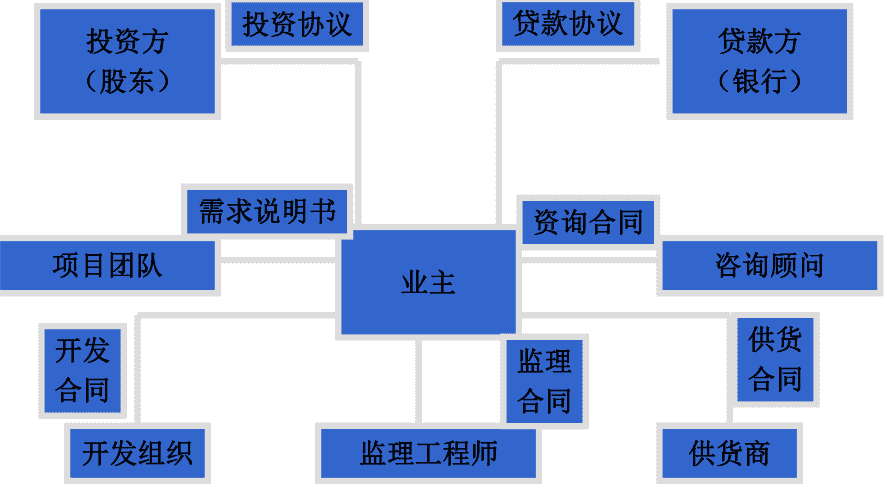

|  | 决策阶段 | 开发阶段－分析 | 开发阶段－设计 | 开发阶段－实施 | 开发阶段－测试 | 运行维护阶段 |
|---|---|---|---|---|---|---|
| 投资方 | DM | PM |  |  |  | FM |
| 开发方 | DM | PM |  |  |  |  |
| 供货方 |  |  | PM |  |  |  |
| 使用期的管理方 |  |  |  |  |  | FM |

DM - Development Management    PM - Project Management    FM - Facility Management

### 3.2 项目经理的责任和权力

**1 项目经理的地位和作用**

- 项目经理是项目实施的最高领导者、组织者、责任者，在项目管理中起到决定性的作用。
- 项目经理应确保项目全部工作在预算范围内按时、优质地完成，并使利益相关者满意。
- 项目经理必须对上级组织负责、对项目客户负责、对项目本身负责及对项目团队成员负责。

**项目经理与项目相关利益者关系图**

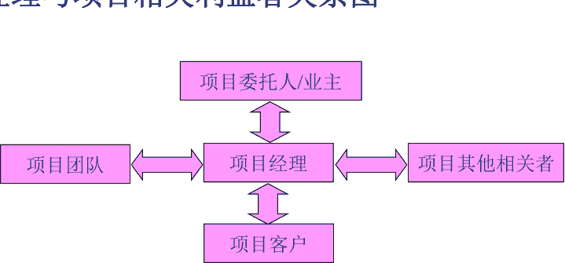

**项目经理的工作原则：**

> 项目经理应该熟悉国际、国内项目承包有关的法律、法规，严格遵守所在国家、地区的法律制度，依法履行公司的义务，并维护公司的权益。
> 项目经理在项目实施中，应注意充分利用公司的人力、技术、管理等各类资源，发挥项目团队的整体优势、整体水平，完成项目开发任务。
> 项目经理在项目实施中，应协调好项目组织与公司各部门以及项目组织内部的力量，尽力实现公司的经营方针和企业规定的项目收益目标。

- 项目经理要始终掌握项目的进展情况和潜在的问题，把主要精力集中于控制项目的进度、费用、提高工作效率和保证产品质量等重要环节，及时纠正偏差，使项目按计划目标顺利实施。
- 项目经理要了解客户的要求，提供他们希望的和应得到的各种服务。要保持与客户的信息交流和联络。
- 项目经理要保持与公司有关部门的信息交流，及时地把有关合同执行情况和客户的意向转达给他们，并及时把项目实施中的重要问题向上级领导汇报，以取得公司领导和主管部门的指导和帮助。

**不同项目经理间的三角关系位置**

**二、项目经理的职责**

- 1. 确保项目目标实现
- 2. 开发计划
- 3. 组织实施
- 4. 项目控制

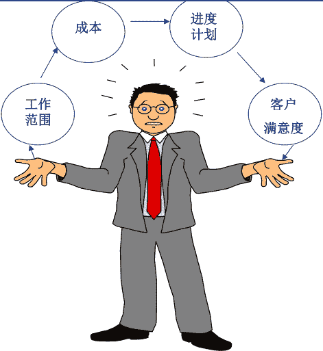

**四、项目经理的能力**

- 1. 获得项目资源的能力
- 2. 消除障碍和解决问题的能力
- 3. 领导能力和权衡能力
- 4. 沟通能力
- 5. 管理时间的能力
- 6. 灵敏性

## 3.3 项目组织类型

**一、职能型组织**

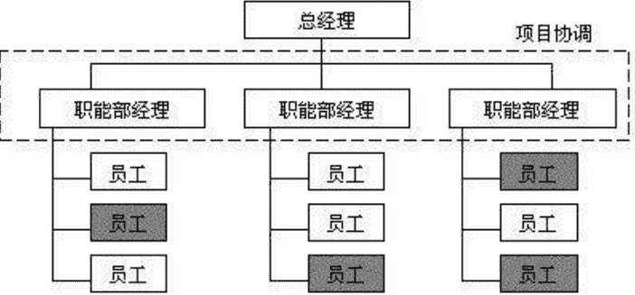

**职能型组织结构具有以下优点：**

- 在人员使用上具有较大的灵活性，节约人力，减少了资源的浪费。
- 技术专家可以同时被不同的项目所使用。
- 同一部门的专业人员在一起易于交流知识和经验，可使项目获得部门内所有的知识和技术支持，对创造性地解决项目的技术问题非常有利。
- 当有成员离开项目组时，职能部门可作为保持项目技术连续性的基础。
- 职能部门可以为本部门的专业人员提供一条正常的晋升途径。

**职能型组织结构具有以下缺点：**

- 1. 这种组织结构使得客户不是活动和关心的焦点。
- 2. 这种结构导致没有一个人承担项目的全部责任。
- 3. 项目常常得不到很好的支持。
- 4. 调配给项目的人员其积极性往往不是很高，也不把项目看成是他的主要工作。
- 5. 技术复杂的项目通常需要多个职能部门的共同合作，但他们往往更注重本领域，而忽略整个。

**二、项目型组织**

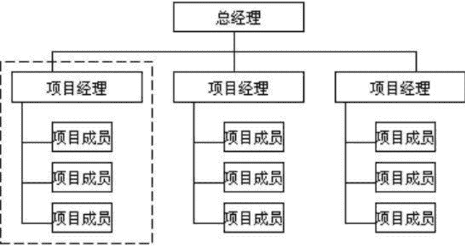

**项目型组织结构具有以下优点：**

- 项目经理有充分的权力调动项目内外部资源，对项目全权负责。
- 权力的集中使决策的速度可以加快，整个项目的目标单一，项目组能够对客户的需要做出更快的响应。在进度、成本和质量等方面的控制也较为灵活。
- 这种结构有利于使命令协调一致，每个成员只有一个领导，排除了多重领导的可能。
- 项目组内部的沟通更加顺畅、快捷。项目成员能够集中精力在完成项目的任务上，团队精神得以充分发挥。

**项目型组织结构具有以下缺点：**

- 由于不能完全利用资源，在项目与项目之间的资源共享方面会存在一些问题，可能在成本方面效率低下。
- 项目经理与项目成员之间有着很强的依赖关系，而与项目外的其他部门之间的沟通有困难。各项目之间知识和技能的交流程度很低，成员专心为自己的项目工作，这种结构没有职能部门那种让人们进行职业技能和知识交流的场所。
- 在相对封闭的项目环境中，容易造成对公司的规章制度执行的不一致。

**三、矩阵型组织**

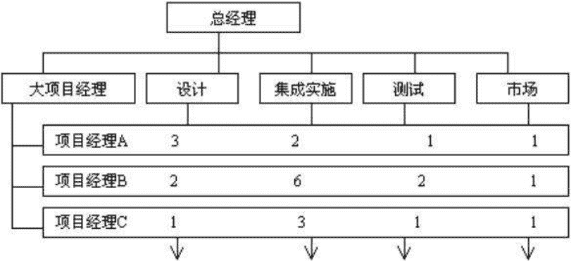

| 项目经理 | 设计 | 集成实施 | 测试 | 市场 |
|---|---:|---:|---:|---:|
| 项目经理A | 3 | 2 | 1 | 1 |
| 项目经理B | 2 | 6 | 2 | 1 |
| 项目经理C | 1 | 3 | 1 | 1 |

**矩阵型组织结构具有以下优点：**

- 项目是工作的重点，项目经理负责管理整个项目，矩阵型组织具有项目型组织的长处。
- 可以有效地利用资源，项目可以分享各个部门的技术、人才和设备。当多个项目同时进行时，公司可以平衡资源以保证各个项目都能完成各自的进度、费用和质量要求。
- 这种结构更加注重客户的需求和促进项目成员之间的学习和知识交流。

**矩阵型组织结构具有以下缺点：**

- 矩阵型组织通常是多个或多重领导，存在双层或多层汇报关系。职能部门经理和项目经理之间可能出现争权夺利的现象，需要平衡权力。
- 多个项目在进度、费用和质量方面能够取得平衡，这既是矩阵型组织的优点也是它的缺点。资源在项目经理之间流动容易引起项目经理之间的争斗，每个项目经理都更关心自己项目的成功，而不是整个公司的目标。
- 许多因素使矩阵项目团队非常难以管理。团队成员觉得这样的团队是临时的，所以对团队的忠诚是有限的。

## 3.3 项目组织类型

### 四. 项目组织的设计

- 1. 目标一致性原则
- 2. 有效的管理层次和管理幅度原则
- 3. 责任与权利对等原则
- 4. 合理分工与密切协作原则
- 5. 集权与分权相结合的原则
- 6. 环境适应性原则

### 四. 项目组织形式的选择

#### 1. 不同组织类型对项目的影响

- 项目经理的权力。
- 全职人员的百分比。项目型组织里，85%到100%都是全职的项目工作人员。矩阵型组织中一般全职项目工作人员占一半以上。
- 项目经理的角色。职能型项目组织的项目经理是兼职的，有时只是项目的协调员或项目的联系人。而项目型的项目经理是全职的，矩阵型的项目经理通常都是以全职工作人员的角色参与项目工作。

#### 2. 影响组织选择的关键因素

| 组织结构影响因素 | 职能型 | 矩阵型 | 项目型 |
|---|---|---|---|
| 不确定性 | 低 | 高 | 高 |
| 所用技术 | 标准 | 复杂 | 新 |
| 复杂程度 | 低 | 中等 | 高 |
| 持续时间 | 短 | 中等 | 长 |
| 规模 | 小 | 中等 | 大 |
| 重要性 | 低 | 中等 | 高 |
| 客户类型 | 各种各样 | 中等 | 单一 |
| 对内部依赖性 | 弱 | 中等 | 强 |
| 对外部依赖性 | 强 | 中等 | 强 |
| 时间局限性 | 弱 | 中等 | 强 |

### 3.3 项目经理的责任和权力

| 组织形式/项目特征 | 职能式 | 矩阵式（弱） | 矩阵式（平衡） | 矩阵式（强） | 项目单列 |
|---|---|---|---|---|---|
| 项目经理权限 | 很少或没有 | 有限 | 从小到中等 | 从中等到大 | 很高，甚至全权 |
| 全时在项目工作的百分比 | 几乎没有 | 0—25% | 15—60% | 50—95% | 85—100% |
| 项目经理任务 | 半时 | 半时 | 全时 | 全时 | 全时 |
| 项目经理任务的常用头衔 | 项目协调员/项目领导人 | 项目协调员/项目负责人 | 项目经理/项目主任 | 项目经理/计划经理 | 项目经理/计划经理 |
| 项目管理行政人员 | 半时 | 半时 | 半时 | 全时 | 全时 |

### 课堂讨论

例：某企业是以项目为基础的企业，即企业的经营活动是有许多项目活动有机构成。为了适应企业的这一特点，企业组织结构采用了矩阵式组织结构，但是在项目运作过程中，项目的资源如人员经常会受到项目经理及职能经理的双重领导，降低了运作效率和效果。某项目经理为了使项目成员在项目存续期间不受干扰，规定在项目成员进入项目组必须接受这样一条约束，即在项目组工作时不与原属职能部门发生任何职

请分析这位项目经理的做法是否合理？

## 3.4 组织论的基本内容

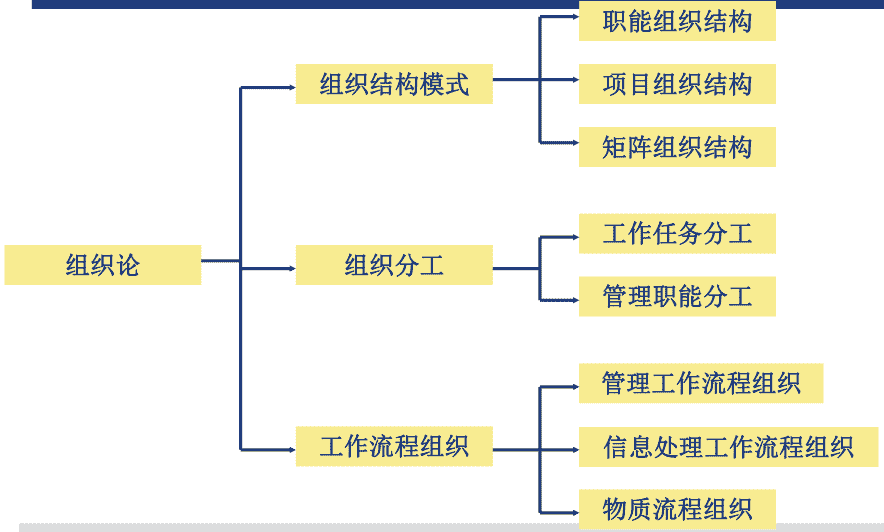

### 工作流程组织—流程的类型

- 投资控制工作流程图
- 进度控制工作流程图
- 质量控制工作流程图
- 合同管理工作流程图
- 信息管理工作流程图
- 设计的工作流程图
- 实施的工作流程图
- 设备采购工作流程图

### 工作流程组织－需求变更流程

工作流程图

反映一个组织系统中各项工作之间的**逻辑关系**

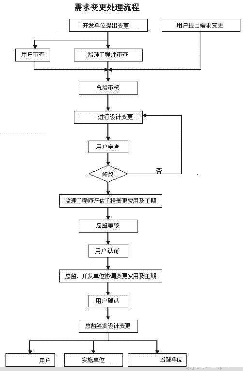

### 案例学习： 项目经理应具备的能力？

参考讨论题：
- 1. 你认为杰克能够胜任项目经理吗？ 说明原因。
- 2. 杰克为这一新岗位做了哪些准备工作？
- 3. 杰克与张力交往过程中的主要问题是什么？
- 4. 为什么张力没有与杰克开诚布公地交谈他对待她的方法？
- 5. 如果张力与杰克直截了当地讨论， 杰克会怎样反应？
- 6. 总经理针对这情况的反应将会是什么？ 他会怎样处理解决？

## 第4章 人力资源管理与团队建设

- 1. 人力资源管理
- 2. 项目团队建设
- 3. 团队的激励

## 学习目标

- 了解项目人力资源管理的特征
- 掌握组织计划包含的内容
- 熟悉软件项目中人力资源需求的特点
- 掌握项目团队成长的过程与特点
- 掌握团队激励的理论与方法

## 4.1 人力资源管理

#### 1 项目人力资源管理概述

项目人力资源管理是指对于项目的人力资源所开展的有效规划、积极开发、合理配置、准确评估、适当激励等方面的管理工作。

项目人力资源管理的重点集中在两个方面：

- 针对个人的，例如，工作委派、培训、激励、指导等；
- 针对团队的，例如，团队建设、冲突处理、沟通协调等。

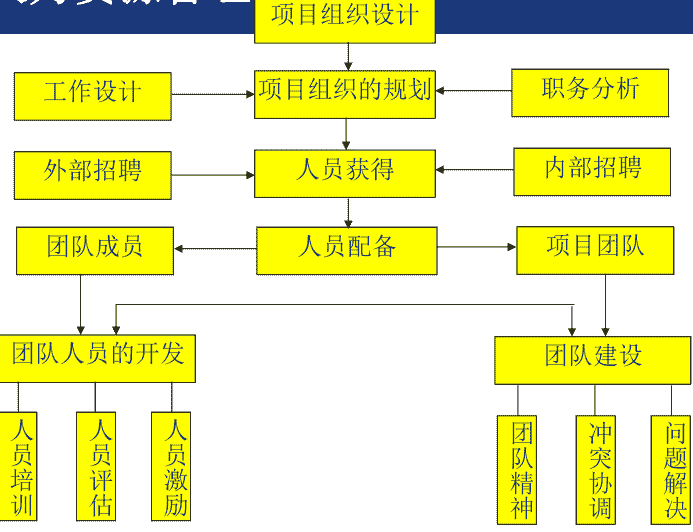

项目人力资源管理工作的主要内容

#### 1. 项目人力资源管理的内容

#### 项目组织规划：

项目人力资源管理中的组织规划与设计需要在研究项目目标、项目任务、项目组织结构、项目组织的职位、组织各职位间的责、权、利关系、组织协调和组织信息沟通等方面的各种要素之间关系的基础上，通过合理地安排和配置这些要素去完成项目组织的设计。

在三种不同的组织环境中，项目组织规划与设计分别具有下列的特殊性：

- 1. 在直线职能型组织的环境下：项目组织规划与设计必须充分考虑它所处的直线职能型组织环境的特性，主要考虑各种内部开发项目本身的特性，合理安排项目经理在项目工作协调方面的权限，特别是要安排好项目经理与团队成员，以及项目经理与上级的各种报告关系，以便使项目团队能够顺利地完成项目任务实现项目的目标。
- 2. 在项目型组织的环境下：在设计这种项目组织时必须充分考虑它所处的项目型组织环境和主要考虑要完成的外部业务项目的特性，要给项目经理以充分的授权，以便项目团队能够在协调项目工作和协调各种项目相关利益主体的关系方面有足够的权限。
- 3. 在矩阵型组织的环境下：在设计这种项目组织时必须充分考虑具体项目（内部开发和业务项目）的需要、所处矩阵型组织环境，同时也要充分考虑项目的工作范围和内容，从而确定项目团队的管理人员配备和管理职能部门的设置。

#### 项目人员的获得与配备

##### 1. 职务与岗位分析的基本概念

它是通过分析和研究来确定项目组织中各个管理职务的角色、任务、职责等内容的一种专门的项目组织规划与设计工作。职务与岗位分析的主要工作是解决以下几个问题：

- 1. 项目将需要完成些什么样的任务
- 2. 项目需要在什么时候完成这些任务
- 3. 项目需要些什么样的职务或岗位
- 4. 这些职务或岗位需要什么样的人

#### 工作设计

| 1. 工作内容 | 2. 工作职能 | 3. 工作关系 | 项目 | 4. 工作绩效 | 5. 工作者反应 |
|---|---|---|---|---|---|
| 工作内容 工作多样性 工作自主性 工作复杂性 工作的难度 工作完整性 | 责任 权限 信息沟通 工作方法 协作要求 | 与他人的工作关系 建立友谊的机会 团队工作的机会 | 工作分析的结果 | 工作的数量 工作的质量 工作的效率 | 满意度 缺勤率 离职率 |

反馈

项目组织规划中的工作设计内容示意图

#### 工作设计的方法

- (1) 专业化分工的工作设计方法 主要适用于那些专业性很强的工作职务和工作岗位的工作设计。
- (2) 职能化分工的工作设计方法 这种方法主要适用于那些项目管理工作职务或岗位的工作设计。
- (3) 辅助性的工作设计方法 这包括在管理职务或岗位的设计中采取工作轮换和工作扩大化的措施和方法，在专业性职务或岗位的工作设计中采用工作丰富化的措施和方法等等。

#### 2. 人力资源管理的作用

- 用人得当，即事得其人，可降低员工的流动率；
- 使员工努力工作；使员工认为自己的薪酬公平合理；
- 对员工进行充足的训练，以提高工作的效能；
- 保障工作环境的安全，遵守国家的法律和法规；
- 使项目团队内部的员工都得到平等的待遇。

### 讨论题

假设你是一个软件开发项目经理，你希望你的项目组成员能形成一个真正意义上的团队，那么你在招聘项目组成员时有什么要求？

- 候选人具备项目工作所需要的技能
- 候选人的需要可以通过参与项目而实现
- 候选人应具有于原有员工相融的个性
- 候选人应不反对项目工作的各种约束

## 4.1 人力资源管理

### 2 项目组织计划

指根据项目的目标和任务，确定相应的组织结构，以及如何划分和确定这些部门，这些部门又如何有机地相互联系和相互协调，共同为实现项目目标而各司其职又相互协作。

包括确定书面计划并分配项目任务、职责以及报告关系。

### （2）构造项目组织结构图

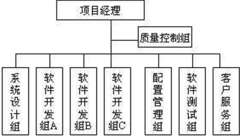

### （3）编制人员配置管理计划

## 4.1 人力资源管理

## 2 人力资源计划的平衡

### 软件项目的人员资源需求变化曲线

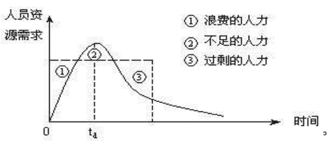

td左边曲线大致为开发时期人员需求，右边大致为维护时期人员需求。曲线下方的面积就是整个软件生命周期所需要的工作量。

对于大型软件项目，td左右两边的面积之比为4：6或者3：7。图中用虚线画出的矩形显示了平均使用人力所造成的问题：开始人力过剩，造成浪费（图中①），到开发后期需要人力时，又显得人手不足（图中②），以后再来补偿，已为时过晚（图中③）。

## 4.2 项目团队建设

### 1 项目团队的特点

- （1）项目团队的目的性
- （2）项目团队的临时性
- （3）项目团队的团队性
- （4）项目团队具有渐进性和灵活性

软件项目团队具有以下特点：

- 工作自主性要求高。宽松的环境氛围是知识员工对工作的要求。
- 崇尚智能，蔑视权威。追求公开管理和竞争环境，公平规则，蔑视倾斜的管理政策。
- 成就动机强，追求卓越。知识员工追求的主要是“自我实现价值”，工作的挑战性和得到社会认可，忠于职业多于忠于企业。
- 知识创造过程的无形性。

### 二.团队核心与团队精神

- （1）高度的相互信任
- （2）强烈的相信依赖
- （3）统一的共同目标
- （4）全面的互助合作
- （5）关系平等与积极参与
- （6）自我激励和自我约束

## 4.2 项目团队建设

团队建设活动：

- 团队管理技术
- 绩效考评与奖励系统
- 人员配置
- 培训

## “团队”发展不同阶段需要的领导风格

例：刘光是一个项目经理，他着意于建立项目团队，他认为既然项目团队成员有共同的目标，而且具有项目所需要的技术，关键是愿意为项目作出自己最大的贡献，那么在建立了团队后就要充分授权，让团队成员的获得最大的自主权。然而他发现在项目一开始就遇到麻烦，甚至连团队也建立不起来，小组成员各自为政，特别是当项目中间进来新成员时，更是乱上加乱。刘先生应该采用什么类型的领导风格？

## 4.2 项目团队建设

### 三.团队发展成长过程

形成阶段(Forming)
震荡阶段(Storming)
正规阶段(Norming)
表现阶段(Performing)

### 三.团队发展成长过程

形成阶段:团队成员基本上都会有一个积极的愿望，急于开始项目工作,团队成员的情绪特点可能包括兴奋、希望、怀疑、焦急和犹豫不决.这时团队成员还不了解他们自己的职责及其他项目团队成员的角色。

项目经理在这一阶段进行组织构建工作，包括确立团队工作的初始操作规程、团队规范、沟通渠道、审批及文件记录工作。这类工作规程会在未来的阶段发展中完善提高。为减轻人们的焦虑，项目经理要探讨他对项目团队中人员的工作及行为的管理方式和期望，需要使团队着手一些起始工作，例如，让团队成员参与制订项目计划等。

### 三.团队发展成长过程

震荡阶段:开始缓慢地推进工作。经常会产生冲突、气氛紧张，需要为应付及解决矛盾达成一致意见。这一阶段士气很低，成员们可能会抵制形成团队。震荡阶段的特点是人们有挫折、怨愤或者对立的情绪。

他要对每个人的职责及团队成员相互间的行为进行明确和分类，使每个成员明白无误。项目经理要接受和容忍团队成员的任何不满，不能因此产生情绪。如果团队成员有不满情绪而不能得到解决，这种情绪就会不断聚集，导致项目团队的震荡，将项目的成功置于危险之中。

### 三.团队发展成长过程

正规阶段：团队凝聚力开始形成，有了团队的感觉。每个成员为实现项目目标所作的贡献都会得到认同和赞赏。团队的信任得以发展。大量的交流信息、观点和感情、合作意识增强，团队成员互相交换看法和意见，并感觉他们可以自由地、建设性地表达他们的情绪及评论意见。团队成员的不满情绪也有所缓解。项目规定和团队规范得到改进和正规化。

控制及决策权从项目经理移交给了项目团队，团队经过这个社会化的过程后，建立了忠诚和友谊，甚至可能建立超出工作范围的友谊。

### 三.团队发展成长过程

表现阶段:项目团队积极地工作，急于实现项目目标。这一阶段的工作效率很高，团队有集体感和荣誉感。项目团队能开放、坦诚、及时地进行沟通。在这一阶段，团队相互依赖程度高。团队成员能感到被项目经理高度授权，如果出现问题，就由适当的团队成员组成临时小组，解决问题，并决定如何实施方案。

## “团队”发展不同阶段需要的领导风格

- 形成阶段---指导型的领导风格
- 震荡阶段---影响型的领导风格
- 正规阶段---参与型的领导风格
- 表现阶段---授权型领导风格

## 4.2 项目团队建设

### 四.团队建设

### 1. 团队建设中的常见问题

- 项目成立前期招聘和挑选项目团队成员不力；
- 令人不解和困惑的组织结构；
- 项目的执行缺乏控制；
- 团队成员缺少培训；
- 团队成员积极性低， 对团队或项目的需要无反应或缺乏兴趣；
- 团队成员缺乏个人的创造性；
- 项目管理者不适当的管理理念；
- 项目缺少成功的规划和开发；
- 项目团队目标不明确或它们不被项目团队成员所接受；
- 分配不公；
- 团队成员个性问题；
- 其他需要解决的更重要的组织问题；
- 更广的组织文化对团队的管理方法不起支持作用；
- 一支团队的工作是由技能欠佳的成员完成的，或是在没有得到足够的帮助下完成的；
- 团队中过多的“空转”；
- 团队的业绩下滑但无人知道原因；
- 以前做出的决策未执行；
- 团队会议没有效果，全部是争论且使人意志消沉。

## 4.2 项目团队建设

### 2. 团队建设过程

- 拟订团队建设计划；
- 谨慎地界定项目的作用及任务；
- 确保项目的目标与团队成员的个人目标相一致；
- 尽量判断并争取拥有那些最具有前途的员工；
- 选择那些既具有技术专长又有可能成为现实团队成员的候选人；
- 组织团队，给予特定的人以特定的任务；
- 准备并实施职责矩阵；
- 召开“启动”会议；
- 制订技术及程序议程；
- 确保为成员提供足够的时间以使其相互认识；
- 建立工作关系和联系方式；

### 2. 团队建设过程

- 获取团队成员的承诺：时间承诺、角色承诺、项目优先承诺；
- 建立联系链接；
- 实施团队建设活动，将团队建设行为与所有的项目行为相结合：召开会议、计划讨论会及技术 / 进度评审会、团体及个人咨询研讨会；
- 对杰出贡献进行表彰。

## 4.2 项目团队建设

### 五、团队成员与选择

项目团队成员需要具备的特点是：

- 项目团队成员具有专业技术技能。
- 项目团队的高级成员必须在政治上敏感。
- 项目团队成员需要很强的以问题为导向的意识。
- 项目团队成员需要有解决问题和决策的技能。
- 项目团队成员需要很强的自信心。
- 项目团队成员需要有人际交往的技能。

### 影响团队绩效的因素

除团队精神外，其他影响团队绩效的因素有：

- 1. 领导不力——项目经理和管理人员能力不足。
- 2. 目标不明——项目和项目管理的目标不清楚。
- 3. 职责不清——项目相关利益者之间的职责不明确。
- 4. 缺乏沟通——项目相关利益者和项目团队沟通不力。
- 5. 激励不足——项目团队和项目相关利益者缺乏激励。
- 6. 规章不全——项目管理和变更制度不全或实施不力。
- 7. 约束无力——主要对于项目团队成员行为约束不力。

### 怎样使“团队”成员全身心投入于项目“团队”？

- 成员交流经常化，使他们感觉团队的存在
- 确保参与团队可以实现成员需要
- 使每个成员知道项目的重要性，每个成员不希望成为“失败者”
- 所有成员共享团队目标，“一只老鼠坏一锅汤”
- 使团队中的竞争减低到最小，团队成员只与其他团队的成员竞争

### 团队成员培训

项目组织开发的首要任务是团队成员的培训。就是给项目团队的成员传授完成工作和任务所必需的基本技能与素质的过程，它是项目人力资源开发的基础性工作之一。作用有以下几个方面：

- (1) 提高项目团队综合素质
- (2) 提高项目团队工作技能和绩效
- (3) 提高项目团队成员工作满意度

### 正式组织与非正式组织

正式组织：当两个以上的人为了既定的目标而自觉协调其活动时，这样的组织就是“正式组织”

非正式组织：没有自觉的共同目标（即使也可能产生共同的成果）的任何联合的个人活动称为非正式组织

### 讨论题

- 1. 作为一个项目经理你考虑过你的组织中的一些“小群体”吗？你觉得他们“碍事”吗？
- 2. 作为一个项目组成员，你觉得你和一些同事能形成“小群体”吗？你觉得你们之间讨论哪些事情？领导是否有意拆散你们的“小群体”？

### 正式组织与非正式组织相容吗？

天津大学 计算机科学与技术学院

- 满足员工部分需要
- 增强合作精神
- 互相帮助
- 规范行为

### 非正式组织的消极性

- 目标冲突
- 一致性压力
- 影响变革

### 如何利用非正式组织？

### 项目的绩效考评与激励

绩效考评与激励也是项目人力资源管理的一项重要工作，同时它也是调动项目团队成员积极性和创造性最有效的手段之一。绩效考评通过对团队成员工作绩效的考察与评价，去反映团队成员的实际能力和业绩以及对某种工作职位的适应度。项目的激励则是运用有关行为科学的方法和手段，对团队成员的行为满足的需要予以满足或限制，从而激发团队成员的行为动机和潜能，为实现项目的目标服务。

## 4.3 团队激励

### 一、激励理论

激励的过程主要有4个部分，即：需要、动机、行为、绩效。首先是需要的产生，这种要求一时不能得到满足时，心理上会产生一种不安和紧张状态，这种不安和紧张状态会成为一种内在的驱动力，导致某种行为或行动，进而去实现目标，一旦达到目标就会带来满足，这种满足又会为新的需要提供强化。

激励和动机紧密相连，所谓动机就是个体通过高水平的努力而实现组织目标的愿望，而这种努力又能满足个体的某些需要。这里有3个关键要素：努力的强度和质量、组织目标、需要。动机是个人与环境相互作用的结果，动机是随环境条件的变化而变化的，动机水平不仅因人而异，而且因时而异，动机可以看作是需要获得满足的过程。

**1. 马斯洛的需求层次理论**

- 生理需要——维持人类自身生命的最基本需要，如吃、穿、住、行、睡等。
- 安全需要——如就业工作、医疗、保险、社会保障等。
- 友爱与归属需要——人们希望得到友情，被他人接受，成为群体一分子。
- 尊重需要——个人自尊心，受他人尊敬及成就得到承认，对名誉、地位的追求等。
- 自我实现需要——人类最高层次的需要。追求理想、自我价值、使命感，创造性和独立精神等。

### 二、激励因素

**1. 物质激励**

**2. 精神激励**

- 参与感
- 发展机遇
- 工作乐趣
- 荣誉感

**3. 其他激励手段：权力、任务、预算、提升、金钱、处罚、工作挑战、技术特长和友谊。**

### 案例讨论

徐家龙最近被公司任命为项目经理，负责一个重要但不紧急的项目实施。公司项目管理部为其配备了7位项目成员。这些项目成员来自不同部门，大家都不太熟悉。徐家龙召集大家开启动会时，说了很多谦虚的话，也请大家一起为做好项目出主意，一起来承担责任。会议开得比较沉闷。

项目开始以后，项目成员一有问题就去找项目经理，请徐家龙给出意见。徐家龙为了树立自己的权威，表现自己的能力，总是身体力行。其实有些问题项目成员之间就可以互相帮助，但是他们怕自己的弱点被别人发现，作为以后攻击的借口。所以他们一有问题就找经理，其实徐家龙的做法也不全对，成员发现了也不吭声，因为他们认为我是按你说的做的，有问题你经理负责。

团队成员之间一团和气，“找徐经理去”、“我们听你的”成为了该项目团队的口头禅。

但随着时间的推移，这个貌似祥和团结的团队在进度上很快就出了问题。该项目由“重要但不紧急的项目”变成了“重要又紧急的项目”。项目管理部意识到问题的严重性，派高级项目经理张风指导该项目的实施。

### 参考讨论题

- 1. 你认为徐家龙错在哪里？请说明原因。
- 2. 项目成员一有问题就去找项目经理，说明了什么？
- 3. 如果你是徐家龙，你打算怎么做？

软件项目管理

天津大学计算机学院

http://cs.tju.edu.cn

## 第6章 项目可行性研究与启动

## 学习目标

- 了解项目机会研究的内容
- 掌握项目建议书的编制要求
- 熟悉软件项目中可行性研究的目的与作用
- 掌握可行性研究的过程与内容
- 掌握项目启动的步骤与要求

### 6.1 项目识别

**1 项目机会研究**

- 1. 发现问题并提出设想
- 2. 项目机会研究

软件项目通常有几种产生方式：

- 企业自己寻找项目机会，经过一定的论证后确定。
- 从外界引入，初步的可行性研究已经完成，项目的提出者与投资者在进行详细研究后确定实施该项目。
- 项目的提出者做完了所有的论证工作，并引入风险投资，确定项目。
- 外部环境变化，引发了一个项目。

**2 识别需求提出项目建议书**

- 1. 识别需求
- 2. 编制项目建议书（RFP）

内容：

- 满足需求的工作陈述
- 客户提出的相关要求
- 项目所应提交的交付物/成果
- 客户供应条款、合同形式、付款方式
- 客户对项目建议书的要求
- 承包商的评价标准

**3 项目选择**

- 项目的合法性
- 项目的含金量
- 项目的成熟度
- 项目的适用性

## 6.2 可行性研究

**1 可行性研究的目标和作用**

**1. 可行性研究的目的**

- （1）技术的先进性和适用性
- （2）经济上的盈利性和合理性
- （3）运行环境上的可能性和可行性

## 6.2 可行性研究

### 1 可行性研究的目标和作用

#### 2. 可行性研究的目的作用

- (1) 为决策提供依据
- (2) 可行性研究是项目设计的依据
- (3) 项目评估的依据
- (4) 为商务谈判、签订有关合同协议提供依据

#### 3. 可行性研究的前提

- (1) 要求：说明对所建议开发的软件的基本要求
- (2) 目标
- (3) 条件、假定和限制

### 2 可行性研究的内容

- 1. 技术可行性分析
  - 项目开发的风险
  - 人力资源的有效性
  - 技术能力的可能性
  - 设备（产品）的可用性

#### 2. 经济可行性分析

##### （1）成本分析

设备费、软件开发费、维护成本等

##### （2）直接经济效益分析

1）纯收入：指系统在估算的正常使用期内产生的资金收益被折算为现值之后，再减去项目的成本投入。

2）投资回收期：指系统投入使用后产生的资金收益折算为现值，到项目资金收益等于项目的成本投入时所需要的时间。动态投资回收期的计算公式如下：

Pt=[净现金流量现值累计开始出现正值的年份]-1+[上年净现金流量现值累计的绝对值/当年净现金流量现值]

3）投资回收率：指根据系统的资金收益进行利息折算，可以将其与银行利率做比较。设P为现在的投资额；Fi为第i年年底的效益（i=1,2,……）；n为系统的使用寿命；j为投资回收率。则现在的投资额是：P=F1(1+j)+F2(1+j)2+……+Fn(1+j)n

##### （3）间接经济（社会）效益分析

- 提供了以前提供不了的统计报表与分析报告；
- 提供了比以前准确、及时、适用、易理解的信息；
- 对领导决策提供了有力支持；
- 促进了体制改革，提高了工作效率；
- 减少了人员费用；
- 改进了服务，增强了顾客信任，增强了企业的竞争地位；
- 改善了工作条件。

### 3. 运行环境可行性

### 三. 可行性研究的步骤

#### 1. 初步可行性研究

- 项目建设的必要性；
- 项目建设的周期；
- 项目需要的人力、物力和财力；
- 项目功能和目标是否可以实现；
- 项目的经济效益、社会效益是否可以保证；
- 项目从技术上、经济上是否合理等。

#### 2. 详细可行性研究

- 概述
- 需求确定
- 现有资源、设施情况分析
- 初步设计技术方案
- 项目实施进度计划建议。
- 投资估算和资金筹措计划
- 项目组织、人力资源、计划培训计划
- 经济和社会效益分析。
- 合作与协作方式等。

#### 3. 可行性研究报告

详见教材

## 6.3 项目启动

- 1. 项目的核准和立项
- 2. 项目启动
  - （1）立项启动准备：建立项目管理制度、整理启动会资料等。
    - 项目考核管理制度；
    - 项目费用管理制度；
    - 项目例会管理制度；
    - 项目通报制度；
    - 项目计划管理制度：明确各级项目计划的制定、检查流程，例如，整体计划、阶段计划、周计划；
    - 项目文件管理流程。
  - （2）召开项目启动会议
    项目启动会的任务包括：
    - 阐述项目背景、价值、目标；
    - 项目交付物介绍；
    - 项目组织机构及主要成员职责介绍；
    - 使双方人员彼此认识，清楚各个层次的接口；
    - 项目初步计划与风险分析；
    - 项目管理制度；
    - 项目将要使用的工作方式。
  - （3）任命项目经理

## 谢谢！

# Thank You !

## 软件项目管理

天津大学计算机学院

http://cs.tju.edu.cn

## 第7章 项目招投标与合同管理

## 学习目标

- 了解项目招标的基本流程
- 掌握项目招标的基本程序
- 熟悉招标书的主要内容
- 熟悉软件项目的合同条款
- 掌握合同管理的工具与方法

## 7.1 招投标的基本程序

- 1 准备阶段
- 4. 编制招标文件：产品、工程、服务
- 5. 组建评标委员
- 6. 邀请有关人员

### 2 招标阶段

- 发布招标公告（或投标邀请函）
- 资格审查
- 发售招标文件
- 招标文件的澄清、修改
- 招标人一般应当在提交投标文件截止日期15天

### 3 投标阶段

- 编制投标文件
- 投标文件的密封和标记
- 送达投标文件
- 投标人可以撤回、补充或者修改已提交的投标文件，但是应当在提交投标文件截止日之前书面通知招标人，撤回、补充或者修改也必须以书面形式。

### 四. 开标阶段

- 主持人宣布开标仪式开始
- 介绍参加开标仪式的领导和来宾
- 介绍参加投标的投标人单位名称及投标人代表
- 宣布监督方代表名单
- 宣布工作人员名单
- 宣读有关注意事项
- 检查评标标准及评标办法的密封情况
- 宣布评标标准及评标办法
- 检查投标文件的密封和标记情况
- 开标
- 唱标
- 监督方代表讲话
- 领导和来宾讲话
- 开标仪式结束

### 五. 评标阶段

- 审查投标文件的符合性
- 对投标文件的技术方案和商务方案进行审查
- 询标
- 综合评审
- 评标结论

### 六、定标阶段

- 审查评标委员会的评标结论
- 定标
- 中标通知
- 签订合同

## 7.2 标书的编写

### 二. 标书的主要内容

招标书主要分为3大部分：

- 程序条款
- 技术条款
- 商务条款

一般包含下列主要内容：招标公告（邀请函）；投标人须知；招标项目的技术要求及附件；投标书格式；投标保证文件；合同条件（合同的一般条款及特殊条款）；设计规范与标准；投标企业资格文件；合同格式

## 7.3 项目合同管理

### 一. 签订合同时应注重的问题

- 1. 规定项目实施的有效范围
- 2. 合同的付款方式
- 3. 合同变更索赔带来的风险
- 4. 系统验收的方式
- 5. 维护期问题

### 二. 软件项目合同条款分析

#### 1. 与软件产品有关的合法性条款

- 软件的合法性条款
- 软件产品的合法性

#### 2. 与软件系统有关的技术条款

- 与软件系统匹配的硬件环境
- 软件匹配的数据库等软件系统
- 软件的安全性、容错性、稳定性的保证

#### 3. 软件适用的标准体系方面的条款

- 会计核算方面的标准；
- 通用语言文字方面的标准；
- 产品分类与代码方面的标准；
- 计量单位、通用技术术语、符号、制图等方面的标准；
- 国家强制性质量认证标准等。

## 7.3 项目合同管理

### 5. 技术培训条款

- 要求制定培训计划的权利
- 要求按约定实施培训计划和按期完成培训的权利
- 普遍接受培训的权利
- 要求达到培训目标或标准的权利
- 要求派遣合格的授课人员的权利
- 要求学员在计算机操作应用方面达到一定水准的权利
- 保证学员认真接受培训的权利
- 考核标准

### 6. 支持和服务

- 软件产品的免费服务的项目
- 免费维修的实现
- 可以约定的收费服务项目
- 软件提供商采用的售后技术支持与服务的方式
- 技术支持与服务的及时性条款

### 7. 管理咨询条款

- 确定咨询的范围和目标
- 特别是对当前项目的实施部分的咨询要细化和具体
- 针对实施企业的实际情况进行需求分析和业务流程诊断
- 提交详细的书面分析报告、咨询方案及实施计划
- 制定实施企业的业务流程的每一个岗位的岗位职责和相关的管理规章制度
- 管理咨询的培训

### 三、合同管理

#### 1. 需方（甲方）合同管理

- 验收过程是需方对供方的产品或服务进行验收检验，以保证它满足合同条款的要求。
- 违约事件处理

#### 2. 供方（乙方）合同管理

- 项目计划的执行，用以授权软件提供商在适当的时候进行工作。
- 执行报告，监控合同方的成本、进度和技术绩效。
- 质量控制，检验合同方的产品是否合格。
- 变更控制，确保变更被正确地批准，以及需要了解情况的人知晓变更的发生

#### 3. 合同管理的依据

- 合同
- 工作结果
- 变更请求
- 供方发票

#### 4. 合同管理的工具和方法

- 合同变更控制系统
- 执行报告
- 支付系统

### 四．合同收尾

- 整理项目合同文件
- 项目采购合同的审计
- 项目合同的终止

### 五. 产品选择与商务谈判

#### 1. 产品选择

- 供应商评价评估：供应商的规模、业绩、合同语言和仲裁地、与客户的合作策略等方面。
- 效益风险评估：即项目的投入与产出的评估。

#### 2. 商务谈判

## 谢谢！

# Thank You !

## 软件项目管理

天津大学计算机学院

http://cs.tju.edu.cn

## 第8章 软件项目需求与变更管理

- 1. 软件项目需求管理概述
- 2. 软件项目任务分解
- 3. 软件需求的变更控制

## 学习目标

- 掌握软件需求的概念
- 熟悉需求管理的方法与过程
- 掌握任务分解的方法与步骤
- 了解需求变更的原因
- 掌握需求变更控制的策略

### 8.1 软件项目需求管理概述

#### 1. 软件需求定义

需求是来源于用户调查，即客户的需要。

需求分析是指软件分析人员通过研究用户在软件问题上的需求意愿，分析出软件系统的功能、性能、数据等诸方面应该达到的目标，从而获得有关软件的需求规格定义的过程。

#### 明确的需求是项目的基础

**需求的生命周期：**

- 需求产生（变化、内部、外部）
- 需求认识（现存、潜在、超前、前景分析）
- 需求表达：
  1. 让提出需求的人尽可能清楚地说明他们的需求；
  2. 对需求提出一系列问题：
     - 提出需求的人是如何描述需求的？
     - 需求真实吗，是真正需求还是表面现象？
     - 我们能满足这个需求吗，其他人能满足吗，是不是真的有解决方法？
     - 需求重要吗，值得去满足他吗？
     - 满足需求的关键问题在哪里，会不会有新的需求产生，还要进一步满足其他需求吗，新的需求能取代目前这个需求吗？
     - 需求直接涉及什么人，他们认为这是一个必要的需求吗，满足需求后对他们有什么影响，他们的反应会怎么样？
     - 需求对机构的影响是什么，对我的影响是什么？
  3. 作一些必要的研究工作，更好地理解需求
  4. 根据以上三步得出结论，尽可能清楚地描述这个需求
  5. 听听用户对你的阐述的反应，并作适当修改。

**功能和技术要求**

- 1. 把需求变成功能要求；
- 2. 功能要求应描述项目最终交付产品的特征
- 3. 技术要求根据功能要求产生
- 4. 功能要求应用日常语言陈述清楚

#### 定义需求时的问题

- 含糊的需求：
  - 1. 不断变化的需求（人员变化、预算变化、技术变化、商业环境变化）
  - 2. 误解需求（我说不清楚我所需要的是什么，但我见到东西时就会知道——感觉会随环境变化）
- 过早作出结论（截断需要表达过程——需求分析需要耐心和自我控制）
- 与真正的用户讨论需求
- 多种用户，多种需求（确定优先级，即需求层次）
- 曲解用户的需求
  - 需求镀金
  - 对用户的需求有选择的过滤
  - 包办代替

#### 需求和目标

- 基本需求：项目实施范围、质量要求、利润或成本目标、时间目标以及必须满足的法规要求等
- 期望要求：如一种新产品性能之外的外形、使用舒适

#### 2. 系统需求

**（1）功能需求**

- 全面性
- 一致性
- 可理解
- 可维护
- 可追踪等

**（2）非功能性需求**

- 性能需求、可靠性、可用性需求、系统安全以及系统对开发过程、时间、资源等方面的约束和标准
- 关心系统的整体特性

**（3）数据要求**

#### 3. 需求规格说明书的写作规范

- 1）清晰
- 2）完整
- 3）一致
- 4）可测试

#### 二、需求管理

**1. 需求管理复杂性分析**

- 需求的描述问题
- 需求的完备程度问题
- 需求开发的工期问题
- 需求的细致程度问题
- 需求的变化问题

**2. 需求管理的基本原则**

- 需求管理必须与需求工程的其它活动紧密整合
- 需求必须是文档化的、正确的、最新的、可管理的、可理解的
- 只要需求变化了，需求变更的影响就必须被评估
- 需求必须分优先级
- 需求一定要分类管理

**3. 需求管理的方法**

- 确定需求变更控制过程
- 进行需求变更影响分析
- 建立需求基准版本和需求控制版本文档
- 维护需求变更的历史记录
- 跟踪每项需求的状态
- 衡量需求稳定性

#### 三、需求管理过程

**1. 定义需求**
**2. 需求确认**
**3. 建立需求状态**
**4. 需求评审**

评判需求优劣的主要指标有：正确性、清晰性、无二义性、一致性、必要性、完整性、可实现性、可验证性、可测性。

**5. 需求承诺**
**6. 需求跟踪**

- 正向跟踪：以用户需求为切入点，检查《需求规格说明书》中的每个需求是否都能在后继工作产品中找到对应点。
- 逆向跟踪：检查设计文档、代码、测试用例等工作产品是否都能在《需求规格说明书》中找到出处。

**7. 需求变更控制**

## 8.2 软件项目任务分解

### 一、工作分解结构

项目的分解结构就是将项目的产品或服务、组织、过程这3种不同的结构综合为项目分解结构的过程，也就是给项目的组织人员分派各自角色和任务的过程。

- 基于成果或功能的分解方法，以完成该项目应该交付的成果为导向，确定相关的任务、工作、活动和要素。
- 基于流程的分解方法，以完成该项目所应经历的流程为导向，确定相关的任务、工作、活动和要素。

### 分解层次与结构

工作包是完成一项具体工作所要求的一个特定的、可确定的、可交付以及独立的工作包，可为项目控制提供充分而合适的管理信息。

### WBS编码设计

（2）清单形式

1. 需求分析计划
2. 流程优化
3. 编写需求说明书
   - 编写需求规格词汇表
   - 绘制业务流程
   - 抽象业务类
   - 建立数据模型
   - 将需求分析图示加入规格文档
4. 需求规格测试
5. 需求规格确认

### 一、任务分解过程

#### 1. 分解步骤

1. 确认并分解项目的主要组成要素。
2. 确定分解标准。
3. 确认分解是否详细，分解结果是否可以作为费用和时间估计的标准，明确责任。
4. 确定项目交付成果。
5. 验证分解正确性，验证分解正确性后，建立一套编号系统。

#### 2. 分解的标准

一般不能采用双重标准。选择一种项目分解标准之后，在分解过程中应该统一使用此标准，避免因使用不同标准而导致的混乱。

#### 3. 分解结果的检验

- 核实分解的正确性；
- 更低层次的细目是否必要和充分？
- 最底层要素是否有重复？
- 每个细目都有明确的、完整的定义吗？
- 是否每个细目可以进行适当的估算？谁能担负起完成这个任务？

#### 4. 任务分解的注意事项

- 注意收集与项目相关的所有信息。
- 任务分解结果必须有利于责任分配。
- 最底层的工作包一般要有全面、详细和明确的文字说明，并汇集编制成项目工作分解结构词典。
- 避免不必要的过细，最好不要超过7层。按照软件项目的平均规模来说，推荐任务分解时至少分解到一周的工作量（40小时）。

### 5. 责任分配及成本分解

| WBS编号 | 预算 | 责任者 | WBS编号 | 预算 | 责任者 |
| :--- | :--- | :--- | :--- | :--- | :--- |
| 1 | 0.1 | 张明 | 3.3 | 0.15 | 李立 |
| 2 | 0.46 | 李立 | 3.4 | 0.1 | 李立 |
| 3 | 0.46 | 张明、李立 | 3.5 | 0.02 | 张明 |
| 3.1 | 0.04 | 张明 | 4 | 0.08 | 万风 |
| 3.2 | 0.15 | 李立 | 5 | 0.1 | 张明 |

## 8.3 软件需求的变更控制

### 一、需求变更原因分析

1. 范围没有圈定就开始细化
2. 没有良好的软件结构适应变化
3. 用户改变需求

### 二、管理变更请求

#### 1. 控制需求渐变的策略

- 需求一定要与投入有显著的联系，否则如果需求变更的成本由开发方来承担，则项目需求的变更就成为必然了。所以，在项目的开始无论是软件开发方还是出资方都要明确这一条：需求变化，软件开发的投入也要变化。
- 需求的变更要经过出资者的认可，这样才会对需求的变更有成本的概念，能够慎重地对待需求的变更。
- 小的需求变更也要经过正规的需求管理流程，否则会积少成多。
- 精确的需求与范围定义并不会阻止需求的变更。并非对需求定义的越细，越能避免需求的渐变，这是两个层面的问题。太细的需求定义对需求渐变没有任何效果。因为需求的变化是永恒的，并非由于需求细化了，它就不会变化了。

#### 2. 变更控制过程

1. 项目启动阶段的变更预防
2. 项目实施阶段的变更控制
3. 项目收尾阶段的总结控制

谢谢！

Thank You！

## 软件项目管理

天津大学计算机学院

http://cs.tju.edu.cn

## 第9章 项目的时间管理

1. 项目时间管理概述
2. 进度计划图
3. 项目进度估算
4. 编制项目进度计划
5. 软件项目计划的编写

## 学习目标

- 掌握工程进度/工期等概念
- 熟悉项目时间管理的内容
- 掌握进度计划的编制方法与技术
- 掌握网络计划技术
- 熟悉软件项目计划的编写

## 9.1 项目时间管理概述

### 1 基本概念

时间是一种特殊的资源，以其单向性、不可重复性、不可替代性而有别于其他资源。

项目时间管理又称为进度管理，是指为保证项目各项工作及项目总任务按时完成所需要的一系列的工作与过程。

1. 项目活动：是指为完成工程项目而必须进行的具体的工作。项目活动是编制进度计划、分析进度状况和控制进度的基本工作包。
2. 工程进度：进度是指活动或工作进行的速度。进度是对执行的活动和里程碑制定的工作计划日期表，它也是跟踪项目进展状态的依据。

### 3. 工期

开发工期是指工程项目从正式开工到全部建成投产或交付使用所经历的时间。

合同工期是指完成合同范围工程项目所经历的时间，它从接到开工通知的日期算起，直到完成合同规定的工程项目的时间。

确定工期有两个前提：一是确定交付日期，然后安排计划；二是确定使用资源，然后安排计划。

### 4. 活动之间的顺序关系

### 5. 活动之间依赖关系

1. 强制性依赖关系：是工作任务中固有的依赖关系，是一种不可违背的逻辑关系。
2. 软逻辑关系：软逻辑关系是由项目管理人员确定的项目活动之间的关系，是人为的、主观的，是一种根据主观意志去调整和确定的项目活动的关系，也可称为指定性相关或偏好相关。
3. 外部依赖关系：是项目活动与非项目活动之间的依赖关系。

### 2 项目时间管理的内容

项目时间管理就是采用科学的方法确定目标进度，编制进度计划和资源供应计划，进行进度控制，在与质量、费用目标协调的基础上，实现项目工期目标。

包括分析确定为达到项目目标所必须进行的各种作业活动；项目活动内容的安排；估算工期，对工作顺序、活动工期和所需资源进行分析并制定项目进度计划；对项目进度的管理与控制等。这些项目时间管理的过程与活动既相互影响，又相互关联。

1. 项目活动定义
2. 活动排序：是通过识别项目活动清单中各项活动的相互关联与依赖关系，并据此对项目各项活动的先后顺序进行合理安排与确定的项目时间管理工作。
3. 活动工期估算：是根据项目范围、资源状况计划列出项目活动所需要的工期。

### 4. 安排进度表

一种是加强日期形式：以活动之间前后关系限制活动的进度，例如，一项活动不早于某项活动的开始或不晚于某项活动的结束；

另一种是关键事件或主要里程碑形式，以定义为里程碑的事件作为要求的时间进度的决定性因素，制定相应时间计划。

### 5. 进度控制与进度管理

## 9.1 项目时间管理概述

### 三、项目时间管理的特点

- (1) 进度管理是一动态过程：在进度控制中要根据进度目标和实际进度，不断调整进度计划，并采取一些必要的控制措施，排除影响进度的障碍，确保进度目标的实现。
- (2) 项目进度计划和控制是一复杂的系统工程：进度计划按工程单位可分为整个项目总进度计划、单位工程进度计划、分部分项工程进度计划等；按生产要素可分为投资计划、设备供应计划等。
- (3) 时间管理有明显的阶段性。
- (4) 时间管理风险性大。由于进度管理是一个不可逆转的工作，因而风险较大。在管理中既要沿用前人的管理理论知识，又要借鉴同类工程进度管理的经验和成果，还要根据本工程特点对进度进行创造性的科学管理。

## 9.2 进度计划图

### 一、甘特图

是表示项目各阶段任务开始时间与结束时间的图形，它把计划和进度安排组织在一起。

- 用水平线段表示阶段任务；
- 线段的起点和终点分别为对应于任务的开始时间和结束时间；
- 线段的长度表示完成任务所需要的时间。

| 任务名称 | 2005年7月24日 7-24 | 2005年7月31日 7-31 | 2005年8月7日 8-7 | 2005年8月14日 8-14 | 2005年8月21日 8-21 |
|---|---|---|---|---|---|
| 1 需求分析 |  |  |  |  |  |
| 2 需求分析计划 | 李立，张明 |  |  |  |  |
| 3 流程优化 |  | 李立，万风 |  |  |  |
| 4 编写需求说明书 |  |  |  |  |  |
| 5 编写需求规格说明汇总表 |  | 张明 |  |  |  |
| 6 绘制业务流程 |  |  | 李立，万风，张明 |  |  |
| 7 抽象业务类 |  |  | 李立，张明 |  |  |
| 8 建立数据模型 |  |  |  | 李立 |  |
| 9 将需求分析图示加入表 |  |  |  | 0-15 |  |
| 10 需求规格确认 |  |  |  |  | 李立，万风 |
| 11 需求规格确认 |  |  |  |  |  |

**优点：** 表明了各任务的计划进度和当前进度，能动态地反映软件项目的开发和进展的情况。

**缺点：** 不能反映某一项任务的进度变化对整体项目的影响，它把各项任务看成独立的工作，没有考虑项目之间存在着复杂的逻辑的关系。

### 二、网络图

网络图是活动排序的一个输出，它可展示项目中的各个活动之间的逻辑关系，表明项目任务将如何以什么顺序进行。

- **1. 单代号网络图**：也称为节点法。构成单代号网络图的基本特点是用节点表示活动（任务），箭线表示各活动（任务）之间的逻辑关系。单代号工作位于节点上，也就是说每一个节点表示一个工作，用箭头表示工作的先后顺序和相互关系。
- **2. 双代号网络图**：也称为箭线法。在双代号网络图中，活动用箭头表示，对活动的描写在箭线上。节点表示事件。由于可以使用前后两个事件的编号来表示这项活动的名称，故称双代号网络图。一个节点事件表示前一道工序的结束，同时也表示后一道工序的开始。

- **3. 绘制网络图**：
  - 1）项目分解
  - 2）工作关系分析
  - 3）编制网络图

例：

| 活动 | 紧前活动 | 工期估计：天 |
|---|---|---|
| 1 需求分析计划 | — | 3 |
| 2 流程优化 | 1 | 7 |
| 3 编写需求规格词汇表 | 2 | 2 |
| 4 绘制业务流程 | 2 | 2 |
| 5 抽象业务类 | 4 | 2 |
| 6 建立数据模型 | 5 | 2 |
| 7 将分析图示加入规格说明文档 | 3、6 | 1 |
| 8 需求规格测试 | 7 | 3 |
| 9 需求规格确认 | 8 | 3 |

虚活动是为了表明相互依存的逻辑关系，消除活动与活动之间含混不清的现象而设置的，它既不消耗资源，也不占用时间。用一个虚箭头表示。

在绘制用箭头表示活动的网络图中，有两个基本规则可以用来识别活动：第一，每个节点有惟一的编号，即图中不会有相同的节点号；第二，每个活动必须由惟一的紧前事件号组成。

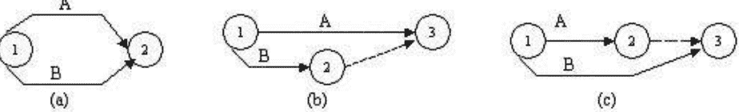

**编制网络图**时要注意以下几个问题：

一个网络图只有一个开始点和一个结束点。如果几项活动同时开始或者同时结束，在双代号网络图中可以将这几项活动的开始节点合并为一个节点；而在单代号网络图中可以设置一个虚拟开始（或者结束）活动，作为该网络图的开始节点（或者结束节点）。

| 需求分析计划 | 1 张明 | 流程优化 | 2 李立 | 编码汇表 | 3 张明 | 图加进文档 | 7 万凤 | 需求测试 | 8 万凤 |
|---|---|---|---|---|---|---|---|---|---|
| 业务流程 | 4 李立 | 抽象业务类 | 5 李立 | 建数据模型 | 6 李立 | 需求确认 | 9 张明 |  |  |

- > 网络图是有方向的，不应该出现循环回路。
- > 一对节点不能同时出现两项活动。如果有这种情况，必须引入虚活动。
- > 网络图中不能出现无箭头箭线和双箭头箭线。
- > 网络图中不能出现无节点的箭线。
- > 在同一个网络图中的所有节点，不能出现相同的编号。

## 9.3 项目进度估算

### 一、基于规模的进度估算

**1. 定额估算法**：比较基本的估算项目历时的方法，公式为：T=Q/(R×S)。

其中：T：活动的持续时间，可以用小时、日、周等表示。Q：活动的工作量，可以用人月、人天等单位表示。R：人力或设备的数量，可以用人或设备数等表示。S：开发（生产）效率，以单位时间完成的工作量表示。

此方法适合规模比较小的项目。例如，小于10000LOC（代码行）或者小于6个人月的项目。假设一个软件项目的规模估算是Q=6人月，如果有5个开发人员，即R=5人，而每个开发人员的开发效率是S=1.2，则时间进度估算结果是T=6/(5×1.2)=1月，即这个项目需要1个月完成。

**2. 经验导出模型**：是指根据大量的软件项目的实际数据统计而得出的模型。经验导出模型有几种具体公式，根据项目的规模和特点参数略有差别。

例如，Walston-Felix模型为D=2.4×E^0.35，基本COCOMO模型为D=a×E^b，其中b是0.32~0.38之间的参数。E表示人月工作量。

可以根据项目的具体情况选择合适的参数。例如，一个项目的规模估计是E=65人月，如果模型中的参数a=3，b=1/3，则D=3×65^(1/3)=12月，即65人月的软件规模，估计需要12个月完成。

### 三、网络计划技术

用网络图来表达项目中各项活动的进度和它们之间的相互关系，并在此基础上，进行网络分析，计算网络中各项时间参数，确定关键活动与关键路线，利用时差不断地调整与优化网络，以求得最短周期。

**1. 活动时间估计**：乐观工期（t0），最可能工期（tm），悲观工期（tp），计算出期望工期t。在用节点表示活动的网络图中，活动的工期估计，一般在节点图框的右下角表示出来。在用箭头表示的活动图中，活动的工期估计标在箭线的下方。

| 活动 | 紧前活动 | 乐观时间 | 最可能时间 | 悲观时间 | 工期估计 |
|---:|---:|---:|---:|---:|---:|
| 1 需求分析计划 | — | 2 | 3 | 4 | 3 |
| 2 流程优化 | 1 | 4 | 7 | 10 | 7 |
| 3 编写需求规格词汇表 | 2 | 2 | 2 | 2 | 2 |
| 4 绘制业务流程 | 2 | 1 | 2 | 3 | 2 |
| 5 抽象业务类 | 4 | 1 | 2 | 3 | 2 |
| 6 建立数据模型 | 5 | 2 | 2 | 2 | 2 |
| 7 将图加入规格说明 | 3、6 | 1 | 1 | 1 | 1 |
| 8 需求规格测试 | 7 | 2 | 2 | 8 | 3 |
| 9 需求规格确认 | 8 | 2 | 3 | 4 | 3 |

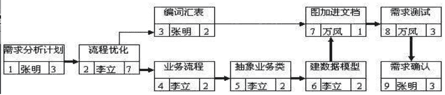

**2. 关键路径**：关键路径法是一种运用特定的、有顺序的网络逻辑和估算出的项目活动工期，确定项目每项活动的最早与最晚开始和结束时间，并做出项目工期网络计划的方法。关键路径法关注的核心是项目活动网络中关键路径的确定和关键路径总工期的计算，其目的是使项目工期能够达到最短。

1—2—3—7—8—9，总共需要时间为3+7+2+1+3+3=16

1—2—4—5—6—7—8—9，总共需要时间为3+7+2+2+2+1+3+3=23天。

## 9.3 项目进度估算

### 3. 分析关键路径的方法

**（1）事件的时间**

如果某一事件为某一活动或若干活动的箭尾事件时，事件最早时间为各活动最早可能开始的时间。

TE(1)=0

TE(j)=MAX{TE(i)+T(i,j)}（j=2,...,n）

式中：TE(j) 为箭头事件的最早时间；TE(i) 为箭尾事件的最早时间；T(i,j) 为作业时间。

如果某一事件为某一活动或者若干活动的箭头事件时，事件最早时间为各活动的最早可能结束时间。

**事件最迟时间**

TL(n)=TE(n)（n是结束事件）

TL(i)=MIN{TL(j)-T(i,j)}（i=n-1,...,1）

式中：TL(j) 为箭头事件的最迟时间；TL(i) 为箭尾事件的最迟时间；T(i,j) 为相应活动的作业时间。

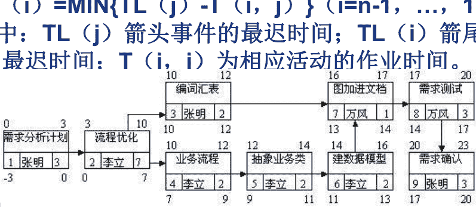

**（2）活动的时间**

- 1）活动的最早开始时间 TES(i,j)。该活动的箭尾事件的最早时间，即：
  TES(i,j)=TE(i)
- 2）活动最早结束时间 TEF(i,j)。它是活动最早可能结束时间的简称，等于活动最早开始时间加上该活动的作业时间，即：
  TEF(i,j)=TES(i,j)+T(i,j)
- 3）活动最迟结束时间 TLF(i,j)。它是在不影响活动最早结束的条件下，工序最迟必须结束的时间，简称为活动最迟结束时间。它等于活动箭头时间的最迟时间，即：
  TLF(i,j)=TL(j)
- 4）活动最迟开始时间 TLS(i,j)。它是在不影响项目最早结束的条件下，活动最迟必须开始的时间，简称为活动最迟开始时间，它等于活动最迟结束时间减去活动的作业时间，即：
  TLS(i,j)=TLF(i,j)-T(i,j)

**（3）时差**

在不影响项目最早结束时间的条件下，活动最早开始（或者结束）时间可以推迟的时间，称为该活动的时差，即：

TF(i,j)=TLS(i,j)-TES(i,j)

总时差为零的活动就是关键活动。

总时差可以按以下公式计算：

总时差=项目要求完工时间-（最后一项活动）最早结束时间

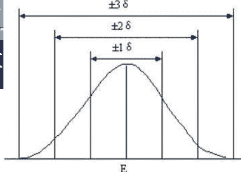

根据概率理论，对于遵循正态概率分布的均值E而言，E±δ的概率分布是68.3%，E±2δ的概率分布是95.5%，E±3δ的概率分布是99.7%。

图9-9 项目的PERT总历时估计是23周，标准差δ=2.44。

所以这个项目总历时估计的概率如表9-6所示。即项目在20.56周~25.44周内完成的概率是68.3%，项目在18.12周~27.88周内完成的概率是95.5%，项目在15.68周~30.32周内完成的概率是99.7%。

| 范围 | 概率 | 从 | 到 |
|---|---|---|---|
| T1 ± 1δ | 68.3% | 20.56 | 25.44 |
| T2 ± 2δ | 95.5% | 18.12 | 27.88 |
| T3 ± 3δ | 99.7% | 15.68 | 30.32 |

### 四、估算方法的选择

主要应考虑下列因素：

- 项目的规模大小
- 项目的复杂程度
- 项目的紧急性
- 对项目细节掌握的程度：如果在开始阶段项目的细节无法确定，CPM和PERT法就无法应用。
- 总进度是否由一、两项关键事项所决定
- 有无相应的技术力量和设备

## 9.4 编制项目进度计划

### 一、项目进度计划

**1. 项目计划的作用**

- 确定项目的工作规范，遵循的标准，成为项目实施的依据和指南；
- 明确项目组各成员及其工作责任范围以及相应的职权；
- 使项目组成员明确自己的工作目标、工作方法、工作途径、工作期限要求；
- 项目组成员和项目干系人之间的交流、沟通与协作，使得项目各项工作协调一致，增加客户满意度；
- 为项目的跟踪控制提供基础；
- 项目计划在项目中起到承上启下的作用，作为项目工作指南。

**2. 项目计划制定的原则**

- 目的性
- 系统性
- 相关性
- 经济性
- 动态性

### 二、编制进度计划

**2. 制定项目进度计划的方法**

- 系统分析法、甘特图法和CPM、PERT等方法
- 资源水平法：“将稀缺资源优先分配给关键路线上的项目活动”
- 项目管理软件：项目工期计划编制的一种辅助方法。

## 9.5 项目进度计划的补充方法

- 1. 帕金森定律：工作总是拖延到它所能够允许最迟完成的那一天。也就是说，如果工作允许它拖延、推迟完成的话，往往这个工作总是推迟到它能够最迟完成的那一刻，很少有提前完成的。
- 2. 项目延期分析
- 3. 关键链法：是尽可能推迟

关键链法的提出主要基于两个方面的考虑：

（1）如果一项工作尽早开始，往往存在着一定的松弛量、浮动时间和安全富裕量，那么这个工作往往推迟到它最后所允许的那一天为止。这一期间整个工作就没有充分发挥它的效率，造成了人力、物力的浪费。如果按最迟的时间开始做安排，没有浮动和安全富裕量，无形当中对从事这个项目的人员施加了压力，他没有任何选择余地，只有尽可能努力地按时完成既定任务。这是关键链法所采用的一种思路。

（2）在进行项目估算时，需要设法把个人估算中的一些隐藏的富裕量剔除。经验表明，人们在进行估算时，往往是按照能够100%完成所需要的时间来进行时间估算。在这种情况下，如果按照50%的可能性，只有一半的可能性能完成任务，有50%的可能性又要延期，这样就大大缩短原来对工作的时间估算。

## 谢谢！

## Thank You!

## 软件项目管理

天津大学计算机学院

http://cs.tju.edu.cn

## 第10章 项目的成本管理

- 1. 成本管理的概念
- 2. 项目资源计划
- 3. 项目成本估算
- 4. 项目成本预算

## 学习目标

- 掌握工程进度、工期等概念
- 熟悉项目时间管理的内容
- 掌握进度计划的编制方法与技术
- 掌握网络计划技术
- 熟悉软件项目计划的编写

## 10.1 成本管理的概念

广义的项目成本称为项目的生命周期成本。

狭义的项目成本（费用）是指因为项目而发生的各种资源耗费的货币体现。

项目成本管理是指为保障项目实际发生的成本不超过项目预算，使项目在批准的预算内按时、按质、经济高效地完成既定目标而开展的成本管理活动。

成本管理包括项目资源规划、项目成本估算、项目成本预算、项目成本控制等过程。

项目成本包括项目生命周期每一阶段的资源耗费：

项目直接成本：指与项目有直接关系的成本费用，是与项目直接对应的，包括直接人工费用、直接材料费用、其他直接费用等。

管理费用：指为了组织、管理和控制项目所发生的费用，项目管理费用一般是项目的间接费用，主要包括管理人员费用支出、差旅费用、固定资产和设备使用费用、办公费用、医疗保险费用，以及其他一些费用等。

期间费用等：指与项目的完成没有直接关系，费用的发生基本上不受项目业务量增减所影响的费用。这些费用包括公司的日常行政管理费用、销售费用、财务费用等，这些费用已经不再是项目费用的一部分，而是作为期间费用直接计入公司当期损益。

### 一、软件项目成本

**1. 软件项目成本的分类**

（1）从软件生命周期构成的两阶段即开发阶段和维护阶段看，软件的成本由开发成本和维护成本构成。其中开发成本由软件开发成本、硬件成本和其他成本组成，包括了系统软件的分析/设计费用、实施费用及系统切换等方面的费用；维护成本由运行费用（包含人工费、材料费、固定资产折旧费、专有技术及技术资料购置费）、管理费（包含审计费、系统服务费、行政管理费）及维护费（包含纠错性维护费用及适应性维护费用）。

## 10.1 成本管理的概念

### 一. 软件项目成本

#### （2）从财务角度来看，列入软件项目的成本如下：

硬件购置费、软件购置费、人工费、培训费、通讯费、基本建设费、财务费用、管理费用、材料费、水、电、汽费、专有技术购置费、其它费用。

### 2. 软件项目成本的影响因素

#### （1）项目质量对成本的影响

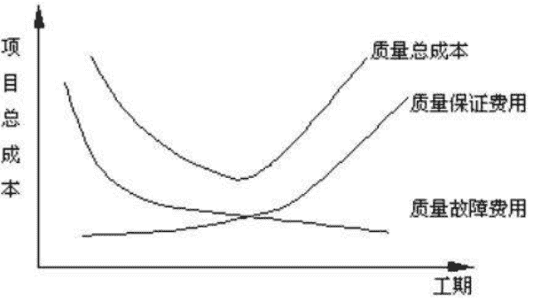

#### （2）工期对成本的影响

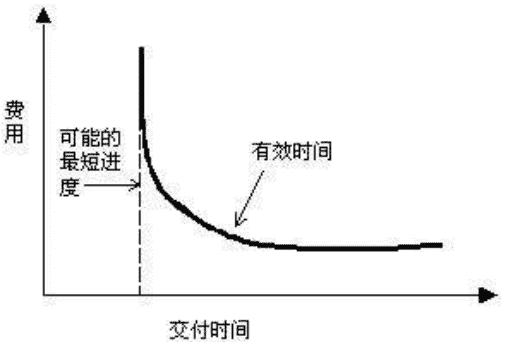

#### （3）管理水平对成本的影响

- 项目成本预算和估算的准确度差：过粗和过细。预算过粗会使项目费用的随意性较大，准确度降低；预算过细会使项目控制的内容过多，弹性差，变化不灵活，管理成本加大。
- 缺乏对软件成本事先估计的有效控制
- 缺乏成本绩效的分析和跟踪。

#### （4）人力资源对成本的影响

#### （5）价格对成本的影响

### 二. 成本管理的内容

- 1. 项目资源计划
- 2. 项目成本估算
- 3. 项目成本预算
- 4. 项目成本控制
- 5. 项目成本预测

## 10.2 项目资源计划

资源可理解为一切具有现实和潜在价值的东西，完成项目必须要消耗劳动力（人力资源）、材料、设备、资金等有形资源，同时还可能需要消耗其他一些无形资源，而且由于存在资源约束，项目耗用资源的质量、数量、均衡状况对项目的工期、成本有着不可估量的影响。

### 1 资源计划的主要依据

- 1. 工作分解结构WBS
- 2. 项目进度计划
- 3. 历史资料
- 4. 资源库描述：对项目拥有的资源存量的说明
- 5. 组织策略：项目实施组织的企业文化、项目组织的组织结构、项目组织获得资源的方式和手段方面的方针体现了项目高层在资源使用方面的策略，可以影响到人员招聘、物资和设备的租赁或采购，对如何使用资源起重要作用

### 2 资源计划的编制步骤

#### 1. 资源需求分析

- 工作量计算；
- 确定实施方案；
- 估计人员需求量；
- 估计设备、材料需求量；
- 确定资源的使用时间。

#### 2. 资源供给分析

#### 3. 资源成本比较与资源组合

#### 4. 资源分配与计划编制

### 3 编制资源计划的方法与工具

#### 1. 德尔菲（专家）评估法

由项目成本管理专家根据经验和判断去确定和编制项目资源计划的方法。这种方法通常又有两种具体的形式：专家小组法与德尔斐法。

德尔菲法的具体做法是：

- 1）设计调查表。
- 2）选择应答的专家
- 3）征询专家的意见

#### （2）德尔菲法的特点

- 经济性
- 匿名性
- 客观性

#### （3）对德尔菲法的评价

周期较短，费用较低

对各种意见的可靠程度和科学依据缺乏统一的标准，理论上缺乏深刻的逻辑论证等

#### 2. 资料统计法

使用历史项目的统计数据资料，计算和确定项目资源计划的方法。

- 实物量指标多数用来表明物质资源的需求数量，这类指标一般表现为绝对数指标。
- 劳动量指标主要用于表明人力的使用，这类指标可以是绝对量也可以相对量指标。
- 价值量指标主要用于表示资源的货币价值，一般使用本国货币币值表示的活劳动或物化劳动的价值。

常用的项目资源计划的工具包括：资源矩阵、资源甘特图、资源负荷图或资源需求曲线、资源累计需求曲线等。

### 项目资源矩阵

| 工作 | 资源需要 | | | | | 相关说明 |
|---|---|---|---|---|---|---|
| 工作1 | 资源1 | 资源2 | ... | 资源n-1 | 资源n | |
| 工作2 | | | | | | |
| ... | | | | | | |
| 工作m | | | | | | |

### 项目资源数据表

| 资源需求种类 | 资源需求总量 | 时间安排（不同时间资源需求量） | | | | | | | 相关说明 |
|---|---|---|---|---|---|---|---|---|---|
| | | 1 | 2 | 3 | ... | T-1 | T | | |
| 资源1 资源2 ... 资源n | | | | | | | | | |

### 资源负荷图或需求曲线

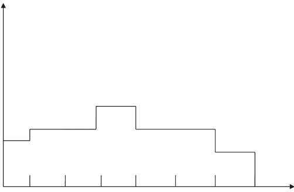

### 资源累计需求曲线

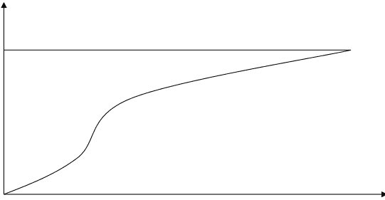

## 10.3 项目成本估算

### 1. 软件开发成本估算过程

可以用货币单位表示，也可用工时、人月、人天、人年等其他单位表示

代码行(LOC)是衡量软件项目规模最常用的概念，指所有的可执行的源代码行数，包括可交付的工作控制语言语句、数据定义、数据类型声明、等价声明、输入/输出格式声明等。

例如，某软件公司统计发现该公司每一万行C语言源代码形成的源文件（.c和.h文件）约为250K。某项目的源文件大小为3.75M，则可估计该项目源代码大约为15万行，该项目累计投入工作量为240人月，每人月费用为10000元（包括人均工资、福利、办公费用公摊等），则该项目中1LOC的价值为：（240×10000）/150000=16元/L。

### 开发成本估算过程

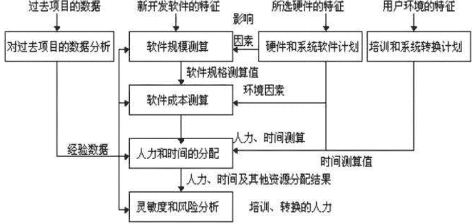

### 2. 项目成本估算的技术路线

(1) 自上而下的估算：又称类比估算，通常在项目的初期或信息不足时进行，此时只确定了初步的工作分解结构，分解层次少，估算精度较差。自上而下的成本估算实际上是以项目成本总体为估算对象，在收集上层和中层管理人员的经验判断，以及可以获得的关于以往类似项目的历史数据的基础上，将成本从工作分解结构的上部向下部依次分配、传递，直至WBS的最底层。

### （2）自下而上估算

自下而上的成本估算是先估算各个工作包的费用，然后自下而上将各个估算结果汇总，算出项目费用总和。采用这种技术路线的前提是确定了详细的WBS，能做出较准确的估算。当然，这种估算本身要花费较多的费用。

### （3）自上而下和自下而上相结合的成本估算

### 二. 软件项目成本估算方法

#### 1. 类推估算法

类推法估计结果的精确度取决于历史项目数据的完整性和准确度。因此，用好类推法的前提条件之一是组织建立起较好的项目评价与分析机制，对历史项目的数据分析是可信赖的。其基本步骤如下：

- 1）整理出项目功能列表和实现每个功能的代码行；
- 2）标识出每个功能列表与历史项目的相同点和不同点，特别要注意历史项目做得不够的地方；
- 3）通过步骤1）和2）得出各个功能的估计值；
- 4）产生规模估计。

### 二. 软件项目成本估算方法

#### 1. 类推估算法

类比估算法通常比其他方法简便易行，费用低，但它的精度也低。类比估算法的优点是这种估算是基于实际经验和实际数据的，所以可信度较高。有两种情况可以使用这种方法，其一是以前完成的项目与新项目非常相似，其二是项目成本估算专家或小组具有必需的专业技能。这种方法的局限性在于很多时候没有真正类似项目的成本数据，因为项目的独特性和一次性使多数项目之间不具备可比性。

### 2. 功能点估计法

功能点表示法是一种按照统一方式测定应用功能的方法，最后的结果是一个数。这个结果数可以用来估计代码行数、成本和项目周期。不过要正确、一致的应用这种方法还需要大量的实践。

该方法包括两个评估，即评估产品所需要的内部基本功能和外部功能。然后根据技术复杂度因子（权）对它们进行量化，产生产品规模的最终结果。

## 10.3 项目成本估算

功能点计算由下列步骤组成：
1）首先确定应用程序必须包含的功能（例如，“回溯”、“显示”）。国际功能点用户组（International Function Point Users Group，IFPUG）已经公布了相关标准，说明哪些部分组成应用的一个功能。一个功能等价于处理显示器上的一屏显示或者一个表单。
2）对每一项功能，通过计算4类系统外部行为或事务的数目，以及一类内部逻辑文件的数目来估算由一组需求所表达的功能点数目。这5类功能计数项分别是：

### 5类功能计数的复杂度权重

| 权重项 | 复杂度权重因素 |  |  |
|---|---:|---:|---:|
|  | 简单 | 一般 | 复杂 |
| 外部输入 | 3 | 4 | 6 |
| 外部输出 | 4 | 5 | 7 |
| 外部查询 | 3 | 4 | 6 |
| 外部文件 | 5 | 7 | 10 |
| 内部文件 | 7 | 10 | 15 |

4）这一步是要计算项目中14个技术复杂度因子（TCF）。表10-4是14个技术复杂度因子，每个因子的取值范围是0~5。

| 因子 | 描述 | 因子 | 描述 |
|---|---|---|---|
| F1 | 可靠的备份和恢复 | F2 | 数据通信 |
| F3 | 分布式函数 | F4 | 性能 |
| F5 | 大量使用的配置 | F6 | 联机数据输入 |
| F7 | 操作简单性 | F8 | 在线升级 |
| F9 | 复杂界面 | F10 | 复杂数据处理 |
| F11 | 重复使用性 | F12 | 安装简易性 |
| F13 | 多重站点 | F14 | 易于修改 |

表10-5显示每个因子取值范围的情况。技术复杂度因子的计算公式为：
TCF=0.65+0.01×sum(Fi)
其中：i=1,2,...,14，Fi的取值范围是0~5，所以TCF的结果范围是0.65~1.35。

| 调整系数 | 描述 |
|---|---|
| 0 | 不存在或没有影响 |
| 1 | 不显著的影响 |
| 2 | 相当的影响 |
| 3 | 平均的影响 |
| 4 | 显著的影响 |
| 5 | 强大的影响 |

功能点可以按照一定的条件转换为软件代码行（LOC）。表10-6就是一个转换表，它是针对各种语言的转换率，这个表是根据业界的经验研究得出的。

| 语言 | 代码行/FP |
|---|---|
| 汇编语言 | 320 |
| C | 128 |
| C++ | 64 |
| Pascal | 90 |
| VB | 32 |
| JAVA | 30 |
| SQL | 12 |

### 3. 经验成本估算模型

#### （1）SLIM模型

L和td分别表示可交付的源指令数和开发时间（单位为年）；K是整个生命周期内人的工作量（单位为人年），可从总的开发工作量ED=0.4K求得；CK是根据经验数据而确定的常数，表示开发技术的先进性级别。如果软件开发环境较差（没有一定的开发方法，缺少文档、评审或批处理方式），取CK=6500；正常的开发环境（有适当的开发方法，较好的文档和评审，以及交互式的执行方式），CK=10000；如果是一个较好的开发环境（自动工具和技术），则取CK=12500。

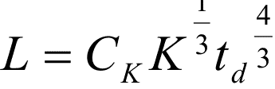

#### （2）COCOMO模型

基本COCOMO模型：静态单变量模型，它用一个以已估算出来的源代码行数（LOC）为自变量的函数来计算软件开发工作量。

中级COCOMO模型：在用LOC为自变量的函数计算软件开发工作量的基础上，再用涉及产品、硬件、人员、项目等方面属性的影响因素来调整工作量的估算。

高级COCOMO模型：包括中级COCOMO模型的所有特性，但用上述各种影响因素调整工作量估算时，还要考虑对项目过程中分析、设计等各步骤的影响。

模型的核心是方程

ED = rS^c，TD = a(ED)^b

其中ED为总的开发工作量（到交付为止），单位为人月；S为源指令数（不包括注释，但包括数据说明、公式或类似的语句），常数r和c为校正因子。若S的单位为10^3，ED的单位为人月。TD为开发时间；经验常数r、c、a和b取决于项目的总体类型（结构型、半独立型或嵌入型）。

#### 项目总体类型

| 特性 | 结构型 | 半独立型 | 嵌入型 |
|---|---|---|---|
| 对开发产品目标的了解 | 充分 | 很多 | 一般 |
| 对软件系统有关的工作经验 | 广泛 | 很多 | 中等 |
| 为软件一致性需要预先建立的需求 | 基本 | 很多 | 完全 |
| 为软件一致性需要外部接口规格说明 | 基本 | 很多 | 完全 |
| 关联的新硬件和操作过程的并行开发 | 少量 | 中等 | 广泛 |
| 对改进数据处理体系结构算法的要求 | 极少 | 少量 | 很多 |
| 早期实施费用 | 极少 | 中等 | 较高 |
| 产品规模（交付的源指令数） | <5万行 | <30万行 | 任意 |
| 实例 | 批数据处理、科学模块、事务模块、熟悉的操作系统、编译程序、简单的编目生产控制 | 大型事务处理系统、新的操作系统、数据库管理系统、大型编目生产控制、简单的指挥系统 | 大而复杂的事务处理系统、大型的操作系统、宇航控制系统、大型指挥系统 |

#### 工作量和进度的基本COCOMO方程

| 开发类型 | 工作量 | 进度 |
|---|---|---|
| 结构型 | ED=2.4S^1.05 | TD=2.5(ED)^0.38 |
| 半独立型 | ED=3.0S^1.12 | TD=2.5(ED)^0.35 |
| 嵌入型 | ED=3.6S^1.20 | TD=2.5(ED)^0.32 |

#### 影响r值的15个成本因素

| 类型 | 成本因素 |
|---|---|
| 产品属性 | 1. 要求的软件可靠性；2. 数据库规模；3. 产品复杂性 |
| 计算机属性 | 4. 执行时间约束；5. 主存限制；6. 虚拟机变动性；7. 计算机周转时间 |
| 人员属性 | 8. 分析人员能力；9. 应用经验；10. 程序设计人员能力；11. 虚拟机经验；12. 程序设计语言经验 |
| 工程属性 | 13. 最新程序设计实践；14. 软件开发工具的作用；15. 开发进度限制 |

#### 中级COCOMO工作量估算方法

| 开发类型 | 工作量方法 |
|---|---|
| 结构型 | (ED)_NOM=3.2S^1.05 |
| 半独立型 | (ED)_NOM=3.0S^1.12 |
| 嵌入型 | (ED)_NOM=2.8S^1.20 |

### 三、项目成本估算的结果

#### 1. 项目成本估算文件

对完成项目所需费用的估计和计划安排，对完成项目活动所需资源、资源成本和数量进行概略或详细的说明。这包括对于项目所需人员、设备和其他科目成本估算的全面描述和说明。另外，这一文件还要全面说明和描述项目的不可预见费等内容。项目成本估算文件中的主要指标是价值量指标，为了便于在项目实施期间或项目实施后进行对照，项目成本估算文件也需要使用其它的一些数量指标对项目成本进行描述。

#### 2. 细节说明文件

- 项目范围的描述
- 项目成本估算的基础和依据文件。包括制定项目成本估算的各种依据性文件，各种成本计算或估算的方法说明，以及各种参照的国家规定等。
- 项目成本估算各种假定条件的说明文件。包括在项目成本估算中所假定的各种项目实施的效率、项目所需资源的价格水平、项目资源消耗的定额估计等假设条件的说明。
- 项目成本估算可能出现的变动范围的说明。

#### 3. 项目成本管理计划

管理和控制项目成本变动的说明文件

项目成本管理计划的核心内容就是这种计划和安排，以及有关项目不可预见费的使用管理规定等。

## 10.4 项目成本预算

在项目成本估算的基础上，更精确地估算项目总成本，并将其分摊到项目的各项具体活动和各个具体项目阶段上，为项目成本控制制定基准计划的项目成本管理活动，它又称为项目成本计划。

### 一、成本预算概述

成本估算的输出结果是成本预算的基础与依据，成本预算则是将已批准的估算进行分摊。

## 10.4 项目成本预算

### 1. 项目预算的特征

- 计划性指在项目计划中，将成本估算总费用尽量精确地分配到WBS的每一个组成部分，从而形成与WBS相同的系统结构。
- 约束性是一种分配资源的计划，预算分配的结果可能并不能满足所涉及的管理人员的利益要求，而表现为一种约束。
- 控制性是指项目预算的实质就是一种控制机制。

### 2. 编制项目成本预算的原则

- 项目成本预算要与项目目标相联系。必须同时考虑到项目质量目标和进度目标。
- 项目成本预算要以项目需求为基础。
- 项目成本预算要切实可行。
- 项目成本预算应当有一定的弹性。

### 3. 项目成本预算的依据

成本估算、工作分解结构、项目进度计划等。

### 二. 项目成本预算的步骤

#### 1. 分摊总预算成本

#### 2. 制定累计预算成本

例：对于某软件需求分析项目，如表10-13所示了该项目部分预算成本表。该项目总预算是1.2万元人民币，预计为20天。为了监控成本，需要把每项活动的费用按天分摊。预算累计量就是从项目启动到报告期间所有预算成本的求和。从表10-13可以看出，本项目到12天的累计量是7500元人民币。

| 活动 | 天：1 | 2 | 3 | 4 | 5 | 6 | 7 | 8 | 9 | 10 | 11 | 12 | … | 小计 |
|---|---|---|---|---|---|---|---|---|---|---|---|---|---|---|
| 1需求分析计划 | 0.3 | 0.3 | 0.4 | | | | | | | | | | | 1 |
| 2流程优化 | | | | 0.8 | 0.8 | 0.9 | 0.7 | 0.7 | 0.7 | | | | | 4.6 |
| 3需求词汇表 | | | | | | | | | | 0.4 | | | | 0.4 |
| 4绘制业务流程 | | | | | | | | | | | 0.8 | 0.7 | | 1.5 |
| 预算累计 | 0.3 | 0.6 | 1 | 1.8 | 2.6 | 3.5 | 4.2 | 4.9 | 5.6 | 6 | 6.8 | 7.5 | | 7.5 |

### 三. 成本预算的结果

#### 2. 实际成本累计

例：假设现在在项目进行到第11天，将前11天的成本填入表10-14中，可以看出到第11天为止，实际成本累计6100元人民币。

#### 3. 盈余累计

一项活动从开工到报告期实际完成的百分比称为完工率。一项活动总的分摊预算与该项活动的完工率的乘积称为盈余量。

例如，活动“流程优化”分摊预算是4600元，在前3天完成任务的45%，前4天完成任务的60%，前5天完成任务的75%，则活动在前3、4、5天的盈余两分别是2070元（4600×45%=2070）、2760元、3450元。

#### 项目每天实际成本累计表

单位：千元

| 活动 | 4 | 5 | 6 | 7 | 8 | 9 | 10 | 11 | 12 | ... | 活动小时计 |
|---|---|---|---|---|---|---|---|---|---|---|---|
| 1 需求分析计划 | 1.0 | | | | | | | | | | 1.0 |
| 2 流程优化 | 0.6 | 0.6 | 0.5 | 0.7 | 05 | 0.6 | 0.7 | | | | 4.2 |
| 3 需求规格词汇表 | | | | | | | | 0.3 | | | 0.3 |
| 4绘制业务流程 | | | | | | | | 0.6 | | | 0.6 |
| 每天实际成本小计 | 1.6 | 0.6 | 0.5 | 0.7 | 0.5 | 0.6 | 0.7 | 0.9 | | | |
| 从项目开始累计成本 | 1.6 | 2.2 | 2.7 | 3.4 | 3.9 | 4.5 | 5.2 | 6.1 | | | |

盈余累计就是从项目启动到报告期之间各项活动盈余量之和

| 活动 | 4 | 5 | 6 | 7 | 8 | 9 | 10 | 11 | 12 | ... | 活动小时计 |
|---|---|---|---|---|---|---|---|---|---|---|---|
| 1 需求分析计划 | 1.0 | 1.0 | 1.0 | 1.0 | 1.0 | | | | | | 1.0 |
| 2 流程优化 | 0.46 | 1.15 | 2.07 | 2.76 | 3.45 | | | | | | 2.76 |
| 3 需求规格词汇表 | | | | | | | | | | | |
| 4 ...... | | | | | | | | | | | |
| 累计盈余 | 1.46 | 2.15 | 3.07 | 3.76 | 4.45 | | | | | | |

#### 项目3个累计量比较表

| 项目 | 天 | | | | | | | | … | 20 |
|---|---|---|---|---|---|---|---|---|---|---|
| 分摊预算累计 | 0.3 | 0.6 | 1.0 | 1.8 | 2.6 | 3.5 | 4.2 | 4.9 | | |
| 实际成本累计 | 0.3 | 0.6 | 1.0 | 1.6 | 2.2 | 2.7 | 3.4 | 3.9 | | |
| 盈余累计 | 0.3 | 0.6 | 1.0 | 1.46 | 2.15 | 3.07 | 3.76 | 4.45 | | |

衡量成本绩效的指标是成本绩效指数（CPI），它是衡量正进行项目的成本效率。确定CPI的公式为：
CPI=累计盈余量（CEV）/累计实际成本（CAC）
例：软件需求分析项目中，第8天的CPI=4450元/3900元=1.14

在报告期若实际成本累计小于分摊预算累计，而且盈余累计大于成本累计，说明成本计划和进度计划都得到较好的控制。而如果盈余累计小于实际成本累计，说明没完成进度计划。若某报告期实际成本累计大于分摊预算累计，即实际发生成本

在这种情况下，若盈余累计也大于分摊预算累计，说明虽然开支超出了预算，但实际完成的工作量也超过了计划工作量，估计问题不大。
另一个衡量成本绩效的指标是成本差异（CV），它是累计盈余与累计实际成本之差。确定CV的公式为

CV=累计盈余量（CEV）－累计实际成本（CAC）
在第8天的CV=4450元-3900元=550元
这一结果表明，到第8天工效值比已花费的实际成本多550元，它是工程绩效超前实际成本的另一个

工期优化的步骤如下：

- 计算网络计划中的时间参数，找出关键线路和关键活动
- 按规定工期要求确定应压缩的时间；
- 分析各关键活动可能的压缩时间；
- 确定将压缩的关键活动，调整其持续时间，并重新计算网络计划的计算工期；
- 当计算工期仍大于规定工期时，则重复上述步骤，直到满足工期要求或工期不能再压缩为止。
- 当所有关键活动的持续时间均压缩到极限，仍不满足工期要求时，应对计划的原技术、组织方案进行调整，试着拟定工期重新确定。

## 10.4 项目成本预算

例：假设每个活动存在一个“正常”的进度和“压缩”进度，一个“正常”的成本和“压缩”后的成本。如果活动在可压缩的进度内，压缩与成本的增长成正比，缩短工期的单位时间成本可用如下公式计算：

（压缩成本-正常成本）/（正常时间-压缩时间）

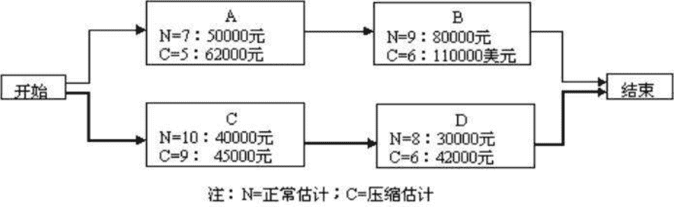

A-B的工期为16周，费用是172000元；C-D的工期为18周，费用是87000元。关键路径为C-D，项目工期为18周，总费用是259000元。

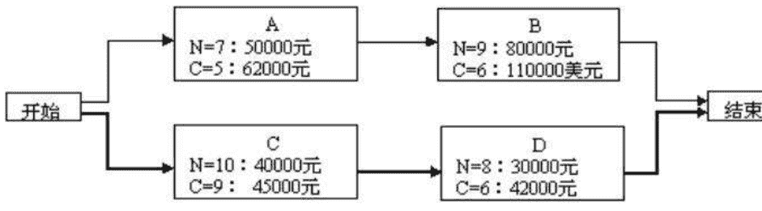

注：N=正常估计；C=压缩估计

如果将项目的工期分别压缩到17周、16周、15周，并且保证每个任务在可压缩的范围内，必须满足两个前提：

- 首先必须找出关键路径；
- 保证压缩之后的成本最小。

各活动的压缩时间成本为：

- A活动：(62000-5000) / (7-5) =6000元/周
- B活动：(110000-80000) / (9-6) =10000元/周
- C活动：(45000-40000) / (10-9) =5000元/周
- D活动：(42000-3000) / (8-6) =6000元/周

## 2. 费用优化

费用优化又称时间成本优化，目的是寻求最低成本的进度安排。费用

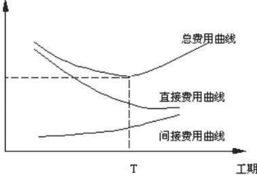

## 3. 资源优化

资源优化包括：“资源有限—工期最短”和“工期固定—资源均衡”两种。

(1)资源有限—工期最短优化：是通过调整计划安排以满足资源限制条件，并使工期延长最少。

其优化步骤如下：

- 计算网络计划每天资源的需用量；
- 从计划开始日期起，逐日检查每天资源需用量是否超过资源的限量，如果在整个工期内每天均能满足资源限量的要求，可行优化方案就编制完成。否则必须进行计划调整；
- 调整网络计划。
- 重复上述步骤，直至出现优化方案为止

(2) 工期固定—资源均衡。通过调整计划安排，在工期保持不变的条件下，使资源尽可能均衡的过程。可用方差σ²或标准差σ来衡量资源的均衡性。方差越小越均衡。用初始网络计划得到的自由时差改善进度计划的安排，使资源动态曲线的方差值减到最小，从而达到均衡的目的。设规定工期为Ts，R（t）为t时刻所需的资源量，Rm为日资源需要量的平均值，则可得方差和标准差的计算公式：

## 方差和标准差的计算公式：

\(\sigma^2 = \frac{1}{T_s} \sum_{i=1}^{T_s} (R(t) - R_m)^2\)

\(\sigma^2 = \frac{1}{T_s} \sum_{i=1}^{T_s} R^2(t) - R_m^2\)

\(\sigma = \sqrt{\frac{1}{T_s} \sum_{i=1}^{T_s} R^2(t) - R_m^2}\)

由于式中规定工期Ts与日资源需要量平均值均为常数，故要使方差最小，只需 \(\sum_{i=1}^{T_s} R^2(t)\) 使为最小。

因工期是固定的，所以，求方差σ²或标准差σ最小的问题只能在各活动的总时差范围内进行。

## 谢谢！

# Thank You !

## 软件项目管理

天津大学计算机学院

http://cs.tju.edu.cn

# 第11章 项目风险管理

- 1. 项目风险管理概述
- 2. 项目风险的管理规划
- 3. 项目风险识别
- 4. 风险分析
- 5. 风险应对
- 7. 项目风险监控

## 学习目标

- 理解风险管理的观念
- 掌握项目风险管理规划的内容和程序
- 熟悉项目风险识别过程与方法
- 熟悉项目风险评估方法
- 掌握风险应对原则与措施
- 熟悉风险监控程序与方法

## 11.1 项目风险管理概述

风险就是在项目过程中有可能发生的某些意外事情，而且在最糟的情况下将对项目产生巨大的负面影响甚至导致失败。风险管理是对项目风险从识别到分析乃至采取应对措施等一系列过程，它包括将积极因素所产生的影响最大化和使消极因素产生的影响最小化两方面内容。

## 一. 风险概述

### 1. 风险概念

风险是指在一定条件下和一定时期内可能发生的各种结果的变化程度。

狭义的风险是指“可能失去的东西或者可能受到的伤害”，即在从事任何活动时可能面临的损失。而广义的风险是强调风险的不确定性，使得在给定的情况和特定时间下，所从事活动的结果有很大的差异性，差异性越大，风险也越大，所面临的损失或收益都可能很大，即风险带来的不都是损失，也可能存在机会。这就是风险的本质——不确定性和损失。

风险具有下列基本因素：

风险事件：指活动或者事件的主体未预计到会发生或未预料到其发生后的结果的事件。这些风险事件导致无法实现项目目标。

事件发生的概率：事件的发生具有不确定性，但可以根据某些方法进行度量，能够预料到一定发生或者不发生的事件不具有风险性。因此，风险事件的发生及其后果都会具有偶然性。

事件的影响：风险事件发生后，其后果是不确定的，即可能带来损失，也可以是提供机会。风险的影响是相对的，对不同的项目主体，其影响是不同的，因为人们都具备承受一定风险的能力，并因人、因时、因地、因事而异。

风险的因素：是指能够引起风险事件发生或增加风险事件发生机会或影响损失严重程度的因素，是引起风险的各种内外、主客观原因。风险是潜在的，只有在具备一定的条件时才可能发生。

## 2. 风险的特点

- 风险存在的客观性和普遍性。
- 某一具体风险发生的偶然性和大量风险发生的必然性
- 风险的可变性。
- 风险的多样性和多层次性。

## 3. 项目风险的分类

- 技术风险是指由于与项目研制相关的技术因素的变化而给项目建设带来的风险，包括潜在的设计、实现、接口、验证和维护、规格说明的二义性、技术的不确定性、“老”技术与“新”技术等方面的问题。
- 费用风险是指由于项目任务要求不明确，或受技术和进度等因素的影响而可能给项目费用带来超支的可能性。
- 进度风险是指由于种种不确定性因素的存在而导致项目完工期拖延的风险。该风险主要取决于技术因素、计划合理性、资源充分性、项目人员经验等几个方面。

从预测的角度将风险分为以下3类：

- 已知风险：是通过仔细评估项目计划、开发项目的经济和技术环境以及其他可靠的信息来源之后可以发现的那些风险。例如，不现实的交付时间；没有需求或软件范围文档；恶劣的开发环境等。
- 可预测的风险：是指能够从过去项目的经验中推测出来的风险。例如，人员变动；与客户之间无法沟通等。
- 不可预测的风险：是指可能，但很难事先识别出来的风险。

## 4. 风险成本

- 风险的有形成本包括风险发生时造成的直接损失和间接损失。直接损失是指人员、经费、设备等的直接流失；间接费用是指直接损失以外的人财、物、知识等的损失。
- 风险的无形成本是指由于风险所具有的不确定性而使项目在风险发生前和发生后所付出的代价。主要体现在：

  1) 风险的发生减少了项目成功的机会；
  2) 风险阻碍了生产率的提高和新技术的应用；
  3) 风险会造成资源分配的不当，使人们将更多的资源投入到风险较小的行业或者项目中。

## 二. 风险管理概述

项目风险管理就是项目管理者通过风险识别、风险估计和风险评价，并以此为基础合理地使用多种管理方法、技术和手段对项目活动涉及的风险实行有效的控制，采取主动行动，创造条件，尽量扩大风险事件的有利结果，妥善地处理风险事故造成的不利后果，以最少的成本保证安全、可靠地实现项目的总目标。

## 11.1 项目风险管理概述

### 1. 项目风险管理理论

一种是针对无预警信息项目风险的管理方法和理论，由于这种风险很难提前识别和跟踪，所以难以进行事前控制，而只能在风险发生时采取类似“救火”式的方法去控制或消减这类项目风险的后果。所以无预警信息项目风险的管理控制主要有两种方法，其一是消减项目风险后果的方法，其二是项目风险转移的方法（即通过外包等方式转移风险的方法）。

另一种理论和方法是针对有预警信息的项目风险，对于这类风险人们可以通过收集预警信息去识别和预测它，所以可以通过跟踪其发生和发展变化而采取各种措施控制这类项目风险。

风险管理力度可以分为4个层次：

- 危机管理：是在风险已经造成麻烦后才着手处理它们。
- 风险缓解：事先制定好风险发生后的补救措施，但不制定任何的防范措施。
- 着力预防：将风险识别与风险防范作为软件项目的一部分加以规划和执行。
- 消灭根源：识别和消灭可能产生风险的根源。

### 3. 风险管理的策略

风险管理策略应满足以下要求：

- 在项目开发中规划风险管理，尽量避免风险；
- 指定风险管理者，监控风险因素；
- 建立风险清单及风险管理计划；
- 建立风险反馈渠道。

### 4 项目风险管理计划

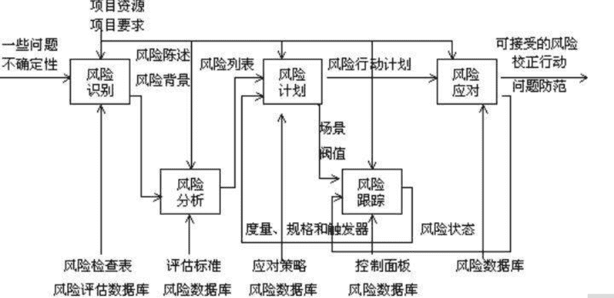

### 三. 风险管理的意义

从项目进度、质量和成本目标看，项目管理与风险管理的目标是一致的。通过风险管理来降低项目进度、质量、成本方面的风险实现项目目标。

从计划职能看，项目计划考虑的是未来，而未来存在不确定因素，风险管理的职能之一是减少项目整个过程中的不确定性，有利于计划的准确性。

从项目实施过程看，不少风险是在项目实施过程中由潜在变成现实的，风险管理就是在风险分析的基础上拟定具体措施来消除、缓和及转移风险，并避免产生新的风险。

## 11.2 项目风险的管理规划

### 1 风险管理规划的内容与依据

### 2 风险管理规划的依据

- 项目规划中包含或涉及的有关内容，例如，项目目标、项目规模、项目利益相关者情况、项目复杂程度、所需资源、项目时间段、约束条件及假设前提等可作为规划的依据。
- 项目组织及个人所经历和积累的风险管理经验及实践。
- 决策者，责任方及授权情况。
- 项目利益相关者对项目风险的敏感程度及可承受能力。
- 可获取的数据及管理系统情况。
- 风险管理模板，以使风险管理标准化、程序化。

### 2 风险管理规划的成果

1. 风险形势估计
2. 风险管理计划
3. 风险规避计划

## 11.3 项目风险识别

### 1 风险识别过程

风险识别过程是将不确定性转变为明确的风险陈述。

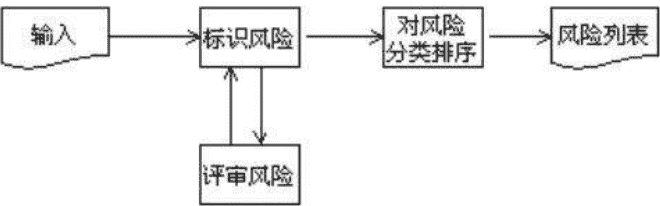

主要工作内容包括如下几个方面：

1. 识别并确定项目有哪些潜在的风险
2. 识别引起这些风险的主要影响因素
3. 识别项目风险可能引起的后果

### 2 风险条目检查表

#### 2. 需求风险

与客户相关的风险因素有：

- 对产品缺少清晰的认识。
- 对产品需求缺少认同。
- 在做需求时客户参与不够。
- 没有优先需求。
- 由于不确定的需要导致新的市场。
- 不断变化需求。
- 缺少有效的需求变化管理过程。
- 对需求的变化缺少相关分析。

#### 3. 商业影响风险检查表

下面是与商业影响有关的常见风险：

- 本产品对公司的收入有何影响？
- 本产品是否值得公司高管层的重视？
- 交付期限的合理性如何？
- 本产品是否与用户的需要相符合？
- 本产品必须能与之互操作的其他产品/系统的数目？
- 最终用户的水平如何？
- 延迟交付所造成的成本消耗是多少？
- 产品缺陷所造成的成本消耗是多少？

#### 4. 相关性风险

与外部环境相关的因素有：

- 客户供应条目或信息。
- 内部或外部转包商的关系。
- 交互成员或交互团体依赖性。
- 经验丰富人员的可得性。
- 项目的复用性。

#### 5. 管理风险

- 计划和任务定义不够充分。
- 实际项目状态。
- 项目所有者和决策者分不清。
- 不切实际的承诺。
- 员工之间的冲突。

#### 6. 技术风险

- 缺乏培训。
- 对方法、工具和新的技术理解的不够。
- 应用领域的经验不够。
- 待开发的软件是否需要与开发商提供未经证实的软件产品接口。
- 产品的需求是否要求采用特殊的功能、用户界面？
- 需求中的是否有过分的对产品的性能的约束。
- 客户能确定所要求的功能是否可行吗？

#### 7. 开发环境风险

开发环境风险是指与用以开发产品的工具的可用性及质量相关的风险。是否有可用的软件项目管理工具？

- 是否有可用的软件过程管理工具？
- 是否有可用的分析设计工具？
- 分析和设计工具是否适用？
- 是否有可用的软件测试工具？
- 是否有可用的软件配置管理工具？
- 环境是否利用了数据库或数据仓库？
- 工具的联机帮助及文档是否适当？

#### 8. 人员数目及经验风险

- 是否有最优秀的人员可用？
- 人员在技术上是否配套？
- 是否有足够的人员可用？
- 开发人员是否能够自始至终地参加整个项目的工作？
- 项目中是否有一些人员只能部分时间工作？
- 开发人员对自己的工作是否有正确的期望？
- 开发人员是否接受过必要的培训？
- 开发人员的流动是否仍然保证工作的连续性？

### 三. 头脑风暴法

直接头脑风暴法的核心是专家们之间通过思想信息交流，进而进行创造性思维产生思维共振和组合，形成更高级的思想信息。这种方法是通过专家会议的形式进行的，因而也称为专家会议法。

### 四. 情景分析法

是通过对项目未来的某个状态或某种情况（情景）的详细描述，并分析所描绘情景中的风险与风险要素，从而识别项目风险的一种方法。

## 11.4 风险分析

3. 项目风险影响范围的度量
4. 项目风险发生时间的度量

### 二. 风险估计方法

1. 定性风险估计：是针对风险概率及后果绩效定性的评估  
例如，采用历史资料、概率分布法、风险后果估计法等。

| 等级 | 等级说明 |
|---|---|
| A | 极高 |
| B | 高 |
| C | 中 |
| D | 低 |

| 等级 | 等级说明 |
|---|---|
| I | 灾难性的 |
| II | 严重 |
| III | 轻度 |
| IV | 轻微 |

矩阵中的加权指数称为风险评估指数，指数1到20是根据风险事件可能性和严重性水平综合而确定的。通常，将最高风险指数定为1，对应于风险事件是频繁发生的并是有灾难性的后果。风险发生概率的定性等级

| 概率等级 | I（灾难性的） | II（严重） | III（轻度） | IV（轻微） |
|---|---:|---:|---:|---:|
| A（极高） | 1 | 3 | 7 | 13 |
| B（高） | 2 | 5 | 9 | 16 |
| C（中） | 4 | 6 | 11 | 18 |
| D（低） | 8 | 10 | 14 | 19 |
| E（极低） | 12 | 15 | 17 | 20 |

## 11.4 风险分析

### 2. 定量风险估计

#### （1）风险的参照水准分析

对绝大多数软件项目来讲风险因素——成本、性能、支持和进度就是典型的风险参照系。

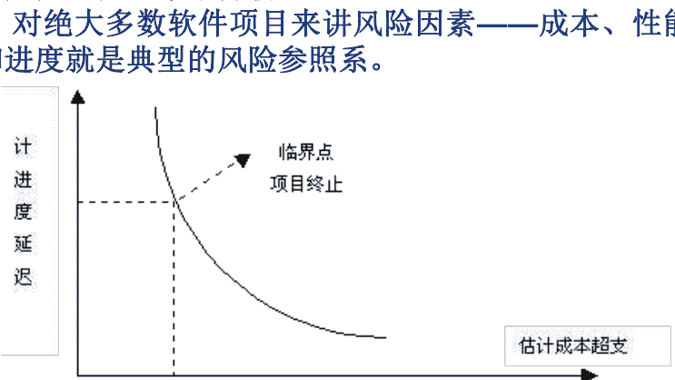

#### （2）敏感性分析

把所有其他不确定因素保持在基准值的条件下，考察项目的每项要素的不确定性对目标产生多大程度的影响。敏感性分析的目的是考察与项目有关的一个或多个主要因素发生变化时对该项目投资价值指标的影响程度。

#### （3）概率分析

参数解析法，也称组合频率法。该方法首先由各子效益和各子费用的统计参数通过一定的数学关系式求出总效益和总费用的统计参数，再由总效益和总费用的统计参数求出项目的经济效益指标（如净现值、效益费用比等）的统计参数，最后给各经济效益指标配置一定的概率分布线型，求出其分布。

随机模拟法，又称蒙特卡罗法，或统计实验法。是人为地构造出一种概率模型，使它的某些参数恰好重合于所需计算的量；又可以通过实验，用统计方法求出这些参数的估值；把这些估值作为要求的量的近似值。

#### （4）决策树分析

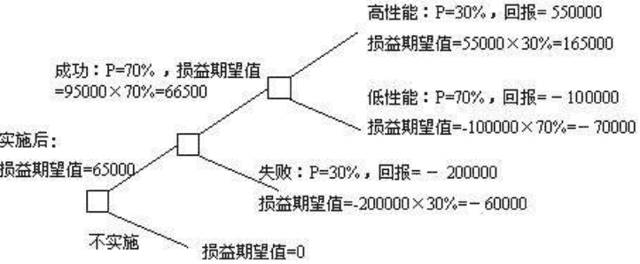

### 三. 风险评估

#### 1. 风险分类

#### 2. 风险分析

（1）项目风险原因的分析与确定

（2）项目风险后果的分析与确定

（3）项目风险发展时间进程的分析与确定

#### 3. 确定风险控制优先序列

#### 4. 给出项目风险识别和度量报告

### 风险分析结果

| 风险 | 类别 | 概率 | 影响 | 排序 |
|---|---|---|---|---|
| 用户变更需求 | 产品规模 | 80% | 5 | 1 |
| 规模估算可能非常低 | 产品规模 | 60% | 5 | 2 |
| 人员流动 | 人员数目及经验 | 60% | 4 | 3 |
| 最终用户抵制该计划 | 商业影响 | 50% | 4 | 4 |
| 交付期限将被紧缩 | 商业影响 | 50% | 3 | 5 |
| 用户数量大大超出计划 | 产品规模 | 30% | 4 | 6 |
| 技术达不到预期的效果 | 技术情况 | 30% | 2 | 7 |
| 缺少对工具的培训 | 开发环境 | 40% | 1 | 8 |
| 人员缺乏经验 | 人员数目及其经验 | 10% | 3 | 9 |

## 11.5 项目风险应对

风险应对就是对项目风险提出处置意见和办法。

### 一. 项目风险应对的原则

1. 可行、适用、有效性原则  
2. 经济、合理、先进性原则  
3. 主动、及时、全过程原则  
4. 综合、系统、全方位原则

### 二. 项目风险应对措施

1. 风险回避：是指当项目风险潜在威胁的可能性极大，并会带来严重的后果，无法转移又不能承受时，通过改变项目来规避风险。

2. 风险遏制：从遏制项目风险事件引发原因的角度出发，控制和应对项目风险。

3. 风险转移

4. 风险化解

5. 风险容忍

6. 风险分担

### 三、风险应对措施制定的结果

1. 项目风险管理计划

2. 项目风险应急计划

3. 风险储备

   - 项目预备金
   - 进度后备
   - 技术后备

## 11.6 项目风险监控

### 一. 项目风险监控概述

是要跟踪风险，识别剩余风险和新出现的风险，修改风险管理计划，保证风险计划的实施，并评估消减风险的效果，从而保证风险管理能达到预期的目标。

项目风险控制的内容主要包括：持续开展项目风险的识别与度量、监控项目潜在风险的发展、追踪项目风险发生的征兆、采取各种风险防范措施、应对和处理发生的风险事件、消除和缩小项目风险事件的后果、管理和使用项目不可预见费、实施项目风险管理计划等。

项目风险控制的依据主要有如下几个方面：

- 项目风险管理计划。

- 实际项目风险发展变化情况。一般用于监督和控制项目风险的文档有：事件记录、行动规程、风险预报等。

- 附加的风险识别和分析。

- 项目评审。

### 二. 项目风险监控程序

1. 建立项目风险事件控制体制

2. 确定要控制的具体项目风险

3. 确定项目风险的控制责任

4. 确定项目风险控制的行动时间

5. 制订各具体项目风险的控制方案

6. 实施具体项目风险控制方案

7. 跟踪具体项目风险的控制结果

8. 判断项目风险是否已经消除

### 三. 风险监控方法

一类用于监控与项目、产品有关的风险；  
另一类用于监控与过程有关的风险。

1. 风险预警系统  
2. 风险审计  
3. 技术指标分析

### 四. 风险监控成果

1. 随机应变措施

2. 纠正行动

3. 变更请求

4. 修改风险应对计划

## 案例学习

### 案例问题：

1. 该项目没有达到预期的目标，最终失败的原因主要是什么？

2. 项目经理在识别和处理风险方面有哪些不妥之处？为了降低项目风险，他应该怎样做？

3. 对于项目中可能出现的风险，你认为应该采取哪些措施？

4. 从本案例中你获得了哪些启示？

## 谢谢！

## Thank You！

## 软件项目管理

天津大学计算机学院

http://cs.tju.edu.cn

## 12.1 软件质量概述

### 1 质量的基本概念

质量是反映实体（产品、过程或活动等）满足明确和隐含的需要能力和特性总和。

- 所谓“实体”是指承载质量属性的具体事物。反映质量的实体包括产品、过程（服务）和活动（工作）3种

- 质量本身的含义是指“实体”能够满足用户需求的能力和特性的总和。“明确的需求”一般是在具体产品交易合同中标明的，“隐含的需求”一般是需要通过市场或用户调查获得的。

- 对于不同“实体”，质量的实质内容不同，即“实体”满足用户明确和隐含的需求在实质内容上也不同。

质量特性是指产品或服务满足人们明确或隐含需求的能力，内在质量特性：主要是指产品的性能、特性、强度、精度等方面的质量特性。

- 外在质量特性：主要是指产品外形、包装、装潢、色泽、味道等方面的特性。

- 经济质量特性：主要是指产品的寿命、成本、价格、运营维护费用等方面的特性。

- 商业质量特性：主要是指产品的保质期、保修期、售后服务水平等方面的特性。

- 环保质量特性：主要是指产品或服务对于环境保护的贡献或对于环境造成的污染等方面的特性。

### 二、软件质量

#### 1．软件质量定义

与软件产品满足规定的和隐含的需要的能力有关的特征或特性的组合。软件质量的特性是多方面的，但必须包括：

- 与明确确定的功能和性能需求的一致性，能满足给定需要的特性之全体。

- 与明确成文的开发标准的一致性。

- 与所有专业开发的软件所期望的隐含的特性的一致性。

- 顾客或用户认为能满足其综合期望的程度，软件的组合特性，它确定软件在使用中将满足顾客预期要求的程度。

### 2. 软件质量的要素

- 正确性：系统满足规格说明和用户的程度，即在预定环境下能正确地完成预期功能的程度。

- 健壮性：在硬件发生故障、输入的数据无效或操作等意外环境下，系统能做出适当响应的程度。

- 效率：为了完成预定的功能，系统需要的计算资源的多少。

- 完整性：对未经授权的人使用软件或数据的企图，系统能够控制的程度。

- 可用性：系统在完成预定应该完成的功能时令人满意的概率。

- 风险性：按预定的成本和进度把系统开发出来，并且使用户感到满意。

## 12.1 软件质量概述

- 可理解性：理解和使用该系统的容易程度。
- 可维修性：诊断和改正错误所需要的概率。
- 灵活性：修改或改正在运行的系统需要的工作量的多少。
- 可测试性：软件容易测试的程度。
- 可移植性：
- 可重用性：在其他应用中该程序可以被再次使用的程度。
- 可运行性：把该系统和另一个系统结合起来工作量的多少。

## 12.1 软件质量概述

### 三. 项目质量管理的概念

项目质量管理的基本概念也包括：项目质量方针的确定、项目质量目标和质量责任的制定，项目质量体系的建设，以及为实现项目质量目标所开展的项目质量计划、项目质量控制和项目质量保障等一系列的项目质量管理工作。

- 1. 使顾客满意是质量管理的目的
- 2. 质量是干出来的不是检验出来的
- 3. 质量管理的责任是全体员工的
- 4. 质量管理的关键是不断地改进和提高

## 12.2 软件质量的度量

### 一. 软件质量度量

软件度量是对软件开发项目、过程及其产品进行数据定义、收集以及分析的持续性定量化过程，目的在于对此加以理解、预测、评估、控制和改善。

度量取向是软件开发诸多事项的横断面，包括顾客满意度度量、质量度量、项目度量、以及品牌资产度量、知识产权价值度量等。度量取向要依靠事实、数据、原理、法则；其方法是测试、审核、调查；其工具是统计、图表、数字、模型；其标准是量化的指标。

### 软件开发主体及其度量内容

| 角色 | 度量内容 |
|---|---|
| 经营者 开发组织 | (1)顾客满意度；(2)收益；(3)风险；(4)绩效；(5)发布的缺陷的级别；(6) 产品开发周期；(7)日程与作业量估算精度；(8)复用有效性；(9)计划与实际的成本 |
| 管理者 项目组 | (1)不同阶段的成本；(2)不同开发小组成员的生产率；(3) 产品规模；(4)工作量分配；(5)需求状况；(6)测试用例合格率；(7)主要里程碑之间的估算期间与实际期间；(8)估算与实际的员工水平；(9)结合测试和系统测试检出的缺陷数目；(10)审查发现的缺陷数目；(11)缺陷状况；(12)需求稳定性；(13)计划和完成的任务数目 |
| 作业者 软件开发人员 | (1)工作量分配；(2)估算与实际的任务期间与工作量；(3)单体测试覆盖代码；(4)单体测试检出缺陷数目；(5)代码和设计的复杂性 |

软件度量的效用有如下几个方面：

- 理解：获取对项目、产品、过程和资源等要素的理解，选择和确定进行评估、预测、控制和改进的基线。
- 预测：通过理解项目、产品、过程、资源等各要素之间的关系建立模型，由已知推算未知，预测未来发展的趋势，以合理地配置资源。
- 评估：对软件开发的项目、产品和过程的实际状况进行评估，使软件开发的标准和结果都得到切实的评价，确认各要素对软件开发的影响程度。
- 控制：分析软件开发的实绩和计划之间的偏差，发现问题点之所在，并根据调整后的计划实施控制。
- 改善：根据量化信息和问题之所在，探讨提升软件项目、产品和过程的有效方式，实现高质量、高效率的软件开发。

## 12.2 软件质量的度量

### 二、软件度量的分类

| 度量维度 | 侧重点 | 具体内容 |
|---|---|---|
| 项目度量 | 理解和控制当前项目的情况和状态；项目度量具有战术性意义，针对具体的项目进行。 | 规模、成本、工作量、进度、生产力、风险、顾客满意度等 |
| 产品度量 | 侧重理解和控制当前产品的质量状况，用于对产品质量的预测和控制。 | 以质量度量为中心，包括功能性、可靠性、易用性、效率性、可维护性、可移植性等 |
| 过程度量 | 理解和控制当前情况和状态，还包含了对过程的改善和未来过程的能力预测；过程度量具有战略性意义，在整个组织范围内进行。 | 如成熟度、管理、生命周期、生产率、缺陷植入率等 |

### 三. 软件度量过程

- 开发一个度量过程并使其成为企业组织中标准软件过程的一部分；
- 通过定制与整合各种过程资产来对项目及相关手续拟定过程计划；
- 执行拟定的计划和相关手续来对项目进行过程的实施；
- 当项目进一步成熟且度量需求发生改变时，对相关计划及手续进行改进以改善该过程。

### 1. 过程计划的制定

- 确认范围：该活动的根据是要明确度量需求的大小，以限定一个适合于企业本身需求的度量过程。因为在整个度量过程中是需要花费人力、物力等有限资源的，不切实际的大而全或不足以反映实际结果的需求都会影响度量过程的可靠性以及企业的发展能力。
- 定义程序步骤：在确认了范围后，就需要定义操作及度量过程的步骤，在构造的同时应该成文立案。主要工作包括定义完整、一致、可操作的度量；定义数据采集方法以及如何进行数据记录与保存；定义可以对度量数据进行分析的相关技术，以使用户能根据度量数据得到这些数据背后的结果。

### 2．过程的实施

- **数据的采集：** 该活动根据已定义的度量操作进行数据的采集，记录及存储。此外，数据还应经过适当的校验以确认有效性。在进行该项活动时应具有一定的针对性，对于不同的项目或活动所需要的实际数据量是有差别的，而且对活动状态的跟踪也是非常重要的。
- **数据的分析：** 该项活动包括分析数据及准备报告，并提交报告，当然进行评审以确保报告足够的确实性是有必要的。这些程序步骤可能会需要更新，因为报告可能没有为使用者提供有益的帮助或使用者对报告中的内容不理解，在这两种情况下，都应回馈并更新度量过程以再进行数据分析。

## 12.3 软件质量管理

质量管理是在质量方面指挥和控制组织的协调的活动，指对确定和达到质量所必须的全总职能和活动的管理，包括制定质量方针和质量目标以及质量策划，通过质量计划的编制、质量控制、质量保证和质量提高等活动提高质量的活动。

- 软件项目的质量计划

软件项目质量计划就是要将与项目有关的质量标准标识出来，提出如何达到这些质量标准和要求的设想。项目质量保证计划的编写就是为了确定与项目相关的质量标准并决定达到标准的一种有效方法。

### 1. 软件质量标准

- 技术标准包含两个方面：一是作为软件开发企业的软件行业技术标准，包括知识体系指南、过程标准、建模标准、质量管理标准、程序语言标准、数据库标准；二是软件开发服务对象所在的行业技术标准，例如，安全保密标准、技术性能标准。
- 业务标准指的是软件开发服务对象所在的组织或行业制定的业务流程标准和业务数据标准等。

### 2. 质量计划的要求

- 确定应达到的质量目标和所有特性的要求。
- 确定质量活动和质量控制程序。
- 确定项目不同阶段中的职责、权限、交流方式以及资源分配。
- 确定采用控制的手段、合适的验证手段和方法。
- 确定和准备用量记录。

### 3. 质量计划的编写

在编制项目质量计划时，主要的依据如下：

- 质量方针。质量方针是由高层管理者对项目的整个质量目标和方向制定的一个指导性的文件。但在项目实施的过程中，可以根据实际情况对质量方针进行适当的修正。
- 范围描述。范围描述是质量计划的重要依据。
- 产品描述。产品描述包含了更多的技术细节和性能标准，是制定质量计划必不可少的部分。
- 标准和规则。项目质量计划的制定必须参考相关领域的各项标准和特殊规定。

在制定质量计划时，主要采取的方法和技术有：

- 效益/成本分析法。质量计划必须考虑效益与成本的关系。满足质量需求的主要效益时减少了重复性工作，即高产出、低成本、高用户满意度。
- 基准法。主要是通过比较项目的实施与其他同类项目的实施过程，为改进项目的实施过程提供借鉴和思路，并作为一个实施的参考标准。
- 流程图。可以包括原因结果图、系统流程图、处理流程图等。因此，流程图经常用于项目质量控制过程中，其主要目的是确定以及分析问题产生的原因。
- 试验设计。试验设计对于分析整个项目输出结果是最有影响的因素，也是十分有效的。对于软件开发、设计原型解决核心技术问题和主要需求也是可行和有效的。

### 2 软件项目质量保证

软件质量保证（Software quality assurance，SQA）是指确定、达到和维护所需要的软件质量而进行的所有有计划、有组织的管理活动。软件质量保证的目标是以独立审查方式，从第三方的角度监控软件开发任务的执行，就软件项目是否遵循已制定的计划、标准和规程，给开发人员和管理层提供反映产品和过程质量的信息和数据，提高项目透明度，同时辅助软件项目组取得高质量的软件产品。

## 12.3 软件质量管理

### 1. 质量保证策略

- 质量方针的制定和开展；
- 质量保证方针和质量保证标准的制定；
- 质量保证体系的建立和管理；
- 明确各个阶段的质量保证工作；
- 各个阶段的质量评审；
- 确保设计质量；
- 重要质量问题的提出与分析；
- 总结实现阶段的质量保证活动；
- 整理面向用户的文档、说明书等；
- 产品质量鉴定、质量保证系统鉴定；
- 质量信息的收集、分析和使用。

质量保证的策略主要分为3个阶段：

- 以检测为重：产品制成之后进行检测，只能判断产品质量，不能提高产品质量。
- 以过程管理为重：把质量的保证工作重点放在过程管理上，对开发过程中的每一道工序都要进行质量控制。
- 以产品开发为重：在产品的开发设计阶段，采取强有力的措施来消灭由于设计原因而产生的质量隐患。

### 2. 质量保证的内容

- (1) 与SQA计划直接相关的工作
- (2) 参与项目的阶段性评审和审计
- (3) 对项目日常活动与规程的符合性进行检查
- (4) 对配置管理工作的检查和审计
- (5) 跟踪问题的解决情况
- (6) 收集新方法，提供过程改进的依据

### 3. 软件质量保证措施

影响产品质量的因素，这些因素包括：

- 使用的方法和工具；
- 在开发和维护过程中应用的标准；
- 对开发和维护过程所进行的组织管理；
- 软件生产环境；
- 软件开发中人员的组织和管理；
- 工作人员的熟练程度；
- 对工作人员的奖励和工作条件的改善情况；
- 对外部项目转包商交付的产品的质量控制

基于非执行的测试（也称为复审或评审），基于执行的测试（即前面讲过的软件测试）和程序正确性证明。复审主要用来保证在编码之前各个阶段产生的文档的质量；基于执行的测试需要在程序编写出来之后进行，它是保证软件质量的最后一道防线；程序正确性证明使用数学方法严格验证程序是否对它的说明完全一致。

### 三. 质量控制

质量控制（Quality Control，QC）是确定项目结果是否与质量标准相符，同时确定消除不符合的原因和方法，控制产品的质量，及时纠正缺陷的过程。

- **1. 常见的质量问题**
  - 违背IT项目规律。如未经可行性论证，不做调查分析就启动项目；任意修改设计；不按技术要求实施，不经过必要的测试、检验和验收就交付使用等蛮干现象，致使不少软件项目留有严重的隐患。
  - 技术方案本身的缺陷。
  - 基本部件不合格。选购的软件组件、中间件、硬件设备等不稳定、不合格，造成整个系统不能正常运行。
  - 实施中的管理问题。

- **2. 质量控制过程**
  - **（1）事前质量控制**：指项目在正式实施前进行的质量控制，其具体工作内容有以下几类：
    - 审查开发组织的技术资源，选择合适的项目承包组织。
    - 对所需资源质量进行检查与控制。没有经过适当测试的资源不得在项目中使用。
    - 审查技术方案，保证项目质量具有可靠的技术措施。协助开发组织完善质量保证体系和质量管理制度。
  - **（2）事中质量控制**：指在项目实施过程中进行的质量控制，其具体工作内容有以下几类：
    - 协助开发组织完善实施控制。把影响产品质量的因素都纳入管理状态。建立质量管理点，及时检查和审核开发组织提交的质量统计分析资料和质量控制图表。
    - 严格交接检查。关键阶段和里程碑应有合适的验收。
    - 对完成的分项应按相应的质量评定标准和方法进行检查、验收并按合同或需求规格说明书行使质量监督权。
    - 组织定期或不定期的评审会议，及时分析、通报项目质量状况，并协调有关组织间的业务活动等。
  - **（3）事后质量控制**：指在完成项目过程形成产品后的质量控制，具体工作内容如下：
    - 按规定的质量评价标准和办法，组织单元测试和功能测试，并进行可能的检查验收。
    - 组织系统测试和集成测试。
    - 审核开发组织的质量检验报告及有关技术性文件。
    - 整理有关的项目质量的技术文件，并编号、建档。

- **3. 软件质量控制**

质量控制一般由开发人员实施，是直接对项目工作结果的质量进行把关，属于检查职能。质量控制的要点是：监控对象主要是项目工作结果；进行跟踪检查的依据是相关质量标准；对于不满意的质量问题，需要进一步分析其产生原因，并确定采取何种措施来消除这些问题。为了控制项目全过程中的质量，也应该遵循以下一些基本原则：

  - 控制项目所有过程的质量。
  - 过程控制的出发点是预防不合格。
  - 质量管理的中心任务是建立并实施文档管理的质量体系。
  - 持续的质量改进。
  - 定期评价质量体系。

- **4. 软件项目质量控制活动**
  - **（1）技术评审**

    主要评审的对象有：软件需求规格说明书、软件设计方案、测试计划、用户手册、维护手册、系统开发规程、产品发布说明等。技术评审应该采取一定的流程，这在企业质量体系或者项目计划中都有相应的规定，例如，下面是一个技术评审的建议流程：

    - 召开评审会议：一般应有3~5个相关领域的人员参加，会前每个参加者做好准备，评审会每次一般不超过2小时。
    - 在评审会上，由开发小组对提交的评审对象进行讲解。评审组可以对开发小组进行提问、提出建议和要求

  - **（2）代码走查**。代码走查也是一种非常有效的方法，它可以检查到其他测试方法无法监测到的错误，好多逻辑错误是无法通过测试手段发现的，代码走查是一种很好的质量控制方法。
  - **（3）代码会审**是由一组人通过阅读、讨论和争议对程序进行静态分析的过程。
  - **（4）软件测试**。
  - **（5）缺陷追踪**。

## 二．CMM标准体系

### 1．CMM的结构

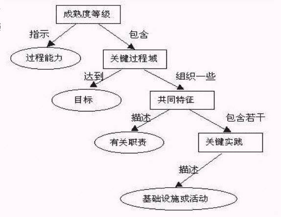

### 2．软件过程能力成熟度等级

- 初始级
- 可重复级
- 已定义级
- 已管理级
- 优化级

谢谢！Thank You!

软件项目管理

天津大学计算机学院

http://cs.tju.edu.cn

## 第13章 软件配置管理

- 1. 软件配置及其管理概念
- 2. 软件配置管理基本活动
- 3. 软件的测试管理

## 学习目标

- 理解软件配置管理的基本概念
- 了解软件配置管理的基本活动
- 熟悉软件测试的特点
- 理解测试的层次与内容
- 掌握软件测试计划的编制方法

## 13.1 软件配置及其管理的概念

**1 软件配置管理概述**

软件配置管理(SCM)是一组针对软件产品的追踪和控制活动，它贯穿于项目生命周期的始终，并代表着软件产品接受各项评审。IEEE对SCM的论述如下：“软件配置管理由适用于所有软件开发项目的最佳工程实践组成，无论是采用分阶段开发，还是采用快速原型进行开发，甚至包括对现有软件产品进行维护”。

实施有效的软件配置管理可以解决以下问题：

- 开发人员未经授权修改代码或文档；
- 人员流动造成企业的软件核心技术泄露；
- 找不到某个文件的历史版本；
- 无法重现历史版本；
- 无法重新编译某个历史版本，使维护工作十分困难；
- “合并版本”时，开发冻结，造成进度延误；
- 软件系统复杂、编译速度慢、造成进度延误；
- 因一些特性无法按期完成而影响整个项目的进度或导致整个项目失败；
- 已修复的Bug在新版本中出现；
- 配置管理制度难于实施；
- 分处异地的开发团队难于协同，可能会造成重复工作，并导致系统集成困难。

## 13.1 软件配置及其管理的概念

软件配置管理应该达到以下几个目标：

- 软件配置管理活动是有计划的；
- 选定的软件工作产品是已标识的、受控制的和适用的；
- 已标识的软件工作产品的变更是受控制的；
- 受影响的组织和个人可以适时得到软件基线的状态和内容的通知。

### 二. 软件配置项及基线

1. 基线：是指一个（或一组）配置项在项目生命周期的不同时间点上通过正式评审而进入正式受控的一种状态。基线是软件生命周期中各开发阶段的一个特定点，它的作用是把开发各阶段工作的划分更加明确化，使本来连续的工作在这些点上断开，以便于检查与肯定阶段成果。

- 功能基线
- 指派基线：指在软件需求分析阶段结束时，经过正式评审和批准的软件需求的规格说明。指派基线是最初批准的指派配置标识。
- 产品基线：指在软件组装与系统测试阶段结束时，经过正式评审的批准的有关所开发的软件产品的全部配置项的规格说明。产品基线是最初批准的产品配置标识。

### 2．软件配置项

在软件开发过程中产生的信息有3种。

- 计算机程序（源程序及目标程序）；
- 描述计算机程序的文档（包括技术文档和用户文档）；
- 数据结构。

软件配置是指一个软件产品在软件生存周期各个阶段所产生的各种形式（机器可读或人工可读）和各种版本的文档、程序及其数据的集合。该集合中的每一个元素称为该软件产品软件配置中的一个配置项（Software Configuration Item，SCI）。任何配置管理系统的基础都是存储和管理配置项。典型的软件配置项包括：目标文件、设计文档、测试包、源文件、库、类、编译器、需求说明、用户手册、测试脚本、修改请求、客户记录等。单独的函数、类可作为配置项，全局表也可作为配置项。

例：图13-1是一个会计系统的工资模块中的社会保险计算方法，这个方法的版本号是6，那么就可以把它标注为配置项“S6”。

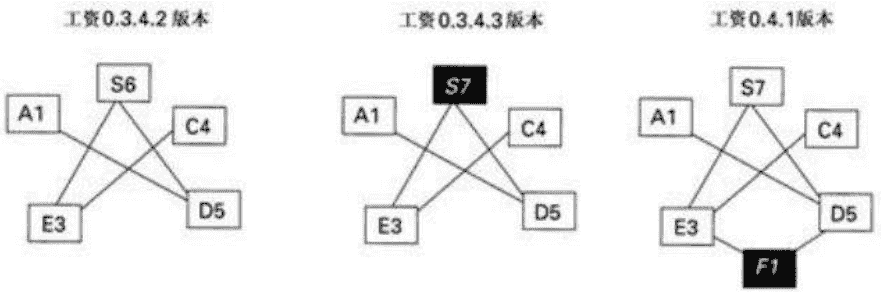

## 13.2 软件配置管理的基本活动

实施软件配置管理，主要包括以下活动：

- 制定配置管理计划；
- 确定配置标识；
- 版本管理；
- 变更控制；
- 系统整合；
- 配置审核。

### 1 制定软件配置计划

制定配置管理计划的过程就是确定软件配置管理的解决方案

- 项目经理和软件配置管理委员会（SCCB）根据项目的开发计划确定各个里程碑和开发策略；
- 根据SCCB的规划，制定详细的软件配置管理计划，交SCCB审核；
- SCCB通过配置管理计划后交项目经理批准，发布实施。

配置管理计划的一个关键任务就是确定要控制哪些文档。在已经建立了要管理的文档后，对于文档必须定义以下问题：

- 文件命名约定：文档命名约定在配置管理控制下，所有文档只能有一个唯一的文档名。相关的文档应该要有相关的名，这可以采用一个层次结构的命名约定来实现。
- 正式文档的关系（项目计划书、需求定义、设计报告、测试报告都是正式文档）；
- 确定负责验证正式文档的人员；
- 确定负责提交配置管理计划的人员。

制定配置管理计划中，必须定义以下问题：

- 根据已文档化的规程为每个软件项目制定软件配置管理计划。这个规程一般规定：在整个项目计划的初期制定软件配置管理计划，并与整个项目计划并行；由相关小组审查软件配置管理计划，管理和控制软件配置管理计划。
- 将已文档化且经批准的软件配置管理计划作为执行配置管理活动的基础。该计划应该包括：需要被执行的配置管理活动、活动的日程、指派的责任和需要的资源；配置管理的需求和由软件开发团队和其他相关小组执行的配置管理活动一样。

### 二. 配置管理环境的建立

包括建立配置管理的硬件环境和软件环境，同时建立存储库的操作说明和操作权限。其中最重要的是建立配置管理库，简称配置库。软件配置管理库是用来存储所有基线配置项及其相关文件等内容的系统，是在软件产品的整个生命周期中建立和维护软件产品完整性的主要手段。配置库存储包括配置项相应版本、修改请求、变化记录等内容，是所有配置项的集合和配置项修改记录的集合。

一般存储软件配置项的库分为开发库、受控库和产品库。开发库是开发周期的某个阶段，存放与该阶段工作有关的信息。受控库是指在软件生存周期的某一个阶段结束时，存放作为阶段产品而释放的、与软件开发工作有关的计算机可读信息和人工可读信息的库。软件配置管理就是对软件受控库中的各软件项进行管理，因此软件受控库也叫做软件配置管理库。产品库是指在软件生存周期的系统测试阶段结束后，存放最终产品而后交付给用户运行或在现场安装的软件的库。

### 4 版本管理

版本控制的目的在于对软件开发进程中文件或目录的发展过程提供有效的追踪手段，保证在需要时可回到旧的版本，避免文件的丢失、修改的丢失和相互覆盖。通过对版本库的访问控制避免未经授权的访问和修改，达到有效保护软件资产和知识产权的目的。另外，版本控制是实现团队并行开发、提高开发效率的基础。

版本控制要完成以下主要任务：

- 建立控制项；
- 重构任何修订版的某一项或者某一文件；
- 利用加锁技术防止覆盖；
- 当一个修订版时要求输入变更描述；
- 提供比较任意两个修订版的使用工具，采用增量存储方式；
- 提供对修订版历史和锁定状态的报告功能；
- 提供归并功能；
- 允许在任何时候、任何版本；
- 控制权限的设置；
- 渐进模型的建立；
- 提供各种控制报告。

### 5 变更控制

变更控制就是对软件配置的变更进行严格控制和管理，保持修改信息，并把清晰的信息传递到软件过程的下一步骤。变更控制包括建立控制点和建立报告与审查制度。首先用户提交书面的变更请求，详细申明变更的理由、变更方案、变更的影响范围等。然后由变更控制机构确定控制变更的机制、评价其技术价值、潜在的副作用、对其他配置对象和系统功能的综合影响以及项目的开销，并把评价的结果以变更报告的形式提交给变更控制负责人进行变更确认。

在变更控制程序中，首先要完成变更提案，然后，再如何解决变更提案。一般需要考虑以下因素：

- 变更的预期效益如何？
- 变更的成本如何？
- 项目变更进程后，对项目成本的影响如何？
- 变更对软件质量的影响如何？
- 变更对项目资源分配的影响如何？
- 变更可能会影响到项目后续的哪些阶段？
- 变更会不会导致出现不稳定的风险？

### 6 系统整合

系统整合是把系统的不同部分进行集成，使其完成一组特定的功能。

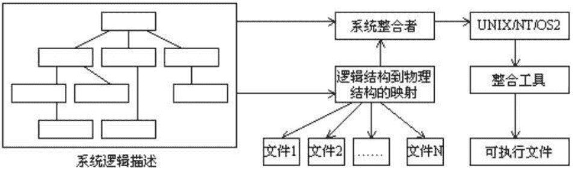

### 7 配置状态报告

配置状态报告应着重反映当前基线配置项的状态，以作为对开发进度报告的参照。同时也能从中根据开发人员对配置项的操作记录来分析开发团队成员之间的工作关系。

配置状态报告应该包括下列主要内容：

- 配置库结构和相关说明；
- 开发起始基线的构成；
- 当前基线位置及状态；
- 各基线配置项集成、分布情况；
- 各私有开发分支类型的分布情况；
- 关键元素的版本演进记录；
- 其他应予报告的事项。

### 8 配置审核

可以用以下两种方法去审查：

1. 正式技术评审：着重检查已完成修改的软件配置对象的技术正确性。
2. 软件配置审核：它是正式技术评审的补充，评价在评审期间通常没有被考虑的SCI的特性。

软件配置审核提出并解答以下问题：

- 在工程变更顺序中规定的变更是否已经做了？
- 每个附加修改是否已经纳入？
- 正式技术评审是否已经评价了技术正确性？
- 是否正确遵循了软件工程标准？

- 在SCI中是否强调了变更？是否包含了变更日期和变更者？配置对象的属性是否反映了变更？
- 是否遵循了标记变更、记录变更、报告变更和软件配置管理过程？
- 所有相关的SCI是否都正确地做了更新

## 13.1 软件的测试管理

### 一、软件测试的特点

1. 软件测试应注意的问题

- 1）测试用例和测试例程的良好设计。测试用例及测试例程的设计是整个软件测试工作的核心。测试用例反映对被测对象的质量要求，决定对测试对象的质量评估。
- 2）测试工作的管理。尤其是对包含多个子系统的大型软件系统，其测试工作涉及大量的人力和物力，有效的测试工作管理是保证有效测试工作的必要前提。
- 3）测试环境的建立：设计环境、实施环境和管理环境。

### 二、软件测试的难点

- 测试用例及测试例程是其设计者对被测对象实现原理和外部需求的理解，能否正确反映对被测对象的质量要求，很大程度上取决于其设计者的分析、理解和设计能力。这是一种缺乏指导性方法的、不易制订标准或规范的、需要“技巧”的设计活动。
- 缺乏测试管理方面的资料，几乎没有可供参考的、已实现的、完整的测试管理与测试实施模式。
- 软件测试的有效实施需要开发组织与测试组织充分配合。
- 有效的测试工作需要投入足够的人力和物力，需要对工作的难度和消耗有充分的估计。

### 三、测试的层次与内容

#### 1.1 软件测试的层次

软件测试工作包括两个层次：

- 测试工作的组织与管理，包括制定测试方法与规范、控制测试进度、管理测试资源。
- 测试工作的实施，包括编制符合标准的测试文档、研制测试环境、与开发组织协作实现各阶段的测试活动。

### 六、软件测试计划

（1）对测试范围的界定，简单的说就是测试活动需要覆盖的范围。
（2）风险的确定，项目中总是有不确定的因素。
（3）资源的规划，确定完成任务需要消耗的人力资源、物资资源。
（4）时间表的制定，在识别出子任务和资源之后，便可以将任务、资源和时间关联起来形成时间进度表。

谢谢！

Thank You！

软件项目管理

天津大学计算机学院

http://cs.tju.edu.cn

# 第14章 项目执行与控制

- 1. 项目计划的执行
- 2. 跟踪项目进展情况
- 3. 项目控制

## 14.1 项目计划的执行

### 一、项目执行输入

- 项目计划。包括具体项目的管理计划和绩效测量基准是对项目计划实施的主要投入。
- 辅助说明。包括在项目计划开发期间产生的附加信息和文件；技术性文件、要求、特征和设计等方面的文件；有关标准文件等。
- 组织管理政策。包括质量管理（通过审计，继续改进目标）；人事管理（招聘和解聘标准，雇员执行任务的情况分析）；财务监控（时间报告、要求的经费和支出情况分析、会计帐目和标准合同条款）等。
- 纠正措施。

### 二、项目执行的工具和方法

- 普通管理技能。普通管理技能包括领导艺术、信息交流和协商组织等，都对项目计划的实施产生实质性的影响。
- 产品所需的技能和知识。
- 工作分配体系。工作分配体系是为确保批准的项目工作能按时、按序地完成而建立的正式程序。
- 绩效检查例会。
- 项目管理信息系统。
- 组织管理程序。项目的所有组织管理程序包括了运用在项目实施过程中的正式的和非正式的程序。

### 二、项目执行成果

- 工作成果。工作成果是为完成项目工作而进行的具体活动结果。工作成果资料——工作细目的划分、工作已经完成或没有完成，满足质量标准的程度怎样，已经发生的成本或将要发生的成本是什么等——这些资料都被收集起来，作为项目计划实施的一部分，并将其编入执行报告的程序中。
- 改变要求。例如，扩大或修改项目合同范围，修改成本或进行估算等等。通常是在项目工作实施时得到确认。

## 14.2 跟踪项目进展情况

### 1. 明确跟踪采集对象

下面是一些跟踪采集内容的实例：

- 依据项目计划的要求确定跟踪频率和记录数据的方式。
- 按照跟踪频率记录实际任务完成的情况。
- 按照跟踪频率记录完成任务所花费的人力和工时。
- 根据实际任务进度和实际人力投入计算实际人力成本和实际任务规模。
- 记录除人力成本以外的其他成本消耗。
- 记录项目进行过程中风险发生的情况及处理对策。
- 按期按任务性质统计项目任务的时间分配情况。
- 收集其他要求的采集信息以及不要的度量信息等。

### 2. 项目跟踪过程

- 跟踪采集过程主要是在项目生存期内根据项目计划中规定的跟踪频率，按照规定的步骤对项目管理、技术开发和质量保证活动进行跟踪，以监控项目实际情况，记录反映当前项目状态的数据（例如，进度、资源、成本、性能和质量等），用于对项目计划的执行情况进行比较分析，属于项目度量实施过程。

### 3. 常用的采集工具

- 定期项目内部报告：定期项目内部报告是在项目团队中传递项目执行情况的比较正式的方式。
- 项目例会：项目例会一般是一个开放式会议。
- E-mail：一个简单的办法是让开发团队的成员通过E-mail的方式汇报他们在分配的任务中花费的时间和完成的情况。
- 电子表格：这是一个具有收集、计算、汇总功能的方法。每个成员可以通过电子表格的形式汇报他们工作的完成情况。
- 项目管理软件。

## 14.3 项目控制

- 1. 根据项目目标制定控制计划
- 2. 设定阶段成果验收准则
- 3. 汇报和收集项目进展信息
- 4. 判断偏差
- 5. 分析偏差产生的原因和趋势
- 6. 采取适当的纠正预防措施
- 7. 跟踪评估措施的有效性。

### 一、范围控制

#### 1. 项目范围变更的原因分析

- 项目的生命周期。项目的生命周期越长，项目的需求、范围就越容易发生变更。
- 项目的组织。项目的组织越科学、越有力，则越能有效制约项目范围的变化。反之，缺乏强有力的组织保障的项目范围则较容易发生变化。
- 项目经理的素质。

### 一、范围控制

#### 2. 项目范围控制的主要步骤

- 在收集到已完成活动的实际范围和项目变更带来的影响的有关数据，并据此更新项目范围后，对范围进行分析并与原范围计划进行比较，找出要采取纠正的地方。
- 对需要采取措施的地方确定应采取的具体措施。
- 估计所采取的纠正措施的效果，如果所采取的纠正措施仍无法获得满意的范围调整，则重复以上步骤。

### 4. 项目范围变更控制的作用

项目范围变更控制的作用主要体现在以下几个方面：

- 合理调整项目范围。项目范围变更常常伴随着对成本、进度、质量或项目其他目标的调整和变更。
- 纠偏行动。由于项目的变化所引起的项目变更偏离了计划轨迹，产生了偏差。为保证项目目标的顺利实现，就必须进行纠正。
- 总结经验教训。导致项目范围变更的原因、所采取的纠偏行动的依据及其他任何来自变更控制实践中的经验教训，都应该形成文字、数据和资料，以作为项目组织保存的历史资料。

### 一、进度控制

#### 1. 项目进度控制的依据

- (1) 项目进度计划文件
- (2) 项目工期计划实施情况报告
- (3) 项目变更的请求
- (4) 项目进度管理的计划安排

#### 2. 项目进度分析

编制的项目进度计划不切实际；人为因素的不利影响；设计变更因素的影响；资金、设备等原因的影响；不可预见的政治、经济等项目外部环境等因素的影响。

### 3. 进度控制的工具和方法

#### （1）甘特图检查法

利用甘特图进行进度控制时，可将每天、每周或每月实际进度情况定期记录在横道图上，用以直观地比较计划进度与实际进度，检查实际执行的进度是超前、落后，还是按计划进行。若通过检查发现实际进度落后了，则应采取必要措施，改变落后状况；若发现实际进度远比计划进度提前，可适当降低单位时间的资源用量，使实际进度接近计划进度。这样常可降低相应的成本费用。

#### （2）S形曲线检查法

将成本实际执行情况绘制在与计划S型曲线同一张图中，与计划进度相比较的一种方法。

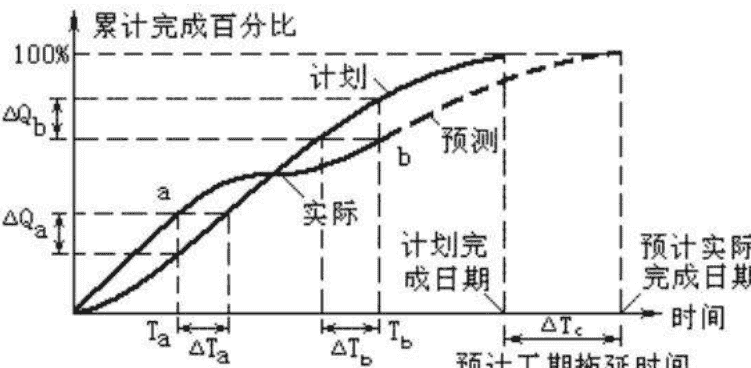

## 14.3 项目控制

### （3）前锋线检查法

又称实际进度前锋线，它是在网络计划执行中的某一时刻正在进行的各活动的实际进度前锋的连线。前锋线一般是在时间坐标网络图上标示的。

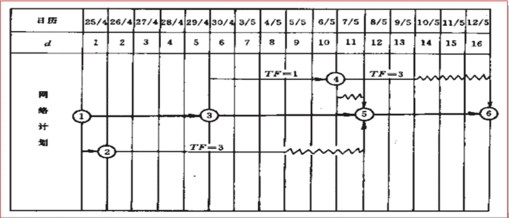

从时间坐标轴开始，自上而下依次连接各线路的实际进度前锋，即形成一条波折线，这条波折线就是前锋线，如图14-3中的波折线。图14-3是一份时间坐标网络计划用前锋线进行检查的示例图。该图有2条前锋线，分别记录了2日和4日2次检查的结果。

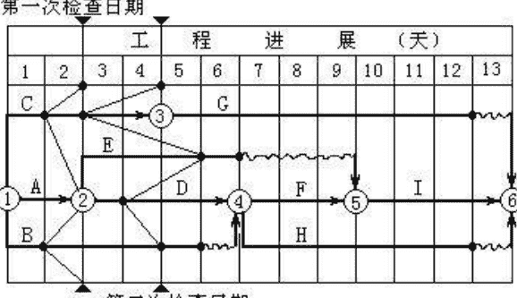

实际进度前锋线的功能包括两个方面：

- 分析当前进度。以表示检查时刻的日期为基准，前锋线可以看成描述实际进度的波折线。处于波峰上的线路，其进度相对于相邻线路超前，处于波谷上的线路，其进度相对于相邻线路落后。在基准线前面的线路比原计划超前，在基准线后面的线路比原计划落后。画出前锋线，整个工程在该检查计划时刻的实际进度状况便可一目了然。按一定时间间隔检查进度计划，并画出每次检查时的实际进度前锋线，可形象地描述实际进度与计划进度的差异。检查时间间隔愈短，描述愈精确。

- 预测未来进度。通过对当前时刻和过去时刻两条前锋线的分析比较，可根据过去和目前情况，在一定范围对工程未来的进度变化趋势做出预测。可引进进度比概念进行定量预测。

前后两条前锋线间某线路上截取的线段长度\(\Delta X\) 与这两条前锋线之间的时间间隔\(\Delta T\) 之比叫进度比，用 B 表示。进度比 B 的数学计算式为：\( B \doteq \frac{\Delta X}{\Delta T} \)

B的大小反映了该线路的实际进展速度的大小。某线路的实际进展速度与原计划相比是快、是慢或相等时， B 相应地大于1、小于1或等于1。根据 B 的大小，就有可能对该线路未来的进度做出定量的分析。

### 3. 对后续活动及工期影响的分析

#### (1) 判断此时进度偏差是否处于关键路线上

即确定出现进度偏差的这项活动的总时差是否为零。若这项活动的总时差为零，说明此项活动在关键路线上，其偏差对后续活动及总工期会产生影响，必须采取相应的调整措施；若总时差不为零，说明此项活动处在非关键线路上。

#### (2) 判断进度延误的时间是否大于总时差

若某活动进度的延误大于该活动的总时差，说明此延误必将影响后续活动及工期；若该延误小于或等于该活动的总时差，说明该延误不会影响工期，但它是否对后续活动产生影响，需作进一步分析。

#### (3) 判断进度延误是否大于自由时差

若某活动的进度延误大于该活动的自由时差，说明此延误将对后续活动产生影响，需作调整；反之，若此延误小于或等于该活动的自由时差，说明此延误不会对后续活动产生影响，原进度可不调整。

当实际进度滞后是否对进度计划做出调整的具体情形分述如下：

- 若出现进度偏差的工作为关键工作，势必影响后续工作和工期，必须调整。
- 若出现进度偏差的工作为非关键工作，且滞后工作天数超过其总时差，会使后续工作和工期延误，必须调整。
- 若出现进度偏差的工作为非关键工作，且滞后工作天数超过其自由时差而未超过总时差，不会影响工期，只有在后续工作最早开工不宜推后情况下才进行调整。
- 若出现进度偏差的工作为非关键工作，且滞后工作天数未超过其自由时差，对后续工作和工期无影响，不必调整。

### 4. 进度的调整

- （1）关键任务的调整。
- （2）改变活动间的逻辑关系。
- （3）改变活动持续时间。
- （4）非关键工作的调整。
- （5）增减工作项目。
- （6）资源调整。
- （7）重新编制计划。

## 二. 成本控制

### 1. 成本控制的原则

- (1) 节约原则。
- (2) 经济原则。
- (3) 责任权利相结合的原则。
- (4) 全面控制原则。
- (5) 按例外管理的原则。

### 2. 成本控制的依据

(1) 项目成本基准。项目成本基准又称费用线，是按时间分段的项目成本预算，是度量和监控项目实施过程中项目成本费用支出的最基本的依据。

(2) 项目执行报告。项目执行报告提供项目范围、进度、成本、质量等信息，它反映了项目预算的实际执行情况。

(3) 项目变更申请。

(4) 项目成本管理计划。项目成本管理计划确定了当项目实际成本与计划成本发生差异时如何进行管理，是对整个成本控制过程的有序安排，是项目成本控制的有力保证。

### 3. 成本控制方法 （1）项目成本分析表法

项目成本分析表法是利用项目中的各种表格进行成本分析和成本控制的一种方法。应用成本分析表法可以很清晰地进行成本比较研究。常见的成本分析有月成本分析表、成本日报或周报表、月成本计算及最终预测报告表。每月编制月成本计算及最终成本预测报告表，是项目成本控制的重要内容之一。该报告主要事项包括项目名称、已支出金额、已竣工尚需的预计金额、盈亏预计等。月成本计算及最终成本预测报告要在月末会计帐簿截止的同时完成，并随时间推移使精确性不断增加。

### （2）香蕉形曲线比较法

- 1）以项目的网络计划为基础，确定该实施项目的工作数目 n 和计划检查次数 m，并计算时间参数 ESi、LSi（i=1、2...n）；
- 2）确定各项工作在不同时间，计划完成任务量。分为两种：
  - 以项目的最早时标网络图为准，确定各工作在各单位时间的计划完成任务量，常用 TES（i，j）表示，即第 i 项工作按最早时间开工，在第 j 时间完成的任务量（i=1、2...n；j=1、2...，m）。
  - 以项目的最迟时标网络图为准，确定各工作在各单位时间的计划完成任务量用 TEF（i，j）表示，即第 i 项工作按最迟开始时间开工，在第 j 时间完成的任务量（i=1、2...n；j=1、2...m）。
- 3）计算施工项目总任务量。
- 4）计算在时刻完成的总任务量分为两种情况。
- 5）计算在时刻完成项目总任务量百分比也分为两种情况。

6）绘制“香蕉”型曲线。按(i=1、2…m)描绘各点，并连接各点得ES曲线。按(i=1、2…m)描绘各点，并连接各点得LS曲线，由ES曲线和LS曲线组成“香蕉”型曲线。

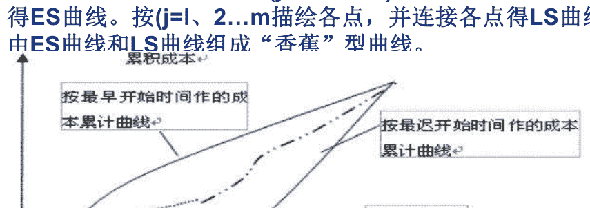

图14-4 成本的香蕉曲线图

### （3）挣值法

挣值法是一种分析目标实施与目标期望之间差异的方法。故而它又常被称为偏差分析法。挣值法通过测量和计算已完成的工作的预算费用与已完成工作的实际费用和计划工作的预算费用得到有关计划实施的进度和费用偏差，达到判断项目预算和进度计划执行情况的目的。因而它的独特之处在于以预算和费用来衡量工程的进度。

挣值法三个参数：

- 计划工作量的预算费用（BCWS），即（Budgeted Cost for Work Scheduled）。BCWS是指项目实施过程中某阶段计划要求完成的工作量所需的预算工时（或费用）。计算公式为：BCWS=计划工作量×预算定额。BCWS主要是反映进度计划应当完成的工作量，而不是反映应消耗的工时或费用。
- 已完成工作量的预算实际费用（ACWP），即（Actual Cost for Work Performed）。ACWP是指项目实施过程是某阶段实际完成的工作量所消耗的工时（或费用）。ACWP主要反映项目执行的实际消耗指标。

挣值法三个参数：

- 已完成工作 Work Perf
- 完成工作量（Earned \n 作量×预算
- 4个评价指标
- 费用偏差CV（
- 间的差异，
- 进度偏差SV（
- BCWS之间

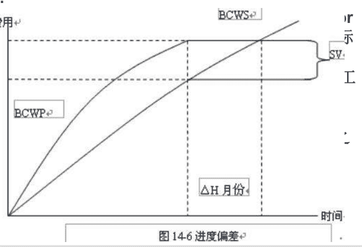

费用执行指标CPI（Cost Performed Index）是指预算费用与实际费用值之比（或工时值之比）。

计算公式为：CPI=BCWP / ACWP

当CPI>1时，表示低于预算，即实际费用低于预算费用；
当CPI<1时，表示超出预算，即实际费用高于预算费用；
当CPI=1时，表示实际费用与预算费用吻合。

进度执行指标SPI（Schedul Performed Index）是指项目挣值与计划之比，即：

SPI=BCWP / BCWS

当SPI>1时，表示进度提前，即实际进度比计划进度快；
当SPI<1时，表示进度延误，即实际进度比计划进度慢；
当SPI=1时，表示实际进度等于计划进度。

## 14.3 项目控制

### 4）分析与建议

最理想的状态是ACWP、BCWS、BCWP3条曲线靠得很近、平稳上升，表示项目按预定计划目标前进。如果三条曲线离散度不断增加，则预示可能发生关系到项目成败的重大问题。经过对比分析，如果发现项目某一方面已经出现费用超支，或预计最终将会出现费用超支，则应将它提出并作进一步的原因分析。原因分析是费用责任分析和提出费用控制措施的基础，费用超支的原因是多方面的，例如：

- 宏观因素。总工期延拖，物价上涨，工作量大幅度增加。
- 微观因素。分项工作效率低，协调不好，局部返工。
- 内部原因。管理失误，不协调，采购了劣质材料，培训不充分，事故、返工。
- 外部原因。上级、业主的干扰，设计的修改，其他风险等。
- 还有技术的、经济的、管理的、合同的等方面原因。

### 4. 成本控制的结果

- 成本估算更新
- 成本预算更新
- 纠正措施
- 经验教训

谢谢！

Thank You！

软件项目管理

天津大学计算机学院

http://cs.tju.edu.cn

# 第15章 项目收尾与验收

- 1. 项目收尾概述
- 2. 项目验收
- 3. 项目移交与清算
- 4. 项目后评价

## 学习目标

- 理解成功与失败的标准
- 了解在什么情况下项目终结或收尾
- 掌握项目验收的内容
- 掌握项目移交与清算的活动内容
- 熟悉项目后评价的特点与方法

## 15.1 项目收尾概述

### 一. 项目结束

#### 1. 项目成功与失败的标准

评定项目成功与失败的标准主要有3个：是否有可交付的合格成果；是否实现了项目目标；是否达到项目客户的期望。

#### 2. 项目终结

项目终结工作和项目刚开始时接受的任务相比，其中有一些相当繁琐、枯燥乏味，无论是项目成员还是客户、无论是项目内部还是项目外部都面临着很多的问题。

### 二. 项目收尾过程

- 范围确认：项目接收前，重新审核工作成果，检验项目的各项工作范围是否完成，或者完成到何种程度，最后双方确认签字。
- 质量验收：质量验收是控制项目最终质量的重要手段，依据质量计划和相关的质量标准进行验收，不合格不予接收。
- 费用决算：是指对项目开始到项目结束全过程所支付的全部费用进行核算，编制项目决算表的过程。
- 合同终结：整理并存档各种合同文件。这是完成和终结一个项目或项目阶段各种合同的工作，包括项目的各种商品采购和劳务承包合同。这项管理活动中还包括有关项目或项目阶段的遗留问题解决方案和决策的工作。
- 文档验收：检查项目过程中的所有文件是否齐全，然后进行归档。
- 项目后评价：它是对项目进行全面的评价和审核，主要包括确定是否实现项目目标，是否遵循项目进度计划、是否在预算内完成项目，项目过程中出现的突发问题以及解决措施是否合适等。

## 15.2 项目验收

软件项目的验收包含4个层次的含义：
开发方按合同要求完成了项目工作内容；
开发方按合同中有关质量、资料等条款要求进行了自检；
项目的进度、质量、工期、费用均满足合同的要求；
客户方按合同的有关条款对开发方交付的软件产品和服务进行确认。

## 15.3 项目移交与清算

在项目收尾阶段，如果项目达到预期的目标，就是正常的项目验收、移交过程；如果项目没有达到预期的效果，并且由于种种原因已不能达到预期的效果，项目已没有可能或没有必要进行下去了而提前终止，这种情况下的项目收尾就是清算，项目清算是非正常的项目终止过程。

### 一. 项目移交

- 软件项目的移交成果包括以下一些内容：
- 已经配置好的系统环境；
- 软件产品，例如，软件光盘介质等；
- 项目成果规格说明书；
- 系统使用手册；
- 项目的功能、性能技术规范；
- 测试报告等。

移交阶段具体的工作包括：

- 对项目交付成果进行测试，可以进行Alpha测试、Beta测试等各种类型的测试。
- 检查各项指标，验证并确认项目交付成果满足客户的要求。
- 对客户进行系统的培训，以满足客户了解和掌握项目结果的需要。
- 安排后续维护和其他服务工作，为客户提供相应的技术支持服务，必要时另行签定系统的维护合同。
- 签字移交。

### 二、项目清算

主要的依据与条件包括：

- 项目规划阶段已存在决策失误，例如，可行性研究报告依据的信息不准确，市场预测失误，重要的经济预测有偏差等等诸如此类的原因造成项目决策失误。
- 项目规划、设计中出现重大技术方向性错误，造成项目的计划不可能实现。
- 项目的目标已与组织目标不能保持一致。
- 环境的变化改变了对项目产品的需求，项目的成果已不适应现实需要。
- 项目范围超出了组织的财务能力和技术能力。
- 项目实施过程中出现重大质量事故，项目继续运作的经济或社会价值基础已经不复存在。
- 项目虽然顺利进行了验收和移交，但在软件运行过程中发现项目的技术性能指标无法达到项目设计的要求，项目的经济或社会价值无法实现。
- 项目因为资金或人力无法近期到位，并且无法确定可能到位的具体期限，使项目无法进行下去。

### 项目清算程序为：

- 组成项目清算小组：主要由投资方召集项目团队、工程监理等相关人员。
- 项目清算小组对项目进行的现状及已完成的部分，依据合同逐条进行检查。对项目已经进行的、并且符合合同要求的，免除相关部门和人员责任；对项目中不符合合同目标的，并有可能造成项目失败的工作，依合同条款进行责任确认，同时就损失估算、索赔方案、拟定等事宜的协商。
- 找出造成项目流产的所有原因，总结经验。
- 明确责任，确定损失，协商索赔方案，形成项目清算报告，合同各方在清算报告上签证，使之生效。

## 15.4 项目后评价

### 项目后评价的方法

- 影响评价法：项目建成后测定和调研在各阶段所产生的影响和效果，以判断决策目标是否正确。
- 效益评价法：把项目产生的实际效果或项目的产出，与项目的计划成本或项目投入相比较，进行盈利性分析，以判断项目当初决定投资是否值得。
- 过程评价法：把项目从立项决策、设计、采购直至建设实施各程序的实际进程与原订计划、目标相比较，分析项目效果好坏的原因，找出项目成败的经验和教训，使以后项目的实施计划和目标的制定更加切合实际。
- 系统评价方法：将上面3种评价方法有机地结合起来进行综合评价，才能取得最佳评价结果。

项目后评价的基本范围

- （1）项目目标的后评价
- （2）项目决策阶段的后评价
- （3）项目实施过程的后评价
- （4）项目影响评价和项目持续性后评价

### 项目后评价的基本内容

#### （1）项目的技术经济后评价

项目技术后评价：技术水平后评价主要是对设计方案、采用的技术的可靠性、适用性、配套性、先进性、经济合理性的再分析。在决策阶段认为可行的技术和方案，在使用中有可能与预想的结果有差别，许多不足之处逐渐暴露出来，在评价中就需要针对实践中存在的问题、产生的原因认真总结经验，在以后的设计或项目中选用更好、更适用、更经济的方案，或对原有的技术方案进行适当的调整，发挥其潜在的效益。

项目财务后评价：项目的财务后评价与前评估中的经济分析在内容上基本是相同的，都要进行项目的盈利性分析、清偿能力分析等。但在评价中采用数据不能简单地使用实际数，应将实际数中包含的物价指数扣除，并使之与前评估中的各项评价指标在评价时点和计算效益的范围上都可比。在盈利性分析中要通过全投资和自有资金现金流量表，计算全投资税前内部收益率、净现值，自有资金税后内部收益率等指标，通过编制损益表，计算资金利润率、资金利税率、资本金利润率等指标，以反映项目和投资者的获利能力。清偿能力分析主要通过编制资产负债表、借款还本付息计算表，计算资产负债率、流动比率、速动比率、偿债准备率等指标，反映项目的清偿能力。

## 15.4 项目后评价

### 项目后评价的基本内容

#### （2）项目的社会效益评价

社会效益评价是总结了已有经验，借鉴、吸收了国外社会效益分析、社会影响评价与社会分析方法的经验设计的。它包括社会效益与影响评价和项目与社会两相适应的分析。既分析项目对企业的贡献与影响，又分析项目对社会政策贯彻的效用，研究项目与社会的相互适应性，揭示防止社会风险，从项目的社会可行性方面为项目决策提供科学分析依据。

### 项目后评价的实施

#### 1. 项目后评价的工作程序

- 接受后评价任务、签定工作合同或评价协议。
- 成立后评价小组、制定评价计划。
- 设计调查方案、聘请有关专家。
- 阅读文件、收集资料。
- 开展调查、了解情况。
- 分析资料、形成报告。
- 提交后评价报告、反馈信息。

#### 2. 项目后评价报告的编写

后评价报告的编写要真实反映情况，客观分析问题，认真总结经验。为了让更多的单位和个人受益，评价报告的文字要求准确、清晰、简练，少用或不用过分专业化的词汇。评价结论要与未来的规划和政策的制定联系起来。为了提高信息反馈速度和反馈效果，让项目的经验教训在更大的范围内起作用，在编写评价报告的同时，还必须编写并分送评价报告摘要。

后评价报告是反馈经验教训的主要文件形式，为了满足信息反馈的需要，便于计算机输入，评价报告的编写需要有相对固定的内容格式。被评价的项目类型不同，评价报告所要求书写的内容和格式也不完全一致。

谢谢！

Thank You !
