# 奥克兰 COMPSCI 111 计算机实践参考手册

## COMPSCI 111/111G
## An Introduction to Practical Computing

COMPSCI 111/111G
Computer Science Department
The University of Auckland

## COMPSCI 111/111G
### 实用计算导论
### 参考手册

2016年6月10日

安德鲁·拉克斯顿-雷利
版权所有 © 2008年

# 版权声明

本课程教材仅可用于大学的教育目的。它包含根据版权许可证复制的版权作品摘录。您不得将本课程教材的任何部分复制或分发给任何人。如果以电子格式提供本课程教材，则只能从中打印供个人使用。您不得为任何其他目的制作进一步的副本。未遵守本警告条款可能使您面临版权侵权的法律诉讼和/或大学的纪律处分。

# 致谢

感谢所有为开发这个资源做出贡献的人。特别感谢安·卡梅伦对广泛反馈和无尽校对的支持。

# 反馈

我们欢迎对课程教材的任何反馈。请将所有更正、评论和其他对本课程教材的反馈发送至 andrew@cs.auckland.ac.nz

## 目录

- **学习成果** (xv)
- **1 数字信息** (1)
  - 1.1 模拟与数字系统 (1)
    - 1.1.1 模拟系统 (1)
    - 1.1.2 数字 (1)
    - 1.1.3 数字系统 (2)
  - 1.2 数字信息编码 (3)
    - 1.2.1 图像编码 (3)
    - 1.2.2 声音编码 (3)
  - 1.3 二进制数 (4)
    - 1.3.1 将十进制数存储在计算机中 (4)
    - 1.3.2 位 (5)
    - 1.3.3 将二进制数转换为十进制数 (5)
    - 1.3.4 字节 (6)
  - 1.4 推荐阅读 (6)
  - 1.5 自测题 (7)
- **2 计算机系统** (9)
  - 2.1 简介 (9)
  - 2.2 处理硬件 (10)
    - 2.2.1 CPU 内部 - 高级，不可考 (11)
  - 2.3 存储组件 (14)
    - 2.3.1 主存储器 (14)
    - 2.3.2 大容量存储器（辅助存储器） (15)
  - 2.4 输入组件 (15)
  - 2.5 输出组件 (16)
- **3 在线出版** (17)
  - 3.1 简介 (17)
  - 3.2 万维网作为媒体来源 (17)
  - 3.3 博客 (18)
  - 3.4 维基 (18)
  - 3.5 推荐阅读 (18)
- **4 维基** (19)
  - 4.1 介绍 - 什么是维基？ (19)
  - 4.2 第一阶段维基 (19)
    - 4.2.1 教学与学习 (20)
    - 4.2.2 期望 (20)
  - 4.3 使用 MediaWiki (21)
    - 4.3.1 登录 (21)
    - 4.3.2 标签 (25)
    - 4.3.3 文章标签 (25)
    - 4.3.4 讨论标签 (25)
    - 4.3.5 编辑标签 (25)
    - 4.3.6 编辑冲突 (28)
    - 4.3.7 历史标签 (30)
    - 4.3.8 移动标签 (30)
    - 4.3.9 关注标签 (31)
  - 4.4 标记 (31)
    - 4.4.1 标题 (31)
    - 4.4.2 换行 (34)
    - 4.4.3 列表 (34)
    - 4.4.4 缩进 (37)
    - 4.4.5 预格式文本 (37)
    - 4.4.6 水平线 (38)
    - 4.4.7 添加作者姓名 (39)
    - 4.4.8 链接 (39)
    - 4.4.9 字符格式 (41)
  - 4.5 创建新页面 (42)
    - 4.5.1 跟随链接 (43)
    - 4.5.2 创建新链接 (43)
  - 4.6 参考文献 (43)
- **5 HTML** (45)
  - 5.0.1 HTML 和 XHTML 的版本 (45)
  - 5.0.2 文档类型定义 (46)
  - 5.0.3 编码标准 (46)
  - 5.1 超文本标记语言 (HTML) (46)
  - 5.2 标签 (47)
    - 5.2.1 嵌套标签 (48)
    - 5.2.2 标签的属性 (48)
  - 5.3 HTML 的基本标签 (49)
    - 5.3.1 `<html>` (49)
    - 5.3.2 `<head>` (50)
    - 5.3.3 `<title>` (50)
    - 5.3.4 `<body>` (51)
    - 5.3.5 一个简单的例子 (51)
  - 5.4 块级标签 (52)
    - 5.4.1 `<h1>` 到 `<h6>` (53)
    - 5.4.2 `<p>` (53)
    - 5.4.3 `<hr>` (54)
    - 5.4.4 `<pre>` (55)
    - 5.4.5 表格 (56)
    - 5.4.6 列表 (58)
  - 5.5 内联标签 (60)
    - 5.5.1 `<br>` (61)
    - 5.5.2 `` (62)
    - 5.5.3 `<a>` (65)
  - 5.6 统一资源定位符 (67)
    - 5.6.1 协议 (67)
    - 5.6.2 主机名 (67)
    - 5.6.3 路径 (67)
    - 5.6.4 资源名称 (67)
    - 5.6.5 示例 (67)
  - 5.7 注释 (68)
  - 5.8 HTML5 语义元素 (69)
  - 5.9 HTML 中的视频 (71)
  - 5.10 验证您的页面 (72)
  - 5.11 快速参考列表 (74)
  - 5.12 参考资料 (75)
- **6 CSS** (77)
  - 6.1 简介 (77)
  - 6.2 样式定义 (77)
    - 6.2.1 为选择器更改多个属性 (78)
    - 6.2.2 定义具有多个选择器的样式 (78)
    - 6.2.3 类选择器 (79)
    - 6.2.4 ID 选择器 (80)
    - 6.2.5 其他选择器 (80)
  - 6.3 样式的位置 (82)
    - 6.3.1 外部样式表 (82)
    - 6.3.2 内部样式表 (82)
    - 6.3.3 内联样式 (83)
    - 6.3.4 按顺序应用样式 (83)
  - 6.4 `<div>` 和 `<span>` (83)
  - 6.5 属性 (84)
    - 6.5.1 字体 (85)
    - 6.5.2 背景 (86)
    - 6.5.3 文本 (87)
    - 6.5.4 边框 (87)
    - 6.5.5 表格边框 (88)
    - 6.5.6 长度 (88)
    - 6.5.7 颜色 (88)
  - 6.6 高级 CSS (不考试) (90)
    - 6.6.1 盒模型 (90)
    - 6.6.2 填充 (91)
    - 6.6.3 边距 (91)
    - 6.6.4 定位 (92)
    - 6.6.5 尺寸 (92)
  - 6.7 参考资料 (92)
- **7 PowerPoint** (95)
  - 7.1 概述 (95)
  - 7.2 入门 (95)
    - 7.2.1 视图 (97)
    - 7.2.2 选项 (98)
  - 7.3 添加内容 (99)

- 7.3.1 标题幻灯片 99
- 7.3.2 添加新幻灯片 99
- 7.3.3 项目符号 100
- 7.3.4 页眉和页脚 100
- 7.3.5 绘图工具 101
- 7.3.6 图片 103

## 7.4 制作漂亮的幻灯片 105
- 7.4.1 格式化文本 105
- 7.4.2 背景和字体颜色 105
- 7.4.3 设计主题 106
- 7.4.4 颜色方案 107
- 7.4.5 设计布局 107
- 7.4.6 使用母版 108

## 7.5 互动性 - 动画和多媒体 109
- 7.5.1 幻灯片切换 109
- 7.5.2 链接到外部资源 110
- 7.5.3 自定义动画 111
- 7.5.4 制作CD包 113

## 7.6 演示 114
- 7.6.1 排练演示 114
- 7.6.2 演示期间导航 115
- 7.6.3 注释演示 115

## 7.7 设计和演示建议 116
- 7.7.1 打印演示文稿 116

## 7.8 幻灯片设计建议 117
- 7.8.1 幻灯片是为了支持你，而不是取代你！ 117
- 7.8.2 追求一致性 117
- 7.8.3 保持简单 117
- 7.8.4 限制项目符号和文本 117
- 7.8.5 限制动画效果 118
- 7.8.6 限制声音并保持专业 118
- 7.8.7 使用高质量的视觉元素 118
- 7.8.8 设计自己的模板 118
- 7.8.9 充分利用颜色 118
- 7.8.10 不要在单个幻灯片上做太多事情 118
- 7.8.11 选择合适的字体 118
- 7.8.12 讲故事 119

## 7.9 参考资料和进一步阅读 119

# 8 电子表格 121
### 8.1 Visicalc 121
## 8.2 简介 122
- 8.2.1 菜单和工具栏 123

## 8.3 添加数据 124
- 8.3.1 输入数据 124
- 8.3.2 选择一系列单元格 125
- 8.3.3 选择整行或整列 125
- 8.3.4 复制和粘贴 126
- 8.3.5 填充数据 127
- 8.3.6 插入/删除行和列 128

## 8.4 公式 129
- 8.4.1 相对引用 129
- 8.4.2 绝对引用 131
- 8.4.3 良好的电子表格设计 132
- 8.4.4 定义名称 134

## 8.5 函数 135
- 8.5.1 插入函数 136
- 8.5.2 常见的数学和统计函数 137
- 8.5.3 计数函数 137
- 8.5.4 条件函数 138
- 8.5.5 信息函数 139
- 8.5.6 查找函数 140
- 8.5.7 VLOOKUP 示例 141

## 8.6 排序、筛选和去重 143
- 8.6.1 排序 144
- 8.6.2 筛选 145
- 8.6.3 删除重复项 146

## 8.7 冻结、锁定和隐藏单元格 146
- 8.7.1 冻结单元格 146
- 8.7.2 拆分窗格 147
- 8.7.3 隐藏和显示单元格 148

## 8.8 单元格格式设置 149
- 8.8.1 字体格式设置 149
- 8.8.2 对齐方式 149
- 8.8.3 数字格式设置 150
- 8.8.4 单元格格式设置 151
- 8.8.5 示例 152

## 8.9 图表 153

## 8.10 使用绘图工具注释数据 154
- 8.10.1 形状 154
- 8.10.2 网格 155

## 8.11 向单元格添加注释 156
## 8.12 多个工作表 156
## 8.13 打印 157

# 9 数据库 159
## 9.1 导论 159
- 9.1.1 数据库和数据库管理系统 159

## 9.2 数据库的元素 160
- 9.2.1 表 160
- 9.2.2 记录 160
- 9.2.3 字段 160
- 9.2.4 表之间的关系 161
- 9.2.5 我们可以用数据库做什么? 161
- 9.2.6 数据库的一些优势是什么? 162

## 9.3 创建自己的数据库 162
- 9.3.1 使用数据库对象 163

## 9.4 表 163
- 9.4.1 设计视图 164
- 9.4.2 定义字段 164

- 9.4.3 字段描述 165
- 9.4.4 字段属性 165
- 9.4.5 主键 168
- 9.4.6 外键 168
- 9.4.7 输入数据 169
- 9.4.8 创建多个表 169
- 9.4.9 查找字段 169
- 9.4.10 格式化数据表 170

## 9.5 表单 170
- 9.5.1 表单工具 170
- 9.5.2 表单向导 171
- 9.5.3 浏览表单 172
- 9.5.4 更改布局 172

## 9.6 查询 173
- 9.6.1 筛选结果 173
- 9.6.2 查询设计视图 174

## 9.7 报告 174
- 9.7.1 报告工具 175
- 9.7.2 报告向导 175
- 9.7.3 设计视图 178

### 9.8 结构化查询语言（SQL） 178
- 9.8.1 选择 178
- 9.8.2 排序 179
- 9.8.3 条件 179

# 10 Python 181

## 10.1 计算机编程 181

### 10.2 使用IDLE进行Python编程 181
- 10.2.1 使用交互式解释器 182
- 10.2.2 编写Python程序 182

## 10.3 语句 183

## 10.4 注释 183

## 10.5 第一个程序 183

## 10.6 打印 184

## 10.7 字符串 185

## 10.8 数字 185
- 10.8.1 打印数字 186

## 10.9 数学运算 186
- 10.9.1 运算优先级 187

## 10.10 字符串操作 188

## 10.11 变量 189
- 10.11.1 给变量赋值 190
- 10.11.2 使用存储在变量中的值 190
- 10.11.3 赋值发生在最后 190

## 10.12 从用户读取输入 191

### 10.13 做决策：if、elif和else语句 192
- 10.13.1 If...Else语句 193
- 10.13.2 如果...否则如果...否则语句 194
- 10.13.3 比较运算符 195
- 10.13.4 逻辑运算符 195
- 10.13.5 示例 196

### 10.14 While循环 197
- 10.14.1 示例 199

### 10.15 Turtle图形 200
- 10.15.1 导入Python模块 200
- 10.15.2 基本的Turtle命令 201
- 10.15.3 示例 - 画一个正方形 203
- 10.15.4 示例 - 使用While循环进行绘图 203

# 11 LaTeX 205

## 11.1 导论 205
- 11.1.1 为什么我们要使用LaTeX? 206

## 11.2 语言元素概述 206
- 11.2.1 注释 206
- 11.2.2 空白字符 207
- 11.2.3 命令 207
- 11.2.4 环境 208
- 11.2.5 特殊字符 209
- 11.2.6 段落和换行 209

## 11.3 文档类 210
- 11.3.1 文档类别 211
- 11.3.2 前言 212
- 11.3.3 一个简单的LaTeX文档 212

## 11.4 标题 212

## 11.5 构建文档 213
- 11.5.1 部分 214
- 11.5.2 章节 214
- 11.5.3 节和子节 214

## 11.6 目录 216

## 11.7 脚注 217

## 11.8 文本中使用的符号 218
- 11.8.1 引号 218
- 11.8.2 特殊符号 218
- 11.8.3 破折号 219
- 11.8.4 省略号 220
- 11.8.5 空格 220

## 11.9 文本样式 221
- 11.9.1 强调 222
- 11.9.2 字体样式 222
- 11.9.3 字体大小 222

## 11.10 对齐环境 223
- 11.10.1 左对齐文本 223
- 11.10.2 右对齐文本 224
- 11.10.3 居中文本 225

## 11.11 列表环境 225
- 11.11.1 无序列表 225
- 11.11.2 有序列表 226
- 11.11.3 描述列表 226

## 11.12 引用和引用环境 227
- 11.12.1 引用 227

- 11.12.2 引文 228
- 11.13 逐字环境 229
- 11.14 数学模式 230
    - 11.14.1 内联数学 230
    - 11.14.2 显示数学 230
    - 11.14.3 方程环境 231
- 11.15 数学 231
    - 11.15.1 希腊字母 232
    - 11.15.2 指数和下标 232
    - 11.15.3 平方根 232
    - 11.15.4 分数 232
    - 11.15.5 其他常见运算符 233
- 11.16 使用包添加功能 233
    - 11.16.1 Graphicx 包 234
- 11.17 参考文献 234
- **12 历史 239**
- 12.1 早期历史 239
    - 12.1.1 算盘 (公元前1000年-公元前500年) 239
    - 12.1.2 阿拉伯数字 240
    - 12.1.3 威廉·席卡德 (1592年-1635年) 240
    - 12.1.4 布莱兹·帕斯卡 (1623年-1662年) 240
    - 12.1.5 戈特弗里德·威廉·冯·莱布尼茨 (1646年 - 1716年) 241
    - 12.1.6 约瑟夫·雅卡尔 (1752年 - 1834年) 241
    - 12.1.7 查尔斯·巴贝奇 (1791年 - 1871年) 242
    - 12.1.8 艾达·奥古斯塔·洛夫莱斯 (1816年 - 1852年) 243
- 12.2 电子计算机 244
    - 12.2.1 赫尔曼·霍勒里斯博士 (1860年 - 1929年) 244
    - 12.2.2 阿塔纳索夫-贝里计算机 (ABC) 244
    - 12.2.3 Z3 245
    - 12.2.4 科洛萨斯一号 245
    - 12.2.5 哈佛马克一号 245
    - 12.2.6 ENIAC 246
    - 12.2.7 约翰·冯·诺伊曼 (1903年 - 1957年) 247
- 12.3 商业化 247
- 12.4 个人电脑行业 248
    - 12.4.1 大型机 248
    - 12.4.2 施乐 248
    - 12.4.3 英特尔 249
- 12.5 第一台个人电脑—Altair 8800 249
    - 12.5.1 微软 249
    - 12.5.2 Homebrew Computer Club 250
- 12.6 苹果 251
    - 12.6.1 VisiCalc 251
- 12.7 IBM PC 252
    - 12.7.1 CPM 252
    - 12.7.2 微软DOS 253
    - 12.7.3 克隆机 253
    - 12.7.4 Compaq 386 253
- 12.8 苹果麦金塔 254
    - 12.8.1 Adobe 254
- 12.9 微软Windows 255
- 12.10 结论 255
- 12.11 参考文献 255

## 位、字节和二进制数

学生将熟悉数字的二进制表示和常用于二进制数的前缀。

**学生应该能够：**

- 定义“位”和“字节”的术语。
- 适当使用十进制SI单位（千、兆、吉和太）。
- 将二进制SI单位（kibi、mebi、gibi、tebi）与相应的十进制SI单位进行比较和对比。
- 说明使用给定数量的二进制位可以表示的最大十进制数。
- 说明表示给定十进制数所需的二进制位数。

## 标准

学生将了解数字如何用于表示不同类型的信息（如文本和图像），并对此有所认识。学生将理解标准编码方法的重要性。

**学生应该能够：**

- 描述数字如何用于编码文本和图像。
- 比较和对比开放标准和专有标准，并给出每种标准的示例。

## 硬件

学生将理解计算机系统的主要组件的目的，并能够通过视觉识别这些组件。

学生应该能够：

- 将常见硬件分配到“输入”、“输出”、“处理”、“存储”和“通信”这些类别中。
- 识别计算机系统的主要组件。
- 解释典型台式计算机中每个硬件组件的目的。
- 说明摩尔定律并讨论对计算的影响。
- 比较和对比主存储器和大容量存储设备。
- 描述影响计算机性能的主要因素，并解释计算机性能的不同衡量方式。
- 阅读一则关于计算机系统的广告，并解释其含义。

## 软件

学生将了解一些主要的软件公司。学生将了解不同软件许可证的含义，以及常见系统和应用软件的用途。

学生应该能够：

- 区分软件和硬件。
- 识别一些主要的软件公司及其所创建的产品。
- 区分应用软件和系统软件。
- 描述不同类别的软件许可证。

## 操作系统

学生将了解当今主要的操作系统，能够解释操作系统的目的，并能够熟练使用标准操作系统。

学生应该能够：

- 识别常见的文件扩展名及其对应的应用程序。
- 举例说明不同的操作系统。
- 讨论操作系统的目的。

## 用户界面

学生将了解用户界面的目的，并了解命令行界面和图形用户界面之间的区别。

**学生应该能够：**

- 解释GUI和CLI的缩写的含义。
- 比较和对比GUI和CLI。
- 使用正确的术语来识别图形用户界面的各个部分。

## 互联网

学生将对互联网的发展有基本的了解，并熟悉简单的网络术语。

**学生应该能够：**

- 解释TCP/IP的含义和目的。
- 按时间顺序排列一系列与互联网相关的事件。
- 描述互联网的设计特点，并解释为什么它被设计成这样。
- 说明DNS的目的，并描述其工作原理。
- 描述家庭网络所需的网络组件的目的 - 网络卡、调制解调器、路由器。
- 以简单的方式描述信息如何通过互联网传输。

## 万维网

学生将熟悉万维网的发展，它与互联网的关系以及如何有效地使用万维网。

**学生应该能够：**

- 按时间顺序排列一系列与万维网相关的事件。
- 描述万维网和互联网之间的区别。
- 描述用户查看网页时发生的基本过程。
- 描述网页访问日志记录的方式。
- 讨论搜索引擎如何对页面进行排名。
- 讨论我们使用搜索引擎访问互联网时产生的问题。
- 描述与使用搜索引擎相关的一些版权问题。
- 定义以下术语/缩写：www、http、超文本、超媒体、url。
- 使用搜索引擎在互联网上查找信息。

## 电子通信 — 电子邮件、即时通讯、论坛

学生将熟悉在线交流所使用的不同工具。

**学生应该能够：**

- 解释常见标题字段的目的 — 收件人、发件人、回复、抄送、密送、主题。
- 比较和对比IMAP和POP3。
- 描述电子邮件消息如何从发件人传输到收件人。
- 讨论电子邮件隐私和在工作场所所使用电子邮件的问题。
- 列举电子通信中存在的一些好处和危险。
- 比较和对比不同形式的通信 — 电子邮件、即时通讯、论坛。
- 给出好和坏网络礼仪的例子。
- 解释垃圾邮件是什么以及为什么它是不受欢迎的。
- 描述通常包含在电子邮件系统中的一些工具 — 地址簿、过滤器。
- 定义（并举例）电子通信系统中常用的术语 — 线程、版主、火焰、引用、表情符号、首字母缩写。
- 使用网络邮件发送和接收电子邮件名。
- 创建和使用地址簿条目。
- 阅读并在电子论坛上发布消息。

## 在线社区工具 — 博客、维基

学生将对在线社区常用的工具有所了解。

**学生应该能够：**

- 描述什么是博客。
- 讨论博客的社会影响。
- 比较和对比用于在线发布信息的不同工具 — 论坛、博客、维基。
- 描述什么是维基。
- 讨论维基上信息的准确性。

# 学习成果

- 解释一个社区如何有效地维护维基。
- 描述在维基中常用的工具。
- 创建一个博客。
- 向博客添加新的帖子。
- 使用维基标记创建维基页面。
- 为现有维基做出贡献。

## 文字处理

学生将熟悉文本编码的概念和标准的重要性。
学生将通过使用文字处理器来格式化文档而获得经验。

学生应该能够：

- 解释首字母缩写“ASCII”的含义，并解释为什么ASCII很重要。
- 使用ASCII编码或解码文本。
- 解释文本编辑器和文字处理器之间的区别。
- 区分表面格式和结构格式的示例。

- 描述结构格式相对于表面格式的优势。
- 使用常见的格式化命令来格式化文档。
- 在文档中创建、修改和应用用户定义的样式。
- 使用EndNote创建引用。

## 数字图像

学生将对编码数字图像的不同方法有所了解。

学生应该能够：

- 描述位图如何用于表示图像。
- 描述矢量图形如何用于表示图像。
- 比较和对比位图和矢量图形。
- 计算给定位图图像的大小（以字节为单位）。
- 比较和对比JPEG和GIF压缩方法。
- 使用常见的绘图工具在文字处理文档中创建图表。

## HTML5

学生将了解如何使用最新的标准（HTML5）创建网页，并能够使用该标准创建自己的网页。

**学生应该能够：**

- 讨论使用已发布的标准的重要性。
- 说明文档类型定义的用途。
- 说明HTML的首字母缩写的含义。
- 使用HTML标签创建符合HTML5标准的网页。
- 使用在线验证工具验证网页。

## CSS

学生将了解使用层叠样式表的优势，并能够创建同时使用HTML5和CSS的网页。

**学生应该能够：**

- 说明CSS的首字母缩写的含义。
- 比较和对比不同位置定义样式的方法。
- 区分 `<div>` 和 `<span>`。
- 区分类选择器和ID选择器。
- 编写一个样式表，以产生指定的外观（给定属性表）。
- 使用样式表为包括至少三个网页的网站创建标准外观。

## 网页设计

学生将对网页设计的简单方面有所了解。

**学生应该能够：**

- 描述有助于导航的设计。
- 讨论与超文本链接相关的设计决策。
- 讨论在网页中使用字体、颜色和背景。

## PowerPoint

学生将了解PowerPoint软件的功能和限制，并能够使用PowerPoint创建演示文稿。

**学生应该能够：**

- 阐述PowerPoint的一些批评意见。
- 识别好的和不好的演示设计方面。
- 描述良好的结构和外观使用（颜色、背景、字体）。
- 使用设计模板、母版和动画创建一个简短的演示文稿。

## 电子表格

学生将了解如何使用单元格引用和简单函数创建电子表格。

**学生应该能够：**

- 区分绝对引用和相对引用。
- 编写基于其他单元格内容计算结果的公式。
- 编写使用常见数学函数的公式。
- 评估布尔表达式。
- 使用IF、VLOOKUP和HLOOKUP函数。

## 数据库

学生将了解什么是关系数据库，如何创建和使用关系数据库。

**学生应该能够：**

- 解释数据库和数据库管理系统之间的区别。
- 在关系数据库中识别字段、记录和表。
- 定义和识别主键和外键。
- 使用关系图标识不同字段之间的关系。
- 创建一个简单的关系数据库。
- 比较和对比QBE和SQL。
- 使用QBE创建简单查询并在现有数据库上运行它们。
- 编写使用SELECT、FROM、WHERE、ORDER BY和GROUP BY的简单SQL查询。

## 编程/Python

学生将了解简单的编程概念，并能够编写非常简单的程序。

学生应该能够：

- 比较和对比解释器和编译器。
- 识别和使用注释。
- 区分不同类型的信息（字符串、整数和浮点数）。
- 使用标准数学运算符创建表达式。
- 使用 print 语句生成输出。
- 识别和使用变量来存储和调用值。
- 读取并存储用户输入。
- 编写简单的程序，读取输入，执行计算并生成输出。
- 评估包括比较运算符和逻辑运算符的布尔表达式。
- 使用 if 语句。
- 使用 while 循环执行重复任务。
- 阅读简单的程序并确定将产生的输出。
- 编写包含 while 循环和/或 if 语句的简单程序。

## LaTeX

学生将能够使用 LaTeX 排版文档，包括排版数学公式。

学生应该能够：

- 比较和对比 LaTeX 与 MS-Word。
- 区分导言部分和文档正文。
- 识别和使用注释。
- 使用环境和简单命令。
- 区分三种常用的数学模式。
- 使用数学命令排版复杂的数学公式。
- 排版包括标题、栏目、章节、脚注、图片和数学公式在内的文档。

## 历史

**学生应该能够：**

- 将一系列历史重要事件按时间顺序排列。
- 将人名与其成就相匹配。
- 解释为什么 IBM 未能主导个人电脑行业。
- 解释 VISICALC 和 Apple 之间的关系。
- 解释 Microsoft、MS-DOS、IBM 和 PC 克隆之间的关系。

## 社会问题

**学生应该能够：**

- 解释互联网的匿名性。
- 讨论匿名性的优缺点。
- 讨论文化主导的问题。
- 描述互联网审查的复杂性。
- 讨论保护儿童免受互联网上不良内容的方法。
- 比较和对比不同形式的恶意软件——病毒、蠕虫、木马和逻辑炸弹。

## 首字母缩略词

学生将能够说明以下首字母缩略词的含义：

- CPU
- 硬盘驱动器 (HDD)、软盘驱动器 (FDD)
- 随机存取存储器 (RAM)、只读存储器 (ROM)
- AGP
- ASCII
- 图形用户界面 (GUI)、命令行界面 (CLI)
- WYSIWYG
- OS
- 传输控制协议/网际协议 (TCP/IP)、超文本传输协议 (HTTP)、文件传输协议 (FTP)、简单邮件传输协议 (SMTP)、互联网邮件访问协议 (IMAP)、邮局协议版本3 (POP3)
- ISP
- DNS, WWW, URL
- JPEG, GIF, PNG, SVG
- HTML/XHTML, CSS
- DBMS, SQL, QBE

## 第1章

### 数字信息

## 1.1 模拟与数字系统

### 1.1.1 模拟系统

在模拟系统中，信息以连续的方式变化。也就是说，值可以逐渐以无限小的步骤变化。模拟系统的例子包括机械秤、卷尺、黑胶唱片以及汽车的刹车和油门踏板。

### 1.1.2 数字

数字是数字的基本组成部分。它们是诸如“0”、“1”、“2”等符号，可以组合起来表示数量。如果我们组合数字“1”、“0”和“3”，我们得到数字“一百零三”。我们组合的位数越多，我们能表示的数字就越高。

### 1.1.3 数字系统

在数字系统中，信息只能在固定数量的预定义离散步骤内改变。也就是说，只有一定数量的值是实际可能的。与之前描述的模拟系统不同，没有中间值存在。因此，我们可以通过使用数字来精确表示数字信息，因此称为“数字”。数字系统的例子包括计算机、CD播放器、电子秤和计算器。

数字系统可以处理的值的数量取决于它可以使用的最大位数。例如，大多数现代计算器的屏幕上可以显示大约10个不同的数字。使用这10个数字可以显示的最大数字是 9,999,999,999。使用10个数字可以表示的最小数字是 0.0000000001。

## 1.2 数字信息编码

任何信息都可以用数字进行编码。我们只需要决定使用什么编码系统。如果我们有模拟信息并且想要将其数字化存储，那么我们需要做一些被称为抽样的事情：抽样意味着我们将模拟信息及其无限小的变化分成离散的块（样本），每个块可以用预定义的一组值中的一个值来描述。接下来，让我们考虑一下这在图像和声音中是如何工作的。

### 1.2.1 图像编码

在现实世界中，图像由颜色和形状组成，这些颜色和形状以无限小的步骤变化。也就是说，它们是一种模拟信息的类型，因此变化连续。数字存储图像的设备，如数码相机，无法处理所有这些无限多的颜色和形状。因此，它们将图像缩小到有限数量的构建块，称为像素（图片元素 picture elements 的缩写）。像素是一个矩形区域，具有单一的颜色。每种颜色都使用一定数量的数字进行编码。从真实图像到像素集的缩小是抽样的一个例子。

正如我们在下面的图中所看到的，像素被排列成一个矩阵，使其看起来像原始图像（尽管它们不再包含所有无限小的步骤）。当放大左侧的数字图像时，我们可以看到它的像素（中间），它们被表示为一个数字矩阵（右侧）。

### 1.2.2 编码声音

在现实世界中，诸如噪音或音乐之类的声音由空气中的振动组成，这些振动也使我们的鼓膜振动。由于这些振动是模拟信息，它们以连续且无限小的步骤变化。这些振动可以被描述为随时间变化的波形，即在每个时间点上我们的鼓膜被拉伸的程度的描述。波形图中：时间从左到右流动，上下的锯齿形偏差表示空气中的振动。为了能够将声音存储在数字设备上，例如 MP3 播放器，我们需要将波形分解为可以用数字描述的离散步骤——这是采样的另一个例子。我们将时间分成相等的单位（通常约为 1/44000 秒），每个单位的高度近似表示我们的鼓膜在那个时间被拉伸的程度。这些盒子简称为样本，并且被表示为一系列数字，每个数字描述一个盒子的高度。

声音被记录为一系列样本，每个样本可以用一个数字表示。

当数字设备播放声音时，设备按顺序遍历样本，并生成与相应数字成比例的电压。电压被发送到扬声器，扬声器的膜开始振动，就像样本所表示的一样。膜使空气振动，进而使我们的鼓膜振动。现代数字音乐播放器使用巧妙的技巧来尽可能少地存储音乐中的数字。音乐压缩格式（如 MP3）背后的主要思想是人耳无法听到所有的样本，因此它们不会存储所有样本。

## 1.3 二进制数

我们通常表示数字的方式称为十进制表示法。“十进制”一词来自拉丁语，意思是我们使用十个数字：“0”，“1”，“2”，“3”，“4”，“5”，“6”，“7”，“8”和“9”。我们使用十个数字的原因是我们有十个手指，这对于计数非常方便。实际上，“数字”一词也是拉丁语，意思是“手指”。计算机使用不同的数字表示法存储数字，即二进制表示法。接下来，我们将学习二进制表示法如何工作。

### 1.3.1 在计算机中存储十进制数

在学习如何使用二进制数之前，让我们首先考虑如何在计算机等机器中存储十进制数。对于每个十进制数字，我们需要一种可以设置为十个不同状态的刻度盘。当然，在计算机中，我们不会有机刻度盘，而是一些电子存储单元。

如果我们想要表示一个三位数的十进制数（从 0 到 999），那么我们需要三个这样的刻度盘。最左边的刻度盘将存储我们的数字中有多少个 100，中间的刻度盘将存储有多少个 10，最右边的刻度盘将存储有多少个 1。如果我们只有一个刻度盘，我们可以表示 $10^1 = 10$ 个不同的值，有两个刻度盘我们可以表示 $10^2 = 100$ 个不同的值，有三个刻度盘我们可以表示 $10^3 = 1000$ 个不同的值，以此类推。一般情况下，如果我们有 $n$ 个刻度盘，我们可以表示 $10^n$ 个不同的值。

### 1.3.2 位

数字系统不使用十进制数，因为它们通常是电子系统，为了表示十进制数字的十个不同值，它们需要处理十个不同的电压。从技术上讲，这将非常困难。

因此，数字系统使用只有两个可能值的二进制数字：0 和 1。“二进制”一词来自拉丁语中表示“两个”的词。这在技术上要容易得多，因为系统只需要处理两个电压：一个非常低的电压表示 0，一个更高的电压表示 1。这类似于一个开关：要么灯是关闭的（0），没有电流流动，要么灯是打开的（1），电流可以流动并为灯提供电力。二进制数字被称为位 (bit)（二进制数字 binary digit 的缩写）。

如果我们想要存储位，我们可以使用开关。开关有两种不同的状态，开和关，对应二进制值 0 和 1。当然，在电子系统中，开关不会是机械的，而是某种电子开关单元。对于我们想要存储的每个位，我们安装一个开关。通过一个单独的开关，我们可以表示 $2^1 = 2$ 个不同的值。通过两个开关，我们可以表示两倍的值，即 $2^2 = 4$；对于第一个开关的两种状态，第二个开关可以有两种不同的状态。如果我们添加第三个开关，可能值的数量再次加倍，变为 $2^3 = 8$ 等等。请注意，这与我们用来解释十进制数存储的那些刻度盘非常相似，只是二进制系统是基于数字 2 的，因此使用 $n$ 个位（或开关）可以表示 $2^n$ 个不同的值。

### 1.3.3 将二进制转换为十进制数

当我们阅读数字时，我们逐个读取数字，并且因为我们知道每个数字代表的数量，我们可以理解整个数字代表的数量。在这方面，二进制数和十进制数完全相同。让我们首先看一下我们如何理解一个十进制数所代表的数量：

```
135 = 1 × 100 + 3 × 10 + 5 × 1
    = 1 × 10^2 + 3 × 10^1 + 5 × 10^0
```

数字“一百三十五”由一个 100、三个 10 和五个 1 组成。从右到左读取十进制数字时，最右边的数字总是指代 1 的数量，即 $10^0 = 1$。下一个数字指代 10 的数量，即 $10^1 = 10$。

一般来说，从右边数第 $i$ 个数字指代 $10^{i-1}$ 的数量。整个数字的值可以通过将每个数字与其所指代的数量相乘，然后将所有这些乘积相加来进行算术计算。

现在让我们考虑如何计算二进制数的十进制值。关键是要知道二进制中每个位代表的数量（作为十进制数）。让我们考虑二进制数 $10101_b$（请注意，我们为所有二进制数添加后缀 $b$ 以清楚地区分它们与十进制数）：

```
10101_b = 1 × 16 + 0 × 8 + 1 × 4 + 0 × 2 + 1 × 1
        = 1 × 2^4 + 0 × 2^3 + 1 × 2^2 + 0 × 2^1 + 1 × 2^0
        = 21
```

从右到左依次遍历位，最右边的位始终指的是 1s，即数量 $2^0 = 1$。下一个位指的是 2s，即 $2^1 = 2$。再下一个位指的是 4s，即 $2^2 = 4$，依此类推。一般来说，从右边数第 $i$ 位指的是数量 $2^{i-1}$。与十进制数一样，整个二进制数的十进制值总是可以通过将每个数字与其所代表的十进制数量相乘，然后将所有这些乘积相加来进行算术计算。

### 1.3.4 字节

一个单独的位只能表示两个不同的值，这并不多。为了存储文本或图像等信息，将位组合成组是有意义的，这样可以表示更多的值。八个位组成的一组称为字节 (Byte)。从前面的部分我们知道，一个字节可以表示 $2^8 = 256$ 个不同的值。

字节的常见用途是存储单个字符。在一个字节中以常见方式编码字符的方法称为 ASCII（发音为“ask-ee”，是美国信息交换标准代码 American Standard Code for Information Interchange 的缩写）。ASCII 简单地定义了从 0 到 255 的每个字节的数字到一个字符的映射。例如，字符“a”对应的数字是 97。

当描述数据的大小时，我们通常使用字节作为单位。例如，如果我们在计算机上有一个包含 50 个 ASCII 编码字符的文本文档，那么这个文档的大小将是 50 B（“B”是“字节”的常见缩写）。许多类型的数据都是以千字节、百万字节甚至十亿字节为单位的。因此，我们在 B 的前面使用前缀来表示我们指的是千、百万或十亿等字节。这些前缀与米的前缀相同，例如，一千米是一公里 ($1000m = 1km$)，一千字节是一千字节 ($1000B = 1kB$)。下表列出了最重要的前缀：

| 前缀 | 发音为 | 等于 | 用于 |
| :--- | :--- | :--- | :--- |
| 千字节 (kB) | Kilo-byte | 1,000 字节 | 文本文档、小型和中型图像 |
| 兆字节 (MB) | Mega-byte | 1,000,000 字节 | 大型图像、音乐文件（例如 MP3 文件） |
| 千兆字节 (GB) | Giga-byte | 1,000,000,000 字节 | 电影（例如 DVD 上的电影） |

## 1.4 推荐阅读

- 数字系统
  - http://zh.wikipedia.org/wiki/数字
- 二进制
  - http://zh.wikipedia.org/wiki/二进制数
- 位
  - http://zh.wikipedia.org/wiki/位
- 字节
  - http://zh.wikipedia.org/wiki/字节
- 标准十进制前缀
  - http://zh.wikipedia.org/wiki/国际单位制词头
- 二进制前缀
  - http://zh.wikipedia.org/wiki/二进制词头

## 1.5 自测题

1. 数字系统和模拟系统之间的主要区别是什么？
2. 什么是采样？给出一个定义和一个例子。
3. 我们如何对图片中的颜色进行编码？
4. 用 7 位可以表示多少个不同的值？
5. 二进制数 10111 对应的十进制数是多少？

## 第2章

## 计算机系统

计算机系统由硬件和软件组成。计算机硬件是组成计算机系统的物理设备。有些人称之为“可以踢的东西”。在本章中，我们将讨论最重要的硬件部件的功能。

## 2.1 简介

计算机是一台可以自动执行简单指令的电子机器。其中许多指令告诉计算机操作数据，或将数据从计算机的一个位置移动到另一个位置。例如，计算机可以进行加法、减法、乘法和除法运算。它还可以对它们进行比较，并根据比较结果做出简单的决策，例如“数字 x 等于零”或“数字 x 大于数字 y”。通常计算机可以从用户那里接收新数据，例如通过键盘输入，也可以向用户展示数据，例如在屏幕上显示。

计算机的主要部分被称为中央处理单元 (CPU)，它是执行给计算机的指令的部分。然而，为了能够有效地使用计算机系统，还需要一些额外的组件。这些组件的工作包括在人类和计算机之间翻译信息（输入和输出），存储信息以及在不同计算机之间传输信息。

## 2.2 处理硬件

任何计算机系统中最重要的部分是中央处理单元 (CPU)。它读取并遵循组成程序的指令。它还进行所需的任何计算，并控制其余的计算机系统。

**类比：** 可以将 CPU 视为计算机的“大脑”。就像大脑一样，CPU 从输入设备接收输入，根据数据进行处理和决策，并向输出设备发送命令。在计算机的情况下，常见的输入设备是键盘和鼠标，常见的输出设备是屏幕、扬声器或打印机。我们大脑的“输入设备”是我们的感觉器官，例如眼睛、耳朵等。大脑的“输出设备”包括我们的声音和使我们能够自由移动的骨骼肌肉。然而，请记住计算机不具备智能，与我们人类相比。CPU 非常擅长执行精确的操作，例如加法或比较数字，但如果我们不明确告诉它们要做什么，它们就完全无用。它们不能自己“思考”。

CPU 的性能通常以每秒操作次数来衡量。CPU 每秒可以执行多少操作取决于几个因素。一个因素是 CPU 的时钟速度，即通过电脉冲发送的频率。通过 CPU 发送每秒更多的电脉冲，它将能够执行更多的操作。

值得注意的是，虽然 CPU 可以非常快速地执行指令，但它受到其他组件速度的限制。如果一个任务需要大量计算，那么 CPU 的速度将是最重要的因素。然而，如果任务严重依赖于计算机的其他部件， CPU 的速度可能并不重要，因为其他部件可能会成为拖慢整个过程的瓶颈。

> **类比：** 例如，你可能花一个小时来决定房间的油漆颜色。实际上油漆房间可能需要更长的时间，可能长达一周。在这种情况下，决策加快两倍对房间油漆所需时间没有任何实质性的影响。
>
> 然而，如果你要买一辆汽车，可能需要整整一周的时间来决定你想要的汽车型号。支付汽车款项只需要几分钟。在这种情况下，决策速度提高一倍会对购买汽车所需的时间产生显著影响。

#### 2.2.1 CPU 内部 - 高级，不可考试

虽然有许多不同设计的 CPU，但它们都有一些共同的特点。下面将讨论这些特点：

#### 主控制单元

主控制单元是 CPU 的一部分，负责控制一切。主控制单元遵循一个重复的周期，其中它：

- 为下一条指令进行任务分配
- 解码该指令（弄清楚要做什么）
- 执行该指令（告诉系统的其他部分要做什么，以便遵循该指令）

**类比：** 可以将主控制单元视为 CPU 的经理。它负责确定下一步要做什么，并确保实际完成。如果我们将 CPU 看作是一座大楼，那么主控制单元就是负责管理该建筑的经理。

#### 算术逻辑单元 (ALU)

算术逻辑单元专门设计用于进行计算。该单元中的电路可以对数字进行简单的算术运算：

- 它包含了逻辑电路，允许计算机比较数字，以确定它们是否相等、大于还是小于彼此。
- 它还可以应用逻辑运算符，如 AND、OR 和 NOT。

**类比：** 可以将 ALU 视为一位数学家，整天坐在办公室里做计算。人们把数字带到门口，要求数学家对它们进行某种操作（加法、减法、乘法、除法）。数学家可以快速进行计算并将结果传回。

#### 寄存器

CPU 需要一个可以存放它当前正在处理的数字的地方。寄存器提供了这个临时存储位置：

- 每个寄存器可以容纳一个单独的数字。每个 CPU 只有很少的寄存器（通常少于 100 个）。

例如，如果一条指令告诉计算机将数字 7 和 8 相加，那么 CPU 需要记住数字 7、数字 8 以及将数字相加的结果，即数字 15。

**类比：** 如果我们将办公室里的数学家视为 ALU，那么将寄存器视为放在办公室架子上的盒子可能会很有用。数学家可以通过从盒子中取出数字并将任何答案放入其他盒子中快速进行许多复杂的计算。

#### 缓存

访问寄存器中的信息非常快速，但可用的寄存器非常少。从CPU外部获取任何信息需要很长时间，因为信息必须经过很长的距离从主存储器传输到CPU。大多数现代CPU内部都有一小部分额外的内存，因此可以相对快速地访问（尽管不如寄存器快速）。这被称为缓存。

类比：回到我们的数学家身上，缓存就像是在同一栋建筑物里有一组储物柜。我们可能在地下室有成千上万个储物柜。从这些储物柜中获取信息相对较快，但如果我们经常处理这些数字，我们更希望它们存储在寄存器中。然而，我们只有少量的寄存器，所以我们不经常需要的数字必须放入地下室的储物柜中。

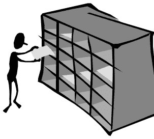

#### 总线

总线是用于传输信息的电子路径。它将信息从计算机的一部分传输到另一部分。CPU内部通常有几条不同的总线。总线的大小决定了一次可以传输多少信息。

类比：我们再次回到数学家的办公室。想象一下，他们有一部贯穿地板、通往地下室的小电梯，储物柜就存放在地下室里。当经理（CPU）收到一条指令，告诉他们将储物柜7829中存储的数字乘以储物柜998中存储的数字时，他们会发送请求来获取这些数字。地下室的人会打开正确的储物柜，取出正确的数字。他们会乘坐电梯上来，将数字放入数学家办公室的正确位置。我们可以将电梯看作是总线。


## 2.3 存储组件

计算机存储了大量的信息。这些信息可以以不同的方式存储，使用不同的硬件部件。用于长期存储信息的设备通常非常便宜，但速度较慢。我们将这些设备称为大容量存储或二级存储设备。需要快速访问的信息必须存储在更昂贵的组件中，称为主存储器。

### 2.3.1 主存储器

我们最关注的主存储器形式是随机存取存储器（RAM）。这是存储我们当前正在执行的任何程序和我们正在处理的数据的内存。

因为CPU可以非常快速地执行指令，所以它必须能够尽快从内存中检索下一条指令。当我们想要运行一个程序（即一系列指令），我们将这些指令从大容量存储设备（例如硬盘）复制到RAM中。当CPU请求下一条指令时，它将从RAM加载到CPU中，以便解码和执行。CPU需要的任何数据也会从大容量存储设备转移到RAM中。这样，当CPU需要读取一些数据或对数据进行更改时，速度会非常快。

RAM由存储电荷的电子电路组成。这些电路通常印刷在硅芯片上。这种类型的内存非常快速，因为它只需要从一个位置发送电荷到另一个位置。制造这种类型的内存相对昂贵（通常比大容量存储设备贵100倍）。尽管RAM访问和修改非常快速，但在断电时信息会丢失。这种类型的内存被称为易失性内存。

类比：将CPU想象成一个充满人们办公文件工作的建筑物。指定需要完成的工作的指令位于附近的仓库中。指令从仓库中取出并带回CPU建筑物中执行。一旦指令完成，下一条指令将从仓库中取出。这些指令非常简单，可能会说“将存储在77445号储物柜中的数字与存储在982号储物柜中的数字相加，并将答案放入14528号储物柜中”。

在这个类比中，仓库扮演着RAM的角色。


物理RAM被分成一组离散的盒子，每个盒子可以容纳一个字节（一个介于0和255之间的数字）。正常RAM芯片中的盒子数量是巨大的。一个能够存储1GB内存的RAM芯片将有空间存储10亿个不同的数字。

### 2.3.2 大容量存储（二级存储）

用于大容量存储的设备能够在计算机关闭时长时间存储信息。访问这些信息比访问RAM慢得多（慢上千倍）。使用大容量存储设备存储信息比在RAM上存储信息要便宜得多（便宜上百倍）。当我们将大容量存储设备与主存储器进行比较时，我们可以看到大容量存储设备具有以下特点：

- 更便宜
- 更慢
- 并在断电时存储信息（非易失性）。

最常用的大容量存储形式有：硬盘、固态硬盘（SSD）、光盘（CD-ROM / DVD）。磁带仍然用于备份，因为它非常经济实惠。然而，与其他存储设备相比，访问速度非常慢。

## 2.4 输入组件

输入设备是人类用来向计算机提供信息的组件。这些设备用于将数据输入计算机，因此被称为“输入”。这种类型的设备通常充当翻译器，将人类使用和理解的信号转换为计算机可以处理的电子形式。这种类型的最常见设备是键盘，它允许用户执行几乎任何任务。其他输入设备通常用于更专业的任务。

图形用户界面通常需要一个设备来控制指针，而这个任务最常用的设备是鼠标。然而，其他设备如光笔、平板电脑和轨迹球为专业应用提供了更大的灵活性。如今，触摸屏在公共可访问终端上越来越常见，因为另一种指针设备很可能会受损。

在数据过于复杂（或不方便使用键盘或指针设备输入）的情况下，需要直接输入。图像扫描仪或传真机用于将整个图像输入计算机，而条形码阅读器和磁条阅读器提供了一种快速（且私密）的输入特定信息的方法。银行使用光学识别系统来读取支票号码（使用磁性墨水字符识别），其他组织使用光学识别系统来读取分配空间中的笔或铅笔标记（例如彩票表格或多项选择考试）。最近，软件的发展鼓励使用语音输入（使用麦克风）作为口述或控制计算机系统的方法。

## 2.5 输出组件

输出设备是输入设备的补充。用于输出的设备充当翻译器，将计算机使用的数字信号转换为人类容易理解的形式。显示器或屏幕是输出设备的最常见示例。任何从计算机产生人类可理解的东西的设备都被归类为输出设备。常见示例包括屏幕（显示器），扬声器，打印机和绘图仪。

# 第三章 在线出版

## 3.1 简介

互联网是一种我们可以用来发布信息和分发思想的通信媒介。有一些常见的工具可以让我们轻松地单独发布信息，或者与他人合作。

## 3.2 万维网作为媒体来源

万维网为任何人提供了发布任何内容的机会。然而，尽管任何人都可以发布，但创建和维护网站需要一定的技术专业知识。撰写和托管网站的难度对大多数人来说是一个障碍。

通过发布网站来为社区做出贡献也很困难，因为每个网站都是独立存在的。编写一个链接到其他内容的网站很容易，但是要获得相互链接以形成相关信息网络可能很困难或不可能。

好处是你拥有并控制自己网站上的内容，可以表达任何观点。代价是每个网站都是独立的，而不是现有页面网络的一部分。将其整合到现有社区中可能在技术上困难、经济上昂贵，甚至不可能。很少有人可能会发现或阅读这个网站。

网络上的大部分内容是由个人或小团队制作的，他们互相认识。通常一个人会撰写内容。在发布之前，这些内容通常会经过审查和编辑。有时候，小团队的人们也会负责撰写或维护关于特定主题的内容。发布内容的个人或团队通常是普通公众的成员，没有与传统媒体机构的任何官方关联。

## 3.3 博客

“博客”一词是从“网络日志”一词缩短而来。网络日志是一个由一系列发布的消息组成的网页。这些消息通常按照时间顺序排列（即最新的消息显示在页面顶部）。

博客经常用于维护在线日志。在博客中发布的内容通常是个人的观点（类似于报纸的社论）。

## 3.4 维基

Wiki是一种服务器软件，允许用户使用任何Web浏览器自由创建和编辑网页内容。Wiki支持超链接，并具有简单的文本语法，用于创建新页面和内部页面之间的交叉链接。

维基存储的内容是由系统的用户共同创作的。

维基系统能够工作的原因是：

- 每个人都觉得自己有责任感，因为任何人都可以贡献。
- 任何人都可以更改或删除任何信息。维基页面代表共识，因为删除侮辱性言论比纵容它们要容易得多。剩下的内容自然而然地有意义。
- 任何人都可以参与。这听起来像是一场灾难，但要在维基上产生影响，你需要产生真正的内容。其他任何东西都将被删除。所以任何人都可以参与，但只有优秀的参与者才能留下来。
- 维基社区通常有强烈的承诺，以保持维基的整洁和友好。每个人都在使用它，所以他们都努力保持它的可用状态。
- 维基不像在线聊天。它不是实时工作的。人们在跟进某个编辑之前会花时间思考，有时是几天或几周。所以人们写的东西通常经过深思熟虑。

## 3.5 推荐阅读

- 博客
    - http://zh.wikipedia.org/wiki/博客
- 维基
    - http://zh.wikipedia.org/wiki/维基

# 第四章 维基

## 4.1 介绍 - 什么是维基？

维基是一个允许用户轻松创建和编辑网页的系统。然而，与传统网页不同，维基中的内容可以被任何人编辑。使用该系统的任何人都可以自由编辑页面的内容，添加超链接并重新排列页面的结构。由于维基被设计为非常易于使用且对所有人免费开放，它为任何想要贡献的人提供了真正的机会。这种“开放编辑”的方法鼓励了网络的民主使用，并促进了非技术用户创作内容的发展。

## 4.2 第一阶段维基

我们为计算机科学一年级学生建立了一个维基。所有注册计算机科学一年级课程的学生都将为他们设置一个帐户，以便他们可以登录并开始贡献。请注意，计算机科学维基使用与维基百科相同的软件，即MediaWiki系统，但由于需要更好地适应计算机科学网站，它看起来有些不同。本章中的屏幕截图和描述是针对标准的MediaWiki用户界面，因此与计算机科学维基略有不同。然而，底层软件是相同的，因此您将在计算机科学维基中找到相同的功能，尽管在用户界面中可能位置略有不同。下图显示了维基百科页面（左）和CS维基页面（右）。在两个维基中，主文档区域的工作方式完全相同。但是，维基百科将功能链接（例如“讨论”，“首选项”和“搜索”）排列在每个维基页面的顶部和左边框，而CS维基将这些链接排列在右边框。某些链接也有所不同：例如，只有维基百科提供“捐赠给维基百科”的链接和切换不同语言的可能性。

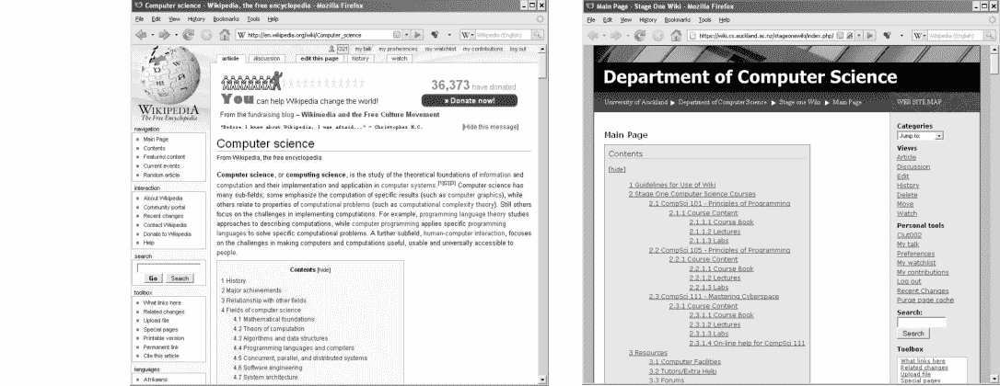

### 4.2.1 教学与学习

学生在参与活动时学得最好。实际做某事的过程能够引起更多的注意力，并促进对材料的更深入理解。研究表明，学习某个东西的最佳方式之一就是尝试将其教给别人。这适用于各个年龄段的学生，从小学到研究生。

为了向某人解释一个主题，必须安排信息，使其易于理解。整理材料的行为要求教师对主题进行仔细思考，他们几乎总是从这个过程中学到一些东西。

因为学生在尝试教授时学到了很多东西，一个真正的好的学习环境将为学生提供向他人教授的机会。使用维基将帮助我们实现这个目标。

### 4.2.2 期望

参与课程的每个人都应该定期为计算机科学阶段一维基做出贡献。维基被使用得越多，它就变得越有用。每个人都可以做出一些贡献，而且任何贡献都有可能在时间的推移中被编辑和改进。你可能能够做出贡献的一些方式包括：

- 编写关于某个主题的新页面
- 改进现有页面
- 纠正拼写和语法错误
- 重新组织信息的结构（在页面内重新组织，或重新组织页面本身）
- 创建常见问题列表（FAQ）
- 提问
- 回答常见问题列表 (FAQ) 上的问题
- 维护重要主题的目录或索引
- 创建或添加到其他有用资源的链接集合
- 参与关于某个页面的讨论

如果你想要一个特定主题的页面，那么自己写一个（或者至少开始写一个）。一旦创建了一个页面，其他学生可能会开始添加内容和改进页面。永远记住，维基是一个允许一个社区的人们共同合作创建内容的工具。

## 4.3 使用MediaWiki

MediaWiki是用于创建维基百科的产品之一，目前有许多维基系统可供使用。MediaWiki根据GNU通用公共许可证分发，这意味着它是免费和开源的。它相对容易使用，并具有专业外观的界面。我们将在整个课程中使用MediaWiki。当您进入MediaWiki网站的主页时，它会看起来类似于以下内容：

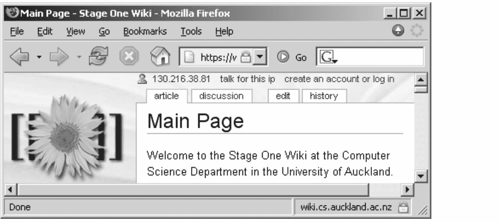

在页面的顶部，我们可以看到一个链接，允许我们“创建账户或登录”。

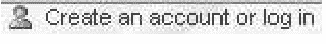

### 4.3.1 登录

MediaWiki具有保护页面和限制访问的功能。任何人都可以阅读维基，但可以设置为仅允许某些人编辑页面。我们已经设置了MediaWiki，只有课程注册的学生才能进行更改。在我们开始为维基做贡献之前，我们必须先登录。在这里，我们使用我们正常的Net Login用户名和密码。

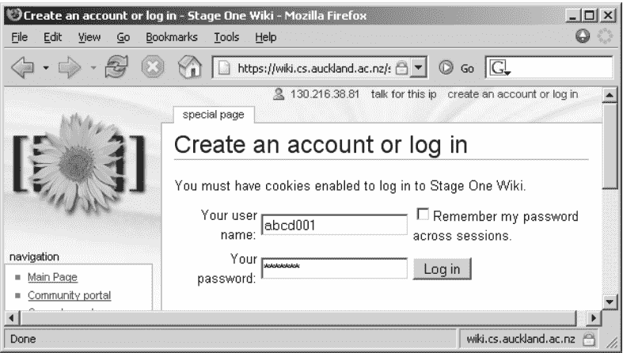

一旦我们登录，我们可以返回主页并探索系统。

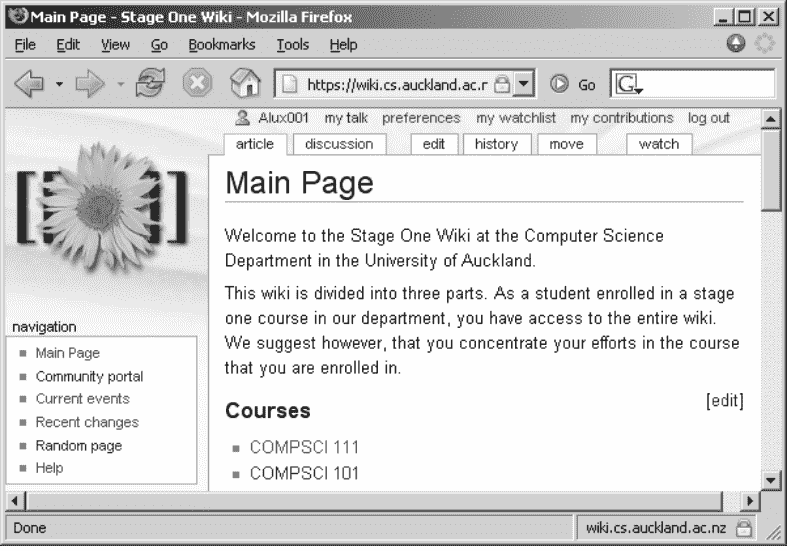

在页面的顶部，我们现在看到各种链接。它们的顺序是：

- 用户（如上图中的alux001）
- 我的对话
- 偏好设置
- 我的关注列表
- 我的贡献
- 退出登录

### 用户

第一个链接显示用户的名称。维基的每个用户都有自己的个人主页。点击用户的名称将导航到用户的主页（在维基内）。最初这个页面是空的，但每个用户都应该在自己的主页上包含一些简单的个人信息。

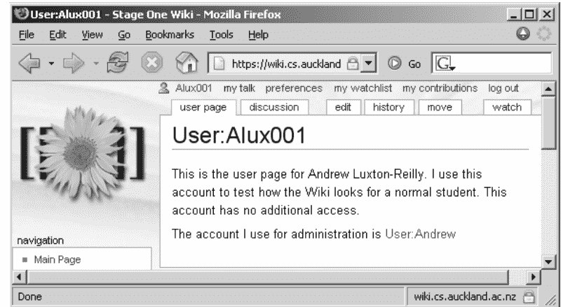

### 我的对话

第二个链接导航到关于用户的讨论页面。任何针对个别用户的讨论或个人消息都应该发布在他们的讨论页面上。

### 偏好设置

第三个链接允许用户自定义维基显示信息的方式。欢迎用户更改这些偏好设置。

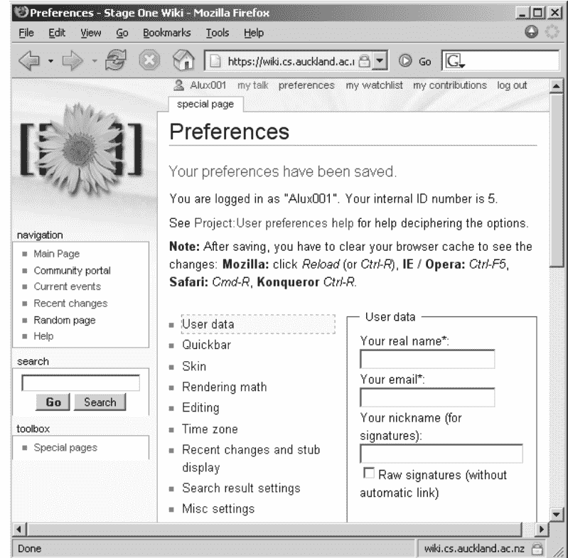

### 我的关注列表

第四个链接导航到用户的关注列表页面。这是用户指定的所有页面的列表，他们对这些页面感兴趣。关注列表上的页面按照它们上次修改的顺序列出。任何在用户上次查看它们之后被修改的页面都会被突出显示。这使得用户很容易跟踪他们感兴趣的特定文章或页面。有关如何将页面添加到关注列表的详细信息，请参见第4.3.9节。

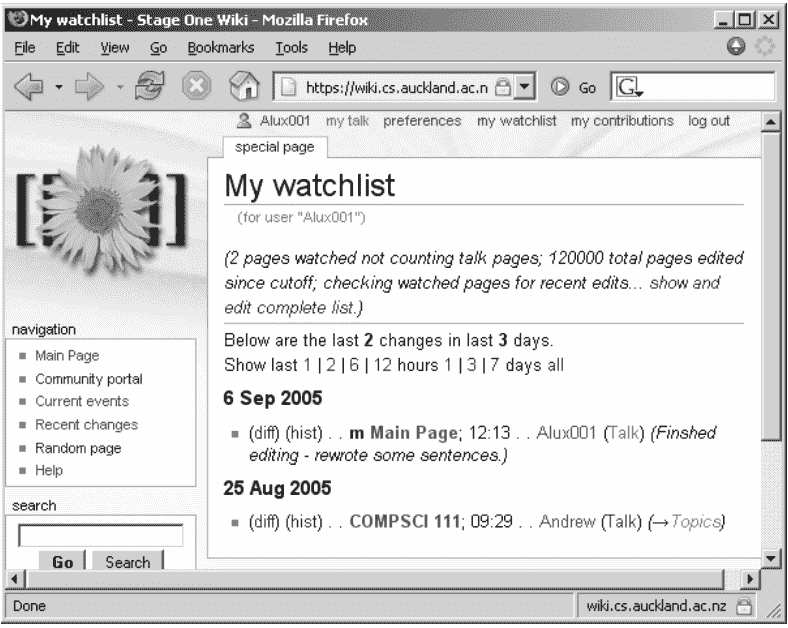

### 我的贡献

第五个链接显示用户对维基内容所做的所有贡献的列表。

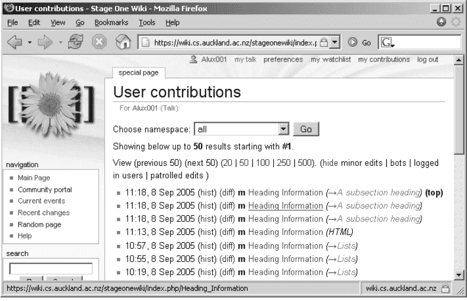

### 退出登录

当我们完成了维基百科后，我们应该退出。

### 4.3.2 标签

在页面的顶部，我们可以看到许多标签。这些是 [文章], [讨论], [编辑], [历史], [移动] 和 [关注/取消关注]。

### 4.3.3 文章标签

这个 [文章] 标签包含了关于这个主题的主要内容。大多数用户对于在维基上贡献的文章感兴趣。任何人都可以阅读维基中包含的文章，即使他们没有登录。

### 4.3.4 讨论标签

这个 [讨论] 标签将显示一个包含有关文章讨论的页面。这是用户可以在这个区域发表评论、提出改进意见、争论并且一般性地讨论所涉及的主题。当创建一个新文章时，讨论部分将没有任何实际的评论。每当我们对某篇文章有任何问题或评论时，讨论页面是发布它们的理想地方。

当在讨论页面上发布问题或评论时，通常要说明是谁发表了评论或问题。在参与讨论时，我们应该始终包括我们的姓名。有关如何将您的姓名添加到贡献中的更多信息，请参见第4.4.7节。请注意，您必须登录才能编辑讨论页面。

### 4.3.5 编辑选项卡

这个 [编辑] 选项卡允许用户编辑此页面上显示的文章。我们已经设置了 MediaWiki，以便您在编辑页面之前必须登录。并非所有的维基都有这个限制。事实上，大多数维基允许匿名用户在不登录任何东西的情况下编辑页面。

### 编辑页面

要编辑页面，我们只需点击 [编辑] 选项卡，它出现在页面的顶部。这将使我们立即开始对内容进行更改。

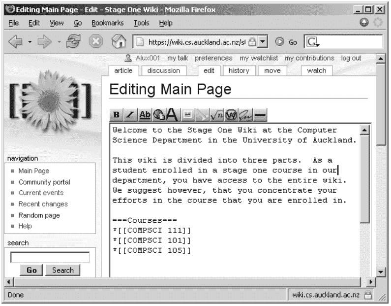

使用维基的一个优点是很容易编辑页面。如果我们更改了一个页面，然后意识到犯了一个错误，那么我们可以轻松地编辑同一个页面并纠正错误。

## 预览并保存

当我们对所做的更改满意时，显示预览按钮将允许我们检查其外观。

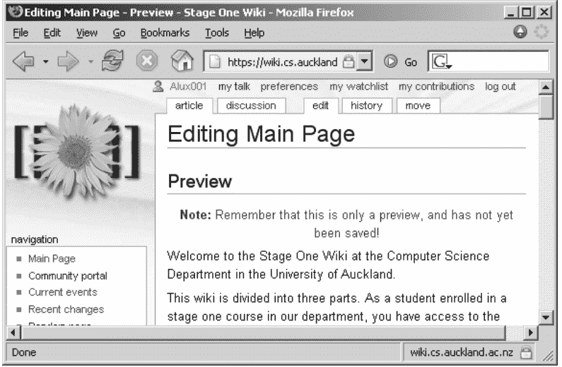

在保存页面之前，预览更改并验证页面是否正确是一个好主意。我们必须记得在完成后点击保存页面按钮。

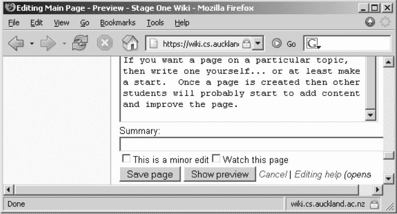

### 摘要

请注意，有一个空间可以输入我们所做更改的摘要。摘要应用于描述我们对内容所做更改的类型。提供摘要的目的是让跟踪维基的人员可以看到正在进行的更改，而无需查找各个页面。

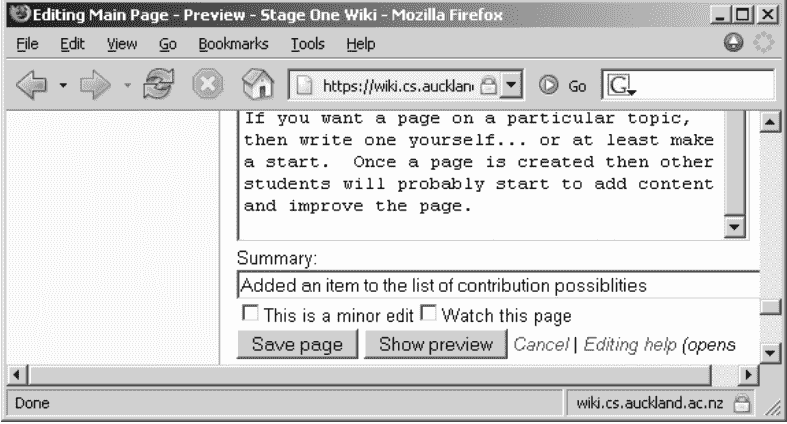

一些适合的摘要示例可能包括：

- 更正拼写错误
- 添加变量标识符部分
- 删除循环段落
- 更新链接
- 添加新的常见问题解答项目

#### 跟上更改的步伐

当我们查看维基的最新更改时（通过点击页面左侧出现的工具箱中的最新更改链接），您将看到一系列更改及其相应的摘要。

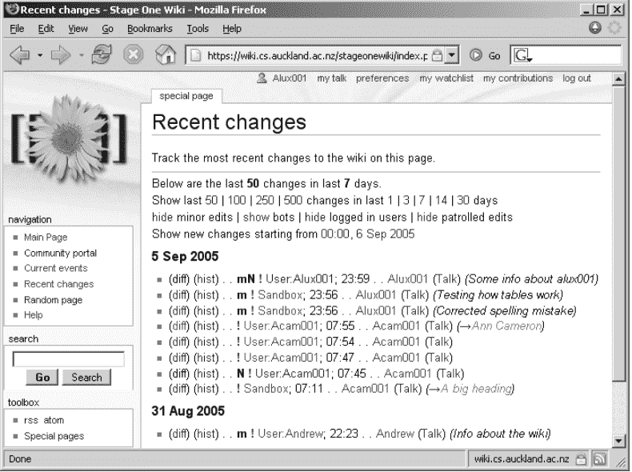

### 4.3.6 编辑冲突

由于内容可以被任何人更改，可能会有两个人都尝试编辑同一页。这在流行的页面或经常更改的页面上特别常见。如果很多人同时在同一内容上工作，那么遵循一些简单的约定可能会很有用。以下是这些约定的概述：

#### 宣布你的编辑

当你要编辑一个你知道相当受欢迎并且可能会被其他人更改的页面时，你可以简单地在该页面顶部添加一个说明，告诉人们你正在处理它。例如：

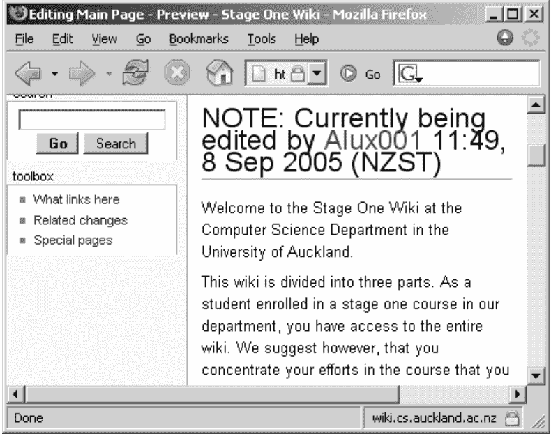

如果你宣布你正在编辑一个页面，并且你不希望其他人在你完成之前进行编辑，那么最好在其中包含自动生成的作者链接，并包含日期和时间（有关更多详细信息，请参见第 4.4.7 节）。例如，上面的示例中的消息是使用标记生成的：

**页面源代码**

```
== 注意：目前由~~~~编辑 ==
```

### 删除你的公告

非常重要的是，当你完成编辑页面时，记得删除任何编辑警告。如果你说你正在编辑一个页面，那么你应该快速地完成编辑，做出你想要的改变，并在完成后删除警告。

### 本地保存你的工作

每当你填写一个表单并提交到一个网站时，都有可能出现传输问题，导致表单中的信息丢失。为了防止信息丢失，始终值得存储一个本地副本。

在点击 **提交** 按钮之前，在网页表单中选择你想要提交的文本，并将其复制到剪贴板。如果在提交过程中出现问题，至少你在剪贴板上有一个副本。这个副本可以粘贴到一个文本文件中并保存在你的磁盘上（以便以后提交），或者可以简单地重新提交（使用表单）。

### 4.3.7 历史标签

这个 `历史` 标签显示了对该页面所做的所有更改的列表。值得注意的是所有之前所做的更改都被记录下来。社区很容易看到谁在更改页面，他们从哪里更改页面，以及他们将页面更改为什么。这个记录的历史确保人们对维基的更改负责。这反过来鼓励高质量的贡献，并阻止破坏性行为。

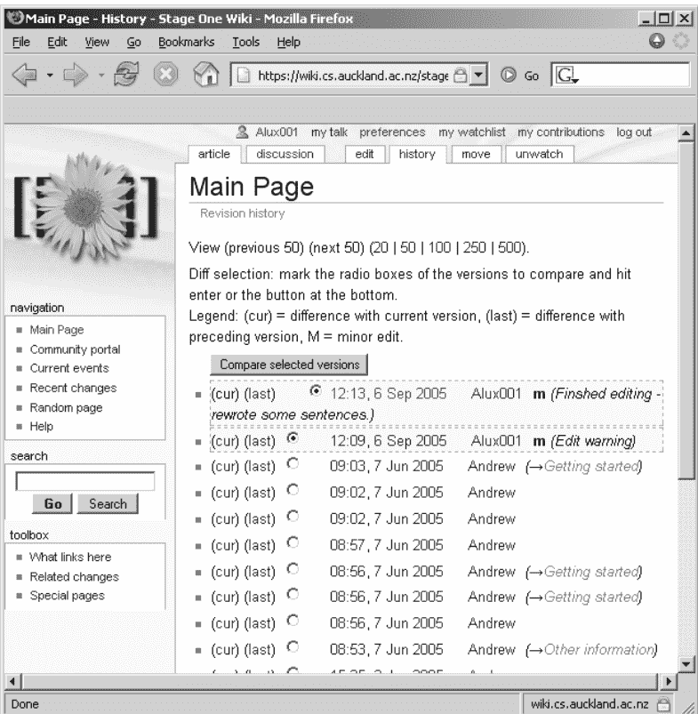

### 4.3.8 移动标签

这个 `移动` 标签允许我们重命名页面。如果页面被重命名，那么任何连接到该页面的链接都需要更新。这不推荐用于有很多链接指向的热门页面。只有在必要时才应该重命名页面。

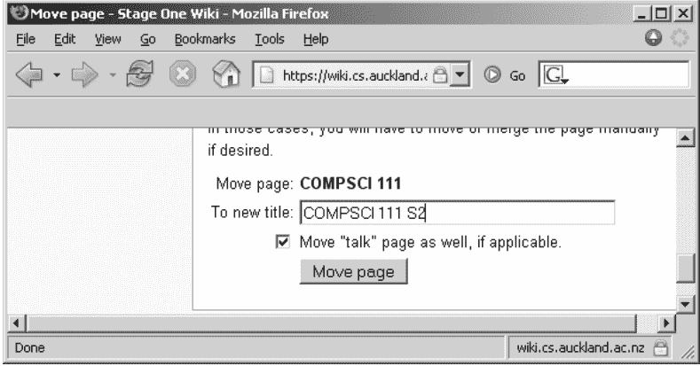

### 4.3.9 观察标签

点击 `观察` 标签会将该页面添加到我们的观察列表中。我们可以轻松跟踪对该页面所做的更改。

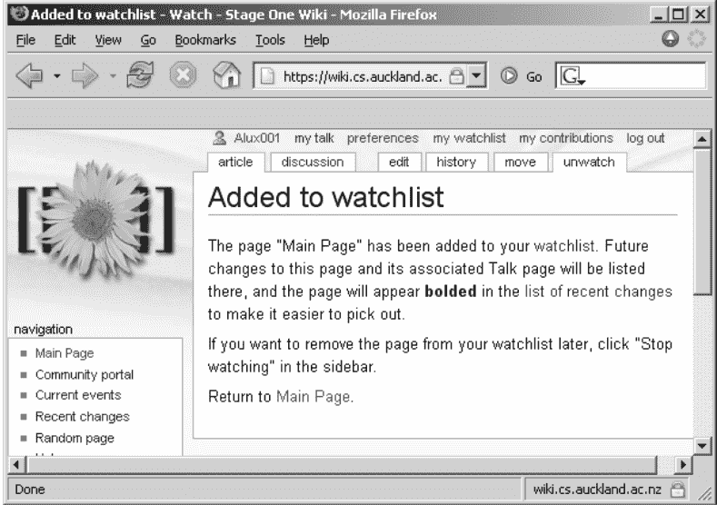

## 4.4 标记

维基中使用的标记语言被故意保持简单，以确保人们能够快速简单地学习使用该语言。

### 4.4.1 标题

MediaWiki 支持四个不同级别的标题。要将某些文本标记为标题，需要在文本前后放置一系列等号（=）。下表总结了可用的不同标题。

| 维基标记语言 | 意义 |
| :--- | :--- |
| = 文本 = | 一级标题 (最重要) |
| == 文本 == | 二级标题 |
| === 文本 === | 三级标题 |
| ==== 文本 ==== | 四级标题 (最不重要) |

**表4.1: MediaWiki 支持的标题**

### 一级标题 - 主页标题

每个页面的顶部都显示该页面的主标题。主标题是一级标题，与页面的名称相同。例如，名为“Sandbox”的页面将以大号字体显示“Sandbox”一词。主标题下方将出现一条水平分隔线：


每页应该只有一个主标题，所以不需要创建额外的一级标题。

### 二级标题 - 章节标题

我们手动添加到页面的最大标题大小应该是二级标题（一个章节标题）。我们写的每个新章节都应该以一个新的章节标题开始。

语法是在章节名称的两侧添加两个等号，如下所示：

```
==我的新章节==
```

每个章节以大号粗体显示。在章节标题下方会出现一条水平线，如下所示：


### 三级标题 - 子节

要创建一个子节，我们使用三个等号将子标题括起来，如下所示：

```
===我的新子节===
```

这将以大号粗体标题的形式显示在屏幕上，但不像章节标题那么大。子标题下方不会有水平线。

### 我的新子节

#### 四级标题 - 子子节

最低级别的标题用于创建子子节。要创建这个级别的标题，我们在名称的两侧使用四个等号。例如，标记：

```
====最小级别的标题====
```

将导致标题：

#### 最小级别的标题

## 示例

下一页演示了不同级别标题的使用：

```
1  此页面包含有关标题的信息。
2  页面的名称是标题信息。
3 
4  ==一个部分标题==
5  这是您通常使用的最大标题
6 
7  ===一个子节标题===
8  用于子节的较小标题
9 
10 ====一个子子节标题====
11 这是您使用的最小标题。
```

当页面在维基中显示时，将显示如下：

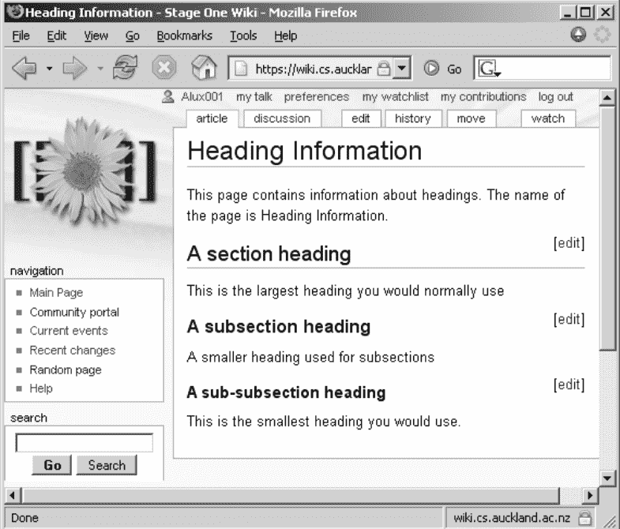

### 4.4.2 新行

要开始一个新段落，我们需要留下一个空行。单个换行符（例如，按下 Enter 键时创建的）对页面的布局没有影响。

例如，文本：

#### 页面源代码

```
1 这是一个的一部分
2 句子。然而，在这里
3 有许多不同的行。
4
5 这是一个新的段落。
```

将在维基中显示如下：

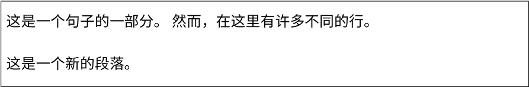

### 4.4.3 列表

可以创建三种类型的列表：有序列表、无序列表和定义列表。下表总结了可用的不同列表；每种列表的详细描述如下。

| 维基标记语言 | 意义 |
| :--- | :--- |
| # 项目 | 有序列表 |
| * 项目 | 无序列表 |
| ; 术语 : 定义 | 定义列表 |

**表4.2: MediaWiki 支持的列表**

## 有序列表

通过在每行的开头放置一个井号（也称为数字符号）来创建有序列表。例如，维基标记：

```
#苹果
#橙子
#香蕉
```

将在维基中显示如下：

1. 苹果
2. 橙子
3. 香蕉

这些列表可以通过简单地增加每个项目开头使用的井号数量来嵌套。使用的井号越多，缩进级别越大。例如，维基标记：

```
====列表====

购物清单

#水果
##苹果
###青苹果
##香蕉
###绿色
###黄色
##橙子
##热情果
#蔬菜
## ...
```

将在维基中显示如下：

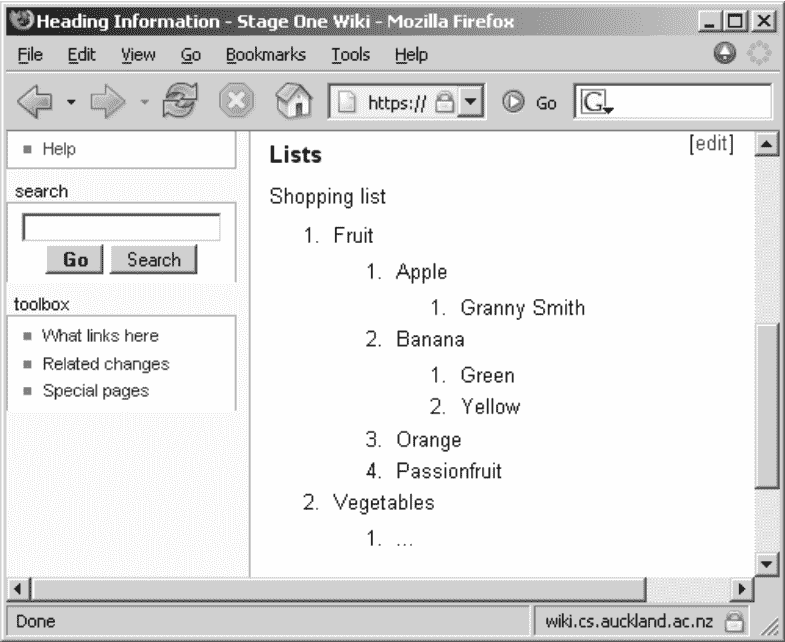

## 无序列表

无序列表与有序列表类似，只是在每行的开头使用星号代替井号。例如，维基标记语言：

```
*苹果
*橙子
*香蕉
```

将在维基中显示如下：

- 苹果
- 橙子
- 香蕉

这些列表可以像有序列表一样嵌套。

## 定义列表

定义列表用于给术语提供定义。首先，列出术语，然后列出定义。术语前缀为分号，定义前缀为冒号。例如，维基标记语言：

```
; 苹果: 一种计算机品牌
; 橙子: 加利福尼亚县
; 香蕉: 一种水果
```

将在维基中显示如下：

- 苹果
  - 一种计算机品牌
- 橙子
  - 加利福尼亚县
- 香蕉
  - 一种水果

### 4.4.4 缩进

在行首使用冒号将缩进该段落的文本。例如，wiki 标记：

```
页面源代码
1 这是一行普通的文本。
2
3 : 这一行文本以冒号开头，因此整个段落都将
4 缩进。
5 当某些文本需要与其他文本区分开来时（例
6 如示例、引用、问题的答案等），这将非常
7 有用。
8
9
10 这是一行普通的文本。
```

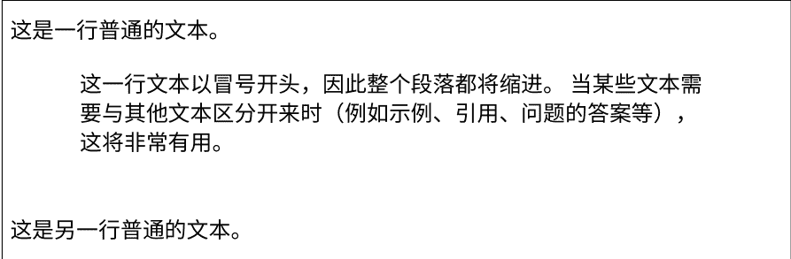

### 4.4.5 预格式化文本

有时候我们希望文本保持我们输入的样子。我们使用等宽字体来显示这样的文本，通常称为预格式化文本。为了确保文本被视为预格式化文本，我们必须在行首加一个空格。如果某行以空格开头，维基将把该行文本显示为预格式化文本。文本周围会画一个框，并与周围的文本分隔开。这对显示计算机代码非常有用。

例如，仔细看以下维基标记。我们在包含 HTML 代码的所有行前面加了一个空格。这个页面：

#### 页面源代码

```
 以下HTML文档用于显示一个简单的页面
 <html>
   <head>
     <title>欢迎</title>
   </head>
   <body>
     这是一个简单的HTML文档
   </body>
 </html>
```

将显示如下：

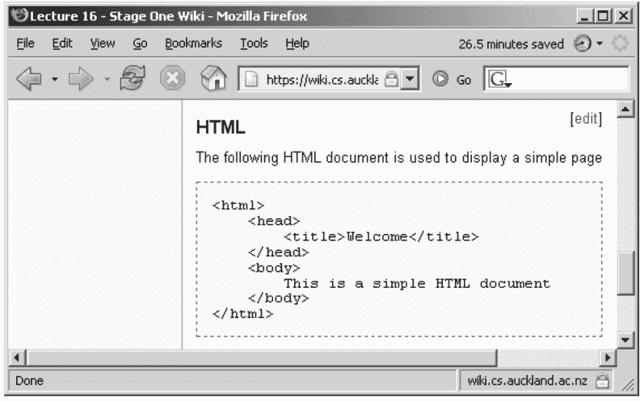

### 4.4.6 水平线

要创建一条水平线，只需连续使用四个减号 `----`。例如，维基标记语言：

#### 页面源代码

```
在划线上方
----
在划线下方
```

将显示如下：

在划线上方
***
在划线下方

### 4.4.7 添加作者的姓名

当我们在维基上创建内容并贡献信息时，不需要在任何地方添加我们自己的姓名，因为这是一个协作的努力。然而，如果在维基上进行关于某个主题的讨论，那么知道谁发表了某个评论是很有用的。这对于讨论页面（用于对页面内容进行一般讨论的页面）尤其相关。

当我们编辑页面时，只需连续使用三个波浪线字符 `~~~`，系统就会自动在指定位置添加我们的姓名。系统会自动在此处插入一个指向我们用户名的链接。如果我们还想要时间和日期（对于讨论非常有用），则应连续使用四个波浪线字符 `~~~~`。例如，维基标记语言：

```
              页面源代码              
1 你的公式是错误的。你忘记了
2 考虑到消费税。~~~
3
4 哎呀。对此表示抱歉。
5 : ~~~~
```

将显示为：

> 你在公式中忘记了添加消费税。阿鲁克斯 001

哎呀。对此表示抱歉。
阿鲁克斯 001 11:33，2005年9月8日 (新西兰标准时间)

请注意，我们添加了标记 `:` 以缩进第二个示例中的作者。

### 4.4.8 链接

维基中可以创建不同类型的链接。下表总结了可用的不同链接。

| 维基标记语言 | 意义 |
| :--- | :--- |
| [[链接]] | 内部链接 |
| [[链接\|标签]] | 带标签的内部链接 |
| URL | 外部链接 |
| [URL 标签] | 带标签的外部链接 |

**表4.3: MediaWiki 支持的链接**

#### 内部链接

最简单的链接是指向维基中的另一页。要做到这一点，只需将页面名称放在嵌套的方括号内 `[[在这里输入名称]]`。例如，维基标记：

#### 页面源代码

```
1  要获取更多信息，请参见[[蜜蜂]]
```

将显示如下：

要获取更多信息，请参见 <u>蜜蜂</u>

这样创建了一个链接到维基中标题为“蜜蜂”的页面。

#### 内部链接的标签

默认情况下，我们在页面上看到的链接将与我们链接到的页面的名称相同。然而，如果我们给链接加上标签，那么查看者将看到标签而不是实际页面的名称。一般的格式如下：

```
[[页面名称|链接标签]]
```

当显示此链接时，文本将显示为页面上的“链接标签”。当点击链接时，维基将显示名为“页面名称”的页面。例如，维基标记语言：

#### 页面源代码

```
1  要获取有关链接的更多信息，请点击[[帮助|这里]]
```

将显示如下：

要获取有关链接的更多信息，请点击 <u>这里</u>

#### 外部链接

创建外部链接的最简单方法是在正常文本中直接包含链接的 URL。维基将识别文本中包含的 URL，并自动为该地址创建链接。例如，维基标记语言：

#### 页面源代码

```
1  所有课程页面的链接可以在
2  计算机科学系的主页上找到。
3  地址是http://www.cs.auckland.ac.nz/courses
```

将显示如下：

所有课程页面的链接可以在计算机科学系的主页上找到。地址是 http://www.cs.auckland.ac.nz/courses

## 外部链接的标签

如果我们想为外部链接添加标签，那么我们需要用方括号括起链接。在链接之后，我们留一个空格，然后包含标签。标签将显示在页面上，如果点击，将链接到 URL 给出的地址。其正式语法如下：

```
[URL 标签]
```

例如，以下维基标记：

#### 页面源代码

```
1 今年计算机科学专业提供的所有课程
2 都有一个网页。每个网页的链接
3 可以在主页上找到。
4 [http://www.cs.auckland.ac.nz 计算机科学系]
5 网站。
```

将显示如下：

> 今年计算机科学专业提供的所有课程都有一个网页。可以在计算机科学系网站上找到每个网页的链接。

### 4.4.9 字符格式化

MediaWiki 允许我们对单个字符或单词进行格式化。下表总结了 MediaWiki 支持的字符格式化。

| 维基标记语言 | 意义 |
| :--- | :--- |
| ''文本'' | 强调 (斜体) |
| '''文本''' | 加粗 |
| '''''文本''''' | 非常强调 (加粗和斜体) |

**表4.4: MediaWiki 支持的字符格式化**

下面描述了最常用的标记语言。

## 强调

为了强调一些文本，我们可以在文本周围使用两个单引号。浏览器通常会以斜体字体显示强调的文本。正式的语法如下：

```
''一些文本''
```

例如，维基标记语言如下：

#### 页面源代码

```
1 这个主题非常重要
```

将显示如下：

> 这个主题是 *extremely* important

## 强烈

为了使一些文本以强烈的方式突出，我们可以在文本周围使用三个单引号标记。浏览器通常会以粗体字显示强调文本。其正式语法为：

```
'''一些文本'''
```

例如，维基标记语言如下：

```
———— 页面源代码 ————
这个主题是'''非常'''重要
```

将显示如下：

> 这个主题是 **非常** 重要

## 非常强烈

为了使一些文本以非常强烈的方式突出，我们可以在文本周围使用五个单引号标记。浏览器通常会以斜体和粗体字显示非常强调的文本。其正式语法为：

```
'''''一些文本'''''
```

例如，维基标记语言如下：

```
———— 页面源代码 ————
这个主题是'''''非常'''''重要
```

将显示如下：

> 这个主题是 ***非常*** 重要

## 4.5 创建新页面

在维基百科中创建一个新页面是一个简单的过程。

### 4.5.1 跟随链接

当我们点击一个没有目标页面的链接时，就会创建一个新页面。在这种情况下，维基百科会告诉我们该链接的目标不存在，并给我们创建该页面内容的选项。

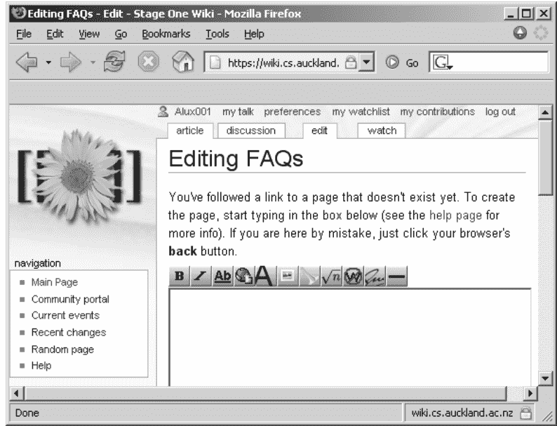

在 MediaWiki 中，没有目标页面的链接会被标记为红色。

### 4.5.2 创建一个新链接

如果我们想要在给定主题上创建一个全新的页面（例如，一个包含“关于HTML的常见问题”的页面），那么我们首先需要创建一个指向该页面的链接。

我们应该浏览维基并找到适当的位置来添加链接。例如，如果我们想要添加一个名为“关于HTML的常见问题”的页面，那么我们可能决定在一个名为“HTML”的页面上创建一个指向我们新页面的链接。

一旦我们找到了适当的页面，我们只需编辑该页面并添加一个指向我们提议的新页面的链接。在这个例子中，链接将是 `[[关于HTML的常见问题]]`。一旦保存了这个页面，我们的维基将有一个指向一个不存在页面的新链接。当有人点击这个链接时，他们将有选择创建该页面的内容选项。

## 4.6 参考文献

- http://meta.wikimedia.org/wiki/MediaWiki_User’s_Guide
- http://en.wikipedia.org/wiki/Wiki

# 第5章 超文本标记语言 (HTML5)

### 5.0.1 HTML 和 XHTML 版本

超文本标记语言的第一个版本是由蒂姆·伯纳斯-李在 1993 年编写的，当时他正在开发成为万维网的系统。这个版本从未成为官方标准，并且缺乏显示图像的能力。随着 1995 年万维网对一般公众的开放，HTML 2.0 作为官方标准发布。它一直被使用到 1997 年，当时它被 HTML 3.2 取代，同年稍后又被 HTML 4.0 取代。进行了一些小的修改，HTML 4.01 在 1999 年发布。这个版本被广泛使用，并定义了大多数网站遵循的标准。

2000 年，W3C 联盟发布了一个更新、更干净的 HTML 版本，称为 XHTML 1.0。这种语言与 HTML 4.01 几乎相同，只是进行了一些小的改动，以确保一致性和易用性。W3C 将 XHTML 定义为 HTML 的最新版本，并表示 XHTML 旨在逐渐取代 HTML。

最新的官方版本是 XHTML 1.1，旨在支持移动设备（如手机和个人助手）访问网页。因特网浏览器在查看 XHTML 1.1 页面时会出现问题，所以大多数人使用 XHTML 1.0 代替。W3C 联盟目前正在开发 HTML5。

2011 年 2 月 14 日，W3C 扩展了其 HTML 工作组的章程，并设定了 HTML5 的明确里程碑。2011 年 5 月，工作组将 HTML5 推进到“最后呼叫”（Last Call），邀请 W3C 内外的社区确认规范的技术可行性。W3C 已经开发了一个全面的测试套件，以在 2014 年实现规范的广泛互操作性。

### 5.0.2 文档类型定义

由于 HTML 和 XHTML 有很多不同的版本，告诉浏览器正在使用的语言版本非常重要。表示该信息的格式被称为 DTD（文档类型定义）。DTD 指定了文档所使用的语言类型。

如果我们使用的是 XHTML 1.0 Strict，我们必须首先在任何将在浏览器中显示的文件中包含该信息。DTD 通常是从参考页面复制和粘贴的。例如，在 XHTML 1.0 中：

```html
<!DOCTYPE html PUBLIC
"-//W3C//DTD XHTML 1.0 Strict//EN"
"http://www.w3.org/TR/xhtml1/DTD/xhtml1-strict.dtd">
```

在 HTML5 中，DTD 规范为：

```html
<!DOCTYPE html>
```

### 5.0.3 编码标准

除了 DTD 之外，我们还需要告诉浏览器所使用的编码系统是什么。这对于在不同平台和不同语言之间的兼容性非常重要。我们将使用以下代码行，并将其存储在 `<head>` 标签中：

```html
<meta charset="UTF-8">
```

因此，在您编写的每个 HTML5 页面的开头，您应该复制并粘贴以下文本：

```html
<!DOCTYPE html>
<html>
<head>
<meta charset="UTF-8">
</head>
```

## 5.1 超文本标记语言（HTML）

超文本标记语言（HTML）用于描述文档的结构和格式，它是世界范围内网页的一部分。换句话说，网页是用 HTML 编写的。尽管大多数网页包含不同大小的文本、图片和彩色背景，但告诉浏览器如何显示信息的 HTML 代码是用纯 ASCII 文本编写的。

包含HTML的文件被称为源文件。由于源文件只包含纯文本，因此可以使用任何纯文本编辑器（如Notepad++）编写网页。当使用Web浏览器查看页面时，它将理解HTML并相应地显示页面的内容。

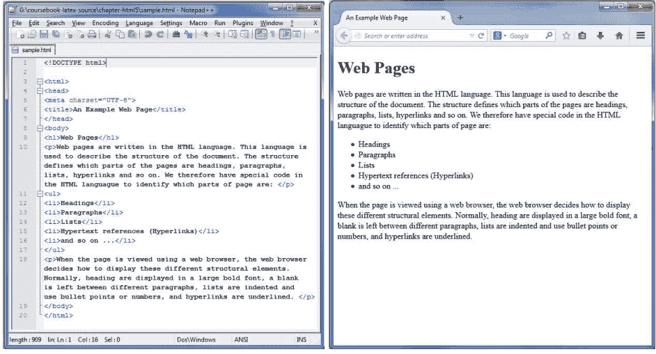

HTML源文件显示在左侧。同一页面在网页浏览器中查看显示在右侧。

## 5.2 标签

HTML由一系列称为标签的“代码”组成。这些标签包含了网页浏览器正确显示页面所需的信息。所有标签都被包含在 `<` 和 `>` 字符之间。例如，`<i>` 是一个用于使文本变斜体的HTML标签。

标签通常成对出现，例如 `<i>` 和 `</i>`。第一个标签 `<i>` 告诉浏览器开始将文本变斜体。第二个标签（通常称为闭合标签）告诉浏览器停止将文本变斜体。我们通常认为开始和结束标签包含了标签适用于的文本。例如，如果我们想要使单词“distinct”以斜体形式显示，我们可以使用以下方式使用 `<i>` 标签：

> 如果没有两个以上的事物是相同的，那么它们就是 <i> 不同的 </i>。

一般来说，标签的形式如下：

`<标签> ... </标签>`

两个标签之间的文本（用“...”表示）是受该标签影响的文本。在HTML中，标签必须始终小写。

### 5.2.1 嵌套标签

当使用多个标签时，正确嵌套它们非常重要。可以将标签想象成容器，这有助于理解。在一对开放和闭合标签之间出现的文本由这些标签包含。例如，在下面的句子中，标签 `<i>` 可以说是包含文本“important”的。

> 标签正确嵌套非常重要。

真实的容器可以相互放置在一起。

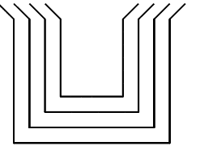

容器可以容纳其他容器。

“包含”文本的标签类似。当我们想要对一段文本应用多个标签时，我们必须确保每个标签完全被另一个标签包含。例如，如果我们想要使单词“important”同时加粗和斜体，我们可以使用HTML代码：

> 标签的嵌套是 `<b><i>` 重要的 `</i></b>`。

或者我们可以使用：

> 重要的是标签被正确地嵌套。

但是将它们重叠是不正确的，如下所示：

> 重要的是标签被正确地嵌套。

当我们使用多个标签时，我们必须确保它们遵循一般形式：

```html
<tag1> <tag2> ... </tag2> </tag1>
```

在这种情况下，我们会说 `<tag2>` 被嵌套在 `<tag1>` 内。

### 5.2.2 标签的属性

一些标签需要额外的信息才能使用。例如，用于显示图像的标签需要知道图像的文件名。这种类型的标签格式如下：

```html
<tag property="value"> ... </tag>
```

例如，下面的锚点标签 `<a>` 使用属性 `href`:

```html
<a href="http://www.w3.org">W3协会</a>
```

有时标签使用多个属性。在这种情况下，属性只是通过空格分隔，如下所示：

```html
<tag property1="value1" property2="value2"> ... </tag>
```

例如，下面的图像标签 `` 使用了两个属性：

```html
</img>
```

属性的使用在本文档的后面部分将变得更加常见。

## 5.3 HTML的基本标签

有四个基本标签定义了HTML文档的结构。所有的HTML文档都应该包含这些标签。它们是：

- `<html>`
- `<head>`
- `<title>`
- `<body>`

下面将详细介绍这些标签。

### 5.3.1 <html>

`<html>` 标签应该包围文档中的所有其他HTML文本。这个标签用于定义HTML文档的开始和结束。例如：

#### 页面源代码

```html
1  <!DOCTYPE html>
2
3  <html>
4
5  ... 代码的其余部分在这里
6
7  </html>
```

### 5.3.2 <head>

文档的头部包含了浏览器需要的信息，以便管理页面的显示。HTML文档的头部信息不是为了人类用户查看的。头部中的任何内容都不会显示在页面上，而是仅供浏览器使用的信息。例如：

```html
<!DOCTYPE html>
<html>
<head>
<meta charset="UTF-8">

... 这些信息是由浏览器使用的

</head>

... 其他HTML标签在这里出现

</html>
```

### 5.3.3 <title>

文档的标题是头部中唯一必需的标签。标题定义了正在显示的文档的名称。这个标题通常出现在Web浏览器的标题栏中。浏览器使用标题来帮助用户浏览互联网。当页面被收藏夹保存或者在浏览器的历史列表中时，通常会使用标题（即当您想要返回之前访问过的页面时）。标题不会出现在显示的主页面上。例如：

```html
<!DOCTYPE html>
<html>
<head>
<meta charset="UTF-8">
<title> ... 文档的标题 ... </title>
</head>

... 其他HTML标签在这里出现

</html>
```

### 5.3.4 <body>

文档的正文包含页面的实际内容。任何出现在网页上的内容都将在相应HTML文档的正文中定义。例如：

```html
<!DOCTYPE html>
<html>
<head>
<meta charset="UTF-8">
<title>... 文档的标题 ... </title>
</head>
<body>

... 正文包含在页面上显示的内容。

</body>
</html>
```

### 5.3.5 一个简单的例子

下面是一个完整的HTML文档：

```html
<!DOCTYPE html>
<html>
<head>
<meta charset="UTF-8">
<title>一个简单的网页</title>
</head>
<body>

</body>
</html>
```

当使用Web浏览器查看页面时，它将显示一个空白页面。在将信息包含在页面的正文中之前，我们需要了解更多关于用于格式化内容的标签。空白页面将如下所示：

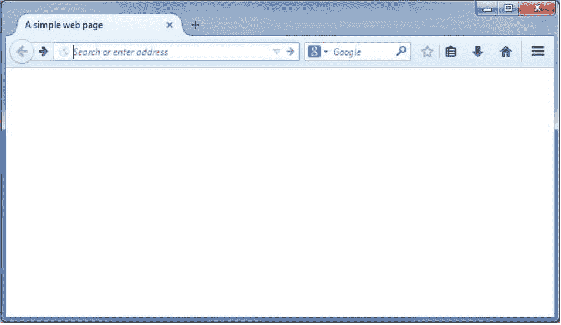

请注意，标题将显示在窗口的标题栏或选项卡中。在Web浏览器的主要区域中显示的唯一信息是出现在HTML文档的正文中的内容（在本例中，根本没有内容）。

## 5.4 块级标签

当我们考虑页面的布局时，我们将其实视为被分成不同的块。每个块之间通常会出现一个空行。

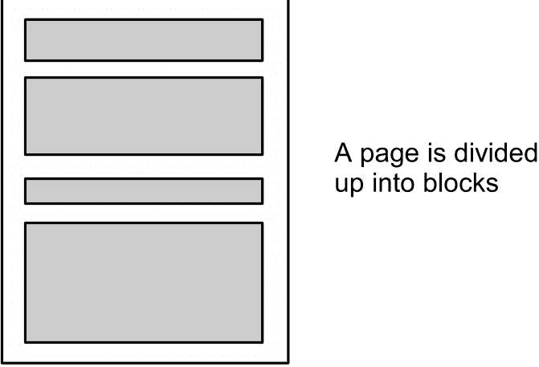

我们使用块级标签和内联标签来定义文档的结构。块级标签用于定义组成页面的不同块。内联标签通常在块内使用。下面描述了最常用的块级标签。

### 5.4.1 `<h1>` 到 `<h6>`

HTML支持六个不同级别的标题。最重要的标题被定义为“一级”。最不重要的标题被定义为“六级”。用于标题的标签如下所示：

- `<h1>`：一级标题。最重要的标题。
- `<h2>`：二级标题。
- `<h3>`：三级标题。
- `<h4>`：四级标题。
- `<h5>`：五级标题。
- `<h6>`：六级标题。最不重要的标题。

每个文档应该有一个最重要的一级标题。你不应该根据文本的外观选择标题（因为外观可以在以后更改），而应该考虑标题的重要性级别，并使用适当的标题级别。

### 5.4.2 <p>

在HTML中定义段落时，我们使用 `<p>` 标签。由于段落是块级元素，段落通常用空行分隔。例如：

#### 页面源代码

```html
1  <!DOCTYPE html>
2  
3  <html>
4  <head>
5    <meta charset="UTF-8">
6    <title>段落示例</title>
7  </head>
8  <body>
9    <h1>使用段落的示例</h1>
10   <p>文本通常显示为与页面上的其他元素通过空白间隔的文本块。 
11   文本将根据窗口的大小自动换行到下一行。 通常，段落的第一行不会缩进。</p>
12
13   <p>这是第二段。</p> 
14   <p>请注意，它是如何被网页浏览器显示的。</p>
15  </body>
16  </html>
```

将显示如下：

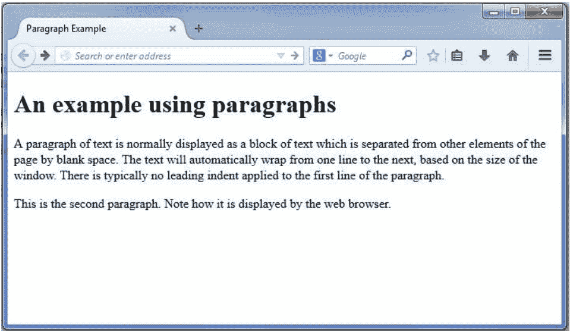

### 5.4.3 <hr>

在HTML5中，`<hr>` 标签定义了内容中的主题分隔。当页面在浏览器中显示时，它通常显示为一条水平线。由于该标签不会格式化任何内容，因此不需要闭合标签。下面的HTML源代码显示了 `<hr>` 标签的使用方法。

#### 页面源代码

```html
<!DOCTYPE html>
<html>
<head>
<meta charset="UTF-8">
<title>水平线示例</title>
</head>
<body>

<h1>水平线</h1>
<hr>
<p>
我们可以使用水平线来分隔在主题上有差异的块级元素。
</p>
<hr>
<p>
因此，它可以用于不同的段落之间，但不能在段落内部使用。
</p>
<hr>

</body>
</html>
```

先前显示的代码将在网页浏览器中显示为：

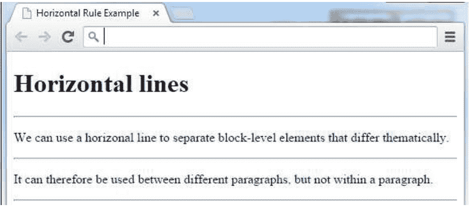

### 5.4.4 <pre>

标签 `<pre>` 用于定义文本块为预格式化。这意味着当文本块由浏览器显示时，原始源代码中使用的空白保留。用于显示预格式化文本的字体是等宽字体，如 Courier。

通常在网页中显示程序的计算机代码时使用此功能。例如，下面的HTML源文件使用 `<pre>` 标签来包围一个包含 Java 计算机程序的文本块。

#### 页面源代码

```html
<!DOCTYPE html>
<html>
<head>
  <meta charset="UTF-8">
  <title>预格式化文本示例</title>
</head>
<body>
  <h1>使用预格式化文本的示例</h1>
  <p>以下程序是一个简单的 Java 程序，用于将消息打印到屏幕上：</p>
  <pre>
  public class TestProgram {
    public static void main(String[] args) {
      System.out.println("Hello World");
    }
  }
  </pre>
</body>
</html>
```

下图显示了在网络浏览器中使用时文件的外观：

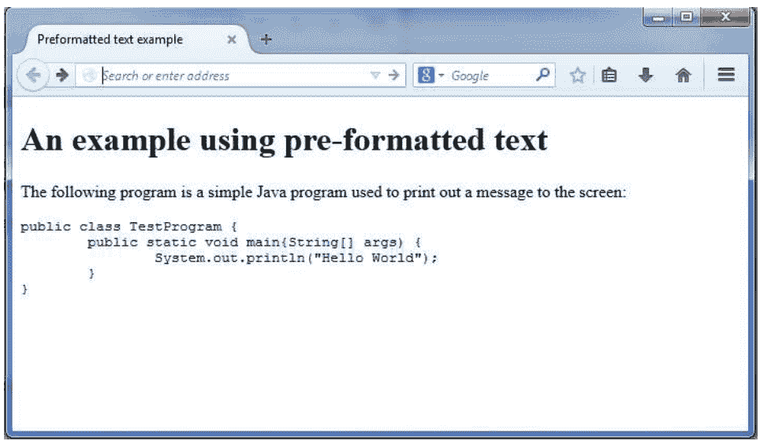

### 5.4.5 表格

`<table>` 标签用于将信息格式化为行和列。这个标签非常重要。它广泛用于网页设计，是排版文档的强大工具。

#### `<table>`

`<table>` 标签应该包围表格的所有信息。

```html
<table>
... 在此定义的表格 ...
</table>
```

#### `<tr>`

表格由一系列行组成。每行使用 `<tr>` 标签定义。表格必须至少有一行。没有最大行数。

```html
<table>
<tr>... 第一行在此定义... </tr>
<tr>... 第二行在此定义... </tr>
<tr>... 第三行在此定义... </tr>
</table>
```

#### `<td>`

表格中的单行由一系列不同的单元格组成。行中的每个单元格使用表格数据标签 `<td>` 定义。

```html
<table>
  <tr>
    <td>第一个单元格</td><td>第二个单元格</td>
  </tr>
  <tr>
    <td>另一个单元格</td><td>还有一个单元格</td>
  </tr>
  <tr>
    <td>仍然有一个单元格</td><td>另一个单元格</td>
  </tr>
</table>
```

表中每个单元格的宽度会自动调整，以确保单元格的边框与其他单元格对齐。包含更多信息的单元格通常会更宽。

#### 一个表格的示例

以下HTML源代码显示了如何使用 `<table>` 标签来呈现表格中的信息。

#### 页面源代码

```html
<!DOCTYPE html>
<html>
  <head>
    <meta charset="UTF-8">
    <title>表格</title>
  </head>
  <body>
    <h1>联系方式</h1>
    <p>以下表格包含了一位员工的联系方式：</p>
    <table>
      <tr><td>姓名：</td><td>Fred Fish</td></tr>
      <tr><td>电子邮件：</td><td>fred@wet.school.nz</td></tr>
      <tr><td>电话：</td><td>77345</td></tr>
      <tr><td>房间：</td><td>123</td></tr>
    </table>
  </body>
</html>
```

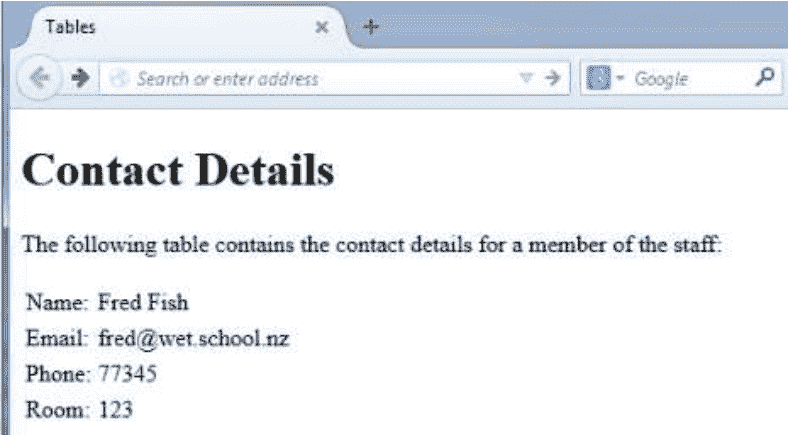

### 5.4.6 列表

列表由一系列项目组成。有三种不同的列表可以使用：

- 有序列表
- 无序列表
- 定义列表

#### `<ol>`

标签 `<ol>` 用于定义有序列表。列表中的每个项目由Web浏览器自动编号。标签 `<li>` 用于定义列表中的每个项目。一般结构如下所示：

```html
<ol>
  <li>苹果</li>
  <li>橙子</li>
  <li>梨</li>
</ol>
```

#### `<ul>`

标签 `<ul>` 用于定义无序列表。列表中的每个项目以一个符号开始。标签 `<li>` 用于定义列表中的每个项目。

```html
<ul>
  <li>苹果</li>
  <li>橙子</li>
  <li>梨</li>
</ul>
```

#### `<dl>`

`<dl>` 标签用于定义定义列表。当需要定义一系列术语时使用。定义列表中的每个条目由定义术语（`<dt>`）和定义描述（`<dd>`）组成。一般结构如下：

```html
<dl>
  <dt>苹果</dt>
  <dd>一家创新的计算机公司</dd>
  <dt>橙子</dt>
  <dd>一种由红色和黄色混合而成的颜色</dd>
  <dt>梨</dt>
  <dd>一种水果</dd>
</dl>
```

#### 列表示例

以下HTML源代码包含了三种类型的列表。

#### 页面源代码

```html
<!DOCTYPE html>
<html>
<head>
<meta charset="UTF-8">
<title>列表</title>
</head>
<body>
<h1>比较不同的列表</h1>
<p>一个有序列表：</p>
<ol>
<li>苹果</li>
<li>橙子</li>
<li>梨</li>
</ol>

<p>一个无序列表：</p>
<ul>
<li>苹果</li>
<li>橙子</li>
<li>梨</li>
</ul>

<p>一个定义列表：</p>
<dl>
<dt>苹果</dt>
<dd>一家创新的计算机公司</dd>
<dt>橙子</dt>
<dd>一种由红色和黄色混合而成的颜色</dd>
<dt>梨</dt>
<dd>一种水果</dd>
</dl>
</body>
</html>
```

下面的截图显示了在使用Web浏览器查看页面时的情况：

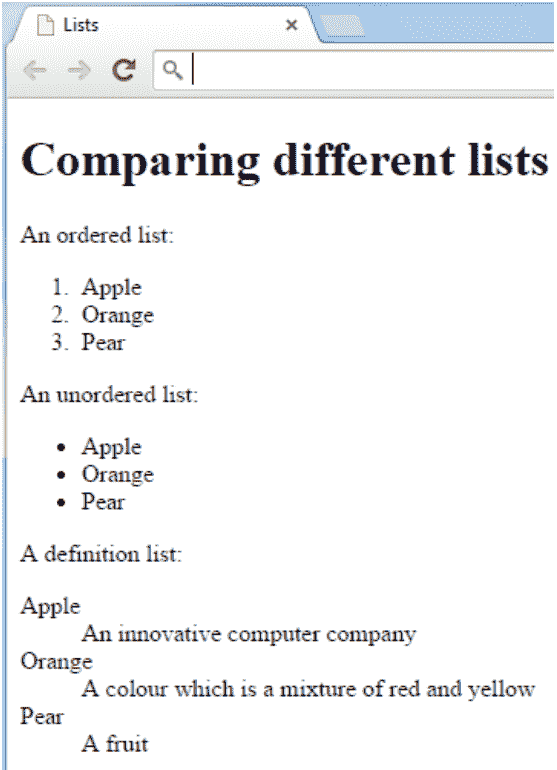

## 5.5 内联标签

内联标签应用于块内存在的内容。例如，如果你有一段文字，你可以使用内联标签将斜体应用于其中的一个单词。标签将应用于不换行的文本行，因此它被称为内联标签。

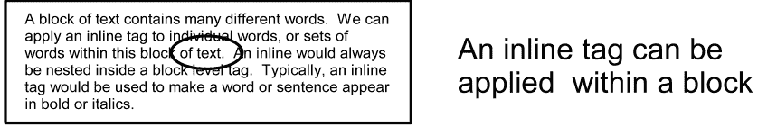

下面描述了最常用的内联标签。

### 5.5.1 <br>

要结束当前文本行，我们可以使用 `<br>` 标签。这会在标签的位置强制换行（它会产生与按下回车键相同的效果）。由于这个标签不适用于页面上的任何现有文本，因此不需要闭合标签。以下HTML源代码显示了 `<br>` 标签的使用方法：

```html
<!DOCTYPE html>
<html>
<head>
<meta charset="UTF-8">
<title>换行示例</title>
</head>
<body>
<h1>一个使用段落和换行的例子</h1>
<p>
空行在源代码被替换通过一个简单的空格。如果我们想要换行<br>
那么我们使用换行标签。</p>
<p>
作者：安德鲁·拉克斯顿-雷利<br>
日期： 01/01/06
</p>
</body>
</html>
```

将由网络浏览器显示为：

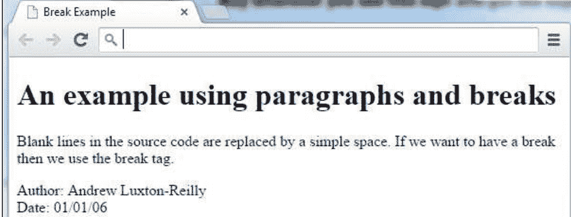

### 5.5.2 

The `` tag is used to include an inline image in the page. 它使用一系列属性来告诉浏览器显示哪个图像以及如何显示。在标签中引用的图像将在网页上的位置显示。

The `` tag uses the following attributes:

- **src**：图像的源。该属性用于指定图像的位置，以便网络浏览器可以从该位置加载图像。这里应该使用一个普通的URL。通常，这是一个相对引用，指的是与网页相同目录中的图像。每个 `` 标签必须包含 src 属性。请注意，大多数网络浏览器只能显示以 .jpg、.gif 或 .png 格式存储的图片。
- **alt**：如果浏览器无法显示图像，则显示的替代文本。这段文字应该描述图片，以便页面的查看者知道如果浏览器无法显示图片（或者用户选择不加载图片）会错过什么内容。所有图片标签都应包含 alt 属性。
- **height**：图片的高度。如果指定的高度与原始图片不同，则浏览器将按照所需的高度对图片进行缩放。请注意，浏览器软件不是设计用来缩放图片的，因此修改后的图片质量可能比使用图像处理软件进行缩放时要差。使用指定的高度可以让浏览器为图片预留足够的空间，并继续渲染页面的其余部分。如果没有指定高度，则浏览器必须等待图片下载完成后才能开始在页面上绘制任何内容。使用 height 属性通常意味着在下载页面时页面会更快地显示出来。
- **width**：图像的宽度。关于高度属性的评论在这里同样适用于宽度。如果没有指定高度，但已经指定了宽度，则高度将自动调整以保持与原始图片相同的宽高比。

建议使用这些属性，但不是必需的。

例如，源代码如下：

```html
<p>下面的图片显示了一只骆驼：<br>

</p>
```

将产生以下结果：

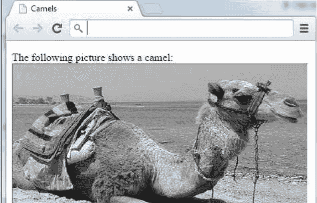

请注意，没有闭合标签 `</img>`。这是因为该标签不会对页面上显示的任何文本进行更改，而是将通过标签显示的图片从磁盘上的文件中获取。

如果我们使用宽度和高度属性，我们可以缩放图像并使其变小。以下是源代码：

```html
<p>下面的图片显示了一只骆驼：<br />


</p>
```

将产生以下图片：

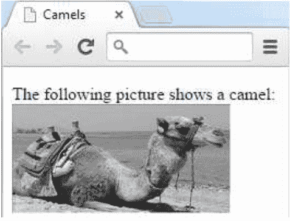

下一页提供了一个完整的HTML页面。

### 页面源代码

```html
<!DOCTYPE html>
<html>
<head>
<meta charset="UTF-8">
<title>骆驼</title>
</head>
<body>
<h1>沙漠之船</h1>

<p>
骆驼被认为是脾气暴躁的
动物，但实际上它们是温和的动物。
它们是聪明友好的动物，适合在沙漠中旅行。

</p>
<p>

</p>
<p>
一只骆驼可以在没有水的情况下存活五到七天。这是由于其极
高的生物效率。骆驼不会在驼峰中储存水。相反，驼峰是用来储
存能量的脂肪沉积物。当食物稀缺时，脂肪储备会被使用。

</p>

</body>
</html>
```

上面的HTML文档将由Web浏览器显示为：

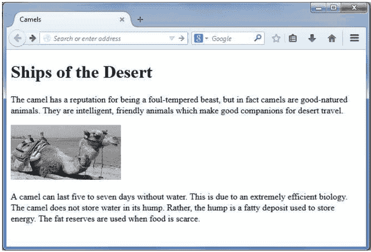

在书籍和报纸中，常常会有图片的标题。标题的目的是为图片添加视觉解释。使用HTML5，图片和标题可以在 `<figure>`元素中分组：

```html
<p>下图显示了一只骆驼：<br />
<figure>
    
    <figcaption>图1. - 骆驼休息中。</figcaption>
</figure>
</p>
```

上面的HTML文档将由Web浏览器显示为：

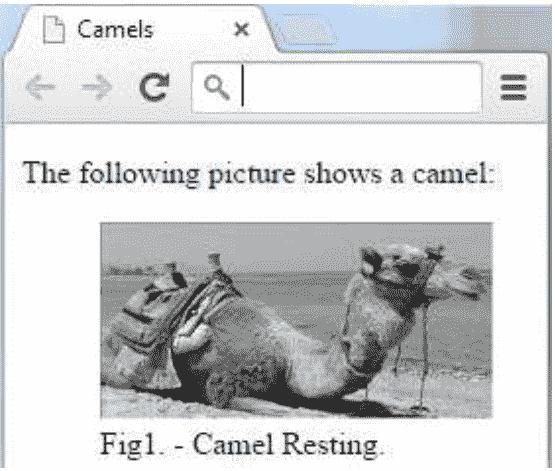

### 5.5.3 <a>

HTML语言中最重要的标签可能是“锚点”标签 `<a>`。这个标签用于创建连接不同页面之间的超链接。`<a>`标签使用以下属性：

**href**：该属性用于创建文本引用（即可点击的链接到WWW中的其他位置）。**href** 属性指定了超链接的目标。目标可以是相对或绝对URL。

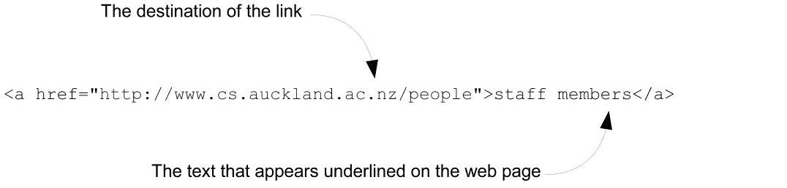

下面的例子显示了一些包含链接到其他文档的HTML源代码。

### 页面源代码

```html
<!DOCTYPE html>
<html>
<head>
<meta charset="UTF-8">
<title>超文本引用示例</title>
</head>
<body>
<h1>使用超文本引用的示例</h1>

<p>
超文本引用通常称为链接。链接用于连接两个页面。当链
接在网页浏览器上显示时，链接文本通常会被下划线标记。
当用户点击链接时，网页浏览器将加载目标页面。换句话说
，你可以将链接视为告诉网页浏览器加载新页面的命令。

</p>

<p>
更多信息，请参见
<a href="http://www.cs.auckland.ac.nz/lectures/">
讲座页面</a>
</p>

</body>
</html>
```

使用网页浏览器查看此页面时，将显示如下内容：

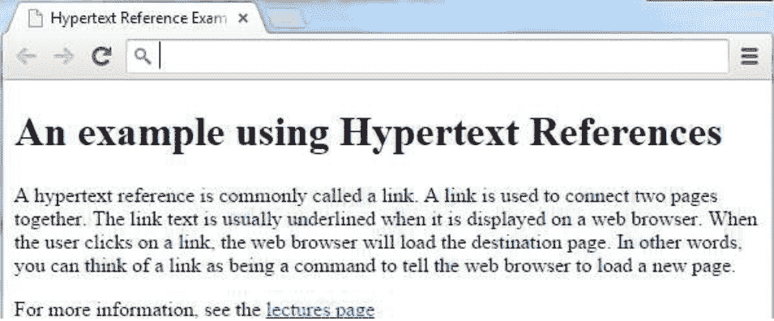

## 5.6 统一资源定位符

统一资源定位符（URL）是指定互联网上资源位置的标准地址。URL由不同的部分组成。

### 5.6.1 协议

URL的第一部分是协议。协议指定数据如何传输。例如，如果资源是文件，则将使用文件传输协议（FTP）进行传输。如果资源是网页，则将使用超文本传输协议（HTTP）进行传输。

### 5.6.2 主机名

URL的第二部分指定了在互联网上用于存储资源的主机计算机。通常，这个主机名是一个域名，例如 www.cs.auckland.ac.nz。

### 5.6.3 路径

URL的第三部分是路径。路径指定了文件在主机计算机上的位置。换句话说，路径指定了资源存储的目录。

### 5.6.4 资源名称

URL的最后一部分是我们要查找的实际资源的名称。通常是一个文件名。

### 5.6.5 示例

一个典型的URL是：

`http://www.cs.auckland.ac.nz/compsci101slc/lectures/index.html`

这个URL可以分解为以下几个部分：

| 描述 | 使用的值 |
| --- | --- |
| 协议 | http |
| 主机 | www.cs.auckland.ac.nz |
| 路径 | /compsci101slc/lectures/ |
| 资源 | index.html |

## 5.7 注释

在你的HTML代码中包含注释可能会有帮助。这些注释旨在帮助其他人理解代码，并且不会被网页浏览器显示。使用特殊标签在代码中包含注释。

```html
<!--
这里放置注释
-->
```

这个HTML标签不遵循正常的语法规则。它没有开始和结束标签，并且没有属性。相反，标签本身以符号 `<!--` 开始，标签以符号 `-->` 结束。在这些符号之间使用的任何其他文本将被浏览器忽略（它不会显示作为注释的一部分的文本）。

例如，以下HTML代码：

### 页面源代码

```html
<!DOCTYPE html>
<!--
    创建日期: 01/04/06
    修改日期: 13/10/14
-->
<html>
<head>
<meta charset="UTF-8">

<!-- 当我们收藏该页面时，标题会被使用 -->
<title>超文本引用示例</title>
</head>
<body>
<h1>使用超文本引用的示例</h1>

<p>
超文本引用通常称为链接。链接用于连接两个页面。当链
接在网页浏览器上显示时，链接文本通常会被下划线标记。
当用户点击链接时，网页浏览器将加载目标页面。换句话说
，你可以将链接视为告诉网页浏览器加载新页面的命令。

</p>

<!-- 注意: 我们可以在这里添加其他参考资料 -->
<p>
更多信息，请参见
<a href="http://www.cs.auckland.ac.nz/lectures/">
讲座页面
</a>
</p>
</body>
</html>
```

将产生与前一节示例中相同的页面，如下所示：


## 5.8 HTML5 语义元素

语义学是研究意义的学科。语义元素是具有意义的元素。语义元素清楚地向浏览器和开发人员描述其含义。

非语义元素的例子：`<div>`和`<span>`。这些元素对其内容一无所知。语义元素的例子包括`<form>`、`<table>`和``。这些元素明确定义其内容。

许多网站包含类似于以下的HTML代码：`<div id="nav">`、`<div class="header">`、`<div id="footer">`，用于指示导航、页眉和页脚。HTML5提供了语义元素来定义网页的不同部分。

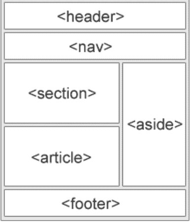

例如，`<section>`元素定义文档中的一个部分。一个网站的首页可以分为介绍、内容和联系信息等部分。

### 页面源代码

```html
<!DOCTYPE html>
<html>
<head>
<title> WWF </title>
</head>
<body>

<section>
<h1>WWF</h1>
<p>
世界自然基金会 (WWF) 是一个国际组织，致力于环境保护、研究
和恢复工作，原名世界野生动物基金会。WWF成立于1961年。
</p>
</section>

<section>
<h1>WWF的熊猫标志</h1>
<p>
熊猫已成为WWF的标志。WWF的著名熊猫标志源于一只名叫吉吉
的熊猫，该熊猫于WWF成立的同年从北京动物园转移到伦敦动
物园。</p></section>

</body>
</html>
```

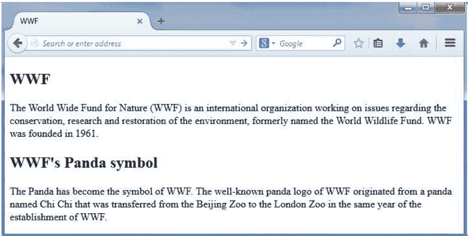

## 5.9 HTML 中的视频

在HTML5之前，网页上没有标准的视频显示方式，只能使用插件（如Flash）播放视频。HTML5的`<video>`元素规定了在网页中嵌入视频的标准方式。要在HTML中显示视频，请使用 `<video>` 元素：

### 页面源代码

```html
<!DOCTYPE html>
<html>
<body>

<video width="320" height="240" controls>
  <source src="movie.mp4" type="video/mp4">
  <source src="movie.ogg" type="video/ogg">
  您的浏览器不支持视频标签。
</video>

</body>
</html>
```

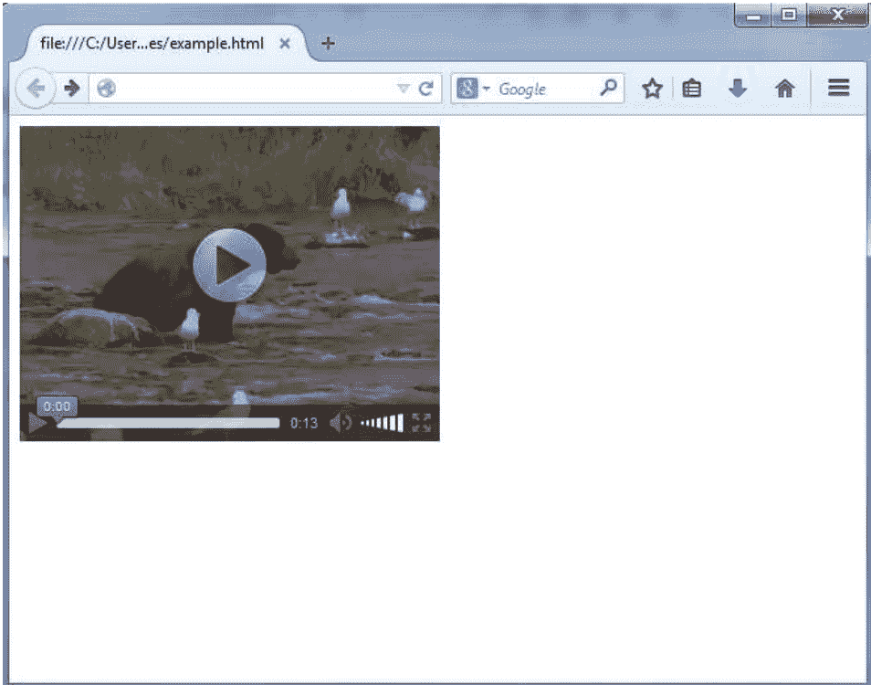

要自动播放视频，请使用 `autoplay` 属性：

```html
<video width="320" height="240" autoplay>
  <source src="movie.mp4" type="video/mp4">
  <source src="movie.ogg" type="video/ogg">
  您的浏览器不支持视频标签。
</video>
```

## 5.10 验证您的页面

W3C提供了一个免费的服务，用于检查您的HTML或XHTML代码是否符合官方标准（换句话说，是否正确）。验证服务的URL是：

http://validator.w3.org/

您可以使用三种不同的方法来检查页面：提供页面的URL，上传包含页面的文件，或将页面代码复制粘贴到提供的表单中。

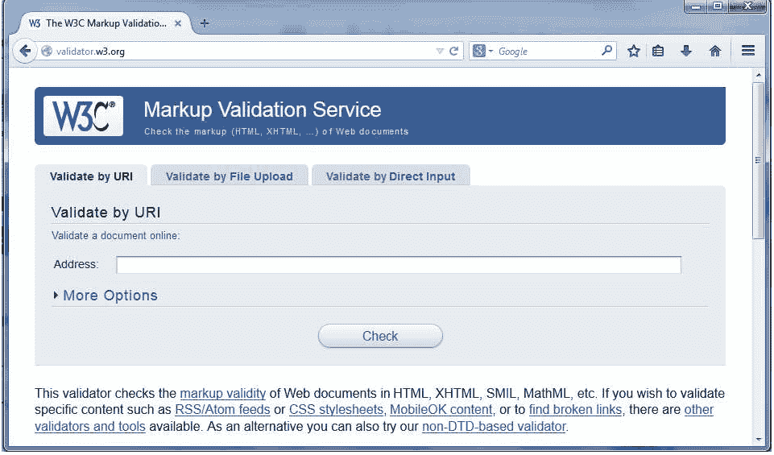

您应该使用此验证服务来检查和纠正您设计的任何网页。使用该服务的最简单方法是直接点击页面上的 `浏览` 按钮，并选择您要检查的HTML文件。一旦选择了文件，点击 `检查` 按钮以验证代码。如果页面使用正确的HTML代码，那么您应该看到类似以下的内容：

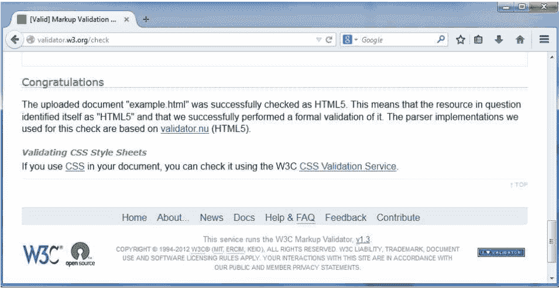

## 5.11 快速参考列表

下表列出了本文档中涵盖的标签。

| 基本标签 | 目的 |
| --- | --- |
| `<!DOCTYPE>` | 文档类型 (DTD) |
| `<html>` | 整个HTML文档 |
| `<head>` | 文档头部 (浏览器信息) |
| `<title>` | 窗口标题 (也用于导航) |
| `<body>` | 文档正文 (页面内容) |

| 基本格式化标签 | 目的 |
| --- | --- |
| `<h1>`到`<h6>` | 一级到六级标题 |
| `<p>` | 段落 |
| `<br>` | 换行 |
| `<hr>` | 水平分隔线 |
| `<pre>` | 预格式化文本 |

| 列表标签 | 目的 |
| --- | --- |
| `<ul>` | 无序列表 |
| `<ol>` | 有序列表 |
| `<li>` | 列表项 |
| `<dl>` | 定义列表 |
| `<dt>` | 定义术语 |
| `<dd>` | 定义描述 |

| 表格标签 | 目的 |
| --- | --- |
| `<table>` | 表格 |
| `<tr>` | 表格中的行 |
| `<td>` | 行内的单元格 |

| 特殊标签 | 目的 |
| --- | --- |
| `<!-- ... -->` | 注释 |

| 链接标签 | 目的 |
| --- | --- |
| `<a>` | 锚点 (超文本引用) |

| 图像标签 | 目的 |
| --- | --- |
| `<figure>` | 组合图像和标题 |
| `` | 图像 |
| `<figcaption>` | 图像标题 |

| HTML5语义与结构 | 目的 |
| --- | --- |
| `<div>` | 分割（非语义） |
| `<span>` | 组合内联元素（非语义） |
| `<section>` | 定义一个部分（语义） |

| 视频标签 | 目的 |
| --- | --- |
| `<video>` | 一个视频 |

## 5.12 参考资料

- http://www.w3schools.com/html/
- http://validator.w3.org/
- http://www.w3.org/Style/LieBos2e/enter/

# 第6章 层叠样式表 (CSS)

## 6.1 简介

到目前为止，我们考虑的所有标签都用于定义文档的结构。要更改任何这些结构的视觉外观，我们使用CSS或层叠样式表。

CSS的基本思想是我们使用HTML标签来定义文档的结构，然后我们应用样式来定义每个结构的视觉外观。这种方法将文档的结构与外观分开了。

## 6.2 样式定义

使用CSS定义的所有样式都具有相同的一般格式：

```css
选择器 { 属性 : 值; }
```

**选择器**：选择器定义要应用样式的元素。通常是HTML标签，如 `p` 或 `h1`。

**属性**：属性用于选择要更改的元素的视觉方面。例如，您可能想要更改颜色，文本对齐或字体大小。

**值**：属性更改为指定的值。

在下面的示例中，样式用于更改所有一级标题（`<h1>`标签）的外观，因为选择器是 `h1`。一级标题的颜色被更改，因为要更改的属性是 `color`。由于我们将 `color` 属性的值设置为 `green`，本文档中的一级标题将显示为绿色。

```css
h1 {color: green;}
```

### 6.2.1 改变选择器的多个属性

我们可以对给定的选择器应用多个更改。例如，下面的样式定义将使文档中的所有段落居中并使它们变成红色。

```css
p {text-align: center;}
p {color: red;}
```

虽然上面显示的代码是有效的，但通常将对给定选择器的更改包含在同一花括号中，如下所示：

```css
p {text-align: center; color: red;}
```

如果每个属性都列在单独的行上，样式会更易读，因此通常将上面显示的样式写成如下形式：

```css
p
{
  text-align: center;
  color: red;
}
```

这是应用于段落文本的两个更改的首选方式。

### 6.2.2 定义具有多个选择器的样式

如果我们想要将同样的样式应用于页面上的多个不同元素，那么我们可以为每个选择器定义一个样式。例如，想象一下，我们希望页面上的所有标题都是蓝色的，并且左对齐。我们可以使用以下样式：

```css
h1, h2, h3, h4, h5, h6
{
  color: blue;
  text-align: left;
}
```

我们可以列出多个选择器（每个选择器用逗号分隔）并同时应用相同的样式。这比为每个标签单独写定义更好，因为它明显表明所有选择器都应该使用相同的样式。

### 6.2.3 类选择器

我们可以定义一个“类”选择器，用于将样式应用于属于该类的所有标签。例如，我们可能正在编写一个网页，我们希望其中的一些标题是蓝色的，而另一些标题是红色的。我们还希望其中的一些段落是蓝色的，而另一些段落是红色的。我们可以很容易地通过使用类选择器来实现这一点。

类选择器始终以句点开头。在句点之后，我们选择一个名称作为我们的类，然后定义将由属于该类的元素使用的样式。格式如下：

```css
.类名 { 属性: 值; }
```

在HTML源代码中，我们使用以下语法指定元素属于该类：

```html
<tag class="类名">... </tag>
```

例如，以下样式用于创建两个不同的类，一个用于蓝色，一个用于红色。

```css
.hot {color: red;}
.cold {color: blue;}
```

使用这些类的HTML源代码可能如下所示：

```html
<h2 class="hot">撒哈拉沙漠</h2>
<p class="hot">
撒哈拉沙漠的温度经常超过50摄氏度</p>

<h2 class="cold">南极洲</h2>
<p class="cold">
南极洲的温度非常低
</p>
```

当我们想要将样式应用于多个标签时，可以使用类选择器。换句话说，我们想要创建一个新的组，并将样式应用于该组中的所有元素。

### 6.2.4 id选择器

我们可以定义一个“id”选择器，用于将样式应用于具有指定id的单个标签。例如，我们可能有一个只想应用一次的样式更改。这可以使用内联样式来实现（参见6.3.3），但使用id选择器可以让我们在同一个位置定义所有样式。

id选择器总是以井号（#）开头。在井号后面，我们选择一个id的名称，然后定义将被具有该id的元素使用的样式。格式如下：

```css
#id名称 { 属性: 值; }
```

在XHTML源代码中，我们使用以下语法指定元素属于该类：

```html
<tag id="id名称"> ... </tag>
```

例如，以下样式将文本颜色设置为黄色，并将其右对齐到页面的右侧。

```css
#mainHeading {color: yellow; text-align: right;}
```

使用此样式的XHTML源代码可能如下所示：

```html
<h1 id="mainHeading">香蕉</h1>
<p>香蕉是一种有黄色皮肤的水果。
猴子经常被描绘为吃香蕉。</p>
```

### 6.2.5 其他选择器

还支持许多其他选择器。这些用于在用户与元素交互时应用样式。

#### :active

当元素处于活动状态时，使用 `:active` 伪类应用样式。这发生在用户点击元素时。使用方式如下：

```css
selector:active
{
    ... 样式在这里定义
}
```

例如:

```css
h1:active
{
    background-color: blue;
}
```

#### :hover

当用户将鼠标移动到元素上时，使用 `:hover` 伪类应用样式。这经常应用于 `<a>` 标签，使链接在用户将鼠标移动到上面时发生变化（例如，按钮作为链接的情况）。它的使用方式如下:

```css
selector:hover
{
    ... 样式在这里定义
}
```

例如:

```css
a { background-color: green; }
a:hover { background-color: cyan; }
```

#### :link

在链接被访问之前（即未访问链接），`:link` 伪类定义了使用的样式。它的使用方式如下:

```css
a:link
{
    ... 样式在这里定义
}
```

#### :visited

在链接被访问之后（即已访问链接），`:visited` 伪类定义了使用的样式。它的使用方式如下:

```css
a:visited
{
    ... 样式在这里定义
}
```

## 6.3 样式的位置

样式可以在三个不同的位置定义。这些在本节中进行了概述。

### 6.3.1 外部样式表

当我们需要将相同的样式应用于多个不同的网页时，可以使用外部样式表。这在我们希望在整个网站上保持一致的视觉主题时非常有用。

要使用外部样式表，我们只需在一个单独的文件中定义所有样式。在网页的源代码中，我们添加一个标签，告诉浏览器我们正在使用单独的文件中的样式。

例如，我们可以将包含样式的文件命名为 `mystyles.css`。样式以纯文本形式编写，如下所示：

```css
h3 {color: blue; text-align: left;}
... 其他包含的样式
```

包含所有内容的文档（XHTML网页）将使用 `<link>` 标签引用该样式表，如下所示：

```html
<head>
<title>包含样式表的页面</title>
<link rel="stylesheet" href="mystyles.css" type="text/css"></link>
</head>
```

请注意，当使用这种方法时， `<style>` 标签在两个文件中都不是必需的。

### 6.3.2 内部样式表

如果样式仅适用于单个网页中的内容，则应使用内部样式表。

此方法在XHTML文档的 `<head>` 中使用 `<style>` 标签。适用于该页面的所有样式都应包含在 style 标签中。例如：

```html
<head>
<title>包含样式表的页面</title>
<style type="text/css">
... 在此处定义样式
</style>
</head>
```

这是在开发单个网页时通常采用的方法。

### 6.3.3 内联样式

样式也可以应用于单个标签。当需要对单个标签进行更改时，这种方法很有用，尽管应该谨慎使用。通常最好将所有样式更改列在内部样式表中，将视觉外观定义在与内容不同的区域中。

例如，以下代码展示了如何将样式应用于单个段落：

```html
<p style="color: green;">这个段落是绿色的</p>
```

### 6.3.4 按顺序应用样式

该系统被称为层叠样式表，因为在一个地方定义的样式可以覆盖在其他地方定义的样式，根据一个层次结构。这些样式会相互“层叠”以形成最终的样式表，用于给定的页面。

如果没有定义样式，则将使用浏览器的默认样式。如果在外部样式表中定义了样式，则这些样式将覆盖浏览器的样式。如果在内部样式表中定义了样式，则它们将覆盖浏览器的默认样式和任何外部定义的样式。如果为单个元素定义了内联样式，则它将覆盖所有其他样式。

层次结构按以下顺序列出（最低优先级的样式先列出）：

1. 浏览器默认样式
2. 外部样式表
3. 内部样式表
4. 内联样式

## 6.4 <div> 和 <span>

还有两个与CSS一起使用的附加标签。这些是 `<div>` 和 `<span>`。它们没有固有的显示属性。换句话说，如果你使用 `<div>` 或 `<span>` 标签来包围你的内容，并使用浏览器默认样式，那么它不会对视觉外观产生任何影响。

然而，这些标签可以用于对页面内容中的元素或文本进行分组。可以应用样式到标签上以产生所需的视觉效果。例如，如果以下代码在网页浏览器上显示，那么 `<div>` 和 `<span>` 标签对外观没有影响。

```html
<div>
<p>这是一个非常<span>短</span>的段落。</p>
<p>这是另一个短段落。</p>
</div>
<p>上面的两个段落都包含在同一个div块中，因此可以应用样式到它们上面并且会影响到两个段落。</p>
```

然而，如果我们创建了一个适用于这些标签的样式，那么它会导致外观发生变化。我们将使用以下定义的样式表：

```css
.red { color: red; }
.important { font-weight: bold; }
```

我们可以使用这些样式来改变包含在 `<div>` 和 `<span>` 标签中的元素的外观，如下所示：

```html
<div class="red">
<p>这是一个非常<span class="important">短</span>的段落。</p>
<p>这是另一个短段落。</p>
</div>
<p>上面的两个段落都包含在同一个div块中，因此可以应用样式到它们上面并且会影响到两个段落。</p>
```

由于 `<div>` 标签包含了两个段落，所以两个段落中的所有文本都将被着色为红色。包含在 `<span>` 标签中的文本将被着色为红色，并且还将加粗显示。

`<div>` 标签是一个块级标签。它可以包含其他块级标签，包括其他 `<div>` 标签。`<span>` 标签是一个内联标签。它可以包含其他内联标签，但不能包含其他块级标签。

## 6.5 属性

下表列出了可以在层叠样式表中使用不同的属性。本节中提供的表格中省略了一些属性。要获取完整列表，请参阅其中一个引用的网站。

### 6.5.1 字体

定义用于显示字体的样式。可以使用这些属性设置字体的名称、粗细和样式。

| 属性 | 描述 | 值 |
| :--- | :--- | :--- |
| font-family | 需要一个用逗号分隔的字体优先级列表。包含空格的字体名称必须用引号括起来。例如：“Zapf Chancery” | family-name, generic-family |
| font-size | 指定字体的大小 | xx-small, x-small, small, medium, large, x-large, xx-large, length |
| font-style | 指定字体的样式 | normal, italic |
| font-variant | 可以是正常字体或小型大写字体 | normal, small-caps |
| font-weight | 设置字体的粗细 | normal, bold |

#### 字体族名称

字体族是字体的名称，例如“Times”、“Arial”等。在CSS中，这些应该用引号括起来。字体族名称的优先级列表应该是从最高优先级到最低优先级的列表。列表中的每个项目应该用引号括起来，并用逗号分隔。

#### 字体通用族

如果由于某种原因（例如在用于阅读网页的系统上未安装），无法使用首选字体，则提供了字体通用族作为默认选项。字体通用族包括“serif”、“sans-serif”、“cursive”、“fantasy”和“monospace”。以下是字体通用族的列表，以及属于每个类别的一些常见字体族。

- **serif**
  - Times New Roman
  - Garamond
  - Palatino

- **sans-serif**
  - Arial
  - Helvetica
  - Verdana
  - Century Gothic

- **cursive**
  - Comic Sans MS
  - ITC Zapf Chancery

- **fantasy**
  - Cottonwood

- **monospace**
  - Courier
  - Courier New

注意：如果字体样式作为内联样式应用，则应使用单引号括住字体名称，因为双引号将表示样式属性的结束。例如：

```css
body { font-family: "New Century Schoolbook", serif }
```

```html
<body style="font-family: 'My own font', fantasy">
```

#### 字体示例

```css
p
{
    font-family: "Verdana", "Helvetica", sans-serif;
    font-size: x-large;
    font-weight: bold;
    font-style: italic;
}
```

### 6.5.2 背景

定义了元素使用的背景。背景可以是简单的颜色，也可以包含图像。与图像相关的背景属性被省略。

| 属性 | 描述 | 值 |
| --- | --- | --- |
| background-color | 设置元素的背景颜色 | 颜色 |

### 6.5.3 文本

文本样式用于定义文本的显示方式。

| 属性 | 描述 | 值 |
| --- | --- | --- |
| color | 设置文本的颜色 | 颜色 |
| text-align | 将文本在元素内对齐 | left, right, center, justify |
| text-indent | 缩进元素中的第一行文本 | 长度 |
| text-transform | 转换元素中的文本 | none, capitalize, uppercase, lowercase |

### 6.5.4 边框

定义围绕元素的边框。边框可以分别设置在元素的顶部、左侧、底部和右侧。还包括应用于所有边的边框属性，以方便使用。

| 属性 | 描述 | 值 |
| :--- | :--- | :--- |
| border-color | 设置所有四个边框的颜色 | 颜色 |
| border-style | 设置所有四个边框的样式 | none, dotted, dashed, solid, double, groove, ridge, inset, outset |
| border-width | 设置所有四个边框的宽度 | thin, medium, thick, length |
| border-bottom-color | 设置底部边框的颜色 | 颜色值 |
| border-bottom-style | 设置底部边框的样式 | 边框样式 |
| border-bottom-width | 设置底部边框的宽度 | 边框宽度 |
| border-left-color | 设置左边框的颜色 | 颜色值 |
| border-left-style | 设置左边框的样式 | 边框样式 |
| border-left-width | 设置左边框的宽度 | 边框宽度 |
| border-right-color | 设置右边框的颜色 | 颜色值 |
| border-right-style | 设置右边框的样式 | 边框样式 |
| border-right-width | 设置右边框的宽度 | 边框宽度 |
| border-top-color | 设置顶部边框的颜色 | 颜色值 |
| border-top-style | 设置顶部边框的样式 | 边框样式 |
| border-top-width | 设置顶部边框的宽度 | 边框宽度 |

### 6.5.5 表格边框

在使用HTML5的表格时，需要使用CSS来定义表格边框。这可以通过设置 `<table>`、`<tr>` 和 `<td>` 元素的 border 属性来实现。下面是一个示例，指定了一个1像素宽的实线黑色边框：

```css
table, tr, td
{
    border: 1px solid black;
}
```

### 6.5.6 长度

长度必须始终是一个数字值，后面跟着计量单位。长度可以用以下表格中显示的多种单位来指定：

| 单位 | 描述 |
| :--- | :--- |
| cm | 厘米 |
| mm | 毫米 |
| pt | 磅（1/72英寸），经常用于描述字体大小。 |
| px | 像素 |

例如，长度可以是 1.5cm 或 32mm 或 100px。

### 6.5.7 颜色

颜色可以用颜色名称、十六进制值或 rgb 值表示。只能使用十六种不同的颜色名称。对于其他任何颜色，应使用十六进制值或 rgb 值。

#### 颜色名称

- 水绿色 (Aqua)
- 黑色 (Black)
- 蓝色 (Blue)
- 紫红色 (Fuchsia)
- 灰色 (Gray)
- 绿色 (Green)
- 酸橙色 (Lime)
- 栗色 (Maroon)
- 海军蓝 (Navy)
- 橄榄绿 (Olive)
- 紫色 (Purple)
- 红色 (Red)
- 银色 (Silver)
- 青色 (Teal)
- 白色 (White)
- 黄色 (Yellow)

#### 十六进制值

可以使用十六进制形式来指定颜色。这种形式由一个井号（#）后面跟着一个6位十六进制数组成。数字的前两位表示红色的数量，接下来的两位表示绿色的数量，最后两位表示蓝色的数量。

十六进制数使用数字 0、1、2、3、4、5、6、7、8、9 和字母 a、b, c, d, e, f。字母 a-f 表示十进制值从 10 到 15。由于这种形式是HTML中表示颜色的常见方式，因此有完整的颜色图显示每个十六进制值对应的颜色。其中一个这样的颜色图位于：http://www.w3schools.com/html/html_colors.asp

下面列出了一些十六进制值及其对应的颜色示例：
- #000000 - 黑色
- #ffffff - 白色
- #ff0000 - 红色
- #00ff00 - 绿色
- #0000ff - 蓝色
- #800080 - 紫色

#### RGB 值

还可以使用十进制的 RGB 值来指定颜色。在这种格式中，使用文本 `rgb()`。在括号内，使用三个十进制值（范围为 0–255）来表示红色、绿色和蓝色的数量。

- rgb(0,0,0) - 黑色
- rgb(255,255,255) - 白色
- rgb(255,0,0) - 红色
- rgb(0,255,0) - 绿色
- rgb(0,0,255) - 蓝色
- rgb(128,0,128) - 紫色

#### 示例

下面的例子展示了CSS中如何使用不同的颜色值。

```css
body { color: black; background: white; }
h1 { color: #008080; }
h2 { color: rgb(128,128,0); }
```

## 6.6 高级CSS (不考试)

用于在页面上定位元素的系统是CSS中最复杂的部分。如果你想使用这些高级功能，那么你将不得不进行大量的实验。你创建的页面可能看起来非常漂亮，所以努力会有回报，但最初可能会相当困惑。除非你对前面描述的属性非常自信，否则不建议使用这些属性。

### 6.6.1 盒模型

盒模型定义了边距、填充和内容在布局中的使用方式。

内容区域包含元素的文本或其他内容 (包括此元素包含的任何其他元素)。填充区域的颜色与内容的背景色相同。边框颜色使用边框属性设置。边距区域是透明的，并用于将此元素与其他元素分隔开。

需要注意的是，当垂直边距重叠时，它们会被折叠。换句话说，如果两个元素的边距在垂直方向上重叠，只会使用较大的边距。

### 6.6.2 填充

填充是在内容周围插入一些额外的空间，以提供一定的间隔。它的颜色与内容的背景相同。更多信息请参见第6.6.1节。

| 属性 | 描述 | 值 |
| :--- | :--- | :--- |
| padding | 设置元素的上、左、下和右填充 | 长度 |
| padding-bottom | 设置元素的底部填充 | 长度 |
| padding-left | 设置元素的左填充 | 长度 |
| padding-right | 设置元素的右填充 | 长度 |
| padding-top | 设置元素的上填充 | 长度 |

### 6.6.3 边距

边距是透明的。如果为元素设置了边距，则这些边距的颜色由包围元素确定 (即，由于边距是透明的，您可以透过它们看到后面的元素)。边距可以设置为负值。更多信息请参见第6.6.1节。

| 属性 | 描述 | 值 |
| :--- | :--- | :--- |
| margin | 设置元素的上、左、下和右边距 | 自动, 长度 |
| margin-bottom | 设置元素的下边距 | 自动, 长度 |
| margin-left | 设置元素的左边距 | 自动, 长度 |
| margin-right | 设置元素的右边距 | 自动, 长度 |
| margin-top | 设置元素的上边距 | 自动, 长度 |

### 6.6.4 定位

这些定义了元素在页面上的整体处理方式，包括可见性和定位。

| 属性 | 描述 | 值 |
| :--- | :--- | :--- |
| 浮动 | 指定元素相对于包含元素的位置 | 左、右、无 |
| 位置 | 定义元素的定位方式 | 静态、相对、绝对、固定 |
| 显示 | 设置元素的显示方式 | 块级、内联、无 |
| 顶部 | 设置到元素顶部的距离。如果位置是静态的，则不使用 | 长度 |
| 左侧 | 设置到元素左侧的距离。如果位置是静态的，则不使用 | 长度 |
| 底部 | 设置到元素底部的距离。如果位置是静态的，则不使用 | 长度 |
| 右边 | 设置到元素右侧的距离。如果位置是静态的，则不使用 | 长度 |

### 6.6.5 尺寸

这些定义了页面上元素的高度和宽度。

| 属性 | 描述 | 值 |
| :--- | :--- | :--- |
| 高度 | 设置元素的高度 | 自动、长度 |
| 最大高度 | 设置元素的最大高度 | 无、长度 |
| 最小高度 | 设置元素的最小高度 | 长度 |
| 宽度 | 设置元素的宽度 | 自动、长度 |
| 最大宽度 | 设置元素的最大宽度 | 无、长度 |
| 最小宽度 | 设置元素的最小宽度 | 长度 |

## 6.7 参考资料

- http://www.w3schools.com/css/default.asp
- http://www.htmlhelp.com/reference/css/all-properties.html
- http://csszengarden.com/
- http://www.brainjar.com/

# 第7章 PowerPoint

## 7.1 概述

PowerPoint是用于创建演示文稿的应用程序。这些演示文稿被排列成一系列幻灯片。与文字处理器不同，添加到幻灯片的信息不会从一页换到另一页，而是在PowerPoint中，每个幻灯片都是独立创建的。

尽管PowerPoint通常用于支持口头演示，但它同样可以用于创建在信息亭或信息中心独立运行的演示文稿。

## 7.2 入门

当你启动PowerPoint时，你会看到一个类似于下图所示的窗口。本节将讨论PowerPoint界面的主要元素。

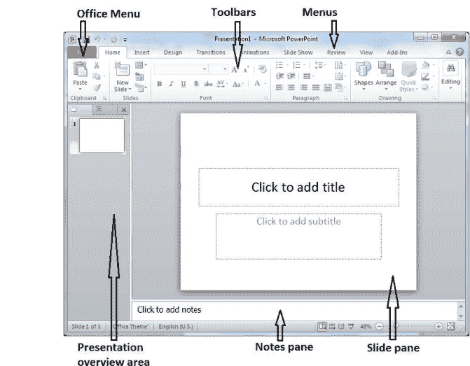

#### 菜单和工具栏

Office 2007和2010与之前的版本不同，不再使用菜单。主菜单现在以选项卡形式呈现为工具栏。换句话说，项目不再通过从列表中选择来选择，而是以工具栏的形式呈现（Microsoft称之为“功能区”）。

例如，“主页”菜单会显示主页选项卡：
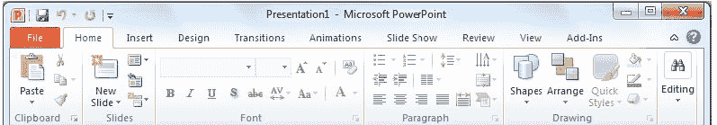

而“查看”菜单会显示查看选项卡：
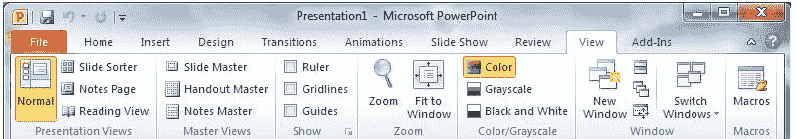

> 提示：如果你将鼠标悬停在任何工具栏按钮上，将会出现一个弹出框，解释该按钮的功能。

#### 演示概述

窗口左侧是一个区域，它给你一个演示的概览。它包含两个不同的选项卡：“大纲”选项卡和“幻灯片”选项卡。“幻灯片”选项卡包含当前演示中所有幻灯片的缩略图（小图片），你可以使用这些缩略图导航演示（即移动到特定的幻灯片）。

#### 笔记窗格

PowerPoint演示文稿中的每个幻灯片都有一个相关的备注区域。这些备注不会作为演示的一部分显示，但如果你愿意，可以打印出来。这是一个理想的地方，可以记录关于演示文稿的个人笔记（也许是为了提醒自己关于幻灯片想要说的内容）。

### 7.2.1 视图

作为PowerPoint演示文稿的一部分的幻灯片可以以多种不同的方式查看。“普通”视图用于开发幻灯片，“幻灯片浏览”视图允许您轻松重新排列幻灯片，“备注页”视图允许您为幻灯片创建备注，“幻灯片放映”视图用于显示演示文稿的最终形式。

可以使用“视图”选项卡访问不同的视图。视图被分组在标记为“演示文稿视图”的区域中。


“普通”视图用于制作幻灯片。这是你第一次启动PowerPoint应用程序时看到的默认视图。

#### 幻灯片浏览视图

选择 [视图] → [幻灯片浏览] 将显示演示文稿中的所有幻灯片。这样可以让你有机会改变幻灯片的顺序（通过点击和拖动到新的位置）。值得注意的是，你也可以在普通视图的“幻灯片”选项卡中通过点击和拖动缩略图来执行相同的任务。

使用此视图来确定幻灯片是否自然而逻辑地从一个幻灯片流向下一个。您可能会注意到，一个幻灯片需要分解成更多的幻灯片（可能是2或3个幻灯片）以改善演示的结构和清晰度。

#### 备注视图

选择 [视图] → [备注页] 将显示幻灯片和附加到该幻灯片的任何备注。如前所述，备注本身不会出现在演示中，而是可以由演讲者在排练演示时使用。“备注页”视图显示了如果笔记被打印出来时页面的样子。

#### 幻灯片放映视图

选择 [幻灯片放映] → [从当前幻灯片开始] 将从当前幻灯片开始演示。如果你的演示文稿包含任何高级功能，如幻灯片过渡效果、声音或动画，那么您可以使用此视图来验证这些功能是否正常工作。要从“幻灯片放映”视图返回，请按下 `Esc` 键。


*普通视图*


*幻灯片浏览视图*


*备注视图*


*幻灯片放映视图*

### 7.2.2 选项

PowerPoint有许多选项，允许您自定义各种自动功能的操作方式。不要害怕尝试这些选项（尽管可能值得记下您所更改的内容，以防您想要恢复原样）。PowerPoint（与大多数Microsoft产品一样）旨在尽可能“帮助”您。在您输入时，拼写错误和格式错误将自动更正。PowerPoint猜测您想要做什么，并相应更改格式。

例如，如果您输入一个以星号开头的行：
* 这是一个句子

然后PowerPoint会自动将该行转换为带有项目符号的列表，并将句子的第一个单词大写。

虽然这有时很有帮助，但有时您希望以特定的方式显示您的信息，而不希望有任何干扰。

点击“文件”按钮将弹出一个包含“选项”按钮的窗口。单击此按钮可配置控制PowerPoint使用的自动化级别的各种选项。

## 7.3 添加内容

PowerPoint演示文稿由标题幻灯片和一个或多个包含内容的幻灯片组成。

### 7.3.1 标题幻灯片

标题幻灯片通常是演示文稿的第一张幻灯片。标题幻灯片的默认布局与其他幻灯片不同。当您启动一个新的空白演示文稿时，您应该看到类似以下的内容：


标题幻灯片包含主标题和副标题的占位符。要添加标题，请单击适当的框并输入您的文本。

### 7.3.2 添加新幻灯片

当你添加一个新的幻灯片到演示文稿中时，它会被插入在当前选择的幻灯片之后。要在演示文稿中插入一个新的幻灯片，你可以点击演示文稿概览区域“幻灯片”选项卡中的一个幻灯片（或两个幻灯片之间），并按下 `Enter` 键。在这种情况下，都会在演示文稿中插入一个新的幻灯片，然后你可以开始在该幻灯片上添加内容。新的幻灯片将包含幻灯片标题和幻灯片内容区域的占位符。只需点击相应的框并输入你的文本。


### 7.3.3 着重点

PowerPoint被设计为以着重点的形式呈现文本。这些着重点按层次结构组织。顶级着重点较大、粗体，并位于左侧。随着着重点在层次结构中向下移动，文本变得较小，并向右缩进。

点击按钮  以增加缩进级别（在层次结构中较低），或点击“减少缩进量”按钮以减少缩进级别（在层次结构中较高）。这两个按钮位于“主页”工具栏的“段落”部分。

### 7.3.4 标题和页脚

在打印幻灯片作为讲义（或备注）时，可以为打印的页面添加页眉或页脚。然而，幻灯片本身在屏幕上显示时只能有页脚。

页眉/页脚可以包含日期（自动更新为上次修改幻灯片的日期或您选择的固定日期）、幻灯片编号或您指定的任何固定文本（例如您的部门/公司名称）。


不同的幻灯片可以应用不同的页脚，尽管在所有幻灯片上保持一致的页脚更为常见。请注意，标题页可以有不同的页脚。您可以通过选择 [插入] 选项卡 -> [页眉和页脚] 来进行设置。

### 7.3.5 绘图工具

PowerPoint提供的绘图工具非常强大且易于使用。如果你打算在幻灯片上使用图表、流程图或图片，那么你需要学习如何使用绘图工具。

#### 网格

PowerPoint使用“绘图网格”的概念，帮助你更容易地对齐绘图对象。想象一下屏幕上覆盖着一个无形的网格，当你创建或移动绘图对象时，对象的边缘将始终对齐网格线之一（即对象将从一个网格线跳到下一个网格线的大小或位置）。你可以设置网格的大小，以适合你计划创建的绘图（0.05cm到1.0cm之间的值是相当典型的）。


从“主页”选项卡上，点击“排列”图标，然后选择 [对齐] -> [网格设置]。

#### 与形状一起工作

PowerPoint有许多预定义形状可供选择。选择要绘制的形状后，单击并拖动鼠标将在幻灯片上绘制所选形状。绘制形状后，您可以更改各种属性，如轮廓和填充。

形状可以从“插入”选项卡中选择，通过单击“形状”按钮。要更改对象的属性，请选择对象并选择“绘图工具-格式”选项卡。选项卡的“形状样式”部分允许您对所选对象的外观进行精确控制。

> **提示**：使用连接器形状可以在两个对象之间创建“粘性”连接。如果其中一个对象移动到新位置，则连接器的末端将保持连接。在创建使用线连接各个部分的流程图和图表时，这是一个非常有用的功能。

每个对象（包括幻灯片上的任何文本框）都漂浮在不同的层级中。我们可以改变这些层级的顺序，从而定义哪些对象出现在其他对象的前面。要更改对象的顺序，请选择“绘图工具-格式”，然后从选项卡的“排列”部分选择适当的按钮。

对象还可以使用上述菜单中的选项进行旋转或翻转。如果您选择了多个形状，您可以选择“组合”对象（以后将其视为单个对象），或者选择“对齐”对象。

如果你想向形状添加文本，只需在选择该形状时开始输入即可。您可以通过选择文本并使用常规菜单来更改字体的外观。如果你想改变文本与形状的锚定方式，可以使用“设置形状格式”对话框并选择“文本框”选项进行调整。


### 7.3.6 图片

可以使用剪贴板或者从磁盘直接访问来轻松地向PowerPoint演示文稿中添加图片。

#### 使用剪贴板添加图片

向PowerPoint中添加图片的最常见方法是使用剪贴板。如果你正在浏览器中查看图像，可以右键单击图像然后选择“复制图像”。如果你使用另一个应用程序，可以选择“编辑”->“复制”。将图像复制到剪贴板后，选择目标幻灯片并点击“主页”选项卡下的“粘贴”按钮。


#### 添加存储在磁盘上的图片

或者，您可以直接从磁盘插入图片（适用于添加照片）。点击“插入”选项卡，然后选择“图片”按钮。


#### 简单编辑图片

您可以在PowerPoint内对图片进行简单的更改。虽然更复杂的更改需要专业编辑软件，但PowerPoint可以调整亮度和对比度，并进行裁剪。

选择一张图片将会显示“图片工具-格式”选项卡。其中“调整”部分允许您修改图像的亮度、对比度或颜色。“大小”部分允许您更改尺寸并裁剪图像。


#### 压缩图像

图像在磁盘上占用大量内存。一个没有图像的演示文稿通常很小（约100KB），但包含多张图片后可能超过10MB，难以通过电子邮件传输。

PowerPoint包含“压缩图片”功能，可以显著减小文件大小。使用“图片工具-格式”选项卡中“调整”部分的“压缩图片”按钮即可。

#### 调整图层顺序

由于图片被视为一种特殊类型的对象，许多绘图工具也适用于图片。图片的图层可以向前或向后移动，也可以旋转、对齐和分布。

例如，您可以通过更改轮廓属性来为图片创建边框，或者将图片设置为背景图像（置于底层）。

“图片工具-格式”选项卡的“排列”部分允许您更改顺序、对齐和旋转图片；“图片样式”部分则允许应用多种效果。


## 7.4 制作漂亮的幻灯片

在前一节中，我们介绍了如何创建和查看简单的演示文稿。本节将介绍如何使演示文稿更具吸引力。

### 7.4.1 文本格式化

PowerPoint中用于格式化文本的工具与文字处理软件类似。您可以点击工具栏图标逐个更改属性，也可以点击“主页”选项卡“字体”部分的小图标打开对话框同时进行多项更改（如字体、字号、加粗等）。


### 7.4.2 背景和字体颜色

给幻灯片添加背景颜色非常简单。选择“设计”选项卡，并点击“设置背景格式”对话框，选择一种填充颜色。


与纯色背景相比，使用渐变色、图片或纹理填充通常更吸引人。如果将背景改为深色，务必使用常规字体工具将字体颜色改为浅色，以确保清晰可见。

### 7.4.3 设计主题

设计主题（Theme）影响整个演示文稿的外观，包括背景、标题和正文的位置与格式。

> **提示**：为了创建一个专业的演示文稿，你应该尝试开发自己的主题。PowerPoint内置的主题经常被使用，观众可能会对常见的风格感到厌倦。

要应用主题，请在“设计”选项卡的“主题”部分选择一个缩略图进行预览和应用。请注意，不同的设计会影响字体大小和排版效果。


*设计模板示例*

### 7.4.4 颜色方案

颜色方案定义了幻灯片中各元素的默认颜色集合，包括：
- 背景
- 文本和行
- 阴影
- 标题文本
- 填充
- 强调文字
- 强调文字和超链接
- 强调文字和已访问的超链接

选择“设计”选项卡并点击“主题”部分中的“颜色”按钮，即可选择或自定义颜色方案。您可以为备注页、讲义和幻灯片指定不同的颜色方案。

### 7.4.5 设计布局

设计布局指定了单个幻灯片中不同内容元素的位置。您可以使用预设布局快速排列图表、图片和文本。例如，您可以选择“两栏内容”布局，或者“左侧文本，右侧图片”的布局。

选择“主页”选项卡，点击“幻灯片”部分中的“布局”按钮即可进行选择。

您可以选择多种不同的布局。显示的缩略图将显示不同布局的外观。您可以通过点击其中一个缩略图来应用布局。

不同的设计模板具有不同的内容使用空间（例如，具有非常大标题的设计模板可能具有较少的垂直空间，而具有非常大的左侧图形的设计模板可能具有较少的水平空间）。如果将不同的设计模板应用于具有指定布局的幻灯片，则可能需要返回该幻灯片并重置布局，以确保内容正确显示。

要重置布局，请右键单击幻灯片，然后选择 **重置幻灯片**。

### 7.4.6 使用母版

母版用于创建一个新的幻灯片设计，可用作给定演示文稿中所有幻灯片的模板。为了创建一个一致、专业的演示文稿，具有独特、个性化的外观，您应该定义自己的幻灯片母版。

要编辑幻灯片母版，请选择 **查看** 选项卡，然后选择 **幻灯片母版** 按钮（位于“演示文稿视图”部分）。

幻灯片母版将显示在主工作区域中。

### 幻灯片母版

您可以使用任何标准格式工具更改此幻灯片母版的外观。文本框的大小和位置，字体样式和颜色都可以更改。您对此幻灯片母版所做的更改将定义添加到此演示文稿中的任何新幻灯片的外观。

如果您要连续进行一系列演示文稿，并且希望标题的外观在所有演示文稿中保持一致，您可能还想为标题幻灯片定义不同的模板。

编辑完毕后，应返回默认视图。单击“关闭母版视图”按钮（位于“幻灯片母版”选项卡上），或选择“查看”选项卡并单击“普通”按钮。

## 7.5 互动性 - 动画和多媒体

PowerPoint 提供了许多更高级的功能，这些工具用于制作最引人注目的演示文稿。

### 7.5.1 幻灯片切换

幻灯片切换是在演示文稿中从一张幻灯片切换到下一张时发生的动画。如果需要，您可以为不同的幻灯片应用不同的幻灯片切换，或者在演示文稿中的所有幻灯片上使用相同的切换。您可以更改切换的速度，并且可以添加在切换时播放的声音。最后，您可以指定幻灯片在经过一定的秒数后是否自动切换到下一张，或者是否需要手动切换。

选择“切换”选项卡，并从“切换到此幻灯片”部分选择切换类型。

### 7.5.2 链接到外部资源

您可以从 PowerPoint 幻灯片创建到您计算机上的任何文档或任何网页的链接。要添加链接，请在幻灯片上的文本框中单击，并选择 **插入** → **超链接** (或者在文本框中右键单击并选择 **超链接**)。一个对话框将出现，允许您选择链接的目标并输入一个名称用于链接。

页面上显示的名称应该在对话框顶部的“显示文本：”字段中输入。如果您要链接到计算机上存储的文档，则使用对话框的主区域来定位该文档。如果您要链接到一个网站，则复制该网站的地址并粘贴到对话框底部的“地址”字段中。当您确信已输入了正确的信息后，点击 **确定** 在页面上创建超链接。您可以通过选择 **幻灯片放映** → **从当前幻灯片开始** 并点击链接来测试超链接。

### 声音

您可以使用 **插入** → **音频** (来自媒体部分)。如果您选择从 CD 中添加声音，则每次演示时都必须将 CD 插入驱动器中。

> **提示**：如果您想使用 CD 中的声音，则可以使用软件将音乐文件提取到本地硬盘上，并在将声音插入演示时使用该文件。以这种方式从文件中插入意味着演示仍然可以在没有 CD 的情况下工作。

当您在演示中插入声音时，系统会询问您是否要自动启动声音（即声音在幻灯片首次出现时开始播放），或者您是否要点击以启动声音。无论哪种方式，当插入声音时，您会在演示中看到一个小喇叭图标（如果您从 CD 中插入声音，则为 CD 图标）。该图标代表已添加的声音。

当您进行演示时，不用担心图标看起来凌乱，您可以隐藏实际的图标。

### 电影

电影很复杂，因为有很多不同的格式（最常见的是 .mpeg, .mov, .avi 和 .wmv）。除了文件格式之外，还有许多不同的编解码器用于对信息进行编码，以便占用更少的磁盘空间。如果没有安装相同的编解码器，则在一台计算机上播放的电影可能无法在另一台计算机上播放。如果您打算在 PowerPoint 演示文稿中使用电影，则必须在将要用于演示文稿的计算机上进行尝试。

电影的插入方式与声音类似。选择 **插入** → **视频** → **文件中的视频**，并在硬盘上找到电影文件。与声音一样，系统会询问您是否要自动开始播放电影（即电影在幻灯片首次出现时开始播放），或者是否要点击开始播放。

如果你选择了已添加到幻灯片中的电影文件，则会出现两个额外的选项卡，分别称为“格式”和“播放”。“播放”选项卡包含播放选项：电影全屏播放、循环播放直到用户停止电影、以及在电影播放完毕后倒带。

### 7.5.3 自定义动画

自定义动画允许您控制演示文稿中每个元素的动画。您可以将自定义动画应用于单个对象或一组对象。您可以为单个字母、单词、句子或整个段落添加动画效果。

您可以设置动画的触发条件（即动画何时开始）。动画的速度和时序可以改变，动画序列重复的次数也可以调整。每种动画类型都有一些不同的选项，可以调整动画的显示方式。

要为对象添加自定义动画，首先选择对象，然后从“动画”选项卡中选择。您需要从以下列表中选择动画类型：

- **入场**：对象首次出现时发生动画
- **退出**：对象从幻灯片中移除时发生动画
- **强调**：在对象可见时强调对象
- **运动路径**：将对象从一个位置移动到另一个位置的动画

选择所需的动画后，您可以在动画窗格中进一步修改它。要在页面的右侧显示动画窗格，请单击“动画”选项卡中“高级动画”部分下的“动画窗格”。您将看到在普通视图中，对象旁边会显示一个小数字（在幻灯片放映期间不会显示），该数字与动画窗格中的项目具有相同的编号。

### 计时

计时是动画过程中最重要的部分之一。通过将多个简单部分串联在一起，您可以创建复杂的动画。计时选项使您能够轻松连接动画。动画的起始条件应为以下之一：

- **单击时**：当用户点击鼠标时动画开始
- **与前一个动画同时**：与前一个动画同时开始（或者如果动画是列表中的第一个动画，则在幻灯片首次出现时开始）
- **在前一个动画之后**：动画在前一个动画完成后开始

您还可以通过右键单击动画面板中的动画并选择“计时”来进一步设置。创建有效的动画序列可能会耗费时间，但如果您有时间可以投入的话，最终会有回报。

### 选项

每个动画都有一些选项，这些选项会影响动画的外观。例如，旋转动画可以设置为以任意角度顺时针或逆时针旋转，并可以设置在旋转开始和/或结束时缓慢加速和/或减速。通过右键单击动画面板中的动画并选择“效果选项”，可以访问这些动画选项。

### 7.5.4 CD包装

如果您的演示文稿中有任何链接的文件（如电影或声音），那么将演示文稿打包以便运输非常重要。

点击 **文件** 选项卡 -> **保存并发送** -> **将演示文稿打包成 CD**。

链接文件不会嵌入到您的演示文稿中，而是 PowerPoint 会存储到硬盘上文件的位置的链接。如果您将演示文稿保存到计算机上（或者保存到闪存驱动器上），PowerPoint 不会自动更新链接，因此在演示期间，它仍然会尝试引用计算机上用于开发演示文稿的文件。这意味着链接的文件在实际演示期间将不可用。

为了避免这个问题，您可以使用“将演示文稿打包为 CD”的选项。虽然听起来好像您必须将演示文稿存储在 CD 上，但实际上您可以将打包的演示文稿存储在硬盘上的一个文件夹中。该文件夹将包含 PowerPoint 演示文稿、允许您在没有安装 PowerPoint 的计算机上查看演示文稿的软件，以及您从演示文稿中链接的所有文件。将此文件夹复制到新位置是安全的，所有链接的文件将正常工作。

> **提示**：在将演示文稿移动到另一台计算机之前，始终使用“将演示文稿打包为 CD”选项。在开始向观众展示演示文稿之前，始终在目标计算机上测试演示文稿，以确保字体、声音、影片和动画都能正常工作。

## 7.6 演示

完成演示文稿的构建后，您需要进行演示。本节介绍了在实际演示过程中使用 PowerPoint 的一些方法。

### 7.6.1 排练演示文稿

在完成演示文稿的设计后，您可能希望排练演示过程。选择“幻灯片放映”选项卡，然后从“设置”部分选择“排练计时”。

您的 PowerPoint 幻灯片放映将开始，并且您将在屏幕左上角看到一个小计时器。当您切换到下一张幻灯片时，计时器将记录时间。如果需要休息，您可以暂停计时器。在完成演示后，您可以使用幻灯片浏览视图查看每张幻灯片所花费的时间。

您可以使用此时生成的时间来自动调整幻灯片的播放速度。如果您选择 **幻灯片放映** -> **设置幻灯片放映**，那么您可以选择根据排练期间记录的时间来“使用排练计时”。如果您选择此选项，则幻灯片将自动进行，无需手动干预（如果您正在设置演示文稿以在信息亭上运行，则特别有用）。

### 7.6.2 在演示期间导航

一旦幻灯片放映开始，幻灯片要么会自动进行，要么需要手动进行，这取决于您的设置（过渡、动画和时间）。

您可以通过以下方式手动浏览幻灯片：

- 点击鼠标左键以进入下一张幻灯片
- 按下 [空格键] 以进入下一张幻灯片
- 按下左箭头或右箭头键分别移动到上一张或下一张幻灯片
- 按下要移动到的幻灯片编号，然后按下 [Enter] 键 (例如，按下 [1] [Enter] 将直接跳转到演示文稿的第一张幻灯片)。

演示文稿开始时，指针通常是不可见的。如果移动鼠标，指针将出现，并且您将在幻灯片左下角看到一些淡淡的按钮。您可以单击左右图标分别导航到上一张和下一张幻灯片。

### 7.6.3 注释演示文稿

在教学过程中，有时您希望突出显示幻灯片的某些元素，或以某种方式在幻灯片上书写。要做到这一点，点击鼠标右键，会出现一个菜单。您可以使用此菜单选择：

**指针选项** -> **箭头** 或 **圆珠笔** 或 **荧光笔**。

您还可以通过右键单击选择 **指针选项** -> **墨水颜色** 并选择您想要的颜色。一旦你选择了指针选项和颜色，你可以使用鼠标在页面上涂鸦。当你完成演示后，如果你愿意，你可以选择保留批注。

## 7.7 设计和演示建议

你可以将 PowerPoint 用于不同的目的，在一个情境中适用的建议可能不一定适用于另一个情境。最重要的是找到适合你的风格（根据你可用的时间来准备）。

### 7.7.1 打印演示文稿

演示文稿有三种主要的打印方式。你可以选择打印幻灯片、备注页，或者将幻灯片打印为讲义。选择 **文件** → **打印** 打开对话框，然后在设置区域的下拉框中选择“讲义”、“备注”或“幻灯片”。

通常情况下，如果你要将幻灯片用作讲义（例如每页 A4 纸上有 4 张幻灯片），你会选择在单张 A4 纸上打印多张幻灯片。为此，纸张通常以横向模式放置。

如果你选择打印备注页，那么每页将只显示一张幻灯片，备注将位于幻灯片下方的空间中。如果你选择将演示文稿打印为讲义，那么你可以选择每页显示的幻灯片数量（例如每页显示 3 张幻灯片并留有笔记行）。

如果你的幻灯片有彩色背景，那么在打印时可能很难阅读。在打印设置中有一个选项可以打印幻灯片为“纯黑白”。如果你选择了这个选项，彩色背景将被省略，文本将以黑色墨水打印，以便更容易阅读。

## 7.8 幻灯片设计建议

### 7.8.1 幻灯片是为了支持你，而不是取代你！

最重要的是要记住，PowerPoint 演示应该支持你说的话，而不是完全取代你。如果所有的信息都在幻灯片上，那么你就是多余的。同时阅读和听取是困难的，所以保持幻灯片简单。PowerPoint 带给演示的主要优势是视觉冲击力，所以要用它来与观众建立联系。

### 7.8.2 保持一致性

背景、颜色和字体在整个演示中应保持一致。幻灯片之间的样式差异会分散注意力，显得不专业。

### 7.8.3 保持简洁

你的幻灯片不应该有多余的内容。只保留必要的内容。杂乱无章的内容越少，你的信息传达就越有力。

### 7.8.4 限制项目符号和文本

幻灯片应该支持和增强你的信息，而不是取代你。准备一份书面文件作为传达信息的手册，不要使用幻灯片作为手册的替代品。

### 7.8.5 限制动画

一些动画效果可能很好，但要保持简单和快速。谨慎使用。永远不要使用过于花哨的幻灯片过渡效果！

### 7.8.6 限制声音并保持专业

声音可以是传达信息的强大媒介，但要谨慎使用。永远不要使用 PowerPoint 自带的尖锐音效。如果你使用音乐或声音，请确保使用高质量的音频文件。

### 7.8.7 使用高质量的视觉效果

使用库存照片或其他高质量图像。避免使用过时的剪贴画，这会降低演示文稿的品质，使其看起来不够专业。

### 7.8.8 设计自己的模板

不要仅依赖标准的微软模板。它们被过于频繁地使用，缺乏新意。尝试开发自己的个性化模板。

### 7.8.9 充分利用颜色

颜色能唤起情感，因此要谨慎选择颜色。永远不要仅为了装饰而使用有色文本。只有在强调单个单词或短语时才适度使用。

使用暖色调作为前景色（往往更显眼），使用冷色调作为背景色（往往有后退感）。尽量增加前景色和背景色之间的对比度。

在黑暗的房间中，深色背景与浅色文本效果最佳。在光线充足的房间中，白色背景与深色文本更易于阅读。

### 7.8.10 不要在单个幻灯片上做太多事情

确保每张幻灯片只有一个主要观点。如果一张幻灯片上内容过多，则将幻灯片分割成多张。

### 7.8.11 选择合适的字体

在演示中使用的字体数量要有限。每个演示文稿最多使用两种字体（例如 Arial 和 Arial Bold）。选择一种简单易读的字体。避免使用复杂的装饰性字体。在屏幕上，无衬线字体（如 Arial）通常比衬线字体（如 Times New Roman）更易读。

### 7.8.12 讲故事

一个好的演示应该通过故事吸引观众，而不仅仅是列举一系列事实。PowerPoint 演示应该支持和增强你正在讲述的故事，而不是将演示简化为无聊的项目列表。将每张幻灯片视为一篇短文。顶部不要使用简单的名词标题，而是写一个能吸引注意力的短句。例如，不要写“问题”，而要写“使用 PowerPoint 不当会让学生感到困惑”。

## 7.9 参考资料和进一步阅读

- **PowerPoint 概述**
  - http://en.wikipedia.org/wiki/Powerpoint
- **在线培训**
  - http://office.microsoft.com/en-us/training/default.aspx
  - Microsoft Office 帮助
- **演示设计**
  - http://www.presentationzen.com/
  - http://www.garrreynolds.com/Presentation/pdf/presentation_tips.pdf
- **重新思考演示幻灯片的设计**
  - http://www.writing.eng.vt.edu/slides.html
- **在它再次造成伤害之前停止你的演示**
  - http://headrush.typepad.com/creating_passionate_users/2005/06/kill_your_prese.html
- **“PowerPoint 是邪恶的” — Edward Tufte**
  - http://www.wired.com/wired/archive/11.09/ppt2.html

# 第8章 电子表格

## 8.1 Visicalc

电子表格的概念是从哈佛商学院使用的“运行数字”技术发展而来的。丹·布里克林（Dan Bricklin）通过观察他的讲师使用表格记录财务计算结果的方法，开发了使用计算机的想法。如果在过程中发生错误，讲师必须擦除任何后续结果，纠正错误并重新计算所有条目。丹·布里克林想到可以使用计算机自动化这个过程，并将任何计算结果以可视化的方式显示在表格中。他与能干的程序员鲍勃·弗兰克斯顿（Bob Frankston）一起创建了一个被称为 Visicalc 的程序（代表 Visible Calculator，即可见计算器）。

第一份副本于1979年10月售出，仅适用于Apple II。这个应用程序非常有用，以至于美国各地的中层管理人员都觉得必须拥有它。这些人有着舒适的工作和可支配的收入，所以他们能够负担得起个人电脑的费用。Visicalc非常有用，以至于人们愿意购买一台Apple II电脑只为了运行这个程序。苹果的销售量大幅增加，将个人电脑行业推向公众视野，使苹果的创始人史蒂夫·乔布斯和史蒂夫·沃兹尼亚克成为家喻户晓的名字。

后来，Visicalc的权利被Lotus收购，他们基于苹果产品推出了IBM PC上的Lotus 1-2-3。其他电子表格软件如Wings、ClarisWorks、OpenOffice Calc和Gnumeric相继问世。如今，主导地位的电子表格软件是Microsoft Excel。它在商业和家庭环境中被广泛使用。然而，Excel中的一些统计函数无法正常工作，因此对于严肃的学术研究，建议使用专用的统计软件或其他电子表格软件，如Gnumeric。

## 8.2 简介

电子表格是一种允许用户将数据输入到表格中的应用程序。一旦数据被输入，就可以使用公式进行计算，通过各种函数对数据进行操作，以及对数据进行格式化以供展示。电子表格通常被处理数据表的人广泛使用。

### 8.2.1 菜单和工具栏

Excel的不同版本在用户界面上可能会有些许不同（尤其是在Office 2003和Office 2007版本之间），但基本原则保持不变。当我们开始一个新的Excel文档时，会看到一个空白的电子表格。

在窗口的顶部，我们可以看到许多菜单和工具栏。我们使用它们来执行适用于我们文档的操作。Office 2003和Office 2007在使用菜单和工具栏方面存在重大差异。

#### Office 2003

菜单的工作方式与大多数其他应用程序相同。当我们点击菜单时，会出现一个下拉列表，列出与菜单主题相关的一系列选项。例如，一个典型的文件菜单如下所示。

#### Office 2007和Office 2010

菜单背后的理念与之前的版本有所改变。现在，主菜单以选项卡形式呈现为工具栏。换句话说，项目不再通过从列表中选择，而是以工具栏的形式呈现（Microsoft将这个新工具栏称为“ribbon”）。例如，主页菜单导致主页选项卡显示，而“查看”菜单会显示查看选项卡。

如果我们将鼠标悬停在工具栏按钮上，将会出现一个弹出框解释按钮的功能。在这门课程中，我们将使用Office 2010。

## 8.3 添加数据

电子表格中的每个位置被称为一个单元格。每个单元格可以包含文本、数字或公式。单元格还可以进行格式化以获得更好的外观（边框、阴影、颜色等），但更改外观不会改变单元格中存储的数据。

- 每一列都由一个字母标识（即A, B, C……）。
- 每一行都由一个数字标识（即1, 2, 3……）。
- 当前选定的单元格被称为活动单元格，并且会被突出显示。
- 名称框显示活动单元格的名称。电子表格中的每个单元格都使用列字母后跟行号的组合进行引用（例如A3, B7, D8）。这些引用是使用公式所必需的，而公式是电子表格真正强大之处。
- 公式栏将显示活动单元格的当前内容。

### 8.3.1 输入数据

要向任何单元格输入信息，只需点击该单元格使其成为活动单元格（即通过点击选择该单元格）。一旦单元格处于活动状态，输入的任何文本都将显示在电子表格顶部的公式栏中。数据直到按下 `Enter` 键，或者点击 `Enter` 图标后才会生效。如果我们改变主意不想输入数据并希望中止，我们可以点击取消图标，数据将不会添加到电子表格中。

### 8.3.2 选择一系列单元格

我们可以通过点击鼠标并拖动它在电子表格上选择一系列单元格。当你拖动鼠标时，我们会看到一些单元格被突出显示。在下面的图表中，活动单元格是B3，选择了从B3到D7的一系列单元格。

### 8.3.3 选择整行或整列

要选择整行，点击该行的编号。要选择多行，点击编号并拖动鼠标选择我们要选择的行。

要选择整列，点击该列的字母。要选择多列，点击字母并拖动鼠标选择我们要选择的列。

要选择整个电子表格，请点击位于电子表格左上角行和列标题之间的方块。

### 8.3.4 复制和粘贴

我们可以使用剪贴板剪切、复制和粘贴单元格。为了复制一些电子表格单元格，我们应该先突出显示我们想要复制的单元格。

使用“主页”选项卡“剪贴板”部分的“复制”图标，或使用键盘快捷方式 `Ctrl` + `C` 复制所选单元格。在已复制到剪贴板的单元格周围出现虚线。要粘贴所选单元格，请单击目标单元格的左上角，然后选择使用“主页”选项卡“剪贴板”部分的“粘贴”图标，或使用键盘快捷键 `Ctrl` + `V`。

如果我们想要将单元格从一个位置移动到另一个位置，那么我们应该使用“主页”制表符“剪贴板”部分的“剪切”图标，或使用键盘快捷键 `Ctrl` + `X`。

| | A | B | C | D |
|---|---|---|---|---|
| 1 | | | | |
| 2 | | Hello | | |
| 3 | | This | | |
| 4 | | Morning | | |
| 5 | | | | |
| 6 | | Hello | 1 | |
| 7 | | This | 2 | |
| 8 | | Morning | 3 | |
| 9 | | | | |

### 8.3.5 填充数据

Excel有一个有用的功能叫做填充。我们可以不用逐个单元格输入数据，而是选择第一个单元格，然后告诉电子表格自动填充其他单元格与第一个单元格的内容。要填充一个简单的值，使用“主页”选项卡“编辑”部分的“填充”图标，或使用以下键盘快捷键之一：

- 向下填充 — `Ctrl` + `D`
- 向右填充 — `Ctrl` + `R`
- 向上填充 — `Ctrl` + `U`
- 向左填充 — `Ctrl` + `L`

或者，我们可以使用填充手柄。如果我们点击填充手柄并拖动鼠标以突出显示一系列单元格，电子表格将自动用第一个单元格的内容填充这些单元格。

填充手柄可用于根据预定义列表自动填充数据。如果第一个项目被识别为列表的一部分，那么Excel可以通过循环列表自动填充单元格。预定义列表包括星期几和月份。

我们可以自定义Excel可以识别的列表，以便它可以自动填充常用的数据集。要自定义列表，请使用 [文件] 选项卡，然后点击 [选项]。点击 [高级]，在左侧滚动到“常规”部分并点击 [编辑自定义列表] 按钮。接下来会出现一个对话框，我们可以添加自定义列表。例如，可以添加自定义列表 {苹果，橙子，香蕉}。

### 8.3.6 插入/删除行和列

在输入数据到电子表格时，通常会意识到我们需要额外的行或列。我们可以轻松地插入新的行或列，以便在正确的位置添加数据。

例如，在下面的电子表格中，我们已经输入了一些人的姓名和年龄。如果我们有另一个人的新数据（例如，艾玛，年龄30岁），我们想要将其添加到现有数据的中间位置，那么我们需要插入一行。

| | A | B | C |
|---|---|---|---|
| 1 | Name | Age | |
| 2 | Ann | 23 | |
| 3 | David | 17 | |
| 4 | Greg | 35 | |
| 5 | Susan | 54 | |
| 6 | | | |

要插入新行，请选择要下移的行。新行将出现在此位置，其余行将向下移动以腾出空间。一旦选择了行，从“主页”选项卡的“单元格”部分选择 [插入]，或者选择 [插入] -> [插入工作表行]。一旦在电子表格中插入了新行，我们可以将数据输入到可用的空间中。

## 8.4 公式

电子表格的真正力量在于根据其他单元格中包含的值计算要在一个单元格中使用的值。要计算一个值，我们需要使用一个公式。所有公式都必须以 `=` 符号开头。

我们可以使用公式来执行计算，就像我们使用计算器一样（例如，计算 3 + 4 的结果）。这个公式将被输入到一个单元格中，如 `=3+4`。计算的结果 (7) 将在包含公式的单元格中显示。注意，单元格包含的是公式，但它显示的是公式的结果。

### 8.4.1 相对引用

公式可以引用其他单元格的内容。例如，在下面的电子表格中，我们通过引用包含数据的单元格来计算两个值的总和。

D3单元格包含公式 `=B3 + C3`。该公式实际上是说“将存储在B3单元格中的值与存储在C3单元格中的值相加，计算的结果将显示在此单元格中”。

我们可以将类似的公式键入到D4、D5和D6单元格中：
- D4包含公式 `=B4 + C4`
- D5包含公式 `=B5 + C5`
- D6包含公式 `=B6 + C6`

然而，如果我们有许多行数据，这个过程很快会变得乏味。幸运的是，我们可以使用填充将公式填充到相邻的单元格中。每当我们将包含公式的单元格复制（或填充）到不同的位置时，公式会自动更改以引用不同的单元格。这种单元格引用被称为相对引用，因为公式中所引用的单元格与电子表格中公式的位置有关。

在上面的例子中，单元格D3中的公式是 `=B3 + C3`。因为这些是相对引用，电子表格将公式解释为“将当前单元格左侧第2列的内容与左侧第1列的内容相加”。当公式移动到单元格D6时，公式引用的单元格自动变更为 `=B6 + C6`。

### 8.4.2 绝对引用

有时候我们想要引用同一个单元格，无论引用该单元格的公式移动到哪里。例如，我们可能有一个单元格包含当前的每小时工资率，我们希望在计算不同员工的工资时引用它。

工资率始终存储在B2单元格中。如果我们将此公式填充到下面的单元格中，那么工资率（B2）和总工时（D4）的引用都将被更改，这将导致不正确的结果。我们注意到当移动公式时，我们想要更改对总工时的引用，但是对工资率的引用应该保持不变。

应该保持不变的引用称为绝对引用。在Excel中，应在保持不变的行或列（或两者）之前立即使用美元符号（$）。如果使用了绝对引用，当公式复制到新位置时，绝对引用将不会更改。

在上面的示例中，公式包含相对引用和绝对引用。相对引用将自动更改，但绝对引用将保持不变。新的公式将是：
- E4 包含公式 `=D4 * $B$2`
- E5 包含公式 `=D5 * $B$2`
- E6 包含公式 `=D6 * $B$2`

### 8.4.3 良好的电子表格设计

关于电子表格的最重要设计考虑是确保它计算出正确的结果。人们在设计电子表格时最常见的错误之一是将相同的信息放在多个位置。最初这样做是可以的，但是如果稍后只在一个位置更改信息，那么电子表格将不一致，并计算出错误的结果。

在公式中使用数字而不是单元格引用（即硬编码，例如 `=D4 * 12.5`）可能导致不一致性。如果稍后支付率更改了，你必须修改所有相关的公式。相反，如果公式引用存储支付率的单元格，你只需更改一个单元格的值即可。

构建电子表格时，应尽量使其基于新数据重新计算结果所需的工作量最小化。

### 示例

下面的电子表格由一位教师用于计算学生的最终成绩。作业1（A1）满分为10分，作业2（A2）满分为7分。教师希望每个作业对最终成绩的贡献相等。

| | A | B | C | D |
|---|---|---|---|---|
| 1 | Assignment marks | | | |
| 2 | Name | A1 | A2 | Final |
| 3 | Homer | 1 | 2 | |
| 4 | Marge | 5 | 6 | |
| 5 | Bart | 3 | 2 | |
| 6 | Lisa | 10 | 7 | |
| 7 | Maggie | 0 | 1 | |

首先，我们可以将每个分数转换为百分比，然后计算这两个百分比的平均值。计算最终分数的步骤：
- 使用（分数 / 满分 * 100）将分数转换为百分比
- 计算百分比的平均值

| | A | B | C | D | E | F |
|---|---|---|---|---|---|---|
| 1 | Assignment marks | | | | | |
| 2 | Name | A1 | A2 | A1 % | A2 % | Final |
| 3 | Homer | 1 | 2 | 10 | 28.57143 | 19.28571 |
| 4 | Marge | 5 | 6 | 50 | 85.71429 | 67.85714 |
| 5 | Bart | 3 | 2 | 30 | 28.57143 | 29.28571 |
| 6 | Lisa | 10 | 7 | 100 | 100 | 100 |
| 7 | Maggie | 0 | 1 | 0 | 14.28571 | 7.142857 |

如果将满分数字直接写在公式中（如 `D3 = B3 / 10 * 100`），当满分标准改变时，需要重写所有公式。更好的做法是引用包含满分信息的单元格。

新使用的公式如下：
- D4 包含 `=B4 / $B$3 * $D$3`
- E4 包含 `=C4 / $C$3 * $E$3`

在创建电子表格时，最好将每个信息存储在一个单独的单元格中。使用这种方法可以更容易地保持电子表格的一致性并避免错误。

### 8.4.4 定义名称

我们可以为单元格定义一个名称，然后在编写公式时使用该名称而不是单元格引用。这可以使公式更容易理解。

选择想要命名的单元格，点击“名称框”，或转到“公式”选项卡点击“定义名称”图标并输入名称。一旦单元格被命名，我们可以在公式中使用该名称。例如，不再引用单元格 B3，而是引用命名后的 `A1_max`。单元格 D4 中的公式可以写成：
- `= B4 / A1_max * $D$3`

## 8.5 函数

大多数电子表格提供了许多函数，帮助用户创建有效的公式。所有函数都使用相同的一般结构：

函数名称 (参数1, 参数2, ..., 参数N)

我们经常使用的一些简单函数是AVERAGE、MAX、MIN和SUM。这些函数都作用于一系列单元格。单元格范围被定义为电子表格中的一个矩形块。为了指定一个单元格范围，我们应该给出左上角的单元格，然后是冒号“:”，然后是右下角的单元格。在下面的示例中，选择了一系列单元格。可以使用 A1:B4 来引用这些单元格。

SUM函数在Excel中的描述如下：

> **SUM(number1,number2,...)**
> Adds all the numbers in a range of cells.

这个描述告诉我们，SUM函数接收一系列数值，并计算这些数值的总和。请注意，描述中说函数“将所有单元格范围内的数字相加”。这意味着我们可以引用该范围内的每个单元格，或者我们可以使用我们之前介绍的描述范围的方法。

下面的电子表格用于计算最好的5个实验成绩，从6个实验中选择。要找出最好的5个成绩，我们可以简单地将所有6个实验的成绩相加，并减去最小的成绩。我们可以使用以下函数来编写公式：

- SUM：将单元格范围内的所有数字相加。
- MIN：返回一组数值中的最小值。忽略逻辑值和文本。

函数允许用户创建涉及复杂计算的公式，而无需自己编写所有计算。例如，要找出上面截图中 Lab 01 的平均分，我们可以使用以下三个公式之一：

- `=(B2 + B3 + B4 + B5) / 4`
- `=SUM(B2:B5) / COUNT(B2:B5)`
- `=AVERAGE(B2:B5)`

### 8.5.1 插入函数

“公式”选项卡包含用于插入各种Excel公式的工具。此选项卡最常用的部分是“函数库”部分。

可以通过点击“插入函数”图标来查看Excel中的所有函数。这将提供一个包含所有函数的对话框。如果我们选择一个函数，那么我们将看到它的简要描述。Excel支持的函数被分成不同的类别，以便更容易找到它们。

如果我们认为可能有一个能完成任务的函数，可以浏览最可能的类别。函数库部分的其他按钮用于访问一个或多个函数类别，这些类别包括：

- 自动求和：最常用的函数，用于求和、平均值、计数、最大值和最小值。
- 财务：主要用于会计和经济学。
- 逻辑：用于进行逻辑决策。
- 文本：用于操作文本的函数。
- 日期和时间：用于处理时间和日期的函数。
- 查找和引用：用于在表格中查找值的函数。
- 数学和三角：与数学和三角函数相关的传统函数。
- 统计：统计函数。
- 工程：用于工程和技术的函数。
- 信息：允许我们了解电子表格单元格中值的类型的函数。

### 8.5.2 常见的数学和统计函数

电子表格软件的用户通常需要进行统计计算，因此提供大量的公式作为函数是毫不奇怪的。统计类别包含了许多常见函数（包括最小值、最大值、四分位数、平均值和标准差）。我们最常用的函数包括：

- 最大值、最小值、平均值、中位数、众数、总和。
- 标准差、四分位数、相关性、t检验、相关系数。

### 8.5.3 计数函数

这些函数用于计算单元格的数量。根据我们需要计算的内容，我们必须使用不同的函数。

`COUNT( 单元格范围 )`
COUNT函数用于计算范围内包含数值的单元格数量。

`COUNTIF( 单元格范围, 条件 )`
COUNTIF函数计算范围内与条件匹配的单元格数量。

条件可以是文本、数字或单元格引用。还有其他指定条件的方法，但我们只考虑简单匹配。换句话说，该函数将计算与条件中给定信息相同的所有单元格。要计算所有包含单词“服务员”的单元格，我们可以使用：

`=COUNTIF(D3:D15, "服务员")`

如果文本“服务员”位于另一个单元格中，比如说A2，那么我们可以使用：

`=COUNTIF(D3:D15, $A$2)`

### 8.5.4 条件函数

当我们想要根据特定条件将不同的值放入单元格时，可以使用条件函数。

> IF( 逻辑条件, 如果为真的值, 如果为假的值 )

如果逻辑条件为真，则第二个参数（如果为真的值）将显示在单元格中，否则最后一个参数（如果为假的值）将显示在单元格中。

逻辑条件应该是某种逻辑测试。在最简单的级别上，这些测试包括：

- 等于 ( = ) 例如: B3 = B4
- 大于 ( > ) 例如: B3 > B4
- 小于 ( < ) 例如: B3 < B4
- 大于等于 ( >= ) 例如: B3 >= B4
- 小于等于 ( <= ) 例如: B3 <= B4
- 不等于 ( <> ) 例如: B3 <> B4

例如，在下面的电子表格中，我们使用IF函数来确定员工是否过劳。单元格C2中的公式是：

`=IF(B2>40, "工作太辛苦", "工作")`

| | A | B | C | D |
|---|---|---|---|---|
| 1 | **Name** | **Hours** | **Status** | |
| 2 | Joe | 11 | Working | |
| 3 | Julie | 63 | Working too hard | |
| 4 | Jenny | 47 | Working too hard | |
| 5 | Jack | 34 | Working | |

请注意，在IF函数中，我们可以使用另一个函数来代替简单的值（作为 `value_if_true` 或 `value_if_false`）。在下面的示例中，我们在单元格C2中使用了公式：

```excel
=IF(B2>40,
    "工作太辛苦",
    IF(B2<20, "工作不够努力", "工作")
)
```

| | A | B | C | D | E |
|---|---|---|---|---|---|
| 1 | **Name** | **Hours** | **Status** | | |
| 2 | Joe | 11 | Not working hard enough | | |
| 3 | Julie | 63 | Working too hard | | |
| 4 | Jenny | 47 | Working too hard | | |
| 5 | Jack | 34 | Working | | |

## 布尔运算符

我们还可以使用标准的布尔运算符（AND、OR）来构建复合条件。

`AND( logical_1, logical_2, ... )`
AND函数在所有参数都为真时返回真。

`OR( logical_1, logical_2, ... )`
OR函数在任何参数为真时返回真。

在下面的示例中，我们在单元格C2中使用以下公式来判断一个人是否在工作中花费了正常的时间：

`=IF(OR(B2<20, B2>40), "异常", "正常")`

我们也可以将公式写成 `=IF(AND(B2>=20, B2<=40), "正常", "异常")`，这也会得到相同的结果。

| | A | B | C |
|---|---|---|---|
| 1 | **Name** | **Hours** | **Status** |
| 2 | Joe | 11 | Unusual |
| 3 | Julie | 63 | Unusual |
| 4 | Jenny | 47 | Unusual |
| 5 | Jack | 34 | Normal |

### 8.5.5 信息函数

一个有用的函数是 `ISBLANK( cell )`，它可以返回有关单元格的信息。

该函数用于判断给定的单元格是否为空。该函数将返回一个布尔值，即 `TRUE` 或 `FALSE`。例如：`=ISBLANK(A3)`。如果单元格 A3 为空，将返回 `TRUE`。由于该函数返回一个布尔值，因此可以在条件函数中使用。例如：

`=IF(ISBLANK(A3), "单元格为空", "单元格包含信息")`

### 8.5.6 查找函数

这些函数旨在在表格中查找一个值，并从表格的特定行或列返回结果。

`VLOOKUP( 查找值, 表格数组, 列索引号, 范围查找 )`

此函数旨在在定义的表格中查找一个值，并返回表格内的数据元素。

#### 查找值
查找值是函数尝试在表格中查找的值。它将在最左侧的列中查找。当找到适当的表格条目时，函数将从该行返回一个值。它返回的值取决于列索引号。

#### 表格数组
表格数组是定义我们查找值时使用的表格的单元格范围。表格应至少包含两列。

#### 列索引号
列索引号指定了从表中返回数据的列号。例如，列索引号为 1 将从表的最左列返回一个值。列索引号为 2 将从表的第二列返回数据。增加列索引号将返回右侧更远的列的数据。

#### 范围查找
范围查找值是一个布尔值（TRUE 或 FALSE）。如果范围查找值为 TRUE，则表示代表一系列值。

表中最左列中列出的值被视为定义范围起始的“边界”值。例如，以下表格用于描述电影票的年龄边界：

| 年龄 | 类别 |
| :--- | :--- |
| 0 | 免费 |
| 2 | 儿童 |
| 12 | 成人 |
| 65 | 老年人 |

我们可以使用这个表格查找任何年龄，因为我们将表中列出的年龄值解释为边界值。如果一个人至少12岁但还不到65岁，那么他们在电影院支付成人票价。任何2岁以下的人可以免费入场。对于这种表示一系列值的表格，在使用 `VLOOKUP` 函数时，需要将范围查找值设置为 TRUE。

如果 `range_lookup` 值为 FALSE，则我们期望查找的确切值出现在表中。例如，包含学生ID号码的表格应查找确切匹配，此时 `range_lookup` 应设置为 FALSE。

### 8.5.7 VLOOKUP示例

下面的示例显示了包含 VLOOKUP 函数的电子表格。考虑单元格 D10 中的公式，该公式用于查找员工的工作以确定薪资：

- `lookup_value`: 我们要查找的值是员工的工作（存储在 B10）。为了向下填充，引用应为相对引用。
- `table_array`: 包含工作列表和工资率的表格（A2:B6）。因为引用同一个表格，所以应使用绝对引用。
- `column_index_number`: 工资率在表格的第二列，因此设置为 2。
- `range_lookup`: 我们在寻找确切的工作名称（如“程序员”），因此使用 FALSE。

在第二个例子中，单元格 C12 包含一个 VLOOKUP 函数，用于根据风速查找 Saffir-Simpson 飓风类别：

- `lookup_value`: 记录的风速（存储在 B12），使用相对引用。
- `table_array`: 飓风等级表（$A$3:$B$8），使用绝对引用。
- `column_index_number`: 飓风等级在第二列，设置为 2。
- `range_lookup`: 因为相同的类别对应一个风速范围（例如 96-110 英里/小时），所以设置为 TRUE。表格左侧的数字是定义类别的边界值。

如果我们查找的数字是 177 英里/小时，它至少与 155 相等且没有更高的边界，因此它属于最高类别（5级）。

| | A | B | C | D |
|---|---|---|---|---|
| 1 | Saffir-Simpson Hurricane Scale | | | |
| 2 | Wind Speed (mph) | Hurricane Category | | |
| 3 | 0 | 0 | | |
| 4 | 74 | 1 | | |
| 5 | 96 | 2 | | |
| 6 | 111 | 3 | | |
| 7 | 131 | 4 | | |
| 8 | 155 | 5 | | |
| 9 | | | | |
| 10 | | | | |
| 11 | Date | Recorded Wind(mph) | Category | |
| 12 | 14-Nov-59 | 177 | 5 | |
| 13 | 12-Jan-53 | 48 | 0 | |
| 14 | 17-Jan-68 | 89 | 1 | |
| 15 | 13-Sep-66 | 99 | 2 | |
| 16 | 2-Oct-26 | 147 | 4 | |

`HLOOKUP(查找值, 表格数组, 行索引号, 范围查找)`

该函数用于水平表格的查找，而 VLOOKUP 用于垂直表格。例如，根据一周中的某天计算电影票价格：

- `lookup_value`: 一周中的某天（B6单元格）。
- `table_array`: 价格表（$B$2:$H$3），使用绝对引用。
- `行索引号`: 票价位于表格的第二行，因此设置为 2。注意行索引是相对于表格顶部的。
- `范围查找`: 查找确切的单词（如“Wed”），因此使用 FALSE。

## 8.6 排序、筛选和去重

“数据”选项卡包含了允许我们通过排序、筛选和去重来操作数据的工具。

### 8.6.1 排序

在使用电子表格时，对数据进行排序是一种常见操作。首先选择要排序的所有数据，然后可以通过以下方式之一：

- 从“主页”选项卡，选择“排序和筛选”图标，然后选择“自定义排序”；
- 从“数据”选项卡，选择“排序”图标。

对话框允许我们选择用于排序的行或列。如果第一个元素相等，我们可以添加更多排序级别。例如，根据姓氏和名字进行排序：

| | A | B |
|---|---|---|
| 1 | First name | Last name |
| 2 | John | Smith |
| 3 | Jane | Smith |
| 4 | Fred | Dagg |
| 5 | Fred | Fish |
| 6 | Bob | Smith |
| 7 | Gordon | Bennett |
| 8 | Joe | Bloggs |

我们可以指定两个排序级别：首先使用姓氏，然后使用名字。如果勾选“我的数据有标题”，排序字段将直接显示列名。

换句话说，它使用我们的列名而不仅仅是字母列 B 和列 A。


电子表格数据将按照以下方式排序：


重要警告：我们需要确保选择所有需要排序的数据。如果我们只选择了部分列，那么数据可能会不匹配。

### 8.6.2 过滤

通过过滤数据，我们可以决定要显示哪些行。这是一个非常有用的功能。例如，给定一个人员列表，我们可能只想显示女性。要过滤一些数据，首先选择整个数据集，然后点击“数据”选项卡中“排序和筛选”部分的“筛选”图标。


一旦数据准备好进行过滤，我们可以点击出现在可以过滤的列的顶部的图标。如果我们点击其中一个过滤图标，将会出现一个对话框，显示该列中出现的所有不同值。使用此对话框，我们可以选择要显示的值。包含我们正在过滤的信息的任何行将被隐藏。


如果我们决定只显示在名为“性别”的列中包含“F”的行，则我们将有效地过滤掉所有男性。


### 8.6.3 删除重复项

有时，我们可能希望在电子表格中删除重复的条目。在这种情况下，只需选择要更改的数据，然后点击“数据”选项卡中“数据工具”部分的“删除重复项”图标。

## 8.7 冻结、锁定和隐藏单元格

### 8.7.1 冻结单元格

在大型电子表格中，当我们滚动数据时，保持行和/或列标题可见通常很有用。我们可以冻结单元格，以确保它们在电子表格的其余部分滚动时保持原位。

要冻结行或列，请转到“视图”选项卡，然后单击“冻结窗格”图标并选择“冻结顶行”或者“冻结第一列”。如果我们想要同时冻结行和列，则选择紧接在想要冻结的行和列下方和右方的单元格，然后使用“冻结窗格”图标进行选择。


选择“冻结窗格”将同时冻结顶部行和第一列。


由于第一行和第一列被锁定，它们在滚动电子表格时保持固定不动。此电子表格已滚动，以便列 D、E、F 等和行 3、4、5 等可见。

我们可以通过从“冻结窗格”图标中选择“解冻窗格”来解除锁定。

### 8.7.2 分割窗格

作为冻结行和列的替代方案，我们可以将电子表格视图分割成多个窗格。如果我们将鼠标悬停在水平滚动条右侧的小图标上，或者在垂直滚动条的顶部，鼠标指针将变成一个分割图标。


点击并拖动图标以创建一个单独的窗格。我们可以独立滚动每个窗格。这实际上给我们提供了同一文档的多个视图。


一个被分割成两个不同窗格的窗口。

注意：我们不能同时使用分割窗格和冻结单元格。

### 8.7.3 隐藏和显示单元格

我们可以隐藏包含我们的“工作过程”的行和列，这样我们只能看到包含重要信息的单元格。要隐藏行或列，首先选择要隐藏的行或列。


一旦选择了行或列，转到“主页”选项卡，在“单元格”部分中，选择“格式” → “隐藏和取消隐藏” → “隐藏行”或者“隐藏列”。


要取消隐藏行或列，选择隐藏行或列两侧的行或列，然后选择“格式” -> “隐藏和取消隐藏” -> “取消隐藏行”或者“取消隐藏列”。

## 8.8 单元格格式设置

有许多工具可用于更改单元格的外观。

### 8.8.1 字体格式

在 Excel 中格式化文本的工具与文字处理应用程序中使用的工具类似。我们可以通过单击工具栏中适当的格式化图标逐个属性地对文本应用多个更改，也可以使用字体格式对话框同时更改多个属性（例如，我们可以使文本以 Arial 字体、24 点大小、粗体、斜体和下划线显示）。

在“主页”选项卡的“字体”部分，点击显示字体对话框的图标。


### 8.8.2 对齐

对齐部分包含了改变单元格内容的垂直和水平对齐方式的工具，以及单元格中的文本是否换行，以及合并单元格的能力。


**在单元格中换行文本**

默认情况下，输入到单元格中的文本会延伸到右侧相邻的单元格。将文本换行到单元格的大小通常看起来更好。选择包含文本的单元格，然后在“主页”选项卡的“对齐”部分中点击“换行文本”图标。


**合并和拆分单元格**

合并单元格用于将多个单元格合并为一个新的单元格。这通常用于跨多列的标题。


### 8.8.3 数字格式化

由于电子表格的真正强大之处在于处理数字，因此不出所料，有许多格式化选项可以定义数字的显示方式。


在“主页”选项卡的“数字”部分，我们可以通过点击“数字格式”下拉列表来选择表示的数字类型。这使我们能够指定数字实际上是一个百分比、货币、日期、时间，或者应该以科学计数法显示等。

我们还可以通过点击“增加小数”或者“减少小数”按钮来调整显示数字时使用的小数位数。

### 8.8.4 单元格格式化

我们可以通过点击“单元格”部分的“格式”图标来调整行高和列宽。我们还可以通过将鼠标移动到行或列的分隔线上并单击拖动来调整列的宽度和行的高度。


- 单击并拖动鼠标来更改列的大小。
- 单击“主页”选项卡“字体”部分中的“边框”图标来设置单元格周围的边框。
- 使用“主页”选项卡“字体”部分中的“填充”图标为单元格着色。

通过访问“单元格格式”对话框可以更改所有单元格格式的详细信息。我们可以点击“主页”选项卡“单元格”部分中的“格式”图标，并从下拉菜单中选择“设置单元格格式”。


### 8.8.5 示例

正确格式化单元格可以显著改变电子表格的外观。


*在格式化单元格之前的工作小时电子表格*


*在格式化后的工作小时电子表格*

## 8.9 图表

使用“插入”选项卡可以为我们的数据创建图表。


要基于电子表格中的数据创建图表，首先我们必须选择数据（包括每行或每列的标题）。


转到“插入”选项卡，并从“图表”部分选择所需的图表类型。


可以通过“图表工具”下的“设计”、“布局”和“格式”选项卡修改图表属性。

## 8.10 使用绘图工具注释数据

Excel 提供的绘图工具与其他 Office 产品（如 PowerPoint 和 Word）提供的工具类似。我们可以使用这些绘图工具来用图形注释我们的数据。

| Student | A1 | A2 | A3 | Total |
| :--- | :--- | :--- | :--- | :--- |
| Peter | 1 | 2 | 2 | 23 |
| Lois | 3 | 4 | 3 | 44 |
| Meg | 3 | 3 | 5 | 50 |
| Chris | 2 | 6 | 2 | 44 |
| Stewie | 5 | 7 | 9 | 95 |
| Brian | 5 | 5 | 5 | 66 |

### 8.10.1 形状

Office 2010（包括 Excel）有许多预定义形状可供选择。一旦我们选择了要绘制的形状，然后点击并拖动鼠标将选择的形状绘制在电子表格上。绘制形状后，我们可以修改各种属性，如轮廓和填充。

形状可以从“插入”选项卡中通过单击“插图”部分的“形状”按钮选择。要更改对象的属性，请选择对象（单击它）并选择“绘图工具 - 格式”选项卡。或者，双击该形状将自动选择该“绘图工具 - 格式”选项卡。

“形状样式”部分允许我们对所选对象的外观进行精确控制。


每个对象（包括任何文本框）都浮动在不同的图层中。我们可以更改这些图层的顺序，从而定义哪些对象出现在其他对象的前面。要更改对象的顺序，请选择“绘图工具 - 格式”，从“排列”部分选择适当的按钮。

对象还可以使用菜单选项进行旋转或翻转（如镜像）。如果我们选择了多个形状，我们可以选择将它们“组合”在一起（之后将作为单个对象处理），或者使用“对齐对象”功能。

如果我们想要向形状添加文本，只需在选择该形状时开始输入。我们可以通过选择文本并使用常规菜单来更改字体的外观。如果我们想要更改文本与形状的锚定方式，则使用“设置形状格式”对话框并选择“文本框”选项。


### 8.10.2 网格

Excel 允许我们将绘图对象与单元格边缘对齐（对齐到网格）。当我们创建或移动绘图对象时，对象的边缘将始终与网格线对齐。如果想要开启此功能，请在“绘图工具”选项卡的“排列”部分中，点击“对齐”图标并选择“对齐到网格”。

请注意，“绘图工具”选项卡只在选中绘图对象时才会显示。

## 8.11 向单元格添加注释

我们可以向单元格添加注释。如果多人将在同一电子表格上工作，这将非常有。选中单元格，转到“审阅”选项卡，然后选择“评论”部分中的“新建批注”。


添加批注后，单元格的右上角会出现一个小红色三角形。当鼠标悬停在该单元格上时，批注将会出现。这个功能对于将数据与对数据的评论分开很有用。

## 8.12 多个工作表

工作表包含我们迄今为止看到的所有行和列。Excel 允许我们在同一个文件中拥有多个工作表。Excel 将包含所有工作表的文件称为工作簿。


我们可以通过点击窗口底部选项卡上的工作表名称来切换不同的工作表。如果我们想要重命名工作表，可以右键点击选项卡的名称，在弹出菜单中选择“重命名”。


## 8.13 打印

当我们需要打印电子表格时，我们必须首先选择要打印的单元格。

我们需要进入“页面布局”选项卡并选择“打印区域” → “设置打印区域”。设置打印区域后，单击图标以打开“页面设置”对话框。


此对话框允许我们调整打印比例，以便将打印区域适应一页，并允许我们指定页边距、页眉和页脚，以及是否打印网格线。我们可以将电子表格在纸上居中，并在打印之前预览输出。

# 第9章 数据库

## 9.1 导论

早在计算机出现之前，我们就一直在创建“数据库”并使用它们来保存重要信息。人们维护地址簿，牙医和医生维护患者记录，图书馆保留图书目录，汽车经销商跟踪客户和车辆维修记录。

数据库是关于特定主题的数据集合。信息被存储以便可以轻松检索。随着计算机的出现，存储和检索大量信息变得更容易。如果你想通过姓氏找到一个客户，搜索文件柜可能不会花太长时间。但是，如果你想找到自 1997 年以来购买红色汽车的所有人，这将是一个困难的手动任务，而使用电子数据库则很容易实现。

有许多方法可以在数据库中存储信息。关系数据库模型是由 E. F. Codd 在 1970 年代引入的。该模型允许用户看到数据的概念（逻辑）视图，并忽略数据在磁盘上的物理存储方式（称为内部视图）。关系模型是当今最常用的数据库模型。

### 9.1.1 数据库和数据库管理系统

一个数据库是按照系统化方式组织的数据集合。严格来说，数据库这个术语只指实际的数据本身。数据库管理系统（DBMS）是用于访问和操作数据库中数据的计算机软件。

尽管术语“数据库”应该仅用于指代数据本身，但许多人将数据和软件的组合统称为数据库。

## 9.2 数据库的元素

关系型数据库由多个相互关联的表组成。每个表都包含按行和列组织的数据，就像电子表格中的数据一样。

### 9.2.1 表

表是按垂直列和水平行组织的数据集合。例如，整个电话簿可以存储为一个表。

| ID | Surname | Given Names | Address | Phone |
| :--- | :--- | :--- | :--- | :--- |
| 5 | Smith | John | 12 Appleton Rd | 834-9841 |
| 6 | Gregorson | Sue | 323 Gt North Rd | 374-7211 |
| 7 | Tso | Wen | 88 Prince St | 883-1220 |
| 8 | Winters | James | 57 Symonds St | 376-7749 |
| 9 | Humfrey | Penny | 76 Agria Ave | 772-9907 |
| 10 | Bigwood | Ralph | 34 Lesser Dr | 874-8858 |
| 11 | Brothers | Robert | 20 Rimu Tce | 622-3375 |
| 12 | Simons | Wendy | 95 Segei St | 424-4557 |
| 13 | Lutty | Patrice | 81 Tolga Rd | 363-7712 |

### 9.2.2 记录

记录是表中的一行。它通常包含有关一个人、物品或地点的信息。


### 9.2.3 字段

字段包含一个单独的信息。它是构成记录的最小信息单位。一个记录由多个字段组成。


### 9.2.4 表之间的关系

电子表格和数据库都使用表来存储数据。主要区别在于，数据库由多个相互链接的表组成。例如，下图显示了一个简单数据库的设计。


这个数据库由三个不同的表组成。第一个表称为“员工”，包含员工的个人详细信息（即姓名、地址和电话号码）。第二个表包含员工的员工 ID 和职位。第一和第二个表通过 ID 字段相互链接。第二个和第三个表通过职位字段相互链接。

### 9.2.5 我们可以用数据库做什么？

数据库就像一个电子文件柜，用户可以使用各种功能对其中的信息进行操作：

- 在数据库中查找信息
- 添加、删除和修改数据库中的记录
- 对记录进行排序和筛选
- 分析数据
- 生成报告

### 9.2.6 数据库的一些优点是什么？

- **紧凑性**：我们不再需要满屋子的文件柜。电子版本只需占据计算机磁盘的一小部分空间。
- **速度**：计算机可以比人类更快地检索和更新信息。
- **准确性**：我们可以应用完整性检查，以确保输入/存储的信息是准确的。
- **标准**：我们可以强制执行信息表示的标准。
- **安全**：我们可以对数据库中的全部或部分信息应用安全限制。

## 9.3 创建自己的数据库

要创建一个新数据库，请选择“文件”选项卡 → “新建”。在开始使用数据库之前，您必须决定在哪里保存数据库文件。请使用窗口右侧的区域指定数据库的名称和位置。当您选择了名称和位置后，请单击“创建”按钮。


### 9.3.1 使用数据库对象

访问数据库由许多不同类型的对象组成。主要类型的对象如下所示：

| 对象 | 目的 |
| --- | --- |
| 表 | 存储数据 |
| 查询 | 查找并显示数据 |
| 表单 | 输入、查看和更新数据 |
| 报表 | 打印数据摘要 |

您创建的每个对象都会出现在左侧的导航区域中。如果您选择了其中一个对象，您将在右侧的工作区中看到该对象的视图。在下面的图表中，工作区域填充有显示表格内容的数据表。


## 9.4 表

表格用于存储我们的所有数据。表中的每一列代表一个不同的字段。换句话说，列定义了我们想要存储的信息类型。


默认情况下，用于创建表的视图是数据表视图。使用此视图输入数据与使用 Excel 电子表格非常相似。您可以像在电子表格中一样输入数据。要更改每个字段的名称，请在每个列的标题上右键单击并选择重命名。

数据表视图适合输入数据，但不是设计表格的最佳视图。要创建表格的设计，请点击 [视图] 按钮（位于 [主页] 选项卡）并选择 [设计视图]。系统会要求您在继续之前为表格命名以便保存。

### 9.4.1 设计视图


### 9.4.2 定义字段

工作区顶部是您输入字段名称、数据类型和描述的区域。如果您在此空间中右键单击，您可以 [插入行] 或者 [删除行]。您可以通过点击表格中的一个单元格并输入相关信息来添加新字段。

#### 字段名称

每个字段应该有一个名称。一些名称对 Access 具有特殊含义，应该避免使用（例如“name”，“date”，“off”和“on”）。如果选择了 Access 已经保留的名称，将会收到警告。这些字段名称将在打印表格和报告时使用，因此请使用您想在最终打印报告中看到的大写和拼写方式。

#### 数据类型

每个字段存储指定类型的数据。有些类型非常通用，而其他类型非常具体。下表将帮助您为每个字段选择最合适的数据类型。

| 数据类型 | 目的 |
| --- | --- |
| 文本 | 少量文本（255个字符或更少） |
| 备忘录 | 大量文本（超过255个字符） |
| 数字 | 用于计算的数字 |
| 日期/时间 | 日期和时间 |
| 货币 | 表示货币的数字 |
| 自动编号 | 唯一顺序号（例如 ID） |
| 是/否 | 只有两个选择的数据（例如 T/F） |
| OLE 对象 | 图像、声音、图表或文档 |
| 超链接 | 链接到目标 |
| 附件 | 一个或多个文件 |

### 9.4.3 字段描述

每个字段都有一个相关的描述。这个描述不会被打印出来，也不会成为任何最终报告的一部分。然而，提醒数据库用户应该将什么样的信息放入每个字段是有用的。

### 9.4.4 字段属性

工作区的下部列出了每个字段的属性。如果你依次点击每个属性，属性的目的将显示在属性右侧的信息区域中。


#### 格式

格式属性可以用来改变字段中信息的显示方式。

| 符号 | 用途 |
| :--- | :--- |
| @ | 在这个位置期望一个文本字符（或空格）。 |
| & | 在这个位置的文本字符是可选的。 |
| > | 强制将所有字符转换为大写。 |
| < | 强制将所有字符转换为小写。 |

以下示例显示了如何使用格式属性以特定方式显示数据。有关更多信息，请参阅 Access 在线帮助。

| 符号 | 原始数据显示 | 显示结果 |
| :--- | :--- | :--- |
| (@@) @@@-@@@@ | 094458783 | (09) 445-8783 |
| @@@@@@@@@@ | 09-445-8783 | 09-445-8783 |
| | 094458783 | 094458783 |
| > | 访问 | 访问 |
| | access | ACCESS |
| < | 访问 | access |
| | ACCESS | access |

#### 输入掩码

输入掩码属性允许您控制用户可以输入到字段中的内容，并为用户提供输入数据更容易的指导。基本上，输入掩码定义了一个“规则”，指定了在该字段中接受哪些数据。

输入掩码有许多不同的选项。有关更多信息，请参阅“InputMask Property”的在线帮助。以下表格显示了一些选项。

| 字符 | 含义 |
| :--- | :--- |
| 0 | 数字 [0–9] 必需。 |
| 9 | 允许数字 [0–9] 或空格，但不是必需的。 |
| L | 需要字母 [A–Z]。 |
| ? | 允许字母 [A–Z]，但不是必需的。 |
| A | 需要字母或数字。 |
| a | 允许字母或数字，但不是必需的。 |
| & | 需要任意字符或空格。 |
| C | 允许任意字符或空格，但不是必需的。 |

以下示例显示如何使用输入掩码属性仅允许输入特定数据。更多信息可在 Access 在线帮助中获得。

| 输入掩码 | 示例数据 |
| :--- | :--- |
| (99) 000-0000 | (09) 445-6298 或 () 445-6293 |
| (99) 000-0000 ! 99999 | () 387-2246 或 (09) 373-7599 x 85654 或 () 811-3352 x 326 |
| >L<?????????? | 安德鲁 |

注意：如果您以此方式限制输入，请确保所有您希望输入的数据都能被接受。这在名字和姓氏方面尤为重要。

#### 默认值

如果设置了默认值，则在创建新记录时自动输入到字段中。用户可以接受默认值或将其更改为其他值。如果该值不太可能从默认值更改，那么在数据输入期间创建新记录时可以节省时间。

#### 验证规则

如果你想限制输入值的范围超过输入掩码所能实现的，那么你可以使用验证规则。这是一个检查输入是否有效的表达式。如果输入无效，则可以向用户显示一条消息，告诉他们出了什么问题。

您可以在验证规则中使用以下比较运算符：

| 符号 | 含义 |
| :--- | :--- |
| = | 等于 |
| <> | 不等于 |
| > | 大于 |
| < | 小于 |
| >= | 大于或等于 |
| <= | 小于或等于 |

您还可以使用以下逻辑运算符将两个规则连接在一起：

| 符号 | 含义 |
| :--- | :--- |
| 或 (OR) | 如果满足第一个或第二个规则，则接受输入 |
| 并 (AND) | 仅当同时满足第一个和第二个规则时才接受输入 |

例如：

| 表达式 |
| :--- |
| "F" 或 "M" |
| >= 12 |
| >=18 并且 <65 |

### 9.4.5 主键

在每个表中，一个字段应该被定义为“主键”。这个字段用于唯一标识表中的记录。它还用于将来自不同表的数据连接在一起。主键中的数据对于每个记录必须是唯一的。例如，纳税人识别号、驾驶执照号码、车牌号码、学生 ID 或目录中的零件号码都是作为主键使用的数据的示例。主键可以防止重复的条目被输入到表中。一旦输入，主键就不应该被更改，并且不能是空的（或 NULL）。表的主键将通过在用作主键的字段旁边出现一个小钥匙的图标来指示。


要将字段设置为主键，请右键单击该字段并选择 [主键]。

### 9.4.6 外键

外键是表中与另一个表的主键相关联的字段。该字段必须包含在与其相关的表的主键中找到的值，或者必须为空。

### 9.4.7 输入数据

一旦表格创建完成，你可以向表格中输入数据。数据表视图最适合数据输入。要切换到数据表视图，请选择 [主页] 选项卡，点击 [视图] 按钮并选择 [数据表视图]。

### 9.4.8 创建多个表格

要创建额外的表格，请转到 [创建] 选项卡，然后点击 [表] 按钮。新表格将出现在工作区的一个单独选项卡中，并且表格的名称将在窗口左侧的导航区域中列出。

### 9.4.9 查找字段

查找字段允许你将一个表中的信息与另一个表中的信息连接起来。

例如，你可能在一个使用“员工ID”作为主键的表中存储有关员工的所有个人信息。在一个单独的表中，你可能存储了一个停车位列表以及被分配不同停车位的员工。这些表可能如下所示：

#### 员工
| 身份证 | 名字 | 中间名 | 姓 | 出生日期 |
| :--- | :--- | :--- | :--- | :--- |
| 34244 | 詹姆斯 | 尤金 | 奥尼尔 | 18/03/70 |
| 35229 | 莎拉 | 安 | 哈里斯 | 21/09/81 |
| 77212 | 乔西 | 王子 | 白宫 | 02/05/64 |

#### 停车场
| 停车场代码 | 员工ID |
| :--- | :--- |
| A11 | 34244 |
| A12 | 34244 |
| A13 | 34244 |
| A15 | 35229 |

在这种情况下，具有 ID 34244 的员工（即詹姆斯·奥尼尔）被分配了 3 个不同的停车位。

请注意，停车场表中的员工 ID 只能包含从员工表中选择的值。换句话说，我们不想为不存在的员工分配停车位。

为了在停车场表中的员工 ID 字段中选择合法值，我们需要创建这两个表之间的连接。选择员工 ID 字段的数据类型，并选择 [查找向导]。该向导帮助选择要使用的数据。您需要做出以下选择：

- 在表中查找值。点击 [下一步]。
- 选择 [员工] 表。点击 [下一步]。
- 从可用字段区域选择 [ID] 字段，然后点击 [>] 按钮将字段移动到选定字段区域。点击 [下一步]。
- 选择用于呈现条目的顺序。选择第一个字段并选择 [ID]，点击 [下一步]。
- 调整将显示的列的宽度。点击 [下一步]。

一旦您在这两个表之间创建了连接，您将无法在停车场表中手动输入员工 ID，而是可以从员工表中的下拉列表中选择所需的员工 ID。

### 9.4.10 格式化数据表

在 [主页] 选项卡上，点击文本格式化部分的右下角图标以显示数据表格格式化窗口。使用此窗口中的选项，您可以更改数据表的外观。


## 9.5 表单

表单是创建特殊界面的一种方式，可用于创建、查看和修改数据库记录。由于您可以决定在表单中显示哪些字段，它可以用于限制对信息的访问。这可以使数据库的使用更加简单，因为用户不会被大量不需要看到的信息所压倒。

有多种不同的方法可以用来创建表单。

### 9.5.1 表单工具

表单工具允许您快速创建表单，但它不是最灵活的方法。转到 [创建] 选项卡，然后点击 [表单] 按钮。所有字段都将被添加到表单中。您可以通过选择字段并选择删除来删除不想显示的字段。您还可以通过单击并拖动字段到新位置来重新排列字段的顺序。


### 9.5.2 表单向导

表单向导可以让你对表单的外观有很多控制。这是一种在开始使用表单时很好的方法。要使用向导创建一个新表单，请转到 [创建] 选项卡并选择 [表单向导]。

按照您希望它们出现的顺序添加要在表单上使用的字段。


选择您希望用于表单的布局。


最后，您将需要为您的表单选择一个名称，然后它将显示为 Access 中的一个对象。


### 9.5.3 浏览表单

您可以使用 [Tab] 键在字段之间移动。 [Page Up] 键和 [Page Down] 键分别用于移动到上一个和下一个记录。您还可以点击出现在窗口底部的导航工具来在不同记录之间移动。

### 9.5.4 更改布局

要更改表单的布局，请转到 [主页] 选项卡，点击 [视图] 按钮并选择 [布局视图]。在这个视图中，你可以编辑每个字段在表单上的位置和外观。

当你开始编辑布局时，字段将被连接在一起。你可以改变字段的顺序，并且可以将字段移动到布局网格中的一个全新的单元格中。要扩展布局，你可以使用 [在上方插入]、[在下方插入]、[插入左侧] 和 [插入右侧] 按钮，这些按钮位于 [表单布局工具] 的 [排列] 选项卡中。


## 9.6 查询

查询是从数据库请求数据的一种方式。一旦数据被请求，结果将以表格的形式呈现，可以像其他表格一样使用（即可以格式化和搜索查询结果）。

查询数据库最简单的方法是使用查询向导。转到 [创建] 选项卡，然后点击 [查询向导]，选择使用“简单查询向导”。

您将被要求选择要在查询中使用的字段。选择要显示的所有字段，以及涉及您查询的所有字段。例如，如果您想显示所有女性员工的姓名和电话号码，则需要添加到查询中的字段是：名字、姓氏、电话和性别。

| Given Names | Surname | Phone | Gender |
| :--- | :--- | :--- | :--- |
| John | Smith | (02) 838-2323 | M |
| Sue | Gregorson | (09) 336-2519 | F |
| Wen | Tso | (02) 553-6773 | M |
| James | Winters | (04) 828-2333 | M |
| Penny | Humfrey | (04) 662-9798 | F |
| Ralph | Bigwood | (09) 642-2001 | M |
| Robert | Brothers | (09) 428-7572 | M |
| Wendy | Simons | (09) 373-7599 | F |

一旦有了包含您感兴趣的字段的表格，您可以选择过滤结果。

### 9.6.1 过滤结果

要过滤显示的记录，请单击字段的名称。将出现一个对话框，其中包含在数据库中为该字段输入的所有不同值。只有包含您已选中的值的记录将被显示，其他记录将被隐藏。


如果我们只想显示女性的记录，我们需要确保在性别字段的过滤器中只选中“F”。应用此过滤器的结果如下所示。

| Given Names | Surname | Phone | Gender |
| :--- | :--- | :--- | :--- |
| Sue | Gregorson | (09) 336-2519 | F |
| Penny | Humfrey | (04) 662-9798 | F |
| Wendy | Simons | (09) 373-7599 | F |

### 9.6.2 查询设计视图

为了更精确地控制查询返回的记录，我们可以使用查询设计视图来优化查询。如果您想执行更复杂的查询，您将需要使用查询设计视图。

设计视图允许您指定哪些字段将被显示，哪些字段将用于查询但被隐藏。您还可以指定用于选择感兴趣的记录的条件。在下面的示例中，只有在性别字段中有“F”的记录将被显示。


尽管性别字段在查询中被使用，但未选中显示字段的复选框，因此性别字段不会显示在查询结果中。此查询的结果如下所示。

| Given Names | Surname | Phone |
| :--- | :--- | :--- |
| Sue | Gregorson | (09) 336-2519 |
| Penny | Humfrey | (04) 662-9798 |
| Wendy | Simons | (09) 373-7599 |

在这个例子中使用的标准是：`="F"`。指定标准的格式与验证规则相同。有关更多信息，请参见第 9.4.4 节。

## 9.7 报告

报告用于从数据库中创建具有吸引力和专业外观的输出。有多种不同的方法可以创建报告。

### 9.7.1 报告工具

报告工具是生成报告的最简单方法。首先，打开要从中创建报告的表。这可以是数据表，或者更常见的是包含查询结果的表。要创建报告，请转到 [创建] 选项卡并单击 [报告] 按钮。表的内容将显示在报告中。


可以通过单击 [报告布局工具] -> [设计] 选项卡中的 [主题] 按钮来更改外观。


### 9.7.2 报告向导

报告向导允许您更多地控制报告中使用的字段以及报告在页面上的排列方式。要使用报告向导创建报告，请转到 [创建] 选项卡并点击 [报告向导] 按钮。按照对话框的指示生成报告。

1. 选择要在报告中显示的字段。


2. 如果需要，添加分组级别。如果添加了分组级别，则记录将根据该字段进行分组。


3. 用于显示记录的顺序由排序条件决定。选择用于对记录进行排序的字段。


4. 选择整体布局。列式布局是最常用的布局。


最终报告已准备好打印。打印预览视图显示报告打印时的外观。


### 9.7.3 设计视图

要完全控制报告的设计，您需要使用设计视图。如果您使用报告向导创建了报告，则设计视图将允许您在打印之前进行微调。

## 9.8 结构化查询语言 (SQL)

为了查询我们的数据库，我们必须使用一种计算机语言。用于查询数据库的最广泛使用的计算机语言称为结构化查询语言 (SQL)。这种语言简单而小巧，却能够执行所有必要的操作，包括在数据库中添加、删除、更新和修改表格。

### 9.8.1 选择

SELECT 命令用于从指定的数据库表中检索记录列表。我们可以指定要返回的字段。当我们想要检索多个列时，必须指定每个字段名。必须使用逗号来分隔字段名。列将按照您选择它们的顺序显示。

其格式如下：

```sql
SELECT 字段名, 字段名, 字段名
FROM 表名;
```

### 9.8.2 按顺序排列

ORDER BY子句告诉SQL要按升序显示指定的字段（按A-Z，1-100的顺序）。请注意，此命令与之前完全相同，只是添加了ORDER BY子句。

```sql
SELECT 字段名, 字段名
FROM 表名
ORDER BY 字段名;
```

### 9.8.3 WHERE

WHERE子句用于限制将从中选择字段的记录。只有满足要求的记录才会返回字段，在WHERE子句之后列出的记录。

如果你在WHERE子句中引用文本值，那么它们必须用单引号括起来。如果你在引用数值，那么它们不应该用引号括起来。

从表名中选择字段名, 字段名, ...字段名

```sql
WHERE 字段名 逻辑运算符 值
```

# 第10章 Python

### 10.1 计算机编程

计算机程序是一系列指令，告诉计算机如何执行特定任务。这些指令是用一种正式的计算机语言编写的。有许多不同的计算机语言。我们将使用的语言叫做Python。它是一种高级语言，类似于大多数现代语言，计算机程序员用它来开发我们熟悉的计算机软件。

Python是一种解释型语言。在这种类型的语言中，使用一个称为解释器的计算机程序将我们使用的指令 (Python指令) 转换为CPU使用的指令 (机器码)。

### 10.2 使用IDLE进行Python编程

一个名为IDLE的程序已经开发出来，使人们在Windows操作系统上更容易使用Python编程语言。IDLE是一个简单的集成开发环境。这意味着它包含一个编辑器，程序员可以用来编写他们的程序。它还包含允许程序员测试、调试和运行他们的程序的工具。

由于Python是一种解释型语言，当我们需要运行Python程序时，我们有两个不同的选项：

- 我们可以一边输入指令一边运行它们，或者我们可以一次性输入整个程序然后运行它。
- 下面将详细介绍每个选项。

### 10.2.1 使用交互式解释器

IDLE程序包括一个交互式解释器。当我们启动IDLE时，我们会看到一个包含提示符的窗口，如下面的截图所示：


我们可以在提示符处输入Python指令，然后按下 Enter 键，它将立即执行指令并显示结果。换句话说，这个语言是以交互方式解释的（我们输入命令时正在解释它们）。

按照传统，当我们学习一门新的计算机语言时，通常会编写第一个程序，即“Hello World”程序。这个程序只是将文本“Hello World”打印到屏幕上。要在Python中编写这个程序，我们使用以下指令：

**Python源代码**
```python
print ("Hello World")
```

解释器将立即执行指令并按照下面的截图打印结果：


这是尝试新指令和测试单行代码功能的绝佳方式。然而，对于由许多指令组成的程序，最好将程序写在单独的文件中，将文件保存到磁盘并一次性运行整个程序。

### 10.2.2 编写Python程序

Python程序可以在任何文本编辑器中编写。一旦文件保存到磁盘，就可以通过在桌面上双击文件来运行Python程序，就像一个普通的Windows应用程序。然而，我们将使用随附的IDLE应用程序的编辑器来编写我们的Python程序，并运行它们。

### 10.3 语句

在编程语言中，一个单独的指令被称为一个语句。一个程序由一系列按顺序执行的语句组成。本章将重点介绍Python中最常用的语句类型。

### 10.4 注释

注释用于在程序的源代码中包含其他人可以阅读但计算机会忽略的消息。例如，大多数程序员在程序开头写上自己的姓名和日期，以便其他人知道是谁写的程序以及何时写的。计算机完全忽略这些注释。

要在Python程序中包含注释，应该在行首加上井号（#）。井号后面的任何文本都将被忽略，直到行尾。Python程序中注释的一个示例是：

```python
# 作者: Andrew Luxton-Reilly
# 日期: 01/01/06
# 目的: 这是一个用于计算的简短程序
#      一系列数字的平均值
```

我们编写的每个程序都应该在文件的顶部作为注释包含作者的姓名。我们程序开头应该出现的注释在本章的大多数示例中都不包含，以节省空间。然而，当你编写自己的程序时，你应该始终包含一个包含你的姓名的注释在文件的顶部。

## 10.5 第一个程序

程序员在开始使用一种新的计算机语言时，传统上会编写一个“Hello World”程序。当我们学习Python时，我们将继续这个传统。我们应该编写的第一个Python程序如下：

```python
print ("Hello World")
```

一旦我们输入了这段文本，我们应该将程序保存在磁盘上，命名为 `HelloWorld.py`。任何包含Python程序的文件的名称应该以 `.py` 为文件扩展名结尾。

程序保存后，我们可以通过选择 `运行` → `运行模块` 来运行程序。出现的输出是：

> Hello World

下面的截图显示了在IDLE应用程序中的外观。源代码（包含Python程序）显示在自己的窗口中。程序的输出将显示在主Python Shell窗口中。


### 10.6 打印

Python语言中最常见的语句之一是 `print` 语句。这个语句用于将信息打印到屏幕上。我们可以使用这个语句打印数字或文本。例如，以下Python程序：

```python
print ("当前年份是")
print (2006)
```

将产生以下输出：

> **当前年份是**  
> **2006**

如果我们想要在同一行上打印多个内容，我们可以用逗号分隔要打印的内容。例如，程序：

```python
print ("当前年份是", 2006)
```

将产生以下输出：

> **当前年份是2006**

### 10.7 字符串

当我们打印文本时，我们实际上是打印一个字符序列。在计算机编程中，我们通常将“字符序列”称为“字符串”。因此，现今的编程语言将字符序列称为“字符串”。

在Python中，字符串必须用引号括起来。我们可以使用单引号或双引号来括起字符串。例如，程序如下：

```python
# Python源代码
print("这是一个用双引号括起来的字符串。")
print('这是一个用单引号括起来的字符串。')
```

将产生以下输出：

> **这是一个用双引号括起来的字符串。**  
> **这是一个用单引号括起来的字符串。**

值得注意的是，字符串与数字的处理方式不同。字符串 "234" 被视为字符2，后跟字符3，后跟字符4。这些字符通常由ASCII或Unicode值表示，并且与从键盘输入的任何其他字符一样，由计算机处理。换句话说，它们被视为纯文本。

在本章中，我们将使用双引号来括起所有使用的字符串。

### 10.8 数字

在大多数编程语言中，数字有两种不同的类型。一个数字可以是整数，也可以是浮点数。之所以区分整数和浮点数，是因为计算机硬件设计为以不同的方式处理这些类型的数字（即，CPU的一部分用于执行整数之间的计算，而另一部分用于执行浮点数之间的计算）。

整数是任何没有小数点的数字。它可以是正数、负数或零。例如，以下数字都是整数：
`-1890, 0, 34, 89200193`

浮点数是任何有小数点的数字。它可以是正数、负数或零。例如，以下数字都是浮点数：
`-33.3333333333, -12.75, 0.0, 2.5, 7.0, 34.779, 0.0000000001`

请注意，浮点数允许小数点后面有一个零。

### 10.8.1 打印数字

我们可以使用打印语句将这些数字打印出来。例如，以下程序：

```python
print (5)
print (7.5)
print (0.000001)
```

将产生以下输出：
```
5
7.5
0.000001
```

请注意，数字永远不会被引号包围。如果它们被引号包围，它们将被视为字符串，而不是数字。

### 10.9 数学运算

Python支持所有常规的数学运算。下表总结了适用于数字的各种操作以及在Python中表示这些操作的运算符。

| 操作 | 符号 | 示例 | 结果 |
| :--- | :--- | :--- | :--- |
| 指数 | ** | 2 ** 3 | 8 |
| 乘 | * | 3 * 4 | 12 |
| 除 | / | 10 / 2 | 5.0 |
| 加 | + | 3 + 5 | 8 |
| 减 | - | 4 - 7 | -3 |
| 余数 | % | 15 % 6 | 3 |

这些操作 can 可以应用于整数或浮点数。然而，如果操作数（运算符应用于的对象）都是整数，则结果也将是整数。如果至少有一个操作数是浮点数，则结果将是浮点数。例如：

```
2 + 3     = 5
2 + 3.0   = 5.0
2.0 + 3   = 5.0
2.0 + 3.0 = 5.0
```

请注意，在除法的情况下，结果始终是浮点数。例如：

```
9 / 10  = 0.9
10 / 5  = 2.0
10 / 8  = 1.25
```

如果我们始终只想保留除法的整数部分（舍弃小数部分），则可以使用特殊的整数除法运算符 `//`。例如:

```
3 // 4 = 0
7 // 3 = 2
```

余数运算 (%) 将给出第一个操作数除以第二个操作数后的余数。例如:

```
8 % 4 = 0
9 % 4 = 1
10 % 4 = 2
11 % 4 = 3
12 % 4 = 0
```

为了形象化地理解余数运算的过程，可以想象我们正在将一些东西分配给一群人。如果我们有11辆车和4个人，那么我们可以给每个人2辆车，剩下3辆车。“%”运算符给出了剩余的汽车数量，换句话说，就是余数。

如果操作在引号内，那么它将被视为字符串的一部分，作为一个简单的字符。然而，如果Python在字符串外遇到任何这些数学运算符，它将执行计算并使用结果。例如，运行程序:

**Python源代码**
```python
print ("2 + 3 =", 2 + 3)
print ("2 * 3 =", 2 * 3)
print ("3 - 2 =", 3 - 2)
print ("3 / 2 =", 3 / 2)
print ("3 ** 2 =", 3 ** 2)
print ("3 % 2 =", 3 % 2)
```

将产生以下输出:
```
2 + 3 = 5
2 * 3 = 6
3 - 2 = 1
3 / 2 = 1.5
3 ** 2 = 9
3 % 2 = 1
```

### 10.9.1 运算优先级

当我们面对一个具有多个不同运算符的表达式时，我们必须决定首先应用哪个运算符。在数学中，相同的顺序适用于编程语言中的表达式：首先应用括号，然后是指数，然后是从左到右的乘法和除法，最后是从左到右的加法和减法。例如，当面对这样的表达式时:

`(2 + 3) * 2 ** 2 / 2 - 1 + 2`

我们按以下步骤计算：
1. 括号：`5 * 2 ** 2 / 2 - 1 + 2`
2. 指数：`5 * 4 / 2 - 1 + 2`
3. 乘除（从左到右）：`20 / 2 - 1 + 2` -> `10.0 - 1 + 2`
4. 加减（从左到右）：`9.0 + 2` -> `11.0`

Python编程语言遵循相同的规则。值得注意的是，求余运算 `%` 与乘法和除法具有相同的优先级。如果在编写代码时不确定，使用额外的括号明确运算顺序总是明智的。

## 10.10 字符串操作

虽然我们习惯将数学运算符应用于数字，但通常不会将其应用于文本。然而，大多数编程语言允许您将运算符应用于字符串，数学中使用的符号通常也用于此目的。

如果我们想要将两个字符串连接在一起，可以使用 `+` 运算符。如果我们想要重复一个字符串多次，可以使用 `*` 运算符。下表总结了这些操作：

| 操作 | 符号 | 示例 | 结果 |
| :--- | :--- | :--- | :--- |
| 连接 | + | "你好" + "世界" | "你好世界" |
| 重复 | * | "你好" * 3 | "你好你好你好" |

例如，下面的程序：

**Python源代码**
```python
print ("回声" + "和" + "回声")
print ("回声" * 4)
```

将产生以下输出：
> 回声和回声  
> 回声回声回声回声

请注意，在连接之前应用重复运算符。下面的程序:

```python
# Python源代码
print ("玛丽有一个" + "小羊羔，" * 3)
print ("玛丽有一个" + "小羊羔，")
print ("她的毛" + "像雪一样白。")
```

将产生以下输出:
> **玛丽有一个小羊羔，小羊羔，小羊羔，**  
> **玛丽有一个小羊羔，**  
> **她的毛像雪一样白。**

### 10.11 变量

在编程中，变量是用来存储信息的盒子。一个给定的盒子可以在不同的时间存储不同的信息。例如在Python中：

```python
x = 7 # 将值7存储在名为x的盒子中
x = 3 # 将值3存储在名为x的盒子中
```

每个变量都需要一个名称。在Python中，变量名规则如下：
- 变量名必须以字母开头。
- 变量名只能包含小写字母、数字或下划线字符。
- 约定变量名以小写字母开头。
- 如果名称是由单词组合而成的，则每个单词应该用下划线字符分隔（例如：`my_age`、`number_of_weasels`）。

### 10.11.1 给变量赋值

使用赋值运算符将信息存储到变量中，在Python中用等号表示 (=)。例如：

```python
age = 34
```

这将数字34存储在一个名为 `age` 的变量中。它的意思是：“将等号右边的值取出，并将该值存储在等号左边命名的变量中”。

### 10.11.2 使用存储在变量中的值

为了从盒子中取出信息，我们只需使用变量的名称。例如：

```python
age = 34
print (age)
```

将产生输出：`34`

### 10.11.3 赋值发生在最后

赋值操作会在 = 运算符右侧的任何计算之后进行。例如：

```python
高度 = 34
宽度 = 10
面积 = 高度 * 宽度
```

结果 340 被存储在变量 `面积` 中。

下面是一个用于累加总和的程序：

**Python源代码**
```python
总和 = 0
总和 = 总和 + 27
总和 = 总和 + 4
总和 = 总和 + 10
print (总和)
```

1. **第1行**：将 0 存储在 `总和` 中。
2. **第2行**：计算 `总和 + 27` (0 + 27 = 27)，将结果存回 `总和`。
3. **第3行**：计算 `总和 + 4` (27 + 4 = 31)，将结果存回 `总和`。
4. **第4行**：计算 `总和 + 10` (31 + 10 = 41)，将结果存回 `总和`。
5. **第5行**：输出 41。

### 10.12 从用户读取输入

要从用户那里读取输入，我们使用 `input(提示)` 函数。它会将提示打印到屏幕上，并等待用户输入。

```python
# Python源代码
name = input("请输入您的姓名: ")
print("你好", name)
```

如果读取整数，需要使用 `int()` 转换：
```python
age = int(input("请输入您的年龄: "))
print("明年，您将年满", age + 1)
```

如果读取浮点数，使用 `float()` 转换。例如将英里转换为千米的程序：

**Python源代码**
```python
# 作者：安德鲁·拉克顿-雷利
# 日期：6/05/06
# 目的：将英里转换为千米

英里 = float(input("请输入英里数: "))
千米 = 1.609344 * 英里
print(英里, "英里是", 千米, "千米")
```

输出示例：
> **请输入英里数: 40.5**  
> **40.5 英里是 65.178432 千米**

### 10.13 做决策: if、elif和else语句

if语句用于使程序能够做出决策。它测试指定的条件以查看其是否为真。一般格式如下：

```python
if <条件>:
    如果条件为真，则执行的语句
```

注意事项：
- `<条件>` 必须是一个布尔表达式（真或假）。
- 条件后面有一个冒号（:）。
- 如果条件为真，则执行的语句块需要缩进。

- 语句块的缩进级别必须相同（即在块中的所有语句之前必须有相同数量的空格）。不要混合使用制表符和空格进行缩进。要么全部使用空格，要么全部使用制表符。

下面的程序演示了如何使用 if 语句：

```python
#作者: Damir Azhar
#日期: 23/11/15
#目的: 判断一个人是否有资格投票

age = int(input("请输入您的年龄: "))
if age < 18:
    print("您年龄太小，无法投票")
if age >= 18:
    print("您可以合法投票")
```

当用户在提示处输入数字 16 时，此程序的输出为：

> **请输入您的年龄: 16**
> **您年龄太小，无法投票**

当用户在提示处输入数字 23 时，此程序的输出为：

> **请输入您的年龄: 23**
> **您可以合法投票**

### 10.13.1 If..Else 语句

在前面的例子中，我们看到了如何使用两个 if 语句来决定两种情况：用户年龄小于 18 岁（无法投票）或用户年龄大于等于 18 岁（有资格投票）。我们还可以看到这两情况是包罗万象的；考虑到了每个可能的年龄。

我们可以使用一个 if..else 语句来代替使用两个 if 语句。如下所示：

```python
#作者: Damir Azhar
#日期: 23/11/15
#目的: 判断一个人是否有资格投票

age = int(input("请输入您的年龄: "))
if age < 18:
    print("您年龄太小，无法投票")
else:
    print("您可以合法投票")
```

如果条件为假，则执行与 else 关联的语句。因此，else 不需要条件。请注意，else 关键字后面有一个冒号 (:)，与 else 关联的语句需要缩进。

总结一下：

```text
如果 <条件>:
    如果条件为真，则执行以下语句
else:
    如果条件为假，则执行以下语句
```

### 10.13.2 如果...否则如果...否则语句

当我们需要在多于两种情况之间进行决策时，我们需要使用一个 if..elif..else 语句。

关键字 elif 代表 else if，它的工作方式类似于 if 语句；它有一个条件，该条件需要为真才能执行与之关联的语句。请注意，条件后面有一个冒号 (:)，与 elif 关联的语句需要缩进。

请看下面的程序，它用于计算一个人的 BMI（身体质量指数）。考虑以下三种情况：

- 1. BMI 低于 18 的人被认为是体重不足。
- 2. BMI 超过 25 的人被认为是超重。
- 3. BMI 在 18 到 25 之间的人被认为是体重正常。

```python
#作者: Damir Azhar
#日期: 23/11/15
#目的: 评估一个人的BMI

bmi = int(input("请输入您的BMI: "))
if bmi < 18:
    print("您可能体重不足")
elif bmi > 25:
    print("您可能超重")
else:
    print("您的体重正常")
```

可以使用多个 elif 语句来决定多种情况之间的选择。一般的格式如下所示：

```python
if <条件 1>:
    如果条件 1 成立, 则执行以下语句
elif <条件 2>:
    如果条件 2 成立, 则执行以下语句
    ...
elif <条件 n>:
    如果条件 n 为真, 则执行以下语句
else:
    如果前 n 个条件都为假, 则执行以下语句
```

### 10.13.3 比较运算符

比较运算符用于比较两个不同的事物。它们的结果是一个布尔值，因此可以在需要布尔表达式（如布尔条件）的任何地方使用。下表显示了比较运算符及其含义。

| 操作 | 符号 | 示例 |
| :--- | :--- | :--- |
| 小于 | < | 年龄 < 18 |
| 小于或等于 | <= | 年龄 <= 18 |
| 大于 | > | 年龄 > 18 |
| 大于或等于 | >= | 年龄 >= 18 |
| 等于 | == | 年龄 == 18 |
| 不等于 | != | 年龄 != 18 |

请注意，相等测试（“等于”运算符）使用两个等号（==）来区分它与使用单个等号（=）的赋值运算符。

### 10.13.4 逻辑运算符

逻辑运算符用于组合布尔表达式。它们通常从简单条件创建出更复杂的条件。下表列出了逻辑运算符：

| 操作 | 符号 | 示例 |
| :--- | :--- | :--- |
| 逻辑与 | and | (年龄 > 12) and (年龄 < 20) |
| 逻辑或 | or | (年龄 < 5) or (年龄 > 18) |
| 逻辑非 | not | not (我的年龄 == 你的年龄) |

这些运算符的使用方式与我们在电子表格公式中遇到的逻辑运算符类似。

#### and (逻辑与)

逻辑与运算符用于将两个布尔表达式连接起来形成一个新的、更复杂的布尔表达式。只有当两个部分都为真时，新的布尔表达式才为真。如果至少有一个部分为假，则为假。例如，表达式：

`(数字 > 1) and (数字 < 10)`

只有当 `(数字 > 1)` 为真且 `(数字 < 10)` 为真时，才为真。这仅在数字介于 2 和 9 之间（包括 2 和 9）时发生。

#### or (逻辑或)

逻辑或运算符用于将两个布尔表达式连接起来形成一个新的、更复杂的布尔表达式。只有当至少有一个部分为真时，新的布尔表达式才为真。只有两个部分都为假时，才为假。例如，该表达式：

`(number < 1) or (number > 10)`

如果 `(number < 1)` 为真，或者 `(number > 10)` 为真，则结果为真。这通常在 number 不在 1 到 10 之间时发生。

#### not (逻辑非)

逻辑非运算符用于反转现有布尔表达式的真值。新表达式只有在原始表达式为假时才为真。例如，表达式：

`not ((number < 1) or (number > 10))`

只有当表达式 `(number < 1) or (number > 10)` 为假时才为真。当 number 在 1 到 10 之间时发生。

### 10.13.5 示例

以下程序根据年龄对一个人做出一些决定。

```python
#作者: 安德鲁·拉克斯顿-雷利
#日期: 6/05/06
#目的: 判断一个人是否是青少年

age = int(input("请输入您的年龄: "))
if (age >= 13) and (age <= 19):
    print ("你是一个青少年")
    print ("这意味着你的年龄在13到19之间")
else:
    print ("你不是青少年")
    print ("没关系。我也不是")
print ("再见")
```

如果用户输入他们的年龄为 19, 则会产生以下输出:

> **请输入您的年龄: 19**
> **你是一个青少年**
> **这意味着你的年龄在13到19之间**
> **再见**

如果用户输入他们的年龄为 27, 则输出将是:

> **请输入您的年龄: 27**
> **你不是青少年**
> **没关系。我也不是**
> **再见**

## 10.14 While 循环

`while` 循环是一种编程结构，用于重复执行一系列语句。我们使用 `while` 循环来测试给定的条件，如果条件为真，则执行一组语句（类似于 `if` 语句）。然而，在 `while` 循环中，一旦我们执行完语句，我们会再次检查条件。如果条件仍然为真，则再次执行语句。这个过程会一直持续，直到条件为假。

下面的流程图说明了程序中如何使用 `while` 循环。

(此处应有流程图)

while 循环的正式语法如下:

```python
while <条件>:
    当条件为真时执行的语句
```

关于 `while` 循环有一些重要的注意事项:

- `<条件>` 必须是一个布尔表达式。
- 条件后面有一个冒号 (:)。
- 当条件为真时执行的语句是一块语句。如果条件为真，则执行这些语句。
- 块中的所有语句必须统一缩进 (即它们应该使用相同数量的空格缩进)。
- 在块中的语句执行完毕后，再次检查条件是否为真，如果仍然为真，则会再次执行块中的语句。这个过程会一直持续，直到条件为假。

例如，下面的程序:

```python
# Python源代码
start = 7
end = 12
counter = start

while counter <= end:
    print (counter)
    counter = counter + 1
```

将产生以下输出：

```text
7
8
9
10
11
12
```

### 10.14.1 示例

想象一下，我们想要一个程序打印出 7 的乘法表。我们可以使用一系列的打印语句来编写程序，如下所示：

```python
print ("7 * 1 = 7")
print ("7 * 2 = 14")
print ("7 * 3 = 21")
print ("7 * 4 = 28")
print ("7 * 5 = 35")
print ("7 * 6 = 42")
print ("7 * 7 = 49")
print ("7 * 8 = 56")
print ("7 * 9 = 63")
print ("7 * 10 = 70")
```

然而，如果我们以这种方式编写程序，我们必须自己进行所有的计算。更改程序以打印出 8 乘法表将非常耗时。更好的版本将使用一个变量来存储我们正在计算的乘法表的信息。我们可以按照以下方式编写程序：

```python
number = 7
print (number, "* 1 =", number * 1)
print (number, "* 2 =", number * 2)
print (number, "* 3 =", number * 3)
print (number, "* 4 =", number * 4)
print (number, "* 5 =", number * 5)
print (number, "* 6 =", number * 6)
print (number, "* 7 =", number * 7)
print (number, "* 8 =", number * 8)
print (number, "* 9 =", number * 9)
print (number, "* 10 =", number * 10)
```

尽管这肯定比以前的版本好，但我们可以认识到在这种情况下我们正在重复非常相似的语句。我们可以使用循环使代码更加高效。此外，使用循环将使我们更容易扩展乘法表。我们可以将此程序的更好版本编写如下：

```python
数字 = 7
开始 = 1
结束 = 10

计数 = 开始
while 计数 <= 结束:
    print (数字, "*", 计数, "=", 数字 * 计数)
    计数 = 计数 + 1
```

这个程序允许我们通过改变用于打印的数字、开始或结束值来轻松更改将要打印的乘法表。循环将打印给定数字的乘法表，从开始数字开始，以结束数字结束。

## 10.15 Turtle 图形

术语海龟图形（Turtle Graphics）描述了使用光标（“海龟”）以及移动和绘图命令创建线条图形的过程。海龟图形起源于 1967 年由 Seymour Papert 和 Wally Feurzeig 创建的 Logo 编程语言的扩展。Logo 被设计为一种教育性编程语言，具有简单的语法。海龟图形是教授编程的流行工具，因为它允许用户：

- 直接在屏幕上看到他们的程序的行为；
- 将这种行为与他们的意图进行比较；
- 识别任何问题出现的位置并进行修正。

在下一节中，我们将介绍如何使用 Python 语言的海龟图形。

### 10.15.1 导入 Python 模块

在我们学习海龟图形之前，我们需要能够导入 Python 模块。Python 区分两种形式的命令：

- 1. 内置于核心语言中的命令，像 `print()` 和 `input()` 一样，始终可用。
- 2. 那些在模块（库）中定义的，你需要在调用之前加载。

程序员可以定义自己的模块，或者使用已经提供的现有模块。`turtle` 模块是第二种类型的一个例子。在加载模块后，你可以使用 `import` 命令将其导入。

以下代码行用于导入 turtle 模块：

```python
import turtle
```

一旦你导入了一个模块，你就可以使用其中定义的命令。语法如下：
`模块名称.命令名称()`

### 10.15.2 基本的 Turtle 命令

使用海龟图形，你可以将光标看作是一支笔。默认情况下，笔尖是放下的，移动时会画线。

- `turtle.penup()`：抬起笔尖，移动时不画线。
- `turtle.pendown()`：放下笔尖，移动时会画线。

下一组命令用于移动海龟：

- `turtle.forward(n)`：向前移动 n 步。例如 `turtle.forward(50)`。
- `turtle.backward(n)`：向后移动 n 步。

下面的两个命令用于按指定角度旋转海龟：

- `turtle.left(n)`：将海龟逆时针旋转 n 度。
  示例：
  ```python
  turtle.forward(25)
  turtle.left(45)
  turtle.forward(25)
  ```
- `turtle.right(n)`：将海龟顺时针旋转 n 度。

### 10.15.3 示例 - 画一个正方形

下面的 Python 代码将画一个边长为 200 步的正方形：

```python
import turtle
turtle.forward(200)
turtle.left(90)
turtle.forward(200)
turtle.left(90)
turtle.forward(200)
turtle.left(90)
turtle.forward(200)
turtle.left(90)
```

### 10.15.4 示例 - 使用 While 循环进行绘图

我们也可以使用 while 循环来画同样的正方形。我们将绘制边的代码放在一个循环中：

```python
import turtle
count = 0
while count < 4:
    turtle.forward(200)
    turtle.left(90)
    count = count + 1
```

# 第11章 LaTeX

## 11.1 导论

LaTeX 是一种文档准备系统。它不是一个文字处理器，不检查拼写，也不是一个“所见即所得”的程序。LaTeX 是为排版而设计的，允许用户根据文档的结构来指定文档的外观。简而言之，LaTeX 用于格式化文本文档。

LaTeX 适用于大多数平台（如 Mac, Windows, Linux）。它接受纯文本输入文件（通常以 `.tex` 为扩展名），并生成 dvi、ps 或 pdf 格式的输出。

### 11.1.1 为什么我们要使用 LaTeX?

LaTeX 最初是为了帮助数学家排版数学方程而开发的。它仍然是创建专业数学文档和学术论文的最佳产品。

LaTeX 的一些常见优点包括：
- 完成的文档看起来像是专业印刷的。
- 支持非常方便的方式排版数学方程。
- 长文档可以很容易地管理。
- 目录、索引、术语表和参考文献可以轻松生成。
- LaTeX 是免费的，支持广泛的平台。

## 11.2 语言元素概述

特殊命令用于定义文本的布局。这些命令嵌入在文本中，类似于 HTML 中使用的标签。

### 11.2.1 注释

在 LaTeX 中，注释提供给阅读源代码的人类读者，计算机完全忽略。在 LaTeX 中，注释的符号是百分号 (%)。百分号右侧的所有文本都被忽略，直到行尾。

```latex
%作者：安德鲁·拉克斯顿-雷利
%日期：2006年09月05日
```

```latex
%一个关于LaTeX的简单介绍, 为
%COMPSCI 111学生编写。
```

## 11.2.2 空白字符

“空白”字符，如空格或制表符在文档中留下一个空格。

LaTeX将文档中的几个连续空格缩减为一个空格。它还会忽略行首的“空白”，并且单个换行符（即通过按下一次 `Enter` 键）被视为一个单独的“空格”。

例如，以下代码：

```latex
所有的         这些
               单词
          将出现在
一个句子中.
```

将产生以下输出：

> 所有这些单词将出现在一个句子中。

## 11.2.3 命令

LaTeX中的命令都以反斜杠字符 (\) 开头，后面跟着只包含字母的名称。它们的形式如下：

\命令名称

例如，命令：

```latex
\newpage
```

将结束当前页面，任何后续的文本将出现在新页面上。

一些 LaTeX 命令使用以下形式：

\命令名称{ 参数 }

这些命令适用于紧跟在命令名称后面的花括号 {} 中的参数。例如，命令：

```latex
\section{计算机科学}
```

将创建一个名为“计算机科学”的新章节。

还有其他一些 \LaTeX 命令使用以下形式：

```latex
\命令名称[ 选项 ]{ 参数 }
```

这种类型的命令需要将参数放在花括号中，但它们还有各种选项可能会影响命令的应用方式。选项被放在方括号 [] 中，并且位于命令名称和可能跟随的任何花括号之间。例如，命令：

```latex
\section[计算机科学]{计算机科学导论}
```

将创建一个名为“计算机科学导论”的新章节，然而，在目录中，这个章节将被称为“计算机科学”。

请注意以下内容：

- \LaTeX 中的命令区分大小写。命令 `\Large` 与命令 `\large` 是不同的。
- 如果一个命令使用选项，则不必包含它们。

## 11.2.4 环境

在 \LaTeX 文档中，格式由命令和环境控制。命令通常用于应用简单的更改，通常应用在文本段落中。当我们更改环境时，我们总是开始一个新的段落。因此，环境通常应用于更大的文本组（如段落、页面或整个文档）。

更改环境的格式如下：

```latex
\begin{ environment name }
在环境中包含的文本放在这里
\end{environment name }
```

例如，要在页面上居中一些文本，我们可以使用 `center` 环境，如下所示：

```latex
\begin{center}
这段文字居中。
\end{center}
```

上面的源代码将产生居中的文本输出。请注意，单词 `center` 的拼写使用的是美式拼写。

### 11.2.5 特殊字符

在 LaTeX 中有 10 个键盘字符具有特殊含义。你不能直接在 LaTeX 文档中输入它们。相反，你必须使用特殊命令才能使它们显示在页面上。

| 描述 | 字符 | 使它们显示在页面上的特殊命令 |
| :--- | :---: | :--- |
| 反斜杠 | \ | `$ \backslash $` |
| 美元符号 | $ | `\$` |
| 百分号 | % | `\%` |
| 插入符号 | ^ | `\^` |
| 和号 | & | `\&` |
| 下划线 | _ | `\_` |
| 波浪号 | ~ | `\~` |
| 井号 | # | `\#` |
| 左花括号 | { | `$\{$` |
| 右花括号 | } | `$\}$` |

### 11.2.6 段落和换行

段落之间通过在输入中留空行来分隔。记住，单个换行符（通过按下 Enter 键一次）将被 LaTeX 忽略，但是按下 Enter 键两次将留下一个空行，被解释为开始一个新的段落。例如，以下 LaTeX 代码：

```latex
#### LaTeX源代码
每个段落应该只包含一个单一的思想。
如果你发现一个段落包含多个想法，那么你应该将该段
落分割开来。
如果你发现两个不同的段落都是关于同一个想法，那么这些
段落应该合并在一起。

表示新段落开始的常规方式是缩进段落的第一行。
```

将显示为：

> 每个段落应该只包含一个单一的思想。如果你发现一个段落包含多个想法，那么你应该将该段落分割开来。如果你发现两个不同的段落都是关于同一个想法，那么这些段落应该合并在一起。
>
> 表示新段落开始的常规方式是缩进段落的第一行。

可以使用命令 `\\` 在输出中插入换行符。有时候这是有用的。例如，代码：

```latex
\begin{center}
漫长的夜晚过去了， \\ 毛毛虫躺着 \\ 在新生的一天
\end{center}
```

将显示为：

> 漫长的夜晚过去了，
> 毛毛虫躺着
> 在新生的一天

## 11.3 文档类

LaTeX 文档的结构始终相同。首先，我们需要指定创建的文档类型。然后我们使用 `\begin{document}` 和 `\end{document}` 来包围我们想要排版的整个文档。

一个简单的 LaTeX 文件看起来像这样：

```latex
\documentclass[options]{documenttype}

\begin{document}

... 要格式化的文档内容放在这里

\end{document}
```

### 11.3.1 文档类别

你可以使用 \LaTeX 创建多种不同类型的文档。你可以将文档类比为模板。它们定义了文档的整体外观和样式。

该命令的格式如下：

```latex
\documentclass[options]{documenttype}
```

\LaTeX 附带了四种不同的默认文档类型。值得注意的是，许多机构已经创建了文档类，用于定义该机构发布的文档的标准格式（例如，许多大学已经创建了用于发布论文的文档类）。下面描述了四种标准文档样式：

- **文章 (article)** 设计用于较短的文档、论文和出版物。文章文档类没有章节（chapters），标题出现在第一页的顶部，而不是有自己的标题页。
- **报告 (report)** 报告用于较长的文档。报告可以有不同的章节，标题单独出现在一页上。
- **书 (book)** 书籍的格式与报告类似，只是假设书籍将在纸张的两面打印，因此布局和边距进行了相应的调整。
- **信 (letter)** 这个文档类设计用于制作个人信件。

可以使用的选项如下：

- `10pt`、`11pt`、`12pt` 用于定义文档中正常大小的文本。用于标题、脚注等的所有其他字体将相应缩放。如果没有指定选项，则将使用 10pt。
- `a4paper`、`letterpaper` 定义页面的大小。默认为 letterpaper。
- `draft` 创建草稿版本。\LaTeX 会通过在右边距放置一个小方块来指示布局问题。
- `onecolumn`、`twocolumn` 指定是否使用由一列或两列组成的页面布局。
- `oneside`、`twoside` 仅用于 `book` 和 `report` 类型。将文档格式化为单面或双面打印。默认情况下，`article` 和 `report` 被格式化为单面打印，但 `book` 被格式化为双面打印。
- `titlepage`、`notitlepage` 指定在显示标题后是否开始新页面。默认情况下，`report` 和 `book` 会开始新页面，但 `article` 不会。

例如，你正在阅读的这一章是使用 \LaTeX 格式化的，并使用了如下文档类声明：

```latex
\documentclass[a4paper,twoside]{book}
```

### 11.3.2 前言

在 `\documentclass` 声明和 `\begin{document}` 命令之间的 \LaTeX 源文件的区域被称为“前言（导言部分）”。这个区域用于放置任何会改变文档排版方式的命令。目前，该空间应该保持空白。

### 11.3.3 一个简单的 LaTeX 文档

下面的示例显示了一个非常简单的 LaTeX 文档：

```latex
\documentclass{article}

%这个区域是导言部分。我们不需要
%在这里使用任何命令

\begin{document}
一个简单的文档。
\end{document}
```

## 11.4 标题

通常，你会在 `document` 环境中首先放置你的文档标题，然后是作者的姓名和日期。下表总结了用于创建文档标题页的命令：

| 命令 | 目的 |
| :--- | :--- |
| `\title{ 标题名称 }` | 定义标题 |
| `\author{ 作者名称 }` | 定义作者 |
| `\date{ 日期 }` | 定义日期（可选） |
| `\maketitle` | 显示标题信息 |

如果日期被省略，则当前日期将用于标题页。重要的是使用 `\maketitle` 命令，在定义标题、作者和日期之后必须使用它，用于格式化和显示信息。例如，以下代码：

```latex
1 \documentclass{report}
2 
3 \begin{document}
4 \title{一个简单的例子}
5 \author{Andrew Luxton-Reilly}
6 \date{2006年5月10日}
7 \maketitle
8 
9 本文档包含一个简单的例子
10 \end{document}
```

## 11.5 构建文档

\LaTeX 的一个优点是它鼓励你专注于文档的结构。你可以使用特殊命令将文档分成不同的章节和子章节。

### 11.5.1 部分

如果你想将文档分成部分，而不干扰章节编号，可以使用 `\part` 命令。其语法为：

```latex
\part{ 部分名称 }
```

除了在非常大的书籍中，`\part` 命令很少使用。

### 11.5.2 章节

只有当文档类为 `report` 或 `book` 时，才能使用 `\chapter` 命令。一篇 `article` 不能分成章节。其语法为：

```latex
\chapter{ 章节名称 }
```

`chapter` 命令将开始一个新的章节，该章节将从新页面的顶部开始。

### 11.5.3 节和子节

有许多节命令可用，可以在文章、报告或书类中使用。这些节是自动编号的，名称将以大号粗体字显示。

```latex
\section{ 节名称 }
\subsection{ 子节名称 }
\subsubsection{ 子子章节名称 }
```

请注意，默认情况下，子子章节名称不会编号，也不会出现在目录中。

例如，以下页面使用节和子节进行划分：

```latex
\documentclass{article}

\begin{document}

\title{互联网简史}
\author{安德鲁·拉克斯顿-雷利}
\maketitle

\section{介绍}
这是介绍。很短。

\section{互联网的历史}
互联网的历史很有趣。

\subsection{电话系统}
我们首先看一下电话系统

\subsection{DARPA}
第一个计算机网络是在DARPA开发的

\end{document}
```

## 11.6 目录

可以使用命令 `\tableofcontents` 插入目录。默认情况下，部分、章节、节和子节将包含在内。为了使目录正常工作，您必须连续两次运行 \LaTeX 编译器（第一次完成页面布局，第二次将正确的页码插入目录）。

示例代码：

```latex
 1  \documentclass[a4paper]{article}
 2
 3  \begin{document}
 4
 5  \title{互联网简史}
 6  \author{安德鲁·拉克斯顿-雷利}
 7  \maketitle
 8  \tableofcontents
 9
10  \section{介绍}
11  这是介绍。很短。
12
13  \section{互联网的历史}
14  互联网的历史很有趣。
15
16  \subsection{电话系统}
17  我们首先看一下电话系统
18
19  \subsection{DARPA}
20  第一个计算机网络是在DARPA开发的
21
22  \end{document}
```

## 11.7 脚注

可以使用 LaTeX 轻松插入脚注。命令是：

```latex
\footnote{脚注文本}
```

脚注将始终出现在当前页面底部。例如：

```latex
脚注\footnote{这是一个小脚注。}可以
很容易地添加到你的文本中。\footnote{不要过多使用
脚注，因为它们可能会分散人们对你的文本的注意力。}
```

## 11.8 文本中使用的符号

### 11.8.1 引号

通常从键盘上键入的引号标记 (") 称为单向引号，在 \LaTeX 中不推荐直接使用。相反，我们创建更专业外观的定向引号。对于单引号，我们使用反引号 (`) 和撇号 (')。对于双引号，我们使用两个连续的相同字符。

例如：
```latex
她说：``那很有趣。''
```
将显示为：
她说：“那很有趣。”

在一些编辑器（如 TeXnicCenter）中，可以设置自动替换选项。

### 11.8.2 特殊符号

下表总结了最常用的重音和特殊符号命令：

| 描述 | 示例 | LaTeX 命令 |
| :--- | :--- | :--- |
| 锐音 (Acute) | é | `\' {e}` |
| 重音 (Grave) | è | `` \` {e} `` |
| 抑扬符 (Circumflex) | ê | `\^ {e}` |
| 分音符 (Umlaut) | ë | `\" {e}` |
| 波浪号 (Tilde) | ñ | `\~ {n}` |
| 长音符 (Macron) | ō | `\= {o}` |
| 下划线 (Bar-under) | o | `\b {o}` |
| 上点 (Dot-over) | ṁ | `\. {m}` |
| 下点 (Dot-under) | ṣ | `\d {s}` |
| 短音符 (Breve) | ŭ | `\u {u}` |
| 哈切克 (Caron) | č | `\v {c}` |
| 双锐音 (Double Acute) | ő | `\H {o}` |
| 塞迪利亚 (Cedilla) | ç | `\c {c}` |
| OE 连字 | œ, Œ | `\oe, \OE` |
| AE 连字 | æ, Æ | `\ae, \AE` |
| A 环 (Ring) | å, Å | `\aa, \AA` |
| O 斜线 (Slash) | ø, Ø | `\o, \O` |

### 11.8.3 破折号

1.  **连字符 (Hyphen)**：用于单词连接，如 `merry-go-round`。
2.  **短破折号 (En-dash)**：用于数字范围，在代码中使用两个短划线 `--`。例如：`第34页--第45页`。
3.  **长破折号 (Em-dash)**：用于句中停顿，在代码中使用三个连续短划线 `---`。

例如：
```latex
我们可以像括号一样使用em破折号---也就是说，
用来括起一个短语---或者它们可以用来分隔
句子的结尾和主文本。
```

### 11.8.4 省略号

省略号通常用三个点表示。在 LaTeX 中，我们不能简单地输入三个句号，而应使用 `\ldots` 命令以确保正确的间距。

例如：
```latex
一篇著名的演讲以短语“四分数和七年前 \ldots'' 开始。
```

### 11.8.5 空格

单词之间的空格可以自动拉伸或压缩。LaTeX 会在空格处尝试换行。

#### 不可打断的空格

有些地方不适合换行。为了确保 LaTeX 不在指定位置换行（例如在缩写首字母和姓氏之间），我们可以使用波浪线字符（~）代替空格。例如：`E.~E.~Smith`。这将告诉 LaTeX 使用正常宽度的空格，但不允许在此处分割行。

### 11.8.1 句号后的普通宽度空格

当文本排版时，不同句子之间的间隔通常比单词之间的间隔要大。如果我们使用打字机打字，那么在句子末尾打完句号后通常会留下两个空格。LaTeX 会自动在句号后留下更大的间隔，所以我们不需要手动告诉它这样做。

然而，当我们在缩写中使用句号时，这可能会导致问题，因为 LaTeX 会认为我们已经到达了行尾。例如，在下面的文本中使用句号会导致间距不正确：

> 例如，当我们在标题后使用句号，如 Mr. Jones, LaTeX 会认为我们结束了一个句子。它会在标题后留下与句子后相同大小的空格，即间距将不正确。

我们可以通过使用波浪符号 (~) 来纠正这个问题，如前面所讨论的。这也将告诉 LaTeX 不要在那个位置断行。如果我们愿意让行断开，但是希望有一个正常大小的空格，那么我们可以使用反斜杠后跟一个空格 (`\ `)。这将告诉 LaTeX 留下一个正常大小的空格，并允许在那个位置断行。以下文本是使用反斜杠和空格命令生成的，以确保空格的大小正确。将此版本与之前的版本进行比较，并仔细观察在句号之后出现的不同空格量。

> 例如，当我们在标题后使用句号，例如 Mr. Jones, 那么 LaTeX 会认为我们结束了一个句子。它会在标题后留下与句子后相同大小的空格，即空格将不正确。

上述文本的 LaTeX 源代码如下：

```latex
1 例如，当我们在标题后使用句号时
2 比如Mr.\ Jones，那么\LaTeX 会认为我们是
3 结束了一个句子。它会在标题后留下一个与
4 句子后面一样大小的空格。
5 也就是说，这个空格是不正确的。
```

## 11.9 文本样式

有一系列的命令可以用来改变所使用的字体样式。请注意，通常最好让 LaTeX 决定应用什么字体样式基于文档的结构，但有时手动更改字体样式是有用的。

### 11.9.1 强调

我们最常见的一种改变文本样式的方式是强调一个词或短语。执行此操作的命令是：

```latex
\emph{参数}
```

例如，源代码：

```latex
文本应该只在\emph{很少}的情况下强调。
```

将显示为：
文本应该只在*很少*的情况下强调。

### 11.9.2 字体样式

字体的外观可以通过一系列不同的命令来改变。它们在这里包含了，但在正常文档中不建议使用。

| 命令 | 意义 | 示例 |
| --- | --- | --- |
| `\textbf{参数}` | 粗体 | **一个简短的例子** |
| `\textit{参数}` | 斜体 | *一个简短的例子* |
| `\textsl{参数}` | 倾斜 | _一个简短的例子_ |
| `\textsf{参数}` | 无衬线 | 一个简短的例子 |
| `\textrm{参数}` | 衬线 | 一个简短的例子 |
| `\texttt{参数}` | 等宽 | `一个简短的例子` |
| `\textsc{参数}` | 小型大写字母 | 一个简短的例子 |

### 11.9.3 字体大小

字体的大小可以设置为不同的大小范围。通常不需要手动设置字体大小，但是设置字体大小的命令包含在下表中：

| 命令 | 示例 |
| :--- | :--- |
| `\tiny` | 一个小例子 |
| `\scriptsize` | 一个小例子 |
| `\footnotesize` | 一个小例子 |
| `\small` | 一个小例子 |
| `\normalsize` | 一个小例子 |
| `\large` | 一个小例子 |
| `\Large` | 一个小例子 |
| `\LARGE` | 一个小例子 |
| `\huge` | 一个小例子 |
| `\Huge` | 一个小例子 |

这些命令将改变从该点开始出现的任何文本所使用的字体。例如，如果你将文本设置为 `\huge`，那么在该命令之后出现的所有文本都将是巨大的。为了限制命令的范围，你可以使用花括号。然而，花括号的使用方式与我们之前见过的不同。花括号将我们要更改的所有文本括起来，而更改大小的命令则出现在花括号内。其格式如下：

> { 大小命令 要定义大小的文本 }

例如，以下代码：

```latex
1 这段文本的大小范围从{\tiny 非常非常小}
2 {\footnotesize 小} 到 {\Large 非常非常大}
3 {\Huge 大。}
```

## 11.10 对齐环境

我们可以将文本对齐到左边或右边的边距，居中文本，或者两端对齐文本。要更改对齐方式，我们使用本节中描述的其中一种环境。

### 11.10.1 左对齐文本

`flushleft` 环境将段落中的所有文本对齐到左侧。例如，代码如下：

```latex
\begin{flushleft}
flushleft环境将导致文本对齐到左侧。
对齐到页面的左侧。

以换行符结尾的短句\\
也将对齐\\
到左侧。
\end{flushleft}
```

### 11.10.2 右对齐文本

`flushright` 环境将使段落中的所有文本对齐到右侧。例如，代码：

```latex
\begin{flushright}
flushright环境将导致文本
对齐到页面的右侧。

以换行符结尾的短句\\
也将对齐\\
到右侧。
\end{flushright}
```

### 11.10.3 居中文本

`center` 环境将使段落中的所有文本居中对齐。例如，代码：

```latex
\begin{center}
center环境会导致文本对齐到页面的中心。

以换行符\\结尾的短句也会居中对齐。
\end{center}
```

## 11.11 列表环境

LaTeX 支持三种不同的列表环境。这些与 XHTML 中使用的列表类似，即无序列表、有序列表和描述列表。本节将依次介绍这些列表环境。

### 11.11.1 无序列表

`itemize` 环境用于创建由项目符号组成的列表。列表的格式如下：

```latex
\begin{itemize}
\item 构成项目符号的文本
\end{itemize}
```

例如，以下 LaTeX 代码：

```latex
支持三种类型的列表。
它们是：
\begin{itemize}
\item Itemize
\item Enumerate
\item Description
\end{itemize}
```

### 11.11.2 有序列表

`enumerate` 环境用于创建由编号条目组成的列表。列表的格式如下：

```latex
\begin{enumerate}
\item 列表中的项目文本
\end{enumerate}
```

例如，以下 LaTeX 代码：

```latex
1 支持三种类型的列表。
2 它们是：
3   \begin{enumerate}
4   \item Itemize
5   \item Enumerate
6   \item Description
7   \end{enumerate}
```

### 11.11.3 描述列表

`description` 环境用于创建用于定义（或提供描述）条目的列表。列表的格式如下：

```latex
\begin{description}
\item[术语] 术语的描述
\end{description}
```

例如，以下 LaTeX 代码：

```latex
1 支持三种类型的列表。
2 它们是：
3  \begin{description}
4  \item[项目符号] 使用项目符号的列表
5  \item[编号] 编号的列表
6  \item[描述] 描述术语的列表
7  \end{description}
```

## 11.12 引用和引用环境

引用使用两种环境。它们相似，都缩进引用的边距并将其与主体分开。

### 11.12.1 引用

`quote` 环境会缩进右边和左边的边距。在引用环境中留空行会创建一个新段落。段落开头的文本不会缩进。此环境适用于短引用（因此第一行开头没有缩进）。

例如，代码：

```latex
1 以下引用是我最喜欢的之一
2 格劳乔・马克思：
3  \begin{quote}
4  这些是我的原则，如果你不喜欢，
5  我还有其他的！
6  \end{quote}
```

显示为：

> 以下引用是我最喜欢的之一
> 来自格劳乔·马克思：
> 这些是我的原则，如果你不喜欢，我还有其他的！

### 11.12.2 引文

`quotation` 环境非常类似于 `quote` 环境。它会导致右边和左边的边距缩进。在引用环境中留下一个空行会创建一个新段落。`quote` 和 `quotation` 之间的主要区别是段落的第一行在 `quotation` 环境中缩进。这个环境适用于较长的引用，尤其是那些有多个段落的引用。

例如，代码：

```latex
作者Neal Stephenson写了一本非常有意思的操作系统历史。
这里是一个小片段: 
\begin{quotation}
汽车和操作系统之间的类比并不差，所以让我稍微解释一下我们今天的情况。

想象一个十字路口，四家竞争的汽车经销商都坐落在那里。其中一家（微软）要大得多 \ldots

隔壁有一家竞争的自行车经销商（苹果），有一天开始销售机动车---价格昂贵但外观吸引人的汽车，它们的内部是密封的，所以它们的工作原理是个谜。
\end{quotation}
```

显示为：

> 作者Neal Stephenson写了一本非常有趣的操作系统历史。这里是一个小节选:
> 
> 汽车和操作系统之间的类比并不差，所以让我稍微展开一下，作为对我们今天情况的一个执行摘要。
> 
> 想象一个十字路口，有四家竞争的汽车经销商。其中一家（微软）要大得多...
> 
> 旁边一家竞争的自行车经销商（苹果），有一天开始销售机动车——价格昂贵但外观吸引人的汽车，内部是密封的，所以它们的工作原理是个谜。

## 11.13 逐字环境

有时候，我们需要打印一些文本，而不需要进行任何排版。我们希望文本的显示与我们输入的完全一样。这通常发生在我们撰写关于电子表格公式、XHTML、编程代码甚至 LaTeX 本身的文档时。在这些情况下，我们使用一个叫做 `verbatim` 的环境。

在 `verbatim` 环境中，每个空格都会按照源代码中的样子打印出来。每个字符都会按照源代码中的样子包含进来，所以我们可以输入特殊字符或者 LaTeX 命令，它们会在输出中被复制。

例如，以下代码：

```latex
1  这是一个非 verbatim 文本。
2  \begin{verbatim}
3  这是一个一些 verbatim 文本。
4
5  通常情况下，使用 \ 会创建一个换行符，但
6  在 verbatim 环境中不会。
7
8  \end{verbatim}
```

显示为：

> 这不是 verbatim 文本。
> 这是一个 一些 verbatim 文本。
> 通常情况下，使用 \ 会创建一个换行符，但在 verbatim 环境中不会。

请注意，verbatim 文本总是使用等宽字体，如“Courier”来显示。

## 11.14 数学模式

由于 LaTeX 是用来排版数学公式的，所以值得讨论一下如何实现这一点。首先，我们需要将 LaTeX 置于“数学模式”中。这是一种状态，在这种状态下，许多正常的文本命令都不起作用，而是可以使用数学命令。

### 11.14.1 内联数学

如果我们想在段落中间使用数学公式，那么我们使用美元符号 `$` 来开始和结束数学模式。例如，文本：

```latex
公式 $y = mx + c$ 定义了一条直线。
```

将显示为：

> 公式 $y = mx + c$ 定义了一条直线。

### 11.14.2 显示数学

如果我们想要将数学公式与文本分开，使它们单独显示在一行上，我们可以使用 `displaymath` 环境。例如，文本如下：

```latex
公式：
\begin{displaymath}
y = mx + c
\end{displaymath}
可用于描述一条直线。
```

将显示为：

> 公式：
> $$y = mx + c$$
> 可用于描述一条直线。

### 11.14.3 方程环境

如果我们想要对方程进行编号，以便以后可以引用它们，那么我们使用 `equation` 环境。例如，文本如下：

```latex
直线的公式如下：
\begin{equation}
y = mx + c
\end{equation}
二次方程的公式如下：
\begin{equation}
y = ax^2 + bx + c
\end{equation}
```

将显示为：

> 直线的公式如下：
> $$y = mx + c \qquad (11.1)$$
> 二次方程的公式如下：
> $$y = ax^2 + bx + c \qquad (11.2)$$ 

请注意公式根据所属章节自动编号。

## 11.15 数学

当我们使用 LaTeX 排版数学公式时，我们使用花括号将我们想要应用相同命令的方程的部分分组在一起。例如，命令 `^` 用于使下面的文本成为上标（例如，一个数的幂），所以如果我们想要表示 $2^{x+y}$，那么我们将使用 `$2^{x + y}$`。

### 11.15.1 希腊字母

为了表示小写希腊字母，我们使用命令 `\alpha`, `\beta`, `\gamma`...

为了表示大写希腊字母，我们使用命令 `\Alpha`, `\Beta`, `\Gamma`...

### 11.15.2 指数和下标

指数用插入符号 (^) 来表示。下标用下划线符号 (_) 来表示。例如，文本：

```latex
1 $a_i$
2 $x^2$
3 ${a_i}^{i+j}$
```

### 11.15.3 平方根

平方根用命令 `\sqrt` 来添加。$n$ 次根用命令 `\sqrt[n]` 来创建。例如，文本：

```latex
1 $\sqrt{x^2+y^2}$ 和 $\sqrt[3]{x}$
```

### 11.15.4 分数

分数用命令 `\frac{numerator}{denominator}` 来创建。例如，文本：

```latex
1 $1\frac{1}{2}$ 和 $\frac{x^2}{x^2+y^2}$
```

### 11.15.5 其他常见运算符

积分运算符是用命令 `\int` 创建的，求和运算符是用命令 `\sum` 创建的。例如，文本如下：

```latex
\begin{displaymath}
\sum_{i=1}^n
\end{displaymath}
和
\begin{displaymath}
\int_{0}^{\frac{\pi}{2}}
\end{displaymath}
```

## 11.16 使用包添加功能

LaTeX 被设计为易于扩展。可以相对容易地定义新命令和新环境。虽然这并不难，但我们在这里不讨论创建新命令和环境。

然而，我们可以利用其他人定义的命令来增加功能。这些命令被分发在称为“包”（packages）的文件中。互联网上有成千上万种不同的包可供下载和安装，但在使用之前需要下载和安装它们。大多数 LaTeX 安装已经安装了大部分常用的包，因此可以立即使用。

为了使用一个包，我们只需添加以下命令：

```latex
\usepackage{包名}
```

在文件顶部（在 `\documentclass` 声明之后）的导言部分添加。

### 11.16.1 Graphicx 包

`graphicx` 包允许我们在文档中导入和使用图片。首先，我们需要在导言部分添加以下命令，以便使用该包，如下所示：

```latex
\documentclass[a4paper]{article}
\usepackage{graphicx}

\begin{document}
...
```

一旦我们指定使用该包，我们就可以使用 `\includegraphics` 命令。该命令用于在命令出现的位置插入图片。该命令的格式为：

`\includegraphics[选项]{文件名}`

选项允许我们指定图片的高度或宽度。图片将按比例缩放以适应指定的大小。例如：

```latex
\includegraphics[height=10cm]{照片}
```

请注意，默认情况下，LaTeX 只能读取 Encapsulated PostScript (EPS) 图像文件格式。大多数现代图像处理软件可以保存为这种格式的图像。

## 11.17 参考文献

在创建本文档时使用了许多资源。

- 《LaTeX 基础》，Jon Warbrick, 2002
- 《数学 LaTeX 基础》，D. Carlisle 和 R. Kaye, 1998
- 《（不那么）简短的 LaTeX 2ε 介绍》，Tobias Oetiker, 2003
- http://www.tug.org/interest.html
- http://www.latex-project.org/
- http://www.ctan.org

本文档末尾显示数学符号使用的表格是从 Carlisle 和 Kaye 的《数学 LaTeX 基础》中复制的。

## 表 11.1: 希腊字母

| 符号 | 命令 | 符号 | 命令 | 符号 | 命令 | 符号 | 命令 |
| :--- | :--- | :--- | :--- | :--- | :--- | :--- | :--- |
| $\alpha$ | `\alpha` | $\theta$ | `\theta` | $o$ | $o$ | $\tau$ | `\tau` |
| $\beta$ | `\beta` | $\vartheta$ | `\vartheta` | $\pi$ | `\pi` | $\upsilon$ | `\upsilon` |
| $\gamma$ | `\gamma` | $\gamma$ | `\gamma` | $\varpi$ | `\varpi` | $\phi$ | `\phi` |
| $\delta$ | `\delta` | $\kappa$ | `\kappa` | $\rho$ | `\rho` | $\varphi$ | `\varphi` |
| $\epsilon$ | `\epsilon` | $\lambda$ | `\lambda` | $\varrho$ | `\varrho` | $\chi$ | `\chi` |
| $\varepsilon$ | `\varepsilon` | $\mu$ | `\mu` | $\sigma$ | `\sigma` | $\psi$ | `\psi` |
| $\zeta$ | `\zeta` | $\nu$ | `\nu` | $\varsigma$ | `\varsigma` | $\omega$ | `\omega` |
| $\eta$ | `\eta` | $\xi$ | `\xi$ | | | | |
| $\Gamma$ | `\Gamma` | $\Lambda$ | `\Lambda` | $\Sigma$ | `\Sigma` | $\Psi$ | `\Psi` |
| $\Delta$ | `\Delta` | $\Xi$ | `\Xi` | $\Upsilon$ | `\Upsilon` | $\Omega$ | `\Omega` |
| $\Theta$ | `\Theta` | $\Pi$ | `\Pi` | $\Phi$ | `\Phi` | | |

## 表 11.2: 二元运算符

| 符号 | 命令 | 符号 | 命令 | 符号 | 命令 | 符号 | 命令 |
| :--- | :--- | :--- | :--- | :--- | :--- | :--- | :--- |
| $\pm$ | `\pm` | $\cap$ | `\cap` | $\diamond$ | `\diamond` | $\oplus$ | `\oplus` |
| $\mp$ | `\mp` | $\cup$ | `\cup` | $\bigtriangleup$ | `\bigtriangleup` | $\ominus$ | `\ominus` |
| $\times$ | `\times` | $\uplus$ | `\uplus` | $\bigtriangledown$ | `\bigtriangledown` | $\otimes$ | `\otimes` |
| $\div$ | `\div` | $\sqcap$ | `\sqcap` | $\triangleleft$ | `\triangleleft` | $\oslash$ | `\oslash` |
| $\ast$ | `\ast` | $\sqcup$ | `\sqcup` | $\triangleright$ | `\triangleright` | $\odot$ | `\odot` |
| $\star$ | `\star` | $\vee$ | `\vee` | $\bigcirc$ | `\bigcirc` | $\amalg$ | `\amalg` |
| $\circ$ | `\circ` | $\wedge$ | `\wedge` | $\dagger$ | `\dagger` | $\wr$ | `\wr` |
| $\bullet$ | `\bullet` | $\setminus$ | `\setminus` | $\ddagger$ | `\ddagger` | $\cdot$ | `\cdot` |
| $+$ | `+` | $-$ | `-` | | | | |

## 表 11.3: 关系符号

| 符号 | 命令 | 符号 | 命令 | 符号 | 命令 | 符号 | 命令 |
| :--- | :--- | :--- | :--- | :--- | :--- | :--- | :--- |
| $\leq$ | `\leq` | $\geq$ | `\geq` | $\equiv$ | `\equiv` | $\vdash$ | `\vdash` |
| $\prec$ | `\prec` | $\succ$ | `\succ` | $\sim$ | `\sim` | $\perp$ | `\perp` |
| $\preceq$ | `\preceq` | $\succeq$ | `\succeq` | $\simeq$ | `\simeq` | | |
| $\ll$ | `\ll` | $\gg$ | `\gg` | $\asymp$ | `\asymp` | $\parallel$ | `\parallel` |
| $\subset$ | `\subset` | $\supset$ | `\supset` | $\approx$ | `\approx` | $\bowtie$ | `\bowtie` |
| $\subseteq$ | `\subseteq` | $\supseteq$ | `\supseteq` | $\cong$ | `\cong` | $\propto$ | `\propto` |
| $=$ | `=` | $\smile$ | `\smile` | $\vdash$ | `\vdash` | $\dashv$ | `\dashv` |
| $\sqsubset$ | `\sqsubset` | $\sqsupset$ | `\sqsupset` | $\doteq$ | `\doteq` | $\frown$ | `\frown` |
| $\in$ | `\in` | $\ni$ | `\ni` | $=$ | `=` | $>$ | `>` |
| $<$ | `<` | $:$ | `:` | | | | |

## 表 11.4: 标点符号

| , | , | ; | ; | : | `\colon` | . | `\ldotp` | $\cdot$ | `\cdotp` |

## 表 11.5: 箭头符号

| Symbol | Command | Symbol | Command | Symbol | Command |
| :--- | :--- | :--- | :--- | :--- | :--- |
| $\leftarrow$ | `\leftarrow` | $\longleftarrow$ | `\longleftarrow` | $\uparrow$ | `\uparrow` |
| $\Leftarrow$ | `\Leftarrow` | $\Longleftarrow$ | `\Longleftarrow` | $\Uparrow$ | `\Uparrow` |
| $\rightarrow$ | `\rightarrow` | $\longrightarrow$ | `\longrightarrow` | $\downarrow$ | `\downarrow` |
| $\Rightarrow$ | `\Rightarrow` | $\Longrightarrow$ | `\Longrightarrow` | $\Downarrow$ | `\Downarrow` |
| $\leftrightarrow$ | `\leftrightarrow` | $\longleftrightarrow$ | `\longleftrightarrow` | $\updownarrow$ | `\updownarrow` |
| $\Leftrightarrow$ | `\Leftrightarrow` | $\Longleftrightarrow$ | `\Longleftrightarrow` | $\Updownarrow$ | `\Updownarrow` |
| $\mapsto$ | `\mapsto` | $\longmapsto$ | `\longmapsto` | $\nearrow$ | `\nearrow` |
| $\hookleftarrow$ | `\hookleftarrow` | $\hookrightarrow$ | `\hookrightarrow` | $\searrow$ | `\searrow` |
| $\leftharpoonup$ | `\leftharpoonup` | $\rightharpoonup$ | `\rightharpoonup` | $\swarrow$ | `\swarrow` |
| $\leftharpoondown$ | `\leftharpoondown` | $\rightharpoondown$ | `\rightharpoondown` | $\nwarrow$ | `\nwarrow` |

## 表 11.6: 杂项符号

| Symbol | Command | Symbol | Command | Symbol | Command | Symbol | Command |
| :--- | :--- | :--- | :--- | :--- | :--- | :--- | :--- |
| $\dots$ | `\ldots` | $\cdots$ | `\cdots` | $\vdots$ | `\vdots` | $\ddots$ | `\ddots` |
| $\aleph$ | `\aleph` | $\prime$ | `\prime` | $\forall$ | `\forall` | $\infty$ | `\infty` |
| $\hbar$ | `\hbar` | $\emptyset$ | `\emptyset` | $\exists$ | `\exists` | $\spadesuit$ | `\spadesuit` |
| $\imath$ | `\imath` | $\nabla$ | `\nabla` | $\neg$ | `\neg` | $\heartsuit$ | `\heartsuit` |
| $\jmath$ | `\jmath` | $\surd$ | `\surd` | $\flat$ | `\flat` | $\diamondsuit$ | `\diamondsuit` |
| $\ell$ | `\ell` | $\top$ | `\top` | $\natural$ | `\natural` | $\clubsuit$ | `\clubsuit` |
| $\wp$ | `\wp` | $\bot$ | `\bot` | $\sharp$ | `\sharp` | $\partial$ | `\partial` |
| $\Re$ | `\Re` | $\|$ | `\|` | $\backslash$ | `\backslash` | $\triangle$ | `\triangle` |
| $\Im$ | `\Im` | $\angle$ | `\angle` | $.$ | `.` | $|$ | `|` |

## 表 11.7: 可变大小的符号

| Symbol | Command | Symbol | Command | Symbol | Command |
| :---: | :--- | :---: | :--- | :---: | :--- |
| $\sum$ | `\sum` | $\bigcap$ | `\bigcap` | $\bigodot$ | `\bigodot` |
| $\prod$ | `\prod` | $\bigcup$ | `\bigcup` | $\bigotimes$ | `\bigotimes` |
| $\coprod$ | `\coprod` | $\bigsqcup$ | `\bigsqcup` | $\bigoplus$ | `\bigoplus` |
| $\int$ | `\int` | $\bigvee$ | `\bigvee` | $\biguplus$ | `\biguplus` |
| $\oint$ | `\oint` | $\bigwedge$ | `\bigwedge` | | |

## 表 11.8: 类似对数的符号

| | | | | | | | |
| :--- | :--- | :--- | :--- | :--- | :--- | :--- | :--- |
| `\arccos` | `\cos` | `\csc` | `\exp` | `\ker` | `\limsup` | `\min` | `\sinh` |
| `\arcsin` | `\cosh` | `\deg` | `\gcd` | `\lg` | `\ln` | `\Pr` | `\sup` |
| `\arctan` | `\cot` | `\det` | `\hom` | `\lim` | `\log` | `\sec` | `\tan` |
| `\arg` | `\coth` | `\dim` | `\inf` | `\liminf` | `\max` | `\sin` | `\tanh` |

## 表 11.9: 分隔符

| Symbol | Command | Symbol | Command | Symbol | Command | Symbol | Command |
| :---: | :--- | :---: | :--- | :---: | :--- | :---: | :--- |
| $($ | `(` | $)$ | `)` | $\uparrow$ | `\uparrow` | $\Uparrow$ | `\Uparrow` |
| $[$ | `[` | $]$ | `]` | $\downarrow$ | `\downarrow` | $\Downarrow$ | `\Downarrow` |
| $\{$ | `\{` | $\}$ | `\}` | $\updownarrow$ | `\updownarrow` | $\Updownarrow$ | `\Updownarrow` |
| $\lfloor$ | `\lfloor` | $\rfloor$ | `\rfloor` | $\lceil$ | `\lceil` | $\rceil$ | `\rceil` |
| $\langle$ | `\langle` | $\rangle$ | `\rangle` | $/$ | `/` | $\backslash$ | `\backslash` |
| $|$ | `|` | $\|$ | `\|` | | | | |

## 表 11.10: 大分隔符

| Symbol | Command | Symbol | Command | Symbol | Command | Symbol | Command |
| :---: | :--- | :---: | :--- | :---: | :--- | :---: | :--- |
| $\rmoustache$ | `\rmoustache` | $\lmoustache$ | `\lmoustache` | $\rgroup$ | `\rgroup` | $\lgroup$ | `\lgroup` |
| $\arrowvert$ | `\arrowvert` | $\Arrowvert$ | `\Arrowvert` | $\bracevert$ | `\bracevert` | | |

## 表 11.11: 数学模式重音

| Symbol | Command | Symbol | Command | Symbol | Command | Symbol | Command | Symbol | Command |
| :---: | :--- | :---: | :--- | :---: | :--- | :---: | :--- | :---: | :--- |
| $\hat{a}$ | `\hat{a}` | $\acute{a}$ | `\acute{a}` | $\bar{a}$ | `\bar{a}` | $\dot{a}$ | `\dot{a}` | $\breve{a}$ | `\breve{a}` |
| $\check{a}$ | `\check{a}` | $\grave{a}$ | `\grave{a}` | $\vec{a}$ | `\vec{a}` | $\ddot{a}$ | `\ddot{a}` | $\tilde{a}$ | `\tilde{a}` |

## 表 11.12: 其他一些构造

| Symbol | Command | Symbol | Command |
| :--- | :--- | :--- | :--- |
| $\widetilde{abc}$ | `\widetilde{abc}` | $\widehat{abc}$ | `\widehat{abc}` |
| $\overleftarrow{abc}$ | `\overleftarrow{abc}` | $\overrightarrow{abc}$ | `\overrightarrow{abc}` |
| $\overline{abc}$ | `\overline{abc}` | $\underline{abc}$ | `\underline{abc}` |
| $\overbrace{abc}$ | `\overbrace{abc}` | $\underbrace{abc}$ | `\underbrace{abc}` |
| $\sqrt{abc}$ | `\sqrt{abc}` | $\sqrt[n]{abc}$ | `\sqrt[n]{abc}` |
| $f'$ | `f'` | $\frac{abc}{xyz}$ | `\frac{abc}{xyz}` |

# 第12章 个人电脑的发展

## 12.1 早期历史

计算机的发展有着悠久的历史，从最早的帮助人类进行算术运算的机器开始。以下列出了对电子计算机发展做出最重要贡献的一些方面。

### 12.1.1 算盘 (公元前1000年 - 公元前500年)

算盘是第一个辅助计算工具，可能是在巴比伦（现在的伊拉克）发明的。计算速度的提高确保了算盘的成功，在一些国家仍然在使用。


更多信息，请参见：
- http://en.wikipedia.org/wiki/算盘

### 12.1.2 阿拉伯数字

阿拉伯数字在欧洲引入（公元800-1000年）。阿拉伯系统包括一个零的数字，并极大地简化了计算。这是我们今天仍在使用的十进制系统。

| European | 0 | 1 | 2 | 3 | 4 | 5 | 6 | 7 | 8 | 9 |
| :--- | :--- | :--- | :--- | :--- | :--- | :--- | :--- | :--- | :--- | :--- |
| Arabic-Indic | ٠ | ١ | ٢ | ٣ | ٤ | ٥ | ٦ | ٧ | ٨ | ٩ |
| Eastern Arabic-Indic (Persian and Urdu) | ٠ | ١ | ٢ | ٣ | ۴ | ۵ | ۶ | ٧ | ٨ | ٩ |
| Devanagari (Hindi) | ० | १ | २ | ३ | ४ | ५ | ६ | ७ | ८ | ९ |
| Tamil | | க | உ | ௨ | ச | ரு | கா | எ | அ | க |

更多信息，请参见：
- http://en.wikipedia.org/wiki/阿拉伯数字

### 12.1.3 威廉·席卡德 (1592年 - 1635年)

威廉·席卡德在1623年建造了已知的第一台自动计算器。当时它被称为机械计算钟。它可以加减六位数。它从未超过原型阶段。

更多信息，请参见：
- http://en.wikipedia.org/wiki/威廉·席卡德

### 12.1.4 布莱兹·帕斯卡 (1623年 - 1662年)

布莱兹·帕斯卡是一位税务官的儿子。他花了很多时间进行数学运算，这激发了他在1642年建造机械计算器。在接下来的10年里，帕斯卡建造了50多台计算机，并卖出了十几台。

这些计算机具有八位数的容量，可以进行加法和减法运算。它是齿轮驱动的，容易卡住。


更多信息，请参见：
- http://zh.wikipedia.org/wiki/帕斯卡计算器

### 12.1.5 戈特弗里德・威廉・冯・莱布尼茨（1646年 - 1716年）

莱布尼兹跟随帕斯卡的步伐，建造了一台数字计算机。它是齿轮和杠杆驱动的，可以进行乘法、除法、加法、减法，甚至可以使用一系列加法计算平方根。这个设备被称为“阶梯计算器”。然而，它有些不可靠。


更多信息，请参见：
- http://zh.wikipedia.org/wiki/阶梯计算器

### 12.1.6 约瑟夫・雅卡尔（1752年 - 1834年）

雅卡尔德建造了一台自动织布机，它使用穿孔卡片来控制选择织入复杂图案的线程。虽然它没有进行任何实际计算，但它被认为是计算机发展中的重要一步，因为穿孔卡片控制了所进行的操作。这是一个重要的概念，它导致了巴贝奇差分机的设计。

更多信息，请参见：
- http://zh.wikipedia.org/wiki/雅卡尔织布机

### 12.1.7 查尔斯·巴贝奇 (1791年 - 1871年)

剑桥大学的数学教授查尔斯·巴贝奇受到雅卡尔织布机的启发，设计了一台自动计算机称为“差分机”。1822年，他制作了一台工作模型，该模型完全自动化，并由蒸汽驱动。他在1833年失去了兴趣，并开始设计另一台更通用的机器称为分析机。由于缺乏工程精度，该机器从未完成。

更多信息，请参见：
- http://zh.wikipedia.org/wiki/查尔斯·巴贝奇

### 12.1.8 艾达·奥古斯塔·洛夫莱斯 (1816年 - 1852年)

奥古斯塔·阿达，洛夫莱斯伯爵夫人和拜伦勋爵的女儿，被普遍认为是第一位计算机程序员。她纠正了巴贝奇的一些错误，并添加了自己关于计算机的想法。她被认为是开发编程循环的人。然而，关于她的贡献程度存在一些争议，因为她作为计算机历史上第一个重要的女性人物，处于一个相当敏感的位置。

更多信息，请参见：
- http://zh.wikipedia.org/wiki/奥古斯塔·阿达·洛夫莱斯

## 12.2 电子计算机

在第二次世界大战期间，电子计算机取得了最重要的进展。尽管美国、英国和德国都取得了重大进展，但只有美国在战后继续对计算机发展产生了重大影响。

### 12.2.1 赫尔曼·霍勒里斯博士 (1860年 - 1929年)

霍勒里斯在他工作的美国人口普查局中意识到了一个问题。1880年的美国人口普查花费了7年的时间进行统计，而人口却在稳步增长。估计1890年的人口普查在开始1900年的人口普查之前都无法完成统计。他开发了一种电动打孔卡片制表机，可以自动计算卡片的总数。

1890年的人口普查在3年内完成，霍勒里斯成立了制表机公司。托马斯·沃森于1914年加入该公司，并担任总裁，于1924年将其更名为国际商业机器公司 (IBM)。

更多信息，请参见:
- http://zh.wikipedia.org/wiki/IBM

### 12.2.2 阿塔纳索夫-贝里计算机 (ABC)

约翰·文森特·阿塔纳索夫和克利福德·E·贝里开发了一台专用计算机，用于解决线性方程。该项目始于1937年，并在1942年正式取消之前成功展示。它被认为是第一台电子计算机，使用二进制数系统。然而，它不像后来的计算机那样可编程。

更多信息，请参见:
- http://zh.wikipedia.org/wiki/阿塔纳索夫-贝里计算机

### 12.2.3 Z3

1941年，德国工程师康拉德·祖塞建造了一台名为Z3的机器。它是第一台通用计算机。它使用二进制数学，完全能够执行任何计算。它使用纸带进行编程，但使用机械继电器，因此不是完全电子化的。它在1944年柏林遭到盟军轰炸摧毁。由于他的国籍和与纳粹战争机器的关联，祖塞没有得到他作为第一台真正通用计算机创造者应有的认可。

更多信息，请参见：
- http://en.wikipedia.org/wiki/Konrad_Zuse

### 12.2.4 科洛萨斯一号

科洛萨斯Mark I是汤米·弗劳尔斯设计的，作为英国战争努力的一部分。科洛萨斯是一台电子计算机，旨在帮助破解德国恩尼格码。它在1944年在布莱切利公园投入使用。

战后，温斯顿·丘吉尔下令拆除科洛萨斯计算机。蓝图被烧毁，关于这些机器的所有信息都被归类为国家机密。直到1976年官方保密法案结束，布莱切利公园和科洛萨斯计算机的信息才公开。因此，科洛萨斯计算机的设计对现代计算机的发展几乎没有直接影响。

### 12.2.5 哈佛马克一号

教授霍华德·艾肯在1939年向沃森寻求支持，并在IBM的支持下，于1944年生产了哈佛Mark I。它是美国生产的第一台大规模数字计算机。它使用继电器（电磁开关）而不是齿轮，这是一个重大进步。它大约需要3秒钟来计算两个数字的乘积。尽管它是可编程的，但由于缺乏对条件分支语句的支持（即它没有执行IF语句的能力），它受到限制。

更多信息，请参见：
- http://en.wikipedia.org/wiki/Harvard_Mark_I

### 12.2.6 ENIAC

1941年，约翰·莫奇利 (John Mauchly) 观看了ABC计算机的演示，并随后与约翰·埃克特 (John Eckert) 一起开始了ENIAC (电子数值积分计算机) 的开发工作，该计算机于1946年在军方的赞助下完成。ENIAC使用的真空管比继电器快1000倍。它长100英尺，高10英尺，宽3英尺，但可以在3毫秒内完成一次乘法运算。这是第一台完全电子化的计算机，具备完整的指令集，并能执行任何计算。有些程序需要对机器进行重新布线。后来他们创建了UNIVAC I。

更多信息，请参见：
- http://en.wikipedia.org/wiki/ENIAC

### 12.2.7 约翰·冯·诺伊曼（1903年 - 1957年）

约翰·冯·诺伊曼（John von Neumann）与埃克特和莫奇利一起创立了高级研究院（IAS）。他开发了一台通用计算机，即IAS计算机（1945年），可以进行编程。冯·诺伊曼被认为设计了一种计算机系统，其中程序存储在主存储器中，与数据存储在同一位置。这种设计被称为冯·诺伊曼体系结构，是我们今天使用的计算机的基础。

更多信息，请参见：
- http://zh.wikipedia.org/wiki/冯·诺伊曼

## 12.3 商业化

1952年，IBM发布了它的第一台商用电子计算机。计算机继续在军事和学术机构中发挥重要作用，但在接下来的20年里，计算机开始在商业中使用。电话公司是最早接受计算机技术的行业之一，使用计算机来路由通信信号。

随着技术的发展，计算机的大小变得更小。第一代计算机使用了真空管（1951年-1958年），它们体积庞大且不可靠。

1947年贝尔实验室发明了晶体管，取代了旧的玻璃真空管（长约3-5厘米），使得电子元件变得小巧、廉价和可靠。这一发明定义了第二代计算机 (1959-1964年)。

随后，1959年德州仪器/费尔柴尔德半导体公司发明了集成电路，开启了第三代计算机（1965-1971年）。这些硅片上存储了超过1000个晶体管。最后，第四代计算机于1971年左右开始使用大规模集成电路（LSI）和超大规模集成电路（VLSI）。不久之后，个人电脑行业兴起。

## 12.4 个人电脑行业

个人电脑行业在许多方面都是独特的商业世界。它从1975年开始迅速增长，成为一个亿美元的产业，仅用了5年时间。这个行业是由没有正式商业培训的年轻人创造和控制的。这是一个每18个月必须重新创造产品且竞争激烈的行业。这是一个任何人都可以成为百万富翁的行业。

### 12.4.1 大型机

计算机曾经是只有大企业能够负担得起的大型复杂机器。大公司建造计算机，直接销售给客户（企业或政府），以每月费用为客户提供服务，并编写软件，以另一个每月费用许可给客户。计算机制造商从售后服务中获得的利润与首次销售一样多。

这些机器只有一个小市场，主要在研究机构、政府部门或非常大的企业中。普通人甚至需要获得许可才能接近它们，并且需要支付使用时间的费用。许多这些计算机都由IBM控制。

### 12.4.2 施乐

1969年，施乐公司在帕洛阿尔托研究中心（PARC）开设了。在70年代初，施乐决定不进入计算机市场。此时，他们已经因垄断商业行为而受到调查。到1977年，施乐的一半收入都花在了法庭上的辩护上。然而，施乐PARC的研究对计算机技术的许多进展做出了重要贡献。包括以太网、所见即所得（WYSIWYG）、GUI的开发（我们所熟知的）、激光打印机的发明和Smalltalk（第一种功能语言）的开发。

### 12.4.3 英特尔

1959年，费尔柴尔德半导体宣布推出了第一块集成电路。九年后的1968年，罗伯特·诺伊斯和戈登·摩尔离开了费尔柴尔德半导体公司，成立了英特尔公司。他们的微处理器变得越来越强大，1974年他们创造了英特尔8080芯片。这个微处理器具备了整个计算机所需的所有组件。这些芯片对任何人都可用，现在正是人们自己组装机器的时候了。

## 12.5 第一台个人电脑——Altair 8800

埃德·罗伯茨对计算机很感兴趣，但买不起一台。像许多其他爱好者一样，他想用英特尔的新型经济实惠的微处理器来组装自己的计算机。他经营着一家叫MITS的小型计算器公司，但没有人购买他的计算器，MITS濒临破产。埃德希望通过销售一套计算机组装套件来挽救MITS，银行勉强同意借给他所需的65,000美元。他被认为是一个乐观主义者，因为他期望一年能卖出800台。第一套Altair计算机组装套件于1975年1月登上《流行电子》杂志封面。一个月内，他每天收到250个订单。个人电脑行业诞生了。埃德·罗伯茨在1978年之前组装了40,000台Altair计算机，当竞争变得太激烈时，他卖掉了这家企业。

### 12.5.1 微软

保罗·艾伦和比尔·盖茨自高中时就是朋友，并且已经有过为大型计算机编写软件的经验。《流行电子》封面上的图片激发了艾伦和盖茨的兴趣，他们意识到软件市场的存在，并且可以赚很多钱。他们担心已经太晚了，于是他们编写了一个可以在8080芯片上运行的BASIC版本。埃德·罗伯茨看到了这个版本。演示之后，他同意将BASIC语言与Altair一起打包。盖茨退出哈佛大学，与艾伦一起成立了微软（后来更名为Microsoft）。

### 12.5.2 Homebrew Computer Club

Altair花了大约40个小时才组装好，即使如此，它也不总是工作正常。如果它工作了，你就会得到一个带有一排开关和一组灯的盒子。没有键盘，没有屏幕，也没有存储设备来存储信息。它很难使用，所以人们组建了俱乐部，在那里他们可以讨论问题，并展示新的发展。Homebrew计算机俱乐部就是这样一个俱乐部，每个人都分享他们的解决方案，并互相帮助学习。正是在这里，史蒂夫·沃兹尼亚克和史蒂夫·乔布斯第一次见面。

## 12.6 苹果

史蒂夫·沃兹尼亚克是一个硬件天才，他在 Homebrew计算机俱乐部开始自己建造计算机。他的技术能力吸引了缺乏沃兹尼亚克专业知识的史蒂夫·乔布斯，但乔布斯具有远见、动力和魅力。

沃兹尼亚克的第一台计算机被称为Apple I，由一块单独的电路板组成，甚至没有外壳。史蒂夫·乔布斯成功销售了50台Apple I，这使他相信个人计算机市场存在。他的梦想是以合理的价格让每个人都能使用计算机。一些风险投资使这个梦想成为可能。史蒂夫·沃兹尼亚克设计了硬件，史蒂夫·乔布斯完成了其余的工作，要求Apple II看起来像一件消费电子产品。

Apple II于1977年完成，并于1978年在西海岸计算机展上发布。两年后，当苹果公司成为一家上市公司时，史蒂夫·乔布斯和史蒂夫·沃兹尼亚克成为了百万富翁。

### 12.6.1 VisiCalc

苹果电脑最初在市场上遇到了困难。企业使用大型机，家庭没有用计算机的需求，因此Apple II的销售仅限于爱好者，直到VISICALC的出现。

丹·布里克林和鲍勃·弗兰克斯顿发明了他们所称之为可见计算器的东西。这是一个在财务规划方面有帮助的程序。创建了一个表格，其中表格中每个单元格的值与其他单元格相关。这意味着更改一个单元格的值会相应地改变其他单元格的值。今天我们称这样的程序为电子表格。

起初进展缓慢，但商人们对电子表格非常兴奋，他们都想要它。VISICALC只能在苹果上使用，它非常有用，这样购买苹果电脑就有了理由。销售额飙升。

## 12.7 IBM PC

到1980年，个人电脑市场价值超过10亿美元。IBM想要进入这个市场，但该公司设计用于构建非常大规模的计算机，而不是小型计算机。公司的内部结构意味着开发一个产品需要太长时间，并且无法与苹果等较小的公司竞争。

比尔·洛威提出了一个大胆的计划。为了节省时间，他们不会从零开始构建计算机，而是从其他公司购买现有的组件并组装起来。这种“开放式架构”的概念对IBM来说是陌生的，也很难向企业高管推销，但在主席的支持下，比尔·洛威的团队在一年内开发出了一台IBM PC。IBM XT于1983年发布，售价为3000美元。

IBM意识到竞争对手可以复制相同的架构，但他们知道自己总能以大宗购买的方式购买，并认为大宗折扣将确保他们始终能以比竞争对手更低的价格生产机器。进入个人电脑市场的唯一剩下的一步是软件开发。计算机在真正有用之前需要一个操作系统和一种用于编写程序的语言，而IBM两者都没有。

### 12.7.1 CP/M

加里·基尔达尔是一位编写大型机程序的博士毕业生。在70年代初，他为自己编写了一个操作系统，并发现其他人对购买它感兴趣，于是他成立了一家名为Digital Research的公司。随着个人电脑的发展，加里为它们开发了一个称为CP/M的操作系统版本。到1980年，他已经销售了60万份副本，所以他是IBM的明显选择。然而，他很傲慢，拒绝与IBM签订合同，因为其中有一项保密条款。IBM寻找替代方案。

### 12.7.2 微软DOS

当IBM需要软件时，微软已经是有最大的编译器供应商（允许你从高级编程语言翻译成CPU理解的机器语言的程序），但他们从未编写过操作系统。IBM愿意从微软购买编程语言，但前提是有一个可以运行它们的操作系统。

为了不失去合同，比尔·盖茨承诺为IBM开发一个操作系统，但他自己没有时间编写。解决方案由程序员蒂姆·帕特森提供，他基于CP/M编写了一个操作系统。他将其称为QDOS，并将其出售给西雅图计算机产品公司。比尔·盖茨以5万美元的价格购买了QDOS的许可证。两天后，他们将其交给了IBM，命名为MS-DOS。

微软为MS-DOS和BASIC支付了固定费用（约8万美元），没有版税。这笔交易本身并不值很多，但微软成功的关键在于IBM对软件授权给其他人的控制权。微软希望其他人构建与IBM PC兼容的计算机，并向他们授权他们的软件。而这正是发生的事情。

### 12.7.3 克隆机

IBM开放架构中使用的芯片是由英特尔制造的。这些芯片被卖给对此感兴趣的任何人，而且有很多人对此感兴趣。1982年，IBM PC发货一年后，一群工程师聚在一起成立了一家名为康柏（Compaq）的公司，旨在创建与IBM PC兼容的计算机。他们从英特尔购买了相同的芯片，并通过逆向工程生产了一台行为与IBM PC相同但价格稍低的计算机。

康柏的第一年销售额达到1.11亿美元。很快，就有很多公司重复这个过程，生产出自己的克隆机，价格总是比IBM便宜一点。推动IBM PC和所有克隆机的销售的另一个电子表格是VISICALC。基于VISICALC，Lotus 1-2-3为IBM PC提供了一款电子表格。一年内，Lotus的市值达到1.5亿美元，你不再需要购买Apple II了。

### 12.7.4 Compaq 386

IBM进入个人电脑行业后，威胁到了整个市场。苹果电脑的早期成功在80年代中期开始逐渐消退，而IBM占据了50%的市场份额。人们担心IBM会吞噬个人电脑市场，并对计算机技术保持完全垄断。

IBM的转折点出现在1986年9月，当康柏公司发布了一款基于新的Intel 80386芯片的IBM兼容机。这台计算机在IBM发布基于同一芯片的自家版本之前就已经发布了。康柏向世界展示了IBM可以被击败，其他公司可以与“大蓝”竞争。克隆机的价格不断下降，而IBM无法跟上步伐。到了90年代初，IBM开始亏损巨额资金（每天500-600万美元），并撤出了个人电脑行业，被自己的开放架构设计所击败。

## 12.8 苹果麦金塔

1968年，斯坦福研究所的道格·恩格尔巴特公开展示了一款使用窗口显示文本的文字处理器。施乐PARC进一步发展了这个想法，为他们正在研究的计算机创建了一个图形用户界面。这些计算机具有窗口、下拉菜单、鼠标和相应的指针，用于操作系统。

1979年，史蒂夫·乔布斯参观了PARC，并对这个图形界面产生了兴趣。他有远见，认为一个易于使用的界面（就像PARC中的界面）将使计算机普及化，并允许每个人分享计算体验。

史蒂夫·乔布斯开始创建一台任何人都可以使用的计算机。它最初被称为Lisa，后来进行了重新设计并更名为Macintosh。它于1984年1月发布。随着Lotus 1-2-3的推动和IBM的良好声誉支持，IBM开始超过Apple II的销售。Macintosh必须表现出色，并且需要软件。它需要一些IBM PC无法做到的事情，而约翰·沃诺克提供了解决方案。

### 12.8.1 Adobe

约翰·沃诺克开发了一项新技术，可以使激光打印机打印出屏幕上显示的内容。他离开了施乐PARC并创立了Adobe系统，以开发所见即所得（WYSIWYG）的概念。史蒂夫·乔布斯认识到他的工作的价值，并投资了Adobe的20%。

激光打印图像的质量与Macintosh的易用性相结合，创造了一个全新的行业，即桌面出版。Macintosh找到了自己的位置。市场上。然而，苹果仍然陷入困境，但史蒂夫·乔布斯不愿意承认。他不同意苹果的管理方式，并在1985年抛售了自己在苹果的所有股份，并愤然离开。

## 12.9 微软Windows

受到Macintosh的图形用户界面概念的影响，微软开始构建自己的版本，称为Windows。最初的几个版本并不好，但是在1990年推出了Windows 3.0，它足以与Macintosh竞争。

现在人们可以在Macintosh上做与IBM兼容机上相同的事情，但成本更低，因为IBM克隆机比Macintosh便宜得多。苹果电脑在个人电脑行业中逐渐失去影响力。1995年8月，微软发布了具有与Macintosh极为相似的图形用户界面的Windows 95，而苹果则被限制在市场的一个小众领域。

尽管Windows 95不稳定且安装非常困难，但它外观不错，并使IBM兼容PC首次易于使用。

## 12.10 结论

计算机行业受到技术的推动，每天都变得更强大且更便宜。为了在这场可怕的竞争中生存，计算机必须具备硬件和软件两者。可用于一台机器的软件对消费者有着至高无上的影响力。IBM兼容计算机在市场上变得如此受欢迎，是因为存在着一个自我强化的循环。人们为最受欢迎的机器编写软件，因为他们可以销售更多的程序。可用的软件越多，机器就会变得越受欢迎。好的产品被营销和市场力量所忽视或掩盖。史蒂夫·乔布斯有一个每个家庭都拥有一台计算机的愿景。比尔·盖茨有一个愿景，即它们都将运行微软软件。

这两个愿景都成为现实。

## 12.11 参考文献

- 《意外的帝国》，罗伯特·克林格利
- 《计算机简史》，杰里米·迈尔斯