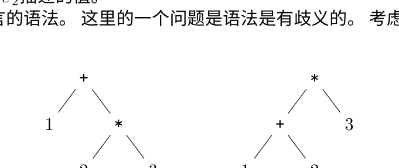
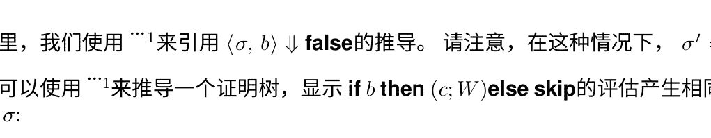
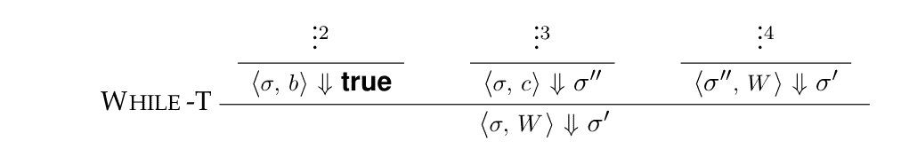
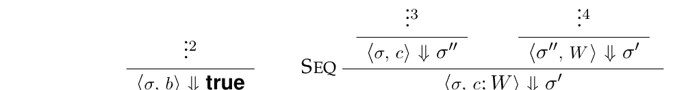
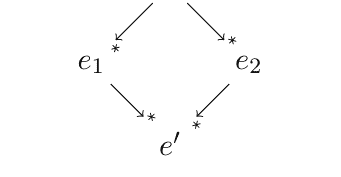

# 康奈尔 CS4110 编程语言与逻辑讲义

程序的意义是什么？ 当我们编写程序时，我们使用字符序列来表示它。 但是这些字符串只是具体的语法，它们并不能告诉我们程序的实际含义。 通过执行程序来定义意义是很诱人的——可以使用解释器或编译器。 但是解释器和编译器经常会有错误！ 我们可以查阅规范手册，但是这些手册通常只提供语言构造的非正式描述。

定义意义的更好方法是开发一种形式化的、数学的语义学定义。 这种方法是明确的、简洁的，最重要的是，它使得能够对感兴趣的属性进行严格的证明。 主要的缺点是语义学本身可能非常复杂，特别是如果试图模拟现代完整的编程语言的所有特性。

有三种定义语言含义或语义的方式：
- 操作语义通过在抽象机器上来定义含义。
- 指称语义通过数学对象（如函数）来定义含义。
- 公理语义通过在执行过程中满足的逻辑公式来定义含义。

这些方法各有优缺点，涉及到数学上的复杂性、在证明中的使用难度以及在解释器或编译器实现中的使用难度。 我们将在本课程的后面讨论这些权衡。

## 1 算术表达式

为了理解语义的一些关键概念，让我们考虑一个非常简单的整数算术表达式与变量赋值的语言。这种语言中的程序是一个表达式；执行一个程序意味着将表达式求值为一个整数。为了描述这种语言的语法结构，我们将使用范围为以下域的变量：

```
x, y, z ∈ 变量
n, m ∈ 整数
e ∈ 表达式
```

变量是程序变量的集合（例如， foo， bar， baz， i等）。 整数是常量整数的集合（例如， 42， 40， 7）。 表达式是表达式的域，我们使用BNF（巴科斯-诺尔范式）语法来指定：

```
e ::= x
    | n
    | e1 + e2
    | e1 * e2
    | x := e1 ; e2
```

非正式地，表达式 $x := e_1; e_2$ 表示在评估 $e_2$ 之前，$x$ 被赋予 $e_1$ 的值。
整个表达式的结果是由 $e_2$ 描述的值。
这个语法规定了语言的语法。这里的一个问题是语法是有歧义的。考虑表达式 $1+2*3$。可以构建两个抽象语法树：



有几种方法来解决这个问题。一种方法是重新编写相同语言的语法，使其无歧义。但这会使语法更复杂，更难理解。另一种可能性是扩展语法，要求在所有加法和乘法表达式周围加上括号：

```
e ::= x
   | n
   | (e_1 + e_2)
   | (e_1 * e_2)
   | x := e_1; e_2
```

然而，这也导致了不必要的混乱和复杂性。相反，我们将语言的“具体语法”（它指定如何将字符串无歧义地解析为程序短语）与其“抽象语法”（它描述了可能有歧义的程序短语的结构）分开。在本课程中，我们将假设已知抽象语法树。在编写表达式时，我们偶尔会使用括号来表示抽象语法树的结构，但括号不是语言本身的一部分。（有关解析、语法和消除歧义的详细信息，请参阅或参加CS 4120。）

### 1.1 表示表达式

这种语言中表达式的句法结构可以使用OCaml进行紧凑的表示，使用数据类型：

```
type exp = Var of string
         | Int of int
         | Add of exp * exp
         | Mul of exp * exp
         | Assign of string * exp * exp
```

这与上面的BNF语法非常相似。表达式的抽象语法树（AST）可以通过在每种情况下应用数据类型构造函数来获得。例如，表达式 $2*(foo+1)$ 的AST是：

```
Mul(Int(2), Add(Var("foo"), Int(1)))
```

在OCaml中，当只有一个参数时，可以省略括号，因此上述表达式可以写成：

```
Mul (Int 2, Add(Var "foo", Int 1))
```

我们可以使用类层次结构在类似Java的语言中表示相同的结构，尽管会稍微复杂一些：

```
抽象类 Expr {}
类 Var 扩展 Expr { String name; ... }
类 Int 扩展 Expr { int val; ... }
类 Add 扩展 Expr { Expr exp1, exp2; ... }
类 Mul 扩展 Expr { Expr exp1, exp2; ... }
类 Assgn 扩展 Expr { String var, Expr exp1, exp2; ... }
```

## 2 操作语义

我们对表达式的含义有直观的概念。例如，7+(4*2)的计算结果为15，而 i :=6+1; 2*3*i的计算结果为42。在本节中，我们将准确地形式化这种直觉。

操作语义描述程序在抽象机器上的执行方式。小步操作语义描述了这样一种执行方式，即通过连续的规约来进行——在这里，是对表达式的规约，直到达到表示计算结果的值。抽象机器的状态通常被称为一个配置。对于我们的语言，一个配置必须包括两个信息：

- 一个存储（也称为环境或状态），它将整数值映射到变量。在程序执行期间，我们将参考存储来确定与变量相关联的值，并更新存储以反映对变量的新值的赋值。
- 要评估的表达式。

我们将存储表示为从变量到整数的部分函数，并将配置表示为表达式和存储的对：

```
存储 ≜ 变量 →整数
配置 ≜ 存储 ×表达式
```

我们将使用尖括号表示配置。例如，⟨σ,(foo+2)*(bar+2)⟩是一个配置，其中σ是一个存储，(foo+2)*(bar+2)是一个使用两个变量foo和bar的表达式。我们语言的小步操作语义是一个关系 → ⊆配置×配置，描述了一个配置如何过渡到一个新的配置。也就是说，关系 →告诉我们如何逐步评估程序。我们使用中缀符号表示关系 →。

也就是说，给定任意两个配置⟨σ1,e1⟩和⟨σ2,e2⟩，如果⟨(e1,σ1),(e2,σ2)⟩在关系 →中，那么我们写⟨σ1,e1⟩→⟨σ2,e2⟩。例如，我们有⟨σ,(4+2)*y⟩→⟨σ,6*y⟩。也就是说，我们可以通过一步评估配置⟨σ,(4+2)*y⟩得到配置⟨σ,6*y⟩。

使用这种方法，定义语言的语义归结为定义描述配置之间转换的关系！

这里的一个问题是整数的域是无限的，表达式的域也是无限的。因此，可能的机器配置有无限多个，可能的单步转换也有无限多个。我们需要一种有限的方式来描述无限集合的可能转换。我们可以使用推理规则来简洁地描述！

$$\frac{n = \sigma(x)}{\langle\sigma, x\rangle \rightarrow \langle\sigma, n\rangle} \text{ VAR}$$

$$\frac{\langle\sigma, e_1\rangle \rightarrow \langle\sigma', e_1'\rangle}{\langle\sigma, e_1 + e_2\rangle \rightarrow \langle\sigma', e_1' + e_2\rangle} \text{ LADD} \quad\quad \frac{\langle\sigma, e_2\rangle \rightarrow \langle\sigma', e_2'\rangle}{\langle\sigma, n + e_2\rangle \rightarrow \langle\sigma', n + e_2'\rangle} \text{ RADD} \quad\quad \frac{p = m + n}{\langle\sigma, n + m\rangle \rightarrow \langle\sigma, p\rangle} \text{ ADD}$$

$$\frac{\langle\sigma, e_1\rangle \rightarrow \langle\sigma', e_1'\rangle}{\langle\sigma, e_1 * e_2\rangle \rightarrow \langle\sigma', e_1' * e_2\rangle} \text{ LMUL} \quad\quad \frac{\langle\sigma, e_2\rangle \rightarrow \langle\sigma', e_2'\rangle}{\langle\sigma, n * e_2\rangle \rightarrow \langle\sigma', n * e_2'\rangle} \text{ RMUL} \quad\quad \frac{p = m \times n}{\langle\sigma, m * n\rangle \rightarrow \langle\sigma, p\rangle} \text{ MUL}$$

$$\frac{\langle\sigma, e_1\rangle \rightarrow \langle\sigma', e_1'\rangle}{\langle\sigma, x := e_1; e_2\rangle \rightarrow \langle\sigma', x := e_1'; e_2\rangle} \text{ ASSGN 1} \quad\quad \frac{\sigma' = \sigma[x \rightarrow n]}{\langle\sigma, x := n; e_2\rangle \rightarrow \langle\sigma', e_2\rangle} \text{ ASSGN}$$

推理规则的含义是，如果上方的事实成立，则下方的事实也成立。上方的事实称为前提；下方的事实称为结论。
没有前提的规则称为公理；有前提的规则称为归纳规则。我们使用符号 σ[x → n] 表示将变量 x 映射到整数 n，并将其他变量映射到 σ 映射的值。更明确地说，如果 f 是函数 σ[x → n]，则有

$$f(y) = \begin{cases} n & \text{如果 } y = x \\ \sigma(y) & \text{否则} \end{cases}$$

## 3 使用语义

现在让我们看看如何使用这些规则。假设我们想要评估表达式 (foo + 2) * (bar + 1) 使用一个存储器 σ 其中 σ(foo) = 4 和 σ(bar) = 3。也就是说，我们想要找到转换的配置 ⟨σ, (foo + 2) * (bar + 1)⟩。为此，我们寻找一个具有这种配置形式的规则在结论中。通过检查规则，我们发现唯一与我们的配置形式匹配的规则是 LMUL，其中 e₁ = foo + 2 和 e₂ = bar + 1 但 e₁' 尚未知。我们可以实例化 LMUL，用适当的表达式替换元变量 e₁ 和 e₂。

$$\frac{\langle\sigma, foo + 2\rangle \rightarrow \langle e_1', \sigma\rangle}{\langle\sigma, (foo + 2) * (bar + 1)\rangle \rightarrow \langle\sigma, e_1' * (bar + 1)\rangle} \text{ LMUL}$$

现在我们需要证明前提实际上成立，并找出 e₁' 是什么。我们寻找一个规则其结论与 ⟨σ, foo + 2⟩ → ⟨e₁', σ⟩ 相匹配。我们发现 LADD 是唯一匹配的规则：

$$\frac{\langle\sigma, foo\rangle \rightarrow \langle\sigma, e_1''\rangle}{\langle\sigma, foo + 2\rangle \rightarrow \langle\sigma, e_1'' + 2\rangle} \text{ LADD}$$

我们对 ⟨σ, foo⟩ → ⟨σ, e₁''⟩ 进行了相同的推理，发现唯一适用的规则是公理 VAR:

$$\frac{\sigma(foo) = 4}{\langle\sigma, foo\rangle \rightarrow \langle\sigma, 4\rangle} \text{ VAR}$$

由于这是一个公理，没有前提条件，因此没有剩下的东西需要证明。 因此， e₁″ = 4 and e₁′ = 4 + 2. 我们可以将上述部分整合起来，构建以下证明:

$$\frac{\frac{\sigma(foo) = 4}{\langle \sigma, foo \rangle \rightarrow \langle \sigma, 4 \rangle} \text{VAR}}{\frac{\langle \sigma, foo + 2 \rangle \rightarrow \langle \sigma, 4 + 2 \rangle}{\langle \sigma, (foo+2)*(bar+1) \rangle \rightarrow \langle \sigma, (4+2)*(bar+1) \rangle} \text{LADD}} \text{LMUL}$$

这证明了，在给定我们的推理规则的情况下，一步转换

$$⟨σ,(foo+2)∗(bar+1)⟩ → ⟨σ,(4+2)∗(bar+1)⟩$$

是可导出的。上面的结构被称为“证明树”或“推导”。请记住，证明树必须是有限的，才能得出有效的结论。

我们可以使用类似的推理方法来找出下一个评估步骤：

$$\frac{\frac{6 = 4 + 2}{\langle \sigma, 4+2 \rangle \rightarrow \langle \sigma, 6 \rangle} \text{ADD}}{\langle \sigma, (4+2)*(bar+1) \rangle \rightarrow \langle \sigma, 6*(bar+1) \rangle} \text{LMUL}$$

我们可以继续这个过程。最后，我们可以将所有这些转换放在一起，以获得整个计算的视图：

- ⟨σ,(foo+2)∗(bar+1)⟩ → ⟨σ,(4+2)∗(bar+1)⟩
- → ⟨σ,6∗(bar+1)⟩
- → ⟨σ,6∗(3+1)⟩
- → ⟨σ,6∗4⟩
- → ⟨σ,24⟩

计算的结果是一个数字， 24。包含最终结果的机器配置是评估停止的点；它们被称为最终配置。对于我们的表达式语言，最终配置的形式为 ⟨σ,n⟩。

我们写作 →^□ 表示关系 →的自反传递闭包。也就是说，如果 ⟨σ,e⟩ →^□ ⟨σ′,e′⟩ 使用零个或多个步骤，我们可以将配置 ⟨σ,e⟩评估为 ⟨σ′,e′⟩。因此，我们有：

$$⟨σ,(foo+2)∗(bar+1)⟩ →^∗ ⟨σ,24⟩$$

在本讲座中，我们将使用我们简单的算术表达式语言的语义

$$e ::= x \mid n \mid e_1 + e_2 \mid e_1 * e_2 \mid x := e_1; e_2,$$

来表达有用的程序属性，并通过归纳法证明这些属性。

## 1 程序属性

关于一种语言，有许多有趣的问题可以问：它是确定性的吗？
是否存在无终止的程序？在评估过程中可能出现哪些错误？拥有一个
形式化的语义使我们能够准确地表达这些属性。

- 确定性: 评估是确定性的，
$$∀e ∈ Exp. ∀σ, σ', σ'' ∈ Store. ∀e', e'' ∈ Exp.$$
$$如果 ⟨σ, e⟩ → ⟨σ', e'⟩ 并且 ⟨σ, e⟩ → ⟨σ'', e''⟩ 那么 e' = e'' 并且 σ' = σ''。$$

- 终止性: 每个表达式的评估都会终止，
$$⟨σ, e⟩ →^* ⟨σ', e'⟩ 并且 ⟨σ', e'⟩ ↛,$$
$$where ⟨σ', e'⟩ ↛ 是简写为 ¬ (∃σ'' ∈ 存储. ∃e'' ∈ 表达式. ⟨σ', e'⟩ → ⟨σ'', e''⟩).$$

诱人的是想要以下正确性属性，

- 正确性 :每个表达式的求值结果都是一个整数，
$$⟨σ, e⟩ →^□ ⟨σ', n'⟩,$$
但不幸的是，在我们的语言中这个属性不成立！例如，考虑完全未定义的函数 σ 和表达式 i + j. 配置 ⟨σ, i + j⟩ 被卡住了—它没有可能的转换—但 i + j 不是一个整数. 问题在于 i + j 有自由变量，但 σ 不包含这些变量的映射.

为了解决这个问题，我们可以将注意力限制在良好形式的配置 ⟨σ, e⟩ 上，其中 σ 在 e 中的（至少）自由变量上有定义。这是有道理的，因为评估通常从一个闭合的表达式开始。我们可以如下定义表达式的自由变量集合：

$$fvs(x) ≜ \{x\}$$
$$fvs(n) ≜ \{\}$$
$$fvs(e_1 + e_2) ≜ fvs(e_1) ∪ fvs(e_2)$$
$$fvs(e_1 * e_2) ≜ fvs(e_1) ∪ fvs(e_2)$$
$$fvs(x := e_1; e_2) ≜ fvs(e_1) ∪ (fvs(e_2) \setminus \{x\})$$

现在我们可以制定两个蕴含上述正确性属性的属性:

- 进展 :对于每个表达式 $e$和存储 $\sigma$，使得 $e$的自由变量包含在 $\sigma$的定义域中，要么 $e$是一个整数，要么存在一个可能的转换 $\langle \sigma, e\rangle$,
$$\forall e \in \mathbf{Exp}. \; \forall \sigma \in \mathbf{Store}.\nfvs(e) \subseteq dom(\sigma) \Longrightarrow e \in \mathbf{Int} \text{或者} (\exists e' \in \mathbf{Exp}. \; \exists \sigma' \in \mathbf{Store}. \; \langle \sigma, e\rangle \to \langle \sigma', e'\rangle)$$

- 保全性:评估保持存储域中自由变量的包含关系,
$$\forall e, e' \in \mathbf{Exp}. \; \forall \sigma, \sigma' \in \mathbf{Store}.\nfvs(e) \subseteq dom(\sigma) \text{ 和 } \langle \sigma, e\rangle \to \langle \sigma', e'\rangle \Longrightarrow fvs(e') \subseteq dom(\sigma').$$

本讲座的其余部分将展示如何使用归纳法证明这些性质。

## 2 归纳集合

归纳是程序语言理论中的一个重要概念。一个归纳定义的集合 $A$是通过有限的公理和归纳（推理）规则来描述的。形式为公理

$$\dfrac{}{a \in A}$$

表示 $a$属于集合 $A$。归纳规则

$$\dfrac{a_1 \in A \quad \ldots \quad a_n \in A}{a \in A}$$

表示如果 $a_1, \ldots, a_n$都是 $A$的元素，则 $a$也是 $A$的元素。集合 $A$是所有可以通过这些规则的（有限）次应用推断出属于 $A$的元素的集合。换句话说，对于 $A$中的每个元素 $a$，我们必须能够构造一个有限的证明树，其最终结论是 $a \in A$。

例子1。由文法描述的集合是一个归纳集合。例如，算术表达式的集合可以用两个公理和三个推理规则来描述:

$$\dfrac{}{x \in \mathbf{Exp}} \quad\quad \dfrac{}{n \in \mathbf{Exp}}$$
$$\dfrac{e_1 \in \mathbf{Exp} \quad e_2 \in \mathbf{Exp}}{e_1 + e_2 \in \mathbf{Exp}} \quad \dfrac{e_1 \in \mathbf{Exp} \quad e_2 \in \mathbf{Exp}}{e_1 * e_2 \in \mathbf{Exp}} \quad \dfrac{e_1 \in \mathbf{Exp} \quad e_2 \in \mathbf{Exp}}{x := e_1; e_2 \in \mathbf{Exp}}$$

这些公理和规则描述了与文法相同的表达式集合:

$$e ::= x \;|\; n \;|\; e_1 + e_2 \;|\; e_1 * e_2 \;|\; x := e_1; e_2$$

例子 2.自然数（在这里用一元表示法）可以通过归纳定义:

$$\dfrac{}{0 \in \mathbb{N}} \quad \dfrac{n \in \mathbb{N}}{succ(n) \in \mathbb{N}}$$

例子 3.小步求值关系 $\to$是一个归纳定义的集合。

## 例子 4. 多步求值关系可以通过归纳定义：

```
$$
\dfrac{}{\langle \sigma, e \rangle \rightarrow^{*} \langle \sigma, e \rangle} \text{ REFL} \qquad
\dfrac{\langle \sigma, e \rangle \rightarrow \langle \sigma', e' \rangle \quad \langle \sigma', e' \rangle \rightarrow^{*} \langle \sigma'', e'' \rangle}
{\langle \sigma, e \rangle \rightarrow^{*} \langle \sigma'', e'' \rangle} \text{ 翻译}
$$
```

## 例子 5. 一个表达式 e 的自由变量集合可以通过归纳定义：

```
$$
\begin{array}{cccccc}
\dfrac{}{y \in fvs(y)} & \dfrac{y \in fvs(e_1)}{y \in fvs(e_1 + e_2)} & \dfrac{y \in fvs(e_2)}{y \in fvs(e_1 + e_2)} & \dfrac{y \in fvs(e_1)}{y \in fvs(e_1 * e_2)} & \dfrac{y \in fvs(e_2)}{y \in fvs(e_1 * e_2)} \[2ex]
& \multicolumn{2}{c}{\dfrac{y \in fvs(e_1)}{y \in fvs(x := e_1; e_2)}} & \multicolumn{2}{c}{\dfrac{y = x \quad y \in fvs(e_2)}{y \in fvs(x := e_1; e_2)}}
\end{array}
$$
```

## 3 归纳证明

我们可以使用归纳推理来证明关于归纳集合元素的事实，该推理遵循集合定义的结构。

### 3.1 数学归纳法

你可能已经见过自然数上的数学归纳证明，称为数学归纳。在这样的证明中，我们通常希望证明某个属性对所有自然数成立，即对于所有$n \in \mathbb{N}$，$P(n)$成立。归纳证明的原理是首先证明$P(0)$成立，然后证明对于所有$m \in \mathbb{N}$，如果$P(m)$成立，则$P(m+1)$成立。数学归纳法的原理可以简洁地表述为

$$P(0) \text{ 和 } (\forall m \in \mathbb{N}. P(m) \Longrightarrow P(m + 1)) \Longrightarrow \forall n \in \mathbb{N}. P(n).$$

命题 $P(0)$ 是归纳的基础（也称为基本情况），而 $P(m) \Longrightarrow P(m+1)$ 被称为归纳步骤（或归纳情况）。在证明归纳步骤时，假设 $P(m)$ 成立被称为归纳假设。

### 3.2 结构归纳

给定一个归纳定义的集合 $A$，为了证明属性 $P$ 对 $A$ 中的所有元素都成立，我们需要展示：

- 1. 基本情况：对于每个公理
   $$\dfrac{}{a \in A},$$
   $P(a)$ 成立。
- 2. 归纳情况：对于每个推理规则
   $$\dfrac{a_1 \in A \quad \ldots \quad a_n \in A}{a \in A},$$
   如果 $P(a_1)$ 并且 $\ldots$ 并且 $P(a_n)$ 那么 $P(a)$。

请注意，如果集合 A 是上面示例2中的自然数集合，则证明 P 对 A 的所有元素成立的要求等同于数学归纳法。如果 A 描述一个句法集合，则我们称按照上述要求进行归纳为结构归纳。如果 A 是一个操作语义关系（例如小步操作语义关系 →），那么这样的归纳被称为推导归纳。我们将在整个课程中看到结构归纳和推导归纳的例子。

### 3.3 例子：进展

让我们考虑上面定义的进展属性，并在此重复一遍：

进展：对于每个存储 $\sigma$ 和表达式 $e$，使得 $e$ 的自由变量包含在 $\sigma$ 的定义域中，要么 $e$ 是一个整数，要么存在一个可能的过渡 $\langle \sigma, e \rangle$：

```
fvs(e) ⊆ dom(σ) ⇒) e ∈ Int or (∃ e' ∈ Exp. ∃σ' ∈ Store. ⟨σ, e⟩ → ⟨σ', e'⟩)
```

让我们用一个明确的表达式谓词来重新表述这个属性：

```
fvs(e) ⊆ dom(σ) ⇒) e ∈ Int or (∃ e', σ'. ⟨σ, e⟩ → ⟨σ', e')
```

这个想法是建立一个遵循语法给出的归纳结构的证明：

```
e ::= x | n | e1 + e2 | e1 * e2 | x := e1; e2
```

这种技术被称为“结构归纳法”。我们分析语法中的每个情况，并证明对于该情况， $P( e)$ 成立。由于语法产生式 $e1 + e2$ 和 $e1 * e2$ 以及 $x := e1; e2$ 是归纳的，它们是证明中的归纳步骤；而 $x$ 和 $n$ 的情况是基本情况。 证明过程如下。

证明。设 $e$ 为一个表达式。我们将证明

```
fvs(e) ⊆ dom(σ) ⇒⇒ e ∈ Int或 (∃ e', σ'. ⟨σ, e⟩ → ⟨σ', e')
```

通过对 $e$ 进行结构归纳分析。我们分析几种情况，每种情况对应语法中的一种情况：

情况 $e = x$： 设 $\sigma$ 为任意存储器，并假设 $fvs(e) \subseteq dom(\sigma)$。根据 fvs 的定义，我们有 $fvs(x) = \{x\}$。根据假设，我们有 $\{x\} \subseteq dom(\sigma)$，因此 $x \in dom(\sigma)$。设 $n = \sigma(x)$。根据变量公理，我们有 $\langle \sigma, x \rangle \rightarrow \langle \sigma, n \rangle$，这完成了该情况的证明。

情况 $e = n$： 我们立即有 $e \in$ 整数，这结束了情况。

情况 $e = e1 + e2$： 让 $\sigma$ 是一个任意的存储器，并假设 $fvs(e) \subseteq dom(\sigma)$。我们将假设 $P(e1)$ 和 $P(e2)$ 成立，并证明 $P(e)$ 成立。让我们展开这些属性。我们有

$P(e1) = \forall \sigma \in$ 存储器. $fvs(e1) \subseteq dom(\sigma) \Rightarrow\Rightarrow e1 \in$ 整数或 $(\exists e', \sigma'. \langle \sigma, e1 \rangle \rightarrow \langle \sigma', e' \rangle)$
$P(e2) = \forall \sigma \in$ 存储器. $fvs(e2) \subseteq dom(\sigma) \Rightarrow\Rightarrow e2 \in$ 整数或 $(\exists e', \sigma'. \langle \sigma, e2 \rangle \rightarrow \langle \sigma', e' \rangle)$

并且想要证明：

$P(e1 + e2) = \forall \sigma \in$ 存储器. $fvs(e1 + e2) \subseteq dom(\sigma) \Rightarrow\Rightarrow e1 + e2 \in$ Int 或 $(\exists e', \sigma'. \langle \sigma, e1 + e2 \rangle \rightarrow \langle \sigma', e' \rangle)$

我们分析了几个子情况。

子情况 $e1 = n1$ 并且 $e2 = n2$： 根据规则 ADD, 我们立即有 $\langle \sigma, n1 + n2 \rangle \rightarrow \langle \sigma, p \rangle$, 其中 $p = n1 + n2$。

子情况 $e1 \in Int$： 根据假设和 fvs 的定义, 我们有

$fvs(e1) \subseteq fvs(e1 + e2) \subseteq dom(\sigma)$

因此, 根据归纳假设 $P(e1)$ 我们也有 $\langle \sigma, e1 \rangle \rightarrow \langle \sigma', e' \rangle$ 对于一些 $e'$ 和 $\sigma'$. 根据规则 LADD 我们有 $\langle \sigma, e1 + e2 \rangle \rightarrow \langle \sigma', e' + e2 \rangle$.

子情况 $e1 = n1$ 和 $e2 \in Int$： 根据假设和 fvs 的定义我们有

$fvs(e2) \subseteq fvs(e1 + e2) \subseteq dom(\sigma)$

因此, 根据归纳假设 $P(e2)$ 我们也有 $\langle \sigma, e2 \rangle \rightarrow \langle \sigma', e' \rangle$ 对于一些 $e'$ 和 $\sigma'$. 根据规则 RADD 我们有 $\langle \sigma, e1 + e2 \rangle \rightarrow \langle \sigma', e1 + e' \rangle$, 这完成了情况。

类似于之前的情况。

情况 $e = x := e1; e2$。 让 $\sigma$ 是一个任意的存储器, 并假设 $fvs( e) \subseteq dom( \sigma)$。与上面一样, 我们假设 $P(e1)$ 和 $P(e2)$ 成立, 并展示 $P(e)$ 成立。让我们展开这些属性。

我们有

$P(e1) = \forall \sigma. fvs(e1) \subseteq dom(\sigma) \Longrightarrow e1 \in Int$ 或 $(\exists e', \sigma'. \langle \sigma, e1 \rangle \rightarrow \langle \sigma', e' \rangle)$

$P(e2) = \forall \sigma. fvs(e2) \subseteq dom(\sigma) \Longrightarrow e2 \in Int$ 或 $(\exists e', \sigma'. \langle \sigma, e2 \rangle \rightarrow \langle \sigma', e' \rangle)$

并且想要证明:

$P(x := e1; e2) = \forall \sigma. fvs(x:=e1;e2) \subseteq dom(\sigma) \Longrightarrow x := e1; e2 \in Int$ 或 $(\exists e', \sigma'. \langle \sigma, x := e1; e2 \rangle \rightarrow \langle \sigma', e' \rangle)$

我们分析了几个子情况。

子情况 $e1 = n1$： 根据规则 ASSGN 我们有 $\langle \sigma, x := n1; e2 \rangle \rightarrow \langle \sigma', e2 \rangle$ 其中 $\sigma' = \sigma[x \rightarrow n1]$。

子情况 $e1 \in Int$： 根据假设和 fvs 的定义, 我们有

$fvs(e1) \subseteq fvs(x := e1; e2) \subseteq dom(\sigma)$

因此, 根据归纳假设, 我们也有 $\langle \sigma, e1 \rangle \rightarrow \langle \sigma', e' \rangle$ 对于某个 $e'$ 和 $\sigma'$。根据规则 ASSGN1, 我们有 $\langle \sigma, x := e1; e2 \rangle \rightarrow \langle \sigma', x := e'1; e2 \rangle$, 这完成了情况和归纳证明。

□

## 1 大步操作语义

在上一讲中，我们使用一个小步评估关系为我们的算术表达式语言定义了一个语义 $$ \rightarrow \subseteq \text{Config} \times \text{Config} $$ (以及它的自反和传递闭包 $\rightarrow^*$ )。在这一讲中，我们将探讨一种替代方法——大步操作语义，它直接得出表达式的最终结果。

定义大步语义归结为指定一个关系 $$ \Downarrow $$，该关系捕捉了表达式的求值过程。关系 $$ \Downarrow $$ 具有以下类型：

```
$$ \Downarrow \subseteq (\text{存储} \times \text{表达式}) \times (\text{存储} \times \text{整数}) $$。
```

我们写作 $$ \langle \sigma, e \rangle \Downarrow \langle \sigma', n \rangle $$ 来表示 $$ ((\sigma, e), (\sigma', n)) \in \Downarrow $$。换句话说，表达式 $$ e $$ 在存储 $$ \sigma $$ 的情况下一次性评估到最终存储 $$ \sigma' $$ 和整数 $$ n $$。我们使用推理规则对关系 $$ \Downarrow $$ 进行归纳定义：

```
$$\frac{}{\langle \sigma, n \rangle \Downarrow \langle \sigma, n \rangle} \text{ INT }$$

$$\frac{n = \sigma(x)}{\langle \sigma, x \rangle \Downarrow \langle \sigma, n \rangle} \text{ VAR }$$

$$\frac{\langle \sigma, e_1 \rangle \Downarrow \langle \sigma', n_1 \rangle \quad \langle \sigma', e_2 \rangle \Downarrow \langle \sigma'', n_2 \rangle \quad n = n_1 + n_2}{\langle \sigma, e_1 + e_2 \rangle \Downarrow \langle \sigma'', n \rangle} \text{ ADD }$$

$$\frac{\langle \sigma, e_1 \rangle \Downarrow \langle \sigma', n_1 \rangle \quad \langle \sigma', e_2 \rangle \Downarrow \langle \sigma'', n_2 \rangle \quad n = n_1 \times n_2}{\langle \sigma, e_1 * e_2 \rangle \Downarrow \langle \sigma'', n \rangle} \text{ MUL }$$

$$\frac{\langle \sigma, e_1 \rangle \Downarrow \langle \sigma', n_1 \rangle \quad \langle \sigma'[x \mapsto n_1], e_2 \rangle \Downarrow \langle \sigma'', n_2 \rangle}{\langle \sigma, x := e_1; e_2 \rangle \Downarrow \langle \sigma'', n_2 \rangle} \text{ ASSGN }$$
```

为了说明这些规则的使用，考虑以下证明树，它展示了使用存储器 $$ \sigma $$ 来评估 $$ \langle \sigma, foo := 3 ; foo * bar \rangle $$ 时的结果，其中 $$ \sigma(bar) = 7 $$，得到 $$ \sigma' = \sigma[foo \mapsto 3] $$ 和 21 作为结果：

```
$$\frac{\frac{}{\langle \sigma, 3 \rangle \Downarrow \langle \sigma, 3 \rangle} \text{ INT } \quad \frac{\frac{\langle \sigma', foo \rangle \Downarrow \langle \sigma', 3 \rangle}{} \text{ VAR } \quad \frac{\langle \sigma', bar \rangle \Downarrow \langle \sigma', 7 \rangle}{} \text{ VAR }}{\langle \sigma', foo * bar \rangle \Downarrow \langle \sigma', 21 \rangle} \text{ MUL }}{\langle \sigma, foo := 3 ; foo * bar \rangle \Downarrow \langle \sigma', 21 \rangle} \text{ ASSGN }$$
```

仔细观察这个结构，可以发现小步和大步求值之间的关系：大步证明树的深度优先遍历产生了小步求值中的一步过渡序列。

## 2 语义的等价性

一个自然的问题是小步和大步语义是否等价。下一个定理肯定地回答了这个问题。

> 定理(语义的等价性)。对于所有的表达式 e，存储 σ 和 σ'，以及整数 n，我们有：

```
⟨σ, e⟩ ↓ ⟨σ', n⟩ 当且仅当 ⟨σ, e⟩ →* ⟨σ', n⟩
```

为了简化证明，我们将使用以下多步关系的定义：

```
⟨σ, e⟩ →* ⟨σ, e⟩ REFL

⟨σ, e⟩ → ⟨σ', e'⟩    ⟨σ', e'⟩ →* ⟨σ'', e''⟩
⟨σ, e⟩ →* ⟨σ'', e''⟩ 翻译
```

证明草图。我们分别展示每个方向。

⟹：我们想要证明以下属性 P 对于所有表达式 $e \in Exp$ 成立：

```
⟨σ, e⟩ ↓ ⟨σ', n⟩ ⟹ ⟨σ, e⟩ →* ⟨σ', n⟩
```

我们通过对 $e$ 进行结构归纳来进行。我们必须考虑构建表达式的每个可能的公理和推理规则。

情况 $e = x$： 假设 $\langle \sigma, x \rangle \Downarrow \langle \sigma', n \rangle$ 成立。也就是说，存在一个大步操作语义的推导，其结论为 $\langle \sigma, x \rangle \Downarrow \langle \sigma, n \rangle$。只有一个规则的结论与配置 $\langle \sigma, x \rangle$ 匹配：大步规则 VAR。因此，我们有 $n = \sigma(x)$ 和 $\sigma' = \sigma$。根据小步规则 VAR，我们还有 $\langle \sigma, x \rangle \rightarrow \langle \sigma, n \rangle$。根据 REFL 和 TRANS 规则，我们得出结论 $\langle \sigma, x \rangle \rightarrow^* \langle \sigma, n \rangle$，这完成了情况。

情况 $e = n$： 假设 $\langle \sigma, n \rangle \Downarrow \langle \sigma', n' \rangle$。只有一个规则的结论与 $\langle \sigma, n \rangle$ 匹配：大步规则 INT。因此，我们有 $n' = n$ 和 $\sigma' = \sigma$，所以 $\langle \sigma, n \rangle \rightarrow^* \langle \sigma, n \rangle$ 通过 REFL 规则。

情况 $e = e1 + e2$： 这是一个归纳情况。我们想要证明如果 $P(e1)$ 和 $P(e2)$ 成立，那么 $P(e)$ 也成立。让我们明确写出 $P(e1)$，$P(e2)$ 和 $P(e)$。

```
P(e1) = ∀n, σ, σ'. ⟨σ, e1⟩ ↓ ⟨σ', n⟩ ⟹ ⟨σ, e1⟩ →* ⟨σ', n⟩
P(e2) = ∀n, σ, σ'. ⟨σ, e2⟩ ↓ ⟨σ', n⟩ ⟹ ⟨σ, e2⟩ →* ⟨σ', n⟩
P(e) = ∀n, σ, σ'. ⟨σ, e1+e2⟩ ↓ ⟨σ', n⟩ ⟹ ⟨σ, e1+e2⟩ →* ⟨σ', n⟩
```

假设 $P(e1)$ 和 $P(e2)$ 成立。还假设存在 $\sigma, \sigma'$ 和 $n$ 使得 $\langle \sigma, e1 + e2 \rangle \Downarrow \langle \sigma', n \rangle$。我们需要证明 $\langle \sigma, e1 + e2 \rangle \rightarrow^* \langle \sigma', n \rangle$。我们假设 $\langle \sigma, e1 + e2 \rangle \Downarrow \langle \sigma', n \rangle$。这意味着存在一个推导，其结论为 $\langle \sigma, e1 + e2 \rangle \Downarrow \langle \sigma', n \rangle$。通过检查，我们发现只有一个规则的结论是这种形式的：ADD rule。因此，推导中使用的最后一条规则是 ADD，并且必须成立 $\langle \sigma, e1 \rangle \Downarrow \langle \sigma'', n1 \rangle$ 和 $\langle \sigma'', e2 \rangle \Downarrow \langle \sigma', n2 \rangle$，其中 $n1$ 和 $n2$ 满足 $n = n1 + n2$。

根据归纳假设$P(e_1)$，由$\langle \sigma, e_1 \rangle \Downarrow \langle \sigma'', n_1 \rangle$，我们必须有$\langle \sigma, e_1 \rangle \rightarrow^* \langle \sigma'', n_1 \rangle$。同样，根据归纳假设$P(e_2)$，我们有$\langle \sigma'', e_2 \rangle \rightarrow^* \langle \sigma', n_2 \rangle$。根据引理1，我们有：$\langle \sigma, e_1+e_2 \rangle \to^* \langle \sigma'', n_1+e_2 \rangle$，通过引理1的另一个应用，我们有：$\langle \sigma'', n_1+e_2 \rangle \to^* \langle \sigma', n_1+n_2 \rangle$。然后，使用小步ADD规则和多步TRANS规则，我们有：$\frac{n = n_1 + n_2}{\langle \sigma', n_1 + n_2 \rangle \to \langle \sigma', n \rangle} \text{ADD} \quad \frac{}{\langle \sigma', n \rangle \to^* \langle \sigma', n \rangle} \text{REFL}$ $\langle \sigma', n_1 + n_2 \rangle \to^* \langle \sigma', n \rangle$。最后，通过两次应用引理2，我们得到$\langle \sigma, e_1+e_2 \rangle \rightarrow^* \langle \sigma', n \rangle$，这完成了这种情况。

类似于上面的情况$e_1+e_2$。情况$e = x := e_1; e_2$。省略。作为练习尝试一下。

⇐：我们通过对$\langle \sigma, e \rangle \rightarrow^* \langle \sigma', n \rangle$的推导进行归纳来进行证明，对最后一个规则进行案例分析。情况REFL：那么$e = n$且$\sigma' = \sigma$。我们立即有$\langle \sigma, n \rangle \Downarrow \langle \sigma, n \rangle$通过大步规则INT。情况TRANS：那么$\langle \sigma, e \rangle \to \langle \sigma'', e'' \rangle$且$\langle \sigma'', e'' \rangle \rightarrow^* \langle \sigma', n \rangle$。在这种情况下，归纳假设给出$\langle \sigma'', e'' \rangle \Downarrow \langle \sigma', n \rangle$。结果由下面的引理3得出。

## 引理1. 如果$\langle \sigma, e \rangle \rightarrow^* \langle \sigma', n \rangle$，那么以下结论成立：

- $\langle \sigma, e + e_2 \rangle \rightarrow^* \langle \sigma', n + e_2 \rangle$
- $\langle \sigma, e * e_2 \rangle \rightarrow^* \langle \sigma', n * e_2 \rangle$
- $\langle \sigma, n_1 + e \rangle \rightarrow^* \langle \sigma', n_1 + n \rangle$
- $\langle \sigma, n_1 * e \rangle \rightarrow^* \langle \sigma', n_1 * n \rangle$
- $\langle \sigma, x := e; e_2 \rangle \rightarrow^* \langle \sigma', x := n; e_2 \rangle$

证明。省略；作为练习尝试一下。

## 引理2. 如果$\langle \sigma, e \rangle \rightarrow^* \langle \sigma', e' \rangle$并且$\langle \sigma', e' \rangle \rightarrow^* \langle \sigma'', e'' \rangle$，那么$\langle \sigma, e \rangle \rightarrow^* \langle \sigma'', e'' \rangle$。

证明。省略；作为练习尝试一下。

## 引理3. 如果$\langle \sigma, e \rangle \to \langle \sigma'', e'' \rangle$并且$\langle \sigma'', e'' \rangle \Downarrow \langle \sigma', n \rangle$，那么$\langle \sigma, e \rangle \Downarrow \langle \sigma', n \rangle$。

证明。省略；作为练习尝试一下。

## CS 4110 – 程序设计语言与逻辑学
第五讲：IMP 语言

## 1 一个简单的命令式语言

我们现在将考虑一个更加现实的编程语言，一个可以给变量赋值并执行控制结构如 if 和 while 的语言。 这个命令式语言的语法，称为 IMP，如下所示：

算术表达式      $a \in \textbf{Aexp}$      $a ::= x \mid n \mid a_1 + a_2 \mid a_1 \times a_2$
布尔表达式      $b \in \textbf{Bexp}$      $b ::= \textbf{true} \mid \textbf{false} \mid a_1 < a_2$
命令            $c \in \textbf{Com}$      $c ::= \textbf{skip} \mid x := a \mid c_1; c_2 \mid \textbf{if } b \textbf{ then } c_1 \textbf{ else } c_2 \mid \textbf{while } b \textbf{ do } c$

### 1.1 小步操作语义

我们首先为IMP提供了一种小步操作语义。该语言中的配置形式为 $\langle c, \sigma \rangle$, $\langle \sigma, b \rangle$, 和 $\langle \sigma, a \rangle$, 其中 $\sigma$ 是一个存储。 最终的配置形式为$\langle \sigma, skip \rangle$, $\langle \sigma, true \rangle$, $\langle \sigma, false \rangle$, 和 $\langle \sigma, n \rangle$。 有三种不同的小步操作语义关系，分别用于命令、布尔表达式和算术表达式。

$\longrightarrow_{\text{计算}} \text{计算} \times \text{存储} \times \text{计算} \times \text{存储}$
$\longrightarrow_{\text{布尔表达式}} \text{布尔表达式} \times \text{存储} \times \text{布尔表达式} \times \text{存储}$
$\longrightarrow_{\text{算术表达式}} \text{算术表达式} \times \text{存储} \times \text{算术表达式} \times \text{存储}$

为了简洁起见，我们将重载符号 $\longrightarrow$ 并用它来指代所有这些关系。 在上下文中，使用的关系将是清楚的。 算术和布尔表达式的求值规则与我们之前见过的规则类似。 然而，请注意由于算术表达式不再包含赋值，算术和布尔表达式无法更新存储。

### 算术表达式

$$
\frac{n = \sigma(x)}{\langle \sigma, x \rangle \longrightarrow \langle \sigma, n \rangle}
$$
$$
\frac{\langle \sigma, a_1 \rangle \longrightarrow \langle \sigma, a'_1 \rangle}{\langle \sigma, a_1 + a_2 \rangle \longrightarrow \langle \sigma, a'_1 + a_2 \rangle} \quad
\frac{\langle \sigma, a_2 \rangle \longrightarrow \langle \sigma, a'_2 \rangle}{\langle \sigma, n + a_2 \rangle \longrightarrow \langle \sigma, n + a'_2 \rangle} \quad
\frac{p = n + m}{\langle \sigma, n + m \rangle \longrightarrow \langle \sigma, p \rangle}
$$
$$
\frac{\langle \sigma, a_1 \rangle \longrightarrow \langle \sigma, a'_1 \rangle}{\langle \sigma, a_1 \times a_2 \rangle \longrightarrow \langle \sigma, a'_1 \times a_2 \rangle} \quad
\frac{\langle \sigma, a_2 \rangle \longrightarrow \langle \sigma, a'_2 \rangle}{\langle \sigma, n \times a_2 \rangle \longrightarrow \langle \sigma, n \times a'_2 \rangle} \quad
\frac{p = n \times m}{\langle \sigma, n \times m \rangle \longrightarrow \langle \sigma, p \rangle}
$$

### 布尔表达式

```
⟨σ, a₁⟩ → ⟨σ, a₁'⟩
—————————
⟨σ, a₁ < a₂⟩ → ⟨σ, a₁' < a₂⟩
```

```
⟨σ, a₂⟩ → ⟨σ, a₂'⟩
—————————
⟨σ, n < a₂⟩ → ⟨σ, n < a₂'⟩
```

```
n < m
—————————
⟨σ, n < m⟩ → ⟨σ, true⟩
```

```
n ≥ m
—————————
⟨σ, n < m⟩ → ⟨σ, false⟩
```

### 命令

```
⟨σ, e⟩ → ⟨σ, e'⟩
—————————
⟨σ, x := e⟩ → ⟨σ, x := e'⟩
```

```
⟨σ, x := n⟩ → ⟨σ[x ↦ n], skip⟩
```

```
⟨σ, c₁⟩ → ⟨σ', c₁'⟩
—————————
⟨σ, c₁; c₂⟩ → ⟨σ', c₁'; c₂⟩
```

```
⟨σ, skip; c₂⟩ → ⟨σ, c₂⟩
```

对于if命令，我们将测试条件减少直到获得 true或 false，然后执行相应的分支:

```
⟨σ, b⟩ → ⟨σ, b'⟩
—————————
⟨σ, if b then c₁ else c₂⟩ → ⟨σ, if b' then c₁ else c₂⟩
```

```
⟨σ, if true then c₁ else c₂⟩ → ⟨σ, c₁⟩
```

```
⟨σ, if false then c₁ else c₂⟩ → ⟨σ, c₂⟩
```

对于while循环，上述策略不起作用（为什么？）。相反，我们使用以下规则，可以将其视为一次迭代“展开”循环。

```
⟨σ, while b do c⟩ → ⟨σ, if b then (c; while b do c) else skip⟩
```

现在我们可以拿一个具体的程序来看看它在上述规则下的执行情况。考虑我们执行这个程序

```
foo := 3; while foo < 4 do foo := foo + 5
```

执行过程如下：

```
<σ, foo := 3; while foo < 4 do foo := foo + 5>
→ <σ', skip; while foo < 4 do foo := foo + 5>                     其中   σ' = σ[foo → 3]
→ <σ', while foo < 4 do foo := foo + 5>
→ <σ', if foo < 4 then (foo := foo + 5; W) else skip>
→ <σ',如果 3 < 4 那么 (foo := foo + 5; W)否则 skip>
→ <σ',如果真那么 (foo := foo + 5; W)否则 skip>
→ <σ', foo := foo + 5; 当 foo < 4 执行 foo := foo + 5>
→ <σ', foo := 3 + 5; 当 foo < 4 执行 foo := foo + 5>
→ <σ', foo := 8; 当 foo < 4 执行 foo := foo + 5>
→ <σ'', 当 foo < 4 执行 foo := foo + 5>                         其中   σ'' = σ'[foo → 8]
→ <σ'', if foo < 4 then (foo := foo + 5; W) else skip>
→ <σ'', if 8 < 4 then (foo := foo + 5; W) else skip>
→ <σ'', if false then (foo := foo + 5; W) else skip>
→ <σ'', skip>
```

其中 W是while循环的缩写 **while foo < 4 do foo := foo + 5.**

## 2 IMP的大步操作语义

我们为算术表达式、布尔表达式和命令定义了大步求值关系。算术表达式的关系将算术表达式和存储器关联到表达式求值的整数值。对于布尔表达式，最终值在Bool = **{true, false}**中。对于命令，最终值是一个存储器。

⇓Aexp ⊆ Aexp × 存储 × 整数
⇓Bexp ⊆ Bexp × 存储 × 布尔
⇓Com ⊆ Com × 存储 × 存储

再次，我们重载符号 ⇓ 并将其用于这三个关系中的任何一个；从上下文中可以清楚地知道所指的关系。我们还使用中缀表示法，例如写作 ⟨σ, c⟩ ⇓ σ' if (c, σ, σ') ∈⇓Com。

### 算术表达式。

```
———————————
⟨σ, n⟩ ⇓ n

⟨σ, a₁⟩ ⇓ n₁    ⟨σ, a₂⟩ ⇓ n₂    n = n₁ + n₂
—————————————————————————
⟨σ, a₁ + a₂⟩ ⇓ n

σ(x) = n
———————————
⟨σ, x⟩ ⇓ n

⟨σ, a₁⟩ ⇓ n₁    ⟨σ, a₂⟩ ⇓ n₂    n = n₁ × n₂
—————————————————————————
⟨σ, a₁ × a₂⟩ ⇓ n
```

### 布尔表达式。

```
⟨σ, true⟩ ⇓ true     ⟨σ, false⟩ ⇓ false
⟨σ, a₁⟩ ⇓ n₁  ⟨σ, a₂⟩ ⇓ n₂  n₁ < n₂     ⟨σ, a₁⟩ ⇓ n₁  ⟨σ, a₂⟩ ⇓ n₂  n₁ ≥ n₂
⟨σ, a₁ < a₂⟩ ⇓ true     ⟨σ, a₁ < a₂⟩ ⇓ false
```

### 命令。

```
SKIP ⟨σ, skip⟩ ⇓ σ    ASSGN ⟨σ, e⟩ ⇓ n  ⟨σ, x := e⟩ ⇓ σ[x ↦ n]    SEQ ⟨σ, c₁⟩ ⇓ σ′  ⟨σ′, c₂⟩ ⇓ σ″  ⟨σ, c₁; c₂⟩ ⇓ σ″
IF-T ⟨σ, b⟩ ⇓ true  ⟨σ, c₁⟩ ⇓ σ′  ⟨σ, if b then c₁ else c₂⟩ ⇓ σ′    IF-F ⟨σ, b⟩ ⇓ false  ⟨σ, c₂⟩ ⇓ σ′  ⟨σ, if b then c₁ else c₂⟩ ⇓ σ′
WHILE-F ⟨σ, b⟩ ⇓ false  ⟨σ, while b do c⟩ ⇓ σ    WHILE-T ⟨σ, b⟩ ⇓ true  ⟨σ, c⟩ ⇓ σ′  ⟨σ′, while b do c⟩ ⇓ σ″  ⟨σ, while b do c⟩ ⇓ σ″
```

有趣的是，while循环的规则不依赖于使用if命令（如小步语义的情况）。为什么这条规则有效？

### 2.1 命令等价性

小步操作语义表明，循环 while b do c 应该等价于命令 if b then (c; while b do c) else skip。我们能否证明这确实是使用上述大步评估定义的情况？

首先，我们需要更准确地说明“等价命令”是什么意思。我们的形式模型允许我们使用大步评估来定义这个概念，如下所示。（使用小步语义也可以写出类似的定义。）

### 定义（命令的等价性）。

两个命令 c 和 c′ 等价（写作 c ≡ c′），如果对于任何存储 σ 和 σ′，我们有

```
⟨σ, c⟩ ⇓ σ′ ⟺ ⟨σ, c′⟩ ⇓ σ′。
```

我们现在可以陈述并证明以下命题：当 b 为真时，执行 c 并且如果 b 为真，则执行 (c; while b do c)，否则执行 skip 是等价的。

### 定理。对于所有 b 属于 Bexp 和 c 属于 Com，我们有

```
当 b 为真时，执行 c 并且如果 b 为真，则执行 (c; while b do c)，否则执行 skip。
```

证明。令 W 为 while b do c 的缩写。 我们想要证明对于所有的存储σ, σ'，我们有：

⟨σ, W⟩ ⇓ σ'当且仅当如果 b 为真，则执行 (c; W)，否则执行 skip ⇓ σ'。

为此，我们必须证明两个方向（⟹）都成立。 我们只展示方向⟹）；另一个类似。

假设 σ 和 σ' 是存储，使得 ⟨σ, W⟩ ⇓ σ' 成立。 这意味着存在一个推导证明了这个事实。 检查求值规则，我们发现有两个可能的规则与这个事实相匹配： WHILE-F 和WHILE-T。 我们逐个分析它们。

+   WHILE-F. 推导必须如下所示。



在这里，我们使用 "...1 来引用 ⟨σ, b⟩ ⇓ false 的推导。 请注意，在这种情况下， σ' = σ。

我们可以使用 "...1 来推导一个证明树，显示 if b then (c; W) else skip 的评估产生相同的最终状态 σ:



+   WHILE-T. 在这种情况下，推导具有以下形式。



我们可以使用子推导 "...2, "...3, 和 "...4 来展示 if b then (c; W) else skip 的评估结果与 σ 相同。


因此，我们证明了在两种可能情况下，命令 if b then (c; W) else skip 的最终状态与命令 W 的最终状态相同。 □

## 1 语义的等价性

小步语义和大步语义等价，如下定理所示。

定理。对于所有的命令 c和存储 σ和 σ'，我们有

$\langle \sigma, c \rangle \rightarrow^* \langle \sigma', \text{skip} \rangle$ if and only if $\langle \sigma, c \rangle \Downarrow \sigma'$

证明留作练习...

## 2 非终止

对于给定的命令 c和初始状态 σ，命令的执行可能会以某个最终存储 σ'终止，或者可能会发散并且永远不会产生最终状态。例如，命令

```
while true do foo := foo + 1
```

总是发散

当且仅当初始状态中变量 i的值为正时， while 0 < i do i := i+1发散。

如果 ⟨σ, c⟩ 是一个发散的配置，则不存在状态 σ使得

$\langle \sigma, c \rangle \Downarrow \sigma'$ 或 $\langle \sigma, c \rangle \rightarrow^* \langle \sigma', \text{skip} \rangle$

然而，在小步语义中，发散的计算会生成一个无限序列：

$\langle \sigma, c \rangle \rightarrow \langle \sigma_1, c_1 \rangle \rightarrow \langle \sigma_2, c_2 \rangle \rightarrow \dots$

因此，小步语义允许我们陈述和证明关于可能发散的程序的性质。在课程的后期，我们将指定和证明在潜在发散的计算中感兴趣的性质。

## 3 决定性

IMP 的语义（包括小步和大步）是确定性的。例如，每个 IMP 命令 c和每个初始存储 σ都会评估为最多一个最终存储。

定理。对于所有的命令 c和存储σ, σ1, and σ2，如果 $\langle \sigma, c \rangle \Downarrow \sigma_1$和 $\langle \sigma, c \rangle \Downarrow \sigma_2$，那么 $\sigma_1 = \sigma_2$。

为了证明这个定理，我们需要归纳法。但是对于命令 c 的结构归纳不起作用。（为什么？哪种情况会破坏？）相反，我们需要对 ⟨σ, c⟩ ⇓ σ₁ 的推导进行归纳。我们首先介绍一些有用的符号。

设 D 为一个推导。如果 D 是 y 的一个推导，我们写作 D ⊢ y，也就是说，如果 D 的结论是 y。例如，如果 D 是以下推导

```
\dfrac{\langle \sigma, 6 \rangle \Downarrow 6 \quad \langle \sigma, 7 \rangle \Downarrow 7}{\langle \sigma, 6 \times 7 \rangle \Downarrow 42}
\dfrac{\rule{4cm}{0.4pt}}{\langle \sigma, \mathrm{i} := 6 \times 7 \rangle \Downarrow \sigma[\mathrm{i} \rightarrow 42]}
```

那么我们有 D ⊢ ⟨σ, i:= 42⟩ ⇓ σ[i → 42]。

设 D 和 D' 为推导。如果 D' 是 D 中最终规则使用的前提之一的推导，我们称 D' 为 D 的直接子推导。例如，推导

```
\dfrac{\langle \sigma, 6 \rangle \Downarrow 6 \quad \langle \sigma, 7 \rangle \Downarrow 7}{\langle \sigma, 6 \times 7 \rangle \Downarrow 42}
```

是一个直接的推导

```
\dfrac{\langle \sigma, 6 \rangle \Downarrow 6 \quad \langle \sigma, 7 \rangle \Downarrow 7}{\langle \sigma, 6 \times 7 \rangle \Downarrow 42}
\dfrac{\rule{4cm}{0.4pt}}{\langle \sigma, \mathrm{i} := 6 \times 7 \rangle \Downarrow \sigma[\mathrm{i} \rightarrow 42]}
```

在对推导进行归纳证明时，我们假设被证明的属性 P 对所有直接的子推导都成立，并且我们证明它对结论也成立。

证明。由于 ⟨σ, c⟩ ⇓ σ₁，存在一个推导 D₁ 使得 D₁ ⊢ ⟨σ, c⟩ ⇓ σ₁。同样地，由于 ⟨σ, c⟩ ⇓ σ₂，存在一个推导 D₂ 使得 D₂ ⊢ ⟨σ, c⟩ ⇓ σ₂。
我们对推导 D₁ ⊢ ⟨σ, c⟩ ⇓ σ₁ 进行归纳。我们假设归纳假设对 D₁ 的直接子推导成立。在这种情况下，归纳假设 P 是：

```
P(D) = ∀c ∈ \textbf{Com}. ∀σ, σ', σ'' ∈ \textbf{Store}, if D ⊢ ⟨σ, c⟩ ⇓ σ' and ⟨σ, c⟩ ⇓ σ'' then σ' = σ''.
```

我们分析 D₁ 中最后一条规则使用的可能情况。

情况 \textbf{SKIP}：在这种情况下

```
D_1 = \dfrac{\vdots}{\text{SKIP}}\quad\dfrac{}{\langle \sigma, \textbf{skip} \rangle \Downarrow \sigma}
```

并且我们有 c = \textbf{skip} 和 σ₁ = σ。由于规则 \textbf{SKIP} 是唯一一个在其结论中包含命令 \textbf{skip} 的规则，所以在 D₂ 中使用的最后一条规则也必须是 \textbf{SKIP}，因此我们有 σ₂ = σ，并且结果成立。

## 情况ASSGN：在这种情况下

```
D1 = ASSGN \frac{\vdots}{\langle \sigma, a \rangle \Downarrow n} \frac{\langle \sigma, a \rangle \Downarrow n}{\langle \sigma, x := a \rangle \Downarrow \sigma[x \to n]}
```

在 D2中使用的最后一条规则也必须是ASSGN，所以我们有 σ2 = σ[x → n] 并且结果成立。

## 情况SEQ：在这种情况下

```
D1 = SEQ \frac{\vdots}{\langle \sigma, c1 \rangle \Downarrow \sigma_1'} \frac{\vdots}{\langle \sigma_1', c2 \rangle \Downarrow \sigma_1} \frac{\langle \sigma, c1 \rangle \Downarrow \sigma_1'}{\langle \sigma, c1; c2 \rangle \Downarrow \sigma_1}
```

并且我们有 c = c1; c2。在 D2中使用的最后一条规则也必须是SEQ，所以我们有

```
D2 = SEQ \frac{\vdots}{\langle \sigma, c1 \rangle \Downarrow \sigma_2'} \frac{\vdots}{\langle \sigma_2', c2 \rangle \Downarrow \sigma_2} \frac{\langle \sigma, c1 \rangle \Downarrow \sigma_2'}{\langle \sigma, c1; c2 \rangle \Downarrow \sigma_2}
```

通过对推导的归纳假设应用

```
\frac{\vdots}{\langle \sigma, c1 \rangle \Downarrow \sigma_1'}
```

，我们有 σ1' = σ2'。通过对另一个推导的归纳假设

```
\frac{\vdots}{\langle \sigma_1', c2 \rangle \Downarrow \sigma_1}
```

，我们有 σ1 = σ2 并且结果成立。

## 情况IF-T：在这里我们有

```
D1 = IF-T \frac{\vdots}{\langle \sigma, b \rangle \Downarrow \mathbf{true}} \frac{\vdots}{\langle \sigma, c1 \rangle \Downarrow \sigma_1} \frac{\langle \sigma, b \rangle \Downarrow \mathbf{true}}{\langle \sigma, \mathbf{if} b \mathbf{then} c1 \mathbf{else} c2 \rangle \Downarrow \sigma_1}
```

并且我们有 c = if b then c1 else c2。在 D2中使用的最后一条规则也必须是IF-T，因此我们有

```
D2 = IF-T \frac{\vdots}{\langle \sigma, b \rangle \Downarrow \mathbf{true}} \frac{\vdots}{\langle \sigma, c1 \rangle \Downarrow \sigma_2} \frac{\langle \sigma, b \rangle \Downarrow \mathbf{true}}{\langle \sigma, \mathbf{if} b \mathbf{then} c1 \mathbf{else} c2 \rangle \Downarrow \sigma_2}
```

通过对推导的归纳假设应用

```
\frac{\vdots}{\langle \sigma, c1 \rangle \Downarrow \sigma_1}
```

，结果成立。

## 情况IF-F：与情况IF-T类似。

## 情况WHILE-F：直接，与情况SKIP类似。

## 情况WHILE-T：在这里我们有

```
D1 = WHILE-T \frac{\vdots \quad \vdots \quad \vdots}{\frac{\langle \sigma, b \rangle \downarrow \text{true} \quad \langle \sigma, c_1 \rangle \downarrow \sigma_1' \quad \langle \sigma_1', c \rangle \downarrow \sigma_1}{\langle \sigma, \text{while } b \text{ do } c_1 \rangle \downarrow \sigma_1}}
```

并且我们有 c = while b do c1。在 D2中使用的最后一条规则也必须是WHILE-T，所以我们有

```
D2 = WHILE-T \frac{\vdots \quad \vdots \quad \vdots}{\frac{\langle \sigma, b \rangle \downarrow \text{true} \quad \langle \sigma, c_1 \rangle \downarrow \sigma_2' \quad \langle \sigma_2', c \rangle \downarrow \sigma_2}{\langle \sigma, \text{while } b \text{ do } c_1 \rangle \downarrow \sigma_2}}
```

通过对推导的归纳假设应用 \(\langle \sigma, c_1 \rangle \downarrow \sigma_1'\)，我们有 \(\sigma_1' = \sigma_2'\)。通过 \(\langle \sigma_1', c \rangle \downarrow \sigma_1\)，我们有 \(\sigma_1 = \sigma_2\) 并且结果成立。

请注意，即使在 \(\langle \sigma, \text{while } b \text{ do } c_1 \rangle \downarrow \sigma_1\) 的推导中出现 \(c = \text{while } b \text{ do } c_1\)，我们也不会遇到问题，因为归纳是针对推导而不是命令的结构。

我们现在已经看到了两种编程语言的操作模型：小步和大步。在本讲座中，我们考虑了一种不同的语义模型，称为指称语义。

指称语义的思想是将程序的含义表达为数学函数，该函数表示程序的计算结果。我们可以将IMP程序 \(c\) 视为从存储器到存储器的函数：给定一个初始存储器，程序会产生一个最终存储器。例如，程序 `foo := bar + 1` 可以被视为一个函数，当给定一个输入存储器 \(\sigma\) 时，它会产生一个与 \(\sigma\) 除了将 `foo` 映射到整数 \(\sigma(\text{bar}) + 1\) 之外完全相同的最终存储器 \(\sigma'\)；即，\(\sigma' = \sigma[\text{foo} \mapsto \sigma(\text{bar}) + 1]\)。我们将程序建模为从输入存储器到输出存储器的函数。与操作语义相反，操作语义告诉我们程序如何执行，指称语义告诉我们程序计算了什么。

## 1 一个IMP的指称语义

对于每个程序 \(c\)，我们写 \(\mathcal{C}[[c]]\) 表示 \(c\) 的指称，也就是表示 \(c\) 的数学函数，即：

\(\mathcal{C}[[c]] : \text{存储} \rightarrow \text{存储}\)

注意，\(\mathcal{C}[[c]]\) 实际上是一个部分函数（而不是一个全函数），这是因为存储器可能对程序的自由变量未定义，而且对于某些输入存储器，程序可能不会终止。函数 \(\mathcal{C}[[c]]\) 对于不终止的程序是未定义的，因为它们没有相应的输出存储器。

我们将 \(\mathcal{C}[[c]]\sigma\) 写为将函数 \(\mathcal{C}[[c]]\) 应用于存储器 \(\sigma\) 的结果。也就是说，如果 \(f\) 是 \(\mathcal{C}[[c]]\) 表示的函数，那么我们将 \(\mathcal{C}[[c]]\sigma\) 写为 \(f(\sigma)\)。

我们还必须将表达式建模为函数，这次是从存储器到它们所代表的值。我们将用 \(\mathcal{A}[[a]]\) 表示算术表达式 \(a\) 的指称，用 \(\mathcal{B}[[b]]\) 表示布尔表达式 \(b\) 的指称。

\(\mathcal{A}[[a]] : \text{存储} \rightarrow \text{整数}\)
\(\mathcal{B}[[b]] : \text{存储} \rightarrow \{\text{true}, \text{false}\}\)

现在我们想要定义这些函数。为了更容易地写下这些定义，我们将使用一组对来描述（部分）函数。更准确地说，我们将把部分映射 \(f : A \rightarrowtail B\) 表示为一组对 \(F = \{(a, b) \mid a \in A \text{且} b = f(a) \in B\}\)，其中对于每个 \(a \in A\)，集合中最多只有一个形如 \((a, \; )\) 的对。因此，\((a, b) \in F\) 与 \(b = f(a)\) 是相同的。

我们现在可以为IMP定义指称。我们从表达式的指称开始：

```
A[n] = { (σ, n) }
A[x] = { (σ, σ(x)) }
A[a1 + a2] = { (σ, n) | (σ, n1) ∈ A[[a1]] ∧ (σ, n2) ∈ A[[a2]] ∧ n = n1 + n2 }

B[true] = { (σ, true) }
B[false] = { (σ, false) }
B[a1 < a2] = { (σ, true) | (σ, n1) ∈ A[[a1]] ∧ (σ, n2) ∈ A[[a2]] ∧ n1 < n2 } ∪
             { (σ, false) | (σ, n1) ∈ A[[a1]] ∧ (σ, n2) ∈ A[[a2]] ∧ n1 ≥ n2 }
```

命令的指称如下：

```
C[skip] = { (σ, σ) }
C[x := a] = { (σ, σ[x → n]) | (σ, n) ∈ A[[a]] }
C[c1; c2] = { (σ, σ') | ∃σ''. ((σ, σ'') ∈ C[[c1]] ∧ (σ'', σ') ∈ C[[c2]]) }
```

注意，C[c1; c2] = C[[c2]] ∘ C[[c1]]，其中 ∘ 是关系的组合，定义如下：如果 R1 ⊆ A × B 且 R2 ⊆ B × C，则 R2 ∘ R1 ⊆ A × C 是 R2 ∘ R1 = {(a, c)| ∃b ∈ B. (a, b) ∈ R1 ∧ (b, c) ∈ R2}。如果 C[[c1]] 和 C[[c2]] 是全函数，则 ∘ 是函数组合。

```
C[if b then c1 else c2] = { (σ, σ') | (σ, true) ∈ B[[b]] ∧ (σ, σ') ∈ C[[c1]] } ∪
                         { (σ, σ') | (σ, false) ∈ B[[b]] ∧ (σ, σ') ∈ C[[c2]] }
C[while b do c] = { (σ, σ) | (σ, false) ∈ B[[b]] } ∪
                 { (σ, σ') | (σ, true) ∈ B[[b]] ∧ ∃σ''. ((σ, σ'') ∈ C[[c]] ∧ (σ'', σ') ∈ C[[while b do c]]) }
```

但是现在我们有一个问题：最后的“定义”实际上不是一个定义，因为它用自身来表达 C[[while b do c]]！这不是一个定义，而是一个递归方程。我们想要的是这个方程的解。

## 2 不动点

我们给出了一个递归方程，函数 C[[while b do c]] 必须满足。为了理解其中的一些问题，让我们考虑一个更简单的例子。考虑以下方程，用于描述一个函数 f: ℕ → ℕ。

```
f(x) = 
\begin{cases} 0 & \text{如果 } x = 0 \\ f(x-1) + 2x - 1 & \text{否则} \end{cases}
\hfill (1)
```

这不是对 f 的定义，而是我们希望 f 满足的方程。哪个函数，或者哪些函数，满足这个方程？这个方程的唯一解是函数 f(x) = x^2。

一般来说，递归方程可能没有解（例如，没有函数 g: ℕ → ℕ 满足递归方程 g(x) = g(x) + 1），或者有多个解（例如，找到两个函数 g: ℝ → ℝ 满足 g(x) = 4 × g( x/2 )）。

我们可以通过构建逐步逼近来计算这类方程的解。每个逼近都越来越接近解。为了解决递归方程 f 的问题，我们从部分函数 f₀ = ∅ 开始（即 f₀ 是一个空关系；它是一个定义域为空集的部分函数）。我们使用递归方程计算连续的逼近。

```
f₀ = ∅

f₁ = \begin{cases} 
0 & \text{如果 } x = 0 \\ f_0(x-1) + 2x - 1 & \text{否则} \end{cases}
= \{(0,0)\}

f₂ = \begin{cases} 
0 & \text{如果 } x = 0 \\ f_1(x-1) + 2x - 1 & \text{否则} \end{cases}
= \{(0,0), (1,1)\}

f₃ = \begin{cases} 
0 & \text{如果 } x = 0 \\ f_2(x-1) + 2x - 1 & \text{否则} \end{cases}
= \{(0,0), (1,1), (2,4)\}

\vdots
```

这个连续逼近的序列 f_i 逐渐构建了函数 f(x) = x^2。我们可以使用一个高阶函数 F 来模拟这个连续逼近的过程，该函数接受一个逼近 f_k 并返回下一个逼近 f_{k+1}：

```
F: (\mathbb{N} \rightarrow \mathbb{N}) \rightarrow (\mathbb{N} \rightarrow \mathbb{N})
```

其中

```
(F(f))(x) = \begin{cases} 
0 & \text{如果 } x = 0 \\ f(x - 1) + 2x - 1 & \text{否则} \end{cases}
```

递归方程的解之一是一个函数 f 使得 f = F(f)。一般来说，给定一个函数 F: A → A，如果 F(a) = a，则 a ∈ A 是 F 的不动点。我们也可以写成 a = fix(F) 来表示 a 是 F 的不动点。

因此，递归方程 (1) 的解是高阶函数 F 的不动点。我们可以迭代地计算这个不动点，从 f₀ = ∅ 开始，在每次迭代中计算 f_{k+1} = F(f_k)。这个不动点是这个过程的极限：

```
f &= \text{fix}(F) \\
&= f_0 \cup f_1 \cup f_2 \cup f_3 \cup \dots \\
&= \emptyset \cup F(\emptyset) \cup F(F(\emptyset)) \cup F(F(F(\emptyset))) \cup \dots \\
&= \bigcup_{i \geq 0} F^i(\emptyset)
```

## 1 Kleene的不动点定理

上次我们定义了IMP的指称语义：

```
A[n] = \{ (\sigma, n) \}
A[x] = \{ (\sigma, \sigma(x)) \}
A[a_1 + a_2] = \{ (\sigma, n) \mid (\sigma, n_1) \in A[a_1] \land (\sigma, n_2) \in A[a_2] \land n = n_1 + n_2 \}
B[true] = \{ (\sigma, true) \}
B[false] = \{ (\sigma, false) \}
B[a_1 < a_2] = \{ (\sigma, true) \mid (\sigma, n_1) \in A[a_1] \land (\sigma, n_2) \in A[a_2] \land n_1 < n_2 \} \cup \{ (\sigma, false) \mid (\sigma, n_1) \in A[a_1] \land (\sigma, n_2) \in A[a_2] \land n_1 \geq n_2 \}
C[skip] = \{ (\sigma, \sigma) \}
C[x := a] = \{ (\sigma, \sigma[x \to n]) \mid (\sigma, n) \in A[a] \}
C[c1; c2] = \{ (\sigma, \sigma') \mid \exists \sigma''. ((\sigma, \sigma'') \in C[c_1] \land (\sigma'', \sigma') \in C[c_2]) \}
C[if\ b\ then\ c_1\ else\ c_2] = \{ (\sigma, \sigma') \mid (\sigma, true) \in B[b] \land (\sigma, \sigma') \in C[c_1] \} \cup \{ (\sigma, \sigma') \mid (\sigma, false) \in B[b] \land (\sigma, \sigma') \in C[c_2] \}
C[while\ b\ do\ c] = \text{fix}(F)
\text{其中 } F(f) = \{ (\sigma, \sigma) \mid (\sigma, false) \in B[b] \} \cup \{ (\sigma, \sigma') \mid (\sigma, true) \in B[b] \land \exists \sigma''. ((\sigma, \sigma'') \in C[c] \land (\sigma'', \sigma') \in f) \}
```

在本讲座中，我们将证明Kleene的不动点定理，该定理表明用于定义while命令的语义存在，并通过例子演示使用指称语义进行推理。

## 1 Kleene的不动点定理

定义（Scott连续性）。从 \(U\) 到 \(U\) 的函数 \(F\) 被称为Scott连续，如果对于每个链 \(X_1 \subseteq X_2 \subseteq ...\) 我们有 \(F(\bigcup_i X_i) = \bigcup_i F(X_i)\)。

很容易证明，如果 \(F\) 是Scott连续的，那么它也是单调的，即 \(X \subseteq Y\) 意味着 \(F(X) \subseteq F(Y)\)。这个事实的证明留作练习。

定理（Kleene不动点）。设 \(F\) 是一个Scott连续的函数。 \(F\) 的最小不动点是 \(\bigcup_i F^i(\emptyset)\)。

证明。设 \(X = \bigcup_i F^i(\emptyset)\)。首先，我们将证明 X 是 F 的一个不动点，即 F(X) = X。 我们计算如下：

```
F(X) = F(∪_i F^i(∅)) 根据 X 的定义
= ∪_i F(F^i(∅)) 通过斯科特连续性
= ∪_i F^{i+1}(∅)
= ∅ ∪ ∪_i F^{i+1}(∅)
= F^0(∅) ∪ ∪_i F^{i+1}(∅)
= ∪_i F^i(∅)
= X
```

其次，我们将证明 X 是 F 的最小不动点。 假设 Y 是另一个任意的不动点。 通过归纳，我们可以轻松地证明对于所有的 i， F^i(∅) ⊆ Y。 对于基本情况，当 i 为 0 时，我们显然有 F^0(∅) = ∅ ⊆ Y。 对于归纳情况，我们假设 F^i(∅) ⊆ Y，并证明 F^{i+1}(∅) ⊆ Y。 根据我们的归纳假设和 F 的单调性，我们有 F(F^i(∅)) ⊆ F(Y)。 由于 Y 是一个不动点，我们还有 F(Y) = Y，因此 F^{i+1}(∅) ⊆ Y。 然后，由于链中的每个元素

```
F^0(∅) ⊆ F^1(∅) ⊆ ...
```

是 Y 的子集，我们立即得到它们的并集， X = ∪_i F^i(∅) ⊆ Y。 因此， X 是最小的 (相对于 ⊆) 不动点， F. □

## 2 推理

使用指称语义与操作语义相比的一个关键优势是，可以通过简单地计算程序的指称语义，然后论证它们是相同的来直接进行等价性证明。 这与操作技术形成对比，其中必须明确地推理低级转换和涉及特定抽象机的推导。

例如，要证明 skip; c 和 c; skip 是等价的，我们可以按如下计算：

```
C[[skip; c]]
= {(σ, σ'') | ∃σ'. (σ, σ') ∈ C[[skip]] ∧ (σ', σ'') ∈ C[[c]]}
= {(σ, σ'') | ∃σ'. (σ, σ') ∈ Id ∧ (σ', σ'') ∈ C[[c]]}
= {(σ, σ'') | (σ, σ'') ∈ C[[c]]}
C[[c; skip]]
= {(σ, σ'') | ∃σ'. (σ, σ') ∈ C[[c]] ∧ (σ', σ'') ∈ C[[skip]]}
= {(σ, σ'') | ∃σ'. (σ, σ') ∈ C[[c]] ∧ (σ', σ'') ∈ Id}
= {(σ, σ'') | (σ, σ'') ∈ C[[c]]}
```

在证明中，使用关于偏函数、关系和集合的标准事实是方便的。

接下来，考虑命令 C[[while false do c]]。 根据语义的定义，这等于 fix(F)，其中

```
F(f) = {(σ, σ) | (σ, false) ∈ B[[b]]} ∪
       {(σ, σ'') | (σ, true) ∈ B[[b]] ∧ (σ, σ') ∈ C[[c]] ∧ (σ', σ'') ∈ f}
```

根据 Kleene 的不动点定理，我们有 fix F = ∪_i F^i(∅)。 通过归纳法很容易证明，由于条件为 false，对于所有的 i 我们有 F^i(∅) = {(σ, σ)}。 由此可得 fix F = {(σ, σ)}，这正是 C[[skip]]。

作为练习，使用相同的技巧计算 C[[while true do skip]]。

## CS 4110 – 程序设计语言与逻辑学
### 讲座 #9：公理语义

## 1 引言：公理语义

现在我们转向第三种也是最后一种主要的语义风格，即公理语义。公理语义的思想是通过逻辑规范来定义程序的含义。这与操作模型（展示程序如何执行）和指称模型（展示程序计算什么）形成对比。这种关于程序推理和表达程序语义的方法最初由Floyd和Hoare提出，并由Dijkstra和Gries进一步发展。

表达程序规范的一种常见方式是使用前置条件和后置条件:

```
{前置条件} c {后置条件}
```

其中c是一个程序，而前置条件和后置条件是描述程序状态属性的公式，通常称为断言。这样的三元组通常被称为部分正确性规范（有时也称为“霍尔三元组”），具有以下含义:

> “如果前置条件在执行 c之前成立，并且 c终止，则后置条件在 c之后成立。”

换句话说，如果我们从一个存储器 σ开始，其中前置条件成立，并且相对于σ执行c终止并产生一个存储器 σ′，则后置条件在存储器 σ′中成立。

前置条件和后置条件可以被视为程序和其客户端之间的接口或合同。它们帮助用户理解程序应该产生的结果，而无需了解程序的执行方式。通常，程序员将它们作为过程和函数的注释来编写，作为文档和更容易维护程序的方式。这种规范对于源代码对用户不可用的库函数尤其有用。在这种情况下，前置条件和后置条件充当库开发人员和库的用户之间的合同。

然而，不能保证以注释形式书写的前置条件和后置条件是正确的：注释描述了开发者的意图，但并不能保证正确性。公理语义解决了这个问题。它展示了如何严谨地描述部分正确性陈述，并如何使用形式推理来确保正确性。

请注意，部分正确性规范不能保证程序终止——这就是为什么它们被称为“部分”的原因。相比之下，完全正确性陈述确保了程序在前置条件成立时终止。这些陈述使用方括号表示:

```
[前置条件] 命令 [后置条件]
```

意思是:

> “如果前置条件在命令之前成立，则命令将终止，并且后置条件在命令之后成立。”

一般来说，前置条件指定了程序在执行之前的期望，而后置条件指定了程序提供的保证（如果程序终止）。这里是一个简单的例子：

```
{foo = 0 ∧ bar = i} baz := 0; while foo = bar do (baz := baz - 2; foo := foo + 1) {baz = -2i}
```

它说如果存储器将 foo映射到0并且将 bar映射到i在执行之前，那么如果程序终止，最终存储器将 baz映射到-2i（即 bar的初始值的-2倍）。请注意 i是一个逻辑变量，它在程序中不出现，只用于表示 bar的初始值。这种变量有时被称为幽灵变量。

这个部分正确性的陈述是有效的。也就是说，如果我们有任何存储器 σ 使得 σ(foo) = 0，并且

```
C[baz := 0; while foo = bar do (baz := baz - 2; foo := foo + 1)]σ = σ',
```

那么 σ′(baz) = -2σ(bar)。

请注意，这是一个部分正确性的陈述：如果前提条件在 c之前为真，且 c终止，则后置条件在 c之后成立。有一些初始存储状态，程序将不会终止。

以下的完全正确性陈述是真的。

```
[foo = 0 ∧ bar = i ∧ i ≥ 0] baz := 0; while foo = bar do (baz := baz - 2; foo := foo + 1) [baz = -2i]
```

也就是说，如果我们从一个将 foo映射到0，将 bar映射到非负整数的存储器 σ开始，那么命令的执行将在最终存储器 σ′中终止，其中 σ′(baz) = -2σ(bar)。

以下部分正确性陈述是无效的。（为什么？）

```
{foo = 0 ∧ bar = i} baz := 0; while foo = bar do (baz := baz + foo; foo := foo + 1) {baz = i}
```

在我们对公理语义的讨论的其余部分，我们几乎完全专注于部分正确性断言。

## 2 断言

现在我们转向以下问题：

- 我们用什么逻辑来编写断言？也就是说，我们在前置条件和后置条件中可以表达什么？
- 一个断言是有效的意味着什么？一个部分正确性语句 {前置条件} c {后置条件}是有效的意味着什么？
- 我们如何证明一个部分正确性语句是有效的？

在前置条件和后置条件中我们能说些什么？到目前为止，我们在示例中使用了程序变量，相等性，逻辑变量（例如，i），以及合取（∧）。我们在前置条件和后置条件中允许什么直接影响我们可以描述的程序属性使用部分正确性语句。我们将使用包括比较的逻辑公式集合在算术表达式之间，标准逻辑运算符（与、或、蕴含、否定），以及量词（全称和存在）之间。断言还可以引入与程序中出现的变量不同的逻辑变量。

```
$$i, j \in \mathbf{LVar}$$
$$a \in \mathbf{Aexp} ::= x \mid i \mid n \mid a_1 + a_2 \mid a_1 \times a_2$$
$$P, Q \in \mathbf{Assn} ::= \mathbf{true} \mid \mathbf{false} \mid a_1 < a_2 \mid P_1 \wedge P_2 \mid P_1 \vee P_2 \mid P_1 \Rightarrow P_2 \mid \neg P \mid \forall i. P \mid \exists i. P$$
```

观察布尔表达式的定义域 **Bexp**是断言的定义域的子集。
布尔表达式的语法中有一些值得注意的添加，如量词 ($$\forall$$和$$\exists$$)。例如，可以使用存在量词来表示变量 $$x$$除以变量 $$y$$的事实: $$\exists i. x \times i = y$$。

## 3 满足和有效性

现在我们想要描述“断言 $$P$$在存储 $$\sigma$$中成立”的含义。但是要确定 $$P$$是否成立，我们需要的不仅仅是存储 $$\sigma$$（将程序变量映射到它们的值），还需要知道逻辑变量的值。我们使用一个解释 $$I$$来描述这些值。

$$I : \mathbf{LVar} \rightarrow \mathbf{Int}$$,
并定义函数 $$\mathcal{A}_I[[a]]$$，它类似于表达式的解释方式，以逻辑变量的方式扩展:

```
$$\mathcal{A}_I[[n]](\sigma, I) = n$$
$$\mathcal{A}_I[[x]](\sigma, I) = \sigma(x)$$
$$\mathcal{A}_I[[i]](\sigma, I) = I(i)$$
$$\mathcal{A}_I[[a_1 + a_2]](\sigma, I) = \mathcal{A}_I[[a_1]](\sigma, I) + \mathcal{A}_I[[a_2]](\sigma, I)$$
```

现在我们可以将断言的可满足性表示为一个关系 $$\sigma \models_I P$$，读作“在解释 $$I$$下，存储 $$\sigma$$满足断言$$P$$”，或者“存储 $$\sigma$$在解释 $$I$$下满足断言 $$P$$”。每当 $$\sigma \models_I P$$不成立时，我们将写作 $$\sigma \not\models_I P$$。

- $$\sigma \models_I \mathbf{true}$$ & (总是)
- $$\sigma \models_I a_1 < a_2$$ & 如果 $$\mathcal{A}_I[[a_1]](\sigma, I) < \mathcal{A}_I[[a_2]](\sigma, I)$$
- $$\sigma \models_I P_1 \wedge P_2$$ & 如果 $$\sigma \models_I P_1$$并且 $$\sigma \models_I P_2$$
- $$\sigma \models_I P_1 \vee P_2$$ & 如果 $$\sigma \models_I P_1$$或者 $$\sigma \models_I P_2$$
- $$\sigma \models_I P_1 \Rightarrow P_2$$ & 如果 $$\sigma \not\models_I P_1$$或者 $$\sigma \models_I P_2$$
- $$\sigma \models_I \neg P$$ & 如果 $$\sigma \not\models_I P$$
- $$\sigma \models_I \forall i. P$$ & 如果 $$\forall k \in \mathbb{Z}. \sigma \models_{I[i \mapsto k]} P$$
- $$\sigma \models_I \exists i. P$$ & 如果 $$\exists k \in \mathbb{Z}. \sigma \models_{I[i \mapsto k]} P$$

现在我们可以说一个断言 $$P$$是有效的（写作 $$\models P$$），如果它在任何存储器下，在任何解释下都是有效的: $$\forall \sigma, I. \sigma \models_I P$$.

在定义了单个断言的有效性之后，我们现在转向部分正确性陈述。 我们说一个部分正确性语句 {P} c {Q} 在存储 σ 和解释 I 中被满足，写作 σ ⊨_I {P} c {Q}，如果：

如果 σ ⊨_I P 并且 C[[c]] σ = σ′ 那么 σ′ ⊨_I Q

请注意，此定义取决于 c 在初始存储 σ 中的执行。

最后，我们可以说一个部分正确性三元组是有效的（写作 ⊨ {P} c {Q}），如果它在任何存储和解释中都是有效的：

$$\forall \sigma, I. \sigma \models_I \{P\} c \{Q\}.$$

现在我们知道当我们说“断言 P 成立”或“部分正确性陈述 {P} c {Q} 是有效的”时我们的意思。

## CS 4110 – 程序设计语言与逻辑学
### 讲座 #10: 霍尔逻辑

## 1 霍尔逻辑

我们如何证明一个部分正确性语句 {P} c {Q} 成立？我们知道，如果一个语句对于所有的存储和解释都成立：∀σ, I. σ ⊨_I {P} c {Q}，那么它是有效的。此外，证明 σ ⊨_I {P} c {Q} 需要对命令的执行进行推理 c (即 C[[ c ]])，正如有效性的定义所示。

事实证明，有一种优雅的方法可以推导出有效的部分正确性语句，而不需要考虑存储、解释和 c 的执行。我们可以使用一组推理规则和公理，称为霍尔规则，直接推导出有效的部分正确性语句。这组规则构成了一个被称为霍尔逻辑的证明系统。

```
SKIP
-------
{P} skip {P}

ASSIGN
----------------------
{P[a/x]} x := a {P}
```

```
{P} c₁ {R}   {R} c₂ {Q}
SEQ --------------------
         {P} c₁; c₂ {Q}

{P ∧ b} c₁ {Q}   {P ∧ ¬b} c₂ {Q}
IF ------------------------------
     {P} if b then c₁ else c₂ {Q}
```

```
            {P ∧ b} c {P}
WHILE --------------------
     {P} while b do c {P ∧ ¬b}
```

在while循环规则中，断言 P 本质上是一个循环不变式；它是在每次迭代之前和之后都成立的断言，如规则的前提所示。因此，它既是循环的前置条件（因为它在第一次迭代之前成立），也是循环的后置条件（因为它在最后一次迭代之后成立）。断言 P 既是while循环的前置条件，也是后置条件，这一事实反映在规则的结论中。

还有一个规则，即推论规则，它允许加强前置条件并减弱后置条件：

```
推论    ⊨ (P ⇒ P′)   {P′} c {Q′}   ⊨ (Q′ ⇒ Q)
         -----------------------------------------
                   {P} c {Q}
```

这些Hoare规则集合表示了一组部分正确性状态的归纳定义 {P} c {Q}。我们将说 {P} c {Q} 是Hoare逻辑中的一个定理，记作 ⊢ {P} c {Q}，如果我们可以为其构建一个有限的证明树。

## 2 声明的正确性和完备性

在这一点上，我们有两种部分正确性断言：

- 有效的部分正确性陈述 ⊨ {P} c {Q}，它对于所有的存储和解释都成立，根据 c的语义。
- Hoare逻辑定理⊢ {P} c {Q}，即可以通过Hoare逻辑的公理和规则推导出的部分正确性陈述。

问题是这些集合之间如何相关？更准确地说，我们需要回答两个问题。首先，每个Hoare逻辑定理是否保证是有效的部分正确性三元组？换句话说，

是否⊢ {P} c {Q}蕴含 ⊨ {P} c {Q}？

答案是肯定的，并且它表明Hoare逻辑是正确的。正确性很重要，因为它表示Hoare逻辑不允许我们推导出实际上不成立的部分正确性断言。正确性的证明需要对⊢ {P} c {Q}的推导进行归纳（我们省略了这个证明）。

第二个问题涉及Hoare规则的表达能力和能力：我们是否总能为每个有效的断言构建一个Hoare逻辑证明？换句话说，

是否 ⊨ {P} c {Q} 蕴含⊢ {P} c {Q}？

答案是有条件的肯定：如果 ⊨ {P} c {Q}，那么就存在一个使用Hoare逻辑规则的证明，前提是存在用于验证规则中出现的断言的证明蕴含⊨ (P ⇒P')和⊨ (Q' ⇒Q)。这个结果被称为Hoare逻辑的相对完备性，归功于Cook（1974年）。

### 例子3：阶乘

作为一个用来验证程序正确性的例子，考虑一个计算一个数字n的阶乘的程序：

```
{x = n ∧ n > 0}
y := 1;
while x > 0 do {
    y := y * x;
    x := x - 1
}
{y = n!}
```

由于这个证明的推导过程有点大，我们将逐步介绍构造它的推理过程。

在顶层，程序是一个赋值和一个循环的序列。要使用SEQ规则，我们需要找到一个在赋值之后和循环之前成立的断言。检查while循环的规则，我们可以看到循环之前的断言必须是循环的不变量。

检查循环，我们可以看到它在 y中逐步构建阶乘，从 n开始，然后乘以 n - 1，然后乘以 n - 2，等等。在每次迭代中， x包含下一个乘入 y的值，即：
y = n * (n - 1) * ... * (x + 1)
如果我们将这个等式的两边都乘以 x! 并重新写成等式，我们得到 x! * y = n! ，这是循环的不变量。 然而，为了使证明成功，我们需要一个稍微强一点的不变量：
I = x! * y = n! ∧ x ≥ 0

在确定了一个合适的循环不变量之后，让我们退后一步，回顾一下我们的进展。我们想要证明我们的整体偏正确定义是有效的。 为了做到这一点，我们需要展示两个事实：
{x = n ∧ n > 0} y := 1 {I}  (1)
{I} while x > 0 do {y := y * x; x := x - 1} {y = n!}  (2)
在展示了(1)和(2)都成立之后，我们可以使用规则SEQ来得到所需的结果。
 为了展示(1)，我们使用了ASSIGN公理，并得到了以下结果： {I[1/y]} y := 1 {I}。 展开这个式子，我们得到：
{x! * 1 = n! ∧ x ≥ 0} y := 1 {x! * y = n! ∧ x ≥ 0}
根据以下蕴含关系，
x = n ∧ n > 0 ⟹ x! * 1 = n! ∧ x ≥ 0,
(这可以通过简单的计算来证明) 我们使用规则CONSEQUENCE得到(1)。 现在让我们证明(2)。 为了使用WHILE规则，我们需要证明 I是循环的不变量：

{I ∧ x > 0} y := y * x; x := x - 1 {I}  (3)
我们将通过反向遍历赋值序列来证明这一点：
{(x - 1)! * y' = n! ∧ (x - 1) ≥ 0} x := x - 1 {I}  (4)
其中 y' = y * x
{(x - 1)! * (y * x) = n! ∧ x > 0} y := y * x {(x - 1)! * y = n! ∧ x > 0}  (5)
然后，使用以下蕴含式：
I ∧ x > 0 = (x! * y = n! ∧ x ≥ 0) ∧ x > 0
   ⟹  (x-1)! * (y * x) = n! ∧ x > 0
我们使用CONSEQUENCE， (4)和(5)得到(3)。 因此， I是循环的不变量， 所以通过WHILE我们得到，

{I} while x > 0 do {y := y * x; x := x - 1} {I ∧ x ≤ 0}
为了完成证明，我们只需要展示
I ∧ x ≤ 0 ⟹ y = n!
i.e., x! * y = n! ∧ x ≥ 0 ∧ x ≤ 0 ⟹ y = n!
这成立是因为 x ≥ 0和 x ≤ 0蕴含 x= 0， 所以 x! = 1。 结果由CONSEQUENCE得出。

## 1 相对完备性

在上一讲中，我们讨论了完备性的问题—即，是否可能使用Hoare逻辑的公理和规则推导出每个有效的部分正确性规范。不幸的是，如果将其视为纯演绎系统，Hoare逻辑无法完备。为了看到为什么，考虑以下部分正确性规范：

{真} skip {P}
{真} c {假}

第一个是有效的当且仅当断言 P 是有效的，而第二个是有效的当且仅当命令 c 不停机。

事实证明，罪魁祸首是CONSEQUENCE规则，

```
推论
   ⊨ (P ⇒ P') {P'} c {Q'} ⊨ (Q' ⇒ Q)
-----------------------
        {P} c {Q}
```

其中包括关于涉及的断言之间蕴含的两个前提。

虽然我们不能为一阶公式建立一个完备的证明系统，但是Hoare逻辑确实具有以下定理中所述的性质：

**定理。** ∀P, Q ∈ Assn, c ∈ Com. ⊨ {P} c {Q}蕴含⊢ {P} c {Q}.

这个结果是由Cook (1974) 得出的，被称为Hoare逻辑的相对完备性。它表明Hoare逻辑的不完备性不超过断言语言，即如果我们有一个能够决定断言有效性的神谕，那么我们可以决定部分正确性规范的有效性。

## 2 最弱的自由前提

Cook的相对完备性证明依赖于最弱的自由前提的概念。给定一个命令 c 和一个后置条件 Q，最弱的自由前提是最弱的断言 P 使得 {P} c {Q} 是一个有效的三元组。在这里，“最弱”意味着任何其他有效的前提都蕴含 P。也就是说，P 最准确地描述了输入状态，使得 c 要么不终止或者最终处于满足 Q 的状态。

形式上，一个断言 P 是命令 c 和 Q 的最弱自由前提，如果：

```
∀σ, I. σ ⊨_I P ⟺ (C[[c]]σ) 未定义   ∨ (C[[c]]σ) ⊨_I Q
```

我们将 wlp(c, Q) 写为命令 c 和后置条件 Q 的最弱自由前提。从左到右，上面的公式说明了 wlp(c, Q) 是一个有效的前提： ⊨ {P} c {Q}。

从右到左的蕴含表示它是最弱的有效前提：如果另一个断言 R satisfies ⊢ {R} c {Q}，那么 R蕴含 P。可以证明，最弱自由前提在等价关系下是唯一的。

我们可以按照以下方式计算命令的最弱自由前提：

```
wlp(skip, P) = P
wlp(x := a, P) = P[a/x]
wlp(c1; c2, P) = wlp(c1, wlp(c2, P))
wlp(if b then c1 else c2, P) = (b ⇒ wlp(c1, P)) ∧ (¬b ⇒ wlp(c2, P))
```

wlp(while b do c, P)的定义稍微复杂一些——它对循环的每次迭代编码了最弱的自由前置条件。为了给出直观理解，首先定义终止于 i步的循环的最弱自由前置条件如下：

```
F0(P) = true
Fi+1(P) = (¬b ⇒ P) ∧ (b ⇒ wlp(c, Fi(P)))
```

然后我们可以使用无穷合取来表示最弱自由前置条件：

```
wlp(while b do c, P) = ⋀_i Fi(P)
```

有关如何将最弱自由前置条件编码为普通断言的详细信息，请参见Winskel第7章。

为了验证我们的定义是否正确，我们可以证明（如何？）它产生了一个有效的部分正确性规范：

### 引理1.

```
∀c ∈ Com, Q ∈ Assn.
⊢ {R} c {Q}蕴含(R ⇒ wlp(c, Q))
```

证明它也能产生一个可证明的规范:

### 引理2.

```
∀c ∈ Com, Q ∈ Assn. ⊢ {wlp(c, Q)} c {Q}
```

相对完备性可以通过一个简单的论证得到:

证明概要。设c为一个命令，P和Q为断言，使得部分正确性规范{P} c {Q}成立。根据引理1，我们有⊢ P ⇒ wlp(c, Q)。根据引理2，我们有⊢ {wlp(c, Q)} c {Q}。根据CONSEQUENCE规则，我们得出⊢ {P} c {Q}。

λ演算（或 λ-演算）是由阿隆佐·邱奇和斯蒂芬·科尔·克利尼在20世纪30年代引入的，用于以明确和紧凑的方式描述函数。许多实际语言都基于λ演算，包括Lisp、Scheme、Haskell和ML。这些语言的一个关键特征是函数是值，就像整数和布尔值一样：函数可以作为参数传递给函数，并且可以从函数中返回。

“λ演算”这个名字来自于在函数定义中使用希腊字母λ（λ）。（λ字母没有特殊意义。）“演算”意味着通过符号操作来计算的方法。

直观地说，函数是根据参数确定值的规则。数学中一些函数的例子是

```
f(x) = x^3
g(y) = y^3 - 2y^2 + 5y - 6.
```

## 1 语法

纯 λ-演算只包含函数定义（称为抽象）、变量和函数应用（即将函数应用于参数）。如果我们添加其他数据类型和操作（例如整数和加法），我们就得到了一个应用 λ-演算。在下文中，为了给出更直观的例子，我们有时会假设我们有整数和加法。

纯 λ-演算的语法定义如下。

| 语法形式 | 描述 |
| :--- | :--- |
| x | 变量 |
| λx. e | 抽象 |
| e1 e2 | 应用 |

一个抽象λx. e是一个函数：变量 x是参数，表达式 e是函数的主体。请注意，函数λx. e没有名称。假设我们有整数和算术运算，表达式λx. x²是一个函数，它接受一个参数 x并返回该参数的平方。

一个应用程序 e1 e2 要求 e1是（或求值为）一个函数，然后将函数应用于表达式 e2。例如，（λx. x²）5直观上等于25，即将平方函数λx. x²应用于5的结果。

- λx. x：一个称为恒等函数
- λx.(f (g x))：另一个抽象
- (λx. x) 42：一个应用
- λy. λx. x：一个忽略其参数并返回恒等函数的抽象

λ表达式尽可能向右扩展。例如λx. x λy. y与λx. x (λy. y) 相同，但与 (λx. x) (λy. y) 不同。应用是左结合的。例如 e1 e2 e3 与 (e1 e2) e3 相同。一般情况下，如果你不确定，使用括号来明确λ表达式的解析。

### 1.1 变量绑定和 α-等价性

表达式中的变量出现要么是绑定的要么是自由的。在一个项中，变量 x 的出现是绑定的，如果有一个包围的λx. e；否则，它是自由的。一个闭合的项是指所有标识符都是绑定的。

考虑以下项：

```
λx. (x (λy. y a) x) y
```

两个 x 的出现都是绑定的，第一个 y 的出现是绑定的，a 是自由的，最后一个 y 也是自由的，因为它在 λy 的作用域之外。

如果一个程序有一些自由变量，那么你就没有一个完整的程序，因为你不知道如何处理这些自由变量。因此，lambda演算中的一个良好形式的程序是一个闭合的项。

符号 λ 是一个绑定运算符，因为它在某个范围内（即表达式的某个部分）绑定一个变量：变量 x 在表达式 λx. e 中是绑定的。

绑定变量的名称并不重要。考虑数学积分 \(\int_0^7 x^2 dx\) 和 \(\int_0^7 y^2 dy\)，它们描述的是相同的积分，尽管一个使用变量 x，另一个使用变量 y 在它们的定义中。这些积分的含义是相同的：绑定变量只是一个占位符。同样，我们可以改变绑定变量的名称而不改变函数的含义。因此 λx. x 是相同的函数 λy. y。只在绑定变量的名称上有所不同的表达式 e1 和 e2 被称为 α-等价，有时写作 e1 =α e2。

### 1.2 高阶函数

在λ演算中，函数是值：函数可以接受函数作为参数并返回函数作为结果。在纯λ演算中，每个值都是一个函数，每个结果都是一个函数！

例如，下面的函数接受一个函数 f 作为参数，并将其应用于值42。

```
λf. f 42
```

这个函数接受一个参数 v 并返回一个将其自身的参数（一个函数）应用于 v 的函数。

```
λv. λf. (f v)
```

## 2 语义学

### 2.1 β-等价

应用 (λx. e1) e2 将函数 λx. e1 应用于 e2。在某种程度上，我们希望将表达式 (λx. e1) e2 视为等价于表达式 e1{e2/x}，其中每个（自由）出现的 x 都被替换为 e2。例如，我们希望将 (λx. x^2) 5 视为等价于 5^2。

我们将 e1{e2/x}表示为将所有自由出现的 x替换为 e2的表达式 e1。有几种不同的表示法来表示这种替换，包括 [x → e2]e1（由Pierce使用），[e2/x]e1（由Mitchell使用）和 e1[e2/x]（由Winskel使用）。

使用我们的符号，我们希望表达式 (λx. e1) e2和 e1{e2/x}是等价的。

我们称这种等价关系为 β-等价。将 (λx. e1) e2重写为 e1{e2/x}被称为 β-规约。给定一个λ演算表达式，我们通常可以进行 β-规约。这相当于执行一个λ演算表达式。

对于一个表达式，可能有多种可能的 β-规约方式。例如，考虑 (λx. x+x) ((λy. y) 5)。我们可以使用 β-规约得到 ((λy. y) 5)+((λy. y) 5)或 (λx. x+x) 5。我们执行 β-规约的顺序会导致λ演算的不同语义。

### 2.2 值调用

值调用（或CBV）语义确保函数只能在值上调用。也就是说，给定一个应用 (λx. e1) e2，CBV语义确保在调用函数之前，e2是一个值。

那么，什么是值？在纯λ演算中，任何抽象都是一个值。记住，在纯λ演算中，一个抽象 λx. e是一个函数；唯一的值是函数。在应用了整数和算术运算的λ演算中，值还包括整数。

直观地说，值是一个不能进一步减少/执行/简化的表达式。

我们可以为λ演算的值调用执行给出小步操作语义。在这里，v可以实例化为任何值（例如，一个函数）。

```
e1 → e1'
--------------------
e1 e2 → e1' e2

e → e'
--------------------
v e → v e'

--------------------
(λx. e) v → e{v/x}
```

从这些规则中我们可以看出，给定一个应用 e1 e2，我们首先对 e1进行求值，直到它成为一个值，然后我们对 e2进行求值，直到它成为一个值，然后我们将函数应用于这个值——一个β-规约。

让我们考虑一些例子。（这些例子使用了一个应用了λ演算的算术表达式的规约规则。）

```
(λx. λy. y x) (5 + 2) (λx. x + 1)
→ (λx. λy. y x) 7 (λx. x + 1)
→ (λy. y 7) (λx. x + 1)
→ (λx. x + 1) 7
→ 7 + 1
→ 8
```

```
(λf. f 7) ((λx. x x) (λy. y))
→ (λf. f 7) ((λy. y) (λy. y))
→ (λf. f 7) (λy. y)
→ (λy. y) 7
→ 7
```

### 2.3 按名调用

按名调用（或CBN）语义尽早应用函数。小步操作语义稍微简单一些，因为它们不需要确保应用函数的表达式是一个值。

```
\frac{e_1 \to e_1'}{e_1 e_2 \to e_1' e_2} \quad \beta\text{-规约} \quad \frac{}{(\lambda x. e_1) e_2 \to e_1\{e_2/x\}}
```

让我们考虑一下我们用于CBV的相同示例。

```
(\lambda x. \lambda y. y\ x) (5 + 2) (\lambda x. x + 1) \to (\lambda y. y (5 + 2)) (\lambda x. x + 1) \to (\lambda x. x + 1) (5 + 2) \to (5 + 2) + 1 \to 7 + 1 \to 8
```

```
(\lambda f. f\ 7) ((\lambda x. x\ x) (\lambda y. y)) \to ((\lambda x. x\ x) (\lambda y. y)) 7 \to ((\lambda y. y) (\lambda y. y)) 7 \to (\lambda y. y) 7 \to 7
```

请注意，答案相同，但求值顺序不同。（稍后我们将看到求值顺序很重要的语言，可能会得到不同的答案。）

## 1 λ-演算求值

对于 λ-演算，有许多不同的求值策略。最宽松的是完全 β 规约，它允许任何 redex—即，任何形式为 (λx. e1) e2 的表达式在任何时候都可以步进到 e1{e2/x}。它的形式化定义如下的小步操作语义规则：

```
\frac{e_1 \to e_1'}{e_1 e_2 \to e_1' e_2} \quad \frac{e_2 \to e_2'}{e_1 e_2 \to e_1 e_2'} \quad \frac{e_1 \to e_1'}{\lambda x.\ e_1 \to \lambda x.\ e_1'} \quad \frac{(\lambda x.\ e_1)\ e_2 \to e_1\{e_2/x\}}
```

按值调用（CBV）策略强制执行更严格的策略：它只允许在参数被减少为值（即 λ-抽象）之后才能减少应用程序，并且不允许在 λ 下进行评估。它由以下小步操作语义规则描述（这里我们展示了 CBV 的从左到右版本）：

```
\frac{e_1 \to e_1'}{e_1 e_2 \to e_1' e_2} \quad \frac{e_2 \to e_2'}{v_1 e_2 \to v_1 e_2'} \quad \frac{(\lambda x.\ e_1)\ v_2 \to e_1\{v_2/x\}}
```

最后，按名字调用（CBN）策略允许应用程序在其参数不是值时进行减少，但不允许在 λ 下进行评估。它由以下小步操作语义规则描述：

```
\frac{e_1 \to e_1'}{e_1 e_2 \to e_1' e_2} \quad \frac{(\lambda x.\ e_1)\ e_2 \to e_1\{e_2/x\}}
```

## 2 交汇性

很容易看出，完全的 β 还原策略是非确定性的。这引发了一个有趣的问题：在表达式的评估过程中所做的选择是否会影响最终结果？答案是不会：完全的 β 还原在以下意义上是交汇的：如果 e →* e1 并且 e →* e2，那么存在 e' 使得 e1 →* e' 并且 e2 →* e'。

交汇性可以用下图表示：



合流性通常也被称为 Church-Rosser 属性。

## 3 替换

对于 λ-演算的每个求值关系，都有一个以替换操作定义的 β 规约。因为替换中涉及的表达式可能共享一些变量名称（并且因为我们正在处理 α-等价性），所以这个操作的定义稍微复杂，确切地定义它比起来初看起来要棘手。

作为第一次尝试，考虑一个明显（但不正确）的替换运算符定义。这里我们正在将 e 替换为 x 在另一个表达式中：

```
y{e/x} = { e if y = x
                y otherwise
(e1 e2){e/x} = (e1{e/x}) (e2{e/x})
(λy.e1){e/x} = λy.e1{e/x} 其中 y ≠ x
```

不幸的是，当我们在 λ 下替换一个带有自由变量的表达式时，这个定义会产生错误的结果。例如，

```
(λy.x){y/x} = (λy.y)  // 错误：y 被意外捕获
```

为了解决这个问题，我们需要修改我们的定义，这样当我们在 λ 下进行替换时，不会意外地绑定表达式中的变量。下面的定义正确地实现了避免捕获替换：

```
y{e/x} = { e if y = x
                y otherwise
(e1 e2){e/x} = (e1{e/x}) (e2{e/x})
(λy.e1){e/x} = λy.(e1{e/x}) 其中 y ≠ x 且 y ∉ fv(e)
```

请注意，在 λ-抽象的情况下，我们要求绑定变量 y 与我们要替换的变量 x 不同，并且 y 不出现在我们要替换的表达式 e 的自由变量中。因为我们工作到 α-等价，我们总是可以选择 y 来满足这些附加条件。例如，要计算 (λz.x z){(w y z)/x}，我们首先将 λz.x z 重写为 λu.x u，然后应用替换，得到 λu.(w y z) u 作为结果。

## 1 德布鲁因符号

避免替换运算符中自由变量和绑定变量之间的复杂交互的一种方法是选择一种表示表达式的方式，该方式根本没有任何名称！直观地说，绑定变量只是指向绑定它的 λ 的指针。例如，在 λx.λy.y x 中， y 指向第一个 λ， x 指向第二个 λ。

所谓 de Bruijn 表示法使用这个思想作为 λ 表达式的表示。 这里是 de Bruijn 表示法中 λ 表达式的语法：

```
e ::= n | λ.e | e e
```

变量用整数表示，它们指向（绑定器的索引），而 lambda-抽象的形式为 λ.e。 请注意，抽象绑定的变量没有名称—即，表示是无名的。

作为示例，这里有几个用标准表示法和 de Bruijn 表示法写的项：

| 标准 | de Bruijn |
|---|---|
| λx.x | λ.0 |
| λz.z | λ.0 |
| λx.λy.x | λ.λ.1 |
| λx.λy.λs.λz.x s (y s z) | λ.λ.λ.λ.3 1 (2 1 0) |
| (λx.x x) (λx.x x) | (λ.0 0) (λ.0 0) |
| (λx.λx.x) (λy.y) | (λ.λ.0) (λ.0) |

为了表示在 de Bruijn 表示法中包含自由变量的 λ 表达式，我们需要一种将自由变量映射到整数的方法。 我们将根据一个从变量到整数的映射 Γ 来进行工作，这个映射被称为上下文。 例如，如果 Γ 将 x 映射到 0， 将 y 映射到 1，则相对于 Γ 的 de Bruijn 表示法中 x y 的表示为 0 1，而相对于 Γ 的 λz. x y z 的表示为 λ.1 2 0。 请注意，在这个第二个例子中，因为我们已经进入了一个 λ，我们将整数表示的 x 和 y 上移了一个位置，以避免捕获它们。

一般来说，每当我们使用 de Bruijn 表示包含自由变量的表达式（即，在相对于上下文 Γ 工作时），我们都需要修改这些变量的索引。 例如，当我们在 λ 下替换一个包含自由变量的表达式时，我们需要将索引上移，以便在替换之后，它们仍然与相对于 Γ 的相同数字相对应。 例如，如果我们在 λ.λ.1 中替换变量绑定的 0 1，我们应该得到 λ.λ.2 3，而不是 λ.λ.0 1。 我们将使用一个辅助函数...## 2 组合子

另一种避免与 λ-演算中自由变量和约束变量名称相关问题的方法是使用闭合表达式或组合子。事实证明，只需使用两个组合子，S和K，以及应用，我们可以对整个 λ-演算进行编码。

这里是 S,K的求值规则，以及第三个组合子 I的规则，它也很有用:

```
K x y → x
S x y z → x z (y z)
I x → x
```

同样，这里是它们作为闭 λ表达式的定义:

```
K = λx.λy. x
S = λx.λy.λz. x z (y z)
I = λx. x
```

很容易看出 I是不需要的—它可以被编码为 S K K.

为了展示这些组合子如何用于编码 λ-演算，我们必须定义一个将任意闭 λ-演算表达式转换为具有相同求值行为的组合子表达式的翻译。 这个翻译被称为括号抽象. 它分为两步. 首先，我们定义一个函数 [x]，它接受一个可能包含自由变量的组合子表达式 M，并构建另一个行为类似于 λx.M 的表达式，即对于每个表达式 N，有 ([x] M) N → M{N/x}:

```
[x] x  =  I
[x] N  =  K N         其中 x ∉ fv(N)
[x] N1 N2  =  S ([x] N1) ([x] N2)
```

其次，我们定义一个函数 ()*，它将一个 λ-演算表达式映射到一个组合子项:

```
(x)* = x
(e1 e2)* = (e1)* (e2)*
(λx. e)* = [x] (e)*
```

举个例子，表达式λx.λy. x被翻译如下:

```
(λx.λy. x)*
= [x] (λy. x)*
= [x] ([y] x)
= [x] (K x)
= (S ([x] K) ([x] x))
= S (K K) I
```

我们可以检查这是否与我们的原始 λ表达式行为相同，通过观察其在应用于任意表达式 e1和 e2时的求值。

```
(λx.λy. x) e1 e2
= (λy. e1) e2
= e1
```

和

```
(S (K K) I) e1 e2
= (K K e1) (I e1) e2
= K e1 e2
= e1
```

## 3 λ演算编码

纯 λ演算只包含函数作为值。在纯 λ演算中编写大型或有趣的程序并不容易。然而，我们可以编码对象，例如布尔值和整数。

### 3.1 布尔值

让我们从编码布尔值的常量和运算符开始。也就是说，我们希望定义函数TRUE, FALSE, AND, NOT, IF和其他按预期行为的运算符。例如：AND TRUE FALSE = FALSE NOT FALSE = TRUE IF TRUE e1 e2 = e1 IF FALSE e1 e2 = e2 让我们首先定义TRUE和 FALSE：

```
TRUE ≜ λx. λy. x
```

```
FALSE ≜ λx. λy. y
```

因此，TRUE和 FALSE都是接受两个参数的函数；TRUE返回第一个参数，FALSE返回第二个参数。我们希望函数 IF的行为像

```
λb. λt. λf. 如果 b = TRUE，那么返回 t，否则返回 f。
```

对于 TRUE和 FALSE的定义使得这个过程非常简单。

```
IF ≜ λb. λt. λf. b t f
```

其他运算符的定义也很直接。

```
NOT ≜ λb. b FALSE TRUE
AND ≜ λb1. λb2. b1 b2 FALSE
OR ≜ λb1. λb2. b1 TRUE b2
```

### 3.2 丘奇数

丘奇数将一个数字 n编码为一个接受 f和 x的函数，并将 f应用于x n次。

```
0̄ ≜ λf. λx. x
1̄ = λf. λx. f x
2̄ = λf. λx. f (f x)
SUCC ≜ λn. λf. λx. f (n f x)
```

在 SUCC的定义中，表达式 n f x将 f应用于x n次（假设变量 n是自然数 n的Church编码）。然后我们将 f应用于结果，这意味着我们将 f应用于x n+1次。

根据 SUCC 的定义，我们可以轻松定义加法。直观地，自然数 n₁ + n₂ 是将后继函数应用 n₁ 次于 n₂ 的结果。

```
PLUS ≜ λn1. λn2. n1 SUCC n2
```

## 1 非终止

考虑表达式 (λx. x x) (λx. x x)，我们简称为 omega。 让我们尝试评估 omega。

```
omega = (λx. x x) (λx. x x)
→ (λx. x x) (λx. x x)
= omega
```

评估 omega 永远不会达到一个值！ 它是一个无限循环！

如果我们将 omega用作函数的实际参数会发生什么？ 考虑以下程序。

```
(λx.(λy.y)) omega
```

如果我们使用CBV语义来评估该程序，在应用函数之前，我们必须将 omega减少为一个值。 但是 omega永远不会评估为一个值，所以我们永远无法应用该函数。

因此，在CBV语义下，该程序不会终止。 如果我们使用CBN语义，我们可以立即应用函数，而无需将实际参数减少为值：

```
(λx.(λy.y)) omega →CBN λy.y
```

CBV和CBN是常见的求值顺序；许多函数式编程语言使用CBV语义。 稍后我们将看到按需调用策略，它类似于CBN，因为它不会评估实际参数，除非必要，但更高效。

## 2 递归

我们可以编写不终止的函数，就像我们在 omega中看到的那样。 我们还可以编写终止的递归函数。 然而，我们需要开发表达递归的技巧。

让我们考虑如何编写阶乘函数。

```
FACT ≜ λn. IF (ISZERO n) 1 (TIMES n (FACT (PRED n)))
```

稍微更易读的表示法是：

```
FACT ≜ λn. 如果 n=0 那么 1 否则 n × FACT (n – 1)
```

在这里，就像上面的定义一样，名称FACT只是表示方程右侧的表达式的简写。 但是FACT也出现在方程的右侧！这不是一个定义，而是一个递归方程。

### 2.1 递归消除技巧

我们可以使用一个“技巧”来定义一个满足上述递归方程的函数 FACT。首先，让我们定义一个新函数 FACT’，它看起来像 FACT，但是多了一个额外的参数 f。我们假设函数 f 将会被实例化为 FACT’本身。

```
FACT’ △= λf. λn. 如果 n=0 那么 1 否则 n × (f f (n-1))
```

请注意，当我们调用 f 时，我们传递给它自身的一个副本，保持实际参数为 FACT’的假设。现在我们可以根据 FACT’来定义阶乘函数 FACT。

```
FACT △= FACT’ FACT’
```

让我们尝试对一个整数进行 FACT 的求值。

```
FACT 3 = (FACT’ FACT’) 3
        = ((λf. λn. 如果 n=0 那么 1 否则 n × (f f (n-1))) FACT’) 3
        → (λn. 如果 n=0 那么 1 否则 n × (FACT’ FACT’ (n-1))) 3
        → 如果3=0那么1否则3 × (FACT’ FACT’ (3-1))
        → 3 × (FACT’ FACT’ (3-1))
        → ...
        → 3 × 2 × 1 × 1
        →* 6
```

所以我们现在有了一种编写递归函数的技术 f: 编写一个函数 f’，明确地将其自身作为参数传递，并定义 f △= f’ f’。

### 2.2 固定点组合子

还有一种编写递归函数的方法：我们可以将递归函数表示为其他某个高阶函数的固定点，然后取其固定点。我们在课程早些时候看到过这种技术，当时我们为 **while** 循环定义了指称语义。

让我们再次考虑阶乘函数。阶乘函数 FACT 是以下函数的固定点。

```
G △= λf. λn. 如果 n=0 那么 1 否则 n × (f (n-1))
```

回想一下，如果 g 是 G 的一个不动点，那么我们有 G g = g。所以如果我们有一种方法来找到 G 的一个不动点，我们就有了定义阶乘函数 FACT 的方法。
有许多“不动点组合子”，而（臭名昭著的）Y组合子就是其中之一。因此，我们可以将阶乘函数 FACT 定义为简单地 Y G，即 G 的不动点。这个Y组合子的定义如下

```
Y △= λf. (λx. f (x x)) (λx. f (x x)).
```

它是由Haskell Curry发现的，是最简单的固定点组合子之一。注意它的定义与omega的定义有多么相似。
我们将使用稍微变种的Y组合子Z，它在CBV下更容易使用。（在CBV下评估Y G会发生什么？）Z组合子的定义如下：

```
Z △= λf. (λx. f (λy. x x y)) (λx. f (λy. x x y))
```

让我们看看它在我们的函数G上的作用。将FACT定义为Z G，并按以下方式计算：

```
FACT
= Z G
= (λf. (λx. f (λy. x x y)) (λx. f (λy. x x y))) G
→ (λx. G (λy. x x y)) (λx. G (λy. x x y))
→ G (λy. (λx. G (λy. x x y)) (λx. G (λy. x x y)) y)
= (λf. λn. 如果 n = 0 那么 1 否则 n × (f (n - 1)))
  (λy. (λx. G (λy. x x y)) (λx. G (λy. x x y)) y)
→ λn. 如果 n = 0 那么 1
   否则 n × ((λy. (λx. G (λy. x x y)) (λx. G (λy. x x y)) y) (n - 1))
=β λn. 如果 n = 0 那么 1 否则 n × (FACT (n - 1))
```

有许多（实际上是无限多）固定点组合子。这是一个可爱的组合子：

Yₖ ≜ (L L L L L L L L L L L L L L L L L L L L L L L L L L L)

其中
L ≜ λa b c d e f g h i j k l m n o p q s t u v w x y z r. (r (t h i s i s a f i x e d p o i n t c o m b i n a t o r))

为了对固定点组合子有更多的直观理解，让我们推导出一个由Alan Turing最初发现的固定点组合子。假设我们有一个高阶函数 f，并且想要找到 f的固定点。我们知道 Θ f是 f的一个固定点，所以我们有

Θ f = f (Θ f).

这意味着，我们可以写出以下递归方程：

Θ = λf. f (Θ f).

现在我们可以使用之前描述的递归消除技巧。定义 Θ′为 λt. λf. f (t t f)，并且 Θ为 Θ′ Θ′. 然后我们有以下等式：

```
Θ = Θ′ Θ′
= (λt. λf. f (t t f)) Θ′
→ λf. f (Θ′ Θ′ f)
= λf. f (Θ f)
```

让我们在我们用来定义 FACT的高阶函数 G上尝试图灵组合子。

这次我们将使用CBN求值。

```
FACT = Θ G
= ((λt. λf. f (t t f)) (λt. λf. f (t t f))) G
→ (λf. f ((λt. λf. f (t t f)) (λt. λf. f (t t f)) f)) G
→ G ((λt. λf. f (t t f)) (λt. λf. f (t t f)) G)
= G (Θ G)
= (λf. λn. 如果 n = 0 那么 1 否则 n × (f (n − 1))) (Θ G)
→ λn. 如果 n= 0 那么 1 否则 n × ((Θ G) (n − 1))
= λn. 如果 n= 0 那么 1 否则 n × (FACT (n − 1))
```

## 3 定义性翻译

我们已经看到如何在λ演算中编码许多高级语言构造——布尔值、条件语句、自然数和递归。现在我们考虑定义性翻译，通过将语言构造翻译成另一种语言来定义其含义。这是一种指称语义的形式，但目标不是数学对象，而是一个更简单的编程语言（如λ演算）。请注意，定义性翻译不一定会产生干净或高效的代码；相反，它是通过将源语言构造的含义定义为目标语言的方式。

对于每个语言构造，我们将直接定义一种操作语义，然后通过将其翻译成更简单的语言给出另一种语义。我们将从介绍评估上下文开始，这样可以更简洁地呈现新的语言特性。

### 3.1 评估上下文

回顾一下lambda演算的语法和CBV操作语义：

```
e ::= x | λx. e | e1 e2
v ::= λx. e
```

```
e1 → e1'
e1 e2 → e1' e2

e2 → e2'
v1 e2 → v1 e2'

β-规约
(λx. e) v → e{v/x}
```

在操作语义规则中，只有β-约简规则告诉我们如何“减少”一个表达式；其他两个规则告诉我们评估表达式的顺序——例如，先评估应用的左侧到一个值，然后评估应用的右侧到一个值。我们将考虑的许多语言的操作语义具有这个特点：有两种规则，同余规则指定评估顺序，计算规则指定“有趣”的约简。

评估上下文是一种简单的机制，用于分离这两种规则。一个评估上下文E（有时写作E[·]）是一个带有“空洞”的表达式，即在一个子表达式的位置上有一个特殊符号[·]（称为“空洞”）。评估上下文是使用类似于定义语言的BNF语法来定义的。

以下语法定义了纯CBV λ-演算的评估上下文。

```
E ::= [·] | E e | v E
```

我们将 E[e]写成评估上下文 E中的空洞已被替换为表达式 e。以下是评估上下文的示例，以及由表达式填充空洞的评估上下文。

- E₁ = [·] (λx. x)    & E₁[λy. y y] = (λy. y y) (λx. x)
- E₂ = (λz. z z) [·]  & E₂[λx. λy. x] = (λz. z z) (λx. λy. x)
- E₃ = ([·] λx. x x) ((λy. y) (λy. y)) & E₃[λf. λg. f g] = ((λf. λg. f g) λx. x x) ((λy. y) (λy. y))

使用评估上下文，我们可以为纯CBV λ-演算定义评估语义，只需两个规则，一个用于评估上下文，一个用于 β-规约。

```
e → e'
----------
E[e] → E[e']
```

```
------------------------
(λx. e) v → e{v/x}
```

请注意，CBV λ-演算的求值上下文确保我们将应用的左侧求值为一个值，然后将应用的右侧求值为一个值，然后再进行 β-规约。

我们可以使用求值上下文来指定CBN λ-演算的操作语义：

```
E ::= [·] | E e
```

```
e → e'
----------
E[e] → E[e']
```

```
-----------------------------
(λx. e1) e2 → e1{e2/x}
```

随着语法结构更多的语言的出现，我们将看到求值上下文的好处。

### 3.2 多参数函数和柯里化

我们的函数语法只允许具有单个参数的函数：λx. e。我们可以定义一种允许函数具有多个参数的语言。

```
e ::= x | λx1,...,xn. e | e0 e1 ... en
```

在这里，一个函数 λx1,...,xn. e接受 n个参数，参数名为 x1到 xn。在一个多参数应用中，e0 e1 ... en，我们期望 e0求值为一个 n个参数的函数，而 e1,..., en是我们将给函数的参数。

我们可以为多参数 λ-演算定义一个CBV操作语义，如下所示。

```
E ::= [·] | v0 ... vi-1 E ei+1 ... en
```

```
e → e'
----------
E[e] → E[e']
```

```
---------------------------------------------------------------
(λx1,...,xn. e0) v1 ... vn → e0{v1/x1}{v2/x2}...{vn/xn}
```

评估上下文确保我们评估多参数应用 e_0 e_1 ... 通过从左到右逐个评估每个表达式直到一个值，来评估 e_n。

现在，多参数 λ-演算并不比纯 λ-演算更具表达能力。我们可以通过展示任何多参数 λ-演算程序如何被翻译成等价的纯 λ-演算程序来证明这一点。我们定义一个翻译函数 T[\![·]\!]，它接受一个多参数 λ-演算表达式，并返回一个等价的纯 λ-演算表达式。也就是说，如果 e 是一个多参数 lambda 演算表达式，T[\![e]\!] 是一个纯 λ-演算表达式。

我们如下定义翻译。

```
T[\![x]\!] = x
T[\![ \lambda x_1, \ldots, x_n. e ]\!] = \lambda x_1. \ldots \lambda x_n. T[\![e]\!]
T[\![ e_0 e_1 e_2 \ldots e_n ]\!] = ( \ldots ( ( T[\![e_0]\!] T[\![e_1]\!] ) T[\![e_2]\!] ) \ldots T[\![e_n]\!] )
```

将一个接受多个参数的函数重写为一系列接受单个参数的函数的过程被称为柯里化。考虑一个数学函数，它接受两个参数，第一个来自域 A，第二个来自域 B，并返回来自域 C 的结果。我们可以用数学符号来描述这个函数，它是 A × B → C 的一个元素。对这个函数进行柯里化会产生一个属于 A → (B → C)的函数。也就是说，这个函数的柯里化版本接受来自域 A 的参数，并返回一个接受来自域 B 的参数并产生域 C 结果的函数。

## CS 4110 – 程序设计语言与逻辑学 讲座 #18: 更多定义性翻译和延续

在上一讲中，我们介绍了通过翻译来定义语言特性的通用框架。本讲将介绍几个额外的示例翻译（用于产品、let 表达式、惰性和可变引用）；讨论正确性；并引入延续。

### 0.1 产品和 let

一个产品是一对表达式 (e₁, e₂)。如果 e₁ 和 e₂ 都是值，那么我们也将产品视为值。（也就是说，如果两个元素都是值，我们无法进一步评估产品。）给定一个产品，我们可以使用运算符 #1 和 #2 分别访问第一个和第二个元素。也就是说，#1 (v₁, v₂) → v₁ 和 #2 (v₁, v₂) → v₂。（投影的其他常见表示法包括 π₁ 和 π₂，以及 fst 和 snd。）

```
e ::= x | λx. e | e₁ e₂
    | (e₁, e₂) | #1 e | #2 e
    | let x = e₁ in e₂
v ::= λx. e | (v₁, v₂)
```

请注意，该语言中的值可以是函数或值对。我们使用求值上下文为该语言定义了一种小步 CBV 操作语义。

```
E ::= [·] | E e | v E | (E, e) | (v, E) | #1 E | #2 E | let x = E in e₂
```

```
e → e'
E[e] → E[e']

(λx. e) v → e{v/x}

#1 (v₁, v₂) → v₁
#2 (v₁, v₂) → v₂

let x = v in e → e{v/x}
```

接下来，我们通过将其翻译为纯 CBV λ-演算来定义一个等价的语义。

```
$T[\![x]\!] = x$
$T[\![\lambda x.\ e]\!] = \lambda x.\ T[\![e]\!]$
$T[\![e_1\ e_2]\!] = T[\![e_1]\!]\ T[\![e_2]\!]$
$T[\![(e_1, e_2)]\!] = (\lambda x.\ \lambda y.\ \lambda f.\ f\ x\ y)\ T[\![e_1]\!]\ T[\![e_2]\!]$
$T[\![\#1\ e]\!] = T[\![e]\!]\ (\lambda x.\ \lambda y.\ x)$
$T[\![\#2\ e]\!] = T[\![e]\!]\ (\lambda x.\ \lambda y.\ y)$
$T[\![\text{let } x = e_1 \text{ in } e_2]\!] = (\lambda x.\ T[\![e_2]\!])\ T[\![e_1]\!]$
```

请注意，我们将一对 $(e_1, e_2)$ 编码为一个接受函数 $f$ 并将 $f$ 应用于 $v_1$ 和 $v_2$ 的值，其中 $v_1$ 和 $v_2$ 分别是评估 $e_1$ 和 $e_2$ 的结果。投影运算符将函数传递给对成对编码的函数，根据需要选择第一个或第二个元素。

还要注意，表达式 $\text{let } x = e_1 \text{ in } e_2$ 等同于应用 $(\lambda x.\ e_2)\ e_1$。

### 1 惰性

在之前的讲座中，我们为名为调用-按名 $\lambda$-演算和调用-按值 $\lambda$-演算的语义进行了定义。事实证明，我们可以将按名调用程序转换为按值调用程序。在按值调用中，函数的参数在应用函数之前进行求值；在按名调用中，函数尽快应用。在翻译中，我们通过将参数包装在函数中延迟其求值。这被称为 thunk：将计算包装在函数中以延迟其求值。

由于函数的参数被转换为延迟计算，当我们想在函数体中使用参数时，我们需要对延迟计算进行求值。我们通过应用延迟计算（它只是一个函数）来实现，无论我们将延迟计算应用于什么，因为延迟计算的参数从未被使用。

```
$T[\![x]\!] = x\ (\lambda y.\ y)$
$T[\![\lambda x.\ e]\!] = \lambda x.\ T[\![e]\!]$
$T[\![e_1\ e_2]\!] = T[\![e_1]\!]\ (\lambda z.\ T[\![e_2]\!])$
$z\text{不是 } e_2\text{的自由变量}$
```

### 2 个参考文献

我们还可以引入用于创建、读取和更新内存位置的构造，也称为引用。结果语言仍然是一种函数式语言（因为函数是第一类值），但表达式可以具有副作用，即它们可以修改状态。该语言的语法定义如下。

```
$e ::= x \mid \lambda x.\ e \mid e_0\ e_1 \mid \mathbf{ref}\ e \mid !e \mid e_1 := e_2 \mid \ell$
$v ::= \lambda x.\ e \mid \ell$
```

表达式 $\mathbf{ref}\ e$ 创建一个新的内存位置（类似于 malloc），并将该位置的初始内容设置为（结果为）$e$。表达式 $\mathbf{ref}\ e$ 本身评估为一个内存位置 $\ell$。

将位置视为指向内存地址的指针。表达式 !e 假设 e 评估为一个内存位置，并且 !e 评估为内存位置的当前内容。
表达式 e₁ := e₂ 假设 e₁ 评估为一个内存位置 ℓ，并更新 ℓ 的内容为（结果为）e₂。位置 ℓ 不打算由程序员直接使用：它们不是语言的表面语法的一部分，即程序员编写的语法。它们只在操作语义中引入。

我们定义了一种小步 CBV 操作语义。我们使用配置 ⟨σ, e⟩，其中 e 是一个表达式，σ 是一个从位置到值的映射。

```
E ::= [·] | E e | v E | ref E | !E | E := e | v := E     ⟨σ, e⟩ → ⟨σ', e'⟩
                                                         ⟨σ, E[e]⟩ → ⟨σ', E[e']⟩

-减少      ⟨σ, (λx. e) v⟩ → ⟨σ, e{v/x}⟩
ALLOC     ⟨σ, ref v⟩ → ⟨σ[ℓ → v], ℓ⟩     ℓ ∉ dom(σ)
DEREF     ⟨σ, !ℓ⟩ → ⟨σ, v⟩              σ(ℓ) = v
ASSIGN    ⟨σ, ℓ := v⟩ → ⟨σ[ℓ → v], v⟩
```

引用在 λ-演算中不增加任何表达能力：可以将带有引用的 λ-演算翻译为纯 λ-演算。直观上，这是通过显式表示存储并通过程序的评估中传递存储来实现的。细节留作练习。

### 3 翻译的充分性

在之前的每个翻译中，我们为源语言（使用评估上下文和小步规则）和目标语言（通过翻译）定义了语义。我们希望能够证明翻译是正确的，即它保留了源程序的含义。

更准确地说，我们希望源语言中的表达式 e 在求值时只有当其翻译 e 的结果 v' 与 v“等价”时才会得到一个值 v。对于 v' 与 v“等价”的确切含义取决于翻译的方式。有时，它意味着 v' 与 v 的翻译完全相同；而其他时候，它意味着 v' 与 v 的翻译之间存在某种等价关系。

一个棘手的问题是，一般情况下，可以有多种方式来定义函数的等价关系。一种方式是说，如果两个函数在应用于任何基本类型的值（例如整数或布尔值）时产生相同的结果，则它们是等价的。这个想法是，如果两个函数在传递更复杂的值（比如函数）时产生不同的结果，那么我们可以编写一个程序，利用这些函数生成在基本类型值上产生不同结果的函数。

翻译要具备两个标准：准确性和完整性。为了清晰起见，假设 Exp_src 是源语言表达式的集合，→_src 和 →_trg 分别是源语言和目标语言的求值关系。如果每个目标求值都代表一个源求值，那么翻译就是准确的：
准确性：对于每个 ∀e ∈ Exp_src，如果 T[[e]] →*_trg v'，则 ∃v. e →*_src v 且 v' 等价于 v

如果每个源求值都有一个目标求值，那么翻译就是完整的。

完整性：对于每个 $\forall e \in \mathrm{Exp}_{src}$，如果 $e \rightarrow^*_{src} v$，则 $\exists v'$：$T[[e]] \rightarrow^*_{trg} v'$ 且 $v'$ 等价于 $v$

### 4 续延

在前面的每个翻译中，源语言的控制结构直接翻译成目标语言的相应控制结构。例如：

```
T[[\lambda x. e]] = \lambda x. T[[e]]
T[[e1 e2]] = T[[e1]] T[[e2]]
```

当源语言与目标语言相似时，这种翻译方式效果很好。

然而，当源语言和目标语言的控制结构差异很大时，效果就不那么好了。

延续是一种编程技术，可以直接由程序员使用，也可以由编译器在程序转换中使用。由于它们使程序的控制流程变得明确，可以用来解决在定义翻译中源语言和目标语言之间的差异。它们还可以用来定义控制流程结构，例如异常。

直观地说，延续表示“程序的剩余部分”。考虑以下程序

```
如果 foo < 10 那么 32 + 6 否则 7 + bar
```

并考虑表达式 foo < 10 的求值。当我们完成评估这个子表达式时，我们将评估 if 语句，然后评估适当的分支。子表达式 foo < 10 的继续是在评估子表达式之后将发生的计算的其余部分。我们可以将这个继续写成一个函数，该函数接受子表达式的结果：

```
(\lambda y. \text{如果 } y \text{ 那么 } 32 + 6 \text{ 否则 } 7 + \text{bar}) (foo < 10)
```

这个程序的评估顺序和结果与原始表达式相同；不同之处在于我们将子表达式的继续提取到一个函数中。

续体的好处是它使控制变得明确，这在函数式程序的情况下尤其有用，因为控制在其他情况下不明确。事实上，我们可以重写一个程序，使续体更加明确。让我们考虑另一个程序，并将其转换为续体明确的形式。

```
(\lambda x. x) ((1 + 2) + 3) + 4
```

我们将从定义最外层的求值上下文开始，它接收一个值，并将恒等函数应用于它。

```
k_0 = \lambda v. (\lambda x. x) v
```

接下来要评估的求值上下文接收一个值，将其加上 4，然后将结果传递给 $k_0$。

```
k_1 = \lambda a. k_0 (a + 4)
```

同样，对于下一个求值上下文。

```
k_2 = \lambda b. k_1 (b + 3)
k_3 = \lambda c. k_2 (c + 2)
```

现在，程序本身等价于 $k_3 1$。由于 $\text{let} x = e \text{ in } e'$ 只是 $(\lambda x. e') e$ 的语法糖，我们实际上可以将上述重写为

```
let c = 1 in
let b = c + 2 in
let a = b + 3 in
let v = a + 4 in
(\lambda x. x) v
```

这非常接近一些形式的机器指令：

```
set c, 1
add b, c, 2
add a, b, 3
add v, a, 4
call id, v
```

使用延续，函数可以转化为“不返回结果的函数”——即，除了通常的参数外，还接受一个表示延续的额外参数。
当函数完成时，它会在其结果上调用延续，而不是将结果返回给调用者。以这种方式编写函数通常被称为延续传递风格，简称 CPS。例如，阶乘的 CPS 版本如下所示：

```
$\text{FACT}_{cps} = \mathsf{Y} \lambda f. \lambda n, k. \text{如果 } n = 0 \text{ 那么 } k 1 \text{ 否则 } f (n - 1) (\lambda v. k (n * v))$
```

请注意，代码中 $\text{FACT}_{cps}$ 的最后一件事情是调用一个函数（要么是 $k$，要么是 $f$），并且不对结果做任何处理。
传递续延风格是函数式语言编译中的一个重要概念，并且被用作中间编译器表示（在 Scheme、ML 等编译器中已经被使用）。主要优势在于 CPS 使得控制流程变得明确，并且更容易将函数式代码转换为控制明确的机器代码（以机器指令和跳转序列的形式）。例如，CPS 调用可以很容易地转换为对被调用方法的跳转，因为被调用函数不返回控制权。

### 4.1 CPS 翻译

我们可以将 $\lambda$-演算程序转换为传递续延风格。我们定义一个翻译函数 $\mathcal{CPS}[\![\cdot]\!]$，它接受一个 CBV $\lambda$-演算表达式，并将表达式转换为传递续延风格的 CBV $\lambda$-演算表达式。

让我们考虑从 $\lambda$-演算到对偶和整数的翻译。源语言的语法如下。

```
$e ::= x \mid \lambda x. e \mid e_1 \; e_2 \mid n \mid e_1 + e_2 \mid (e_1, e_2) \mid \#1 \; e \mid \#2 \; e$
```

翻译 $CPS[\![e]\!]$ 将产生一个函数，其参数是继续传递结果的继续。也就是说，对于所有表达式 $e$，翻译的形式为 $CPS[\![e]\!] = \lambda k. \ldots$，其中 $k$ 是一个继续。我们假设并保证对于任何表达式 $e$，翻译 $CPS[\![e]\!] = \lambda k. \ldots$ 将应用 $k$ 到求值结果 $e_0$。为了方便起见，我们不写 $CPS[\![e]\!] = \lambda k. \ldots$，而是写 $CPS[\![e]\!] k = \ldots$。

$CPS[\![n]\!] k = k\ n$

$n$ 不是 $e_2$ 的自由变量

$CPS[\![e_1 + e_2]\!] k = CPS[\![e_1]\!] (\lambda n. CPS[\![e_2]\!] (\lambda m. k\ (n + m)))$

$CPS[\![(e_1, e_2)]\!] k = CPS[\![e_1]\!] (\lambda v. CPS[\![e_2]\!] (\lambda w. k\ (v, w)))$

$v$ 不是 $e_2$ 的自由变量

$CPS[\![\#1 e]\!] k = CPS[\![e]\!] (\lambda v. k\ (\#1\ v))$

$CPS[\![\#2 e]\!] k = CPS[\![e]\!] (\lambda v. k\ (\#2\ v))$

$CPS[\![x]\!] k = k\ x$

$CPS[\![\lambda x. e]\!] k = k\ (\lambda x. \lambda k'. CPS[\![e]\!] k')$

$k'$ 不是 $e$ 的自由变量

$CPS[\![e_1\ e_2]\!] k = CPS[\![e_1]\!] (\lambda f. CPS[\![e_2]\!] (\lambda v. f\ v\ k))$

$f$ 不是 $e_2$ 的自由变量

我们将一个函数 $\lambda x. e$ 翻译成一个接受额外参数 $k'$ 的函数，这个参数是函数应用之后的续延。也就是说，$k'$ 是我们将函数体求值结果交给的续延。在函数应用中，除了实际参数，我们还将续延作为额外参数给出。

### 让我们看一个示例翻译和执行...

$CPS[\![(\lambda a. a + 6)\ 7]\!] \text{ID} = CPS[\![(\lambda a. a + 6)]\!] (\lambda f. CPS[\![7]\!] (\lambda v. f\ v\ \text{ID}))$
$= (\lambda f. CPS[\![7]\!] (\lambda v. f\ v\ \text{ID}))\ (\lambda a. k'. CPS[\![a + 6]\!] k')$
$= (\lambda f. (\lambda v. f\ v\ \text{ID})\ 7)\ (\lambda a. k'. CPS[\![a + 6]\!] k')$
$= (\lambda f. (\lambda v. f\ v\ \text{ID})\ 7)\ (\lambda a. k'. CPS[\![a]\!] (\lambda n. CPS[\![6]\!] (\lambda m. k'\ (m + n))))$
$= (\lambda f. (\lambda v. f\ v\ \text{ID})\ 7)\ (\lambda a. k'. CPS[\![a]\!] (\lambda n. (\lambda m. k'\ (m + n))\ 6))$
$= (\lambda f. (\lambda v. f\ v\ \text{ID})\ 7)\ (\lambda a. k'. (\lambda n. (\lambda m. k'\ (m + n))\ 6)\ a)$
$\rightarrow (\lambda v. (\lambda a. k'. (\lambda n. (\lambda m. k'\ (m + n))\ 6)\ a)\ v\ \text{ID})\ 7$
$\rightarrow (\lambda a. k'. (\lambda n. (\lambda m. k'\ (m + n))\ 6)\ a)\ 7\ \text{ID}$
$\rightarrow (\lambda n. (\lambda m. \text{ID}\ (m + n))\ 6)\ 7$
$\rightarrow (\lambda m. \text{ID}\ (m + 7))\ 6$
$\rightarrow \text{ID}\ (6 + 7)$
$\rightarrow \text{ID}\ 13$
$\rightarrow 13$类型是一组共享某些共同属性的计算实体的集合。例如，类型 int 表示所有求值为整数的表达式，而类型 int → int 表示从整数到整数的所有函数。Pascal子范围类型 [1..100] 表示1到100之间的所有整数。

类型可以被看作是对计算的简洁和近似描述：类型是对项和程序的运行时行为的静态近似。类型系统是一种轻量级的形式化方法，用于推理程序的行为。类型系统的用途包括：命名和组织有用的概念；向编译器或程序员提供关于程序操作的信息；以及确保程序的运行时行为满足某些标准。

在本讲座中，我们将考虑一种类型系统，用于lambda演算，以确保值的正确使用；例如，程序永远不会尝试将整数加到函数上。结果语言（lambda演算加上类型系统）被称为简单类型lambda演算。

## 1 简单类型的λ演算

简单类型的λ演算的语法与无类型的λ演算相似，除了抽象。由于抽象定义了带有参数的函数，在简单类型的λ演算中，我们明确声明参数的类型。也就是说，在一个抽象中 λx:τ. e，τ是参数的预期类型。

```
简单类型的λ演算的语法如下。它包括整数字面量 n，加法 e1 + e2，以及单位值 ()。单位值是唯一的 unit 类型的值。


表达式    e | e1 e2 | n | e1 + e2 | ()
值        v ::= λx:τ. e | n | ()
类型      τ ::= 整数或单元或 τ1 → τ2
```

简单类型的λ演算的操作语义与无类型λ演算相同。为了完整起见，我们在这里介绍CBV小步操作语义。

```

上下文
E::= [.] 或 E e 或 v E 或 E + e 或 v + E

β-规约
(λx:τ. e) v → e{v/x}

ADD
n1 + n2 → n  where n = n1 + n2
```

### 1.1 类型关系

类型的存在不会改变表达式的求值。那么类型有什么用处呢？

我们将使用类型来限制我们将评估的表达式。具体来说，简单类型λ演算的类型系统将确保任何良好类型的程序不会陷入困境。

如果 e 不是一个值，并且没有一个 e' 使得 e → e'，那么 e 就是一个卡住的项。例如，表达式 42 + λx. x 卡住了：它试图将一个整数和一个函数相加；它不是一个值，并且没有操作规则允许我们简化这个表达式。另一个卡住的表达式是 () 47，它试图将单位值应用于一个整数。

我们引入了一个关系（或判断）在类型上下文（或类型环境）Γ，表达式 e 和类型 τ 之间。这个判断

```
Γ ⊢ e : τ
```

被解读为“e 在上下文 Γ 中具有类型 τ”。一个类型上下文是变量和它们的类型的序列。在类型判断 Γ ⊢ e : τ 中，我们将确保如果 x 是 e 的自由变量，则 Γ 将 x 与一个类型关联起来。我们可以将类型上下文视为从变量到类型的部分函数。我们将写作 Γ, x : τ 或 Γ[x → τ] 来表示扩展 Γ 的类型上下文，将变量 x 与类型 τ 关联起来。空上下文有时被写作 ∅，或者经常根本不写。例如，我们写作 ⊢ e : τ 表示在空上下文下，闭合项 e 具有类型 τ。

给定一个类型环境 Γ 和表达式 e，如果存在某个 τ 使得 Γ ⊢ e : τ，我们称 e 在上下文 Γ 下是良好类型的；如果 Γ 是空上下文，我们称 e 是良好类型的。我们通过归纳定义判断 Γ ⊢ e : τ。

```
T-INT
────────────
Γ ⊢ n : int


T-ADD       Γ ⊢ e₁ : int  Γ ⊢ e₂ : int
─────────────────────────────────────
          Γ ⊢ e₁ + e₂ : int


T-UNIT
─────────────
Γ ⊢ () : unit


T-VAR            Γ(x) = τ
──────────────
Γ ⊢ x : τ


T-ABS          Γ, x : τ ⊢ e : τ'
─────────────────────────────────
   Γ ⊢ λx:τ. e : τ → τ'


T-APP   Γ ⊢ e₁ : τ → τ'   Γ ⊢ e₂ : τ
─────────────────────────────────────
          Γ ⊢ e₁ e₂ : τ'
```

一个整数 n 始终具有类型 int。表达式 e₁ + e₂ 的类型为 int，如果 e₁ 和 e₂ 都具有类型 int。单位值 () 始终具有类型 unit。变量 x 具有上下文关联的任何类型 τ。请注意，为了使判断 Γ ⊢ x : τ 成立，Γ 必须包含 x 的关联，即 x ∈ dom(Γ)。抽象 λx:τ. e。如果函数体 e 具有类型 τ'，并且在假设 x 具有类型 τ 的情况下，e 具有函数类型 τ → τ'。最后，如果要对表达式 e 进行类型检查，我们尝试构造判断 ⊢ e : τ 的推导，其中 τ 是某种类型。例如，考虑程序 (λx: int. x + 40) 2。以下是一个证明，证明 (λx: int. x + 40) 2 是良类型的。

```
                T-VAR     整数  ───── 整数  T-INT
                ───────────   x : ────── x :      x : 整数 ⊢ 40 : 整数
T-ADD ─────────────────────────────────────────────
              x : 整数 ⊢ x + 40 : 整数
T-ABS ─────────────────────────────────────────────              T-INT     整数
              ⊢ λx: 整数. x + 40 : 整数 → 整数                        ──────
T-APP ──────────────────────────────────────────────────────────── ⊢ 2 : 整数
              ⊢ (λx: 整数. x + 40) 2 : 整数
```

### 1.2 类型健全性

我们上面提到过，类型系统确保任何良好类型的程序不会陷入困境。我们可以正式地陈述这个性质。

定理(类型健全性).如果 ⊢ e:τ 且 e →* e' 且 e' ↛，则 e' 是一个值且 ⊢ e':τ。

我们将使用两个引理来证明这个定理：保持性和进展性。直观地说，保持性表明如果一个表达式 e 是良好类型的，并且 e 可以迈出一步到 e'，则 e' 也是良好类型的。也就是说，求值保持良好类型。进展性表明如果一个表达式 e 是良好类型的，则要么 e 是一个值，要么存在一个 e' 使得 e 可以迈出一步到 e'。也就是说，良好类型意味着表达式不会陷入困境。这两个引理足以证明类型健全性。

#### 1.2.1 保持

引理(保持).如果 ⊢ e:τ 且 e → e'，则 ⊢ e':τ.

证明.我们需要证明 ⊢ e':τ. 我们将通过对 e → e' 的推导进行归纳来完成这一点.

考虑在 e → e' 的推导中使用的最后一条规则.

+   - ADD
根据类型规则 T-INT，我们有 ⊢ e': int，符合要求.

+   - β-REDUCTION
由于 e 是良类型，我们有推导显示 ⊢ λx:τ'. e1: τ → τ'。对于抽象，只有一个类型规则，即 T-ABS，从中我们知道 x:τ' ⊢ e1:τ。根据替换引理（见下文），我们有 ⊢ e1{v/x}:τ 所需的。

+   - 上下文
在这里，我们有一些上下文 E 使得 e = E[e1] 和 e' = E[e2] 对于一些 e1 和 e2，使得 e1 → e2. 由于 e 是良类型，我们可以通过对 E 的结构进行归纳来证明 ⊢ e1: τ1 对于某个 τ1. 根据归纳假设，我们有 ⊢ e2: τ1. 根据上下文引理（见下文），我们有 ⊢ E[e2]:τ 所需的。

我们在上面的证明中使用了额外的引理。

> 引理(替换).如果 x:τ' ⊢ e:τ 且 ⊢ v:τ'，则 ⊢ e{v/x}:τ。

> 引理 (上下文).如果 ⊢ E[e]:τ 且 ⊢ e:τ' 且 ⊢ e':τ'，则 ⊢ E[e']:τ。

#### 1.2.2 进展

引理 (进展).如果 $\vdash e:\tau$，则要么 $e$ 是一个值，要么存在一个 $e'$ 使得 $e \rightarrow e'$。

证明。我们按照 $\vdash e:\tau$ 的推导进行归纳。

+   - **T-VAR**  
  这个案例是不可能的，因为在空环境中变量没有良好的类型。

- **T-UNIT, T-INT, T-ABS**  
  这是微不足道的，因为 $e$ 必须是一个值。

- **T-ADD**  
  根据归纳假设，对于 $i\in \{1,2\}$，要么 $e_i$ 是一个值，要么存在一个 $e_i'$ 使得 $e_i \rightarrow e_i'$。  
  如果 $e_1$ 不是一个值，那么根据CONTEXT，$e_1 + e_2 \rightarrow e_1' + e_2$。如果 $e_1$ 是一个值而 $e_2$ 不是一个值，那么根据CONTEXT，$e_1 + e_2 \rightarrow e_1 + e_2'$。如果 $e_1$ 和 $e_2$ 都是值，那么它们必须是整数字面量，因此，根据ADD，我们有 $e_1 + e_2 \rightarrow n$ 其中 $n$ 等于 $e_1$ 加上 $e_2$。

- **T-APP**  
  根据归纳假设，对于 $i\in \{1,2\}$，要么 $e_i$ 是一个值，要么存在 $e_i'$ 使得 $e_i \rightarrow e_i'$。  
  如果 $e_1$ 不是一个值，那么根据CONTEXT, $e_1 e_2 \rightarrow e_1' e_2$。如果 $e_1$ 是一个值且 $e_2$ 不是一个值，那么根据CONTEXT, $e_1 e_2 \rightarrow e_1 e_2'$。如果 $e_1$ 和 $e_2$ 都是值，那么必须有 $e_1$ 是一个抽象 $\lambda x:\tau'. e'$，因此，根据 $\beta$-REDUCTION，我们有 $e_1 e_2 \rightarrow e'\{e_2/x\}$。

显然，不是所有的无类型λ演算表达式都是良类型的。事实上，类型的完备性意味着任何陷入困境的λ演算程序都不是良类型的。但是，有没有不陷入困境但不是良类型的程序呢？不幸的是，答案是肯定的。特别是，由于简单类型λ演算要求我们为函数参数指定类型，任何给定的函数只能接受一个类型的参数。例如，考虑恒等函数λx. x。这个函数可以应用于任何参数，而且不会陷入困境。

然而，我们必须为参数提供一个类型。如果我们指定 $\lambda x: \mathbf{int}. x$，那么这个函数只能接受整数，而程序 $(\lambda x: \mathbf{int}. x) ()$ 虽然不会陷入困境，但却不是良类型的。事实上，在简单类型λ演算中，每种类型都有一个不同的恒等函数。

## 1 简介

简单类型的λ演算的一个限制是我们不能再编写递归函数。考虑非终止表达式Ω = (λx. x x) (λx. x x)。它有什么类型? 假设λx. x x的类型是 τ → τ′。但是λx. x x被应用于自身! 这意味着λx. x x的类型是 τ。所以我们有 τ必须等于 τ → τ′。没有这样的类型可以满足这个等式。(至少，在这个类型系统中不行...)

这意味着简单类型的λ演算中的每个类型良好的程序都会终止。

> 定理(归一化).如果 ⊢ e : τ 那么存在一个值 v 使得 e →* v。

本讲座的其余部分将致力于证明这个定理。

## 2 符号

为了简单起见，我们将使用关于单位的简单类型λ演算,

```
e | e1 e2
v ::= () | λx : τ. e
τ ::= unit | τ1 → τ2
```

使用标准的按值调用语义:

```
E ::= [·] | E e | v E
上下文 e → e′
E[e] → E[e′]   β-规约   (λx. e) v → e{v/x}
```

## 3 第一次尝试

作为对归一化证明的第一次尝试，让我们尝试对 e 进行结构归纳证明。我们将需要以下引理，它们都是标准的。这些引理都可以通过对类型推导进行直接归纳证明。我们将留下这些证明作为练习。

引理 (逆转) .

+   - 如果 Γ ⊢ x : τ 那么 Γ(x) = τ
- 如果 Γ ⊢ λx:τ1. e : τ 那么 τ = τ1 → τ2 并且 Γ, x : τ1 ⊢ e : τ2.
- 如果 Γ ⊢ e₁ e₂ : τ 那么 Γ ⊢ e₁ : τ' → τ 并且 Γ ⊢ e₂ : τ'。

引理 (规范形式)。

+   - 如果 Γ ⊢ v : unit 那么 v = ()
- 如果 Γ ⊢ v : τ₁ → τ₂ 那么 v = λx:τ₁.e 并且 Γ, x:τ₁ ⊢ e : τ₂。

现在让我们试图证明主要定理。

定理(归一化). 如果 ⊢ e : τ 那么存在一个值 v 使得 e →* v。

证明。通过对 e 进行结构归纳。

情况 e = x : 通过反演，我们得到空的类型上下文将 x 映射到 τ，这是一个矛盾。因此，该情况是真空的。

情况 e = () : 立即得出结论，因为 e 已经是一个值。

情况 e = λx : τ. e : 立即得出结论，因为 e 已经是一个值。

情况 e = e₁ e₂ : 通过反演，我们有 ⊢ e₁ : τ' → τ 和 ⊢ e₂ : τ'。因此，根据归纳假设，存在 v₁ 和 v₂ 使得 e₁ →* v₁ 和 e₂ →* v₂。此外，根据规范形式，我们有 v₁ = λx:τ'. e'' 并且 Γ, x:τ' ⊢ e'' : τ。然后 v₁ v₂ → e''{v₂/x}。在这一点上，我们希望将归纳假设应用于 e''{v₂/x}，以证明它也会评估为一个值，但这样做是无效的——归纳假设只适用于 e 的直接子表达式！此外，我们不能通过使用之前见过的其他归纳原理来解决这个问题，比如对表达式大小或类型推导进行归纳——这些归纳假设也不适用于 e''{v₂/x}！

我们需要一种不同的证明技巧。

## 4 逻辑关系

为了证明规范化，我们将采用1967年Tait发明的一种称为逻辑关系的技术。逻辑关系证明的思想是在类型索引的表达式上定义一个谓词，该谓词暗示了我们想要的属性。

在基本类型中，这个集合将简单地包含满足该属性的所有表达式。在函数类型中，我们要求当我们将函数应用于具有适当类型且具有该属性的参数时，该属性被保持不变。

更正式地，我们在τ上归纳地定义以下谓词 R τ(e)。我们使用 e 停机作为存在 v 使得 e →* v 的缩写。

定义 (逻辑关系)。

+   - $R_{\mathbf{unit}}(e)$ 当且仅当 $\vdash e : \mathbf{unit}$ 且 $e$ 停机。
- $R_{\tau_1 \to \tau_2}(e)$ 当且仅当 $\vdash e : \tau_1 \to \tau_2$ 且 $e$ 停机，并且对于每个 $R_{\tau_1}(e')$，我们有 $R_{\tau_2}(e \; e')$。

接下来的几个引理证明了规范化。
第一个引理说明了 R_\tau 和停机之间的对应关系。

**引理 1。如果 R_τ(e)，那么 e 停机。**

证明很直接，因为停机在逻辑定义的每个情况中都内置了关系。

第二个陈述是所有闭合的、良类型的表达式都满足其类型的谓词。

**引理 2。如果 ⊢ e : τ，那么 R_τ(e)**

为了证明第一个，我们需要以下引理：

**引理 3。如果 ⊢ e : τ 并且 e → e'，那么 R_τ(e) 当且仅当 R_τ(e')。**

我们将这个引理的证明作为一个练习留给读者。
回到引理 2，我们加强归纳假设以允许非空的类型上下文：

**引理 4。如果 x_1 : τ_1 … x_k : τ_k ⊢ e : τ，且 v_1 到 v_k 是值，使得 ⊢ v_1 : τ_1 到 ⊢ v_k : τ_k 且 R_{τ_1}(v_1) 到 R_{τ_k}(v_k)，然后 R_τ(e{v_1/x_1}…{v_k/x_k})。**

证明。通过对 e 进行结构归纳。

+   - **情况 e = x：**
  通过反演，我们得到 x = x_i 和 τ = τ_i。根据定义， e{v_1/x_1}…{v_k/x_k} = v_i。我们有 R_{τ_i}(v_i) 根据假设。

- **情况 e = ( )：**
  通过反演，我们得到 τ = unit。根据定义， e{v_1/x_1}…{v_k/x_k} = ( )。我们通过逻辑关系的定义得到 R_{unit}(( )) 为 ⊢ ( ) : unit 和 ( ) 停机。

- **情况 e = λx : τ'. e'：**
  通过反演我们有 τ = τ' → τ'' 和 x_1 : τ_1 …。我们立即有 (λx : τ'. e'){v_1/x_1}…{v_k/x_k} 已经停机，因为它已经是一个值。让 e'' 是一个任意的表达式，使得 R_{τ'}( e'' )。根据逻辑关系的定义，我们有 ⊢ e'' : τ' 和 e'' 停机。
  所以存在一个 v'' 使得 e'' →* v''。根据引理3，我们有 R_{τ'}(v'')。根据归纳假设，我们有 R_{τ''}(e'{v_1/x_1}…{v_k/x_k}{v''/x})。因此，根据操作语义的定义和前面的引理，我们也有 R_{τ''}(e{v_1/x_1}…{v_k/x_k} e'')。因此，根据逻辑关系的定义，我们有 R_{τ' → τ''}(e{v_1/x_1}…{v_k/x_k}) 如所需。

- **情况 e = e_1 e_2：**
  通过反演我们有 x_1 : τ_1 …。通过归纳假设我们有 R_{τ' → τ''}( e_1{v_1/x_1}…{v_k/x_k}) 和 R_{τ'}( e_2{v_1/x_1}…{v_k/x_k})。根据引理1我们有 e_1{v_1/x_1}…{v_k/x_k} 停机。通过逻辑关系的定义我们有 R_{τ''}(e_1{v_1/x_1}…{v_k/x_k} e_2{v_1/x_1}…{v_k/x_k})，这是 R_{τ''}((e_1 e_2){v_1/x_1}…{v_k/x_k})，如所需。

□## 1 概述

在本讲座中，我们将在简单类型 λ-演算的基础上引入一些我们在课程中早先见过的特性，包括乘积、和类型以及引用类型，还有一个新的特性。

## 1.1 乘积

我们之前已经看过如何将乘积编码到无类型 λ-演算中。

```
e ::= ... | (e_1, e_2) | #1 e | #2 e
v ::= ... | (v_1, v_2)
```

我们定义了决定求值顺序的等价规则，使用以下求值上下文。

```
E ::= ... | (E, e) | (v, E) | #1 E | #2 E
```

我们还定义了两个计算规则，确定配对构造器和解构器如何相互作用。

```
#1 (v1, v2) -> v1
#2 (v1, v2) -> v2
```

在简单类型 λ-演算中，产品表达式（或产品类型）的类型是一对类型，写作 τ1 × τ2。产品构造器和解构器的类型规则如下：

```
Γ ⊢ e1:τ1  Γ ⊢ e2:τ2          Γ ⊢ e:τ1 × τ2          Γ ⊢ e:τ1 × τ2
--------------------------------------------------   -------------------   -------------------
Γ ⊢ (e1, e2): τ1 × τ2               Γ ⊢ #1 e:τ1               Γ ⊢ #2 e:τ2
```

注意这些规则与自然推理中的合取证明规则之间的相似性。我们将在课程后期仔细研究这种关系。

## 1.2 总和

下一个例子，总和，是乘积的对偶。直观地说，一个乘积包含两个值，一个是类型τ1的值，另一个是类型τ2的值，而一个总和包含一个单一的值，该值可以是类型τ1或类型τ2。总和的类型写作τ1 + τ2。总和有两个构造函数，对应于我们是用τ1的值还是用τ2的值构造总和。

```
e ::= ... | inl_{τ1+τ2} e | inr_{τ1+τ2} e | case e1 of e2 | e3
v ::= ... | inl_{τ1+τ2} v | inr_{τ1+τ2} v
```

有确定计算顺序的同余规则，如下所定义的计算上下文所示。

```
E ::= ... | inl_{τ1+τ2} E | inr_{τ1+τ2} E | case E of e2 | e3
```

还有两个计算规则，显示构造函数和析构函数的交互方式。

```
case inl_{τ1+τ2} v of e2 | e3 → e2 v
case inr_{τ1+τ2} v of e2 | e3 → e3 v
```

和 sum type 的和表达式的类型写作 τ1 + τ2。和的类型规则 构造函数和析构函数如下所示。

```
Γ ⊢ e:τ1
Γ ⊢ inl_{τ1+τ2} e:τ1 + τ2

Γ ⊢ e:τ2
Γ ⊢ inr_{τ1+τ2} e:τ1 + τ2

Γ ⊢ e:τ1 + τ2   Γ ⊢ e1:τ1 → τ   Γ ⊢ e2:τ2 → τ
Γ ⊢ case e of e1 | e2:τ
```

让我们看一个使用和类型的程序的例子。

```
let f = λa:int + (int → int). case a of (λy. y + 1) | (λg. g 35) in
let h = λx:int. x + 7 in
f (在r_{int+(int→int)} h)
```

函数 f 接受参数 a，它是一个和——也就是说，a 的实际参数要么是 int 类型的值，要么是 int → int 类型的值。我们用一个 case 语句来解构和值，这个 case 语句必须准备好接受和值可能包含的两种类型的值之一。在这个例子中，我们最终将 f 应用于一个 int → int 类型的值（即注入到和类型的右侧的值），所以整个程序的求值结果为 42。

## 1.3 引用

接下来我们考虑可变引用。回顾引用的语法和语义。

```
e ::= ... | ref e | !e | e1 := e2 | ℓ
v ::= ... | ℓ
E ::= ... | ref E | !E | E := e | v := E
```

```
ALLOC: ⟨σ, ref v⟩ → ⟨σ[ℓ → v], ℓ⟩   ℓ ∉ dom(σ)
DEREF: ⟨σ, !ℓ⟩ → ⟨σ, v⟩   σ(ℓ) = v
ASSIGN: ⟨σ, ℓ := v⟩ → ⟨σ[ℓ → v], v⟩
```

为了扩展类型系统，我们添加了一个新类型，τ ref，表示包含值的位置的类型为 τ。例如，表达式 ref 7 的类型为 int ref，因为它评估为包含类型为 int 的值的位置。对于类型为 τ ref 的位置进行解引用将得到类型为 τ 的值，因此，如果 e 的类型为 τ ref，则 !e 的类型为 τ。对于赋值 e1 := e2，如果 τ ref 的类型为 τ，则 e2 的类型必须为 τ。

```
τ ::= ... | τ ref
```

```
\frac{\Gamma \vdash e : \tau}{\Gamma \vdash \text{ref } e : \tau \text{ ref}} \quad \frac{\Gamma \vdash e : \tau \text{ ref}}{\Gamma \vdash !e : \tau} \quad \frac{\Gamma \vdash e_1 : \tau \text{ ref} \quad \Gamma \vdash e_2 : \tau}{\Gamma \vdash e_1 := e_2 : \tau}
```

请注意，位置值没有类型规则。位置值 ℓ 的类型应该是什么？显然，它应该是 τ ref 的类型，其中 τ 是位置 ℓ 中包含的值的类型。但是我们怎么知道位置 ℓ 中包含的值是什么？我们可以直接检查存储，但这样做效率不高。此外，直接检查存储可能无法给出确定的答案！例如，考虑一个存储 σ 和位置 ℓ，其中 σ(ℓ) = ℓ；那么 ℓ 的类型是什么？

相反，我们引入存储类型来跟踪存储位置中存储的值的类型。存储类型是从位置到类型的部分函数。我们使用元变量 Σ 来表示存储类型的范围。我们的类型关系现在变成了 4 个实体的关系：类型上下文、存储类型、表达式和类型。当表达式 e 在类型上下文 Γ 和存储类型 Σ 下具有类型我们，我们写作 Γ; Σ ⊢ e : □。

我们的新引用类型规则如下。（其他结构的类型规则以明显的方式修改以接受存储类型。）

```
\frac{\Gamma, \Sigma \vdash e : \tau}{\Gamma, \Sigma \vdash \text{ref } e : \tau \text{ ref}} \quad \frac{\Gamma, \Sigma \vdash e : \tau \text{ ref}}{\Gamma, \Sigma \vdash !e : \tau} \quad \frac{\Gamma, \Sigma \vdash e_1 : \tau \text{ ref} \quad \Gamma, \Sigma \vdash e_2 : \tau}{\Gamma, \Sigma \vdash e_1 := e_2 : \tau} \quad \frac{}{\Gamma, \Sigma \vdash \ell : \tau \text{ ref}} \quad \Sigma(\ell) = \tau
```

那么，我们如何陈述类型的完备性？我们的简单类型 λ 演算的类型完备性定理说，如果 Γ ⊢ e : τ 并且 e →□ e' 那么 e' 不会被卡住。但是我们的引用的操作语义现在有一个存储器，而我们的类型判断现在除了一个类型上下文外还有一个存储器类型。我们需要适当地调整类型完备性的定义。为了做到这一点，我们定义了存储器相对于类型上下文的类型判断的概念。

## 定义。

如果对于所有的 ℓ2 dom(σ)，我们有 Γ, Σ ⊢ □(ℓ) : Σ(ℓ)，那么存储器 □ 相对于类型上下文 Γ 和存储器类型 Σ 是良好类型的，记作 Γ; Σ □ σ。

我们现在可以陈述我们的语言与引用的类型健全性。

## 定理（类型健全性）。

如果 ·; Σ ⊢ e : τ 并且 ·; Σ ⊢ σ 并且 ⟨e, σ⟩ →* ⟨e', σ'⟩ 那么要么 e' 是一个值，要么存在 e'' 和 σ'' 使得 ⟨e', σ'⟩ → ⟨e'', σ''⟩。

我们可以使用与简单类型的 lambda 演算相同的策略来证明我们的语言的类型健全性：使用保持和进展引理。进展引理可以很容易地适用于引用的语义和类型系统。调整保持引理稍微复杂一些，因为我们需要描述存储类型随着存储演化而变化的方式。规则 ALLOC 扩展存储 σ 以一个新的位置 ℓ，产生存储 σ'。由于 dom(Σ) = dom(σ) = dom(σ')，这意味着我们将不会有 σ' 与类型化存储 Σ 相对应。

由于在程序评估过程中存储空间可能增加，我们还需要允许存储类型增长。

## 引理(保持性).

如果 Γ, Σ ⊢ e : τ 且 Γ, Σ ⊢ σ 且 ⟨e, σ⟩ → ⟨e', σ'⟩，则存在一些 Σ' ⊇ Σ 使得 Γ, Σ' ⊢ e' : τ 且 Γ, Σ' ⊢ σ'。

我们写作 Σ' ⊇ Σ 表示对于所有 ℓ ∈ dom(Σ)，我们有 Σ(ℓ) = Σ'(ℓ)。如果我们将部分函数视为一组对：Σ ≡ {(ℓ, v) | ℓ ∈ dom(Σ) ∧ Σ(ℓ) = v}，那么这是有意义的。请注意，保持性引理仅说明存在一些存储类型 Σ' ⊇ Σ，但没有具体说明是什么。确切地说，存储类型是这样的。直观地说，Σ'要么是Σ，要么是扩展了新分配的位置。

有趣的是，引用足以恢复图灵完备性。例如，要实现一个递归函数 f，我们可以初始化一个包含 f的虚拟值的引用单元，然后用实际定义“修补”它。例如，这是一个使用 let表达式、条件语句和自然数编写的熟悉的阶乘函数的实现，以增加清晰度。

```
let r = ref λx. 0 in
r := λx:int. if x = 0 then 1 else x × !(r (x - 1))
```

这个技巧被称为“Landin的结”，以其发明者命名。

## 1.4 不动点

在简单类型的λ演算中获得不动点的另一种方法是简单地向语言中添加一个新的原语 fix。新原语的求值规则模仿了我们之前看到的不动点组合子的行为。

我们通过新的原始操作符扩展了语法。直观地说，fix e是函数 e的不动点。请注意，fix v不是一个值。

```
e ::= ... | fix e
```

我们为新操作符扩展了操作语义。有一个新的求值上下文和一个新的公理。

```
E ::= ... | fix E
fix λx:τ. e → e{(fix λx:τ. e)/x}
```

请注意，我们可以通过 fix运算符来定义 letrec x:τ = e₁ in e₂构造。

```
letrec x:τ = e₁ in e₂ ≜ let x = fix λx:τ. e₁ in e₂
```

对于 fix的类型规则留作练习。回到我们可靠的阶乘示例，以下程序使用fix运算符实现了阶乘函数。

```
FACT ≜ fix λf:int → int. λn:int. if n = 0 then 0 else n × (f (n - 1))
```

请注意，我们可以为任何类型编写非终止计算：表达式 fix λx:τ. x的类型为 τ，且不会终止。

尽管 fix运算符通常用于定义递归函数，但它也可以用于找到任何类型的不动点。例如，考虑以下表达式。

```
fix λx:(int → int) × (int → int). (λn:int. if n = 0 then true else (#2 x) (n - 1),
λn:int. if n = 0 then false else (#1 x) (n - 1))
```

这个表达式定义了一对相互递归的函数；第一个函数在其参数为偶数时返回 true；第二个函数在其参数为奇数时返回 true。

## 1.5 异常

许多编程语言提供了抛出和捕获异常的支持。我们可以通过将简单类型 λ-演算扩展为包含一个表示错误的异常来模拟一种极其简单的异常形式。我们首先扩展语言的语法，

```
e ::= … error | try e with e
```

然后添加新的求值上下文，

```
E ::= … | try E with e
```

以及传播和捕获异常的规则：

```
E[error] → error
try error with e → e
try v with e → v
```

异常的类型规则允许它们具有任何类型，而try-with表达式的类型规则要求两个子表达式具有相同的类型：

```
Γ ⊢ 错误 : τ
Γ ⊢ e₁:τ    Γ ⊢ e₂:τ
Γ ⊢ 尝试 e₁ 捕获 e₂ : τ
```

第一个类型规则非常灵活，允许在程序的任何地方抛出错误。然而，很容易看出它导致了进展引理变为假：表达式错误不是一个值，而是被卡住了。幸运的是，我们可以证明以下更弱的版本，它仍然足够强大以证明一种有用的类型完备性形式。

> 引理 (进展).如果 ⊢ e:τ 那么e是一个值，或者e是错误，或者存在e'使得e ! e'。

保持定理保持不变。实际的完备性定理如下：

> 定理1(完备性).如果 ⊢ e:τ 且 e ! * e' 且 e' ! 那么e要么是一个值，要么是错误。

## 1 参数化多态性

多态性（希腊语“多种形式”）是代码能够与不同类型的值一起使用的能力。 例如，多态函数是可以使用不同类型的参数调用的函数。 多态数据类型是可以包含不同类型元素的数据类型。

在现代编程语言中，通常使用几种不同的多态性。

- 子类型多态性允许一个术语使用子类型规则具有多种类型，允许类型 τ 的值伪装成类型 τ' 的值，前提是 τ 是 τ' 的子类型。
- 特定多态性通常指程序员看起来是多态的代码，但实际实现并非如此。例如，具有重载功能的语言允许使用相同的函数名来处理不同类型的参数。尽管对于使用它的代码来说，它看起来像是一个多态函数，但实际上有多个函数实现（没有多态性），编译器会调用适当的函数。特定多态性是一种分派机制：参数的类型用于确定（在编译时或运行时）要调用的代码。
- 参数多态性指的是在不知道参数的实际类型的情况下编写的代码；代码在参数类型上是参数化的。例如，在ML和Java泛型中有多态函数。

在本讲座中，我们将详细讨论参数多态性。 作为一个激励性的例子，假设我们在简单类型 λ-演算中工作，并考虑一个“加倍”函数，该函数接受一个函数 f 和一个整数 x，将 f 应用于 x，然后将 f 应用于结果。

```
doubleInt ≜ λf:int → int. λx:int. f (f x)
```

我们还可以为布尔值编写一个双倍函数。 或者为整数函数编写一个双倍函数。 或者为任何其他类型编写一个双倍函数...

```
doubleBool ≜ λf:bool → bool. λx:bool. f (f x)
```

```
doubleFn ≜ λf:(int → int) → (int → int). λx:int → int. f (f x)
```

```
⋮
```

在简单类型 λ-演算中，如果我们想要将双倍操作应用于同一程序中的不同类型的参数，我们需要为每种类型编写一个新函数。 这违反了软件工程的一个基本原则：抽象原则：程序中的每个主要功能都应该在代码中的一个地方实现。当不同的代码片段提供类似的功能时，应该通过抽象出可变部分将两者合并为一个。在上面的加倍函数中，变化的部分是类型。我们需要一种方法来抽象出加倍操作的类型，并在稍后用不同的具体类型实例化它。

### 1.1 多态 λ-演算

我们可以通过类型抽象来扩展简单类型 λ-演算。结果系统有两个名称：多态 λ-演算和System F。

类型抽象是一个新的表达式，写作 ΛX. e，其中 Λ是希腊字母lambda的大写形式，而 X是一个类型变量。类型应用，写作 e1 [τ]，将类型应用于特定类型。

当类型抽象在求值过程中遇到类型应用时，我们用该类型替换类型变量的自由出现。重要的是，实例化不需要程序在运行时保留类型信息，也不需要在运行时执行类型检查；它只是用来在存在多态的情况下静态检查类型安全性的一种方式。

### 1.2 语法和操作语义

多态 λ-演算的语法由以下文法给出。

```
e ::= n | x | λx:τ. e | e1 e2 | ΛX. e | e [τ]
v ::= n | λx:τ. e | ΛX. e
```

求值规则与简单类型 λ-演算相同，还有两个新规则用于求值类型抽象和应用。

```
E ::= [·] | E e | v E | E [τ]
```

```
e → e'
E[e] → E[e']
(λx:τ. e) v → e{v/x}
(ΛX. e) [τ] → e{τ/X}
```

为了说明，考虑一个简单的例子。在这种语言中，多态恒等函数的写法如下：

```
ID ≜ ΛX. λx:X. x
```

我们可以将多态恒等函数应用于 int，得到整数的恒等函数。

```
(ΛX. λx:X. x) [int] → λx:int. x
```

我们也可以将 ID 应用于其他类型：

```
(ΛX. λx:X. x) [int → int] → λx:int → int. x
```

### 1.3 类型系统

我们还需要为新的类型抽象提供一个类型。表达式 $\Lambda X. e$ 的类型是 $\forall X. \tau$，其中 $\tau$ 是表达式 $e$ 的类型，并且可能包含类型变量 $X$。直观地说，我们使用这种表示法是因为我们可以用任何类型来实例化类型表达式中的 $X$：对于任何类型 $X$，表达式 $e$ 可以具有类型 $\tau$ (可能提及 $X$)。

表达式的类型检查与以前略有不同。除了类型环境 $\Gamma$ (将变量映射到类型)，我们还需要跟踪类型变量集合 $\Delta$。这是为了确保类型变量 $X$ 仅在封闭类型抽象 $\Lambda X. e$ 的范围内使用。因此，类型判断现在具有形式 $\Delta, \Gamma \vdash e:\tau$，其中 $\Delta$ 是类型变量集合，$\Gamma$ 是类型上下文。我们还使用额外的判断 $\Delta \vdash \tau \text{ ok}$ 来确保类型 $\tau$ 仅使用类型变量集合 $\Delta$ 中的类型变量。

规则：
$$
\frac{}{\Delta, \Gamma \vdash n:\text{整数}}
\quad
\frac{\Gamma(x) = \tau}{\Delta, \Gamma \vdash x:\tau}
\quad
\frac{\Delta, \Gamma, x:\tau \vdash e:\tau' \quad \Delta \vdash \tau \text{ ok}}{\Delta, \Gamma \vdash \lambda x:\tau. e:\tau \to \tau'}
$$

$$
\frac{\Delta, \Gamma \vdash e_1:\tau \to \tau' \quad \Delta, \Gamma \vdash e_2:\tau}{\Delta, \Gamma \vdash e_1 e_2:\tau'}
\quad
\frac{\Delta \cup \{X\}, \Gamma \vdash e:\tau}{\Delta, \Gamma \vdash \Lambda X. e:\forall X. \tau}
\quad
\frac{\Delta, \Gamma \vdash e:\forall X. \tau' \quad \Delta \vdash \tau \text{ ok}}{\Delta, \Gamma \vdash e [\tau]:\tau'\{\tau/X\}}
$$

---

类型规则：
$$
\frac{X \in \Delta}{\Delta \vdash X \text{ ok}}
\quad
\frac{}{\Delta \vdash \text{int} \text{ ok}}
\quad
\frac{\Delta \vdash \tau_1 \text{ ok} \quad \Delta \vdash \tau_2 \text{ ok}}{\Delta \vdash \tau_1 \to \tau_2 \text{ ok}}
\quad
\frac{\Delta \cup \{X\} \vdash \tau \text{ ok}}{\Delta \vdash \forall X. \tau \text{ ok}}
$$

## 2 多态 λ-演算中的编程

现在我们考虑一些多态 λ-演算中的编程示例。

### 2.1 倍增

让我们再次考虑倍增操作。我们可以将多态倍增操作写为

```
$double \triangleq \Lambda X. \lambda f:X \to X. \lambda x:X. f\ (f\ x).$
```

这个表达式的类型是

```
$\forall X. (X \to X) \to X \to X$
```

我们可以在一个类型上实例化它，并提供参数。例如，

```
$double\ [\textbf{int}]\ (\lambda n:\textbf{int}.\ n+1)\ 7\ \to\ (\lambda f:\textbf{int} \to \textbf{int}.\ \lambda x:\textbf{int}.\ f\ (f\ x))\ (\lambda n:\textbf{int}.\ n+1)\ 7$
$\to^* 9$
```

### 2.2 自我应用

回想一下，在简单类型 λ-演算中，我们无法对表达式 λx. x x 进行类型化。然而，在多态 λ-演算中，我们可以为这个表达式赋予一个多态类型，并适当地实例化它。

```
⊢ λx:∀X. X → X. x [∀X. X → X] x : (∀X. X → X) → (∀X. X → X)
```

### 2.3 求和与乘积

我们可以在多态的 λ-演算中编码求和和乘积，而不需要添加任何额外的类型！这些编码基于无类型 λ-演算中的 Church 编码。

-   τ₁ × τ₂ ≜ ∀R. (τ₁ → τ₂ → R) → R
-   (·, ·) ≜ ΛT₁. ΛT₂. λv₁: T₁, λv₂: T₂. ΛR. λp: (T₁ → T₂ → R). p v₁ v₂
-   π₁ ≜ ΛT₁. ΛT₂. λv: T₁ × T₂. v [T₁] (λx: T₁. λy: T₂. x)
-   π₂ ≜ ΛT₁. ΛT₂. λv: T₁ × T₂. v [T₂] (λx: T₁. λy: T₂. y)
-   单元 ≜ ∀R. R → R
-   () ≜ ΛR. λx: R. x
-   τ₁ + τ₂ ≜ ∀R. (τ₁ → R) → (τ₂ → R) → R
-   inl ≜ ΛT₁. ΛT₂. λv₁: T₁. ΛR. λb₁: T₁ → R. λb₂: T₂ → R. b₁ v₁
-   inr ≜ ΛT₁. ΛT₂. λv₂: T₂. ΛR. λb₁: T₁ → R. λb₂: T₂ → R. b₂ v₂
-   case ≜ ΛT₁. ΛT₂. ΛR. λv: T₁ + T₂. λb₁: T₁ → R. λb₂: T₂ → R. v [R] b₁ b₂
-   空 ≜ ∀R. R

## 3 类型擦除

上述语义明确传递类型。在实现中，通常希望为了效率而消除类型。以下翻译从多态 λ-演算表达式中“擦除”类型。

-   erase(x) = x
-   erase(λx:τ. e) = λx. erase(e)
-   erase(e₁ e₂) = erase(e₁) erase(e₂)
-   erase(ΛX. e) = λz. erase(e)，其中 z 是新鲜的，用于 e
-   erase(e [τ]) = erase(e) (λx. x)

以下定理说明翻译是充分的。

> 定理 (充分性). 对于所有表达式 e 和 e'，我们有 e → e' 当且仅当 erase(e) → erase(e').

## 4 类型推断

类型重构问题询问是否存在一个给定的无类型 λ-演算表达式 e'，使得存在一个良类型的 System F 表达式 e，满足 erase(e) = e'。这被证明是不可判定的，由 Wells 在 1994 年证明。有关进一步讨论，请参阅 Pierce 的第 23 章，以及类型重构可判定的限制。

## 1 OCaml 中的多态性

在像 OCaml 这样的语言中，程序员不必用 ∀X. τ 或 e [τ] 来注释他们的程序。尽管程序员可以明确指定类型，但两者都是由编译器自动推断的。

```
let double f x = f (f x)
```

OCaml 会推断出类型是

```
('a → 'a) → 'a → 'a
```

大致相当于

```
∀A. (A → A) → A → A
```

我们还可以写

```
double (fun x → x+1) 7
```

OCaml 会推断出多态函数 double 实例化为类型 int。然而，ML 中的多态性与 System F 中的多态性并不完全相同。ML 限制了类型变量可以实例化的类型。具体来说，类型变量不能实例化为多态类型。此外，多态类型不允许出现在箭头的左侧，即多态类型不能是函数参数的类型。

这种形式的多态性被称为 let 多态性（由于 let 在 ML 中的特殊作用），或者称为前缀多态性。这些限制确保了类型推断是可判定的。在 System F 中可类型化但在 ML 中不可类型化的一个例子是自应用表达式 λx. x x。试着输入

```
fun x → x x
```

在 OCaml 的顶层循环中尝试一下，看看会发生什么...

## 2 类型推断

在简单类型的 λ 演算中，我们明确注释函数参数的类型：λx: τ. e。这些注释在函数的类型规则中使用。

$$
\frac{\Gamma, x:\tau \vdash e:\tau'}{\Gamma \vdash \lambda x:\tau.\ e:\tau \to \tau'}
$$

假设我们不想为函数参数提供类型注释。我们需要猜测一个 τ 放入类型上下文中。

在没有这些类型注释的情况下，我们仍然可以对程序进行类型检查吗？对于简单类型的 λ 演算（以及我们迄今考虑的许多扩展），答案是肯定的：我们可以推断（或重构）程序的类型。

让我们考虑一个例子来看看这种类型推断是如何工作的。

λa. λb. λc. 如果 a (b+1) 那么 b 否则 c

由于变量 b 在加法中使用，所以 b 的类型必须是 **int**。变量 a 必须是某种函数，因为它被应用于表达式 b+1。由于 a 具有函数类型，表达式 b+1（即 **int**）的类型必须是 a 的参数类型。此外，函数应用的结果（a (b+1)）被用作条件的测试，所以 a 的结果类型最好也是 **bool**。所以 a 的类型应该是 **int → bool**。条件语句的两个分支应该返回相同类型的值，所以 c 的类型必须与 b 的类型相同，即 **int**。我们可以用重构后的类型写出表达式：

λa: 整数 → 布尔. λb: 整数. λc: 整数. 如果 a (b+1) 那么 b 否则 c

### 2.1 约束类型

我们现在介绍一个算法，给定一个类型上下文 Γ 和一个表达式 e，产生一组约束——类型之间的方程（包括类型变量）——这些约束必须满足，以使 e 在 Γ 中具有良好的类型。我们引入类型变量，它们只是类型的占位符。我们让元变量 X 和 Y 范围在类型变量上。我们将考虑带有整数常量和加法的 lambda 演算语言。我们假设所有函数定义都包含参数的类型注释，但是这个类型可以简单地是一个类型变量 X。

$$
\begin{aligned}
e &::= e_1\ e_2 \mid n \mid e_1 + e_2 \\
\tau &::= \text{int} \mid X \mid \tau_1 \to \tau_2
\end{aligned}
$$

为了正式定义类型推断，我们引入了一个新的类型关系：

> Γ ⊢ e : τ | C

直观地说，如果 Γ ⊢ e : τ | C，那么表达式 e 的类型是 τ，前提是集合 C 中的每个约束都得到满足。

我们使用推理规则和公理来定义判断 Γ ⊢ e : τ | C。从底部到顶部阅读这些推理规则，可以得到一个过程，给定 Γ 和 e，计算出 τ 和 C，使得 Γ ⊢ e : τ | C。

```
CT-VAR
─────────────
Γ ⊢ x : τ | ∅

前提：x : τ ∈ Γ
```

```
CT-INT
─────────────
Γ ⊢ n : int | ∅
```

```
CT-ADD
Γ ⊢ e₁ : τ₁ | C₁   Γ ⊢ e₂ : τ₂ | C₂
───────────────────────────────────────────────
Γ ⊢ e₁ + e₂ : int | C₁ ∪ C₂ ∪ {τ₁ = int, τ₂ = int}
```

```
CT-ABS: \frac{\Gamma, x:\tau_1 \vdash e:\tau_2 \mid C}{\Gamma \vdash \lambda x:\tau_1.\ e:\tau_1 \to \tau_2 \mid C}
```

```
CT-APP: \frac{\Gamma \vdash e_1:\tau_1 \mid C_1 \quad \Gamma \vdash e_2:\tau_2 \mid C_2 \quad C' = C_1 \cup C_2 \cup \{\tau_1 = \tau_2 \to X\}}{ \Gamma \vdash e_1\ e_2:X \mid C' } \quad X\text{新鲜}
```

请注意，我们在选择类型变量时必须小心，特别是在规则 CT-APP 中选择类型变量时必须选择适当的。

### 2.2 统一

那么，一组约束条件满足什么意思？为了回答这个问题，我们定义类型替换（或者只是替换，当上下文清楚时）。类型替换是一种从类型变量到类型的有限映射。例如，我们写作 [X → int, Y → int → int] 来表示将类型变量 X 映射到 int，将类型变量 Y 映射到 int → int。请注意，同一个变量可能同时出现在替换的定义域和值域中。在这种情况下，意图是同时执行替换。例如，替换 [X → int, Y → (int → X)] 将 Y 映射到 int → X。

更正式地，我们将类型变量的替换定义如下。
$$
\begin{aligned}
\sigma(X) &= \begin{cases} \tau & \text{if } X \to \tau \in \sigma \\ X & \text{if } X \text{ not in the domain of } \sigma \end{cases} \\
\sigma(\mathbf{int}) &= \mathbf{int} \\
\sigma(\tau \to \tau') &= \sigma(\tau) \to \sigma(\tau')
\end{aligned}
$$

请注意，我们不需要担心避免变量捕获，因为语言中没有绑定类型变量的构造。如果我们有多态类型 ∀X. τ 来自多态 lambda 演算，我们需要关注这个问题。

给定两个替换 σ 和 σ′，我们用 σ ∘ σ′ 表示它们的组合：(σ ∘ σ′)(τ) = σ(σ′(τ))。

### 2.2.1 统一

约束的形式为 τ = τ′。如果 σ(τ) = σ(τ′)，我们说一个替换 σ 统一约束 τ=τ′。如果 σ 统一集合中的每个约束 C，我们说一个替换 σ 满足（或统一）约束集合 C。
例如，替换 σ = [X → int, Y → (int → int)] 统一约束 X → (X → int) = int → Y，因为 σ(X → (X → int)) = int → (int → int) = σ(int → Y)。因此，要解决约束集合 C，我们需要找到一个统一 C 的替换。更具体地说，假设 Γ ⊢ e : τ | C；对于 (Γ, e, τ, C) 的解是一个替换 σ, τ′，使得 σ 满足 C 并且 σ(τ) = τ′。如果没有满足 C 的替换，那么我们知道 e 是不可类型化的。

### 2.2.2 统一算法

为了计算约束集的解，我们使用 Hindley 和 Milner 的思想，使用统一来检查解集是否非空，并找到一个“最佳”解（从中可以轻松生成所有其他解）。统一算法定义如下：

```
统一 (∅) = []               (空替换)
统一 ({τ = τ'} ∪ C') = if τ = τ' then
                                 统一 (C')
                         else if τ = X and X not a free variable of τ' then
                                 统一 (C'\{τ'/X\}) ∘ [X → τ']
                         else if τ' = X and X not a free variable of τ then
                                 统一 (C'\{τ/X\}) ∘ [X → τ]
                         else if τ = τ₀ → τ₁ and τ' = τ₀' → τ₁' then
                                 统一 (C' ∪ {τ₀ = τ₀', τ₁ = τ₁'})
                         否则
                                 失败
```

检查 X 不是另一种类型的自由变量，确保算法不会产生循环替换（例如，X → (X → X)），这在我们当前拥有的有限类型中是没有意义的。

统一算法总是终止。（你会如何证明这一点？）此外，它只有在存在解的情况下才会产生解决方案。找到的解是最一般的解，即如果 σ = unify(C) 并且 σ' 是 C 的解，则存在某个 σ'' 使得 σ' = (σ'' ∘ σ)。

## CS 4110 – 程序设计语言与逻辑学 讲座 #26：记录和子类型

## 1 记录

我们之前已经见过二元积，即值的对。二元积可以直接推广为 t-元积，也称为元组。例如，⟨3, (), true, 42⟩ 是一个包含整数、单位值、布尔值和另一个整数的 4 元组。它的类型是 int × unit × bool × int。

记录是元组的一种泛化。我们用一个标签从某个标签集合 ℒ 中注释每个记录的字段。例如，{foo=32, bar=true} 是一个具有整数字段 foo 和布尔字段 bar 的记录值。记录值的类型写作 {foo: int, bar: bool}。我们扩展了按值调用的 λ 演算的语法、操作语义和类型规则以支持记录。

$$
\begin{aligned}
l &\in \mathcal{L} \\
e &::= \cdots \mid \{l_1 = e_1, \ldots, l_n = e_n\} \mid e.l \\
v &::= \cdots \mid \{l_1 = v_1, \ldots, l_n = v_n\} \\
\tau &::= \cdots \mid \{l_1:\tau_1, \ldots, l_n:\tau_n\}
\end{aligned}
$$

我们添加了新的求值上下文来评估记录的字段。

$$
E ::= \cdots \mid \{l_1 = v_1, \ldots, l_{i-1} = v_{i-1}, l_i = E, l_{i+1} = e_{i+1}, \ldots, l_n = e_n\} \mid E.l
$$

我们还添加了一个规则来访问位置的字段。

$$
\frac{}{\{l_1 = v_1, \ldots, l_n = v_n\}.l_i \rightarrow v_i}
$$

最后，我们为记录添加了新的类型规则。请注意标签的顺序很重要：记录值 {lat = -40, long = 175} 的类型是 {lat: int, long: int}，与 {long: int, lat: int} 的记录值类型 {long= 175, lat = -40} 不同。在许多具有记录的语言中，标签的顺序并不重要；事实上，在下一节中，我们将考虑放宽这个限制。

$$
\begin{array}{cc}
\dfrac{\forall i \in 1..n. \quad \Gamma \vdash e_i:\tau_i}{\Gamma \vdash \{l_1 = e_1, \ldots, l_n = e_n\}:\{l_1:\tau_1, \ldots, l_n:\tau_n\}} & \dfrac{\Gamma \vdash e:\{l_1:\tau_1, \ldots, l_n:\tau_n\}}{\Gamma \vdash e.l_i:\tau_i}
\end{array}
$$

## 2 子类型

子类型是面向对象语言的一个关键特性。它最早由挪威研究人员 Dahl 和 Nygaard 在 SIMULA 语言中引入。

子类型的原则如下。如果 τ₁ 是 τ₂ 的子类型（写作 τ₁ ≤ τ₂，有时也写作 τ₁ <: τ₂），那么程序可以在需要 τ₂ 类型的值时使用 τ₁ 类型的值。如果 τ₁ ≤ τ₂，那么 τ₁ 有时被称为子类型，τ₂ 被称为超类型。

我们可以通过一个类型规则来表达子类型的原则，通常称为“子类型规则”（因为超类型包含子类型）。

子类型
$$
\frac{\Gamma \vdash e: \tau \quad \tau \leq \tau'}{\Gamma \vdash e: \tau'}
$$

这个规则表示，如果 e 具有类型 τ，并且 τ 是 τ' 的子类型，那么 e 也具有类型 τ'。回想一下，我们提供了类型的直观理解，即作为共享某些共同属性的计算实体的集合。类型 τ 是类型 τ' 的子类型，如果 τ 的集合中的每个计算实体都可以看作是 τ' 的集合中的计算实体。

那么，哪些类型之间存在子类型关系？我们将为子类型关系定义推理规则和公理。子类型关系既是自反的，也是传递的。如果我们将子类型视为子集关系，这些属性是直观的。我们添加了表达这一点的推理规则。

$$
\frac{}{\tau \leq \tau} \qquad \frac{\tau_1 \leq \tau_2 \quad \tau_2 \leq \tau_3}{\tau_1 \leq \tau_3}
$$

### 2.1 记录的子类型化

考虑记录和记录类型。一个记录由一组带标签的字段组成。它的类型包括记录中字段的类型。让我们定义类型 Point 为包含两个整数字段 x 和 y 的记录类型 { x: int, y: int }，即：

`Point = { x: int, y: int }`

我们还定义 `Point3D = { x: int, y: int, z: int }` 为具有三个整数字段 x, y 和 z 的记录的类型。因为 Point3D 包含了 Point 的所有字段，并且这些字段的类型与 Point 中的类型相同，所以可以说 Point3D 是 Point 的子类型——即，`Point3D ≤ Point`。

思考一下使用类型为 Point 的任何代码。这段代码可以访问字段 x 和 y，这基本上是它可以对类型为 Point 的值做的所有操作。类型为 Point3D 的值具有相同的字段，x 和 y，因此使用类型为 Point 的值的任何代码都可以改为使用类型为 Point3D 的值。

我们可以为记录编写一个子类型规则，允许子类型具有比超类型更多的字段。这有时被称为记录的“宽度”子类型。

$$
\frac{}{\{l_1: \tau_1, \dots, l_{n+k}: \tau_{n+k}\} \leq \{l_1: \tau_1, \dots, l_n: \tau_n\}} \quad k \geq 0
$$但为什么不让相应的字段处于子类型关系呢？例如，如果 τ1 ≤ τ2 并且 τ3 ≤ τ4，则 {foo : τ1, bar : τ3} 是 {foo : τ2, bar : τ4} 的子类型（请注意，这仅在记录字段是不可变的情况下才正确——在考虑引用的子类型规则时会详细讨论此问题。）另外，为什么不放宽字段顺序相同的要求？以下规则允许记录的“深度”和“排列”子类型（以及我们之前看到的“宽度”子类型规则）。

$$ \text{S-RECORD} \frac{\forall i \in 1..n. \exists j \in 1..m. \quad l_i' = l_j \land \tau_j \leq \tau_i'}{\{l_1:\tau_1, \ldots, l_m:\tau_m\} \leq \{l_1':\tau_1', \ldots, l_n':\tau_n'\}} $$

### 2.2 顶部

许多语言都有一个类型 T （读作“top”），它是其他所有类型的超类型。

$$ \text{S-TOP} \frac{}{\tau \leq \top} $$

T类型可以用来模拟像Java的Object这样的类型。

### 2.3 和与乘积的子类型

与记录类似，我们可以扩展子类型关系以处理乘积和和。

$$ \text{S-PRODUCT} \frac{\tau_1 \leq \tau_1' \quad \tau_2 \leq \tau_2'}{\tau_1 \times \tau_2 \leq \tau_1' \times \tau_2'} $$

$$ \text{S-SUM} \frac{\tau_1 \leq \tau_1' \quad \tau_2 \leq \tau_2'}{\tau_1 + \tau_2 \leq \tau_1' + \tau_2'} $$

### 2.4 函数的子类型

考虑两个函数类型 τ1 → τ2 和 τ1' → τ2'。 在 τ1, τ2, τ1', 和 τ2' 之间应满足哪些子类型关系，以使 τ1 → τ2 ≤ τ1' → τ2' 成立？考虑以下表达式：

$$ G \triangleq \lambda f:\tau_1' \to \tau_2'. \lambda x:\tau_1'. f x. $$

这个函数的类型是

$$ (\tau_1' \to \tau_2') \to \tau_1' \to \tau_2'. $$

现在假设我们有一个函数 h : τ1 → τ2 such that τ1 → τ2 ≤ τ1' → τ2'。根据子类型原则，我们应该能够将 h 作为 G 的参数，并且 G 应该正常工作。假设 v 是类型为 τ1' 的值。那么 G h v 将会求值为 h v，这意味着 h 将会接收到一个类型为 τ1' 的值。由于 h 的类型是 τ1 → τ2，所以必须满足 τ1' ≤ τ1 的条件。（如果 τ1 ≤ τ1' 会出现什么问题？）

此外，G h v 的结果类型应该是 τ2' 根据 G 的类型，但是 h v 将会产生一个类型为 τ2 的值，正如 h 的类型所示。所以必须成立 τ2 ≤ τ2' 的情况。将这两个部分结合起来，我们得到了函数类型的类型规则。

$$ \text{S-FUNCTION} \frac{\tau_1' \leq \tau_1 \quad \tau_2 \leq \tau_2'}{\tau_1 \to \tau_2 \leq \tau_1' \to \tau_2'} $$

请注意，前提中参数和结果类型之间的子类型关系是不同的方向！结果类型的子类型关系与结论的方向相同（带撇号的版本是超类型，不带撇号的版本是子类型）；参数类型的子类型关系与结论的方向相反。我们说函数类型的子类型关系在结果类型中是协变的，在参数类型中是逆变的。

### 2.5 引用的子类型关系

假设我们有一个类型为 τ ref 的位置 l，和一个类型为 τ' ref 的位置 l'。为了使 τ ref ≤ τ' ref 成立，τ 和 τ' 之间应该有什么关系？
让我们考虑以下程序 R，它接受类型为 τ' ref 的位置参数 并从中读取。

$$ R \cong \lambda x:\tau'\ \text{ref}. !x $$

程序 R 的类型为 τ' ref → τ'。假设我们将位置参数 l 传递给 R。然后，R l 将查找存储在 l 中的值，并返回类型为 τ 的结果（因为 l 的类型为 τ ref）。由于 R 的目的是返回类型为 τ' 的结果，因此我们希望有 τ ≤ τ'。
因此，这表明引用类型的子类型关系是协变的。
但是现在考虑以下程序 W，它接受类型为 τ' ref 的位置参数 x，类型为 τ' 的值参数 y，并将 y 写入该位置。

$$ W \cong \lambda x:\tau'\ \text{ref}. \lambda y:\tau'. x := y $$

这个程序的类型是 τ' ref → τ' → τ'。假设我们有一个值 v，类型是 τ'，考虑一下表达式 W l v。这将求值为 l := v，由于 l 的类型是 τ ref，所以必须满足 v 的类型是 τ，因此 τ' ≤ τ。这表明引用类型的子类型化是逆变的！实际上，引用类型的子类型化必须是不变的：引用类型 τ ref 是引用类型 τ' ref 的子类型当且仅当 τ = τ'。事实上，为了保证安全，任何可变位置的子类型化必须是不变的。有趣的是，在Java编程语言中，数组是可变位置，但具有协变的子类型化！

假设我们有两个类 Person 和 Student，其中Student扩展自 Person（也就是说，Student是 Person 的子类型）。以下Java代码是被接受的，因为Student的数组是Person的子类型，根据Java对数组的协变子类型化。

$$ \text{Person[] 数组 = new Student[10];} $$

只要我们只从数组中读取，这是可以的。以下代码执行时没有任何问题，因为数组[0]是一个学生，它是人的子类型。

$$ \text{Person p = 数组[0];} $$

然而，下面的代码尝试更新数组时会出现一些问题。

$$ \text{数组[0] = new Person("鲍勃");} $$

尽管这个赋值是类型正确的，它试图将一个人类型的对象分配给一个学生类型的数组！在Java中，这会产生一个ArrayStoreException，表示分配给数组的赋值失败。

# 1 模块

简单的语言，如C和FORTRAN，通常具有一个全局命名空间。这会在大型程序中引起问题，因为可能会发生名称冲突，即两个不同的程序员（或代码片段）为不同的目的使用相同的名称。此外，它经常导致程序的多个组件更紧密地耦合在一起，因为一个组件可能使用另一个组件定义的名称。

模块化编程解决了这些问题。一个模块是一组以某种方式相关的命名实体的集合。模块提供了独立的命名空间：不同的模块有不同的命名空间，因此可以自由地使用名称而不必担心名称冲突。

通常，一个模块可以选择导出哪些名称和实体（即允许在模块外部使用的名称），以及保留哪些隐藏。导出的实体在一个接口中声明，接口通常不导出实现的细节。这意味着不同的模块可以以不同的方式实现相同的接口。此外，通过隐藏模块实现的细节，并且只能通过导出的接口访问这些细节，模块的程序员可以确信代码不变式不会被破坏。

Java中的包是一种模块形式。一个包提供了一个独立的命名空间（我们可以在包 p1和包 p2中都有一个名为 Foo的类而没有任何冲突）。一个包可以通过使用私有和包级可见性来隐藏其实现的细节。

我们如何访问模块导出的名称？给定一个导出实体 names x 的模块 m，访问 x 的常见语法是 m.x。许多语言还提供了一种机制，可以使用更短的符号来使用模块的所有导出名称，例如“打开 m”，或“导入 m”，或“使用 m”。

# 2 存在类型

在本节中，我们将使用存在类型（和记录）扩展简单类型的λ演算。

存在类型写作 ∃X. τ，其中类型变量 X可能出现在 τ中。如果一个值具有类型∃X. τ，这意味着它是一个类型为 τ′和值为 v 的对 { τ′, v}，其中 v的类型为 τ{τ′/X}。

我们引入了一种语言结构来创建存在值，并引入了一种使用存在值的结构。新语言的语法由以下语法规则给出。

$$ \begin{aligned} e &::= e_1\ e_2 \mid n \mid e_1 + e_2 \\
&\quad \mid \{ l_1 = e_1, \ldots, l_n = e_n \} \mid e.l \\
&\quad \mid \text{pack } \{\tau_1, e\} \text{ as } \exists X.\ \tau_2 \mid \text{unpack } \{X, x\} = e_1 \text{ in } e_2 \\
v &::= n \mid \lambda x:\tau.\ e \mid \{ l_1 = v_1, \ldots, l_n = v_n \} \mid \text{pack } \{\tau_1, v\} \text{ as } \exists X.\ \tau_2 \\
\tau &::= \text{int} \mid \tau_1 \to \tau_2 \mid \{ l_1:\tau_1, \ldots, l_n:\tau_n \} \mid \exists X.\ \tau
\end{aligned} $$

请注意，在这个语法中，我们用它们的存在类型来注释存在值。用于创建存在值的构造，pack {τ₁, e} as ∃X. τ₂，通常被称为packing，而使用存在值的构造被称为unpacking。在我们介绍操作语义和类型规则之前，让我们先看一个例子来了解packing和unpacking的直觉。

在这里，我们创建了一个实现计数器的存在值，而不暴露其实现细节。

$$ \begin{aligned}
&\text{let counterADT =} \\
&\quad \text{pack } \{\text{int}, \{\text{ new } = 0, \text{ get } = \lambda i:\text{int}.\ i, \text{ inc } = \lambda i:\text{int}.\ i + 1 \}\} \\
&\quad \text{as } \exists \text{Counter}.\ \{\text{ new } : \text{Counter}, \text{ get } : \text{Counter} \to \text{int}, \text{ inc } : \text{Counter} \to \text{Counter} \} \\
&\text{in } \ldots
\end{aligned} $$

抽象类型名称是 Counter，其具体表示是 int。变量 counterADT 的类型是 ∃Counter. { new : Counter, get : Counter → int, inc : Counter → Counter }。我们可以如下使用存在值 counterADT。

$$ \begin{aligned}
&\text{unpack } \{C, c\} = \text{counterADT in} \\
&\text{let y = c.new in} \\
&c.\text{get } (c.\text{inc } (c.\text{inc } y))
\end{aligned} $$

请注意，我们用存在类型注释 pack 构造。也就是说，我们明确声明了类型。

∃Counter. { new : Counter, get : Counter → int, inc : Counter → Counter }。

为什么我们要这样做？如果没有这个注释，我们就不知道 witness 类型的哪些出现是要用类型变量替换，哪些是要保留为 witness 类型。

在上面的反例中，表达式的类型 λi : int. i 和 λi : int. i + 1 都是 int → int，但一个是 get 的实现，类型为 Counter → int，另一个是 inc 的实现，类型为 Counter → Counter。

我们现在为存在类型定义操作语义。我们添加了两个新的求值上下文，以及一个用于解包存在值的求值规则。

$$ E ::= \ldots \mid \text{pack } \{\tau_1, E\} \text{ as } \exists X.\ \tau_2 \mid \text{unpack } \{X, x\} = E \text{ in } e $$

$$ \text{unpack } \{X, x\} = (\text{pack } \{\tau_1, v\} \text{ as } \exists Y.\ \tau_2) \text{ in } e \longrightarrow e\{v/x\}\{\tau_1/X\} $$

类型规则确保存在值的正确使用。

$$ \frac{\Delta, \Gamma \vdash e : \tau_2\{\tau_1/X\} \quad \Delta \vdash \exists X.\ \tau_2\ \text{ok}}{\Delta, \Gamma \vdash \text{pack } \{\tau_1, e\} \text{ as } \exists X.\ \tau_2 : \exists X.\ \tau_2} $$

$$ \frac{\Delta, \Gamma \vdash e_1 : \exists X.\ \tau_1 \quad \Delta \cup \{X\}, \Gamma, x : \tau_1 \vdash e_2 : \tau_2 \quad \Delta \vdash \tau_2\ \text{ok}}{\Delta, \Gamma \vdash \text{unpack } \{X, x\} = e_1 \text{ in } e_2 : \tau_2} $$

请注意，在 unpack的类型规则中，附加条件 Δ ⊢ τ₂ ok确保保存在量化的类型变量 X 不在 τ₂中自由出现。 这排除了诸如，let m =

$$ \text{pack } \{\text{int}, \{a = 5, f = \lambda x:\text{int}.x + 1\}\} \text{ as } \exists X.\ \{a: X, f : X \to X\} $$
$$ \text{in unpack } \{X, x\} = m \text{ in } x.f\ x.a $$

其中 (f x x.a)的类型 X是自由的 .

# 3 丘奇编码

事实证明我们可以在系统F中编码存在量词！ 这个想法是使用丘奇编码，其中存在量词的值是一个函数，它接受一个类型然后调用继续函数

$$ \exists X.\ \tau \triangleq \forall Y.\ (\forall X.\ \tau \to Y) \to Y $$

$$ \text{pack } \{\tau_1, e\} \text{ as } \exists X.\ \tau_2 \triangleq \Lambda Y.\ \lambda f: (\forall X.\tau_2 \to Y).\ f\ [\tau_1]\ e $$

$$ \text{unpack } \{X, x\} = e_1 \text{ in } e_2 \triangleq e_1\ [\tau_2]\ (\Lambda X.\lambda x : \tau_1.\ e_2) $$

其中 e1 的类型为 ∃X.τ1, e2 的类型为 τ2

更多细节请参见 Pierce 的第24章。

# 1 简介

许多编程语言都具有定义递归数据类型的能力。例如，假设我们想要定义具有整数数据的二叉树。在 Java 中，我们可以写成

$$ \begin{aligned}
&\text{class Tree \{} \\
&\quad \text{Tree leftChild, rightChild;} \\
&\quad \text{int data;} \\
&\text{\}}
\end{aligned} $$

二叉树是这个类的一个对象。在 OCaml 中，我们可以写成

$$ \text{type tree = Leaf | Node of tree * tree * int} $$

这些类型是递归的，因为它们是根据自身定义的。
在简单类型的λ演算中，我们还没有任何机制来定义递归类型。我们希望类型 `tree` 满足

$$ \text{tree} = \text{unit} + \text{int} \times \text{tree} \times \text{tree}, $$

换句话说，我们希望 `tree` 是方程的解

$$ \text{tree} = \text{unit} + \text{int} \times \text{tree} \times \text{tree} $$

然而，在我们目前看到的类型中，没有这样的解存在。
我们如何扩充我们的类型集合以包含对这种递归类型方程的解？
有两种基本方法，分别称为等价递归和同构递归方法。

# 2 等价递归类型

通过展开上面的方程，我们可以看到

$$ \begin{aligned}
\text{tree} &= \text{unit} + \text{int} \times \text{tree} \times \text{tree} \\
&= \text{unit} + \text{int} \times (\text{unit} + \text{int} \times \text{tree} \times \text{tree}) \times (\text{unit} + \text{int} \times \text{tree} \times \text{tree}) \\
&= \text{unit} + \text{int} \times (\text{unit} + \text{int} \times (\text{unit} + \text{int} \times \text{tree} \times \text{tree}) \times (\text{unit} + \text{int} \times \text{tree} \times \text{tree})) \\
&\quad \times (\text{unit} + \text{int} \times (\text{unit} + \text{int} \times \text{tree} \times \text{tree}) \times (\text{unit} + \text{int} \times \text{tree} \times \text{tree})) \\
&= \ldots
\end{aligned} $$

在每个层级上，我们有一个有限类型，类型变量出现在一些叶子上，并且通过将等式的右侧替换为 tree 来获得下一个层级。这给出了一个越来越深的有限树序列，其中每个连续的树都是前一个树的替换实例。

如果我们将这个过程的极限取出，我们就得到了一个无限树。 我们可以将其视为一个无限标记图，其节点用类型构造器 ×, +, int和 unit标记。 这非常类似于普通的类型表达式，只是它是无限的。 没有更多的 tree，因为我们已经在所有的 tree 下面都替换了它们。 这个无限树是我们方程的解，这就是我们作为类型 tree的取值。

更一般地说，对于标准类型构造器，如 →, ×, +, unit和 int，我们可以按照通常的方式递归地形成（有限）类型的集合。每个这样的类型可以被视为一个有限的标记树。 例如，类型 int → int → int可以被视为标记树

(→ (→ int int) int)

现在让我们添加一些无限类型。 这些是无限标记树，它们遵守构造函数的arity；也就是说，如果构造函数是二元的（例如 ×或 →），那么标记为该构造函数的任何节点必须恰好有两个子节点；如果构造函数是零元的，例如 unit，则标记为该符号的任何节点必须是叶子节点。 在这些约束条件下，树可以是无限的。

只有有限个子表达式（同构上）的（有限或无限）表达式被称为正则的。 例如，无限类型

(→ int (→ int (→ int ...)))

是正则的，因为它只有两个子表达式（同构上），即它自身和整数。 上述方程的展开极限，我们将其作为类型 tree，也是正则的；它有恰好五个子表达式（同构上），即 tree、 unit、 tree × tree × int 、tree * tree 和 int。

正则树是我们提供有限类型方程组解的全部所需。 假设我们有 n个变量的类型方程：

$$ \begin{aligned}
\alpha_1 &= \tau_1 \\
&\vdots \\
\alpha_n &= \tau_n,
\end{aligned} \tag{1} $$

其中每个 τi是一个有限类型，由类型构造函数和类型变量 α₁ … αₙ组成。 这个系统有一个解 σ₁ … σₙ，其中每个 σi是一个正则树。 此外，如果没有右侧是一个变量，则解是唯一的。

## 2.1 μ 构造函数

我们可以使用一个涉及新的类型构造函数 μ和fixpoint类型构造函数的有限语法来指定类型方程组的无限解。 如果我们有一个方程 α = τ，其中右侧不是 α，则存在唯一解，它是一个有限或无限正则树。

如果 α 出现在τ中，解决方案将是无限的，如果 α 不出现在τ中，解决方案将是有限的（实际上只是τ）。我们用 μα.τ 表示这个唯一的解。

从语法上讲，μ在类型表达式中充当绑定运算符，就像λ在λ-terms中一样，具有相同的作用域、自由变量和绑定变量的概念，α-转换和替换。

$$ \mu\alpha.\tau = \tau\{(\mu\alpha.\tau)/\alpha\}. $$

例如，为了得到满足我们原始方程的tree类型，我们可以定义

$$ \text{tree} \triangleq \mu\alpha.\ \text{unit} + \text{int} \times \alpha \times \alpha. $$

任何有限方程系统的解σ₁...σₙ都可以用μ来表示。例如，假设τ₁和τ₂是关于类型变量α₁；α₂的有限类型表达式，其中τ₁和τ₂都不是变量。这个系统

$$ \begin{aligned}
\alpha_1 &= \tau_1 \\
\alpha_2 &= \tau_2
\end{aligned} $$

有一个唯一的解σ₁, σ₂由以下方式指定

$$ \begin{aligned}
\sigma_1 &= \mu \alpha_1.(\tau_1\{\mu \alpha_2.\ \tau_2/\alpha_2\}) \\
\sigma_2 &= \mu \alpha_2.(\tau_2\{\mu \alpha_1.\ \tau_1/\alpha_1\}).
\end{aligned} $$

相互递归类型声明在实践中经常出现。例如，考虑以下Java类定义：Node和Edge：

$$ \begin{aligned}
&\text{class Node \{} \\
&\quad \text{Edge[] inEdges, outEdges;} \\
&\text{\}} \\
&\text{class Edge \{} \\
&\quad \text{Node source, sink;} \\
&\text{\}}
\end{aligned} $$

注意，Node引用Edge，反之亦然。因此，我们必须采取相互不动点。

## 2.2 类型规则

在等价递归视图中，由于 μα.τ = τ{μα.τ/α}，类型规则很简单：

$$ \frac{\Gamma \vdash e : \tau\{\mu\alpha.\tau/\alpha\}}{\Gamma \vdash e : \mu\alpha.\tau} \quad (\mu\text{-intro}) $$

$$ \frac{\Gamma \vdash e : \mu\alpha.\tau}{\Gamma \vdash e : \tau\{\mu\alpha.\tau/\alpha\}} \quad (\mu\text{-elim}) $$

等价地，我们可以在类型表达式中允许等式的替换。

# 3 同构递归类型

还有一种递归类型的方法，即同构递归方法。在这种方法中，我们没有任何无限类型，而是表达式 μα.τ 本身就是一种类型。在这种方法中，μα.τ 和 τ{μα.τ/α} 被认为是不同的（但同构的）类型。

将 □:□ 替换为 τ 的步骤被称为展开，而反向操作被称为折叠。在这两种类型之间的元素转换是通过显式的折叠和展开操作完成的。

```
展开 μα∘ τ : □:□ → τ{□:□ = }
折叠 μα∘ τ : τ{□:□ = g! □:□
```

当没有歧义时，我们经常省略下标。在这个观点中，递归方程中的等号实际上不是一个等号，而是一个同构。

### 3.1 类型规则

在等价递归视图中，类型规则包括一对引入和消除规则，用于 μ 类型，明确提到 fold 和 unfold:

```
μ-介绍
Γ ⊢ e : τ{μ.τ/}
Γ ⊢ fold e : μ.τ

μ-消除
Γ ⊢ e : μ.τ
Γ ⊢ unfold e : τ{μ.τ/}
```

### 3.2 操作语义

对于等价递归类型，我们还需要扩充操作语义。我们只需要一个规则:

```
unfold (fold e) → e
```

直观地说，要访问递归类型 □:□ 中的数据，我们首先需要展开它；但是，类型为 □:□ 的值在第一次创建时唯一的方式是通过 fold。

### 3.3 一个例子

假设我们想要编写一个程序来添加一系列数字。列表类型是一个递归类型，我们可以将其定义为 intlist ≜ □: unit + int □。现在假设我们想要将 intlist 的元素相加。这将是一个递归函数，所以我们需要取一个不动点。在这个函数的主体中，我们希望对 intlist ℓ 进行 case 操作。但是要进行 case 操作，我们需要一个和类型，而 ℓ 是一个 μ 类型，所以我们首先需要展开它。(OCaml在看到一个 match时会自动执行这个操作。) 所以主体将是

```
case unfold ℓ of
  (λu : unit. 0)
| (λp : int × intlist. (#1 p) + f (#2 p))
```

这只是你在OCaml中编写的相同代码，只是我们将一些Ocaml为您隐藏的东西分解出来。特别是，我们明确显示了在 intlist类型的定义中所需的递归和获取类型的展开视图所需的 unfold。

## 4 等递归与等同递归

编程语言以不同的方式处理递归类型。Java和Modula-3采用等递归方法，其中折叠和展开类型被视为相等，并且折叠/展开操作只是恒等函数。递归类型及其展开可以完全互相替代。

```
java
class E {
    String x;
    E e;
    public String toString() {
        return e.e.e.e.e.e.e.e.e.e.e.e.e.e.e.e.e.x;
    }
}
```

另一方面，ML系列，CLU和C使用等同递归类型，其中 □:□ 和 τ{□:□ = } 被认为是不同的（但同构）类型，并且强制使用转换运算符 fold 和 unfold 在它们之间进行转换。CLU使用“up”和“down”代替 fold 和 unfold。在OCaml中，“match”和“let”语句以及模式匹配机制会自动隐式执行unfold操作。递归数据类型定义中的类型构造函数，应用于参数时，充当 fold操作。

```
ocaml
# 类型树 = 叶子 | 节点 of 树 * 树 * 整数;;
类型树 = 叶子 | 节点 of 树 * 树 * 整数
# 节点 (叶子, 叶子, 4);;
- : 树 = 节点 (叶子, 叶子, 4)
```

## 5个递归类型的数字

我们从原始类型开始单元,布尔,和整数. 我们已经看到布尔类型可以表示为单元+单元，其中 true 和 false分别由左和右的注入表示。

现在我们有了递归类型，我们不再需要将整数作为原始类型，而是可以将其定义为递归类型。自然数要么是 0，要么是自然数的后继。因此，我们可以取

> > **自然数** △ □ :单元 +
> 0 △ 折叠 (inl 自然数)
> 1 △ 折叠 (inr 自然数)
> 2 △ 折叠 (inr 自然数)

等等。我们可以使用递归类型 nat来编写所有常见的算术运算，而且所有这些操作都是类型正确的。例如，后继函数将是

> > (λx : nat. fold (inr_nat x)) : nat → nat.

所以我们真正需要的原始类型和类型构造器是 unit、递归类型、乘积和和总和。有了这些，我们可以构建所有其他类型，如自然数、整数、列表、树、浮点数等等。

## 6 自应用和 Ω

回想一下由 Ω定义的悖论组合子

ω ≜ λx. xx                     Ω ≜ ω ω.

现在我们可以给这些术语赋予递归类型，只要我们插入一些折叠和展开。由于 x 被应用为函数，它必须具有某种函数类型，比如 σ → τ。但由于它作为参数应用于自身，它还必须具有类型 σ。这似乎表明 x 的类型必须满足方程 σ = σ → τ。递归类型 □: ( → τ)似乎是正确的（这里τ可以是任何东西）。

要实际应用 x 到 x，我们必须展开它。**unfold x**的类型是

**unfold x : (μ . ( → τ)) → τ.**

这是一个定义域为 □: ( → τ)的函数，它是 x 的类型，所以我们可以将其应用于 x。结果的类型 (**unfold x**) x是 τ。因此，完全类型化的 ω 术语是

ω ≜ (λx : μ . ( → τ). (**unfold x**) x) : ( μ . ( → τ)) → τ.

如果我们现在将其折叠，我们会得到

**fold ω : μ . ( → τ).**

因此，我们可以将 ω 作为一个函数应用于 **fold ω**，结果是

ω (**折叠 ω**) : τ.

这与原始 Ω术语相同，但具有明确的折叠和展开。我们可以在OCaml中这样做：

```
# 类型 u = 折叠 of (u -> u) ;;
类型 u = 折叠 of (u -> u)
# let omega = fun x -> match x with 折叠 f -> f x ;;
val omega : u -> u = <fun>
# omega (折叠 omega) ;;
...运行直到你按下控制键-c
```

所以我们终于能够引入非终止。但关键是它通过了类型检查，所以程序是类型良好的。

## 7 无类型到有类型的 λ-演算

事实上，通过递归类型，我们可以为纯无类型的λ演算中的所有内容提供类型。每个 λ术语都可以作为函数应用于任何其他 λ术语，因此每个 λ术语（插入适当的折叠和展开）都具有类型

U ≜ μ . →

### 翻译是

```
[[x]] ≜ x
[[e₀ e₁]] ≜ (展开 [[e₀]]) [[e₁]]
[[λx. e]] ≜ 折叠 λx : U. [[e]].
```

请注意，每个无类型的术语都映射到一个类型为 U 的术语。

## CS 4110 – 程序设计语言与逻辑学
讲座 #29: 命题作为类型

## 1 命题作为类型

类型系统和形式逻辑之间有着深刻的联系。这种联系被称为命题即类型，早在20世纪初就被数学家们认识到，并由哈斯克尔·柯里和威廉·霍华德进一步发展。尽管它通常是以简单类型系统（或系统F）和自然推理等证明系统来表述的，但这种联系实际上非常强大，并已扩展到许多其他系统，包括经典逻辑。它在今天仍然产生了成果：Abramsky、Pfenning、Wadler和其他人最近的工作在并发进程演算中使用的会话类型和线性逻辑之间建立了联系。

命题即类型的主要直觉来自于构造性证明的思考。例如，引入合取的证明规则 φ ∧ ，

```
Γ ⊢ φ   Γ ⊢
────────── ∧-INTRO
Γ ⊢ φ ∧
```

可以被看作是一个函数，它接受 φ 的证明和的证明，并构建出 φ ∧ 的证明。这与经典逻辑有很大的不同，经典逻辑具有排中律或双重否定消除等规则，

```
───── 排中律
Γ ⊢ ∨ ¬
```

这些规则没有明显的构造性解释。命题即类型认识到每个构造性证明都可以转化为一个见证该证明的程序，如下表所示。

| 类型系统 | 形式逻辑 |
|----------|----------|
| τ 类型 | φ 公式 |
| τ 有居住类型 | φ 定理 |
| e 良类型表达式 | π 证明 |

因此，对于一阶逻辑中的每个证明，我们可以得到一个在 λ-演算中的良类型表达式，反之亦然。

## 2 自然推理

为了形式化地说明命题即类型，我们首先回顾自然推理——一种用于一阶逻辑的证明系统。一阶逻辑公式的语法如下：

```
φ ::= ⊤ | ⊥ | P | φ ∧ | φ ∨ | φ → | ¬φ | ∀x. φ
```

其中 $P$ 范围在命题变量上。 我们将否定 $\neg P$ 作为 $P \to \bot$ 的缩写。

### 自然推理的证明规则如下：

- $\dfrac{}{\Gamma, \phi \vdash \phi}$ AXIOM
- $\dfrac{\Gamma, \phi \vdash}{\Gamma \vdash \phi \to}$ $\to$-INTRO
- $\dfrac{\Gamma \vdash \phi \to \quad \Gamma \vdash \phi}{\Gamma \vdash}$ $\to$-ELIM
- $\dfrac{\Gamma \vdash \phi \quad \Gamma \vdash}{\Gamma \vdash \phi \land}$ $\land$-INTRO
- $\dfrac{\Gamma \vdash \phi \land}{\Gamma \vdash \phi}$ $\land$-ELIM 1
- $\dfrac{\Gamma \vdash \phi \land}{\Gamma \vdash \phi}$ $\land$-ELIM 2
- $\dfrac{\Gamma \vdash \phi}{\Gamma \vdash \phi \lor}$ $\lor$-介绍 1
- $\dfrac{\Gamma \vdash}{\Gamma \vdash \phi \lor}$ $\lor$-介绍 2
- $\dfrac{\Gamma \vdash \phi \lor \quad \Gamma \vdash \phi \to \chi \quad \Gamma \vdash \to \chi}{\Gamma \vdash \chi}$ $\lor$-消除
- $\dfrac{\Gamma, P \vdash \phi}{\Gamma \vdash \forall P. \phi}$ $\forall$-介绍 2
- $\dfrac{\Gamma \vdash \forall P. \phi}{\vdash \phi \{\ /P\}}$ $\forall$-消除

请注意，一些来自经典逻辑的规则，例如排中律，

```
$\dfrac{}{\Gamma \vdash P \lor \neg P}$
```

不包括在内，也不能从这些规则推导出来。

## 3 系统F类型系统

显然，这些证明规则与我们在过去几周中开发的类型系统密切相关。 这是系统F的类型规则，带有相同的标签注释：

> \frac{\Gamma}{\Gamma, x : \tau \vdash x : \tau} \text{ A公理}

> \frac{\Gamma, x : \sigma \vdash e : \tau}{\Gamma \vdash \lambda x:\sigma. e : \tau} \rightarrow\text{-介绍}

> \frac{\Gamma \vdash e_1 : \sigma \rightarrow \tau \quad \Gamma \vdash e_2 : \sigma}{\Gamma \vdash e_1 \; e_2 : \tau} \rightarrow\text{-ELIM}

> \frac{\Gamma \vdash e_1:\sigma \quad \Gamma \vdash e_2:\tau}{\Gamma \vdash (e_1, e_2):\sigma \times \tau} \wedge\text{-INTRO}

> \frac{\Gamma \vdash e:\sigma \times \tau}{\Gamma \vdash \#1 \; e : \sigma} \wedge\text{-消除1}

> \frac{\Gamma \vdash e:\sigma \times \tau}{\Gamma \vdash \#2 \; e : \tau} \wedge\text{-消除2}

> \frac{\Gamma \vdash e:\sigma}{\Gamma \vdash inl_{\sigma+\tau} \; e : \sigma + \tau} \vee\text{-INTRO 1}

> \frac{\Gamma \vdash e:\tau}{\Gamma \vdash inr_{\sigma+\tau} \; e : \sigma + \tau} \vee\text{-INTRO 2}

> \frac{\Gamma \vdash e : \sigma + \tau \quad \Gamma \vdash e_1:\sigma \rightarrow \rho \quad \Gamma \vdash e_2:\tau \rightarrow \rho}{\Gamma \vdash case \; e \; of \; e_1 \; e_2 : \rho} \vee\text{-消除}

> \frac{\Delta, ; \Gamma \vdash e : \tau}{\Delta; \Gamma \vdash \Lambda \; . \; e : \forall \; . \tau} \forall\text{-INTRO 2}

> \frac{\Gamma \vdash e : \forall \; . \; \tau}{\Gamma \vdash e \; [\sigma] : \tau \{\sigma/ \; \}} \forall\text{-ELIM}

我们可以使用以下表格总结公式和类型之间的关系：

| 类型系统 | 形式逻辑 |
| :--- | :--- |
| $\rightarrow$ 函数 | $\rightarrow$ 蕴含 |
| $\times$ 积 | $\wedge$ 合取 |
| $+$ 析取 | $\vee$ 析取 |
| $\forall$ 全称 | $\forall$ 量词 |

这种关系还可以扩展到许多其他类型。

## 4 项赋值

给定一个自然推理证明，存在一个相应的类型良好的 System F 表达式。 从证明到表达式的转换通常称为项赋值。 例如，给定以下证明：

> \frac{\frac{\Gamma, \phi \rightarrow \; , \phi \vdash \phi \rightarrow \text{ AXIOM} \quad \frac{}{\Gamma, \phi \rightarrow \; , \phi \vdash \phi} \text{ AXIOM}}{\Gamma, \phi \rightarrow \; , \phi \vdash} \rightarrow\text{-ELIM}}{\Gamma, \phi \rightarrow \; \vdash \phi \rightarrow} \rightarrow\text{-介绍}}{\Gamma \vdash (\phi \rightarrow \; ) \rightarrow \phi \rightarrow} \rightarrow\text{-介绍}

我们可以构建以下类型推导:

```
\dfrac{\Gamma, x : \sigma \to \tau, y : \sigma \vdash x : \sigma \to \tau \quad \Gamma, x : \sigma \to \tau, y : \sigma \vdash \sigma}{\Gamma, x : \sigma \to \tau, y : \sigma \vdash x y : \tau} \text{ AXIOM} \to\text{-ELIM} \\
\dfrac{\Gamma, x : \sigma \to \tau \vdash \lambda y : \sigma. x y : \sigma \to \tau}{\Gamma \vdash \lambda x : \sigma \to \tau. \lambda y : \sigma. x y : (\sigma \to \tau) \to \sigma \to \tau} \to\text{-介绍} \\
\to\text{-介绍}
```

因此，该术语

```
$\lambda x:\sigma \to \tau. \lambda y:\sigma. x y$
```

证明的见证

```
$(\phi \to ) \to \phi \to$
```

更一般地，要证明一个命题 φ，只需找到一个类型为 τ 的良好类型化表达式 e，其中 φ 和 τ 在命题作为类型下相关。

## 5 否定和延续

将命题作为类型扩展到经典逻辑的问题多年来一直是一个悬而未决的问题。如何做到这一点并不明显，因为通常的证明构造解释不能轻易地扩展到排中律等规则。在1980年代末，格里芬表明，延续传递风格对应于将经典逻辑嵌入构造逻辑的一种方式。

给定一个类型为 τ 的表达式 e，我们可以将延续传递风格转换为类型为 (τ → ⊥) → ⊥ 的表达式。直观地说，τ! 是延续的类型，它“永不返回”。由于 ¬φ 只是 φ → ⊥ 的缩写，这对应于以下经典规则：

```
$\dfrac{\Gamma \vdash \phi}{\Gamma \vdash \neg\phi}$
```

这样可以证明在构造逻辑中经典有效的任何公式，使用双重否定嵌入。

## CS 4110 – 程序设计语言与逻辑学
讲座 #30: 轻量级Java

模拟面向对象语言特性的一种方法是使用标准类型结构进行编码。 这导致了所谓的对象编码。另一种（可以说更简单的）方法是直接模拟这些特性。 本讲座考虑了由Igarashi、Pierce和Wadler开发的Java核心演算，称为轻量级Java。

轻量级Java的设计很小。 它将Java简化为其基本特性，包括类、继承、构造函数、字段、方法和强制转换，并省略其他所有内容。 特别是，该语言不包括接口、赋值、并发、重载、异常或公共、私有和受保护修饰符。 由于该语言非常简单，它的类型安全性证明很简短。 它也很容易扩展-实际上，在轻量级Java的原始论文中，作者提出了一个具有参数多态性（即泛型）的扩展。

## 1 轻量级Java

轻量级Java的语法由以下文法给出。

| 文法规则 | 描述 |
|---|---|
| P ::= CL e | 程序 |
| CL ::= class C extends C {C f; K M} | 类 |
| K ::= C(C f) {super(f);this.f = f;} | 构造函数 |
| M ::= C m(C x){return e} | 方法 |
| e ::= x<br>| e.f<br>| e.m(e)<br>| new C(e)<br>| (C) e | 表达式 |
| v ::= new C(v) | 值 |
| E ::= [ ]<br>| E.f<br>| E.m(e)<br>| v.m(v, E, e)<br>| new C(v, E, e)<br>| (C) E | 求值上下文 |

我们将使用符号 e来表示形如 e1, . . . . . . . . . . . . . . . . . . e_k (和C f表示 C1 f1, . . . , Ck f_k)。按照惯例，元变量 B, C和 D表示类名， m表示方法名，而 f和 g表示字段名。 通常情况下， x表示变量。 请注意，Featherweight Java 的语法是 Java 的严格子集。这意味着每个 Featherweight Java 程序都可以使用标准的 Java 编译器和虚拟机来执行。

在顶层，程序由一系列类和一个特殊的“main”表达式组成。我们将使用符号 \( P(C) \) 来表示程序中类 \( C \) 的定义。一个类有一个名称、一个超类、一个字段列表（实例变量）、一个构造函数和一个方法列表。一个构造函数接受一个参数列表，调用 super(...) 构造函数，然后初始化它的字段。一个方法接受一个参数列表，并返回一个表达式——一个变量、字段投影、方法调用、构造函数调用或类型转换。

尽管这种语言很简单，我们仍然可以编写许多有用的程序（事实上，所有有用的程序——这种语言是图灵完备的）。这里有一个简单的例子，说明了我们如何在Featherweight Java中表示对。

```
java
类A扩展自Object {
    A() { super(); }
}
```

```
java
类B扩展自Object {
    B() { super(); }
}
```

```
java
类Pair扩展自Object {
    Object fst;
    Object snd;

    Pair(Object fst, Object snd) {
        super();
        this.fst = fst;
        this.snd = snd;
    }

    Pair swap Object() {
        return new Pair(this.snd, this.fst);
    }
}
```

使用本讲座中稍后描述的小步操作语义，将能够评估表达式

```
new Pair(new A(), new B()).swap()
```

得到以下结果：

```
new Pair(new B(), new A())
```

请注意，由于该语言不包括赋值（除了构造函数），Featherweight Java程序必须以函数式风格编写，构造新对象而不是改变旧对象。

作为另一个例子，考虑当我们评估以下表达式时会发生什么：

```
(A) new B()
```

因为B没有声明为A的子类型，所以转换失败。在完整的Java语言中，虚拟机会引发异常。在Featherweight Java中，我们将其建模为一个卡住的术语。

## 2 子类型关系

子类型关系是类与超类之间的二元关系的自反和传递闭包。形式上，它使用以下公理和推理规则定义：

```
S-REFL $\frac{}{C \leq C}$
```

```
S-TRANS $\frac{C \leq D \quad D \leq E}{C \leq E}$
```

```
S-CLASS $\frac{P(C) = \text{class } C \text{ extends } D \{\overline{C f}; K \overline{M}\}}{C \leq D}$
```

请注意，Featherweight Java的子类型是名义上的，就像Java一样——一个类生成的对象是其超类生成的对象的子类型。

## 3 辅助函数

在我们介绍轻量级Java的操作语义之前，让我们定义一些辅助函数来查找类的方法和字段。

字段查找一个类中定义的字段就是程序中该类定义中的所有字段的列表，以及其超类的字段。

```
F-OBJECT $\frac{}{\text{字段}(\text{对象}) = []}$
```

```
F-CLASS $\frac{P(C) = \text{class } C \text{ extends } D \{\overline{C f}; K \overline{M}\} \quad \text{字段}(D) = \overline{D g}}{\text{字段}(C) = \overline{D g} @ \overline{C f}}$
```

方法体查找类似地，要查找方法的主体，我们可以从类定义中读取，或者从超类中获取方法的主体。 请注意返回的结构包括参数 $x$ 和方法主体 $e$。

```
MB-CLASS $\frac{P(C) = \text{类 } C \text{ 继承 } D \{\overline{C f}; K \overline{M}\} \quad B m (\overline{B x}) \{\text{返回 } e\} \in \overline{M}}{mbody(m, C) = (\overline{x}, e)}$
```

```
MB-SUPER $\frac{P(C) = \text{类 } C \text{ 继承 } D \{\overline{C f}; K \overline{M}\} \quad B m (\overline{B x}) \{\text{返回 } e\} \notin \overline{M}}{mbody(m, C) = mbody(m, D)}$
```

## 4 操作语义

Featherweight Java 的操作语义通常使用小步操作语义规则和求值上下文来定义。 它使用按值调用的求值策略。

```
E-CONTEXT
\(\frac{e \rightarrow e'}{E[e] \rightarrow E[e']}\)

E-PROJ
\(\frac{\text{fields}(C) = C\ f}{\text{new } C(\bar{v}).f_i \rightarrow v_i}\)

E-INVK
\(\frac{\text{mbody}(m, C) = (\bar{x}, e)}{\text{新 } C(\bar{v}).m(\bar{u}) \rightarrow [\bar{x} \rightarrow \bar{u}, \text{this} \rightarrow \text{新 } C(\bar{v})]e}\)

E-CAST
\(\frac{C \leq D}{(D)\text{ 新 } C(\bar{v}) \rightarrow \text{新 } C(\bar{v})}\)
```

请注意，方法调用步骤的规则是将实际参数替换为形式参数和调用方法的对象，即新 \(C(v)\) 替换为 this。还要注意，在转换规则中，转换的目标类型 \(D\) 必须是被转换的对象新 \(C(v)\) 的超类型，即向上转型只是去掉转换，而向下转型和不相关类之间的转换会被阻塞。

## 5 类型系统

Featherweight Java 的类型系统有三个主要部分（以及几个辅助定义）。第一个是表达式的类型关系，它是一个三元关系 \(\Gamma \vdash e : C\)，其中上下文 \(\Gamma\) 将变量映射到它们的类型，表达式 \(e\) 和类型 \(C\) 之间。

方法类型查找 表达式的类型关系依赖于一个辅助定义，该定义计算方法的类型。要计算类 \(C\) 中方法 \(m\) 的类型，我们可以从类定义中查找，或者从其超类中获取方法的类型。

```
MT-CLASS
\(\frac{P(C) = \text{类 } C \text{ 继承 } D \{\overline{C\ f}; K\ \overline{M}\} \quad B\ m\ (\overline{B\ x}) \{\text{返回 } e\} \in \overline{M}}{mtype(m, C) = \overline{B} \rightarrow B}\)

MT-SUPER
\(\frac{P(C) = \text{类 } C \text{ 继承 } D \{\overline{C\ f}; K\ \overline{M}\} \quad B\ m\ (\overline{B\ x}) \{\text{返回 } e\} \notin \overline{M}}{mtype(m, C) = mtype(m, D)}\)
```

表达式类型化 有了这个辅助定义，我们可以定义表达式的类型关系：

```
T-VAR
\(\frac{\Gamma(x) = C}{\Gamma \vdash x : C}\)

T-FIELD
\(\frac{\Gamma \vdash e : C \quad \text{fields}(C) = \overline{C\ f}}{\Gamma \vdash e.f_i : C_i}\)
```

```
$$
\text{T-INVK} \frac{\Gamma \vdash e : C \quad mtype(m, C) = \overline{B} \rightarrow B \quad \Gamma \vdash \bar{e} : \overline{A} \quad \overline{A} \leq \overline{B}}{\Gamma \vdash e.m(\bar{e}) : B}
$$
```

```
$$
\text{T-NEW} \frac{fields(C) = \overline{C} \overline{f} \quad \Gamma \vdash \bar{e} : \overline{B} \quad \overline{B} \leq \overline{C}}{\Gamma \vdash \text{new } C(\bar{e}) : C}
$$
```

```
$$
\text{T-UCAST} \frac{\Gamma \vdash e : D \quad D \leq C}{\Gamma \vdash (C) e : C}
$$
```

```
$$
\text{T-DCAST} \frac{\Gamma \vdash e : D \quad C \leq D \quad C = D}{\Gamma \vdash (C) e : C}
$$
```

```
$$
\text{T-SCAST} \frac{\Gamma \vdash e : D \quad C \leq D \quad D \leq C \quad \text{愚蠢的警告}}{\Gamma \vdash (C) e : C}
$$
```

请注意，它包括三个类型转换规则，一个用于向上转型，另一个用于向下转型，另一个用于不相关类型之间的“愚蠢”转换。 标准的Java类型检查器不允许愚蠢的转换，但需要用它们来证明保持性。

方法类型检查下一个定义是一个二元关系，用于检查类 C 中的方法 m 是否“合法”。 它使用一个辅助定义 override 来检查方法是否有效地覆盖了其超类定义的同名方法。

```
$$
\text{覆盖} \frac{mtype(m, D) = \overline{A} \rightarrow A \text{ implies } \overline{A} = \overline{B} \text{ and } A = B}{\text{覆盖 } (m, D, \overline{B} \rightarrow B)}
$$
```

```
$$
\text{METHOD-OK} \frac{x : \overline{B}, \text{this} : C \vdash e : A \quad A \leq B \quad P(C) = \text{class } C \text{ extends } D \{\overline{C} \overline{f}; K \overline{M}\} \quad \text{覆盖 } (m, D, \overline{B} \rightarrow B)}{B m(\overline{B} \overline{x})\{\text{return } e\} \text{ OK in } C}
$$
```

类型检查类型系统的最后一部分是检查类是否“正常”。

```
$$
\text{CLASS-OK} \frac{K = C(\overline{D} \overline{g}, \overline{C} \overline{f}) \{\text{super}(\overline{g}); \text{this}.f = \overline{f}; \} \quad fields(D) = \overline{D} \overline{g} \quad \overline{M} \text{ OK in } C}{\text{class } C \text{ extends } D \{\overline{C} \overline{f}; K \overline{M}\} \text{ OK}}
$$
```

为了对整个程序进行类型检查，我们需要检查每个类是否正确，并且主表达式在空上下文中是良类型的。

在这个讲座中，我们将按照通常的方式为轻量级Java开发一个类型安全性证明，作为进展和保持性的推论。然而，由于子类型和强制转换的存在，这些证明的细节会有所不同。然后，我们将以一种不同的方式来形式化面向对象的语言，使用对象编码。

## 1 属性

### 1.1 保持性

保持性的证明依赖于几个支持引理。

引理(方法类型).如果 $\mathtt{mtype}(m, C) = D \to D$并且 $\mathtt{mbody}(m, C) = (x, e)$那么存在类型$C'$和$D'$使得 $x : D, \mathtt{this} : C' \vdash e : D'$并且$D' \le D$.

引理(替换).如果$\Gamma, x : B \vdash e : C$并且$\Gamma \vdash u : B'$且$B' \leq B$，那么存在一个类型$C'$使得$\Gamma \vdash [x \mapsto u]e : C'$且$C' \le C$。

引理(弱化).如果$\Gamma \vdash e : C$，那么$\Gamma, x : B \vdash e : C$。

引理(分解).如果$\Gamma \vdash E[e] : C$，那么存在一个类型$B$使得$\Gamma \vdash e : B$

引理 (上下文).如果$\Gamma \vdash E[e] : C$且$\Gamma \vdash e : B$且$\Gamma \vdash e' : B'$且$B' \le B$，那么存在一个类型$C'$使得$\Gamma \vdash E[e'] : C'$且$C' \le C$。

引理(保留性).如果$\Gamma \vdash e : C$并且$e \to e'$，则存在一个类型$C'$使得$\Gamma \vdash e' : C'$并且$C' \le C$。

证明.通过对$e \to e'$的归纳，根据推导中使用的最后一个规则进行案例分析。

- 案例 E-CONTEXT: $\quad e = E[e_1]$并且$e_1 \to e_1'$并且$e' = E[e_1']$

根据分解引理，存在一个类型$B$使得$\Gamma \vdash e_1 : B$。根据对$e_1$应用归纳假设，我们有存在一个类型$B'$使得$\Gamma \vdash e_1' : B'$并且$B' \le B$。然后，根据上下文引理，存在一个类型$C'$使得$\Gamma \vdash E[e_1'] : C'$并且$C' \le C$，符合要求。

- 案例 E-PROJ:

e = \text{new} C_0(\overline{v}).f_i \text{ 和 } e' = v_i \text{ 与 } fields(C_0) = \overline{C}\overline{f}

由于Featherweight Java的类型规则是语法导向的，因此在 $\Gamma \vdash e : C$的推导中使用的最后一个规则必须是T-FIELD。因此，我们还必须有一个推导$\Gamma \vdash \text{new} C_0(v) : D_0 \text{ with } fields(D_0) = D\overline{g}$和$C = D_{i_0}$。通过类似的论证，这个推导中使用的最后一个规则必须是T-NEW，所以$D_0 = C_0$，我们有推导$\Gamma \vdash v : B \text{ with } B \le D_0$。由于$D_0 = C_0$（并且$fields$是一个函数），我们有$\overline{C}\overline{f} = \overline{D}\overline{g}$，因此$\overline{C} = \overline{C}_0$。因此，$\Gamma \vdash v_i : B_i \text{ with } B_i \le C_i$，符合要求。

- 案例 E-INV K:

$e = (\text{new} C_0(\overline{v})).m(\overline{u}) \text{ and } e' = [\overline{x} \to \overline{u}, \text{this} \to \text{new} C_0(\overline{v})]e \text{ with } mbody(m, C_0) = (\overline{x}, e)$

通过与前一个案例类似的推理，推导中的最后两条规则必须是T-INV K和T-NEW，其中 $\Gamma \vdash e : C$必须满足 $\text{new} C_0(v) : C_0$和 $\Gamma \vdash u : B$以及$mtype(m, C_0) = \overline{C} ! C$ with $B \sqsubseteq C$。根据方法类型引理，存在类型$C_0'$和$C'$使得$\overline{x} : \overline{C}, \text{this} : C_0' \vdash e : C'$。根据替换引理，我们有 $\vdash [x \to u, \text{this} \to \text{new} C_0(v)] e : C''$ with $C'' \le C$。根据弱化引理，我们有 $\Gamma \vdash [x \to u, \text{this} \to \text{new} C_0(v)]e : C''$。所需结果由S-TRANS得出 $C'' \le C$。

- 案例 E-CAST:

$e = (C) (\text{new} C_0(\overline{v})) \text{并且} e' = \text{new} C_0(v) \text{ with } C_0 \le C$

通过与之前情况类似的推理， $\Gamma \vdash e : C$的推导中最后两条规则必须是T-UCAS T和T-NEW，且$\Gamma \vdash \text{new} C_0(v) : C_0$。结果是显然的，$C_0 \le C$。

### 1.2 进展

进展的证明还依赖于一些支持引理。

> 引理(规范形式).如果 ⊢ v : C，那么 v = new C(v)。

> 引理 (逆转).

+   1. 如果 ⊢ (new C(v)).f_i : C_i，那么 fields(C) = \overline{C}\overline{f} 且 \overline{f}_i \in \overline{f}。
    2. 如果 ⊢ (new C(v)).\overline{m}(u) : C，那么 mbody(m, C) = (\overline{x}, e) 且 |\overline{u}| = |\overline{e}|。

> 引理 (进展).设 e是一个表达式，满足 ⊢ e : C。那么要么:

+   1. e 是一个值，
    2. 存在一个表达式 e' 使得 e → e'，或者
    3. e = E[(B) (new A(v))] 且 A ≤ B。

证明。对 ⊢ e : C进行归纳，根据推导中使用的最后一条规则进行案例分析。

# 情况 T-VAR: $e = x$ 且 $\emptyset(x) = C$

不可能发生，因为 $\emptyset(x)$ 是未定义的。

# 案例 T-FIELD: $e = e_0.f$ with $\vdash e_0 : C_0$ and 字段($C_0$) = $\overline{C} f$ and $C = C_i$

通过对 $e_0$ 应用归纳假设，我们得知要么 $e_0$ 是一个值，要么存在 $e_0'$ 使得 $e_0 \rightarrow e_0'$ 或者存在 $E$ 使得 $e_0 = E_0[(B) (\text{new } A(v))]$ with $A \leq B$. 我们分析每个子情况:

- 1. 如果 $e_0$ 是一个值，那么根据规范形式引理， $e_0 = \text{new } C_0(v)$ 并且根据反演引理 $f \in f$. 通过 E-PROJ，我们有 $e \rightarrow v_i$.
- 2. 或者，如果存在一个表达式使得 $e_0 \rightarrow e_0'$，那么根据 E-CONTEXT，我们有 $e = E[e_0] \rightarrow E[e_0']$ 其中 $E = [\cdot].f$.
- 3. 否则，如果 $e_0 = E_0[(B) (\text{new } A(v))]$ 且 $A \leq B$，那么我们有 $e = E[(B) (\text{new } A(v))]$ 其中 $E = [\cdot].f$，这结束了这种情况。

# 情况 T-INVK: $e = e_0.m(\overline{e})$ 且 $\vdash e_0 : C_0$ 且 $mtype(m, C_0) = \overline{B} \rightarrow C$ 且 $\vdash \overline{e} : \overline{A}$ 且 $\overline{A} \leq \overline{B}$

通过对 $e_0$ 应用归纳假设，我们得知要么 $e_0$ 是一个值，要么存在 $e_0'$ 使得 $e_0 \rightarrow e_0'$ 或者存在 $E$ 使得 $e_0 = E_0[(B) (\text{new } A(v))]$ with $A \leq B$. 我们分析每个子情况:

- 1. 如果 $e_0$ 是一个值，那么根据规范形式引理， $e_0 = \text{new } C_0(v)$。 如果 $\overline{e}$ 是一个值的列表 $\overline{u}$ ，则根据反演引理我们有 $|\overline{u}| = |\overline{x}|$ 其中 $mbody(m, C_0) = (\overline{x}, e'_0)$。 通过 E-INVK 我们有 $e \rightarrow [x \mapsto \overline{u}, \text{this} \mapsto \text{new } C_0(v)] e'_0$。 否则，让 $i$ 是 $\overline{e}$ 中不是值的最小索引。 通过归纳假设应用于 $e_i$ 我们有 $e_i$ 是一个值，或者存在 $e'_i$ 使得 $e_i \rightarrow e'_i$ 或者存在 $E_i$ 使得 $e_i = E_i[(B) ( \text{new } A(v))]$ 并且 $A \leq B$。 在第一个子情况下，我们对于 $i$ 是 $\overline{e}$ 中不是值的最小表达式的索引的假设有矛盾。 否则，让 $E= (\text{new } C_0(v)).m (e_1, \ldots, e_{i-1}, E_i, e_{i+1}, \ldots, e_n)$。 在第二个子情况下，我们有 $e = E[e_i] \rightarrow E[e'_i]$ 通过 E-CONTEXT。 在第三个子情况下，我们有 $e = E[(B) (\text{new } A(v))]$ 并且 $A \leq B$。
- 2. 或者，如果存在一个表达式使得 $e_0 \rightarrow e_0'$，那么根据 E-CONTEXT，我们有 $E[e_0] \rightarrow E[e_0']$ 其中 $E= [\cdot].m(\overline{e})$。
- 3. 否则，如果 $e_0 = E_0[(B) (\text{new } A(v))]$ 且 $A \leq B$，那么我们有 $e = E[(B) (\text{new } A(v))]$ 其中 $E= [\cdot].m(\overline{e})$，这结束了这种情况。

# 情况 T-NEW: $e = \text{new } C(\overline{e})$ 且 字段($C$) = $\overline{C} f$ 且 $\vdash \overline{e} : \overline{B}$ 且 $\overline{B} \leq \overline{C}$

如果 $\overline{e}$ 是一个值的列表 $\overline{u}$，则 $e$ 是一个值。 否则，让 $i$ 是 $\overline{e}$ 中不是值的表达式的最小索引。 根据归纳假设应用于 $e_i$，我们有 $e_i$ 是一个值，或者存在 $e'_i$ 使得 $e_i \rightarrow e'_i$，或者存在 $E_i$ 使得 $e_i = E_i[(B) (\text{new } A(v))]$ 且 $A \leq B$。 我们分析每个子情况:

- 1. 如果 $e_i$ 是一个值，那么我们对于 $i$ 是不是最小的非值表达式的假设就产生了矛盾。
- 2. 如果存在 $e'_i$ 使得 $e_i \rightarrow e'_i$，那么令 $E = \text{new } C(e_1, \dots, e_{i-1}, E_i, e_{i+1}, \dots, e_n)$。根据 E-CONTEXT，我们有 $e = E[e_i] \rightarrow E[e'_i]$。
- 3. 否则，如果存在 $E_i$ 使得 $e_i = E_i[(B) (\text{new } A(v))]$ 且 $A \le B$，那么令 $E = \text{new } C(e_1, \dots, e_{i-1}, E_i, e_{i+1}, \dots, e_n)$。根据构造，我们有 $e = E[(B) (\text{new } A(v))]$，这完成了这种情况。

# 案例 T-UCAST: $e = (C) e_0$ with $\vdash e_0 : D$ and $D \le C$

通过对 $e_0$ 应用归纳假设，我们知道要么 $e_0$ 是一个值，要么存在 $e'_0$ 使得 $e_0 \rightarrow e'_0$，或者存在 $E$ 使得 $e_0 = E_0[(B) (\text{new } A(v))]$ with $A \le B$。我们分析每个子情况：

- 1. 如果 $e_0$ 是一个值，那么根据规范形式引理， $e_0 = \text{new } D(v)$。根据 E-CAST，我们有 $e \rightarrow \text{new } D(v)$。
- 2. 或者，如果存在一个表达式使得 $e_0 \rightarrow e'_0$，那么根据 E-CONTEXT，我们有 $e = E[e_0] \rightarrow E[e'_0]$ 其中 $E = (C)[\cdot]$。
- 3. 否则，如果 $e_0 = E_0[(B) (\text{new } A(v))]$ with $A \le B$，那么我们有 $e = E[(B) (\text{new } A(v))]$ 其中 $E = (C)[\cdot]$，这结束了这种情况。

# 情况 T-DCAST: $e = (C) e_0$ with $\vdash e_0 : D$ and $C \le D$ and $C \neq D$

通过对 $e_0$ 应用归纳假设，我们知道要么 $e_0$ 是一个值，要么存在 $e'_0$ 使得 $e_0 \rightarrow e'_0$，或者存在 $E$ 使得 $e_0 = E_0[(B) (\text{new } A(v))]$ with $A \le B$。我们分析每个子情况：

- 1. 如果 $e_0$ 是一个值，那么根据规范形式引理，我们有 $e_0 = \text{new } D(v)$。让 $E = [\cdot]$。我们有 $e = E[(C) \text{ new } D(v)]$，这对应于一个失败的向下转换。
- 2. 或者，如果存在一个表达式使得 $e_0 \rightarrow e'_0$，那么根据 E-CONTEXT，我们有 $e = E[e_0] \rightarrow E[e'_0]$ 其中 $E = (C)[\cdot]$。
- 3. 否则，如果 $e_0 = E_0[(B) (\text{new } A(v))]$ with $A \le B$，那么我们有 $e = E[(B) (\text{new } A(v))]$ 其中 $E = (C)[\cdot]$，这结束了这种情况。

情况 T-SCAST: 与前一种情况类似。

□

## 2 对象编码

另一种形式化面向对象语言语义的方法是将它们映射到 $\lambda$-演算中。实际上，通过记录、不动点、子类型和递归/存在类型，我们拥有完成这一任务所需的所有工具。我们首先简要回顾一下面向对象语言的主要特点。

**动态分派** 动态分派允许在发送消息给对象时执行的代码由运行时值决定，而不仅仅是由编译时信息（如类型）决定。因此，不同的对象可能以不同的方式响应相同的消息。例如，考虑以下Java程序：

```
interface Shape { ... void draw() { ... } }
class Circle extends Shape { ... void draw() { ... } }
class Square extends Shape { ... void draw() { ... } }
 ...
Shape s = ...; // 可以是 Circle、Square 或其他东西。
s.draw();
```

调用 `s.draw()` 可以运行程序中显示的任何方法的代码（或扩展 Shape 的任何其他类的代码）。

在Java中，所有方法（除了静态方法）都是动态分派的。在C++中，只有虚成员是动态分派的。请注意，动态分派与重载不同，重载通常使用调用函数的静态类型来解析。

**封装** 封装允许对象隐藏某些内部数据结构的表示。例如，Java程序员经常将实例变量设置为私有，并编写公共方法来访问和修改存储在这些变量中的数据。

```
class Circle extends Shape {
    private Point center;
    private int radius;
    ...
    public Point getX() { return center.x; }
    public Point getY() { return center.y; }
}
```

只能通过调用 `getX` 和 `getY` 方法来获取圆的中心坐标。结果是，与对象的所有交互必须通过调用其公共接口中暴露的方法来执行，而不能直接操作其实例变量。

**子类型化** 面向对象语言的另一个特征是子类型化。子类型化与面向对象语言自然契合，因为（忽略允许某些对象直接操作实例变量的语言，如Java），与对象交互的唯一方式是调用方法。因此，支持与另一个对象相同方法的对象可以在期望第二个对象的任何地方使用。例如，如果我们编写一个以 `Shape` 类型的对象作为参数的方法，那么可以安全地传递 `Circle`、`Square` 或任何其他 `Shape` 的子类型，因为它们都支持 `Shape` 接口中列出的方法。

**继承** 为了避免重复编写相同的代码，能够重用一个对象的定义来定义另一个对象是非常有用的。在基于类的语言中，继承通常通过子类化来实现。例如，在下面的Java程序中，

```
class A {
    public int f(...) { ... g(...) ... }
    public boolean g(...) { ... }
}
class B extends A {
    public boolean g(...) { ... }
}
...
new B().f(...)
```

B 继承了其父类 A 的 f 方法。
实现继承的一种方式是复制代码，但这会浪费空间。大多数语言引入了一层间接性，以便可以直接使用被继承对象的编译代码。
请注意，继承与子类型化是不同的：子类型化是类型之间的关系，而继承是实现之间的关系。在一些语言中，这两个概念被混淆在一起，比如Java，但在像C++（允许“私有基类”）以及非基于类的语言中，它们是分开的。

**开放递归** 最后，许多面向对象的语言允许对象使用特殊关键字 `this`（或 `self`）来调用自己的方法。在继承的情况下实现 `this` 需要推迟 `this` 的绑定，直到对象实际创建。我们将在下一节中看到一个例子。

### 2.1 简单记录编码

让我们从一个简单的例子开始，使用记录和引用来开发表示二维点对象的表示。记录提供了动态查找和子类型：给定某个记录类型 $\tau$ 的值 $v$，表达式 $v.f$ 评估为由 $v$ 而不是 $\tau$ 确定的值——即，动态分派！此外，由于记录类型上的子类型关系允许扩展，期望对象具有类型 $\tau$ 的代码可以与任何 $\tau$ 的子类型的值一起使用。

这是一个简单的例子，展示了如何使用对象来编码记录。为了具体化，我们使用OCaml语法而不是 $\lambda$-演算。符号 `(fun x -> e)` 表示 $\lambda$-抽象。

```
type pointRep = {  x: int ref;
                   y: int ref }

type point = { movex: int -> unit;
               movey: int -> unit }

let pointClass : pointRep -> point =
  (fun (r: pointRep) ->
    { movex = (fun d -> r.x := !(r.x) + d);
      movey = (fun d -> r.y := !(r.y) + d) })

let newPoint : int -> int -> point =
  (fun (x: int) ->
    (fun (y: int) ->
      pointClass { x = ref x; y = ref y }))
```

`pointRep` 类型定义了对象实例变量的表示方式——一个包含每个字段的可变引用的记录。`pointClass` 函数接受一个具有这种类型的记录，并构建一个对象——一个具有 `movex` 和 `movey` 函数的记录，它们将点在水平和垂直方向上进行平移。构造函数 `newPoint` 接受两个整数，`x` 和 `y`，并使用 `pointClass` 构建一个其字段被初始化为这些坐标的对象。

### 2.2 继承

就像在标准面向对象的语言中一样，我们可以通过定义一个继承其超类方法的子类来为我们的二维点添加一个额外的坐标。

```
type point3DRep = { x: int ref;
                    y: int ref;
                    z: int ref }

type point3D = { movex: int -> unit;
                 movey: int -> unit;
                 movez: int -> unit }

let point3DClass : point3DRep -> point3D =
  (fun (r: point3DRep) ->
    let super = pointClass r in
    { movex = super.movex;
      movey = super.movey;
      movez = (fun d -> r.z := !(r.z) + d) } )

let newPoint3D : int -> int -> int -> point3D =
  (fun (x: int) ->
    (fun (y: int) ->
      (fun (z: int) ->
        point3DClass { x = ref x; y = ref y; z = ref z })))
```

这个程序最有趣的部分是 `point3DClass` 函数。它接受一个类型为 `point3DRep` 的参数，并使用 `pointClass` 来构建一个 `point` 对象 `super`。它使用来自 `super` 的相应字段填充正在构建的对象的 `movex` 和 `movey` 方法，即从超类继承这些方法，并直接定义了新的 `movez` 方法。

请注意，我们可以将类型为 `point3DRep` 的记录传递给 `pointClass`，因为 `point3DRep` 是 `pointRep` 的一个子类型。

### 2.3 自身

为 `self` 添加支持有点棘手，因为我们需要在后期绑定 `self`。下面是一个示例，说明了一种可能的实现技术：

```
type altPointRep = { x: int ref;
                     y: int ref }

type altPoint = { movex: int -> unit;
                  movey: int -> unit;
                  move: int -> int -> unit }

let altPointClass : altPointRep -> altPoint ref -> altPoint =
  (fun (r: altPointRep) ->
    (fun (self: altPoint ref) ->
      { movex = (fun d -> r.x := !(r.x) + d);
        movey = (fun d -> r.y := !(r.y) + d);
        move = (fun dx dy -> (!self).movex dx; (!self).movey dy) }))

let dummyAltPoint : altPoint =
  { movex = (fun d -> ());
    movey = (fun d -> ());
    move = (fun dx dy -> ()) }

let newAltPoint : int -> int -> altPoint =
  (fun (x: int) ->
    (fun (y: int) ->
      let r = { x = ref x; y = ref y } in
      let cref = ref dummyAltPoint in
      cref := altPointClass r cref;
      !cref ))
```

为了举例，我们添加了一个方法 `move`，它接受两个整数并水平和垂直地移动点。`move` 的实现调用当前对象的 `movex` 和 `movey` 方法——即 `self`。

为了使 `self` 按预期工作，我们使用了一个类似于在 $\lambda$-演算解释器中实现递归定义的技巧。与我们之前的对象编码相比，有两个关键变化。首先，`altPointClass` 现在将 `self` 引用作为显式参数。当构造对象时，该参数将填充为实际对象。其次，`newAltPoint` 构造函数通过为对象分配一个引用单元——初始填充为虚拟值——然后通过类返回的实际对象“回补”引用。

这种自我编码存在一个小问题：`altPointClass` 的 `self` 参数的类型为 `altPoint ref`，而引用具有不变的子类型规则。因此，类型系统不允许我们传递给子类生成的对象的引用。然而，由于我们不对 `self` 进行赋值，使用协变的子类型规则是安全的。有关如何解决这个问题的详细信息，请参见 Pierce 的第18章。

### 2.4 封装

在本节中，我们已经开发了一个简单的对象编码，它已经给我们提供了基本的封装功能。在构建对象之后，实例变量是完全隐藏的，我们只能使用对象的方法来操作它们。使用存在类型可以获得更复杂的抽象和信息隐藏形式。有关如何将记录和存在类型结合编码对象的详细信息，请参见 Bruce、Cardelli 和 Pierce 的“Comparing Object Encodings” (Information and Computation 155(1/2):108–133, 1999)。