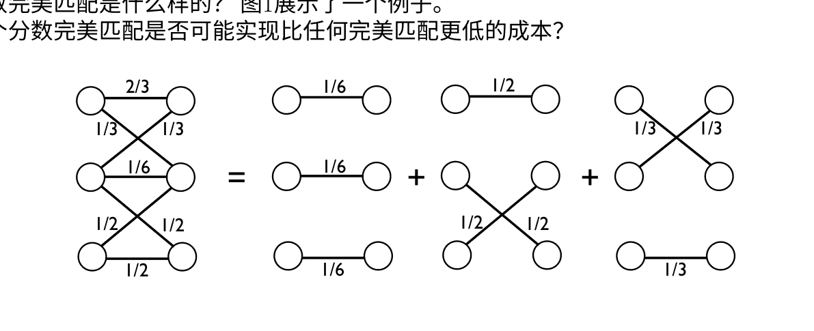
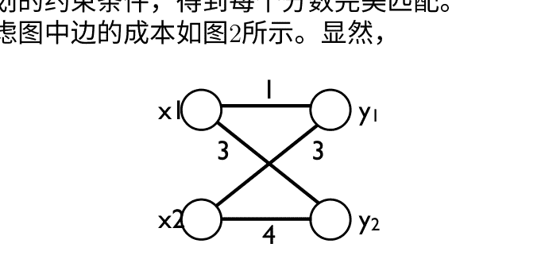
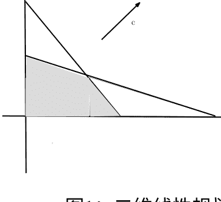
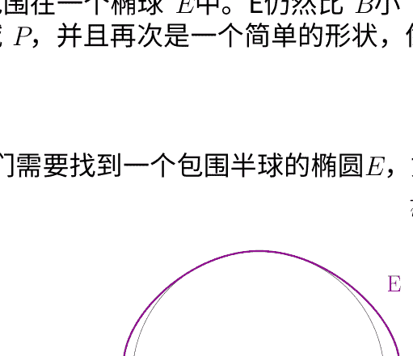

# 康奈尔 CS6820 算法分析讲义

这些笔记分析了涉及二分图匹配的优化问题的算法。匹配算法不仅在自身中很有用（例如，在网络中将客户与服务器匹配，或在市场中将买家与卖家匹配），而且还为学习图算法理论和算法中的许多重复主题提供了一个具体的起点。这些主题的例子包括增广路径、线性规划松弛和原始-对偶算法设计。

# 1 二分图最大匹配

在本节中，我们介绍了二分图最大匹配问题，提出了一个时间复杂度为 O(mn) 的朴素算法，然后介绍和分析了由 Hopcroft 和 Karp 提出的将运行时间改进为 O(m√n) 的算法。

## 1.1 定义

定义1. 在无向图中，一个匹配是一组边，使得没有顶点属于该组的超过一个元素。

当我们将一个二分图 G 表示为有序三元组 G = (U, V, E) 时，表示 U 和 V 是构成 G 顶点的不相交集合，并且 G 的每条边都有一个端点（左端点）在 U 中，另一个端点（右端点）在 V 中。

定义2. 二分图最大匹配问题是在二分图中计算具有最大基数的匹配的问题。

我们将假设二分图最大匹配问题的输入 G = (U, V, E) 以其邻接表表示给出，并且 G 的二分划分——即将顶点集划分为 U 和 V——作为问题的一部分给出。

练习1. 证明如果二分图的划分没有作为输入的一部分给出，可以从 G 的邻接表表示中在线性时间内构建出来。

（在 CS 6820 的讲义中，我们将提供一些练习来帮助你理解。鼓励你尝试解决这些练习，但它们不是作业问题，我们不会检查你是否解决了它们，更不会评分你的解答。）

## 1.2 交替路径和循环；增广路径

以下一系列定义逐步引入了增广路径的概念，它在设计二分图最大匹配问题的算法中起着核心作用。

定义3. 如果 $G$ 是一个图，$M$ 是 $G$ 中的一个匹配，那么一个顶点被称为匹配的，如果它属于 $M$ 中的一条边，否则为自由的。

相对于 $M$ 的交替分量（也称为 $M$-交替分量）是一个边集，它形成了 $G$ 的一个连通子图，其最大度数为2（即路径或循环），其中每个度数为2的顶点恰好属于 $M$ 的一条边。相对于 $M$ 的增广路径是一个 $M$-交替分量，它是一条路径，其两个端点都是自由顶点。

在以下引理中，以及整个讲义中，我们使用符号 $A \oplus B$ 来表示两个集合 $A$ 和 $B$ 的对称差，即属于其中一个集合但不属于另一个集合的所有元素的集合。

> 引理1. 如果 $M$ 是一个匹配，$P$ 是相对于 $M$ 的增广路径，则 $M \oplus P$ 是一个比 $M$ 多一条边的匹配。

证明. 路径 $P$ 具有奇数条边，并且其边交替属于 $M$ 和它的补集，以后者开始和结束。因此，$M \oplus P$ 比 $M$ 多一条边。要证明它是一个匹配，注意到在 $P$ 的补集中的顶点在 $M$ 中与在 $M \oplus P$ 中具有相同的邻居集，而在 $P$ 中的顶点在 $M \oplus P$ 中只有一个邻居。
□

> 引理2. 在图 $G$ 中，匹配 $M$ 是最大基数匹配当且仅当它没有增广路径。

证明. 我们已经在引理1中看到，如果匹配 $M$ 有增广路径，那么它不是最大基数匹配，所以我们只需要证明反过来的情况。假设 $M^*$ 是最大基数匹配的匹配，且 $|M| < |M^*|$。边集 $M \oplus M^*$ 的最大度数为2，并且 $M \oplus M^*$ 中度数为2的每个顶点都属于 $M$ 的一条边。因此，$M \oplus M^*$ 的每个连通分量都是一个 $M$-交替分量。至少有一个这样的分量包含的 $M^*$ 的边比 $M$ 的边多。它不能是一个交替环或者一个偶长交替路径；这些都有相同数量的 $M^*$ 和 $M$ 的边。它也不能是一个以 $M$ 为起点和终点的奇长交替路径。因此，它必须是一个以 $M^*$ 为起点和终点的奇长交替路径。由于这条路径的两个端点对于 $M$ 来说都是自由的，所以它是一个 $M$-增广路径，正如所需。
□

## 1.3 二分图最大匹配：朴素算法

前面的讨论提示了设计二分图最大匹配算法的以下一般方案。

### 算法1 朴素迭代方案用于计算最大匹配

1: 初始化 $M = \emptyset$.
2: 重复执行
3:     找到相对于 $M$ 的增广路径 $P$.
4:     $M \leftarrow M \oplus P$
5: 直到没有相对于 $M$ 的增广路径为止。

根据引理1，在每次循环迭代结束时，保持 $M$ 是一个匹配。此外，每次循环迭代都会增加 $M$ 的基数1，且基数不能超过 $G$ 的顶点数 $n/2$。因此，算法在最多 $n/2$ 次迭代后终止。当算法终止时，根据引理2，$M$ 保证是一个最大匹配。

该算法尚未完全规定，因为我们尚未指明关于找到与 $M$ 相关的增广路径的过程。当 $G$ 是一个二分图时，存在一个简单的线性时间过程，我们现在来描述它。

定义4. 如果 $G=(U, V, E)$ 是一个二分图，$M$ 是一个匹配，那么图 $D(G, M)$ 是由 $G$ 形成的有向图，如果一条边不属于 $M$，则将其从 $U$ 指向 $V$，否则从 $V$ 指向 $U$。

引理3. 假设 $M$ 是二分图 $G$ 中的一个匹配，$F$ 表示自由顶点的集合。在 $D(G, M)$ 中，从 $U \cap F$ 到 $V \cap F$ 的有向路径与 $M$-增广路径一一对应。

证明. 如果 $P$ 是从 $U \cap F$ 到 $V \cap F$ 的有向路径在 $D(G, M)$ 中，那么 $P$ 从自由顶点开始并结束，并且其边交替于从 $U$ 到 $V$ 的边（在补集 $M$ 中）和从 $V$ 到 $U$ 的边（在 $M$ 中），因此与 $P$ 对应的无向边集是一条增广路径。

反之，如果 $P$ 是一条增广路径，那么 $P$ 内部的每个顶点都属于 $M$ 的一条边，因此当我们将 $P$ 的边按照 $D(G, M)$ 中的方向排列时，$P$ 的内部顶点有一个入边和一个出边，即 $P$ 变成了一条有向路径。
这条路径有奇数条边，因此它在 $U$ 和 $V$ 中有一个端点。这两个端点都属于 $F$，根据增广路径的定义。因此，与 $P$ 对应的有向边集是一条从 $U \cap F$ 到 $V \cap F$ 的路径在 $D(G, M)$ 中。
□

引理3表明，在算法1的每个循环迭代中，需要找到增广路径（如果存在）的步骤可以通过构建辅助图 $D(G, M)$ 并运行图搜索算法（如BFS或DFS）来实现，以搜索从 $U \cap F$ 到 $V \cap F$ 的路径。构建 $D(G, M)$ 需要 $O(m+n)$ 的时间，其中 $m$ 是 $G$ 中的边数，使用BFS或DFS搜索 $D(G, M)$ 也需要相同的时间。为方便起见，假设 $m \geq n/2$；否则 $G$ 包含孤立顶点，可以在预处理步骤中消除，只需要 $O(n)$ 的时间。然后算法1最多运行 $n/2$ 次迭代，每次迭代需要 $O(m)$ 的时间，因此其运行时间为 $O(mn)$。

备注 1. 当 $G$ 不是二分图时，我们对算法1的分析仍然证明它在至多 $n/2$ 次迭代后找到了一个最大匹配。然而，寻找增广路径的任务更加微妙。第一个多项式时间算法用于寻找增广路径是由杰克·埃德蒙兹在1965年的一篇名为“路径、树和花朵”的论文中发现的，这是组合优化历史上最有影响力的论文之一。埃德蒙兹的算法在 $O(mn)$ 时间内找到一个增广路径，从而导致在非二分图中找到最大匹配的运行时间为 $O(mn^2)$。随后发现了更快的算法。

## 1.4 霍普克罗夫特-卡普算法

对于二分图最大匹配的朴素算法来说，有一个潜在的浪费之处，即使在搜索辅助图 $D(G, M)$ 的过程中找到了很多增广路径，它仍然每次选择一条增广路径。霍普克罗夫特-卡普算法通过纠正这个浪费的问题来改进朴素算法的运行时间；在每次迭代中，它尝试找到许多不相交的增广路径，并使用它们来增加 $M$ 的大小。

下面的定义规定了算法在每次迭代中搜索的结构类型。

定义5. 如果 $G$ 是一个图，$M$ 是一个匹配，那么关于 $M$ 的一个阻塞增广路径集合是一个增广路径集合 $\{P_1, \ldots, P_k\}$，满足以下条件：

- 路径 $P_1, \ldots, P_k$ 是顶点不相交的；
- 它们的长度都相同，为 $\ell$；
- $\ell$ 是一个 $M$-增广路径的最小长度；
- 长度为 $\ell$ 的每个增广路径都至少与 $P_1 \cup \cdots \cup P_k$ 中的一个顶点相交。

换句话说，阻塞增广路径集合是一个（集合上的）最大化的顶点不相交的最小长度增广路径集合。

引理4. 如果 $M$ 是一个匹配，而 $\{P_1, \ldots, P_k\}$ 是一组顶点不相交的 $M$-增广路径，那么 $M \oplus P_1 \oplus P_2 \oplus \cdots \oplus P_k$ 是一个基数为 $|M| + k$ 的匹配。

推广引理2，我们有以下结果。

引理5. 假设 $G$ 是一个图，$M$ 是 $G$ 中的一个匹配，$M^*$ 是一个最大匹配；令 $k = |M^*| - |M|$。边集 $M \oplus M^*$ 至少包含 $k$ 个顶点不相交的 $M$-增广路径。因此，$G$ 至少有一条长度小于 $n/k$ 的 $M$-增广路径，其中 $n$ 表示 $G$ 的顶点数。

证明. 边集合 $M \oplus M^*$ 的最大度数为2，并且每个度数为2的顶点在 $M \oplus M^*$ 中都属于 $M$ 的一条边。因此，$M \oplus M^*$ 的每个连通分量都是一个 $M$-交替分量。每个不是增广路径的 $M$-交替分量在 $M$ 中至少有与 $M^*$ 相同数量的边。每个 $M$-增广路径在 $M$ 中的边数比 $M^*$ 少一个。因此，$M \oplus M^*$ 的至少 $k$ 个连通分量必须是 $M$-增广路径，并且它们都是顶点不相交的。 为了证明引理的最后一句话，注意 $G$ 只有 $n$ 个顶点，所以它不能有 $k$ 个顶点多于 $n/k$ 个的不相交子图。 □

这些引理提出了在图中寻找最大匹配的以下方法，这构成了 Hopcroft-Karp 算法的外循环。

**算法2 Hopcroft-Karp算法，外循环**
1: $M = \emptyset$
2: 重复执行
3:     设 $\{P_1, \dots, P_k\}$ 是相对于 $M$ 的一个阻塞增广路径集合。
4:     $M \leftarrow M \oplus P_1 \oplus P_2 \oplus \dots \oplus P_k$
5: 直到没有相对于 $M$ 的增广路径为止

改进运行时间保证的关键是以下一对引理，它们导致对外循环迭代次数的改进界限。

引理6. 在 Hopcroft-Karp 外循环中找到一个非空的阻塞增广路径集合后，$M$-增广路径的最小长度严格增加。

证明. 我们将使用以下符号表示。

$M =$ 循环迭代开始时的匹配
$P_1, \dots, P_k =$ 找到的增广路径的阻塞集合
$Q = P_1 \cup \dots \cup P_k$
$R = E \setminus Q$
$M' = M \oplus Q =$ 迭代结束时的匹配
$F = \{\text{相对于 } M \text{ 自由的顶点}\}$
$F' = \{\text{相对于 } M' \text{ 自由的顶点}\}$
$d(v) = \text{从 } U \cap F \text{ 到 } v \text{ 在 } D(G, M) \text{ 中的最短路径长度}$
$\quad\quad (\text{如果不存在这样的路径，则 } d(v) = \infty。)$

如果 $(x, y)$ 是 $D(G, M)$ 的任意一条边，则 $d(y) \leq d(x) + 1$。满足 $d(y) = d(x) + 1$ 的 $D(G, M)$ 的边被称为前进边，而其他边被称为后退边。注意，在 $D(G, M)$ 中，从 $U \cap F$ 到任何顶点 $v$ 的最短路径必须完全由前进边组成。 特别地，$Q$ 包含在前进边的集合中。

在边集合 $D(G, M')$ 中，$Q$ 中的每条边的方向被反转，而 $R$ 中的每条边的方向保持不变。 因此，$D(G, M')$ 有三种类型的有向边 $(x, y)$:

1. 满足 $d(y) = d(x) -1$ 的 $Q$ 的反向边;
2. 满足 $d(y) = d(x) + 1$ 的 $R$ 的前进边;
3. 满足 $d(y) \leq d(x)$ 的 $R$ 的后退边。

需要注意的是，在这三种情况下，不等式 $d(y) \leq d(x) + 1$ 都成立。

现在让 $\ell$ 表示相对于 $M$ 的最小增广路径的长度，即 $\ell= \min\{d(v) \mid v \in V \cap F\}$。让 $P$ 是 $D(G, M')$ 中从 $U \cap F'$ 到 $V \cap F'$ 的任意路径。引理断言 $P$ 至少有 $\ell$ 条边。$P$ 的端点在 $M'$ 中是自由的，因此也是在 $M$ 中自由的。当 $w$ 遍历 $P$ 的顶点时，$d(w)$ 的值从0增加到至少 $\ell$，而 $P$ 的每条边最多增加 $d(w)$ 的值1。因此，$P$ 至少有 $\ell$ 条边，而且只有当对于 $P$ 中的每条边 $(x, y)$，$d(y) = d(x) + 1$ 时，$P$ 才能有 $\ell$ 条边。我们已经看到这意味着 $P$ 包含在 $R$ 的前进边集合中，并且特别地，$P$ 与 $Q$ 是边不相交的。它不能与 $Q$ 在顶点上不相交，因为否则 $\{ P_1, \ldots, P_k, P\}$ 将是 $k+ 1$ 个顶点不相交的最小长度 $M$-增广路径集合，违反了我们的假设 $\{ P_1, \ldots, P_k\}$ 是一个阻塞集合。因此，$P$ 至少与 $P_1, \ldots, P_k$ 中的一个顶点相交，即 $P \cap Q \neq \emptyset$。$P$ 的端点不能属于 $Q$，因为它们在 $M'$ 中是自由的，而 $Q$ 中的每个顶点在 $M'$ 中都是匹配的。让 $w$ 是 $P$ 中属于 $Q$ 的一个内部顶点。包含 $w$ 的 $M'$ 的边属于 $P$，但它也属于 $Q$。这违反了我们之前得出的 $P$ 与 $Q$ 是边不相交的结论，从而得到了所需的矛盾。

引理 7. Hopcroft-Karp算法在其外部循环的少于 $2\sqrt{n}$ 次迭代后终止。

证明. 在外部循环的前 $\sqrt{n}$ 次迭代完成后，一个 $M$-增广路径的最小长度大于 $\sqrt{n}$。这意味着，根据引理 5，$|M^*| - |M| < \sqrt{n}$，其中 $M^*$ 表示最大基数匹配。每个剩余的迭代严格增加 $|M|$，因此剩余的迭代次数少于 $\sqrt{n}$。

Hopcroft-Karp算法的内部循环必须计算相对于 $M$ 的阻塞增广路径集。我们现在描述如何在线性时间内完成这个操作。

回顾引理 6 中定义的距离标签 $d(v)$；$d(v)$ 是从 $U$ 中的一个自由顶点到 $v$ 的最短交替路径的长度；如果不存在这样的路径， 则 $d(v) = \infty$。还要记住，在 $D (G, M)$ 中，前进边是指边 $(x, y)$ ，使得 $d (y) = d (x) + 1$，并且每个最短长度的 $M$ 增广路径仅由前进边组成。Hopcroft-Karp内循环首先执行广度优先搜索来计算距离标签 $d (v)$ ，以及前进边集合 $A$ 和每个顶点 $v$ 的计数器 $c (v)$ ，该计数器计算 $v$ 处的入射前进边的数量，即形如 $(u, v)$ 的前进边，其中 $u$ 是某个顶点。它将 $\ell$ 设置为 $M$ 增广路径的最小长度（等价地，$d (v)$ 在所有 $v\in V\cap F$ 上的最小值）， 将每个顶点标记为未探索，并且重复使用以下过程来找到增广路径。从一个未探索的顶点 $v$ 开始，该顶点位于 $V\cap F$ 中，且 $d (v) = \ell$，并沿着 $A$ 中的入射边向后追溯，直到达到 $d (u) = 0$ 的顶点 $u$。将此路径 $P$ 添加到阻塞集合中，并将其顶点添加到“垃圾回收”队列中。当垃圾回收队列非空时，从队列头部删除顶点 $v$，将其标记为已探索，并从 $A$ 中删除其关联边（出射边和入射边）。在删除出射边 $(v, w)$ 时，减少计数器 $c (w)$ ，如果 $c (w)$ 现在等于0，则将 $w$ 添加到垃圾回收队列中。

因此，整个内部循环在线性时间内运行。

根据设计，该算法发现了一组最小长度的 $M$ 增广路径，这些路径在顶点上是不相交的，因此我们只需要证明这组路径是最大的。通过对算法发现的增广路径数量进行归纳，只要垃圾收集队列为空时，以下不变量都成立。

1. 对于每个顶点 $v$，$c(v)$ 计算尚未从 $A$ 中删除的前进边 $(u, v)$ 的数量。
2. 每当删除一条边 $e$ 或将一个顶点 $v$ 放入垃圾收集队列时，从 $U \cap F$ 开始并包括边 $e$ 或顶点 $v$ 的前进边构成的路径必须与所选路径集合有一个公共顶点。
3. 对于每个未标记的顶点 $v$，$c(v) >0$，并且存在一条从 $U \cap F$ 到 $v$ 的路径。（存在这样一条路径是通过沿着 $A$ 中的边从 $v$ 向后追踪到一个顶点 $u$，使得 $d(u) = 0$。）

第三个不变量确保当算法从一个未标记的自由顶点开始搜索增广路径时，它保证能找到这样一条路径。第二个不变量确保当没有未标记的自由顶点 $v$ 满足 $d(v) = \ell$ 时，前进边集合不再包含从 $U \cap F$ 到 $V \cap F$ 的与所选路径不相交的路径；因此，所选路径集合形成了所需的阻塞增广路径集合。

# 2 二分图最小成本完美匹配及其线性规划松弛

在二分图最小成本完美匹配问题中，我们给定一个无向二分图 $G= (U, V, E)$，以及每条边 $e \in E$ 的（非负实数）成本 $c_e$。如果 $(u, v)$ 是 $G$ 的一条边，则 $c(u, v) = c_e$；否则，$c(u, v) = \infty$。
如常，令 $m$ 表示 $G$ 的边数，$n$ 表示顶点数。完美匹配 $M$ 可以用一个由0和1组成的矩阵 $(x_{uv})$ 来描述，其中当且仅当 $(u, v) \in M$ 时， $x_{uv}= 1$。该矩阵的每行和每列的元素之和等于1，因为每个顶点恰好属于 $M$ 的一个元素。反之，对于任意一个由 $\{0,1\}$ 值组成的矩阵，如果每行和每列的和都等于1，则对应的边集是一个完美匹配。因此，二分图最小成本匹配问题可以表示如下。

| 目标 | 最小化 $\sum_{u,v} c(u, v)x_{uv}$ |
| :--- | :--- |
| 约束条件 | $\sum_{v} x_{uv} = 1$ 对于所有的 $u$ |
| | $\sum_{u} x_{uv} = 1$ 对于所有的 $v$ |
| | $x_{uv} \in \{0, 1\}$ 对于所有的 $u, v$ |由于约束条件 $x_{uv} \in \{0,1\}$，这是一个离散优化问题。虽然我们已经知道如何在多项式时间内解决这个离散优化问题，但许多其他类似的问题并没有已知的多项式时间解。当我们放宽约束条件 $x_{uv} \in \{0,1\}$ 为 $x_{uv} \geq 0$ 时，这往往是有趣且有用的，允许变量取任意非负实数值。这将问题转化为一个连续优化问题，实际上是一个线性规划问题。

```
math
\begin{aligned}
&\text{最小化 } \sum_{u,v} c(u, v)x_{uv} \\
&\text{满足条件 } \sum_{v} x_{uv} = 1 && \text{对于所有的 } u \\
&\phantom{\text{满足条件 }} \sum_{u} x_{uv} = 1 && \forall v \\
&\phantom{\text{满足条件 }} x_{uv} \geq 0 && \text{对于所有的 } u, v
\end{aligned}
```

我们应该如何思考一个值矩阵 $x_{uv}$ 满足线性约束条件的程序？我们已经看到，如果这些值是整数，那么它表示一个完美匹配。这个约束集的一般解可以被看作是一个分数完美匹配。分数完美匹配是什么样的？图1展示了一个例子。这个分数完美匹配是否可能实现比任何完美匹配更低的成本？



匹配？不可能，因为它可以表示为完美匹配的凸组合（再次参见图1），因此它的成本是这些完美匹配成本的加权平均值。特别地，至少有一个这些完美匹配的成本不超过图中左侧所示的分数完美匹配。这种情况并非巧合。Birkhoff-von Neumann定理断言，每个分数完美匹配都可以分解为完美匹配的凸组合。（尽管它的名字很有声望，但这个定理实际上很容易证明。如果你从未见过证明，请尝试自己找一个。）

现在假设我们有一个二分图最小成本完美匹配的实例，并且我们想要证明对最优解存在一个下界：我们想要证明每个分数完美匹配的成本至少为某个特定数量。我们如何证明这一点？一种方法是运行一个最小成本完美匹配算法，查看其输出，并声明这是任何分数完美匹配成本的下界。（存在多项式时间的最小成本完美匹配算法，我们将在本讲座中稍后看到。）根据Birkhoff-von Neumann定理，这产生了一个有效的下界，但并不令人满意。还有另一种更直接的方法来证明成本的下界。

通过直接结合线性规划的约束条件，得到每个分数完美匹配。为了说明这一点，考虑图中边的成本如图2所示。显然，



最小成本完美匹配的成本为5。为了证明没有分数完美匹配的成本可以低于5，我们将线性规划的一些约束条件组合如下。

```
math
\begin{align*}
2x_{11} + 2x_{21} &= 2 \\
-x_{11} - x_{12} &= -1 \\
4x_{12} + 4x_{22} &= 4
\end{align*}
```

添加这些约束条件，我们发现

```
math
\begin{align*}
x_{11} + 3x_{12} + 2x_{21} + 4x_{22} &= 5 \quad (1) \\
x_{11} + 3x_{12} + 3x_{21} + 4x_{22} &\ge 5 \quad (2)
\end{align*}
```

不等式(2)是由(1)推导出来的，因为我们在左边唯一的改变是将 $x_{21}$ 的系数从2增加到3，而我们知道 $x_{21} \ge 0$。(2)的左边是分数完美匹配 $m$ 的成本。我们可以得出结论，每个分数完美匹配的成本至少为5。

这个技术的最一般形式是什么？对于每个顶点 $w \in U \cup V$，线性规划包含一个“度约束”，它断言 $w$ 在分数完美匹配中的度数等于1。对于每个度约束，我们将其左右两边乘以一些系数来得到

```
math
\sum_{v} p_u x_{uv} = p_u
```

对于某个 $u \in U$，或者

```
math
\sum_{u} q_v x_{uv} = q_v
```

对于某个 $v \in V$。然后我们将所有这些方程相加，得到

```
math
\sum_{u,v} (p_u + q_v) x_{uv} = \sum_{u} p_u + \sum_{v} q_v. \quad (3)
```

如果不等式 $p_u + q_v \leq c(u,v)$ 对于每个 $(u,v) \in U \times V$ 都成立，那么在证明的最后一步中，我们（可能）增加左边 (3) 的一些系数，得到

```
math
\sum_{u,v} c(u,v) x_{uv} \ge \sum_{u} p_u + \sum_{v} q_v,
```

从而得到每个分数完美匹配的成本下界。只要系数 $p_u, q_v$ 满足 $p_u + q_v \leq c(x, y)$，这种技术就适用于任何边 $(x, y)$，无论 $p_u, q_v$ 的值是正数还是负数。为了使用这种技术获得最强的下界，我们将通过求解以下线性规划来设置系数 $p_u, q_v$。

```
$$\begin{aligned} \max & \quad \sum_{u} p_u + \sum_{v} q_v \\ \text{s.t.} & \quad p_u + q_v \leq c(u, v) \quad \forall u, v \end{aligned}$$
```

这个线性规划被称为最小成本分数匹配线性规划的对偶。我们已经看到它的最优解构成了最小成本分数匹配线性规划最优解的下界。对于任何线性规划，我们都可以按照相同的思路发展出对偶线性规划。（还有一种正式的指定过程；它涉及将线性规划的约束矩阵转置。）最小化问题的对偶是最大化问题，它的最优解构成了最小化问题的下界。这个事实被称为弱对偶性；正如你所见，弱对偶性只是一个断言，我们可以通过线性组合其他有效不等式来获得有效不等式，并且有时这使我们能够从上方或下方限制LP解的值。但实际上，LP的最优值总是完全相等于其对偶LP的值！这个事实被称为强对偶性（有时也简称为“对偶性”），它远非显而易见，并且对于算法设计有重要的影响。对于分数完美匹配问题的特殊情况，强对偶性表明上述简单的证明技巧实际上足够强大，可以证明对于二分图最小成本完美匹配问题的每个实例，它是成本的最佳可能下界。

事实证明，有一个多项式时间算法可以解决线性规划问题。正如你可以想象的那样，这个事实对算法设计也有非常重要的影响，但这是另一个讲座的主题。

## 3. 原始对偶算法

在本节中，我们将构建一个快速算法来解决二分图最小成本完美匹配问题，利用前面部分的见解。攻击的基本计划如下：我们将设计一个算法，同时计算两个东西：最小成本完美匹配和一个对偶解（包含 $p_u$ 和 $q_v$ 值的向量），其值（$p_u$ 和 $q_v$ 的和）等于完美匹配的成本。算法运行时，它维护一个对偶解 $p, q$ 和一个匹配 $M$，并保持以下不变性：

1. 每条边 $(u, v)$ 满足 $p_u + q_v \leq c(u, v)$。如果 $p_u + q_v = c(u, v)$，我们称边 $e = (u, v)$ 为 tight。
2. $M$ 的元素是紧密边的子集。
3. 算法的每个阶段中，$M$ 的基数增加 1，直到达到 $n$。

假设算法能够在终止之前保持这些不变量，那么它的正确性将自动得到证明。这是因为终止时的匹配 $M$ 将是一个完美匹配，满足

$$
\sum_{(u,v) \in M} c(u, v) = \sum_{(u,v) \in M} p(u) + q(v) = \sum_{u \in U} p_u + \sum_{v \in V} q_v,
$$

最后一个等式成立是因为 $M$ 是一个完美匹配。算法的第一个不变量意味着 $p$ 和 $q$ 是可行的对偶解，因此右侧是任何分数完美匹配成本的下界。左侧是完美匹配 $M$ 的成本，因此 $M$ 具有任何分数完美匹配的最小成本。

那么，在将 $M$ 扩展为完美匹配的过程中，我们如何保持上述三个不变量呢？我们初始化 $M=\emptyset$ 和 $\vec{p} = \vec{q} = 0$。请注意，这三个不变量在初始化时是显然满足的。现在，只要 $|M| < n$，我们希望找到一种方法来增加对偶解的值或者扩大 $M$，而不违反任何不变量。

最简单的方法是找到一个由紧边组成的 $M$-增广路径 $P$，这样我们可以在不违反任何不变量的情况下更新 $M$ 为 $M\oplus P$，并达到阶段的结束。然而，有时候找不到由紧边组成的 $M$-增广路径，这种情况下，我们必须调整一些对偶变量以使额外的边变得紧张。

调整对偶变量的过程最好描述如下。最简单的情况是我们能找到一个不属于任何紧边的顶点 $u \in U$。然后我们可以将 $p_u$ 增加一些 $\delta > 0$，直到包含 $u$ 的边变得紧张。然而，也许每个 $u \in U$ 都属于一个紧边。在这种情况下，我们需要将 $p_u$ 增加 $\delta$ 的同时，将其他一些 $q_v$ 降低相同的量 $\delta$。这最好用一个顶点集 $T$ 来描述，该集合具有以下属性：如果一条边 $e \in M$ 的一个端点属于 $T$，则 $e$ 的两个端点都属于 $T$。每当 $T$ 具有这个属性时，我们可以设置

$$
\delta = \min\{c(u, v) - p_u - q_v \mid u \in U \cap T, v \in V \setminus T\} \quad (4)
$$

并且通过设置 $p_u \leftarrow p_u + \delta$, $q_v \leftarrow q_v - \delta$ 来调整对偶变量，对于所有的 $u \in U \cap T$, $v \in V \cap T$。这保持了我们对偶解 $p, \vec{q}$ 的可行性（通过选择 $\delta$），并且保持了每条边 $e \in M$ 的紧密性，因为每条这样的边要么同时包含它的两个端点，要么都不包含。

令 $F$ 为自由顶点的集合，即不属于任何 $M$ 元素的顶点。$T$ 将通过一种沿着紧密边的广度优先搜索构建，从 $U$ 中的自由顶点集合 $U \cap F$ 开始。我们初始化 $T = U \cap F$。由于 $|M| < n$，$T$ 非空。根据 (4) 定义 $\delta$；如果 $\delta > 0$，则按上述方法调整对偶变量。将此称为 a dual adjustment step。如果 $\delta = 0$，则至少存在一条紧密边 $e = (u, v)$，从 $U \cap T$ 到 $V \setminus T$。如果 $v$ 是一个自由顶点，则我们发现了一条增广路径 $P$，由紧密边组成（即 $P$ 由 $T$ 中从 $U$ 的自由顶点开始的路径，经过 $u$，然后通过边 $e$ 到达 $v$），我们更新 $M$ 为 $M \oplus P$ 并完成该阶段。将此称为 a augmentation step。最后，如果 $v$ 不是一个自由顶点，则我们找到一条边 $e = (u', v) \in M$，并将 $v$ 和 $u'$ 都添加到 $T$ 中，并将此称为 $T$-growing step。注意，$M$ 的边的左端点总是与右端点同时添加到 $T$ 中，这就是为什么 $T$ 永远不会只包含 $M$ 的一个端点，除非它同时包含两个。

一个阶段最多可以包含 $n$ 个增长步骤和最多一个增广步骤。此外，永远不会有连续的对偶调整步骤（因为在第一个这样的步骤之后，$\delta$ 的值会降为零），因此一个阶段中的总步数是 $O(n)$。让我们将算法的一个阶段的运行时间分解为其组成部分来计算。

1. 只有一个增广步骤，它的成本是 $O(n)$。
2. 有 $O(n)$ 个增长步骤，每个步骤的成本是 $O(1)$。
3. 有 $O(n)$ 个对偶调整步骤，每个步骤的成本是 $O(n)$。
4. 最后，每个步骤都通过使用 (4) 计算值 $\delta$ 开始。因此，需要计算 $\delta$ 的值 $O(n)$ 次。朴素地计算每次需要计算 $\delta$ 时的工作成本为 $O(m)$。

因此，一个天真的原始-对偶算法的实现需要 $O(mn^2)$ 的时间。

然而，我们可以通过一些巧妙的记账方法结合高效的数据结构来做得更好。对于一个顶点 $w \in T$，让 $s(w)$ 表示 $w$ 被添加到 $T$ 的步骤编号。让 $\delta_s$ 表示第 $s$ 步中 $\delta$ 的值，让 $\Delta_s$ 表示 $\delta_1+\cdots+\delta_s$ 的和。让 $p_{u,s}, q_{v,s}$ 表示在第 $s$ 步结束时与顶点 $u, v$ 相关联的对偶变量的值。注意

```
\[
p_{u,s} = 
\begin{cases}
p_{u,0} + \Delta_s - \Delta_{s(u)} & \text{if } u \in U \cap T \\
p_{u,0} & \text{如果 } u \in U \setminus T
\end{cases}
\quad (5)
\]
\[
q_{v,s} = 
\begin{cases}
q_{v,0} - \Delta_s + \Delta_{s(v)} & \text{if } v \in V \cap T \\
q_{v,0} & \text{如果 } v \in V \setminus T
\end{cases}
\quad (6)
\]
```

因此，在步骤 $s$ 结束时，如果 $e= (u, v)$ 是从 $U \cap T$ 到 $V \setminus T$ 的任意边，则

```
\[
c(u, v) - p_{u,s} - q_{v,s} = c(u, v) - p_{u,0} - \Delta_s + \Delta_{s(u)} - q_{v,0}
\]
```

右侧唯一依赖于 $s$ 的项是 $-\Delta_s$，它是一个全局值，对所有边都是相同的。因此，选择使 $c(u,v)-p_{u,s}-q_{v,s}$ 最小的边等价于选择使 $c(u,v)-p_{u,0}+\Delta_{s(u)}-q_{v,0}$ 最小的边。让我们维护一个优先队列，其中包含从 $U \cap T$ 到 $V \setminus T$ 的所有边。当左端点 $u$ 被插入 $T$ 时，边 $e=(u,v)$ 被插入到这个优先队列中。在优先队列中，$e$ 的关联值为 $c(u,v)-p_{u,0}+\Delta_{s(u)}-q_{v,0}$，并且这个值在相位进行过程中不会改变。每当算法需要选择使 $c(u,v)-p_{u,s}-q_{u,s}$ 最小的边时，它只需提取这个优先队列的最小元素，如有必要重复此过程，直到找到一个右端点不属于 $T$ 的边。在整个相位中，维护优先队列所需的总工作量为 $O(m\log n)$。最后，我们通过优先队列的技巧消除了在对偶调整步骤中实际更新 $p_u$、$q_v$ 值的需要。这些值仅用于计算 $\delta_s$ 的值，并在相位结束时更新对偶解。然而，如果我们

将所有的值 $s(u)$、 $s(v)$ 以及所有 $s$ 的 $\Delta_s$ 值存储起来，然后可以使用 (5)-(6) 在常数时间内计算出任意特定的值 $p_{u,s}$ 或 $q_{v,s}$。 特别地，在每个阶段结束时，计算所有 $p_u$、 $q_v$ 的值需要 $O(n)$ 的时间，而一旦我们使用优先队列确定了边 $e=(u, v)$，计算值 $\delta_s= c(u, v) - p_u - q_v$ 只需要 $O(1)$ 的时间。 因此，维护 $p_u$、 $q_v$ 值的工作总量每个阶段只有 $O(n)$。

总的来说，任何阶段的工作量都受到 $O(m \log n)$ 的限制，因此算法的运行时间为 $O(mn \log n)$。

网络流是一种具有许多算法和组合学应用的结构。一个著名的结果称为最大流最小割定理，揭示了网络流和图割之间的紧密关系；后者也是组合学和组合优化的基本主题，具有许多重要应用。

这些讲义介绍了网络流的主题，介绍和分析了一些计算最大流的算法，证明了最大流最小割定理，并介绍了一些组合学应用。在计算机科学的其他领域中，这些主题也有许多应用。例如，网络流在通信网络中有明显的路由应用。计算图中的最小割算法在计算机视觉中有重要但不太明显的应用。这些应用（以及最大流和最小割的许多其他实际应用）超出了这些讲义的范围。

# 1 基本定义

我们首先定义有向多重图中的流。（多重图是允许有平行边的图，即具有相同端点的两条或多条边。）

定义 1. 在有向多重图 $G= (V, E)$ 中，具有源点 $s$ 和汇点 $t$（其中 $s$ 和 $t$ 是 $G$ 的顶点）的流是对每条边 $e$ 分配非负值 $f_e$ 的一种赋值，称为“ $e$ 上的流”，使得对于每个 $v \neq s, t$，离开 $v$ 的边上的总流量等于进入 $v$ 的边上的总流量。这个方程被称为“ $v$ 处的流量守恒”。流的值，表示为 $|f|$，是离开源点 $s$ 的边上的总流量。

可以使用图 $G$ 的关联矩阵 $B$ 来重新表达这个定义，其中 $B$ 是一个以顶点为行索引、边为列索引的矩阵，其元素定义如下。

```
B_{w,e}= \begin{cases}
1 & \text{如果} w \text{是} e \text{的头部，即} e=(u,v) \text{且} w=v \text{；} \\
-1 & \text{如果} w \text{是} e \text{的尾部，即} e=(u,v) \text{且} w=u \text{；} \\
0 & \text{否则。}
\end{cases}
```

对于任意顶点 $v$，令 $1_v$ 表示 $v$ 的指示向量，即列向量（行索引为 $V$）其元素定义如下。

```
(1_v)_w = \begin{cases}
1 & \text{如果 } v=w \text{。} \\
0 & \text{否则。}
\end{cases}
```

在这个表示法中，如果我们将流 $f$ 解释为以 $E$ 为索引的列向量，则非负向量 $f$ 是从 $s$ 到 $t$ 的流，当且仅当 $Bf=\lambda(1_t-1_s)$ 成立，其中 $\lambda$ 是一个实数，此时 $f$ 的值由 $|f|=\lambda$ 给出。

流的一个有用解释是“流是源-汇路径和循环的加权和”。

## 引理 1.

对于一个边集 $S$，其特征向量 $\mathbf{1}_S$ 是 $\mathbb{R}^E$ 中的向量，其第 $e$ 个元素等于 $1$ 如果 $e \in S$，等于 $0$ 如果 $e \notin S$。向量 $f \in \mathbb{R}^E$ 是从 $s$ 到 $t$ 的流，当且仅当 $f$ 等于非负权重的向量 $\mathbf{1}_S$ 的加权和，其中 $S$ 遍历所有的 $s$-$t$ 路径，$t$-$s$ 路径和有向循环。在任何这样的加权和分解中，$f$ 的值是 $s$-$t$ 路径的总权重减去 $t$-$s$ 路径的总权重。

证明。记 $\mathbb{R}_+$ 为非负实数集。当 $S$ 是 (i) 一个 $s$-$t$ 路径的边集， (ii) 一个 $t$-$s$ 路径的边集，或者 (iii) 一个有向循环的边集时，我们有 $\mathbf{1}_S \in \mathbb{R}_+^E$ 且 $B\mathbf{1}_S = \lambda_S(\mathbf{1}_t - \mathbf{1}_s)$ 其中 $\lambda_S$ 在情况 (i) 中等于 $1$，在情况 (ii) 中等于 $-1$，在情况 (iii) 中等于 $0$。对这些等式进行加权求和，可以验证任何非负源-汇路径和循环的加权和都是具有所述值的流。

反过来，如果 $f$ 是一个流，我们必须证明它是源-汇路径和循环的非负加权和。证明将通过对 $E_+(f)$ 中边的数量进行归纳来进行。当这个数量为零时，引理是显然成立的，所以假设 $|E_+(f)| > 0$。如果 $E_+(f)$ 包含一个 $s$-$t$ 路径，一个 $t$-$s$ 路径或一个有向循环，则让 $S$ 表示这个路径或循环的边集，令 $w = \min \{f_e \mid e \in S\}$。向量 $g = f - w\mathbf{1}_S$ 是一个值为 $|g| = |f| - w\lambda_S$ 的流，且 $|E_+(g)| < |E_+(f)|$，因此根据归纳假设，我们可以将 $g$ 分解为 $s$-$t$ 路径，$t$-$s$ 路径和循环的加权和，且 $|g|$ 是 $s$-$t$ 路径的总权重减去 $t$-$s$ 路径的总权重。归纳步骤的结论是因为 $f = g + w\mathbf{1}_S$。

为了完成证明，我们需要展示当 $|E_+(f)| > 0$ 时，存在一条从 $s$ 到 $t$ 的路径，一条从 $t$ 到 $s$ 的路径，或者一条包含在 $E_+(f)$ 中的有向环。如果 $E_+(f)$ 中不包含有向环，则 $(V, E_+(f))$ 是一个非空边集的有向无环图。因此，它必须有一个源顶点，即一个至少有一条出边但没有入边的顶点 $u_0$。
构造一条路径 $P = u_0, u_1, \ldots$ 从 $u_0$ 开始，并选择 $u_i$ (对于 $i > 1$)，通过跟随边 $(u_{i-1}, u_i) \in E_+(f)$ 来选择。由于 $E_+(f)$ 中不包含环，这个贪心路径构造过程必定在一个没有出边的顶点处终止。流量守恒原理意味着除了属于 $E_+(f)$ 中的一条边的 $s$ 和 $t$ 之外，每个顶点都有入边和出边。因此，$P$ 的端点是 $s$ 和 $t$ (以某种顺序)，这完成了证明：$E_+(f)$ 要么有一条连接源和汇的路径 (以某种顺序)，要么有一个有向环。

## 定义 2.

流网络是一个有向多图 $G=(V, E)$，每条边 $e$ 都有非负容量 $c(e)$。在流网络中，有效流 $f$ 是满足所有边 $e$ 的容量约束 $f_e \leq c(e)$ 的流 $f$。最大流是具有最大值的有效流。

最大流问题实际上是一个通用问题，可以编码许多其他算法问题。例如，在图 $G=(U, V, E)$ 中的最大二分图匹配可以通过具有顶点集 $U \cup V \cup \{s, t\}$ 和边集 $(\{s\} \times U) \cup E \cup (V \times \{t\})$ 的流网络来编码，所有边的容量都为 1。对于每条边 $(u, v) \in E$，流网络中包含一条三跳路径 $P_e = \langle s, u, v, t \rangle$，对于任何匹配 $M$ 在 $G$ 中，可以将路径 $P_e$ ($e \in M$) 的特征向量相加得到有效流 $f$，使得 $|f| = |M|$。

相反，通过这种构造，任何满足对于所有 $e$ 都有 $f_e \in \mathbb{Z}$ 的有效流 $f$ 都可以从匹配 $M$ 获得。正如我们很快将看到的，在具有整数边容量的流网络中，总是存在一个整数值的最大流。因此，二分图最大匹配问题通过本段落中给出的简单约化转化为最大流问题。

最大流和二分图最大匹配之间的相似性也延伸到解决它们的算法。解决最大流问题的最基本算法围绕着一个称为剩余图的图形展开，该图形类似于我们在介绍二分图最大匹配问题的算法时定义的有向图 $D(G, M)$。

### 定义3.

假设 $G=(V, E, c)$ 是一个流网络，$f$ 是 $G$ 中的有效流。令 $\bar{E}$ 表示一个集合，其中包含对于每个 $E$ 中的 $e$，都有一个以相同的端点但顺序相反的有向边 $\bar{e}$。如果 $E$ 中存在 $e$ 和 $\bar{e} \in \bar{E}$，则剩余容量 $c_f(e), c_f(\bar{e})$ 的定义如下：

$$c_f(e) = c(e) - f_e$$
$$c_f(\bar{e}) = f_e$$

剩余图 $G_f$ 是流网络 $G_f=(V, E_f, c_f)$，其中 $E_f$ 是所有具有正剩余容量的边的集合在 $E \cup \bar{E}$ 中。增广路径是从 $s$ 到 $t$ 的路径在 $G_f$ 中。

对于 $G_f$ 中的任何有效流 $h$，可以关联向量 $\pi(h) \in \mathbb{R}^E$ 定义为

$$\pi(h)_e = h_e - h_{\bar{e}}$$

向量 $\pi(h)$ 编码了将 $f$ 修改为 $G$ 中的另一个有效流的所有方法。

### 引理2.

如果 $f$ 是 $G$ 中的有效流，$h$ 是剩余图 $G_f$ 中的有效流，那么 $f + \pi(h)$ 是 $G$ 中的有效流。反之，每个 $G$ 中的有效流都可以表示为 $f + \pi(h)$ 其中 $h$ 是 $G_f$ 中的有效流。

证明。方程 $Bh = B\pi(h)$ 是根据 $\pi(h)$ 的定义得出的，它暗示 $\pi(h)$ 满足流守恒方程，因此 $f + \pi(h)$ 也满足。在 $G_f$ 中的剩余容量约束条件被精确设计为确保 $f + \pi(h)$ 在每条边上的值介于 $0$ 和 $c(e)$ 之间，因此 $f + \pi(h)$ 是 $G$ 中的有效流。反之，假设 $\tilde{f}$ 是 $G$ 中的任何有效流。使用符号 $x^+$ 表示对于任何实数 $x$，我们可以定义 $\max\{x, 0\}$ 为 $x^+$

对于所有 $e \in E$，我们可以定义 $h_e = (\tilde{f}_e - f_e)^+$ 和 $h_{\bar{e}} = (f_e - \tilde{f}_e)^+$ 对于所有 $\bar{e} \in \bar{E}$

并验证 $h$ 是 $G_f$ 中的有效流，满足 $\tilde{f} = f + \pi(h)$。

### 引理3.

如果 $f$ 是 $G$ 中的有效流，则 $f$ 是最大流当且仅当 $G_f$ 不包含增广路径。

证明：如果 $f$ 不是最大流，则 $f^{*}$ 是任意最大流，并且可以写成 $f^{*}=f+\pi(h)$。根据引理1，流 $h$ 可以分解为 $G_{f}$ 中的 $1_{S}$ 加权和，其中 $S$ 取遍 $s$-$t$ 路径，$t$-$s$ 路径和 $G_{f}$ 中的有向循环，并且在这个分解中至少有一条 $s$-$t$ 路径的系数为正，因为 $|h|>0$。特别地，这意味着 $G_{f}$ 包含一个 $s$-$t$ 路径，即一个增广路径。反之，如果 $G_{f}$ 包含增广路径 $P$，则 $\delta(P)$ 是 $P$ 中边的最小剩余容量。流 $f+\delta(P)\pi(1_{P})$ 是一个有效流，其值为 $|f|+\delta(P)$，因此 $f$ 不是最大流。

### 1.1 与其他定义的比较

Kleinberg-Tardos教材假设S没有入边，T没有出边。在这些笔记中，我们不强加任何这样的假设。因此，图 $G$ 可能包含从T到S的路径，这导致了一个有点违反直觉的约定，即从T到S的路径上的流被认为是一个负值的S-T流。这个约定在引理3中很有用，因为它允许我们简单地说，如果 $f$ 和 $\tilde{f}$ 是图 $G$ 中的两个S-T流，则它们的差异 $\tilde{f}-f$ 总是可以由剩余图 $G_{f}$ 中的一个S-T流来表示。

Kozen教材使用一个斜对称矩阵来表示流，其中的 $(u, v)$ 项表示 $u$ 到 $v$ 沿着直接连接两个顶点的边的净流量 $f_{uv}-f_{vu}$。这样可以简洁地表达流守恒方程和引理，即任意两个流之间的差异由剩余图中的一个流来表示。然而，当图中包含由边 $(u, v)$ 和 $(v, u)$ 组成的二循环时，将流表示为斜对称矩阵会消除在 $(u, v)$ 和 $(v, u)$ 上发送零流和在两个方向上发送相等（但非零）流量之间的区别。从哲学上讲，我认为这些应该被视为不同的流，因此我选择了一种定义，使得这种区别成为可能。做出这个选择的代价是一些定义变得更加混乱和不透明，特别是涉及剩余图和将在 $G_{f}$ 中的流映射到 $G$ 中的流的函数 $\pi$ 的定义。

# 2 最大流最小割定理

引理3的一个重要推论是最大流最小割定理，它建立了最大流和将源点与汇点分开的割之间的紧密关系。我们首先介绍一些涉及割的定义，然后介绍并证明定理。

定义4 ($s$-$t$ 割).在有向图 $G=(V, E)$ 中，具有顶点 $s$ 和 $t$ 的 $S$-$T$ 割是将顶点集 $V$ 划分为两个子集 $S$, $T$ 的一种方式，使得 $s \in S$ 且 $t \in T$。边 $e=(u, v)$ 穿过割 $(S, T)$ 如果 $u \in S$ 且 $v \in T$。(注意，在这个定义下，从T到S的边不穿过割 $(S, T)$。割 $(S, T)$ 的容量，表示为 $c(S, T)$，是穿过割的所有边的容量之和。

定理4 (最大流最小割).对于任何流网络，任何最大流的值都等于任何最小割的容量。

证明。设 $(S, T)$ 为任意一个 $s$-$t$割，令 $\mathbf{1}_T$ 为 $\mathbb{R}^V$ 中的向量，如果 $v \in T$，则其第 $v$ 个分量为 $1$，如果 $v \notin T$，则其第 $v$ 个分量为 $0$。行向量 $x = \mathbf{1}_T^T B$ 满足 $x_e = 1$，如果 $e$ 从 $S$ 到 $T$，$x_e = -1$，如果 $e$ 从 $T$ 到 $S$，否则 $x_e = 0$。

对于一个流 $f$ 和两个不相交的顶点集 $Q, R$，$f(Q, R)$ 表示所有从 $Q$ 到 $R$ 的边 $e$ 上 $f_e$ 的和。我们有

$$ \mathbf{1}_T^T Bf = xf = f(S, T) - f(T, S) \leq c(S, T) \tag{1} $$

其中最后一个不等式成立是因为对于所有从 $S$ 到 $T$ 的边 $e$，有 $f_{(e)} \leq c_{(e)}$，而对于所有从 $T$ 到 $S$ 的边 $e$，有 $f_{(e)} \geq 0$。由于 $f$ 是一个流，我们有

$$ \mathbf{1}_T^T Bf = \mathbf{1}_T^T(\mathbf{1}_t - \mathbf{1}_s)|f| = |f|. \tag{2} $$

将方程 $(1)$ 和 $(2)$ 结合起来可以得出结论，任何流的值都被任何一个 $s$-$t$ 割的容量上界所限制；特别地，最小割的容量是最大流值的上界。

为了证明这个上界是紧的，首先注意到在我们推导不等式 $|f| \leq c(S, T)$ 时，唯一一个是不等式（而不是等式）的步骤是在第一行的末尾的不等式。回顾我们对于这个不等式的证明，可以看到如果对于所有从 $S$ 到 $T$ 的边 $e$，有 $f_{(e)} = c_{(e)}$，而对于所有从 $T$ 到 $S$ 的边 $e$，有 $f_{(e)} = 0$，则两边是相等的。当 $f$ 是最大流时，我们可以通过应用引理3找到满足这些条件的割 $(S, T)$，该引理表明在剩余图 $G_f$ 中不存在 $s$-$t$ 路径。定义 $S$ 为从 $s$ 通过 $G_f$ 中的一条有向路径可达的所有顶点的集合，$T$ 为 $S$ 的补集；注意到 $s \in S$ 和 $t \in T$，所以 $(S, T)$ 是一个有效的割。由于 $G_f$ 中不包含从 $S$ 到 $T$ 的边，因此对于每条从 $S$ 到 $T$ 的边 $e$，剩余容量 $c_f_{(e)}$ 为零（因此 $f_{(e)} = c_{(e)}$），对于每条从 $T$ 到 $S$ 的边 $e$，剩余容量 $c_f_{(\bar{e})}$ 为零（因此 $f_{(e)} = 0$）。这证实了 $S, T$ 满足等式 $(1)$ 左右两边相等的条件。

$\square$

## 3个组合应用

在组合学中，有许多“极小-极大定理”的例子，它们断言最小值等于最大值，其中 XXX 和 YYY 是与某个对象（如图形）相关的两个不同的组合定义参数。通常，这些极小-极大定理还具有另外两个显著的特性。

-   1. 很容易看出 YYY 的最大值不会超过 XXX 的最小值，但它们相等的事实通常并不明显，并且在某些情况下相当令人惊讶。
-   2. 该定理附带有一个多项式时间算法，用于计算 XXX 的最小值或 YYY 的最大值。

通常情况下，这些极小-极大关系可以推导为最大流最小割定理的结果。（当然，这也是这种关系的一个例子。）这也解释了附带的多项式时间算法的来源。

有一个相关的现象适用于决策问题，其中问题是关于一个对象是否具有某个属性 P，而不是关于某个参数的最大或最小值的问题。再次，我们在组合数学中找到许多定理，断言如果 P 成立，则 Q 也成立，其中：

-   1. 很容易看出 Q 是 P 成立的必要条件，但 Q 也是充分条件这一事实并不明显。
-   2. 该定理附带有一个多项式时间算法，用于判断属性 P 是否成立。

再次，这些必要和充分条件通常可以从最大流最小割定理推导出来。

本节的主要目的是举例说明这种现象的五个例子。在介绍这些应用之前，值得提出一些其他的评论。

-   1. 最大流最小割定理远非是这种最小-最大关系的唯一来源。例如，许多更复杂的定理是从拟阵交集定理推导出来的，这是我们本学期不讨论的一个主题。
-   2. 另一个丰富的最小-最大关系的来源，即LP对偶性，在本学期已经进行了非正式的讨论，我们将在稍后进行证明。LP对偶性本身提供了关于连续优化问题的陈述，但是通过应用特定于手头问题的附加特殊目的论证，通常可以推导出离散问题的结果。
-   3. 这些笔记中的“应用”属于数学（具体而言，组合数学），但是最大流算法有许多现实世界的应用。有关航空公司航线规划、图像分割、确定哪些棒球队仍然有能力进入季后赛等应用，请参见Kleinberg & Tardos的第7章，以及其他更多应用。

## 3.1 准备工作

最大流的组合应用通常依赖于对流算法的简单观察。以下定理断言，如果图的某些边允许具有无限容量，则我们关于网络流问题所说的一切基本上仍然有效。因此，在以下定理中，我们将术语“流网络”定义为具有源和汇顶点 s, t 和边容量(c_e)_{e∈E}的有向图 G = (V, E)，与以前一样，包括顶点集 V 是有限的，但是我们允许边容量 c(u, v) 为任何非负实数或无穷大。流与以前一样定义，只是当 c(u, v) = ∞时，表示边(u, v)没有容量约束。

> 定理5. 如果 G 是一个包含由无限容量边构成的 s-t path 的流网络，则最大流值没有上界。否则，最大流值和最小割容量是有限的，并且它们相等。此外，任何将Ford-Fulkerson算法特化的最大流算法（例如Edmonds-Karp或Dinic）在存在无限容量边的情况下仍然正确，并且其最坏情况运行时间保持不变。

证明。如果P是由无限容量边构成的s-t path，则我们可以通过沿着P的边路由所有流量来从s发送无限量的流量到t。否则，如果S表示通过跟随由无限容量边构成的有向路径从s可达的所有顶点的集合，则根据假设t∈S。因此，如果我们设置T = V \ S，则（S，T）是一个s-t cut，且从S到T的每条边都具有有限容量。由此可知，c（S，T）是有限的，最大流值也是有限的。

我们现在通过构建一个具有相同有向图结构和有限边容量的不同流问题Ĝ来进行下一步，同时证明当输入从G修改为Ĝ时，运行Ford-Fulkerson算法的结果不会改变。在Ĝ中修改后的边容量定义如下：

ĉ(u, v) = \begin{cases} c(u, v) & \text{如果} c(u, v) < \infty, \text{则} c \\ (S, T) + 1; & \text{如果} c(u, v) = \infty, \text{则} c(S, T) + 1. \end{cases}

如果(S', T')是Ĝ中的任意割，则要么ĉ(S', T') > ĉ(S, T) = c(S, T)，要么ĉ(S', T') = c(S', T')；特别地，如果(S', T')是Ĝ中的最小割，则后一种情况成立。为了证明这一点，观察到如果ĉ(S', T') ≤ ĉ(S, T) = c(S, T)，那么对于任意u∈S', v∈T'，我们有ĉ(u, v) ≤ c(S, T)，这进一步意味着对于所有u∈S', v∈T'，有ĉ(u, v) = c(u, v)，因此ĉ(S', T') = c(S', T')。

## 3.2 Menger定理

作为第一个应用，我们考虑在图中最大化两个顶点s, t之间不相交路径的数量的问题。Menger定理将最大数量的这样的路径与必须从G中删除的最小边或顶点数量等同，以便将s与t分开。

定义5. 设G为一个图，可以是有向图或无向图，具有特殊的顶点s, t。如果不存在任何一条边同时属于路径P和路径P'，则路径P和路径P'是边不相交的。如果除了顶点s和t之外，路径P和路径P'没有任何共同的顶点，则它们是顶点不相交的。（有时这个概念被称为内部不相交。）

定义6. 设G为一个图，可以是有向图或无向图，具有特殊的顶点s, t。如果每一条u-t路径都包含边集合C中的一条边，则边集合C是一个u-t边割。如果每一条u-t路径都包含顶点集合U中的一个顶点，并且{s, t}与U不相交，则顶点集合U是一个u-t顶点割。

定理6 (门格尔定理).设 G为一个 (有向或无向) 图， s,t 为 G的两个不同的顶点。最大边不相交 u - t路径的数量等于最小 u - t边割的基数，最大顶点不相交 u - t路径的数量等于最小 u - t顶点割的基数。此外，最大不相交路径的数量可以在多项式时间内计算出来。

证明。该定理实际上断言了四个最小-最大关系，取决于我们是使用有向图还是无向图，以及我们是使用边不相交还是顶点不相交。在这四种情况下，很容易看出最小割构成了不相交路径的最大数量的上界，因为每条路径必须与割线相交于一个不同的边/顶点。在这四种情况下，我们将使用最大流最小割定理来证明逆不等式。

为了证明关于边不相交路径的结果，我们只需将G转化为一个流网络，通过对所有有向边(u, v) ∈ E( G)定义c(u, v) = 1；如果G是无向的，则我们只需对所有(u, v) ∈ E(G)设置c(u, v) = c(v, u) = 1。现在，该定理可以从两个命题推导出来: (A)一个值为k的整数流 f -t存在意味着存在k个边不相交的 s -t路径，反之亦然； (B)一个容量为k的割意味着存在一个k个边的 s -t割，反之亦然。为了证明(A)，我们可以将值为k的整数流 f分解为一组边不相交的路径，通过找到一条由边(u, v)组成的 s -t路径，使得f(u, v) = 1，并将这些边上的流量设为零，然后对剩余的流进行迭代；从k个不相交路径到值为k的流的转换甚至更加直接。为了证明(B)，从一个具有k个边的 s -t割 C我们可以通过定义 S为从 s到不经过 C的所有可达顶点来得到一个容量为k的 s -t割；反向转换甚至更加直接。

为了证明关于顶点不相交路径的结果，转换使用了一些小的“小工具”。图G中的每个顶点v被转换成一对顶点 vin和 vout，其中c(vin, vout) = 1和c(vout, vin) = 0。图G中的每条边(u, v)被转换成一条从 uout到 vin的边，容量为无穷大。在无向情况下，我们还创建了一条容量为无穷大的边从 vout到 uin。现在我们使用源点 sout和汇点 tin解决最大流问题。与之前一样，我们需要建立两个断言: (A) 流值为k的整数流 sout -tin意味着存在k个顶点不相交的 s -t路径，反之亦然； (B) 容量为k的割意味着存在一个 sout -tin顶点割，其基数为k，反之亦然。断言 (A) 的证明与上述完全相同。断言 (B) 的证明首先注意到在任何有限容量的割中，唯一跨越割的边必须是形如(vin, vout)的边；所有这样的v的集合则构成了 s-t顶点割。

### 3.3 K"onig-Egervary定理

回顾一下，在图中，匹配是一组边，使得每个顶点至多属于一条边。图的一个顶点覆盖是一个顶点集合 A，使得每条边至少有一个端点在 A中。显然，最大匹配的基数不能大于最小顶点覆盖的基数。（匹配的每条边都包含顶点覆盖的不同元素。） K"onig-Egervary定理断言，在二分图中，这两个参数总是相等的。

### 定理7（König-Egervary）。如果G是一个二分图，在G中的最大匹配的基数等于G中的最小顶点覆盖的基数。

证明。这个证明技巧展示了使用网络流算法的一种非常典型的方式：我们通过将一个“超级源点”连接到一侧，将一个“超级汇点”连接到另一侧，将二分图转化为流网络。具体来说，如果G是我们的二分图，具有两个顶点集合X,Y和边集E，那么我们定义一个流网络$\hat{G}=(X \cup Y \cup \{s,t\}, c, s, t)$，其中以下边容量非零，其他边容量为零：

-   - 对于所有的$x \in X$，$c(s, x) = 1$
-   - 对于所有的$y \in Y$，$c(y, t) = 1$
-   - 对于所有的$(x, y) \in E$，$c(x, y) = \infty$

对于这个网络中的任何整数流，任何边上的流量要么为0，要么为1。集合$(x, y)$满足$x \in X$，$y \in Y$，且$f(x, y) = 1$构成了G中的一个匹配，其基数等于$|f|$。反过来，任何G中的匹配都可以通过明显的方式转化为一个流。因此，最大流值等于最大匹配的基数。

如果$(S, T)$是这个网络中的任意有限容量$s-t$割，令$A=(X \cap T) \cup (Y \cap S)$。集合A是G中的一个顶点覆盖，因为如果存在一条边$(x, y) \in E$，且它的端点都不在A中，那么就会导致$x \in S$，$y \in T$，$c(x, y) = \infty$，与$c(S, T)$的有限性相矛盾。割的容量等于从s到T的边的数量加上从S到t的边的数量（因为不存在其他从S到T的边，否则它们的容量将为无穷大），而这个和显然等于$|A|$。反过来，一个顶点覆盖A通过逆转变换可以得到一个$s-t$割，而割的容量为$|A|$。

## 3.4 霍尔定理

### 定理8.设G为一个具有顶点集X,Y和边集E的二分图。假设$|X| = |Y|$。对于任意的$W \subseteq X$，令$\Gamma(W)$表示所有满足$(w, y) \in E$的$y \in Y$的集合，其中至少存在一个$w \in W$。为了使G包含一个完美匹配，必要且充分条件是对于每个$W \subseteq X$，满足$|\Gamma(W)| \ge |W|$。

证明。显然，所述条件是必要的。为了证明它是充分的，假设对于所有的W，满足$|\Gamma(W)| \ge |W|$。将G转化为一个流网络$\hat{G}$，方法与König-Egervary定理的证明相同。如果在$\hat{G}$中存在一个值为$|X|$的整数流，则满足$x \in X, y \in Y, f(x, y) = 1$的边构成G中的一个完美匹配，证毕。否则，存在一个容量为$k < n$的割$(S, T)$。我们知道

$|X \cap T| + |Y \cap S| = k < n = |X \cap T| + |X \cap S|$

由此可得$|Y \cap S| < |X \cap S|$。令$W = X \cap S$。集合$\Gamma(W)$包含在$Y \cap S$中，否则将会存在一条从S到T的无限容量边。因此，$|\Gamma(W)| \le |Y \cap S| < |W|$，我们验证了当不存在完美匹配时，存在一个违反霍尔准则的集合W。

## 3.5 迪尔沃斯定理

在一个有向无环图 $G$ 中，如果没有通过 $v$ 和 $w$ 的路径，则称顶点对 $v,w$ 是不可比较的，并将反链定义为一组两两不可比较的顶点。

定理9. 在任何有限的有向无环图 $G$ 中，反链的最大基数等于覆盖 $G$ 的顶点集所需的最小路径数。

证明比其他证明要棘手得多。在介绍它之前，有助于引入一个名为 $G$ 的有向图的传递闭包 $G^*$。它具有相同的顶点集 $V$，其边集 $E^*$ 包含所有有序对 $(v, w)$，使得 $v = w$ 并且在 $G$ 中存在一条从 $v$ 到 $w$ 的路径。关于传递闭包的一些基本事实在以下引理中详细说明。

引理10. 如果 $G$ 是一个有向无环图，则其传递闭包 $G^*$ 也是无环的。一个顶点集 $A$ 在 $G^*$ 中构成一个独立集（即 $E^*$ 中没有两个端点都在 $S$ 中的边）当且仅当 $A$ 在 $G$ 中是一个反链。一个顶点序列 $v_0, v_1, \dots$ 在 $G^*$ 中，如果一个顶点序列 $v_0, v_1, \dots$ 是一个路径的子序列，则它也是 $G$ 中路径的子序列。对于所有的 $k$，如果 $G^*$ 可以被划分为 $k$ 条或更少的路径，则 $G$ 可以被 $k$ 条或更少的路径覆盖。

证明。反链在 $G$ 中的等价性和 $G^*$ 中的独立集是定义的直接结果。如果 $v_0, \dots, v_k$ 是 $G^*$ 中的有向路径——即，每个 $i=1,\dots,k$——那么对于每个 $i$，在 $G$ 中存在从 $v_{i-1}$ 到 $v_i$ 的路径 $P_i$。这些路径的连接是 $G$ 中的有向路径，必须是简单路径（没有重复的顶点），因为 $G$ 是无环的。这证明了 $v_0, \dots, v_k$ 是 $G$ 中路径的子序列，正如所述，并且还证明了 $v_0 = v_k$，因此 $G^*$ 不包含有向环，正如所述。最后，如果 $G^*$ 被分成 $k$ 个路径，那么我们可以对每个路径应用这个构造，得到覆盖 $G$ 的 $k$ 个路径。相反，给定覆盖 $G$ 的 $k$ 个路径 $P_1, \dots, P_k$，那么 $G^*$ 可以被分成路径 $P_1^*, \dots, P_k^*$，其中 $P_i^*$ 是 $P_i$ 的子序列，由所有不属于 $P_1, \dots, P_{i-1}$ 的顶点组成。$\square$

利用这些关于传递闭包的事实，我们现在可以证明迪尔沃斯定理。

定理9的证明。定义一个流网络 $\hat{G} = (W, c, s, t)$，如下所示。顶点集 $W$ 包含两个特殊顶点 $s, t$ 以及每个顶点 $v \in V(G)$ 对应的两个顶点 $x_v, y_v$。以下边的容量非零，其他边的容量都为零。

```
对于所有 $v \in V$, $c(s, x_v) = 1$
对于所有 $(v, w) \in E^*$, $c(x_v, y_w) = \infty$
对于所有 $w \in V$, $c(y_w, t) = 1$
```

对于网络中的任何整数流，任何边上的流量都是0或1。令 $F$ 表示边集合 $(v, w) \in E^*$，满足 $f(x_v, y_w) = 1$。容量和流量守恒约束对 $F$ 施加了一些度约束：$G^*$ 的每个顶点都有在 $F$ 中，每个顶点最多有一个入边和一个出边。换句话说，$F$ 是不相交路径和环的并集。然而，由于 $G^*$ 是无环的，$F$ 只是 $G^*$ 中不相交路径的并集。实际上，如果一个顶点不属于 $F$ 中的任何边，我们将其描述为长度为0的路径，这样我们可以将 $F$ 看作是 $G^*$ 的顶点的划分为路径。反过来，将 $G^*$ 的顶点划分为路径可以明显地转化为 $\hat{G}$ 中的流：对于划分中的每条路径上的边 $(v, w)$，在每条边 $(s, x_v), (x_v, y_w), (y_w, t)$ 上发送一个单位的流量。

函数 $f$ 的值等于 $F$ 中边的数量。由于 $F$ 是一组不相交的路径，并且路径中的顶点数总是比边数多1，我们知道 $n = |F| + p(F)$。因此，如果 $\hat{G}$ 中的最大流值等于 $k$，则 $G^*$ 的路径分割中的最小路径数等于 $n - k$，而引理10表明这也是 $G$ 的路径覆盖中的最小路径数。通过最大流最小割，我们还知道 $\hat{G}$ 中的最小割容量等于 $k$，因此为了完成证明，我们必须证明 $\hat{G}$ 中容量为 $k$ 的割集意味着 $G$ 中的反链，或者等价地（再次使用引理10）意味着 $G^*$ 中的独立集的基数为 $n - k$。

设 $S$，$T$ 是 $\hat{G}$ 中容量为 $k$ 的 $s-t$ 割。通过指定 $v \in A$ 当且仅当 $x_v \in S$ 且 $y_v \in T$，定义 $G^*$ 中的一组顶点 $A$。如果顶点 $v$ 不属于 $A$，则边 $(s, x_v)$ 或 $(y_v, t)$ 中至少有一条横跨 $S$ 和 $T$ 的边，因此最多有 $k$ 个这样的顶点。此外，$G^*$ 中不存在 $A$ 中元素之间的边：如果 $(v, w)$ 是这样的边，则 $(v, w')$ 将是一条从 $S$ 到 $T$ 的无限容量边。因此，在 $G$ 中不存在 $A$ 中任意两个元素之间的路径，即 $A$ 是一个反链。

# 4 福特-福克森算法

引理3构成了福特-福克森算法的基础，该算法通过初始化 $f = 0$，并通过重复将 $f$ 替换为 $f + \delta(P)\pi(1_P)$ 来迭代计算最大流，其中 $P$ 是 $G_f$ 中的增广路径，$\delta(P)$ 是 $P$ 中边的最小剩余容量。算法在 $G_f$ 不再包含增广路径时终止，在此时引理3保证 $f$ 是最大流。

```
算法1 福特-福克森算法(G)
1: f ← 0; G_f ← G
2: 当 G_f 包含一条从 s 到 t 的路径 P 时
3:    令 P 为这样的路径。
4:    令 δ(P) = min{c_f(e) | e ∈ P}。
5:    f ← f + δ(P)π(1_P)          //使用 P 增加 f。
6:    更新 G 中的 f。
7: 循环结束
8: 返回 f
```

定理11. 在具有整数边容量的任何流网络中，Ford-Fulkerson算法的任何执行在主循环的最多 $|f^*|$ 次迭代后终止并输出一个整数值的最大流 $f^*$。

证明. 在算法执行的任何时刻，剩余容量 $c_f$ 都是整数；这可以通过对主循环迭代次数进行归纳来轻松看出，每次循环迭代期间计算的 $\delta(P)$ 数量必须始终是整数。

因此，在每次循环迭代中，$|f|$ 至少增加1，因此算法在最多 $|f^*|$ 次循环迭代后终止，其中 $f^*$ 表示算法的输出。
最后，引理3确保 $f^*$ 必须是最大流，因为根据算法的终止条件，其剩余图中没有增广路径。$\square$

Ford-Fulkerson主循环的每次迭代都可以在线性时间内实现，即在图 $G_f$ 中搜索增广路径 $P$ (使用BFS或DFS) 并在更新 $f$ 后构建新的剩余图所需的时间。为了简单起见，我们将每次循环迭代的运行时间表示为 $O(m)$ 而不是 $O(m+n)$，这可以通过做一个常态假设来证明，即图的每个顶点至少与一条边相邻，因此 $m \geq n/2$。(如果常态假设被违反，可以使用一个简单的 $O(n)$ 预处理步骤来删除孤立的顶点，这会将这些讲义中考虑的每个算法的运行时间增加 $O(n)$。常态假设的好处是它导致了更简单和更易读的最大流算法的运行时间界限。) 在整数容量图中，我们已经看到Ford-Fulkerson算法的运行时间为 $|f^*|$ 线性迭代次数，其中 $|f^*|$ 是最大流的值，因此算法的运行时间为 $O(m|f^*|)$。

# 5 Edmonds-Karp和Dinitz算法

Ford-Fulkerson算法的运行时间是伪多项式，但不是多项式。换句话说，它的运行时间是多项式级别的，与输入中构成的数字的大小有关（即边的容量），但与描述这些数字所需的位数无关。为了说明这种差异，考虑一个顶点集为 $\{s, t, u, v\}$ 和边集为 $\{(s, u), (u, t), (s, v), (v, t), (u, v)\}$ 的流网络。边的容量为 $c(s, u) = c(u, t) = c(s, v) = c(v, t) = 2^n, c(u, v) = 1$。

在这个网络中，最大流在路径 $<s, u, t>$ 和 $<s, v, t>$ 上发送 $2^n$ 个单位，并且如果Ford-Fulkerson算法选择这两条路径作为其第一和第二个增广路径，它只需要两次迭代就可以终止。然而，它也可以选择路径 $<s, u, v, t>$ 作为其第一个增广路径，在该路径上只发送一个单位的流量。这会导致在剩余图中添加边 $(v, u)$，此时可以在增广路径 $<s, u, v, t>$ 上发送一个单位的流量。这个过程迭代 $2^n$ 次。

一个更复杂的例子表明，在边容量为无理数的流网络中，Ford-Fulkerson算法可能无限次运行其主循环而不终止。

在这一部分中，我们将介绍两种具有强多项式运行时间的最大流算法。这意味着如果我们将每个算术运算都视为消耗一个运行时间单位（不考虑所涉及数字的位数精度），那么运行时间将受到网络中顶点和边数的多项式函数的限制。

## 5.1 Edmonds-Karp算法

Edmonds-Karp算法通过始终选择具有最小边数的增广路径来改进Ford-Fulkerson算法。

```
算法2 EDMONDSKARP(G)
1: f ← 0; G_f ← G
2: 当G_f中存在一条s-t路径P时
3:    令P为G_f中边数最少的s-t路径。
4:    f ← f + δ(P)π(1_P) // 使用P增加f。
5:    更新G_f
6: 结束循环
7: 返回f
```

为了开始对Edmonds-Karp算法的分析，注意到在 $G_f$ 中具有边数最少的s-t路径可以使用广度优先搜索在 $O(m)$ 时间内找到。一旦路径 $P$ 被发现，使用 $P$ 增广 $f$ 只需要 $O(n)$ 时间，并且更新 $G_f$ 只需要 $O(n)$ 时间，因此我们可以看到EdmondsKarp(G)中的一次循环只需要 $O(m)$ 时间。然而，我们仍然需要弄清楚在最坏情况下while循环的迭代次数。

为了推理出while循环迭代的最大次数，我们将为每个顶点 $v$ 分配一个距离标签 $d(v)$，表示从 $s$ 到 $v$ 在 $G_f$ 中的最短路径长度。我们将证明在执行EDMONDSKARP(G)期间 $d(v)$ 永远不会减少。回想一下，相同的推理方法对于Hopcroft-Karp算法的运行时间分析起到了重要作用。

在 $G_f$ 中，任何边 $(u, v)$ 都必须满足 $d(v) \leq d(u) + 1$，因为可以通过将 $(u, v)$ 添加到 $G_f$ 中从 $s$ 到 $u$ 的最短路径后形成长度为 $d(u) + 1$ 的路径。如果 $d(v) = d(u) + 1$，则称边 $(u, v)$ 为前进边；如果 $d(v) \leq d(u)$，则称边 $(u, v)$ 为后退边。任何最短增广路径 $P$ 在 $G_f$ 中只由前进边组成。让 $G_f$ 和 $\tilde{G}_f$ 分别表示增广 $f$ 使用路径 $P$ 前后的剩余图，并且让 $v$ 在两个剩余图中的距离标签分别为 $d(v)$ 和 $\tilde{d}(v)$。在 $\tilde{G}_f$ 中，每条边 $(u, v)$ 要么是 $G_f$ 的边，要么是 $P$ 的反向边；在这两种情况下，都满足不等式 $d(v) \leq d(u) + 1$。因此，在 $\tilde{G}_f$ 中的任何路径上，$d$ 的值在每一跳上最多增加一，因此对于每个 $v$，有 $\tilde{d}(v) \geq d(v)$。这证明了距离标签永不减少，正如之前所述。

当我们选择增广路径 $P$ 在 $G_f$ 中时，我们称边 $e \in E(G_f)$ 为 $P$ 的瓶颈边，如果它是 $P$ 中所有边中剩余容量最小的边。注意当 $e = (u, v)$ 是 $P$ 的瓶颈边时，在使用 $P$ 增广 $f$ 后，它会从 $G_f$ 中消失。假设当这种情况发生时，$d(u) = i$ 和 $d(v) = i + 1$。为了使 $e$ 在后续的 $G_f$ 中重新添加，边 $(v, u)$ 必须属于一条最短的增广路径，这意味着那时，$d(u)=d(v)+1\geq i+2$。因此，在Edmonds-Karp算法中，$e$ 作为瓶颈边出现的总次数最多为 $n/2$。在剩余图中可能出现的边数为 $2m$，每条边最多作为瓶颈边出现 $n/2$ 次，因此总共最多有 $mn$ 个瓶颈边。在while循环的每次迭代中，增广路径至少有一条瓶颈边，因此总共最多有 $mn$ 次while循环迭代。之前我们已经看到循环的每次迭代时间为 $O(m)$，因此Edmonds-Karp算法的运行时间为 $O(m^2n)$。

### ## 5.2 Dinitz算法

类似于Hopcroft-Karp算法通过一次性找到一组最短增广路径来改进在图中寻找最大匹配的运行时间，Dinitz算法通过在剩余图中找到所谓的阻塞流来改进Edmonds-Karp算法的运行时间。

定义7. 如果 $G$ 是一个流网络，$f$ 是一个流，$h$ 是剩余图 $G_f$ 中的一个流，则如果 $G_f$ 中的每条最短增广路径都至少包含一条被 $h$ 饱和的边，并且每条 $h>0$ 的边都属于一条最短增广路径，则 $h$ 被称为一个阻塞流。

```
算法3 DINITZ(G)
1: f ← 0; G_f ← G
2: 当 G_f 中存在一条 s-t 路径 P 时
3:    设 h 为 G_f 中的一个阻塞流。
4:    f ← f + π(h)
5:    更新 G_f
6: 结束循环
7: 返回 f
```

稍后我们将详细说明如何计算阻塞流。现在，让我们专注于限制主循环的迭代次数。与Edmonds-Karp算法的分析类似，在Dinitz算法的执行过程中，任何顶点 $v$ 到源点 $s$ 的距离 $d(v)$ 都不会减小。此外，在每次循环迭代之后，从源点 $s$ 到目标点 $t$ 的最短路径长度必须严格增加：在循环迭代结束时添加到 $G_f$ 的边 $(u, v)$ 满足 $d(v)\leq d(u)$（其中 $d(\cdot)$ 指的是迭代开始时的距离标签），因此在新的剩余图中，任何长度为 $d(t)$ 的 $s-t$ 路径必须完全由在旧的剩余图中存在的前进边组成。然而，任何这样的路径必须包含至少一条被阻塞流饱和的边，因此从剩余图中删除。因此，每次循环迭代都会严格增加 $d(t)$，循环迭代的次数上限为 $n$。

计算阻塞流的算法以深度优先的方式探索由前进边组成的子图，反复寻找增广路径。

```
算法4 阻塞流 (G_f)
1: h ← 0
2: 让 G' 成为由 G_f 中的前进边组成的子图。
3: 对于 G' 中的每条边 e, 初始化 c'(e) = c_f(e)。
4: 使用 <s> 初始化堆栈。
5: 重复执行
6:     让 u 成为堆栈顶部的顶点。
7:     如果 u = t, 则
8:         让 P 成为当前堆栈定义的路径。            // 现在使用 P 增广 h。
9:         让 δ(P) = min{c'(e) | e ∈ P}。
10:        h ← h + δ(P)。
11:        c'(e) ← c'(e) - δ(P) 对于所有 e ∈ P。
12:        从 G' 中删除 c'(e) = 0 的边。
13:        让 (u, v) 是在 P 中最早出现的被删除的边。
14:        通过弹出所有在 u 上方的顶点来截断堆栈。
15:    否则如果 G' 包含边 (u, v) 则
16:        将 v 推入堆栈。
17:    否则
18:        从 G' 中删除 u 及其所有入边。
19:        从堆栈中弹出 u。
20: 直到堆栈为空
21: 结束
22: 返回 h
```

使用 $P$ 增广 $h$ 的代码块最多被调用 $m$ 次 (每次至少删除一条边), 每次需要 $O(n)$ 步, 因此对于 BlockingFlow($G_f$) 的运行时间贡献为 $O(mn)$。在增广路径或删除顶点之前, 最多将 $n$ 个顶点推入堆栈, 因此将 $O(mn)$ 的时间用于推入顶点。初始化 $G'$ 所需的总工作量以及删除顶点及其入边的总工作量都受到 $O(m)$ 的限制。因此, BlockingFlow($G_f$) 的总运行时间受到 $O(mn)$ 的限制, 而 Dinitz 算法的总运行时间受到 $O(mn^2)$ 的限制。

使用高级数据结构对 Dinitz 算法进行修改, 可以达到运行时间 $O(mn \log n)$。在 Kleinberg-Tardos 的第 7.4 节中介绍的预流推算法, 其运行时间为 $O(n^3)$。由 Orlin 提出的已知最快的强多项式算法, 其运行时间为 $O(mn)$。在整数容量网络中, 也存在弱多项式算法来求解最大流问题, 即其运行时间多项式地与顶点数和边数以及最大边容量的对数相关, 即 $U$。由 Lee 和 Sidford 提出的最快算法的运行时间为 $O(m\sqrt{n} \text{ poly}(\log n, \log U))$。

# 1 线性规划

线性规划（LP）问题是以下优化问题。我们给定矩阵 $A$ 和向量 $b$ 和 $c$，问题是找到 $x$ 使得
$$\max(cx)\quad \text{满足以下条件：} \quad Ax \leq b$$
假设 $A$ 是一个 $m$ 行 $n$ 列的矩阵， $b$ 是一个 $m$ 维向量， $c$ 和 $x$ 是 $m$ 维向量，因此上述乘法和不等式是有意义的。 所以 $x$ 是一个包含 $m$ 个变量的向量，$Ax \leq b$ 是一组 $m$ 个不等式。 两个变量的例子可以是
```
max x₁ + x₂
2x₁ + x₂ ≤ 3
x₁ + 2x₂ ≤ 5
x₁ ≥ 0
x₂ ≥ 0
```


线性规划算法接受 $A$、 $b$ 和 $c$ 作为输入，并返回以下三种答案之一：

-   如果没有解 $x$ such that $Ax \leq b$，则“不存在解”。
-   如果对于任意的 $\gamma$，存在一个解 $Ax \leq b$ with $cx \geq \gamma$，则“最大值无界”。
-   返回一个满足 $Ax \leq b$ 且达到 $cx$ 最大值的向量 $x$。

# 2 第一个例子：匹配和分数匹配

作为线性规划的第一个例子，考虑匹配问题。我们给定一个图 $G= (V, E)$。为了以这种方式考虑匹配，我们将每条边 $e \in E$ 关联一个变量 $x_e$。我们希望将这些变量看作取值为0或1，其中 $x_e= 1$ 表示边 $e$ 在匹配中，当它不在匹配中时为0。将最大匹配问题写成一组不等式的形式为
$$x_e \in \{0,1\} \quad \text{对于所有的 } e \in E$$
$$\sum_{\substack{e \text{ 邻接于} v}} x_e \leq 1 \quad \text{对于所有的 } v \in V$$
$$\max \sum_e x_e$$
请注意，这是一个整数线性规划问题，因为我们要求 $x_e$ 为0或1，而不是两者之间的分数值。

引理1 整数解 $x$ 与上述不等式一一对应，与匹配 $M = \{e : x_e =1\}$ 相对应，最大尺寸的匹配对应于最优解。

为了定义分数匹配问题，我们将约束条件 $x_e\in \{0, 1\}$ 替换为 $0 \leq x_e \leq 1$ 对于所有的边。所以分数匹配问题是
$$0 \leq x_e \leq 1 \quad \text{对于所有的 } e \in E$$
$$\sum_{\substack{e \text{ 邻接于} v}} x_e \leq 1 \quad \text{对于所有的 } v \in V$$
$$\max \sum_e x_e$$
关于最大值我们能说些什么？推导出对总和的界限的一种方法是将所有节点的不等式相加。我们得到
$$\sum_v \sum_{\substack{e \text{ 邻接于} v}} x_e \leq n.$$
每条边 $e= (v, u)$ 在左边出现两次，因为 $e$ 在节点 $v$ 和 $u$ 的边列表中，所以不等式是
$$2 \sum_e x_e \leq n,$$
即，总和最多为 $n/2$. 不仅最大匹配限制在最多半数的顶点数，最大分数匹配也是如此。

或者，我们可以将一部分不等式相加。如果 A 包含每条边的至少一个端点，则子集 A ⊂ V 是一个顶点覆盖。将 v ∈ A 的不等式相加，我们得到

$$ \sum_{v \in A} \sum_{e \text{ 邻接于 } v} x_e \leq |A| $$

由于 A 是一个顶点覆盖，每个边变量 x_e 至少在左边出现一次，有些出现两次。然而，我们也有 x_e ≥ 0，所以我们也

$$ \sum_{e} x_e \leq \sum_{v \in A} \sum_{e \text{ 邻接于 } v} x_e \leq |A| $$

对于所有的顶点覆盖 A。最小顶点覆盖问题是找到一个最小大小的顶点覆盖。上述不等式对于所有的顶点覆盖都成立，因此也对于最小顶点覆盖成立。

引理2 分数匹配的最大 ∑_{e} x_e 的值最多为分数匹配的最小大小 |A|。

通过考虑分数顶点覆盖，我们可以进一步加强不等式：添加每个非负乘数 y_v 的不等式。对于所有 v ∈ V，向量 y v ≥ 0 是一个分数顶点覆盖，如果对于每条边 e = (v, u)，我们有 y_u + y_v ≥ 1。注意，当 y_v ∈ {0, 1} 时，分数顶点覆盖就是常规顶点覆盖。

引理3 整数解 y 满足上述不等式与顶点覆盖 A = {v : y_v = 1} 一一对应，其中最小大小的顶点覆盖对应于最小的整数解 ∑_{v} y_v。

考虑一个分数顶点覆盖 y。将 ∑_{e 邻接于 v} x_e ≤ 1 乘以 y_v 我们得到

$$ y_v \sum_{e \text{ 邻接于 } v} x_e \leq y_v $$

并且将所有节点的不等式相加（并将两边调换方向以帮助写作），我们得到

$$ \sum_{v \in V} y_v \geq \sum_{v \in V} y_v \sum_{e \text{ 邻接于 } v} x_e = \sum_{e=(u,v) \in E} x_e(y_v + y_u) \geq \sum_{e=(u,v) \in E} x_e $$

中间的等式只是重新排列求和，不等式成立因为 y 是一个分数顶点覆盖且 x 是非负的。

总结一下，我们得到以下主要定理

## 定理4

$$
\max_{\text{匹配 } M} |M| \leq \max_{x} \sum_{e} x_e \leq \min_{y} \sum_{v} y_v \leq \min_{A \text{ 顶点覆盖}} |A|
$$

其中中间的最大值是针对分数匹配 x，最小值是针对分数顶点覆盖 y。

备注：回顾一下，几个讲座之前我们已经看到，在二分图中，最大匹配的大小等于最小顶点覆盖的大小，所以在上述不等式链中存在等式。这在一般图中不成立。例如考虑一个三角形。最大匹配的大小为1，最小顶点覆盖需要2个节点，注意对于所有的 e，有 x_e = 0.5，对于所有的 v，有 y_v = 0.5，定义了值为1.5的分数匹配和分数顶点覆盖。更一般地，考虑一个有 n = 2k + 1 个节点的完全图。最大匹配的大小为 n，我们可以得到一个大小为 n /2 的分数匹配，例如使用一个每条边上都是1/2的三角形和其余部分的匹配。将每个节点的 y_v = 1/2，得到一个值为 n/2 的分数顶点覆盖，而整数顶点覆盖的最小大小为 n −1。

# 3 线性规划及其对偶

通过使用分数匹配的例子，我们得出了最大值的上界，通过将不等式的分数副本相加（将每个乘以非负值 y_v）。更一般地思考这样的上界，引出了线性规划的对偶概念。再次考虑一般形式的线性规划

$$
\max\{cx \text{满足以下条件： } Ax \leq b\}.
$$

让 a_i x ≤ b_i 表示该系统中第 i 行的不等式。 对于任意非负的 y_i ≥ 0，我们可以得到不等式 y_i (a_i x) ≤ y_i b_i，并将这样的不等式相加得到一个向量 y ≥ 0，我们得到

$$
\sum_{i} y_i (a_i x) \leq \sum_{i} y_i b_i
$$

或者使用向量表示，我们有 y(Ax) ≤ yb。 如果恰好发生 yA = c，那么我们刚刚得到的不等式就是 cx ≤ yb，因此 yb 是我们线性规划寻找的最大值的上界。 对偶线性规划是最佳的这样的上界。更正式地说，它是以下的规划问题

$$
\min\{yb : y \geq 0 \text{ and } yA = c\}.
$$

通过我们推导出的这个程序，对于每个 y值， yb 是我们原始线性规划的一个上界，这立即给出了以下结果。

> **定理5（弱对偶性）** 对于由矩阵 $A$ 和向量 $b$ 和 $c$ 定义的任何线性规划，我们有 $$\max(cx : Ax \leq b) \leq \min(yb : y \geq 0 \text{ and } yA = c).$$

# 4 分数匹配、流和非负变量的线性规划

回到分数匹配问题，分数匹配问题对于所有顶点都有不等式，但也有要求每个变量$0 \leq x_e \leq 1$的约束。观察到对于边$e=(u, v)$的约束 $x_e \leq 1$是多余的，因为它们可以从与顶点 $v$相邻的边的不等式中推导出来，这些边的变量之和最多为1。然而，约束 $x_e \geq 0$是重要的。思考一下带有 $x \geq 0$约束的线性规划的对偶是什么。到目前为止，我们已经看到了如何对这个线性规划进行对偶，我们需要引入与 $Ax \leq b$约束以及 $x \geq 0$约束（我们可能希望将其写为 $-x \leq 0$）相关联的非负变量。我们将这第二组变量称为 $s$。对偶问题如下所示：

> $$\min(yb + s0 : y \geq 0, s \leq 0 \text{ and } yA - s = c).$$

由于第二组约束条件的右侧为0， $s$变量不对目标函数产生贡献，因此我们可以简化对偶线性规划为以下形式

> $$\min(yb : y \geq 0 \text{ and } yA \leq c).$$

我们得到

> **定理6（弱对偶性II）** 对于由矩阵 $A$ 和向量 $b$ 和 $c$ 定义的任何线性规划，其中要求解为非负数，我们有 $$\max(cx : x \geq 0, Ax \leq b) \leq \min(yb : y \geq 0 \text{ and } yA \geq c).$$

注意，将此应用于分数匹配，我们可以看到分数顶点覆盖是分数匹配的对偶线性规划。当我们将分数匹配不等式写成矩阵 $Ax \leq b$时，每条边都有一个变量，每个顶点都有一个约束条件。因此，矩阵 $A$的大小为 $m = |E|$乘以 $n = |V|$。矩阵 $A$的元素为0/1。与顶点 $v$对应的 $A$的一行，在与$v$相邻的边$(u, v)$对应的位置上为1，因此与边$(u, v)$对应的 $A$的一列在与两个顶点 $u$和 $v$相关的位置上为1。因此，对偶不等式 $yA \geq c$变为对于所有边$(u, v)$，有 $y_u + y_v \geq 1$。

推论7 分数匹配的对偶线性规划是分数顶点覆盖的线性规划。

回想一下，在二分图中，我们已经知道最大匹配的大小与最小顶点覆盖的大小相同。这意味着在二分图中，最大分数匹配的大小与最小分数顶点覆盖的大小也相同。 我们还知道，在三角形上，整数匹配和整数顶点覆盖的大小不相同，但是我们将在下面证明，在所有图上，最大分数匹配的大小与最小分数顶点覆盖的大小相同。 这将由强线性规划对偶性得出。

接下来我们考虑最大流问题。 你可能还记得最大流问题的路径变量形式。 给定一个有向图 $G= (V, E)$，边上的非负容量 $c_e \ge 0$，以及源汇对 $(s, t) \in V$，流问题被定义为一个线性规划，其中的变量与所有从 $s$ 到 $t$ 的路径相关联。 让 $\mathcal{P}$ 表示从 $s$ 到 $t$ 的路径集合。 现在问题是（使用 $x$ 作为变量名而不是 $f$，使其更类似于我们的其他线性规划）：

$$
\begin{aligned}
& \sum_{P: e \in P} x_P \le c_e \quad \text{对于所有 } e \in E,\\
& x_P \ge 0 \quad \text{对于所有 } P \in \mathcal{P},\\
& \max \sum_{P} x_P
\end{aligned}
$$

这个线性规划的对偶问题中，变量与边（上述系统的不等式）相关联，并且每个路径 $P \in \mathcal{P}$ 都有一个相关联的变量。 对偶问题则变为以下形式。

$$
\begin{aligned}
& \sum_{e \in P} y_e \ge 1 \quad \text{对于所有 } P \in \mathcal{P},\\
& y_e \ge 0 \quad \text{对于所有 } e \in E,\\
& \min \sum_{e} c_e y_e
\end{aligned}
$$

注意，由于容量 $c_e$ 为非负数，最优解中的 $y_e \le 1$。现在考虑当所有边上的 $y_e$ 为 0 或 1 时的整数解，并且令 $F = \{e : y_e= 1\}$ 为选定的边集。 路径的约束要求所有的 $s - t$ 路径必须包含 $F$ 中的一条边，因此 $F$ 必须包含一个 $(s, t)$ 割，通过极小性，最优解就是一个 $(s, t)$ 割，其值正好等于割的容量。

引理8 上述对偶线性规划的整数最优解与图中最小容量 $(s, t)$ 割一一对应。

我们从线性规划的对偶性知道，最大分数流的值与对偶规划的最小值相同。 需要注意的是，在流问题中，我们已经看到整数最大流等于最小割值。 我们观察到最小割是对偶线性规划的整数解，这表明对偶线性规划也有一个整数对偶解。

推论9

上述最大流问题的对偶一定有一个具有整数变量 $y$ 的最优解，因此流线性问题及其对偶问题具有相同的最优解值。

# 5 线性规划的强对偶性

我们已经看到原始线性规划和对偶线性规划在最大流问题中具有相等的值。 虽然并非所有线性规划都能在整数变量上达到最优解，但我们将看到原始线性规划和对偶线性规划总是具有相等的解值。 这是线性规划的主要定理，称为强对偶性，即弱对偶性定理中的不等式总是相等的。

### 定理10（强对偶性）

对于由矩阵 $A$和向量 $b$ 和 $c$定义的线性规划问题，如果存在解 $x$使得 $Ax \le b$，则有

$$\max(cx: Ax \le b) = \min(yb: y \ge 0 \text{ 且 } yA = c)$$

以及

$$\max(cx: x \ge 0, Ax \le b) = \min(yb: y \ge 0 \text{ 且 } yA \ge c)$$

首先观察到第二个陈述可以通过将第一个应用于包含 $x \ge 0$的线性规划问题的约束矩阵来得到。 其次，根据弱对偶性，我们知道所有解 $x$和所有解 $y$都满足 $cx \le yb$。 为了证明等式，我们只需要展示一对解 $x^*$和 $y^*$使得 $cx^* = y^*b$。 一旦我们做到了这一点，对于所有解 $x$，有 $cx \le y^*b = cx^*$，所以 $x^*$是最优解；同样地，对于所有解 $y$，有 $yb \ge cx^* = y^*b$，所以 $y^*$是最优解。

> “我们不会正式证明这个定理，即这样的$x^*$和$y^*$必须存在，而是基于物理原理给出一个‘证明’，希望能够直观地解释为什么这个定理是正确的，同时又不过于复杂。 我们将把区域$P$视为一个物理区域，它包围着一个小金属球。 区域的边界由不等式$a_i^*x\le b_i^*$限定，$x$表示球的位置。 我们还想象在$c$方向上有一个强磁铁‘无限远处’，它吸引着球，但球不能离开边界区域$P$。”

1.  如果球在$c$方向上持续加速，球移动时$cx$的值将趋向无穷大，因此$\max cx=\infty$。
2.  如果球不能无限加速，它必须停下来。 让 $x$表示它停下来的位置。
3.  此时球受到磁铁的力 $c$，边界区域的墙壁必须施加与磁铁力相抵消的力。 墙壁 $a_i$到 $b_i$之间可以施加力，因此这个力可以表示为 $y_i\ a_i$，其中$y_i$是非负数（$y_i \ge 0$）。 球停下来，所以作用在它上面的力的总和为0，因此我们得到 $c - \sum\limits_i y_i a_i = 0$。
4.  最后观察到只有与球接触的墙壁才能对其施加力，因此如果$a_i x < b_i$，则必须有 $y_i = 0$。

我们声称球停下来的位置 $x^*$和向量 $y^* = (y_1^*, \dots, y_m^*)$ 构成最优的原始和对偶解。

引理11 上述从物理原理推导出的性质表明，球停下的位置 $x^*$和向量 $y^* = (y_1^*, \dots, y_m^*)$形成最优原始解和对偶解。

证明。首先我们注意到 $x^*$和 $y^*$是可行解。球在区域 $P$内，所以根据定义有 $A x^* \leq b$。我们还有 $y^* \geq 0$，因为墙壁通过施加力将球保持在内部，但不会将球拉向墙壁，所以对于所有的$_i$，我们有 $y_i^* \geq 0$，并且我们已经看到 $c = \sum_i y_i^* a_i$，因为力的合力为0。接下来，我们想要证明 $x^*$的值最大为 $c x$， $y^*$的值最小为 $y b$。回想一下，我们只需要证明 $c x^* = y^* b$即可。为了看到这一点，考虑不等式链

> $$cx^* = (y^* A) x^* \leq y^* (A x^*) = \sum_i y_i^* (a_i x^*) \leq \sum_i y_i^* b_i$$

对于所有可行解 $x^*$和 $y^*$都成立（第一个等式是由 $c = y^* A$得到的，第二个等式是通过重新排列项得到的，不等式成立是因为逐项比较是正确的： $y_i^*(a_i x^*) \leq y_i^* b_i$对于所有的 $_i$，因为 $y_i \geq 0$且 $a_i x^* \leq b_i$。现在回想一下最后一个性质，只有与球 $x^*$接触的墙才能施加力。这个性质意味着只有当 $a_i x^* = b_i$时才可能 $y_i > 0$，或者换句话说，对于所有的$_i$，要么 $y_i^* = 0$，要么 $a_i x^* = b_i$。在任一情况下， $y_i^*(a_i x^*) = y_i^* b_i$，所以上述最后一个不等式实际上是相等的。 ■ 注意不等式链对于所有可行向量 $x$和可行对偶解 $y$都成立。我们刚刚讨论的论证可以用来识别一对最优解。

推论12 对于线性规划的解 $x$和满足 $c = y A$, $x$和 $y \geq 0$的向量 $y$来说，如果对于每个 $_i$要么 $y_i=0$，要么 $a_i x = b_i$，那么它们是线性规划及其对偶问题的最优解。或者换句话说，如果对于所有 $_i$我们有 $y_i( b_i - a_i x ) = 0$，那么$x$和 $y$是线性规划及其对偶问题的最优解。

# 6 椭圆体方法

接下来，我们将大致概述解线性规划的一种方法，即椭圆体方法。这是第一个发现的多项式时间算法，用于解决这个问题。从实际角度来看，它并不是最高效的：实际算法要么使用单纯形法（在最坏情况下可能是指数级的），要么使用内点法。然而，椭圆体方法基于一个简单的几何思想，并且能够在多项式时间内解决线性规划的扩展问题方面是最强大的。

椭球法的基本思想如下。假设我们知道我们的可行区域 $P = \{x : Ax \le b\}$被包含在一个球中，比如球$B$。如果我们还知道对于 $P$中的所有点， $x_1 \geq 0$，那么 $P$被包含在一个半球$B \cap \{x : x_1 \geq 0\}$中，这个半球只有 $B$的一半大小。不幸的是，半球是一个更加复杂的对象。思路是将半球包围在一个椭球 $E$中。E仍然比 $B$小（虽然比半球小得少），它仍然包含我们感兴趣的区域 $P$，并且再次是一个简单的形状，像一个球，所以我们能够进行递归。

为了发展上述想法，我们需要找到一个包围半球的椭圆$E$，如下图所示。 我们的椭圆将以$c = (\frac{1}{n+1}, 0, ..., 0)$为中心。所以球 $B$



被翻译为以点$c$为中心的球的定义$B(c) = \{x_i : \sum_i (x_i - c_i)^2 \le 1\}$。我们感兴趣的椭圆是这个球的稍微扁平的版本，定义为$E = \{x: \frac{n^{2}-1}{n^{2}} \sum_{i \leq 2} x_i^{2} + (\frac{n+1}{n}(x_1 - \frac{1}{n+1}))^2 \le 1\}$，其中$n$是空间的维度$x\in R^n$。

引理13 椭圆 $E$包含半球 $B \cap \{x : x_1 \geq 0\}$。

证明。首先测试两个点 $x= (1, 0, \ldots, 0)$. 这个点满足椭圆不等式

$$\frac{n^{2}-1}{n^{2}} \sum_{i \leq 2} x_i^{2} + \left( \frac{n+1}{n} \left( x_1 - \frac{1}{n+1} \right) \right)^{2} = \left( \frac{n+1}{n} \frac{n}{n+1} \right)^{2} = 1.$$

其次，考虑一个点 $x= (0, x_2, \ldots, x_n)$ 在“赤道”上对于这样的点我们得到

$$\frac{n^{2}-1}{n^{2}} \sum_{i \leq 2} x_i^{2} + \left( \frac{n+1}{n} \left( x_1 - \frac{1}{n+1} \right) \right)^{2} = \frac{n^{2}-1}{n^{2}} + \left( \frac{n+1}{n} \frac{1}{n+1} \right)^{2} = \frac{n^{2}-1}{n^{2}} + \frac{1}{n^{2}} = 1.$$

最后，考虑一个一般的点 $x$在半球内，并且令 $\sum_{i \leq 2} x_i^{2} = s^{2}$ 对于某个值 $s$。如果 $x_1 \leq \frac{1}{n+1}$，即，这个点在中心的下方，我们刚才使用的论证也适用于## 引理14 椭圆 $E$ 和球 $B$ 的体积比率被限制为 $V(E)/V(B) \leq e^{-1/4(n+1)}$

证明。球 $B$ 的半径为1，所以它的体积为 $\gamma_n$。在计算比率时，$\gamma_n$ 相互抵消了。在定义椭圆 $E$ 时，我们使用了 $\alpha_1 = \frac{n+1}{n}$，而对于 $\alpha_i$ 对于 $i \geq 2$，我们有 $\sqrt{\frac{n^2-1}{n^2}}$。所以我们得到

$$V(E)/V(B) = \frac{n}{n+1} \left(\frac{n^2}{n^{2}-1}\right)^{(n-1)/2}$$

为了估计这个表达式，我们可以使用对于小的 $x$，$1+x \approx e^x$ 的近似，并且使用 $\frac{n}{n+1} = (1 - \frac{1}{n+1})$ 同样地 $\frac{n^2}{n^{2}-1} = (1 + \frac{1}{n^{2}-1})$，所以我们得到

$$V(E)/V(B) \approx e^{-1/(n+1)} (e^{1/(n^{2}-1)})^{(n-1)/2} = e^{-1/(n+1)+1/2(n+1)} = e^{-1/2(n+1)}$$

对于 $1+x \approx e^x$ 的近似中的小误差要更加小心，可以进一步减小界限，但我们可以得到引理所述的界限。不幸的是，这个减小是非常微小的。 ■

现在我们准备在算法中使用上述几何图形。为了帮助演示，我们将做出一些简化的假设。在我们做出每个假设时，我们会评论如何在没有假设的情况下解决问题，但我们不会进一步详细说明。

1.  我们假设我们要寻找的内容已知包含在一个大球 $B_0 = \{x : x^2 \leq R^2\}$ 中，其中 $R$ 是一个参数。例如，如果我们知道变量满足 $0 \leq x_i \leq 1$，那么我们可以使用 $R = \sqrt{n}$。同样，如果变量有上界，这意味着 $R$ 也有上界。如果没有这样的界限，就必须证明如果线性规划的最大值不是无穷大，那么它出现在一个有界区域内。

2.  为了简化演示，我们将只关注寻找满足 $Ax \leq b$ 的可行解 $x$，而不是最大化。例如，可以通过添加一个约束条件 $cx \geq \gamma$ 并在 $\gamma$ 的最大值上进行二分搜索，将目标函数 $\max cx$ 纳入其中，以确保系统仍然可行。

3.  与其寻找 $Ax \leq b$ 的精确解，我们将满足于一个近似解。假设我们给定一个误差参数 $\epsilon > 0$。通过将 $Ax \leq b$ 中的不等式除以适当的常数，我们可以假设矩阵中的每个元素最大为1，即 $|a_{ij}| \leq 1$，对于所有的 $i$ 和 $j$。在这个假设下，如果对于每个约束 $i$，一个解 $x$ 满足 $a_i x \leq b_i + \epsilon$，则我们将接受它作为一个解。 然而，如果算法得出结论说原始系统 $Ax \leq b$ 没有解，则说明没有解存在。

需要注意的是，有些情况下并不清楚这个近似解算法应该输出什么。如果 $Ax \leq b$ 没有解，但是对于所有的 $i$，相关系统 $a_i x \leq b_i + \epsilon$ 有解，算法可以找到任意一个答案。在大多数应用中，这样的近似解是可以接受的。为了使算法准确，我们需要做两件事。首先找到一个足够小的值 $\epsilon > 0$，保证 $Ax \leq b$ 没有解，那么对于所有的 $i$，$a_i x \leq b_i + \epsilon$ 也没有解。其次，我们需要证明对于足够小的 $\epsilon > 0$，近似系统的解 $x$ 可以舍入成原始系统的解。

该算法的主要思想是从已知包含所有解的假设1开始。当我们还没有找到解时，我们会有一个包含所有解的椭球体 $E_i$。在每次迭代中，我们测试椭球体 $E_i$ 的中心 $c^i$。如果 $c^i$ 是我们系统的一个（近似）解，我们返回 $x = c^i$ 并完成。如果 $c^i$ 不是一个解，那么它必定违反了系统的某个约束条件 $a_i c^i > b_i + \epsilon$。在这种情况下，所有解，甚至所有近似解，都在由我们椭球体中心切割出的半椭球体中 $a_i x \leq a_i c^i$。然后我们定义下一个椭球体 $E_{i+1}$ 来包含这个半椭球体 $E_i \cap \{x : a_i x \leq a_i c^i\}$。

我们为半球定义了一个包围椭球，球心位于0，半球由一个坐标方向定义。然而，现在我们需要为一个具有不同中心和可能不是坐标方向之一的椭球定义这个。虽然求解这个新椭球的代数表达式有点复杂，但几何思想很简单，通过几何步骤可以实现。要了解这如何转化为代数表达式，您可以查看Santosh Vempala在课程网页上发布的笔记。

-   通过平移空间，我们可以假设任何给定点 $c$ 是原点。
-   对于由不等式 $\sum_{i=1}^n x_i^2 \leq 1$ 定义的椭球 $E$，我们可以通过使用一个新的坐标系，其中 $y_i = \alpha_i x_i$，将坐标进行拉伸，椭球E在新的坐标系中变为单位球。
-   最后，我们希望采用由任意向量 $ax \geq 0$ 定义的半空间，而不是坐标方向。为了做到这一点，我们可以再次改变坐标系，让方向为 $a$的单位向量成为我们的第一个坐标，并将其扩展为空间的正交坐标系。

利用这些简化，我们可以将在本节开始时定义的椭球作为迭代算法的一部分。根据引理14，我们知道每次迭代的体积至少会减少一点。我们需要回答的最后一个问题是我们需要多少次迭代才能得出结论。事实上，我们需要思考算法如何结束。它可能会发现椭球的中心是一个解，因此可以终止。但是当没有解时，它如何终止呢？思路是注意到如果 $Ax \leq b$ 有解，那么近似解集合必须具有体积 $\delta$。这是有用的，因为如果我们发现某次迭代中的椭球 $E_t$ 的体积小于 $\delta$，那么我们可以得出结论 $Ax \leq b$ 无法有解，因此可以终止。

## 引理15
如果不等式系统 $\{x : Ax \leq b\}$ 有解，并且 $|a_{ij}| \leq 1$ 对于所有的项都成立，那么集合 $\{x : a_ix \leq b_i + \epsilon \text{ 对于所有的 } i\}$ 的体积至少为 $\delta = (2\epsilon/n)^n$。

证明。考虑一个解 $x^*$ 使得 $Ax^* \leq b$。我们定义一个围绕 $x^*$ 的小盒子

$$B(x^*) = \{x : |x_i - x_i^*| \leq \epsilon/n \text{ 对于所有的 } i\}$$

观察到所有的点 $x \in B(x^*)$ 必须满足近似不等式，并且体积 $V(B(x^*))$ 正好为 $\delta$，证明了引理。 $\blacksquare$

## 定理16
在上述简化假设1-3的条件下，椭球算法可以在 $O(n^2 \log(Rn/\epsilon))$ 次迭代中解决在 $n$ 维空间中找到一组不等式的可行解的问题。

证明。根据第一个假设，我们从一个体积为 $R^{n/2}$ 的球开始。根据引理14，每次迭代都会将我们的椭球体积减小一个因子为 $e^{(1/(2(n+1)))}$，因此 $2^{(n+1)}$ 次迭代将体积减小一个常数因子。我们需要减小的体积范围是多少？我们需要从 $R^{n/2}$ 减小到 $(2\epsilon/n)^n$，一个小于 $(R^n/\epsilon)^n$ 的范围。这在体积经过 $\log((R^n/\epsilon)^n) = n\log(R^n/\epsilon)$ 次常数因子减小后发生，因此总共需要 $O(n^2 \log(R^n/\epsilon))$ 次迭代，正如所述。

# 7 线性规划和随机舍入

作为线性规划的一个应用，我们将考虑以下不相交路径问题。给定一个有向图 $G= (V, E)$，边上的容量 $c_e \geq 0$，其中 $e \in E$，以及一些节点对 $s_i, t_i \in V$ 对于 $i=1, \ldots, k$，问题是找到从 $s_i$ 到 $t_i$ 的路径 $P_i$，这些路径不使用任何边 $e$ 超过 $c_e$ 次。例如，当所有 $c_e = 1$ 时，我们寻找不相交的路径。在 $G$ 中可能没有 $k$ 这样的路径，所以我们将尽可能找到尽可能多的路径。

第一个自然的想法是将问题简化为最大流问题，但不幸的是，这样做效果不好。为了看到为什么，注意到自然的简化会添加一个超源 $s$，每个 $s_i$ 都有容量为1的边，以及一个超汇 $t$，每个 $t_i$ 都有到 $t$ 的边，容量为1，然后从 $s$ 到 $t$ 找到一个最大流。我们已经看到流可以分解为从 $s$ 到 $t$ 的路径，每个路径都有整数容量，每个流都会携带整数数量的流量，并且由于源和汇边的容量为1，每个路径都会有一单位的流量。

问题出在源点和汇点的配对上。没有任何保证路径从起点 $s_i$ 结束于其配对 $t_i$，而不是其他终点 $t_j$。事实上，这种方法无法找到不相交路径（当 $c_e = 1$ 对于所有 $e$ 时，这是一个NP完全问题）。当容量足够大时，我们将找到一个接近最优解。

高层次的思路是利用线性规划可以在多项式时间内解决的特点。上述路径问题可以被表述为一个整数问题。我们解决一个分数版本，然后希望利用分数解来获得一个整数解。

最自然的方式来表述路径问题是为每条路径 $p$ 关联一个变量 $x_{\mathcal{P}}$。让 $\mathcal{P}_i$ 表示从 $G$ 中的起点 $s_i$ 到终点 $t_i$ 的路径集合。然后我们可以写成

$$\begin{aligned}
&\text{对于所有 } \mathcal{P} \in \bigcup_i \mathcal{P}_i, \text{有 } x_{\mathcal{P}} \geq 0. \\
&\sum_{P: e \in P} x_P \leq c_e \quad \text{对于所有 } e \in E, \\
&\sum_{P \in \mathcal{P}_i} x_P = 1 \quad \text{对于所有的 } i, \\
&\max \sum_P x_P
\end{aligned}$$

边的不等式强制容量，另一组不等式要求选择任意源和汇之间的路径总数最多为一。虽然我们没有包括 $x_P \leq 1$ 的约束条件，但这是由不等式隐含的，它要求选择任意源和汇之间的路径总数最多为一。因此，整数解将具有 $x_P$ 要么为0，要么为1，我们可以将 $x_P = 1$ 的路径 $p$ 视为已选择的路径。

## 引理17
上述不等式的整数解与满足容量约束的路径一一对应。

然而，与最大流不同，这个线性规划问题不会得到整数解，最优解将导致分数值。在我们开始思考如何使用这个线性规划问题的解之前，我们需要担心是否能够解决它。问题在于所述的线性规划问题可能具有指数级的变量，每个路径都有一个变量。

我们将使用传统的流形式来给出一个紧凑的、多项式大小的版本，但是对于每条边分别进行处理。我们将使用变量 $f_i(e)$ 来表示从 $s_i$ 到 $t_i$ 在边 $e$ 上的流量，即 $f_i(e) = \sum_{\text{对于每个 } i, P \in \mathcal{P}_i: e \in P} x_P$。约束条件如下：

-   对于所有的 $e \in E$ 和所有的 $i$，$f_i(e) \geq 0$
-   $\sum_{i} f_i(e) \leq c_e$ 对于所有的 $e \in E$
-   对于所有的 $i$ 和所有的 $v \in V$，$\sum_{\text{边 }e\text{ 进入顶点 }v} f_i(e) - \sum_{\text{边 }e\text{ 离开顶点 }v} f_i(e) = \begin{cases} 1 & \text{如果 } v=s_i \\ -1 & \text{如果 } v=t_i \\ 0 & \text{其他情况} \end{cases}$
-   $\sum_{\text{边 }e\text{ 进入 }t_i} f_i(e) - \sum_{e \text{ 离开 } t_i} f_i(e) \leq 1$ 对于所有 $i$
-   $\max \sum_{i} \sum_{e \text{ 进入 } t_i} f_i(e) - \sum_{e \text{ 离开 } t_i} f_i(e)$

我们为每个流 $f_i$ 都有单独的流量守恒约束，对于任意给定的源-汇路径之间的流量有一个上界为1的约束，有一个总流量约束 $\sum_i f_i(e)$，目标是最大化总流量。这个线性规划的优点是它的紧凑尺寸。对于一个有 $n$ 个节点和 $m$ 条边的图，我们有 $mk$ 个非负变量，以及 $m + nk$ 个约束。这个线性规划的整数解也是原始路径问题的解。很容易看出，在整数解中，对于给定的索引 $i$，具有 $f_i(e)=1$ 的边的集合可以形成循环，可能还有一条从 $s_i$ 到 $t_i$ 的单一路径。循环不对目标值产生贡献，而路径贡献为1。因此，忽略解中可能存在的循环，我们得到以下结果。

## 引理18
整数解对应满足容量约束的路径，路径数量等于目标值。

此外，我们已经看到，边流可以转换为相等值的路径流，因此第二个线性规划的任何（分数）解都可以在多项式时间内转换为第一个线性规划的解。回想一下，我们避免指数级变量的方法是，我们的解将大部分设置为0，并且只列出非零值来定义解。

## 引理19
这两个线性规划具有相同的最优值，并且一个解可以在多项式时间内转换为另一个解。路径流线性规划的结果解将只有多项式数量的路径具有非零值。

此外，线性规划的最优值至少与可以选择的最大路径数相等。

现在假设我们有一个解决方案来解决我们的路径流线性规划问题。下一个问题是，这对于找到真实路径有什么用处。思路是使用变量 $x_P$ 对于所有 $P \in \mathcal{P}_i$ 作为概率。对于每个 $i$ 独立地，我们希望从 $s_i$ 到 $t_i$ 选择至多一条路径，选择给定的 $(s_i, t_i)$ 路径的概率为 $x_P$。这是可能的，因为 $\sum_{P \in \mathcal{P}_i} x_P \leq 1$。请注意，如果我们在这里有一个严格的不等式，有一定的概率我们将不选择任何 $(s_i, t_i)$ 路径。使用期望的线性性质，我们可以得到关于这种选择方法的一些基本事实。

## 引理20
我们随机选择的路径的期望数量是 $\sum_P x_P$，使用任何边 $e$ 的路径的期望数量最多为 $c_e$ 对于每个 $e$。

证明。 一条路径 $P$ 通过被选择的概率对期望路径数量做出贡献，因此通过期望的线性性质，总体期望路径数量为 $\sum_P x_P$ as claimed. 使用边 $e$ 的期望路径数是 $\sum_{P: e \in P} x_P$，这受到容量约束的限制。 ■

我们希望证明任何边上的路径数都低于其容量的高概率。 如果期望值高达 $c_e$，这显然是不成立的。 为了解决这个问题，我们需要修改算法，使用 $(1-\epsilon)x_P$ 作为选择路径 $P$ 的概率。这样可以将期望选择路径数减少一个因子 $(1-\epsilon)$，但可以限制路径数超过任何边的容量 $c_e$ 的概率。 这样做可以降低选择路径数的期望值，但可以限制路径数超过任何边的容量 $c_e$ 的概率。

## 引理21
如果边 $e$ 上的路径的期望数量最多为 $(1-\epsilon)c_e$，且 $(1-\epsilon)c_e \geq 2\epsilon^{-2} \log m$，那么使用边 $e$ 的路径数量超过 $c_e$ 的概率最多为 $1/m^2$。

证明。我们使用Chernoff边界。 专注于边缘 $e$，让 $X_i=1$ 表示路径选择使用边缘 $e$。通过构造，$X_i$ 变量是0/1且独立的，并且使用 $e$ 的路径数是 $X = \sum_i X_i$。 还要注意 $E(X) \leq (1-\epsilon)c_e$，我们可以称之为 $\mu = (1-\epsilon)c_e$，和 $(1 + \epsilon)\mu = (1 - \epsilon^2)c_e \leq c_e$，所以我们得到
$$Pr(X > c_e) \leq (e^{-0.5\epsilon^2})^{(1-\epsilon)c_e} \leq \frac{1}{m^2}$$
如所述。 ■

## 定理22
假设所有容量 $c_e \geq \epsilon^{-2} \log m$，则上述随机化舍入方法，使用 $(1-\epsilon')x_P$ 作为概率独立地为每个 $i$ 解决线性规划问题，以高概率找到路径问题的解（例如概率至少为 $3/4$），使用的路径数量至少比最优解少 $1-O(\epsilon)$。

证明。 我们已经通过引理19看到，使用这种方法的期望路径数量至少是最优解的 $(1-\epsilon')$ 倍。对于每条边，引理21表明，我们可以得到单个违反的概率非常低：$Pr(X > c_e) \leq \frac{1}{m^2}$。 令 $X(e)$ 表示边 $e$ 上的路径数。使用引理21和所有边的并集界限，我们得到
$$Prob(\exists e : X_e > c_e) \leq \sum_e Prob(X_e > c_e) \leq m \frac{1}{m^2} = \frac{1}{m}$$
同样，路径总数低于其期望值的 $(1-\epsilon')$ 倍的概率也可以被界定为 $\frac{1}{m^2}$。 这是由于Chernoff界限的下界版本。 对这两个事件使用并集界限，该方法具有 $(1-\epsilon')^2 \approx (1-2\epsilon')$ 倍于最大可能路径数的概率，并且所有边上的路径数最多为 $c_e$，至少为 $1 - \frac{1}{m} - \frac{1}{m^2}$，这足够高，假设图不太小。 ■

# 1 单纯形法

我们将介绍一种解决形式为最大化线性规划问题的算法

最大化

c^T x

满足以下条件 Ax ≤ b

x ≥ 0

(1)

假设 b ≥ 0，这样 x=0 就保证是一个可行解。让 n 表示变量的数量，m 表示约束的数量。

通过简单的转换，可以将任何这样的线性规划问题转化为一种形式，其中每个变量都受到非负约束，并且所有其他线性约束都以等式的形式而不是不等式的形式表达。关键是引入额外的变量，称为 slack 变量，它们解释了原始线性规划中每个不等式的左右两侧之间的差异。换句话说，线性规划问题（1）等价于

最大化

c^T x

满足以下条件 Ax + y = b

x, y ≥ 0

(2)

其中 x ∈ R^n 且 y ∈ R^m。

方程组 {Ax + y = b, x ≥ 0, y ≥ 0} 的解集是一个在(n + m)维向量空间中的多面体，其有序对(x, y) ∈ R^n × R^m。单纯形算法是一种迭代算法，通过沿着多面体的边从一个顶点走到另一个顶点，直到到达使目标函数c^T x最大化的顶点，来解决形式为(2)的线性规划问题。

为了说明单纯形法，我们将考虑以下线性规划问题。

最大化

2x_1 + 3x_2

满足以下条件

x_1 + x_2 ≤ 8

2x_1 + x_2 ≤ 12

x_1 + 2x_2 ≤ 14

x_1, x_2 ≥ 0

这个线性规划问题的变量和约束条件都很少，可以通过枚举多面体的顶点来轻松求解，而在这种情况下，多面体是一个二维多边形。

多边形的顶点是 [0, 7], [2, 6], [4, 4], [6, 0], [0, 0]。目标函数 2x_1 + 3x_2 在顶点 [2, 6] 处达到最大值 22。很容易证明这是最优值，因为该值在 [2, 6] 处达到：只需将不等式相加即可

$$\begin{aligned} x_1 + x_2 &\leq 8 \\ x_1 + 2x_2 &\leq 14 \end{aligned}$$

得到

$$2x_1 + 3x_2 \leq 22,$$

这确保了可行集中没有点的目标值大于22。

为了使用单纯形法解线性规划问题，我们首先应用之前描述的通用转换，将其重写为等式形式，即最大化

$$2x_1 + 3x_2$$

满足以下条件

$$\begin{aligned} x_1 + x_2 + y_1 &= 8 \\ 2x_1 + x_2 + y_2 &= 12 \\ x_1 + 2x_2 + y_3 &= 14 \\ x_1, x_2, y_1, y_2, y_3 &\geq 0 \end{aligned}$$

从现在开始，我们将选择五个变量中的两个子集（称为基），将它们设为零，并使用线性方程将剩下的三个变量以及目标函数表示为基本变量的函数。

最初的基是 {x_1, x_2}，线性规划可以写成以下形式

$$\begin{aligned} &\text{最大化} & 2x_1 + 3x_2 \\ &\text{约束条件} & y_1 &= 8 - x_1 - x_2 \\ & & y_2 &= 12 - 2x_1 - x_2 \\ & & y_3 &= 14 - x_1 - 2x_2 \\ & & x_1, x_2, y_1, y_2, y_3 &\geq 0 \end{aligned}$$

这强调了每个 y_1, y_2, y_3 都是 x_1, x_2 的函数。现在，只要基中包含在目标函数中具有正系数的变量，我们选择其中一个变量，并贪婪地增加其值，直到其中一个非负约束变得紧束。在那一点上，另一个变量的值变为零：它进入基，而我们增加值的变量离开基。例如，我们可以选择将 x_1 从 0 增加到 6，此时 y_2 = 0。然后新的基变为 {y_2, x_2}。将方程 y_2 = 12 - 2x_1 - x_2 重写为

$$x_1 = 6 - \frac{1}{2}y_2 - \frac{1}{2}x_2,\tag{3}$$

我们可以在上述线性规划中，将(3)式的右侧代入 x_1的位置，得到等价形式最大化

最大化 $12 - y_2 + 2x_2$。

满足条件 $y_1 = 2 + \frac{1}{2}y_2 - \frac{1}{2}x_2$。

$x_1 = 6 - \frac{1}{2}y_2 - x_2$。

$y_3 = 8 + \frac{1}{2}y_2 - \frac{3}{2}x_2$。

$x_1, x_2, y_1, y_2, y_3 \geq 0$。

此时，x_2在目标函数中仍然有一个正系数，因此我们将 x_2从0增加到4，此时 y_1 = 0。 现在 x_2离开基，新的基是 {y_1, y_2}。 我们使用方程 x_2 = 4 + y_2 - 2y_1来替换基础变量的函数，以取代它在所有出现的地方，得到新的线性规划问题最大化

最大化 $20 - 4y_1 + y_2$。

满足条件 $x_2 = 4 + y_2 - 2y_1$。

$x_1 = 4 - y_2 + y_1$。

$y_3 = 2 - y_2 + 3y_1$。

$x_1, x_2, y_1, y_2, y_3 \geq 0$。

现在我们将 y_2从0增加到2，此时 y_3 = 0，新的基变量为 {y_1, y_3}。 通过替换 y_2 = 2 - y_3 + 3y_1，我们可以将线性规划问题重新写为

最大化 $22 - y_1 - y_3$。

满足条件 $x_2 = 6 + y_1 - y_3$。

$x_1 = 2 - 2y_1 + y_3$。

$y_2 = 2 + 3y_1 - y_3$。

$x_1, x_2, y_1, y_2, y_3 \geq 0$。 (4)

此时，目标函数中没有正系数的变量，我们停止计算。

很容易验证当前迭代定义的解——即 x_1 = 2, x_2 = 6, y_1 = 0, y_2 = 2, y_3 = 0是最优解。 原因是我们成功地将目标函数写成了 22 - y_1 - y_3的形式。 由于每个变量 y_1, y_3的系数都是负数，并且 y_1和 y_3受到非负值的限制，目标函数的最大值是通过将 y_1和 y_3都设为零来实现的，就像我们的解一样。

更一般地，如果单纯形法终止，意味着我们已经找到了原线性规划问题(2)的等价表示形式，其中目标函数对于每个基变量，都附加了一个非正系数。由于基变量需要是非负的，将所有基变量设为零可以使目标函数最大化，这证明了最终迭代结束时的解是最优解。请注意，在我们的运行示例中，最终的目标函数为 y_1 和 y_3 都分配了系数-1。这与上述简单的“最优性证明”事实密切相关（在我们开始运行单纯形算法之前），我们通过求和原线性规划的第一和第三个不等式，每个不等式的系数都为1，得到了这个证明。

我们将在下一节中看到这不是巧合。

在结束对单纯形法的讨论之前，我们必须谈谈一个微妙的问题，即算法是否总是终止。基是一个由 n 个元素组成的子集，所以最多有 \(\binom{n+m}{n}\) 个基；如果我们能确保算法从不返回与之前迭代中相同的基，那么它必定会终止。
请注意，每个基都确定了一个唯一的点 \((x, y) \in \mathbb{R}^{n+m}\) —— 通过将基变量设为零并为剩余变量分配满足方程 \(Ax + b = y\) 的唯一值来定义 —— 随着算法从基到基的进行，相应点上的目标函数值永远不会减少。如果从基 \(B\) 到基 \(B'\) 移动时目标函数严格增加，则算法保证不会返回基 \(B\)，因为目标函数值现在严格大于其在 \(B\) 处的值，且不会减少。另一方面，单纯形算法有可能从一个基转移到具有相同目标函数值的不同基；这被称为退化的枢轴，在当前解中，值为0的变量集合是基的严格超集。

存在着选择下一个基的轴心规则（即在单纯形算法中选择下一个基的规则），以避免无限循环的退化轴心。也许最简单的规则是 Bland 规则，它总是选择在目标函数中具有正系数的最低编号的变量从基中移除。（而且，如果有多个变量可以进入目标函数来替换它，该规则还选择最低编号的变量。）尽管该规则很容易定义，但证明它避免无限循环并不容易，我们将在这些笔记中省略证明。

# 2 单纯形法和强对偶性

单纯形算法的正确性和终止的一个重要结果是线性规划对偶性，它断言对于每个具有最大化目标的线性规划，存在一个相关的具有最小化目标的线性规划，其最优解与第一个线性规划的最优解相匹配。

> 定理1.考虑任意形式的线性规划对
>
> 最大化 \(\quad c^T x\) \(\qquad\) 最小化 \(\quad b^T \eta\)
>
> 满足以下条件 \(\quad Ax \le b\) \(\quad\) 和 \(\quad\) 满足以下条件 \(\quad A^T \eta \ge c \quad\) (5)
>
> \(\qquad\qquad\qquad\qquad x \ge 0\) \(\qquad\qquad\qquad\qquad\qquad\qquad \eta \ge 0\)
>
> 如果第一个线性规划的最优解是有限的，则两个线性规划具有相同的最优值。

证明.在深入进行正式证明之前，以下直观理解是有用的。如果 A的第j行表示为 ai，则关系 Ax ≤ b可以等价地表示为 a_i^T x ≤ b_i，其中 j=1,...,m。对于任意的非负系数 η_1,...,η_m，我们可以形成这些不等式的加权和，

$$\sum_{j=1}^m \eta_i a_i^T x \leq \sum_{j=1}^m \eta_i b_i,$$ (6)

通过 Ax ≤ b 得到一个不等式. 根据权重的选择 η_1,............,η_m, 不等式(6)可能或可能不意味着对于所有的 x ≥ 0, 数量 c^T x有一个上界. 当(6)对于每个变量 x_j (j=1,...,n)在(6)左边的系数大于或等于表达式 c^T x 中 x_j的系数时, (6)意味着对 c^T x有一个上界. 换句话说, 当(6)对于所有的 x ≥ 0都意味着对c^T x有一个上界时

$$\forall j \in \{1,...,n\} \quad \sum_{i=1}^m \eta_i a_{ij} \geq c_j.$$ (7)

我们可以通过将加权和的系数打包成一个向量 η来更简洁地表示(6)和(7)。 然后, 不等式(6)可以重写为

$$\eta^T A x \leq \eta^T b,$$ (8)

而(7)所表示的准则可以重写为

$$\eta^T A \succeq c^T.$$ (9)

现在, 对于任意满足 η ∈ R^m 且 η ≥ 0 和 η^T A ≥ c^T 的向量 η, 我们可以总结出不等式(6)和(7)的推理如下

$$c^T x \leq \eta^T A x \leq \eta^T b$$ (10)

对于所有的 x ≥ 0, 满足 Ax ≤ b. (事后看来, 使用向量排序的性质 ≤ 和我们对 x 和 η 的假设, 证明不等式 (10) 是微不足道的。) 应用 (10), 我们可以立即得出结论

, 对于所有满足 η^T A ≥ c^T 的 η ≥ 0, η^T b 的最小值大于或等于对于所有满足Ax ≤ b的x ≥ 0, c^T x的最大值. 也就是说, (5) 中第一个线性规划的最优解小于或等于 (5) 中第二个线性规划的最优解, 这种关系被称为弱对偶性。

为了证明两个线性规划的最优解是相等的, 正如定理所断言的那样, 我们需要提供满足 (5) 中第一个和第二个线性规划的约束条件的向量x, η, 使得 c^T x = b^T η. 为了做到这一点, 我们将利用单纯形算法及其终止条件. 在终止时, 目标函数已被重写为一个形式, 在任何变量上没有正系数. 换句话说, 目标函数被写成 v - ξ^T x - η^T y 的形式, 其中 ξ ∈ R^n 和 η ∈ R^m 满足 ξ, η ≥ 0。

简单形式算法的一个不变量是，每当它重写目标函数时，它保持目标函数值与所有对($x, y$) $\in \mathbb{R}^n \times \mathbb{R}^m$满足 $Ax + y = b$ 的性质相匹配。换句话说，我们有

> $$对于所有的$x \in \mathbb{R}^n$, $v - \xi^T x - \eta^T (b - Ax) = c^T x$. (11)$$

将左边和右边的常数项相等，我们发现 $v = \eta^T b$. 对于所有的$j$, 将左边和右边的$j$的系数相等，我们发现 $\eta^T A = \xi^T + c^T \succeq c^T$. 因此，向量 $\eta$满足(5)中第二个线性规划的约束条件。

现在考虑向量 $(x, y)$, 即单纯形算法在终止时输出的向量。所有在表达式 $-\xi^T x - \eta^T y$中具有非零系数的变量都属于算法的基，因此在解 $(x, y)$ 中被设为零。这意味着

> $$v = v - \xi^T x - \eta^T y = c^T x$$

因此，利用之前推导出的关系 $v = \eta^T b$, 我们有 $c^T x = b^T \eta$, 正如所需的那样。 □

# 1 引言：近似算法

对于许多重要的优化问题，目前没有已知的多项式时间算法来计算精确的最优解。实际上，当我们在本学期后期讨论NP完全性时，我们将看到许多这样的问题都等价地难以解决，因为存在一个多项式时间算法来解决其中任何一个问题都将暗示着存在多项式时间算法来解决其他所有问题。

近似算法的研究是为了绕过这些问题的明显困难，通过放宽算法设计者的目标：不再试图计算出一个完全最优的解，而是计算一个价值尽可能接近最优解的解。然而，在某些情况下，即使存在一个多项式时间算法来计算一个完全最优解，运行近似算法也是可取的。

例如，近似算法可能具有更快的运行时间、更低的空间需求，或者更容易进行并行或分布式实现。

当在“大数据”上进行计算时，这些考虑因素变得尤为重要，其中输入规模非常庞大，以至于一个高次多项式时间复杂度的运行时间（甚至是二次的）在现今硬件上都不能被认为是高效的算法。

为了使近似算法的定义更加精确，我们说对于每个输入实例 x，对于最大化问题的算法ALG是一个 α-近似算法（或者说其近似因子为 α），如果对于每个输入实例x，以下不等式成立：ALG(x) ≤ OPT(x) ≤ α · ALG(x)。

这里，OPT(x)表示在输入实例 x的最优解上评估问题目标函数的值，ALG(x)表示算法在输入实例 x上运行时的输出。请注意，定义只要求算法输出一个数（近似最优解的值），而不要求输出近似解本身。在大多数情况下，可以设计算法以输出达到值ALG(x)的解，但在这些笔记中，我们采用了不要求算法这样做的近似算法定义。

类似地，对于最小化问题，一个 α-近似算法必须满足 OPT(x) ≤ ALG(x) ≤ α · OPT(x)。

请注意，在这两种情况下，近似因子 α是一个大于或等于1的数。

## 基于线性规划的2近似算法

线性规划是一种非常多用途的技术，用于设计近似算法，因为它是我们知道如何在多项式时间内解决的最通用和表达能力最强的问题之一。在本节中，我们将讨论线性规划在近似算法的设计和分析中的三个应用。

## 2.1 加权顶点覆盖的线性规划舍入算法

在无向图 G=(V,E)中，如果 S ⊆ V是一组顶点， e是一条边，我们说 S覆盖了 e， 如果 e的至少一个端点属于 S。 如果它覆盖了每条边，我们称 S为一个顶点覆盖。 在加权顶点覆盖问题中，给定一个无向图 G=(V,E)和每个顶点 v的权重 w_v ≥ 0，我们必须找到一个最小组合权重的顶点覆盖。

我们可以将加权顶点覆盖问题表示为一个整数规划问题，通过使用决策变量 x_v对于所有 v ∈ V来编码 v ∈ S的情况。 对于任意集合 S ⊆ V，我们可以定义一个向量 x，其分量由 G的顶点索引，通过指定
$$x_v = \begin{cases} 1 & \text{如果 } v \in S, \\ 0 & \text{否则。} \end{cases}$$

如果对于每条边 e=(u, v)，约束条件 x_u + x_v ≥ 1 都得到满足，则 S是一个顶点覆盖。反之，如果对于每条边 e=(u, v)，存在 x ∈ {0,1}^V满足 x_u + x_v ≥ 1，则集合 S = {v ∣ x_v = 1} 是一个顶点覆盖。因此，加权顶点覆盖问题可以表示为以下整数规划问题。

$$\begin{aligned} & \min \quad \sum_{v \in V} w_v x_v \\ & \text{约束条件} \quad x_u + x_v \geq 1 \quad && \text{对于每个边} (u, v) \in E \\ & \quad \quad \quad \quad x_v \in \{0, 1\} \quad && \forall v \in V \end{aligned}$$ (1)

为了设计一个加权顶点覆盖的近似算法，我们将通过放宽约束条件 x_v ∈ {0, 1}，允许变量 x_v取分数值，将这个整数规划问题转化为线性规划问题。

$$\begin{aligned} & \min \quad \sum_{v \in V} w_v x_v \\ & \text{约束条件} \quad x_u + x_v \geq 1 \quad && \text{对于每个边} (u, v) \in E \\ & \quad \quad \quad \quad x_v \geq 0 \quad && \forall v \in V \end{aligned}$$ (2)

也许将约束条件 x_v ∈ {0,1}替换为 x_v ∈ [0,1]更自然，但关键是线性规划的最优解永远不会将任何变量 x_v的值严格大于1，因为任何这样的变量的值都可以减小到1而不违反任何约束条件，这只会改善目标函数 ∑。

因此，将约束条件写为 x_v ≥ 0而不是 x_v ∈ [0,1]是没有损失的普遍性。

有一个例子很有启发性，它展示了一个分数解 (2) 比任何整数解都要低。一个这样的例子是当 G是一个有权重为1的3个顶点的3循环，分别为 u, v, w。然后向量 x = (1/2, 1/2, 1/2) 满足 (2) 的所有约束条件，并且目标函数的值为 3/2 在 x处。相比之下，3循环的最小顶点覆盖的权重为2。

我们可以在多项式时间内解决线性规划 (2) ，但正如我们刚刚看到的，解可能是分数。在这种情况下，我们需要弄清楚如何对分数解进行后处理，以获得实际的顶点覆盖。在这种情况下，将其四舍五入到最近的整数的自然想法是可行的。设 x是线性规划 (2) 的最优解，并定义
$$\tilde{x}_v = \begin{cases} 1 & \text{if } x_v \geq 1/2, \\ 0 & \text{否则。} \end{cases}$$ (3)

注意 $S$ 是一个顶点覆盖，因为对于每条边 $e= (u, v)$，约束条件 $x_u + x_v \geq 1$ 意味着至少有一个 $x_u$ 或者 $x_v$ 大于等于 $1/2$。

最后，我们分析这个算法的近似比例，我们观察到舍入规则(3)具有以下性质：对于所有的 $v$， $$\tilde{x}_v \leq 2 x_v$$

令 $S$ 表示我们的LP舍入算法选择的顶点覆盖，令OPT表示最优顶点覆盖，我们有 $$\sum_{v\in S} w_v = \sum_{v\in V} w_v \tilde{x}_v \leq 2 \sum_{v\in V} w_v x_v \leq 2 \sum_{v\in OPT} w_v$$ 最终不等式成立是因为线性规划（2）的分数最优解必须小于或等于整数规划（1）的最优解，因为其可行区域至少与整数规划一样大。

## 2.2 加权顶点覆盖的原始-对偶算法

前面介绍的算法在多项式时间内运行，并且我们已经看到它输出的顶点覆盖的权重最多是最优顶点覆盖权重的两倍，我们用近似因子2来表示这个事实。

然而，该算法需要解决一个线性规划问题，虽然这可以在多项式时间内完成，但是有更快的方法来计算近似因子为2的顶点覆盖，而无需解决线性规划。 在本节中，我们介绍一种这样的算法，它是一种原始-对偶近似算法，意味着它根据线性规划（2）及其对偶来做出选择，但实际上并不求解最优解。

让我们再次写出加权顶点覆盖的线性规划松弛问题，以及它的对偶问题。 $$ \begin{aligned} & \min \quad \sum_{v\in V} w_v x_v \\ & \text{s.t.} \quad x_u + x_v \geq 1 \quad \forall (u,v) \in E \\ & \phantom{\text{s.t.}} \quad x_v \geq 0 \quad \forall v \in V \\ & \max \quad \sum_{e\in E} y_e \\ & \text{s.t.} \quad \sum_{e\in \delta(v)} y_e \leq w_v \quad \forall v \in V \\ & \phantom{\text{s.t.}} \quad y_e \geq 0 \quad \forall e \in E \end{aligned} $$ (4) (5)

这里，符号 $\delta(v)$ 表示所有以 $v$ 为端点的边的集合。 可以将对偶线性规划变量 $y_e$ 解释为与边相关的价格，可以将 $w_v$ 解释为顶点 $v$ 的财富。对偶约束条件 $\sum_{e\in \delta(v)} y_e \leq w_v$ 断言顶点 $v$ 具有足够的财富来支付与之关联的所有边。如果边的价格满足（5）的所有约束条件，则每个顶点都有足够的财富来支付其关联的边，因此每个顶点集 $S$ 都有足够的组合财富来支付 $S$ 所覆盖的所有边。 特别地，如果 $S$ 是一个顶点覆盖，则 $S$ 中顶点的组合财富必须至少为 $\sum_{e\in E} y_e$，这是弱对偶性的一种表现：对偶线性规划的最优值是原始线性规划最优值的下界。

对偶线性规划要求我们最大化所有边的组合价格，同时满足每个顶点具有足够的财富来支付其覆盖的所有边的约束。我们不会完全最大化所有边的组合价格，而是使用一种自然（但次优的）贪心启发式方法来设置边的价格：按任意顺序遍历边，增加每个边的价格，同时不违反对偶约束。这导致以下算法。

### 算法1 顶点覆盖的原始对偶算法
```
1: 初始化 $S = \emptyset$， $y_e = 0 \ \forall e \in E$, $s_v = 0 \ \forall v \in V$。
2: 对于所有 $e \in E$ 执行
3:    $\delta = \min\{w_u - s_u, w_v - s_v\}$
4:    $y_e = y_e + \delta$
5:    $s_u = s_u + \delta$
6:    $s_v = s_v + \delta$
7:    如果 $s_u = w_u$ 则
8:        $S = S \cup \{u\}$
9:    结束如果
10:    如果 $s_v = w_v$ 则
11:        $S = S \cup \{v\}$
12:    结束如果
13: 结束循环
14: 返回 $S$
```

变量 $s_v$ 跟踪和 $\sum_{e \in \delta(v)} y_e$ (即，对应于顶点 $v$ 的对偶约束的左侧) 在算法执行过程中逐渐增长。通过将每个满足 $s_v = w_v$ 的顶点 $v$ 插入到更新 $S$ 的规则中，受到线性规划对偶理论中互补松弛原则的启发：如果 $x^*$ 是原始线性规划的最优解，$y^*$ 是对偶的最优解，则对于每个满足 $x^*_i = 0$ 的，对偶约束必须由 $y^*$ 满足等式；同样，对于每个满足 $y^*_j = 0$ 的 $j$，原始约束由 $x^*$ 满足等式。因此，我们在选择哪些顶点包含在我们的顶点覆盖（原始解）中时，应该根据哪些对偶约束是紧张的（$s_v = w_v$）来进行决策。

很明显，主循环的每次迭代都在常数时间内运行，因此算法的时间复杂度为线性时间。在循环处理边缘 $e = (u, v)$ 的末尾，至少有一个顶点 $u, v$ 必须属于 $S$。因此，$S$ 是一个顶点覆盖。为了得出分析的结论，我们需要证明近似因子为2。为了做到这一点，我们注意到以下循环不变量——在 for 循环的每次执行的开始和结束时都成立，尽管不一定在中间。它们中的每一个都可以通过对 for 循环的迭代次数进行归纳来轻松证明。

- 1. $y$ 是对偶线性规划的可行向量。
- 2. $s_v = \sum_{e \in \delta(v)} y_e$。
- 3. $S = \{ v \mid s_v = w_v \}$。
- 4. $\sum_{v \in V} s_v = 2 \sum_{e \in E} y_e$。

现在近似因子的证明很容易。回想一下 $\sum_{e \in E} y_e \leq \sum_{v \in \text{OPT}} w_v$ 通过弱对偶性，我们发现

$$\sum_{v \in S} w_v = \sum_{v \in S} s_v \leq \sum_{v \in V} s_v = 2 \sum_{e \in E} y_e \leq 2 \sum_{v \in \text{OPT}} w_v.$$

## 2.3 加权集合覆盖的贪心算法

顶点覆盖是集合覆盖问题的一个特例，其中有一个集合 $U$ 的 $n$ 个元素，并且有 $m$ 个子集 $S_1, \dots, S_m \subseteq U$，具有正权重 $w_1, \dots, w_m$。目标是选择 $m$ 个子集的子集（由索引集 $\mathscr{J} \subseteq \{1, \dots, m\}$），使得 \( \bigcup_{i \in \mathscr{J}} S_i = U \)。我们使用最优化权重算法，根据“每个新元素的最小权重”准则选择集合。（下面伪代码中的变量 $T$ 跟踪尚未被 \( \bigcup_{i \in \mathscr{J}} S_i \) 覆盖的元素集合）

### 算法2 贪心集合覆盖算法
```
1: 初始化 $\mathscr{J} = \varnothing$, $T = U$。
2: 当 $T \neq \varnothing$ 时
3: $\quad i = \arg \min_k \left\{ \frac{w_k}{|T \cap S_k|} \middle| 1 \leq k \leq m, T \cap S_k \neq \varnothing \right\}$。
4: $\quad \mathscr{J} = \mathscr{J} \cup \{i\}$。
5: $\quad T = T \setminus S_i$。
6: 结束循环
7: 返回 $\mathscr{J}$
```

很明显，该算法在多项式时间内运行并输出一个有效的集合覆盖。为了分析近似比例，我们将使用集合覆盖的线性规划松弛和其对偶问题。

$$ \begin{aligned} & \min & \sum_{i=1}^{m} w_i x_i \\ & \text{约束条件} & \sum_{i: j \in S_i} x_i \geq 1 & \quad \forall j \in U & (6) \\ & & x_i \geq 0 & \quad \forall i = 1, \dots, m & \end{aligned} $$

$$ \begin{aligned} & \max & \sum_{j \in U} y_j \\ & \text{约束条件} & \sum_{j \in S_i} y_j \leq w_i & \quad \forall i = 1, \dots, m & (7) \\ & & y_j \geq 0 & \quad \forall j \in U & \end{aligned} $$

通过添加一些额外的行来重写贪婪集合覆盖算法，这些行不会影响放置在 $\mathscr{J}$ 中的集合的选择，但仅计算与分析相关的额外数据。具体而言，在选择要包含在 $\mathscr{J}$ 中的集合的过程中，我们还计算一个由 $U$ 元素索引的向量 $\mathbf{z}$。这不是对偶线性规划的可行解，但在算法结束时，我们将其缩小以获得另一个对偶线性规划的可行解向量 $\mathbf{y}$。缩放因子 $\alpha$ 将构成算法近似比例的上界。这被称为dual fitting方法。

### 算法3 贪心算法求解集合覆盖问题
```
1: 初始化 $\mathcal{I} = \emptyset, T = U, z_j = 0 \ \forall j \in U.$
2: 当 $T \neq \emptyset$ 时
3: $i = \arg \min_k \left\{ \frac{w_k}{|T \cap S_k|} \mid 1 \leq k \leq m, T \cap S_k \neq \emptyset \right\}$.
4: $\mathcal{I} = \mathcal{I} \cup \{i\}$。
5: 对于所有 $j \in T \cap S_i$ 执行以下操作
6: $z_j = \frac{w_i}{|T \cap S_i|}$。
7: 结束循环
8: $T = T \setminus S_i$。
9: 结束循环
10: $\alpha = 1 + \ln \left( \max_{1 \leq i \leq m} |S_i| \right)$。
11: $\mathbf{y} = \frac{1}{\alpha} \mathbf{z}$。
12: 返回 $\mathcal{I}$
```

以下三个循环不变式在每次while循环迭代的开始和结束时都很容易通过对迭代次数进行归纳来证明。

- 1. $\sum_{j \in U} z_j = \sum_{i \in \mathcal{I}} w_i$。
- 2. 对于所有 $j \in U$，如果算法曾经给 $z_j$赋予非零值，则该值在此后不会改变。

在引理1中，我们将证明向量y是对偶线性规划(7)的可行解。由此可得，近似比例上界为α=1+ln(max1≤i≤m|Si|)。为了看到这一点，观察到

$\sum_{i \in S} w_i = \sum_{j \in U} z_j = \alpha \sum_{j \in U} y_j \leq \alpha \sum_{i \in \text{OPT}} w_i$

最后一行是由于弱对偶性。

> 引理1. 在算法(3)中计算的向量y对于对偶线性规划(7)是可行的。

证明. 显然，对于所有的j，y_j≥0，所以我们真正需要展示的是$\sum_{j \in S_i} y_j \leq w_i$对于每个集合S_i。令p=|S_i|，并用s0，s1，…，sp-1表示S_i的元素，其中编号对应于算法3分配给变量z_j的非零值的顺序。

$z_{s_0} \leq \frac{w_i}{p}$ (8)

因为在赋值时，所有元素$z_{s_0}$属于T。在while循环的那次迭代中，判断了S_i的成本效益为$w_i/p$，算法选择了一个成本效益相同或更好的集合，并且在该次迭代中赋值的所有z_j都被设置为该集合的成本效益。同样，我们知道对于所有q<p，

$z_{s_q} \leq \frac{w_i}{p - q}$ (9)

因为在赋值时，所有元素$z_{s_q}$被赋值，所有元素$s_q, s_{q+1}, \dots, s_{p-1}$仍然属于T。在while循环的那次迭代中，判断了S_i的成本效益为$w_i/(p - q)$或更小，算法选择了一个成本效益相同或更好的集合，并且所有的在while循环的每次迭代中，被赋值的值 $z$ 和 $j$ 等于该集合的成本效益。

对于 $q = 0, ..., p - 1$，将边界(9)相加，我们得到

$$\sum_{j \in S_i} z_j \leq w_i \cdot \left(\frac{1}{p} + \frac{1}{p-1} + \cdots + \frac{1}{2} + 1\right) < w_i \cdot \left(1 + \int_{1}^{p} \frac{dt}{t}\right) = w_i \cdot (1 + \ln p).$$

通过将两边除以 $\alpha$，引理得证。$\square$

# 3 随机近似算法

随机技术产生了一些最简单和最优雅的近似算法。本节给出了几个例子。

## 3.1 最大割的随机2近似算法

在最大割问题中，给定一个无向图 $G = (V, E)$ 和每条边的正权重 $w_e$，必须输出一个将 $V$ 划分为两个子集 $A$ 和 $B$ 的分割，以最大化 $A$ 中一端点和 $B$ 中另一端点的边的总权重。

我们将分析以下极其简单的随机算法：以相等的概率将每个顶点随机分配给 $A$ 和 $B$，使得不同顶点的随机决策相互独立。记 $E(A, B)$ 为（随机的）一组边，其中一个端点在 $A$ 中，另一个端点在 $B$ 中。我们切割的期望权重为

$$\mathbb{E}\left(\sum_{\text{对于 } E(A,B) \text{中的每个边}} w_e\right) = \sum_{e \in E} w_e \cdot \mathrm{Pr}(e \in E(A, B)) = \frac{1}{2} \sum_{e \in E} w_e$$

由于图中所有边的权重之和是对任何切割权重的明显上界，这表明我们算法产生的切割的期望权重至少是最大切割权重的一半。

### 3.1.1 使用成对独立哈希进行去随机化

在分析我们随机算法定义的切割的期望权重时，我们实际上并没有充分利用随机决策对不同顶点的相互独立性的全部能力。我们唯一需要的性质是对于每一对顶点 $u, v$，$u$ 和 $v$ 做出不同决策的概率恰好为 $\frac{1}{2}$。事实证明，我们可以只使用 $k = \lceil \log_2(n) \rceil$ 独立的随机硬币投掷来实现这个属性，而不是 $n$ 个独立的随机硬币投掷。

让 $\mathbb{F}_2$ 表示在模2的加法和乘法下的域 $\{0, 1\}$。为每个顶点 $v$ 分配一个不同的向量 $\mathbf{x}(v)$ 在向量空间 $\mathbb{F}_2^k$ 中；我们选择 $k = \lceil \log_2(n) \rceil$ 确保向量空间包含足够的元素来为每个顶点分配一个不同的向量。

现在让 $\mathbf{r}$ 成为 $\mathbb{F}_2^k$ 中的一个均匀随机向量，并将顶点集 $V$ 划分为子集 $$A_{\mathbf{r}} = \{v \mid \mathbf{r} \cdot \mathbf{x}(v) = 0\}$$ $$B_{\mathbf{r}} = \{v \mid \mathbf{r} \cdot \mathbf{x}(v) = 1\}.$$

对于任意边 e=(u,v), e∈E(Ar, Br) 的概率等于 r·(x(v)-x(u)) 非零的概率。对于任意固定的非零向量 w∈𝔽^k_2, 我们有 P_r(r·w=0)=1/2。因为满足 r·w=0 的 r 是 𝔽^k_2 的一个线性子空间, 维度为 k-1, 因此恰好有 2^(k-1) 个 r 与 w 的点积为零, 其他 2^(k-1) 个与 w 的点积非零。因此, 如果我们随机均匀地从 𝔽^k_2 中采样 r, 定义的割 (Ar, Br) 的期望权重至少是最大割的一半。向量空间 𝔽^k_2 中只有 2^k = O(n) 个向量, 这暗示了我们可以使用确定性算法替代随机算法。我们不再随机选择 r, 而是计算每个 r∈𝔽^k_2 的割 (Ar, Br) 的权重, 并选择权重最大的那个。这至少和随机选择 r 一样好, 因此我们以 O(n) 的时间复杂度得到一个确定性的 2 近似算法。

### 3.1.2 条件期望的去随机化

将随机化近似算法转化为确定性算法的另一种方法是使用条件期望的方法。在这种技术中, 我们不是同时做出所有的随机决策, 而是按顺序进行。然后, 我们不是通过在两个选择之间随机选择来做出决策, 而是根据条件期望来评估两个选择, 如果我们固定了决策 (和所有之前的决策), 但是对剩下的决策进行随机选择。然后我们选择优化这个条件期望的选择。

要将这种技术应用于随机最大割算法, 我们可以想象在算法运行时将顶点集划分为三个集合 A, B, C。集合 A, B 是我们正在构建的划分的两个部分。集合 C 包含尚未分配的所有顶点。最初 C = V 和 A = B = ∅。当算法终止时, C 将为空。在构建部分划分 (A, B) 但 C 包含一些未分配的顶点的中间阶段, 我们可以想象将 C 的每个元素随机分配给 A 或 B, 概率相等, 与 C 的其他元素独立。如果我们这样做, 这个过程产生的随机割的期望权重将是

$$w(A, B, C) = \sum_{e \in E(A,B)} w_e + \frac{1}{2} \sum_{e \in E(A,C)} w_e + \frac{1}{2} \sum_{e \in E(B,C)} w_e + \frac{1}{2} \sum_{e \in E(C,C)} w_e$$

这表明以下确定性算法逐个考虑顶点, 使用函数 w(A, B, C) 来指导决策, 将它们分配给 A 或 B。

### 算法4: 使用条件期望方法的去随机化最大割算法
```
1: 初始化 A = B = ∅, C = V。
2: 对于所有 v ∈ V 执行
3:   计算 w(A + v, B, C - v) 和 w(A, B + v, C - v)。
4:   如果 w(A + v, B, C - v) > w(A, B + v, C - v) 则
5:     A = A + v
6:   否则
7:     B = B + v
8:   结束如果
9:   C = C - v
10: 结束循环
11: 返回 A, B
```

该算法的分析基于一个简单的观察：对于每个将\(V\)分成三个集合\(A\)、\(B\)、\(C\)的分割，以及每个\(v\in C\)，我们有 \[\frac{1}{2}w(A \cup v, B, C - v) + \frac{1}{2}w(A, B \cup v, C - v) = w(A, B, C).\] 因此 \[\max\{w(A \cup v, B, C - v), w(A, B \cup v, C - v)\} \geq w(A, B, C)\] 因此，在算法执行过程中，\(w(A, B, C)\)的值不会减小。初始时，\(w(A, B, C)\)的值等于\(\frac{1}{2}\sum_{e\in E}w_e\)，而当算法终止时，\(w(A, B, C)\)的值等于\(\sum_{e\in E(A,B)}w_e\)。因此，我们证明了该算法计算出一个分割（\(A, B\)），使得割的权重至少是图中所有边的权重的一半。

在结束我们对该算法的讨论之前，值得注意的是，通过观察，该算法可以简化为 \[w(A \cup v, B, C - v) - w(A, B \cup v, C - v) = \frac{1}{2}\sum_{e\in E(B,v)}w_e - \frac{1}{2}\sum_{e\in E(A,v)}w_e\] 如果我们跳过实际计算\(w(A \cup v, B, C - v)\)的步骤，直接计算它们的差异，算法将运行得更快。这也意味着没有必要明确地跟踪顶点集合\(C\)。

#### 算法5 使用条件期望方法的非随机最大割算法

```
1: 初始化  \(A = B = \emptyset\).
2: 对于所有\(v\in V\)执行
3:    如果\(\sum_{e\in E(B,v)}w_e - \sum_{e\in E(A,v)}w_e \geq 0\)
4:        \(A = A \cup v\)
5:    否则
6:        \(B = B \cup v\)
7:    end if
8: end for
9: 返回  \(A, B\)
```

该算法的这个版本在线性时间内运行：处理顶点\(v\)的循环迭代所花费的时间与该顶点的邻接表的长度成比例。而且很容易证明该算法的近似因子为2，无需使用任何随机变量和它们的条件期望的讨论。一个简单的观察就可以发现这个性质 \[\sum_{e\in E(A,B)}w_e \geq \sum_{e\in E(A,A)}w_e + \sum_{e\in E(B,B)}w_e\] 是该算法的一个循环不变式。该性质在终止时成立意味着\(\sum_{e\in E(A,B)}w_e \geq \frac{1}{2}\sum_{e\in E}w_e\)，因此算法的近似因子为2。

### 3.1.3 半定规划和Goemans-Williamson算法

到目前为止，在我们对最大割的讨论中，我们没有提到线性规划。值得考虑一下自然线性规划松弛问题是否能够达到比2更好的近似因子。实际上，写出最大割的自然线性规划松弛问题并不容易。我们可以定义决策变量 \(\{x_v \mid v \in V\}\)，取值范围为[0,1]，其意义是如果 \(v \in A\)，则 \(x_v= 0\)，如果 \(v \in B\)，则 \(x_v= 1\)。问题在于，写出目标函数的自然方式是\(\sum_{e \in E} |x_u - x_v|\)，这不是一个线性函数，因为绝对值函数是非线性的。

一种解决方法是为每条边 \(e\) 定义一个变量 \(y_e\)，其意义是 \(y_e= 1\)如果 \(e\) 穿过割 \((A, B)\)，否则 \(y_e = 0\)。这表明最大割问题的线性规划松弛。

$$
\begin{aligned}
\max \quad & \sum_{e \in E} y_e \\
\text{约束条件} \quad & y_e \leq x_u + x_v \quad && \text{对于每个边}(u, v) \in E \\
& y_e \leq (1 - x_u) + (1 - x_v) && \text{对于每个边}(u, v) \in E \\
& 0 \leq x_v \leq 1 && \forall v \in V \\
& 0 \leq y_e \leq 1 && \forall e \in E
\end{aligned}
$$

正如前面所提到的，对于将 \(V\) 划分为两个集合 \(A, B\) 的每个划分，如果 \(v \in A\)，则可以设置 \(x_v= 0\)，如果 \(v \in B\)，则可以设置 \(x_v= 1\)，且当且仅当 \(e\) 穿过割 \((A, B)\) 时， \(y_e= 1\)；这样可以得到一个有效的整数解，使得线性规划的目标值等于穿过割的边数。

不幸的是，对于每个图，线性规划问题也有一个分数解，其目标值等于图中边的数量 \(m\)。即，设置 \(x_v = \frac{1}{2}\) 对于所有 \(v\) 和 \(y_e= 1\) 对于所有 \(e\)，满足线性规划的约束条件并实现目标值 \(m\)。由于存在图，其最大割仅包含略多于一半的边（例如，一个完全图有 \(n\) 个顶点），解决最大割的这个线性规划松弛问题只能得到一个2近似解，与上述更简单的算法达到相同的近似因子。

多年来，人们一直不知道是否存在任何多项式时间的近似算法可以实现比2更好的近似因子。然后在1994年，Michel Goemans和David Williamson发现了一种近似因子约为1.14的算法，基于半定规划(SDP)。从那时起，SDP在算法设计中找到了越来越多的应用，不仅在近似算法中（除了最大割之外，SDP还有许多其他应用），还在机器学习和高维统计学、编码理论和其他领域中。

那么什么是半定规划？半定规划是一种优化问题，它寻求线性函数在对称正半定 \(n \times n\) 矩阵集合上的最大值，同时满足线性不等式约束。请参见下面的引理2，了解对称正半定矩阵的定义和一些基本性质。目前，我们限制在以下几点上，解释为什么半定规划是一个强大的工具。

- 1. 半定规划可以在多项式时间内解决（达到任意所需精度）。解的结果可能包含无理数，即使输入只由有理数组成，这就是为什么需要括号中的“达到任意所需精度”的原因。
- 2. 算法设计的主要主题之一是：“当你有一个离散优化问题，不知道如何解决时，可以构造一个相关的连续优化问题，你知道如何解决，然后尝试找出如何将连续问题的解（精确或近似）转化为原始离散问题的解。” 这个主题的一个明显结果是：每当有人发现一个可以通过高效算法解决的连续优化问题时，这就是为离散优化问题设计更好算法的潜在机会。这个观点本身就可以证明半定规划在算法设计中的重要性。
- 3. 任何线性规划问题都可以通过在对角线上优化来重新定义为半正定规划问题。因此，半正定规划至少与线性规划一样强大。
- 4. 通常，人们认为线性规划通过允许{0,1}取连续（标量）值的方式来放松离散优化问题。在同样的精神下，半正定规划可以被认为是通过允许标量取（可能是高维）向量值来进一步放宽问题。

为了定义半正定规划，我们从一个关于实对称矩阵的引理开始。满足引理中列出的等价条件的任何矩阵都被称为对称正半定（PSD）矩阵。符号 $A \succeq 0$ 表示矩阵 $A$ 是PSD的事实。

### 引理2. 对于实对称矩阵 $A$，以下性质是等价的。

- 1. 矩阵 $A$ 的每个特征值都是非负的。
- 2. 矩阵 $A$ 可以表示为以下形式的加权和
    $$A = \sum_{i=1}^{m} c_i y_i y_i^T \quad (11)$$
    其中系数 $c_i$ 是非负的。
- 3. 矩阵 $A = XX^T$ 对于某个矩阵 $X$ 成立。
- 4. 存在一个包含向量 $x_1, \ldots, x_n$ 的向量空间，使得 $A$ 是这些向量的点积矩阵，即对于 $1 \le i, j \le n$, 点积 $x_i \cdot x_j$ 出现在 $A$ 的第 $i$ 行和第 $j$ 列。
- 5. 对于每个向量 $z$, 矩阵 $A$ 满足不等式 $z^T A z \ge 0$。

证明。为了证明第一个性质蕴含第二个性质，我们使用了一个事实，即每个实对称矩阵都可以正交对角化，即 $A$ 可以写成 $A = QDQ^T$ 的形式，其中 $Q$ 是正交矩阵，$D$ 是一个对角矩阵，其对角元素是 $A$ 的特征值。定义 $c_i$ 为 $D$ 的第 $i$ 个对角元素，$y_i$ 为 $Q$ 的第 $i$ 列，方程 $A = QDQ^T$ 展开为 $A = \sum_{i=1}^{n} c_i y_i y_i^T$，如所需。

我们可以很容易地证明 $(2) \to (3) \to (5) \to (1)$，如下所示。如果 $A$ 可以表示为 (11) 中的加权和，则 $A = XX^T$，其中 $X$ 是一个具有 $k$ 列的矩阵，其第 $i$ 列是 $\sqrt{c_i} y_i$。如果 $A = XX^T$，那么对于每个 $z$，我们有 $z^T A z = (z^T X)(X^T z) = \|X^T z\|^2 \ge 0$。如果对于每个向量 $z$ 都满足不等式 $z^T A z \ge 0$，那么特别地，当 $z$ 是 $A$ 的特征向量且特征值为 $\lambda$ 时，不等式成立。这意味着 $0 \le z^T A z = z^T (\lambda z) = \lambda \|z\|^2$，因此 $\lambda \ge 0$。通过证明前一段中的 $(1) \to (2)$，我们现在可以得出结论：除了可能第四个性质外，其他性质都是等价的。最后，观察到第四个性质只是第三个性质的重新陈述，采用符号 $x_i$ 表示矩阵 $X$ 的第 $i$ 行。因此，(3)和(4)是显然等价的。

为了将最大割问题与半定规划相关联，首先将最大割重新表述为一个关于图的顶点标记的问题，标记为 $\{\pm 1\}$ 而不是 $\{0, 1\}$。以这种方式编码割，我们可以将最大割问题写成以下二次优化问题。

$$
\begin{array}{rl}
\max & \frac{1}{2} \sum_{e=(u,v) \in E} (1 - x_u x_v) \\
\text{约束条件} & x_v^2 = 1 \quad \forall v \in V
\end{array}
\quad (12)
$$

将这个问题转化为半定规划的下一步是将变量 $x_v$ 视为向量而不是标量。我们将改变符号为 $\mathbf{x}_v$ 以反映这个变化。

$$
\begin{array}{rl}
\max & \frac{1}{2} \sum_{e=(u,v) \in E} (1 - \mathbf{x}_u \cdot \mathbf{x}_v) \\
\text{约束条件} & \|\mathbf{x}_v\|^2 = 1 \quad \forall v \in V
\end{array}
\quad (13)
$$

对于(12)的每个 $\{\pm 1\}$ 解，存在一个对应的(13)解，其中向量 $\{\mathbf{x}_v \mid v \in V\}$ 都等于 $\pm \mathbf{w}$，其中 $\mathbf{w}$ 是一个固定的单位向量。另一方面，(13)也有一些解不对应于(12)的任何 $\{\pm 1\}$ 解，因此(13)是(12)的一个松弛，而(13)的最优解可能能够达到比图 $G$ 中最大割的大小更高的目标值。

使用引理2，我们知道(13)等价于解决以下半定规划问题，以优化PSD矩阵 $A = (a_{uv})$，其条目由图 $G$ 中的有序顶点对索引。

$$
\begin{array}{rl}
\max & \frac{1}{2} \sum_{e=(u,v) \in E} (1 - a_{uv}) \\
\text{约束条件} & a_{vv} = 1 \quad \forall v \in V \\
& A \succeq 0
\end{array}
\quad (14)
$$

此外，给定解决方程组 (14) 的矩阵 $A$，我们可以在多项式时间内获得一个矩阵 $X$，使得 $A = XX^\top$。（这相当于计算矩阵 $A$ 的特征值和特征向量。更准确地说，我们可以在多项式时间内计算出任意精度的 $X$。）这个 $X$ 的行构成了解 (13) 的向量 $\mathbf{x}_v$ 的表示。现在的问题是：给定向量 $\{\mathbf{x}_v\}$，我们如何输出一个在 $G$ 中的割，使得割中的边数大致等于 $\frac{1}{2} \sum (1 - \mathbf{x}_u^\top \mathbf{x}_v)$ 的数量？

半定规划的许多其他应用中的思想是选择一个通过原点的随机超平面，将 $\mathbb{R}^n$ 分成两个半空间。然后根据其对应向量所属的半空间将图的顶点进行划分。如果 $G$ 的边 $(u, v)$ 对应的向量是 $\mathbf{x}_u$ 和 $\mathbf{x}_v$，并且 $\theta$ 表示这两个向量之间的夹角，则随机半空间将 $\mathbf{x}_u$ 和 $\mathbf{x}_v$ 分开的概率是 $\theta/\pi$，而半定规划的目标函数对于边 $(u, v)$ 的贡献是 $\frac{1}{2} (1 - \mathbf{x}^\top_u \mathbf{x}_v) = \frac{1}{2} \cdot (1 - \cos \theta)$。

这是一个在微积分中证明的基本练习

$$
\forall \theta \in [0, \pi] \quad \frac{\theta}{\pi} \geq (0.878) \cdot \left[ \frac{1}{2} (1 - \cos \theta) \right].
$$

因此，该算法的近似比最多为 $1 / (0.878) \approx 1.14$。

## 3.2 顶点覆盖的随机化2-近似算法

对于无权顶点覆盖问题（加权顶点覆盖的特殊情况，其中 $w_v = 1$ 对于所有 $v$），以下非常简单的算法是一个随机化的2-近似算法。

### 算法6 无权顶点覆盖的随机化近似算法

```
1: 初始化 $S = \emptyset$.
2: 对于所有 $e = (u, v) \in E$，执行以下操作
3:    如果 $u$ 和 $v$ 都不属于 $S$，则
4:        随机选择 $u$ 或 $v$，概率相等。
5:        将选择的顶点添加到 $S$ 中。
6:    end if
7: end for
8: 返回 $S$
```

显然，该算法在线性时间内运行，并始终输出一个顶点覆盖。为了分析其近似比率，通常情况下，我们定义一个适当的循环不变量。设OPT表示最小基数的顶点覆盖。在循环的第$i$次迭代完成后，设$S_i$表示集合$S$的内容。我们声称对于所有的$i$，$\mathbb{E}[|S_i \cap \text{OPT}|] \geq \mathbb{E}[|S_i \setminus \text{OPT}|]$。

证明通过对$i$进行归纳。在循环迭代中，如果$e = (u, v)$已经被$S_{i-1}$覆盖，那么$S_i = S_{i-1}$，因此不等式显然成立。在循环迭代中，如果$e = (u, v)$尚未被覆盖，那么至少有一个$u, v$属于OPT。因此，不等式的左侧至少有1/2的概率增加1，而右侧最多有1/2的概率增加1。这完成了归纳步骤的证明。

因此，让$S$表示算法生成的随机顶点覆盖，我们有$\mathbb{E}[|S \cap \text{OPT}|] \geq \mathbb{E}[|S \setminus \text{OPT}|]$，由此可得$\mathbb{E}[|S|] \leq 2 \cdot |\text{OPT}|$。

相同的算法设计和分析技术可以应用于加权顶点覆盖问题。在这种情况下，我们选择一个未覆盖边的随机端点$(u, v)$，其概率与该端点的权重成反比。

### 算法7 加权顶点覆盖的随机近似算法

```
1: 初始化 $S = \emptyset$.
2: 对于所有 $e = (u, v) \in E$，执行以下操作
3:    如果 $u$ 和 $v$ 都不属于 $S$，则
4:        以概率 $\frac{w_v}{w_u + w_v}$ 随机选择$u$，以概率 $\frac{w_u}{w_u + w_v}$ 随机选择$v$。
5:        将选择的顶点添加到 $S$ 中。
6:    end if
7: end for
8: 返回 $S$
```

循环不变式为

$$
\mathbb{E}\left[\sum_{v \in S_i \cap \text{OPT}} w_v\right] \geq \mathbb{E}\left[\sum_{v \in S_i \setminus \text{OPT}} w_v\right].
$$

在循环迭代中，当$(u, v)$未覆盖时，左侧的期望增加至少为 $\frac{w_u w_v}{w_u + w_v}$，而右侧的预期增加最多 $\frac{w_u w_v}{w_u + w_v}$。

# 4 随机舍入的线性规划

线性规划和随机化在组合使用时非常强大。我们将通过介绍Raghavan和Thompson的算法来说明这一点，用于解决网络中路径路由以最小化拥塞问题。算法的分析依赖于Chernoff界限，这是概率论中最有用的分析随机算法的工具之一。

## 4.1 Chernoff界限

Chernoff界限是关于大量独立随机变量和的和的一个非常有用的定理。粗略地说，它断言对于任意固定的\(\beta>1\)，当期望和趋于无穷大时，和超过其期望值的倍数大于 \(\beta\) 的概率以指数速度趋于零。

**定理3.** 让 \(X_1, \ldots, X_n\) 是取值在 [0,1] 的独立随机变量，令 \(X\) 表示它们的和，令 \(\mu = \mathbb{E}[X]\)。对于每个 \(\beta > 1\),

$$
\Pr (X \geq \beta\mu) < e^{-\mu[\beta \ln(\beta) - (\beta-1)]}.
$$

对于每个 \(\beta < 1\),

$$
\Pr (X \leq \beta\mu) < e^{-\mu[\beta \ln(\beta) - (\beta-1)]}.
$$

证明。证明中的关键思想是利用 \(X\) 的矩生成函数，定义如下实值参数 \(t\) 的函数: \(M_X(t) = \mathbb{E} \left[ e^{tX} \right].\)

由于 \(X_1, \ldots, X_n\) 相互独立，我们得到:

$$
M_X(t) = \mathbb{E} \left[ e^{tX_1} e^{tX_2} \cdots e^{tX_n} \right] = \prod_{i=1}^{n} \mathbb{E} \left[ e^{tX_i} \right].
$$

为了限制乘积的每一项，我们进行如下推理。设 \(Y_i\) 为一个取值为 {0,1} 的随机变量，其在给定 \(X_i\) 的条件下的分布满足 \(\Pr(Y_i = 1 \mid X_i) = X_i\)。那么对于每个 \(x \in [0,1]\)，我们有

$$
\mathbb{E} \left[ e^{tY_i} \mid X_i = x \right] = x e^t + (1-x) e^0 \geq e^{t x} = \mathbb{E} \left[ e^{tX_i} \mid X_i = x \right]
$$

其中等式中间的不等式使用了 \(e^{tx}\) 是凸函数的事实。由于这个不等式对于每个 \(x\) 的值都成立，我们可以对 \(x\) 进行积分以消除条件，得到

$$
\mathbb{E} \left[ e^{tY_i} \right] \geq \mathbb{E} \left[ e^{tX_i} \right].
$$

令 \(\mu_i\) 表示 \(\mathbb{E}[X_i] = \Pr(Y_i = 1)\)，我们发现

$$
\mathbb{E} \left[ e^{tX_i} \right] \leq \mathbb{E} \left[ e^{tY_i} \right] = \mu_i e^t + (1-\mu_i) = 1 + \mu_i (e^t - 1) \leq \exp \left( \mu_i (e^t - 1) \right),
$$证明现在分为两部分，取决于$\beta>1$还是$\beta<1$。在两种情况下，我们将选择 $t= \ln \beta$，原因稍后会揭示。如果$\beta>1$，则 $t= \ln\beta>0$，因此当 $X \geq \beta\mu$时，$e^{tX} \geq e^{t\beta\mu}$。由于 $e^{tX} >0$，我们有 $\mathbb{E}[e^{tX}] \geq e^{t\beta\mu} \Pr(X \geq \beta\mu)$ 和

$$\Pr(X \geq \beta\mu) \leq \exp \left(\mu(e^t - 1 - \beta t)\right). \tag{19}$$

如果$\beta<1$ 那么 $t= \ln\beta<0$，因此 $e^{tX} \geq e^{t\beta\mu}$每当 $X \leq \beta\mu$。由于 $e^{tX} >0$，我们有 $\mathbb{E}[e^{tX}] \geq e^{t\beta\mu} \Pr(X \leq \beta\mu)$ 和

$$\Pr(X \leq \beta\mu) \leq \exp \left(\mu(e^t - 1 - \beta t)\right). \tag{20}$$

在这两种情况下，我们选择的 $t$ 旨在最小化(19)或(20)的右侧；基本微积分揭示了全局最小值在 $t= \ln \beta$时达到。将这个值代入(19)和(20)完成了定理的证明。

推论4. 假设 $X_1, \ldots, X_k$是取值在 $[0,1]$之间的独立随机变量，满足 $\mathbb{E}[X_1 +\cdots + X_k] \leq 1$. 那么对于任意的$N > 2$和任意的 $b \geq \frac{3 \log N}{\log \log N}$，其中 $\log$表示以2为底的对数，我们有

$$\Pr(X_1 + \cdots + X_k \geq b) < \frac{1}{N}. \tag{21}$$

证明. 应用定理3，我们得到

$$\begin{aligned} \Pr(X_1 + \cdots + X_k \geq b) &\leq \exp \left(-\mu \beta \ln(\beta) + \mu \beta - \mu \right) \\ &= \exp \left(-b(\ln(\beta/e)) - \mu \right) \leq e^{-b(\ln(\beta/e))}. \end{aligned} \tag{22}$$

现在，$\beta = b/\mu \geq b$, 所以

$$\frac{\beta}{e} \geq \frac{b}{e} \geq \frac{3 \log N}{e \log \log N}$$

和

$$\begin{aligned} b \ln \left( \frac{\beta}{e} \right) &\geq \left( \frac{3 \ln N}{\ln(\log N)} \right) \cdot \ln \left( \frac{3 \log N}{e \log \log N} \right) \\ &= 3 \ln(N) \cdot \left( 1 - \frac{\ln(\log \log N) - \ln(3) + 1}{\ln(\log N)} \right) > \ln(N), \end{aligned} \tag{23}$$

其中最后一个不等式成立，因为可以通过基本微积分验证对于所有$x>1$，$\ln(x) -\ln(3) + 1 < \frac{2}{3} \ln(x)$成立。现在，对(23)两边进行指数化，并与(22)结合，我们得到$\Pr(X_1 + \cdots + X_k \geq b) < 1/N$，如所述。

## 4.2 拥塞最小化的近似算法

我们将设计一个近似算法来解决以下优化问题。输入由具有正整数边容量 $c_e$的有向图 $G=(V, E)$和一组源-汇对$(s_i, t_i), i=1, \ldots$组成。其中每个$(s_i, t_i)$都是一对顶点，使得 $G$至少包含一条从 $s_i$到 $t_i$的路径。算法必须输出一组路径 $P_1, \ldots, P_k$，使得 $P_i$是从 $s_i$到 $t_i$的路径。边 $e$的负载，表示为 $\ell_e$，定义为通过边 $e$的路径数。边 $e$的拥塞比是 $\ell_e/c_e$的比值，算法的目标是最小化拥塞，即最小化$\max_{e\in E} (\ell_e/c_e)$的值。这个问题被证明是$NP$难的，尽管我们在这里不会证明这个事实。

设计近似算法的第一步是提出一个线性规划松弛问题。 为了做到这一点，我们为每个$i=1,\dots,k$和每个$e \in E$定义一个决策变量$x_{i,e}$，表示$e$是否属于$P_i$，并且允许该变量取分数值。 得到的线性规划问题可以写成以下形式，其中$\delta^+(v)$表示离开$v$的边的集合，$\delta^-(v)$表示进入$v$的边的集合。

```
min & r \\
\textbf{约束条件} & \sum_{e \in \delta^+(v)} x_{i,e} - \sum_{e \in \delta^-(v)} x_{i,e} = \begin{cases} 1 & \text{如果 } v = s_i \\ -1 & \text{如果 } v = t_i \\ 0 & \text{如果 } v \neq s_i, t_i \end{cases} & \text{对于所有的 } i=1, \dots, k, v \in V & (24) \\
& \sum_{i=1}^{k} x_{i,e} \leq c_e \cdot r & \forall e \in E \\
& x_{i,e} \geq 0 & \text{对于所有的 } i \text{等于1到k，} e \text{属于 } E
```

当$(x, i, e)$是从路径集合$P_1, \dots$得到的$\{0, 1\}$值向量时，通过设置$x_{i,e}$等于1对于所有的$e$属于$P_i$，第一个约束确保$P_i$是从$s_i$到$t_i$的路径，而第二个约束确保每条边的拥塞不超过$r$。

我们的近似算法解决线性规划问题（24），对解进行后处理，以获得每个终端对$(s_i, t_i)$的路径的概率分布，并从每个分布中输出一个独立的随机样本。 为了描述后处理步骤，观察到第一个LP约束条件表明对于每个$i \in \{1, \dots, k\}$，值$x_{i,e}$定义了从$s_i$到$t_i$的值为1的网络流。如果没有带有正流量的每条边的有向循环$C$，则将流定义为非循环的。 后处理的第一步是使每个$i$的流$(x_{i,e})$成为非循环的。 如果存在一个索引$i \in \{1, \dots, k\}$和一个有向循环$C$，使得对于$C$中的每条边$e$，都有$x_{i,e} >0$，则我们可以令$\delta=\min\{x_{i,e} \mid e \in C\}$，并且我们可以将$x_{i,e}$修改为$x_{i,e} - \delta$，对于$C$中的每条边$e$。 这个修改后的解仍然满足所有LP约束条件，并且具有更少的非零值变量$x_{i,e}$。

经过有限次这样的修改，我们必须得到一个解，其中每个流$(x_{i,e}), 1 \leq i \leq k$都是无环的。 由于这个修改后的解也是线性规划的最优解，我们可以假设在我们的原始解中$(x_{i,e})$的流对于每个$i$都是无环的，而不会损失一般性。

接下来，对于每个$i \in \{1, \dots, k\}$我们将无环流$(x_{i,e})$表示为从$s_i$到$t_i$的路径的概率分布，即一组有序对$(P, \pi_P)$，其中$P$是从$s_i$到$t_i$的路径，$\pi_P$是被解释为采样$P$的概率的正数，而所有路径$P$的概率$\pi_P$的总和等于1。 可以使用以下算法构建该分布。

### 算法8 后处理算法构建路径分布

1. 给定: 源节点 $s_i$, 汇节点 $t_i$, 从 $s_i$ 到 $t_i$ 的值为1的无环流 $x_{i,e}$。
2. 初始化 $\mathcal{D}_i = \emptyset$。
3. 当存在一条从 $s_i$ 到 $t_i$ 的路径 $P$, 使得路径上的所有边的流量 $x_{i,e} >0$ 时, 执行以下操作。
4. $\pi_P = \min\{x_{i,e} \mid e \in P\}$。
5. 将$(P, \pi_P)$加入$\mathcal{D}_i$。
6. 对于路径$P$上的每条边$e \in P$, 执行以下操作。
7. $x_{i,e} = x_{i,e} - \pi_P$。
8. 结束循环。
9. 结束while循环。
10. 返回 $\mathcal{D}_i$。

每次 while 循环迭代都会严格减少具有 $x_{i,e} > 0$ 的边的数量，因此算法在选择最多 $m$ 条路径后必定终止。 当算法终止时，流量$(x_{i,e})$的值为零（否则将存在一条从 $s_i$ 到 $t_i$ 的路径上每条边上的正流量），并且它是无环的，因为$(x_{i,e})$最初是无环的，并且我们从未在初始流量为零的边上放置非零流量。 值为零的唯一无环流是零流，因此当算法终止时，我们必须有 $x_{i,e}= 0$ 对于所有的 $e$。

每次我们选择一条路径$P$时，流量的值减少了$\pi_P$，初始值为1，最终值为0，所以所有路径$P$的$\pi_P$的总和正好为1。 对于任意给定的边$e$，每次选择包含$e$的路径$P$时，$x_{i,e}$的值减少了$\pi_P$，因此包含$e$的所有路径的组合概率正好为$x_{i,e}$。

对于每个$i$，执行后处理算法8，我们得到从$s_i$到$t_i$的路径的概率分布$\mathcal{D}_1$, ..., $\mathcal{D}_k$。 对于从$\mathcal{D}_i$中随机抽样的路径，经过边$e$的概率等于$x_{i,e}$。 现在我们从这$k$个分布中分别抽取一个独立的随机样本，并输出结果为$P_1$, ..., $P_k$的$k$元组路径。 我们声称，至少有$1/2$的概率，参数$\max\{\ell_e/c_e\}$在$E$中的最大值不超过$\alpha r$，其中$\alpha=3\log^{(2)}(N)$。

这是通过直接应用Chernoff界的推论4得到的。 对于任意给定的边 $e$，我们可以通过指定以下独立随机变量 $X_1, \ldots, X_k$ 来定义

$$X_i = \begin{cases} (c_e \cdot r)^{-1} & \text{if } e \in P_i \\ 0 & \text{否则。} \end{cases}$$

这些是独立的，它们的和的期望值是 $\sum_{i=1}^k x_{i,e}/(c_e \cdot r)$，由于上述第二个线性规划约束，这个值最大为1。 应用推论4，取 $N= 2^m$，我们发现 $X_1 + \cdots + X_k$ 超过 $\alpha$ 的概率最多为$1/(2^m)$。 由于 $X_1 + \cdots X_k = \ell_e (c_e \cdot r)^{-1}$，这意味着 $\ell_e/c_e$ 超过 $\alpha r$ 的概率最多为$1/(2^m)$。 对于图的每条边，将这些失败事件的概率相加，我们发现至少有$1/2$的概率，没有发生任何失败事件，并且 $\max_{e \in E} \{\ell_e/c_e\}$ 被限制在 $\alpha r$ 之上。 现在， $r$ 是 $\max_{e \in E} \{\ell_e/c_e\}$ 的下界，对于任何具有指定源-汇对的 $k$ 个路径组合，因为任何这样的 $k$ 个路径组合都定义了一个有效的线性规划解，并且 $r$ 是线性规划的最优值。因此，我们的随机算法以至少$1/2$的概率实现了近似因子 $\alpha$。

乘法权重更新方法是一族算法，在计算机科学中有许多不同的应用：用于学习和预测问题的算法，用于近似解决某些线性规划问题的快速算法，以及在复杂性理论中的硬度放大等。这是一种通用且令人惊讶地强大的迭代方法，它基于维护一个状态变量向量，并对向量的分量应用小的乘法更新，以收敛于某个问题的最优解。这些笔记介绍了基本方法并探讨了两个应用：在线预测问题和装箱/覆盖线性规划。

# 1 投资和结合专家建议

在本节中，我们分析了两个相关的问题。第一个问题是一个投资问题，其中有 $n$ 只股票编号为 $1, \ldots, n$，并且投资者初始财富 $W(0)=1$ 必须在每个时期中选择如何在证券之间分配当前财富。然后，每只股票的价格增加了 $1$ 和 $1+\varepsilon$ 之间的某个因子（每只股票的因子在投资者进行投资时已知），财富相应增加。目标是几乎与购买和持有表现最佳的单只股票一样好。

让我们引入一些投资问题的符号。在时间 $t=1,\ldots,$，投资者在时间 $T$ 时选择将她的财富分成股票份额 $x_1(t),\ldots,x_n(t)$。这些股票份额必须是非负的（禁止卖空股票），并且它们必须总和为1（投资者的资金必须完全投资）。

我们通过说向量 $x(t)=(x_1(t),\ldots,x_n(t))$ 属于概率单纯形 $\Delta(n)$ 来总结这些约束。如前所述，股票 $i$ 在时间 $t$ 上涨的幅度是介于 $1$ 和 $1+\varepsilon$ 之间的一个数。将这个数表示为 $(1+\varepsilon)^{r_i(t)}$。

$$\sum_{i=1}^{n} x_i(t) = 1 \quad \forall t$$
$$x_i(t) \ge 0 \quad \forall t \; \forall i$$

如果我们用 $W(t)$ 表示第 $t$ 轮结束时投资者的财富，则第 $t$ 轮开始时的财富为 $W(t-1)$，而投资于股票 $i$ 的金额为 $x_i(t)W(t-1)$。因此我们有

$$W(t) = \sum_{i=1}^{n} (1+\varepsilon)^{r_i(t)} x_i(t) W(t-1).$$

我们将研究的预测问题与投资问题有一些表面上的相似之处。（而且，我们将看到，这种相似性还有更深层次的延伸。）在这个问题中，有一个赌徒和 $n$ 个“专家”。在时间 $t=1,\ldots,$，赌徒通过将赌注分配给专家来下注1美元。我们将再次使用 $x(t)\in\Delta(n)$ 来表示赌徒在时间 $t$ 如何分配她的赌注。每个专家在时间 $t$ 产生一个支付，用 $r_i(t)$ 表示，而赌徒的支付是向量 $x(t)\cdot r(t)$ 的点积。换句话说，在第 $t$ 轮中，将 $x_i(t)$ 的赌注放在专家 $i$ 上会产生 $x_i(t)r_i(t)$ 的支付，而赌徒的总支付是这些支付的总和。

回报。目标是获得几乎与总是押注于表现最佳的策略相同的回报。

这两个问题之间存在一些明显的关系，但也存在一些明显的差异，主要是在一个问题中回报是累乘的，而在另一个问题是累加的。因此，当我们取投资者财富的对数时，问题之间的关系变得更加清晰。例如，如果投资者遵循买入并持有股票 $i$ 的策略，在时间 $t$ 之后她的财富将满足

$$W(t) = \prod_{\tau=1}^{t} (1 + \varepsilon)^{r_i(\tau)}$$

$$\log_{1+\varepsilon} W(t) = \sum_{\tau=1}^{t} r_i(\tau) = r_i(1:t)$$

最后一个方程应该解释为符号 $r_i(1:t)$ 的定义。同样地，如果投资者遵循“均匀买入并持有策略”，即最初在每只股票上投资 $1/n$，并在此后不进行任何交易，那么她在时间 $t$ 之后对股票 $i$ 的投资为 $\frac{1}{n}(1+\varepsilon)^{r_i(1:t)}$，她在时间 $t$ 之后的对数财富满足

$$\log_{1+\varepsilon} W(t) = \log_{1+\varepsilon} \left( \frac{1}{n} \sum_{i=1}^{n} (1+\varepsilon)^{r_i(1:t)} \right).$$

假设 $i$ 表示任意一只股票（例如表现最好的股票），均匀买入并持有策略的财富满足以下条件

$$\log_{1+\varepsilon} W(t) > \log_{1+\varepsilon} \left( \frac{1}{n} (1+\varepsilon)^{r_i(1:t)} \right) = r_i(1:t) - \log_{1+\varepsilon}(n).$$

这已经给出了均匀买入并持有策略与只买入并持有表现最好的股票之间对数财富差异的有用界限。投资和预测问题之间的一个重要关系可以通过以下计算来表达，该计算适用于在时间 $t$ 使用向量 $x(t)$ 分配她的财富的投资者。然后，在时间 $t$ 之后的对数财富满足以下条件。

$$\begin{aligned}
\log_{1+\varepsilon} W(t) &= \log_{1+\varepsilon} \left( \sum_{i=1}^{n} (1+\varepsilon)^{r_i(t)} x_i(t) W(t-1) \right) \\
&= \log_{1+\varepsilon} W(t-1) + \log_{1+\varepsilon} \left( \sum_{i=1}^{n} (1+\varepsilon)^{r_i(t)} x_i(t) \right) \\
&\leq \log_{1+\varepsilon} W(t-1) + \log_{1+\varepsilon} \left( \sum_{i=1}^{n} (1+\varepsilon r_i(t)) x_i(t) \right) \\
&= \log_{1+\varepsilon} W(t-1) + \frac{\ln (1+\varepsilon \sum_{i=1}^{n} r_i(t) x_i(t))}{\ln(1+\varepsilon)} \\
&\leq \log_{1+\varepsilon} W(t-1) + \frac{\varepsilon}{\ln(1+\varepsilon)} \mathbf{x}(t) \cdot \mathbf{r}(t).
\end{aligned}$$

对于 $t = 1, \ldots, T$，我们发现

$$\log_{1+\varepsilon} W(T) \leq \frac{\varepsilon}{\ln(1+\varepsilon)} \sum_{t=1}^{T} \mathbf{x}(t) \cdot \mathbf{r}(t),$$这意味着使用策略 $\mathbf{x}(1)$ 的投资者的对数财富之间存在关系，即 $\mathbf{x}(T)$ 和在预测问题中使用相同策略序列的赌徒的回报之间存在关系。

回想一下，对于投资者来说，均匀买入并持有策略实际上是一个相当不错的策略。这意味着相应的预测策略对于赌徒来说相当不错。在赌博背景下（也称为从专家建议中进行预测的背景），与均匀买入并持有相对应的策略被称为乘法权重算法或 Hedge。在时间 $t$ 时，它预测向量 $\mathbf{x}(t)$，其第 $i$ 个分量由以下给出

$$x_i(t) = \frac{(1+\varepsilon)^{r_i(1:t)}}{\sum_{j=1}^n (1+\varepsilon)^{r_j(1:t)}}.$$

我们已经看到乘法权重算法的回报满足

$$\begin{aligned}
\sum_{t=1}^T \mathbf{x}(t) \cdot \mathbf{r}(t) &\ge \frac{\ln(1+\varepsilon)}{\varepsilon} \log_{1+\varepsilon} W(T) \\
&\ge \frac{\ln(1+\varepsilon)}{\varepsilon} r_i(1:t) - \frac{\ln(1+\varepsilon)}{\varepsilon} \log_{1+\varepsilon} n \\
&> (1-\varepsilon) r_i(1:t) - \frac{\ln n}{\varepsilon}.
\end{aligned}$$

最后一行使用了恒等式 $^1$ $\frac{1}{x} \ln(1+x) > 1 - x$ 对于任何 $x > 0$ 都成立。（见附录 ??中的证明。）

在这两个问题中，参数 $\varepsilon > 0$ 的作用值得讨论。在投资问题中，$\varepsilon$ 是模型的一个参数，可以将其视为关于股票价格在离散时间内变化的假设——从一个时间段到下一个时间段，股票价格的变化不会超过 $1+\varepsilon$ 的因子，或者可以想象股票价格在时间上连续变化，参数 $\varepsilon$ 由投资者选择参与交易的速度决定。然而，在预测问题中，模型并不定义 $\varepsilon$，而是由算法设计者自行决定。选择 $\varepsilon$ 的值大小存在权衡，与性能保证相关。

$$\sum_{t=1}^T \mathbf{x}(t) \cdot \mathbf{r}(t) > (1-\varepsilon) r_i(1:t) - \frac{\ln n}{\varepsilon}$$

整洁地总结了权衡。较小的 $\varepsilon$ 值允许赌徒以更好的乘法逼近最佳专家，但代价是更大的加法误差项。简而言之，$\varepsilon$ 可以解释为“学习率”参数：使用较小的 $\varepsilon$（较慢的学习率），赌徒需要支付巨大的启动成本，以便最终实现非常接近最优解的乘法逼近；使用较大的 $\varepsilon$，最终逼近结果更粗糙，但启动成本更便宜。

# 2 使用乘法权重解线性规划

本节介绍了使用乘法权重方法解决装箱和覆盖线性规划的应用。当 $A$ 是非负矩阵，$p, b$ 是非负向量时，下面一对线性规划分别称为装箱线性规划和覆盖线性规划。

$$\max \quad p^T y \quad \text{约束条件} \quad A y \preceq b \quad y \succeq 0$$

$$\min \quad b^T x \quad \text{约束条件} \quad A^T x \succeq p \quad x \succeq 0$$

注意，覆盖问题是装箱问题的对偶问题，反之亦然。为了对这些线性规划问题形成直观认识，采用以下隐喻是有用的。将矩阵 \( A \) 的元素 \( a_{ij} \) 理解为生产一个单位产品 \( j \) 所需的原材料 \( i \) 的数量。将 \( b_i \) 理解为公司可用的资源 \( i \) 的总供应量，将 \( p_j \) 理解为公司可以以单价 \( j \) 出售产品 \( j \)。如果将向量 \( y \) 在第一个线性规划中解释为要生产的每种产品的数量，则向量 \( A y \) 编码了生产 \( y \) 所需的每种资源的数量，约束 \( A y \preceq b \) 表示公司的生产受其资源预算的限制，而优化准则（最大化 \( p^T y \)）指定公司的目标是最大化收入。

在这个隐喻中，对偶线性规划也有一种解释。如果我们将向量 \( x \) 视为指定每种原材料的单位价格，则约束 \( A^T x \succeq p \) 表达了以下性质：对于每个产品 \( j \)，生产一单位 \( j \) 所需的资源成本超过了其销售价格。因此，如果向量 \( x \) 对于对偶线性规划是可行的，那么以价格 \( x \)（即 \( b^T x \)）获取资源组合 \( b \) 的成本将超过以资源 \( b \) 制作的任何产品组合 \( y \) 的收入（即 \( p^T y \)）。这反映了弱对偶性，即对于原始可行向量 \( y \)，\( p^T y \) 的最大值小于或等于对偶可行向量 \( x \)，\( b^T x \) 的最小值。强对偶性断言它们实际上是相等的；我们将开发的算法提供了这一事实的算法证明。

解决包装和覆盖线性规划问题的乘法权重方法由Plotkin、Shmoys和Tardos以及Grigoriadis和Khachiyan首创。我们在这里介绍的版本与Plotkin-Shmoys-Tardos算法有些不同，以利用与在线预测的乘法权重方法的联系，以及Garg和Könemann引入的“宽度缩减”技术。我们将简化假设为 \( b = B \cdot \mathbf{1} \)，其中 \( B > 0 \) 为某个标量。

我们总是可以操纵线性规划，使其满足这个假设，只需改变资源消耗的单位即可。此外，在重新调整资源消耗的单位（通过一个公共因子）之后，我们可以假设对于所有的 \( i, j \)，有 \( 0 \le a_{ij} \le 1 \)——可能会改变 \( B \) 的值。算法如下。

**算法1: 用于打包/覆盖线性规划的乘法权重算法**
1: 给定：参数 \( \varepsilon \)，\( \delta > 0 \)。
2: 初始化：\( t \leftarrow 0 \)，\( Y \leftarrow \mathbf{0} \)。 // \( Y \) 是一个存储 \( \delta (y_1 + ... + y_t) \) 的向量。
3: 当 \( A Y \prec B \mathbf{1} \) 时
4:    \( t \leftarrow t + 1 \)。
5:    \( \forall i = 1, ..., n \quad (x_t)_i \leftarrow \frac{(1+\varepsilon)^{(A Y)_i / \delta}}{\sum_{j=1}^n (1+\varepsilon)^{(A Y)_j / \delta}} \)。
6:    \( y_t \leftarrow \arg \min_{y \in \Delta^{(n)}} \left\{ \frac{x_t^T A y}{p^T y} \right\} \)。
7:    \( Y \leftarrow Y + \delta y_t \)。
8: 结束循环

向量 $x_t$ 正在使用乘法权重算法设置，使用支付序列 $r_t = Ay_t$。在定义 $y_t$ 的表达式中，比率 $\frac{x_t^T A y}{p^T y}$ 可以解释为从概率分布 $y$ 中随机抽取产品的成本效益比率。因此，这个比率的 $\arg \min$ 将是一个集中在具有最小成本效益比率的单个产品上的点质量分布，即可以始终选择向量 $y_t$ 只有一个非零条目。

为了分析算法，我们从乘法权重预测算法的性能保证开始。设 $T$ 为算法终止的时间。

$$\sum_{t=1}^T x_t^\top Ay_t \geq (1 - \varepsilon) \max_i \left\{ \sum_{t=1}^T (Ay_t)_i \right\} - \frac{\ln n}{\varepsilon} \geq (1 - \varepsilon) \cdot \frac{B}{\delta} - \frac{\ln n}{\varepsilon}.$$
(算法的停止条件证明了第二个不等式的合理性。) 接下来，我们将推导出 (1) 左侧数量的上界。根据定义，对于任何其他向量 $y$，有 $x_t^\top Ay$

$$\frac{x_t^T Ay}{p^T y} \geq \frac{x_t^T Ay_t}{p^T y_t}.$$
将不等式中的 $y$ 设为原始线性规划的最优解 $y_*$，我们发现

$$\frac{(x_t^T Ay_*)(p^T y_t)}{p^T y_*} \geq x_t^T Ay_t.$$
让 $\bar{x}$ 表示向量 $x_1, \ldots, x_T$ 的加权平均，权重为 $p^T y_t$，平均权重为 $p^T y_t$:

$$\bar{x} = \frac{\delta}{p^T Y} \sum_{t=1}^T (p^T y_t) x_t.$$
对 $t=1, \ldots, T$ 进行求和，并使用 $\bar{x}$ 的定义，我们得到

$$\frac{1}{\delta} \cdot \frac{p^T Y}{p^T y_*} \cdot \bar{x}^T Ay_* \geq \sum_{t=1}^T x_t^T Ay_t.$$
向量 $x_1, \ldots, x_T$ 中的每一个满足 $x_t^\top 1 = 1$，因此它们的加权平均值 $\bar{x}$ 也满足 $\bar{x}^\top 1 = 1$。使用不等式 $Ay_* \leq B\mathbf{1}$，这是由于 $y_*$ 的原始可行性得到的，我们现在推导出

$$B = \bar{x}^T (B\mathbf{1}) \geq \bar{x}^T Ay_*.$$
结合(1)，(5)，(6)，我们得到

$$\frac{p^T Y}{p^T y_*} \cdot \frac{B}{\delta} \geq (1 - \varepsilon) \cdot \frac{B}{\delta} - \frac{\ln n}{\varepsilon}$$
$$\frac{p^T Y}{p^T y_*} \geq 1 - \varepsilon - \frac{\delta \ln n}{\varepsilon B}.$$
因此，如果我们想要确保算法计算出的向量 $Y$ 至少是线性规划最优解的 $(1 - 2\varepsilon)$-近似值，只需设置 $\delta = \varepsilon^2 B \frac{1}{\ln n}$。

为了限制算法的 while 循环迭代次数，设 $\gamma$ 为一个参数，使得 $A$ 的每一列都有一个下界 $\gamma$。然后，在每次迭代中，向量 $AY$ 的某个元素至少增加 $\gamma \delta$。由于算法在 $AY$ 的某个元素超过 $B$ 时停止，迭代次数上界为 $nB/(\gamma \delta)$。代入 $\delta = \varepsilon^2 B \frac{1}{\ln n}$。

这意味着迭代次数受到 $(n \log n) / (\varepsilon^2 \gamma)$ 的限制。

# 3 多商品流

现在是时候看看这些想法如何应用于具体的优化问题了，多商品流，它是网络流的一种泛化形式，具有多个源-汇对。

## 3.1 问题定义

多商品流问题由一个图（有向或无向）$G$、一个源-汇对的集合 $\{(s_i, t_i)\}_{i=1}^k$，以及每条边$e=(u, v)$的非负容量 $c(e)$来定义。多商品流是一个 $k$元组的流 $(f_1, \dots, f_k)$，其中 $f_i$ 是从 $s_i$ 到 $t_i$ 的流，所有$k$个流的叠加满足边容量约束，即对于每条边$e=(u, v)$，我们有

[无向图情况] \quad $c(e) \geq \sum_{i=1}^k |f_i(u, v)|$ \quad\quad [有向图情况] \quad $c(e) \geq \sum_{i=1}^k \max\{0, f_i(u, v)\}$

在多商品流理论中，通常研究两个不同的目标。

-   最大吞吐量：最大化 $\sum_{i=1}^k |f_i|$。
-   最大并发流：最大化 $\min_{1\le i\le k} |f_i|$。

## 3.2 均匀边容量的情况

在所有边的容量相同的图中，应用乘法权重算法来解决多商品流问题是相当直接的。（我们将在这些讲义的下一节中考虑一般情况，即边的容量不一定相同。）令 $B$表示每条边的容量，多商品流问题可以通过以下指数级变量的线性规划来表示，其中$p$表示连接某个源-汇对 $(s_i, t_i)$ 的所有路径。

$$\max \quad \sum_P y_P \quad \text{约束条件} \quad \sum_{P: e \in P} y_P \leq c(e) \quad \forall e \quad (9) \quad y_P \geq 0 \quad \forall P$$

这个问题是一个装箱线性规划问题。装箱问题的目标函数具有系数向量 $p=1$，约束矩阵 $A$ 的条目为 $a_{ij}=1$，如果边 $e_j$属于路径 $P_j$。请注意，$A$的每一列至少包含一个等于1的条目，因此这个问题的$\gamma=1$。因此，乘法权重算法在最多 $m \log n / \epsilon^2$ 次迭代中找到了最优解的$(1 - 2\varepsilon)$近似解，其中 $m$表示边的数量。（在前面的章节中，我们将装箱线性规划中的约束数量称为 $m$而不是 $m$，但使用字母 $m$来表示图中的边的数量会导致混淆，因此在本节中我们已经切换到使用$m$。）在算法的任何迭代中，我们必须解决最小化问题 $\arg\min\{(x_t^T Ay)/(1^T y) \mid y \in \Delta(\text{paths})\}$，其中 $\Delta(\text{paths})$表示所有路径上的概率分布集合。

连接一些 $(s_i, t_i)$ 对。回想一下，最小值总是在分配概率为1的路径和概率为0的其他路径时实现的，并且在这种情况下，向量 $Ay$ 是一个 $\{0, 1\}$-向量，用于标识路径的边，我们可以看到表达式 $x_t^T A y$ 可以解释为路径 $y$ 中边的组合成本，其中边的成本由向量 $x_t$ 的条目给出。表达式 $1^T y$ 只是等于1，所以可以忽略。因此，算法的一次迭代中我们必须解决的最小化问题是找到相对于由 $x_t$ 给出的边成本的最小成本路径。通过运行 Dijkstra 算法来轻松地找到每个 $i=1, \ldots, k$ 的最小成本 $(s_i, t_i)$ 路径。

总结一下，我们推导出了以下算法，用于在所有边容量相同的图中近似解决最大吞吐量多商品流问题 $B$。该算法将计算一个 $(1-2\varepsilon)$ 近似 的最大多商品流问题简化为解决 $k m \ln m / \varepsilon^2$ 个最短路径问题。在伪代码中，变量 $z_e$ 表示边 $e=e_i$ 上发送的流量量，$x_e = (1+\varepsilon)^{z_e/\delta}$ 是一个变量，其在循环迭代 $t$ 中与向量 $x_t$ 的 $i^{\text{th}}$ 项成比例（但不相等）。上述讨论中的向量 $(x^\varepsilon)_{e \in E}$ 是向量 $x_t$ 的标量倍数，但这不会影响使用边成本向量 $x$ 进行最小成本路径计算的结果。算法的有效性不受向量 $(x_e)_{e \in E}$ 是向量 $x_t$ 的标量倍数的事实影响，因为使用边成本重新缩放不会影响相对于最小成本路径计算的结果。

**算法2: 最大吞吐量多商品流算法，均匀容量情况。**

1: 给定: 参数 $\varepsilon > 0$。
2: 初始化: $\delta = \varepsilon^2 B/(\ln m)$, $x = 1$, $f_1 = \cdots = f_k = 0$, $z= 0$。
3: 当 $z \prec B\mathbf{1}$ 时
4:     对于 $i = 1, \ldots, k$ 执行
5:         $P_i \leftarrow$ 从 $s_i$ 到 $t_i$ 的最小成本路径，相对于边的成本 $x_e$。
6:     结束循环
7:     $i \leftarrow \text{arg min}_{1 \leq j \leq k} \{ \text{cost}(P_j) \}$。
8:     通过在 $P_j$ 上发送 $\delta$ 单位的流量来更新流量 $f_i$。
9:     对于所有的 $e \in P_j$ 执行
10:         $x_e \leftarrow (1 + \varepsilon) x_e$。
11:         $z_e \leftarrow z_e + \delta$。
12:     结束循环
13: 结束循环

请注意，在这个例子中，装箱线性规划具有指数多个变量的事实并没有阻止我们设计一个高效的算法来解决它。这是因为，虽然乘法权重算法中的矩阵 $A$ 和向量 $y$ 具有指数多个条目，但算法从不显式地存储和操作它们。这个主题在乘法权重方法的应用中非常常见：算法的空间需求与原始线性规划中的约束数量成线性比例，但我们可以在多项式的空间和时间内处理指数多个变量，前提是我们有一个高效解决最小化问题 $\text{arg min} \{ (x_t^T A y) / (p^T y) \}$ 的子程序。

## 3.3 一般边容量

当边的容量不同时，对上述算法进行小的修改可以用于计算近似的最大吞吐量多商品流。

问题在于我们在这些笔记中介绍的乘法权重算法需要一个打包线性规划，其中所有约束条件的右侧都有相同的数字 $B$。作为解决这个问题的第一步，我们可以重新调整每个约束条件的两边:

$$\sum_{P:e \in P} y_P \leq c(e) \quad \Leftrightarrow \quad \sum_{P:e \in P} \frac{1}{c(e)} y_P \leq 1.$$

这种重新调整的问题是现在约束矩阵的条目 $a_{ij}$ 等于 $1/c(e_i)$，如果边 $e_i$ 属于路径 $P_j$。我们的算法要求 $0 \leq a_{ij} \leq 1$，如果某些边的容量小于1，则可能违反这个要求。

处理这个问题的最简单方法是预处理图，将所有边的容量缩放 $1/c_{\min}$ 倍，其中 $c_{\min}$ 表示最小边容量，以获得边容量下界为1的图。然后我们可以在重新缩放的图中求解近似最大流，最后将该流缩小 $c_{\min}$ 倍，以获得在原始图中可行且仍然近似最大吞吐量的流。为了限制算法所需的迭代次数，我们必须确定重新缩放图中的 $\gamma$ 值。边 $e$ 的重新缩放容量为 $c(e)/c_{\min}$，因此矩阵条目 $a_{ij}$ 为 $c_{\min}/c(e_i)$，如果边 $e_i$ 属于路径 $P_j$。因此，约束矩阵的第 $j$ 列的最大条目为 $c_{\min}/c_{\min}(P_j)$，其中 $c_{\min}(P_j)$ 表示路径 $P_j$ 中的最小边容量。因此 $\gamma = \min_j \{ c_{\min} / c_{\min}(P_j) \}$，迭代次数为

$$\frac{m \ln m}{\gamma \epsilon^2} = \frac{m \ln m}{\epsilon^2} \cdot \max_j \left\{ \frac{c_{\min}(P_j)}{c_{\text{min}}} \right\}.$$

如果图中包含一些非常“宽”的路径，其最小容量边的容量远远大于全局最小边容量，则可能需要非常多的迭代次数。

与其将图中所有边的容量按相同的公共因子重新缩放，更聪明的解决方案是按因子 $c_{\min}(P_j)$ 缩放路径 $P_j$ 上的流量。更准确地说，将“P-饱和流”定义为在P的每条边上发送 $c_{\min}(P)$ 单位的流量，并在其他边上发送零流量。我们的线性规划将具有变量 $y_P$，对于每条连接 $s_i$ 到 $t_i$ 的路径 $P$，其中 $i=1,\ldots,k$，并且原始可行解将对应于按值 $y_P$ 加权求和的多商品流，其中每个加权项是P-饱和流。

这导致了最大吞吐量多商品流的以下线性规划形式。

$$\max \quad \sum_P c_{\min}(P) y_P$$
$$\text{约束条件} \quad \sum_{P: e \in P} \frac{c_{\min}(P)}{c(e)} y_P \leq 1 \quad \forall e$$
$$y_P \geq 0 \quad \forall P$$

约束矩阵的条目为 $a_{ij} = \frac{c_{\min}(P_j)}{c(e_i)}$ 如果 $e_i$ 属于 $P_j$。根据 $c_{\min}(P_j)$ 的定义，这意味着所有的条目都在0和1之间，并且 $A$ 的每一列至少有一个条目等于1。因此，将乘法权重方法应用于这个线性规划公式，经过最多 $\frac{m \ln m}{\epsilon^2}$ 次迭代后，可以得到一个 $(1-2\epsilon)$ 近似解。为了结束对这个算法的讨论，我们应该指定一个在while循环的每次迭代中解决最小化问题 $\arg\min \{ (x^T A y) / (p^T y) \}$ 的过程。如果 $y$ 是路径 $P$ 的指示向量，则 $p^T y = c_{\min}(P)$，而 $A y$ 是向量，其第 $i$ 个条目是 $\frac{c_{\min}(P)}{c(e_i)}$ 如果 $e_i$ 属于 $P$，并且0因此，在每次循环迭代中必须解决的最小化问题仅仅是找到一个最小成本路径，其关于边的成本为 cost(e_i) = \frac{x_{t,i}}{c(e_i)}。总结这个讨论，我们有以下算法，它使用 \frac{m \ln m}{\epsilon^2} 次循环迭代，每个迭代需要 k 次最小成本路径计算。在伪代码中，变量 z_e 表示边 e = e_i 跟踪已经被前面的循环迭代中发送的流消耗的 e 的容量的分数。变量 x_e = (1 + \varepsilon)^{z_e / \delta} 是一个变量，在循环迭代 t 中其值与上述讨论中的向量 x_t 的第 i 个条目成比例（但不相等）。与前一节一样，算法的有效性不受向量 (x_e)_{e \in E} 是向量 x_t 的标量倍数的事实的影响，因为相对于边成本向量 x 的最小成本路径计算的结果不受成本的重新缩放的影响。

## 算法3：最大吞吐量多商品流算法（一般情况）

- 1. 给定：参数 ε > 0。
- 2. 初始化：δ = ε^2 / (ln m), x = 1, f_1 = \cdots = f_k = 0, z = 0。
- 3. 当 z < 1 时
- 4. 对于 i = 1, \ldots, k 执行
- 5. P_i \leftarrow 从 s_i 到 t_i 的最小成本路径，根据边的成本 x_e / c(e)。
- 6. 结束循环
- 7. i \leftarrow \arg \min_{1 \leq j \leq k} \{ \text{cost}(P_j) \}。
- 8. 通过在 P_j 上发送 δ c_{\min}(P_j) 单位的流来更新流量 f_i。
- 9. 对于所有的 e \in P_j 执行
- 10. r \leftarrow \frac{c_{\min}(P_j)}{c(e)}。
- 11. x_e \leftarrow (1 + \varepsilon)^r x_e。
- 12. z_e \leftarrow z_e + δ r。
- 13. 结束循环
- 14. 结束循环

## 3.4 最大并发流

最大并发流问题可以使用几乎完全相同的技术来解决。尽管最大吞吐量多商品流的装箱形式涉及到连接一个源-汇对的每条路径，而最大并发多商品流的自然装箱形式涉及到 k 个路径的元组，每个源-汇对一个。在下面的线性规划中，Q 是一个在所有这样的 k 元组上变化的索引。（与之前一样，这意味着变量 y_Q 有指数多个。同样，这不会阻碍我们设计一个有效的算法来近似解决线性规划，因为算法不需要显式地表示约束矩阵 A 或向量 Y 的所有条目。）符号 n_Q (e) 表示 Q 中包含边 e 的路径数，因此，它的值始终是介于0和 k 之间的整数。符号 c_min (Q) 表示存在一条边的最小容量，使得 n_Q (e) >0。

$$\begin{aligned}
&\text{max} \quad \sum_Q c_{\min}(Q)y_Q \\
&\text{约束条件} \quad \sum_{Q: n_Q(e)>0} \frac{n_Q(e)c_{\min}(Q)}{k c(e)} y_Q \leq 1 \quad \forall e \\
&\hspace{6em} y_Q \geq 0 \quad \forall Q
\end{aligned} \qquad (11)$$

对于一个路径元组 Q， “Q-饱和流”是一种多商品流，它在 Q 中的每条路径上发送 c_min(Q)/k 单位的流量。（通过 1/k 的缩放，可以确保 Q-饱和流不会超过任何边的容量，即使 Q 的最小容量边属于 Q 中的所有路径之一。）线性规划 (11) 的原始可行向量可以被解释为 Q-饱和流的加权和，权重为 y_Q。每个 e 的容量约束中的系数可以通过观察得到，即 Q-饱和流在边 e 上发送总共 n_Q(e)c_min(Q)/k 单位的流量。

这个线性规划的 γ 值为 1/k，所以在最多 k m \ln^m(m)/ε^2 次迭代后，我们可以得到最大并发多商品流的 (1 - 2ε)-近似解。最小化问题 \arg \min \{(x_t^T A y)/(p^T y)\} 的解释如下：当 y 是路径元组 Q 的指示向量时，p^T y 表示 Q 的最小值，而 Ay 是向量，其第 i 个分量是 Q(e_i) 的最小值。

因此，令 Q_1, ..., Q_k 表示构成 Q 的 k 条路径，我们有

$$x_t^T A y = \sum_i \frac{x_{t,i} \cdot \min_{e \in Q_i} c(e)}{k c(e_i)} = \frac{c_{\min}(Q)}{k} \sum_i \frac{x_{t,i}}{c(e_i)} \cdot n_Q(e_i) = \frac{c_{\min}(Q)}{k} \sum_{j=1}^k \sum_{e_i \in Q_j} \frac{x_{t,i}}{c(e_i)}$$

$$\frac{x_t^T A y}{p^T y} = \frac{1}{k} \sum_{j=1}^k \sum_{e_i \in Q_j} \frac{x_{t,i}}{c(e_i)}$$

因此，通过选择 Q 为由从 s_i 到 t_i 的最小成本路径组成的 k 元组，可以将比值 p^T y 最小化，其中 j = 1, ..., k，关于边缘成本 x_{t,i} / c(e_i)。

## 算法4：最大并发多商品流算法

- 1: 给定：参数 ε > 0。
- 2: 初始化：δ = ε^2/(ln m), x = 1, f_1 = ... = f_k = 0, z = 0。
- 3: 当 z < 1 时
- 4:    对于 i = 1, ..., k 执行
- 5:        Q_i ← 从 s_i 到 t_i 的最小成本路径，关于边缘成本 x_e / c(e)。
- 6:        通过在 Q_i 上发送 δ c_{\min}(Q_i)/k 单位的流量来更新流量 f_i。
- 7:        对于所有的边缘 e ∈ Q_i 执行
- 8:            n_Q(e) ← 存在 i 使得 e ∈ Q_i 的个数。
- 9:            r ← (c_{\min}(Q) n_Q(e))/(k c(e)).
- 10:           x_e ← (1 + ε)^r x_e.
- 11:           z_e ← z_e + δ r.
- 12:        结束循环
- 13:    结束循环
- 14: 结束循环

# 4 最稀疏切割问题

考虑到最大流最小割定理在离散数学和优化中的重要性，自然会想知道是否存在类似于该定理的多商品流的类似定理。

如果我们采用“最小割是一个边集，其容量证明了最大流的上界”的解释，那么下一个问题是：有哪些边集可以证明吞吐量或并发多商品流的上界？

**定义 1.** 设 G 为具有边容量 c(e) ≥ 0 和源-汇对 \{(s_i, t_i)\}_{i=1}^k 的图。一个边集 A 被称为分离一个源-汇对 (s_i, t_i) 的边集，如果从 s_i 到 t_i 的每条路径都包含 A 中的一条边。一个割是一个边集，至少分离一个源-汇对。一个多割是一个边集，分离每一个源-汇对。割的稀疏度是其容量除以分离的源-汇对的数量。

如果 G 包含容量为 C 的多割 A，则任何多商品流的吞吐量不能超过 C，因为每单位流量必须在 A 中的一条边上消耗至少一单位容量。类似的论证表明，如果 G 包含稀疏度为 C 的割 A，则最大并发流速不能超过 C。

与单商品流的情况不同，最大吞吐量不等于最小多割的容量，最大并发流速也不等于最稀疏割的值。在这两种情况下，相关的割定义的数量可能超过流定义的数量，但在无向图中只超过 O(\log k) 倍。这个界限已知在常数因子上是紧的。在有向图中情况更糟：最小多割可能比最大吞吐量高出 Θ(k)，这在关于 k 的紧密度上也是紧的，但在最坏情况下，这个差距如何取决于顶点数 n 仍然是一个未解决的问题。

在本节中，我们将介绍一个随机化算法，用于构建一个割，其（期望）稀疏度在无向图中最大并发流速的 O(\log k) 因子范围内。因此，我们将给出一个算法证明对于并发多商品流的 O(\log k) 近似最大流最小割定理。

## 4.1 分数割

为了开始设计算法，让我们回顾一下最稀疏割线线性规划及其对偶问题。（在下面的线性规划中，指标 Q 覆盖了每个源到其汇的 k-元组路径。）

$$\begin{aligned}
&\text{max} \quad \sum_Q y_Q \\
&\text{约束条件} \quad \forall e \quad \sum_Q n_Q(e) y_Q \le c(e) \\
&\hspace{3.5em} \forall Q \quad y_Q \ge 0
\end{aligned} \qquad
\begin{aligned}
&\text{min} \quad \sum_e c(e) x_e \\
&\text{约束条件} \quad \forall Q \quad \sum_e n_Q(e) x_e \ge 1 \\
&\hspace{3.5em} \forall e \quad x_e \ge 0
\end{aligned}$$

如果将 x = (x_e)_{e \in E} 解释为边长的向量，则对偶线性规划表示 Q 中所有路径长度的总和。因此，对偶线性规划的可行解是对 G 的每条边分配长度的一种方式，使得所有源-汇对之间的最短路径长度之和至少为1。例如，如果存在一个割 A，其稀疏度为 C/p，因为它分隔了 p 个源-汇对并具有容量 C，则通过设置 x_e = 1/p（如果 e 属于 A）和 x_e = 0（否则）可以得到一个对偶可行向量。对于由 A 分隔的每对源-汇对，它们在由 x 定义的边长图中的距离至少为 1/p，因此所有源-汇对的组合距离至少为1，符合对偶可行性条件。对于这个特定的对偶可行向量 x，对偶目标函数 \sum_{e \in A} c(e)/p = C/p，与 A 的稀疏性相匹配。因此，我们已经确认了对偶线性规划的最优解是最稀疏割的下界。（这一点我们早就知道，因为对偶线性规划的最优解与最大并发多商品流速率相一致，而我们已经知道这是最稀疏割的下界。）基于这些考虑，对偶可行向量 x 通常被称为分数割，而 \sum_e c(e) x_e 被称为分数割的稀疏性。我们用于最稀疏割问题的随机化算法首先计算出对偶线性规划的最优（或近似最优）解 x，例如使用前面章节中开发的乘法权重算法，然后通过“舍入” x 产生一个割，其稀疏性超过 x 的稀疏性至多 O(\log k) 倍，期望值上。

## 4.2 依赖舍入

将分数割变为真正的割的一个自然想法是通过以概率 x_e 独立选择每条边 e 来采样一个随机边集。结果证明这是一个糟糕的想法。例如，考虑 k=1（单商品流问题）和 G 是完全二分图 K_{2,n}；二分图的左侧有两个节点，分别是源 s 和汇点 t。在这个图中，对于每条边 e，将 x_e = 1/2 定义为一个分数割。然而，如果我们通过以概率 1/2 独立选择每条边来构造一个随机边集，那么将 s 与 t 分开的概率在 n 中是指数级小的。

与独立随机舍入不同，更好的方法是进行某种形式的依赖舍入。再次，单商品流的情况是直观的一个丰富的信息源。假设 x 是一个具有源 s 和汇点 t 的单商品流问题的分数割。使用 x，我们将基于一种从 s 开始的“广度优先搜索”的方式构造一个随机割。对于每个顶点 u，当边的长度由 x 定义时，d(s, u) 表示从 s 到 u 的最短路径的长度。选择一个均匀随机数 r \in [0,1]，并切断所有满足 d(s, u) \leq r < d(s, v) 的边 (u, v)。这个随机割总是将 s 与 t 分开：从 s 到 t 的每条路径上都存在一个最早的顶点，其与 s 的距离超过 r，并且导致该顶点的边属于该割。通过期望的线性性质可以计算出随机割的预期容量：对于任意边 e = (u, v)，随机割包含 e 的概率为 |d(s, u) - d(s, v)|，该概率由 x_e 上界约束。因此，随机割的预期容量上界为 \sum_e c(e) x_e。我们已经证明，在单商品流的特殊情况下，对于任何容量为 C 的分数割，存在一个简单的随机算法来计算一个容量期望不超过 C 的割。

我们将开发的随机稀疏割算法使用了类似的依赖舍入方案，基于广度优先搜索，但这次是从一组源点开始，而不仅仅是一个源点。精确的采样过程一开始看起来有点奇怪。这是它的步骤：

- 1. 从集合 \{0, 1, \ldots, \lfloor \log(2k) \rfloor\} 中随机均匀地采样一个 t。
- 2. 通过以概率 2^{-t} 独立地选择集合 \{s_1, t_1, s_2, t_2, \ldots, s_k, t_k\} 的每个元素来采样一个随机集合 W。
- 3. 从 [0, 1] 中随机抽取一个均匀分布的数 r。
- 4. 删除所有边 (u, v)，使得 d(u, W) < r < d(v, W)，其中 d(u, W) 表示在 W 中所有 w \in W 的最小值 d(u, w)。

为什么这样做有效？我们需要估计两个方面：切割的期望容量和它分离的源-汇对的期望数量。

**期望容量。** 估计期望容量非常容易。它与单商品情况的论证非常相似。对于边 e = (u, v)，无论选择什么集合 W，我们有

$$\Pr(d(u, W) < r < d(v, W)) = |d(u, W) - d(v, W)| \leq x_e$$

因此，根据期望的线性性质，割边的组合容量的期望值最多为 \sum_e c(e)x_e，即分数割的值 x。请回忆，如果 x 是最大并发流线性规划的最优解，则它等于最大并发流速率。

**预期的分离对数。** 对于源-汇对 (s_i, t_i)，割边将 s_i 和 t_i 分开的概率是

$$\int_0^1 [\Pr(d(s_i, W) < r < d(t_i, W)) + \Pr(d(t_i, W) < r < d(s_i, W))] dr$$

为了证明这个积分的下界，我们将证明对于 0 < r < \frac{1}{2} d(s_i, t_i)，被积函数下界为 Ω(1/\log(2k))。这将意味着积分的下界为 Ω(1/\log(2k)) d(s_i, t_i)。请回忆，对偶可行性条件 x 意味着 \sum_{i=1}^k d(s_i, t_i) = 1。因此，我们随机割分离的源-汇对的期望数量为 Ω(1/\log(2k))。

对于 0 < r < \frac{1}{2} d(s_i, t_i)，让 S 和 T 分别表示距离 s_i 和 t_i 不超过 r 的所有终端的子集。注意，S 和 T 非空（它们分别包含 s_i 和 t_i），并且它们是不相交的，因为 r < \frac{1}{2} d(s_i, t_i)。事件 d(s_i, W) < r < d(t_i, W) 的发生与 S ∩ W 非空但 T ∩ W 为空的事件相同，对于事件 d(t_i, W) < r < d(s_i, W) 也是如此。因此，被积函数 \Pr(d(s_i, W) < r < d(t_i, W)) + \Pr(d(t_i, W) < r < d(s_i, W)) 等于只有一个集合 S ∩ W 或 T ∩ W 非空的概率。注意，只要 |(S \cup T) \cap W| = 1，总是有且只有一个集合 S ∩ W 或 T ∩ W 非空。令 h = |S \cup T|，存在一个唯一的 t \in \{0, 1, \dots, \lceil \log(2k) \rceil\}，使得 2^{t} < h \leq 2^{t+1}。假设我们的采样算法在第一步中选择了这个值 t，那么 W 包含恰好一个元素来自 S \cup T 的概率就是

$$h \cdot 2^{-t} \cdot (1 - 2^{-t})^{h-1} = \frac{h}{2^t} \cdot \left(1 + \frac{1}{2^t - 1}\right)^{-(h-1)} > e^{-(h-1)/(2^t-1)} \geq e^{-3}$$

因此被积函数下界为 e^{-3} \cdot \frac{1}{\log(2k)}，当 0 < r < \frac{1}{2} d(s_i, t_i)，从而完成了证明。

## 4.3 拒绝抽样

你可能注意到我们承诺提供一个抽样算法，该算法产生一个随机切割，其期望稀疏度是最大并发流速率 \sum_e c(e) x_e 的 O(\log k) 倍。相反，我们提供了一个抽样算法，该算法产生一个随机切割 A，使得

$$\frac{\mathbb{E}[\text{cap}(A)]}{\mathbb{E}[\text{sep}(A)]} \leq e^3 \log(2k) \sum_{e} c(e)x_e. \quad\quad (12)$$

这并不完全相同。（这里，cap(A) 表示 A 的容量，sep(A) 表示它分隔的源-汇对的数量。）为了解决这个问题，我们将 (12) 重写如下，使用公式 cap(A) = sep(A) · sparsity(A) 以及随机变量的期望值的定义：

$$e^3 \log(2k) \sum_{e} c(e) x_e \geq \frac{\sum_{A} \Pr(A) \text{cap}(A)}{\sum_{A} \Pr(A) \text{sep}(A)} = \frac{\sum_{A} \Pr(A) \text{sep}(A) \cdot \text{sparsity}(A)}{\sum_{A} \Pr(A) \text{sep}(A)}.$$

因此，如果我们调整采样规则，使得采样给定切割 A 的概率按照 sep(A) 进行缩放（然后重新归一化，使概率总和为1），我们得到一个随机切割，其期望稀疏度最多为 e^3 \log(2k) \sum_{e} c(e) x_e，正如所期望的那样。一种按照这种方式调整概率的方法是使用拒绝采样，这导致以下算法。

## 算法5：将分数切割舍入为稀疏切割

- 1. 给定：定义最短路径距离 d(\cdot, \cdot) 的分数切割 x。
- 2. 重复执行
- 3.     从集合 \{0, 1, ..., \lfloor \log(2k) \rfloor\} 中均匀随机采样 t。
- 4.     通过以概率 2^{-t} 独立地选择集合 \{s_1, t_1, ..., s_k, t_k\} 的每个元素来采样随机集合 W。
- 5.     从 [0, 1] 中均匀随机抽样一个 r。
- 6.     A = \{(u, v) \mid d(u, W) < r < d(v, W)\}。
- 7.     从 \{1, ..., k\} 中均匀随机抽样一个 j。
- 8. 直到 j \leq \text{sep}(A)

为什么这样做有效？令 \Pr(A) 表示在先前算法下抽样 A 的概率。想象一下，我们修改了算法，只运行一次 repeat 循环，并在循环结束时，如果通过了测试 j \leq \text{sep}(A)，则输出 A，否则算法失败并输出空。对于任何切割 A，这个修改后的算法输出 A 的概率将是 \Pr(A) \cdot \frac{\text{sep}(A)}{k}。换句话说，在成功的条件下，修改后的算法从我们想要抽样的重新缩放的分布中抽样一个割。

通过重复循环直到成功，我们保证算法从这个条件分布中抽取一个样本。

设 $\mathcal{D}$ 为 $\mathbb{R}^n$ 的凸子集。如果函数 $f : \mathcal{D} \to \mathbb{R}$ 满足以下条件，则它是凸函数：

对于所有的 $x, y \in \mathbb{R}^n$ 和 $0 \leq t \leq 1$, 有 $f(tx + (1-t)y) \leq t f(x) + (1-t) f(y)$。

一个等价（但不明显等价）的定义是，对于 $\mathcal{D}$ 的每个相对内点 $x$，存在一个下界线性函数 $\ell_x$，形式为

$$\ell_x(y) = f(x) + (\nabla_x f)^T (y - x)$$

使得 $f(y) \geq \ell_x(y)$ 对于所有 $y \in \mathcal{D}$ 成立。向量 $\nabla_x f \in \mathbb{R}^n$ 被称为 $f$ 在点 $x$ 处的次梯度。它不一定是唯一的，但几乎在任何地方都是唯一的，并且在梯度被良好定义的点上等于梯度。下界线性函数 $\ell_x$ 可以解释为其图形构成了 $f$ 在点 $(x, f(x))$ 处的切线超平面。

约束凸优化问题是要找到一个点 $x \in \mathcal{D}$ 使得 $f(x)$ 最小（或近似最小）。无约束凸优化是当 $\mathcal{D} = \mathbb{R}^n$ 的情况。最优点 $x$ 的坐标通常不是有理数，因此不清楚输出一个完全最优点 $x$ 是什么意思。相反，我们将专注于 $\varepsilon$-近似凸优化算法，这意味着算法必须输出一个点 $\tilde{x}$ 使得 $f(\tilde{x}) \leq \varepsilon + \min_{x \in \mathcal{D}}\{f(x)\}$。

我们将假设我们有一个用于评估 $f(x)$ 和 $\nabla_x f$ at any $x \in \mathcal{D}$ 的 oracle，并且我们将根据对这些 oracle 的调用次数来表达算法的运行时间。

下面的定义详细说明了凸函数的一些性质，这些性质决定了最小化它们的算法的效率。

## 定义0.1
设 $f : \mathcal{D} \to \mathbb{R}$ 是一个凸函数。

- 1. $f$ 是 $L$-Lipschitz的，如果 $|f(y) - f(x)| \leq L \cdot \|y - x\| \quad \forall x, y \in \mathcal{D}$。
- 2. $f$ 是 $\alpha$-强凸的，如果 $f(y) \geq \ell_x(y) + \frac{1}{2}\alpha \|y - x\|^2 \quad \forall x, y \in \mathcal{D}$。等价地，如果 $f(x) - \frac{1}{2}\alpha \|x\|^2$ 是 $x$ 的一个凸函数，则 $f$ 是 $\alpha$-强凸的。
- 3. 如果 $f$ 是 $\beta$-光滑的，则 $f(y) \leq \ell_x(y) + \frac{1}{2}\beta \|y - x\|^2 \quad \forall x, y \in \mathcal{D}$。等价地，如果 $f$ 的梯度是 $\beta$-Lipschitz的，即 $\|\nabla_x f - \nabla_y f\| \leq \beta \|x - y\|$，则 $f$ 是 $\beta$-光滑的。 $\forall x, y \in \mathcal{D}$。
- 4. 如果 $f$ 是 $\alpha$-强凸的且 $\beta$-光滑的，其中 $\beta / \alpha \leq \kappa$，则 $f$ 具有条件数 $\kappa$。

一个 $\alpha$-强凸函数的典型例子是 $f(x) = x^T A x$，其中 $A$ 是一个对称正定矩阵，其特征值都大于或等于 $\frac{1}{2}\alpha$。 (练习：证明任何这样的函数都是 $\alpha$-强凸的。) 当 $f(x) = x^T A x$ 时，$f$ 的条件数也等于 $A$ 的条件数，即 $A$ 的最大特征值与最小特征值之比。从几何角度来看，当 $\kappa$ 接近1时，意味着 $f$ 的等值线几乎是圆形的，而当 $\kappa$ 很大时，意味着 $f$ 的等值线可能相当拉长。

一个凸函数的典型例子是 $f(x) = (a^T x)^+ = \max\{a^T x, 0\}$，其中 $a$ 是 $\mathbb{R}^n$ 中的任意非零向量。当 $a^T x < 0$ 时，这个函数满足 $\nabla_x f = 0$，当 $a^T x > 0$ 时，这个函数满足 $\nabla_x f = a$。

# 1 利普希茨凸函数的梯度下降

如果我们对 $f$ 没有任何假设，除了它是 $L$-Lipschitz的，那么存在一种简单但慢的算法用于无约束凸最小化，它计算一系列点，每个点都是从前一个点减去梯度的固定倍数得到的。

| 算法1 梯度下降法（固定步长） |
| :--- |
| **参数**：起始点 $x_0 \in \mathbb{R}^n$，步长 $\gamma > 0$，迭代次数 $T \in \mathbb{N}$。 |
| 1: 对于 $t = 0, \ldots, T-1$ 执行 |
| 2: $\quad x_{t+1} = x_t - \gamma \nabla_{x_t} f$ |
| 3: 结束循环 |
| 4: 输出 $\tilde{x} = \arg\min\{f(x_0), \ldots, f(x_T)\}$。 |

让 $x^*$ 表示 $\mathbb{R}^n$ 中的一个点，使得 $f$ 最小化。算法的分析将表明，如果 $\|x^* - x_0\| \leq D$，则梯度下降（算法1）以 $\gamma = \varepsilon / L^2$ 为步长，在 $T = L^2 D^2 / \varepsilon^2$ 次迭代中成功。分析中的关键参数是平方距离 $\|x_t - x^*\|^2$。以下引理通过表明，如果 $f(x_t)$ 与 $f(x^*)$ 足够远，则该参数必须减小。

**引理1.1.**
\[ \|x_{t+1} - x^*\|^2 \leq \|x_t - x^*\|^2 - 2\gamma(f(x_t) - f(x^*)) + \gamma^2 L^2. \]

**证明。** 令 $x = x_t$ 我们有

\[
\begin{align*}
\|x_{t+1} - x^*\|^2 &= \|x - x^* - \gamma \nabla_x f\|^2 \\
&= \|x - x^*\|^2 - 2\gamma (\nabla_x f)^T(x - x^*) + \gamma^2 \|\nabla_x f\|^2 \\
&= \|x - x^*\|^2 - 2\gamma [\ell_x(x) - \ell_x(x^*)] + \gamma^2 \|\nabla_x f\|^2 \\
&\leq \|x - x^*\|^2 - 2\gamma (f(x) - f(x^*)) + \gamma^2 \|\nabla_x f\|^2.
\end{align*}
\]

证明通过观察 $f$ 的 $L$-Lipschitz性质可以得出 $\|\nabla_x f\| \leq L$。 $\square$

当 $\gamma = \varepsilon / L^2$ 时，引理表明只要 $f(x_t) > f(x^*) + \varepsilon$，我们有

\[ \Phi(t) - \Phi(t+1) > 2\gamma \varepsilon - \gamma^2 L^2 = \varepsilon^2 / L^2. \tag{1} \]

由于 $\Phi(0) \leq D$ 且对于所有 $t$， $\Phi(t) \geq 0$，方程(1)不能对所有 $0 \leq t \leq L^2 D^2 / \varepsilon^2$ 成立。因此，如果我们运行梯度下降法进行 $T = L^2 D^2 / \varepsilon^2$ 次迭代后，成功找到一个点 $\tilde{x}$，使得 $f(\tilde{x}) \leq f(x^*) + \varepsilon$。

# 2 平滑凸函数的梯度下降

如果 $f$ 是 $\beta$-平滑的，则我们可以得到梯度下降的改进收敛界限，步长为 size $\gamma = 1/\beta$。算法分析将表明，只需 $O(1/\varepsilon)$ 次迭代即可找到一个点 $\tilde{x}$ 其中 $f(\tilde{x}) \leq f(x^*) + \varepsilon$，改进了 $O(1/\varepsilon^2)$ 迭代界限适用于利普希茨凸函数，但不一定是平滑的。
本节内容摘自Bubeck的凸优化：算法与复杂性，收录于《机器学习基础与趋势》第8卷（2015年）。

选择步长 $\gamma = 1/\beta$ 的第一个观察结果是，使用这个步长，在约束条件 $f$ 是 $\beta$-光滑的情况下，梯度下降算法保证能够取得进展。

## 引理2.1
如果 $f$ 是凸函数且 $\beta$-光滑，并且 $y = x - \frac{1}{\beta}(\nabla_x f)$，那么
$$f(y) \leq f(x) - \frac{1}{2\beta} \|\nabla_x f\|^2. \tag{2}$$

**证明.** 利用 $\beta$-光滑性的定义和 $y$的公式，
$$f(y) \leq f(x) + (\nabla_x f)^\top \left(-\frac{1}{\beta} \nabla_x f \right) + \frac{1}{2}\beta \left\| \frac{1}{\beta} (\nabla_x f) \right\|^2 = f(x) - \frac{1}{2\beta} \|\nabla_x f\|^2. \tag{3}$$
如所述。

下一个引理表明，如果 $f$ 是 $\beta$-平滑的，并且 $\nabla_x f$和 $\nabla_y f$足够不同，那么下界 $f(y) \geq \ell_x(y)$可以显著加强。

## 引理2.2
如果 $f$是凸的且 $\beta$-平滑的，则对于任意的$x, y \in \mathbb{R}^n$，我们有
$$f(y) \geq \ell_x(y) + \frac{1}{2\beta} \|\nabla_x f - \nabla_y f\|^2. \tag{4}$$

**证明.**
$$f(z) \geq \ell_x(z) = f(x) + (\nabla_x f)^\top (z-x) \tag{5}$$
$$f(z) \leq \ell_y(z) + \frac{1}{2}\beta \|y-z\|^2 = f(y) + (\nabla_y f)^\top (z-y) + \frac{1}{2}\beta \|y-z\|^2 \tag{6}$$

并且，将(5)与(6)结合，我们有
$$f(y) \geq f(x) + (\nabla_x f)^\top (z-x) + (\nabla_y f)^\top (y-z) - \frac{1}{2}\beta \|y-z\|^2 \tag{7}$$
$$= f(x) + (\nabla_x f)^\top (y-x) + (\nabla_y f - \nabla_x f)^\top (y-z) - \frac{1}{2}\beta \|y-z\|^2 \tag{8}$$
$$= \ell_x(y) + \frac{1}{2\beta} \|\nabla_y f - \nabla_x f\|^2, \tag{9}$$
其中最后一行是由方程 $y - z = \frac{1}{\beta}(\nabla_y f - \nabla_x f)$得出的。

## 备注2.3
引理2.2提供了一个证明，即当 $f$是凸函数且 $\beta$-光滑时，其梯度满足 $\beta$-Lipschitz不等式。
$$\|\nabla_x f - \nabla_y f\| \leq \beta \|x-y\| \quad \forall x, y \in \mathcal{D}, \tag{10}$$
如定义0.1所述。反之，即 $\beta$-光滑性可以从性质(10)推导出来，这是由于均值定理的简单推论，留作练习。

引理2.2暗示了以下推论，即当目标函数是凸函数且 $\beta$-光滑时，使用步长大小 $\gamma= 1/\beta$的梯度下降迭代不能增加到最优点与距离，$x^*$。

## 引理2.4
如果 $y = x - \frac{1}{\beta}(\nabla_x f)$，那么 $\|y - x^*\| \leq \|x - x^*\|$。

**证明。** 应用引理2.2两次并展开公式 $\ell_x(y)$和 $\ell_y(x)$，我们得到
$$f(y) \geq f(x) + (\nabla_x f)^\top (y-x) + \frac{1}{2\beta} \|\nabla_x f - \nabla_y f\|^2$$
$$f(x) \geq f(y) + (\nabla_y f)^\top (x-y) + \frac{1}{2\beta} \|\nabla_x f - \nabla_y f\|^2$$

通过求和和重新排列项，我们得到
$$(\nabla_x f - \nabla_y f)^\top (x - y) \geq \frac{1}{\beta} \|\nabla_x f - \nabla_y f\|^2. \quad (11)$$

现在展开从 $y$ 到 $x^*$的平方距离的表达式
$$\begin{aligned} \|y - x^*\|^2 &= \left\| x - x^* - \frac{1}{\beta} (\nabla_x f) \right\|^2 \\ &= \|x - x^*\|^2 - \frac{2}{\beta} (\nabla_x f)^\top (x - x^*) + \frac{1}{\beta^2} \|\nabla_x f\|^2 \\ &= \|x - x^*\|^2 - \frac{2}{\beta} (\nabla_x f - \nabla_{x^*} f)^\top (x - x^*) + \frac{1}{\beta^2} \|\nabla_x f\|^2 \\ &\leq \|x - x^*\|^2 - \frac{2}{\beta^2} \|\nabla_x f - \nabla_{x^*} f\|^2 + \frac{1}{\beta^2} \|\nabla_x f\|^2 \\ &= \|x - x^*\|^2 - \frac{1}{\beta^2} \|\nabla_x f\|^2, \end{aligned}$$
这证实了 $\| y - x^* \| \leq \| x - x^*\|.$

为了分析使用前面引理的梯度下降，定义 $\delta_t = f(x_t) - f(x^*)$。引理2.1暗示
$$\delta_{t+1} \leq \delta_t - \frac{1}{2\beta} \|\nabla_{x_t} f\|^2. \quad (12)$$

函数 $f$ 的凸性也暗示
$$\begin{aligned} \delta_t &\leq (\nabla_{x_t} f)^\top (x_t - x^*) \\ &\leq \|\nabla_{x_t} f\| \cdot \|x_t - x^*\| \\ &\leq \|\nabla_{x_t} f\| \cdot D \\ \frac{\delta_t}{D} &\leq \|\nabla_{x_t} f\| \end{aligned} \quad (13)$$
其中 $D \geq \| x_1 - x^* \|$，第三行由引理2.4得出。将(12)和(13)结合起来得到
$$\begin{aligned} \delta_{t+1} &\leq \delta_t - \frac{\delta_t^2}{2\beta D^2} \\ \frac{1}{\delta_t} &\leq \frac{1}{\delta_{t+1}} - \frac{\delta_t}{\delta_{t+1}} \cdot \frac{1}{2\beta D^2} \\ \frac{\delta_t}{\delta_{t+1}} \cdot \frac{1}{2\beta D^2} &\leq \frac{1}{\delta_{t+1}} - \frac{1}{\delta_t} \\ \frac{1}{2\beta D^2} &\leq \frac{1}{\delta_{t+1}} - \frac{1}{\delta_t} \end{aligned}$$
最后一行使用了不等式 $\delta_{t+1} \leq \delta_t$ (引理2.1)。

我们可以得出结论
$$\frac{1}{\delta_T} \geq \frac{1}{\delta_0} + \frac{T}{2\beta D^2} \geq \frac{T}{2\beta D^2}$$
由此可得 $\delta_T \leq 2\beta D^2 / T$，因此 $T = 2\beta D^2 \varepsilon^{-1}$ 次迭代足以确保 $\delta_T \leq \varepsilon$，如所述。

# 3 平滑、强凸函数的梯度下降

本节内容摘自Boyd和Vandenberghe的《凸优化》一书，由剑桥大学出版社出版，并可免费下载（经出版社许可）：http://www.stanford.edu/~boyd/cvxbook/。

我们假设 $f$ 是 $\alpha$-强凸且 $\beta$-光滑的，其条件数为 $\kappa = \beta/\alpha$。与前一节不同，我们不再假设起始点 $x_0$和目标点 $x^*$之间的距离上界，而只假设 $f(x_0)-f(x^*) \leq B$，其中 $B$为上界。

我们将分析一种算法，每次迭代都朝着 $-\nabla f(x)$的方向移动，直到达到在射线上的点 $\{x - t\nabla f(x) | t \geq 0\}$，在这个点上函数 $f$ 被（精确或近似地）最小化。这个一维最小化问题被称为线搜索，并且可以通过对参数 $t$ 进行二分搜索来高效地完成。梯度下降与线搜索相结合的优势在于，当 $f$ 的值远离最小值时，它能够采取较大的步长，我们将看到这在迭代次数方面是一个巨大的优势。

**算法2：梯度下降与线搜索**
1: 重复执行
2: $\quad \Delta x = -\nabla_x f.$
3: $\quad$ 选择 $t \geq 0$，使得 $f(x + t\Delta x)$ 最小化。
4: $\quad x \leftarrow x + t\Delta x.$
5: 直到 $\|\nabla_x f\| \leq 2\varepsilon\alpha$

为了看出停止条件的合理性，观察到强凸性意味着
$$
\begin{align*}
\ell_x(x^*) - f(x^*) &\leq -\frac{\alpha}{2}\|x - x^*\|^2 \\
f(x) - f(x^*) &\leq (\nabla f)^T(x - x^*) - \frac{\alpha}{2}\|x - x^*\|^2 \\
&\leq \max_{t \in \mathbb{R}} \left\{ \|\nabla f\| t - \frac{\alpha}{2}t^2 \right\} \\
&\leq \frac{\|\nabla f\|^2}{2\alpha}
\end{align*}
$$
(14)

最后一行是基本微积分的结果。停止条件 $\|\nabla_x f\|^2 \leq 2\varepsilon\alpha$ 确保了 $f(x)-f(x^*) \leq \varepsilon$ 的要求。

为了限制迭代次数，我们证明 $f(x)-f(x^*)$ 在每次迭代中以预定的乘法因子递减。首先观察到对于任意的 $t$，
$$
\begin{align*}
f(x + t\Delta x) - \ell_x(x + t\Delta x) &\leq \frac{\beta}{2}\|t\Delta x\|^2 = \frac{\beta}{2}\|\nabla f(x)\|^2 t^2 \\
f(x + t\Delta x) - f(x^*) &\leq \ell_x(x + t\Delta x) - f(x^*) + \frac{\beta}{2}\|\nabla f(x)\|^2 t^2 \\
&= f(x) - f(x^*) + \nabla f(x)^T(t\Delta x) + \frac{\beta}{2}\|\nabla f(x)\|^2 t^2 \\
&= f(x) - f(x^*) - \|\nabla f(x)\|^2 t + \frac{\beta}{2}\|\nabla f(x)\|^2 t^2
\end{align*}
$$

右边可以通过设置 $t = \frac{\|\nabla f(x)\|}{\beta}$ 来使其变得很小——我们的算法将 $t$ 设置为最小化左侧，因此
$$
f(x + t\Delta x) - f(x^*) \leq f(x) - f(x^*) - \frac{\|\nabla f(x)\|^2}{2\beta}
$$
(15)回想一下不等式 (14) ， 我们有 \|\nabla f(x)\|^2 \ge 2\alpha (f(x) - f(x^\star))， 我们可以看到不等式 (15) 意味着

$$f(x+t\Delta x) - f(x^\star) \le f(x) - f(x^\star) - \frac{\alpha}{\beta}[f(x)-f(x^\star)] = \left(1-\frac{1}{\kappa}\right)[f(x)-f(x^\star)]. \tag{16}$$

这个不等式表明， 每次迭代中， 差值\(f(x) - f(x^\star)\)会以至少\(1 - \frac{1}{\kappa}\)的因子缩小。 因此，在不超过\(\log(1-1/\kappa)(\varepsilon/B)\)次迭代后， 我们达到了\(f(x) - f(x^\star) \le \varepsilon\)的目标。 表达式\(\log(1-1/\kappa)(\varepsilon/B)\)可能有些难以理解， 但我们可以通过不等式\(\ln(1-x) \le -x\)来将其上界定为一个更简单的表达式。

$$\log_{1-1/\kappa}(\varepsilon/B) = \frac{\ln(\varepsilon/B)}{\ln(1-\alpha/\beta)} = \frac{\ln(B/\varepsilon)}{-\ln(1-\alpha/\beta)} \le \kappa \ln\left(\frac{B}{\varepsilon}\right).$$

关于这个上界需要注意的关键点是它对 \(1/\varepsilon\) 取对数的结果是对数的 —— 与上一节课的算法相比， 其迭代次数是 \(1/\varepsilon\) 的平方， 而且迭代次数与条件数成线性关系。 因此， 当凸函数的海森矩阵不太病态时， 该方法非常快速； 例如， 当 \(\kappa\) 是一个常数时， 迭代次数仅仅是 \(1/\varepsilon\) 的对数。

另一个需要指出的是， 我们对迭代次数的上界没有依赖于维度 \(n\)。 因此， 该方法适用于高维问题， 只要高维度不导致条件数过大。

# 4 约束凸优化

在本节中， 我们分析了涉及二分图匹配的约束凸优化算法， 其中\(\mathcal{D} \subset \mathbb{R}^n\)。 这引入了一个新问题， 梯度下降算法必须处理： 如果迭代从接近 \(\mathcal{D}\) 边界的点 \(x_t\) 开始， 沿着梯度方向的一步可能导致点 \(y_t\) 在\(\mathcal{D}\)之外， 此时算法必须以某种方式回到 \(\mathcal{D}\)内。 最明显的方法是返回到 \(\mathcal{D}\)的最近点。 我们将在\S??下面分析这个算法。 避免这个问题的另一种方法是在第一步就避免离开 \(\mathcal{D}\)。 这个想法在条件梯度下降算法中得到应用， 也被称为 Frank-Wolfe 算法。 我们将在\S??下面分析这个算法。

## 4.1 投影梯度下降

将点 \(y \in \mathbb{R}^n\) 投影到闭合的凸集\(\mathcal{D} \subseteq \mathbb{R}^n\) 上的定义是离 \(y\)最近的 \(\mathcal{D}\)上的点。

$$\Pi_{\mathcal{D}}(y) = \arg \min \{\|x-y\| : x \in \mathcal{D}\}.$$

注意， 这个点总是唯一的： 如果 \(x = x'\) 都属于 \(\mathcal{D}\)， 那么它们的中点 \(\frac{1}{2}(x + x')\) 比 \(y\) 至少比\(x, x'\) 中的一个更接近。 一个有用的引理是下面的， 它说从 \(y\) 到 \(\Pi_{\mathcal{D}}(y)\) 的移动同时意味着更接近 \(\mathcal{D}\) 中的每一个点。

**引理 4.1.** 对于所有的 \(y \in \mathbb{R}^n\) 和 \(x \in \mathcal{D}\)，

$$\|\Pi_{\mathcal{D}}(y) - x\| \le \|y - x\|.$$

**证明.** 设 \(z = \Pi_{\mathcal{D}}(y)\)。 我们有

$$\|y - x\|^2 = \|(y-z)+(z-x)\|^2 = \|y-z\|^2 + 2(y-z)^\top(z-x) + \|z-x\|^2 \ge 2(y-z)^\top(z-x) + \|z-x\|^2.$$

引理断言 \(\|y - x\|^2 \ge \|z - x\|^2\)，因此只需证明 \((y - z)^\top(z - x) \ge 0\)。假设相反，即 \((y - z)^\top(x - z) > 0\)。这意味着由 \(x, y, z\) 形成的三角形在 \(z\) 处有一个锐角。因此，线段 \(xz\) 上离 \(y\) 最近的点不能是 \(z\)。这与整个线段都包含在 \(\mathcal{D}\) 中且 \(z\) 是离 \(y\) 最近的 \(\mathcal{D}\) 中的点的事实相矛盾。

我们现在准备定义和分析投影梯度下降算法。它与固定步长梯度下降算法（算法3）相同，唯一的修改是在进行梯度步长后，如果需要，应用运算符 \(\Pi_{\mathcal{D}}\) 将其限制在 \(\mathcal{D}\) 内。

### 算法3 投影梯度下降

参数：起始点 \(x_0\in\mathcal{D}\)，步长 \(\gamma>0\)，迭代次数 \(T\in\mathbb{N}\)。

- 1: 对于 \(t=0,\ldots, T-1\) 执行
- 2: \(x_{t+1} = \Pi_{\mathcal{D}}(x_t - \gamma\nabla f)\)
- 3: 结束循环
- 4: 输出 \(\bar{x} = \arg\min\{f(x_0), \ldots, f(x_T)\}\)

这种方法存在两个问题。

- 1. 计算运算符 \(\Pi_{\mathcal{D}}\) 本身可能是一个具有挑战性的问题。它涉及到最小化凸二次函数 \(\|x - y_t\|^2\) over \(\mathcal{D}\)。有多种原因使得这个问题比最小化 \(f\) 更容易。例如，函数 \(\|x - y_t\|^2\) 是光滑且强凸的，条件数 \(\kappa=1\)，这是一个凸目标函数可能具有的最好性质。\(\mathcal{D}\) 的定义域可能具有使运算符 \(\Pi_{\mathcal{D}}\) 可以通过贪婪算法或者更简单的方法计算的形状。然而，在许多应用中，计算 \(\Pi_{\mathcal{D}}\) 实际上是计算负担最重的步骤。
- 2. 即使忽略应用 \(\Pi_{\mathcal{D}}\) 的成本，我们仍需要确保它不会抵消从 \(x_t\) 到 \(x_t - \gamma\nabla f\) 的进展。引理4.1在这里对我们有利，只要我们使用 \(\|x_t - x^*\|\) 作为我们的进展度量，就像在第1节中所做的那样。

为了完整起见，我们在这里包括了对投影梯度下降的分析，尽管它是对第1节分析的重复，但插入了一个额外的步骤，其中我们应用引理4.1来断言投影步骤不会增加与 \(x^*\) 的距离。

> 引理4.2. \(\|x_{t+1} - x^*\|^2 \le \|x_t - x^*\|^2 - 2\gamma(f(x_t) - f(x^*)) + \gamma^2L^2\).

证明。令 \(x = x_t\) 我们有
\(\|x_{t+1} - x^*\|^2 = \|\Pi_{\mathcal{D}}(x - \gamma\nabla f) - x^*\|^2\)
\(\le \|(x - \gamma\nabla f) - x^*\|^2\) (根据引理4.1)
\(= \|x - x^* - \gamma\nabla f\|^2\)
\(= \|x - x^*\|^2 - 2\gamma(\nabla f)^\top(x - x^*) + \gamma^2\|\nabla f\|^2\)
\(= \|x - x^*\|^2 - 2\gamma[\ell_x(x) - \ell_x(x^*)] + \gamma^2\|\nabla f\|^2\)
\(\le \|x - x^*\|^2 - 2\gamma(f(x) - f(x^*)) + \gamma^2\|\nabla f\|^2.\)
证明通过观察 \(f\) 的 \(L\)-Lipschitz 性质可以得出 \(\|\nabla f\| \le L\)。

投影梯度下降的其余分析与第1节中梯度下降的分析完全相同；它表明当 \(f\) 是 \(L\)-Lipschitz 函数时，如果我们设置 \(\gamma = \varepsilon/L^2\) 并运行 \(T \ge L^2D^2\varepsilon^{-2}\) 次迭代，算法将找到一个点 \(\bar{x}\) 使得 \(f(\bar{x}) \le f(x^*) + \varepsilon\)。

## 4.2 条件梯度下降

在条件梯度下降算法中，由 Frank 和 Wolfe 于1956年引入，我们不是朝着 \(-\nabla_x f\) 的方向迈出一步，而是全局最小化线性函数 \((\nabla_x f)^\top y\) over \(\mathcal{D}\)，然后朝着最小化器的方向迈出一小步。 相对于投影梯度下降，这有许多优势。

- 1. 由于我们是从 \(\mathcal{D}\) 的一个点迈向 \(\mathcal{D}\) 的另一个点，我们永远不会离开 \(\mathcal{D}\)。
- 2. 在计算投影梯度下降时，将线性函数在 \(\mathcal{D}\) 上最小化通常比将 \(\mathcal{D}\) 的二次函数最小化更容易（从计算的角度来看）。\(\Pi_\mathcal{D}\) 的操作。
- 3. 当朝着 \((\nabla_x f)^\top y\) 的全局最小化器移动时，而不是平行于 \(-\nabla_x f\) 移动，我们可以采取更长的步骤而不会触及 \(\mathcal{D}\) 的边界。 更长的步骤倾向于减少寻找接近最优点所需的迭代次数。

### 算法4 条件梯度下降

参数: 起始点 \(x_0\in\mathcal{D}\)，步长序列 \(\gamma_1, \gamma_2, \ldots\)，迭代次数 \(T\in\mathbb{N}\)。
- 1: 对于 \(t=0,\ldots,T-1\) 执行
- 2:    \(y_t = \arg\min_{y\in\mathcal{D}}\{(\nabla_{x_t} f)^\top y\}\)
- 3:    \(x_{t+1} = \gamma_t y_t + (1-\gamma_t)x_t\)
- 4: 结束循环
- 5: 输出 \(\tilde{x} = \arg\min\{f(x_0),\ldots,f(x_T)\}\).

当 \(f\) 是 \(\beta\)-光滑且 \(\gamma_t = \frac{2}{t+1}\) 对于所有 \(t\) 时，我们将分析算法。

> 定理4.3. 如果 \(D\) 是 \(\mathcal{D}\) 中任意两点之间的距离的上界，并且 \(f\) 是 \(\beta\)-光滑的，则由条件梯度下降计算得到的点序列满足
$$f(x_t) - f(x^*) \leq \frac{2\beta R^2}{t+1}$$
对于所有 \(t \geq 2\).

证明。我们有
$$f(x_{t+1}) - f(x_t) \leq (\nabla_{x_t} f)^\top (x_{t+1} - x_t) + \frac{1}{2}\beta\|x_{t+1} - x_t\|^2 \quad \beta\text{-smoothness}$$
$$\leq \gamma_t (\nabla_{x_t} f)^\top (y_t - x_t) + \frac{1}{2}\beta\gamma_t^2 R^2 \quad \text{的定义为 } x_{t+1}$$
$$\leq \gamma_t (\nabla_{x_t} f)^\top (x^* - x_t) + \frac{1}{2}\beta\gamma_t^2 R^2 \quad \text{的定义为 } y_t$$
$$\leq \gamma_t (f(x^*) - f(x_t)) + \frac{1}{2}\beta\gamma_t^2 R^2 \quad \text{的凸性}.$$
让 \(\delta_t = f(x_t) - f(x^*)\)，我们可以重新排列这个不等式为
$$\delta_{t+1} \leq (1 - \gamma_t)\delta_t + \frac{1}{2}\beta\gamma_t^2 R^2.$$
当 \(t=1\) 时，我们有 \(\gamma_t=1\)，因此这个不等式特化为 \(\delta_2 \leq \frac{1}{2}\beta R^2\)。 解这个递推关系对于 \(t > 1\) 且初始条件为 \(\delta_2 \leq \frac{\beta}{2} R^2\)，我们得到 \(\delta_t \leq \frac{2\beta R^2}{t+1}\) 如所述。

研究矩阵的特征值和特征向量对于至少三个算法设计领域具有强大的影响力：图分割、高维数据分析和马尔可夫链分析。总体而言，这些技术被称为算法设计中的谱方法。这些讲义介绍了谱方法的基础知识。

# 1 复习：对称矩阵、它们的特征值和特征向量

本节回顾了一些关于实对称矩阵的基本事实。如果 \(A = (a_{ij})\) 是一个 \(n\times n\) 阶对称矩阵，那么 \(\mathbb{R}^n\) 有一组由 \(A\) 的特征向量构成的基，这些向量彼此正交，并且所有的特征值都是实数。此外，特征向量和特征值可以被描述为涉及 Rayleigh 商的自然最大化或最小化问题的解。

定义 1.1. 如果 \(x\) 是 \(\mathbb{R}^n\) 中的非零向量，\(A\) 是一个 \(n\times n\) 矩阵，那么 \(x\) 相对于 \(A\) 的 Rayleigh 商是比值

$$RQ_A(x) = \frac{x^T A x}{x^T x}.$$

定义 1.2. 如果 \(A\) 是一个 \(n\times n\) 矩阵，那么 \(V \subseteq \mathbb{R}^n\) 的线性子空间被称为 \(A\) 的不变子空间，如果对于所有的 \(x \in V\)，都有 \(Ax \in V\)。

引理 1.3. 如果 \(A\) 是一个实对称矩阵，\(V\) 是 \(A\) 的不变子空间，那么存在一个属于 \(V\) 的向量 \(x\)，使得 \(RQ(A)(x) = \inf\{ RQ(A)(y) \mid y \text{ 属于 } V \}\)。任意属于 \(V\) 的向量 \(x\)，使得 \(RQ(A)(x)\) 最小，那么 \(x\) 是 \(A\) 的特征向量，而 \(RQ(A)(x)\) 是对应的特征值。

证明。如果 \(x\) 是一个向量，\(r\) 是一个非零标量，那么 \(RQ(A)(x) = RQ(A)(rx)\)，因此函数 \(RQ(A)\) 在 \(V\) 上的每个值都在单位球 \(S(V)\) 上取得。

函数 \(RQ(A)\) 在 \(S(V)\) 上是一个连续函数，而 \(S(V)\) 是紧致的（闭合且有界），所以根据基本实分析，我们知道 \(RQ(A)\) 在某个单位向量 \(x \in S(V)\) 上取得最小值。使用商规则，我们可以计算梯度。

$$\nabla RQ_A(x) = \frac{2Ax - 2(x^T A x)x}{(x^T x)^2}. \tag{1}$$

在向量 \(x \in S(V)\) 处，使得 \(RQ_A\) 在 \(V\) 中取得最小值时，该梯度向量必须与 \(V\) 正交；否则，\(RQ_A\) 的值会随着我们远离 \(x\) 沿着与 \(\nabla RQ_A(x)\) 有负点积的任意 \(y \in V\) 的方向移动而减小。另一方面，我们假设 \(V\) 是 \(A\) 的不变子空间，这意味着(1)的右侧属于 \(V\)。只有当它是零向量时，\(\nabla RQ_A(x)\) 才能与 \(V\) 正交且属于 \(V\)，因此 \(Ax = \lambda x\) 其中 \(\lambda = x^T A x = RQ_A(x)\)。

### 引理 1.4.

如果 \(A\) 是一个实对称矩阵，\(V\) 是 \(A\) 的不变子空间，那么 \(V^\perp = \{x \mid x^T y = 0  \forall y \in V\}\) 也是 \(A\) 的不变子空间。

证明。如果 \(V\) 是 \(A\) 的不变子空间，并且 \(x \in V^\perp\)，那么对于所有的 \(y \in V\)，我们有

$$(Ax)^T y = x^T A^T y = x^T A y = 0,$$

因此 \(Ax \in V^\perp\)。

结合这两个引理，我们得到了提取矩阵 \(A\) 的所有特征向量的方法，其中特征值按增序排列。

### 定理 1.5.

设 \(A\) 是一个 \(n \times n\) 的实对称矩阵，我们递归地定义序列

$$x_1, \ldots, x_n \in \mathbb{R}^n$$
$$\lambda_1, \ldots, \lambda_n \in \mathbb{R}$$
$$\{0\} = V_0 \subseteq V_1 \subseteq \cdots \subseteq V_n = \mathbb{R}^n$$
$$\mathbb{R}^n = W_0 \supseteq W_1 \supseteq \cdots \supseteq W_n = \{0\}$$

通过指定

$$x_i = \arg\min \{ RQ_A(x) \mid x \in W_{i-1} \}$$
$$\lambda_i = RQ_A(x_i)$$
$$V_i = \operatorname{span}(x_1, \ldots, x_i)$$
$$W_i = V_i^\perp.$$

然后， \(x_1, \ldots, x_n\) 是 \(A\) 的相互正交的特征向量，而 \(\lambda_1 \le \lambda_2 \le \cdots \le \lambda_n\) 是相应的特征值。

证明。证明通过对 \(i\) 进行归纳。归纳假设是 \(\{x_1, \ldots, x_i\}\) 是 \(A\) 的一组互相正交的特征向量，构成 \(V_i\) 的一组基，而 \(\lambda_1 \le \cdots \le \lambda_i\) 是相应的特征值。根据这个归纳假设和前面的引理，证明几乎可以自己写出来。每次选择一个新的 \(x_i\) 时，它保证与之前的向量正交，因为 \(x_i \in W_{i-1} = V_{i-1}^\perp\)。线性子空间 \(V_{i-1}\) 是 \(A\)-不变的，因为它由 \(A\) 的特征向量张成；根据引理 1.4，它的正交补 \(W_{i-1}\) 也是 \(A\)-不变的，这意味着根据引理1.3， \(x_i\) 是 \(A\) 的特征向量， \(\lambda_i\) 是它对应的特征值。最后， \(\lambda_i \ge \lambda_{i-1}\)，因为 \(\lambda_{i-1} = \min\{ RQ_A(x) \mid x \in W_{i-2} \}\)，而 \(\lambda_i = RQ_A(x_i) \in \{ RQ_A(x) \mid x \in W_{i-2}\}\)。

定理1.5的一个简单推论是Courant-Fischer定理。

### 定理1.6 (Courant-Fischer).

一个 \(n \times n\) 的实对称矩阵的特征值 \(\lambda_1 \le \lambda_2 \le \cdots \le \lambda_n\) 满足：

对于任意 \(k\), \(\lambda_k = \min_{\dim(V)=k} \left( \max_{x \in V} RQ(A)(x) \right) = \max_{\dim(W)=n-k+1} \left( \min_{x \in W} RQ(A)(x) \right).\)

证明。定理 1.5 证明中构造的维度为 $n-k+1$ 的向量空间 $W$，通过构造满足 $\min_{x \in W} RQ_A(x) = \lambda_{k}$。因此
$$
\max_{\dim(W)=n-k+1} \left( \min_{x \in W} RQ_A(x) \right) \geq \lambda_{k}。
$$

如果 $W \subseteq \mathbb{R}^n$ 是任意维度为 $n-k+1$ 的线性子空间，则 $W \cap V_k$ 包含一个非零向量 $x$，因为 $\dim(W) + \dim(V_k) > n$。由于 $V_k = \text{span}(x_1, ..., x_k)$，我们可以写成 $x = a_1 x_1 + \cdots + a_k x_k$。如果需要，可以对 $x_1, ..., x_k$ 进行缩放，使它们都成为单位向量。然后，利用 $x_1, ..., x_k$ 互相正交且都是 $A$ 的特征向量的事实，我们得到
$$
RQ_A(x) = \frac{\lambda_1 a_1 + \cdots + \lambda_k a_k}{a_1 + \cdots + a_k} \leq \lambda_k.
$$

因此，$\max_{\dim(W)=n-k+1} (\min_{x \in W} RQ_A(x)) \leq \lambda_k$。将这个不等式与前一段中推导出的不等式结合起来，我们得到 $\max_{\dim(W)=n-k+1} \min_{x \in W} RQ_A(x) = \lambda_k$。将 $A$ 替换为 $-A$，并将 $k$ 替换为 $n-k+1$，我们得到 $\min_{\dim(V)=k} (\max_{x \in V} RQ_A(x)) = \lambda_k$。$\square$

# 2 图拉普拉斯矩阵

在图分割理论中，有两个对称矩阵起着重要作用。这些是图 $G$ 的拉普拉斯矩阵和归一化拉普拉斯矩阵。

### 定义 2.1.
如果 $G$ 是一个非负边权重的无向图 $w(u, v) \geq 0$，则顶点 $u$ 的加权度数 $d(u)$ 是与 $u$ 相邻的所有边的权重之和。图 $G$ 的拉普拉斯矩阵是矩阵 $L_G$，其元素为
$$
(L_G)_{uv} = \begin{cases} d(u) & \text{如果 } u = v \\ -w(u, v) & \text{如果 } u \neq v \text{且 } (u, v) \in E \\ 0 & \text{如果 } u \neq v \text{且 } (u, v) \notin E \end{cases}
$$

如果 $D_G$ 是对角矩阵，其 $(u, u)$ 元素为 $d(u)$，且 $G$ 没有加权度数为0的顶点，则 $G$ 的归一化拉普拉斯矩阵为
$$
\overline{L}_G = D_G^{-1/2} L_G D_G^{-1/2}.
$$

这些笔记中，$L_G$ 和 $\overline{L}_G$ 的特征值将用 $\lambda_1(G) \leq \cdots \leq \lambda_n(G)$ 和 $\nu_1(G) \leq \cdots \leq \nu_n(G)$ 表示。当图 $G$ 在上下文中清楚时，我们将简单地写成 $\lambda_1, \ldots, \lambda_n$ 或 $\nu_1, \ldots, \nu_n$。

拉普拉斯矩阵的“含义”最好通过以下观察来解释。

### 观察 2.2.
拉普拉斯矩阵 $L_G$ 是唯一满足以下关系的对称矩阵，对于所有向量 $x \in \mathbb{R}^V$。
$$
x^\top L_G x = \sum_{(u, v) \in E} w(u, v) (x_u - x_v)^2. \tag{2}
$$

以下引理很容易从观察 2.2 得出。

### 引理 2.3.
图 $G$ 的拉普拉斯矩阵是一个半正定矩阵。它的最小特征值为0。这个特征值的重数等于图 $G$ 的连通分量数。

证明。式子(2)的右边始终为非负数，因此 $L_G$ 是半正定的。当且仅当 $x$ 在图 $G$ 的每个连通分量上都是常数时，式子的右边为零（即，当 $u, v$ 属于同一个连通分量时，满足 $x_u = x_v$），因此特征值0的重数等于图 $G$ 的连通分量数。

归根结底，归一化拉普拉斯矩阵的图论意义比拉普拉斯矩阵更隐晦，但它的特征值和特征向量与图 $G$ 的结构更紧密相关。因此，在这些讲义中，我们将重点关注归一化拉普拉斯特征值和特征向量。这样做的代价是，矩阵 $\overline{L}_G$ 的处理稍微麻烦一些。例如，当 $G$ 是连通的时候，$L_G$ 的0特征空间由全1向量 $\mathbf{1}$ 生成，而 $\overline{L}_G$ 的0特征空间由向量 $\mathbf{d}^{1/2} = D_G^{1/2}\mathbf{1}$ 生成。

# 3 电导和扩展

我们将把图 $G$ 的特征值 $\nu_2$ 与两个称为电导和扩展的图参数相关联。它们都衡量了关于稀疏性的不同概念的“最稀疏”割的价值。对于任意一组顶点 $S$，定义

$$d(S) = \sum_{u \in S} d(u)$$

并定义边界

$$\partial S = \{ e=(u,v) \mid \text{恰好一个 } u \text{ 或 } v \text{ 属于 } S \}。$$

图 $G$ 的电导是

$$\phi(G) = \min_{S \subseteq V} \left\{ \frac{w(\partial S)}{d(S)} \right\}$$

图 $G$ 的扩展是

$$\Phi(G) = \min_{S \subseteq V} \left\{ \frac{w(\partial S)}{\min\{d(S), d(\bar{S})\}} \right\},$$

其中两种情况下的最小值是对所有顶点集合 $S = \emptyset, V$ 进行求解。请注意，对于任何这样的 $S$，

$$\frac{w(\partial S)}{d(S)} = \frac{w(\partial S)}{\min\{d(S), d(\bar{S})\} \cdot \frac{\min\{d(S), d(\bar{S})\}}{d(S)}} = \frac{1}{\min\{d(S), d(\bar{S})\}} \cdot \frac{w(\partial S)}{\frac{\min\{d(S), d(\bar{S})\}}{d(S)}}.$$

右侧的第二个因子介于1和2之间，很容易得出

$$\Phi(G) \leq \phi(G) \leq 2\Phi(G)$$。

因此，每个参数 $\Phi(G)$ 和 $\phi(G)$ 都是对另一个参数的2近似。不幸的是，目前还不知道如何在多项式时间内计算对这些参数的 $O(1)$ 近似。事实上，根据唯一游戏猜想，计算对它们的 $O(1)$ 近似是NP难的。

## 4. Cheeger不等式：电导的下界

然而，从某种意义上说，$\nu_2(G)$ 是对 $\phi(G)$ 的近似。为了理解为什么，让我们从 Courant-Fischer 给出的 $\nu_2(G)$ 的以下特征化开始。

$$\nu_2(G) = \min \left\{ \frac{x^{\top} \overline{L}_G x}{x^{\top} x} \middle| x \perp \mathbf{1}, x^{\top} D_G^{1/2} \mathbf{1} = 0 \right\} = \min \left\{ \frac{y^{\top} L_G y}{y^{\top} D_G y} \middle| y \perp D_G\mathbf{1}, y^{\top} D_G \mathbf{1} = 0 \right\}$$

通过设置 $x = D_G^{1/2} y$，可以得到后一个等式。

以下引理允许我们将瑞利商重新写成 $\frac{y^{\top} L_G y}{y^{\top} D_G y}$ 的有用形式。当 $y^{\top} D_G \mathbf{1} = 0$ 时，引理 4.1 成立。

### 引理 4.1:
对于任意向量 $y$，我们有

$$y^{\top} D_G y \geq \frac{1}{2d(V)} \sum_{u, v} d(u)d(v)(y(u) - y(v))^2,$$

当且仅当 $y^{\top} D_G \mathbf{1} = 0$ 时，等式成立。

证明。
$$\frac{1}{2} \sum_{u, v} d(u)d(v)(y(u) - y(v))^2 = \frac{1}{2} \sum_{u, v} d(u)d(v)[y(u)^2 + y(v)^2] - \sum_{u, v} d(u)d(v)y(u)y(v)$$
$$= \sum_{u, v} d(u)d(v)y(u)^2 - \sum_{u, v} d(u)d(v)y(u)y(v)$$
$$= \sum_{u,v} d(u)d(v)y(u)^2 - \sum_{u,v} d(u)d(v)y(u)y(v)$$
$$= d(V) \sum_u d(u)y(u)^2 - \left( \sum_u d(u)y(u) \right)^2$$
$$= d(V) y^{\top} D_G y - \left(y^{\top} D_G \mathbf{1}\right)^2$$

引理的一个推论是公式

$$\nu_2(G) = \inf \left\{ d(V) \frac{\sum_{(u,v) \in E(G)} w(u,v)(y(u) - y(v))^2}{\sum_{u<v} d(u)d(v)(y(u) - y(v))^2} \middle| \text{分母不为零} \right\}, (3)$$

其中分母上的 $u < v$ 的求和表示每个无序对 $\{u, v\}$ 对于总和贡献一个项。推论是通过注意到右边的分子和分母在添加 1 的标量倍数后保持不变，因此达到最小值的向量之一与 $D_G\mathbf{1}$ 正交。

让我们计算当 $y$ 是一个割的特征向量 $(S, \overline{S})$ 时，右边的商 (3) 的值，其中割由以下方式定义：

- 如果 $u \in S$，则为 $1$
- 如果 $u \in \overline{S}$，则为 $0$

在这种情况下，

$$\sum_{(u,v) \in E(G)} w(u,v)(y(u) - y(v))^2 = \sum_{(u,v) \in \partial S} w(u,v) = w(\partial S)$$

而

$$\sum_{u<v} d(u)d(v)(y(u) - y(v))^2 = \sum_{u \in S} \sum_{v \in \overline{S}} d(u)d(v) = d(S)d(\overline{S}).$$

因此，

$$\nu_2(G) \leq d(V) \frac{w(\partial S)}{d(S)d(\overline{S})},$$

并且取所有 $(S, \overline{S})$ 的最小值，我们得到

$$\nu_2(G) \leq \phi(G).$$

# 5 Cheeger不等式：电导率的上界

不等式 $\nu_2(G) \leq \phi(G)$ 是 Cheeger 不等式的简单部分；更困难的部分断言 $\phi(G)$ 也有一个形式上的上界

$$\phi(G) \leq \sqrt{8 \nu_2(G)}.$$

由于不等式 $\phi(G) \leq 2\Phi(G)$，只需证明

$$\Phi(G) \leq \sqrt{2 \nu_2(G)}$$

而这实际上是我们接下来要证明的事实。

对于任意不是标量倍数的向量 $ y $，定义

$$ Q(y) = d(V) \frac{\sum_{(u, v) \in E(G)} w(u, v) (y(u) - y(v))^2}{\sum_{u < v} d(u) d(v) (y(u) - y(v))^2}. $$

给定任意这样的 $ y $，我们将找到一个割 $ (S, \bar{S}) $ 使得 $$ \frac{w(\partial S)}{\min\{d(S), d(\bar{S})\}} \leq \sqrt{2Q(y)}; $$ 上界 $ \Phi(G) \leq \sqrt{2\nu_2(G)} $ 立即通过选择 $ y $ 为使 $ Q(y) $ 最小的向量来得到。实际上，如果我们将 $ G $ 的顶点编号为 $ v_1, v_2, \ldots, v_n $ 使得 $ y(v_1) \leq y(v_2) \leq \cdots \leq y(v_n) $，我们将证明取 $ S $ 为集合 $ \{v_i \mid y_i \leq t\} $ （其中 $ t $ 是某个阈值）就足够了。注意当我们给 $ y $ 添加一个标量倍数的 1 时， $ Q(y) $ 不变。 因此，我们可以假设没有损失地假设

$$ \sum_{y(v_i) < 0} d(v_i) \leq \sum_{y(v_i) \geq 0} d(v_i) $$
$$ \sum_{y(v_i) \leq 0} d(v_i) \geq \sum_{y(v_i) > 0} d(v_i) $$

对于 $ d $-正则图，这基本上意味着我们将 $ y $ 的分量的中位数设为零。 对于非正则图，这基本上意味着我们将具有正 $ y(u) $ 的顶点和具有负 $ y(u) $ 的顶点的总度数平衡。

现在，证明中最没有动力的部分来了。 定义一个向量 $ z $ 为

$$ z_i = \begin{cases} -y_i^2 & \text{if } y_i < 0 \\ y_i^2 & \text{如果 } y_i \geq 0。 \end{cases} $$

还要注意，当我们将 $ y $ 乘以一个非零标量时， $ Q(y) $ 不会改变。 因此，我们可以假设 $ z_n - z_1 = 1 $。 现在，从区间 $ [z_1, z_n] $ 中随机选择一个阈值 $ t $，并且让

$$ S = \{ v_i \mid z_i < t \}. $$

我们将证明

$$ \frac{\mathbb{E}[w(\partial S)]}{\mathbb{E}[\min\{d(S), d(\bar{S})\}]} \leq \sqrt{2Q(y)} $$

由此可得

$$ \mathbb{E}[w(\partial S)] \leq \sqrt{2Q(y)} \cdot \mathbb{E}[\min\{d(S), d(\bar{S})\}] $$

因此，我们的分布中至少存在一个 $ S $ 的支持，使得

$$ w(\partial S) \leq \sqrt{2Q(y)} \cdot \min\{d(S), d(\bar{S})\}. $$

令人惊讶的是，评估 $ \mathbb{E}[\min\{d(S), d(\bar{S})\}] $ 很容易。 当顶点 $ v_i $ 属于较小的一侧时，它对期望运算符内的表达式有贡献 $ d(v_i) $。割集上的事件发生的概率为 $| z_i |$，当且仅当 $t$ 落在 $0$ 到 $z_i$ 之间。因此，

$$ \mathbb{E}[\min\{d(S), d(\bar{S})\}] = \sum_{u} d(u) |z(u)| = \sum_{u} d(u) y(u)^2 = y^T D_G y. $$

同时，为了限制分子 $\mathbb{E}[w(\partial S)]$，观察到边 $(u, v)$ 只有在被切割时才对分子有贡献，这个事件的概率为 $|z(u) - z(v)|$。一点案例分析揭示出

$$ \forall u, v \ |z(u) - z(v)| \le |y(u) - y(v)| \cdot (|y(u)| + |y(v)|), $$

因为当 $y(u), y(v)$ 具有相同符号时，左边和右边相等，否则左边等于 $y(u)^2 + y(v)^2$ 而右边等于 $(|y(u)| + |y(v)|)^2$。结合这个分子的估计和柯西-施瓦茨不等式，我们发现

$$ \mathbb{E}[w(\partial S)] \le \sum_{(u,v)\in E(G)} w(u, v)|y(u) - y(v)|(|y(u)| + |y(v)|) $$
$$ \le \left( \sum_{(u,v)\in E(G)} w(u, v)(y(u) - y(v))^2 \right)^{1/2} \left( \sum_{(u,v)\in E(G)} w(u, v)(|y(u)| + |y(v)|)^2 \right)^{1/2} $$
$$ \le \left( \frac{Q(y)}{d(V)} \sum_{u<v} d(u)d(v)(y(u) - y(v))^2 \right)^{1/2} \left( \sum_{(u,v)\in E(G)} w(u, v)(2y(u)^2 + 2y(v)^2) \right)^{1/2} $$
$$ \le \left( Q(y) y^T D_G y \right)^{1/2} \left( 2 \sum_{u} d(u) y(u)^2 \right)^{1/2} $$
$$ = (2Q(y))^{1/2} y^T D_G y. $$

# 6 拉普拉斯特征值和谱分割

我们已经看到了稀疏割和归一化拉普拉斯矩阵的特征向量之间的联系。然而，在某些情况下，使用未归一化拉普拉斯矩阵 $L_G$ 的特征值和特征向量更容易。可以使用 $L_G$ 的特征向量进行谱分割，只要愿意容忍度序列不平衡的图的较弱界限。例如，如果 $y$ 是满足 $L_G y = \lambda_2 y$ 的特征向量，则可以将 $Q(y)$ 表示为以下形式：

$$Q(y) = d(V) \frac{y^T L_G y}{\sum_{u<v} d(u) d(v) (y(u) - y(v))^2} = \frac{\lambda_2 \|y\|^2 d(V)}{\sum_{u<v} d(u) d(v) (y(u) - y(v))^2}.$$

为了估计分母，让 $d_{\min}$ 和 $d_{\text{avg}}$ 分别表示 $G$ 的最小度和平均度。我们有

$$\sum_{u<v} d(u)d(v)(y(u)-y(v))^2 = \frac{1}{2} \sum_{u, v} d(u)d(v)(y(u)-y(v))^2$$
$$\geq \frac{1}{2} d_{\min}^2 \sum_{u, v} (y(u)-y(v))^2$$
$$= n d_{\min}^2 \sum_u y(u)^2 = \frac{d(V)}{d_{\text{avg}}} d_{\min}^2 \|y\|^2.$$

因此

$$Q(y) \leq \frac{d_{\text{avg}}}{d(V)} \frac{\lambda_2 \|y\|^2 d(V)}{d_{\min}^2 \|y\|^2} = \left( \frac{d_{\text{avg}}}{d_{\min}^2} \right) \lambda_2.$$

# 7 图的谱稀疏化

对于一个稠密图 $G$，它有 $n$ 个顶点和 $m$ 个边，通常希望计算一个稀疏近似图 $H$，即具有相同顶点集但边数为 $O( n)$ 或 $O( n \log n)$ 的加权图，使得

$$ (1 - \varepsilon) L_G \preceq L_H \preceq (1 + \varepsilon) L_G. \quad (4) $$

这样的图被称为 $G$ 的谱稀疏化。 它很有用，因为它保留了 $G$ 的一些基本特征。 例如，我们已经看到对于任何顶点集 $S$，如果 $x$ 表示向量

$$ x_u = \begin{cases} 1 & \text{如果 } u \in S, \\ 0 & \text{如果 } u \notin S \end{cases} $$

割 $(S，\bar{S})$ 的容量，边集为 $\partial S$，由以下公式给出

$$ c(\partial S) = x^T L_G x. $$

根据方程（4），我们知道谱稀疏化器 $H$ 满足

$$ (1 - \varepsilon) x^T L_G x \leq x^T L_H x \leq (1 + \varepsilon) x^T L_G x $$

因此，谱稀疏化器保留了 $G$ 中每个割的容量，误差在 $1 \pm \varepsilon$ 的范围内。

随机抽样提供了计算图 $G$ 的谱稀疏器的简单方法。 我们将设计和分析一种算法，该算法会对边 $e_1, \ldots, e_k$ 进行抽样，每个边都是独立地从一个概率分布中抽取的，该概率分布用 $\pi(e)$ 表示。 设计一个合适的抽样分布将是算法中最微妙的部分，我们将推迟讨论如何选择 $\pi$。 抽样的边数 $k$ 将最终为 $O(n \log n)$，但现在我们将把 $k$ 作为算法的一个参数，其精确值将在稍后指定。 对于任意边 $e = (u, v)$，令 $\delta_e$ 表示其分量定义为向量 $\delta_e$ 只有在符号上有明确定义。换句话说，无向边 $e=(u, v)$ 同样可以表示为 $e=(v, u)$，但这两种表示方式会得到向量 $\delta_e$ 和 $-\delta_e$。符号的不确定性并不重要，因为我们不会直接处理向量 $\delta_e$，而是处理秩为一的矩阵 $\delta_e \delta_e^T$。方程 $(-\delta_e)(-\delta_e^T) = \delta_e\delta_e^T$ 确保我们无论选择哪种方式都会得到相同的矩阵 $\delta_e$。

回想一下，带有边容量 $c(e)$ 的图 $G$ 的拉普拉斯矩阵定义为加权和

$$L_G = \sum_{e\in E} c(e)\delta_e\delta_e^T \quad (5)$$

同样地，对于我们的随机图 $H$，如果我们为每条边选择一个“重新缩放的容量”，并将 $H$ 中边 $e$ 的容量设置为 $e$ 在随机抽样边的多重集合 $\{e_1, ..., e_k\}$ 中出现的次数的 $c(e)$ 倍，那么 $H$ 的拉普拉斯矩阵将被给出为

$$L_H = \sum_{i=1}^{k} \hat{c}(e_i)\delta_{e_i}\delta_{e_i}^T \quad (6)$$

其期望值将为 $\mathbb{E}[L_H] = k \cdot \sum_{e\in E} \pi(e)\hat{c}(e)\delta_e\delta_e^T$。

要使 $\mathbb{E}[L_H]$ 等于 $L_G$，最简单的方法是对于每条边等式化 $\delta_e\delta_e^T$ 的系数，这需要设置

$$k\hat{c}(e)\pi(e) = c(e)$$
$$\hat{c}(e) = \frac{c(e)}{k\pi(e)}.$$

因此，采样边的容量 $\hat{c}(e)$ 将由采样边的数量 $k$ 和采样分布 $\pi$ 唯一确定。

为了分析采样算法实现的谱逼近的质量，我们需要估计随机矩阵 $L_H$ 与其期望值 $\mathbb{E}[L_H]$ 之间的差异程度。由于 $L_H$ 是独立同分布的随机矩阵的和，即右侧的求和项 (6)，自然而然地可以使用 Ahlswede-Winter 不等式。在我们应用该不等式时，求和项的平均值的期望值为 $\frac{1}{k} L_G$。

因此，为了应用该不等式，我们需要找到一个常数 $R \geq 0$，使得对于每条边 $e$，有

$$\hat{c}(e)\delta_e\delta_e^T \preceq R \cdot c(e)\delta_e\delta_e^T \preceq R \pi(e) \cdot \left(\frac{1}{k} L_G\right) \quad (7)$$

然后，Ahlswede-Winter不等式将确保至少有 $1-2n \exp(-\varepsilon^2 k)$ 的概率，我们有 $(1-\varepsilon)L_G \preceq L_H \preceq (1+\varepsilon)L_G$，如所需。如果我们希望这个事件发生的概率至少为 $\frac{1}{2}$，我们设置 $k=4R\varepsilon^{-2} \ln(4n)$。因此，在构建 $H$ 时，我们需要采样的边的数量与右侧的常数 $R$ 成线性关系，设计一个好的图稀疏化算法就归结为构建一个分布 $\{\pi(e)\}$，使 $R$ 尽可能小。

作为一个天真的第一次尝试，我们可以将 $\pi$ 设为均匀分布，$\pi(e)=\frac{1}{m}$ 对于所有的 $e$。然后，注意到公式(5)证明了关系 $c(e)\delta_e\delta_e^T \preceq L_G$ 对于所有的 $e$，我们可以看到我们只需要使 $R$ 足够大，使得对于所有的 $e$，$R\pi(e) \geq 1$。由于我们使用的是 $\pi(e)=\frac{1}{m}$ 这意味着设置 $R=m$。我们将 $\pi$ 设为均匀分布的天真想法并没有取得好的效果：我们增加了边的数量，从 $m$ 到 $k=4m\varepsilon^{-2} \ln(4n)$。

人们可能希望均匀采样技术比上述分析所示的效果要好。毕竟，我们的分析使用了关系 $c(e)\delta_e\delta_e^T \preceq L_G$，这通常有很多“松弛”，因为 $L_G$ 是 $m$ 个半正定矩阵的和，其中只有一个是 $c(e)\delta_e\delta_e^T$。然而，仔细检查后，均匀边采样的整个想法在最坏情况下需要采样 $\Omega(m)$ 条边。为了看到为什么，考虑 $G$ 由两个大小为 $n/2$ 的团 $K_0$，$K_1$ 组成，由一条边 $e$ 连接。让 $x$ 表示通过将 $x_u$ 设置为1来定义的向量，如果 $u \in K_0$，则 $x_u=1$，如果 $u \in K_1$，则 $x_u=0$。如果在构建稀疏化矩阵 $H$ 时未采样边 $e$，则 $x^T L_H x=0$，而 $x^T L_G x>0$，这排除了 $H$ 是 $G$ 的谱稀疏化矩阵的可能性。因此，如果我们从均匀分布中采样 $o(m)$ 条边，以概率 $1- o(1)$ 我们将无法获得谱稀疏化矩阵。我们唯一的希望是使用非均匀分布的边，这些分布将更高的概率分配给边，例如上述示例中的边 $e$，这些边是“谱不可替代”的，意味着它们必须包含在 $G$ 的任何谱稀疏化矩阵中。

由于我们的目标是最小化 $R$，设计分布 $\pi$ 的更有原则的方法是解决以下半定规划问题，其变量为 $R$ 和 $\{\pi(e) \mid e \in E\}$。

$$\begin{aligned}
\text{minimize} \quad & R \\
\text{subject to} \quad & c(e)\delta_e\delta_e^T \preceq R\pi(e) \cdot L_G \quad \forall e \in E \\
& \sum_{e \in E} \pi(e) = 1 \\
& \pi(e) \geq 0 \quad \forall e \in E
\end{aligned}$$
(8)

$$\text{for } e=(u,v) \in E, \quad R \geq \frac{c(e)}{\pi(e)} \cdot \max \left\{ \frac{(\delta_e^T x)^2}{x^T L_G x} \mathrel{\Big|} x \perp 0 \right\}$$
(9)

解决右侧的最大化问题将会有帮助。由于 $\delta_e$ 是 $L_G$ 的零空间的正交向量，商 $\frac{c(e)(\delta_e^T x)^2}{\pi(e) x^T L_G x}$ 如果我们在 $L_G$ 的零空间中添加任何向量到 $x$，它不会改变。因此，在达到最大值的向量集合中，有一个向量与 $L_G$ 的零空间正交，我们可以假设 $x$ 是这样的向量。

特别地，这意味着 $L^+_G L_G x = L_G L^+_G x = x$。令 $y = L^{1/2}_G x$。然后在(9)的右侧，有一个向量与 $L_G$ 的零空间正交，我们可以假设 $x$ 是这样的向量。

$$\frac{(\delta_e^\top x)^2}{x^\top L_G x} = \frac{(\delta_e^\top (L_G^+)^{1/2} y)^2}{y^\top y}.$$

对于任意向量 $w$， $(w^\top y)^2$ 的最大值 $\frac{1}{y^\top y}$ 对于非零向量 $y$，当 $y$ 是指向 $w$ 方向的单位向量时， $(w^\top y)^2$ 达到最大值 $\frac{1}{y^\top y}$。通过替换 $w= (L_G^+)^{1/2} \delta_e$ 我们发现最大值

$$\left. \frac{(\delta_e^\top x)^2}{x^\top L_G x} \right|_{x \perp 0} = \left( (L_G^+)^{1/2} \delta_e \right)^\top (L_G^+)^{1/2} \delta_e = \delta_e^\top L_G^+ \delta_e.$$

将其代入(9)并将两边乘以 $\pi(e)$ 我们发现

$$R\pi(e) \geq c(e) \delta_e^\top L_G^+ \delta_e.$$

对于所有的 $e$ 求和

$$R = R \left( \sum_e \pi(e) \right) \geq \sum_e c(e) \delta_e^\top L_G^+ \delta_e \tag{10}$$
$$= \mathrm{tr} \left( \sum_e c(e) \delta_e \delta_e^\top L_G^+ \right) \tag{11}$$
$$= \mathrm{tr} \left( L_G L_G^+ \right) = n - c, \tag{12}$$

其中 $c$ 表示 $G$ 的连通分量数，最后一个等式来自于 $L_G L_G^+$ 在 $\mathbb{R}^n$ 上的投影是 $L_G$ 的零空间的正交补。我们的目标是最小化 $R$，如果我们使得第（10）行的不等式成立，即设置 $R = n - c$ 和 $\pi(e) = \frac{1}{n-c} c(e) \delta_e^\top L_G^+ \delta_e$ 对于每条边 $e$。这种选择的 $R$ 和 $\{\pi(e)\}$ 是半正定规划（8）的最优解，并且导致一个具有 $k < 4n \varepsilon^{-2} \ln(4n)$ 条边的谱稀疏化图 $H$。

顺便说一下，量 $c(e) \delta_e^\top L_G^+ \delta_e$ 被称为边 $e$ 的有效电阻。如果在图 $G$ 的形状中建立一个电网络，每条边 $e'$ 用电阻 $c(e')$ 表示，那么它可以被解释为边 $e$ 的两个端点之间的电阻。电网络、谱图理论、图算法和随机游走之间的这种联系只是众多美妙联系中的一个。关于这个主题的更多信息，请参阅Doyle和Snell的短篇书籍“Random Walks and Electric Networks”。

## 用于处理对称矩阵的附加工具

本附录包含一些在设计和分析涉及对称矩阵的算法时有用的附加工具。

## A.1 标准矩阵函数

有一种标准的方法可以将将映射 $\mathbb{R}$ 到 $\mathbb{R}$ 的任何函数扩展为将映射 $\text{Sym}_n(\mathbb{R})$ 到 $\text{Sym}_n(\mathbb{R})$ 的函数。在本节中，我们定义这些“标准矩阵函数”并提供一些基本示例和性质。

定义 **A.1**。如果 $f : \mathbb{R} \to \mathbb{R}$ 是任意函数，则 $f$ 的矩阵扩展是唯一的函数，满足 $f(\text{diag}(\lambda_1, \ldots, \lambda_n)) = \text{diag}(f(\lambda_1), \ldots, f(\lambda_n))$ 和 $f(Q D Q^{-1}) = Q f(D) Q^{-1}$，其中 $Q$ 是正交矩阵，$D$ 是对角矩阵。

在 $f$ 的矩阵扩展的定义中，唯一的细微之处在于给定的 $A \in \text{Sym}_n(\mathbb{R})$ 可以以多种方式写成 $Q D Q^{-1}$，并且需要验证 $f(A)$ 的定义不依赖于表示 $A = Q D Q^{-1}$ 的选择。我们将这个验证留给读者。

定义的一些直接结果如下。

1.  如果 $A \in \text{Sym}_n(\mathbb{R})$ 有特征值 $\lambda_1, \ldots, \lambda_n$ 和相应的特征向量 $x_1, \ldots, x_n$，那么 $f(A)$ 有特征值 $f(\lambda_1), \ldots, f(\lambda_n)$ 和相应的特征向量 $x_1, \ldots, x_n$。
2.  如果 $A$ 是对称的且 $Q$ 是正交的，那么 $f(Q A Q^{-1}) = Q f(A) Q^{-1}$。
3.  如果 $f$ 和 $g$ 是从 $\mathbb{R}$ 到 $\mathbb{R}$ 的两个函数，且 $f \circ g$, $f+g$, $f \cdot g$ 是由以下方式定义的函数

$$(f \circ g)(\lambda) = f(g(\lambda)), \quad (f + g)(\lambda) = f(\lambda) + g(\lambda), \quad (f \cdot g)(\lambda) = f(\lambda) g(\lambda)$$

那么对于所有的 $a \in \text{Sym}_n(\mathbb{R})$，

$$(f \circ g)(A) = f(g(A)), \quad (f + g)(A) = f(A) + g(A), \quad (f \cdot g)(A) = f(A) g(A).$$

以下是一些有用的性质和示例。

1.  对于任意两个函数 $f$、$g$ 和任意矩阵 $A \in \text{Sym}_n(\mathbb{R})$，矩阵 $f(A)$ 和 $g(A)$ 相互交换。这是由于恒等式 $f \cdot g = g \cdot f$。
2.  如果 $f$ 是一个多项式函数 $f(\lambda) = \sum_{i=0}^{m} c_i \lambda^i$，那么 $f(A) = \sum_{i=0}^{m} c_i A^i$，其中 $A^0$ 被解释为单位矩阵。
3.  如果 $f$ 由收敛于开区间 $(-R, R)$ 的幂级数 $f(\lambda) = \sum_{i=0}^{\infty} c_i \lambda^i$ 表示，那么对于所有特征值都包含在区间 $(-R, R)$ 中的矩阵 $A$，有 $f(A) = \sum_{i=0}^{\infty} c_i A^i$。
4.  前面例子的一个重要特例是矩阵指数函数，由以下定义：

$$e^A = \sum_{i=0}^{\infty} \frac{1}{i!} A^i.$$

5.  如果 $f$ 是函数

$$f(\lambda) = \begin{cases} \lambda^{-1} & \text{if } \lambda \neq 0 \\ 0 & \text{if } \lambda = 0 \end{cases}$$

则 $f(A)$ 被表示为 $A^+$，并称为 $A$ 的摩尔-彭索雷伪逆（或简称伪逆）。当 $A$ 可逆时，$A^+$ 是 $A$ 的逆。更一般地，$A^+ A = A A^+$ 是表示 $\mathbb{R}^n$ 在 $A$ 的列空间上的正交投影的矩阵。

## A.2 黄金-汤普森不等式

定理 A.2 (黄金-汤普森不等式)。对于任意矩阵 $A, B \in \text{Sym}_n(\mathbb{R})$，有

$$\text{tr} \left( e^{A} e^{B} \right) \geq \text{tr} \left( e^{A+B} \right)$$

## A.3 对称矩阵的PSD排序

令 $\text{Sym}_n(\mathbb{R})$ 表示 $\mathbb{R}$ 上的 $n \times n$ 对称矩阵的向量空间。如果 $A - B$ 是半正定的，我们写作 $A \succeq B$ 或 $B \preceq A$。这个关系是一个偏序关系：它是自反的（零矩阵是PSD的），反对称的（如果一个矩阵及其负矩阵都是PSD的，那么它是零矩阵），以及传递的（两个PSD矩阵的和是PSD的）。

## A.4 Ahlswede-Winter不等式

Ahlswede-Winter不等式是Chernoff界的对应物，用于独立随机对称PSD矩阵的和，而不是独立随机标量的和。

定理A.3 (Ahlswede-Winter不等式)。假设 $X_1, X_2, ..., X_k$ 是相互独立的随机对称正半定 $n \times n$ 矩阵，令 $U=\mathbb{E} \left[ \frac{1}{k} \sum_{i=1}^{k} X_i \right]$。

$$\text{Pr} \left[ (1-\varepsilon) U \preceq \frac{1}{k} \sum_{i=1}^{k} X_i \preceq (1+\varepsilon) U \right] \geq 1 - 2n \cdot \exp \left( -\frac{\varepsilon^2 k}{4R} \right). \quad (13)$$

证明与Chernoff界的证明类似。令 $X$ 表示随机和 $\sum_{i=1}^{k} X_i$，Chernoff界的标准证明使用指数生成函数 $\Phi(t) = \mathbb{E}[e^{tX}]$。这里，表达式 $e^{tX}$ 是矩阵值的。为了使 $\Phi$ 成为标量值，我们使用 $\Phi(t) = \mathbb{E}[\text{tr}(e^{tX})]$。这解释了(13)右侧的失败概率中额外的因子 $n$。（单位矩阵的迹是 $n$，而不是1。）相对于Chernoff的证明，Ahlswede-Winter的证明面临的主要困难是非交换矩阵的指数不可交换，因此恒等式 $e^{tX} = \prod_{i=1}^{n} e^{tX_i}$ 不成立。然而，Golden-Thompson不等式证明了不等式

$$\text{tr}(e^{tX}) \leq \text{tr} \left( \prod_{i=1}^{k} e^{tX_i} \right)$$

这足够好以完成证明。

证明。证明从将 $U$ 简化为单位矩阵的情况开始。由于 $U$ 是对称半正定的，可以写成 $Q D Q^{-1}$ 的形式，其中 $Q$ 是正交矩阵，$D$ 是一个按非递增顺序排列的对角矩阵，其对角线上的元素都是非负的。用 $Q X_i Q^{-1}$ 替换每个 $X_i$，我们可以假设从此以后 $U = D$。如果 $D$ 的零空间的维数为 $d>0$，则 $D$ 的最后 $d$ 行和列的元素都为零。关系 $X_i \preccurlyeq R \cdot D$ 意味着 $D$ 的零空间中的任意向量也必须属于每个 $X_i$ 的零空间。因此，对于每个 $i$，$X_i$ 的最后 $d$ 行和列的元素都为零。为了证明事件 $(1-\varepsilon) D \preccurlyeq \frac{1}{k} \sum_{i=1}^{k} X_i \preccurlyeq (1+\varepsilon) D$ 的概率的下界，只需关注每个涉及的矩阵的前 $n-d$ 行和列所占据的方阵即可。

这样一来，我们将问题简化为 $U$ 是一个非奇异对角矩阵 $D$ 的情况，我们可以用 $D^{-1/2} X_i D^{-1/2}$ 替换每个 $X_i$，最终简化为 $\mathbb{E}\left[\frac{1}{k} \sum_{i=1}^{k} X_i\right]$ 是单位矩阵 $I_n$。

现在令 $X = \frac{1}{k} \sum_{i=1}^{k} X_i$，并考虑函数

$$\Phi(t) = \mathbb{E}\left[\text{tr}\left(e^{tX}\right)\right]$$

$\square$