# 浙江大学 C 语言课件


## Introduction

- C is a general-purpose programming language
- C provides the fundamental control-flow constructions
- C is a relatively “low-level” language
- C provides no operations to deal directly with composite objects
- C offers only straightforward, single-thread control flow
- C is independent of any particular machine architecture
- Some of C operators have the wrong precedence
- Some parts of the C syntax could be better

## Chapter 1. A Tutorial Introduction

### Let us begin with a quick introduction to C

Writing a program in C to print the words:

**hello, world**

In C, the program to print “hello, world” is:

```c
#include <stdio.h>
main()
{
    printf("hello, world\n");
}
```

It's easy!

The program would be written:

```c
#include <stdio.h>
main()
{
    printf("hello, ");
    printf("world");
    printf("\n");
}
```

### 【example】Calculate 1+2+3+ ...... + 100

### How to calculate 1+2+3+......+100

```c
main()
{
    int i,sum;
    i = 1;sum=0;
    while (i <= 100) {
        sum = sum + i;
        i=i+1;
    }
    printf("%d\n", sum);
}
```

### If a,b inputted from keyboard with different values ?

- How to calculate a+b （if a,b inputted）

```c
main()
{
 int a,b, sum ;
 scanf("%d %d",&a,&b);
 sum = a+b;
 printf("%d\n", sum);
}
```

## 1.2 Variables and Arithmetic Expressions

In C, all variables must be declared before they are used.

**Formats:**

type variables

**Examples**

int fahr, celsius;
int lower, upper, step;
float total;

**In C, an expression is composed with:**

- constants
- variables
- functions
- operators

**Examples:**

fahr=fahr+step

| Fahrenheit | Celsius |
|---:|---:|
| 0 | -17 |
| 20 | -6 |
| 40 | 4 |
| 60 | 15 |
| 80 | 26 |
| 100 | 37 |
| 120 | 48 |
| 140 | 60 |
| 160 | 71 |
| 180 | 82 |
| 200 | 93 |
| 220 | 104 |
| 260 | 126 |
| 280 | 137 |
| 300 | 148 |

```c
#include <stdio.h>

/* printf Fahrenheit-Celsius table
   for fahr=0,20,40,...,300 */
main()
{
    int fahr, celsius;
    int lower, upper, step;
    lower=0;    /*lower limit of T table*/
    upper=300;  /*upper limit*/
    step=20;    /*step size*/
    fahr=lower;
    while(fahr<=upper) {
        celsius=5*(fahr-32)/9;
        printf("%d\t%d\n", fahr,celsius);
        fahr=fahr+step;
    }
}
```

## 1.2 Variables and Arithmetic Expressions

The **printf** useful format:

- %d
  print as decimal integer;
- %6d
  print as decimal integer, as at least 6 characters wide;
- %f
  print as floating point;
- %6f
  print as floating point, as at least 6 characters wide;
- %.2f
  print as floating point, 2 characters after decimal point;
- %6.2f
  print as float, at least 6 wide and 2 characters after decimal point;
- %o
  print as octal;
- %x
  print as hexadecimal;
- %c
  print as a character;
- %s
  print as character string;
- %%
  print % itself

## 1.3 The FOR statement

Rewrited program of temperature converter using FOR:

```c
#include <stdio.h>

/* print Fahrenheit-Celsius table */
main()
{
    int fahr;
    for (fahr=0; fahr<=300; fahr=fahr+20)
    printf("%3d %6.1f\n", fahr, (5.0/9.0)*(fahr-32));
}
```

## 1.4 Symbolic Constants

Symbolic Constants is a particular string of characters.

**Format:**

```c
#define *name* replacement-text
```

**Function:**

Any occurrence of name will be replaced by the corresponding replacement-text.

**Examples:**

```c
#define LOWER 0    /* lower limit of table */
#define UPPER 300  /*UPPER limit of table */
#define STEP 20    /*step limit of table  */
                 /* print Fahrenheit-Celsius table */
main()
{
    int fahr;
    for (fahr=LOWER; fahr<=UPPER; fahr=fahr+STEP)
        printf ("%3d %6.1f\n", fahr, (5.0/9.0)*(fahr-32));
}
```


## 1.5 Character Input and Output

### Important View:

In C, the model of Input & Output are supported by the standard library, and NOT the statements of C. This is very different of PASCAL.

### Tow simplest I/O functions:

- .getchar() ——read on character at a time from text stream

```c
c=getchar();
```

- .putchar() ——write one character at a time from text stream

```c
putchar(c);
```

- File Copying Algorithm

read a character
while( character is not end-of-file indicator)
output the character just read
read a character

Program:
```c
#include <stdio.h>
/* copy input to output; 1st version*/
main()
{
int c;
c=getchar();
while(c!=EOF){
putchar(c);
c=getchar();
}
}
```

- File copying program (2nd version)

```c
#include <stdio.h>

/* copy input to output; 2nd version*/
main()
{
        int c;
        while((c=getchar())!=EOF)
                putchar( c);
}
```

> NOTE:
> 
> > `c=getchar()!=EOF`
> > is equivalent to
> > `c=(getchar()!=EOF)`

- Character Counting

- Version 1

### Version 2

```c
#include <stdio.h>
main()
{
	long nc;
	nc=0;
	while(getchar()!=EOF)
		++nc;
	printf("%ld\n",nc);
}
```

```c
#include <stdio.h>
main()
{
	double nc;
	for(nc=0;getchar()!=EOF;++nc)
		;
	printf("%0.0f\n",nc);
}
```

++ means increment by one.

++nc → nc=nc+1

## 1.5 Character Input and Output Line Counting

```c
#include <stdio.h>
/* count lines in input */
main()
{
    int c, nl;
    nl=0;
    while(( c=getchar())!=EOF)
        if(c=='\n')
        ++nl;
        printf("%d\n",nl);
}
```

## 1.5 Character Input and Output

**Word Counting:** count lines, words and characters in input

```c
#include <stdio.h>
#define IN 1    /*inside a word */
#define OUT 0   /*outside a word */
main()
{
    int c, nl, nw, nc, state;
    state=OUT;
    nl=nw=nc=0;
    while((c=getchar())!=EOF){
        ++nc;
        if(c=='\n')
            ++nl;
        if(c==' ' || c=='\n' || c=='\t')
            state=OUT;
        else if(state==OUT) {
            state=IN; ++nw; }
    }
    printf("%d %d %d\n",nl,nw,nc);
}
```

## 1.7 Functions

### Function definition form:

```c
return-type function-name (parameter
declarations, if any)
{
    declarations
    statements
}
```

## 1.7 Functions

### Example: call n-th power.

```c
#include<stdio.h>
int power(int m,int n);
main()
{
    int i;
    for(i=0;i<10;i++)
    printf("%d %d %d\n", i, power(2,i), power(-3,i));
    return 0;
}
/* power: raise base to n-th power: n>= 0 */
Int power (int base, int n)
{
    int i, p;
    p=1;
    for(i=1; i<= n; ++i) p=p* base;
    return p;
}
```

## 1.7 Functions

```c
/* power: raise base to n-th power; n >=0 */
/*        (old-style version        */

power( base, n)
int base, n;
{
        int i, p;
        p=1;
        for(i=1;i<=n;++i)
                p=p *base;
        return p;
}
```

## 1.8 Arguments——call by Value

In C, all function arguments are passed "by value"

/* power: raise base to n-th power; n>=0; version 2*/
int power (int base, int n)
{
    int p;
    for(p=1;n>0;--n)
        p=p* base;
    return p;
}

## 1.9 Character Arrays

### Example: reads a set of text lines and prints the longest

### Algorithm:

while (there's another line)
if(it's longer than the previous longest)
save it
save its length
print longest line

### Program:

```c
#include <stdio.h>
#define MAXLINE 1000 /*maximum input line size */
int getline(char line[], int maxline);
void copy(char to[], char from[]);
main()
{
    int len, max;
    char line[MAXLINE], longest[MAXLINE];
    max = 0;
    while((len = getline(line, MAXLINE)) > 0
    if(len > max)
    {
        max = len; copy (longest, line) ;}
    if(max>0) /* there was a line */
    printf("%s", longest);
    return 0;
}
```

## 1.9 Character Arrays

```c
/* getline: read a line into s, return length */
int getline(char s[],int lim)
{
        int c, i;
        for(i=0; i<lim-1&& (c=getchar())!=EOF && c!='\n'; ++i)
                s[i]=c;
        s[i]='\0';
        return i;
}
```

```c
/* copy: copy ‘from into ‘to’; assume to be big enough */
void copy(char to[], char from[])
{
        int i=0;
        while ((to[i]=from[i]) != '\0')
                ++i;
}
```

Any String is Terminated with '\0'


## 1.10 External Variables and Scope

If the program is in several source files, and a variable is defined in file1 and used in file2 and file3, then extern declarations are needed in file2 and file3 to connect the occurrences of the variable.

### file1.c

```c
#include <stdio.h>
float rate;
main()
{
	int number;
	float total(int n);
	number = 10;
	rate = 0.98;
	printf("total = %f, number = %d\n",
		total(number), number);
}
```

### file2.c

```c
float total(int num)
{
	extern float rate;
	return rate * num;
}
```

## Chapter 2: Types, Operators, and Expressions

### 2.1 Variable Names

- letters (including ‘_’) and digits, begin with letter.
- Lower case and upper case letters are distinct.
- Keywords like if, else, int, float, etc., are reserved.

### 2.3 Constants

- int: 123
- long: 12345678l, 12345678L
- float(double): 123.4, 1.2e-2
- char: 'a', '4', '\013', '\n'
- string constant: "hello, world"

A string constant such as "hello, world" is stored as a character array terminated by '\0':

```c
'h' + 'e' + 'l' + 'l' + 'o' + ' ' + 'w' + 'o' + 'r' + 'l' + 'd' + '\0'
```

`strlen(s)` can be used to compute its length.

NOTICE!

```c
int strlen(char s[])
{
	int i;
	i = 0;
	while (s[i] != '\0') ++i;
	return i;
}
```

Enumeration constant (枚举常量):

```c
enum boolean {NO, YES};
/* NO=0, YES=1 */
enum weeks {MON=1, TUE, WED, THU, FRI, SAT, SUN}
```

### 2.4 Declarations

type var1, var2, ..., varN;

```c
int lower, upper, step;
char c, line[1000];
```

is equivalent to:

```c
int lower;
int upper;
int step;
char c;
char line[1000];
```

A variable may also be initialized in its declaration, e.g.:

```c
char esc = '\\';
int i = 0;
int limit = MAXLINE + 1;
```

The qualifier const can be applied to the declaration of any variable to specify that its value will not be changed.

```c
const double e = 2.71828;
const char msg[] = "warning.";
```

### 2.5 Arithmetic Operators

**Arithmetic operators:** `+`, `-`, `*`, `/`, `%`

- `%` produces the remainder (求余), cannot be applied to float, double.
- `/`: int/int => int;
  - 17/5 => 3;
  - 17./5 => 3.4

```c
if ((year % 4 == 0 && year % 100 != 0) || year % 400 == 0)
	printf("%d is a leap year\n", year);
else
	printf("%d is not a leap year\n", year);
```

**Precedence:**

- `*`, `/`, `%` high
- `+`, `-` low

### 2.6 Relational and Logical Operators

The relational operators: `>`, `>=`, `<`, `<=`, `==`, `!=`

**Precedence:**

- `*`, `/`, `%`
- `+`, `-`
- `>`, `>=`, `<`, `<=`
- `==`, `!=`
- `||`

Logical operators: `&&` (与), `||` (或), `!` (非)

```c
i < lim - 1 && (c = getchar()) != '\n' && c != EOF
(c = getchar()) != '\n'
!valid   /* 等价于 valid == 0 */
```

Result of logical expression: true ---- 1; false ---- 0;  
当作逻辑判断时：非0 ---- true；0 ---- false；


### 2.7 Type Conversions

char < short int < int < unsigned < long < unsigned long < float < double

**Example 1:**

```c
int atoi(char s[])
{
	int i, n;
	n = 0;
	for (i = 0; s[i] >= '0' && s[i] <= '9'; ++i)
		n = 10 * n + (s[i] - '0');
	return n;
}
```

**Example 2:**

```c
int lower(int c)
{
	if (c >= 'A' && c <= 'Z')
		return c + 'a' - 'A';
	else
		return c;
}
```

### 2.8 Increment and Decrement Operators

(increment operator) `++`: adds 1 to its operand (自增)  
(decrement operator) `--`: subtracts 1 from its operand (自减)

```c
int i = 3;
i++; /* i = i + 1 */
```

`i++` and `++i` are different (also `i--`, `--i`).

If n is 5, then:

```c
x = n++; /* n = 6, x = 5 */
```

but:

```c
x = ++n; /* n = 6, x = 6 */
```

```c
void squeeze(char s[], int c)
{
	int i, j;
	for (i = j = 0; s[i] != '\0'; i++)
		if (s[i] != c) s[j++] = s[i];
	s[j] = '\0';
}
```

Equivalent to:

```c
if (s[i] != c) { s[j] = s[i]; j++; }
```

**Example 2:**

```c
if (c == '\n') { s[i] = c; ++i; }
if (c == '\n') s[i++] = c;
```

**Example 3:**

```c
/* strcat: concatenate t to end of s; s must be big enough */
void strcat(char s[], char t[])
{
	int i, j;
	i = j = 0;
	while (s[i] != '\0') i++;
	while ((s[i++] = t[j++]) != '\0');
}
```


## 2.9 Bitwise Operators

- **Operators:**
  - `&`: bitwise AND
  - `|`: bitwise inclusive OR
  - `^`: bitwise exclusive OR
  - `<<`: left shift
  - `>>`: right shift
  - `~`: one’s complement (unary)

**distinguish `&`/`|` from `&&`/`||`:**
- `x=1; y=2;`
- `x&y ==> 0;`
- `x&&y ==> 1;`

**shift operators `<<` and `>>`:**
- `<<`: fill with 0;
- `>>`: fill with 0 (logical shift) or with sign bit (arithmetic shift)

| a | b | a&b | a\|b | a^b | ~a |
|---|---|---|---|---|---|
| 0 | 0 | 0 | 0 | 0 | 1 |
| 0 | 1 | 0 | 1 | 1 | 1 |
| 1 | 0 | 0 | 1 | 1 | 0 |
| 1 | 1 | 1 | 1 | 0 | 0 |

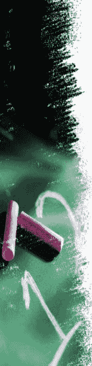

## Examples

- ☆ Bitwise AND (&)
- 3 & 5 = ?
- 3=>0000 0011
- 5=>0000 0101
- & 0000 0001 (1)
- i.e., 3 & 5 = 1
- & is often used to mask off some set of bits, e.g.:
- n = n & 0177; n xxx...xxx x??? ????
- & 0177 000...000 0111 1111
- ↓
- n 000...000 0??? ????

- Bitwise inclusive OR (|)
- 060 | 017 = ?
- 060=> 0011 0000
- 017=> 0000 1111
- | 0011 1111 (077)
- i.e.,060 | 017 = 077
- | is used to turn bits on:
- x = x | SET_ON

- Bitwise exclusive OR (^)
- 规则：参加运算的两个相应位相同，则结果为0，相异则为1。
- 0011 1001 (071)
- (^) 0010 1010 (052)
- 0001 0011 (023)
- i.e., 071^052 = 023

- ☆ One’s complement (~)

- The unary operator ~ yields the one’s complement of an integer; that is, it converts each 1-bit into a 0-bits and vice versa.

- `025 = 0000 0000 0010 0101`

- `~025 = 1111 1111 1101 1010`

- i.e., `~025 = 0177732` (**NOT -025**)

- Example: `x = x & ~077` sets tha last six bits of x to zero.

- Note: `x & ~077` is independent of word length.
  (cf: `x&0177700`)

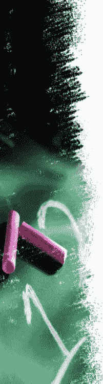

- ☆ Left shift (<<)
- The x << n shifts the value of x left by n positions, filling vacated bits with zero.
- char a;
- a binary a << 1 a << 2
- 64 01000000 0 10000000 01 00000000
- 127 01111111 0 11111110 01 11111100
- i.e., 64<<1 = 0x80, 64<<2 = 0, 127<<1 = 0xfe, 127<<2 = 0xfc

- ☆ Right shift (>>)

Right shifting an **unsigned** quantity always fills vacated bits with zero;

Right shifting an **signed** quantity will fill with sign bits (arithmetic shift 算术移位) on some machines and with 0-bits (logical shift 逻辑移位) on others.

- a: 1001 0111 1110 1101
- a>>1: 0100 1011 1111 0110 1 (logical shift)
- a>>1: 1100 1011 1111 0110 1 (arithmetic shift)

- ☆ Distinguish &/(bitwise ops) from &&/|| (logical ops).
- x = 1, y = 2
- x & y => 00000001 & 00000010 => 00000000
- x && y => 1

- ☆ Precedence:
- “~” = “&” > “<<” = “>>” > “^” > “|”

- p　　　　　　　　　0
-　　　　　　　　　 n　　 p+1-n
- x
-
-　　　　　　　　　 p
-
-　　　　　　　　　　　　 n
- x>>(p+1-n) xx......xx ???......???
- ~(~0<<n)　　 00......00 111......111
- &)
-
-　　　　　　　　　 00......00 ???......???

## 2.11 Conditional Expressions

expr1 ? expr2 : expr3

**example:**

z=(a>b)? a:b;

if(a>b) z=a; else z=b;

**example 2:**

```
for(i=0; i< n; i++)
    printf("%6d%c", a[i],(i% 10==9|| i==n-1)? ‘\n’ : ‘ ‘);
/* print an array, 10 per lin */
```

## 2.12 Precedence and Order of Evaluation

- **Operators Associativity**

() [] -> .
! - + -- + - * & sizeof
right to left
* / %
+ -
<< >>
== !=
&
^
|
&&
||
?:
right to left
= += -= *= /= %= ^= |= <<= >>=
right to left

## 2.12 Precedence and Order of Evaluation

- NOTICE:

x=f() +g():

1. evaluate f() --> evaluate g();

2. evaluate g() --> evaluate f();

Example:

i=1;

x=i + ++i;

x have different results with different compliers (x=3 or 4)

## Chapter 3. Control Flow

- **3.1 Statements and Blocks**

.expression +; === > statement

x=0;

i++;

printf(...);

compound statement (block):

```
{
 statement1
 ...
 statementN
}
```


## 3.2 If-else

syntax:

```c
if (expression)
    statement1
else
    statement2
```

rule: associating the else with the closest previous else-less if.

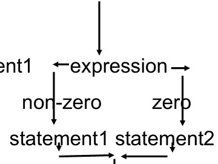

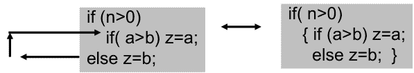

### Example:

```c
if (n >= 0)
    for (i = 0; i < n; i++)
        if (s[i] > 0) {
            printf("...");
            return i;
        }
        else
            printf("error – n is negative \n");
```

```c
if (n >= 0)
    for (i = 0; i < n; i++) {
        if (s[i] > 0) {
            printf("...");
            return i;
        }
    }
    else
        printf("error – n is negative \n");
```

## 3.3 Else-if

```c
if (expression)
    statement
else if (expression)
    statement
else if (expression)
    statement
else
    statement
```

```c
/* binsearch: find x in v[0]<=v[1]<=...<=v[n-1] */
int binsearch(int x, int v[], int n)
{
    int low, high, mid;
    low = 0;
    high = n - 1;
    while (low <= high) {
        mid = (low + high) / 2;
        if (x < v[mid])
            high = mid - 1;
        else if (x > v[mid])
            low = mid + 1;
        else
            return mid;
    }
    return -1;
}
```

## 3.4 Switch

**syntax:** see chap2_2 2.3

### Example:

```c
#include <stdio.h>
main() /* count digits, white space, others */
{
    int c, i, nwhite, nother, ndigit[10];
    nwhite = nother = 0;
    for (i = 0; i < 10; i++)
        ndigit[i] = 0;
    while ((c = getchar()) != EOF) {
        switch (c) {
            case '0': case '1': case '2': case '3': case '4':
            case '5': case '6': case '7': case '8': case '9':
                ndigit[c - '0']++;
                break;
            case ' ': case '\n': case '\t':
                nwhite++;
                break;
            default:
                nother++;
                break;
        }
    }
    printf("digits = ");
    for (i = 0; i < 10; i++)
        printf(" %d", ndigit[i]);
    printf(", white space = %d, other = %d\n", nwhite, nother);
    return 0;
}
```

## 3.5 Loops — While and For

- while:
  - `while (expression)`
    `statement`
- For

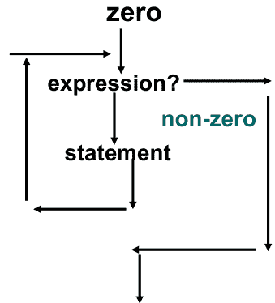

```c
for (expr1; expr2; expr3)
    statement
```

```c
expr1;
while (expr2) {
    statement
    expr3;
}
```

infinite loop:

```c
for (;;) { ... }
```

processing the first n elements of an array:

```c
for (i = 0; i < n; i++)
    ...
```

### Example 1:

```c
#include <ctype.h>
/* atoi: convert s to integer; version 2 */
int atoi(char s[])
{
    int i, n, sign;
    for (i = 0; isspace(s[i]); i++)
        ; /* skip white space */
    sign = (s[i] == '-') ? -1 : 1;
    if (s[i] == '+' || s[i] == '-')
        i++;
    for (n = 0; isdigit(s[i]); i++)
        n = 10 * n + (s[i] - '0');
    return sign * n;
}
```

### Example 2:

see chap2_2 2.4

```c
/* shellsort: sort v[0]...v[n-1] into increasing order */
void shellsort(int v[], int n)
{
    int gap, i, j, temp;
    for (gap = n / 2; gap > 0; gap /= 2)
        for (i = gap; i < n; i++)
            for (j = i - gap; j >= 0 && v[j] > v[j + gap]; j -= gap) {
                temp = v[j];
                v[j] = v[j + gap];
                v[j + gap] = temp;
            }
}
```

```c
for (i = 1; i < n; i++)
    for (j = i - 1; j >= 0 && v[j] > v[j + 1]; j--) {
        temp = v[j];
        v[j] = v[j + 1];
        v[j + 1] = temp;
    }
```

### Example 3:

```c
#include <string.h>
/* reverse: reverse string s in place */
void reverse(char s[])
{
    int c, i, j;
    for (i = 0, j = strlen(s) - 1; i < j; i++, j--) {
        c = s[i];
        s[i] = s[j];
        s[j] = c;
    }
}
```

## 3.6 Loops — Do-while

syntax:

```c
do
    statement
while (expression);
```

### Example:

```c
/* itoa: convert n to characters in s */
void itoa(int n, char s[])
{
    int i, sign;
    if ((sign = n) < 0) /* record sign */
        n = -n;
    i = 0;
    do {
        s[i++] = n % 10 + '0'; /* get next digit */
    } while ((n /= 10) > 0); /* delete it */
    if (sign < 0)
        s[i++] = '-';
    s[i] = '\0';
    reverse(s);
}
```


## 3.8 Goto and Labels

- syntax:

  goto label_name

  label_name: statements

### Example 1:

```
for(...)
    for(...) {
        if(disaster)
            goto error;
    }
...
error: clean up the mess
```

## 【Example 2】求 Sn=a+aa+aaa+…+aaa…a 之值，其中 a 是一个数字。

- 例如：2+22+222+2222+22222（此时 n=5），n 和 a 由键盘输入。

- ☆ 算法分析：求解该题的关键是要求出每一个 aaa…a（共 i 个 a），i=1~n。而：i 个 a 与（i-1）个 a 的关系：

- 若令：s(i-1)=aaa…a，则：

  s(i)=aaaa…a=s(i-1)*10+a

- 如：22=2*10+2，222=22*10+2，2222=222*10+2，
- 22222=2222*10+2
- ……

```
#include <stdio.h>
main()
{
    int   a, n, i, j;
    long  s, s0;
    printf("Please enter digit number a: ");
    while ((a=getchar()) < '0' || a > '9') ;  /*输入一个数字*/
    a = a - '0';   /* 将字符a转换成数a */
    printf("Please enter n: ");
    scanf("%d", &n);
    s = 0L;
    for (i = 1; i <= n; i++) {
        s0 = 0L;
        for (j = 1; j <= i; j++)   /* 求s0=aaa...a(i个a) */
            s0 = s0 * 10L + a;
        s += s0;   /* 累加前i个数 */
    }
    for (i = 1; i < n; i++) {   /* 打印a+aa+...+aaa...a+ */
        for (j = 1; j <= i; j++)
            putchar(a+'0');   /* 将数字a以字符形式打印出来 */
        printf("+");
    }
    for (j = 1; j <= n; j++)   /* 打印aaa...a(n个a) */
        putchar(a+'0');
    printf("=");
    printf("%ld\n", s);
}
```

## ☆ Solution 2:

```
#include <stdio.h>
main()
{		int		a, n, i, j;
		long		s, s0;
		printf("Please enter digit number a: ");
		while (((a=getchar())) < '0' || a > '9') ;			/*输入一个数字*/
		a = a - '0';				/* 将字符a转换成数a */
		printf("Please enter n: ");
		scanf("%d", &n);
		s = s0 = a;
		for (i = 2; i <= n; i++) {
			s0 = s0 * 10L + a;				/* 利用i-1个a计算i个a */
			s += s0;				/* 累加前i个数 */
		}
		for (i = 1; i < n; i++) {			/*打印a+aa+...+aaa...+a+ */
			for (j = 1; j <= i; j++)
				putchar(a+'0');/* 将数字a以字符形式打印出来 */
			printf("+");}
		for (j = 1; j <= n; j++)			/* 打印aaa...a(n个a) */
			putchar(a+'0');
		printf("=");				printf("%ld\n", s);
```

## 【Example 3】

一个数如果恰好是它的因子之和，这个数就称为“完数”。例如：6的因子1、2、3，而6=1+2+3，因此，6是“完数”。编程找出1000之内的所有完数，并按下面格式输出其因子：

6 its factors are 1,2,3

☆ 算法分析：求解该题的关键是求出一个数的所有因子，又因为还要打印完数的因子，所以，还必须将每个因子暂时保存起来。

```
☆Solution:
#include <stdio.h>
int factors(int i, int fac[]); /* 函数原型说明 */
main()
{
    int fac[1000];
    int i, j, n, s;
    for (i = 0; i < 1000; i++) {
        n=factors(i, fac); /* 调函数factors求i的所有因子 */
        s = 0;              /* fac 为存放因子的数组，n为个数 */
        for (j = 0; j < n; j++)
            s += fac[j];    /* 将所有的因子累加起来 */
        if (i == s) {        /* 若该数等于其所有因子之和 */
            printf("%3d its factors are ", i);
            for (j = 0; j < n; j++) {
                printf("%d", fac[j]);
                if (j != n-1) printf(",");
            }
        }
    }
}
```

```
int factors(int i, int fac[])
{
    int k, j;
    j = 0;
    for (k = 1; k < i; k++)
        if (i%k == 0) {/*若能被k整除*/
            fac[j] = k;/*保存因子k到数组fac[]中*/
            j++;          /*因子的个数加1*/
        }
    return(n);          /*将因子的个数传回*/
}
```

## Chapter 4. Function and Program Struction

### 4.1 Basics of Functions

## Form of function definition:

return-type function-name(argument declaration)
{
    declarations and statements
}

a minimal function: dummy(){}

return statement:
return expression:
or return (expression):

## 4.1 Basic of Functions

- Example:

```c
#include <stdio.h>
#define MAXLINE 1000 /*maximum input line length */
int getline(char line[], int max);
int strindex(char source[], char searchfor[]);
char pattern[] = "ould"; /*pattern to search for */
/* find all lines matching pattern */
main()
{ 	char line[MAXLINE];
	int found=0;
	while(getline(line,MAXLINE)>0)
		if(strindex(line,pattern)>=0) {
			printf("%s",line);
			found++;
		}
	return found;
}
```

## 4.1 Basic of Functions

```
/*getline: get line into s,return length */
int getline(char s[], int lim)
{
    int c, i;
    i=0;
    while((-lim>0 && (c=getchar()) !=EOF && c!='\n')
    s[i++] = c;
    if(c ==='\n')
    s[i++]=c;
    s[i]='\0';
    return i;
}
```

```
/*strindex: return index of t in s,-1 if none */
Int strindex(char s[], char t[])
{
    int i, j, k;
    for(i=0;s[i]!='\0';i++) {
    for(j=i,k=0; t[k]!='\0' && s[j]==t[k]; j++,k++) ;
    if(k>0 && t[k] ==='\0') return i;
    }
    return -1;
}
```


## 4.2 Functions Returning Non-integers

1. must declare the type of value it returns
2. the calling routine must know that returns a non-int value.

example:

```c
#include <ctype.h>

/* atof: convert string s to double */
double atof(char s[])
{
    double val, decimal, power;
    int i, sign;

    for(i=0;isspace(s[i]); i++)    /* skip white space */
        ;
    sign = (s[i] == '-') ? -1 : 1;
    if (s[i] == '+' || s[i] == '-')    i++;
    decimal = 0; power = 1.0;
    for (val=0.0; isdigit(s[i]) || s[i]=='.'; i++) {
        if (s[i] == '.') {
            if (decimal == 1) power *= 10.0;
            decimal = 1;
        } else
            val=10.0*val + (s[i]-'0');
    }
    return sign * val / power;
}
```

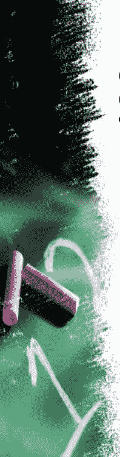

### calling atof()

```c
#include <stdio.h>
#define MAXLINE 100
main()
{
    double sum, atof(char []);
    char line[MAXLINE];
    int getline (char line[], int max);
    sum=0;
    while(getline(line,MAXLINE)>0)
        printf("\t%lf\n", sum+= atof(line));
    return 0;
}
```

declaration (function prototype)

> or : atof();
> in old version

calling

## 4.3 External Variables

- external variables: defined outside of any function and available to many functions (globally accessible)

Example:

calculator that provides the operators +,-,/

use reverse Polish (逆波兰) notation instead of infix (中缀).

1 2 - 4 5 + * <===> (1-2)*(4+5)

the main algorithm of the program:

```text
while(next operator or operand is not end_of_file indicator)
    if(number)                         push it
    else if (operator)                 pop operands
                                      do operation
                                      push result
    else if (newline)                  pop and print top of stack
    else error
```

```c
#include <stdio.h>
#include <math.h>
#define MAXOP 100 /*max size of operand or operator */
int getop(char []);
void push(double);
/* reverse Polish calculator */
main()
{
    int type;
    double op2;
    char s[MAXOP];

    while((type = getop(s))!=EOF) {
        switch (type) {
        case NUMBER: push(atof(s)); break;
        case '+': push(pop() + pop()); break;
        case '*': push(pop() * pop()); break;
        case '-': op2=pop(); push(pop()-op2); break;
        case '/': op2=pop();
        if(op2!=0.0) push(pop()/op2);
        else printf("error: zero divisor\n"); break;
        case '\n': printf("\t%.8g\n", pop()); break;
        default: printf("error: unknown command %s \n", s);
        break;
        }
    }
    return 0;
}
```

```c
#define MAXVAL 100        /* maximum depth of val stack */
int sp=0;                /*next free stack position */
double val[MAXVAL];      /*val stack */

    /* push: push f onto value stack */
void push(double f)
{
    if(sp<MAXVAL) val[sp++]=f;
    else printf("error: stack full, can't push %g\n", f);
}

    /* pop: pop and return top value from stack */
double pop(void)
{
    if(sp>0) return val[--sp];
    else { printf("error: stack empty\n");
           return 0.0;}
}
```

```c
#include <ctype.h>
int getch(void);
void ungetch(int);
/* getop: get next operator or numeric operand */
int getop(char s[])
{
    int i,c;
    while ((s[0] = c = getch()) == ' ' || c == '\t');
    s[1] = '\0';
    if (!isdigit(c) && c!='.') return c;
    i=0;
    if(isdigit(c)) while (isdigit(s[++i] = c = getch())) ;
    if(c=='.') while (isdigit(s[++i]=c=getch())); /* . OK */
    s[i] = '\0'; /* last getch is not digit */
    if(c!=EOF) ungetch(c);
    return NUMBER;
}
```

```c
#define BUFSIZE 100
char buf[BUFSIZE]; /*buffer for ungetch */
int bufp=0;         /* next free position in buf */
int getch(void)     /* get a character */
{ return (bufp >0) ? buf[--bufp] : getchar(); }
void ungetch(int c) /*push character back on input */
{ if (bufp >= BUFSIZE) printf("ungetch: too many characters\n");
else buf[bufp++]=c;
}
```


## 4.4 Scope Rules

- scope of a name (variable, function, etc.); SEE CHAP2.4, 4.8
  the part of the program within which the name can be used.

- scope of an automatic variable:
  the function in which the name is declared

- scope of an external variable or a function:
  from the point at which it is declared to the end of the file
  if an external variable is to be referred to before it is defined
  or a name is defined in a different source file:
  an extern declaration is mandatory

```c
In file1:
extern int sp;
extern double val[];
void push(double f) {...}
void pop(void) {...}
```

```c
In file2:
int sp=0;
double val[MAXVAL];
```

## Discussion

- § 4.8 局部变量和全局变量
- 4.8.1 局部变量
- ☆ 在一个函数内部定义的变量是内部变量，它只在本函数范围内有效。

```c
float f1(int a)                 /* 函数f1 */
{
        int b, c;               a、b、c有效
        ……
}
```

```c
char f2(int x, int y)           /* 函数f2 */
{
        int a, b;               x、y、a、b有效
        ……
}
```

```c
main()                          /* 主函数 */
{
        int m, n;               m、n有效
        ……
}
```

### 【说明】

1、主函数main中定义的变量（m、n）也只在主函数中有效；主函数也不能使用其他函数中定义的变量。
2、不同函数中可以使用相同名字的变量，它们代表不同的对象，互不干扰。例如：在f1函数中定义了变量a，在f2函数中也定义了变量b，它们占据不同的内存单元。
3、形式参数也是局部变量。
4、可以在复合语句中定义变量，这些变量只在本复合语句中有效。

```c
main()
{
        int a, b;
        ……
        {
                int c;
                a、b在此范围内有效
                c = a + b;      c在此范围内有效
                ……
        }
}
```

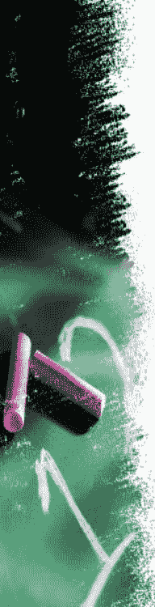

## 4.5 Header Files

- place the definitions and declarations shared among the files in a *header file*.
- *example:*

### calc.h:

```c
#define NUMBER '0'
void push(double);
int getop(char []);
int getch(void);
void ungetch(int);
```

### main.c:

```c
#include <stdio.h>
#include <math.h>
#include "calc.h"
#define MAXOP 100
main() {
  ...
}
```

### getop.c:

```c
#include <stdio.h>
#include <ctype.h>
#include "calc.h"
getop() {
  ...
}
```

### stack.c:

```c
...
```

### getch.c

```c
...
```

## 4.6 Static Variables

- static:

### (1) applied to an external variables or function:

limits the scope of that object to the rest of the source file, the name is invisible outside the file.

```c
static char buf[BUFSIZE]; /* buffer for ungetch */
int getch(void) {...}
void ungetch(int c) {...}
```

### (2) applied to an internal variable:

the scope is the function (as an automatic variable), but it remains in existence as the program (not the function) is activated.

```c
void Example()
{
 static int i=1;
 printf("%d times\n", i++);
}

main()
{
 Example();
 Example();
 Example();
}
```

```text
1 times
2 times
3 times
```

static variables are initialized only the first time the function is entered.

## 4.7 Register Variables

- **register**: advises the compiler to place the variable in registers, in order to result in smaller and faster programs.
- **format**

```c
register int x;
register char c;
```

**example:**

```c
f(register unsigned m, register long n)
{
    register int i;
    ...
}
```

**notice:**

- ➢ *register declaration can only be applied to automatic variables and to the formal parameters of a function*
- ➢ *only a few variables can be kept in registers; excess declarations will be ignored.*
- ➢ *cannot take the address of a register variable*
- ➢ *there are restrictions on types of register variables.*


## 4.8 Block Structure

- **block: `{.....}`**
- variable can be declared in a block (follow the left brace); the scope of the variable is the block and remains in existence until matching the right brace.

```c
if(n>0) {
    int i;        /* declare a new i */
    for (i=0;i<n; i++)
    ...
}
```

the scope of “i”

The variable in an inner scope will hide variables in the outer scope of the same name.

```c
int x,y;
f(double x)
{  double y;
   ...
   x=y+1;
   ...
}
g()
...
```

inner first


## 4.9 Initialization

- in the absence of explicit initialization:

  (1) external and static variable are initialized to zero

  (2) automatic and register variables have undefined initial value

- in explicit initialization:

  (1) for external and static variables:

  - the initializer must be a constant expression

  - the initialization is done once before the program begins execution

  (2) for automatic and static variables:

  - initializer may be any expression involving previously define value

  - it is done each time the function or block is entered

```c
int binsearch(int x, int v[],int n)
{
	int low=0;
	int high=n-1;
	...}
```

```c
int x=1;
char c='a'+5;
```

The initialization of an array:

- with a list initializes enclosed in braces and separated by commas

int days[]={31,28,31,30,31,30,31,31,30,31,30,31}

- if there are fewer initializers

  (1) for external or static variables: the others will be zero

  (2) for automatic variables: the others will be undefined

```c
static int a[4]={1,2}; /*a[2],a[3] will be 0 */
int f()
{
  int a[4]={1,2}; /* a[2],a[3] will be undefined */
  ...
}
```

for character array’s initialization: a string can be used

char s[]="hello";  <== > char s[]={'h','e','l','l','o','\0'};

函数的递归（recursion）调用

- ☆ 在调用一个函数的过程中又出现直接或间接地调用该函数本身，称为函数的递归调用。

- ☆ C语言的特点之一就在于允许递归调用。

```c
int f(int x)   /* 直接调用本函数的例子 */
{   int y, z;

......

z = f(y);

......

return(2*z);}
```

/* 间接调用本函数的例子 */

```c
int f1(int x)   int f2(int t)
{   {
int y, z;   int a, c;

......

z = f2(y);   c = f1(a);

......

return(2*z);}   return(3+c);}
```

- ☆ 应当有能终止递归过程的条件出现，否则就会进入无穷递归。

【Example 1】有5个人坐在一起，问第5个人多少岁？他说比第4个人大2岁。第4个人说比第3个人大2岁。第3个人说比第2个人大2岁。第2个人说比第1个人大2岁。第1个人说他10岁。请问第5个人多大？

〖分析〗

显然，这是一个递归问题：

age(5) = age(4) + 2

回 age(4) = age(3) + 2 递

age(3) = age(2) + 2

推 age(2) = age(1) + 2; 推

age(1) = 10

可表示为递归公式：

10 n = 1

age(n) =

age(n-1)+2 n > 1

使递归结束的条件： age(1) = 10;

【Solution】

```c
#include <stdio.h>
int age(int n)
{ int c;
if (n == 1) c = 10;
else c = age(n-1) + 2;
return(c);}

main()
{ printf("%d", age(5));}
```

【执行过程示意图】

age函数 age函数 age函数 age函数 age函数

main n=5 n=4 n=3 n=2 n=1

age(5) c=age(4)+2 c=age(3)+2 c=age(2)+2 c=age(1)+2

c=10

age(5)=18 age(4)=16 age(3)=14 age(2)=12 age(1)=10

【Example 2】用递归方法求n!

【递归公式】

1 n = 0,1

n! = (n-1)!·n n > 1

【Solution】

```c
#include <stdio.h>
long fac(int n)
{ long f;
if (n < 0) printf("Error!\n");
else if (n == 0 || n == 1)
f = 1;
else f = fac(n-1) * n;
return(f);}
main()
{ int n; long y;
printf("Please input an integer number: ");
scanf("%d", &n);
y = fac(n);
printf("%d! = %ld\n", n, y);
}
```

【Example 3】Hanoi塔问题：有三根柱子A,B,C。A柱子上有64个大小不等的并且按照从大到小排列好的盘子。要求把这64个盘子从A柱子移到C柱子，在移动过程中可以借助B柱子，每次只允许移动一个盘，并且在移动过程中在三根柱子上都保持大盘在下，小盘在上。要求编程打印出移动的步骤。

【分析】将n个盘子从A柱子移到C柱子可以分解成以下三个步骤：

1、将A上的n-1个盘子借助C柱子先移到B柱子上；

2、把A柱子上剩下的一个盘移到C柱子上。

3、将n-1个盘子从B柱子借助A柱子移到C柱子上。

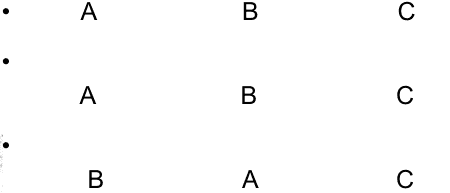

【Solution】

## 4.10 Recursion

- Example :

```c
/* qsort: sort v[left]..v[right] into increasing order */
void qsort(int v[], int i, int j);
if(left>=right) return ;  /*do nothing */
swap(v, left, (left+right)/2); /*move partition elem to v[0] */
last=left;
for(i=left+1; i<=right; i++)  /* partition */
    if(v[i]<v[left]) swap(v, ++last, i);
swap(v, left, last);
qsort(v, last+1, right);
}
```

```c
/* swap: interchange v[i] and v[j] */
void swap(int v[], int i, int j)
{
    int temp;
    temp=v[i]; v[i]=v[j]; v[j]=temp;
}
```

## 4.11 The C Preprocessor

- 4.11.1 File inclusion

```c
#include<filename>
```

search filename in the compiler’s “include” directory

```c
#include “filename”
```

search filename in current directory, then in the compiler’s “include” directory


## 4.11 The C Preprocessor

- `#`: parameter ➔ string

  `#define dprint(expr) printf(#expr "= %g\n",expr)`

  `dprint(x/y): <==> printf("x/y" "= %g\n", x/y);`

- `##`: concatenate the actual argument:

  `#define paste(front,back) front ## back`

  `paste(name,1) ===> name1`

### 4.11.3 Conditional Inclusion

form:

```c
(1) #if constant
    block1
#elif constant
    block2
#else
    blockN
#endif
```

```c
(2) #ifdef name
        block1
    #else
        block2
    #endif
```

```c
(3) #ifdef name
        block1
    #else
        block2
    #endif
```

example:

```c
#if SYSTEM==SYSU
    #define HDR "sysv.h"
#elif SYSTEM == BSD
    #define HDR "bsd.h"
#elif SYSTEM == MSDOS
    #define HDR "msdos.h"
#else
    #define HDR "default.h"
#endif
#include HDR
```

```c
#ifdef HDR
    ...(block1)
#else
    ...(block2)
#endif
```


## Chapter 5. Pointers and Arrays

### 5.1 Pointers and Addresses

declare a pointer:

`type *namep`   `int *ip;`

operate:

(1) `&`: give the address of an object:

(2) `*`: access the object the pointer points to

```c
int x=1,y=2,z[10];
int *ip;   /*ip is a pointer to int */
ip=&x;   /*ip now points to x */
y=*ip;   /* y is now 1 */
*ip=0;   /* x is now 0 */
ip=&z[0];   /*ip now points to z[0] */
```

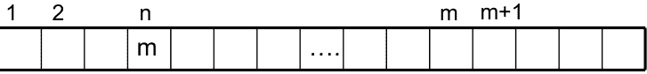

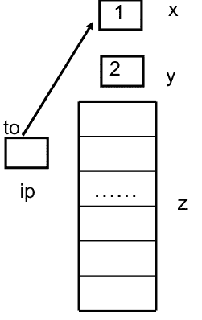

### 5.2 Pointers and Function Arguments

C passes arguments to functions by value. There is no direct way for the called function to alter a variable in the calling function.

If we have a function to exchange the values of two integer variables

```c
void swap(int x, int y)
{
    int temp;
    temp = x;
    x = y;
    y = temp;
}
```

and it is called in main

```c
int a, b;
......
a=1;
b=2;
swap(a,b);
```

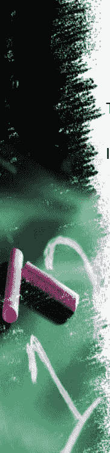

Pointer arguments enable a function to access and change objects in the function that called it.

#### An example

Fill an array with integers by calls to `getint` that performs free-format input conversion by breaking a stream of characters into integer values.

There is a loop in the calling function:

```c
int n,array[SIZE], getint(int *);
for(n=0; n< SIZE&& getint(&array[n])!=EOF; n++)
;
```

```c
#include <ctype.h>
int getch(void);
void ungetch(int);
int getint(int *pn)
{
    int c, sign;
    while(isspace(c=getch())) /*skip white space */
        ;
    if(!isdigit(c) && c!= EOF && c!='+' && c!='-') {
        ungetch(c);
        /* it's not number */
        return 0;
    }
sign = (c == '-') ? -1:1;
if(c== '+' || c=='-')
c=getch();
for(*pn=0; isdigit( c); c=getch())
*pn=10* *pn +(c-'0');
*pn *=sign;
if(c != EOF)
ungetch( c);
return c;
}
```

### 5.3 Pointers and Arrays

- Since the name of an array is synonym for the location of the initial element, the assignment `pa=&a[0]` can also be written as `pa=a;`
- Rather more, in evaluating `a[i]`, C converts it to `*(a+i)` so `&a[i] <==> a+i`

- Note: A pointer is a variable, so `pa=a` and `pa++` are legal but an array name is not a variable, so `a=pa` and `a++` are illegal.

When an array name is passed to a function, what is passed is the location of the initial element,

```c
int strlen(char *s)
{
    int n;
    for(n=0;*s!='\0';s++)
        n++;
    return n;
}
```

1. argument `s` is a local variable, it is a pointer, so `s++` is legal.
2. It's a local variable of the function `strlen`, so `s++` only increments `strlen`'s private copy of the pointer.
3. So, in the calling function, the calls like
   `strlen("hello, world");`
   `strlen(array);`
   `strlen(ptr);`
   all work.


## 5.4 Address Arithmetic

If p is a pointer to some element of an array:

- 1: Pointer adds a number or subtracts a number

```c
p++; /* increments p to point to the next element */
p--; /* decrements p to point to the previous element */
p += i; /* increment it to point i element beyond it points now */
```

- 2: Subtraction between pointers

```c
int strlen(char *s)
{
	char *p = s;
	while(*p != '\0')
		p++;
	return p-s;
}
```

- 3: Comparison between pointers

If p and q point to members of the same array, then relations like `==`, `!=`, `<`, `>`, `>=`, etc. work properly. `p < q` is true if p points to an earlier member of the array than q does.

An example about a rudimentary storage allocator. There are two routines.

- `alloc(n)` returns a pointer to n consecutive character positions.
- `free(p)` release the storage thus acquired so it can be re-used later.

```c
#define ALLOCSIZE 10000
static char allocbuf[ALLOCSIZE];
static char *allocp = allocbuf;

char *alloc(int n)
{
    if(allocbuf + ALLOCSIZE - allocp >= n)
    {
        allocp += n;
        return allocp - n;
    }
    else
        return 0;
}

void afree(char *p)
{
    if(p >= allocbuf && p < allocbuf + ALLOCSIZE)
        allocp = p;
}
```

Usage:

```c
char *p;
to alloc
int m;
......
p = alloc(m);
......
afree(p);
```

Before call:

```
allocp
allocbuf
←—— in use ——→ ←—— free ——→
```

After call to alloc and before call to afree:

```
allocp
←—— in use ——→ m ←—— free ——→
```

## 5.5 Character Pointers and Functions

- 1. A string constant is accessed by a pointer to its first element.

```c
printf("hello, world\n");

/* printf received a pointer which points to "hello, world\n" */
char *pmessage;
pmessage = "now is the time";

/* pmessage is assigned by a pointer to the character array */
```

- 2. Difference between character array and character pointer.

```c
char amessage[] = "now is the time";
char *pmessage = "now is the time";
```

pmessage: → `now is the time\0`

amessage: `now is the time\0`

Examples of strcpy:

```c
/* strcpy: array subscript version */
void strcpy(char *s, char *t)
{
    int i;
    i = 0;
    while((s[i] = t[i]) != '\0')
        i++;
}
```

```c
/* strcpy: pointer version 1 */
void strcpy(char *s, char *t)
{
    while((*s = *t) != '\0')
    {
        s++;
        t++;
    }
}
```

```c
/* strcpy: pointer version 3 */
void strcpy(char *s, char *t)
{
    while(*s++ = *t++)
        ;
}
```

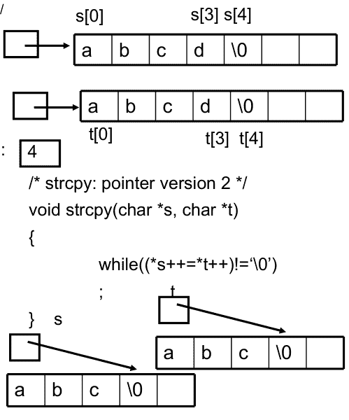

```c
/* strcpy: pointer version 2 */
void strcpy(char *s, char *t)
{
    while((*s++ = *t++) != '\0')
        ;
}
```

## 5.6 Pointer Arrays: Pointer to Pointer

Pointer array is an array which stores pointers. An example to sort a set of text lines into alphabetic order.

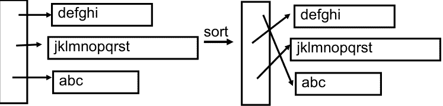

### Algorithm:

- read all the lines of input
- sort them
- print them in order

```c
#include <stdio.h>
#include <string.h>

#define MAXLINES 5000

char *lineptr[MAXLINES];

void readlines(char *lineptr[], int nlines);
void writelines(char *lineptr[], int nlines);
void qsort(char *lineptr[], int left, int right);

/* sort input lines */
main()
{
    int nlines; /* number of input lines read */
    if((nlines = readlines(lineptr, MAXLINES)) >= 0) {
        qsort(lineptr, 0, nlines - 1);
        writelines(lineptr, nlines);
        return 0;
    } else {
        printf("error: input too big to sort\n");
        return 1;
    }
}
```

```c
#define MAXLINE 1000 /* max length of any input line */

int getline(char *, int);
char *alloc(int);

/* readlines: read input lines */
int readlines(char *lineptr[], int maxlines)
{
    int len, nlines;
    char *p, line[MAXLINE];

    nlines = 0;
    while((len = getline(line, MAXLINE)) > 0)
        if(nlines >= maxlines || (p = alloc(len)) == NULL)
            return -1;
        else {
            line[len - 1] = '\0'; /* delete newline */
            strcpy(p, line);
            lineptr[nlines++] = p;
        }
    return nlines;
}

void writelines(char *lineptr[], int nlines)
{
    int i;
    for(i = 0; i < nlines; i++)
        printf("%s\n", lineptr[i]);
}
```


## 5.6 Pointer Arrays: Pointer to Pointer

```c
/* qsort: sort v[left]...v[right] into increasing order */
void qsort(char *v[], int left, int right)
{
    int i, last;
    void swap(char *v[], int i, int j);
    if(left >= right) return;
    swap(v, left, (left+right)/2);
    last=left;
    for(i=left+1; i<=right; i++)
        if(strcmp(v[i],v[left]) <0)
            swap(v, ++last,i);
    swap(v,left,last);
    qsort(v, left, last-1);
    qsort(v, last+1, right);
}
void swap(char *v[], int i, int j)
{
    char *temp;
    temp=v[i];
    v[i]=v[j];
    v[j]=temp;
}
```

## 5.7 Multi-Dimensional Arrays

chap2_3 3.2 chap2_6 6.3.4

```c
/* daytab is a 2-demensional array */
static char daytab[2][13]={
	{ 0,31,28,31,30,31,30,31,31,30,31,30,31},
	{0,31,29,31,30,31,30,31,31,30,31,30,31}
};
int day_of__year(int year, int month, int day)
{	int i, leap;
	leap= year%4 ==0 && year%100!= 0|| year%400==0);
	for (i=1;i<month; i++) day += daytab[leap][i];
	return day;
}
void month_day(int year, int yearday, int *pmonth, int *pday)
{	int i, leap;
	leap = year %4 ==0 && year%100 != 0 || year%400 ==0;
	for(i=1; yearday > daytab[leap][i]; i++)
		yearday -= daytab[eap][i];
	*pmonth = i;
	*pday = yearday;
}
```

## 5.8 Initialization of Pointer Arrays

```c
/* month_name : return name of n-th month */
char *month_name(int n)
{
    static char *name[] = {
        "Illegal month",
        "january", "february", "march",
        "april", "may", "june", "july",
        "august", "september", "october",
        "november", "december"
    };
    return (n < 1 || n > 12) ? name[0] : name[n];
}
```

## 5.9 Pointers vs. Multi-dimensional Array

Difference between a two-dimensional array and an array of pointer:

int a[10][20];

int *b[10];

Although a[3][4] and b[3][4] are both syntactically legal reference to a single int, but:

+   1: a is a true two-dimensional array, b is only a one-dimensional array

+   2: a has 200 int-sized locations, b only 10 pointers.

+   3: the rows of b may be of different lengths.

**Because of 3, the most frequent use of arrays of pointers is to store character strings of diverse lengths.**

## 5.9 Pointers vs. Multi-dimensional Array

Example:
char aname[][15] = {"Illegal month", "Jan", "Feb", "Mar"};
aname: Illegal\0 month\0 Jan\0 Feb\0 Mar\0
char *name[]={"Illegal month", "Jan", "Feb", "Mar"};

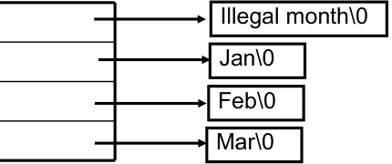

## 5.10 Command-line Arguments

In environments that support C, there is a way to pass command-line arguments or parameters to a program when it begins executing.

Example:

```c
/* echo command-line arguments: 1st version*/
main(int argc, char *argv[])
{
        int i;
        for(i=1; i< argc; i++)
                printf("%s%s", argv[i], (i<argc-1)? " ":"");
        printf("\n");
        return 0;
}
```

```c
/*echo command-line arguments: 2nd version*/
main(int argc, char *argv[])
{
        while(--argc >0)
                printf("%s%s", *++argv, (argc>1)? " ":"");
        printf("\n");
        return 0;
}
```

## 5.10 Command-Line Arguments

example 3:

find −x −n pattern   x: except,   n:print line number

```c
#include <stdio.h>
```

```c
#include <string.h>
```

```c
#define MAXLINE 1000
```

```c
/*find: print lines that match pattern from its arg*/
```

## 5.10 Command-line Arguments

```c
main(int argc, char *argv[])
{
    char line[MAXLINE];
    long lineno=0;
    int c,except=0, number=0, found=0;
    while (--argc>0 && (*++argv)[0] == '-')
        switch(c ) {
            case 'x': except =1; break;
            case 'n': number=1; break;
            default:
                printf("find: illegal option %c\n", c);
                argc=0; found=-1;break;
        }
    if(argc!=1) printf("Usage: find -x -n pattern \n");
    else...

```

## 5-10 Command-line Arguments

```c
...
while (getline(line, MAXLINE) > 0) {
    lineno++;
    if ((strstr(line, *argv) != NULL) != except) {
        if (number) printf("%ld:", lineno);
        printf("%s", line);
        found++;
    }
}
return found;
}
```

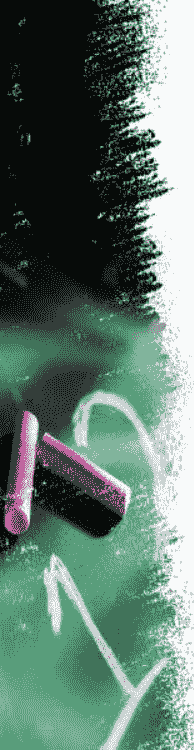


## 5.11 Pointers to Functions

pointers to functions: can be assigned, placed in arrays, passed to functions, returned by functions, ...

example:

```c
#include <stdio.h>

#include <string.h>

#define MAXLINES 5000 /*max lines to be sorted */

char *lineptr[MAXLINES]; /*pointers to text lines */

int readlines(char *lineptr[], int nlines);

void qsort(void *lineptr[], int left, int right, int (*comp)(void *, void *));

int numcmp(char *, char *);

/* sort input lines */
```

```c
main(int argc, char *argv[])
{
    int nlines;             /* number of input lines read */
    int numeric = 0;        /* 1 if numeric sort */
    if(argc > 1 && strcmp(argv[1], "-n") == 0) numeric = 1;
    if((nlines = readlines(lineptr, MAXLINES)) >= 0) {
        qsort((void **)lineptr, 0, nlines - 1,
              (int (*)(void *, void *))(numeric ? numcmp : strcmp));
        writelines(lineptr, nlines);
        return 0;
    } else {
        printf("input too big to sort\n");
        return 1;
    }
}
```

```c
/* qsort: sort v[left]...v[right] into increasing order */
void qsort(void *v[], int left, int right, int (*comp)(void *, void *))
{
    int i, last;
    void swap(void *v[], int, int);
    if (left >= right) return;
    swap(v, left, (left + right) / 2);
    last = left;
    for (i = left + 1; i <= right; i++)
        if ((*comp)(v[i], v[left]) < 0) swap(v, ++last, i);
    swap(v, left, last);
    qsort(v, left, last - 1, comp);
    qsort(v, last + 1, right, comp);
}

void swap(void *v[], int i, int j)
{
    void *temp;
    temp = v[i];
    v[i] = v[j];
    v[j] = temp;
}
```

```c
int numcmp(char *s1, char *s2)
{
    double v1, v2;
    v1 = atof(s1);
    v2 = atof(s2);
    if (v1 < v2) return -1;
    else if (v1 > v2) return 1;
    else return 0;
}
```

## 5.12 Complicated Declarations

- declarations to word descriptions:
  - `int *f();`
    - f: function returning pointer to int
  - `int (*f)()`
    - f: pointer to function returning int
  - `char **argv`
    - argv: pointer to pointer to char
  - `int (*daytab)[13]`
    - daytab: pointer to array[13] of int
  - `void *comp()`
    - comp: function returning pointer to void
  - `void (*comp)()`
    - comp: pointer to function returning void
  - `char (*(*x())[])()`
    - x: function returning pointer to array[] of pointer to function returning char
  - `char (*(*x[3])())[5]`
    - x: array[3] of pointer to function returning pointer to array[5] of char

- convert C declaration to a word description:

- grammar:

| direct-dcl | name |
| --- | --- |
| | (dcl) |
| | direct-dcl() |
| | direct-dcl[optional size] |

example:

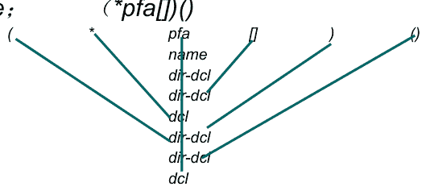

programs that convert:

```c
/* dcl: parse a declarator */
void dcl(void)
{
    int ns;
    for (ns = 0; gettoken() == '*';) ns++; /* count *'s */
    dirdcl();
    while (ns-- > 0) strcat(out, "pointer to");
}

/* dirdcl: parse a direct declaration */
```

```c
void dirdcl(void)
{
    int type;
    if (tokentype == '(') {
        dcl();
        if (tokentype != ')') printf("error: missing )\n");
    } else if (tokentype == NAME) strcpy(name, token);
    else printf("error: expected name or (dcl)\n");
    while ((type = gettoken()) == PARENS || type == BRACKETS)
        if (type == PARENS) strcat(out, " function returning");
        else {
            strcat(out, " array");
            strcat(out, token);
            strcat(out, " of");
        }
}
```

```c
#include <stdio.h>

#include <string.h>

#include <ctype.h>

#define MAXTOKEN 100

enum { NAME, PARENS, BRACKETS };

void dcl(void);

void dirdcl(void);

int gettoken(void);

int tokentype;     /* type of last token */
```

```c
char token[MAXTOKEN];  /* last token string */
char name[MAXTOKEN];   /* identifier name */
char datatype[MAXTOKEN]; /* data type = char, int ,ect. */
char out[1000];   /* output string */

main()   /* convert declaration to words  */
{
    while (gettoken() != EOF) {       /* 1st token on line */
        strcpy(datatype, token);    /* is the datatype */
        out[0] = '\0';
        dcl();
        if (tokentype != '\n') printf("syntax error\n");
        printf("%s: %s\n", name, out, datatype);
    }
    return 0;
}
```


## 5.12 Complicated Declarations

```c
int gettoken(void)        /* return next token */
{
    int c, getch(void);

    void ungetch(int);

    char *p = token;

    while ((c=getch()) == ' ' || c=='\t');
    if (c=='(') {
        if (( c = getch()) == ')') {
            strcpy(token, "()");
            return tokentype = PARENS;
        } else { ungetch(c);   return tokentype = '('; }
    }
```

```c
else if (c=='[') {
    for (*p++ =c; (*p++ = getch()) != ']'; );
    *p='\0';
    return tokentype = BRACKETS;
} else if(isalpha(c)) {
    for(*p++ =c; isalnum(c=getch()); }
        *p++ =c;
    *p='\0';
    ungetch(c);
    return tokentype = NAME;
} else return tokentype =c;
}
```

## 5.12 Complicated Declarations

```c
undcl: x(*[]**()char == > char (*(*x())[]()
/*undcl: convert word description to declaration */
main()
{
    int type;
    char temp[MAXTOKEN];
    while (gettoken()!=EOF) {
    strcpy(out,token);
    while((type= gettoken())!='\n')
    if((type== PARENS || type == BRACKETS)
    strcat(out,token);
    else if(type=='*') {
    sprintf(temp, "(*%s)", out);
    strcpy(out,temp);
    } else if (type==NAME) {
    sprintf(temp, "%s %s", token, out);
    strcpy(out, temp);
    } else printf("invalid input at %s\n", token);
    printf("%s\n", out);
    }
    return 0;
}
```

## Chapter 6: Structures

structure: a collection of one or more variables,  
possible of different type, grouped together  
under a single name

structures: may be copied, assigned to, passed to  
functions and returned by functions.

中文结构体的每字含义：
结： set结集， 集合  
构： 构建 STRUCT { }  
体： 命名STRUCT{} STUDENT

## 6.1 Basics of Structures

example: ARRAY AND STRUCT下页 COMPARISION

struct pointer {
int x;
int y;
};

define....;

struct pointer {
int x;
int y;
}p1,p2 p3;

struct pointer {
int x;
int y;
};
struct pointer p1,p2,p3;

struct {
int x;
int y;
} p1,p2,p3;

- Int a[10];   a[0] a[1] a[2]......a[9]
- Struct array_a{ int a0;
  int a1; /*可以是任何类型*/
  int a2;
  ......
  int a9;
  } a;
- 访问元素： 数组 a[i]; 结构体 a.ai

## 6.1 Basics of Structures

```c
member referring: structure-name.member

struct pointer pt;
printf("%d,%d", pt.x, pt.y);

double dist, sqrt(double);
dist = sqrt((double)pt.x * pt.x+ (double)pt.y * pt.y);
```

```c
structures can be nested

struct rect {
    struct point pt1;
    struct point pt2;
};

struct rect screen;
screen.pt1.x
```

## 6.2 Structures and Functions

makepoint can be used as:
struct rect screen;
struct point middle;
struct point makepoint(int, int);
screen.pt1=makepoint(0,0);
screen.pt2=makepoint(XMAX,YMAX);
middle=makepoint((screen.pt1.x+screen.pt2.x)/2,
(screen.pt1.y+screen.pt2.y)/2);

## 6.2 Structures and Functions

```c
/* addpoint: add two points */

struct point addpoint(structure point p1, struct point p2)
{
    p1.x+=p2.x;
    p1.y+=p2.y;
    return p1;
}

/*ptinrect: return 1 if p in r, 0 if not */

int ptinrect(struct point p,struct rect r)
{
    return p.x >= r.pt1.x && p.x <r.pt2.x && p.y >= r.pt1.y && p.y< r.pt2.y;
}
```

## 6.2 Structures and Functions

```c
#define min(a,b) ((a)<(b)? (a) : (b))
#define max(a,b) ((a)>(b)? (a) : (b))
struct rect canorect(struct rect r)
{
    struct rect temp;
    temp.pt1.x=min(r.pt1.x, r.pt2.x);
    temp.pt1.y=min(r.pt1.y, r.pt2.y);
    temp.pt1.x=max(r.pt1.x, r.pt2.x);
    temp.pt1.y=max(r.pt1.y, r.pt2.y);
    return temp;
}
```

## 6.2 Structures and Functions

struct pointer:
struct point *pp;
(*pp).x and (*pp).y
pp->x and pp->y
are members

e.g: struct point origin, *pp;
pp = &origin;
printf("origin is (%d, %d)\n", (*pp).x, (*pp).y);
printf("origin is (%d, %d)\n", pp->x, pp->y);

Notice: . and -> associate from left to right:
struct rect r. *rp=r;
r.pt1.x <=> rp->pt1.x <=> (r.pt1).x <=> (rp->pt1).x


## 6.2 Structures and Functions

., ->,(): at the top of the precedence

If:

```
struct {
    int len;
    char *str;
} *p;
```

Then:

+   + +p->len <==> ++(p->len) different from (++p)->len
+   
+   *p->str: fetches whatever str points to.
+   
+   *p->str++: increments str after accessing what it points to (as *s++)
+   
+   (*p->str)++: increments whatever str points to
+   
+   *p++ -> str: increments p after accessing whatever str points to


## 6.3 Arrays of Structures

Example: count the occurences of each C keyword

```
struct key {
    char *word;
    int count;
} keytab[]={“auto”, 0, “break”, 0, “case”, 0, …,”while”,0};
#include <stdio.h>
#include <ctype.h>
#include <string.h>
#define MAXWORD 100
int getword(char *, int);
int binsearch(char *, struct key *, int);
```

```
#define NKEYS (sizeof keytab/sizeof(struct key))
```

```
main()
{	int n;
	char word[MAXWORD];
	while (getword(word, MAXWORD)!= EOF)
		if( isalpha(word[0]))
			if(( n =binsearch(word, keytab, NKEYS)) >=0)
				keytab[n].count++;
	for(n=0;n<NKEYS;n++)
		if( keytab[n].count>0) printf("%4d %s\n",
		keytab[n].count,keytab[n].word);
	return 0;
}
```

```
/* binsearch: find word in tab[0]...tab[n-1] */
int binsearch(char *word, struct key tab[], int n)
{
    int cond, low, high, mid;
    low=0;
    while(low<=high) {
        mid=(low+high)/2;
        if ((cond=strcmp(word, tab[mid].word))<0)
            high = mid-1;
        else if (cond >0) low = mid +1;
        else return mid;
    }
    return -1;
}
```

```
```c
for (; --lim>0; w++)
    if(!isalnum(*w=getch())){
        ungetch(*w);
        break;
    }
    *w='\0';
    return word[0];
}
```
```


## 6.4 Pointers to Structures

consider the keyword-counting again:

```
```c
#include <stdio.h>
#include <ctype.h>
#include <string.h>
# define MAXWORD 100
int getword(char *, int);
struct key *binsearch(char *, struct key *, int);
main()
{
        struct key *p;
        char word[MAXWORD];
        while (getword(word, MAXWORD) != EOF)
                if (isalpha(word[0]))
                        if ((n=binsearch(word, keytab, NKEYS)) >= 0)
                                p->count++;
        for (p=keytab; p<keytab+NKEYS; p++)
                if (p->count > 0) printf("%4d %s\n", p->count, p->word);
        return 0;
}
```
```

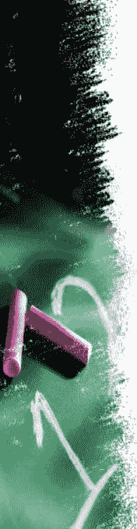

```
/* binsearch: find word in tab[0].tab[n-1] */
struct key *binsearch(char *word, struct key tab[], int n)
{
    int cond;
    struct key *low=&tab[0];
    struct key *high=&tab[n];
    struct key *mid;
    while (low <=high) {
        mid =low+(high-low)/2;
        if((cond=strcmp(word, mid->word)) <0)
            high= mid-1;
        else if (cond>0) low =mid+1;
        else return mid;
    }
    return NULL;
}
```

## 6.5 Self-referential Structures

tree:

describe a node;

```
struct tnode {
    char *word;
    int count;
    struct tnode *left;
    struct tnode *right;
}
```

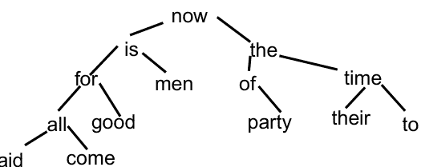

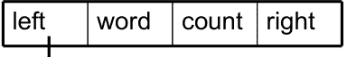

## 6.5 Self-referential Structures

example: words counting

```
#include <stdio.h>
#include <ctype.h>
#include <string.h>
#define MAXWORD 100
struct tnode *addtree(struct tnode *, char *);
void treeprint(struct tnode *);
int getword(char *, int);
/* word frequency count */
main()
{
	struct tnode *root;
	char word[MAXWORD];
	root=NULL;
	while(getword(word, MAXWORD)!=EOF)
		if(isalpha(word[0])) root=addtree(root,word);
	treeprint(root);
	return 0;
}
```

## 6.5 Self-referential Structures

```
struct node *talloc(void);
char *strdup(char *);

/* addtree: add a node with w, at or below p */
struct node *addtree(struct node *p, char *w)
{
    int cond;
    if(p==NULL){ /* a new word has arrived */
        p=talloc(); /*make a new node */
        p->word = strdup(w);
        p->count =1;
        p->left= p->right=NULL;
    } else if((cond=strcmp(w, p->word))==0)
        p->count++;          /* repeated word */
    else if(cond<0) /*less than left subtree */
        p->left = addtree(p->left,w);
    else p->right = addtree(p->right,w);
    return p;
}
```


## 6.5 Self-referential Structures

```c
/* treeprint: in-order print of tree p */
void treeprint(struct tnode *p)
{
    if (p != NULL) {
        treeprint(p->left);
        printf("%4d %s\n", p->count, p->word);
        treeprint(p->right);
    }
}
```

```c
#include <stdlib.h>

/* talloc: make a tnode */
struct tnode *talloc(void)
{
    return (struct tnode *) malloc(sizeof(struct tnode));
}

char *strdup(char *s) /* make a duplicate of s */
{
    char *p;

    p = (char *) malloc(strlen(s) + 1); /* +1 for '\0' */
    if (p != NULL)
        strcpy(p, s);
    return p;
}
```

## 6.6 Table Lookup

symbol table management:

- `install(s, t)`
- `lookup(s)`

algorithm:

hash（哈希，杂凑）search: convert name into a small number which is used to index into an array of pointers (to list of names)

```c
struct nlist {
    struct nlist *next;
    char *name;
    char *defn;
};

#define HASHSIZE 101

static struct nlist *hashtab[HASHSIZE]; /* pointer table */
```

```c
/* hash: form hash value for string s */
unsigned hash(char *s)
{
    unsigned hashval;

    for (hashval = 0; *s != '\0'; s++)
        hashval = *s + 31 * hashval;
    return hashval % HASHSIZE;
}

/* lookup: look for s in hashtab */
struct nlist *lookup(char *s)
{
    struct nlist *np;

    for (np = hashtab[hash(s)]; np != NULL; np = np->next)
        if (strcmp(s, np->name) == 0)
            return np; /* found */
    return NULL; /* not found */
}
```

```c
struct nlist *lookup(char *);
char *strdup(char *);

/* install: put (name, defn) in hashtab */
struct nlist *install(char *name, char *defn)
{
    struct nlist *np;
    unsigned hashval;

    if ((np = lookup(name)) == NULL) { /* not found */
        np = (struct nlist *) malloc(sizeof(*np));
        if (np == NULL || (np->name = strdup(name)) == NULL)
            return NULL;
        hashval = hash(name);
        np->next = hashtab[hashval];
        hashtab[hashval] = np; /* insert the new node */
    } else /* already there */
        free((void *) np->defn); /* free previous defn */
    if ((np->defn = strdup(defn)) == NULL)
        return NULL;
    return np;
}
```

## 6.7 Typedef

typedef: creating new data type name (not a new type)

purpose: (1) for portability (2) for better understanding

example:

```c
char *s;
int strcmp(char *, char *);
```

```c
typedef char *STRING;
STRING s;
int strcmp(STRING, STRING);
```

```c
int (*strcmp)(char *, char *);
```

```c
typedef int (*PFI)(char *, char *);
PFI strcmp;
```

```c
struct tnode {
    char *word;
    int count;
    struct tnode *left;
    struct tnode *right;
};
struct tnode *tp;
struct tnode node;
```

```c
typedef struct tnode *TREEPTR;
typedef struct tnode {
    char *word;
    int count;
    TREEPTR left;
    TREEPTR right;
} TREENODE;
TREEPTR tp;
TREENODE node;
```

## 6.8 Unions

union: manipulate different kinds of data in a single area of storage

example:

```c
union u_tag {
    int ival;
    float fval;
    char cval;
} u;
```

Notice: any one of these types may be assigned to u and then used in expressions, so long as the usage is consistent: the type retrieved must be the type most recently stored.

access members: `union-name.member` or `union-pointer->member`

A union is a structure in which all members have offset zero from the base.

A union may only be initialized with a value of the type of its first member.

## Chapter 7. Input and Output

Input and Output are not part of the C language, but are provided by the standard library, including a set of functions.


### 7.1 Standard Input and Output

An example: converts input to lower case

```c
#include <stdio.h>
#include <ctype.h>

main() /* lower: convert input to lower case */
{
    int c;

    while ((c = getchar()) != EOF)
        putchar(tolower(c));
    return 0;
}
```

### 7.2 Formatted Output - printf

```c
int printf(char *format, arg1, arg2, …)
```

Note:

- The printf converts, formats and prints its arguments on the standard output under the control of the format.
- It returns the number of characters printed.
- The format string contains two types of objects: ordinary characters, which are copied to the output stream, and conversion specifications, each of which causes conversion and printing of the next successive argument to printf.


## 7.2 Formatted Output-Printf

Conversion specifications: (int i=55; char s[]="hello, world";)

1 printf("%d", i); :55

2 printf("%5d", i); : 55

3 printf("%-5d", i); :55

4 printf(f, s); f are the following cases:

%s :hello, world;

%10s :hello, world;

%.10s :hello, wor;

%-10s :hello,world;

%.15s :hello, world;

%-15s :hello, world ;

%15.10s : hello, wor;

%-15.10s :hello, wor ;

5 printf("%%%d");

int sprintf(char *string, char *format, arg1, arg2,...)

The function does the same conversion as printf does, but stores the output in a string.

eg: char s[100];
int a=1, b=2;
sprintf(s, "%d + %d = %d", a, b);
The content of s is "1 + 2 = 3"

## 7.3 Variable-length Argument Lists

```
va_start(ap, fmt);
for(p=fmt; *p; p++) {
    if(*p!='%') {
        putchar(*p);
        continue;
    }
    switch(*++p) {
        case 'd': ival = va_arg(ap,int);
            printf("%d", ival);
            break;
        case 'f' : dval=va_arg(ap,double);
            printf("%f", dval);
            break;
        case 's' : for (sval = va_arg(ap,char *); *sval; sval++)
                putchar(*sval);
                break;
        default: putchar(*p);
                break;
        }
    }
    va_end(ap);
}
```

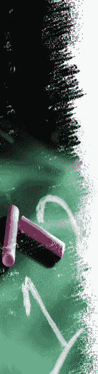

## 7.4 Formatted Input-Scanf

int scanf(char *format, ...)

int sscanf(char *string, char *format, arg1, arg2, ...);

- 1 scanf reads characters from the standard input, interprets them according to the specification in format.

- 2 sscanf is like scanf does, but from string, not from standard input

- 3 the format string is just like printf, only for ordinary characters (not %), which are expected to match the next non-white space character of the input stream.

eg1: int day, year;
char monthname[20];
scanf("%d %s %d", &day, &monthname, &year);

eg2: int a, b, c;
char s[] = "3 4 5 6 7";
sscanf(s, "%d*%d *%d %d %d", &a, &b, &c);
The result is a==3 b==6 and c==7

## 7.5 File Access

The general steps for a file operation:
1 Open the file
2 Do operations on the file by file pointer.
3 Close a file

In C language, files are accessed by file pointers, which are declared as:
FILE *fp;

During the first step, we can use a fopen to make fp points to the file we want to access.
fp = fopen("data", "r");
or
if((fp=fopen("data", "r")) !=NULL)

FILE *fopen(char *filename, char *mode);
int fclose(FILE *fp);

- 1 The filename can include full path, just like:
fp = fopen("c:\\system\\t.dat","r");

- 2 The mode can be
"r": read only
"w": write only
"a": append only

If the system distinguish between text and binary files, for the latter, a "b" must be appended to the mode string.
fp = fopen("t.dat","rb");

- 3 When operations finished, the file should be closed.
fclose(fp);

eg1: file copy
#include <stdio.h>
main(int argc, char *argv[])
{	FILE *fp1, *fp2;
if(argc!=3)
{	printf("Usage: copy f1 f2\n");	exit(1);
}
if((fp1=fopen(argv[1]))==NULL || ((fp2 = fopen(argv[2]))==NULL)
{	printf("Can't open file!\n");	exit(2);
}
while(putc(getc(fp1),fp2)!=EOF)
;
fclose(fp1);
fclose(fp2);
}

eg2: concatenate files
#include <stdio.h>
main(int argc, char *argv[])
{ FILE *fp;
if(argc==1)
filecopy(stdin,stdout);
else
while(--argc>0)
if((fp=fopen(*++argv,"r"))== NULL) {
printf("cat:can't open %s\n",*argv);
return 1;
} else {
filecopy(fp,stdout);
fclose(fp);
}
return 0;
}

```
void filecopy(FILE *ifp, FILE *ofp)
{ int c;
while((c=getc(ifp))!=EOF)
putc(c,ofp);
}
```

## 7.6 Line Input and Output

```
char *fgets(char *s, int n, FILE *iop)
{	register int c;
	register char *cs;
	cs=s;
	while(--n > 0 && (c=getc(iop))!= EOF)
		if((*cs++ = c)=='\n')
			break;
	*cs='\0';
	return (c==EOF && cs == s)? NULL : s;
}
int fputs(char *s, FILE *iop)
{	int c;
	while( c =*s++)
		putc(c,iop);
	return ferror(iop) ? EOF : 0;
}
```


## Some examples

### 1、putchar函数可以向终端输出一个________。

- A) 整型变量表达式值
- B) 实型变量值
- C) 字符串
- D) 字符或字符型变量值

Key: D)

### 2、以下程序的输出结果是________。

```c
main()
{
    printf("\n*s1=%15s*", "chinabeijing");
    printf("\n*s2=%-5s*", "chi");
}
```

- A) `*s1=chinabeijing    *`  
  `*s2=**chi*`
- B) `*s1=chinabeijing    *`  
  `*s2=chi  *`
- C) `*s1=*    chinabeijing*`  
  `*s2=chi*`
- D) `*s1=    chinabeijing*`  
  `*s2=chi  *`

Key: D)

### 3、以下程序

```c
main()
{
    p1;
    p2;
    p3;
}
```

A) y=5b...

y=... 

y=0

Key：A)

### 4、若火灾报警控制器显示“scan”相关信息，正确选项为：

- A) scan
- B) scan
- C) scan
- D) scan

Key：D)

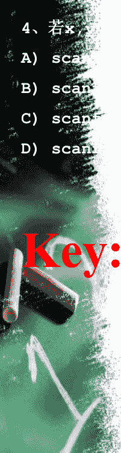

### 5、阅读以下程序，其运行结果为（　　）

```c
main()
{
    int x=3,y=4,z=5;
    printf("%d",x+y+z);
}
```

- A) x+y+z=?
- B) x+y+z=12
- C) x+z=3*5
- D) 不确定

### 5、阅读以下程序，写出运行结果

```c
main()
{
    int x, y;
    scanf("%d%d", &x, &y);
    printf("%d", x+y);
}
```

- A）x+y
- B）x+y+1
- C）x+z
- D）不确定

**Key：D）**

### 6、已有变量，若从变量 y 的值为

【1】A)  
【2】A)

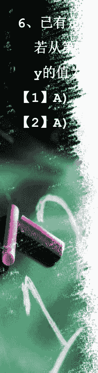

Key: 【1】B)【2】B)

### 7、以下说法正确的是（ ）

- A) 输入语句 `a=b=c=d=5;` 后，变量 a、b、c、d 的值均为 5。
- B) 只有形如 `b=%d` 的格式控制字符串才能用于输入。
- C) 当输入数据为 `123` 时，输入语句 `scanf("%d", &a);` 可正常输入。
- D) 当输入数据为 `123` 时，输入语句 `scanf("%4d", &a);` 可正常输入。

### 7、以下关于scanf函数的叙述中，正确的是（ ）。

- A) 输入数据时，可以不按数据类型的顺序输入。
- B) 只有格式控制字符串中有说明项，才能正确输入数据。
- C) 当输入数据类型与格式说明不一致时，scanf函数会自动进行类型转换。
- D) 当输入数据项少于格式说明项时，scanf函数只返回已成功输入的数据项个数。

**Key：D）**

