# 浙江大学C++课件（余波）

# C++面向对象程序设计

## 第一章 C++编程基础

### 二、C++与C的联系

- 1、C++是在C的基础上发展而来，是带类的C语言。
- 2、C语言支持结构化程序设计，C++语言支持面向对象程序设计。

3、结构化程序设计的思想：

☆ 功能分解，并逐步求精。

面向对象程序设计的本质：

☆ 把数据和处理数据的过程看成一个整体——对象。

### 三、C++中几个重要概念

- 1、程序：数据+操作
- 2、数据类型：不同的数据组织方式得到不同的数据类型
- 3、表达式：操作符+操作数
- 4、语句控制：数据操作的流程

### 四、开发一个C++程序的四个步骤：

- 1. 编辑（产生源文件，扩展名为CPP）
- 2. 编译（产生目标文件，扩展名为OBJ）
- 3. 连接（产生执行文件，扩展名为EXE）
- 4. 运行

### 五、集成开发环境（IDE）

- 1、定义：
  集文字处理、编译、连接、项目管理、程序排误等多功能为一体的软件开发工具。

- 2、常见的集成开发环境：
  Borland C++, Visual C++

### 六、程序风格

1、良好的编程风格，不仅有利于自己对程序的调试，而且会大大增加程序的可复用机会。

### 2、注释

（1）定义：为增加程序的可读性而在程序中附加的说明性文字。

（2）形式：

- ★ 以符号//打头，只占一行。
  C++特有的注释形式。

- ★ 包含在符号/* 与 */之间，可占多行。
  继承C的注释形式。

### 3、命名（为常量、变量、函数取名）

- 1. 名字必须符合标识符的规范。
- 2. 标识符：由字母、数字、下划线组成，而且只能以字母、下划线打头。
- 3. 名字不能是保留字（系统有固定用途的标识符）。
- 4. 字母的大小写有区别。
- 5. 名字最好能表达一定的含义。

### 4、编排

编排时使用缩进、空行、空格使程序更清晰。

### 七、简单性原则

- 1、可以用一句话说清楚的，不要用一页纸去说明，可以用一个简单的语句完成的功能，不要用许多语句来完成。
- 2、不要写太长的函数，可以用函数调用来缩短函数的定义。
- 3、不要写太长的语句，可以用多条语句来代替一条语句。
- 4、如果文件太长，将它分成几个小文件。
- 5、不要用太多的嵌套，可以考用switch语句或者引入新的函数来解决问题。
- 6、定义类时，一个文件放一个类的定义。

### 八、一致性原则

- 1、变量的命名应该有意义。
- 2、在程序中加上适当的注释。
- 3、利用缩进使程序清晰。
- 4、相关的内容组织在一起。
- 5、能简单，则简单。

## 第二章 基本C++程序结构

例1：

```cpp
#include<iostream.h>
void main()
{
    cout<<"同学们,你们好!";
}
```

程序功能:在屏幕上显示输出
同学们,你们好!

说明一

说明二

说明三

说明四

说明五

说明六

### 一、编译预处理命令 `#include`

- 1、`#`：预处理命令的标志。
- 2、`#include`：包含命令；把一个文本文件的内容插入到该命令处。
- 3、`<iostream.h>`命令参数；给出要插入文件的文件名。

返回

### 二、头文件：以h为扩展名的文本文件

如果程序文件中引用到的函数、变量、常量、对象、数据类型等是由别的文件提供的，则必须在程序文件的开始部分用#include命令把有关的头文件包含进来。

返回

### 三、函数（具有特定功能的程序模块）

#### 1、定义格式：

返回类型 函数名（形式参数表）{函数体}

void main () {cout<< " 同学们，你们好！";}


- （1）类型修饰符：函数返回值的类型。
- （2）函数名：非保留字的标识符。
- （3）形式参数表：由一系列用逗号隔开的参数组成。
- （4）函数体：包含在一对 { } 中的语句序列。

### 2、主函数（main函数）

每个程序中至少要有一个函数，这个不可缺少的函数就是主函数，约定主函数名为：main

- (1) 程序由一个或多个函数组成。
- (2) 如果程序中只有一个函数，则一定是main函数。
- (3) 如果程序中有多个函数，则有且仅有一个为main函数。

（4）main函数是程序的入口，程序是从main函数开始执行的。

（5）main函数的返回值
☆ void: 无返回值。
☆ int: 有返回值。
　　（0表示程序正常结束
　　非0表示程序非正常结束）

### 四、C++语句

- ★基本语句：以分号；作为结束标志。
- ★复合语句：包含在{}中的基本语句序列。

返回

### 五、常量

数据的一种重要表现形式，常量的值不可改变

- 1、整型常量（整型常数）如：123
- 2、实型常量（实型常数）如：1.23
- 3、字符常量（用’ ’括起的一个字符）如：’a’
- 4、字符串常量（用 “ ” 括起的字符序列）
  如： " student "
- 5、枚举常量

注：除字符串常量中引号内的字符以及注释外，其它字符必须是半角字符。
尤其注意不要误用中文标点。


### 六、cout和数据的显示输出

- 1、 cout：连接显示器的输出流对象。
- 2、 <<：输出操作符（插入操作符）

3、显示输出语句的格式：
cout <<表达式【 <<表达式】；
注：【】中内容可有可无，
若有，可重复多次。
如：cout<<100;
屏幕输出 100
cout<<100<<200<<100+200;
屏幕输出 100200300


4、插入空格：（空格符为’ ’）

如：

```cpp
cout<< 100<< ' ' <<200<<100+200;
```

屏幕输出：100 200 300

5、换行输出
☆换行符号：’\n’
☆换行控制符：endl
如：cout<<100\n<<200;
cout<<100<<endl<<200;
则这两个语句的输出结果相同：
100
200

### 四点注意：

- 1、要输出的字符串需要用双引号“ ”括起来。但输出到屏幕上时，双引号“ ”并不显示。
- 2、语句的最后要用分号；表示结束。

3、换行符号’\n’和换行控制符endl写法不同，但效果相同。

4、可以作为输出内容的不止是字符串，还可以是数、表达式等等。

返回

例2：

```cpp
#include<iostream.h>
void main()
{float radius,circum;
  const float PI=3.14;
  cin>>radius;
  circum=2* PI*radius;
  cout<<”circum=”<<circum;}
```

说明一

说明二

说明三


## 第二章 基本C++程序结构

程序功能：
根据从键盘输入的半径，计算并输出圆的周长。
如：键盘输入2.0，则屏幕输出：
circum=12.56

### 一、变量

数据的一种重要表现形式，变量的值可以改变。

1. 变量必须先定义后使用。

定义格式：

变量类型 变量名；

如：`int age;`

2. 变量赋值和初始化

如：

```
int age;
age=20; //变量赋值
int age=20; //变量初始化
```

3. 常值变量

在一般变量定义前加上保留字 `const`

如：`const float PI=3.14;`

注：常值变量定义时必须初始化，且值不可改变。常值变量名通常大写。

### 二、表达式

1. 定义：由操作符和操作数按照一定的语法规则组成的符号序列。

如：2* PI*radius //算术表达式  
circum=2* PI*radius //赋值表达式

注：最简单的表达式：  
常量，变量，函数调用。

2. 优先级和结合性：

优先级：不同操作符出现在同一表达式中，谁先运算的级别。
如：a+b * c // * 优先级高于+

结合性：同等优先级的操作符出现在同一表达式中，谁先运算的规定。
如：a+b-c //从左到右

3. 表达式语句：表达式后加；如：`circum=2* PI*radius;`

4. C++表达式的写法：

- 所有字符写在同一水平线上。
- 乘号：`*` 除号：`/`
- 算术运算符不可省略。

5. 表达式的值

#### （1）算术表达式

☆算术运算符：`+`, `-`, `*`, `/`, `%`

`%`（取模操作符）：

求两整数相除后所得的余数。

如：`22%7=1`

若两操作数都为整数，则计算结果为整数。
如：345/10=34

若两操作数有一个为实数，则计算结果为实数。
如：345.0/10=34.5

#### （2）赋值表达式：

- 赋值操作符 =
- 赋值表达式格式 变量=表达式

如：circum=2 * PI * radius

赋值表达式的值：赋值操作符左边表达式的值。
如：cout<<(x=5)<<endl;
屏幕输出 5

赋值语句格式 变量=表达式;
如：circum=2 * PI * radius

### 三、cin和键盘输入

- ☆ cin：连接键盘的输入流对象。
- ☆ >>：输入操作符（提取操作符）
- ☆ 键盘输入语句的格式：

```
cin >>变量（>>变量）；
```

1. 【】中内容可有可无，若有，可重复多次。
如：int a,b,c; cin>>>a; cin>>>a>>>b>>>c;

2. 格式中cin>>>后跟的是变量，不可可是常量或表达式。

如：cin>>>100;(×) cin>>>100+200;(×)

注：若在程序中用到cin或cout，则在程序中应有#include<iostream.h>

# 第三章 数据类型

### 一、C++数据类型分类图

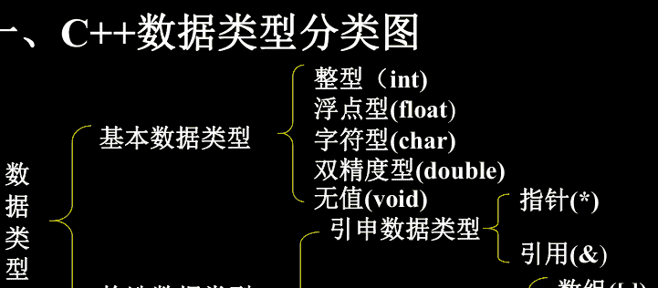

### 二、基本数据类型概况：

#### 1、数据在计算机中的存储

(1) 计算机内存单元的单位是字节，
一个字节是8个二进制位。

如：0000 0000 1010 1010 是两个字节。

（2）不同的计算机中，同一数据类型占用的空间不一定相同。如：16位计算机中，整型占两个字节；32位计算机中，整型占四个字节；

（3）数据占用内存字节的多少决定了其能表达的数据的范围。
如：两个字节的整数表示范围是
-32768~32767

（4）计算机对内存中存放的同样信息解释会因其所能表示的数据类型的不同而不同。

如：0000 0000 0000 1010 在16位计算机中若表示整数，则为一个整数；若表示字符，则为两个字符

注：定义变量时，数据类型有两个含义：
☆为该变量分配多大的存储空间；
☆如何解释该存储空间中的二进制数位。
如：定义变量float radius；则表示radius将要占用4个字节的存储空间，并且对这个空间的值的存放和解释都按小数进行。

#### 2、修饰符

long(长型符) short(短型符)

signed(有符号型) unsigned(无符号型)

#### ☆使用修饰符号后的基本数据类型

| 所属类型 | 加修饰符后的类型 | 16位计算机中所占字节数 | 简写 |
|---|---|---|---|
| char | char | 1 | |
| char | unsigned char | 1 | |
| char | signed char | 1 | char |

| 所属类型 | 加修饰符后的类型 | 16位计算机中所占字节数 | 简写 |
|---|---|---|---|
| int | int | 2 | |
| | unsigned int | 2 | |
| | signed int | 2 | int |

| 所属类型 | 加修饰符后的类型 | 16位计算机中所占字节数 | 简写 |
|---|---|---|---|
| short int | short int | 2 | short |
| | unsigned short int | 2 | |
| | signed short int | 2 | |

| 所属类型 | 加修饰符后的类型 | 16位计算机中所占字节数 | 备注 |
|---|---|---|---|
| long int | long int | 4 | long |
| long int | unsigned long int | 4 | |
| long int | signed long int | 4 | |

| 所属类型 | 加修饰符后的类型 | 16位计算机中所占字节数 | 备注 |
|---|---|---|---|
| 实型 | float | 4 | |
| 实型 | double | 8 | |
| 实型 | long double | 10 | |

#### 3、基本数据类型

（1）void：实际上不能算是一种数据类型，它表示根本就没有值，通常用于表示函数没有返回值。

#### （3）实型

①浮点数(float)和双精度数(double)的区别

- ☆表示的数据范围不同
- ☆表示的精度不同

②实数的两种表示形式

- ☆ 定点数形式 如：3.14
- ☆ 指数形式 如：
  - 31400 → 3.14E4
  - 0.314 → 3.14E-1

#### （4）字符型

##### ①字符型和整型的关系

★字符在内存中是以ASCII码存储，所以字符和整数在一定范围内可以通用。

如：char c=60; int i = ’&’;

☆尽管整数和字符可以在一定范围内相互赋值，但它们表示的含义不同，一个表示整数，而另一个表示字符。

例3: #include<iostream.h>
void main()
{int i=60; char c=i;
cout<<" The value of integer:"<<i<<endl;
cout<<" The value of character: " <<c<<endl;
}

该程序的输出结果是：
The value of integer:60
The value of character:<


# 第三章 数据类型

②特殊字符（转义字符）：以 `\` 开头的字符序列。

| 名称 | 符号 | 名称 | 符号 |
|---|---|---|---|
| 空字符 | `\0` | 水平制表 | `\t` |
| 换行 | `\n` | 垂直制表 | `\v` |
| 换页 | `\f` | 问号 | `\?` |
| 回车 | `\r` | 反斜线 | `\\` |
| 回格 | `\b` | 单引号 | `\'` |
| 响铃 | `\a` | 双引号 | `\"` |

如：`cout<<"How are you!";`  
则屏幕输出：  
`How are you!`

`cout<<"\"How are you!\"";`  
则屏幕输出：  
`" How are you! "`

③字符串（用“ ”括起来的字符序列），`\0`：字符串结束符；不显示，但占一个字节的存储空间。

如：“Hello”内存表示为：

| H | e | l | l | o | \0 |
|---|---|---|---|---|---|

如：“ 0”与’ 0’的差别：

“ 0”为字符串，内存表示为：`0 \'0 \'`

' 0'为字符，内存表示为：`0`

## 4、数据类型长度的确定

格式：`sizeof(数据类型)`

如：`cout<< " Size of int is:"<<sizeof(int);`

则屏幕输出：

`Size of int is:2`

表示在16位计算机中，int型的长度为2个字节。

## 5、选择数据类型的原则

- 根据所表示的数据的类型选择。
- 根据所表示的数据的范围选择。

## 三、结构化数据类型概况

### 1、数组

①数组变量可以存放一组具有相同类型的数据。

②数组变量的定义格式：

数据类型 数组名 [数组元素个数]

如：`int grade[50];`

则将变量grade定义成一个可存放50个整数的整型数组。

### 2、枚举

①枚举是一种用户自定义的类型，使用前必须先定义。

枚举类型的定义格式：

`enum 枚举类型名{常量1，常量2， ...，常量n};`

如：`enum WEEKDAY{Sun,Mon,Tue,Wed,Thu,Fri,Sat};`

定义了一个枚举类型后，就可以用该类型来定义变量。

如：`WEEKDAY w1,w2=sat;`

②某一枚举类型的变量，它的取值范围限定在{}中的n个变量。

如：WEEKDAY类型的两个变量w1,w2，它们只能Sun,Mon,Tue,Wed,Thu,Fri,Sat这七个符号常量中取值。

③枚举类型中的每个符号常量对应一个整数。两种对应关系：

- 依此与整数0，1，2，…，n对应。
- 用赋值号规定其对应关系。

如：

```cpp
enum SomeDigits{ONE=1,TWO,FIVE=5,
SIX,SEVEN};
```

此枚举类型中：

`ONE=1,TWO=2,FIVE=5,SIX=6,SEVEN=7`

### 3、结构

①结构是一种用户自定义的类型，使用前必须先定义。

结构类型的定义格式：

```cpp
struct 结构类型名
{
    成员1;
    成员2;
    ...
    成员n;
};
```

如：`struct Person`

```cpp
{
    char name[10];
    int sex;
    int age;
    float pay;
};
```

定义了一种结构类型后，可以用该类型来定义变量。

如：`Person p1;`

②对结构变量进行赋值：

☆对各成员进行赋值

如：`p1.name= " WangPin";`  
`p1.sex=1;`  
`p1.age=35;`  
`p1.pay=1000.0;`

☆在定义结构变量时进行初始化

如：`Person p1={" WangPin",1, 35, 1000.0};`

# 第四章 程序流程控制

## 一、复合语句

### 1、最常用的四类语句：

#### （1）说明和定义语句。

如：`char a,b;`

#### （2）表达式语句

如：`c=a+b;`

#### （3）流程控制语句

#### （4）异常处理语句

## 二、流程控制

- 1、流程控制  
  控制程序中语句的执行顺序。

- 2、流程控制方式：  
  顺序控制、分支控制、循环控制。

## 三、顺序流程

程序中的语句按先后顺序依此执行。

如（1）`int i;`  
（2）`cin>>i;`  
（3）`cout<<i * 2;`

计算机按语句的先后顺序依此执行

（1）（2）（3）

## 四、分支流程

### （一）if 语句

#### 1、格式一：if （条件）语句；

功能：如果条件为真，则执行语句；否则什么都不做。

```cpp
例1：#include<iostream.h>
void main()
{ float score;
cin>>score;
if(score>=60)
cout<<"及格";
}
```

#### 2、格式二：if（条件）  
语句1  
else 语句2  

功能：如果条件为真，则执行语句1；  
条件为假，则执行语句2。

#### 3、if语句的嵌套：if语句中又含有if语句。

例3：`#include<iostream.h>`  
`void main()`  
`{float score; cin>>score;`  
`if(score>=60)`  
`if(score>=90) cout<<"优秀" ;`  
`else if (score>=80) cout<<"良好" ;`  
`else cout<<"及格" ;`  
`else cout<<"不及格" ;}`

注：else总是与离它最近的尚未配对的if配对。

#### 4、if多分支结构

通过规范化的if嵌套所构成的多分支结构。


if嵌套放在else之后

格式：

```cpp
if （条件1）语句1
else if （条件2）语句2
else if （条件3）语句3
...
else if （条件n）语句n
【 else 语句n+1 】
```

例4：`#include<iostream.h>`  
`void main()`  
`{float score; cin>>score;`  
`if(score<0|| score>100) cout<<"输入错误！ " ;`  
`else if (score < 60) cout<<"不及格" ;`  
`else if (score < 70) cout<<"及格" ;`  
`else if (score < 80) cout<<"中等" ;`  
`else if (score < 90) cout<<"良好" ;`  
`else cout<<"优秀" ;`

### （二）switch语句

1、格式：

```cpp
switch（表达式）
{
    case 常量表达式1：语句1；
    case 常量表达式2：语句2；
    ...
    case 常量表达式n：语句n；
    【default:语句n+1；】
}
```

## 3、五点注意：

- （1）case后表达式的值必须是整型的。
- （2）各常量表达式的值不能相同。
- （3）每个case语句的分支可以有多条语句，但不必用{}。
- （4）每个case语句只是一个入口标号，并不能确定执行的终止点，因此每个case分支的最后最好加上break语句，用来结束当前switch语句的执行；否则会从入口点开始一直执行到switch语句的结束。
- （5）当若干分支需要执行相同操作时，可以使多个case分支共用一组语句。


# 第四章 程序流程控制

例5：根据整型变量dayoftheweek(0-6)值输出其表示的星期几的英语单词。

（无break语句）

```cpp
Switch(dayoftheweek)
{case 0: cout<< “Sunday”;
case 1: cout<< “Monday”;
case 2: cout<< “Tuesday”;
case 3: cout<< “Wednesday”;
case 4: cout<< “Thursday”;
case 5: cout<< “Friday”;
case 6: cout<< “Saturday”;
default:cout<< “Unknown week day”; };
```

若dayoftheweek的值为4，则输出结果为：

ThursdayFridaySaturdayUnknown week day

（有break语句）

```cpp
Switch(dayoftheweek)
{
    case 0: cout<< “Sunday”; break;
    case 1: cout<< “Monday”; break;
    case 2: cout<< “Tuesday”; break;
    case 3: cout<< “Wednesday”; break;
    case 4: cout<< “Thursday”; break;
    case 5: cout<< “Friday”; break;
    case 6: cout<< “Saturday”; break;
    default:cout<< “Unknown week day”; break;
};
```

若dayoftheweek的值为4，则输出结果为：Thursday

## （三）if多分支结构和switch语句的改写

改写条件：switch语句中每个非空语句序列的最后一个语句为break语句。

例6：例5的后一个switch语句可改写为if多分支结构

```cpp
if(dayoftheweek==0) cout<<” Sunday”;
else if (dayoftheweek == 1) cout<<” Monday”;
else if (dayoftheweek ==2) cout<<” Tuesday”;
else if (dayoftheweek ==3) cout<<” Wednesday”;
else if (dayoftheweek ==4) cout<<” Thursday”;
else if (dayoftheweek ==5) cout<<” Friday”;
else if (dayoftheweek ==6) cout<<” Saturday”;
else cout<<” Unknown week day”;
```

## 五、循环流程

### （一）while语句

#### 1、格式：

while（循环条件）

循环体

注：循环体是单个语句，或者是复合语句。

2、执行过程：当循环条件为真时，执行循环体，否则退出循环。

3、流程图（见右上图）

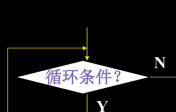

例7：#include<iostream.h>
void main()
{int sum=0; int i=1;
while(I<=100)
{int sum=sum+i; i++;}
cout<< "sum="<<sum;
}

程序功能：计算并输出从1加到100的和。
输出结果： sum=5050

### （二）do…while语句

1、格式：

```cpp
do
    循环体
while（循环条件）；
```

2、执行过程：循环执行语句，直到循环条件为假时，退出循环。

3、流程图（见右上图）

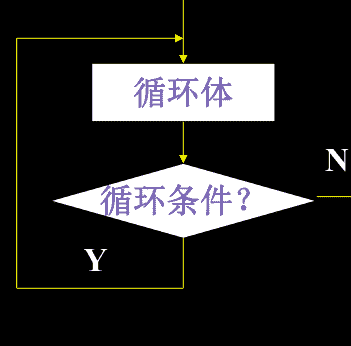

例8：

```cpp
#include<iostream.h>
void main()
{int sum=0; int i=1;
do
{sum=sum+i; i++;}
while(i<=100)
cout<<" sum="<<sum;
}
```

3、do…while语句与while语句唯一的区别：

while语句的循环体有可能一次不执行。

do…while语句的循环体至少执行一次。

2、执行过程：

（1）进行循环初始化；

（2）判断循环条件；

（3）如果循环条件为真，则执行循环体、对循环参数调整，然后转向步骤（2）；如果循环条件为假，则结束循环。

3、流程图：

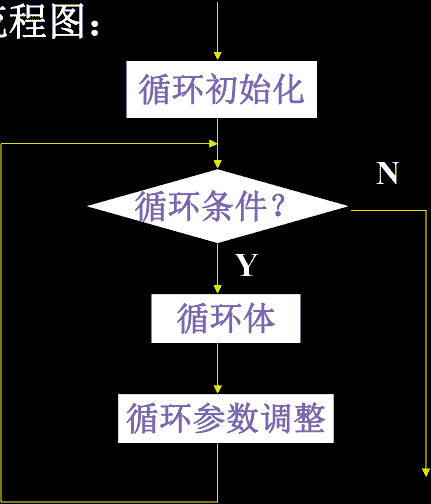

3、for语句和while语句的区别：

- (1) for语句一般用于循环次数已知的情况；
- (2) while语句不仅可以用于循环次数已知的情况，也可以用于循环次数未知的情况；
- (3) 一切用for语句实现的循环都可以用while语句来代替，反之不可以。

## 六、转向语句

### （一）break语句(`break;`)

功能：循环体中的break语句使程序流程跳出所在的循环语句，转而执行循环语句的下一条语句；如果存在多重循环，则break只能从它所在层的循环语句中跳出，并不能跳出所有的循环。

例10：计算并输出从键盘输入的若干个整数的平均值，以0作为输入的结束标志。若从键盘输入10 15 20，则输出：

**sum/num=15.0**

例10：#include<iostream.h>
void main( )
{int sum=0;// sum存放输入的整数的和
int inval; // inval存放当前输入的整数
int num=0; // num存放输入的整数个数
while(1)
{cin>>inval;
if(inval==0)break;
sum=sum+inval;num++;
}
cout<< "sum/num="<<(float)sum/num; }

### （二）continue语句(continue;)

功能：循环体中的continue语句表示结束当前的一次循环，跳转到循环开始处，继续执行下一次循环。

例11：从键盘输入若干个整数，计算并输出其中正数的平均值，以0作为输入的结束标志。

若从键盘输入10 -15 15 -30 20，则输出：

```
sum/num=15.0
```

例11：

```cpp
#include<iostream.h>
void main()
{
    int sum=0; int inval; int num=0;
    while(1)
    {
        cin>>inval;
        if(inval==0)break;
        if(inval<0)continue;
        sum=sum+inval; num++;
    }
    cout<<"sum/num="<<(float)sum/num;
}
```

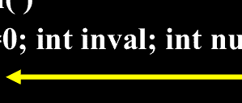

（三）goto语句
格式：

```
goto 标号;

...

标号:

...
```

功能：将程序的执行转移到标号处。

例12：将例10中的break语句用goto语句代替。

例12：

```cpp
#include<iostream.h>
void main()
{
    int sum=0; int inval; int num=0;
    while(1)
    {
        cin>>inval;
        if(inval==0) goto loop;
        sum=sum+inval; num++;
    }
loop: cout<< "sum/num="<<(float)sum/num;
}
```


## 第五章 函数

## 一、函数概述

- 1、函数：将大的程序分成功能相对独立的小模块，每一个模块称为函数。
- 2、函数分类
  - 用户定义的函数
  - 标准库函数

## 二、函数定义

返回类型 函数名（函数参数表）//函数头  
{函数体}

例1：int max(int x,int y)
{if (x>=y) return x;
else return y;
}

## （一）返回类型

- 1、函数返回结果值的数据类型。
- 2、返回类型可以是除数组以外的任意数据类型。
- 3、若函数的返回类型为void，则表示此函数无返回值。
- 4、若函数有返回值，则在函数体中应有return语句：  
  return (表达式); 或 return 表达式;  
  若函数无返回值，则在函数体中可以没有return语句，也可以用空的return语句：  
  return;

## （二）函数名

- 1、函数名应是一个非保留字的标识符。
- 2、函数名代表一个函数。
- 3、函数命名时，应该尽量使名字能代表函数所完成的功能。

## （三）函数参数

- 1、函数参数是函数完成功能所需要的输入信息。
- 2、函数参数可有0个或多个，参数之间用，隔开。
- 3、每个函数参数由参数类型和参数名来表示；参数类型可以是任意数据类型，参数名是非保留字的标识符。
- 4、函数定义中的函数参数称为形式参数，函数调用中的函数参数称为实在参数。函数的形式参数和实在参数在类型和数量上应该保持一致。

## （四）函数体

- 1、函数体是函数功能的实现部分。
- 2、函数体由一系列语句构成，这些语句包含在一对 {}中。
- 3、定义在函数体中的变量或常量是局部量，只能在定义它们的函数中使用；定义在任何函数外的变量或常量是全局量，它可以在所有的函数中使用。

程序功能：
从键盘输入两个整数，输出两者中较大的一个。
如：从键盘输入： 3  5
则屏幕输出：
5
注：函数调用本身也可以看成是一个表达式。

## 四、程序运行时的内存分布

### （一）程序的内存区域

- 1、程序代码区：存放函数编译成的二进制代码。
- 2、全局数据区：存放全局变量和静态变量。
- 3、堆：存放动态数据。
- 4、栈：存放局部数据。

### （二）每次进行函数调用时，内存应存放以下信息：

- 1. 当前函数的运行状态和返回地址；如果是main函数，则保存操作系统的当前状态和返回地址。
- 2. 被调用函数的参数。
- 3. 被调用函数的局部变量。

### （三）每进行一次函数调用，系统应作如下工作：

- 1、建立被调用函数的栈空间。
- 2、保存调用函数的运行状态和返回地址。
- 3、将实在参数的值传递给被调用函数。
- 4、将程序控制交给被调用函数。

### （四）当一个函数执行结束之后，系统应作如下工作：

- 1. 如果函数有返回值，将函数的返回值放到一个临时的变量空间。
- 2. 根据栈顶记录的信息，恢复调用函数的运行状态。
- 3. 释放栈顶空间。
- 4. 根据函数的返回地址，继续调用函数的运行。

注：在不再需要所申请的内存空间时，一定要及时释放。

## 五、函数的参数

### （一）函数参数的传递

1、函数调用时： 实在参数 ——> 形式参数

2、函数参数的传递方式：

- 按值传递
- 按地址传递
- 按引用传递

### （二）main函数的参数

1、main函数一般情况下无参数。
2、main函数若有参数，则规定其有两个参数，其中一个参数是字符串数组，另一个参数是整数。字符串数组就是输入的命令，整数就是字符串的个数。通常这两个参数的名字称作argc和argv。即：void main (int argc,char *argv[]);

## 六、const参数、const返回值与const函数

### （一）const参数

1、出现在函数参数中的const表示在函数体中不能对这个参数做修改。

2、const通常用来限制函数的指针参数、引用参数和数组参数。

如：int strcmp(const char*str1, const char*str2);

### （二）const返回值

- 1、函数返回值为const，只有用在函数值为引用类型的情况。
- 2、const返回值的函数调用不能放在赋值号的左边。
- 如：`const int &min(int&,int&);`
- 则：`min(a,b)=4;`（×）

## 七、作用域

- （一）作用域就是标识符在程序中能使用的范围。
- （二）c++中标识符的作用域与标识符的声明位置密切相关。一个标识符的作用域一般开始于 标识符的声明处，而结束位置取决于标识符声明在程序中的位置。
- 2、五种情况：
  - （1）函数参数的作用域从函数头开始到函数定义结束。
  - （2）函数体中定义的局部变量的作用域从变量定义开始，到函数定义结束。
  - （3）如果函数体中定义的局部变量定义在一个复合语句中，则变量作用域从变量定义开始，到该复合语句结束。
  - （4）在for语句的初始化表达式中定义的变量的作用域取决于编译器的实现，在ANSIc++中规定其作用域在for语句范围之内。
  - （5）在函数中定义的标号语句（与goto语句配合使用）的作用域是整个函数体，因为goto语句可能跳转到函数内的任何一处。

void main()
{
    // END作用域开始
    double fact;    // fact作用域开始
    do{
        int n;      //n作用域开始
        cin>>n;if(n==0) goto END;
        fact=factorial(n);
        cout<< n<<“!=”<<fact<<endl;
    }while(1);  //n作用域结束
END:
    cout<< “Thank you!\n”;
}
    //fact,END作用域结束

### （五）文件作用域

- 1、在所有函数定义之外说明的标识符具有文件作用域，其作用域从说明点开始，一直延伸到文件结束。
- 2、在头文件中定义的变量的作用域可以看成从#include该头文件开始的位置到程序结束。

例4：
#include<iostream.h> //cin,cout的作用域开始
double factorial(int n) // factorial的作用域开始
{
... 
}
void main() // main的作用域开始
{
... 
} // cin,cout , factorial和main的作用域结束。

### （六）覆盖问题

- 1、如果作用域重叠，则局部变量将覆盖全局变量，作用域小的局部变量将覆盖同名的作用域大的局部变量。

例5：

```cpp
#include<iostream.h>
int x;
void addx()
{x++;cout<<x<<endl;
 int x=5; cout<<x<<endl;}
void main()
{int x=10; cout<<x<<endl;
 addx(); cout<<x<<endl;
 x++;cout<<x<<endl;
}
```

运行结果为：

- 10
- 1
- 5
- 10
- 11

2、若函数的参数和函数的局部变量名字相同，则同样满足：

作用域小的覆盖同名的作用域大的。

例6:

```cpp
#include<iostream.h>
void func(int a)
{ cout<<a<<endl;
    if(a==10)
    {int a=5;
        cout<<a<<endl;}}
void main()
{func(10);}
```

运行结果为：
10
5


## 第五章 函数

3、如果要在局部变量的作用域范围内访问具有文件作用域的变量，可以使用域运算符 `::`。

## 八、函数原型

### （一）格式：

返回类型 函数名（形式参数表）；

1、函数原型中无函数体部分。
2、以分号 `;` 作为结束标志。
3、函数原型必须和函数定义完全一致，即函数的参数个数、参数类型、返回值类型都必须一致。
4、函数原型中形式参数的名字可写可不写。

例7：`int max(int x,int y)`
`{if (x>=y) return x;`
`else return y;`
`}`
此函数定义所对应的函数原型为：
`int max(int ,int );`

（二）作用：函数原型为函数调用提供所需的接口信息。
注：1、若函数定义在函数调用之前，则函数原型可要可不要。2、若函数定义在函数调用之后，则必须使用函数原型。

### （三）必须使用函数原型的情况

1、多文件程序
2、函数之间的递归调用。
3、使用函数库。

## 九、特殊的函数用法

### （一）内联函数

#### 1、内联函数在定义或声明时在前面加上保留字 inline

例8：`inline int max(int a,int b)`
`{return (a>b) ?a:b;}`

2、在遇到调用内联函数的地方，会用函数体中的代码来替换函数的调用。
例9：`int maximum=max(val1,val2);`

`int maximum=((val1>val2)?val1:val2);`

3、内联函数定义必须写在函数调用之前。
4、内联函数的作用：
保证程序的可读性。
提高程序的运行效率。

5、使用内联函数的限制
- 在内联函数中不能定义任何静态变量。
- 内联函数中不能有复杂的流程控制语句。
- 内联函数不能是递归的。
- 内联函数中不能说明数组。

### （二）函数重载

1、允许定义同名的函数。

2、函数重载的条件：
重载的函数必须在形式参数的数量或类型上与其它同名函数有所不同。

例10：
`long add(long a,long b)`
`{return a+b;}`
`long add(double a,double b)`
`{return a+b;}`
`long add(float a,float b)`
`{return a+b;}`

## 3、两点注意

1. 重载函数的区分是以函数参数来进行的，而不是用函数的返回值来区分不同的函数，所以参数表完全相同而返回值不同的两个同名函数不能重载。
2. 不能让功能不同的函数进行重载。

### （三）函数的默认参数

#### 1、定义：

函数的形式参数表中，若给若干个形式参数规定了默认值，则称这些参数为默认参数，又称可选参数。

例11：`int f(int a,char b,char c='z',int d=100);`
其中：c、d为默认参数

2、函数调用时，若不给出默认参数所对应的实在参数，则实在参数取默认值。
例12：
`f(3,'a','b') f(3,'a','b',100)`
`f(3,'a') f(3,'a','z',100)`

#### 3、几点说明

1. 默认值的指定可以在函数原型或函数定义中进行。但是，如果一个文件中既有函数原型，又有函数定义，则只能在函数原型中指定参数的默认值。
2. 如果函数有多个参数，则具有默认值的参数必须排在那些没有默认值的参数的右边。

3. 当有多个参数具有默认值时，调用函数所给的实在参数与形式参数匹配是按照从左到右的顺序进行的。
4. 函数的原型可以说明多次，也可以在各个函数原型中设置不同的参数具有默认值。但是，在一个文件中，函数的同一参数只能在一次声明中指明默认值。

4、若函数含有可选参数，则应保证在逐个去掉可选参数后，仍然在参数的个数或类型上与其它同名函数有所不同。

例13：若有函数原型：
`int fp(char c,int k=0,double d=100.0);`
则下列函数中可以重载的是（A，D）
A、`int fp();` B、`void fp(char c);`
C、`int fp(char,int);` D、`void fp(char,int,int)`

### （四）递归函数

1、递归函数：
函数直接或间接地调用其自身。
例：求 n！

```
long fact(int n)
{if (n==0) return 1;
  return (n*fact(n-1));}
```

2、递归调用过程

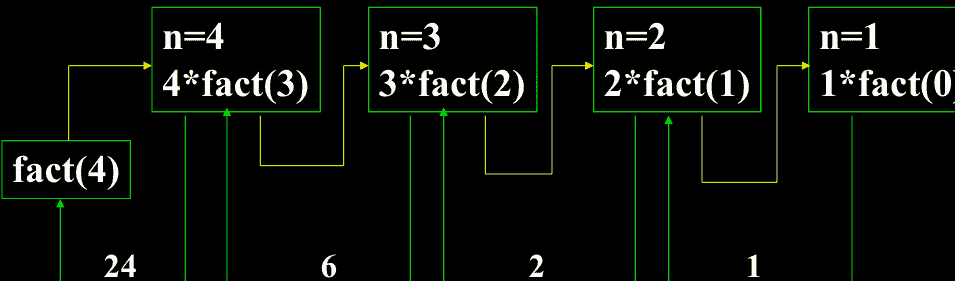

## 3、递归必须满足的条件

1. 有明确的结束递归的条件。
2. 要解决的问题可以转化为相对简单的同类型的问题。
3. 随着问题的逐次转换，最终能达到结束递归的条件。

## 4、递归程序的优缺点

优点：程序代码少，程序简捷，设计方便。
缺点：代价大，消耗大量的运行栈空间，同时也花费很多的CPU时间。

### （五）函数模板

#### 1、作用：

让具有类似功能而参数不同的函数使用相同的名字，提高程序代码的可复用性。

#### 2、格式：

`template<模板形参表>函数定义`

例：
- `int max(int x,int y) {if(x>y) return x; return y;}`
- `float max(float x, float y) {if(x>y) return x; return y;}`
- `long max(long x, long y) {if(x>y) return x; return y;}`
- `double max(double x, double y) {if(x>y) return x; return y;}`

前面这四个函数对应的函数模板为：
`template <class Type>`
`Type max(Type d1,Type d2)`
`{if (d1>d2) return d1;`
`return d2;`
`}`

注：`<class Type>` 表示 Type 这个符号可以被任一种具体数据类型所取代。

#### 3、模板的实例化

1. 含义
用具体的数据类型来代替模板中的类型参数。

2. 方法
- 通过函数调用
- 通过函数原型

3. 模板函数：
由模板实例化得到的函数

4. 重载模板函数：
定义与模板函数同名的具体函数

例：`#include<iostream.h>`
`#include<string.h>`
`template<class Type>`
`Type max(Type d1,Type d2)`
`{if (d1>d2) return d1;`
`else return d2; }`
`int max (int,int);`
`char max(char,char);`
`char*max(char*str1,char*str2);`

```
void main()
{int ival1=10,ival2=4;
 float fval1=12.3,fval2=45.67
cout<<max(ival1,ival2)<<endl;
cout<<max(fval1,fval2)<<endl;
cout<<max('a','A')<<endl;
cout<<max("Hello","Hello,world")<<endl;
}
char*max(char*str1,char*str2)
{if(strcmp(s1,s2)>0) return s1;
 else return s2;}
```


## 第五章　函数

### 4、支持多种类型的模板

例：

```cpp
template<class T1, class T2>
T1 funcName(T1 para1, T2 para2)
{
    if (para1 > para2) return para1;
    else return para2;
}
```

## 第六章　简单程序设计

### 一、程序开发过程

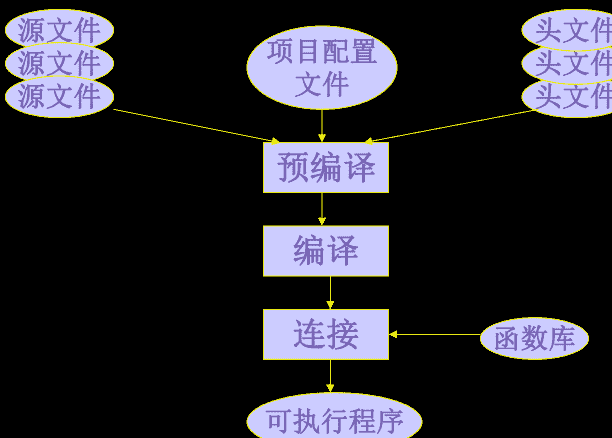

### 二、文件间的信息共享

#### 1、外部变量

（1）含义

若要在一个文件中使用在另一个文件中定义的变量，则将其说明为外部变量。

（2）说明格式

在一般变量定义前加 `extern`。

例：

```cpp
//文件main.cpp
int x;
int y;
void main()
{
    ...
}
...
```

```cpp
//文件file1.cpp
extern int x;
extern int y;
void func1()
{
    ...
}
...
```

（3）几点注意：

- 当一个文件中出现了extern变量的说明时，必须保证在组成同一程序的其他文件中有且只有一个对该变量的定义。
- 如果在说明一个外部变量时加上了对变量的初始化，编译器会当成变量定义，而不当成变量说明来使用。
- extern说明的变量必须具有全局作用域，不能是函数的局部变量。

#### 2、外部函数

（1）若要在一个文件中使用在另一个文件中定义的函数，则将其说明为外部函数。

（2）说明格式

直接说明其函数原型即可。

例：

```cpp
//文件main.cpp
void print(char*);
void main()
{
    print(" Hello,friend\n");
    ...
}
...
```

```cpp
//文件file1.cpp
#include<iostream.h>
void print(char* str)
{
    cout << str;
    ...
}
...
```

（4）优点：

- 可以将一些文件的实现细节封装起来，这些实现细节没有必要让其它文件了解。这样既安全，也简化了文件之间的接口；
- 不同的文件可以使用同样名字的变量和函数完成文件功能，而不用担心名字冲突。

（5）两点说明

- 内联函数默认为静态的函数。所以内联函数只在定义它的文件范围有效。
- 用const定义的常量默认也具有静态特性，因此可以在不同的文件中定义同名的常量。

### 三、头文件

#### 1、#include指令

（1）含义：

告诉预编译程序，将其后面所跟的文件的内容插入到当前文件中。

（2）格式：

```cpp
#include <文件名> //包含系统定义的头文件
#include "文件名" //包含用户自定义的头文件
```

#### 2、头文件

（1）含义：以.h为扩展名的文本文件。

（2）包含的内容：

- 预编译指令
- 函数声明
- 内联函数定义
- 类型定义
- 外部数据声明
- 常量定义
- 注释

#### 3、预编译指令

（1）条件编译指令

```cpp
#if  #else  #elif  #endif  #ifdef  #ifndef
```

条件编译指令的一个有效使用是协调多个头文件。

（2）#define指令

`#define`指令通常用来与条件编译指令配套使用，定义一个符号常量，它的定义与否可以用#ifdef和#ifndef来测试。

### 四、生存期

标识符在程序运行过程中生存的时间。

#### 1、局部生存期

- 存在于函数的执行期间
- 局部变量具有局部生存期

#### 2、静态生存期

- 存在于整个程序的运行期间
- 全局变量具有静态生存期

#### 3、动态生存期

- 从申请到释放的期间
- 动态申请的空间具有动态生存期

#### 4、生存期与内存

- （1）全局数据区存放具有静态生存期的变量
- （2）堆区存放具有动态生存期的变量
- （3）栈区存放具有局部生存期的变量

#### 5、初始化问题

具有静态生存期的变量将由系统自动初始化为0，但不对具有局部生存期和动态生存期的变量进行初始化。

#### 6、静态局部变量

（1）在一般局部变量的定义前加上static

例：

```cpp
int addCount()
{
    static int count;
    count++;
    return count;
}
```

（2）特性：

- 具有静态生存期。也就是说，它的生存期和整个程序的运行期是一样的，并且变量处于内存的全局数据区，而不在栈区；并且系统自动将其初始化为0；
- 只被初始化一次；
- 在函数退出以后，静态局部变量不被释放，它保留它的值。因此下一次进入函数后，静态局部变量还能保留它的值。

例：

```cpp
int addCount()
{
    static int count=100;
    count++;
    return count;
}
```

则语句 `cout << addCount() << ' ' << addCount();` 的输出结果为：101 102

## 第七章　数组与结构

### §7.1 数组

#### 一、作用

用来描述一组具有相同数据类型的元素。

#### 二、数组的定义格式

`类型说明 数组名[常量表达式];`

1、数组元素的类型可以是任意数据类型  
2、常量表达式的值表示数组的元素个数

例：

```cpp
int grade1[5];
int grade2[2*3];
```

#### 三、数组元素的访问

1、数组元素通过下标进行访问

- （1）下标是标识数组元素位置的整型表达式
- （2）若数组元素个数为 n，则下标的值的范围是 0~n-1

2、访问数组元素的格式：

`数组名[下标]`

例：若定义数组 `int art[5];`

则数组 art 的五个元素分别表示为：

`art[0]`、`art[1]`、`art[2]`、`art[3]`、`art[4]`

#### 四、数组的复制

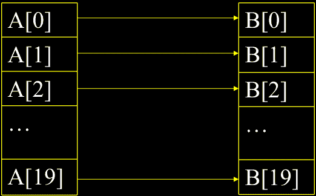

数组复制的示意图

注：用来表示字符串的字符数组的复制写法有点不同。它以字符串的结束符作为循环结束的条件。

如：

```cpp
char str1[]="Wang Tao";
char str2[];
```

将字符串str1赋值给字符串str2

```cpp
for(int i=0; str1[i]!='\0'; i++)
    str2[i]=str1[i];
str2[i]='\0';
```

#### 五、数组下标越界

若数组元素个数为n，则下标的值的范围是0~n-1，超出这个范围则称为是下标越界。

- 下标越界错误在调试时很难发现，而且程序的运行结果也可能非常怪异。所以，使用数组时需要特别注意检查下标不要越界。

#### 六、数组元素的初始化

1、格式：

`类型说明 数组名[常量表达式]={值1，值2，…，值n};`

如：`int array[5]={10,20,30,40,50};`

则五个数组元素的值分别是：

```cpp
array[0]=10, array[1]=20, array[2]=30
array[3]=40, array[4]=50
```


## 第七章 数组与结构

- 2. 给数组元素初始化时应遵循的规则
  - (1) 初始化值的个数可以少于或等于数组定义的元素个数，但不可以多于定义的元素个数。如果初始化值的个数少于数组定义的元素个数，则系统将自动用0来填充。

如：`int array[3]={1,2};`
则三个数组元素的值分别是：

```
array[0]=1, array[1]=2, array[2]=0
```

- (3) 字符数组可以用多个字符或一个字符串进行初始化，

```
char ca1[]={'c','h','a','r'};
char ca2[]="char";
```

注：若用字符串给字符数组初始化，则数组元素个数应大于或等于字符串的长度加1（因为字符串的结束符’ \0’占一个字节）

如：`char ca3[4]="char";` （×）

### 七、二维数组

**1. 定义格式：**

类型说明 数组名[常量表达式1][常量表达式2]

注： 常量表达式1的值表示二维数组的行数  常量表达式2的值表示二维数组的列数  二维数组的元素个数等于二维数组的行数乘以二维数组的列数

如： `int art[5][6];`  定义了一个5行6列的二维数组，元素个数为30

**3. 二维数组元素的初始化**

**（1）格式：**

类型说明 数组名[行数][列数]={初值表1，初值表2， ...， 初值表m}

注：每个初值表对二维数组中一行元素进行初始化

如：`int art[2][3]={{10,15,20},{25,30,35}};` 则art中6个元素的值分别是：`art[0][0]=10, art[0][1]=15, art[0][2]=20, art[1][0]=25, art[1][1]=30, art[1][2]=35`

二维数组art在内存中的示意图为：

| 行号 | 列号0 | 列号1 | 列号2 |
|---|---|---|---|
| 0 | 10 | 15 | 20 |
| 1 | 25 | 30 | 35 |

**（2）几点说明：**

- ☆ 可以只给部分元素赋值，其它未赋值元素自动赋值为0

  如：`int ib[3][3]={{1,2},{5}};`

  则：

  ```
  ib[0][0]=1, ib[0][1]=2, ib[0][2]=0
  ib[1][0]=5, ib[1][1]=0, ib[1][2]=0
  ib[2][0]=0, ib[2][1]=0, ib[2][2]=0
  ```

- ☆ 定义格式中的行数可以省略，此时行数由初值表的个数决定。但是列数不能省略

  如：`int ia[][3]={{10,15,20},{25,30,35}};`

  则：所定义的二维数组 ia 的行数为 2

### 八、数组参数

- 1. 将整个数组作为形式参数，将数组名作为实在参数。
  - ☆ 若为一维数组，则元素个数可以省略
  - ☆ 若为二维数组，则行数可以省略
- 2. 若以数组作为函数的参数，则对形参数组的改变就是对实参数组的改变

```
#include <iostream.h>
void f(int ar[])
{
    ar[0]=1;
    ar[1]=1;
}
void main()
{
    int a[2]={0};
    cout<<a[0]<<' '<<a[1]<<endl;
    f(a);
    cout<<a[0]<<' '<<a[1]<<endl;
}
```

输出结果：

```
0 0
1 1
```

### 二、结构类型的定义格式

```
struct 结构类型名
{
    成员定义1;
    成员定义2;
    ...
    成员定义n;
};
```

注：一个成员相当于一个变量

例：

```
struct student
{
    char name[20];
    char id[7];
    float score;
};
```

定义了一个名为student的结构类型，其中含有三个成员name、id和score

### 三、结构变量的定义

定义了一个结构类型后，就可以用它来定义结构变量。

格式：结构类型名 变量名表；

```
student s1,s2;  //定义了两个简单的结构变量
student s3[3];  //定义了一个结构数组
```

### 四、结构成员的访问

要访问结构的成员，用圆点操作符 `.`，这是一个双目操作符，它的左边的操作数是结构类型的变量名，右边是结构的成员名

如：`s1.score`
    `s2.score`
    `s3[2].score`

### 五、结构变量的初始化

分别对结构变量中的各成员进行初始化

如：

```
student s1={"wang","12345",93};

student s2[3]={{"wang","1234",76},
               {"zhang","3333",83},
               {"li","5678",90}};
```

### 六、结构的赋值

只有同类型的结构变量才可以相互赋值

如：

```
student s1,s2;
s1=s2;
```

### 七、结构成员的类型

- 1. 可以是除自身以外的任何已有类型
- 2. 可以定义指向任何已有类型（包括自身）的指针

例：

```
struct B
{
    char ch;
    int x, y;
    double z;
};

struct E
{
    int d;
    B b;
};

struct F
{
    double data;
    F* next;
};
```

### 八、结构嵌套

可以在结构中定义并使用另一个结构。

注：只有当结构的使用范围只局限在另一个结构之内时，才会定义成结构嵌套，结构嵌套很少用。

## 第八章 指针和引用

### §8.1 指针的定义与初始化

一、指针：存储特定类型数据的地址。

二、指针定义与初始化的格式：

类型修饰符 * 指针变量名（=&变量名）

如：

```
int i;
int * ip=&i;
float score;
float * pf=&score;
```

```
#include <stdio.h>

int main() {
    // 使用printf函数
    printf("Hello, world!\n");
    return 0;
}
```

注：ip：指针变量。
* ip：指针所指空间存放的内容。

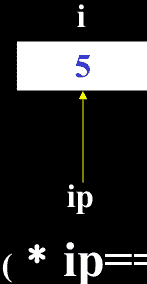

### §8.3 指针的类型

一、指针的类型就是它所指的数据的类型。

如：

```
int i;
int * ip=&i;  // ip是一个整型指针
```

二、两种特殊的指针

- 1. NULL指针（空指针）：不指向任何类型的数据。（用地址0表示）

如：`int * ip= NULL;`

### §8.4 用const来限定指针

一、指向常量的指针

- 1. 定义：在指针定义前加const。

如：

```
int i;
const int * ip=&i;
```

- 2. 含义：不能改变该指针所指的数据。

如：

```
int i;
const int * ip=&i;
* ip=25;（×）
```

- 3. 三点注意：

(1) 指向常量的指针只限制指针的间接访问操作，而不会限制指针变量本身的操作。

如：

```
int i, j;
const int * ip=&i;
* ip=25; (×)
ip=&j; (√)
```

(2) 指向常量的指针只限制指针的间接访问操作，而不会限制对指针所指空间的操作。

如：

```
int i;
const int * ip=&i;
* ip=25; （×）
i=25; （√）
```

## 第八章 指针和引用

（3）如果要给一个指针赋一个常量的地址，则这个指针必须定义为指向常量的指针。

如：

```cpp
const int ci = 30;
const int *ip1 = &ci; // (√)
int *ip2 = &ci;       // (×)
```

## 二、指针常量

1、定义：在指针变量名前加 const。

如：

```cpp
int i;
int * const ip = &i;
```

## 三、指向常量的指针常量

1、定义：在指针定义前和变量名前各加一个 const。

如：

```cpp
int i;
const int * const ip = &i;
```

2、含义：既不能改变指针变量本身的值，也不能改变指针所指的数据。

如：

```cpp
int i, j;
const int * const ip = &i;
ip = &j; // (×)
*ip = 32; // (×)
```

## § 8.5 指针与数组

### 一、一维数组的数组名是指向该数组首元素的指针。

如：

```cpp
int array[5] = {10, 20, 30, 40, 50};
```

则：

```cpp
array = &array[0];
```

### 二、指向数组的指针可以当作数组名使用。

如：

```cpp
int array[100];
int *pArray = array;
```

则 `pArray` 为指向一维数组的指针，此时访问数组中第 i+1 个元素，下面两种方式是等价的：

`array[i]` ←———→ `pArray[i]`

例：

```cpp
#include <iostream.h>
void main()
{
    int array[5];
    int *pArray = array;
    for (int i = 0; i < 5; i++)
    {
        array[i] = i;
        cout << pArray[i] << " " << array[i] << endl;
    }
}
```

此程序的运行结果为：

0 0
1 1
2 2
3 3
4 4

### 三、数组名是指针常量，而不是指针变量。

如：

```cpp
int array[100];
```

则：

```cpp
array = &array[1]; // (×)
```

### 四、指针的加减

#### 1、指针加减的含义：

- ☆ 指针 + 1：指针向后移动一个数组元素。
- ☆ 指针 - 1：指针向前移动一个数组元素。

如：

```cpp
int array[5] = {10, 20, 30, 40, 50};
int *pa = array;
```

2、指针的加减是以指针所指数据的类型大小为单位进行的。
（例见 181 页—182 页）

注：如果指针指向的是一个结构数组，则指针的运算就以一个结构元素所占内存空间大小为单位。
（例见 182 页）

## 五、用指针对数组进行操作

### 1、通过指针的加减来访问数组元素。（例见 183 页、184 页）

### 2、访问数组的第 i+1 个元素的四种方式：

若有：

```cpp
int array[5] = {10, 20, 30, 40, 50};
int *pa = array;
```

则有：

- `pa[i]`
- `array[i]`
- `*(pa + i)`
- `*(array + i)`

### 3、取数组中第 i+1 个元素地址的四种方式：

若有：

```cpp
int array[5] = {10, 20, 30, 40, 50};
int *pa = array;
```

则有：

- `&pa[i]`
- `&array[i]`
- `pa + i`
- `array + i`

### 4、在对指针进行加减运算时，必须保证经过运算得到的新地址是程序能够支配的地址。

若有：

```cpp
int array[10];
int *pa = array;
```

则：

```cpp
pa + 20; // (×)
```

## 六、指针与字符串

- 1、字符串：以 `'\0'` 为结束符的字符序列。
- 2、可以将字符指针看成是一个字符串。如：`char *str = "a string";`
- 3、输出字符指针将输出整个字符串。如：`char *str = "a string"; cout << str;` → 输出：`a string`
- 4、输出对一个字符指针的间接引用时，将会输出字符串的第一个字符。如：`cout << *str;` → 输出：`a`

## § 8.6 动态内存申请

### 一、new 与 delete

#### 1、内存空间申请

##### （1）new 操作符：表示从堆内存中申请一块空间。

##### （2）返回值：

申请成功：返回所申请到的空间的首地址。申请失败：返回空指针（NULL）。

##### （3）new 的三种格式：

- ★ new 数据类型
- ★ new 数据类型（初始化值）
- ★ new 数据类型[常量表达式]

例：

```cpp
int *ip1 = new int;
int *ip2 = new int(3);
int *str = new int[10];
```

#### 2、内存空间释放

##### （1）delete 操作符：表示将从堆内存中申请的一块空间返还给堆。

##### （2）delete 的两种格式：

- ☆ delete 指针名
- ☆ delete [ ] 指针名

例：

```cpp
int *pInt = new int;
float *pFloat = new float(34.5);
int *arr = new int[100];
delete pInt;
delete pFloat;
delete[] arr;
```

☆在用 delete 来释放一个指针所指的空间时，必须保证这个指针所指的空间是用 new 申请的，并且只能释放这个空间一次。

例：

```cpp
int i;      int *ip = &i;       delete ip; // (×)
float *fp = new float(3.4);
delete fp; // (√)
delete fp; // (×)
```

- ☆如果在程序中用 new 申请了空间，就应该在结束程序前释放所有申请的空间。
- ☆当一个指针没有指向合法的空间，或者指针所指的内存已经释放以后，最好将指针的值设为 NULL。

## 二、指针与动态数组

1、若申请的是一个简单的数据空间，则可以通过间接访问操作符 * 来访问

```cpp
int* ip = new int;
*ip = 34;
cout << *ip;
```

## 3、指针数组

数组中的每个元素都是指针

例：

```cpp
char *week[7] = {"Sunday ", "Monday ", "Tuesday ", "Wednesday ", "Thursday ", "Friday ", "Saturday "};
```

## 三、指针与动态结构

### 1、利用指针访问结构成员

- ⭐ （* 指针名）.成员名
- ⭐ 指针名→成员名

例：

```cpp
struct Student
{
    char name[20];
    float score;
};
Student st = {"wanglin ", 98};
Student *ps = &st;
```

则有：

- `ps -> name == (*ps).name == st.name == "wanglin "`
- `ps -> score == (*ps).score == st.score == 98;`

### 2、链表

（1）链表是由若干个结点链接而成的

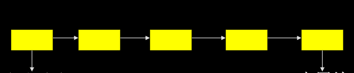

### （2）结点用结构类型来描述

结点由数据成员和指针成员组成。数据成员描述每一个结点的信息；指针成员用来指向链表中的下一个结点。

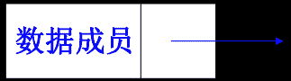


## 第八章 指针和引用

例：struct StudentNode
{char name[20];
float score;
StudentNode * next;
};

（3）表头指针(head)
指向表头结点的指针
若是一个空链表，则表头指针为空指针（NULL）

### （4）链表的建立

链表的建立过程就是一个个创建链表结点并将它们连接在一起的过程

☆在链表的表尾结点后插入一个新结点
例：将pNew所指的结点插到链表的表尾
StudentNode*tail;
tail=head;
while(tail != NULL && tail->next != NULL)
tail=tail->next;
tail->next=pNew;

示意图如下：

head "wusan" 89 "Lishi" 88 ^

插入前 tail

"wangtao" 67 ^ pNew

head "wusan" 89 "Lishi" 88 "wangtao" 67 ^

插入后 tail pNew

### （5）链表结点的删除

- ☆如果被删除结点是链表的第一个结点，那么删除这个结点后，链表的头指针需要发生变化；
- ☆如果被删除结点不是链表的第一个结点，那么删除这个结点后，将导致这个结点的前一个结点的指针发生变化

第一种情况示意图：

head=head→next;
delete pDel;

head

1

pDel

2

...

n

删除前

head

2

...

n

删除后

1

pDel

第二种情况示意图：

```
pre→next= pDel→next;\ndelete pDel;
```

将两种情况结合，则从一个以head为表头指针的链表中删除一个结点的程序如下：

```cpp
if(head==pDel)
    head=head→next;
else  {pre=head;
        while(pre!=NULL && pre→next!=pDel)
            pre=pre→next;
        pre→next=pDel→next;}
delete  pDel;
```

## 四、指针常用的场合

- 1、动态空间申请
- 2、构建复杂的数据结构
- 3、作为函数的参数
- 4、字符串操作

## § 8、7 引用的概念

### 一、引用的说明

#### 1、引用：

C++语言中对一个变量或常量标识符起的别名。

### 2、引用的说明：

说明一个引用时，在引用标识符的前面加上 ‘&’，后面跟上它所引用的标识符的名字。

如：int val;

int &rval=val;// rval是对val的引用

### 3、引用说明时必须初始化

引用不是变量，所以必须在说明引用时说明它所引用的对象。所引用的对象必须有对应的内存空间。

4、对引用的操作与对被引用对象所做的操作，效果完全一样

例：

```cpp
#include<iostream.h>
void main()
{int val;  int &rval=val;
  cout<<" &val="<< &val<<endl;
  cout<<" &rval="<< &rval<<endl;
  val=34;
  cout<<" val="<< val<<" rval="<<rval<<endl;
  rval=12;
  cout<<" val="<< val<<" rval="<<rval<<endl;
}
```

程序的输出结果为

```
&val=0X0065FDF4
&rval=0X0065FDF4
val=34 rval=34
val=12 rval=12
```

## 二、引用的数据类型

### 1、能够被引用的数据类型

#### （1）对简单数据类型变量或常量的引用

如：int &

char &

float &

double &

bool &

（2）对结构类型变量或常量的引用
如：struct Student
{char name[20]; float score;};
Student stud1={"WangLin ",45.6};
Student &rstud= stud1;
cout<< rstud.name<< rstud.score;

### （3）对指针变量或常量的引用

```
如：int * pInt=new int;
int * &rpInt= pInt;
* rpInt=45.6;
delete rpInt;
```

## 2、不能被引用的情况

### （1）不能对void引用

因为void本身就表示没有数据类型，对它的引用没有意义。

（2）不能对数组名引用

如：int arr[10];

int& rarr1=arr;(×)

int& rarr2=arr[0];(√)

（3）不能定义指向引用的指针

如：

```
int i;\nint& ri=i;\nint& * pr=&ri;（×）
```

注：int * & 和 int& * 的区别：

int * &表示对int型指针的引用

int& * 表示指向int型引用的指针

## 三、const引用

- 1、在引用说明前加const。
- 2、不能改变const引用的值，但是可以改变它所引用的对象的值。

```
如：int i;

const int& ri=i;
ri=45;（×）
i=45;（√）
```

3、对一个常量进行引用时，必须将这个引用定义为const引用

如：const int ci=45;

int& ri=ci;(×)

const int& rci=ci;(√)

## § 8、8 指针和引用

例：

```
int i=10;\nint * pi=&i; // pi是指向i的指针\nint& ri=i; // ri是对i的引用
```

pi、ri在内存的示意图如下：

|    |    |    |
|---|---|---|
|    |    |    |
|    | 10   | i、ri |
|    |    |    |
| 0x0065FDE4 | 0x0065FDE4 | pi   |
|    |    |    |
|    |    |    |

指针变量具有独立的内存空间存放变量的值，而引用只是一个依附于被引用变量的符号，没有独立的内存空间

## 一、指针和引用的不同点

- 1、指针和引用对它们所指的或引用的变量的操作方式不同
  - ☆ 指针通过间接访问操作符*来访问
    如：`*pi=40;`
  - ☆ 引用直接访问它所引用的空间
    如：`ri=40;`

2、可以改变指针的值；
如：int j;
pi=&j;

★引用一旦被初始化后，就不能改变。所有对引用的操作都被认为是对它所引用的变量的操作

如：ri=j；/* 表示的不是ri改为对j的引用，而表示将j的值赋给ri所引用的变量i */

## 二、指针和引用的共性

指针和引用都是对某一个变量所代表的空间进行间接操作的手段

- - 指针是通过存放变量空间的地址来达到间接操作的目的
- - 引用是通过为变量定义别名来达到间接操作的目的


## 第八章 指针和引用

### §8.9 引用的应用

引用最大的用途是作为函数的参数或返回值类型。

例：设计一个swap函数，交换两个数的值，其中以引用作为参数：

```cpp
#include<iostream.h>
void swap(int&a,int&b)
{int temp=a; a=b; b=temp;}
void main( )
{int val1=10,val2=20;
cout<<"val1= " <<val1<< " val2= "<<val2<<endl;
swap(val1,val2);
cout<<"val1= " <<val1<< " val2= "<<val2<<endl;
}
```

程序的输出结果：

```
val1=10 val2=20

val1=20 val2=10
```

☆引用参数通常使用的场合：

- 1、函数需要返回多个值
- 2、函数的参数是结构或类的对象

## 第九章 面向对象程序方法

### §9.1 面向对象方法概述

### 一、面向对象的基本思想

从现实世界中客观存在的事物（对象）出发来构造系统，并在系统构造中尽可能地运用人类的自然思维方式。

### 二、以面向对象思想构造软件系统的主要内容

- 1、对象是以面向对象方法构造的系统的基本单位。对象是对问题域中客观存在的事物的抽象。
- 2、对象的属性和操作组成一个完整的对象，对象具有一定的对外接口，外界对象可以通过该接口来访问对象。
- 3、以对象为基础，对对象分类，将具有共同特性的对象进行抽象，形成对这些对象的抽象描述——类，每个对象就是该类的一个实例。
- 4、对形成的对象类进一步抽象，抽出这些类的共同特征，形成基本的类和派生的类，派生的类又可以具有更多的派生类，这样就形成一个类簇。基本类和派生类的关系称为继承。
- 5、一个系统就是由各个对象组成，对象和对象之间存在静态关系和动态关系。静态关系体现了对象之间固有的关系；动态关系是对象之间通过发送消息进行通信，相互协作，完成系统功能。

### 三、面向对象方法

面向对象方法是利用抽象、封装等机制，借助于对象、类、继承、消息传递等概念进行软件系统构造的软件开发方法。

### 四、面向对象方法的形成

#### 1、面向对象程序设计语言的三阶段

- 发生
- 发展
- 成熟

#### 2、Smalltalk语言

Smalltalk是第一个完善的、实用的纯面向对象的语言。它有三个特点：

- （1）将任何东西都看成对象，包括类本身。对对象的方法的调用在Smalltalk中称为发送消息给对象。
- （2）不进行任何类型检查操作，强调多态性和动态连接。
- （3）Smalltalk不仅是一种语言，它还是一个具有类库支持和交互式图形用户界面的完整的程序设计环境。

#### 3、面向对象程序设计语言的分类

##### （1）纯粹的面向对象程序设计语言

完全依照面向对象思想而设计的，它的所有语言成分都以对象为核心。

如：Smalltalk、Eiffel、Actor和Java等。

##### （2）混合的面向对象程序设计语言

在某种已经被广泛使用的其他语言的基础上增加了支持面向对象思想的语言成分。

如：Object C、C++、Object Pascal和CLOS等。

### §9.2 面向对象方法的基本概念

### 一、对象

#### 1、定义

对象是对问题域中客观存在的事物的抽象，它是一组属性和在这些属性上的操作的封装体。

#### 2、两大要素

- 属性（用来描述对象的静态特征）
- 操作（用来描述对象的动态特征）

#### 3、程序设计语言中的对象

- 在程序设计语言中，用类来定义对象。
- 类是一种用户自定义的数据类型，这种数据类型是一个由数据和作用在这些数据之上的操作组成的整体。
- 对象相当于该类型的一个变量。

例：定义一个类及对象：

```cpp
//定义一个电话类
class Phone{
private:
    char owner[10];
    char address[50];
    char phoneNumber[10];
public:
    Phone(char * owner,char * address,char * phoneNumber);
    char * getPhoneNumber( );
    char * getOwner();
    char * getAddress();
    char * dial(char*);
};
//定义一个电话类对象
Phone myphone("王萍", "清华园", "62782622");
```

### 二、消息

#### 1、定义

消息是向对象发出的服务请求，是面向对象系统中对象之间交互的途径。

例：老板对下属说：“明天早上八点以前把有关饮料的市场调查报告放到我的办公桌上”。

#### 3、程序设计语言中的消息

在程序设计语言中，消息表现为对象在其操作过程中对另一个对象的服务程序的调用，即函数调用。

例：给电话类对象myphone发送一个消息：拨电话号码。则发送方式为：

```cpp
char * myphone.dial("82904456");
```

### 三、类

#### 1、定义

类是具有相同属性和操作的一组对象的集合，它为属于该类的全部对象提供了统一的抽象描述。

#### 2、类与对象的关系

类给出了属于该类的全部对象的抽象定义，而对象则是符合这种定义的一个实体。

因此，对象又称为是类的一个“实例（instance）”，类又称为是对象的“模板（template）”。

#### 3、程序设计语言中的类

在程序设计语言中，类是一个独立的程序单位，它具有一个类名来唯一标识这种类，类的定义体包括属性和操作两部分。

程序设计语言中，类与对象的关系如同数据类型和这种类型的变量。

### 四、继承

#### 1、定义

特殊类的对象拥有一般类的全部属性和操作，称做特殊类对一般类的继承。

#### 2、意义

- 简化了人们对事物的认识和描述。
- 增强了类接口的一致性，减少了模块间的接口和界面，从而大大增加了程序的易维护性。

#### 3、分类

- 单继承：一个类从一个一般类的继承。
- 多继承：一个类继承多个一般类的特性，然后再在继承来的这些一般类的基础上增加自己的特殊性。

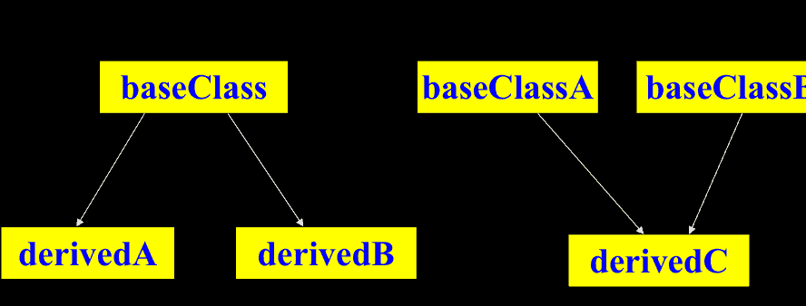

单继承　　多继承

#### 4、基类和派生类

- 基类（base class）：继承关系中的一般类称为基类。
- 派生类（derived class）：继承关系中的特殊类称为派生类。

#### 5、程序设计语言中的继承

在程序设计语言中提供的继承方式是在定义派生类时指定其所继承的基类。

例：

```cpp
class A
{...};
class B:public A
{...};
class C:public B
{...};
```

类A是类B的直接基类，是类C的间接基类；类B是类A的直接派生类，类C是类A的间接派生类。

### 五、封装

#### 1、两个含义

- 包装：把对象的全部属性和操作结合在一起，形成一个不可分割的整体。
- 信息隐藏：这个整体尽可能对外隐藏它的细节，只对外公布一个有限的界面，通过这个界面和其他对象交互。


## 第九章 面向对象程序方法

### 2、封装和继承

封装和继承都可以看成是一种共享代码的手段：

- ☆封装通过与其他对象的交互实现代码的动态共享
- ☆继承通过派生类对基类的继承实现代码的静态共享

### 3、程序设计语言中的封装

在程序设计语言中用类来实现封装。

类是属性和操作的结合体，并且在定义类的属性和操作时，规定了它们的可见性。只有公有成员才能被外界访问。

### 六、多态性

#### 1、定义

多态性是指在基类中定义的属性或操作被派生类继承之后，可以具有不同的数据类型或表现出不同的行为，从而同一个属性或操作名称在各个派生类中具有不同的含义。

例：一个经理第二天要到某地参加某个会议，他会把这同一个消息告诉给不同的人：他的夫人、秘书、下属，这些人听到这个消息后，会有不同的反应：夫人为他准备行装，秘书为他安排机票和住宿，下属为他准备相应的材料。
这就是一种多态性：发给不同对象的同一条消息会引起不同的结果。

#### 2、程序设计语言中的多态性

（1）在程序设计语言中多态性表现为以统一的方式对待具有相同的接口的不同类的实例的能力。

（2）C++语言支持两种多态性

- ☆编译时的多态性（通过函数重载实现）
- ☆运行时的多态性（通过虚函数实现）

### §9.3 面向对象的意义

#### 一、模块化——软件质量保证

##### 1、软件的外部质量

###### （1）正确性

软件产品准确执行软件需求规格说明中所规定的任务的能力。

###### （2）可靠性

软件系统在异常情况下也能保证系统的完整性的能力。

###### （3）可维护性

软件产品在需求发生变化、运行环境发生变化或发现软件产品本身的错误或不足时进行相应软件更新所需工作量的大小。

###### （4）可复用性

可复用性是指软件产品可被全部或部分地再用到新的应用中去的能力。

###### （5）兼容性

兼容性是指软件产品与其他软件组合成一个整体的难易程度。

#### 2、软件的内部质量

软件的外部质量最终是由软件的内部质量来支持。要得到外部质量好的软件，软件的系统结构应该是模块化的。

#### 二、复用——软件快速开发的必由之路

#### 三、走面向对象式道路

##### 1、结构化程序设计

###### （1）基本思想

自顶向下、逐步求精

- ☆结构化程序设计是一种面向过程的设计方法，它将数据和过程分开，降低了可复用性和一致性。
- ☆自顶向下的程序设计方法与复用思想本质上是背道而驰的。
- ★面向对象方法，尤其是它的继承性，是代码重用的有效途径。
- ★类封装了数据和操作，使得对象相对独立，对象的内部实现也与对象的接口分开，对象之间的关系只能通过消息传递来体现，因而一个对象的修改对其他对象的影响很少。
- ☆多态性增强了操作的透明性、可理解性和可维护性，因为用户不必再为相同的操作作用于不同的对象而去费心区分每类对象。

### §9.4 面向对象的分析与设计

#### 一、面向对象开发方法的生命周期

##### 1、分析

分析阶段侧重于对问题域中存在的事物的分析，从中抽象出类来，并根据问题域和系统职责确定类的结构、类的接口和类之间的关系。

##### 2、设计

设计阶段在分析阶段的基础上，结合具体的开发环境，做详细的设计，除了对问题域中的类进一步细化外，还需要考虑系统的人机交互、数据管理以及该系统和其他系统的交互等更多与实现相关的内容。

##### 3、实现

实现是根据设计结果，用具体的语言在具体的开发环境中进行编码。

#### 二、面向对象分析（OOA）

##### 1、两个步骤

###### ☆问题域分析

问题域分析的目的是标识基本概念，识别问题域的特性，把这些概念集成到问题域的模型中。

###### ☆应用分析

应用分析是将问题域模型映射到具体的系统需求中。

- (4) 借助于其他表示进一步分析系统，
    - 如建立主题图、建立对象交互图、
    - 建立状态迁移图等
- (5) 对上面建立的所有表示进行详细
    - 的说明
- (6) 如果需要，开发原型系统，辅助
    - 分析

#### 三、面向对象设计的四个方面

##### （1）问题域

在设计阶段，因为考虑了与实现相关的因素，在分析阶段得到的独立与实现的概念性的类将与具体的实现环境相结合。

- (2) 人机交互

人机交互包括系统的输入和输出两个部分的设计。

- (3) 数据管理

数据管理必须考虑采用什么样的手段保存数据，如何实现数据与问题域对象之间的接口等。

- (4) 系统交互

系统交互是指系统与用户、系统外的其他系统及设备之间的交互。

#### 二、复用的好处

- 1、提高生产率，降低软件生产的代价
- 2、提高软件质量
- 3、体现较多的一致性

#### 三、面向对象方法对复用的支持

##### 1、对象与类

可复用构件应该具备一定的独立性、完整性。而对象与类正具备构件的特性。

##### 2、抽象

抽象意味着忽略事物的某些差异而抽取其共同特征。一个软件构件也有相同的原则。

##### 3、封装

封装原则把对象的属性和操作结合为一个完整的实体，屏蔽了对象的内部实现细节，对外呈现一定的接口，这使得对象具有了独立性和完整性，从而具备了可复用构件的基本特性。

##### 4、继承

通过继承形成的对象类之间的一般—特殊结构体现了不同层次的抽象，从而使用于不同的复用范围。

##### 5、聚合

聚合是对象之间的包含关系。可以通过将各个已实现的对象组织成一个新的对象来构造新对象，从而实现了各种已有对象的复用。

四、复用技术对面向对象软件开发的支持复用技术对面向对象软件开发的支持表现为类库支持。类库是实现对象类复用的基本条件。在面向对象的编程语言（OOPL）问世之后，已经开发了许多基于各种OOPL的编程类库，有利地支持了源程序级的软件复用。

- 1、OOPL用对象来描述现实世界中的对象，用对象的属性和操作描述现实世界中的对象的静态特性和动态特性。
- 2、OOPL用类来描述具有共同特性的对象，这和现实世界中的对对象分类非常相似。
- 3、OOPL用类继承来表现现实世界中事物的共性和个性，共性在父类中实现，个性在派生类中实现。
- 4、OOPL中对象可以由其他对象组成，这体现了现实世界中对象之间的构成关系。
- 5、OOPL中对象可以通过发送消息给另一对象来使用该对象的服务，这体现了现实世界中事物彼此之间相互依存的关系。
- 6、OOPL中提供对象的封装机制，这模拟了现实世界中各个事物相对独立，一个事物的很多细节其他事物不必要也不允许知道的事实。

# 第10章 类与对象

### §10.1 类的定义与使用

一、类是数据和对这些数据进行操作的函数的封装体。

二、定义格式：
class 类名
{
类定义体
};

三、类对象的定义
一个类的变量被称为对象。
如：Rectangle rect;
则：rect是类Rectangle的一个对象。rect含有两个数据成员：width和height；含有两个函数成员：Area和Perimeter。

```cpp
class Rectangle
{
public:
    float width,height;
    float Area()
    {return width*height;}
    float Perimeter()
    {return 2*(width+height);}
};
```


# 第10章 类与对象

## 例1：class Rectangle

```cpp
class Rectangle
{
public:
    float width, height;
    float Area()
    {
        return width * height;
    }
    float Perimeter()
    {
        return 2 * (width + height);
    }
};
Rectangle rect;
```

```cpp
rect.width = 45;
rect.height = 54.2;
cout << rect.Area();
cout << rect.Perimeter();
```

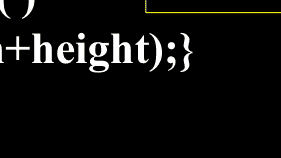

## 例2：class Rectangle

```cpp
class Rectangle
{
private:
    float width, height;
public:
    float Area()
    {
        return width * height;
    }
    float Perimeter()
    {
        return 2 * (width + height);
    }
};
Rectangle rect;

rect.width = 45; // (×)
rect.height = 54.2; // (×)
cout << rect.Area();
cout << rect.Perimeter();
```

```cpp
class Rectangle
{
private:
    float width, height;
public:
    void SetWidth(float newWidth)
    {
        width = newWidth;
    }
    void SetHeight(float newHeight)
    {
        height = newHeight;
    }
    float Area()
    {
        return width * height;
    }
    float Perimeter()
    {
        return 2 * (width + height);
    }
};
```

> ☆可以通过公有的函数成员来访问私有成员。
> 如：Rectangle rect;
> 则：
> rect.SetWidth(45);
> rect.SetHeight(54.2);

## 二、确定成员访问权限的方法：

- 1、类的数据成员一般不公开。
- 2、表示类的接口的函数成员一般定义为公有。
- 3、表示类的实现的函数成员一般定义为保护的或私有的。

# § 10.3 类的成员函数（函数成员）

## 一、定义位置

### 1、定义在类内。

```cpp
class Rectangle
{
private:
    float width, height;
public:
    float Area()
    {
        return width * height;
    }
    float Perimeter()
    {
        return 2 * (width + height);
    }
};
```

### 2、定义在类外。（在函数名加类名::）

```cpp
class Rectangle
{
private:
    float width, height;
public:
    float Area();
    float Perimeter();
};
float Rectangle::Area()
{
    return width * height;
}
float Rectangle::Perimeter()
{
    return 2 * (width + height);
}
```

# ## 二、类作用域

### 1、类作用域范围

一个类作用域的范围是这个类的定义体和这个类的所有成员函数的定义体所构成的程序范围。

# ## 2、成员函数的类作用域

- (1) 开始于函数名，结束于函数定义体的结束。
- (2) 函数的返回值类型不在类作用域中。
- (3) 函数的参数表在类作用域中。
- (4) 若在类中定义了一个数据类型，则可以直接在参数表中使用这个类型名，而不能在返回值中使用，如需使用，必须加上类名::。

（例见P234）

# ## 3、对象作用域

只有类的数据成员或函数成员才具有类作用域。而对象的作用域是对象作为一种变量，在程序中能够起作用的范围。

# 三、内联成员函数与非内联成员函数

- 1、内联成员函数：定义在类内。
   非内联成员函数：定义在类外。
   （例见P235）

- 2、将非内联成员函数说明为内联成员函数的方法
   （1）在类中函数原型前加inline。
   （2）在类外函数定义前加inline。（例见P236）

- 3、内联函数一般用于那些访问私有数据成员的简单的小函数。（例见P237）

# ## 四、const成员函数

### 1、定义格式

在函数定义的参数表后面加上const。

### 2、特征

const成员函数中不能对数据成员进行修改。

## 3、两点注意

- ☆一个const成员函数不能调用一个非const成员函数。
- ☆若一个const成员函数在类外定义，则定义时也需加const。

# ## § 10.4 类定义与头文件

用多文件结构定义和使用类（例见P240）

☆多文件结构一般由3个文件组成

- 1、存放类定义的头文件。
- 2、存放类成员函数外部定义的源程序文件。
- 3、使用类的主程序文件。

# ## § 10.5 对象的创建与使用

### 一、对象的创建（例见P245）

- ★全局对象（在函数外定义）
- ★局部对象（在函数内定义）
- ★动态对象（动态申请）

### 二、对象作为函数的参数与返回值（例见P246）

# § 10.6 this指针

this：指向调用成员函数的类对象的指针。（类中成员函数的默认指针参数）

- * this：调用成员函数的类对象（例见P237，P247-248）

# ## § 10.7 类与结构的关系

一、类与结构一般情况下可以相互替代
（没有默认的访问权限时）（例见P250）
二、类与结构的唯一区别：
结构成员默认的访问权限为public。
类成员默认的访问权限为private。
（例见P251）

## 第11章 构造函数与析构函数

## 二、特性

- 1、构造函数与析构函数都是类的成员函数。
- 2、构造函数的名字和类名相同；析构函数的名字则由类名前加上符号~。
- 3、构造函数与析构函数都没有返回值类型。
- 4、构造函数与析构函数一般定义为类的公有成员。

（例见P268-270）

# § 11.2 构造函数

## 一、重载构造函数

```cpp
例：class Name{
...
public:
Name();
Name(char* first);
Name(char* first,char* last);
...
};
```

```cpp
Name name1;
Name name2("Yun ");
Name name3("Yun ",
           "Zhao ");
```

## 3、两点注意

- ★如果一个类没有定义构造函数，则系统将为类自动生成一个默认构造函数。
- ★如果一个类定义了构造函数，则系统将不再生成默认构造函数。

## 四、拷贝构造函数

- 1、拷贝构造函数的参数为同类型对象的引用。

## 2、作用

定义一个与已有对象完全相同的对象。
例：Name(Name& nm)
{
    strcpy(firstname, nm.firstname);
    strcpy(lastname, nm.lastname);
}
若有Name name2(name1);则定义的name2是与对象name1完全相同的对象。

# 五、成员初始化参数表

##### 1、作用

对类中的数据成员进行初始化。

### 2、位置

放在构造函数的参数表与函数体之间。

### 3、定义格式

: 成员名(初始化值){, 成员名(初始化值)}


## 第11章 构造函数与析构函数

### 4、引用成员的初始化

类的引用成员必须在成员初始化参数表中进行初始化。例：

```
class A{
private:
    int mem;
    int& rmem=mem; (×)
public:
    A();
    ...
};
A::A(): rmem(mem)
{ mem=0; };
```

注：如果对象成员所属的类没有默认构造函数，则这个对象成员所在类的所有构造函数都必须在成员初始化参数表中给这个对象进行初始化。例：

```
class A{
int mem;
public:
A(int a){mem=a;};
};
class B{
A a;
public:
B():a(3) { };
B(int a1):a(a1){ };
};
```

### § 11.3 析构函数

### 一、定义

在对象的生命期结束时由系统自动调用的函数。

#### 二、特点（例见P289-291）

- 1、析构函数的参数表为空；
- 2、析构函数没有返回值；
- 3、析构函数的名字是类名前加~；
- 4、析构函数一般为公有成员函数；
- 5、析构函数不能重载。

## 第12章 静态成员、友元

### § 12.1 静态成员

#### 一、作用

一个类的静态数据成员是用来表示类的属性，而不是表示对象的属性。

#### 二、定义

在成员定义前加上static。

```
如：class File{
    ...
    public:
    static int fileCount;
    ...};
```

#### 三、访问

类的静态成员必须通过类名来访问。

格式为：`类名::静态成员名`

如：`File file1;`

`cout<<file1.fileCount;`（×）

`cout<<File::fileCount;`（√）

#### 四、静态数据成员与静态函数成员

- 1、类的静态成员也有三种访问控制：
  - private、protected、public
- 2、不能通过类名来直接访问类的私有静态数据成员。
- 3、可以通过静态成员函数来访问类的私有静态数据成员。

- 4、静态成员函数只能访问类的静态数据成员，不能访问类的非静态数据成员。
- 5、非静态成员函数既可以访问类的静态数据成员，也可以访问类的非静态数据成员。

#### 五、静态数据成员的初始化

在所有函数的外部进行初始化；且在数据类型后面加上类域标志。

如：int File :: fileCount=0;

### § 12.2 友元

### 一、定义

##### 1、友元函数

若要将函数f声明为一个类的友元函数，则在类中的声明格式为：friend 函数f的原型

##### 2、友元类

若要将类A声明为类B的友元函数，则类A在类B中的声明格式为：friend class A;

#### 二、作用（例见P307-309）

一个类的友元函数或友元类可以直接访问该类的任何成员，包括私有成员和保护成员。

#### 三、使用场合

- 1、一个函数需要经常而且大量地访问一个类的数据成员。
- 2、一个类从属于另一个类，而且一般不单独使用，而是通过另一个类的对象来发挥作用。
- 3、运算符重载

#### 四、注意事项

- 1、friend 不是双向的。
- 2、友元不是类的成员。
- 3、除了一般的函数可以是友元函数外，一个类的成员函数也可以成为另一个类的友元函数，此时的友元说明需要加上类域限定。（例见P311）

## 第13章 运算符重载

### § 13.1 可以重载的运算符

#### 一、运算符重载：

对已有的运算符重新进行定义，赋予其另一种功能，以适应不同的数据类型。

#### 二、运算符重载通过运算符重载函数来实现。

##### 1、运算符重载函数的定义格式

###### （1）单目运算符

类型 operator单目运算符（参数）函数体

###### （2）双目运算符

类型 operator双目运算符（参数1，参数2）函数体

如： A operator++(A&x) {.....}

A operator+(A&x,A&y) {....}

##### 2、运算符重载函数的调用格式

###### （1）单目运算符

- ☆ `operator`单目运算符（实参）
- ☆ 单目运算符　实参

如：`operator++(x)` 或 `++x`

###### （2）双目运算符

- ☆ `operator`双目运算符（实参1，实参2）
- ☆ 实参1　双目运算符　实参2

如：`operator+(x, y)` 或 `x+y`

### § 13.2 运算符重载的规则

- 一、运算符重载函数既可以作为某个类的成员函数，也可以作为一个独立的函数。
- 二、类的成员函数有一个隐含的参数——this指针。
- 三、两个特例（P317）
- 四、六条规则（P317-318）

### § 13.3 常用运算符重载

#### 一、函数调用运算符的重载

（必须定义为类的成员函数）

如：Matrix m;

m.GetAt(i,j)=3; m(i,j)=3;

#### 二、赋值运算符的重载

- 1、系统会为类自动提供一个默认的赋值运算符。
- 2、当类具有指针类型的数据成员时，需重新定义赋值运算符。
- 3、重载赋值运算符必须定义为类的成员函数。

#### 三、双目算术运算符的重载（例见P326）

- 1、作为成员函数（只需定义一个形参）
- 2、作为非成员函数（需要定义两个形参）

#### 四、单目算术运算符的重载（例见P327）

- 1、作为成员函数（不带形参）
- 2、作为非成员函数（需要定义一个形参）

#### 五、自增自减运算符的重载（例见P328）

后缀自增自减运算符定义时带有一个整型参数，而前缀自增自减运算符定义时不带参数。

### § 13.4 插入和抽取运算符的重载

#### 一、I/O流库

##### 1、流：表示信息从源到目的端的流动。

- ★输入流：从中读取信息的流。
- ★输出流：向其输出信息的流。

##### 2、流类

- ★输入流类：istream
- ★输出流类：ostream

#### 二、插入运算符的重载（例见P340）

#### 三、抽取运算符的重载（例见P343）

### § 13.5 类型转换函数

#### 一、类型转换函数是一种特殊类型的成员函数。

可以自行定义从一个类对象向其他数据类型数据的转换方式。

#### 二、类型转换函数在类定义体中定义，格式为：

`operator type()函数体`

类型转换函数没有返回值类型，而且参数表为空。type是要转化的数据类型。

如：`operator int(){return val;}`

#### 三、隐式类型转换

由系统自动进行的类型转换。

#### 四、显式类型转换

- 1、明确指出应该转换的数据类型。
- 2、两种形式
  - ☆在要转换的数据前加上要转换成的数据类型。
  - ☆函数调用形式

```
如：si2=si1+(SmallInt)56;
    si2=si1+SmallInt(56);
```

## 第14章 继承

### 一、定义

- ☆继承：在一个类的基础上构造一个新类。
- ☆基类、派生类：如果类B是在类A的基础上构造的，那么类A称为基类（base class）；类B称为派生类(derived class)。

### 二、分类

- ☆单继承
- ☆多继承

### §14.1 单继承（一个类只从一个基类派生）

#### 一、派生类的定义格式

```
class Derived:Base
{
    Derived的成员定义;
}
```

#### 二、两点说明

- 1、基类所有的数据成员和函数成员都自动成为派生类的数据成员和函数成员。
- 2、一个类既可以是基类，也可以是派生类。

```
class Base{
private:
    int i,j;
public:
    void SetIJ(int,int);
    void Getij(int&,int&);
};
```

```
class Derived:Base{
private:
    int k;
public:
    void SetK(int);
    int GetK( );
};
```

类Derived中有三个数据成员和四个函数成员。


## 第14章 继承

### 三、基类成员对派生类的可见性

1. 派生类的成员函数可以直接访问基类的公有和保护成员。
2. 派生类的成员函数不能直接访问基类的私有成员。（只能通过基类的公有或保护成员函数来进行访问）（例见P355）

### 四、继承方式

#### 1、公有继承

##### （1）定义格式

```cpp
class Derived : public Base
{ Derived的成员定义};
```

##### （2）特性

- ☆对于公有继承，基类的所有成员的访问控制将在派生类中保持不变。
- ☆可以通过派生类的对象来访问基类的公有成员。
- ☆不能访问派生类、基类的保护和私有成员。

#### 2、保护继承

##### （1）定义格式

```cpp
class Derived : protected Base
{ Derived的成员定义};
```

##### （2）特性

- ⭐对于保护继承，基类的公有和保护成员在派生类中成为保护成员，而私有成员在派生类中不可访问。
- ⭐不能通过派生类对象直接访问基类的任何成员。

#### 3、私有继承

##### （1）定义格式

```cpp
class Derived : private Base // 或 class Derived : Base
{ Derived的成员定义};
```

##### （2）特性

- ☆对于私有继承，基类的公有和保护成员在派生类中都成为私有成员，而私有成员在派生类中不可访问。
- ☆不能通过派生类对象直接访问基类的任何成员。

### 五、派生类对象的构造

#### 1、基类成员的构造

利用派生类的构造函数的成员初始化参数表来将初始化信息传递给基类的构造函数。

如：`Derived::Derived(int m1, int m2, int m3) : Base(m1, m2) { mem3 = m3; }`
或：`Derived::Derived(int m1, int m2, int m3) : Base(m1, m2), mem3(m3) {}`

注：若基类有默认构造函数，则实现派生类的构造函数时，可以不传递参数给基类的构造函数。

#### 2、构造函数与析构函数的执行顺序

##### ⭐构造函数的执行顺序：

- 先调用基类的构造函数；
- 再调用对象成员的构造函数；
- 最后调用派生类本身的构造函数。

##### ⭐析构函数的执行顺序：

- 先调用派生类本身的析构函数；
- 再调用对象成员的析构函数；
- 最后调用基类的析构函数。

### § 14.2 多继承（一个类从多个基类派生）

#### 一、定义格式

```cpp
class 派生类名：访问控制符 基类名[, 访问控制符 基类名] ... 
{ 派生类成员定义};
```

如：`class Derived : public Base1, private Base2 { ... }`

#### 二、构造函数与析构函数

1. 在多继承中，派生类构造函数的定义和单继承类似。（在构造函数中，用成员初始化参数表来将初始化信息传递给基类的构造函数参数）（例见P374）
2. 构造函数的执行顺序：
   - 先依次调用各基类的构造函数；
   - 再调用对象成员的构造函数；
   - 最后调用派生类本身的构造函数。
3. 析构函数的执行顺序（与构造函数相反）

#### 三、二义性

1. 当派生类中有和基类同名的成员时，派生类中的同名成员将会覆盖基类的成员。（例见P376-377）
2. 要访问基类被覆盖的成员，可以通过在所访问的成员名前加上所属的类域标志。（例见P377-378）
3. 对于间接基类，必须指定所要访问的成员是从哪条路径继承而来的。（例见P378）

#### 四、虚基类

##### 1、作用

当基类通过多条派生路径为派生类继承时，派生类只继承该基类一次，即派生类对象只保存一份该基类的数据成员的值。

##### 2、定义形式

在基类的访问控制前加上 `virtual`。

##### 3、初始化

虚基类构造函数的参数必须由最新派生出来的类负责初始化。（例见P380）

- ☆对于非虚基类，不允许在派生类的构造函数中初始化间接基类；而对于虚基类，则必须在派生类中对虚基类初始化。
- ☆为保证虚基类在派生类中只继承一次，必须在该基类的所有直接派生类中声明为虚基类。

### § 14.3 继承与类库

#### 一、应用程序的四个部分

- 用户接口
- 问题领域
- 系统交互
- 数据访问

#### 二、MFC（Visual C++的类库）
