# 浙江大学Java课件（陆汉权）

# 关于本课

- 语言（Language）：表达与交流
- 人类的语言
- 机器的语言
  - 人与机器的交流
  - 基本的规则
  - 合适的表达与组织
  - 理解

# 计算机语言

- 计算机能够“听懂”的语言
- 借助于计算机语言，人要告知机器，你想让他做什么
- 如何做/怎么做
- 方法
- 面向过程
- 面向对象

# 课程目标

理解计算机语言，掌握：

- 如何表达（数、符）
- 如何计算（公式，求解）
- 如何写代码
- 简单程序
- 常用算法


# Java：是Coffee，不是Coffee

- Java是一种计算机语言
  - 可以编写计算机程序
- 特点
  - 具有大多数计算机语言的共同特性
  - 面向对象，更适合网络编程
- 学习Java语言基本要素
  - 常量，变量
  - 表达式，语句
  - 程序结构
- And more......
  - 运用Java语言编写简单应用程序
  - 理解过程和对象的编程
  - 认识Java的高级特性

# 课程评价

考试课，100分制，组成：

- 理论40
- 其他60

理论：期末卷面考试，及格线为卷面成绩 >=55

其他：上机/作业/课堂测验：及格线>=35分

- 期末实验考试：30分，最低分15分
- 平时上机实验：10分，最低分8分
- Exercise /Quiz：20分，最低分12分

# Chapter1

# Java Introduction

# 学习任务

### Java编程环境
- 安装JDK，Java语言开发工具，Sun公司
- 安装Jcreator或者Eclipse
- 推荐：Eclipse

### Java程序的基本结构
- Demo开始
- 改写
- 编写

# Chapter 1

- 1.1 程序语言 —— Program Language
- 1.2 面向对象的程序设计语言—OOP
  - Object Oriented Programming
- 1.3 Java的开发和运行环境
- 1.4 开发和运行Java程序的步骤
- 1.5 工具
  - JCreator
  - JEdit
  - Eclipse

# 1.1 程序设计语言

- 程序设计语言经历


- 高级语言


# 什么是“面向过程”

## How to do something?

- 分解问题——步骤
- 设计每一步骤的实现
- 依次执行这些步骤
- 得到结果/得到错误

## 特点

- 从用户的角度，这些步骤是“按部就班”
- 从设计的角度，考虑每一步骤的细节

# 什么是“面向对象”

### How to do something?
- 分解问题为“对象”
- 设计每个对象的“属性”和“行为”
- 建立对象之间的联系
- 执行，得到结果/错误

### 特点
- 以功能划分——没有按部就班问题
- 以设计角度——接近人的思维方式

# Example

## 电梯
- 面向过程：设计上下电梯的每一步操作
- 面向对象：只要告诉电梯上行或下行

## 下棋
- 面向过程：按规则设计下棋的每一步骤
  - 博弈的步骤
  - 重复这些步骤直到结果
- 面向对象：设计下棋的功能
  - 博弈对象
  - 博弈行为
  - 设定规则
- 如果规则改变？

# Java 简介

历史
特点：
- 简单性
- 面向对象
- 安全性
- 多线程
- 网络功能
- 执行效率
- 平台无关

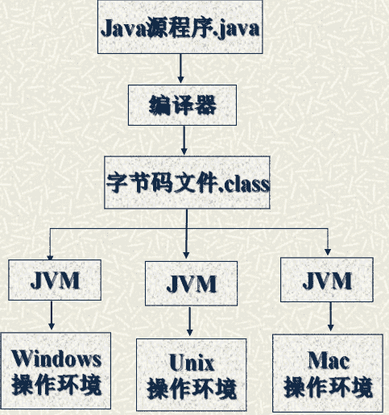

# Java与C/C++

- 跨平台
  - C/C++语言编译为机器码；机器直接执行
  - Java语言编译为字节码，通过JVM编译为机器码
- 指针
  - C/C++语言有指针类型；Java语言没有指针类型
- 继承
  - C++允许多继承；Java语言仅允许单继承
- 速度
  - C/C++运行速度快；Java运行速度较慢

# 编写Java程序——Key Point!

下载J2SDK，安装和设置。
Java2 Software Development Kit
命令行方式
javac（编译器）；java（解释器）
http://java.sun.com/j2se/1.4/download.html

Java IDE（集成开发环境）：
JBuilder
Visual Age for Java、Visual J++、Visual Café
Eclipse（推荐）
JCreator

# Demo

```java
public class Example
{
    public static void main(String args[])
    {
        System.out.println("Hello Java!");
    }
}
```

# Eclipse

1. Eclipse——目前最好的Java开发工具

2. Http://www.eclipse.org下载Eclipse最新版本

3. 下载语言包(Language Park)，含中文版

4. 安装步骤

直接解压下载的Eclipse软件包到磁盘的目录下，如 Eclipse 3.5，解压到E:\Eclipse

解压语言包，将语言包下面的两个文件夹直接拷贝到E:\Eclipse目录下，覆盖原文件夹：

features, plugins

进入E:\Eclipse目录，执行Eclipse

将自动搜索JDK，并建立工作区

请在课程网站上下载有关Eclipse的操作指南

# Do it!

在你的机器上安装JDK，Eclipse

- JDK的安装文件夹为D:\Java6
- Eclipse的安装文件夹为 D:\Eclipse
- 你的工作区为D:\MyJavaFile

# Eclipse Demo

在屏幕上输出：Hello, Java！
步骤：
- 打开Eclipse
- 文件——新建——项目(Project)
- 新建项目对话框——Java项目
- 输入“项目名”：Hello，点击“完成”
- 在左侧的“导航器”上，在“Hello”点击右键——“新建”——类，
- 在弹出的Java类对话框中，“名称”输入：Hello
- 想要创建哪些方法存根：选择public static void main(String[] args)，进入编程窗口

# 一个Java程序必须以public class开头

# 关于命令行参数的注释

# 一个程序中必须有一个main方法

# 程序代码写在这里

# 大括号必须成对出现

# 这个窗口显示程序执行结果

public class Hello {
    /**
     * @param args
     */
    public static void main(String[] args) {
        // TODO 自动生成方法存根
    }
}


## 运行程序

1. 菜单或者工具按钮：运行方式  
2. 选择：Java应用程序

```java
public class Hello {

    /**
     * @param args
     */
    public static void main(String[] args) {
        // TODO 自动生成方法存根
        System.out.println("Hello, Java");
    }
}
```

Hello, Java

## Hello, Java!

```java
public class Hello {
	/**
	 * @param args
	 */
	public static void main(String[] args) {
		System.out.println("Hello,Java");
	}
}
```

## 输出语句

- 一个程序必须有至少一个输出！
- Java中使用print方法——输出信息
  - print方法 ——是输出方法：out
  - out 是由Java系统完成的：System，so：
- System.out.print();
  - 其中的“.”表示“属于”
- print() 没有换行
- println() 执行之后自动换行

# System.out.print();

在输入上述语句的时候，Eclipse有“Tips”：

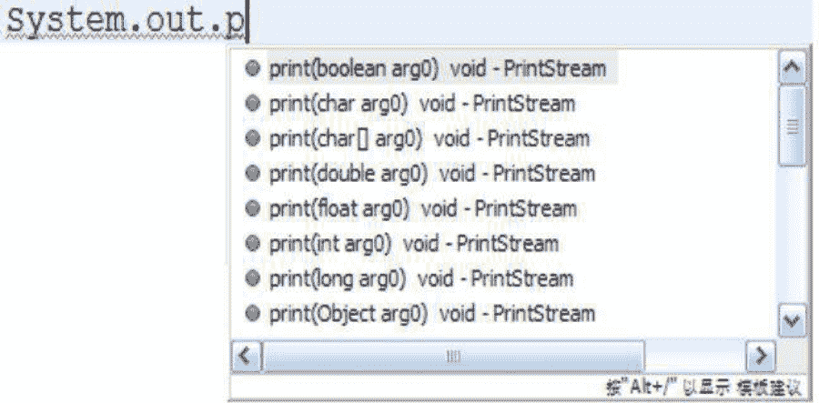

## Java的命令行和输入

### 一个例子：通过命令行输入Hello, Java!

```java
public class Hello {
/**
 * @param args
 */
public static void main(String[] args) {
    System.out.println(args[0]+" "+args[1]);
}
}
```

## Java编程：J2SE

- 利用编辑器编写 Java源程序 主类名.java  
  如：Hello.java

- 通过javac编辑器 → 字节码：类文件名.class  
  编译Java文件：javac Hello.java  
  得到Class文件：Hello.class

- 在虚拟机下(java)运行：java 类文件名  
  java Hello Hello Java！


```java
public class Hello {
public static void main(String[] args) {
System.out.println(args[0]+" "+args[1]);
}
}
```

- 其中：args为命令行参数  
- arguments  
- Demo：
  1. 设置Java的路径  
  2. 将Hello.java拷贝到Java目录下  
  3. 开始——运行：cmd，进入命令行出口  
  4. 编译：javac Hello.java  
  5. 执行：java Hello hello，Java！  
  这里的“hello，”就是args[0]，“Java！”就是args[1]。中间用空格隔开

# 在Eclipse中执行：

- 单击“运行”按钮或者“运行”菜单的运行命令  

- 在“(x)=自变量”选项卡中输入 Hello, Java！  

- 即这个栏目就是代表——命令行参数  

- 运行！  

- ——相当于“输入”数据  

# System.out.println(args[0]+" "+args[1]);

- 其中的“+”，表示连接符  

## 练习：

- 编写一个Java程序，命令行输入：
  - Hello, Java！
  - 程序中输出信息如下：
    Hello, Java！
    我们正在学习Java编程

## 本周作业

- 安装Java，Eclipse  
- 练习教材上的例题P8：【例1-1】
  - 在Java命令行下编译执行（部分同学选做）  
  - 在Eclipse中建立该文件并执行  
- 编写程序：
  命令行输入并在程序中输出：
  Hello, the World！
  程序输出：这是我编写的第一个Java程序！

## Chapter 2

## Java 基础

# Overview

- 2.1 标识符和关键字  
- 2.2 数据类型与常量、变量  
- 2.3 运算符和表达式  

# 2.1 标识符和关键字

- 标识符（Label Signal）：  
  Java中用来标记变量和其他运算的符号  

- 关键字（Key Words）  
  Java已经使用的一些字符，用户不能使用  

- Java语言  
  - Unicode字符集，16位编码  
  - 前256个字符与ASCII相同  


## Java 标识符

标识符是用来标识变量、常量、方法、类、对象等元素的有效字符序列。

Java 的标识符由字母、数字、_和$组成，长度不限，但实际命名不宜过长。

标识符的第一个字符必须为字母、`“_”`或`“$”`。标识符区分大小写。

合法的标识符：name, s_no, $2, boy_number  
非法的标识符：2y, a*b, w/

## 标识符规则

- “见名知义”，规范大小写的使用方式  

  1. 大多数为小写字母开头  
     - 变量名、对象名、方法名、包名  
     - 标识符由多个单词构成，则首字母小写，其后单词的首字母大写，其余字母小写。如getAge。  

  2. 类名首字母大写  

  3. 常量名全部字母大写  

  规则：非强制性  

## Java 关键字

- 表 2-1  

- 关键字是由Java语言定义的、具有特殊含义的字符序列  

- 用户只能按照系统规定的方式使用，不能自行定义  

- 关键字一律用小写字母表示。  

## 2.2 数据类型

- 基本数据类型  
  - 简单数据组成的数据类型，其数据是不可分解的。  
    例如，  
    - 整数类型int的数据有34，17等，可以进行整除运算  
      34/17。  

- 基本数据类型有：  
  - 整数、小数、字符等  

- Java数据还包括  
  - 数组（array）、类（class）和接口(interface)  
  - 被称为“引用数据类型”  

# Java

# 数据类型

## 基本类型

## 引用类型

- 整型  
- 浮点型  
- 字符型  
- 布尔型  

- 数组 Array  
- 接口 Interface  
- 类 Class  

# Java 整型

- 整型有4种，差别在于  
  - 内存空间和  
  - 数据取值范围  

| 数据类型 | 所占字节 | 取值范围 |
|---|---:|---|
| long（长整型） | 8 | −9223372036854775808～9223372036854775807 |
| int（整型） | 4 | −2147483648～2147483647 |
| short（短整型） | 2 | −32768～32767 |
| byte（位） | 1 | −128～127 |

# Java 整型

- 一个整数的缺省类型为int  
  - 表示整数为long型，在其后加L或l，  
  - 如345L  
- Java提供了3种进制的整数表示：  
  - 十进制数。0~9表示的数，首位不能为0  
  - 八进制数。0~7表示的数，以0为前缀  
  - 十六进制数。0~9，a~f或A~F之间的字母表示的数，以0x或0X为前缀  


## 浮点数

- 浮点数类型有2种表示形式：
  - 标准记数法
    - 由整数部分、小数点和小数部分组成
    - 如12.37
  - 科学记数法：由尾数、E或e及阶码组成
    - 也称为指数形式
    - 如2.5E4表示2.5×10⁴
  - 2种浮点数类型
    - float 单精度浮点数
    - double 双精度浮点数

## 取值范围及所占用的内存大小

| 浮点数类型 | 所占字节 | 取值范围 |
|---|---|---|
| float（单精度浮点数） | 4 | -3.4E38～3.4E38 |
| double（双精度浮点数） | 8 | -1.7E308～1.7E308 |

- 浮点数默认类型为double
- 表示浮点数为float型，加后缀F或f
  - 如34.5f

## 字符类型

- 字符类型：char
  - Unicode字符，1个字符占16位
- 字符类型数据表示方法
  - 单引号括起来的单个字符
  - 用Unicode码表示，前缀是“\u”
- Unicode字符集内的控制字符需要通过转义字符表示
  - 转义符 → 符号的意义被转换了
  - 转义后代表的是控制符

| 转义字符 | 功能 | Unicode码 |
|---|---|---|
| \b | 退格 | \u0008 |
| \t | 制表符 | \u0009 |
| \n | 换行 | \u000a |
| \f | 换页 | \u000c |
| \r | 回车 | \u000d |

## 字符串

- 字符串（String）
  - 由多个字符组成的字符序列
  - 字符串用双引号括起来
  - 如"green "

## 布尔类型

- 逻辑运算
  - 运算结果：真(true)或假(false)
- 布尔类型（boolean）
  - 表示逻辑运算，运算结果叫做“**布尔值**”
  - 运算结果，只有2个值：
    - true（真）
    - false（假）
    - 布尔值占1个字节

## Java数据基本类型表——小结

| 关键字 | 数据类型 | 所占字节 | 表示范围 |
|---|---|---|---|
| long | 长整型 | 8 | 2^31-1 ~ -2^31 |
| int | 整型 | 4 | -2147483648~ 2147483647 |
| short | 短整型 | 2 | -32768~32767 |
| byte | 位 | 1 | -128~127 |
| char | 字符 | 1 | 0~256 |
| boolean | 布尔 | 1 | true 或 false |
| float | 单精度 | 4 | -3.4E38~ 3.4E38 |
| double | 双精度 | 8 | -1.7E308~ 1.7E308 |

## 2 常量

### 常量

- 程序运行过程中其值始终保持不变的量
- 类似于数学中的“常数”

### Java中的常量类型

- 整型，如：26
- 浮点数型，如：47.3
- 字符型，如：'A'
- 布尔型，如：true
- 字符串型，如："student"

### 常量的这种表示方式称为直接常量

## 符号常量

- 标识符表示常量，称为符号常量
- 符号常量必须先声明，后使用
  - 声明关键字final，声明方式：
    `final [修饰符] 类型标识符 常量名 = （直接）常量;`
  - 修饰符是表示该常量使用范围的“权限修饰”：
    public，private，protected 或 缺省(不使用修饰符)
    - 如
      `final float PI=3.14159;    //PI是一个浮点常量`
      `final char SEX='M';    //SEX是一个字符常量`
      `final int MAX=100;    //MAX是一个整型常量`

## 符号常量的优点

1. 增加了程序的可读性
   - 从常量名可知常量的含义。

2. 增强了程序的可维护性
   - 只要在声明处修改常量的值，就自动修改了程序中所有地方所使用的常量值

## 3 变量

变量：程序运行中其值可以改变的量
变量必须先定义后使用
定义变量的格式：
[修饰符] 类型标识符 变量名[=常量];
例如：public int x=1;  // x为整型变量，初值为1
类型标识符：基本数据类型或引用数据类型
变量名必须符合标识符的规定→习惯小写
声明同类型的多个变量，用逗号分隔
若声明中包含“=常量”部分，系统将此常量作为变量的初始值

## Demo

以下是合法的变量声明
float x=25.4, y; // x、y为浮点型变量，x初值为25.4
char c; // c 为字符型变量
boolean flag1=true, flag2; // 布尔型变量
int n, m; // 整型变量
上例中
变量 x 和flag1 被赋予初始值
其它变量没有初始化

## 【例2-1】：使用整数型变量

```java
public class Integers {
    public static void main(String args[]) {
        int a=015; // 定义变量a，赋值八进制数
        int b=20; //十进制数
        int c=0x25; //十六进制数
        short x=30; //定义short型，十进制
        long y=123456L;
        System.out.println("a="+a); // 输出 a 的值
        System.out.println("b="+b); // 输出 b 的值
        System.out.println("c="+c); // 输出 c 的值
        System.out.println("x="+x); // 输出 x 的值
        System.out.println("y="+y); // 输出 y 的值
    }
}
```

## 【例2-1】结果

程序运行结果如下

a=13
b=20
c=37
x=30
y=123456

## 【例2-2】：使用浮点型变量

```java
public class Floats {
    public static void main(String args[]) {
        float a=35.45f;                 // 定义单精度变量a
        double b=3.56e18;               // 定义双精度变量b
        System.out.println("a="+a);    // 输出a
        System.out.println("b="+b);    // 输出b
    }
}
```

程序运行结果如下：

a=35.45

b=3.56E18

## 【例2-3】：使用字符类型变量

```java
public class Characters {
    public static void main(String args[]) {
        char ch1='a';        // 定义字符变量 ch1
        char ch2='B';         // 定义字符变量 ch2
        System.out.println("ch1="+ch1);  // 输出字符变量ch1
        System.out.println("ch2="+ch2);  // 输出字符变量ch2
    }
}
```

程序运行结果如下：
ch1=a
ch2=B

## 【例2-4】：使用字符串类型数据

```java
public class Samp2_5 {
    public static void main(String args[]) {
        String str1="abc"; // 定义字符串变量str1
        String str2="\n"; // 定义字符串变量str2
        String str3= "123"; // 定义字符串变量str3
        // 输出字符串变量时str1、 str2、 str3
        System.out.println("str1="+str1+str2+"str3="+str3);
    }
}
```
程序运行结果如下：
str1=abc
str3=123


## 【例2-5】：使用逻辑类型变量

```java
public class Logic {
    public static void main(String args[]) {
        boolean instance1 = true;
        boolean instance2 = false;
        System.out.println("逻辑状态1=" + instance1 + " " +
                "逻辑状态2=" + instance2);
    }
}
```

程序运行结果如下：
逻辑状态1=true 逻辑状态2=false

## 2.3 运算符和表达式

- **运算符 operator**
  - 表示各种运算的符号
  - 参与运算的数据称为操作数

- **运算符分类：根据操作数的个数**
  - 单目运算：只有一个操作数
  - 双目运算：有两个操作数
  - 多目运算符：多个操作数

- **根据运算性质，运算符分为**
  - 算术运算符：+(加)、-(减)、*(乘)、/(除)、%(求余数)、++、--
  - 关系运算符：>、<、>=、<=、==、!=
  - 逻辑运算符：&(与)、|(或)、!(非)、^(异或)、&&(条件与)、||(条件或)
  - 位运算符：~(反)、&(与)、|(或)、^(异或)、<<(左移)、>>(右移)、>>>(无符号右移)

## 算术运算符

+、-、*、/、%

例如：if( a=(a/10)*10+a%10)

23+5 // 加的结果是 28

6*5 // 乘的结果是 30

27/3 // 除的结果是 9

45/4 // 除的结果是 11, Why?

45.0/4 // ??

9%3 // 余数是 0

9%4 // 余数是 1

## 单目算术运算符

- ++：自增
- --：自减
- -：负号

## ++、--

- 仅用于整型变量
- ++、--可在变量左边，也可在变量右边

### 例如：

```c
int j=5;
k=j++;
x=++j;
--j;
j--;
```

//结果，j等于6
//结果，j等于7
//结果，j等于6
//结果，j等于5

## 【例2-6】：++、-- Demo：

```java
public class OOperator {
    public static void main(String args[]) {
        int i=15, j1, j2, j3, j4;
        j1=i++;
        //在操作数的右面
        System.out.println("i++="+j1);
        j2=++i;
        //在操作数的左面
        System.out.println("++i="+j2);
        j3=--i;
        System.out.println("--i="+j3);
        j4=i--;
        System.out.println("i--="+j4);
        System.out.println("i="+i);
    }
}
```

i++=15
++i=17
--i=16
i--=16
i=15

## 上机实验 2-1

阅读并上机运行下列程序(Next Page)，并写出程序的运行结果

### 思考：

- 字符 ‘A’ 和 ‘a’ 之间有什么关系？
- 假设 字符型变量 ch 中有大写字母，那么
  ```c
  ch += ('a' - 'A');
  ```
  则：ch 中是什么？

```java
public class Lab21 {
    public static void main(String[] args) {
        int n,m,k;
        m=n=1;
        k=m++;
        System.out.println("m="+m+" k="+k);
        float x,y,z;
        x=y=1;
        y+=x;
        z=x+y;
        z/=(x-y);
        System.out.println("x="+x+" y="+y+" z="+z);
        char ch1='A',ch2='\u0041';
        System.out.println("ch1="+ch1+" ch2="+ch2);
        ch2+=32;
        System.out.println("ch1="+ch1+" ch2="+ch2);
        String str1="Hello,",str2="Welcome to Core Java!";
        System.out.println(str1+str2);
    }
}
```

## Lab 21

## 关系运算符

- 关系运算：
  - 是2个操作数间的比较运算

- 关系运算符有：
  - `>`、`<`、`>=`、`<=`、`=`、`==`、`!=`

- `=`、`==`、`!=`
  - 还可用于布尔类型及字符串类型操作数
  - 字符型比较依据是其Unicode值，从左向右比较每个字符

- 关系运算的运算结果为布尔值：
  - 关系成立，结果为 `true`
  - 否则其运算结果为 `false`

| 运算符 | 用例 | 功能 |
|---|---|---|
| > | a > b | 如果a > b成立，结果为true；否则，结果为false |
| >= | a >= b | 如果a ≥ b成立，结果为true；否则，结果为false |
| < | a < b | 如果a < b成立，结果为true；否则，结果为false |
| <= | a <= b | 如果a ≤ b成立，结果为true；否则，结果为false |
| == | a == b | 如果a = b成立，结果为true；否则，结果为false |
| != | a != b | 如果a ≠ b成立，结果为true；否则，结果为false |

## 关系运算符，Demo:

```
23.5>10.4    // 结果是true
45!=45       // 结果是false
'7'<'6'      // 结果是false
true!=false  // 结果是true
'T'<'a'      // 结果是true
'u'<'9'      // 结果是false
```

## 二机实验 2-2

阅读并上机运行下列程序(Next Page)，并写出程序的运行结果

### 思考：

- s1 和 s2 为什么不相等？
- s1 和 s2 哪一个大？

## Lab22

```java
public class Lab22 {
    public static void main(String[] args) {
        int m=3,n=2;
        System.out.println("m="+m+" n="+n+". m大于n吗?"+(m>n));
        m--;
        System.out.println("m="+m+" n="+n+". m大于n吗?"+(m>n));
        String s1="Hello",s2="Hello!";
        System.out.print("\n str1="+s1+";str2="+s2);
        System.out.print("\n s1和s2相等吗?"+(s1==s2));
    }
}
```

## 逻辑运算符

### 逻辑运算

- 运算对象为布尔型操作数
- 运算结果仍然是布尔值

### 逻辑运算符有：

- `&`（与）：`a & b` //a、b均为true，结果为true
- `|`（或）：`a | b` //a、b有一个true，结果为true
- `!`（非）：`!a` //a为true，结果为false，a为false，结果为true
- `^`（异或）：`a^b` // a b不同结果为true
- `&&`（条件与）：`a && b`
- `||`（条件或）：`a || b`

| a | b | !a | a&b，a&&b | a|b，a||b | a^b |
|---|---|---|---|---|---|
| false | false | true | false | false | false |
| false | true | true | false | true | true |
| true | false | false | false | true | true |
| true | true | false | true | true | false |

## 逻辑运算 Demo:

```
!true              //结果是false
true & false       //结果是false
true | false       //结果是true
```

用途：判断条件是否满足，例如：

- `(age>20) && (age<30)`　//判age的值是否在20~30之间
- `(ch=='b') || (ch=='B')`　//判ch的值是否为字母'b'或'B'
- `(ch>='0' && ch<='9')`　//判ch是否为数字0~9


## 位运算符

### 位运算

- 操作数：整型
- 运算规则：按二进制的位
- 运算结果：整型值

### 位运算符有

- ~ （位反）
- & （位与）、| （位或）
- ^ （位异或）
- << （左移）、>> （右移）、>>> （无符号右移）

### 位运算真值表

| a | b | ~a | a&b | a\|b | a^b |
|---|---|---|---|---|---|
| 0 | 0 | 1 | 0 | 0 | 0 |
| 0 | 1 | 1 | 0 | 1 | 1 |
| 1 | 0 | 0 | 0 | 1 | 1 |
| 1 | 1 | 0 | 1 | 1 | 0 |

### 位运算符（理解）

| 运算符 | 用例 | 功能 |
|---|---|---|
| `~` | `~a` | 将 a 逐位取反 |
| `&` | `a & b` | a、b 逐位进行“与”操作 |
| `\|` | `a \| b` | a、b 逐位进行“或”操作 |
| `^` | `a ^ b` | a、b 逐位进行“异或”操作 |
| `<<` | `a<<b` | a 向左移动 b 位 |
| `>>` | `a>>b` | a 向右移动 b 位 |
| `>>>` | `a>>>b` | a 向右移动 b 位，移动后的空位用 0 填充 |

### 位运算 Demo:

设 x=132，y=204；计算~x和x^y的值

1. 将整数转换为二进制数。
   x=10000100，y=11001100

2. 对x按位进行取反操作。
   ~10000100→01111011

3. 对x，y按位进行异或操作
   ```text
       10000100
   ^   11001100
   ──────────
       01001000
   ```

4. 所得结果：~x=123，x^y=72。

### 上机实验2-3

- 阅读并上机运行下列程序，并写出程序的运行结果
- 思考：
  - 如果给 b1 赋值2，程序会怎样？
  - 解释 n、m的运算结果。如果“m、n的位与后左移3位的结果”是什么？左移有什么特点？

### Lab23

```java
public class Lab23 {
    public static void main(String[] args) {
        boolean b1=true, b2=false;

        System.out.println("逻辑变量b1="+b1+", b2="+b2);
        System.out.println("b1^b2(异或运算)的结果是："+(b1&b2));
        System.out.println("b1^!b2(b2取反后)"+
                "b1异或运算)的结果是："+(b1&&!b2));

        int n=0x1F,m=017;
        System.out.println("n="+n+",m="+m+", " +
                "m和n的位与运算结果是："+(m&n));
        System.out.println("m、n的位移与左移2位的结果："+(m&n)<<2);
    }
}
```

## 赋值运算符

赋值运算用于给变量赋值，形式如下：
变量名=表达式；

赋值运算的次序是从右向左的，即先计算表达式的值，再将表达式的值赋予变量。例如：

int i=3, j;
j=(i+2)/4 ;
i=2*j;
j=j+4;

//i的初始值是3
//结果得j值
//结果i是10
//结果，j的值是9

是5

## 复合赋值运算符

由赋值运算符与算术运算符、逻辑运算符和位运算符组合成，使用方法：

| 运算符 | 用例 | 等价于 | 运算符 | 用例 | 等价于 |
|---|---|---|---|---|---|
| += | x += y | x=x+y | &= | x &= y | x=x&y |
| -= | x -= y | x=x-y | \|= | x \|= y | x=x\|y |
| *= | x *= y | x=x*y | ^= | x ^= y | x=x^y |
| /= | x /= y | x=x/y | <<= | x <<= y | x=x<<y |
| %= | x %= y | x=x%y | >>= | x >>= y | x=x>>y |
| >>>= | x >>>= y | x=x>>>y |  |  |  |

## Demo:

```
i*=10;
i=i*10;
```

等价于

```
x/=3;
x=x/3;
```

等价于

## 括号运算符

### 圆括号运算符：（）

- 改变表达式中运算符的运算次序
- 先进行括号内的运算，再进行括号外的运算
- 多层括号的情况下，先内后外逐层运算

## 表达式 Express

表达式 → 运算符将操作数连接起来的符合语法规则的式子

例如：

```
int i=5, j=10, k;
k=(24+3*i)*j;  //这是表达式
```

## 运算符的优先级

| 运算符 | 描述 | 优先级 | 结合性 |
|---|---|---:|---|
| `.  []  （）` | 域，数组，括号 | 1 | 从左至右 |
| `++  --  -  !  ~` | 一元运算符 | 2 | 从右至左 |
| `*  /  %` | 乘，除，取余 | 3 | 从左至右 |
| `+  -` | 加，减 | 4 | 从左至右 |
| `<<  >>  >>>` | 位运算 | 5 | 从左至右 |
| `<  <=  >  >=` | 逻辑运算 | 6 | 从左至右 |
| `==  !=` | 逻辑运算 | 7 | 从左至右 |
| `&` | 按位与 | 8 | 从左至右 |
| `^` | 按位异或 | 9 | 从左至右 |

## 续前表

| 运算符 | 描述 | 优先级 | 结合性 |
|---|---|---|---|
| `\|` | 按位或 | 10 | 从左至右 |
| `&&` | 逻辑与 | 11 | 从左至右 |
| `\|\|` | 逻辑或 | 12 | 从左至右 |
| `? :` | 条件运算 | 13 | 从右至左 |
| `= *= /= %= += -= <<= >>= >>>= &= ^= \|=` | 赋值和复合运算 | 14 | 从右至左 |

## 表达式的数据类型

- 表达式将得到一个结果，这个结果的数据类型就是表达式数据类型
- 例如：

```
int i=3, j=21, k;
boolean f;
k=(i+3)*4;    //(i+3)*4是算术表达式
f=(i*2)>j;     //(i*2)>j是布尔表达式
```

## 数据类型转换规则

- 低级别的值赋给高级别的变量时，系统自动转换  
  float x=200; // 将int型200转换成float值200.0  
  // 结果x的值是200.0

- 高级别的值赋给低级别变量，须强制类型转换  
  int i;  
  i= (int) 26.35; // double值26.35转换成int值26  
  // 结果i获得int类型值26  
  // 如果26.95？

- 进行强制类型转换时，可能会造成数据精度丢失

运行结果如下：

```
k=3
f1=3.0
f2=3.75
```

## Lab 2-4

- 阅读并上机运行下列程序，并写出程序的运行结果
- 思考并回答问题：
  - temp的结果为什么是2？ 计算出temp后， m、n、k的值各为多少？
  - 语句float x=3.14f;改为float x=3.14;会出错， 为什么？
  - 表达式(m+2*n)/k的值为什么是2？
  - 如果将x=(m+2*n)/k改为x=(m+2*n)/(float)k， x的结果是多少？

## Lab24

```java
public class Lab24 {
    public static void main(String[] args){
        int m=1,n=2,k=3,temp;
        temp=(m+n>k)?(m++):(--m+n++);
        System.out.println("(m+n>k)?(m++):(--m+n++)的运算结果："+temp);

        float x=3.14f;
        System.out.println("float型变量强制转换为int型的结果："+(int)x);

        m=1;
        x=(m+2*n)/k;
        System.out.println("int型变量运算：(m+2*n)/k的结果是："+((m+2*n)/k));
        System.out.println("(m+2*n)/k的结果是赋值给float型变量x="+x);
    }
}
```


## Homework

- P28 习题1-7
- 习题8：假设摄氏温度为38度，计算相应的华氏温度值。
- 系统9：假设半径为6.5，计算球的体积。

## Overview

本章为课程的重点之一

- 3.1 语句及程序结构
- 3.2 顺序结构
- 3.3 选择结构
- 3.4 循环结构
- 3.5 跳转语句

## 语句

### 语句，Statement

- 向计算机系统发出操作的代码
- 程序由一系列语句组成，语句以 “; ” 结束

### Java语句类型

- 表达式语句，如： total=math+phys+chem
- 空语句，只有一个 “;”
- 复合语句，用 “{}”将多条语句括起来作为一条语句使用，如：
  - If (x>10)
  - z=x+y;
  - t=z/10;
- 方法调用语句： 方法名(参数); 如：
  - System.out.println("Java Language");
- 控制语句，完成一定的控制功能，包括
  - 选择语句
  - 循环语句

## 程序结构

- 任何程序有3种基本的结构：
  - 顺序结构
  - 分支结构
  - 循环结构
- 顺序结构
  - 最简单的一种程序结构
  - 程序按照语句的书写次序顺序执行

## 顺序结构 Demo1，【例3-1】

```java
public class Force {    // 计算太阳和地球之间的万有引力
public static void main(String args[]) {
    double g, mSun, mEarth, f;

g=6.66667E-8;
mSun = 1.987E33;
mEarth = 5.975E27;
f = g* mSun* mEarth /(1.495E13*1.495E13);
System.out.println("The force is "+f);
}
}
```

## 顺序结构 Demo2，【例3-2】

```java
// 华氏温度转换为摄氏温度： c=5(F-32)/9
public class Conversion{
    public static void main(String args[]) {
        float f, c;
        f=70.0f;
        c=5*(f-32)/9;
        System.out.println("Fahrenheit="+f);
        System.out.println("Centigrade="+c);
    }
}
```

## 顺序结构Demo3，【例3-3】

```java
public class Root {
    public static void main(String args[]) {
        int a, b, x;
        a=Integer.parseInt(args[0]); //命令行输入第一个数
        b=Float.parseFloat(args[1]); //命令行输入第二个数
        x=-b/a; // 求根 x
        System.out.println("a="+a); // Out Result
        System.out.println("b="+b);
        System.out.println("x="+x);
    }
}
```

## Demo3 解析：

其中语句：a=Float.parseFloat(args[0]);

转换为浮点数

这是命令行输入的第一个数

Eclipse“运行”——Java应用程序对话框的(x)=自变量栏中键入：
2.0 6.0
运行程序，屏幕输出结果如下：
a=2.0
b=6.0
x=-3.0
这里： 2.0和6.0分别作为第1和第2个参数传递给args[0]和args[1]。

## Lab 3-1

- 题1：编写一个程序，计算方程 ax=b 的x，其中a、b通过命令行输入，且为长整型，但 x 为Double型。
- 题2：程序计算：华氏温度转换为摄氏温度： c=5(F-32)/9，其中F值通过命令行输入。
- 选作：求解二元一次方程。系数通过命令行输入，假设输入能够有解。

## 选择结构

- 选择结构，也叫分支结构
- Java分支选择语句：
  - **if**　 二选一
  - **switch**　 多选一

## if 语句

- if (布尔表达式) 语句
- if (布尔表达式) 语句1 else 语句2

## 选择结构 Demo1：

```java
public class MinNum {//【例3-4】命令行输入2个整数，输出较小者
public static void main(String args[]) {
int x, y, min;
x=Integer.parseInt(args[0]); //命令行第一个数
y=Integer.parseInt(args[1]); //命令行第一个数

if(x<y) min=x; // 比较 x、y的大小
else min=y;

System.out.println("x="+x+“ y="+y);
System.out.println("min="+min);
}
}
```

## 选择结构 Demo2:

```java
public class Root { // [例3-5]:求解ax+b=0(a≠0)的根
public static void main(String args[]) {
    float a, b, x;

a=Float.parseFloat(args[0]); // 输入a
b=Float.parseFloat(args[1]); // 输入b

if (Math.abs(a)>0.000001f) { // a!=0
    x=-b/a;
    System.out.println("x="+x); // 输出x
    }
}
}
```

## if 语句嵌套

if 语句中可以包含if语句，形成嵌套

```
if（布尔表达式1）
    语句1
else if（布尔表达式2）
    语句2

    ……
        else if（布尔表达式n）
            语句n
```

```java
public class Function{
    public static void main(String args[]) {
        float x, y;
        x=Float.parseFloat(args[0]);
        if ( x<0 )
            y = 0;
        else if ( x >=0 && x <= 10 )
            y = x;
        else if ( x > 10 && x <= 20 )
            y = 10;
        else
            y = -0.5f * x + 20;
        System.out.println("x="+x);
        System.out.println("y="+y);
    }
}
```

| 例3-6 分段函数 |  |
|---|---|
| x | y |
| x<0 | 0 |
| 0<=x<=10 | x |
| 10<x<=20 | 10 |
| 20<x | 0.5x+20 |

## Lab 3-1

### 题3：计算分段函数的值

| x | y |
|---|---|
| x<0 | -1 |
| x=0 | 0 |
| 0<x≤10 | 1 |
| 10<x≤20 | 2 |
| 20<x | x/2 + 20 |

## Switch语句

```java
switch (表达式) {
    case 值1: 语句块1; // 如果表达式值为值1，执行语句块1
        break; // 终止，结束switch语句
    case 值2: 语句块2;
        break; // 终止，结束switch语句
    ......
    case 值n: 语句块n; // 如果表达式值为值n，执行语句块n
        break; // 终止，结束switch语句
    default: // 如果表达式值与值1～值n都不同，执行语句块n+1
        语句块n+1;
}
```


## Switch语句

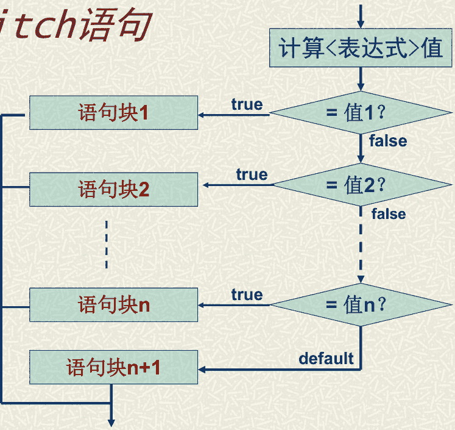

// 【例3-7】命令行输入1～12之间的数字，输出对应的月份的英文名
public class Chapter37 {
public static void main(String[] args) {
String str="";
switch(Integer.parseInt(args[0])){//根据输入的值进行多选
case 1: str="January"; break;
case 2: str="February"; break;
case 3: str="March"; break;
case 4: str="April"; break;
case 5: str="May"; break;
case 6: str="June"; break;
case 7: str="July"; break;
case 8: str="August"; break;
case 9: str="September"; break;
case 10: str="October"; break;
case 11: str="November"; break;
case 12: str="December"; break;
default: str="The Input Error!";
}
System.out.println(str);//输出
}}

## 多分支Demo：【例3-8】

将百分制成绩转化为优秀、良好、中等、及格和不及格的5级制成绩。

标准为：

优秀： 90~100分；
良好： 80~89分；
中等： 70~79分；
及格： 60~69分；
不及格：60分以下

思路

- 第一步： 将百分制划分等级
- 第二步： 将等级对应的中文字符输出

```
// 教材 Chapter 3，【例3-8】命令行输入百分制成绩转换为等级制
public class Chapter38 {
    public static void main(String[] args) {
        String newGrade=""; // 存放新的等级成绩
        int grade,temp; // grade为原来的百分制成绩
        grade=Integer.parseInt(args[0]);

        System.out.println("百分制的成绩为: "+grade);
        switch(grade/10){
        case 10:
        case 9: newGrade ="优秀"; break;
        case 8: newGrade ="良好"; break;
        case 7: newGrade ="中等"; break;
        case 6: newGrade ="及格"; break;
        case 5:
        case 4:
        case 3:
        case 2:
        case 1:
        case 0: newGrade ="不及格"; break;
        default: newGrade="输入的数据错误";
        }
        System.out.println("对应的等级为: "+newGrade);
    }
}
```

```
// 新的处理思路
public class Chapter38_New { //@param args: 百分制成绩
public static void main(String[] args) {
String newGrade=""; // 存放新的等级成绩
int grade; // grade为原来的百分制成绩
grade=Integer.parseInt(args[0]);
if (grade>100 | grade<0) {
System.out.println("输入数据出错，程序退出");
System.exit(0);
}
System.out.println("百分制的成绩为： "+grade);
switch(grade/10){
case 10:
case 9: newGrade ="优秀"; break;
case 8: newGrade ="良好"; break;
case 7: newGrade ="中等"; break;
case 6: newGrade ="及格"; break;
default: newGrade ="不及格";
}
System.out.println("对应的等级为： "+newGrade);
}
}
```

## Lab3-2

- 题1：
- 使用switch计算运动员名次与分值：

| 名次 | 分值 |
|------|------|
| 1    | 7    |
| 2    | 5    |
| 3    | 4    |
| 4    | 3    |
| 5    | 2    |
| 6    | 1    |

- 命令行输入名次，程序输出转换后的分值

- 选做：累计输入，并给出每次累计的结果，直到输入一个负数表示介绍。

## 循环结构

### 循环语句

- 在一定条件下，反复执行一段程序代码
- 被反复执行的程序代码称为循环体。

### Java提供的循环语句有

- while语句
- do...while语句
- for语句。


## while 语句

### 语句格式：
while （布尔表达式） {
    循环体
}

含义：当逻辑表达式计算结果为true时，重复执行循环体。

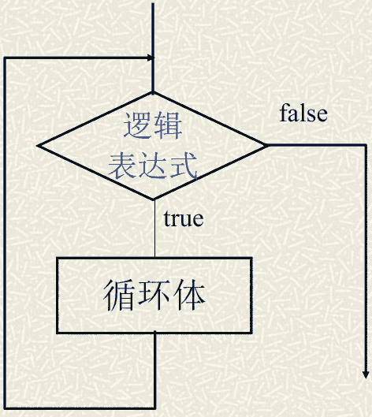

## 循环控制Demo1，【例3-9】

```
public class Factorial { // 计算10!
public static void main(String args[])
{
    int i=1;    // 循环变量
    double s=1; // 存放结果的变量

    while (i<=10) {
    s=s*i;    // 循环体
    i=i+1;
    }
    System.out.println("10!="+s);
}
}
```

计算结果：
10!=3628800.0

## 一个小问题：

- 上题答案： 10!=3628800.0
- 正确结果应该为： 10!=3628800
- How to do ......？
- 使用语句
- System.out.printf("10!= %.0f",s);
- 强制转换
- System.out.printf("10!="+(long)s);
- 其中， printf语句和C中printf功能相同

## 循环结构 Demo2：【例3-10】

```java
public class Sum1 {  //例：计算1+3+5+...+99
    public static void main(String args[]) {
        int i=1, s=0;   // i循环变量，s存放结果

        do {
            s=s+i;       // 循环体
            i=i+2;
        } while (i<100);

        System.out.println("sum="+s);
    }
}
```

## 另一种算法

// 教材 第3章，例3-10，计算1+2+...99

```
public class Chapter310 {
    public static void main(String[] args) {
        int i=1,s=0; //i循环变量，s 存放求和结果

        do {
            s+=i++;       // 循环体
        }while (i<100);

        System.out.printf("1+2+...+99=%d",s);
    }
}
```

## 例3-10：计算1～50之间的奇数和与偶数和

```java
public class Sum2 {
    public static void main(String args[]){
        int i=1,oddSum=0,evenSum=0;
        do {
            if(i%2==0)  evenSum+=i;    //求偶数和
            else         oddSum+=i;     //求奇数和
            i++;
        }while(i<=50);                  //判断i的值是否在1～50之间

        System.out.println("Odd  sum="+oddSum);
        System.out.println("Even sum="+evenSum);
    }
}
```

其中，循环变量的修改可以程序的在其他什么地方？


## for语句

```
for(Exp1;Exp2;Exp3) {
    循环体
}
```

Express，表达式  
Exp1、Exp2、Exp3

- Exp1：循环初值；
- Exp2：布尔表达式，判断循环是否继续；
- Exp3：修改循环变量值。

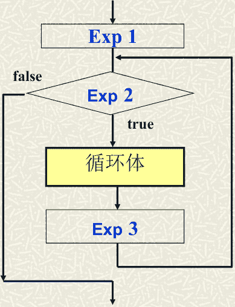

## 例3-12：计算1～100之间的整数之和

```java
public class Sum3 {
    public static void main(String args[]) {

        int i, s=0;    // 循环变量i，s为和数

        for (i=1; i<=100; i++)
            s+=i;       // 循环体，这里只有一条语句

        System.out.println("1+2…+100="+s);
    }
}
```

## 例3-13：求Fibonacci数列中的前20项。

```java
public class Fibonacci {
public static void main(String args[]) {
long f1=1, f2=1;

for (int i=1; i<=10; i++) {
System.out.print(f1+" "+f2+" "); // 循环体
f1=f1+f2;
f2=f1+f2;
}
}
}
```

## Lab 3-2

### 第3题：

- 在程序中
  - 使用While计算1～100之和
  - Do……While求1～100中的奇数之和
  - For语句实现1～100中的偶数之和

## 例3-14：判断素数

- **素数** prime
  - 除了1及自身外，不能被其它数整除的自然数。
- **判断素数的思路**
  - 对于一个自然数k，与2~k-1之间的每个整数进行相除
  - 如果没有一个能被整除，则k是素数；否则k不是素数
- **转为算法**
  - 变量 i 从 2 开始，每次加 1，到 k-1 为止
  - 每次用 k 去除 i，是否能够整除？——求余
  - 判余数：为0，不是素数，终止循环
  - m≠0，不能整除，进行下一次判断
  - 判结束？正常结束（所有的数都判了，即i==k），是素数！
  - 非正常结束，不是素数

```java
public class Prime {
public static void main(String args[])
{
short k=Short.parseShort(args[0]); // 输入k
for (short i=2; i<=k-1; i++)
if (k % i ==0) break; // 循环体
// 如果i和k相等，说明完成了整个循环
if(i==k) System.out.println(k+"is a prime.");
else System.out.println(k+"isn't a prime.");
}
}
```

## 多重循环 Multi-Loop

例如：
for(... ; ... ; ) {    //外循环开始
...
    for(...; ... ; ) {  //内循环开始
    ...
    }   //内循环结束
...
}   //外循环结束

```java
// 例3-15: 计算输出1!、2!、...、5!以及它们的和
public class Factorials {
    public static void main(String args[]) {
        long s=0, k; // s存放阶乘之和，k为每一个数的阶乘
        for (int i=1; i<=5; i++) { //外循环开始
            k=1;
            for (int j=1; j<=i; j++) // 内循环开始
                k=k*j; // 内循环体
            // 内循环结束
            System.out.println(i+"!="+k);
            s=s+k;
        } //外循环结束
        System.out.println("Total sum="+s);
    }
}
```

## 程序运行结果

1!=1  
2!=2  
3!=6  
4!=24  
5!=120  
Total sum=153

## 例：求2-50之间的所有素数

```java
public class Primes {
public static void main(String args[]) {
final int MAX=50;
int i, k;
boolean yes;

for(k=2; k<MAX; k++){ //外循环，k:2~50
yes=true;
i=2;
while (i<=k-1 && yes){ // 内循环，i:2~k
if (k%i++ ==0) yes=false; // 不是素数
}
if (yes) System.out.print(k+" ");
}
}
}
```

```java
public class Chapter316 {
public static void main(String args[]) {
for(int k=2; k<50; k++){ //外循环, k:2~50
boolean yes=true;
int i=2;
while( i<k && yes){ // 内循环, i:2~k
if (k%i++ ==0) yes=false; // 不是素数
}
if (yes) System.out.print(k+" ");
}
}
}
```

程序运行结果如下：

2 3 5 7 11 13 17 19 23 29 31 37 41 43 47

## Lab 3-2

题4：使用循环程序，输出如下图形：

```
*

* *

* * *

* * * *

* * * * *

* * * * * *
```

## 跳转语句

- break语句：使程序的流程从一个语句块内部跳转出来。通常在switch和循环语句中使用。
- continue语句：只在循环语句中使用。其作用是终止当前这一轮的循环，跳过本轮循环剩余的语句，直接进入下一轮循环。

## 例：找素数

```java
public class PrimeNumber {
    public static void main(String args[]) {

        for(int i=2; i<=50; i++) {  // 外循环
            boolean flag=true;

            for(int j=2; j<=i/2; j++){  // 内循环
                if(i%j==0) {        // 条件成立：余数为0
                    flag=false;     // 不是质数
                    break;          // 结束本次内循环
                }
            }
            if(flag) System.out.print(i+" ");
        }
    }
}
```

## Lab 3-3

- 1、第3章 习题 1
- 2、从命令行输入一串字符，统计其中的字母和数字的个数（建议课后练习）。
  - 从命令行输入字符串的语句：s=args(0);\n 其中，变量s为字符串类型
  - 求字符串长度的函数 s.length();
  - 从字符串中读取一个字符的函数：c=s.CharAt(i); 其中，变量c为char型，i表示为第i个字符
  - 判断c是否为数字的表达式

```
c>=‘0’ && c<=‘9’  // c>=‘0’ & c<=‘9’
```

判断是否为英文字符的表达式？

## Lab 3-3

- 3、计算 1!+3!+5!+……+99!
- 4、计算水仙花数——如果一个3位数，每一位数的立方和等于这个数本身，则该数为水仙花数

## Chapter 4

## 方法 - Method

### 概念

- **方法(Method)**
  - 这是Java的一种命名
  - 和通常意义上的“方法”不同
- **Java“方法”的定义**
  - 完成特定功能的、相对独立的程序段
- **特点**
  - 方法可以在不同的程序段中被多次调用
  - 可增强程序结构的清晰度，提高编程效率
- **学习重点**
  - 方法的声明和调用


## Overview

- 4.1 方法声明  
- 4.2 方法调用  
- 4.3 参数传递  
- 4.4 递归  

课程教学重点之一  

## Lab 4-1

- 1、例题 4-1  
- 2、编写“方法”求4个数中的最大数，这4个数由命令行参数提供。  
- 3、第4章 习题2：编写“方法”，计算由命令行输入的两个整数的最大公约数和最小公倍数。  
- 4、第4章 习题6  

## Lab 4-1 Review

- 编写“方法”求4个数中的最大数，这4个数由命令行参数提供。  

- 题意：  
  - 编写比较大小的程序（方法）  
  - 直接求解4个数的大小  
  - 编写的“方法”是比较两个数大小的，然后多次调用这个方法  
  - Which One?  

## 题6 实验代码

```java
public class no6 {
    static int max(int x,int y){
        if (x<y)
            return y;
        else
            return x;
    }

    public static void main(String[] args) {
        int a=Integer.parseInt(args[0]);
        int b=Integer.parseInt(args[1]);

        int x=max(a,b);
        System.out.println(x);
    }
}
```

实验结果，比如输入7和34，结果输出为34  

题6  
public class zuida {
/**
static void area(int a,int b,int c,int d){
if(a<=b)
a=b;
else if(a<=c)
a=c;
else if(a<=d)
a=d;
System.out.println(a);
}
*/
public static void main(String[] args) {
// TODO Autogenerated method stub
}
}

```java
public class xin {
    static int da(int x,int y){
        if (x>=y) {
            return x;
        }
        return y;
    }
    public static void main(String[]args){
        int x,y,a,b;
        x=Integer.parseInt(args[0]);
        y=Integer.parseInt(args[1]);
        a=Integer.parseInt(args[2]);
        b=Integer.parseInt(args[3]);
        System.out.println("+a+"+"+b+"+"+x+"+"+y");
        System.out.println("zuida="+da(da(x,y),da(a,b)));
    }
}
```

} 程序运行结果 3 4 1 2 zuida=4  

## 第4章习题2：

编写“方法”，计算由命令行输入的两个整数的最大公约数和最小公倍数。  

```java
//求m 和 n 的最大公约数
public static int gongyue(int m, int n) {
    while(m % n != 0) {
        int temp = m % n;
        m = n;
        n = temp;
    }
    return n;
}
//求m 和 n 的最小公倍数
public static int gongbei(int m, int n) {
    return m * n / gongyue(m, n);
}
```

```java
public class no7 {
    static int gcd(int x, int y){
        int r;
        r=y % x;
        while (r!=0) {
        y=x;
        x=r;
        r=y % x; }
        return x;
    }
    public static void main(String[] args) {
        int a=Integer.parseInt(args[0]);
        int b=Integer.parseInt(args[1]);
        int n=gcd(a,b);
        System.out.println(n);
    }
} // 实验结果 若输入4 与6， 所得结果为2
```

## Lab 4-2

第4章  

- 习题1～6  

注意：使用“方法”完成习题  

## 一个参照

### 数学计算

Y=Σ(1, 2, ... 100)  
+Σ(200,201, ... 298)  
+Σ(-1,-2 ... -99)  
+Σ(51,52, ... 199)  

### How to do?

1. 在程序中使用4个循环  

```java
public class Chap4DemoMathod1 {
    public static void main(String[] args) {
        for(int i=2; i<=100; i=i+2)
            //∑(2,4,6...100)
            f=f+i;

        for(int i=200; i<=298; i=i+2)
            //+∑(200,201, ...298)
            f=f+i;

        for(int i=-99; i<=-1; i=i+2) //+∑(-1, -3...
        99)
            f=f+i;

        for(int i=51; i<=199; i=i+2)
            //+∑(51,52, ...199)
            f=f+i;
    }
}
```

编写一个累加的“子程序”，然后调用4次？  

  

```java
public class Chap4DemoMathod2 {
    static int func(int n, int m) { // 定义Java方法
        int sum=0;
        for( ; n<=m; n++ ) //Σ (n, n+1, ... m)
        sum=sum+n;
        return sum;
    }
    public static void main(String[] args) {
        int f;
        f = func(2, 100)+func(200, 298)+ // 调用方法
        func(-99, -1)+func(51, 199);
        System.out.printf("The Result: %d", f);
    }
}
```

## 什么时候使用“方法”

- 用户程序经常重复的任务  
  - 用户自己编写“方法”代码  
  - 例如前面举例的第二种做法  

- 常用的任务——由Java提供  
  - 数学函数；  
  - 输出操作(print);  
  - 字符串操作  
  - 界面操作  
  - ......  

## 关于 “方法”

Java的方法  
在其他语言中，多半被叫做 “子程序”、“函数”  

Java “方法” 的规则  
先声明，后使用  
只能在类(Class)中声明  

Java “方法” 声明的格式：  
[修饰符] 返回值类型 方法名 [（参数表）]  
{  
变量声明  
语句  
}  

如果有返回值，使用 return 语句  

## “方法声明”

[修饰符] 返回值类型 方法名 [（参数表）]  
{  
    变量声明  
    语句  
}  

- 修饰符可以是：public、private、protected、默认等  
- “类型” → 返回结果的数据类型  
- 方法名 → 用户定义的标识符，不与 Java关键字重名  
- 参数表 → 调用方法时，传递的参数及其数据类型  
- 方法声明不能嵌套：不能在方法中再声明其它的方法  


### 【例4-1】：计算平方的方法

类型修饰符 方法名 参数

`static int square(int x)`

方法体 `{ int s; s=x*x; return s; }`

变量声明 语句 返回语句

### 方法调用

- 定义了方法后，要使用“方法”→ 方法调用（Call）
- 调用格式：
  - 方法名（[实际参数表]）
  - 有返回值的“方法”可作为表达式或表达式的一部分来调用，其在表达式中出现，例如 `y=square(20)`；

### 【例4-2】

```java
public class SquareC{
    static int square(int x) {    // 计算平方的方法
        int s;
        s=x*x;
        return s;
    }

    public static void main(String[] args){
        int n = 5;
        int result = square(n);    // 调用“方法”
        System.out.println(result);
    }
}
```

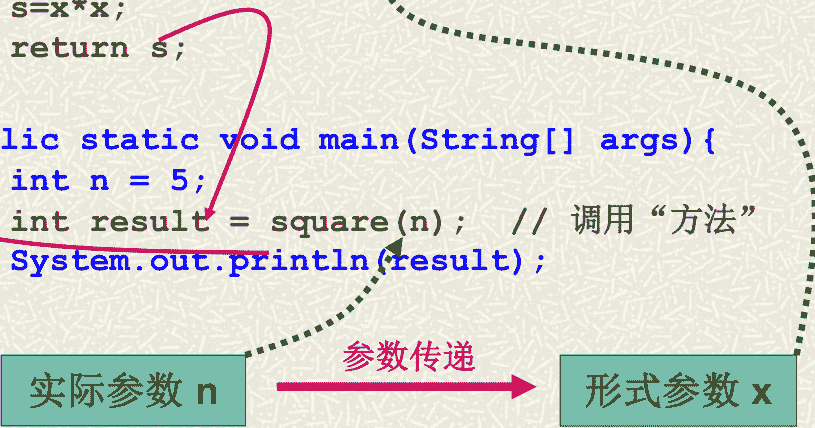

### 方法语句

- 方法语句——使用“方法”的语句——调用
- 以独立语句的形式调用“方法”
  - `方法名([实际参数表])`
- “方法语句”
  - “方法”没有返回值时的调用
  - 方法前面的类型修饰符为 void
- Demo：求面积的“方法”

### 例【4-3】 以方法语句方式调用方法

```java
class AreaC {
    static void area(int a , int b) {
        int s;
        s = a * b;
        System.out.println(s); // 直接输出， 没有返回值
    }
    public static void main(String[] args){
        int x = 5, y=3;
        area(x, y); // 调用方法AreaC
    }
}
```

### 无参方法

有些“方法”没有输入参数，例【4-4】：

```java
class SumC {
    static void sum() { // 无参、无返回值“方法”
        int i=3, j=6;
        int s = i + j;
        System.out.println(s);
    }
    public static void main(String[] args) {
        sum(); // 调用无参数“方法”
    }
}
```

### 4.3 参数传递——值传递

参数传递规则

- 调用带形参的“方法”时，必须提供实参
- 实参 → 形参，称为参数传递
- 被调用的“方法”用实参执行方法体

在Java中，只有值传递

- 参数以值的方式进行传递，即调用时将实参的值传递给“方法”的形参

问题：如果形参变了，实参变吗？

### 例【4-5】：交换两个变量的值“方法”

```java
public class Chap45Swap {
    static void swap(int x, int y) { // 交换x、y的值的“方法”
        System.out.println("交换前：x="+x+" y="+y);
        int temp = x; x = y; y = temp; // 交换
        System.out.println("交换后：x="+x+" y="+ y);
    }
    public static void main(String[] args) {
        int a = 23, b = 10;
        System.out.println("调用前：a="+a+" b="+b);
        swap(a, b); // 调用“方法”
        System.out.println("调用后：a="+a+" b="+b);
    }
}
```

### 值传递的例子

- **【例4-5】运行的结果**
  - 调用前：a=23 b=10
  - 交换前：x=23 y=10
  - 交换后：x=10 y=23
  - 调用后：a=23 b=10
- **说明**
  - 参数传递：a → x; b → y
  - 调用前后：a、b的值没有变
  - 交换前后：x、y的值改变了

```java
static void swap(int x, int y) {
    int temp = x; x = y; y = temp; // 交换
}
public static void main(String[] args) {
    int a = 23, b = 10;
    swap(a, b); // 调用“方法”
}
```

### 4.4 递归(recursion)

- 递归：用自身的结构来描述自身，典型的例子是阶乘运算。
- 简而言之：递归就是自己调用自己。

### 【例4-6】递归算法求n!

**n!的算法**

n! = n×(n-1)!
(n-1)! = (n-1)×(n-2)!
(n-2)! = (n-2)×(n-3)!
……
2! = 2×1!
1! = 1

**递归定义**：F=n!，设计算阶乘的“方法”为fac(n)

fac(n) = n * fac(n-1)
当n=1，n=0时，fac(n)=1

### And More

计算阶乘，也可以使用循环结构的“方法”

```java
static long fac(int n) {
    long m=1;
    for (int i=1; i<=n; i++)
        m = m*i;
    return m;
}
```

### Compare:

```c
static long fac( int n){
    if (n == 1)
        return 1;
    else
        return n*fac(n-1);
}
```

```c
static long fac(int n) {
    long m=1,i;
    for (i=1; i<=n; i++)
        m = m*i;
    return m;
}
```

### 递归程序设计的规范

- 计算递归公式
- 确定递归出口
- 例如：求1、1、2、3、5、8、13、21、34……第 n 项的输出
- 递归公式：f(n) = f(n-1)+f(n-2)
- 递归出口：f(1)=1，f(2)=1

### 例：梵塔（Hanoi）问题

据古印度神话，在贝拿勒斯的圣庙里安放着一块铜板，板上有3根宝石针。梵天（印度教的主神）在创造世界的时候，在其中的一根针上摆放了由小到大共64片中间有空的金片。无论白天和黑夜，都有一位僧侣负责移动这些金片。移动金片的规则是：一次只能将一个金片移动到另一根针上，并且在任何时候以及任意一根针上，小片只能在大片的上面。当64个金片全部由最初的那根针上移动到另一根针上时，这世界就在一声霹雳中消失。

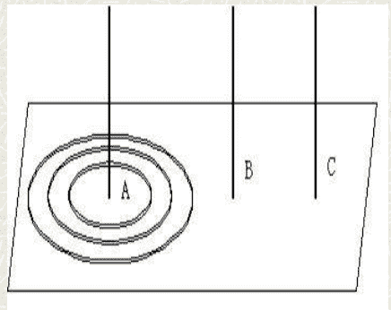

## 第5章 数组 Array

### Review: about Method

- 编写“方法”
- 在 **Main** 方法中调用，也可以在“方法”中调用“方法”。
- 所有“方法”，都是“类”的一部分，且“地位”相当，因此方法不能“嵌套”
- 方法
  - 方法类型（返回值），方法名，形式参数
- 调用
  - “方法”调用：方法有返回值时
  - “方法”语句：方法没有返回值（**void**）

- 要求
  - 能够解读“方法”的程序代码
  - 编写简单的“方法”
- 常用的方法（自定义）
  - 水仙花数
  - 计算阶乘；
  - 求阶乘之和
  - 计算多项式——例如第4章习题3
  - 计算公约数、公倍数
  - 判断素数
  - **Fibonacci**数列

### Introduction

- 数组，Array（阵列）
- 变量：定义单个数据
- 数组：定义多个数据
  - 具有相同性质的一批数据
  - Java 数组：用一个变量表示一组相同类型的数据


## For Example

- 一组n个学生的成绩数据处理
  - 输入
  - 输出
  - 排序
  - 求最大
  - 求平均值
  - 判断不及格
  - 统计分数段
  - ......
- 给每一个学生的成绩数据设定一个变量？
  - **NO!**

## Overview

- 5.1 一维数组
- 5.2 多维数组
- 5.3 数组的基本操作
- 5.4 数组应用举例
- 5.5 数组参数
- 5.6 字符串

## Lab

- 习题1（Page 75）
  - 10个整数可以是直接赋值，也可以通过命令行输入
- 习题8
- 习题5
- 习题2（选做）
- 习题3（选做）

## 5.1 一维数组

- 数学
  - X₁, X₂, ……，Xₙ
- 计算机语言
  - X[1], X[2], ……，X[N]
  - 一个变量：X
  - 方括号是下标
- 数组
  - 一个变量名表示一组数据，每个数据称为数组元素
  - 每个元素通过下标来区分
- 一维数组
  - 以一个下标确定数组中的不同元素
- 多维数组
  - 多个下标表示一个数组元素

## 1 一维数组的声明

- 一维数组声明的格式

类型标识符 数组名[ ]

或

类型标识符[ ] 数组名

- 类型标识符指定每个元素的数据类型

## For Example

- 表示学生的成绩(整数)，可以声明数组**score**:

int score[];

- 其中，数组的名字为**score**，每个元素都是整型

- **Another**:

  - 表示体重(浮点数)的数组类型为**float**的**weight**

  - 声明:

    float [ ] weight;

Note: 方括号可以在变量名的后面，也可以在类型名单后面

## 使用数组的好处

- 减少程序中的变量数量
- 统一的数组名，易于理解
- 对数据元素的操作可以使用循环语句

## 一个例子

例：计算100个学生的平均成绩的程序段：

```java
float sum;
int i;
int score[];
score = new int[100];
/* 输入数组各元素的值，代码省略   */
sum=0;
for ( i=0; i<100;   i++)
    sum=sum+score[i];   // 累计
sum=sum/100;   // 平均值=累计值/数组元素数目
```

## 数组初始化

### 在声明的同时进行初始化

- 用1条语句声明并初始化数组，即将前述的声明语句、new语句合并为一条语句：
  类型标识符 数组名[]=new 类型标识符[元素个数]

### 或

- 类型标识符[] 数组名=new 类型标识符[元素个数]

- 例如，要表示10个学生的学号的数组no：
  int no[] = new int[10];

## 赋初值初始化数组

- 可以在声明数组的同时，给数组元素赋初值
- 所赋初值的个数决定数组元素的数目
- 其格式如下：
  类型标识符 数组名 [ ] = { 初值表 }
  初值表是用逗号隔开的初始值， 例如：
  int score[]={65,34,78,81,56,92,56,87,90,77};

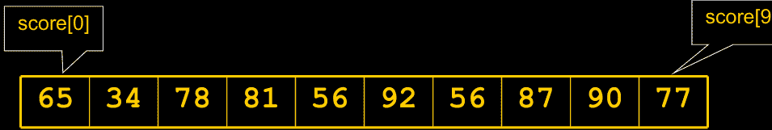

## 5.2 多维数组

### 二维数组的声明

◆ 二维数组的声明方式与一维数组类似，只是要给出两对方括号。二维数组声明形式如下：
类型标识符 数组名[][]
或
类型标识符[][] 数组名
例如：
int a[][]; // 一般把第一个[]叫做 行 // 第二个[]叫做 列

## 2 二维数组的初始化

- 用new初始化二维数组
  - 先声明数组再初始化
    数组名 = new 类型标识符[行数][列数]
    例如：
    ```java
    int a[][];
    a=new int[3][4];
    ```

## 二维数组：声明同时初始化

类型标识符 数组名[][]=new 类型标识符[行数][列数]
或
类型标识符[][] 数组名=new 类型标识符[行数][列数]

```java
int a[][]=new int[3][4];
```

数组中各元素通过两个下标来区分
每个下标的最小值为0，最大值分别比行数或列数少1。

```
a[0][0], a[0][1], a[0][2], a[0][3]
a[1][0], a[1][1], a[1][2], a[2][3]
a[2][0], a[2][1], a[2][2], a[2][3]
```

## 赋初值初始化二维数组

- 类型标识符 数组名[][]={{初值表}，{初值表}，...，{初值表}}；

```c
int gd[][]={{65,34,78},{81,56,92},{56,87,90},{92, 69, 75}};
```

Question: 数组gd[][]是几乘几？

数组gd共有12个元素，元素gd[0][0]，gd[0][1]，gd[0][2]，gd[1][0]，...，gd[3][2]的初始值分别为65， 34， 78， ...， 75， 如表所示

| gd[0][0] | gd[0][1] | gd[0][2] |
|---|---|---|
| 65 | 34 | 78 |
| gd[1][0] | gd[1][1] | gd[1][2] |
| 81 | 56 | 92 |
| gd[2][0] | gd[2][1] | gd[2][2] |
| 56 | 87 | 90 |
| gd[3][0] | gd[3][1] | gd[3][2] |
| 92 | 69 | 75 |

## 5.3 数组的基本操作

### 1、数组的引用

对数组的应用通常是对其元素的引用

```java
int age[]=new int[3];
age[0]=25;
age[2]=2+age[0] ;
```

### 2、数组的复制

```java
int a[]=new int[6];
int b[]={1,2,3,4,5,6};
for(int i=0;i<6;i++) a[i]=b[i];
或  a=b;
```

## 举例

```java
int c[][],d[][], e[][],i, j;
c=new int[3][3];
d=new int[3][3];
e=new int[3][3];
for(i=0;i<3; i++)
    for (j=0; j<3; j++)
    {
        d[i][j]=i+j;
        c[i][j]=d[i][j];
    }
e=d;
```

阅读并归纳程序代码实现的功能

## 3、数组的输出

数组输出通常是逐个元素结合循环语句实现

```java
int a[]=new int[6];

for(int i=0;i<6;i++)  {
    a[i]=i;
    System.out.println(a[i]);
}
```

## 程序举例

```java
class ArrayC {
    public static void main(String[] args) {
        int a[],b[], i, j;
        a=new int[3];
        b=new int[5];

        System.out.println("a.length="+a.length);
        for ( i=0; i<a.length; i++)   {
            a[i]=i;
            System.out.print(a[i]+"    ");
        }
        System.out.println();
        （接下页）
```


## Example AttayC2

```java
int c[][],d[][],i,j;
c=new int[2][2];
d=new int[3][3];
System.out.println("Array d:");
for(i=0;i<d.length; i++) {
    for (j=0; j<d[i].length; j++) {
        d[i][j]=i+j;
        System.out.print(d[i][j]+"\t");
    }
    System.out.println();
}
c=d;
System.out.println("Array c:");
for(i=0;i<c.length; i++){
    for (j=0; j<c[i].length; j++)
        System.out.print(c[i][j]+"\t");
    System.out.println();
}
```

程序运行结果如下：

Array d
0   1   2
1   2   3
2   3   4

Array c
0   1   2
1   2   3
2   3   4

## 5.4 数组应用举例

### 排序

- 排序是将一组数按照递增或递减的顺序排列
- 排序的方法很多，其中最基本的是选择法
- 选择法排序基本思想

  ① 对于给定的 n 个数，从中选出最小（大）的数，与第1个数交换位置 → 最小（大）的数置于第1个位置  
  ② 对第1个数外的剩下的 n−1 个数，重复步骤1，将次小（大）的数置于第2个位置  
  ③ 对于剩下的 n−2，n−3，…，n−n+2 个数用同样的方法，分别将第3个最小（大）数置于第3个位置，第4个最小（大）数置于第4个位置  
  ④ ……，第 n−1 个最小（大）数置于第 n−1 个位置

### For Example

假定有 7，4，0，6，2，5，1 的排序：

1. 7个数中，最小数是0，与第1个数7交换位置，结果为：
   0 4 7 6 2 5 1

2. 余下的6个数最小数是1，与第2个数4交换，结果为：
   0 1 7 6 2 5 4

3. 剩下的5个数最小数是2，与第3个数7交换，结果为：
   0 1 2 6 7 5 4

4. 剩下的4个数最小数是4，与第4个数6交换，结果为：
   0 1 2 4 7 5 6

5. 剩下的3个数最小数是5，与第5个数7交换，结果为：
   0 1 2 4 5 7 6

6. 剩下的2个数是6，与数7交换，结果为：
   0 1 2 4 5 6 7

### 排序过程结束

可见：

- 对n个待排序的数，要进行n-1轮的选择和交换过程
- 其中第 i 轮的选择和交换过程中，要进行n-i次的比较
- n个数的排序需要多少次排序操作？

### 例一-排序

```java
import java.io.*;
class ArraySort  {
    public static void main(String[] args) throws
    IOException {
        BufferedReader keyin =new BufferedReader(new
        InputStreamReader(System.in));
        int a[],i, j, k, temp; String c;
        System.out.println("Input the number of
        array elements!");
        c=keyin.readLine();
        temp=Integer.parseInt(c);
        a = new int[temp];
        System.out.println("Input " + temp
        + " numbers. One
        per line!");
        for ( i=0; i<a.length; i++)
        {
        c=keyin.readLine();
        a[i]=Integer.parseInt(c);
        }
        System.out.println("After sorting!");
        for ( i=0; i<a.length-1; i++) {
            k = i;
            for( j = i + 1 ;  j< a.length; j++)
                if(a[j]<a[k]) // 找最小的元素的下标
                    k = j;
            temp = a[i]; // 较小数换至第k个元素位置
            a[i]= a[k];
            a[k] = temp;
        }
        for ( i=0; i<a.length; i++)// 排序后的输出
            System.out.println(a[i]) ;
    }
}
```

### 从键盘输入

- System.out.print ——标准输出流
- 输入：
  - 命令行——Eclipse“运行设置”中的参数
  - 直接从键盘输入——Like C Language
  - ——专业术语：控制台窗口输入，即程序直接读取键盘输入的数据
- Java 控制台输入
  - Scanner 对象

### Java 控制台输入

- **Scanner**
  - 属于 Java 标准输入流 `System.in`
  - 在程序顶部加上语句：
    ```java
    import java.util.*; // Java 的工具包
    ```

使用标准输入流

1. 定义一个 **Scanner** 对象
   ```java
   Scanner in = new Scanner(System.in);
   ```
2. **Scanner** 类用法
   用法很多，包括输入各种类型的数据

### Scanner

- Example

```java
Scanner in = new Scanner(System.in);
System.out.println("请问你的姓名?");
String name = in.nextLine();
System.out.printf("哦, 你是"+ name);
```

### Scanner 对象（1）

#### next 和 nextLine

- **next** 输入的字符是一个单词，即空格结束
- **nextLine**: 输入是一个语句，以回车结束

### Scanner 对象(2)

- Scanner 对象从控制台读取的是字符
- 如果已定义了Scanner in对象，需要读取数据，可使用“方法”：

1. 读取整型数  
   int n=in.nextInt();  // 回车结束输入

2. 读取浮点数  
   float x=in.nextFloat();  // 回车结束输入

3. 读取双精度数  
   double y=in.nextDouble(); // 回车结束输入

### Example

- 从控制台读取**10个数据**，写入整型数组**a**中，程序代码为：

```java
int [] a = new int[10];
Scanner in = new Scanner(System.in);
for(int i=0; i<10;i++)
    a[i]=in.nextInt();

System.out.println("数组元素为");
for (int i=0; i<a.length;i++)
    System.out.print(a[i]+"  ");
```


## 使用对话框输入

- 在 **Java** 中，提供对话框输入
- 程序顶部加入语句

```java
import javax.swing.*;
```

- 在程序中使用：

```java
JOptionPane.showInputDialog
```

- 例如：

```java
String in_x =
JOptionPane.showInputDialog("请输入：");
```

- 使用对话框输入的也是字符，如果需要转换为其他类型的数据，使用Java方法
  - `Integer.parseInt`
  - `Double.parseDouble`
  - ……

- 注意：使用对话框，必须程序最后一条语句应该为 `System.exit(0);`
  - 因为每打开一个对话框，相当于启动一个线程
  - `System.exit()` 是结束线程的语句

## 数组数据例--矩阵运算

数学中的矩阵在**Java**中用二维数组实现，本例中要进行矩阵的加、乘运算。

```java
class ArrayC3 {
public static void main(String[] args){
int c[][]={{1,2,3},{4,5,6},{7,8,9}};
int d[][]={{2,2,2},{1,1,1},{3,3,3}};
int i, j, k;
int e[][]=new int[3][3];
System.out.println(" Array c");
for(i=0;i<c.length; i++){
    for (j=0; j<c[i].length; j++)
        System.out.print(c[i][j]+"\t");
    System.out.println();
}
System.out.println(" Array d");
for(i=0;i<d.length; i++) {
    for (j=0; j<d[i].length; j++)
        System.out.print(d[i][j]+"\t");
    System.out.println();
}
System.out.println(" Array c+d");
for(i=0;i<e.length; i++) {
    for (j=0; j<e[i].length; j++) {
    e[i][j]=c[i][j]+d[i][j];
    System.out.print(e[i][j]+"\t");
    }
    System.out.println();
}
System.out.println(" Array c*d");
for(i=0;i<3; i++) {
    for(j=0;j<3;j++) {
        e[i][j]=0;
        for ( k = 0 ; k < 3 ; k ++ )
        e[i][j]=e[i][j]+c[i][k]*d[k][j] ;
        System.out.print(e[i][j]+"\t"); }
    System.out.println(); }
}
}
```

## 程序运行结果如下：

Array c

1   2   3

4   5   6

7   8   9

Array d

2   2   2

1   1   1

3   3   3

Array c+d

3   4   5

5   6   7

10   11   12

Array c*d

12   12   12

21   21   21

30   30   30

## 5.5 数组参数

在java的过程中，允许参数是数组。在使用数组参数时，应该注意以下事项：

- 在形式参数表中，数组名后的括号不能省略，括号个数和数组的维数相等。不需给出数组元素的个数。
- 在实际参数表中，数组名后不需括号。
- 数组名做实际参数时，传递的是地址，而不是值 → 即形式参数和实际参数具有相同的存储单元。

## 例--计算数组元素平均值

```java
class ArrayC4 {
    public static void main(String[] args)
    {
        int c[]={1,2,3,4,5,6,7,8,9};
        int j;
        System.out.println(" Array c");

        for (j=0; j<c.length; j++)
            System.out.print(c[j]+"    ");
        System.out.println();
        System.out.println(" Array average");
        // 调用数组
        System.out.println( arrayAverage(c));
    }
}
```

// 通过“方法”计算数组元素的平均值，数组名作为形式参数

```java
static float arrayAverage(int d[])
{
    float average=0 ;
    for(int i=0;i<d.length; i++)
        average=average+d[i];
    average=average/d.length;
    return average;
}
```

程序运行结果如下：

Array c

1 2 3 4 5 6 7 8 9

Array average

5.0

## 例--展示数组参数传递地址的特性

```java
class ArrayC6 {
    public static void main(String[] args){
        int c[][]={{1,2,3,4,5},{6,7,8,9,10}};
        int i, j;
        System.out.println("调用arrayMultiply之前的数组");
        for (i=0; i<c.length; i++){
            for(j=0; j<c[i].length; j++)
                System.out.print(c[i][j]+" ");
            System.out.println();
        }
        arrayMultiply(c);  // 调用数组
        System.out.println("调用arrayMultiply之后的数组");
        for (i=0; i<c.length; i++) {
            for(j=0; j<c[i].length; j++)
            System.out.print(c[i][j]+" ");
            System.out.println();
        }
    }

    static void arrayMultiply(int d[][]) {
        int k,l;
        for (k=0; k<d.length; k++)
        for(l=0; l<d[k].length; l++)
        d[k][l]=2*d[k][l];
        System.out.println(" In arrayMultiply");
        for (k=0; k<d.length; k++) {
        for(l=0; l<d[k].length; l++)
        System.out.print(d[k][l]+" ");
        System.out.println();
        }
    } // 方法arrayMultiply结束
} // 程序结束
```

## 程序的运行结果如下，发生了什么？

调用 **arrayMultiply** 之前的数组

1 2 3 4 5
6 7 8 9 10

In **arrayMultiply**

2 4 6 8 10
12 14 16 18 20

调用 **arrayMultiply** 之后的数组

2 4 6 8 10
12 14 16 18 20

## 例--展示数组元素参数传递值的特性

```java
class ArrayC7 {
public static void main(String[] args) {
int c[]={1,10,100,1000};
int j;
System.out.println("数组在调用elementMultiply前");
for (j=0; j<c.length; j++)
System.out.print(c[j]+" ");
System.out.println();
elementMultiply(c[2]);
System.out.println("数组在调用elementMultiply后");
}
}
```


## 字符串

为了使用方便Java提供了String类型。

### 字符串变量的声明和初始化：

String 变量名；变量名=new String();

或

String 字符串变量 = new String（）；

例如：

String s=new String();

## 字符串赋值

可以为字符串变量赋一个字符串常量，也可以将一个字符串变量或表达式的值赋给字符串变量。

```java
s="Chinese people";
s2=s1;
s3="a lot of"+s2;
```

结果s2的值为 “Chinese people” ， s3的值为 “a lot of Chinese people” 。其中运算符 “+” 的作用是将前后的两个字符串连接起来

## 字符串的输出

字符串可以通过println()或print()语句输出。

例如，以下的语句序列为字符串变量s赋值并输出其值：

```java
s="All the world";
System.out.println(s);
```

输出结果为：

```
All the world
```

## 例一字符串应用

```java
public class StringUse
{
    public static void main(String[] args)
    {String s1, s2;
        s1=new String("Students should ");
        s2=new String();
        s2="study hard.";
        System.out.print(s1);
        System.out.println(s2);
        s2="learn english, too";
        System.out.print(s1);
        System.out.println(s2);
        s2=s1+s2;
        System.out.println(s2);}}
```

该程序的运行结果如下：

Students should study hard.

Students should learn english, too

Students should learn english, too

## 字符串操作

Java中通过String类来使用字符串
String类用很多成员方法来对字符串进行操作。如： 字符串访问、比较和转换等。

- length(): 返回字符串的长度。
- charAt(int index): 返回字符串中第index个字符 。
- indexOf(int ch): 返回字符串中字符ch第1次出现的位置。
- indexOf(String str, int index): 返回值是在该字符串中，从第index个位置开始，子字符串str第1次出现的位置。
- subString (int index1, int index2): 返回值是在该字符串中，从第index1个位置开始，到第index2-1个位置结束的子字符串。

将int，long，float，double，boolean等基本类型数据转换为String类型的方法是：

```java
String.valueOf(基本类型数据)
```

将字符串型数据转换为其他基本类型的方法及实例

| 方法 | 返回值类型 | 返回值 |
|---|---|---|
| Boolean.getBoolean("false") | boolean | false |
| Integer.parseInt("123") | int | 123 |
| Long.parseLong("375") | long | 375 |
| Float.parseFloat("345.23") | float | 345.23 |
| Double.parseDouble("67892.34") | double | 67892.34 |

- 字符串数组——多个字符串组成
  要表示一组字符串可以用字符串数组来实现。

```java
String str=new String[4];

str[0]="Chinese";
str[1]="English";
str[2]="Tianjin";
str[3]="Chongqing";
```

有什么特点？

# 第六章

# 类和对象

Class and Object

## 6.1 类和对象概述

- 面向对象的基本概念：
  - 面向对象技术中，将客观世界中的一个事物作为一个对象看待。每个事物都有自己的属性和行为
  - 从程序设计的角度，事物的属性可以用变量描述，行为用方法描述。
    - 类：定义属性和行为的模板
    - 对象是类的实例，对象与类的关系就像变量和数据类型的关系一样

## 对象与类

简单地说：
对象是表示现实世界中某个具体的事物；
类是对对象的抽象描述。

张二

将对象抽象为类

对类进行实例化

类(CLASS)，如：
“Man class”

## Java的类

- 面向对象的程序设计认为：程序由对象组成。
- 程序中的每个对象有自己的属性和能够执行的操作
- 只关心对象能够完成的操作，不必关注实现功能的过程
  - For Example： 用户买车

## Java的类

- Java的所有程序代码都属于某个类的内部
- Java的类分为两个部分
  - Java类库——由Java提供的大量的、可供用户调用的各种类的各种方法（我们可以使用的）
  - 用户编写的类（**我们需要学习的**）

# Java的类

Java类库——我们已经使用过的……

- String
- Math
- JOptionPane
- Scanner

## Java类库

### Math——数学类库

- 为用户处理数学问题提供方法（函数）
- 例如：
  - `Math.PI`
  - `Math.sin(double a)`
  - `Math.sqrt(double a)`
  - `Math.abs(int/long/float/double a)`
  - ……

- 在Math库中，有程序处理需要的各种数学（方法）函数

## 自定义类——用户编写程序

- 用户程序从类开始
- 一个用户程序可以有多个类
- 其中有且只有一个类中，有类的main()方法
- 每一个类可以有多个方法
- 不同的类之间的方法可以互相调用，除了main()方法

## 类的声明

```
[修饰符] class 类名 [extends 父类名] [implements 接口名列表]
{
    类的成员变量声明;
    类的方法声明;
}
```

这里，[]中的可以省略  
因此，一般的类声明格式为：

```
[修饰符] class 类名
```

## 例6-1 定义一个二维平面上点的类

```java
class Point {
private int x,y;
public void setPoint(int a,int b) {
x=a;
y=b;
}
public int getX() {
return x;
}
public int getY() {
return y;
}
public String toString() {
return "["+x+","+y+"]";
}
}
```

类名：Point

类变量成员：x，y

类的方法（1）：setPoint

类的方法（2）：getX取X坐标

类的方法（3）：getY 取Y坐标

类的方法（4）：toString 获取变量的字符串


## 对象的创建

### 建立了类，就可以使用类创建其对象

```java
[修饰符] 类名 对象名=new 类名(实参列表);

或

[修饰符] 类名 对象名;

对象名 = new 类名(实参列表);
```

```java
[修饰符] 类名 对象名 = new 类名(实参列表);
或
[修饰符] 类名 对象名;
对象名 = new 类名(实参列表);
```

比较 Java变量的命名方法：
int x = 10;
比较String变量命名：
String str2 = new String();
或者：
String str3;
str3 = new String();

### 创建对象（Java实例6-1）

```java
Point P1;    // 对象p1
```

注意：类属于复合数据类型，因此，在声明对象时，系统并没有为对象分配空间，用户需要应用 new 完成分配空间的任务。

```java
P1= new Point( );    // 给P1 对象分配存储空间
```

### 对象的引用

```java
class Point {
    private int x,y;
    public void setPoint(int a,int b) {
        x=a;
        y=b;
    }
    public int getX() {
        return x;
    }
    public int getY() {
        return y;
    }
    public String toString() {
        return "["+x+","+y+"]";
    }
}
```

- 引用成员变量
  - 对象名.成员变量名
  - 例如：P1.x=3;
  - P1.y=5;
- 引用方法
  - 对象名.方法名(参数列表)
  - 例如：int n=P1.getX();
  - int m=P1.getY();

```java
Point p1;
p1= new Point();
p1.setPoint(3, 5);
System.out.print(p1.getX());
System.out.print(" "+ p1.getY());
System.out.print(" "+ p1.toString());
```

例6-2：定义一个表示圆形的类，能够计算圆面积和周长。

```java
class Circle1{
    float r;
    final double PI=3.14159;
    public double area() {  //计算面积
        return PI*r*r;
    }
    public void setR(float x) {  //设置半径
        r=x;
    }
    public double perimeter() {  //计算周长
        return 2*PI*r;
    }
}
```

### 创建对象和使用对象调用

```java
public static void main(String args[])
{
    double x,y;
    Circle1 cir=new Circle1(); //创建Circle1类的对象cir
    cir.setR(12.35f); //引用cir对象的setR()方法
    x=cir.area(); //引用cir对象的area()方法
    y=cir.perimeter(); //引用cir对象的perimeter()方法
    System.out.println("圆面积="+x+"\n圆周长="+y);
}
}
```

程序运行结果如下：

圆面积=479.163190376011

圆周长=77.59727539684296

## 构造方法和对象的初始化

- 在类（Class）中，可以定义多种成员方法
- 类中还有一种特殊的成员方法，其方法名与类名相同，称为构造方法。
- 当使用 new 运算符实例化（定义）一个对象时，Java 做两件事：
  1. 系统为对象创建内存区域
  2. 自动调用构造方法初始化成员变量。

### 构造方法的特点

- 构造方法名与类名相同；
- 构造方法没有返回值；
- 构造方法的主要作用是对对象初始化。
- 构造方法不能显式地直接调用；
- 一个类中可以定义多个构造方法
  - 用不同的参数区别不同的构造方法
  - 或不同参数类型区别不同的构造方法

### Java实例6-3——用构造方法初始化成员变量

```java
class Triangle {
    int x,y,z;
    public Triangle(int i,int j,int k) { //声明构造方法，方法名和类名相同
        x=i; y=j; z=k;                 //简单地将变量关联，i→x, j→y, k→z
    }
    public static boolean judge(Triangle m) { //判断是否为直角三角形
        //引用Math类库的sqrt()方法
        if ( Math.sqrt(m.x*m.x+ m.y*m.y)== Math.sqrt(m.z*m.z))
            return true;
        else
            return false;
    }
}
```

```java
// 类中的主方法main，对本“类”定义并使用对象
public static void main(String args[]){
    Triangle t1; //声明Triangle类对象t1
    t1=new Triangle(3,4,5); //实例化对象t1，调用构造方法对其进行初始化

    /* 调用judge()方法，判断t1的成员变量是否能构成直角三角形的3个边长 */
    if(judge(t1))
        System.out.println("这是一个直角三角形");
    else
        System.out.println("这不是一个直角三角形");
}
```

### Java实例6-4— 定义构造方法

```java
class Student
{
    String name;       // 定义类的成员变量
    String address;
    int grade;
    Student(String x1,String x2,int x3) { //定义构造方法
        name=x1;
        address=x2;
        grade=x3;
    }
}
```

```java
public static void main(String args[]) {
    Student zhang;  //声明并创建zhang对象
    zhang=new Student("张三","西安市兴庆路1号",3);
    Student wang;  //声明并创建wang对象
    wang=new Student("王五","西安市翠华路12号",4);
    System.out.println(zhang.name+zhang.address+zhang.grade);
    System.out.println(wang.name+wang.address+wang.grade);
}
}
```

### 缺省构造方法的使用

所谓“缺省(Default)”构造方法，是在类中没有定义构造方法，Java默认的类成员方法初始化处理。
注意：Java中变量必须初始化，即赋初值才能使用变量

```java
class Student {
    String name;    //成员变量
    String address; //成员变量
    int score;      //成员变量
    public void setMessage(String x1,String x2, int x3) {//成员方法
        name=x1;
        address=x2;
        score=x3;
    }
}
```

```java
public static void main(String args[])
{
    Student s1=new Student();    //创建Student类对象
    s1;
    System.out.println(s1.name+" "+s1.address+"\n"+s1.score);
    //输出缺省构造方法的初始化结果
    s1.setMessage("张三","西安市兴庆路1号",75);
    // 调用成员方法给成员变量赋值
    System.out.println(s1.name+" "+s1.address+"\n"+s1.score);
}
}
```


程序运行结果如下：

null　 null　 0

张三　 西安市兴庆路1号　 75

## 使用无参数的构造方法

```java
class Time {                    // 教材例6-5，类Time
    private int hour;           // 0-23
    private int minute;         // 0-59
    private int second;         // 0-59

    public Time() {
        setTime(0,0,0);
    }

    public void setTime(int hh, int mm, int ss) {
        hour = ((hh >= 0 && hh <24) ? hh : 0);     // 使hour在0-23之间
        minute = ((mm >= 0 && mm < 60) ? mm : 0);
        second = ((ss >= 0 && ss < 60) ? ss : 0);
    }

    public String toString() {
        return (hour + ":" + (minute < 10 ? "0" : "") + minute +
            ":" + 
            (second < 10 ? "0" : "") + second );
    }
}
// 类 Time结束
```

```java
public class MyTime { // 程序中的第二个类 MyTime
public static void main(String args[]) {
    Time time=new Time();
    time.setTime(11,22,33);
    System.out.println(" set time =" + time.toString());
}
}
```

## 编程与运行

- 在Java中，每个类是一个独立的程序段，是一个Java文件
- 本例中，有两个类，因此有两个Java文件，分别建立
- 这两个程序被打“包”（Packet），成为一个整体程序
- 能够被运行的程序是内有main()方法的类

运行结果如下：
set time =11:22:33

## 使用多个构造方法

```java
class Time1
{
    private int hour;          //0-23
    private int minute;        //0-59
    private int second;        //0-59
    public Time1()
    { setTime (0,0,0); }
    public Time1(int hh)
    { setTime (hh,0,0); }
    public Time1 (int hh, int mm)
    { setTime (hh,mm,0); }
    public Time1(int hh, int mm, int ss)
    { setTime (hh,mm,ss); }

    public void setTime(int hh, int mm, int ss)
    {
        hour = ((hh >= 0 && hh < 24) ? hh : 0);
        minute = ((mm >= 0 && mm < 60) ? mm : 0);
        second = ((ss >= 0 && ss < 60) ? ss : 0);
    }

    public String toString()
    {
        return (hour + ":" + (minute < 10 ? "0" : "") + minute + ":" +
                (second < 10 ? "0" : "") + second);
    }
}
```

```java
public class MyTime1
{
private static Time1 t0, t1, t2, t3;
public static void main(String args[])
{
t0=new Time1();
t1=new Time1(11);
t2=new Time1(22, 22);
t3=new Time1(33, 33, 33);
System.out.println(" t0= " + t0.toString());
System.out.println("t1= " + t1.toString());
System.out.println("t2= " + t2.toString());
System.out.println("t3= " + t3.toString());
} }
```

程序运行结果如下：
t0= 0:00:00
t1= 11:00:00
t2= 22:22:00
t3= 0:33:33

## 对象的销毁

- new运算符实例化对象
  - 过程：系统为对象分配所需的存储空间
  - 但内存空间有限，不能存放无限多的对象
  - 为此，Java提供了资源回收机制，自动销毁无用对象，回收其所占用的存储空间
- 如需主动释放对象，或在释放时执行特定操作，则在类中可以定义 finalize() 方法：

```java
public void finalize()
{
    方法体;
}
```

## About Class

- 类是Java程序的构成，每一个类是一个整体
- 类中包括：
  - 成员变量 → 数据，如何被访问，被谁访问？
  - 成员方法 → 对数据(成员变量)进行操作
- 特点：
  - 可以定义不同的访问方法 → 成员变量
- 这个特点就是封装！

## 6.2.1 访问权限

Java的成员访问权限通过关键字 private，public，protected，缺省(不用关键字)实现

- public （公有）
  成员变量和成员方法可以Java在所有类中访问

- protected （保护）
  成员变量和成员方法可在声明他们的类中访问
  可以在在该类的子类中访问
  也可以在与该类位于同一包的类中访问——不能被其它包的非子类中访问

## 访问控制权限小结

| 访问控制 | 本类 | 同一包中的类 | 其他包中子类 | 其他包中的类 |
|---|---|---|---|---|
| public | √ | √ | √ | √ |
| private | √ | × | × | × |
| protected | √ | √ | √ | × |
| 缺省 | √ | √ | × | × |

## Java实例-权限修饰符的作用

```java
// 包里的第一个类
class Time {
    private int hour;    // 私有成员变量0-23
    private int minute;  // 0-59
    private int second;  // 0-59

    public Time () {     // 构造方法，初始化成员变量
        setTime(0,0,0);
    }
    public void setTime(int hh, int mm, int ss) { // 对成员变量操作
        hour = ((hh >= 0 && hh <24) ? hh : 0);
        minute = ((mm >= 0 && mm < 60) ? mm : 0);
        second = ((ss >=0 && ss < 60) ? ss : 0);
    }

    public String toString() {
       return (hour + ":" + (minute < 10 ? "0" : "") + minute + ":" +
              (second < 10 ? "0" : "") + second );
    }
}
```

```java
// 包里的第二个类
public class MyTime2 {
   public static void main(String args[]) {
      Time time = new Time();
      time.hour = 11;   // 给成员变量hour赋值： 非法访问， 因为
time类中的成员变量hour的属性是private
      System.out.println("time" + time.toString());
   }
}
```


## 类访问权限

- 声明一个类
  - 可使用的权限修饰符：public、缺省
  - 不能使用：private、protected

- 一个Java源程序文件中可包含多个类
  - 但，只能有一个类使用public修饰符，该类的名字与源程序文件的名字相同
  - 有多个类，必须运行包含main()方法的类，否则出错

## 6.2.2 类成员——变量和方法

### 类成员变量

- 使用static修饰的变量为类成员变量

- 没有使用static修饰的变量为实例成员变量，

```java
class Student {
    String name;        //实例成员变量
    String sex;         //实例成员变量
    static int count=0; //类成员变量
    public Student(String m, String s ) {
        name=m;         // 在本类， 对实例和类成员操作
        sex=s;
        count=count+1;
    }
}
```

### 类成员

- 在类中的成员变量和成员方法

- 根据不同的修饰符，有不同的使用规则

- static 是规则......

1. 类成员变量
2. 类成员方法

### 类成员变量

使用类创建对象：
每个对象拥有各自的实例成员变量，不同对象的实例成员变量具有不同的值；
类成员变量被分配一个存储单元，类的所有对象共享这个类成员变量

实例成员变量属于对象，只能通过对象引用：
对象名.实例成员变量名

类成员变量属于类——既可以通过类名访问，也可以通过对象名访问：
对象名.实例成员变量名
or
类名.实例成员变量名

### 例：类成员变量和实例成员变量的对比

```java
class Student1 {
    String name;    //实例成员变量
    String address; //实例成员变量
    static int count=0; //类成员变量
    public Student1(String m, String a ) {
        name=m;
        address=a;
        count=count+1; // count 为 2
    }
}
```

```java
public static void main(String args[]) {
    // 使用实例成员变量
    Student1 p1=new Student1("李明", "杭州市西湖区");
    Student1 p2=new Student1("张敏", "上海市闵行区");
    // 使用类成员变量 Student1.count, p1.count
    System.out.println(p1.name+" "+p1.address+" "+p1.count);
    Student1.count=Student1.count+1; // count 为3
    System.out.println(p2.name+" "+p2.address+" "+p2.count);
    p1.count=p1.count-1; // count为2
    System.out.println(p2.name+" "+p2.address+" "+p2.count);
}
} // 类结束
```

程序运行结果如下：

- 李明 杭州市西湖区 2
- 张敏 上海市闵行区 3
- 张敏 上海市闵行区 2

### 类成员方法

- 没有使用static修饰的方法为实例成员方法
- 使用static修饰的方法为类成员方法

```java
// area 是类成员方法
public static double area(double r) {
    return 3.14*r*r;
}
```

- 类成员方法中使用——受限制
  - 本方法中声明的局部变量
  - 可以访问类成员变量，不能访问实例成员变量
- 实例成员方法中使用——不受限制
  - 本方法中声明的局部变量
  - 可访问类成员变量
  - 也可以访问实例成员变量

◆ 类成员方法中只能调用类成员方法，不能调用实例成员方法

◆ 实例成员方法既可以调用类成员方法，也可以调用实例成员方法。

```java
double perimeter(double x, double y) { // 实例成员方法
    return 2*(x+y);
}
static double area(double x, double y) { // 类成员方法
    return x*y;
}
void print_message() { // 实例成员方法，可使用类的其他成员方法
    System.out.println(perimeter(2.1,3.5));
    System.out.println(area(2.1,3.5));
}
```

- 实例方法只能通过对象访问
- 类成员方法既可以通过类名访问，也可以通过对象名访问

实例成员方法的访问方式为：

`对象名.实例成员方法名()`

类成员变量的访问方法为

对象名.类成员方法名()

或

类名.类成员方法名()

### 例：类成员方法和实例成员方法的对比

```java
class Course {
    String no;          //实例成员变量：课程编号
    int score;          //实例成员变量：成绩
    static int sum=0;   //类成员变量：总成绩

    public Course(String n, int s) { // Course的构造方法
        no=n;
        score=s;
    }

    //类方法：统计总成绩
    public static void summarize(int s) { // Course的类成员方法
        sum+=s;
    }
}// 类 Course结束
```

```java
public class Statistic {

    public static void main(String args[]) {
        Course c1,c2;  // 定义Course对象c1、c2
        c1=new Course("210",90);  // 学号210，成绩90
        Course.summarize(90);
        System.out.println("sum="+c1.sum);
        c2=new Course("300",80);  // 学号300，成绩80
        c2.summarize(80);
        System.out.println("sum="+Course.sum); // 输出累加和
    }
} // 类Statistic结束
```

程序运行结果如下：

sum=90

sum=170

## 数学函数类—— Math类库

Java类库中的Math类提供了很多常用数学函数的实现方法，这些方法都是static方法，通过类名Math调用，其调用方式如下：

Math.方法名

### Math类中的常用方法

| 函数 | 说明 |
| --- | --- |
| sin(double x) | 返回x的正弦值 |
| cos(double x) | 返回x的余弦值 |
| log(double x) | 返回x的自然对数 |
| exp(double x) | 返回e^x |
| abs(double x) | 返回x的绝对值 |
| max(double x, double y) | 返回x和y中的较大值 |
| sqrt(double x) | 返回x的平方根 |
| random(double x) | 返回[0, 1)区间内的随机数 |
| pow(double y, double x) | 返回y^x |

### 例6-10 输出两个数中较大者

```java
public class Max {

    public static void main(String args[]) {

        int x,y;
        x=Integer.parseInt(args[0]);
        y= Integer.parseInt(args[1]);
        System.out.println("最大值是"+Math.max(x,y));
    }
}
```


# Chapter 7

## 类的继承和多态机制

### 一个例子

- 假设我们定义一个类 student  
  其中包含了一个学生的所有信息，包括学号、姓名、性别、籍贯、院系、年级、专业、各课程的成绩……

- 现在，有部分学生还有一些其他信息，例如获奖信息

- How to Do?

- 这一类问题特别普遍……

### In Java

显然，部分学生应该“继承”类 student 的所有属性，再加上一些获奖的属性

```java
class Student {
    ......
}
class ExStudent extends Student {
    // 加上有关获奖的成员变量和方法
}
```

### In Java

- 关键字 extends
  - 指示所建立的新的类 ExStudent 派生于已经存在的类 Student —— 继承
  - 已经存在的类 Student 称为
    - 超类 superclass，或者
    - 基类 base class，或者
    - 父类 parent class
  - 新的类 ExStudent 称为
    - 派生类 derived class，或者
    - 子类 subclass，或者
    - 孩子类 child class
- 有趣的：
  - 子类比父类具有更多的功能

```java
class Student {
    ......
}
class ExStudent extends Student {
    // 加上有关获奖的成员变量和方法
}
```

### And more

- Java 类是一个层次结构
  - Java 有一个叫做 Object 的超类，是所有类的祖先
  - 所有类都直接或间接地继承自 Object 类
  - 如果在定义类的时候没有指出其超类，默认继承 Object
- 一旦定义了一个类，就自动继承了 Object 类的许多成员和成员方法，例如
  - `hashCode()` // 获取 hash 码
  - `equals()` // 检测是否与另外一个对象相等
  - `toString()` // 返回表示对象值的字符串

### And More

- 子类继承父类的
  - 属性和方法
  - 可修改父类的属性或重载父类的方法
  - 在父类的基础上添加新的属性和方法
- 继承的关系：
  - 父类 —— 一般情况
  - 子类 —— 包含一般情况下的特殊情况
- 多个子类共同继承一个父类，那么该父类就是多个子类的基类
- Java 语言只支持单继承
  - 如果要定义多继承，可以使用“接口”

### 定义子类的形式

```
【访问权限】 class 类名 extends 父类名{
    类体
}
```

- **Extends**
  - 指明新定义子类及其继承的父类

### 类的继承原则

### Rules:

1. 子类继承父类的成员变量
   - 实例成员变量
   - 类成员变量

2. 子类继承父类成员方法
   - 实例成员方法
   - 类成员方法
   - 但不包括构造方法
   - 父类的构造方法 → 创建父类对象
   - 子类需定义自己的构造方法 → 创建子类的对象

3. 子类可以重新定义父类成员

### 访问权限

本质上说，子类和父类都是“类”，因此存在访问权限问题

子类继承了父类的成员变量和成员方法

但并非对父类所有成员变量和成员方法都有访问权限，换句话说：

子类声明的方法中并不能访问父类所有成员变量或成员方法！

子类访问父类成员的权限如下

对父类的 private 成员没有访问权限。

对父类的 public 和 protected 成员具有访问权限。

对父类的缺省权限成员访问权限分 2 种情况

1. 对同一包中父类的缺省权限成员具有访问权限

2. 对其它包中父类的缺省权限成员没有访问权限

### Java 实例——类的继承

```java
public class Person1 {
    private String name;
    protected int age;

    public void setName(String na) {
        name = na;
    }
    public void setAge(int ag) {
        age = ag;
    }
    public String getName() {
        return name;
    }
    public int getAge() {
        return age;
    }
}
```

### Java 实例——（续）

```java
public void print_p() {
    System.out.println("Name:" + name + "  Age:" + age);
}
} 类 Person1 结束
```

```java
public class Teacher1 extends Person1 { // 子类派生于父类
    protected String department; // 定义了成员变量 系部

    public Teacher1(String na, int ag, String de) {
        setName(na);
        setAge(ag);
        department = de;
    }
```

```java
public void print_s() {
    print_p(); // 访问父类成员方法
    System.out.println("Department:" + department);
}
public static void main(String arg[]) {
    Teacher1 t; // 定义子类的对象 t
    t = new Teacher1("Wang", 40, "Computer Science");
    t.print_s();
    t.setName("Wang Gang");
    t.age = 50;
    // 可以直接访问父类中 protected 成员变量 age，但不能访问父
    // 类的 private 成员变量 name
    t.print_s();
}
} // 子类 Teacher 结束
```

程序运行结果如下：

Name: Wang   Age: 40

Department: Computer Science

Name: Wang Gang   Age: 50

Department: Computer Science

### Java 的两个关键字

- super
  - 指父类的对象
- this
  - 通常指当前对象

### super

- 可以使用 super 引用父类成员变量
  - `super.成员变量名`
- 调用父类成员方法
  - `super.成员方法名(参数表)`
- 调用父类构造方法
  - `super(参数表)`

### this

使用 this 引用当前对象的成员变量  
this.成员变量名  
调用当前对象的成员方法  
this.成员方法名(参数表)  
调用当前对象的构造方法  
this(参数表)

### 例 7-2--利用 super 访问父类成员

```java
class Person2 {
    protected String name;
    protected int age;

    public Person2(String na, int ag) { // 构造方法
        name = na;
        age = ag;
    }

    public void print() { // print 方法
        System.out.println("Parent:Name=" + name +
            "Age=" + age);
    }
} // 类 Person2 结束
```

```java
// Teacher2 为 Person2 的子类
public class Teacher2 extends Person2 {
    String department, name; // 子类的成员变量

    public Teacher2(String na, int ag, String de, String na1) {
        super(na, ag); // super 关键字指出调用的是父类的构造方法
        department = de;
        name = na1;
    }

    public void setName_p(String na) {
        super.name = na; // super 指出这里的成员变量是父类的
    }

    public void setName_s(String na1) { // 子类的方法
        name = na1;
    }
}
```


## 例7-3——this访问当前对象成员

```java
class Point {
protected int x, y;
public Point(int x, int y) { //带参数的构造方法
this.x=x;
this.y=y;
System.out.print( "["+this.x+","+this.y+"]" );
}
public Point() { //不带参数的构造方法
this(5,5); //调用带参数的构造方法
}
} // Point类结束

class Circle extends Point   {
protected int radius;
public Circle(int x, int y, int radius) {
super(x,y);
this.radius=radius;
System.out.println( ", r="+radius );
}
public Circle( int radius) {
super();
this.radius=radius;
System.out.println( ", r="+this.radius );
}
} //子类Circle结束

public class Test {
    public static void main( String [] args ) {
        Circle circle1=new Circle(50,100,200); //创建Circle对象circle1
        Circle circle2=new Circle(10); //创建Circle对象circle2
    }
} // Test类结束
```

## 例7-3 程序运行结果如下：

[50,100], r=200

[5,5], r=10

### Java —— super和this的使用

```java
class Employee { // 类Employee
String name;
Employee(String name){
this.name=name;
}
public void showInfo(){
System.out.println("this is superClass call:"+name);
}
public void getInfo() {
showInfo();
}
} // 类Employee结束

class Manage extends Employee{ // 类Manage 继承了Employee
String name; // 注意与父类同名的成员变量
String department;

Manage(String n) { // Manage的构造方法， 初始化父类的name
    super(n);
}

public void showInfo(){
    super.showInfo(); //调用父类的方法
    System.out.println("this is subClass call:"+name);
    System.out.println(department);
}
} // 类 manage结束

public class CoverMethod { // 类CoverMethod
    public static void main(String args[]){
        Manage aa=new Manage("李四");
        aa.name="张三";
        aa.department="经理室";
        aa.getInfo();
    }
}
```

## 7.2 多态性

多态性指同一名字的方法可以有多种实现，即不同的方法体。在面向对象的程序中多态表现为，可以利用重载在同一类中定义多个同名的不同方法实现多态，也可以通过子类对父类方法的覆盖实现多态。

### 1 方法的重载

重载是指在同一类中，多个方法具有相同的方法名，但采用不同的形式参数列表，包括形参的个数、类型或顺序不同。调用方法时，系统是通过方法名和参数列表确定所调用的具体方法。

#### 重载：形参个数、类型、顺序

重载方法中的参数表必然不同，表现为

- 参数个数不同，或
- 参数类型不同，或
- 参数顺序不同

**正确的重载方法头**

```java
public double area(double r)
public double area(int a, double b)
public double area(double a, int b)
```

**不是正确的重载方法：**

```java
public int volume(int a, int b)
public void volume(int x, int y)
```

#### Example

例如，计算圆、三角形和长方形的面积

可以定义具有以下方法头的3个重载方法：

// 圆面积

public double area(double r)

// 计算三角形面积

public double area(double a, double b, double c)

// 计算长方形面积

public double area(double a, double b)

#### Java重载实例 7-4

```java
class Distance_p {    // 类Distance_P

    public double distance(double x, double y){
        return Math.sqrt(x*x+y*y);
    }

    public double distance(double x, double y, double z) {
        return Math.sqrt(x*x+y*y+z*z);
    }
}
```

### 2 方法的覆盖

- **覆盖**
  - 子类定义了父类中的同名方法
  - 覆盖表现为父类与子类之间方法的多态性。

- **程序运行时**
  - 根据调用方法的对象所属的类决定执行父类中的方法还是子类中的同名方法

- **寻找执行方法的原则是**
  - 首先从对象所属类开始，寻找匹配的方法
  - 如果当前类中没有匹配的方法，则依此在父类（祖先类）寻找匹配方法。

#### 方法覆盖举例 7-5

```java
class CCircle {
protected double radius;
public CCircle(double r) {
radius=r;
}
public void show() {
System.out.println("Radius="+radius);
}
}
public class CCoin extends CCircle {
private int value;
public CCoin(double r, int v) {
super(r);
value=v;
}
}
```

##### 例7-5

```java
public void show() {
    System.out.println("Radius="+radius+" Value="+value);
}

public static void main(String[] args) {// Test 覆盖
    CCircle circle=new CCircle(2.0);
    CCoin coin=new CCoin(3.0,5);
    circle.show(); // show , which one?
    coin.show();
}
}
```

程序运行结果如下：

Radius=2.0
Radius=3.0 Value=5

## 7.3 final类和final成员

- Java中， 有一个非常重要的关键字final  
  - 定义符号常量  
- Too:  
  - 修饰类及类中的成员变量和成员方法  
- 特点  
  - 用final修饰的类不能被继承  
  - 用final修饰的成员方法不能被覆盖  
  - 用final修饰的成员变量不能被修改。


## 1 final类

- 出于安全性考虑，有些类不允许被继承，称为final类
- 在下列情况下，通常将类定义为final类：
  - 1. 具有固定作用，用来完成某种标准功能的类
  - 2. 类的定义已经很完美，不需要再生成其子类。

```
final class 类名{
类体
}
```

程序编译时的错误信息如下：

无法从最终 C1 进行继承

```java
public class C2 extends C1
```

^

1 错误

## 2 final成员方法

出于安全性考虑，有些方法不允许被覆盖，称为final方法。将方法声明为final方法，可以确保调用的是正确的、原始的方法，而不是在子类中重新定义的方法。

### 例 覆盖final方法。

```java
class Mother
{
    int x=100,y=20;
    public final void sum()
    {
        int s;
        s=x+y;
        System.out.println("s="+s);
    }
}
public class Children extends Mother
{
    int m=20,n=30;
    public void sum()
    {
        int f;  f=m+n;
        System.out.println("f="+f);
    }
    public static void main(String args[])
    {
        Children aa=new Children();
        aa.sum();
    }
}
```

程序编译时的错误信息如下：
Children中的sum() 不能覆盖Mother中的sum(); 被覆盖的方法是 final public void sum()
^
1 个错误

## 3 final成员变量

如果一个变量被final修饰，则其值不能改变，成为一个常量。如果在程序中企图改变其值，将引起编译错误。如：
`final int i=23;`
在程序中不能再给i赋值，否则产生编译错误。

## 第八章 接口和包

### Overview

- Java 只有单继承——For security
- 为实现多继承
  - 接口
- 接口是什么？
  - 一组常量
  - 抽象方法
- 包
  - Java程序的组织形式
  - 包括一组类、接口

### 8.1 抽象类和方法

- 建立一个类，通过这个类创建实例——常规做法
- 抽象类是供子类继承、却不能创建实例的类
- 抽象类中
  - 声明只有方法头、没有方法体的抽象方法
- 抽象类用于描述抽象的概念，其中的
  - 抽象方法约定了多个子类共用的方法头
  - 每个子类可以根据自身实际情况，给出抽象方法的具体实现

### 抽象类的子类

- Java中，任何一个类都可以定义子类
- 抽象类的子类必须完成父类定义的每一个抽象方法，除非该子类也是抽象类。
- 它的主要用途是用来描述概念性的内容，这样可以提高开发效率，更好地统一用户“接口”

### 声明抽象方法

[权限修饰符] abstract 返回类型 方法名(参数表);

例如，计算图形面积的抽象方法 area() 可采用如下的声明：

```java
public abstract double area();
```

### 声明抽象类

```java
[权限修饰符] abstract class 类名{
    成员变量;
    abstract 方法名(); //定义抽象方法
}
```

说明：抽象类中也可以定义非抽象方法

### Java实例 8.1——利用抽象类表示多类图书

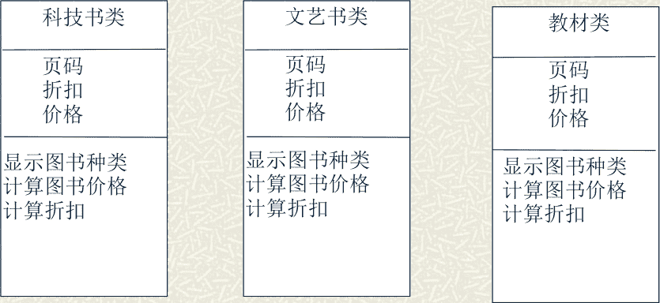

图8-1 各类图书的属性和行为

| 科技书类 | 文艺书类 | 教材类 |
| --- | --- | --- |
| 页码<br>折扣<br>价格 | 页码<br>折扣<br>价格 | 页码<br>折扣<br>价格 |
| 显示图书种类<br>计算图书价格<br>计算折扣 | 显示图书种类<br>计算图书价格<br>计算折扣 | 显示图书种类<br>计算图书价格<br>计算折扣 |

### 三类图书

- 相同的行为——种类、价格、折扣
- 不同的页码、价格和折扣

### 处理方法1

- 为每一类图书编写一个处理程序（Java 类）
- 代码大，重用性差

| 科技书类 | 文艺书类 | 教材类 |
| --- | --- | --- |
| 页码 折扣 价格 | 页码 折扣 价格 | 页码 折扣 价格 |
| 显示图书种类 计算图书价格 计算折扣 | 显示图书种类 计算图书价格 计算折扣 | 显示图书种类 计算图书价格 计算折扣 |

### 另一种方法

- 定义一个父类：抽象类声明共同的变量、成员方法
- 分别为不同的图书类定义子类，在子类中完成不同的处理“方法”
- 程序代码——重用

### （1）定义抽象类(P106)

```java
abstract class Book {
    int bookPage;    //图书页码
    float discount;  //图书折扣
    double price;    //图书价格

    public Book(int bookPage,float discount) { // 非抽象方法： 图书公共行为
        this.bookPage=bookPage;    // 页码
        this.discount=discount;    // 折扣
    }

    //抽象方法
    abstract void show_kind();    //显示图书种类
    abstract double getPrice(int bookPage,float discount); //计算价格

    public void show_price() {    // 非抽象方法： 显示价格
        System.out.println("This book's price is "+price);
    }
}
```

### （2）各子类：定义科技书类

```java
class Science_book extends Book {

    public Science_book(int bookPage,float discount) {
        super(bookPage,discount);    //引用父类的构造方法
    }

    public void show_kind() {       //实现抽象方法
        System.out.println("The book's kind is science");
    }

    public double getPrice(int bookPage,float discount) { //实现抽象类方法
        return bookPage*0.1*discount;
    }
}
```

### （2）各子类：定义文艺书类

```java
class Literature_book extends Book {

    public Literature_book(int bookPage,float discount) {
        super(bookPage,discount);
    }

    public void show_kind() {
        System.out.println("The book's kind is literature");
    }

    public double getPrice(int bookPage,float discount) {
        return bookPage*0.08*discount;
    }
}
```

### （2）各子类：定义教材类

```java
class Teaching_book extends Book {

    public Teaching_book(int bookPage,float discount) {
        super(bookPage,discount);
    }

    public void show_kind() {
        System.out.println("The book's kind is teaching book");
    }

    public double getPrice(int bookPage,float discount) {
        return bookPage*0.05*discount;
    }
}  // 其类的结构和代码与前面的几个子类相同
```


## 8.2 接口

- 接口(interface)可以被用来实现类间多继承结构
- 接口内部只能定义 public 的抽象方法和静态的、公有常量。所有的方法需要在实现接口的类中实现
- 接口提供了方法声明与实现相分离的机制
  - 实现接口的多个类表现出相同的行为模式
  - 每个实现接口的类可以根据各自要求，给出抽象方法的具体实现

## 1 接口声明

```
[访问权限] interface 接口名 [extends 父接口名] {
```

```
成员变量表(常量)
```

```
成员方法列表（抽象）
```

```
}
```

- 接口访问权限只有两种：**public**和缺省
- 接口体中定义的方法都是抽象、公有的
  - 关键字 **public**和**abstract** 可以省略
- 成员变量只能是静态、公有的常量
  - 关键字 **public**、**static** 和 **final** 都可以省略。

## Example“

以下是一个接口声明：

```
public interface Shape1 {
    public static final PI=3.14159; // 成员变量， 常量
    // 抽象成员方法
    public abstract double area();
    public abstract double volume( double x);
    public abstract void show();
}
```

## 2 接口实现

```
class 类名 [extends 父类名] implements 接口名列表{
类体
}
```

## 说明

- 一个类可以实现多个接口，各个接口之间用逗号分开
- 该类必须要实现接口中所有的抽象方法，即使本类中不使用的抽象方法也要实现
- 对不使用的抽象方法
  - 空方法：方法中没有语句，实现不需要返回值的方法
  - 返回默认值：在方法中使用默认值返回，如0
- 实现抽象方法，需指定访问权限为public

## 接口的特点

- 接口不存在最高层
  - 类有最高层：Object类
- 接口中的方法只能被声明为public和abstract，如果不声明，则默认为public abstract；
- 接口中的成员变量只能用public、static和final来声明，如果不声明，则默认为public static final。
- 接口中只给出方法名、返回值和参数表，而不能定义方法体

## Java实例 8-2——实现接口

```java
public interface Shape1 {

    public static final double PI=3.14159;
    public abstract double area();          //计算图形面积
    public abstract double volume( double x);   //计算图形体积
    public abstract void show_height();        //显示图形高度
}
```

```java
public class Circle1 implements Shape1 {
    double radius;

    public Circle1(double r) {
        radius = r;
    }

    public double area() {
        return PI*radius*radius;
    }

    public double volume( double x) { // 类中不用的抽象方法
        return 0;
    }

    public void show_height() { // 空方法
    }
}
```

```java
// 测试例8-2
public static void main(String args[]) {
    Circle1 circle=new Circle1(3);
    System.out.println("Radius="+circle.radius+" " Area="+circle.area());
}
}
```

程序运行结果如下：
Radius=3.0 Area=28.2743099999999996

## 实现接口并继承类举例

图给出了本例中用到的接口、类及其实现和继承关系。可以看到，Little_car、Big_car及Jeep类实现Automobile接口，Microbus和Bus类继承对Big_car类。

| interface 汽车（Automobile） |
|---|
| • 加速 `void acelent()` |
| • 维修 `void maintain()` |
| • 前进 `String forward()` |
| • 后退 `String reverse()` |

| class 小轿车（Little car） |
|---|
| • 加速 `void acelent()` |
| • 维修 `void maintain()` |
| • 前进 `String forward()` |
| • 后退 `String reverse()` |

| class 大轿车（Big car） |
|---|
| • 加速 `void acelent()` |
| • 维修 `void maintain()` |
| • 前进 `String forward()` |
| • 后退 `String reverse()` |

| class 越野车（Jeep） |
|---|
| • 加速 `void acelent()` |
| • 维修 `void maintain()` |
| • 前进 `String forward()` |
| • 后退 `String reverse()` |

| class 面包车（Microbus） |
|---|
| • 加速 `void acelent()` |
| • 维修 `void maintain()` |

| class 公共汽车（Bus） |
|---|
| • 前进 `String forward()` |
| • 后退 `String reverse()` |

implements

implements

implements

extends

extends

## 源程序Car.java的内容如下：

```java
interface Automobile { // 接口
int i = 5; // public、static和final可以省略
void accelent(); // public和abstract可以省略
void maintain();
String forward();
String reverse();
}// 接口定义结束
```

```java
// 定义Automobile类，在其中定义接口内的方法
class Little_car implements Automobile {
    public void accelent() {
        System.out.println("Little_car.accelent()");
    }
    public void maintain() {
    }
    public String forward() {
        return "Little_car forward";
    }
    public String reverse() {
        return "Little_car reverse";
    }
}
interface Automobile { // 接口
    int i = 5;
    void accelent();
    void maintain();
    String forward();
    String reverse();
}
```

```java
class Big_car implements Automobile { // 继承接口
public void accelent() {
System.out.println("Big_car.accelent()");
}
public void maintain() {
}
public String forward() {
return "Big_car forward";
}
public String reverse() {
return "Big_car reverse";
}
}
```


## 8.3 包

包是一组相关的类和接口的集合。将类和接口分装在不同的包中，可以避免重名类的冲突，限定包之间类的访问权限，更有效地管理众多的类和接口。

## 包的声明

使用包机制，首先要建立与包名相同的文件夹；
再声明类或接口所在的包，并且包中所包含的所有类
或接口的字节码文件存放于与包同名的文件夹中；再
在程序中导入包中包含的类或接口。

包的定义通过关键字package来实现的，package
语句的一般形式：

package 包名；

若需将类放在包中，只需在程序的第一行写上：

package 包名；

### 说明：

- package是关键字，包名是用户自定义的标识符。
- 如果要声明类或接口位于一个子包中，子包和其父包及祖先包名之间用“.”隔开。
- package语句必须位于程序中的第1行。一个源程序文件中只能有1条package语句，在该源程序文件中所定义的所有类和接口，都属于package语句所声明的包。
- 包名与文件夹名大小写要完全一致。

// 例如，声明 CPoint 类和 CCircle 类属于 mypackage 包的程序结构如下：

```java
package mypackage  // 包的名字为 mypackage

public class CPoint {
    // CPoint 类体
}

class CCircle {
    //CCircle 类体
}
```

//声明Person接口和Teacher类属于subpack包
（是mypackage的子包）的程序结构如下：
package mypackage.subpack
public interface Person {
// Person 接口体
}

class Teacher implements Person{
// Teacher类体
}

## 引用包中的类

一个类如果需要引用其他包中的类或接口，格式为：

- 包名.类名 或
- 包名.接口名

例如，类CLine要继承mypackage包中的CPoint类：

```java
public class CLine extends mypackage.CPoint
```

Graduate类实现mypackage.subpack中接口Person的声明格式如下：

```java
public class Graduate implements mypackage.subpack.Person
```

声明CPoint类对象point的格式如下：

```java
mypackage.CPoint point
```

实例化Cpoint类的格式如下：

```java
point = new mypackage.CPoint(参数表)
```

## 导入包中的类

导入一个包中类或接口的语句格式如下：

import 包名.类名

或

import 包名.接口名

或

import 包名.*

例子：

import java.util.* // 导入java中的util包中的......

//可以采用以下程序段引用mypackage包中
的CPoint类：
import mypackage.CPoint;
public CLine extends CPoint;  {
··
CPoint point;  // 定义实例point
point =new CPoint(参数表); // 初始化实例
··
}

## 例一包的建立和使用

在文件Point.java中定义Point类，并声明所在包为pack1。

```java
package pack1; //声明所在包是pack1
public class Point
{
protected int x, y;
public Point()
{ setPoint( 0, 0 ); }
public Point( int a, int b )
{ setPoint( a, b ); }

public void setPoint( int a, int b )
{
    x = a;
    y = b;
}
public int getX() { return x; }
public int getY() { return y; }
public String toString()
    { return "[" + x + ", " + y + "]"; }
}
```

在当前文件夹下建立子文件夹pack1，并将Point.class存放于文件夹pack1。

编译源程序PTest.java，产生PTest.class字节码文件，并存放在当前文件夹中。运行PTest类文件，运行结果如下：

x1=72, y1=115

x2=10, y2=10

## 例--一个包中包含多个类

在X1.java文件中定义bag包中的X1类。

```java
package bag;    //声明所在包为bag
public class X1
{
    int x,y;
    public X1(int i,int j)
    {
        x=i;
        y=j;
        System.out.println("x="+x+" "+"y="+y);
    }
    public void show()
    {
        System.out.println("This class is X1");
    }
}
```

在X2.java文件中定义bag包中的X2类。

```java
package bag;    //声明所在包为bag
public class X2
{
    int m,n;
    public X2(int i,int j)
    {
        m=i;
        n=j;
        System.out.println("m="+m+" "+"n="+n);
    }
    public void show()
    {
        System.out.println("This class is X2");
    }
}
```


## 编译bag包中的X1和X2类

键入下列命令，分别对X1和X2类编译：

```bash
javac X1.java
javac X2.java
```

由于X1.java和X2.java中指定X1和X2类属于bag包，所以编译时，系统自动在当前文件夹下生成子文件夹bag，并将生成的X1.class和X2.class放在当前文件夹的子文件夹bag中。

## 在PImport.java文件中，引用bag包的X1和X2类。

```java
import bag.X1; //导入bag包中的X1类
import bag.X2; //导入bag包中的X2类
public class PImport
{
    public static void main(String args[])
    {
        X1 aa=new X1(4,5);
        aa.show();
        X2 bb=new X2(10,20);
        bb.show();
    }
}
```

编译PImport类。键入下列命令，对PImport类进行编译：

```bash
javac PImport.java
```

编译生成的PImport.class存放于当前文件夹中。

运行PImport类。键入下列命令，运行PImport类

```bash
java PImport
```

程序运行结果：

```
x=4 y=5
This class is X1
m=10 n=20
This class is X2
```

## 包中类及其成员的访问权限

包中类及其接口只有public和缺省2种访问权限，具体规定如下：

+ public权限的类能够被所有包中的类访问，与所在的包无关。

+ 缺省权限的类只能被其所在包中的类访问，不能在其包外访问。

类中成员的访问权限有4种，具体规定如下：

+ 类中的public权限成员，能够被所有包中的类访问，与所在的包无关。
+ 类中的private权限成员，只能被本类访问，在类外不能访问。
+ 类中的缺省权限成员，能够被所在包中的所有类访问，不能在其包外访问。
+ 类中的protected权限成员，能够被所在包中的所有类访问，也能够被其它包中的子类访问。

## 说明：

+ ① 一个源程序文件中，最多只能有一条package语句，并且必须是第1条语句。
+ ② 一个源程序文件中，可以有多条import语句，并且必须位于其它类或接口声明之前。
+ ③ 一个源程序文件中，可以定义多个类或接口，但只能定义一个public权限类或public权限接口，并且该类或接口名与文件名相同。

# 第九章

# 异常处理

## Overview

### 9.1 Java异常处理机制

### 9.2 异常处理方式

## 9.1 异常处理机制

Java使用异常对程序给出一个统一和相对简单的抛出和处理错误的机制。如果一个方法本身能抛出异常，调用者可以捕获异常使之得到处理；也可以回避异常，这时异常将在调用的堆栈中向下传递，直到被处理。

## 异常类

在Java中，将异常情况分为 **Exception**（异常）和 **Error**（错误）两大类。 **Error** 类对象由 Java 虚拟机生成并抛出；**Exception** 类对象由应用程序处理或抛出。

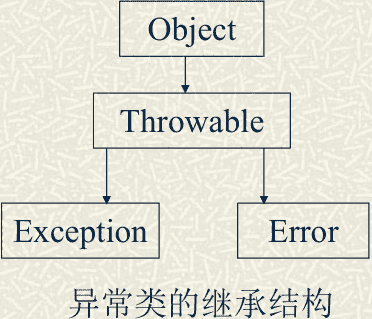

## Exception子类的继承关系

+ Exception
+ ClassNotFoundException
+ ClassNotSupportedException
+ IllegalAccessException
+ InstantiationException
+ InterruptedException
+ NoSuchMethodException
+ RuntimeException
+ ArithmeticException
+ ArrayStoreException
+ ClassCastException
+ IllegalArgumentException
+ IllegalThreadStateException
+ NumberFormatException

## Exception子类（续）

+ IllegalMonitorStateException
+ IndexOutOfBoundsException
  + ArrayIndexOutOfBoundsException
  + StringIndexOutOfBoundsException
+ NegativeArraySizeException
+ NullPointerException
+ SecurityException

## Exception 类的主要方法

public Exception();

public Exception(String s);

public String toString();

public String getMessage();

## 9.2 异常处理方法

异常处理的方法有两种：

+ 1. 使用try…catch…finally结构对异常进行捕获和处理；
+ 2. 通过throws和throw抛出异常。

## 1、try...catch...finally结构

Java通过try...catch...finally结构对异常进行捕获和处理：

Try {
可能出现异常的程序代码
}
catch （异常类名1 异常对象名1）{
异常类名1对应的异常处理代码
}
catch （异常类名2 异常对象名2）{
异常类名2对应的异常处理代码
}
···
[finally {
必须执行的代码
}]

## Java实例——捕获数组下标越界异常

```java
public class Exception1 {
public static void main(String args[]) {
try {
int a[]={1,2,3,4,5}, sum=0;
for (int i=0; i<=5; i++)
sum=sum+a[i];
System.out.println("sum="+sum);
System.out.println("Successfully!" );
}
catch (ArrayIndexOutOfBoundsException e) {
System.out.println("ArrayIndexOutOfBoundsException detected");
}
finally {
System.out.println(" Programmm Finished! ");
}
}
}
```

## 例--捕获算术异常

```java
public class Exception2{
public static void main(String args[]){
try {
int x, y;
x=15;
y=0;
System.out.println(x/y);
System.out.println("Computing successfully!");
}
catch (ArithmeticException e){
System.out.println(" ArithmeticException caught ! " );
System.out.println("Exception message:"+e.toString());
}
finally {
System.out.println("Finally block.");
}
}
}
```

## 2 抛出异常

+ 抛出异常语句

通常情况下，异常是由系统自动捕获的。但程序员也可以自己通过throw语句抛出异常。throw语句的格式为：

throw new 异常类名（信息）

其中异常类名为系统异常类名或用户自定义的异常类名，“信息”是可选信息。如果提供了该信息，toString()方法的返回值中将增加该信息内容。

## Java实例——抛出多个异常

```java
public class Exception3
{
   public static int Sum(int n){
   if (n < 0)
   throw new IllegalArgumentException("n应该为正整数！ ");
   int s = 0;
   for (int i=0; i<=n; i++) s = s + i;
   return s;
   }
}
```

```java
public static void main(String args[]){
try {
    int n = Integer.parseInt(args[0]);
    System.out.println(Sum(n));
}
catch (ArrayIndexOutOfBoundsException e) {
    System.out.println("命令行为: "+"java Exception3 <number>");
}
catch (NumberFormatException e2) {
    System.out.println("参数<number>应为整数!");
}
catch (IllegalArgumentException e3) {
    System.out.println("错误参数:"+e3.toString());
}
finally {
    System.out.println("程序结束!");
}
}
```

中，我们不要有多余的空格或空行。但为了可读性，我们保留必要的空行。

我们最终输出如下。[content]
## 3 自定义异常类

自定义异常类可以通过继承Exception类来实现。
其一般形式为：

```
class 自定义异常名    extends Exception
{
        异常类体;
}
```

## 第十章 输入与输出

### Overview

- 10.0 控制台输入/输出
- 10.1 输入输出类库
- 10.2 标准输入输出及标准错误
- 10.3 文件操作

### 输入和输出

### 输入

- 命令行
- Scanner类中的方法
  - `nextDouble()`, `nextFloat()`, `nextInt()`, `nextLine()`……
  - （JDK1.5以上）
- BufferedReader类的方法`read()`, `readLine()`
- JOptionPane类中的`showInputDialog`方法

### 输出

- print()方法；println()方法；printf()方法
  - （JDK1.5以上）
- JOptionPane类中的`showMessageDialog`方法

### 使用print、println、printf方法输出

- System.out.print(表达式); //输出,不换行

- System.out.println(表达式); //输出,换行

- System.out.printf("格式",表达式); //输出

- 格式:

- %d 整型表达式(short,int,long),输出十进制数

- %x 整型表达式(short,int,long),输出十六进制数

- %o 整型表达式(short,int,long),输出八进制数

- %f 浮点数输出(float,double)

- %s 字符串输出

- %c 字符输出

- %5d, %-5d, %.2f, %10.2f

### 使用对话框输出

需要导入swing包。使用JOptionPane对象的showMessageDialog()方法：
JOptionPane.showMessageDialog(null,输出字符串);

举例：

```java
import javax.swing.*;
class T1 {
    public static void main(String args[]) {
        String st = "王小红";
        JOptionPane.showMessageDialog(null, st + "你好!!");
        System.exit(0);
    }
}
```


### 命令行输入

- Eclipse“运行设置”中的参数
- 直接在命令行中输入——Like C Language
- 得到的是字符串：args[i]
- 必要时转换成其它类型。
  - 已在第5章介绍。

```
for (i=0; i<args.length; i++)
    System.out.println(args[i]);
```

### 利用Scanner类中的方法输入数据

- 使用java.util.Scanner,建立一个Scanner对象,就可以输入数据了。

    ```java
    import java.util.Scanner;
    Scanner in=new Scanner(System.in);
    ```

- 输入各类数据：

    ```java
    short a;int b;long c;float d;double e;String f,g;
    a=in.nextShort();
    b=in.nextInt();
    c=in.nextLong();
    d=in.nextFloat();
    e=in.nextDouble();
    f=in.next();
    g=in.nextLine();
    ```

### 使用对话框输入

- 程序顶部加入语句

    ```java
    import javax.swing.*;
    ```

- 在程序中使用： `JOptionPane.showInputDialog()`
- 例如：

    ```java
    String st = JOptionPane.showInputDialog("请输入:");
    ```

- 使用对话框输入的也是字符串，需要 `Integer.parseInt()`等转换

- 注意：使用对话框，会启动一个线程  
  - 使用`System.exit(0);`可以结束线程

### 对话框输入 / 输出举例

```java
import javax.swing.*;
class T1{
public static void main(String args[]) {
String st = JOptionPane.showInputDialog("请输入姓名:");
JOptionPane.showMessageDialog(null,st+"你好!");
System.exit(0);
}
}
```

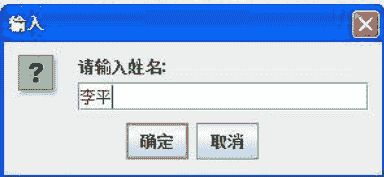


### 10.1 输入/输出类库

### java.io

- 实现java程序的输入输出功能

- 输入输出类库包

- 其中大部分是用来完成流式输入输出的类

### 流、程序、外设之间的关系

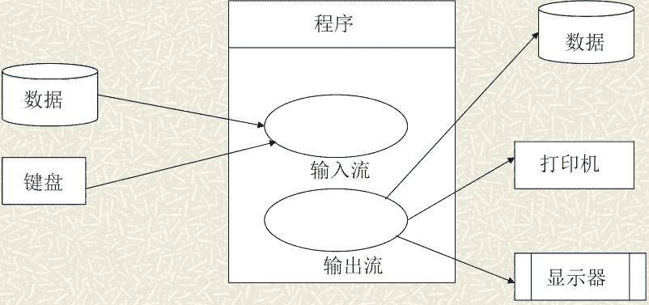

- **流**：计算机的输入与输出之间的流动数据的序列
- **Java数据流**：位流（字节流）、字符流

### 2 输入输出流类

- Java的流类，主要是：
  1. 输入流类InputStream
  2. 输出流类OutputStream
- 其他流类
  - 是为了方便处理各种特定流而设置的
  - 都属于InputStream或OutputStream的子类

### InputStream类

- 每个流有一个指针，每次读入从指针位置开始。
- 每读入一个数据，指针自动后移。
- 输入流类InputStream及其子类用来处理字节流
- InputStream是抽象类

```java
int read(); //读入数据  
long skip(); //指针后跳n个字节  
void mark(); //指针位置做标记  
void close(); //断开与外设的连接  
void reset(); //指针移到标记位置
```

### InputStream类的主要方法

InputStream 输入流类（抽象类）  
FileInputStream 文件输入流  
FilterInputStream  
DataInputStream  
BufferedInputStream

### InputStream子类的继承关系

### Reader类

Reader是抽象类，以字符方式从流中读入数据。

```java
int read()
long skip()
void mark()
void close()
void reset()
```

### Reader类的主要方法

### Reader子类的继承关系

Reader
BufferedReader
InputStreamReader
FileReader

- BufferedReader:具备缓冲功能的字符输入类
- InputStreamReader: 字节/字符输入流的桥梁
  - 从字节流读入数据，转为字符

### Writer类

- Writer类是抽象类
- 包含了所有字符输出流都需要的方法。

```java
void write()  
void flush()  
void close()
```

Writer  
PrintWriter  
BufferedWriter  
OutputStreamWriter  
FileWriter

### Writer类的主要方法

### Writer子类的继承关系


## 第十章 输入与输出

### 10.1 输入/输出类库

**java.io**

- 实现Java程序的输入输出功能。
- 输入/输出类库包。
- 其中大部分是用来完成流式输入输出的类。

### 流、程序、外设之间的关系

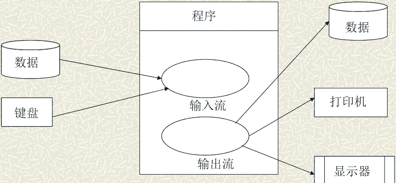

- 流：计算机的输入与输出之间的数据的序列  
- Java数据流：位流（字节流）、字符流

### 2 输入输出流类

Java的流类，主要是：

1. 输入流类InputStream
2. 输出流类OutputStream

其他流类都是为了方便处理各种特定流而设置的，属于InputStream或OutputStream的子类。

#### InputStream类

**InputStream类的主要方法：**

- `int read()`
- `long skip()`
- `void mark()`
- `void close()`
- `void reset()`

**InputStream子类的继承关系：**

- `InputStream`
  - `FileInputStream`
  - `FilterInputStream`
    - `DataInputStream`
    - `BufferedInputStream`

#### OutputStream类

**OutputStream类的主要方法：**

- `void write()`
- `void flush()`
- `void close()`

**OutputStream子类的继承关系：**

- `OutputStream`
  - `FileOutputStream`
  - `FilterOutputStream`
    - `PrintStream`
    - `DataOutputStream`

#### Reader类

**Reader类的主要方法：**

- `int read()`
- `long skip()`
- `void mark()`
- `void close()`
- `void reset()`

**Reader子类的继承关系：**

- `Reader`
  - `BufferedReader`
  - `InputStreamReader`
    - `FileReader`

### 10.2 标准输入输出及标准错误

- 程序与外设进行I/O时，要先建立I/O类对象。
- Java系统预先定义好3个流对象，静态属性和方法。

- **System.out**：标准输出设备（显示器）
- **System.in**：标准输入设备（键盘）
- **System.err**：标准错误设备（屏幕）

System是Java中一个功能非常强大的类：

- **System.out**
  - PrintStream类对象，输出字节数据流。
- **System.in**
  - InputStream类对象，输入字节数据流。
- **System.err**
  - PrintStream类对象，输出系统错误信息。
  - 各种错误信息输出到标准错误设备，即显示器。

#### Java实例——从键盘输入字符

```java
//当需要从键盘输入时，可直接使用该类的read()方法
import java.io.*; // 声明导入IO包
public class StandardIn1 { // 定义类
    public static void main(String[] args) throws IOException {
        char c;
        System.out.println(" 输入一个字符");
        c = (char) System.in.read(); //返回一个字符的ASCII码
        System.out.print("输入的字符是: " + c);
    }
}
```

#### 例——利用read()语句暂缓程序运行

```java
import java.io.*;
public class E10_2 {
    public static void main(String[] args) throws IOException {
        int i;
        for (i = 1; i <= 5; i++) {
            System.out.println(i);
            System.out.println("按回车键继续..."); //回车是两个字符
            System.in.read(); // \r
            System.in.read(); // \n
        }
        System.out.println("程序结束!");
    }
}
```

#### 例——输入字符串

```java
import java.io.*;
public class StandardIn3 {
    public static void main(String[] args) throws IOException {
        InputStreamReader iin = new InputStreamReader(System.in);
        BufferedReader bin = new BufferedReader(iin);
        String s;
        float f;
        int i;
        boolean b;
        System.out.println("输入任一字符串");
        s = bin.readLine();
        System.out.println("输入浮点数");
        f = Float.parseFloat(bin.readLine());
        System.out.println("输入整数");
        i = Integer.parseInt(bin.readLine());
        System.out.println("输入布尔量");
        b = Boolean.parseBoolean(bin.readLine());
        System.out.println("输入的字符串:" + s);
        System.out.println("输入的浮点数:" + f);
        System.out.println("输入的整数:" + i);
        System.out.println("输入的布尔量:" + b);
    }
}
```

- 利用BufferedReader类的readLine()方法读入字符串。
- BufferedReader类构造方法可接收InputStreamReader类对象作为参数，但不能直接接收System.in作为参数。
- 故先建立与System.in有联系的InputStreamReader类对象。
- 再用InputStreamReader类对象建立BufferedReader类对象。

#### BufferedReader类的方法read(), readLine()

```java
InputStreamReader iin = new InputStreamReader(System.in);
BufferedReader bin = new BufferedReader(iin);
```

两句可以合为一句：

```java
BufferedReader bin = new BufferedReader(new InputStreamReader(System.in));
```

接着就可以使用read()和readLine()方法：

```java
char c = (char) bin.read(); //输入字符
String st = bin.readLine(); //输入字符串
```

### 10.3 文件操作

- Java提供了功能强大的文件及目录操作功能。
- 对文件及目录进行操作：
  - 应先对目录或文件建立连接。
  - File类可以实现这些连接。
- File类也位于java.io包中，但不是流类。
  - 不负责数据输入和输出。
  - 专门用来管理文件和目录。
- 一个File类对象表示一个磁盘文件或目录。
  - 对象属性包含了名称、长度等信息。
  - 对象的方法可以实现文件或目录的常用管理。

#### 以字节流的方式读文件

```java
import java.io.*;
public class E10_5 {
    public static void main(String[] args) throws IOException {
        try {
            FileInputStream fr = new FileInputStream("d:\\td\\E10_4.txt");
            int i;
            while ((i = fr.read()) != -1) // -1为文件结束符
                System.out.print((char) i);
            fr.close();
        } catch (FileNotFoundException e) {
            System.out.println(e);
        } catch (IOException e) {
            System.out.println(e);
        }
    }
}
```

## Writer类

Writer类的主要方法

- `void write()`
- `void flush()`
- `void close()`

Writer子类的继承关系

- Writer
- PrintWriter
- BufferedWriter
- OutputStreamWriter
- FileWriter

## 10.2 标准输入输出及标准错误

- Java系统预先定义好3个流对象，静态属性：
  - System.out 标准输出设备：显示器
  - System.in 标准输入设备：键盘
  - System.err 标准错误设备：屏幕
- System.out：PrintStream类对象，输出字节数据流
- System.in：InputStream类对象，输入字节数据流
- System.err：PrintStream类对象，输出系统错误信息

### 例--利用read()语句暂停程序运行

```java
import java.io.IOException;
public class StandardIn2
{
    public static void main(String[] args)   throws IOException
    {
        for (int i=1; i<=5; i++)
        System.out.println(i);
        System.out.println("按回车键继续...");
        System.in.read();
        System.out.print("程序继续运行！");
    }
}
```

### 2 标准输出

- Java的标准输出设备
  - 显示器用System.out表示
  - System.out属于PrintStream类对象。
- PrintStream 输出各类数据
  - print()
  - println()
  - 唯一区别是换行

### 3 标准错误

运行或编译Java程序时，各种错误信息输出到标准错误设备，即显示器。在Java中，标准错误设备用System.err表示。System.err属于PrintStream类对象。

## 10.3 文件操作

- 程序对磁盘文件或目录进行操作
  - 首先对文件或目录建立连接
  - Java提供了File类
- File类也位于java.io包中
  - File类不是流
  - 专门用来管理磁盘文件和目录
- 一个File类对象
  - 表示一个磁盘文件或目录
  - 对象属性中包含了文件或目录的相关信息，如
    - 名称、长度、所含文件个数等
    - 其方法完成对文件/目录的操作，如创建、删除等

### 1 建立File对象

File类提供了3个不同的构造方法：

- `File(String path)`：String类参数path指定所建对象对应的磁盘文件名或目录名及其路径名。
- `File(String path, String name)`：此构造方法中的参数path表示文件或目录的路径，参数name表示文件或目录名。
- `File(File dir, String name)`：此构造方法中的参数dir表示一个磁盘目录对应的File对象，参数name表示文件名或目录名。

### 2 File对象的属性和操作

- `public String getName()`: 得到文件名
- `public String getPath()`: 得到文件路径
- `public boolean exists()`: 判断文件或目录是否存在
- `public long length()`: 返回文件的字节数
- `public boolean canRead()`: 返回当前文件是否可读
- `public boolean canWrite()`: 返回当前文件是否可写
- `public boolean equals(File file)`: 比较文件或目录
- `public boolean isFile()`: 检测是否是文件
- `public boolean isDirectory()`: 检测是否是目录
- `public boolean renameTo(File file)`: 重命名文件
- `public void delete()`: 删除文件

### FileOutputStream流类

FileOutputStream流类的构造方法有两个：

- `FileOutputStream(String fileName)`: 参数fileName表示带路径的磁盘文件名。
- `FileOutputStream(File file)`: 参数file表示为磁盘文件所建立的File对象名。

### Java实例——以字节流方式写入文件

```java
import java.io.*;
public class File2{
    public static void main(String[] args) throws IOException{
        char ch;
        File file1=new File("c:\\jdk1.3\\example\\newFile.txt");
        try{
            FileOutputStream fout= new FileOutputStream(file1);
            System.out.println("输入任一字符串，以?结束");
            ch=(char) System.in.read();
            while (ch != '?'){
                fout.write(ch);
                ch=(char) System.in.read();
            }
            fout.close();
        }
        catch (FileNotFoundException e) { System.out.println(e);}
        catch (IOException e) { System.out.println(e);}
    }
}
```

### DataOutputStream流类

DataOutputStream类文件中写操作步骤：

1. 为磁盘文件建立File类对象
2. 为该File对象建立FileOutputStream类流对象，建立其与磁盘文件的连接
3. 为FileOutputStream类对象
   - 建立DataOutputStream类对象
   - 利用DataOutputStream类的writeInt(), writeFloat(), writeDouble(), writeBoolean()等方法分别向文件中写入整型、单精度型、双精度型、布尔型等数据
4. 写入操作完成后，利用close()方法将流关闭，断开与磁盘文件的联系

### Java实例——向磁盘文件写入各类数据

```java
import java.io.*;
public class File4  {
    public static void main(String[] args)    {
        int ch;
        InputStreamReader iin=new InputStreamReader(System.in);
        BufferedReader bin =new BufferedReader(iin);
        File file1=new File("c:\\jdk1.3\\example\\dataFile.txt");
try{
        FileOutputStream fout= new FileOutputStream(file1);
        DataOutputStream dout =new DataOutputStream(fout);
        System.out.println("输入整数");
        int i=Integer.parseInt(bin.readLine());
        System.out.println("输入浮点数");
        float f=Float.parseFloat(bin.readLine());
        System.out.println("输入布尔量");
        boolean b=new Boolean(bin.readLine()).booleanValue();
        dout.writeInt(i);
        dout.writeFloat(f);
        dout.writeBoolean(b);
        dout.close();
```


### 例一从磁盘文件读取各类数据

```java
import java.io.*;
public class File5 {
    public static void main(String[] args) {
        int ch;
        File file1=new File("c:\\jdk1.3\\example\\dataFile.txt");
        File file2=new File("c:\\jdk1.3\\example\\outFile.txt");
        try {
            FileInputStream fin = new FileInputStream(file1);
            DataInputStream din = new DataInputStream(fin);
            int i=din.readInt();
            float f=din.readFloat();
            boolean b=din.readBoolean();    din.close();
            FileOutputStream fout = new FileOutputStream(file2);
            DataOutputStream dout = new DataOutputStream(fout);
            dout.writeInt(i);
            dout.writeFloat(f);
            dout.writeBoolean(b);
            dout.close();
            System.out.println("整数："+i);
            System.out.println("浮点数："+f);
            System.out.println("布尔量："+b);
        }
        catch(FileNotFoundException e)
        {System.out.println(e);}
        catch(IOException e)
        {System.out.println(e);}
    }
}
```

### Writer和Reader

以字符流方式向文件写入或从文件中读取数据，可以使用 Writer 和 Reader 类及其子类。

Writer 和 Reader 类都是抽象类，不能建立它们的对象，所以只能通过它们的子类对象对文件进行操作。常用的 Writer 类的子类包括 FileWriter 类和 BufferedWriter 类。

FileWriter 类构造方法如下：

- `FileWriter(String fileName)`：参数 `fileName` 表示带路径的磁盘文件名。
- `FileWriter(File file)`：参数 `file` 表示为磁盘文件所建立的 `File` 对象名。

注：使用 `FileWriter` 进行文件操作时，为了减少磁盘读写次数，常常使用具有缓冲功能的 `BufferedWriter` 类。

### Java实例—以字符流方式写入文件

```java
import java.io.*;
public class File8 {
  public static void main(String args[]) throws Exception {
    InputStreamReader iin =new InputStreamReader(System.in);
    BufferedReader br=new BufferedReader(iin);
    FileWriter fw1=new FileWriter("c:\\jdk1.3\\example\\dataFile.txt");
    BufferedWriter bw = new BufferedWriter(fw1);
    String s;
    while (true){
      System.out.print("输入一个字符串: ");
      System.out.flush();
      s=br.readLine();
      if (s.length()==0) break;
      bw.write(s);
      bw.newLine();
    }
    bw.close();
  }
}
```

### 例一以字符流方式读取文件

```java
import java.io.*;
public class File9
{
    public static void main(String args[]) throws Exception
    {
        FileReader fr1 = new FileReader("c:\\jdk1.3\\example\\dataFile.txt");
        BufferedReader br1 = new BufferedReader(fr1);
        BufferedWriter bw1 = new BufferedWriter(
        new FileWriter("c:\\jdk1.3\\example\\targetFile.txt"));
        int lineNum=0;
        String s=br1.readLine();
```

### 例一 以字符流方式向显示器输出

```java
import java.io.*;
public class File11
{
    public static void main(String args[]) throws Exception
    {
        FileReader fr1 = new FileReader("c:\\jdk1.3\\example\\dataFile.txt");
        BufferedReader br1 = new BufferedReader(fr1);
        BufferedWriter bw1 = new BufferedWriter(
                new OutputStreamWriter(System.out));
        int lineNum=0;
        String s=br1.readLine();
        while (s != null)
        {
            lineNum++;
            bw1.write(String.valueOf(lineNum));
            bw1.write(" ");
            bw1.write(s);
            bw1.newLine();
            s=br1.readLine();
        }
        bw1.close();
    }
}
```

## 第十一章 图形用户界面（GUI）设计

## 第十二章 Swing组件

### AWT组件概述

- 图形用户界面方便用户与程序的交互。
- Java 的 AWT（抽象窗口工具集 Abstract Window Toolkit）提供：
  - 组件类
  - 窗口布局管理器类
  - 事件处理类
- AWT 组件定义在 `java.awt` 包中。
- 它包括组件类、组件布局类等。
- 主要类与继承关系如图：

1. 组件——构成图形用户界面的基本成分和核心元素。
2. 容器——是一种特殊的组件，能容纳其它组件。

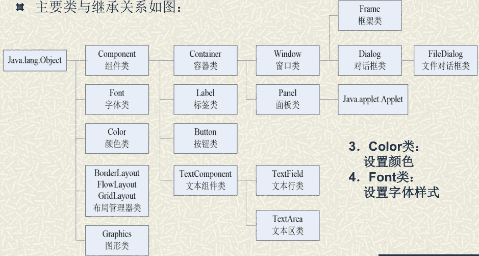

3. Color 类：设置颜色
4. Font 类：设置字体样式

### AWT组件举例--在窗口中建立一个标签

```java
import java.awt.*;
class E11_2{
public static void main(String []args){
    Frame fra=new Frame("FrmApp");    //创建窗口，并设置标题
    Label lab=new Label("Hello",Label.CENTER); //创建标签，并设置标题和对齐方式
    fra.setSize(250,150);
    lab.setForeground(Color.blue);    //设置标签前景色
    lab.setBackground(Color.red);    //设置标签背景色
    //创建字体对象（字体、字型、字号）
    Font fnt=new Font("Serif",Font.ITALIC+Font.BOLD,22);
    lab.setFont(fnt);    //设置标签字体
    fra.add(lab);    //在窗口中加载标签
    fra.setVisible(true);
    System.out.println("Text:"+lab.getText());
}
}
```


# AWT组件举例---在窗口中建立一个按钮

```java
import java.awt.*;
public class E11_3{
    public static void main(String []args){
        Frame fra=new Frame("按钮练习");
        Button but=new Button("click");
        fra.setLayout(null);   //没有这句，按钮会充满整个窗口
            //（加了这句，还要设置按钮大小，位置）
        fra.setSize(250,170);
        but.setSize(100,50);
        but.setLocation(75,60);
        fra.add(but);
        fra.setVisible(true);
    }
}
```

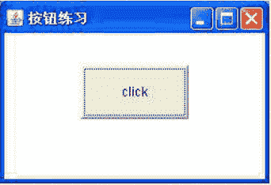

## 11.2 布局管理

- 当窗口中组件较多时，用setSize和setLocation显得不方便。
- Java提供了多种布局管理器（Layout manager）：
- 用来对组件相对定位，会根据窗口大小，自动改变组件大小。
- 每一种布局管理器指定一种组件的相对布置和大小布局。
- Java提供了五种布局管理器类：
  - FlowLayout（提供按行布局组件的方式）
  - BorderLayout（把容器空间划分为东、南、西、北、中五个区域）
  - GridLayout（将容器划分为大小相等的若干行乘若干列的网格）
  - CardLayout
  - GridBagLayout
- 这些布局管理器类都是java.lang.Object的子类。

## 布局管理举例---使用FlowLayout布局。

```java
import java.awt.*;
public class E11_6{
public static void main(String []args){
Frame frm=new Frame("布局练习");
FlowLayout fl=new FlowLayout(FlowLayout.LEFT,5,10);//对齐，水平、垂直间距
frm.setBounds(0,0,300,200); //窗口初始位置和大小
frm.setLayout(fl); //采用FlowLayout布局
Button but1=new Button("Button1");
Button but2=new Button("Button2");
Button but3=new Button("Button3");
Button but4=new Button("Button4");
Button but5=new Button("Button5");
frm.add(but1);
frm.add(but2);
frm.add(but3);
frm.add(but4);
frm.add(but5);
frm.setVisible(true);
}
}
```

## 11.3 事件处理

### 开发程序时的实现方法

- 向事件源注册事件监听器
  - 调用事件源的addXXXListener()之类的方法。
  - 如：向按钮butt注册单击事件监听器，需要调用：
    butt.addActionListener(this);
  - 这样单击按钮时，事件监听器创建单击事件类ActionEvent对象
- 实现事件处理方法
  - 其方法体即为事件发生时要执行的语句序列

## 11.4 绘图

- Java提供了绘图类Graphics。
- 可以在组件上绘制直线、圆、圆弧、任意曲线等。
- 绘图所用的坐标系与屏幕、窗口相同。
- 水平为X轴，向右为正。
- 垂直为Y轴，向下为正。
- 原点(0,0)位于左上角。
- 点(x,y)中的x和y为距原点的水平和垂直像素。

## javax.swing中类的继承关系

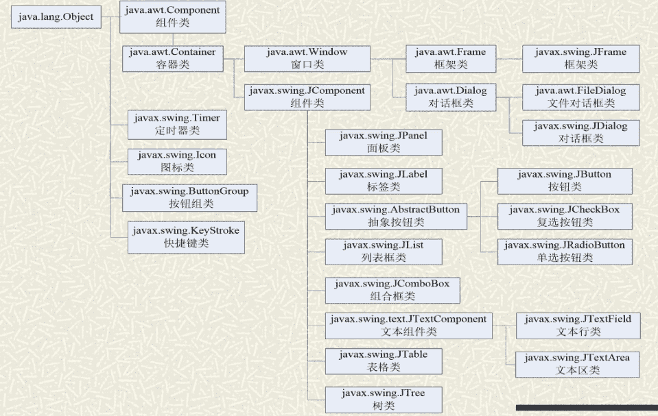

Swing组合框举例：窗口中有一个组合框和一个标签，当选择组合框中某项时，在标签中显示所选的信息。

```java
import java.awt.*;
import java.awt.event.*;
import javax.swing.*;
import javax.swing.event.*;
public class T1 extends JFrame{
    private JComboBox jcb;
    private JLabel jlb;
    public T1(){
        super("组合框举例");              //构造方法
        setSize(200,150);
        Object obj[]={"杭州","宁波","温州","金华","绍兴","嘉兴","湖州"};
        jcb=new JComboBox(obj);
        jcb.setMaximumRowCount(4);    //设置下拉列表框显示的最大行数
        jlb=new JLabel("");
        Container c=getContentPane();       //获得默认的内容窗格
        c.setLayout(new FlowLayout());
        c.add(jcb);
        c.add(jlb);
        jcb.addItemListener(new ItListener());   //构造方法中添加监听组合框事件
        setVisible(true);
    }
}
```

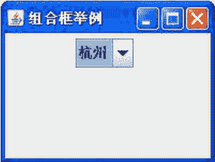

```java
public static void main(String []args){
    T1 frm=new T1();
    frm.addWindowListener(new winListen());    //在main中添加监听窗口事件
}
class ItListen implements ItemListener{    //内部类,监听是否发生ItemEvent事件
    public void itemStateChanged(ItemEvent e){    //选择项目时执行
        jlb.setText("你选中了"+jcb.getSelectedItem());    //getSelectedItem():获得选项
    }
}
static class winListen extends WindowAdapter{    //内部类,监听是否发生WindowEvent事件
    public void windowClosing(WindowEvent e){    //关闭窗口时执行
        System.exit(0);    //终止程序执行
    }
}
```

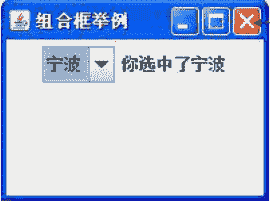

## 第十三章

# Applet程序

## Applet程序

- Java有两种程序
  - 独立应用程序
  - Applet程序
- Applet程序不能独立运行，必须依附于网页，借助浏览器才能运行。

## Applet简介

- Applet类
  - Applet程序继承自Java.applet.Applet类；
- 程序嵌入HTML文档中，常置于服务器端，下载到本地后由浏览器执行
- Applet类提供了Applet程序与执行环境间的标准接口，包括4个方法：
  1. init()方法：初始化。如获取Applet运行参数、加载图片等。
     它在网页第一次加载（或重新加载）时调用。
  2. start()方法：在执行init()方法后，执行start()方法。
     或该网页重新激活时，再执行start()方法。
  3. stop()方法：当离开Applet网页，使它不活动或最小时，执行该方法。
  4. destroy()方法：用户真正离开浏览器时执行。
     在stop之后执行。清除Applet占用的资源。（事实上系统会自动清除）
- Applet程序运行时，会出现一个窗口界面。当窗口大小或内容改变需要重绘窗口时，调用paint()方法。


## 13.1.2 Applet程序的运行过程

- 当浏览器装载有带Applet程序的网页时：
  - 首先为Applet及其全局变量分配存储空间。
  - 执行Applet的init()方法。
  - 执行Applet的start()方法。
  - 执行Applet的paint()方法。
- 当离开Applet网页，又重新激活时：
  - 执行Applet的start()方法。
  - 执行Applet的paint()方法。
- 当用户真正离开浏览器时：
  - 执行Applet的stop()方法。
  - 执行Applet的destroy()方法。

## 13.1.3 Applet程序的建立和运行

建立方法：
1. 用文本编辑器编辑源程序：文件名.java
2. 用javac.exe编译源程序，生成字节码文件：文件名.class
3. 将字节码文件嵌入到HTML文件中。
4. 浏览加载HTML文件时，执行Applet程序。

```html
<HTML>
<APPLET CODE="applet类名.class" WIDTH=窗口宽度 HEIGHT=窗口高度></APPLET>
</HTML>
```

applet类名.class：即为字节码文件

窗口宽和高度是指Applet程序运行时的窗口初始尺寸。

运行Applet程序的几种方式：
1. 利用浏览器运行Applet程序。
2. 利用appletviewer运行Applet程序。appletviewer html文件名.htm
3. 利用JCreator或Eclipse建立和运行Applet程序。

## Applet程序举例：显示文字：Hello Applet!

```java
import java.awt.Graphics;
import javax.swing.JApplet;
public class T1 extends JApplet{
public void paint(Graphics g){
g.drawString("Hello Applet!",50,60);
}
}
```

HTML文件(在T1.class同一文件夹中):

```html
<HTML>
<APPLET CODE="T1.class" WIDTH=250
HEIGHT=100></APPLET>
</HTML>
```

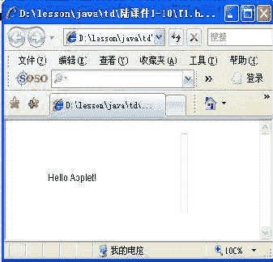

使用浏览器执行(HTML)


使用Eclipse执行

## Applet程序举例：绘制图形

```java
import java.awt.Graphics;
import javax.swing.JApplet;
public class E13_2 extends JApplet{
    public void paint(Graphics g){
        g.drawLine(40,30,200,30);  //画横线，两点：(40,30)和(200,30)
        g.drawRect(40,50,160,100);  //画矩形，(40,50)为左上角，宽和高分别为160和100
        g.drawOval(40,50,160,100);  //画椭圆。(40,50)为左上角，宽160高100的矩形为切椭圆
        g.drawLine(40,170,200,170);
        g.drawString("Drawing!",100,105);  //(100,100)处输出字符串
    }
}
```

HTML文件：

```html
<HTML>
<APPLET CODE="E13_2.class"
             WIDTH=250 HEIGHT=200>
</APPLET>
</HTML>
```

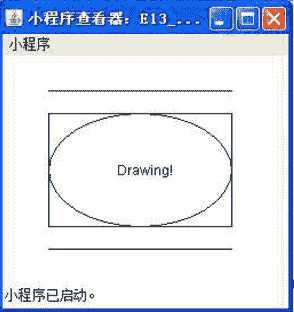

Applet举例：覆盖init()方法的Applet程序。利用init()方法输入一个整数，利用paint()方法计算并输出阶乘。

```java
import java.awt.Graphics;
import javax.swing.*;   // JOptionPane和JApplet
public class T1 extends JApplet{
    int n;
    long s=1;
    public void init(){
        String nStr=JOptionPane.showInputDialog("请输入一个整数：");
        n=Integer.parseInt(nStr);
    }
    public void paint(Graphics g){
        for(int i=1;i<=n;i++)s*=i;
        g.drawString (n+"!="+s,10,10);
    }
}
```

```html
<HTML>
<Applet code=T1.class width=300 height=100></Applet>
</Html>
```

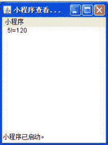

## 第十四章

## 多线程

- 许多程序都包含了一些独立的代码段，如果让它们在执行时间上重叠，可以提高执行效率。
- **线程是为了实现重叠执行而引入的一个概念。**
- **线程是可以独立、并发执行的程序单元。**
- 多线程是指程序中存在多个执行体，按自己的执行步骤并发工作，独立完成各自功能，互不干扰。

## 14.1 Java的多线程机制

- 多线程机制是Java的重要特征。
- 每个Java程序都有一个主线程
  ——main()方法对应的线程。
- 实现多线程，必须在主线程中创建新线程。
- Java线程用Thread类及子类的对象来表示。
- 每个线程经历五种状态。从新生到死亡的过程为生命周期。

## 线程的生命周期

1. 新生状态：用new运算符和Thread类或子类建立一个线程。
   - 新生状态的线程有自己的内存空间。
   - 通过调用start()方法进入就绪状态。
2. 就绪状态：已具备运行条件，等待系统为它分配CPU。
   - 一旦获得CPU，就进入运行状态，并自动调用run()方法。
3. 运行状态：执行run()方法中的代码，直到调用其他方法而终止。或等待某资源而阻塞，或完成任务而死亡。
4. 阻塞状态：运行状态下，若执行了sleep()方法、或等待I/O设备等，让出CPU而暂停运行，即进入了阻塞状态。
   - 阻塞状态的线程不能进入就绪队列。
   - 只有当阻塞原因消除后，才转入就绪状态。
5. 死亡状态：正常运行的线程完成了它全部工作。或强制终止，如执行了stop()或destroy()方法。

## 14.1.2 多线程的实现方法

- 有两种方法：
  1. 通过创建Thread类的子类来实现。
  2. 通过实现Runnable接口的类来实现。

两者无本质区别，只是由于Java不允许多重继承，所以当一个类既要继承一个非Thread类，又要实现多线程时，可以使用Runnable接口的方式。

## 举例:通过Thread类实现多线程

1. 先设计Thread类的子类（即继承Thread类）
2. 设计线程的run()方法
3. 建立该类的对象
4. 使用start()方法启动线程，将执行权交给run()方法。

[例14-1]通过继承Thread类实现多线程。启动两个线程执行。它们分别相隔m毫秒输出一个字母A或B（m分别为50和100）。共输出20个A和20个B。

```java
public class T1 extends Thread{ //继承Thread
String s;
int m,count=0;
T1(String ss,int mm){ s=ss; m=mm; }
public void run(){
try{
while(true){
System.out.print(s);
sleep(m); //sleep m毫秒
count++;
if(count>=20)break;
}
System.out.println("finished"+s+"!");
}
catch(InterruptedException e){
return ;
}
}
```

```java
public static void main(...){
T1 threadA=new T1("A ",50);
T1 threadB=new T1("B ",100);
threadA.start(); //启动线程
threadB.start(); //启动线程
}
}
```

运行后的输出：
A B A A B A A B B A A B A A B A A B B
A A B A A B A A B A A B A finishedA !
B B B B B B B B B B finishedB !
