# 浙江大学操作系统课件（Abraham Silberschatz）


## OS参考书、网址

参考书：
1. “计算机操作系统”，汤子瀛等，西安电子科技大学出版社。
2. “现代操作系统”，Andrew S.Tanenbaum著，陈向群等译，机械工业出版社。
3. “Operating Systems: Internal and Design Principles”，William Stallings，清华大学出版社，1998年第3版。
4. “Windows操作系统原理”，尤晋元等，机械工业出版社。

参考网址：
www.bell-labs.com/topic/books/os-book  
www.bell-labs.com/topic/books/aos-book  
os.cs.tsinghua.edu.cn  
os.pku.edu.cn  
www.ict.ac.cn/chpc/os

## Chapter 1: Introduction 引论

- 1.1 What is an Operating System? 什么是操作系统？  
- 1.2 Mainframe Systems 主机系统  
- 1.3 Desktop Systems 台式系统  
- 1.4 Multiprocessor Systems 多处理机系统  
- 1.5 Distributed Systems 分布式系统  
- 1.6 Clustered Systems 集群系统  
- 1.7 Real-Time Systems 实时系统  
- 1.8 Handheld Systems 手持系统  
- 1.9 Feature Migration 特征变迁  
- 1.10 Computing Environments 计算环境  

### 1.1 What is an Operating System?

什么是操作系统？

- Operating system is a program that manages the computer hardware.  
  操作系统是管理计算机硬件资源的程序。

- A program that acts as an intermediary between a user of a computer and the computer hardware.  
  在计算机用户和计算机硬件之间起媒介作用的一种程序。

- To understand what operating system are, we must first understand how they have developed.  
  Development of operating system: hands-on system – multiprogramming – time-shared – PCs – handheld computers  

### Computer System Components 计算机系统部件

1. **Hardware 硬件** – provides basic computing resources (CPU, memory, I/O devices). 提供基本的计算资源  

2. **Operating system 操作系统** – controls and coordinates the use of the hardware among the various application programs for the various users.  
   在各种应用程序和用户之间控制与协调对硬件的使用  

3. **Applications programs 应用程序** – define the ways in which the system resources are used to solve the computing problems of the users (compilers, database systems, video games, business programs).  
   定义解决用户问题的资源使用方式（编译、数据库、视频游戏、事务程序等）  

4. **Users 用户** (people, machines, other computers).


### Operating System Definitions 操作系统定义

- Resource allocator 资源分配者 – manages and allocates system resources. 管理和分配系统资源  
- Control program 控制程序 – controls the execution of user programs and operations of I/O devices. 控制用户程序的运行和I/O设备的操作  
- Kernel 内核 – the one program running at all times (all else being application programs). 在全时运行的一个程序（其他的应用）  
- An interface between the user and hardware 人机接口  
- Masks the details of the hardware  

### 1.1.3 Operating System Goals 操作系统目标

- Convenience for the user: 方便  
- Efficient operation of the computer system: 有效  
  - Execute user programs and make solving user problems easier.  
    执行用户程序并使用户问题更易解决。  
  - Make the computer system convenient to use.  
    使计算机系统更易使用。  
  - Use the computer hardware in an efficient manner.  
    以一种效率的方式使用硬件。  
- 可扩充  
- 开放  

### 1.2.2 Multiprogrammed Systems 多道程序系统

Several jobs are kept in main memory at the same time, and the CPU is multiplexed among them.  
在主存中同时有若干个作业，CPU在其中多重切换(共享CPU)。

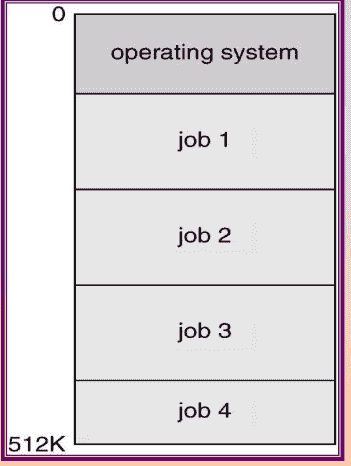


### OS Features Needed for Multiprogramming
多道程序对OS特点的要求

- **I/O routine supplied by the system.** 系统提供I/O例程
- **Memory management**– the system must allocate the memory to several jobs.
  存储管理--系统必须为若干工作作业分派空间
- **CPU scheduling**– the system must choose among several jobs ready to run.
  CPU调度—系统必须在就绪作业中选择准备运行
- **Allocation of devices.** 设备分配

### 1.2.3 Time-Sharing Systems–Interactive Computing 分时系统-交互式计算

- **Time Sharing is a logical extension of multiprogramming.** 分时系统是多道程序的逻辑扩充。
- **The CPU is multiplexed among several jobs that are kept in memory and on disk (the CPU is allocated to a job only if the job is in memory).** 对保存在内存和磁盘上的若干作业之间共享CPU（CPU被分配给某个作业仅当该作业在内存）
- **A job swapped in and out of memory to the disk.** 作业在内存和磁盘之间被对换
- **A interactive computer system provides direct communication between the user and the system.**

### Time-Sharing Systems–Interactive Computing (Cont.)

- On-line communication between the user and the system is provided; when the operating system finishes the execution of one command, it seeks the next “control statement” from the user’s keyboard.
  提供用户和系统之间的在线通信；操作系统完成了一条命令的执行后，它从用户键盘上寻找下一条控制语句

- On-line system must be available for users to access data and code.
  在线系统必须使用户能够访问数据和代码

### 1.3 Desktop Systems
台式系统

- **Personal computers**– computer system dedicated to a single user. 个人计算机--供个人使用的计算机系统
- **I/O devices**– keyboards, mice, display screens, small printers. I/O设备—键盘、鼠标、显示器、小型打印机
- **User convenience and responsiveness.** 方便用户和响应
- **Can adopt technology developed for larger operating system**, often individuals have sole use of computer and do not need advanced CPU utilization or protection features. 可采用大型操作系统研发的技术，个人独占计算机不需要高级CPU使用的保护技术
- **May run several different types of operating systems (Windows, MacOS, UNIX, Linux)** 可以运行不同的操作系统


### 1.4 Multiprocessor Systems 多处理机系统

Multiprocessor systems with more than on CPU in close communication.
有紧密通信的、多于一个CPU的多处理器系统

Tightly coupled system– processors share memory and a clock; communication usually takes place through the shared memory.
紧密偶合系统 -- 处理器共享内存和时钟； 一般通过共享内存进行通信

Advantages of Multiprocessor system:优点
Increased throughput增大吞吐量
Economical经济

### Multiprocessor Systems(Cont.)

**Increased reliability** 提高可靠性

- graceful degradation (fail-soft) 故障弱化: ability to continue providing service proportional to the level of surviving 残存 hardware
- fault tolerant 容错

- **Symmetric multiprocessing (SMP)** 对称多处理器
  - Each processor runs an identical copy of the operating system.
    每个处理器运行操作系统的相同副本
  - Many processes can run at once without performance deterioration.
    许多进程可以立即运行不会降低性能

### Multiprocessor Systems(Cont.)

Most modern operating systems support SMP
多数现代操作系统支持SMP

- **Asymmetric multiprocessing** 非对称多处理器
  - Each processor is assigned a specific task; master processor schedules and allocated work to slave processors.
    每个处理器赋予一个特定任务；主处理器为从处理器调度和分配作业
  - More common in extremely large systems
    常用在非常大的系统中

### Fig 1.4 Symmetric Multiprocessing Architecture

对称多处理器体系结构

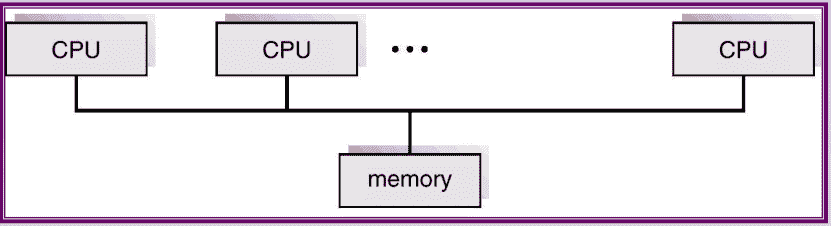

CPU

CPU

CPU

memory

### 1.5 Distributed Systems分布式系统

Distribute the computation among several physical processors.计算分布在若干物理处理器上

Loosely coupled system– each processor has its own local memory; processors communicate with one another through various communications lines, such as high-speed buses or telephone lines.松散偶合系统– 每个处理器有自身的本地存储器；通过各种通信设施，如高速总线、电话线等进行处理器之间的通信

Advantages of distributed systems.分布式系统优点

Resources Sharing资源共享

Computation speed up – load sharing 加快计算 - 共享装载

### Distributed Systems (cont.)

**Reliability** 可靠

**Communications** 通信

- Requires networking infrastructure. 需要网络构架
- Local area networks (LAN) or Wide area networks (WAN)
- May be either client-server 客户 / 服务器 or peer-to-peer systems. 对等系统


### 1.6 Clustered Systems 集群系统

- Clustering allows two or more systems to share storage and are closely linked via LAN network. 集群允许两个或多个系统共享存储器和通过局域网连接。
- Provides high availability (reliability). 提供高可靠性
- A layer of Cluster software runs on the cluster nodes. Each node can monitor one or more of the others (over the LAN).
- Asymmetric clustering: one host is in hot standby mode while the other is running the application. The hot standby host does nothing but monitor the active server. 非对称集群：当另一个服务器正在运行应用程序时，一个主机处在激活等待状态。该机不做任何工作，但监控运行的服务器。
- **Symmetric clustering**: all N hosts are running the application, and they are monitoring each other. 对称集群：当所有的主机都运行应用程序时，他们相互监控。
- **Parallel clusters 并行集群**: allow multiple hosts to access the same data on the shared storage. Parallel clusters are usually accomplished by special versions of software and special releases of applications, for example, Oracle Parallel Server.
- **Clustering over a WAN**:

### 1.7 Real-Time Systems 实时系统

- Rigid time requirements have been placed on the operation of a processor or the flow of data. 严格的时间要求
- Often used as a control device in a dedicated application such as controlling scientific experiments, medical imaging systems, industrial control systems, and some display systems. 通常作为控制设备在诸如控制科学实验、医学影像系统、工业控制系统以及一些显示系统中应用
- Well-defined fixed-time constraints. 严格确定的时间限制
- Real-Time systems may be either *hard* or *soft* real-time. 实时系统可以是硬实时或软实时
- Hard real-time 硬实时：Guarantee that critical task be completed on time.

### Real-Time Systems (Cont.)

Secondary storage is limited or absent, data is stored in short-term memory or read-only memory (ROM). 有限的或没有次级存储器，数据存在短期存储器或只读存储器中。Conflicts with time-sharing systems, not supported by general-purpose operating systems. 同分时系统冲突，通用操作系统不支持

- Soft real-time 软实时：A critical task gets priority over other tasks, and retains that priority until it completes.
- Limited utility in industrial control or robotics. 在工业控制或机器人中有部分应用
- Useful in applications (multimedia, virtual reality) requiring advanced operating-system features. 在需要高级操作系统功能的应用软件（多媒体、虚拟现实）中使用

### 1.8 Handheld Systems 手持系统

- Include: Personal Digital Assistants (PDAs) 个人数字助理，例如 PalmPilots or cellular telephones with connectivity to a network such as the Internet.
- Property: the limited size of such devices
- Issues: 问题
  - Limited memory 内存限制 – manage memory efficiently, do not use virtual memory techniques
  - Slow processors 处理器速度慢 – to be designed not to tax the processor
  - Small display screens 显示屏小 – web clipping for displaying the content in web pages

### Fig 1.6 Migration of Operating-System Concepts and Features
操作系统概念和特性的变迁

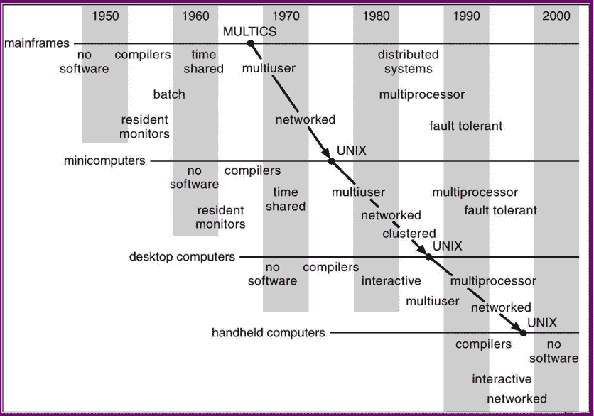

1950　1960　1970　1980　1990　2000

| System type | Features |
| --- | --- |
| mainframes | no software<br>compilers<br>batch<br>resident monitors<br>time shared<br>MULTICS<br>multiuser<br>networked<br>UNIX<br>distributed systems<br>multiprocessor<br>fault tolerant |
| minicomputers | no software<br>compilers<br>resident monitors<br>time shared<br>multiuser<br>networked<br>clustered<br>UNIX<br>multiprocessor<br>fault tolerant |
| desktop computers | no software<br>compilers<br>interactive<br>multiuser<br>networked<br>UNIX<br>multiprocessor |
| handheld computers | UNIX<br>compilers<br>no software<br>interactive<br>networked |

### 1.10 Computing Environments 计算环境

- 1.10.1 Traditional computing（传统的计算）: typical office environment
- 1.10.2 Web-Based Computing（基于Web计算）: Network computers are essentially terminals that understand web-based computing.
- 1.10.3 Embedded Computing（嵌入计算）: to run embedded real-time operating system; to have very specific tasks; provide limited features: little or no user interface, preferring to spend their time monitoring and managing hardware devices.

## Chapter 2: Computer-System Structures 计算机系统结构

- 2.1 Computer System Operation（计算机系统运行）
- 2.2 I/O Structure（I/O结构）
- 2.3 Storage Structure（存储构造）
- 2.4 Storage Hierarchy（存储层次）
- 2.5 Hardware Protection（硬件保护）
- 2.6 Network Structure（网络结构）


### 2.1 Computer-System Operation 计算机系统运行

- I/O devices and the CPU can execute concurrently. I/O 设备与 CPU 可并行运行
- Each device controller is in charge of a particular device type. 每一设备控制器负责一个设备类型
- Each device controller has a local buffer. 每一设备控制器有一局部缓存
- CPU moves data from/to main memory to/from local buffers. CPU 通过局部缓存与主存交换数据
- I/O is from the device to local buffer of controller. I/O 是从设备到设备控制器的局部缓存
- Device controller informs CPU that it has finished its operation by causing an _interrupt_. 设备控制器通过引起中断通知 CPU 操作已完成

### Common Functions of Interrupts
### 中断的常见功能

- The occurrence of an event is usually signaled by an interrupt from either hardware or the software. Software may trigger an interrupt by executing a special operation called a system call 系统调用 (monitor call).
- Modern operating system is *interrupt driven*.
- Events are almost always signaled by the occurrence of an interrupt or a trap.
- A *trap* (or exception) is a software-generated interrupt caused either by an error or a user request.

现代操作系统是中断驱动的

陷阱是由于出错或用户请求引起的软件生成的中断

### Common Functions of Interrupts (Cont.)

- Interrupts are an important part of computer architecture. 中断是计算机结构的重要部分
- Interrupt transfers control to the interrupt service routine generally, through the _interrupt vector_, which contains the addresses of all the service routines.
- 通常中断通过 _中断矢量_ 把控制传送给中断服务程序，该中断矢量包含了所有服务程序的地址
- Interrupt architecture must save the address of the interrupted instruction.
- 中断体系结构必须保护被中断指令的地址
- Incoming interrupts are _disabled_ while another interrupt is being processed to prevent a _lost interrupt_. 当另一个中断正在处理时，刚进入的中断不能响应，以免丢失中断

### Interrupt Handling
中断处理

- The operating system preserves the state of the CPU by storing registers and the program counter. 操作系统通过保存寄存器和程序计数器而保留了 CPU 的状态
- Determines which type of interrupt has occurred: 确定哪一种中断发生了：
  - *polling* 轮询
  - *vectored interrupt system* 矢量化中断系统
- Separate segments of code determine what action should be taken for each type of interrupt
- 对每一种中断分离代码段，以确定应该采取什么反应

### Fig 2.2 Interrupt Time Line For a Single Process Doing Output

单进程处理输出的中断时间线

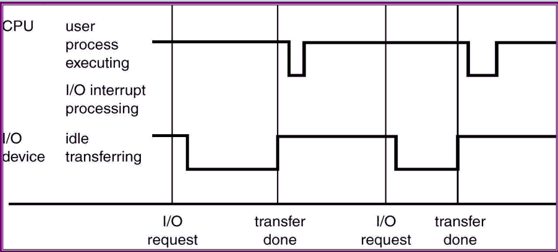

CPU

user process executing

I/O interrupt processing

I/O device

idle

transferring

I/O request

transfer done

I/O request

transfer done

### 2.2 I/O Structure

### I/O结构

### 2.2.1 I/O Interrupts

- **Synchronous I/O**: After I/O starts, control returns to user program only upon I/O completion.
- 同步 I/O：在 I/O 开始之后，仅当 I/O 完成之后控制才返回用户程序

- **Wait instruction idles the CPU until the next interrupt**
- 等待指令空转 CPU（CPU 等待）直至下一个中断

- **Wait loop (contention for memory access).等候循环**

- **At most one I/O request is outstanding at a time, no simultaneous I/O processing.**
- 每一时刻最多一个 I/O 请求，无并行 I/O 处理

### I/O Structure (Cont.)

- Asynchronous I/O: After I/O starts, control returns to user program without waiting for I/O completion.
- 异步 I/O：在 I/O 开始之后，不等 I/O 完成控制就返回用户程序

- System call – request to the operating system to allow user to wait for I/O completion.
- 系统调用 – 请求操作系统允许用户等待 I/O 完成

- Device-status table – contains entry for each I/O device indicating its type, address, and state.
- 设备状态表 – 包括每个 I/O 设备的类型、地址和状态

- Operating system first determines which I/O device caused the interrupt. It then indexes into I/O device table to determine device status and to modify table entry to reflect the occurrence of the interrupt.
- 操作系统首先确定哪个 I/O 设备发出中断，然后引用设备状态表以确定设备状态并修改表入口以响应中断发生。

### Fig 2.3 Two I/O Methods
两种 I/O 方法

### Synchronous 同步

### Asynchronous 异步

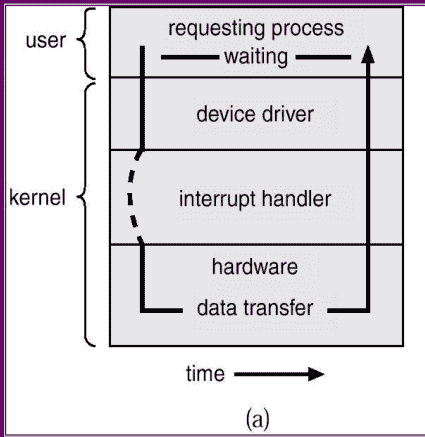

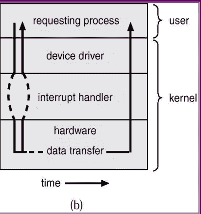

### Fig 2.4 Device-Status Table 设备状态表

| device: card reader 1 |
| status: idle |
| device: line printer 3 |
| status: busy |
| device: disk unit 1 |
| status: idle |
| device: disk unit 2 |
| status: idle |
| device: disk unit 3 |
| status: busy |
| .. |
| .. |

| request for |
| line printer |
| address: 38546 |
| length: 1372 |

| request for |
| disk unit 3 |
| file: xxx |
| operation: read |
| address: 43046 |
| length: 20000 |

| request for |
| disk unit 3 |
| file: yyy |
| operation: write |
| address: 03458 |
| length: 500 |


### 2.3 Storage Structure 存储构造

### 2.3.1 Main Memory

- Main memory (random-access memory or RAM) – only large storage media that the CPU can access directly.
  主存--CPU可以直接访问的唯一大型存储介质

- Secondary storage– extension of main memory that provides large nonvolatile storage capacity.
  二级(辅助、外)存储器-主存的扩展提供了非易失的存储容量

### 2.3.2 Magnetic disks

- Magnetic disks– rigid metal or glass platters covered with magnetic recording material
  磁盘-覆盖了磁记录材料的硬金属或玻璃盘片

### Storage Structure (Cont.)

- Disk surface is logically divided into *tracks*, which are subdivided into *sectors*.
  磁盘表面逻辑划分了磁道、再划分为扇区

- The *disk controller* determines the logical interaction between the device and the computer.
  磁盘驱动器确定设备和计算机之间的相互作用

- **Positioning time** 定位时间（random-access time 随机存取时间）: consists of the time to move the disk arm to the desired cylinder (called the seek time 寻道时间), and the time for the desired sector to rotate to the disk head (called the rotational latency 旋转延迟时间).

### Fig 2.5 Moving-Head Disk Mechanism 磁头移动机制

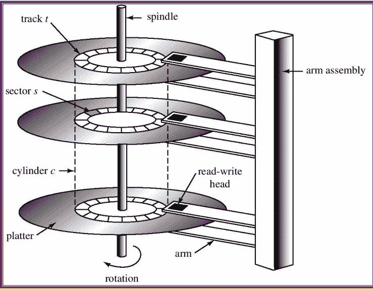

### 2.4.1 Caching缓存

- Use of high-speed memory to hold recently-accessed data.
  用高速存储器保存最近访问的数据

- Requires a _cache management_ policy, can result in 80% to 99% Of all accesses being in the cache.
  需要缓存管理策略

- Caching introduces another level in storage hierarchy. This requires data that is simultaneously stored in more than one level to be _consistent_.
  在存储层次中缓存引入另一级，则要求在更多层次上一致协调被存储的数据

### 2.4.2 Coherency and Consistency
相关性和一致性

- In a hierarchical structure, the same data may appear in different levels of the storage system.
- In a multiprocessor environment, cache coherency is a hardware problem.
- In a distributed environment, several copies of the same file can be kept on different computers.

### Fig 2.7 Migration of A From Disk to Register
从磁盘到寄存器变迁


### 2.5 Hardware Protection 硬件保护

- 2.5.1 Dual-Mode Operation--两状态运行
- 2.5.2 I/O Protection-- I/O保护
- 2.5.3 Memory Protection--内存保护
- 2.5.4 CPU Protection-- CPU 保护

### 2.5.1 Dual-Mode Operation
两状态运行

- Sharing system resources requires operating system to ensure that an incorrect program cannot cause other programs to execute incorrectly.
  共享系统资源要求操作系统确保一个出错程序不会引起其他程序的运行错误

- Provide hardware support to differentiate between at least two modes of operations.
  至少在两个不同运行状态之间提供硬件支持

1. *User mode—Privileged instructions can not be issued, execution done on behalf of a user.*
   用户态--不能执行特权指令，为用户做的执行

### Dual-Mode Operation (Cont.-1)

2. Monitor mode (also kernel mode or system mode or supervisor) – All instructions can be issued, execution done on behalf of operating system.
   管态（核心态或系统态）-所有指令能使用，为操作系统做的执行

- Mode bit added to computer hardware to indicate the current mode: monitor (0) or user (1). 计算机硬件中增加状态位，指示正确的状态：管态（0）或用户态（1）

- When an interrupt or fault occurs hardware switches to monitor mode. 当中断或错误出现，硬件切换至管态

### Dual-Mode Operation (Cont.-2)

Interrupt/fault
中断 / 错误

set user mode
置用户态

Monitor
管态

User
用户态

Privileged instructions can be issued only in monitor mode.
特权指令只能在管态下使用


### 2.5.2 I/O Protection I/O保护

- All I/O instructions are privileged instructions. 所有I/O指令是特权指令

- Must ensure that a user program could never gain control of the computer in monitor mode 在管态模式下必须确保用户程序决不能控制计算机

- Given the I/O instructions are privileged, how does the user program perform I/O? I/O指令是要特权的，用户程序如何完成I/O？

### I/O Protection (Cont.)

- System call – the method used by a process to request action by the operating system.
  系统调用- 方法是进程请求操作系统的一个动作 （功能）
  Usually takes the form of a trap to a specific location in the interrupt vector.
  通常以陷阱形式出现 ， 以指定中断向量的地址
  Control passes through the interrupt vector to a service routine in the OS, and the mode bit is set to monitor mode. 控制通过中断向量传递给OS中的服务程序， 状态位设为管态
  The monitor verifies that the parameters are correct and legal, executes the request, and returns control to the instruction following the system call.
  监控程序验证参数正确合法，执行请求， 返回控制给系统调用后的指令


### Fig 2.8 Use of A System Call to Perform I/O 使用系统调用完成I/O

1  
trap to monitor

case n

read

system call n

2  
perform I/O

resident monitor

3  
return to user

user program

### 2.5.3 Memory Protection 存储保护

- Must provide memory protection at least for the interrupt vector and the interrupt service routines.
  至少要为中断向量和中断服务程序提供存储保护

- In order to have memory protection, add two registers that determine the range of legal addresses a program may access: 为了进行存储保护，增加2个寄存器用于确定一个程序的合法地址范围
  - Base register– holds the smallest legal physical memory address.
    基址寄存器- 存有最小的合法物理存储器地址
  - Limit register– contains the size of the range
    限长寄存器- 存有允许范围的大小

- Memory outside the defined range is protected.
  在定义范围之外的存储器受到保护

### Fig 2.9 Use of A Base and Limit Register 基址与限长寄存器使用

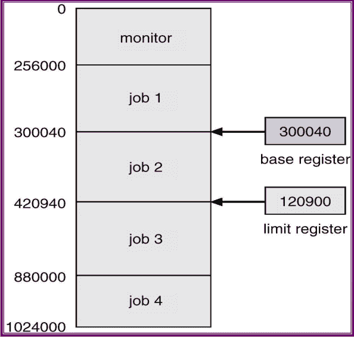

地址标注：0、256000、300040、420940、880000、1024000

monitor

job 1

job 2

job 3

job 4

300040  
base register

120900  
limit register

### Fig2.10 Hardware Address Protection 硬件地址保护

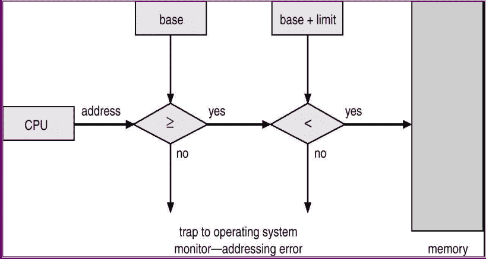

### Hardware Protection

- When executing in monitor mode, the operating system has unrestricted access to both monitor and user's memory.
  在管态下运行时，操作系统对监控和用户存储空间有不受限制的访问权

- The load instructions for the *base* and *limit* registers are privileged instructions.
  用于基址和限长寄存器的装载指令是特权指令

### 2.5.4 CPU Protection CPU保护

- Timer– interrupts computer after specified period to ensure operating system maintains control.
  定时器-在指定的时间段之后中断计算机，以确认操作系统保持控制

- Timer is decremented every clock tick.
  每一时钟滴答定时器减少

- When timer reaches the value 0, an interrupt occurs.
  定时器为零时中断发生

- Timer commonly used to implement time sharing.
  定时器通常用于实现时间共享

- Time also used to compute the current time.
  定时器也用于计算当前时间

- Load-timer is a privileged instruction.
  装载定时器是特权指令

### 2.6 Network Structure 网络结构

- 2.6.1 Local Area Networks (LAN)局域网
- 2.6.2 Wide Area Networks (WAN)广域网

### Fig2.11 Local Area Network Structure 局域网结构

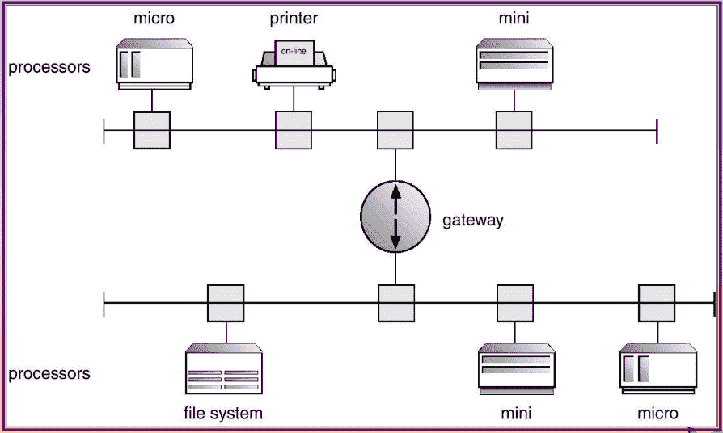

### Fig 2.12 Wide Area Network Structure 广域网结构

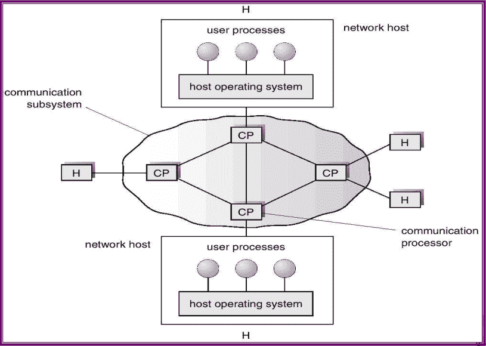

network host

user processes

host operating system

communication subsystem

network host

user processes

host operating system

communication processor

## Chapter 3: Operating-System Structures

## 操作系统结构

- 3.1 [System Components](#) 系统部件
- 3.2 [Operating System Services](#) 操作系统服务
- 3.3 [System Calls](#) 系统调用
- 3.4 [System Programs](#) 系统程序
- 3.5 [System Structure](#) 系统结构
- 3.6 [Virtual Machines](#) 虚拟机
- 3.7 [System Design and Implementation](#) 系统设计和实现
- 3.8 [System Generation](#) 系统生成

## 3.1 System Components 系统部件

- 3.1.1 Process Management — 进程管理
- 3.1.2 Main Memory Management — 主存管理
- 3.1.3 File Management — 文件管理
- 3.1.4 I/O System Management — I/O系统管理
- 3.1.5 Secondary Management — 二级储存器管理
- 3.1.6 Networking — 网络处理
- 3.1.7 Protection System — 保护系统
- 3.1.8 Command-Interpreter System — 命令解释系统

## 3.1.1 Process Management进程管理

A process is a program in execution. A process needs certain resources, including CPU time, memory, files, and I/O devices, to accomplish its task.
进程是正在执行的程序。为了完成其任务，进程需要一定的资源，包括CPU时间，存储器，文件，以及I/O设备

The operating system is responsible for the following activities in connection with process management.
在同进程管理有关的活动中，操作系统负责下列事务：
Process creation and deletion.进程创建和删除
process suspension and resumption.进程挂起和恢复
Provision of mechanisms for:可提供以下有关机制：
process synchronization进程同步
process communication进程通信
deadlock handling死锁处理 Discuss in Chap.4--8

## 3.1.2 Main-Memory Management 主存管理

- Memory is a large array of words or bytes, each with its own address. It is a repository of quickly accessible data shared by the CPU and I/O devices.
  存储器是字或字节的一个大数组，每一字或字节有自己的地址。它是一个可被CPU和I/O 共享、可快速存取数据的存放地

- Main memory is a volatile storage device. It loses its contents in the case of system failure.
  主存储器是一个易失性存储设备。系统失败时，会丢失其内容


## Main-Memory Management

- The operating system is responsible for the following activities in connection with memory management: 在同存储管理有关的活动中，操作系统负责下列事务：
    - Keep track of which parts of memory are currently being used and by whom. 保持记录存储器的哪一部分当前被使用以及被谁使用
    - Decide which processes to load when memory space becomes available. 当有可用存储空间时，决定调入哪个进程
    - Allocate and deallocate memory space as needed. 需要时分配和收回存储空间

Discuss in Chap 9-10

## 3.1.3 File Management 文件管理

- A file is a collection of related information defined by its creator. Commonly, files represent programs (both source and object forms) and data. 文件是由其创建者定义的关联信息的一个收集器（集合），通常文件表示程序（源程序和目标程序）和数据

- The operating system is responsible for the following activities in connection with file management: 在同文件管理有关的活动中，操作系统负责下列事务：
    - File creation and deletion. 文件创建和删除
    - Directory creation and deletion. 目录创建和删除
    - Support of primitives for manipulating files and directories. 支持操纵文件和目录的原语
    - Mapping files onto secondary storage. 把文件映象到二级存储器
    - File backup on stable (nonvolatile) storage media. 在稳定（非易失性）存储介质做文件备份

Discuss in Chap 11-12

## 3.1.4 I/O System Management I/O系统管理

- The I/O system consists of: I/O系统包括
    - A buffer-caching system 缓冲区-高速缓存系统
    - A general device-driver interface 通用设备驱动器接口
    - Drivers for specific hardware devices 用于特定硬件设备的驱动程序

Discuss in Chap 13

## 3.1.5 Secondary-Storage Management 二级存储管理

- Since main memory (*primary storage*) is *volatile* and too small to accommodate all data and programs permanently, the computer system must provide *secondary storage* to back up main memory. 由于主存（基本存储器）是易失性的，而且太小不足以永久保存所有的数据和程序，计算机系统必须提供二级存储器备份主存

- Most modern computer systems use disks as the principle on-line storage medium, for both programs and data. 多数现代计算机系统采用磁盘作为程序和数据的基本联机存储介质

- The operating system is responsible for the following activities in connection with disk management: 在同磁盘管理有关的活动中，操作系统负责下列事务：
    - Free space management 空闲空间管理
    - Storage allocation 存储分配
    - Disk scheduling 磁盘调度

Discuss in Chap 14

## 3.1.6 Networking (Distributed Systems) 网络处理（分布式系统）

- **A distributed system** is a collection of processors that do not share memory or a clock. Each processor has its own local memory. 分布式系统是一组不共享存储器或时钟的处理器集合，每个处理器有自己的内存

- **The processors in the system are connected through a communication network.** 系统中的处理器通过通信网络连接

- **Communication takes place using a _protocol_.** 使用协议进行通信

- A distributed system provides user access to various system resources. 分布式系统提供用户访问各种系统资源

- Access to a shared resource allows: 对共享资源的访问可以实现：
    - Computation speed-up 加速运算
    - Increased data availability 提高数据利用性
    - Enhanced reliability 增强可靠性

Discuss in Chap 15-17

## 3.1.7 Protection System 保护系统

- **Protection** refers to a mechanism for controlling access by programs, processes, or users to both system and user resources. 保护是一种机制，控制程序、进程、或用户对系统和用户资源的访问

- The protection mechanism must: 保护机制必须
    - distinguish between authorized and unauthorized usage. 区分授权和非授权使用
    - specify the controls to be imposed. 确定要采用的控制
    - provide a means of enforcement. 提供强制手段

Discuss in Chap 18-19

## 3.1.8 Command-Interpreter System 命令解释系统

- Many commands are given to the operating system by control statements which deal with: 操作系统有许多命令，可以通过控制语句处理：
    - **process creation and management** 进程创建和管理
    - **I/O handling** 处理I/O
    - **secondary-storage management** 二级存储管理
    - **main-memory management** 主存管理
    - **file-system access** 文件访问
    - **protection** 保护
    - **networking** 网络

- The program that reads and interprets control statements is called variously: 读入和解释控制语句的程序有各种名称
    - command-line interpreter 命令行解释器
    - shell (in UNIX)

- Its function is to get and execute the next command statement. 其功能是获得和执行下一个命令语句


## Operating System Services (Cont.)

- Communications – exchange of information between processes executing either on the same computer or on different systems tied together by a network. Implemented via _shared memory_ or _message passing_.

  通信 - 运行的进程间在同一计算机或由网络连接的不同系统中交换信息。通过共享存储器或消息传递实现

- Error detection – ensure correct computing by detecting errors in the CPU and memory hardware, in I/O devices, or in user programs.

  出错检测 – 通过探测在CPU与内存硬件中，在I/O设备中，或在用户程序中的错误，确保正确运算

## Additional Operating System Functions 其他操作系统功能

Additional functions exist not for helping the user, but rather for ensuring efficient system operations. 其他的功能不是用于帮助用户，而是为了系统效率：

- Resource allocation – allocating resources to multiple users or multiple jobs running at the same time. 资源分配 - 把资源分配给多个用户或多个同时运行的作业

- Accounting – keep track of and record which users use how much and what kinds of computer resources for account billing or for accumulating usage statistics. 帐务 - 跟踪和记录用户对资源的使用，用于帐单和统计

- Protection – ensuring that all access to system resources is controlled. 保护 - 确保对资源的所有访问均在控制中

## 3.3 System Calls 系统调用

- **System calls provide the interface between a running program and the operating system.**
  系统调用提供在运行程序和操作系统之间的接口
- **Generally available as assembly-language instructions.**
  通常以汇编语言指令形式提供
- **Languages defined to replace assembly language for systems programming allow system calls to be made directly (e.g., C, C++)**
  替代汇编语言的、供系统编程的语言，允许直接使用系统调用

## System Calls (Cont.)

- **Three general methods are used to pass parameters between a running program and the operating system.**
  三种常用方式用于在运行程序和操作系统之间的参数传递
  - *Pass parameters in registers.*
    寄存器中的参数传递
  - Store the parameters in a table in memory, and the table address is passed as a parameter in a register.
    参数存在内存的一张表中，表地址作为寄存器的参数传递
  - *Push* (store) the parameters onto the *stack* by the program, and *pop* off the stack by operating system.
    程序把参数压入栈，由操作系统弹出

## Fig 3.1 Passing of Parameters As A Table 表格方式的参数传递

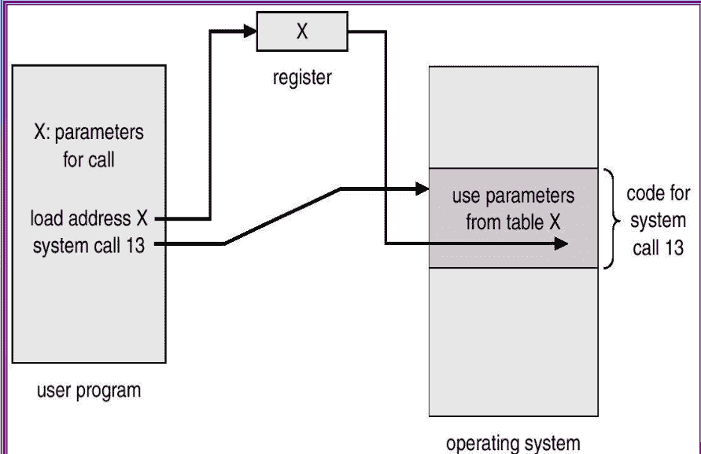

## Types of System Calls 系统调用类型

- Process control 进程控制
- File management 文件管理
- Device management 设备管理
- Information maintenance 信息维护
- Communications 通信

## Fig 3.4 UNIX Running Multiple Programs UNIX运行多个程序

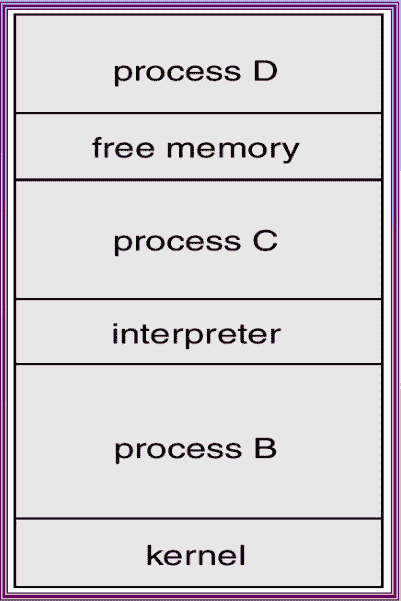

process D

free memory

process C

interpreter

process B

kernel

## Fig 3.5 Communication Models 通信模式

Communication may take place using either message passing or shared memory.

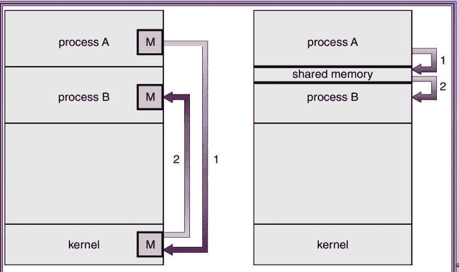

Msg Passing 消息传递 Shared Memory 共享内存

## 3.4 System Programs 系统程序

**System programs provide a convenient environment for program development and execution. The can be divided into:**

系统提供程序开发和执行的便利环境。可划分为：

- **File manipulation** 文件操纵
- **Status information** 状态信息
- **File modification** 文件修改
- **Programming language support** 程序设计语言支持
- **Program loading and execution** 程序调入和执行
- **Communications** 通信
- **Application programs** 应用程序

## System Programs (Cont.)

- Most users’ view of the operation system is defined by system programs, not the actual system calls.
- 操作系统，多数用户观点（角度）是由系统程序定义而不是实际的系统调用

## 3.5 System Structure 系统结构

## 3.5.1 Simple Structure

- MS-DOS – written to provide the most functionality in the least space

  MS-DOS-以最小的空间提供最多的功能

  not divided into modules 不划分模块

  Although MS-DOS has some structure, its interfaces and levels of functionality are not well separated

  尽管MS-DOS有某种结构，其接口和功能层没有划分清楚

## Fig 3.6 MS-DOS Layer Structure MS-DOS层次结构

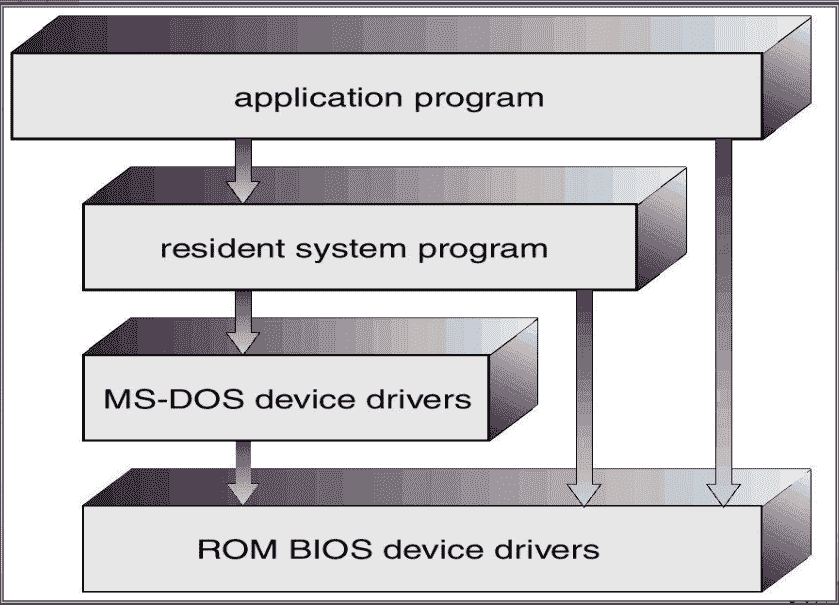

application program

resident system program

MS-DOS device drivers

ROM BIOS device drivers

## UNIX System Structure UNIX 系统结构

- **UNIX** – limited by hardware functionality, the original UNIX operating system had limited structuring. The UNIX OS consists of two separable parts.

  UNIX - 受硬件功能限制，早期UNIX只是有限的结构化。UNIX包括2个分离的部分

  - **Systems programs** 系统程序
  - **The kernel** 内核
    - Consists of everything below the system-call interface and above the physical hardware

      包括了在物理硬件之上，系统调用之下的一切

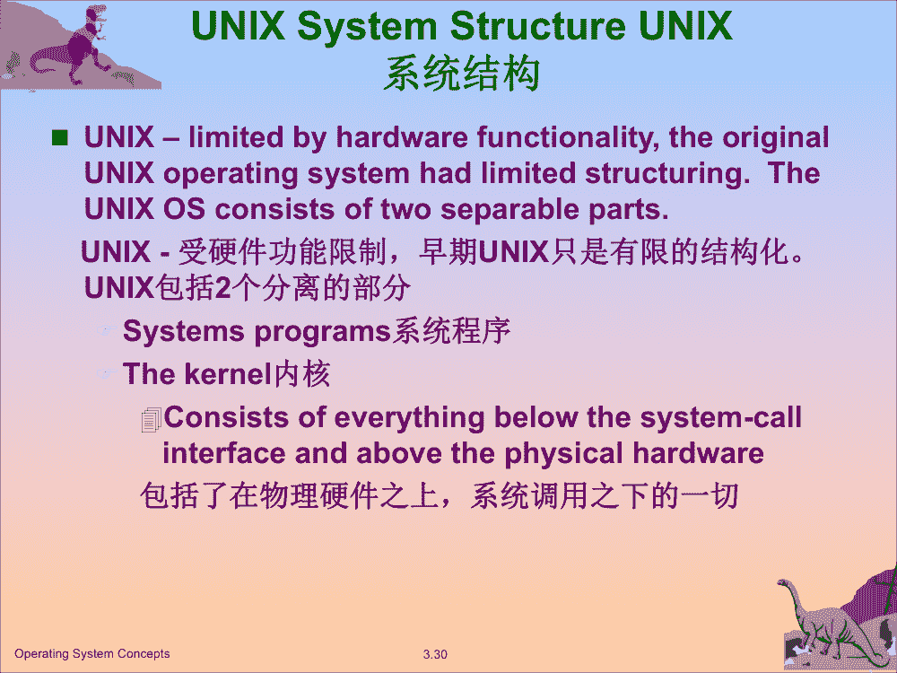


## UNIX System Structure (Cont.)

- Provides the file system, CPU scheduling, memory management, and other operating-system functions; a large number of functions for one level.

提供文件系统、CPU调度、存储管理、和其他操作系统功能；每一层有大量的功能

## 3.5.2 Layered Approach 层次化结构

- The operating system is divided into a number of layers (levels), each built on top of lower layers. The bottom layer (layer 0), is the hardware; the highest (layer N) is the user interface.

操作系统划分为若干层，在低层上构建高层。底层（0层）为硬件；最高层（N层）为用户层

- With modularity, layers are selected such that each uses functions (operations) and services of only lower-level layers.

考虑模块化，层的选择是每层只使用低层次的功能和服务

## Layered Structure of the THE OS
THE OS的层次化结构

A layered design was first used in THE operating system. Its six layers are as follows:
THE操作系统首先使用层次化设计。有如下六层：

- layer 5: user programs
- layer 4: buffering for input and output
- layer 3: operator-console device driver
- layer 2: memory management
- layer 1: CPU scheduling
- layer 0: hardware

## Layered Structure of the THE OS (Cont.)

## E.W.Dijkstra的THE系统：

| 层级 | 功能 |
|------|------|
| 5 | 操作员 |
| 4 | 用户程序 |
| 3 | 输入/输出管理 |
| 2 | 操作员－进程通信 |
| 1 | 内存和磁盘管理 |
| 0 | 处理器分配和多道程序 |

## Fig 3.9 OS/2 Layer Structure OS/2层次化结构

application

application

application

application-programming interface

API extension

subsystem

subsystem

subsystem

system kernel

- memory management
- task dispatching
- device management

device driver

device driver

device driver

device driver

## Fig 3.10 Windows NT Client-Server Structure Windows NT 客户机-服务器结构

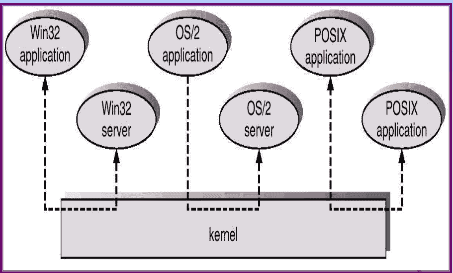

## 系统支持进程

## 服务进程

## 用户程序

## 环境子系统

## 子系统动态链接库

## 用户态

## 核心态

| 执行体 |
|------|
| 核心 | 设备驱动程序 |
| 硬件抽象层（HAL） |

## 图形引擎

## Windows 2000/XP的构成

- 用户态组件
  - 系统支持进程（system support process），不是 Windows 2000/XP 服务，不由服务控制器启动。
  - 服务进程（service process），Windows 2000/XP 的服务。
  - 环境子系统（environment subsystems），它们向应用程序提供操作系统功能调用接口包括：Win32、POSIX和OS/2 1.2。
  - 应用程序（user applications），五种类型：Win32、Windows 3.1、MS-DOS、POSIX 或OS/2 1.2。
  - 子系统动态链接库：调用层转换和映射

## Windows 2000/XP的构成(Cont.)

## 核心态组件

核心（kernel）包含了最低级的操作系统功能，例如线程调度、中断和异常调度、多处理器同步等。同时它也提供了执行体（Executive）用来实现高级结构的一组例程和基本对象。

执行体包含基本的操作系统服务，例如内存管理器、进程和线程管理、安全控制、I/O以及进程间的通信。

硬件抽象层（HAL, Hardware Abstraction Layer）将内核、设备驱动程序以及执行体同硬件分隔开来，实现硬件映射。

设备驱动程序（Device Drivers）包括文件系统和硬件设备驱动程序等，其中硬件设备驱动程序将用户的I/O函数调用转换为对特定硬件设备的I/O请求。

窗口和图形系统包含了实现图形用户界面（GUI, Graphical User Interface）的基本函数。

## Windows 2000/XP的关键系统组件

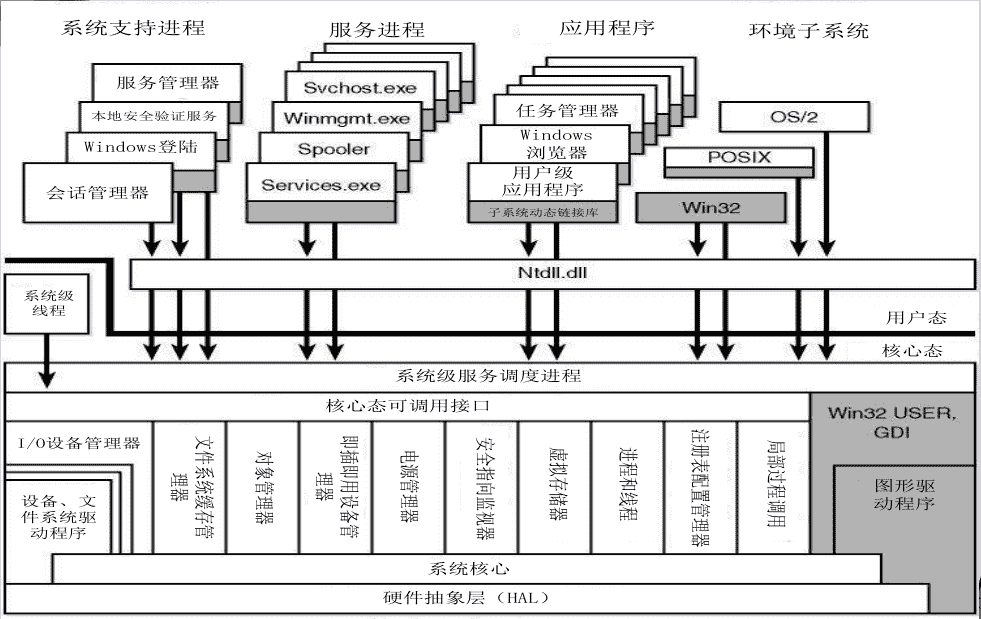

系统支持进程

服务进程

应用程序

环境子系统

服务管理器

本地安全验证服务

Windows登陆

会话管理器

Svchost.exe

Winmgmt.exe

Spooler

Services.exe

任务管理器

Windows浏览器

用户级应用程序

系统动态链接库

OS/2

POSIX

Win32

Ntdll.dll

用户态

核心态

系统级服务调度进程

核心态可调用接口

I/O设备管理器

文件系统驱动程序

对象管理器

即插即用设备管理器

电源管理器

安全监视器

虚拟存储器

进程和线程

注册表管理器

局部过程调用

Win32 USER、GDI

图形驱动程序

设备、文件系统驱动程序

系统核心

硬件抽象层（HAL）

硬件接口

（总线、I/O设备驱动、中断、时钟间隔、直接内存存取（DMA）、存储器缓存控制器等等）

## 3.6 Virtual Machines

虚拟机

- A virtual machine takes the layered approach to its logical conclusion. It treats hardware and the operating system kernel as though they were all hardware.

虚拟机是层次化的逻辑结果。它把硬件和操作系统内核看成都是硬件。

- A virtual machine provides an interface *identical* to the underlying bare hardware.

虚拟机为裸机提供了统一的接口

- The operating system creates the illusion of multiple processes, each executing on its own processor with its own (virtual) memory.

操作系统创建了多个进程，每一个进程有自己的处理器和（虚拟）内存

## Virtual Machines (Cont.)

- The resources of the physical computer are shared to create the virtual machines.
  - 物理计算机的资源被共享，以创建虚拟机
- CPU scheduling can create the appearance that users have their own processor.
  - CPU调度使得用户好像有自己的处理器
- Spooling and a file system can provide virtual card readers and virtual line printers.
  - Spooling和文件系统提供了虚拟卡片阅读机和打印机
- A normal user time-sharing terminal serves as the virtual machine operator’s console.
  - 普通用户终端成为虚拟机操作员的控制台


## Fig 3.11 System Models系统模式

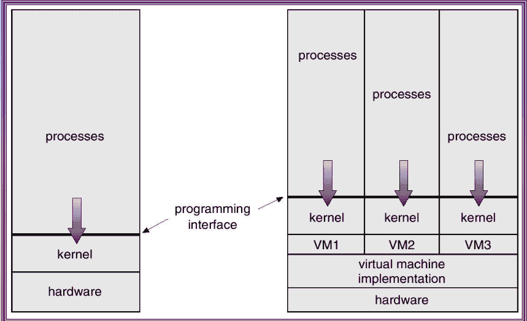

Non-virtual Machine非虚拟机 Virtual Machine虚拟机

## Advantages/Disadvantages of Virtual Machines
虚拟机的优缺点

- The virtual-machine concept provides complete protection of system resources since each virtual machine is isolated from all other virtual machines. This isolation, however, permits no direct sharing of resources.

- 虚拟机概念提供对系统资源的完全保护，因为每个虚拟机同其他虚拟机隔离。当然，隔离不允许直接共享资源。

- A virtual-machine system is a perfect vehicle for operating-systems research and development. System development is done on the virtual machine, instead of on a physical machine and so does not disrupt normal system operation.

- 虚拟机是研发操作系统的完美载体。系统开发在虚拟机上而不是在物理硬件上完成，从而不会打扰正常系统运行。

## Advantages/Disadvantages of Virtual Machines (Cont.)

- The virtual machine concept is difficult to implement due to the effort required to provide an exact duplicate to the underlying machine.

- 由于需要对下面的机器进行精确的复制，所以虚拟机的概念实现困难。

## 3.6.3 Java Virtual Machine Java虚拟机

- Compiled Java programs are platform-neutral bytecodes executed by a Java Virtual Machine (JVM).
- JVM consists of
  - class loader
  - class verifier
  - runtime interpreter
- Just-In-Time (JIT) compilers increase performance

## Fig 3.12 Java Virtual Machine Java虚拟机

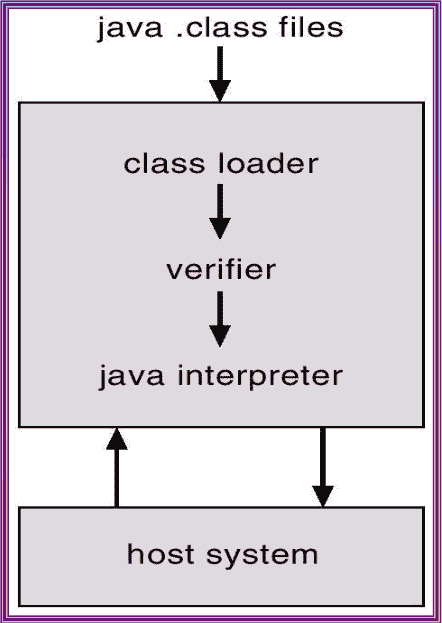

## 3 System Design and Implementation 系统设计和实现

## 3.7.1 Design Goals设计目标

- User goals – operating system should be convenient to use, easy to learn, reliable, safe, and fast.

- 用户目标 - 操作系统应该便于使用，易学，可靠，安全并且快捷。

- System goals – operating system should be easy to design, implement, and maintain, as well as flexible, reliable, error-free, and efficient.

- 系统目标 - 操作系统应该容易设计、实现和维护，还要灵活、可靠、无错误和高效。

## 3.7.2 Mechanisms and Policies 机制和策略

- Mechanisms determine to do something, policies decide what will be done.For example , the timer construct is a mechanism for ensuring CPU protection , but deciding how long the timer is to be set for a particular user is a policy decision.

- 机制确定怎样做事，策略决定要做什么。

- The separation of policy from mechanism is a very important principle, it allows maximum flexibility if policy decisions are to be changed later.

- 把策略从机制中分离是非常重要的，如果策略在后期要改变，它允许最大的灵活性。

- Microkernel-based operating system take the separation of mechanism and policy to one extreme , by implementing a basic set of primitive building blocks, that are almost policy free(避免制定策略), allowing more advanced mechanisms and policies to be added.

## 3.7.3 System Implementation

系统实现

- Traditionally written in assembly language, operating systems can now be written in higher-level languages.

- 传统上用汇编语言编写，现在可用高级语言编写。

- Code written in a high-level language:

- 用高级语言编写代码：
  - can be written faster. 编码快
  - is more compact. 更紧凑
  - is easier to understand and debug. 容易理解和调试

- An operating system is far easier to *port* (move to some other hardware) if it is written in a high-level language.

- 以高级语言编写的操作系统更容易移植。

## 3.8 System Generation (SYSGEN) 系统生成

- Operating systems are designed to run on any of a class of machines; the system must be configured for each specific computer site.

- 操作系统被设计在任何类型的机器上运行；系统必须能在每一特定的机器上配置。

- SYSGEN program obtains information concerning the specific configuration of the hardware system.

- SYSGEN程序得到硬件系统特定配置的信息。

- Booting – starting a computer by loading the kernel.

- 自举 - 通过调入内核启动计算机。

- Bootstrap program – code stored in ROM that is able to locate the kernel, load it into memory, and start its execution. 自举程序 - 存储在ROM中的代码，能够定位内核、调入内存，并开始其运行。

## Chapter 4: Processes 进程

- 4.1 Process Concept 进程概念

- 4.2 Process Scheduling 进程调度

- 4.3 Operations on Processes 进程上的操作

- 4.4 Cooperating Processes 协同进程

- 4.5 Interprocess Communication 进程间通信

- 4.6 Communication in Client-Server Systems 客户机-服务器系统通信


## 4.1 Process Concept 进程概念

- An operating system executes a variety of programs:
  - 操作系统执行各种程序
  - Batch system – jobs 批处理系统 - 作业
  - Time-shared systems – user programs or tasks
    - 分时系统 - 用户程序或任务

- Textbook uses the terms *job* and *process* almost interchangeably.
  - 本书使用的名词作业和进程，基本可互换

## 4.1.1 The Process 进程

- Process – a program in execution; process execution must progress in sequential fashion.
  - 进程 - 在执行中的程序；进程的执行必须以顺序方式进行

- A process includes: 一个进程包括
  - text section 代码段
  - program counter and the contents of processor’s register 程序计数器和处理机寄存器内容
  - stack 栈
  - data section 数据部分

## Fig 4.1 Diagram of Process State 进程状态图

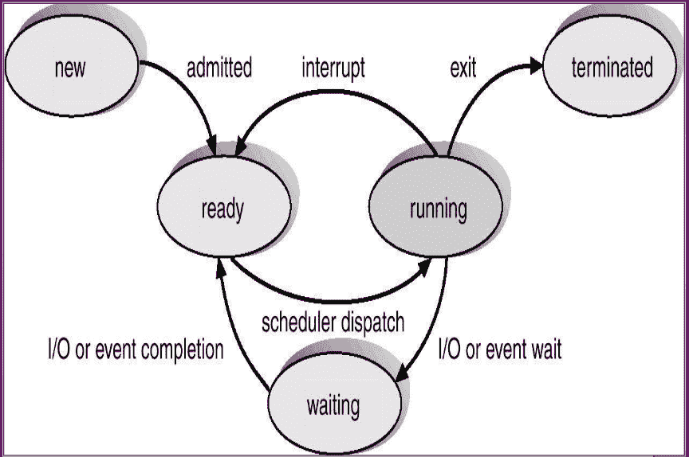

## 4.1.3 Process Control Block (PCB) 进程控制块

Information associated with each process. 同进程有关的信息

- Process state 进程状态
- Program counter 程序计数器
- CPU registers CPU寄存器
- CPU scheduling information CPU调度信息
- Memory-management information 内存管理信息
- Accounting information 计账信息
- I/O status information I/O状态信息

## Fig 4.2 Process Control Block (PCB) 进程控制块

| pointer | process state |
|---|---|
| process number | |
| program counter | |
| registers | |
| memory limits | |
| list of open files | |
| ... | |

## Fig 4.3 CPU Switch From Process to Process 进程间CPU的切换

process \( P_0 \) | operating system | process \( P_1 \)

interrupt or system call

executing

save state into PCB\(_0\)

reload state from PCB\(_1\)

interrupt or system call

save state into PCB\(_1\)

reload state from PCB\(_0\)

executing

idle

idle

executing

idle

## 4.2 Process Scheduling 进程调度

## 4.2.1 Scheduling Queues 调度队列

Job queue – set of all processes in the system. 作业队列 - 在系统中的所有进程的集合

- Ready queue – set of all processes residing in main memory, ready and waiting to execute. 就绪队列 - 在主内存中的，就绪并等待执行的所有进程的集合
- Device queues – set of processes waiting for an I/O device. 设备队列 - 等待某一I/O设备的进程队列
- Process migration between the various queues. 在各种队列之间进程的迁移

## Fig 4.4 Ready Queue And Various I/O Device Queues 就绪队列和各种 I/O 设备队列

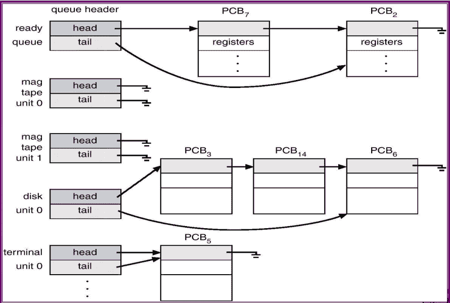

## Fig 4.5 Representation of Process Scheduling 进程调度的描述

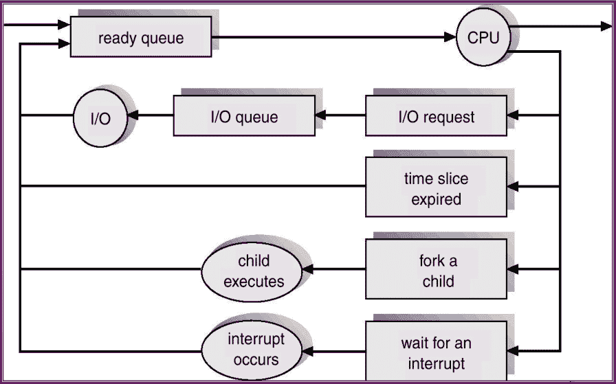

## 4.2.2 Schedulers 调度

- Long-term scheduler (or job scheduler) – selects which processes should be brought into the ready queue.
  - 长程调度（或作业调度）- 选择可以进入就绪队列的进程

- Short-term scheduler (or CPU scheduler) – selects which process should be executed next and allocates CPU.
  - 短程调度（或CPU调度）- 选择可被下一个执行并分配CPU的进程

## Schedulers (Cont.)

- **Short-term scheduler** is invoked very frequently (milliseconds) ⇒ (must be fast). 短程调度切换频率高
- **Long-term scheduler** is invoked very infrequently (seconds, minutes) ⇒ (may be slow). 长程调度不快
- The long-term scheduler controls the *degree of multiprogramming*. 长程调度控制了多道程序的“道”
- Processes can be described as either:
  
  进程可以用下列方式描述：
  
  - *I/O-bound process* – spends more time doing I/O than computations, many short CPU bursts.
    - I/O型进程 - 花费I/O时间多于计算，许多短CPU处理
  - *CPU-bound process* – spends more time doing computations; few very long CPU bursts.
    - CPU 型进程 - 花费更多时间于计算，许多长CPU处理

## 4.2.3 Context Switch 上下文切换

- When CPU switches to another process, the system must save the state of the old process and load the saved state for the new process.
  - 当CPU切换至另一个进程时，系统必须保存旧进程状态并为新进程调入所保留的状态
- Context-switch time is overhead; the system does no useful work while switching.
  - 上下文切换的时间开销较重；在切换时，系统没有做有用的工作
- Time dependent on hardware support.
  - 时间取决于硬件的支持

## Process Creation

Parent and child share no resources.

父进程和子进程无资源共享

- **Execution** 执行
  - Parent and children execute concurrently.
    - 父进程和子进程并发执行
  - Parent waits until children terminate.
    - 父进程等待，直到子进程终止

- **Address space** 地址空间
  - Child duplicate of parent. 子女复制双亲
  - Child has a program loaded into it.
    - 子女有一个程序被调入


## Process Creation (Cont.)

## UNIX examples UNIX例子

fork system call creates new process. The new process consists of a copy of the address space of original process. Both processes continue execution at the instruction after the fork system call ,with one difference : The return code for fork system call is zero for new process, whereas the (nonzero) process identifier of the child is returned to the parent.

fork 系统调用创建新进程

exec system call used to replace the process’ memory space with a new program.

exec系统调用用一个新程序替代了进程的内存空间

Fig 4.7 Processes Tree on a UNIX System
典型UNIX系统中的进程树

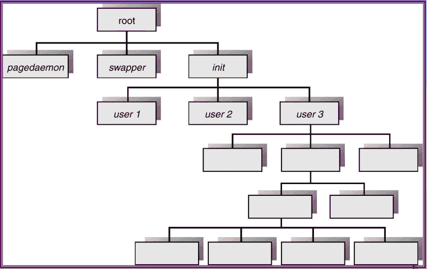

## 4.3.2 Process Termination
进程终止

- Process executes last statement and asks the operating system to decide it (exit).
  进程执行的最后一项并询问操作系统作出决定（退出）
- Output data from child to parent (via wait).
  从子进程向父进程输出数据（通过等待）
- Process’ resources are deallocated by operating system.
  操作系统收回进程的资源

## Process Termination (Cont.)

- Parent may terminate execution of children processes (abort).
  父进程可中止子进程的执行（终止）
  - Child has exceeded allocated resources.
    子进程超量分配资源
  - Task assigned to child is no longer required.
    赋予子进程的任务不再需要
  - Parent is exiting.父进程退出
    - Operating system does not allow child to continue if its parent terminates.
      若父进程终止，不允许子进程继续
    - Cascading termination.级联终止

## Cooperating Processes (Cont.)

Concurrent execution of cooperating processes requires mechanisms that allow processes to communicate with one another (sec 4.5) and synchronize their actions (chap 7).

合作进程的并发执行要求允许进程间通信的机制和他们间同步

Common Paradigm for cooperating processes -- Producer-Consumer Problem

合作进程的通用范例—生产者消费者问题

A producer process produces information that is consumed by a consumer process.

生产者进程生产供消费者进程消费的信息

unbounded-buffer places no practical limit on the size of the buffer.无界缓冲没有对缓冲区大小的限制

bounded-buffer assumes that there is a fixed buffer size.有界缓冲对缓冲区大小作了限定

## Bounded-Buffer – Shared-Memory Solution

- The Buffer may either be provided by the operating system through the use of an interprocess-communication (IPC) facility (Sec 4.5), or by explicitly coded by the application programmer with the use of shared memory.

- Shared-Memory Solution to the Bounded-Buffer problem : Shared data

```c
#define BUFFER_SIZE 10
Typedef struct {
    ...
} item;
item buffer[BUFFER_SIZE];
int in = 0;     int out = 0;
```

## Bounded-Buffer – Producer Process

Producer :
item nextProduced;
while (1) {
produce an item in nextProduced ;
while (((in + 1) % BUFFER_SIZE) == out)
; /* do nothing */
buffer[in] = nextProduced;
in = (in + 1) % BUFFER_SIZE;
}

Solution is correct, but can only use
BUFFER_SIZE-1 elements

## 4.5 Interprocess Communication (IPC)
进程间通信

- **IPC provides a Mechanism for processes to communicate and to synchronize their actions without sharing the same address space.** IPC提供无须共享相同地址空间可用于进程通信的机制，同步其间的活动

- **IPC is best provided by a message-passing system.**

## 4.5.1 Message-Passing System
消息系统

- **Message system – processes communicate with each other without resorting to shared variables.**
  
  消息系统 - 进程间通信无须对共享变量进行再分类

- **IPC facility provides two operations:** IPC提供两个操作：
  - **send(message)** – message size fixed or variable
    
    发送 - 固定或可变大小消息


## Message-Passing System

receive(message)接受

- If P and Q wish to communicate, they need to:
  若P与Q要通信，需要:

- establish a communication link between them
  建立通信连接

- exchange messages via send/receive
  通过send/receive交换消息

- Implementation of communication link通信连接的实现

- physical (e.g., shared memory, hardware bus)
  物理的（如，共享存储，硬件总线）

- logical (e.g., logical properties)
  逻辑的（如，逻辑特性）


## Message-Passing System (Cont.)

实现链接的几种方法和发送 / 接收操作：

- Direct or indirect communication  
  直接或间接的通信
- Symmetric or asymmetric communication  
  同步或异步通信
- Automatic or explicit buffering  
  自动或显式的缓冲
- send by copy or send by reference  
  通过拷贝或通过引用发送
- Fixed-sized or variable-sized message  
  固定大小或可变大小的消息

## Implementation Questions实现中的问题

- How are links established? 连接如何建立？
- Can a link be associated with more than two processes? 连接可同多于两个的进程相关吗？
- How many links can there be between every pair of communicating processes? 每对在通信进程有多少连接？
- What is the capacity of a link? 一个连接的容量是多少？
- Is the size of a message that the link can accommodate fixed or variable? 连接可使用的固定或可变消息的大小？
- Is a link unidirectional or bi-directional? 连接是无向的还是双向的？

## 4.5.2 Naming 命名

## 4.5.2.1 Direct Communication 直接通信

- **Processes must name each other explicitly:** 进程必须互相显式的命名
  - `send(P, message)` – send a message to process P  
    向进程P发消息
  - `receive(Q, message)` – receive a message from process Q  
    从进程Q收消息

## Direct Communication直接通信

Properties of communication link 通信连接的特性：

- Links are established automatically. 连接自动建立
- A link is associated with exactly one pair of communicating processes.  
  连接精确的与一对在通信的进程相关
- Between each pair there exists exactly one link.  
  在每一对之间就存在一个连接
- The link may be unidirectional, but is usually bi-directional.  
  连接可以无向，但通常是双向的

## 4.5.2.2 Indirect Communication 间接通信

- **Messages are directed and received from mailboxes (also referred to as ports).**  
  消息导向至信箱并从信箱接收（被视作端口）
  - **Each mailbox has a unique id.**  
    每一个信箱有一个唯一的id
  - **Processes can communicate only if they share a mailbox.** 仅当共享一个信箱时进程才能通信

- **Properties of communication link** 通信连接的特性
  - **Link established only if processes share a common mailbox**  
    仅当进程共有一个信箱时连接才能建立

## Indirect Communication (Cont.)

A link may be associated with many processes.  
连接可同多个进程相关

Each pair of processes may share several communication links. 每一对进程可共享多个通信连接

Link may be unidirectional or bi-directional.  
连接可是无向或双向的

## Operations 操作

- create a new mailbox 创建新的信箱
- send and receive messages through mailbox  
  通过信箱发送和接收消息
- destroy a mailbox 销毁信箱

## Indirect Communication (Cont.-1)

Primitives are defined as:
- `send(A, message)` – send a message to mailbox A
- `receive(A, message)` – receive a message from mailbox A

Mailbox sharing 信箱共享  
P1, P2, and P3 share mailbox A.  
P1, P2与P3共享信箱A  
P1, sends; P2 and P3 receive. P1发送; P2与P3接受  
Who gets the message? 谁得到消息？

## Indirect Communication (Cont.-2)

- Solutions 解决方案
  - Allow a link to be associated with at most two processes. 允许一个连接最多同2个进程相关
  - Allow only one process at a time to execute a receive operation.  
    只允许一个时刻有一个进程执行接受操作
  - Allow the system to select arbitrarily the receiver.  
    Sender is notified who the receiver was.  
    允许系统任意选择接收者。发送者被通知谁是接收者。

## 4.5.3 Synchronization 同步

- Message passing may be either blocking or non-blocking. Blocking is considered synchronous; Non-blocking is considered asynchronous  
  消息经过可能会引起阻塞或不阻塞。阻塞被认为同步；不阻塞被认为异步
- send and receive primitives may be either blocking or non-blocking.  
  发送和接收原语可能会引起阻塞或不阻塞。
- Different combinations of send and receive are possible.  
  发送和接受不同的组合是可能的。

## 4.5.4 Buffering 缓冲

Queue of messages attached to the link; implemented in one of three ways.  
消息队列附加在连接上；采用三个之一的实现方案

1. Zero capacity, a message system with no buffer – 0 messages, Sender must wait for receiver (rendezvous).  
   零容量 - 0 消息，发送者必须等待接收者
2. Bounded capacity – finite length of n messages, Sender must wait if link full.  
   有界容量 - n个消息有限长度，若连接满了发送者必须等待
3. Unbounded capacity – infinite length, Sender never waits.  
   无界容量 - 无限长度，发送者从不等待


## 4.5.6 An Example：Windows 2000

- Windows 2000 -- an example of modern design that employs modularity to increase functionality and decrease the time needed to implement new features.
- Windows 2000—使用模块化增加功能和实现新功能节约时间的现代设计的一个例子。

- Windows 2000 provides support for multiple operating environments or subsystems, with which application programs communicate via a message-passing mechanism, that is called the local procedure call (LPC) facility. LPC is similar to the standard RPC mechanism that is widely used, but it is optimized for and specific to Windows 2000.
- Windows 2000 为多重操作环境或子系统提供支持，应用程序经由消息传递机制与子系统通信，那消息传递机制被称为本地过程调用（LPC）设备。LPC 类似于广泛地被使用的标准 RPC 机制，但是它被优化为并且规范到 Windows 2000 中。

## An Example: Windows 2000 (Cont.)

- The LPC passes requests and results between client and server processes within a single machine.
  在单一客户机和服务器进程之间，LPC 传递请求和结果。

- In particular, it is used to request services from the various 2000 subsystems.
  特别地，它被用来从各种各样 2000 子系统中请求服务。

- When a LPC channel is created, one of three types of message passing techniques must be specified.
  当一个 LPC 通道被创建时，确定 3 种类型消息传送技术之一。

## An Example: Windows 2000 (Cont.)

First type is suitable for small messages, up to 256 bytes; port's message queue is used as intermediate storage, and the messages are copied from one process to the other.

第一种类型，适合少量消息，最多 256 个字节；作为中间存储消息队列中，并且消息从一进程被拷贝到其它进程。

Second type avoids copying large messages by pointing to a shared memory section object created for the channel.

第二种类型，避免拷贝大量消息，由指向共享存储区段（稿件）对象的建立。

Third method, called _quick_ LPC was used by graphical display portions of the Win32 subsystem.

第三种类型，称为快速的 LPC，应用 Win32 子系统的图形显示部分。

## Windows 2000/XP 邮件槽-1

- 有关的 API 如：
  - **CreateMailslot** 服务器方创建邮件槽，返回其句柄；
  - **GetMailslotInfo** 服务器查询邮件槽的信息，如：消息长度、消息数目、读操作等待时限等；
  - **SetMailslotInfo** 服务器设置读操作等待时限；
  - **ReadFile** 服务器读邮件槽；
  - **CreateFile** 客户方打开邮件槽；
  - **WriteFile** 客户方发送消息；

在邮件槽的所有服务器句柄关闭后，邮件槽被关闭。这时，未读出的报文被丢弃，所有客户句柄都被关闭。

## 4.6 Client-Server Communication 客户机-服务器通信

- 4.6.1 Sockets 套接字
- 4.6.2 Remote Procedure Calls（RPC）远程过程调用
- 4.6.3 Remote Method Invocation (Java)
  远程方法调用 (Java)

## 4.6.1 Sockets 套接字

- A socket is defined as an endpoint for communication.
  一个套接定义成通信的一个端点。

- A socket is identified of an IP address Concatenated with a port number.
  一个套接字等同和端口数拼接的 IP 地址的。

- The socket 161.25.19.8:1625 refers to port 1625 on host 161.25.19.8。

- Communication consists between a pair of sockets.
  通信有一对 sockets 组成。

## 4.6.2 Remote Procedure Calls 远程过程调用

- Remote procedure call (RPC) abstracts procedure calls between processes on networked systems. It is similar in many respects to the IPC mechanism.
  远程过程调用（RPC）在网络系统进程之间的抽象化过程调用。

- Stubs – client-side proxy for the actual procedure on the server. Stubs - 在服务器上客户端真正程序的代理。

- The client-side stub locates the server and *marshalls* the parameters.
  客户端的 stub 查找服务器和 marshalls 参数。

- The server-side stub receives this message, unpacks the marshalled parameters, and performs the procedure on the server. 客户端 stub 接受这条消息，解包 marshalls 参数。在服务器上完成这程序。

## Fig 4.12 Execution of RPC (RPC 执行)

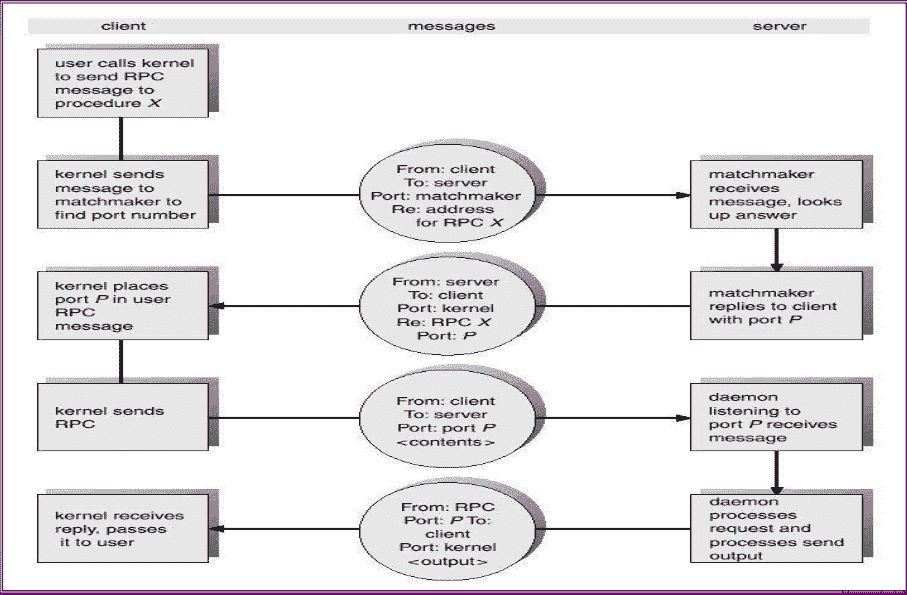

## Chapter 5: Threads

## 线程

- 5.1 [Overview](#)
- 5.2 [Multithreading Models](#)
- 5.3 [Threading Issues](#)
- 5.4 [Pthreads](#)
- 5.5 [Solaris 2 Threads](#)
- 5.6 [Windows 2000 Threads](#)
- 5.7 [Linux Threads](#)
- 5.8 [Java Threads](#)

综述
多线程模型
线程问题
POSIX 线程
Solaris 2 线程
Windows2000 线程
Linux 线程
Java 线程


## 5.1 Overview 综述

- The concept of a process as embodying two characteristics：
  - Unit of Resource ownership - process is allocated a virtual address space to hold the process image
  - Unit of Dispatching - process is an execution path through one or more programs
    - execution may be interleaved with other processes
- These two characteristics are treated independently by the operating system
  - Dispatching is referred to as a thread 线程 or lightweight process 轻型进程
  - Resource of ownership is referred to as a process 进程 or task 任务


## 5.1.1 Motivation

- A thread (or lightweight process) is a basic unit of CPU utilization; it consists of:
  - 线程（轻型进程）是CPU运用的一个基本单元，包括
    - a thread ID 一个线程标识符
    - program counter 程序计数器
    - register set 寄存器集
    - stack space 栈空间

(Has an execution state (running, ready, etc.); Saves thread context when not running; Has an execution stack; Has some per-thread static; storage for local variables; Has access to the memory and resources of its process, all threads of a process share this.)

## Motivation (Cont.)

- A thread shares with threads belonging to the same process its: 一个线程与属于同一进程的线程共享:
  - code section 代码段
  - data section 数据段
  - operating-system resources 操作系统资源

(Process Have a virtual address space which holds the process image Protected access to processors, other processes, files, and I/O resources)

- A traditional or *heavyweight* process is equal to a task with one thread
  传统的或重型进程等价于只有一个线程的任务

## Fig 5.1 Single and Multithreaded Processes

## 单个和多线程进程

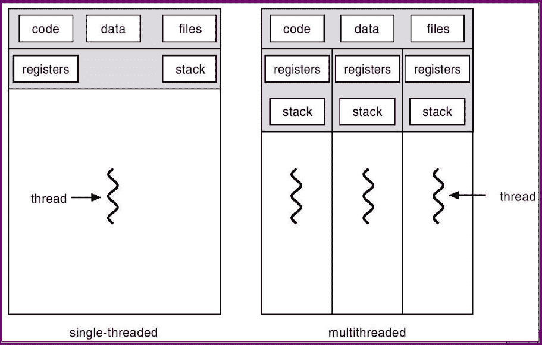

single-threaded

multithreaded

## 5.1.2 Benefits

益处

- Responsiveness 响应
- Resource Sharing 资源共享
- Economy 经济性
- Utilization of MP Architectures
  MP体系结构的运用

## Benefits(Cont.)

- Takes less time to create (or to terminate) a new thread than a process
- Less time to switch between two threads within the same process
- Since threads within the same process share memory and files, they can communicate with each other without invoking the kernel


## 5.1.3 User and Kernel Threads 用户和内核线程

## User Threads用户线程:

- Thread management done by user-level threads library 由用户级线程库进行管理的线程

- Examples例子

- POSIX Pthreads

- Mach C-threads

- Solaris threads

## Kernel Threads
内核线程

- **Supported by the Kernel**
  由内核支持
- **Examples** 例子
  - Windows 95/98/NT/2000
  - Solaris
  - Tru64 UNIX
  - BeOS
  - Linux

## 5.2 Multithreading Models
多线程模型

- 5.2.1 Many-to-One
  多对一
- 5.2.2 One-to-One
  一对一
- 5.2.3 Many-to-Many
  多对多

## 5.2.1 Many-to-One多对一

- Many user-level threads mapped to single kernel thread.
  多个用户级线程映像进单个内核线程

- Thread management is done in user space, so it is efficient, but true concurrency is not gained because the kernel can schedule only one thread at a time.

- Used on systems that do not support kernel threads.
  用于不支持内核线程的系统中

- Examples : Green threads -- a thread library available for Solaris 2

## Fig 5.2 Many-to-One Model多对一模型

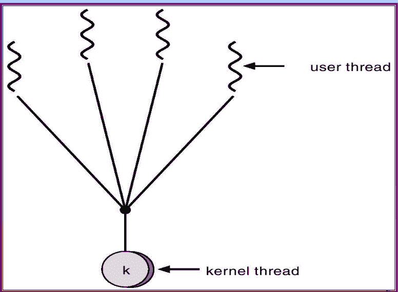

## Fig 5.3 One-to-one Model—对一模型

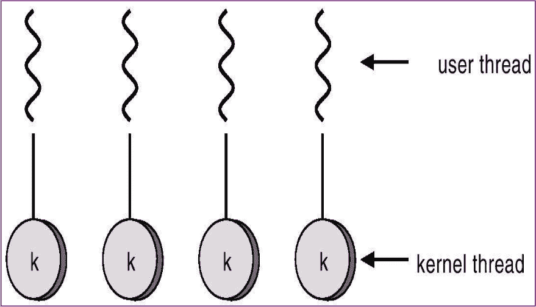

user thread

kernel thread

## 5.2.3 Many-to-Many Model多对多模型

- Allows many user level threads to be mapped to many kernel threads.
- Allows the operating system to create a sufficient number of user threads and corresponding kernel threads can run in parallel on a multiprocessor.
- Examples

- Solaris 2
- Windows NT/2000 with the ThreadFiber package
- IRIX
- HP-UX
- Tru64 UNIX

## 5.3 Threading Issues 线程问题

- 5.3.1 Semantics of fork() and exec() system calls. fork和exec系统调用语义
- 5.3.2 Thread cancellation. 撤消线程
- 5.3.3 Signal handling信号处理
- 5.3.4 Thread pools线程池
- 5.3.5 Thread specific data线程专用数据

## 5.3.1 fork() and exec() system calls
fork和exec系统调用

- In a multithreaded program, semantics语义 of the fork and exec system calls change.
- Some UNIX systems have chosen to have two versions of fork, one that duplicates all threads and another that duplicates only the thread that invoked that fork system call.

## 5.3.2 Cancellation

- Thread Cancellation is the task of terminating a thread before it has completed.
- A thread that cancelled is often referred to as the target thread. Cancellation of a target thread may occur in two different scenarios:
  - Asynchronous cancellation:
  - Deferred cancellation:


## 5.3.3 Signal Handling（信号处理）

## 5.4 Pthreads（POSIX线程）

- a POSIX standard (IEEE 1003.1c) API for thread creation and synchronization.
- API specifies behavior of the thread library, implementation is up to the developer of the library.
- Common in UNIX operating systems.

## 5.5 Solaris 2 Threads（Solaris 2 线程）

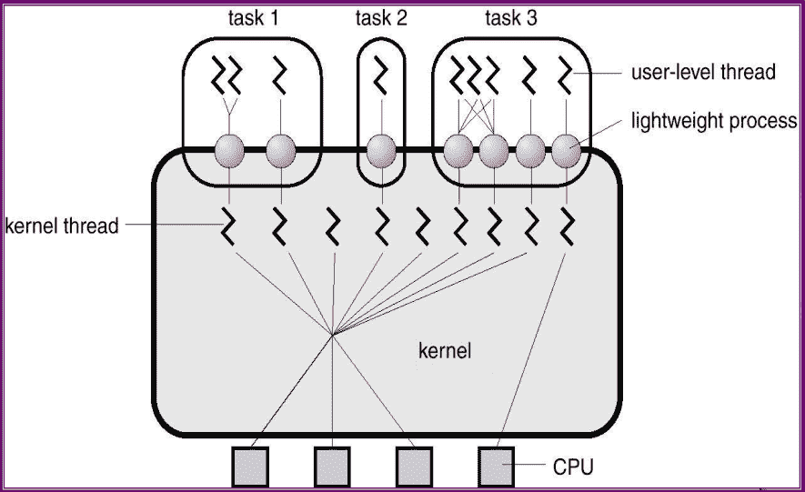

task 1  
task 2  
task 3  
user-level thread  
lightweight process  
kernel thread  
kernel  
CPU

**Fig 5.7 Solaris 2 Process（Solaris 2 进程）**

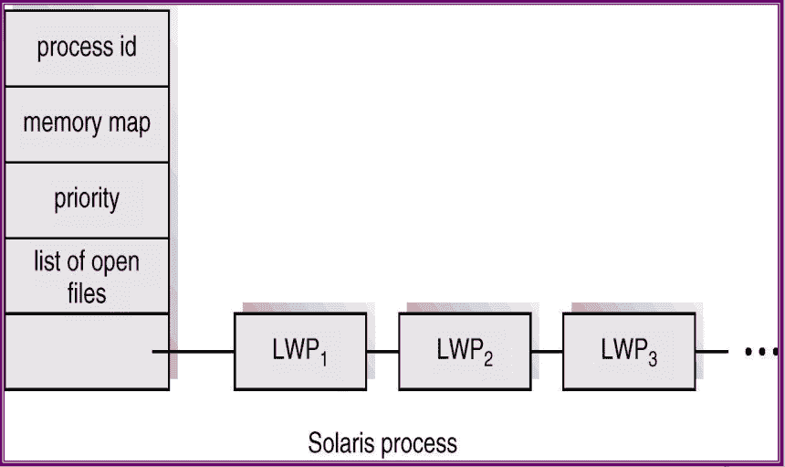

## 5.6 Windows 2000 Threads（Windows 2000线程）

- Implements the one-to-one mapping.
- Each thread contains
  - a thread id
  - register set
  - separate user and kernel stacks
  - private data storage area

## 5.8 Java Threads（Java线程）

- Java threads may be created by:（Java线程可如下创建：）
  - Extending Thread class（扩充线程类）
  - Implementing the Runnable interface（实现可运行接口）
- Java threads are managed by the JVM.

## Java Thread States（Java线程状态）

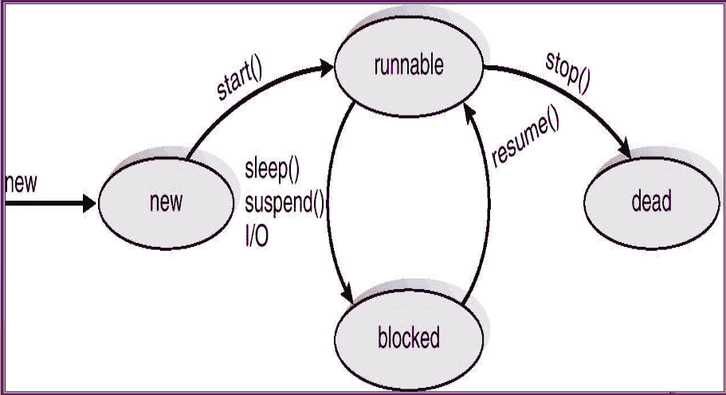

## Chapter 6: CPU Scheduling（CPU调度）

- 6.1 [Basic Concepts](#)（基本概念）
- 6.2 [Scheduling Criteria](#)（调度准则）
- 6.3 [Scheduling Algorithms](#)（调度算法）
- 6.4 [Multiple-Processor Scheduling](#)（多处理器调度）
- 6.5 [Real-Time Scheduling](#)（实时调度）
- 6.6 [Algorithm Evaluation](#)（算法评估）
- 6.7 [Process Scheduling Models](#)（进程调度模型）

## 6.1 Basic Concepts（基本概念）

- Maximum CPU utilization obtained with multiprogramming（通过多道程序设计得到 CPU 的最高利用率）
- CPU–I/O Burst Cycle – Process execution consists of a cycle of CPU execution and I/O wait.（CPU-I/O 脉冲周期——进程的执行包括进程在 CPU 上执行和等待 I/O）
- CPU burst distribution（CPU 脉冲的分布）

**Fig 6.1 Alternating Sequence of CPU And I/O Bursts**

load store  
add store  
read from file  

wait for I/O  

store increment  
index  
write to file  

wait for I/O  

load store  
add store  
read from file  

wait for I/O  

CPU burst  
I/O burst  
CPU burst  
I/O burst  
CPU burst  
I/O burst

**Histogram of CPU-burst Times**

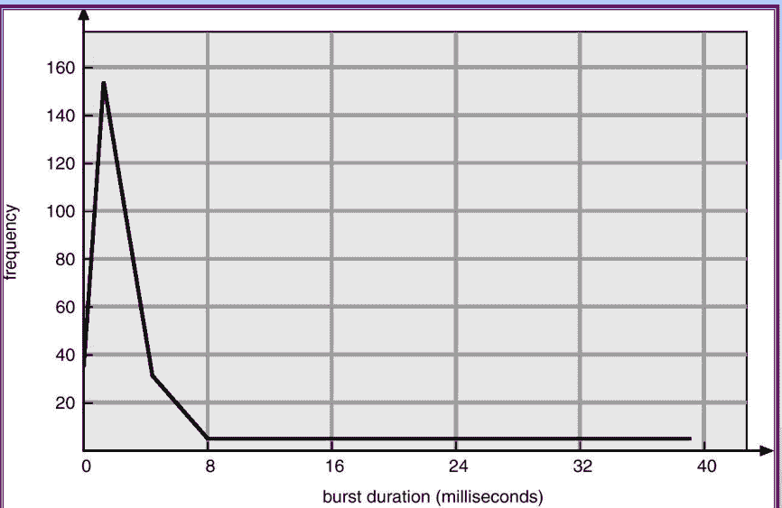

## 6.1.2 CPU Scheduler（CPU调度）

- Selects from among the processes in memory that are ready to execute, and allocates the CPU to one of them.（选择内存中的就绪进程，并分配CPU给其中之一）
- CPU scheduling decisions may take place when a process:（CPU调度可能发生在当一个进程：）
  1. Switches from running to waiting state.（从运行转到等待）
  2. Switches from running to ready state.（从运行转到就绪）
  3. Switches from waiting to ready.（从等待转到就绪）
  4. Terminates.（终止运行）
- Scheduling under 1 and 4 is *nonpreemptive*.（发生在 1、4 两种情况下的调度称为非抢占式调度）
- All other scheduling is *preemptive*.（其他情况下发生的调度称为抢占式调度。）

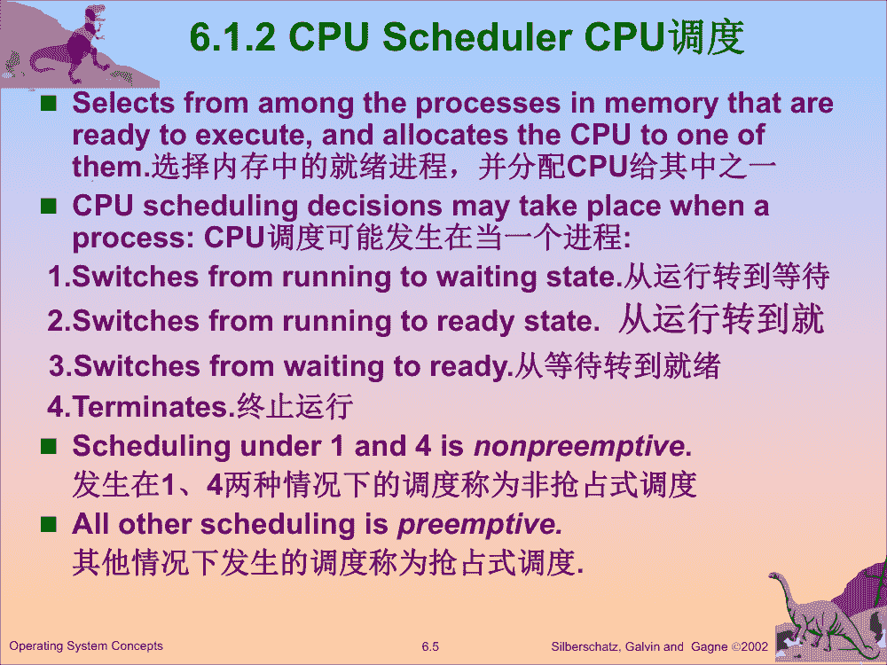

## 6.1.4 Dispatcher

- Dispatcher module gives control of the CPU to the process selected by the short-term scheduler; this involves:（进程调度模块负责将对 CPU 的控制权转交给由 CPU 调度程序选中的进程；这包括：）
  - switching context（切换上下文）
  - switching to user mode（切换到用户态）
  - jumping to the proper location in the user program to restart that program（跳转到用户程序的适当位置并重新运行之）
- **Dispatch latency** – time it takes for the dispatcher to stop one process and start another running.（调度时间——调度程序终止一个进程的运行并启动另一个进程运行所花的时间。）

## Scheduling Criteria (Cont.)

- Response time – amount of time it takes from when a request was submitted until the first response is produced, not output (for time-sharing environment)（响应时间——从进程提出请求到首次被响应（而不是输出结果）的时间段（在分时系统环境下））
- Optimization Criteria:（最优准则：）
- Max CPU utilization（最大的CPU利用率）
- Max throughput（最大的吞吐量）
- Min turnaround time（最短的周转时间）
- Min waiting time（最短的等待时间）
- Min response time（最短的响应时间）

## 6.3 Scheduling Algorithms（调度算法）

## 6.3.1 First-Come, First-Served (FCFS) Scheduling（先来先服务调度）

## 6.3.2 Shortest-Job-First (SJF) Scheduling（短作业优先调度）

## 6.3.3 Priority Scheduling（优先权调度）

## 6.3.4 Round Robin (RR)（时间片轮转调度）

## 6.3.5 Multilevel Queue Scheduling（多级队列调度）

## 6.3.6 Multilevel Feedback Queue Scheduling（多级反馈队列调度）


## 6.3.1 First-Come, First-Served (FCFS) Scheduling 先来先服务调度

| Process | Burst Time |
|---|---:|
| $P_1$ | 24 |
| $P_2$ | 3 |
| $P_3$ | 3 |

Suppose that the processes arrive in the order: $P_1$, $P_2$, $P_3$ 假定进程到达顺序如下：$P_1$，$P_2$，$P_3$

The Gantt Chart for the schedule is: 该调度的Gantt图为


- Waiting time（等待时间） for $P_1 = 0$; $P_2 = 24$; $P_3 = 27
- Average waiting time（平均等待时间）：
  $(0 + 24 + 27)/3 = 17$

## FCFS Scheduling (Cont.)

Suppose that the processes arrive in the order （假定进程到达顺序如下） $P_2$, $P_3$, $P_1$ .

The Gantt chart for the schedule is:该调度的Gantt图为


Waiting time （等待时间） for $P_1 = 6$; $P_2 = 0$; $P_3 = 3$

Average waiting time （平均等待时间）: (6 + 0 + 3)/3 = 3

Much better than previous case.比前例好得多

Convoy effect short process behind long process 此种结果产生是由于长进程先于短进程到达

## 6.3.2 Shortest-Job-First (SJF) Scheduling 短作业优先调度

- Associate with each process the length of its next CPU burst. Use these lengths to schedule the process with the shortest time.
- 关联到每个进程下次运行的CPU脉冲长度， 调度最短的进程

- Two schemes:
- nonpreemptive – once CPU given to the process it cannot be preempted until completes its CPU burst.
- 非抢占式调度 – 一旦进程拥有CPU， 它的使用权限只能在该CPU 脉冲结束后让出.

## Shortest-Job-First (SJF) Scheduling (Cont.)

preemptive – if a new process arrives with CPU burst length less than remaining time of current executing process, preempt. This scheme is know as the Shortest-Remaining-Time-First (SRTF).

抢占式调度 – 发生在有比当前进程剩余时间片更短的进程到达时，也称为最短剩余时间优先调度(SRTF).

- SJF is optimal – gives minimum average waiting time for a given set of processes.
- SJF是最优的 ---- 对一组指定的进程而言，它给出了最短的平均等待时间

## Example of Non-Preemptive SJF

| Process | Arrival Time | Burst Time |
|---|---:|---:|
| $P_1$ | 0.0 | 7 |
| $P_2$ | 2.0 | 4 |
| $P_3$ | 4.0 | 1 |
| $P_4$ | 5.0 | 4 |

- SJF (non-preemptive)

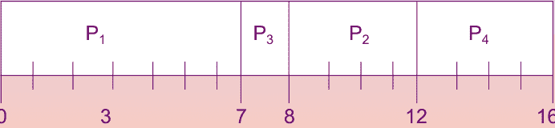

- Average waiting time = (0 + 6 + 3 + 7)/4 = 4

## Example of Preemptive SJF

| Process | Arrival Time | Burst Time |
|---|---:|---:|
| $P_1$ | 0.0 | 7 |
| $P_2$ | 2.0 | 4 |
| $P_3$ | 4.0 | 1 |
| $P_4$ | 5.0 | 4 |

- **SJF (preemptive)**

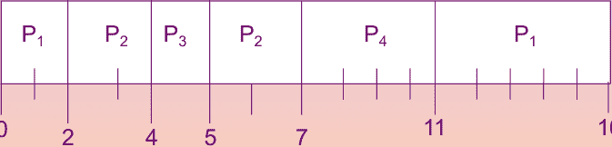

- **Average waiting time** = (9 + 1 + 0 + 2)/4 = 3

## Determining Length of Next CPU Burst

- Can only estimate the length.其长度只能估计
- Can be done by using the length of previous CPU bursts, using exponential averaging.

可以通过先前的CPU脉冲长度及计算指数均值进行.

1. \( t_n = \text{actual lenght of } n^{th}\text{CPU burst} \)
2. \( \tau_{n+1} = \text{predicted value for the next CPU burst} \)
3. \( \alpha, 0 \leq \alpha \leq 1 \)
4. Define :
   \( \tau_{n+1} = \alpha t_n + (1 - \alpha)\tau_n \).

## Fig. 3 Prediction of the Length of the Next CPU Burst

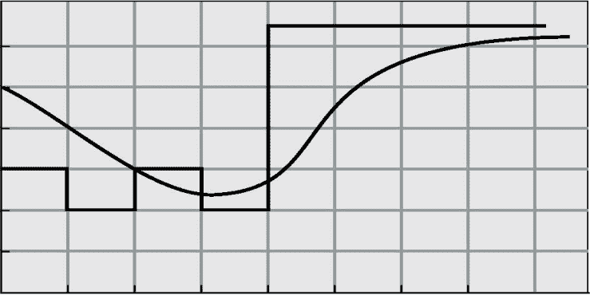

| | | | | | | | | | |
|---|---:|---:|---:|---:|---:|---:|---:|---:|---:|
| CPU burst (\(t_i\)) | 6 | 4 | 6 | 4 | 13 | 13 | 13 | … | |
| “guess” (\(\tau_i\)) | 10 | 8 | 6 | 6 | 5 | 9 | 11 | 12 | … |

## Examples of Exponential Averaging

- **α = 0**
  
  \(\tau_{n+1}=\tau_n\)
  
  Recent history does not count.

- **α = 1**
  
  \(\tau_{n+1}=t_n\)
  
  Only the actual last CPU burst counts.

- **If we expand the formula, we get:**
  
  \[
  \tau_{n+1}=\alpha t_n+(1-\alpha)\alpha t_{n-1}+\cdots
  \]
  \[
  \qquad +(1-\alpha)^j\alpha t_{n-j-1}+\cdots
  \]
  \[
  \qquad +(1-\alpha)^{n-1}t_n\tau_0
  \]

- Since both α and (1 − α) are less than or equal to 1, each successive term has less weight than its predecessor.

## 6.3.3 Priority Scheduling 优先权调度

- A priority number (integer) is associated with each process  
  每个进程都有自己的优先数[整数]

- The CPU is allocated to the process with the highest priority (smallest integer ≡ highest priority).  
  CPU分配给最高优先级的进程（假定最小的整数 = 最高的优先级）。

- Preemptive 抢占式  
  nonpreemptive 非抢占式

- SJF is a priority scheduling where priority is the predicted next CPU burst time.  
  SJF是以下一次CPU脉冲长度为优先数的优先级调度


## Priority Scheduling (Cont.)

- Problem = Starvation – low priority processes may never execute.
- 问题 = 饥饿 – 低优先级的可能永远得不到运行

- Solution = Aging – as time progresses increase the priority of the process.
- 解决方法 = 老化 – 视进程等待时间的延长提高其优先数

## 6.3.4 Round Robin (RR) 时间片轮转调度

- Each process gets a small unit of CPU time (_time quantum_), usually 10-100 milliseconds. After this time has elapsed, the process is preempted and added to the end of the ready queue.每个进程将得到小单位的CPU时间（时间片），通常为10-100毫秒。时间片用完后，该进程将被抢占并插入就绪队列末尾。

- If there are _n_ processes in the ready queue and the time quantum is _q_, then each process gets 1/_n_ of the CPU time in chunks of at most _q_ time units at once. No process waits more than (_n_-1)_q_ time units.
- 假定就绪队列中有_n_个进程、时间量为_q_，则每个进程每次得到1/_n_的、不超过_q_单位的成块CPU时间，没有任何一个进程的等待时间会超过(_n_-1)_q_单位

- Performance 特性
  - \( q \ large \Rightarrow \text{FIFO} \)
  - \( q \ small \Rightarrow q \text{ must be large with respect to context switch, otherwise overhead is too high.} \)
  - \( q \)相对于切换上下文的时间而言必须足够长，否则将导致系统开销过大

## Fig 6.4 Time Quantum and Context Switch Time

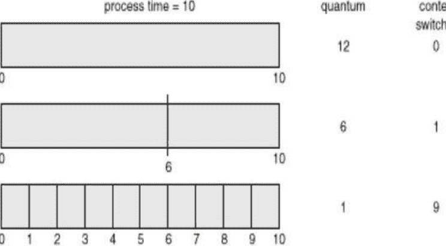

## Fig 6.5 Turnaround Time Varies With The Time Quantum

| process | time |
|---------|------|
| P₁      | 6    |
| P₂      | 3    |
| P₃      | 1    |
| P₄      | 7    |

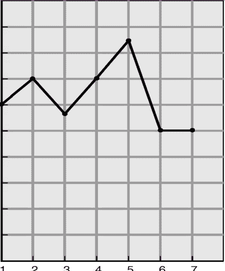

Operating System Concepts 6.25 Silberschatz, Galvin and Gagne ©2002

## 6.3.5 Multilevel Queue Scheduling 多级队列调度

- Ready queue is partitioned into separate queues:
  - foreground (interactive) 前台（交互式）
  - background (batch) 后台（批处理）
- Each queue has its own scheduling algorithm,
  - 每个队列有自己的调度算法
  - foreground – RR 前台–RR
  - background – FCFS 后台–FCFS

- Scheduling must be done between the queues.
- 调度须在队列间进行

- Fixed priority scheduling; (i.e., serve all from foreground then from background). Possibility of starvation.
- 固定优先级调度，即前台运行完后再运行后台。有可能产生饥饿

- Time slice – each queue gets a certain amount of CPU time which it can schedule amongst its processes; i.e., 80% to foreground in RR, 20% to background in FCFS 。
- 给定时间片调度，即每个队列得到一定的CPU时间，进程在给定时间内执行；如，80%的时间执行前台的RR调度，20%的时间执行后台的FCFS调度

## Example of Multilevel Feedback Queue

## Scheduling调度

A new job enters queue \( Q_0 \) which is served FCFS. When it gains CPU, job receives 8 milliseconds. If it does not finish in 8 milliseconds, job is moved to queue \( Q_1 \).

新的作业进入FCFS的\( Q_0 \)队列，它得到CPU时能使用8毫秒，如果它不能在8毫秒内完成，将移动到队列\( Q_1 \).

At \( Q_1 \) job is again served FCFS and receives 16 additional milliseconds. If it still does not complete, it is preempted and moved to queue \( Q_2 \).

作业在\( Q_1 \)仍将作为FCFS调度，能使用附加的16毫秒，如果它还不能完成，将被抢占，移至队列\( Q_2 \).

## Fig 6.7 Multilevel Feedback Queues

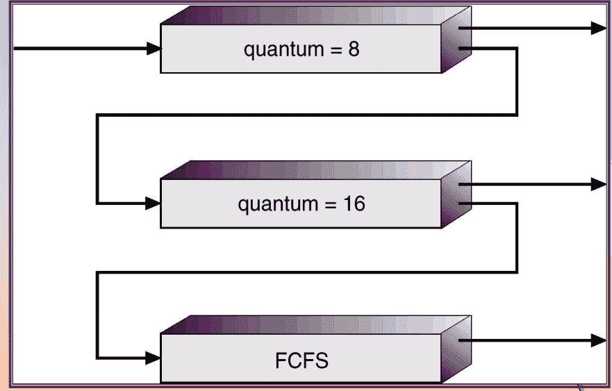

## 6.4 Multiple-Processor Scheduling 多处理器调度

- CPU scheduling more complex when multiple CPUs are available.
- 多个CPU可用时， CPU调度将更为复杂

- Homogeneous processors within a multiprocessor.
- 多处理器内的同类处理器

- Load sharing 负载共享

- Symmetric Multiprocessing (SMP) – each processor makes its own scheduling decisions
- 对称多处理器 – 每个处理器决定自己的调度方案

- **Asymmetric multiprocessing** – only one processor accesses the system data structures, alleviating the need for data sharing.

非对称多处理器 – 仅一个处理器能处理系统数据结构，这就减轻了对数据的共享需求

## 6.5 Real-Time Scheduling 实时调度

- **Hard real-time systems – required to complete a critical task within a guaranteed amount of time.** 硬件实现的实时系统 – 用于实现要求在给定的时间内执行完临界进程的场合

- **Soft real-time computing – requires that critical processes receive priority over less fortunate ones.** 软件实现的实时计算 – 当要求临界进程得到比其他进程更高的优先级时

- **Conflict phase of dispatch latency has two components :调度等待的冲突态有二部分：**  
  - **Preemption of any process running in the kernel**  
  - **Release by low-priority processes resources needed by the high-priority process .**


## Fig 6.8 Dispatch Latency调度等待

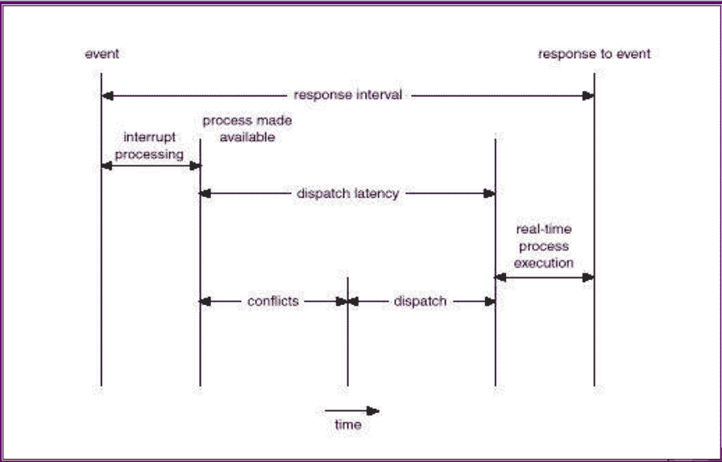

## 6.6.2 Queueing models等待队列模型

- The distribution of CPU and I/O bursts may be measured and then approximated or simply estimated. The result is a mathematical formula describing the probability of a particular CPU burst.

- Queueing-network analysis : Each server has a queue of waiting processes. The CPU is a server with its ready queue, as is the I/O system with its device queues. Knowing arrival rates and service rates, we can compute utilization, average queue length, average wait time, and so on.

## Fig 6.9 Evaluation of CPU Schedulers by Simulation

actual process execution

trace tape

CPU 10 I/O 213 CPU 12 I/O 112 CPU 2 I/O 147 CPU 173 ...

simulation FCFS

simulation SJF

simulation RR(Q = 14)

performance statistics for FCFS

performance statistics for SJF

performance statistics for RR(Q = 14)

## 6.7 Process Scheduling Models 进程调度模型

- Process Local Scheduling – How the threads library decides which thread to put onto an available LWP.进程局部调度– 线程库怎样决定将哪个线程列入有效的轻量级线程

- System Global Scheduling – How the kernel decides which kernel thread to run next.系统全局调度 – 内核怎样决定下一个运行的内核线程

- 6.7.1 An Example : Solaris

- 6.7.1 An Example : Windows 2000

- 6.7.1 An Example : Linux

## Fig 6.10 Solaris 2 Scheduling

| global priority | scheduling order | class-specific priorities | scheduler classes | run queue |
|---|---|---|---|---|
| highest | first | real time | kernel threads of real-time LWPs | |
| | | system | kernel service threads | |
| | | interactive and time sharing | kernel threads of interactive and time-sharing LWPs | |
| lowest | last | | | |

## Chapter 7: Process Synchronization 进程同步

- 7.1 Background 背景
- 7.2 The Critical-Section Problem 临界区问题
- 7.3 Synchronization Hardware 同步的硬件实现.
- 7.4 Semaphores 信号量
- 7.5 Classical Problems of Synchronization 经典同步问题
- 7.6 Critical Regions 临界区
- 7.7 Monitors 管程
- 7.8 OS Synchronization 操作系统的同步机制
- 7.9 Atomic Transactions 自动事务处理

## 7.1 Background 背景

Concurrent access to shared data may result in data inconsistency.

对共享数据的并发访问可能导致数据的不一致性

Maintaining data consistency requires mechanisms to ensure the orderly execution of cooperating processes.

要保持数据的一致性，就需要一种保证并发进程的正确执行顺序的机制

## Background (Cont.)

Shared-memory solution to bounded-butter problem (Chapter 4) allows at most n − 1 items in buffer at the same time. A solution, where all N buffers are used is not simple.

第4章中解决有界缓冲区问题的共享内存方法在类数据count 上将一起竞争条件

Suppose that we modify the producer-consumer code by adding a variable counter, initialized to 0 and incremented each time a new item is added to the buffer

## Bounded-Buffer

- Shared data

```c
#define BUFFER_SIZE 10
typedef struct {
    ...
} item;
item buffer[BUFFER_SIZE];
int in = 0;
int out = 0;
int counter = 0;
```

## Bounded-Buffer (Cont.-1)

## Producer process

```c
item nextProduced;

while (1) {
    while (counter == BUFFER_SIZE)
        ; /* do nothing */
    buffer[in] = nextProduced;
    in = (in + 1) % BUFFER_SIZE;
    counter++;
}
```

## Bounded-Buffer (Cont.-2)

## Consumer process

```c
item nextConsumed;

while (1) {
    while (counter == 0)
    ; /* do nothing */
    nextConsumed = buffer[out];
    out = (out + 1) % BUFFER_SIZE;
    counter--;
}
```

## Bounded Buffer (Cont.-3)

- The statements

counter++;
counter--

must be performed *atomically*.

- Atomic operation means an operation that completes in its entirety without interruption.

## Bounded Buffer (Cont.-4)

- The statement “count++” may be implemented in machine language as:

```
register1 = counter
register1 = register1 + 1
counter = register1
```

- The statement “count--” may be implemented as:

```
register2 = counter
register2 = register2 − 1
counter = register2
```


## Bounded Buffer (Cont.-5)

- If both the producer and consumer attempt to update the buffer concurrently, the assembly language statements may get interleaved.
- Interleaving depends upon how the producer and consumer processes are scheduled.

## Bounded Buffer (Cont.-6)

Assume counter is initially 5. One interleaving of statements is:

producer: register1 = counter (register1 = 5)
producer: register1 = register1 + 1 (register1 = 6)
consumer: register2 = counter (register2 = 5)
consumer: register2 = register2 – 1 (register2 = 4)
producer: counter = register1 (counter = 6)
consumer: counter = register2 (counter = 4)

The value of count may be either 4 or 6, where the correct result should be 5.

## Race Condition

- Race condition: The situation where several processes access – and manipulate shared data concurrently. The final value of the shared data depends upon which process finishes last.
- To prevent race conditions, concurrent processes must be synchronized.

## 7.2 The Critical-Section Problem
临界区问题

- $n$ processes all competing to use some shared data
- Each process has a code segment, called *critical section*, in which the shared data is accessed.
- **Problem** – ensure that when one process is executing in its critical section, no other process is allowed to execute in its critical section.

## Solution to Critical-Section Problem (Cont.)

## 3. Bounded Waiting.

A bound must exist on the number of times that other processes are allowed to enter their critical sections after a process has made a request to enter its critical section and before that request is granted.

有限等待。在一个进程提出进入临界区的请求和该请求得到答复的时间内，其他进程进入临界区前的等待时间必须是有限的。

- Assume that each process executes at a nonzero speed
- 假定每个进程都以非零的速率执行。
- No assumption concerning relative speed of the n processes.
- 没有任何关于这n个进程相对执行速率的假定

## Fig. 7.1 General structure of a typical process Pi

General structure of process Pi (other process Pj)
do {
    entry section
    critical section
    exit section
    reminder section
} while (1);

Processes may share some common variables to synchronize their actions.

## 7.2.1 Two-Process Solutions Algorithm 1

- Only 2 processes, \(P_0\) and \(P_1\)
- Shared variables:
  - int turn;
  - initially turn = 0
  - turn - i \(\Rightarrow P_i\) can enter its critical section
- Process \(P_i\)
  do {
    while (turn != i) ;
    critical section
    turn = j;
    reminder section
  } while (1);
- Satisfies mutual exclusion, but not progress

## Algorithm 2

- Shared variables
  boolean flag[2];
  initially flag [0] = flag [1] = false.
  flag [i] = true ⇒ Pi ready to enter its critical section

- Process Pi
  do {
    flag[i] := true;
    while (flag[j]) ;
    critical section
    flag [i] = false;
    remainder section
  } while (1);

- Satisfies mutual exclusion, but not progress requirement.

## Algorithm 3

- Combined shared variables of algorithms 1 and 2.
- Process P<sub>i</sub>
  do {
    flag [i]:= true;
    turn = j;
    while (flag [j] and turn == j) ;
    critical section
    flag [i] = false;
    remainder section
  } while (1);
- Meets all three requirements; solves the critical-section problem for two processes.

## 7.2.2 Multiple-Process Solutions Bakery Algorithm

## Critical section for n processes

- Before entering its critical section, process receives a number. Holder of the smallest number enters the critical section.
- If processes \(P_i\) and \(P_j\) receive the same number, if \(i < j\), then \(P_i\) is served first; else \(P_j\) is served first.
- The numbering scheme always generates numbers in increasing order of enumeration; i.e., 1,2,3,3,3,3,4,5...


## Bakery Algorithm

- Notation <= lexicographical order (ticket #, process id #)

  (a,b) < (c,d) if a < c or if a = c and b < d

  max(a₀, ..., aₙ₋₁) is a number, k, such that k ≥ aᵢ for i = 0, ..., n - 1

- Shared data

  boolean choosing[n];
  int number[n];

  Data structures are initialized to false and 0 respectively

## Bakery Algorithm (Cont.)

```
do {
    choosing[i] = true;
    number[i] = max(number[0], number[1], ..., number[n − 1])+1;
    choosing[i] = false;
    for (j = 0; j < n; j++) {
        while (choosing[j]) ;
        while ((number[j] != 0) && (number[j] < number[i])) ;
    }
    critical section
    number[i] = 0;
    remainder section
} while (1);
```

## Fig 7.7 Mutual Exclusion with Test-and-Set

- Shared data:
  boolean lock = false;

- Process Pᵢ
  do {
  while (TestAndSet(lock)) ;
  critical section
  lock = false;
  remainder section
  } while(1);

## Fig 7.8 The definition of Swap instruction

- Atomically swap two variables.

```
void Swap(boolean &a, boolean &b) {
    boolean temp = a;
    a = b;
    b = temp;
}
```

## Fig 7.9 Mutual Exclusion with Swap

- Shared data (initialized to false):
  boolean lock;
  boolean waiting[n];

- Process Pᵢ
  do {
    key = true;
    while (key == true)
      Swap(lock, key);
    critical section
    lock = false;
    remainder section
  }

## 7.4 Semaphores 信号量

- Synchronization tool that does not require busy waiting. 一种不需要忙等待的同步工具.
- Semaphore S – integer variable 信号量 S – 整型变量
- can only be accessed via two indivisible (atomic) operations
  仅能通过两个不可分割的原子操作访问

```
wait (S):
    while S ≤ 0 do no-op;
    S--;

signal (S):
    S++;
```

## Fig 7.11 Mutual-exclusion with semaphores

- Shared data:
  semaphore mutex; // initially mutex = 1

- Process Pᵢ:
  do {
  wait(mutex);
  critical section
  signal(mutex);
  remainder section
  } while (1);

## 7.4.2 Semaphore Implementation

- Define a semaphore as a record
  typedef struct {
    int value;
    struct process *L;
  } semaphore;

- Assume two simple operations:
  - block suspends the process that invokes it.
  - wakeup(P) resumes the execution of a blocked process P.

## Implementation

- Semaphore operations now defined as

```
wait(S):
    S.value--;
    if (S.value < 0) {
        add this process to S.L;
        block;
    }

signal(S):
    S.value++;
    if (S.value <= 0) {
        remove a process P from S.L;
        wakeup(P);
    }
```

## Semaphore as a General Synchronization Tool

- Execute B in Pⱼ only after A executed in Pᵢ
- Use semaphore flag initialized to 0
- Code:

```
Pᵢ              Pⱼ
...             ...
A               wait(flag)
signal(flag)    B
```

## 7.4.3 Deadlock and Starvation

- Deadlock – two or more processes are waiting indefinitely for an event that can be caused by only one of the waiting processes.
  死锁 – 两个或多个进程无限期地等待一个事件的发生，而该事件正是由其中的一个等待进程引起的

- Let S and Q be two semaphores initialized to 1 S 和 Q 是两个初值为 1 的信号量

```
P0
wait(S);
wait(Q);
...
signal(S);
signal(Q)
```

```
P1
wait(Q);
wait(S);
...
signal(Q);
signal(S);
```

## Deadlock and Starvation

- Starvation – indefinite blocking. A process may never be removed from the semaphore queue in which it is suspended.
  饥饿 – 无限期地阻塞。进程可能永远无法从它等待的信号量队列中移去

## Two Types of Semaphores

- Counting semaphore – integer value can range over an unrestricted domain.
  计数信号量 – 变化范围没有限制的整型值

- Binary semaphore – integer value can range only between 0 and 1; can be simpler to implement.
  二值信号量 – 变化范围仅限于 0 和 1 的信号量；容易实现

- Can implement a counting semaphore S as a binary semaphore.
  可以将计数信号量 S 用作二值信号量


## Implementing S as a Binary Semaphore

- **Data structures:**
  - `binary-semaphore S1, S2;`
  - `int C;`

- **Initialization:**
  - `S1 = 1`
  - `S2 = 0`
  - `C = initial value of semaphore S`

## 7.5 Classical Problems of Synchronization 经典同步问题

## 7.5.1 Bounded-Buffer Problem
有限缓冲区问题

## 7.5.2 Readers and Writers Problem
读者写者问题

## 7.5.3 Dining-Philosophers Problem
哲学家就餐问题

## 7.5.1 Bounded-Buffer Problem 有限缓冲区问题

- Shared data

semaphore full, empty, mutex;

Initially:

full = 0, empty = n, mutex = 1

## Fig 7.12 The structure of Producer Process

```
do {
    ...
    produce an item in nextp
    ...
    wait(empty);
    wait(mutex);
    ...
    add nextp to buffer
    ...
    signal(mutex);
    signal(full);
} while (1);
```

## Fig 7.13 structure of the Consumer Process

```
do {
wait(full)
wait(mutex);
...
remove an item from buffer to nextc
...
signal(mutex);
signal(empty);
...
consume the item in nextc
...
} while (1);
```

## 7.5.2 The Readers-Writers Problem

读者与写者问题

- Shared data
  - semaphore mutex, wrt;
  - Initially
  - mutex = 1, wrt = 1, readcount = 0

## Fig 7.14 The structure of a Writer Process

```
wait(wrt);
...
writing is performed
...
signal(wrt);
```

## Fig 7.15 The structure of a Reader Process

```
wait(mutex);
readcount++;
if (readcount == 1)
    wait(rt);
signal(mutex);
...
reading is performed
...
wait(mutex);
readcount--;
if (readcount == 0)
    signal(wrt);
signal(mutex);
```

## 7.5.3 Dining Philosophers Problem

## 哲学家就餐问题

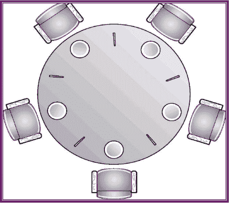

- Shared data
  - `semaphore chopstick[5];`
  - Initially all values are 1

## Fig 7.17 The structure of Philosophers i

```
▪ Philosopher *i*:
    do {
        wait(chopstick[i])
        wait(chopstick[(i+1) % 5])
        …
        eat
        …
        signal(chopstick[i]);
        signal(chopstick[(i+1) % 5]);
        …
        think
        …
    } while (1);
```

## 7.6 Critical Regions 临界区

Regions referring to the same shared variable exclude each other in time.

When a process tries to execute the region statement, the Boolean expression B is evaluated. If B is true, statement S is executed. If it is false, the process is delayed until B becomes true and no other process is in the region associated with v.

## Example – Bounded Buffer

- Shared data:

struct buffer {
int pool[n];
int count, in, out;
}

## Bounded Buffer Producer Process

- Producer process inserts `nextp` into the shared buffer

```
region buffer when( count < n) {
    pool[in] = nextp;
    in = (in+1) % n;
    count++;
}
```

## Bounded Buffer Consumer Process

- Consumer process removes an item from the shared buffer and puts it in nextc

```
region buffer when (count > 0) {
nextc = pool[out];
out = (out+1) % n;
count--;
}
```

## Implementation

- Keep track of the number of processes waiting on first-delay and second-delay, with first-count and second-count respectively.

- The algorithm assumes a FIFO ordering in the queuing of processes for a semaphore.

- For an arbitrary queuing discipline, a more complicated implementation is required.

## 7.7 Monitors 管程

- High-level synchronization construct that allows the safe sharing of an abstract data type among concurrent processes. 高级的同步抽象：

- A monitor is characterized by a set of programming-defined operators

- The monitor construct ensures that only one process at a time can be active within monitor.

## Monitors (Cont.)

- The syntax of a monitor: 管程的语法

```
monitor *monitor-name*\n{\n    shared variable declarations\n    procedure body *P1*(...) { ...\n    }\n\n    procedure body *P2*(...) { ...\n    }\n\n    procedure body *Pn*(...) {\n        ...\n    }\n    {\n        initialization code\n    }\n}
```


## Monitors

- To allow a process to wait within the monitor, a condition variable must be declared, as `condition x, y;`
- Condition variables can only be used with the operations `wait` and `signal`.

The operation `x.wait()` means that the process invoking this operation is suspended until another process invokes `x.signal()`.

The `x.signal` operation resumes exactly one suspended process. If no process is suspended, then the signal operation has no effect.

## Fig 7.20 Schematic View of a Monitor

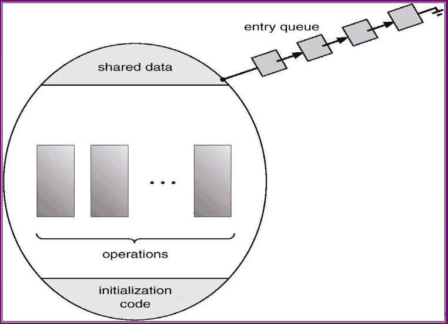

shared data  
entry queue  
operations  
initialization code

## Fig 7.21 Monitor With Condition Variables

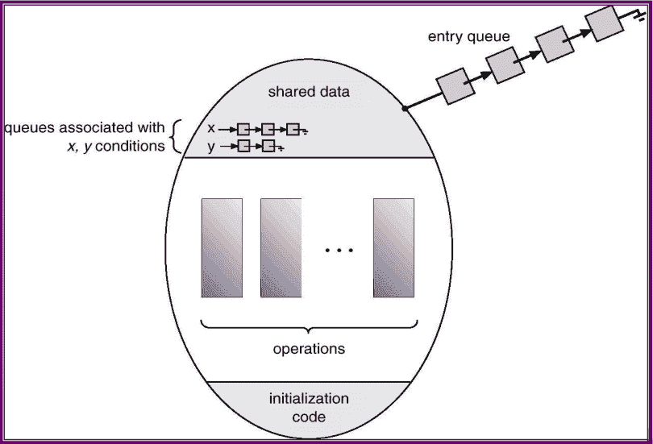

queues associated with $x, y$ conditions  
shared data  
entry queue  
operations  
initialization code

- When the `x.signal()` operation is invoked by process P, there is a suspended process Q associated with condition X. Two possibilities exist:
  1. P either waits until Q leaves the monitor, or waits for another condition.
  2. Q either waits until P leaves the monitor, or waits for another condition.

## Fig 7.22 A monitor solution to the Dining-Philosophers

```c
monitor dp
{
    enum {thinking, hungry, eating} state[5];
    condition self[5];
    void pickup(int i)              // following slides
    void putdown(int i)    // following slides
    void test(int i)       // following slides
    void init() {
        for (int i = 0; i < 5; i++)
            state[i] = thinking;
    }
}

void pickup(int i) {
    state[i] = hungry;
    test(i);
    if (state[i] != eating)
        self[i].wait();
}

void putdown(int i) {
    state[i] = thinking;
    // test left and right neighbors
    test((i+4) % 5);
    test((i+1) % 5);
}

void test(int i) {
    if ( (state[(i + 4) % 5] != eating) &&
         (state[i] == hungry) &&
         (state[(i + 1) % 5] != eating)) {
        state[i] = eating;
        self[i].signal();
    }
}
```

## Monitor Implementation Using Semaphores

- Variables

```c
semaphore mutex;  // (initially = 1)
semaphore next;   // (initially = 0)
int next_count = 0;
```

- Each external procedure *F* will be replaced by

```c
wait(mutex);

...
body of F;

...
if (next_count > 0)
    signal(next);
else
    signal(mutex);
```

- Mutual exclusion within a monitor is ensured.

- For each condition variable `x`, we have:

```c
semaphore x_sem; // (initially = 0)
int x_count = 0;
```

- The operation `x.wait` can be implemented as:

```c
x_count++;
if (next_count > 0)
    signal(next);
else
    signal(mutex);
wait(x_sem);
x_count--;
```

- The operation `x.signal` can be implemented as:

```c
if (x_count > 0) {
    next_count++;
    signal(x_sem);
    wait(next);
    next_count--;
}
```

- **Conditional-wait construct:** `x.wait(c);`
  - `c` — integer expression evaluated when the wait operation is executed.
  - The value of `c` (a *priority number*) is stored with the name of the process that is suspended.
  - When `x.signal` is executed, the process with the smallest associated priority number is resumed next.

- **Check two conditions to establish correctness of the system:**
  - User processes must always make their calls on the monitor in a correct sequence.
  - Must ensure that an uncooperative process does not ignore the mutual-exclusion gateway provided by the monitor, and try to access the shared resource directly, without using the access protocols.

## 7.8 OS Synchronization
操作系统的同步机制

## 7.8.1 Synchronization in Solaris 2

- Implements a variety of locks to support multitasking, multithreading (including real-time threads), and multiprocessing.
- Uses adaptive mutexes （可变互斥量） for efficiency when protecting data from short code segments.
- Uses condition variables （环境变量） and readers-writers locks （读-写锁） when longer sections of code need access to data.
- Uses turnstiles to order the list of threads waiting to acquire either an adaptive mutex or reader-writer lock.


## 7.8.2 Windows 2000 Synchronization

- Uses interrupt masks to protect access to global resources on uniprocessor systems.
- Uses spinlocks on multiprocessor systems.
- Provides dispatcher objects for thread synchronization outside of the kernel.
- Using a dispatcher object, a thread can synchronize according to several different mechanisms including mutexes, semaphores, and events. An event acts much like a condition variable.
- Dispatcher objects may be in either a signaled or nonsignaled state.

## 7.9 Atomic Transactions 自动事务处理

## 7.9.1 System Model 系统模型

## 7.9.2 Log-Based Recovery

## 7.9.3 Checkpoint

## 7.9.4 Concurrent Atomic Transactions 并行的自动事务处理

## Chapter 8: Deadlocks 死锁

## 8.1 System Model 系统模型

## 8.2 Deadlock Characterization 死锁特征

## 8.3 Methods for Handling Deadlocks 处理死锁的方法

## 8.4 Deadlock Prevention 预防死锁

## 8.5 Deadlock Avoidance 死锁避免

## 8.6 Deadlock Detection 死锁检测

## 8.7 Recovery from Deadlock 死锁恢复

## 8.8 Combined Approach to Deadlock Handling 综合处理方法

## 8.1 The Deadlock Problem 死锁问题

A set of blocked processes each holding a resource and waiting to acquire a resource held by another process in the set.

一组等待的进程，其中每一个进程都持有资源，并且等待着由这个组中其他进程所持有的资源

- Example
- System has 2 tape drives. 系统有两个磁带设备
- P1 and P2 each hold one tape drive and each needs another one. 进程 P1 和 P2 各占有一个磁带设备并且实际需要两个磁带
- Example
- semaphores A and B, initialized to 1 信号量 A，B 初始化为 1

```
P0
wait (A);
wait (B);

P1
wait(B)
wait(A)
```

## Bridge Crossing Example 过桥的例子

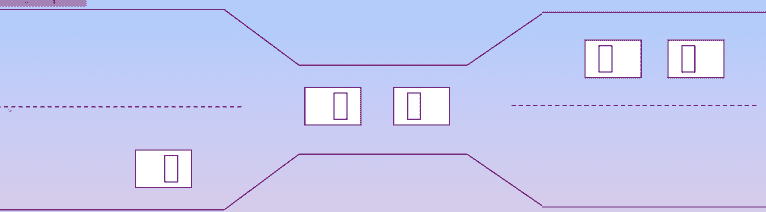

- Traffic only in one direction. 只有一个方向
- Each section of a bridge can be viewed as a resource. 桥的每一个部分都可以看成资源
- If a deadlock occurs, it can be resolved if one car backs up (preempt resources and rollback). 如果死锁发生，它可以由一辆车返回而解决，抢占资源并回退
- Several cars may have to be backed up if a deadlock occurs. 如果死锁发生，可能很多车都不得不返回
- Starvation is possible. 有可能产生饥饿

## System Model (Cont.)

- Resource types 资源类型 \(R_1, R_2, \ldots, R_m\)
  - CPU cycles, memory space, I/O devices
  - CPU 周期，内存空间，I/O 设备
- Each resource type \(R_i\) has \(W_i\) instances.
  - 每一种资源 \(R_i\) 有 \(W_i\) 种实例
- Each process utilizes a resource as follows:
  - 每一个进程如下的利用资源
  - request 申请
  - use 使用
  - release 释放

## 8.2 Deadlock Characterization

## 8.2.1 Necessary Conditions 产生死锁的必要条件

- **Deadlock can arise if four conditions hold simultaneously.**
  四个条件同时出现，死锁将会发生

- **Mutual exclusion:** only one process at a time can use a resource.
  互斥：一次只有一个进程可以使用一个资源

- **Hold and wait:** a process holding at least one resource is waiting to acquire additional resources held by other processes.
  占有并等待：一个至少持有一个资源的进程等待获得额外的由其他进程所持有的资源

## Deadlock Characterization (Cont.)

- No preemption: a resource can be released only voluntarily by the process holding it, after that process has completed its task.
  不可抢占：一个资源只有当持有它的进程完成任务后，自由的释放

- Circular wait: there exists a set {P0, P1, ..., Pn} of waiting processes such that P0 is waiting for a resource that is held by P1, P1 is waiting for a resource that is held by P2, ..., Pn–1 is waiting for a resource that is held by Pn, and Pn is waiting for a resource that is held by P0.
  循环等待：等待资源的进程之间存在环

## 8.2.2 Resource-Allocation Graph 资源分配图

A set of vertices V and a set of edges E.
一个顶点的集合 V 和边的集合 E

- V is partitioned into two types: V 被分为两个部分
- P = {P1, P2, ..., Pn}, the set consisting of all the processes in the system.
  P: 含有系统中全部的进程
- R = {R1, R2, ..., Rm}, the set consisting of all resource types in the system.
  R: 含有系统中全部的资源

- request edge – directed edge P1 → Rj
  请求边: 直接 P1 → Rj

- assignment edge – directed edge Rj → Pi
  分配边: Rj → Pi


## Resource-Allocation Graph (Cont.)

- Process进程
- Resource Type with 4 instances有四个实例的资源类型
- Pi requests instance of Rj Pi 请求一个Rj的实例
- Pi is holding an instance of Rj Pi 持有一个Rj的实例


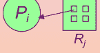

## Fig 8.1 Example of a Resource Allocation Graph 资源分配图的例子

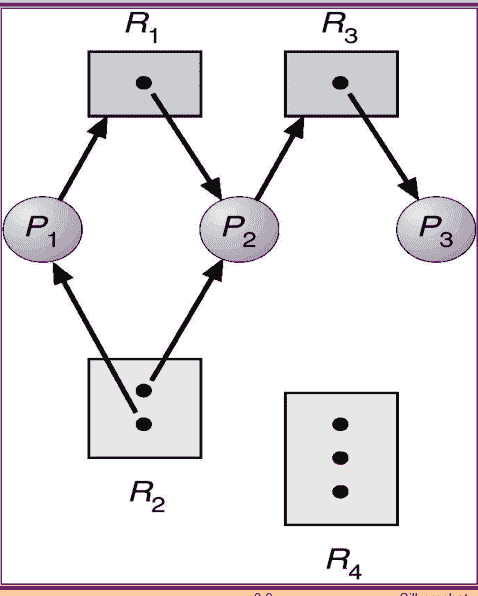

## Fig 8.2 Resource Allocation Graph With A Deadlock
有死锁的资源分配图

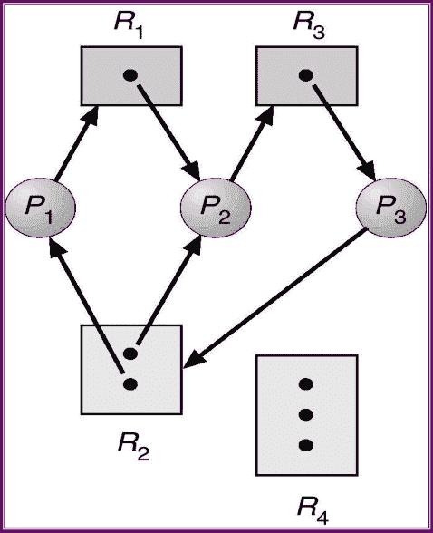

## Fig 8.3 Resource Allocation Graph With A Cycle But No Deadlock 有环但没有死锁的资源分配图

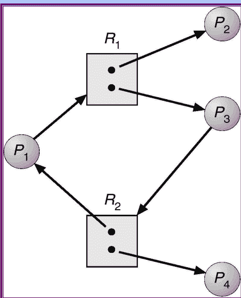

## Basic Facts 基本事实

- If graph contains no cycles ⇒ no deadlock.
  如果图没有环，那么不会有死锁

- If graph contains a cycle ⇒ 如果图有环
  - if only one instance per resource type, then deadlock.
    如果每一种资源类型只有一个实例，那么死锁发生
  - if several instances per resource type, possibility of deadlock.
    如果一种资源类型有多个实例，可能死锁

## 8.3 Methods for Handling Deadlocks
处理死锁的方法

- Ensure that the system will _never_ enter a deadlock state. --- use either a deadlock prevention (死锁预防) or a deadlock-avoidance (死锁避免) 确保系统永远不会进入死锁状态

- Allow the system to enter a deadlock state and then recover. --- Deadlock Detection(死锁检测) and Recovery from Deadlock(死锁恢复) 允许系统进入死锁状态，然后恢复系统

- Ignore the problem and pretend that deadlocks never occur in the system; used by most operating systems, including UNIX. --- restart or manual recovery method 忽略这个问题，假装系统中从未出现过死锁。这个方法被大部分的操作系统采用，包括UNIX

## 8.4 Deadlock Prevention
## 死锁的预防

Restrain the ways request can be made.
抑制死锁发生的必要条件

- 8.4.1 Mutual Exclusion – not required for sharable resources; must hold for nonsharable resources.
  互斥：共享资源不是必须的，必须保持非共享资源

- 8.4.2 Hold and Wait – must guarantee that whenever a process requests a resource, it does not hold any other resources.占有并等待： 必须保证进程申请资源的时候没有占有其他资源

  Require process to request and be allocated all its resources before it begins execution, or allow process to request resources only when the process has none.要求进程在执行前一次申请全部的资源，只有没有占有资源时才可以分配资源

## Deadlock Prevention (Cont.-1)

Process will be restarted only when it can regain its old resources, as well as the new ones that it is requesting.
进程在重新得到旧的资源的时候可以重新开始

- **8.4.4 Circular Wait** – impose a total ordering of all resource types, and require that each process requests resources in an increasing order of enumeration.
  循环等待：将所有的资源类型放入资源列表中，并且要求进程按照资源表申请资源

## 8.5 Deadlock Avoidance 死锁避免

Requires that the system has some additional
a priori information available.需要系统有一些额外的信息

- Simplest and most useful model requires that each process declare the *maximum number* of resources of each type that it may need.
  一个简单而有效的模型要求每一个进程声明它所需要的资源的最大数

- The deadlock-avoidance algorithm dynamically examines the resource-allocation state to ensure that there can never be a circular-wait condition.
  死锁避免算法动态检查资源分配状态以确保不会出现循环等待的情况

## Deadlock Avoidance (Cont.)

- **Resource-allocation _state_** is defined by the number of available and allocated resources, and the maximum demands of the processes.
  资源分配状态定义为可用的与已分配的资源数，和进程所需的最大资源量

- **8.5.1 Safe State** 安全状态

  - When a process requests an available resource, system must decide if immediate allocation leaves the system in a _safe state_. 当进程申请一个有效的资源的时候，系统必须确定分配后是安全的

  - System is in safe state if there exists a safe sequence of all processes
    系统处于安全态，如果存在一个安全序列

## Safe State (Cont.)

Sequence <P<sub>1</sub>, P<sub>2</sub>, ..., P<sub>n</sub>> is safe if for each P<sub>i</sub>, the resources that Pi can still request can be satisfied by currently available resources + resources held by all the P<sub>j</sub>, with j<i.
如果每一个进程Pi所申请的资源数可以由有效的资源数加上其他所有j进程（j<i）所持有的该资源数的和来满足，则进程序列<P<sub>1</sub>, P<sub>2</sub>, ..., P<sub>n</sub>>是安全的。

- If P<sub>i</sub> resource needs are not immediately available, then P<sub>i</sub> can wait until all P<sub>j</sub> have finished.

- When P<sub>j</sub> is finished, P<sub>i</sub> can obtain needed resources, execute, return allocated resources, and terminate.

- When P<sub>i</sub> terminates, P<sub>i+1</sub> can obtain its needed resources, and so on.


## Basic Facts基本事实

- If a system is in safe state ⇒ no deadlocks.  
  如果一个系统在安全状态，就没有死锁

- If a system is in unsafe state ⇒ possibility of deadlock.  
  如果一个系统不是处于安全状态，就有可能死锁

- Avoidance ⇒ ensure that a system will never enter an unsafe state.  
  避免：确保系统永远不会进入死锁状态

## Fig 8.4 Safe, Unsafe , Deadlock State spaces 安全、不安全、死锁状态空间

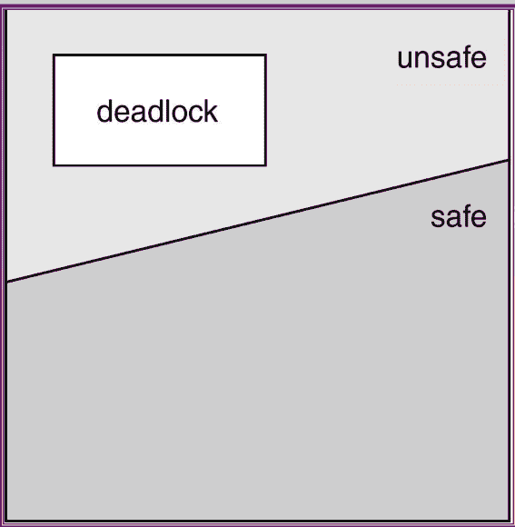

## 8.5.2 Resource-Allocation Graph Algorithm

资源分配图算法

- **Claim edge** $P_i \rightarrow R_j$: indicated that process $P_j$ may request resource $R_j$; represented by a dashed line.  
  边 $P_i \rightarrow R_j$ 代表进程 $P_i$ 申请资源 $R_i$，表示为虚线

- Claim edge converts to request edge when a process requests a resource.  
  一个进程申请资源的时候连一个边

- When a resource is released by a process, assignment edge reconverts to a claim edge.  
  当资源被释放的时候，取消边

- Resources must be claimed *a priori* in the system.  
  系统中的资源必须被声明为一个 *a priori*

## Fig 8.5 Resource-Allocation Graph For Deadlock Avoidance 死锁避免的资源分配图

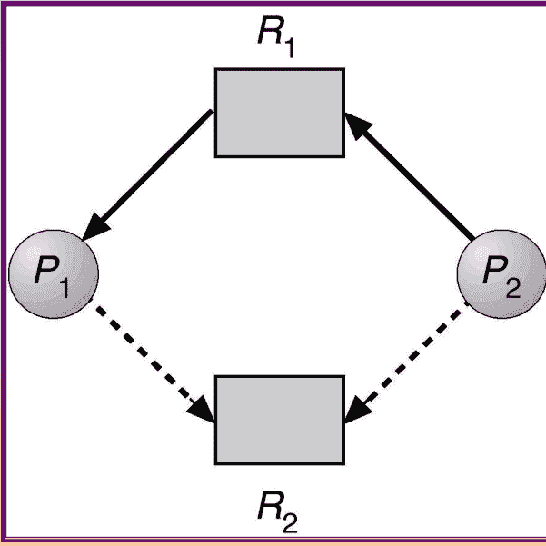

## Fig 8.6 Unsafe State In Resource-Allocation Graph 不安全的状态图


## 8.5.3 Banker's Algorithm
银行家算法

- Multiple instances.  
  多个实例

- Each process must a priori claim maximum use.  
  每一个进程必须事先声明使用的最大量

- When a process requests a resource it may have to wait.  
  当一个进程请求资源，它可能要等待

- When a process gets all its resources it must return them in a finite amount of time.  
  当一个进程得到所有的资源，它必须在有限的时间释放它们

## Data Structures for the Banker's Algorithm

## 银行家算法的数据结构

Let _n_ = number of processes, and _m_ = number of resources types.

N为进程的数目，M为资源类型的数目

- **_Available:_** Vector of length _m_. If available [_j_] = _k_, there are _k_ instances of resource type _R<sub>j</sub>_available.  
  如果available[_j_]=k, 那么资源Rj有k个实例有效

- **_Max:_** _n x m_ matrix. If _Max_ [_i,j_] = _k_, then process _P<sub>i</sub>_ may request at most _k_ instances of resource type _R<sub>j</sub>_.  
  如果Max[I, j]=k, 那么进程Pi可以最多请求资源Rj的k个实例

- **_Allocation:_** _n x m_ matrix. If Allocation[_i,j_] = _k_ then _P<sub>i</sub>_ is currently allocated _k_ instances of _R<sub>j</sub>_.  
  如果Allocation[l,j]=k,那么进程Pj当前分配了k个资源Rj的实例

## Data Structures for the Banker's Algorithm (Cont.)

- **Need:** \( n \times m \) matrix. If \( Need[i,j] = k \), then \( P_i \) may need \( k \) more instances of \( R_j \) to complete its task.  
  如果Need[I, j]=k，那么进程P j还需要k个资源R j的实例
- \( Need[i,j] = Max[i,j] - Allocation[i,j] \).

## 8.5.3.1 Safety Algorithm安全算法

1. Let _Work_ and _Finish_ be vectors of length _m_ and _n_, respectively. Initialize:  
   让Work和Finish作为长度为m和n的向量  
   _Work_ = _Available_  
   _Finish_ [_i_] = false for _i_ - 1,3, ..., _n_.

2. Find and _i_ such that both: 找到I  
   (_a_)_Finish_ [_i_] = false  
   (_b_)(b) _Need_<sub>_i_</sub> ≤ _Work_  
   If no such _i_ exists, go to step 4.

3. _Work_ = _Work_ + _Allocation_<sub>_i_</sub>  
   _Finish_[_i_] = _true_  
   go to step 2.

4. If _Finish_ [_i_] == true for all _i_, then the system is in a safe state.

## Example of Banker's Algorithm
银行家算法的例子

- 5 processes \(P_0\) through \(P_4\); 3 resource types \(A\) (10 instances), \(B\) (5 instances, and \(C\) (7 instances).  
  5个进程P0到P4:  
  3个资源类型A(10个实例)， B（5个实例）， C（7个实例）

- Snapshot at time \(T_0\): 时刻Tn的片段

|   | Allocation A | B | C | Max A | B | C | Available A | B | C |
|---|--------------|---|---|-------|---|---|-------------|---|---|
| \(P_0\) | 0 | 1 | 0 | 7 | 5 | 3 | 3 | 3 | 2 |
| \(P_1\) | 2 | 0 | 0 | 3 | 2 | 2 |   |   |   |
| \(P_2\) | 3 | 0 | 2 | 9 | 0 | 2 |   |   |   |
| \(P_3\) | 2 | 1 | 1 | 2 | 2 | 2 |   |   |   |
| \(P_4\) | 0 | 0 | 2 | 4 | 3 | 3 |   |   |   |

## Example (Cont.)

- The content of the matrix. Need is defined to be Max – Allocation.  
  Need矩阵的内容需要被定义为Need=Max – Allocation

|   | A | B | C |
|---|---|---|---|
| P₀ | 7 | 4 | 3 |
| P₁ | 1 | 2 | 2 |
| P₂ | 6 | 0 | 0 |
| P₃ | 0 | 1 | 1 |
| P₄ | 4 | 3 | 1 |

- The system is in a safe state since the sequence < P₁, P₃, P₄, P₂, P₀ > satisfies safety criteria. 系统在安全的状态因为序列P1,P3,P4,P2,P0满足了安全的标准


## 银行家算法例

## T₀时刻是否安全？

从表中可找出一个序列(P₁、P₃、P₄、P₂、P₀) 使各进程顺序地一个个地执行完成。

|   | Max |   |   | Allocation |   |   | Need |   |   | Available (分配资源前) |   |   | Available (释放资源后) |   |   |
|---|-----|---|---|------------|---|---|------|---|---|------------------------|---|---|------------------------|---|---|
|   | A   | B | C | A          | B | C | A    | B | C | A                      | B | C | A                      | B | C |
| P₀ | 7   | 5 | 3 | 0          | 1 | 0 | 7    | 4 | 3 | <=                     | 10 | 4 | 7                      | ⑤ | 10 | 5 | 7 |
| P₁ | 3   | 2 | 2 | 2          | 0 | 0 | 1    | 2 | 2 | <=                     | 3 | 3 | 2                      | ① | 5 | 3 | 2 |
| P₂ | 9   | 0 | 2 | 3          | 0 | 2 | 6    | 0 | 0 | <=                     | 7 | 4 | 5                      | ④ | 10 | 4 | 7 |
| P₃ | 2   | 2 | 2 | 2          | 1 | 1 | 0    | 1 | 1 | <=                     | 5 | 3 | 2                      | ② | 7 | 4 | 3 |
| P₄ | 4   | 3 | 3 | 0          | 0 | 2 | 4    | 3 | 1 | <=                     | 7 | 4 | 3                      | ③ | 7 | 4 | 5 |

安全序列为{P₁、P₃、P₄、P₂、P₀}，T₀时刻系统是安全的。

## Example P₁ Request (1,0,2) (Cont.)

- Check that Request ≤ Available (that is, (1,0,2) ≤ (3,3,2) ⇒ true。检查请求小于有效（就是说，(1,0,2) ≤ (3,3,2)为真）

| Process | Allocation A B C | Need A B C | Available A B C |
|---|---|---|---|
| P₀ | 0 1 0 | 7 4 3 | 2 3 0 |
| P₁ | 3 0 2 | 0 2 0 | |
| P₂ | 3 0 1 | 6 0 0 | |
| P₃ | 2 1 1 | 0 1 1 | |
| P₄ | 0 0 2 | 4 3 1 | |

- Executing safety algorithm shows that sequence ⟨P₁, P₃, P₄, P₀, P₂⟩ satisfies safety requirement。
- 执行安全算法表明序列⟨P₁, P₃, P₄, P₀, P₂⟩满足要求

- Can request for (3,3,0) by P₄ be granted?
- Can request for (0,2,0) by P₀ be granted?

P₄的(3,3,0)可以通过？P₀的(0,2,0)可以通过？

## 8.6 Deadlock Detection

## 死锁检测

- Allow system to enter deadlock state 允许进入死锁状态
- Detection algorithm 检测死锁
- Recovery scheme 恢复策略

## 8.6.1 Single Instance of Each Resource Type

## 每一种资源类型只有一个实例

- Maintain _wait-for_ graph, that is a variant of the resource-allocation graph
- 维护等待图

- Nodes are processes.
- 节点是进程

- \(P_i \rightarrow P_j\) if \(P_i\) is waiting for \(P_j\).
- \(P_i \rightarrow P_j\) 表示\(P_i\)在等待\(P_j\).

- Periodically invoke an algorithm that searches for a cycle in the graph.
- 定期调用算法来检查是否有环

- An algorithm to detect a cycle in a graph requires an order of \(n^2\) operations, where \(n\) is the number of vertices in the graph.
- 一个检查图中是否有环的算法需要\(n^2\)的操作来进行，n为图中的节点数

## Fig 8.7 Resource-Allocation Graph and Wait-for Graph
资源分配图和等待图


Resource-Allocation Graph Corresponding wait-for graph

## 8.6.2 Several Instances of a Resource Type

一个资源类型的多个实例

- **Available:** A vector of length *m* indicates the number of available resources of each type.
- 可用：一个长度*m*的向量代表每一种资源类型有效的数目

- **Allocation:** An *n* × *m* matrix defines the number of resources of each type currently allocated to each process.
- 分配：一个 *n* × *m* 的矩阵定义了当前分配的每一种资源类型的实例数目

- **Request:** An *n* × *m* matrix indicates the current request of each process. If *Request* [*i*,*j*] = *k*, then process *Pᵢ* is requesting *k* more instances of resource type *Rⱼ*.
- 请求：一个 *n* × *m* 的矩阵使命了当前的进程请求。如果 *Request* [*i*,*j*] = *k*，那么进程 *Pᵢ* 请求 *k* 个资源 *Rⱼ* 的实例


## Detection Algorithm检测算法

1. Let *Work* and *Finish* be vectors of length *m* and *n*, respectively. Initialize:
   让*Work*和*Finish*作为长度为*m*和*n*的向量
   (a) *Work* = *Available*
   (b) For *i* = 1, 2, ..., *n*, if *Allocationᵢ* ≠ 0, then *Finish*[*i*] = false; otherwise, *Finish*[*i*] = true.

2. Find an index *i* such that both:
   找到下标*i*
   (a) *Finish*[*i*] == false
   (b) *Requestᵢ* ≤ *Work*
   If no such *i* exists, go to step 4.
   如果没有这样的存在，转4


## Detection Algorithm (Cont.)

- 3. Work = Work + Allocation;
- Finish[i] = true
- go to step 2.

- 4. If Finish[i] == false, for some i, 1 ≤ i ≤ n, then the system is in deadlock state. Moreover, if Finish[i] == false, then P<sub>i</sub> is deadlocked.

Algorithm requires an order of O(m x n<sup>2</sup>) operations to detect whether the system is in deadlocked state.

算法需要m x n<sup>2</sup> 的操作来判断是否系统处于死锁状态

## Example of Detection Algorithm
## 检测算法的例子

- Five processes *P*₀ through *P*₄; three resource types *A* (7 instances), *B* (2 instances), and *C* (6 instances).

五个进程P₀到P₄，
三个资源类型A（7个实例）、B（2个实例）、C（6个实例）。

- Snapshot at time *T*₀（时刻tₙ的状态）

|  | Allocation | Request | Available |
|---|---|---|---|
|  | A B C | A B C | A B C |
| *P*₀ | 0 1 0 | 0 0 0 | 0 0 0 |
| *P*₁ | 2 0 0 | 2 0 2 |  |
| *P*₂ | 3 0 3 | 0 0 0 |  |
| *P*₃ | 2 1 1 | 1 0 0 |  |
| *P*₄ | 0 0 2 | 0 0 2 |  |

- Sequence <*P*₀, *P*₂, *P*₃, *P*₁, *P*₄> will result in *Finish*[i] = true for all *i*.

## Example (Cont.)

- - \( P_2 \) requests an additional instance of type C.

# ## Request

A B C

\( P_0 \) 0 0 0

\( P_1 \) 2 0 1

\( P_2 \) 0 0 1

\( P_3 \) 1 0 0

\( P_4 \) 0 0 2

- - State of system?

- - Can reclaim resources held by process \( P_0 \), but insufficient resources to fulfill other processes; requests.可以归还\( P_0 \)所有的资源，但是资源不够完成其他进程的请求

- - Deadlock exists, consisting of processes \( P_1 \), \( P_2 \), \( P_3 \), and \( P_4 \). 死锁存在，包括进程P1,P2,P3和P4

## 8.6.3 Detection-Algorithm Usage 检测算法的应用

- When, and how often, to invoke depends on:  
- 何时，如何频度的调用取决于  
- How often a deadlock is likely to occur?  
- 死锁可能发生的频度  
- How many processes will need to be rolled back?  
- 多少进程可能需要反转  
- one for each disjoint cycle  
- 每一个独立的环需要一个

- If detection algorithm is invoked arbitrarily, there may be many cycles in the resource graph and so we would not be able to tell which of the many deadlocked processes “caused” the deadlock.  
- 如果检测算法被随意的调用，可能图中存在很多的环以至于我们无法判断是哪几个进程引起了死锁的发生

## 8.7 Recovery from Deadlock
从死锁中恢复

## 8.7.1 Process Termination 进程终止

- - Abort all deadlocked processes. 中断所有的死锁进程
- - Abort one process at a time until the deadlock cycle is eliminated.
-   一次中断一个进程直到死锁消失

- - In which order should we choose to abort? 选择中断顺序
-   - Priority of the process. 进程的优先级
-   - How long process has computed, and how much longer to completion.
-     多少个进程已经计算并已做多长时间
-   - Resources the process has used. 进程使用的资源
-   - Resources process needs to complete.
-     进程完成还需要多少资源

## 8.7.2 Resource Preemption资源抢占

How many processes will need to be terminated.  
多少个进程需要被终止  
Is process interactive or batch?  
进程是交互的还是批处理

## 8.7.2 Resource Preemption资源抢占

- - Selecting a victim – minimize cost.  
-   选择一个牺牲：最小化代价

- - Rollback – return to some safe state, restart process for that state.  
-   回退：返回到安全的状态，然后重新开始进程

- - Starvation – same process may always be picked as victim, include number of rollback in cost factor.  
-   饥饿：同样进程的可能总是被选中

## 8.8 Combined Approach to Deadlock Handling
综合死锁处理方式

- - **Combine the three basic approaches**
-   把三种方式组合起来
-   - prevention 预防
-   - avoidance 避免
-   - detection 检测
-   - allowing the use of the optimal approach for each of resources in the system.
-     允许使用优化的方式来使用系统中的资源

- - **Partition resources into hierarchically ordered classes.**
-   把资源划分为不同的等级

- - **Use most appropriate technique for handling deadlocks within each class.**
-   对每一类使用适当的技术来处理死锁

## Fig 8.8 Traffic Deadlock for Exercise 8.4


## Chapter 9: Memory Management

## ## 存储器管理

- - 9.1 Background（背景）
- - 9.2 Swapping（交换）
- - 9.3 Contiguous Allocation（连续分配）
- - 9.4 Paging（分页）
- - 9.5 Segmentation（分段）
- - 9.6 Segmentation with Paging（段页式）


## 9.1 Background 背景

- Program must be brought into memory and placed within a process for it to be run. 程序必须放入一个进程，并且送入内存才能被执行
- Input queue – collection of processes on the disk that are waiting to be brought into memory to run the program. 输入队列—磁盘上等待进入内存并执行的进程的集合
- User programs go through several steps before being run. 用户程序在执行之前必须经历很多步骤

## Fig 9.1 Multistep Processing of a User Program

source program
compiler or assembler
object module
other object modules
linkage editor
load module
system library
dynamically loaded system library
loader
in-memory binary memory image
dynamic linking
compile time
load time
execution time (run time)

## 9.1.2 Logical vs. Physical Address Space

The concept of a logical address space that is bound to a separate physical address space is central to proper memory management. 逻辑地址空间的概念同物理地址空间相关联，它是正确内存管理的中心。

Logical address – generated by the CPU; also referred to as virtual address. （逻辑地址—由CPU产生；也叫做虚地址。）

Physical address – address seen by the memory unit. （物理地址—内存设备所读入的地址）

Logical and physical addresses are the same in compile-time and load-time address-binding schemes; logical (virtual) and physical addresses differ in execution-time address-binding scheme. 逻辑和物理地址在编译时期和装入时期的地址绑定策略是相同的，而在执行时间的地址绑定策略是不同的。

## Memory-Management Unit (MMU)

- Hardware device that maps virtual to physical address. 硬件把虚拟地址映射到物理地址
- In MMU scheme, the value in the relocation register is added to every address generated by a user process at the time it is sent to memory. 在MMU策略中，基址寄存器中的值在其送入内存的时候被加入到由一个用户进程所产生的每个地址中。
- The user program deals with _logical_ addresses; it never sees the _real_ physical addresses. 用户程序所对应到的是逻辑地址，物理地址对它从来都不可见。

## Fig 9.2 Dynamic relocation using a relocation register


## 9.1.4 Dynamic Linking 动态链接

- Linking postponed until execution time. 链接被推迟到执行时期
- Small piece of code, _stub_, used to locate the appropriate memory-resident library routine. 小的代码片 - 存根，用来定位合适的保留在内存中的库程序。
- Stub replaces itself with the address of the routine, and executes the routine. 存根用例程地址来替换自己，以及执行例程。
- Operating system needed to check if routine is in processes’ memory address. 操作系统需要检查例程是否在进程的内存空间
- Dynamic linking is particularly useful for libraries.

## 9.1.5 Overlays覆盖

- Keep in memory only those instructions and data that are needed at any given time. 只是在内存中保留那些在特定时间所需要的指令和数据。
- Needed when process is larger than amount of memory allocated to it. 当进程比所分配的内存大时，覆盖是必需的
- Implemented by user, no special support needed from operating system, programming design of overlay structure is complex 由用户执行，不需要操作系统的特别支持，覆盖结构的程序设计很复杂。

## Fig 9.3 Overlays for a Two-Pass Assembler

| symbol table | 20K |
| common routines | 30K |
| overlay driver | 10K |
| pass 1 | 70K |
| pass 2 | 80K |

## 9.2 Swapping 交换

- A process can be swapped temporarily out of memory to a backing store, and then brought back into memory for continued execution. 一个进程可以暂时被交换到内存外的一个备份区，随后可以被换回内存继续执行。
- Backing store – fast disk large enough to accommodate copies of all memory images for all users; must provide direct access to these memory images. 备份区—是一个固定的足够大的可以容纳所有用户内存映像的拷贝；对于可以让这些内存映像直接存取。

## Swapping (Cont.)

- Roll out, roll in – swapping variant used for priority-based scheduling algorithms; lower-priority process is swapped out so higher-priority process can be loaded and executed. 滚入，滚出—交换由于基于优先级的算法而不同，低优先级的进程被换出，这样高优先级的进程可以被装入和执行。
- Major part of swap time is transfer time; total transfer time is directly proportional to the amount of memory swapped. 交换时间的主要部分是转移时间，总的转移时间直接同交换的内存的数量成比例。

## Swapping (Cont.-1)

- Of particular concern is any pending I/O （特别关心任何将进行的I/O）
- Latch job in memory while it is involved in I/O. （当I/O的时候，把进程锁定在内存中。）
- Do I/O only into OS buffers. （只对操作系统的缓冲区进行I/O操作。）
- Modified versions of swapping are found on many systems, i.e., UNIX, Linux, and Windows 在许多系统如：UNIX, Windows中，可以找到一些被修正过的交换措施。


## 9.3 Contiguous Memory Allocation
（连续存储器分配）

- Main memory usually into two partitions:
  主存通常被分为两部分
  - Resident operating system, usually held in low memory with interrupt vector.
    （为操作系统保留的部分，通常用中断矢量保存在内存低端。）
  - User processes then held in high memory.
    （用户进程保存在内存高端。）

## 9.3.1 Memory protection

- Single-partition allocation(单一分区分配)
- Relocation-register scheme used to protect user processes from each other, and from changing operating-system code and data.
  （基址寄存器策略由来保护用户进程（同其他进程和改变的操作系统代码和数据分开。）
- Relocation register contains value of smallest physical address; limit register contains range of logical addresses – each logical address must be less than the limit register.
  （基址寄存器包含最小物理地址的值； 限长寄存器包含逻辑地址的范围，每个逻辑地址必需比限长寄存器的值小。）

## 9.3.2 Memory Allocation

- Multiple-partition allocation （多分区分配）
  - _Hole_ – block of available memory; holes of various size are scattered throughout memory.
    （分区—可用的内存块，不同大小的分区分布在整个内存中。）
  - When a process arrives, it is allocated memory from a hole large enough to accommodate it.
    （当一个进程到来的时候，它将从一个足够容纳它分区中分配内存。）
  - Operating system maintains information about:
    （操作系统包含以下信息）
    a) allocated partitions （已分配的分区）
    b) free partitions (hole) （空闲的分区）

## Dynamic Storage-Allocation Problem（动态存储分派问题）

How to satisfy a request of size _n_ from a list of free holes.
（怎样从一个空的分区序列中满足一个申请需要。）

- ■ First-fit （首先适应）： Allocate the _first_ hole that is big enough.
  （分配最先找到的合适的分区。）

- ■ Best-fit （最佳适应）： Allocate the _smallest_ hole that is big enough; must search entire list, unless ordered by size.
  Produces the smallest leftover hole.
  （搜索整个序列，找到适合条件的最小的分区进行分配。）

- ■ Worst-fit （最差适应）： Allocate the _largest_ hole; must also search entire list. Produces the largest leftover hole.
  搜索整个序列，寻找最大的分区进行分配。

First-fit and best-fit better than worst-fit in terms of speed and storage utilization. （在速度和存储的利用上，首先适应和最佳适应要比最差适应好。）

## Dynamic Partitioning Placement Algorithm

- Operating system must decide which free block to allocate to a process
- Best-fit algorithm
  - chooses the block that is closest in size to the request
  - worst performer overall
  - since smallest block is found for process, the smallest amount of fragmentation is left memory compaction must be done more often

## Dynamic Partitioning Placement Algorithm (Cont.2)

- **Next-fit**
  - starts scanning memory from the location of the last placement and chooses the next available block that is large enough
  - more often allocate a block of memory at the end of memory where the largest block is found
  - the largest block of memory is broken up into smaller blocks
  - compaction is required to obtain a large block at the end of memory

## 9.3.3 Fragmentation（碎片）

- External Fragmentation (外碎片) – total memory space exists to satisfy a request, but it is not contiguous.
  （整个内存空间用来满足一个请求， 但它不是连续的。）

- Internal Fragmentation (内碎片)– allocated memory may be slightly larger than requested memory; this size difference is memory internal to a partition, but not being used.
  （分配的内存可能比申请的内存大一点， 这两者之间的差别是内部不被使用的簇）

## Fragmentation (Cont.)

- Reduce external fragmentation by compaction  （通过压缩来减少外碎片）
  - Shuffle memory contents to place all free memory together in one large block.
    （把一些小的空闲内存结合成一个大的块。）
  - Compaction is possible **only** if relocation is dynamic, and is done at execution time.
    （只有重置是动态的时候，才有可能进行压缩，压缩在执行时期进行）

- Another possible solution is to permit the logical-address space of process to be noncontiguous (paging and segmentation).


## 9.4 Paging （分页）

- Logical address space of a process can be noncontiguous; process is allocated physical memory whenever the latter is available. （进程的逻辑地址空间可能是不连续的，如果有可用的物理内存，它将分给进程。）
- Divide physical memory into fixed-sized blocks called frames (size is power of 2, between 512 bytes and 8192 bytes). （把物理内存分成大小固定的块。）
- Divide logical memory into blocks of same size called pages. （把逻辑内存也分为固定大小的块，叫做页。）
- Keep track of all free frames. （保留一个页的记录。）
- To run a program of size n pages, need to find n free frames and load program. （运行一个有N页大小的程序，需要找到N个空的页框读入程序。）
- Set up a page table to translate logical to physical addresses. （建立一个页表，把逻辑地址转换为物理地址。）
- Internal fragmentation. （内碎片。）

## Address Translation Scheme （地址变换方案）

- Address generated by CPU is divided into （CPU产生的地址被分为）：
  - **Page number (p)** （页号） – used as an index into a page table which contains base address of each page in physical memory. （它包含每个页在物理内存中的基址，用来作为页表的索引。）
  - **Page offset (d)** （偏移） – combined with base address to define the physical memory address that is sent to the memory unit. （同基址相结合，用来确定送入内存设备的物理内存地址。）

## Fig 9.6 Address Translation Architecture （地址变换机构）


CPU
logical address
physical address
p   d
f   d
p
f
page table
10000 . . . 0000
f1111 . . . 1111
physical memory

## Fig 9.7 Paging Example


## Fig 9.8 Paging Example for a 32-byte memory with 4-byte pages


| 逻辑地址 | 内容 |
|---:|:---|
| 0 | a |
| 1 | b |
| 2 | c |
| 3 | d |
| 4 | e |
| 5 | f |
| 6 | g |
| 7 | h |
| 8 | i |
| 9 | j |
| 10 | k |
| 11 | l |
| 12 | m |
| 13 | n |
| 14 | o |
| 15 | p |

logical memory

| 页号 | 页框号 |
|---:|---:|
| 0 | 5 |
| 1 | 6 |
| 2 | 1 |
| 3 | 2 |

page table

| 物理地址 | 内容 |
|---:|:---|
| 0 |  |
| 4 | i, j, k |
| 8 | m, n, o, p |
| 12 |  |
| 16 |  |
| 20 | a, b, c, d |
| 24 | e, f, g, h |
| 28 |  |

physical memory

## Fig 9.9 Free Frames


Before allocation

After allocation

## Implementation of Page Table （页表实现）

- Page table is kept in main memory. （主存中的页表）
- *Page-table base register (PTBR)* points to the page table. （页表基址寄存器指向页表）
- *Page-table length register (PTLR)* indicates size of the page table. （页表限长寄存器表明页表的长度）
- In this scheme every data/instruction access requires two memory accesses. One for the page table and one for the data/instruction. （在这个机制中，每一次的数据/指令存取需要两次内存存取，一次是存取页表，一次是存取数据）
- The two memory access problem can be solved by the use of a special fast-lookup hardware cache called *associative memory* or *translation look-aside buffers (TLBs)* （通过一个联想寄存器，可以解决两次存取的问题）

## 分页地址变换机构

页表寄存器

页表始址 页表长度

越界中断

逻辑地址2500

页号2 页内地址452

页号 块号

| 页号 | 块号 |
|---|---|
| 0 | 2 |
| 1 | 4 |
| 2 | 5 |

块号5 块内地址452

每页1KB(1024)

物理地址5572

5*1024+452

## Associative Memory 联想寄存器

## Associative memory – parallel search （联想寄存器—并行查找）

| Page # | Frame # |
|---|---|
|  |  |
|  |  |
|  |  |
|  |  |

## Address translation (A′, A′′) （地址转换）

- If A′ is in associative register, get frame # out. （如果A′在联想寄存器中，把页框#取出来。）
- Otherwise get frame # from page table in memory （否则从内存中的页表中取出页框#。）

## Fig 9.10 Paging Hardware With TLB


## Effective Access Time 有效存取时间

- Associative Lookup = ε time unit （联想寄存器的查找需要时间ε微秒）
- Assume memory cycle time is β (1) microsecond （假设内存一次存取要β微秒）
- Hit ratio – percentage of times that a page number is found in the associative registers; ratio related to number of associative registers. （命中率—在联想寄存器中找到页号的比率，比率与联想寄存器的大小有关。）
- Hit ratio = α
- Effective Access Time (EAT) （有效存取时间）

EAT = (β + ε) α + (2* β + ε)(1 – α) = 2* β + ε – α* β （微秒）

## 9.4.3 Memory Protection（存储保护）

- Memory protection implemented by associating protection bit with each frame. （内存的保护由与每个页框相连的保护位来执行。）
- Valid-invalid bit attached to each entry in the page table （有效-无效位附在页表的每个表项中）：
  - “valid” indicates that the associated page is in the process’ logical address space, and is thus a legal page. （“有效”表明相关的页在进程的逻辑地址空间，以及是一个合法的页。）
  - “invalid” indicates that the page is not in the process’ logical address space. （“无效”表明页不在进程的逻辑地址空间中。）


## Fig 9.11 Valid (v) or Invalid (i) Bit In A Page Table

00000 page 0 page 1 page 2 page 3 page 4 page 5 10,468 12,287 frame number valid-invalid bit 0 2 v 1 3 v 2 4 v 3 7 v 4 8 v 5 9 v 6 0 i 7 0 i page table 0 page 0 1 page 1 2 page 2 3 page 3 4 page 4 5 page 5 ... page n

## 9.4.4 Page Table Structure

- Hierarchical Paging
  分级页表
- Hashed Page Tables
  哈希页表
- Inverted Page Tables
  反向页表

## 9.4.4.1 Hierarchical Paging

- Break up the logical address space into multiple page tables.
  分解逻辑地址空间到多个页表
- A simple technique is a two-level page table.
  一个简单的技术是两级页表


## Two-Level Paging Example

- A logical address (on 32-bit machine with 4K page size) is divided into （一个逻辑地址被分为）：
  - a page number consisting of 20 bits.（一个20位的页号）
  - a page offset consisting of 12 bits.（一个12位的偏移）

- Since the page table is paged, the page number is further divided into（页表页被分为）：
  - a 10-bit page number.（一个10位的页号）
  - a 10-bit page offset.（一个10位的偏移）

- Thus, a logical address is as follows（因此，一个逻辑地址表示如下）：

| page number | page offset |
|---|---|
| p₁ | p₂ | d |

10 10 12

- where pᵢ is an index into the outer page table, and p₂ is the displacement within the page of the outer page table.

## Fig 9.12 Two-Level Page-Table Scheme


## Fig 9.13 Address-Translation Scheme

## Address-translation scheme for a two-level 32-bit paging architecture

## （一个两级32位分页结构的地址转换机制）


## 9.4.4.2 Hashed Page Tables

- **Common in address spaces > 32 bits.**
  公用地址空间大于32位

- **The virtual page number is hashed into a page table. This page table contains a chain of elements hashing to the same location.**
  虚拟页的数值被散列到一个页表中，这个页表包含散列到相同地址的一根链指针。

- **Virtual page numbers are compared in this chain searching for a match. If a match is found, the corresponding physical frame is extracted.**
  通过这个链搜索匹配虚页数值，如果匹配成功，取出相应的物理页框。

## Fig 9.14 Hashed Page Table


logical address

physical address

hash function

hash table

physical memory

## 9.4.4.3 Inverted Page Table (IPT) 倒置页表

- **IPT has one entry for each real page of memory.**
  （一个内存中页框的表项。）

- **Each entry consists of the virtual address of the page stored in that real memory location, with information about the process that owns that page.**
  表项包含真正内存地址的页的虚拟地址，它包括拥有这个页的进程的信息。

- **Decreases memory needed to store each page table, but increases time needed to search the table when a page reference occurs.**
  减少内存需要储存每个页表，但是当访问一个页时，寻找页表需要增加时间。

- **Use hash table to limit the search to one — or at most a few — page-table entries.**
  （使用哈希表来减少搜索。）

- **Example – 64 bit PowerPC and IBM AS/400**

## Fig 9.15 Inverted Page Table Architecture


## 9.4.5 Shared Pages共享页

- Shared code （共享代码）
  One copy of read-only (reentrant) code shared among processes (i.e., text editors, compilers, window systems). （一个只读 （可再入） 代码可由进程共享。 ）
  Shared code must appear in same location in the logical address space of all processes. （共享代码出现在所有进程的逻辑地址空间的相同位置。 ）

- Private code and data （私有代码和数据）
  Each process keeps a separate copy of the code and data. （每个进程保留一个代码和数据的私有拷贝。 ）
  The pages for the private code and data can appear anywhere in the logical address space. （私有代码和数据的页可以出现在逻辑地址空间的任何地方。 ）

## Fig 9.16 Shared Pages Example


process P₁

page table for P₁

process P₂

page table for P₂

process P₃

page table for P₃

## 9.5 Segmentation
（分段）

- Memory-management scheme that supports user view of memory.（内存管理机制支持用户观点的内存。）
- A program is a collection of segments. A segment is a logical unit such as（一个程序是一些段的集合，一个段是一个逻辑单位，如：）
  - main program,
  - procedure,
  - function,
  - method,
  - object,
  - local variables, global variables,
  - common block,
  - stack,
  - symbol table, arrays


## Logical View of Segmentation

user space

physical memory space

## Segmentation Architecture

- Logical address consists of a two tuple （一个逻辑地址是两个向量的集合）： <segment-number, offset>,
- Segment table – maps two-dimensional physical addresses; each table entry has （段表 - 映射二维物理地址，每个表项包括）： base – contains the starting physical address where the segments reside in memory. （基址 - 包括内存中段物理地址的起始地址） limit – specifies the length of the segment. （限长 - 指定段的长度）
- Segment-table base register (STBR) points to the segment table's location in memory. （段表基址寄存器 指向段表在内存中的地址）

## Segmentation Architecture (Cont.)

- Segment-table length register (STLR) indicates number of segments used by a program; （段表限长寄存器表明被一个程序所使用的段的数目）
- segment number s is legal if s < STLR.
- Relocation. （重定位）
- dynamic （动态）
- by segment table （由段表来执行）
- Sharing. （共享）
- shared segments （共享的段）
- same segment number （同样的段号）
- Allocation. （分配）
- first fit/best fit （首先/最佳适配）
- external fragmentation （外碎片）

## Segmentation Architecture (Cont.)

- Protection. With each entry in segment table associate（保护，每个段表的表项有）：
  - validation bit（有效位） = 0 ⇒ illegal segment
  - read/write/execute privileges（读/写/执行权利）
- Protection bits associated with segments; code sharing occurs at segment level.（保护位同段相联系，在段的级别进行代码共享。）
- Since segments vary in length, memory allocation is a dynamic storage-allocation problem.（由于段的各个长度不同，内存分配是一个动态存储-分配问题。）
- A segmentation example is shown in the following diagram（下面的是一个段的例子）

## Fig 9.18 Segmentation Hardware

CPU

s

d

|  |  |
|---|---|
| limit | base |

segment table

<

yes

no

+

trap; addressing error

physical memory

## 分段地址变换机构

## 段表寄存器

## 越界中断

## 逻辑地址

| 段表始址 | 段表长度 |
|---|---|
|  |  |

TL

| 段号 | 段长SL | 基址 |
|---:|---:|---:|
| 0 | 15K | 40K |
| 1 | 7K | 80K |
| 2 | 8K | 120K |
| 3 | 10K | 150K |

| 段号 S | 位移量 d |
|---:|---:|
| 1 | 100 |

物理地址

120K + 100

## Fig 9.20 Sharing of Segments

Logical memory process P₁

segment 0: editor

segment 1: data 1

| limit | base |
|---:|---:|
| 25286 | 43062 |
| 4425 | 68348 |

segment table process P₁

Logical memory process P₂

segment 0: editor

segment 1: data 2

| limit | base |
|---:|---:|
| 25286 | 43062 |
| 8850 | 90003 |

segment table process P₂

Physical memory

43062

68348

72773

90003

98553

## 9.6 Segmentation with Paging – MULTICS

- The MULTICS system solved problems of external fragmentation and lengthy search times by paging the segments.
- MULTICS系统通过结合分页的段解决外碎片问题和搜索时间长的问题。
- Solution differs from pure segmentation in that the segment-table entry contains not the base address of the segment, but rather the base address of a _page table_ for this segment.
- 由于段表表项包含的不是“部分”的基址，而是这个“部分”一个页表的基址，解决的办法与纯段不同。

## MULTICS Address Translation Scheme

## Segmentation with Paging – Intel 386

- As shown in the following diagram, the Intel 386 uses segmentation with paging for memory management with a two-level paging scheme.
- 如下图所示， Intel 386使用段页结合来进行二级分页的内存管理。

## Fig 9.21 Intel 30386 Address Translation

## Intel 30386 Address Translation

(索引) 段号S TI RPT 偏移量

CS代码段寄存器

DS数据段寄存器

GDTR全局描述符寄存器

LPTR局部描述寄存器

8B 基地址 限长 其它字段

8B 8B ..

页目录号P₁ 外部页内地址P₂ 页内位移D

外部页表寄存器

块号 块内位移D

Operating System Concepts

9.66

## 9.7 Summary

- In Comparing Different Memory-Management Strategies, you should use the following considerations:
  - Hardware support（硬件支持）
  - Performance（性能）
  - Fragmentation（碎片）
  - Relocation（重定位）
  - Swapping（交换）
  - Sharing（共享）
  - Protection（保护）


## Chapter 10: Virtual Memory
虚拟存储器

## Background 背景
- Demand Paging （请求页式）
- Process Creation
- Page Replacement （页置换）
- Allocation of Frames （页框的分配）
- Thrashing （颠簸）
- Operating System Examples

## Background

- **Virtual memory – separation of user logical memory from physical memory.**（虚拟内存—物理内存和用户逻辑内存的区分）
  - **Only part of the program needs to be in memory for execution.**（只有部分运行的程序需要在内存中）
  - **Logical address space can therefore be much larger than physical address space.**（因此，逻辑地址空间能够比物理地址空间大）
  - **Allows address spaces to be shared by several processes.**（允许若干个进程共享地址空间）
  - **Allows for more efficient process creation.**（允许更多有效进程创建）

## Virtual Memory That is Larger Than Physical Memory

virtual memory

memory map

physical memory

## Demand Paging

- Bring a page into memory only when it is needed  
  （只有在一个页需要的时候才把它换入内存）。
  - Less I/O needed（需要很少的I/O）
  - Less memory needed （需要很少的内存）
  - Faster response（快速响应）
  - More users（多用户）

- Page is needed ⇒ reference to it  
  （需要页） （查阅此页）
  - invalid reference⇒ abort  
    （无效的访问） （中止）
  - not-in-memory⇒ bring to memory  
    （不在内存） （换入内存）

## Transfer of a Paged Memory to Contiguous Disk Space

program A

program B

swap out

swap in

main memory

## Valid-Invalid Bit

- With each page table entry a valid–invalid bit is associated (1 ⇒ in-memory, 0 ⇒ not-in-memory)

在每一个页表的表项有一个有效- 无效位相关联， 1表示在内存， 0表示不内存

- Initially valid–invalid but is set to 0 on all entries. 在所有的表项， 这个位被初始化为0

| Frame # | valid-invalid bit |
|---------|-------------------|
|         | 1                 |
|         | 1                 |
|         | 1                 |
|         | 1                 |
|         | 0                 |
| ...     |                   |
|         | 0                 |
|         | 0                 |

page table

## Valid-Invalid Bit Cont.

- Example of a page table snapshot.
  一个页表映象的例子

- During address translation, if valid-invalid bit in page table entry is 0 ⇒ page fault.
  在地址转换中，如果页表表项位的值是0 ⇒ (缺页)

## Page Fault

- If there is ever a reference to a page, first reference will trap to OS ⇒ page fault
  如果有对一个页的访问，第一个访问要陷入OS⇒ 缺页

- OS looks at another table to decide:
  OS查看另一个表来决定
  - Invalid reference ⇒ abort.
    无效引用 ⇒ 终止
  - Just not in memory.
    仅仅不在内存

## Page Fault Cont.

- Get empty frame（得到空的页框）.
- Swap page into frame（把页换入页框）.
- Reset tables, validation bit = 1（重新设置页表，把位设为1）.
- Restart instruction（重启指令）: Least Recently Used（最近未使用）
  - block move（块移动）
  - auto increment/decrement location（区域自动增长/缩减）

## Steps in Handling a Page Fault

operating system

reference

load M

page table

physical memory

page is on backing store

free frame

1. reference
2. trap
3. page is on backing store
4. bring in missing page
5. reset page table
6. restart instruction

## What happens if there is no free frame?

- Page replacement – find some page in memory, but not really in use, swap it out  
  页置换—找到内存中并没有使用的一些页，换出  
  - Algorithm（算法）  
  - Performance（性能） – want an algorithm which will result in minimum number of page faults（找出一个导致最小缺页数的算法）。

- Same page may be brought into memory several times  
  同一个页可能会被装入内存多次

## Performance of Demand Paging

- Page Fault Rate \( 0 \leq p \leq 1.0 \) （缺页率\( 0 \leq p \leq 1.0 \)）
  - if \( p = 0 \) no page faults （如果\( p = 0 \)，没有缺页）
  - if \( p = 1 \), every reference is a fault （每次访问都缺页）

- Effective Access Time (EAT)
  - EAT = (1 − p) x memory access
    + p (page fault overhead
    + [swap page out ]
    + swap page in
    + restart overhead)


## Demand Paging Example

- Memory access time = 1 microsecond （存取内存的时间）
- 50% of the time the page that is being replaced has been modified and therefore needs to be swapped out. 50%的时间，所置换的页被修改，因此需要被换出
- Swap Page Time = 10 msec = 10,000 msec （交换页的时间）

EAT = (1 – p) x 1 + p (15000)
1 + 15000P   (in msec)

## Process Creation

- Virtual memory allows other benefits during process creation:
  在进程创建过程中虚存允许另外的好处:
  - Copy-on-Write
    写拷贝
  - Memory-Mapped Files
    内存映射文件


## Copy-on-Write

- Copy-on-Write (COW) allows both parent and child processes to initially *share* the same pages in memory.
  COW允许父子进程在内存中初始共享相同页。
  If either process modifies a shared page, only then is the page copied.
  如果任一进程修改分享页，仅仅是页被拷贝。

- COW allows more efficient process creation as only modified pages are copied.
  COW允许更多有效进程创建页，仅当修改页被拷贝时。

- Free pages are allocated from a *pool* of zeroed-out pages.
  空闲页从一个zeroed-out页池中被分配。

## Memory-Mapped Files

- **Memory-mapped file I/O** allows file I/O to be treated as routine memory access by *mapping a disk block to a page in memory*.
  内存映射文件 I/O 允许文件 I/O 被处理，通过映射磁盘块到内存中一页常规内存访问。

- **A file is initially read using demand paging.** A page-sized portion of the file is read from the file system into a physical page. Subsequent reads/writes to/from the file are treated as ordinary memory accesses.
  一个文件开始被读使用请求页。文件的一页大小从文件系统被读入一物理的页。随后文件读／写处理被当作普通存储器访问。

- **Simplifies file access** by treating file I/O through memory rather than read() write() system calls. 通过内存文件I/O的一般文件访问的处理要优于读、写系统调用。

- **Also allows several processes to map the same file** allowing the pages in memory to be shared.
  也允许若干进程映射允许被共享内存页的相同文件。

## Memory Mapped Files


## Page Replacement

- Prevent over-allocation of memory by modifying page-fault service routine to include page replacement（通过修改缺页服务例程，来包含页置换，防止分配过多）。

- Use _modify (dirty) bit_ to reduce overhead of page transfers – only modified pages are written to disk（修改（脏）位来防止页面转移过多—只有被修改的页面才写入磁盘）。

- Page replacement completes separation between logical memory and physical memory – large virtual memory can be provided on a smaller physical memory（页置换完善了逻辑内存和物理内存的划分—在一个较小的物理内存基础之上可以提供一个大的虚拟内存）。

## Basic Page Replacement

1. Find the location of the desired page on disk.
   在磁盘上找到需要页的位置

2. Find a free frame找到空闲的页框:
   - If there is a free frame, use it. （如果有一个空闲页框，使用它）
   - If there is no free frame, use a page replacement algorithm to select a victim frame.
   如果没有空闲页框，使用页代替算法选择一个牺牲(淘汰)页框。

3. Read the desired page into the (newly) free frame. Update the page and frame tables.
   读入该页到（最新）空闲页框。更新页和页框表

4. Restart the process.
   重启进程

## Page Replacement

frame valid-invalid bit

page table

0 i

f v

② change to invalid

④ reset page table for new page

physical memory

f victim

① swap out victim page

③ swap desired page in

## Graph of Page Faults Versus The Number of Frames


number of page faults

number of frames

## FIFO Page Replacement


reference string

7  0  1  2  0  3  0  4  2  3  0  3  2  1  2  0  1  7  0  1

| 7 | 7 | 7 | 2 |   | 2 | 2 | 4 | 4 | 4 | 0 |   | 0 | 0 |   | 7 | 7 | 7 |
|---|---|---|---|---|---|---|---|---|---|---|---|---|---|---|---|---|---|
| 7 | 0 | 0 | 0 |   | 3 | 3 | 3 | 2 | 2 | 2 |   | 1 | 1 |   | 1 | 0 | 0 |
|   | 1 | 1 | 1 |   | 1 | 0 | 0 | 0 | 3 | 3 |   | 3 | 2 |   | 2 | 2 | 1 |

page frames


## FIFO Illustrating Belady's Anomaly

## Optimal Algorithm

- Replace page that will not be used for longest period of time.（被置换的页将是之前最长时间不被使用的页）
- 4 frames example

1, 2, 3, 4, 1, 2, 5, 1, 2, 3, 4, 5

| 1 |
|---|
| 2 |
| 3 |
| 4 |

4

5

6 page faults

- How do you know this?
- Used for measuring how well your algorithm performs.
- （用来衡量你的算法的效率）

## Optimal Page Replacement

reference string  
7 0 1 2 0 3 0 4 2 3 0 3 2 1 2 0 1 7 0 1  
page frames

## Least Recently Used (LRU) Algorithm

- Reference string: 1, 2, 3, 4, 1, 2, 5, 1, 2, 3, 4, 5

| 1 | 5 |
|---|---|
| 2 |   |
| 3 | 5, 4 |
| 4 | 3 |

- Counter implementation（计数器的实现）

Every page entry has a counter; every time page is referenced through this entry, copy the clock into the counter.（每一个页表项有一个计数器，每次页通过这个表项被访问，把记录拷贝到计数器中）

When a page needs to be changed, look at the counters to determine which are to change.（当一个页需要改变是，查看计数器来觉得到改变哪一个页。）

## LRU Page Replacement

reference string  

7 0 1 2 0 3 0 4 2 3 0 3 2 1 2 0 1 7 0 1  

page frames

## LRU Algorithm (Cont.)

- Stack implementation – keep a stack of page numbers in a double link form：栈实现—在一个双链表中保留一个记录页数目的栈

- Page referenced（被访问的页）：move it to the top（移到栈顶）requires 6 pointers to be changed 需要改变6个指针 No search for replacement 没有为置换进行查找

## Use Of A Stack to Record The Most Recent Page References

reference string  

4   7   0   7   1   0   1   2   1   2   7   1   2  

stack before a  
   2  
   1  
   0  
   7  
   4  

stack after b  
   7  
   2  
   1  
   0  
   4  

a                                             b

## LRU Approximation Algorithms

- Reference bit（访问位）

With each page associate a bit, initially = 0  
每个页都与一个位相关联，初始值位0  

When page is referenced bit set to 1  
当页是访问位是设位1  

Replace the one which is 0 (if one exists). We do not know the order, however.  
如果存在的话置换位为0的页。然而我们并不知道这个置换顺序  

## LRU Approximation Algorithms Cont.

- **Second chance**（二次机会）
  - **Need reference bit.**（需要访问位）
  - **Clock replacement.**（时钟置换）
  - If page to be replaced (in clock order) has reference bit = 1. Then（如果将要（以顺时针）交换的访问位是 1，则）：
    - set reference bit 0（把访问位设位0）。
    - leave page in memory（把页留在内存中）。
    - replace next page (in clock order), subject to same rules（以同样的规则，替换下一个页）。

## Second-Chance (clock) Page-Replacement Algorithm

reference bits  
pages  
next victim  
circular queue of pages  
(a)  

reference bits  
pages  
circular queue of pages  
(b)  

## Counting Algorithms

- Keep a counter of the number of references that have been made to each page.  
  用一个计数器记录对每一个页的访问次数。
- **LFU Algorithm:** replaces page with smallest count.  
  以最小的计数置换一个页
- **MFU Algorithm:** based on the argument that the page with the smallest count was probably just brought in and has yet to be used.  
  以下面的观点为基础，最小计数的页也许刚刚被换入和使用

## Allocation of Frames

- Each process needs minimum number of pages（每个进程所需要的最少的页的数目）。

- Example: IBM 370 – 6 pages to handle SS MOVE instruction:

- instruction is 6 bytes, might span 2 pages.

- 2 pages to handle from.

- 2 pages to handle to.

- Two major allocation schemes（两个主要的分配策略）。

- fixed allocation（固定分配）

- priority allocation（优先分配）

## Fixed Allocation

- Equal allocation （平均分配） – e.g., if 100 frames and 5 processes, give each 20 pages. （例：如果有100个页框，和5个进程，则每个进程分给20个页）

- Proportional allocation （按比率分配） – Allocate according to the size of process. （根据每个进程的大小来分配）

- \( s_i = \text{sizeof process} p_i \)

- \( S = \sum s_i \)

- \( m = \text{total number of frames} \)

- \( a_i = \text{allocation for } p_i = \frac{s_i}{S} \times m \)

- \( m = 64 \)

- \( s_i = 10 \)

- \( s_2 = 127 \)

- \( a_1 = \frac{10}{137} \times 64 \approx 5 \)

- \( a_2 = \frac{127}{137} \times 64 \approx 59 \)


## Priority Allocation

- Use a proportional allocation scheme using priorities rather than size.
  根据优先级而不是大小来使用比率分配策略
- If process \( P_i \) generates a page fault,
  如果进程 \( P_i \) 产生一个缺页
  - select for replacement one of its frames
    选择替换其中的一个页框
  - select for replacement a frame from a process with lower priority number
    从一个较低优先级的进程中选择一个页面来替换

## Global vs. Local Allocation

- Global replacement（全局替换） – process selects a replacement frame from the set of all frames; one process can take a frame from another.
  进程在所有的页中选择一个替换页面； 一个进程可以从另一个进程中获得页面
- Local replacement（局部替换） – each process selects from only its own set of allocated frames.
  每个进程只从属于它自己的页中选择

## Thrashing

- If a process does not have “enough” pages, the page-fault rate is very high. This leads to:
  如果一个进程没有足够的页，那么缺页率将很高，这将导致
  - low CPU utilization（CPU利用率低下）.
  - operating system thinks that it needs to increase the degree of multiprogramming.
    操作系统认为需要增加多道程序设计的道数
  - another process added to the system.
    系统中将加入一个新的进程

- Thrashing（颠簸） ≡ a process is busy swapping pages in and out（一个进程的页面经常换入换出）.


- **Why does paging work?**（为什么分页工作）
- **Locality model**（位置模式）
  - Process migrates from one locality to another.（进程从一个位置移到另一个位置）
  - Localities may overlap.（位置可能重叠）
- **Why does thrashing occur?**（为什么颠簸会发生）
  - Σ size of locality > total memory size

## Locality In A Memory-Reference Pattern


## Working-Set Model

- \(\Delta \equiv\) working-set window \(\equiv\) a fixed number of page references
  Example: 10,000 instruction
- \(WSS_i\) (working set of Process \(P_i\)) = total number of pages referenced in the most recent \(\Delta\) (varies in time)
- if \(\Delta\) too small will not encompass entire locality.
- if \(\Delta\) too large will encompass several localities.
- if \(\Delta = \infty \Rightarrow\) will encompass entire program.
- \(D = \sum WSS_i \equiv\) total demand frames
- if \(D > m \Rightarrow\) Thrashing
- Policy: if \(D > m\), then suspend one of the processes.


page reference table

## Keeping Track of the Working Set

- Approximate with interval timer + a reference bit
  近似的一个内部时钟和一个访问位
- Example: Δ = 10,000
  - Timer interrupts after every 5000 time units.
    每5000个时钟单位时钟中断
  - Keep in memory 2 bits for each page.
    为每个页在内存中保留两个位
  - Whenever a timer interrupts copy and sets the values of all reference bits to 0.
    任何时候一个时钟中断拷贝，把所有访问位设为0
  - If one of the bits in memory = 1 ⇒ page in working set.
    如果一个在内存中的位是1，说明页在工作集
- Why is this not completely accurate?（为什么不是非常的精确）
- Improvement = 10 bits and interrupt every 1000 time units.
  提高：用10个位，以及每1000个时钟单位中断

## Page-Fault Frequency Scheme


- Establish “acceptable” page-fault rate（设置可接受的缺页率）.
  - If actual rate too low, process loses frame（如果缺页率太低，回收一些进程的页框）.
  - If actual rate too high, process gains frame（如果缺页率太高，就分给进程一些页框）.

## Other Considerations

- Prepaging（预先调页）
- Page size selection（页面尺寸选择）
  - Fragmentation（碎片）
  - table size（表大小）
  - I/O overhead（I/O开销）
  - Locality（位置）
- **TLB Reach (TLB范围)** - The amount of memory accessible from the TLB.
  从 TLB 可到达的存储器的数量
- **TLB Reach = (TLB Size) X (Page Size)**
- Ideally, the working set of each process is stored in the TLB. Otherwise there is a high degree of page faults.
  理想地，每进程的工作集存储在 TLB 中。否则有很高的缺页率。

## Increasing the Size of the TLB

- Increase the Page Size. This may lead to an increase in fragmentation as not all applications require a large page size.
  增加页大小。因为不是所有的应用程序都要求一个较大的页大小，这可以导致碎片的增加。
- Provide Multiple Page Sizes. This allows applications that require larger page sizes the opportunity to use them without an increase in fragmentation.
  提供多重的页大小。允许要求更大页大小的应用程序在碎片没有增加有机会使用它们。


## Other Considerations (Cont.)

- Program structure （程序结构）
  - `int A[][] = new int[1024][1024];`
  - Each row is stored in one page
  - Program 1
    ```
    for (j = 0; j < A.length; j++)
        for (i = 0; i < A.length; i++)
            A[i,j] = 0;
    ```
    1024 x 1024 page faults
  - Program 2
    ```
    for (i = 0; i < A.length; i++)
        for (j = 0; j < A.length; j++)
            A[i,j] = 0;
    ```
    1024 page faults

## Other Considerations (Cont.)

- I/O Interlock （I/O连接） – Pages must sometimes be locked into memory.
  有时页必须被锁进内存

- Consider I/O. Pages that are used for copying a file from a device must be locked from being selected for eviction by a page replacement algorithm.
  考虑I/O. 从一台设备拷贝一个文件被使用的页必须由页置换算法选择的淘汰被锁定。

## Reason Why Frames Used For I/O Must Be In Memory


## Operating System Examples

- Windows NT
- Solaris 2

## Windows NT

- Uses demand paging with clustering. Clustering brings in pages surrounding the faulting page.
  用集群使用请求页。集群引入在缺页周边的页

- Processes are assigned working set minimum and working set maximum.
  进程被分配最小工作集合和最大工作集合。

- Working set minimum is the minimum number of pages the process is guaranteed to have in memory.
  最小工作集合是保证进程在内存中页的最小数目。

## WINDOWS NT

- A process may be assigned as many pages up to its working set maximum.
  进程可以被分配许多页，直到它的最大值工作集合

- When the amount of free memory in the system falls below a threshold, automatic working set trimming is performed to restore the amount of free memory.
  当系统的空闲内存数量在阈值下面时，自动工作集清理完成恢复一定数量空闲内存。

- Working set trimming removes pages from processes that have pages in excess of their working set minimum.
  工作集清理把超过最小工作集进程的页移开（减少页数目）。

## Solaris 2

- Maintains a list of free pages to assign faulting processes.
  维护空闲页表分配给缺页进程

- Lotsfree – threshold parameter to begin paging.
  Lotsfree-开始paging 的阈值

- Paging is peformed by _pageout_ process.
  paging 由_pageout_进程实现

- Pageout scans pages using modified clock algorithm.
  Pageout使用修改的CLOCK算法扫描页

- Scanrate is the rate at which pages are scanned. This ranged from slowscan to fastscan.
  Scanrate 是页被扫描率。这个范围是慢速扫描到快速扫描

- Pageout is called more frequently depending upon the amount of free memory available.
  Pageout 被调用频繁程度取决于可用空闲内存数目

## Chapter 12: File System Implementation 文件系统实现

- 12.1 File System Structure 文件系统结构
- 12.2 File System Implementation文件系统实现
- 12.3 Directory Implementation 目录实现
- 12.4 Allocation Methods 分派方法
- 12.5 Free-Space Management 空闲空间管理
- 12.6 Efficiency and Performance 效率和性能
- 12.7 Recovery 恢复
- 12.8 Log-Structured File Systems 日志结构文件系统
- 12.9 NFS 网络文件系统

## 12.1 File-System Structure
(文件系统结构)

- **File structure**（文件结构）
  - **Logical storage unit**（逻辑存储单元）
  - **Collection of related information**（相关信息的集合）
- **File system resides on secondary storage (disks).**
  （文件系统存在于辅助存储器中—磁盘）
- **File system organized into layers.**（文件系统按层组织）
- ***File control block* – storage structure consisting of information about a file.**
  （文件控制块FCB：由一个文件的相关信息组成的存储结构）

## Fig 12.1 Layered File System

application programs

logical file system

file-organization module

basic file system

I/O control

devices

## 12.2 File System Implementation 文件系统实现

## 12.2.1 Overview

- The on-disk structures include:
  - Boot control block
  - Partition control block(分区控制块): superblock in UFS, Master File Table in NTFS
  - Directory structure
  - FCB

- In-memory structure include:
  - In-memory partition table
  - In-memory directory structure
  - System-wide open-file table
  - Per-process open-file table

## UNIX磁盘文件卷结构

| Sector # | 0 | 1 | inode | Data |
|---|---|---|---|---|
| | Boot Record | Super Block | Table | (File \& Directory) |

## Volume Structure in UNIX

- 超级块：描述文件系统的状态，包括磁盘空闲块栈，空闲i结点栈
- i节点（inode list）：存放文件说明信息，每项64字节
- 目录文件：每个目录项16字节。文件名区分大小写。


## Fig 12.2 A Typical File Control Block

| file permissions |
| file dates (create, access, write) |
| file owner, group, ACL |
| file size |
| file data blocks |

## In-Memory File System Structures

The following figure illustrates the necessary file system structures provided by the operating systems. OS中的文件系统结构下面图例的功能

- When a file is opened, the directory structure is searched for the given file name. Parts of the directory structure are usually cached in memory to speed directory operations. Once the file is found, the FCB is copied into a system-wide open-file table in memory. This table not only stores the FCB, but also has entries for a count of the number of processes that have the file open. Next, an entry is made in the per-process open-file table, with a pointer to the entry in the system-wide open-file table and some other fields.

- Figure 12-3(a) refers to opening a file.

- Figure 12-3(b) refers to reading a file.

## Fig 12.3 In-Memory File System Structures

(a) File open   (b) File read


open (filename)

directory structure

directory structure

file control block

user space

kernel memory

secondary storage

(a)

read (index)

index

per-process
open-file table

system-wide
open-file table

data blocks

file control block

user space

kernel memory

secondary storage

(b)

## UNIX内存的目录管理表

进程控制块PCB

系统打开文件表

内存索引节点表

磁盘文件区

| 用户文件描述表 |
|---|
| f_p |
| ... |

| f_inode |
|---|
| f_count |
| f_offset |
| f_flag |
| ... |

| i_count |
|---|
| i_addr[0] |
| i_addr[1] |
| ... |
| i_addr[12] |
| ... |

| ... |
|---|
| ... |
| ... |
| ... |
| ... |
| ... |
| ... |
| ... |
| ... |
| ... |
| ... |


## Linux内存的目录管理表-1

系统打开文件表(P154)

```c
Struct file *first_file=NULL;
Struct file {
mode_t f_mode;
loff_t f_pos;
unsigned short f_flags;
unsigned short f_count;
off_t f_reada;
struct file *f_next, *f_prov;
struct inode f_inode;
struct file_operations *f_op;
unsigned long f_version;
void *private_data;
}
```

## Linux内存的目录管理表-2

系统打开文件表(linux 2.4.2 include/linux/fs.h)

```c
struct file {
    struct list_head f_list;
    struct dentry *f_dentry;
    struct vfsmount *f_vfsmnt;
    struct file_operations *f_op;
    atomic_t f_count;
    unsigned int f_flags;
    mode_t f_mode;
    loff_t f_pos;
    unsigned long f_reada, f_ramax, f_raend, f_ralen,
        f_rawin;
    struct fown_struct f_owner;
    unsigned int f_uid, f_gid;
    int f_error;
    unsigned long f_version;
    /* needed for tty driver, and maybe others */
    void *private_data;
};
```

## Linux内存的目录管理表-3

```c
#define DNAME_INLINE_LEN 16
struct dentry {
	atomic_t d_count;
	unsigned int
	d_flags;
	struct inode *d_inode; /* Where the name belongs to - NULL is negative */
	struct dentry *d_parent; /* parent directory */
	struct list_head d_vfsmnt;
	struct list_head d_hash; /* lookup hash list */
	struct list_head d_lru; /* d_count = 0 LRU list */
	struct list_head d_child; /* child of parent list */
	struct list_head d_subdirs; /* our children */
	struct list_head d_alias; /* inode alias list */	struct qstr d_name;
	unsigned long d_time; /* used by d_revalidate */
	struct dentry_operations *d_op;
	struct super_block *d_sb; /* The root of the dentry tree */
	unsigned long d_refitime; /* last time referenced */
	void *d_fsdata; /* fs-specific data */
	void *d_fsdata; /* TUX-specific data */
```

## Linux内存的目录管理表-4

```c
struct dentry_operations {
int (*d_revalidate)(struct dentry *, int);
int (*d_hash) (struct dentry *, struct qstr *);
int (*d_compare) (struct dentry *, struct qstr *, struct qstr *);
int (*d_delete)(struct dentry *);
void (*d_release)(struct dentry *);
void (*d_iput)(struct dentry *, struct inode *);
};
```

## Linux内存的目录管理表-1

- 进程打开文件表

进程PCB - struct task_struct中:
struct fs_struct *fs;
struct file_struct{
int count;
fd_set open_fds;
struct file *fd[NR_OPEN];
}


## 12.2.2 Partitions and Mounting分区和安装

## 12.2.3 Virtual File Systems虚拟文件系统

- Virtual File Systems (VFS) provide an object-oriented way of implementing file systems.
- 虚拟文件系统（VFS）提供一个面向对象的文件系统实现方法

- VFS allows the same system call interface (the API) to be used for different types of file systems (API).
- VFS允许不同的类型文件系统使用相同的系统调用接口

- The API is to the VFS interface, rather than any specific type of file system.
- API是对VFS接口，不是对任意专用的文件系统类型接口。

## Virtual File Systems (Cont.)

VFS是物理文件系统与服务之间的一个接口层，它对LINUX的每个文件系统的所有细节进行抽象，使得不同的文件系统在LINUX核心以及系统中运行的其他进程看来，都是相同的。严格说来，VFS并不是一种实际的文件系统。它只存在于内存中，不存在于任何外存空间。VFS在系统启动时建立，在系统关闭时消亡。

VFS的功能包括：

- 记录可用的文件系统的类型；
- 将设备同对应的文件系统联系起来；
- 处理一些面向文件的通用操作；
- 涉及到针对文件系统的操作时，VFS把他们映射到与控制文件、目录、以及inode相关的物理文件系统。

当某个进程发布了一个面向文件的系统调用时，核心将调用VFS中相应的函数，这个函数处理一些与物理结构无关的操作，并且把它重定向为真实文件系统中相应的函数调用，而这些函数调用则用来处理那些与物理结构相关的操作。下图显示了VFS与各文件系统之间的关系。

## Schematic View of Virtual File System VFS示意图

## 12.3 Directory Implementation
（目录实现）

- **Linear list of file names with pointer to the data blocks.**
  （线性的文件名列表，包括指向数据块的指针）
  - **simple to program** （容易编程）
  - **time-consuming to execute** （耗CPU的执行时间）
- **Hash Table – linear list with hash data structure.**
  （哈希表—有着哈希数据结构的线性表）
  - **decreases directory search time** （减少目录的搜索时间）
  - **collisions – situations where two file names hash to the same location**
    （碰撞：两个名字映射到同样的位置）
  - **fixed size** （固定长度）

## 12.4 Allocation Methods

分配方法

- An allocation method refers to how disk blocks are allocated for files:
  一种分派方法指出如何为文件分派磁盘块

- Contiguous allocation
  连续分派

- Linked allocation
  链接分派

- Indexed allocation
  索引分派

## 12.4.1 Contiguous Allocation(连续分配)

- Each file occupies a set of contiguous blocks on the disk. （每一个文件占用一个连续的磁盘块的集合）
- Simple – only starting location (block #) and length (number of blocks) are required. （简单：只需要起始块号和长度）
- Random access.(可以随机存取)
- Wasteful of space (dynamic storage-allocation problem). （浪费空间：动态存储分配问题）
- Files cannot grow. （文件不能增长）
- Mapping from logical to physical. （从逻辑地址映射到物理地址）
- Block to be accessed = ! + starting address
- Displacement into block = R

## Fig 12.5 Contiguous Allocation of Disk Space

| file | start | length |
|------|-------|--------|
| count | 0 | 2 |
| tr | 14 | 3 |
| mail | 19 | 6 |
| list | 28 | 4 |
| f | 6 | 2 |

## Extent-Based Systems （基于外延系统）

Many newer file systems (i.e. the commercial Veritas File System) use a modified contiguous allocation scheme, in which a contiguous chunk of space is allocated initially, and then ,when the amount is not large enough, another chunk of contiguous space, an extent, is added to the initial allocation. The location of a file's blocks is then recorded as a location and a block count, plus a link to the first block to the next extent.
许多新的文件系统使用一种修改连续分派方法

Extent-based file systems allocate disk blocks in extents. 基于外延的文件系统以外延区分派磁盘块

An extent is a contiguous block of disks. Extents are allocated for file allocation. A file consists of one or more extents. 一个外延区(长度)是一段连续的磁盘块，（文件分派已外延区为单位），一个文件有一个或多个外延区

## 12.4.2 Linked Allocation （链接分配）

Each file is a linked list of disk blocks: blocks may be scattered anywhere on the disk.
每个文件是一个的磁盘块的链接列表：块可以分散在磁盘各处

## Linked Allocation (Cont.)

- Simple – need only starting address （简单： 只需要起始地址）
- Free-space management system – no waste of space （自由空间管理系统： 没有磁盘空间浪费）
- No random access （无法随机存取）
- Mapping （映射）

Block to be accessed is the Qth block in the linked chain of blocks representing the file.
Displacement into block = R + 1

File-allocation table (FAT) – disk-space allocation used by MS-DOS and OS/2. （文件分配表： 被MS-DOS和OS/2所采用）


## 2.4.3 Indexed Allocation （索引分配）

- Brings all pointers together into the _index block_. （把所有的指针都一起放在索引块里）
- Logical view. （逻辑形式）

Fig 12.8 Example of Indexed Allocation

Indexed Allocation (Cont.)

- Need index table （需要索引表）
- Random access （随机存取）
- Dynamic access without external fragmentation, but have overhead of index block. （可以动态存取而没有外部碎片）
- Mapping from logical to physical in a file of maximum size of 256K words and block size of 512 words. We need only 1 block for index table. （为了从逻辑映射到实际的文件系统，一个256K字的文件，块为512字，我们只需一个块作为索引表）

Q = displacement into index table  
R = displacement into block

## Indexed Allocation – Mapping (Cont.) 索引分配—映射 （续）

- Mapping from logical to physical in a file of unbounded length (block size of 512 words). （无限长度的文件从逻辑向物理的映射）
- 1. Linked scheme – Link blocks of index table (no limit on size). （链接策略—把索引块链接起来）（没有长度限制）

LA / (512 x 511) → Q₁, R₁

Q₁ = block of index table  
R₁ is used as follows:
R₁ / 512 → Q₂, R₂

Q₂ = displacement into block of index table  
R₂ displacement into block of file:

## Indexed Allocation – Mapping (Cont.) 索引分配—映射（续）

2. Two-level index (maximum file size is 512³)

LA / (512 x 512) → Q₁ → R₁

Q₁ = displacement into outer-index R₁ is used as follows:

R₁ / 512 → Q₂ → R₂

Q₂ = displacement into block of index table R₂ displacement into block of file:

## 链接索引

PCB

索引表块号50
总的盘块数N

10
12
:
:
25
80
120
:
:
176
80
:
:
:
:
:
:
#0
#1
:
:
#510
#511
:
:
:
10
12
:
:
25
120

Indexed Allocation – Mapping (Cont.)-1

Fig 12.9 Combined Scheme: UNIX (4KB per block)

## 12.5 Free-Space Management （自由空间管理）

## 12.5.1 Bit vector /Bit map （n blocks）（位图）

0 1 2 n-1

bit[i] = < 0 ⇒ block[i] free 1 ⇒ block[i] occupied

Block number calculation （块数计算） (number of bits per word) *(number of 0-value words) +offset of first 1 bit （每个字的bit数）* （值为0的字的个数） +第一个bit的偏移量

## Free-Space Management (Cont.-1)

- Bit map requires extra space. Example （位图需要额外空间）：
  - block size = 2¹² bytes
  - disk size = 2³⁰ bytes (1 gigabyte)
  - n = 2³⁰/2¹² = 2¹⁸ bits (or 32K bytes)

- Easy to get contiguous files （比较容易得到连续的文件）

- Linked list （free list）（链接表—自由空间表）
  - Cannot get contiguous space easily （得到连续空间困难）
  - No waste of space （没有浪费空间）

- Grouping （分组）

- Counting （计数）

## Free-Space Management (Cont.-2)

- Need to protect: （需要保护）
  - Pointer to free list（指向自由空间表的指针）
  - Bit map（位图）
    - Must be kept on disk（必须保存在磁盘上）
    - Copy in memory and disk may differ.
    （内存中的拷贝可能和磁盘上的不同）
    - Cannot allow for block[I] to have a situation where bit[I] = 1 in memory and bit[I] = 0 on disk.
    （磁盘上的值要和内存中的值相一致）

- Solution: （解决方案）
  - Set bit[I] = 1 in disk.（磁盘上设置为1）
  - Allocate block[I]（分配空间）
  - Set bit[I] = 1 in memory（内存中设置为1）

## 12.6 Efficiency and Performance （效率和性能）

## 12.6.1 Efficiency dependent on: （效率取决于）

- disk allocation and directory algorithms 磁盘分配和目录算法

- types of data kept in file's directory entry 保存在文件目录项中的数据结构

## 12.6.2 Performance （性能）

- disk cache – separate section of main memory for frequently sued blocks 磁盘高速缓存—主存中用于存放经常访问块的单独区域

- free-behind(预释) and read-ahead (预读)– techniques to optimize sequential access 优化顺序存取的技术

- improve PC performance by dedicating section of memroy as virtual disk, or RAM disk. 改进PC性能可以靠用内存来模拟磁盘，即RAM

## Page Cache 页缓冲

A page cache caches file data as pages rather than as file-system-oriented blocks using virtual memory techniques.

一个页缓冲使用虚存技术缓冲以页不是以面向文件系统的块缓冲文件数据

Memory-mapped I/O uses two cache -- the page cache and buffer cache. This situation is known as double caching and requires caching file-system data twice.

内存映像I/O使用二种缓冲： 页缓冲和磁盘缓冲区。

Routine I/O through the file system uses the buffer (disk) cache.

例程I/O通过文件系统使用磁盘缓冲区

This leads to the following figure.


## Fig 12.11 I/O Without a Unified Buffer Cache


## Unified Buffer Cache

A unified buffer cache uses the same page cache to cache both memory-mapped pages and ordinary file system I/O. This has the benefit of avoiding double caching and it allows the virtual memory system to manage file-system data.

一个统一高速缓存器使用相同页缓存去缓冲内存映射页和普通文件系统I/O


## Fig 12.12 I/O Using a Unified Buffer Cache

memory-mapped I/O

I/O using
read() and write()

buffer cache

file system

## Fig 12.13 Various Disk-Caching Locations


## 12.7 Recovery恢复

- **Consistency checker** – compares data in directory structure with data blocks on disk, and tries to fix inconsistencies.  
  一致性检查：比较目录结构中的数据和磁盘块中的数据，尝试着去修正不一致

- Use system programs to *back up* data from disk to another storage device（floppy disk, magnetic tape）.  
  应用系统程序来备份数据到其他的存储设备，软盘，磁带

- Recover lost file or disk by *restoring* data from backup.  
  通过从备份重建来恢复丢失的文件或磁盘

## 12.8 Log Structured File Systems 日志结构文件系统

- Log structured (or journaling) file systems record each update to the file system as a **transaction**. 日志结构文件系统记录每一次更新文件系统事务

- All transactions are written to a log. A transaction is considered **committed** once it is written to the log. However, the file system may not yet be updated. 所有的事务都被记录在log中，一个事务被认为是记录在log中的一个提交（委托），然而文件系统可能仍然没有更新。

- The transactions in the log are asynchronously written to the file system. When the file system is modified, the transaction is removed from the log. 日志中的事务异步写入文件系统，当文件系统被修改，这个事务从日志中删除。

- If the file system crashes, all remaining transactions in the log must still be performed. 如果文件系统崩溃，在日志所有保存事务仍然可执行（恢复）

## NFS (Cont.)

- Interconnected workstations viewed as a set of independent machines with independent file systems, which allows sharing among these file systems in a transparent manner.

互联工作站被认为是独立独立文件系统用的独立机器，它允许在一种透明的方式在这些文件系统之中共享

- A remote directory is mounted over a local file system directory. The mounted directory looks like an integral subtree of the local file system, replacing the subtree descending from the local directory.

一个远程的目录在一个本地的文件系统目录上被安装，安装的目录看起来像本地的文件系统的一棵不可分的子树，替换子树从本地目录递减。

## NFS (Cont.)

- NFS is designed to operate in a heterogeneous environment of different machines, operating systems, and network architectures; the NFS specifications independent of these media. NFS被设计在不同的机器、操作系统、网络结构的不同环境中运行;NFS 说明是独立于这些介质的。

- This independence is achieved through the use of RPC primitives built on top of an External Data Representation (XDR) protocol used between two implementation-independent interfaces.
  
  通过使用建立在 2 个实现独立接口之间使用了XDR 协议的RPC原语来完成这独立，

- The NFS specification distinguishes between the services provided by a mount mechanism and the actual remote-file-access services.
  
  在服务器之间NFS说明的区分是由安装机制和实际的远程文件访问服务提供的

## Three Independent File Systems


## Mounting in NFS


(a) Mounts

(b) Cascading mounts

## NFS Mount Protocol（NFS安装协议）

- Establishes initial logical connection between server and client.
  在服务器和客户端之间建立初始逻辑连接
- Mount operation includes name of remote directory to be mounted and name of server machine storing it.安装操作包括远程目录名字被安装并且存储它的服务器名字。
- Mount request is mapped to corresponding RPC and forwarded to mount server running on server machine.
  安装请求被映射到相应的 RPC 并且提交给在服务器上运行的安装服务程序。
- *Export list* – specifies local file systems that server exports for mounting, along with names of machines that are permitted to mount them.
  输出列表 - 指定那个服务器为安装输出的本地文件系统，与机器的名字一起那被允许安装他们。


## NFS Protocol （NFS协议）

- Provides a set of remote procedure calls for remote file operations. The procedures support the following operations:
  - searching for a file within a directory （在目录里查找文件）
  - reading a set of directory entries （读一组目录的入口）
  - manipulating links and directories （操纵链接和目录）
  - accessing file attributes （访问文件属性）
  - reading and writing files （读写文件）

## Three Major Layers of NFS Architecture
NFS 结构的 3 个主要层

- **UNIX file-system interface** (based on the open, read, write, and close calls, and file descriptors).
  UNIX 文件系统接口（基于打开、读、写、关闭调用，文件描述符）。
- ***Virtual File System (VFS) layer*** – distinguishes local files from remote ones, and local files are further distinguished according to their file-system types.
  VFS层 - 区分本地文件与远程文件，并且本地文件根据他们的文件系统类型进一步被区分。
  - The VFS activates file-system-specific operations to handle local requests according to their file-system types.
    根据文件系统类型，VFS 激活文件系统指定的操作来处理本地的请求。
  - Calls the NFS protocol procedures for remote requests.
    为远程请求调用 NFS 协议过程。
- **NFS service layer** – bottom layer of the architecture; implements the NFS protocol.
  NFS 服务层-体系结构的底层;实现 NFS 协议。

## Schematic View of NFS Architecture NFS结构的示意图


## NFS Path-Name Translation
NFS 路径名翻译

Performed by breaking the path into component names and performing a separate NFS lookup call for every pair of component name and directory vnode.
通过把路径放入部件名字实现和为每对部件名和目录节点分开的 NFS 查找调用来完成。

To make lookup faster, a directory name lookup cache on the client's side holds the vnodes for remote directory names.
为更快查找，目录名字查找缓存保存在客户端一侧远程目录名节点。

## NFS Remote OperationsNFS远程操作

Nearly one-to-one correspondence between regular UNIX system calls and the NFS protocol RPCs (except opening and closing files). 在常规的 UNIX系统调用与NFS协议的RPCs之间的几乎是一对一的通讯。（ 除了开并和关闭文件 ）

NFS adheres to the remote-service paradigm, but employs buffering and caching techniques for the sake of performance. NFS 遵守远程服务范例，但是出于性能考虑使用缓冲和高速缓冲技术。

File-blocks cache – when a file is opened, the kernel checks with the remote server whether to fetch or revalidate the cached attributes. Cached file blocks are used only if the corresponding cached attributes are up to date. 文件块缓存- 当一个文件被打开时，内核与远程服务器一起检查是否取或重新设置缓冲的属性。只要相应缓冲的属性是最新的，缓冲文件块被使用。

## NFS Remote Operations Cont. NFS远程操作 （续）

- File-attribute cache – the attribute cache is updated whenever new attributes arrive from the server.
  文件属性缓存-无论何时新属性从服务器到达，属性缓存被更新。
- Clients do not free delayed-write blocks until the server confirms that the data have been written to disk.
  顾客端不释放延期写的块，直到服务器确认数据已被写入磁盘。

## 12.10 Linux

Operating System Concepts

12.85

Silberschatz, Galvin and Gagne ©2002

## vfsmntlist

## vfsmount

*mnt_next

*mnt_sb
*mnt_next

*mnt_next

## vfsmnttail

## first_inode

i_next
i_prov

## VFS
Super-block[]

## Super-block[j]

*s-type
union {......
msdos_mb
}u
*s-covered
*s-mounted

## VFS
inode

i_next
i_sb
union {
msdos_i
}u i_prov

## file_systems

## File_system_type

*next

*next

*next=0

## struct msdos_sb_info

## struct msdos_inode_info

i_next
i_prov

i_next
i_prov

## 文件系统类型的注册和注销

文件系统类型的数据结构：
static struct file_system_type *file_systems=(struct file_system_type *) NULL;
struct file_system_type {
    struct super_block *(*read_super) (struct super_block *, void *, int);
    /* read_super所指的函数用于读出该文件系统在外存的super_block */
    const char name;    // 文件系统的类型名，如ext2 */
    int requires_dev;   /* 支持文件系统的设备，proc文件系统不需要任何设备 */
    struct file_system_type * next; /* 指向下一个节点 */
};

文件系统类型的注册和注销函数：
int register_filesystem(struct file_system_type * fs);
int unregister_filesystem(struct file_system_type * fs);

## 文件系统的注册和注销

```
static struct vfsmount *vfsmntlist = (struct vfsmount *) NULL; /* 头 */
static struct vfsmount *vfsmnttail = (struct vfsmount *) NULL; /* 尾 */
static struct vfsmount *mru_vfsmnt = (struct vfsmount *) NULL; /* 当前 */
struct vfsmount{
    kdev_t mnt_dev;             /* Device this applies to */
    char *mnt_devname;          /* 设备名，如/dev/had1 */
    char *mnt_dirname;          /* 安装目录名称 */
    unsigned int mnt_flags;     /* 设备标志，如ro */
    struct semaphore mnt_sem;   /* 设备I/O操作时的信号量 */
    struct super_block *mnt_sb; /* 指向超级块 */
    struct file *mnt_quotas[MAXQUOTAS]; /* 指向配额文件的指针 */
    time_t mnt_iexp[MAXQUOTAS]; /* expiretime for inodes */
    time_t mnt_bexp[MAXQUOTAS]; /* expiretime for blocks */
    struct vfsmount *mnt_next;  /* pointer to next in linkedlist */
};
```


## VFS 超级块

VFS描述系统文件使用superblock和inode的方式。在系统初起时，所有被初始化的文件系统(file_system_type)都要向VFS(file_systems)登记。每种文件系统类型的读超级块子例程(read_super)必须识别该文件系统的结构并且将其信息映射到一个VFS的超级块数据结构上。

```c
struct super_block {
    kdev_t s_dev;   /* 包含该文件系统的块设备号，如0x0301代表设备/dev/hda1 */
    unsigned long s_blocksize;   /* 文件系统的块大小，以字节为单位 */
    unsigned char s_blocksize_bits;   /* 以2的次幂表示块的大小 */
    unsigned char s_lock;
    unsigned char s_rd_only;
    unsigned char s_dirt;   /* 已修改标志 */
    struct file_system_type *s_type;
    /* 指向对应的file_system_type结构 */
    struct super_operations *s_op;
    /* 指向一组操作该文件系统的函数 */
    struct dquot_operations *dq_op;
    unsigned long s_flags;
    unsigned long s_magic;
    unsigned long s_time;
    struct inode *s_covered; /* 指向安装点目录项的inode节点 */
    struct inode *s_mounted; /* 指向被安装文件系统的第一个inode节点 */
    struct wait_queue *s_wait; /* 在该超级块上的等待队列 */
    union { ...... /* 各类文件系统的特定信息 */
        struct ext2_sb_info ext2_sb; /* ext2文件系统的超级块 */
        struct msdos_sb_info msdos_sb; }u;
};
```

## VFS inode

文件系统由子目录和文件构成。每个子目录或文件只能由唯一的inode描述。inode是LINUX管理文件系统的最基本单位，也是文件系统连接任何子目录、任何文件的桥梁。

```c
struct inode {
    kdev_t i_dev;  /* 文件所在的设备号，第一个IDE硬盘为0x0301 */
    unsigned long i_ino;  /* 外存inode的节点号，*/
                 /* (i_dev,i_ino)在VFS中是唯一的 */
    umode_t  i_mode;      /* 表示文件类型以及存取权限 */
    nlink_t  i_nlink;     /* 连接到该文件的link数 */
    uid_t  i_uid;         /* 用户标识号 */
    gid_t  i_gid;         /* 用户组标识号 */
    kdev_t  i_rdev;       /* 根设备的设备号 */
    off_t  i_size;        /* 文件长度 */
    time_t  i_atime;      /* 文件访问时间 */
    time_t  i_mtime;      /* 文件修改时间 */
    time_t i_ctime; /* 文件创建时间 */
    unsigned long i_blksize;/* 以字节为单位的块大小， 一般为1024B */
    unsigned long i_blocks; /* 文件块数 */
    unsigned long i_version;
    unsigned long i_nrpages;/* 文件在内存中所占页数 */
    struct semaphore i_sem; /* 信号量 */
    struct inode_operations *i_op;/*指向一组针对该文件的操作函数 */
    struct super_block *i_sb; /* 指向内存中VFS的超级块 */
    struct wait_queue *i_wait; /* 在该文件上的等待队列 */
    struct file_lock *i_flock;
    struct vm_area_struct *i_mmap;
    struct page *i_pages; /* 由文件占用页面构成的单向链，*/
    /* 通过它可访问内存中的文件数据 */
    struct dquot *i_dquot[MAXQUOTAS];
    struct inode *i_next, *i_prev;/*inode资源管理中使用的链表指针 */
    struct inode *i_hash_next, *i_hash_prev; /* inode cache的链表指针 */
};
```

## III. Consider the organization of a UNIX file as represented by the Inode.

Assume that there are 12 direct block pointers, and a singly, doubly and triply indirect pointer in each Inode. Further, assume that the system block size and the disk sector size are both 8K. Then

- 1. What is the maximum file size supported by this system?
- 2. Assuming no information other that the file Inode is already in main memory, how many disk accesses are required to access the byte in position 13,423,956?

## Chapter 13: I/O Systems

## I/O 系统

- 13.2 I/O Hardware — I/O硬件
- 13.3 Application I/O Interface — 应用程序I/O接口
- 13.4 Kernel I/O Subsystem — 核心I/O子系统
- 13.5 Transforming I/O Requests to Hardware Operations — 转换I/O请求为硬件操作
- 13.6 STREAMS — 流
- 13.7 Performance — 性能

## 13.2 I/O Hardware

I/O硬件

- ■ **Incredible variety of I/O devices**　难以置信的I/O设备种类
- ■ **Common concepts**　基本概念
  - **Port**　端口
  - **Bus (daisy chain or shared direct access)**　总线：菊花链或者共享总线
  - **Controller (host adapter)**　控制器(主机适配器)
- ■ **I/O instructions control devices**　I/O指令控制设备
- ■ **Devices have addresses, used by**　设备的寻址方式
  - **Direct I/O instructions**　直接I/O指令
  - **Memory-mapped I/O**　存储器映射I/O指令

## 13.2.1 Polling 轮询

- Determines state of device 决定设备的状态
  - command-ready 等待命令
  - Busy 忙
  - Error 错误
- Busy-wait cycle to wait for I/O from device 忙等待循环等待设备的I/O操作

## 13.2.2 Interrupts 中断

- CPU Interrupt request line triggered by I/O device CPU的中断需要有I/O设备的触发
- Interrupt handler receives interrupts 中断处理例程接收中断
- Maskable to ignore or delay some interrupts 通过屏蔽来忽略或者延迟某些中断
- Interrupt vector to dispatch interrupt to correct handler 中断向量给中断分配正确的中断处理例程
- Based on priority 以优先级为基础
- Some unmaskable 某些中断不可屏蔽
- Interrupt mechanism also used for exceptions 中断机制也用在异常


## Fig 13.3 Interrupt-Driven I/O Cycle
中断驱动的 I/O 循环


CPU

I/O controller

1. device driver initiates I/O

CPU executing checks for interrupts between instructions

2.

initiates I/O

3.

input ready, output complete, or error generates interrupt signal

4.

CPU receiving interrupt, transfers control to interrupt handler

5.

interrupt handler processes data, returns from interrupt

6.

CPU resumes processing of interrupted task

7.

## Fig. 13.4 Intel Pentium Processor Event-Vector Table

| vector number | description |
|---|---|
| 0 | divide error |
| 1 | debug exception |
| 2 | null interrupt |
| 3 | breakpoint |
| 4 | INTO-detected overflow |
| 5 | bound range exception |
| 6 | invalid opcode |
| 7 | device not available |
| 8 | double fault |
| 9 | coprocessor segment overrun (reserved) |
| 10 | invalid task state segment fault |
| 11 | segment not present |
| 12 | stack fault |
| 13 | general protection |
| 14 | page fault |
| 15 | (Intel reserved, do not use) |
| 16 | floating-point error |
| 17 | alignment check |
| 18 | machine check |
| 19–31 | (Intel reserved, do not use) |
| 32–255 | maskable interrupts |

## 13.2.3 Direct Memory Access 直接内存存取

- Used to avoid programmed I/O for large data movement  
  用来避免编程 I/O 来传输大量的数据

- Requires DMA controller  
  需要 DMA 控制器

- Bypasses CPU to transfer data directly between I/O device and memory  
  绕过 CPU 来在 I/O 设备和内存之间直接传输数据

## Fig 13.6 Six Step Process to Perform DMA Transfer

## 通过六步来完成 DMA 传输

1. device driver is told to transfer disk data to buffer at address X  
2. device driver tells disk controller to transfer C bytes from disk to buffer at address X  
3. disk controller initiates DMA transfer  
4. disk controller sends each byte to DMA controller  
5. DMA controller transfers bytes to buffer X, increasing memory address and decreasing C until C = 0  
6. when C = 0, DMA interrupts CPU to signal transfer completion  


## 13.3 Application I/O Interface 应用程序 I/O 接口

- I/O system calls encapsulate device behaviors in generic classes I/O 子系统设备行为为精简成几个常用的类别  
- Device-driver layer hides differences among I/O controllers from kernel 设备驱动层对核心隐藏了 I/O 控制器的不同细节  
- Devices vary in many dimensions 设备变化范围非常大  
- Character-stream or block 字符流或者块设备  
- Sequential or random-access 顺序或随机设备  
- Sharable or dedicated 共享或独占设备  
- Speed of operation 操作速度的不同  
- read-write, read only, or write only 读写，只读，只写  

## Fig 13.6 A Kernel I/O Structure


software

kernel

kernel I/O subsystem

- SCSI device driver  
- keyboard device driver  
- mouse device driver  
- …  
- PCI bus device driver  
- floppy device driver  
- ATAPI device driver  

- SCSI device controller  
- keyboard device controller  
- mouse device controller  
- …  
- PCI bus device controller  
- floppy device controller  
- ATAPI device controller  

hardware

- SCSI devices  
- keyboard  
- mouse  
- …  
- PCI bus  
- floppy-disk drives  
- ATAPI devices (disks, tapes, drives)  

## Fig 13.7 Characteristics of I/O Devices

| aspect | variation | example |
|---|---|---|
| data-transfer mode | character block | terminal disk |
| access method | sequential random | modem CD-ROM |
| transfer schedule | synchronous asynchronous | tape keyboard |
| sharing | dedicated sharable | tape keyboard |
| device speed | latency seek time transfer rate delay between operations | |
| I/O direction | read only write only readDwrite | CD-ROM graphics controller disk |

## 13.3.1 Block and Character Devices 块或字符设备

- Block devices include disk drives 块设备包括磁盘  
  Commands include read, write, seek 命令包括读，写，搜寻  
  Raw I/O or file-system access 原始的 I/O 或文件系统存取  
  Memory-mapped file access possible 存储器映射文件访问的可能性  

- Character devices include keyboards, mice, serial ports 字符设备包括键盘，鼠标和串口设备  
  Commands include get, put 命令有 get, put  
  Libraries layered on top allow line editing 顶层的函数库允许行编辑  


## 13.3.3 Clocks and Timers 时钟和记时器

- Provide current time, elapsed time, timer
  提供当前的时间，经过的时间，计时器
- If programmable interval time used for timings, periodic interrupts
  如果把可编程的时间间隔用于计时，那么定期中断
- `ioctl` (on UNIX) covers odd aspects of I/O such as clocks and timers
  在 UNIX 中，`ioctl` 掩盖了 I/O 设备（象时钟和计时器）之间区别

## 13.3.4 Blocking and Nonblocking I/O 阻塞和非阻塞I/O

- Blocking - process suspended until I/O completed
  阻塞—进程挂起直到I/O完成
  - Easy to use and understand 容易使用和理解
  - Insufficient for some needs 在某些场合没有效率

- Nonblocking - I/O call returns as much as available
  非阻塞—I/O调用返回一个代表是否成功的值
  - User interface, data copy (buffered I/O)
    用户界面，数据拷贝（对I/O缓冲）
  - Implemented via multi-threading 通过多线程来实现
  - Returns quickly with count of bytes read or written
    迅速的返回读写的字节数

- Asynchronous - process runs while I/O executes
  异步：在I/O处理的时候进程同时运行
  - Difficult to use 难以使用
  - I/O subsystem signals process when I/O completed
    当I/O操作完成的时候，I/O子系统向进程发信号

## 13.4 Kernel I/O Subsystem
核心I/O子系统

## 13.4.1 I/O Scheduling I/O调度

Some I/O request ordering via per-device queue
某些I/O需要按设备队列的顺序

Some OSs try fairness某些操作系统尝试着公平

## 13.4 Buffering – store data in memory while transferring between devices

缓冲—当设备间传输数据的时候，暂时存放在内存中

- To cope with device speed mismatch
  解决设备速度不匹配

- To cope with device transfer size mismatch
  解决设备传输块的大小不匹配

- To maintain “copy semantics”
  为了维持拷贝语句的语义要求

## Fig 13.8 Sun Enterprise 6000 Device-Transfer Rates


## Kernel I/O Subsystem

## 13.4.3 Caching - fast memory holding copy of data
高速缓存—存放数据的快速存储器
Always just a copy总是数据的拷贝
Key to performance性能的关键

## 13.4.4 Spooling - hold output for a device
spooling—保存设备的输出
If device can serve only one request at a time
如果设备一次只能服务于一个请求
i.e., Printing 比如，打印机

## Device reservation - provides exclusive access to a device设备预定—提供对设备的独占访问
System calls for allocation and deallocation
分配和再分配的系统调用
Watch out for deadlock 小心死锁

## 13.4.5 Error Handling 错误处理

- OS can recover from disk read, device unavailable, transient write failures 操作系统可以恢复磁盘读，设备无效，暂时的失败

- Most return an error number or code when I/O request fails 当I/O失败时，大多数返回一个错误码

- System error logs hold problem reports 系统日志记录了出错报告

## 13.4.6 Kernel Data Structures 核心数据结构

- Kernel keeps state info for I/O components, including open file tables, network connections, character device state 核心保存着I/O组件的状态，包括打开文件表，网络连接，字符设备状态

- Many, many complex data structures to track buffers, memory allocation, “dirty” blocks 许多的数据结构是为了记录缓冲，内存分配和“脏”块

- Some use object-oriented methods and message passing to implement I/O 有些用面向对象的方法和消息机制来实现I/O

## Fig 13.9 UNIX I/O Kernel Structure


user-process memory

file descriptor

per-process
open-file table

kernel memory

system-wide open-file table

file-system record

inode pointer
pointer to read and write functions
pointer to select function
pointer to ioctl function
pointer to close function

networking (socket) record

pointer to network info
pointer to read and write functions
pointer to select function
pointer to ioctl function
pointer to close function

active-inode table

network-
information table

## 13.5 Transforming I/O to Hardware Operations

## 转换 I/O 请求为硬件操作

I/O Requests to Hardware Operations I/O请求到硬件操作

- Consider reading a file from disk for a process:
  考虑一个进程从磁盘中读取一个文件
  - Determine device holding file
    决定保存文件的设备
  - Translate name to device representation
    转换名字到设备使用的表示法
  - Physically read data from disk into buffer
    把数据从磁盘读到缓冲区中
  - Make data available to requesting process
    通知进程数据现在是有效的
  - Return control to process
    把控制权返回给进程


## Fig 13.10 Life Cycle of An I/O Request I/O请求的周期


## 13.6 STREAMS 流

- STREAM – a full-duplex communication channel between a user-level process and a device
- A STREAM consists of:
  - STREAM head interfaces with the user process
  - driver end interfaces with the device
  - zero or more STREAM modules between them.
- Each module contains a read queue and a write queue
- Message passing is used to communicate between queues

## 流机制(streams)

- 流的引入：流的引入是为了解决内核与驱动程序抽象层次过高，而引起的驱动程序功能大量重复。它可提供一个完全基于消息的模块化的驱动程序编写方法。
- 流的定义：流是一组系统调用、内核资源和创建、使用及拆除流的例程的集合，构成一个数据传输通道，两端为读队列和写队列。

## 流的结构：上行流(upstream)和下行流(downstream)


## 流的多路复用机制：

- 上部多路复用器：向上连接多个流；
- 下部多路复用器：向下连接多个流；
- 双向多路复用器：同时支持向上连接的多个流和向下连接的多个流；


## 13.7 Performance 性能

- I/O is a major factor in system performance: I/O是系统性能的主要因素
- Demands on CPU to execute device driver (kernel I/O code) and to schedule processes fairly and efficiently as they block and unblock.
  需要CPU执行设备驱动（内核I/O代码）
- Context switches due to interrupts 因为中断而导致的上下文转换
- Data copying 数据拷贝
- Network traffic especially stressful 网络状况尤其重要

## Performance-1

- Other systems use a separate front-end processor for terminal I/O, to reduce the interrupt burden on the main CPU. For instance, a terminal concentrator can multiplex the traffic from hundreds of remote terminals into one port on a large computer. An I/O channel (I/O通道) is a dedicated, special-purpose CPU found in mainframes and in other high-end systems.

## Fig 13.12 Intercomputer Communications of a remote login from one machine to another


## Several principles to improve performance 改进性能几个原则

- Reduce number of context switches 减少上下文转换数
- Reduce data copying 减少数据的拷贝量
- Reduce interrupts by using large transfers, smart controllers, polling
  通过使用一次大量数据传输，智能控制器和轮换来减少中断
- Use DMA 使用DMA
- Balance CPU, memory, bus, and I/O performance for highest throughput
  平衡CPU、内存、总线和I/O性能以达到高吞吐率


## Fig 13.13 Device-Functionality Progression


## Chapter 14: Mass-Storage Systems 海量存储器系统

- 14.1 Disk Structure 磁盘结构
- 14.2 Disk Scheduling 磁盘调度
- 14.3 Disk Management 磁盘管理
- 14.4 Swap-Space Management 交换空间管理
- 14.5 RAID Structure RAID结构
- 14.6 Disk Attachment 磁盘连接
- 14.7 Stable-Storage Implementation 稳定存储实现
- 14.8 Tertiary Storage Devices 三级存储设备
- Operating System Issues 有关操作系统的问题
- Performance Issues 有关性能的问题

## 14.1 Disk Structure 磁盘结构

- Disk drives are addressed as large 1-dimensional arrays of _logical blocks_, where the logical block is the smallest unit of transfer.
  磁盘设备是以一种逻辑块的一维大数组的形式编址的，这里的逻辑块是传输的最小单位。
- The 1-dimensional array of logical blocks is mapped into the sectors of the disk sequentially.
  逻辑块的一维数组映射到磁盘上一些相连的扇区。
- Sector 0 is the first sector of the first track on the outermost cylinder.
  0扇区是最外边柱面的第一个磁道的第一个扇区。
- Mapping proceeds in order through that track, then the rest of the tracks in that cylinder, and then through the rest of the cylinders from outermost to innermost.
  数据首先都映射到一个磁道，其余的数据映射到同一柱面的其他磁道，然后按照从外向里的顺序映射到其余的柱面。

## 14.2 Disk Scheduling 磁盘调度

- The operating system is responsible for using hardware efficiently — for the disk drives, this means having a fast access time and disk bandwidth.

  操作系统有责任高效地使用硬件——对于磁盘设备，这意味着很短的访问时间和磁盘带宽。

- Access time has two major components

  访问时间包括两个主要部分

    - *Seek time* is the time for the disk arm to move the heads to the cylinder containing the desired sector.

      寻道时间是指把磁头移到所需柱面的时间。

    - *Rotational latency* is the additional time waiting for the disk to rotate the desired sector to the disk head.

      旋转延迟是指等待磁盘上所需要的扇区旋转到磁头下面的时间。


## Disk Scheduling (Cont.)

- Minimize seek time 最小寻道时间
- Seek time ≈ seek distance 寻道时间 ≈ 寻道距离

Disk bandwidth is the total number of bytes transferred, divided by the total time between the first request for service and the completion of the last transfer.

磁盘带宽，是用传输的总位数，除以第一个服务请求与最后传输完成之间的总时间。

- Several algorithms exist to schedule the servicing of disk I/O requests.
  有几种磁盘I/O请求的服务调度算法

- We illustrate them with a request queue (0–199).
  98, 183, 37, 122, 14, 124, 65, 67
  Head pointer 53

## 14.2.1 FCFS Scheduling先来先服务调度

Illustration shows total head movement of 640 cylinders. 如下图所示，磁头总共移动了640个柱面的距离。

queue = 98, 183, 37, 122, 14, 124, 65, 67 head starts at 53


## SSTF (Cont.)

queue = 98, 183, 37, 122, 14, 124, 65, 67
head starts at 53


## 14.2.3 SCAN Scheduling
扫描调度

- The disk arm starts at one end of the disk, and moves toward the other end, servicing requests until it gets to the other end of the disk, where the head movement is reversed and servicing continues.
  磁头从磁盘的一端开始向另一端移动，沿途响应访问请求，直到到达了磁盘的另一端，此时磁头反向移动并继续响应服务请求。

- Sometimes called the *elevator algorithm*.
  有时也称为电梯算法。

- Illustration shows total head movement of 236(208+28) cylinders.
  如图所示，磁头移动的总距离是236(208+28)柱面。

## SCAN (Cont.)


## 14.2.4 C-SCAN Scheduling

- Provides a more uniform wait time than SCAN.
  提供比扫描算法更均衡的等待时间。

- The head moves from one end of the disk to the other. servicing requests as it goes. When it reaches the other end, however, it immediately returns to the beginning of the disk, without servicing any requests on the return trip.
  磁头从磁盘的一段向另一端移动，沿途响应请求。当它到了另一端，就立即回到磁盘的开始处，在返回的途中不响应任何请求。

- Treats the cylinders as a circular list that wraps around from the last cylinder to the first one.
  把所有柱面看成一个循环的序列，最后一个柱面接续第一个柱面。

## C-SCAN (Cont.)

queue = 98, 183, 37, 122, 14, 124, 65, 67
head starts at 53


## 14.2.5 C-LOOK Scheduling

- Version of C-SCAN
  C-SCAN算法的一种形式。

- Arm only goes as far as the last request in each direction, then reverses direction immediately, without first going all the way to the end of the disk.
  磁臂在每个方向上仅仅移动到最远的请求位置，然后立即反向移动，而不需要移动到磁盘的一端。

## C-LOOK (Cont.)

queue = 98, 183, 37, 122, 14, 124, 65, 67
head starts at 53


## 14.2.6 Selecting a Disk-Scheduling Algorithm
选择一种磁盘调度算法

- SSTF is common and has a natural appeal
  SSTF比较通用，性能一般。
- SCAN and C-SCAN perform better for systems that place a heavy load on the disk.
  SCAN和C-SCAN在重磁盘负载的系统中性能较好。
- Performance depends on the number and types of requests.
  性能依赖于请求的数量和类型。
- Requests for disk service can be influenced by the file-allocation method.
  磁盘服务请求受到文件定位方式的影响。

## Disk Management (Cont.)

*Logical formatting or “making a file system”.*

UNIX -- /etc/mkfs 逻辑格式化或“创建文件系统”。

## 14.3.2 Boot Block 启动块

- **Boot block initializes system.** 启动块初始化系统。
  - The bootstrap is stored in ROM.
    引导程序存储在ROM中
  - *The full Bootstrap loader program is stored in a partition called the boot blocks.*
    引导程序装载程序。

## 14.3.3 Bed Block 坏块

- **Methods such as *sector sparing* used to handle bad blocks.**
  一些方法，例如备用扇区，可以用来处理坏块。

## Fig 14.6 MS-DOS Disk Layout

| sector 0 | boot block |
| sector 1 | FAT |
| | root directory |
| | data blocks (subdirectories) |

## Swap-Space Management (Cont.)

## Swap-space management 交换空间管理

4.3BSD allocates swap space when process starts; holds *text segment* (the program) and *data segment*.

4.3BSD在程序开始时分配交换空间；保存正文段（程序）和数据段。

Kernel uses *swap maps* to track swap-space use. 核心使用交换映射跟踪交换空间的使用情况。

Solaris 2 allocates swap space only when a page is forced out of physical memory, not when the virtual memory page is first created.

Solaris 2 仅在一页被交换出物理内存的时候分配交换空间，而不是在虚拟内存页最初生成的时候。


## 14.5 RAID Structure
廉价磁盘冗余阵列(RAID)结构

- RAID (Redundant Array of Inexpensive Disk) – multiple disk drives provides reliability via redundancy.
- RAID is arranged into six different levels.

## RAID (cont)

- Several improvements in disk-use techniques involve the use of multiple disks working cooperatively.
- Disk striping (磁盘分条) uses a group of disks as one storage unit.

- In block-level striping, blocks of a file are striped across multiple disks; with n disks, block l of a file goes to disk (l mod n) + 1.
- Other levels of striping : bit-level striping , byte-level striping and sector-level striping

## 14.5.3 RAID levels

- RAID 0 : disk arrays with striping at the level of blocks, but without any redundancy.
- RAID 1 : disk mirroring.
- RAID 2 : memory-style error-correcting-code (ECC) organization. redundancy through Hamming code
- RAID 3 : bit-interleaved parity organization. It is as good as RAID 2, but is less expensive in the number of extru disks.
- RAID 4 : block-interleaved parity organization.
- RAID 5 : block-interleaved distributed parity. It avoids the potential overuse of a single parity disk that can occur with RAID 4.

- RAID 6 : P+Q redundancy scheme, is much like RAID 5, but stores extra redundant information to guard against multiple disk failures.
- RAID 0+1 : refers to a combination of RAID 0 and 1. RAID 0 provides the performance, while RAID 1 provides the reliability. It provides better performance that RAID 5.
- RAID 1+0 : This RAID has some theoretical advantages over RAID 0+1.

## 14.6 Disk Attachment 磁盘连接

- Disks may be attached one of two ways:

- 1. Host attached storage : is storage accessed via an I/O ports.

- 2. Network attached storage (NAS) : is a special-purpose storage system that is accessed remotely over a data network .

- 3. Storage-Area Network (SAN) : is a private network (using storage protocols rather than network protocols ) among the servers and storage units, separate from the LAN or WAN that connects the server to the clients.

## 14.8 Tertiary Storage Structure 三级存储结构

- Low cost is the defining characteristic of tertiary storage. 三级存储的定义特征是低成本。

- Generally, tertiary storage is built using _removable media_ 通常， 三级存储由可移动介质构成。

- Common examples of removable media are floppy disks、CD-ROMs, and tapes; other types are available. 通常的可移动介质的例子是软盘、光盘和磁带；其他还有一些类型。


## 14.8.1 Tertiary Storage Devices 三级存储设备

## 14.8.1.1 Removable Disks 可移动磁盘

- Floppy disk — thin flexible disk coated with magnetic material, enclosed in a protective plastic case.
  软盘——在又薄又软的盘面上涂上磁介质，装在一个用于保护的塑料套中。

- Most floppies hold about 1 MB; similar technology is used for removable disks that hold more than 1 GB.
  大多数软盘的容量是 1 MB；类似的技术也用于可移动磁盘，其容量大于 1 GB。

- Removable magnetic disks can be nearly as fast as hard disks, but they are at a greater risk of damage from exposure.
  可移动磁盘的速度几乎与硬盘一样快，但由于是暴露在外的，损坏的风险更大。

## Removable Disks (Cont.)

- A magneto-optic disk records data on a rigid platter coated with magnetic material.
  光电磁盘在一个涂有磁介质的刚性盘面上记录数据。

- Laser heat is used to amplify a large, weak magnetic field to record a bit.
  激光的热量用来放大一个大面积脆弱的磁区域，来记录一位。

- Laser light is also used to read data (Kerr effect).
  激光的光线也用来读取数据（Kerr 效应）。

- The magneto-optic head flies much farther from the disk surface than a magnetic disk head, and the magnetic material is covered with a protective layer of plastic or glass; resistant to head crashes.
  光电磁头距离盘面的距离比磁头远，并且磁介质上覆盖有塑料或玻璃的保护层；抗磁头撞击。

## Removable Disks (Cont.-1)

- Optical disks do not use magnetism; they employ special materials that are altered by laser light.
  光盘不使用磁介质；它们使用激光改造过的特殊材料。

- The data on read-write disks can be modified over and over.
  光电磁盘在一个涂有磁介质的刚性盘面上记录数据。

## WORM Disks

- **WORM (“Write Once, Read Many Times”)** disks can be written only once.
  WORM（“一次写，多次读”）盘只能被写一次。

- Thin aluminum film sandwiched between two glass or plastic platters.
  薄铝膜被加在两层玻璃或塑料盘中间。

- To write a bit, the drive uses a laser light to burn a small hole through the aluminum; information can be destroyed by not altered.
  要写一位，驱动器用激光在铝膜上烧一个小洞；信息不能修改，只能被破坏。

- Very durable and reliable.
  持久可靠。

- *Read Only* disks, such as CD-ROM and DVD, come from the factory with the data pre-recorded.
  只读盘，比如光盘和 DVD，都是在工厂进行了数据预存储的。


## 14.8.1.2 Tapes 磁带

- Compared to a disk, a tape is less expensive and holds more data, but random access is much slower.
  与磁盘比较，磁带更便宜，并且能保存更多数据，但是随机访问非常慢。

- Tape is an economical medium for purposes that do not require fast random access, e.g., backup copies of disk data, holding huge volumes of data.
  如果不需要快速随机存取，磁带是一种经济的媒介，比如备份磁盘数据、保存极大量的数据。

- Large tape installations typically use robotic tape changers that move tapes between tape drives and storage slots in a tape library.
  大型磁带装置通常使用自动磁带机，把磁带从磁带库的磁带驱动器移动到存储槽。

## Tapes (Cont.)

**stacker** – library that holds a few tapes
栈式存储器——保存有一些磁带的库。

**silo** – library that holds thousands of tapes
队式存储器——保存有数以千计磁带的库。

- A disk-resident file can be *archived* to tape for low cost storage; the computer can *stage* it back into disk storage for *active* use.
  一个磁盘驻留文件可以存到磁带上，以便降低存储成本；计算机可以为了当前的使用，把它传输回到磁盘上。


## 14.8.2 Operating System Jobs 操作系统的工作

- Major OS jobs are to manage physical devices and to present a virtual machine abstraction to applications.
  主要的系统工作是管理物理设备，并且为应用程序提供一个虚拟机的抽象。

- For hard disks, the OS provides two abstraction:
  对于硬盘，操作系统提供两个抽象：
  - Raw device – an array of data blocks.
    原始 (Raw) 设备——一个数据块的数组。
  - File system – the OS queues and schedules the interleaved requests from several applications.
    文件系统——操作系统对几个应用程序交叉的请求进行排队和调度。

## 14.8.2.1 Application interface 应用程序接口

- **Most OSs handle removable disks almost exactly like fixed disks — a new cartridge is formatted and an empty file system is generated on the disk.**
  多数操作系统处理可移动磁盘的方式与固定磁盘几乎是一样的——格式化一个新的盘碟，同时在盘上生成一个空的文件系统。

- **Tapes are presented as a raw storage medium, i.e., an application does not open a file on the tape, it opens the whole tape drive as a raw device.**
  磁带作为一个 raw 存储介质，也就是说，应用程序不是打开磁带上的一个文件，而是作为 raw 设备打开整个磁带。

- **Usually the tape drive is reserved for the exclusive use of that application.**
  通常磁带设备是由一个应用程序独占使用的。


## Application Interface (Cont.)

- Since the OS does not provide file system services, the application must decide how to use the array of blocks.
  由于操作系统不提供文件系统服务，应用程序必须决定如何使用数据块的数组。

- Since every application makes up its own rules for how to organize a tape, a tape full of data can generally only be used by the program that created it.
  由于每个应用程序对于如何组织一个磁带都建立了自己的规则，一个装满数据的磁带通常只能由创建它的应用程序来使用。

- The basic operations for a tape drive differ from those of a disk drive.
  磁带驱动器的基本操作与磁盘驱动器是不同的。

## Tape Drives 磁带驱动器

- locate positions the tape to a specific logical block, not an entire track (corresponds to seek).
  定位操作指向磁带的一个特定逻辑块，而不是一个完整的磁道（与寻道操作对比）

- The read position operation returns the logical block number where the tape head is.
  读位置操作返回磁带头所在的逻辑块号。

- The space operation enables relative motion.
  间隔操作允许相关的运动。

- Tape drives are “append-only” devices; updating a block in the middle of the tape also effectively erases everything beyond that block.
  磁带驱动器是“只能附加”的设备；更新磁带中间的一个块，需要先清除那个块上的所有数据。

- An EOT mark is placed after a block that is written.
  写完的一块后面需要加上一个EOT标记。

## 14.8.2.2 File Naming 文件命名

- The issue of naming files on removable media is especially difficult when we want to write data on a removable cartridge on one computer, and then use the cartridge in another computer.
  当我们想向一台计算机的一个可移动盘碟写入数据、然后在另一台计算机中使用的时候，命名文件的问题在可移动媒介上更加困难。

- Contemporary OSs generally leave the name space problem unsolved for removable media, and depend on applications and users to figure out how to access and interpret the data.
  现代操作系统通常没有解决可移动媒介上的命名空间问题，而是依靠应用程序和用户来指出如何访问解释数据。

- Some kinds of removable media (e.g., CDs) are so well standardized that all computers use them the same way.
  一些可移动介质（比如CD）相当的规格化，所有的计算机都以同样的方式使用它们。

## 14.8.2.3 Hierarchical Storage Management (HSM) 层次存储管理

A hierarchical storage system extends the storage hierarchy beyond primary memory and secondary storage to incorporate tertiary storage — usually implemented as a jukebox of tapes or removable disks.
一个层次存储系统扩展了存储层次，从主存、二级存储到一体化的三级存储——通常是一个磁带的自动播放机或者可移动磁盘。

Usually incorporate tertiary storage by extending the file system.
通常通过扩展文件系统来一体化三级存储。

Small and frequently used files remain on disk.
经常使用的小文件仍然存在磁盘上。

Large, old, inactive files are archived to the jukebox.
不使用的大的旧文件存在自动播放机上。

HSM is usually found in supercomputing centers and other large installations that have enormous volumes of data.
HSM在超级计算中心和其他有庞大数据量的大设备中比较常见。

## 14.8.3 Performance Issues 有关性能的问题

## 14.8.3.1 Speed 速度

- Two aspects of speed in tertiary storage are bandwidth and latency.
  三级存储速度的两个方面是带宽和延迟。

- Bandwidth is measured in bytes per second.
  带宽用每秒字节数来衡量。

- Sustained bandwidth – average data rate during a large transfer; # of bytes/transfer time.
  Data rate when the data stream is actually flowing.
  持续的带宽——大量传输过程中的平均数据率；单位传输时间的字节数。数据流实际流动时的数据率。

## Speed

**Effective bandwidth** – average over the entire I/O time, including seek or locate, and cartridge switching. Drive’s overall data rate.
有效带宽——整个 I/O 时间的平均，包括寻道或者定位，以及盘碟选择。驱动器的全面数据率

- **Access latency** – amount of time needed to locate data.
  访问延迟——定位数据需要的时间。

- **Access time for a disk** – move the arm to the selected cylinder and wait for the rotational latency; < 35 milliseconds.
  磁盘的访问时间——移动磁臂来选择柱面，并且等待旋转延迟；<35毫秒。

- **Access on tape** requires winding the tape reels until the selected block reaches the tape head; tens or hundreds of seconds.
  访问磁带需要把所选的块倒到磁带头的位置；数十甚至数百秒。


## 14.8.3.3 Cost 成本

- Main memory is much more expensive than disk storage.
  主存比磁盘存储要贵很多。

- The cost per megabyte of hard disk storage is competitive with magnetic tape if only one tape is used per drive.
  硬盘存储的每兆字节成本与磁带不相上下，如果每个驱动器只用一条磁带。

- The cheapest tape drives and the cheapest disk drives have had about the same storage capacity over the years.
  近年来，最便宜的磁带驱动器和最便宜的磁盘驱动器的存储容量几乎一样。

- Tertiary storage gives a cost savings only when the number of cartridges is considerably larger than the number of drives.
  只有当磁碟的数量远大于驱动器数量的时候，三级存储才能节约成本。


## Fig 14.13 Price per Megabyte of DRAM, From 1981 to 2000


## Fig 14.14 Price per Megabyte of Magnetic Hard Disk, From 1981 to 2000


## Fig 14.15 Price per Megabyte of a Tape Drive, From 1984-2000


## 浙大98本科试卷II

II. Disk requests come in to the disk driver for tracks 10, 22, 20, 2, 40, 6, and 38 in that order. A seek takes 2 msec per track moved.

- How much seek time is needed for First-come, first served?
- How about for SSTF (Short Service Time First)?
- How about for SCAN?
- How about for LOOK?

## Module 20: The Linux System

- History
- Design Principles
- Kernel Modules
- Process Management
- Scheduling
- Memory Management
- File Systems
- Input and Output
- Interprocess Communication
- Network Structure
- Security

## History

- Linux is a modern, free operating system based on UNIX standards.
- First developed as a small but self-contained kernel in 1991 by Linus Torvalds, with the major design goal of UNIX compatibility.
- Its history has been one of collaboration by many users from all around the world, corresponding almost exclusively over the Internet.
- It has been designed to run efficiently and reliably on common PC hardware, but also runs on a variety of other platforms.
- The core Linux operating system kernel is entirely original, but it can run much existing free UNIX software, resulting in an entire UNIX-compatible operating system free from proprietary code.

## The Linux Kernel

- Version 0.01 (May 1991) had no networking, ran only on 80386-compatible Intel processors and on PC hardware, had extremely limited device-drive support, and supported only the Minix file system.
- Linux 1.0 (March 1994) included these new features:
  - Support for UNIX’s standard TCP/IP networking protocols
  - BSD-compatible socket interface for networking programming
  - Device-driver support for running IP over an Ethernet
  - Enhanced file system
  - Support for a range of SCSI controllers for high-performance disk access
  - Extra hardware support
- Version 1.2 (March 1995) was the final PC-only Linux kernel.

## Linux 2.0

- Released in June 1996, 2.0 added two major new capabilities:
  - Support for multiple architectures, including a fully 64-bit native Alpha port.
  - Support for multiprocessor architectures
- Other new features included:
  - Improved memory-management code
  - Improved TCP/IP performance
  - Support for internal kernel threads, for handling dependencies between loadable modules, and for automatic loading of modules on demand.
  - Standardized configuration interface
- Available for Motorola 68000-series processors, Sun Sparc systems, and for PC and PowerMac systems.

## The Linux System

- Linux uses many tools developed as part of Berkeley’s BSD operating system, MIT’s X Window System, and the Free Software Foundation’s GNU project.
- The min system libraries were started by the GNU project, with improvements provided by the Linux community.
- Linux networking-administration tools were derived from 4.3BSD code; recent BSD derivatives such as Free BSD have borrowed code from Linux in return.
- The Linux system is maintained by a loose network of developers collaborating over the Internet, with a small number of public ftp sites acting as de facto standard repositories.

## Linux Licensing

- The Linux kernel is distributed under the GNU General Public License (GPL), the terms of which are set out by the Free Software Foundation.
- Anyone using Linux, or creating their own derivative of Linux, may not make the derived product proprietary; software released under the GPL may not be redistributed as a binary-only product.


## Design Principles

- Linux is a multiuser, multitasking system with a full set of UNIX-compatible tools.
- Its file system adheres to traditional UNIX semantics, and it fully implements the standard UNIX networking model.
- Main design goals are speed, efficiency, and standardization.
- Linux is designed to be compliant with the relevant POSIX documents; at least two Linux distributions have achieved official POSIX certification.
- The Linux programming interface adheres to the SVR4 UNIX semantics, rather than to BSD behavior.

## Components of a Linux System

| system management programs | user processes | user utility programs | compilers |
|---|---|---|---|
| \multicolumn{4}{c}{system shared libraries} |
| \multicolumn{4}{c}{Linux kernel} |
| \multicolumn{4}{c}{loadable kernel modules} |

## Components of a Linux System (Cont.)

- Like most UNIX implementations, Linux is composed of three main bodies of code; the most important distinction between the kernel and all other components.
- The **kernel** is responsible for maintaining the important abstractions of the operating system.
  - Kernel code executes in _kernel mode_ with full access to all the physical resources of the computer.
  - All kernel code and data structures are kept in the same single address space.

## Components of a Linux System (Cont.)

- The **system libraries** define a standard set of functions through which applications interact with the kernel, and which implement much of the operating-system functionality that does not need the full privileges of kernel code.
- The **system utilities** perform individual specialized management tasks.

## Kernel Modules

- Sections of kernel code that can be compiled, loaded, and unloaded independent of the rest of the kernel.
- A kernel module may typically implement a device driver, a file system, or a networking protocol.
- The module interface allows third parties to write and distribute, on their own terms, device drivers or file systems that could not be distributed under the GPL.
- Kernel modules allow a Linux system to be set up with a standard, minimal kernel, without any extra device drivers built in.
- Three components to Linux module support:
  - module management
  - driver registration
  - conflict resolution

## Module Management

- Supports loading modules into memory and letting them talk to the rest of the kernel.
- Module loading is split into two separate sections:
  - Managing sections of module code in kernel memory
  - Handling symbols that modules are allowed to reference
- The module requestor manages loading requested, but currently unloaded, modules; it also regularly queries the kernel to see whether a dynamically loaded module is still in use, and will unload it when it is no longer actively needed.

## Driver Registration

- Allows modules to tell the rest of the kernel that a new driver has become available.
- The kernel maintains dynamic tables of all known drivers, and provides a set of routines to allow drivers to be added to or removed from these tables at any time.
- Registration tables include the following items:
  - Device drivers
  - File systems
  - Network protocols
  - Binary format

## Conflict Resolution

- A mechanism that allows different device drivers to reserve hardware resources and to protect those resources from accidental use by another driver
- The conflict resolution module aims to:
  - Prevent modules from clashing over access to hardware resources
  - Prevent autoprobes from interfering with existing device drivers
  - Resolve conflicts with multiple drivers trying to access the same hardware

## Process Management

- UNIX process management separates the creation of processes and the running of a new program into two distinct operations.
  - The **fork** system call creates a new process.
  - A new program is run after a call to **execve**.
- Under UNIX, a process encompasses all the information that the operating system must maintain *to track* the context of a single execution of a single program.
- Under Linux, process properties fall into three groups: the process’s identity, environment, and context.


## Process Identity

- **Process ID (PID)**. The unique identifier for the process; used to specify processes to the operating system when an application makes a system call to signal, modify, or wait for another process.
- **Credentials**. Each process must have an associated user ID and one or more group IDs that determine the process’s rights to access system resources and files.
- **Personality**. Not traditionally found on UNIX systems, but under Linux each process has an associated personality identifier that can slightly modify the semantics of certain system calls. Used primarily by emulation libraries to request that system calls be compatible with certain specific flavors of UNIX.

## Process Environment

- The process’s environment is inherited from its parent, and is composed of two null-terminated vectors:
  - The argument vector lists the command-line arguments used to invoke the running program; conventionally starts with the name of the program itself
  - The environment vector is a list of “NAME=VALUE” pairs that associates named environment variables with arbitrary textual values.
- Passing environment variables among processes and inheriting variables by a process’s children are flexible means of passing information to components of the user-mode system software.
- The environment-variable mechanism provides a customization of the operating system that can be set on a per-process basis, rather than being configured for the system as a whole.

## Process Context

- The (constantly changing) state of a running program at any point in time.
- The **scheduling context** is the most important part of the process context; it is the information that the scheduler needs to suspend and restart the process.
- The kernel maintains **accounting** information about the resources currently being consumed by each process, and the total resources consumed by the process in its lifetime so far.
- The **file table** is an array of pointers to kernel file structures. When making file I/O system calls, processes refer to files by their index into this table.

## Process Context (Cont.)

- Whereas the file table lists the existing open files, the **file-system context** applies to requests to open new files. The current root and default directories to be used for new file searches are stored here.

- The **signal-handler table** defines the routine in the process's address space to be called when specific signals arrive.

- The **virtual-memory context** of a process describes the full contents of the its private address space.

## Scheduling

- The job of allocating CPU time to different tasks within an operating system.
- While scheduling is normally thought of as the running and interrupting of processes, in Linux, scheduling also includes the running of the various kernel tasks.
- Running kernel tasks encompasses both tasks that are requested by a running process and tasks that execute internally on behalf of a device driver.

## Kernel Synchronization

- A request for kernel-mode execution can occur in two ways:
  - A running program may request an operating system service, either explicitly via a system call, or implicitly, for example, when a page fault occurs.
  - A device driver may deliver a hardware interrupt that causes the CPU to start executing a kernel-defined handler for that interrupt.
- Kernel synchronization requires a framework that will allow the kernel's critical sections to run without interruption by another critical section.

## Kernel Synchronization (Cont.)

Linux uses two techniques to protect critical sections:

1. Normal kernel code is nonpreemptible
   – when a time interrupt is received while a process is executing a kernel system service routine, the kernel’s need_resched flag is set so that the scheduler will run once the system call has completed and control is about to be returned to user mode.

2. The second technique applies to critical sections that occur in an interrupt service routines.
   – By using the processor’s interrupt control hardware to disable interrupts during a critical section, the kernel guarantees that it can proceed without the risk of concurrent access of shared data structures.


## Interrupt Protection Levels

## Process Scheduling

- Linux uses two process-scheduling algorithms:
  - A time-sharing algorithm for fair preemptive scheduling between multiple processes
  - A real-time algorithm for tasks where absolute priorities are more important than fairness
- A process’s scheduling class defines which algorithm to apply.
- For time-sharing processes, Linux uses a prioritized, credit based algorithm.
  - The crediting rule
    ```text
    credits := credits / 2 + priority
    ```
  - factors in both the process’s history and its priority.
  - This crediting system automatically prioritizes interactive or I/O-bound processes.

## Process Scheduling (Cont.)

- Linux implements the FIFO and round-robin real-time scheduling classes; in both cases, each process has a priority in addition to its scheduling class.
  - The scheduler runs the process with the highest priority; for equal-priority processes, it runs the longest-waiting one
  - FIFO processes continue to run until they either exit or block
  - A round-robin process will be preempted after a while and moved to the end of the scheduling queue, so that round-robin processes of equal priority automatically time-share between themselves.

## Memory Management

- Linux’s physical memory-management system deals with allocating and freeing pages, groups of pages, and small blocks of memory.
- It has additional mechanisms for handling virtual memory, memory mapped into the address space of running processes.

## Splitting of Memory in a Buddy Heap

## Managing Physical Memory

- The page allocator allocates and frees all physical pages; it can allocate ranges of physically-contiguous pages on request.
- The allocator uses a _buddy-heap_ algorithm to keep track of available physical pages.
  - Each allocatable memory region is paired with an adjacent partner.
  - Whenever two allocated partner regions are both freed up they are combined to form a larger region.
  - If a small memory request cannot be satisfied by allocating an existing small free region, then a larger free region will be subdivided into two partners to satisfy the request.
- Memory allocations in the Linux kernel occur either statically (drivers reserve a contiguous area of memory during system boot time) or dynamically (via the page allocator).

## Virtual Memory

The VM system maintains the address space visible to each process: It creates pages of virtual memory on demand, and manages the loading of those pages from disk or their swapping back out to disk as required.

The VM manager maintains two separate views of a process’s address space:

A logical view describing instructions concerning the layout of the address space.
The address space consists of a set of nonoverlapping regions, each representing a continuous, page-aligned subset of the address space.

A physical view of each address space which is stored in the hardware page tables for the process.

## Virtual Memory (Cont.)

- Virtual memory regions are characterized by:
  - The backing store, which describes from where the pages for a region come; regions are usually backed by a file or by nothing (*demand-zero memory*)
  - The region’s reaction to writes (page sharing or copy-on-write).

- The kernel creates a new virtual address space
  1. When a process runs a new program with the **exec** system call
  2. Upon creation of a new process by the **fork** system call

## Virtual Memory (Cont.)

- On executing a new program, the process is given a new, completely empty virtual-address space; the program-loading routines populate the address space with virtual-memory regions.
- Creating a new process with **fork** involves creating a complete copy of the existing process’s virtual address space.
  - The kernel copies the parent process’s VMA descriptors, then creates a new set of page tables for the child.
  - The parent’s page tables are copied directly into the child’s, with the reference count of each page covered being incremented.
  - After the fork, the parent and child share the same physical pages of memory in their address spaces.


## Virtual Memory (Cont.)

- The VM paging system relocates pages of memory from physical memory out to disk when the memory is needed for something else.
- The VM paging system can be divided into two sections:
  - The pageout-policy algorithm decides which pages to write out to disk, and when.
  - The paging mechanism actually carries out the transfer, and pages data back into physical memory as needed.

## Virtual Memory (Cont.)

- The Linux kernel reserves a constant, architecture-dependent region of the virtual address space of every process for its own internal use.
- This kernel virtual-memory area contains two regions:
  - A static area that contains page table references to every available physical page of memory in the system, so that there is a simple translation from physical to virtual addresses when running kernel code.
  - The remainder of the reserved section is not reserved for any specific purpose; its page-table entries can be modified to point to any other areas of memory.

## Executing and Loading User Programs

- Linux maintains a table of functions for loading programs; it gives each function the opportunity to try loading the given file when an exec system call is made.
- The registration of multiple loader routines allows Linux to support both the ELF and a.out binary formats.
- Initially, binary-file pages are mapped into virtual memory; only when a program tries to access a given page will a page fault result in that page being loaded into physical memory.
- An ELF-format binary file consists of a header followed by several page-aligned sections; the ELF loader works by reading the header and mapping the sections of the file into separate regions of virtual memory.

## Memory Layout for ELF Programs


## Static and Dynamic Linking

- A program whose necessary library functions are embedded directly in the program's executable binary file is statically linked to its libraries.
- The main disadvantage of static linkage is that every program generated must contain copies of exactly the same common system library functions.
- Dynamic linking is more efficient in terms of both physical memory and disk-space usage because it loads the system libraries into memory only once.

## File Systems

- To the user, Linux’s file system appears as a hierarchical directory tree obeying UNIX semantics.
- Internally, the kernel hides implementation details and manages the multiple different file systems via an abstraction layer, that is, the _virtual file system (VFS)_.
- The Linux VFS is designed around object-oriented principles and is composed of two components:
  - A set of definitions that define what a file object is allowed to look like
    - The _inode-object_ and the _file-object_ structures represent individual files
    - the _file system object_ represents an entire file system
  - A layer of software to manipulate those objects.

## The Linux Ext2fs File System

- Ext2fs uses a mechanism similar to that of BSD Fast File System (ffs) for locating data blocks belonging to a specific file.
- The main differences between ext2fs and ffs concern their disk allocation policies.
  - In ffs, the disk is allocated to files in blocks of 8Kb, with blocks being subdivided into fragments of 1Kb to store small files or partially filled blocks at the end of a file.
  - Ext2fs does not use fragments; it performs its allocations in smaller units. The default block size on ext2fs is 1Kb, although 2Kb and 4Kb blocks are also supported.
  - Ext2fs uses allocation policies designed to place logically adjacent blocks of a file into physically adjacent blocks on disk, so that it can submit an I/O request for several disk blocks as a single operation.

## Ext2fs Block-Allocation Policies


## The Linux Proc File System

- The proc file system does not store data, rather, its contents are computed on demand according to user file I/O requests.
- **proc** must implement a directory structure, and the file contents within; it must then define a unique and persistent inode number for each directory and files it contains.
  - It uses this inode number to identify just what operation is required when a user tries to read from a particular file inode or perform a lookup in a particular directory inode.
  - When data is read from one of these files, **proc** collects the appropriate information, formats it into text form and places it into the requesting process’s read buffer.

## Input and Output

- The Linux device-oriented file system accesses disk storage through two caches:
  - Data is cached in the page cache, which is unified with the virtual memory system
  - Metadata is cached in the buffer cache, a separate cache indexed by the physical disk block.
- Linux splits all devices into three classes:
  - block devices allow random access to completely independent, fixed size blocks of data
  - character devices include most other devices; they don't need to support the functionality of regular files.
  - network devices are interfaced via the kernel's networking subsystem

## Device-driver Block Structure


## Block Devices

- Provide the main interface to all disk devices in a system.
- The _block buffer_ cache serves two main purposes:
  - it acts as a pool of buffers for active I/O
  - it serves as a cache for completed I/O
- The _request manager_ manages the reading and writing of buffer contents to and from a block device driver.

## Character Devices

- A device driver which does not offer random access to fixed blocks of data.
- A character device driver must register a set of functions which implement the driver’s various file I/O operations.
- The kernel performs almost no preprocessing of a file read or write request to a character device, but simply passes on the request to the device.
- The main exception to this rule is the special subset of character device drivers which implement terminal devices, for which the kernel maintains a standard interface.

## Interprocess Communication

- Like UNIX, Linux informs processes that an event has occurred via signals.
- There is a limited number of signals, and they cannot carry information: Only the fact that a signal occurred is available to a process.
- The Linux kernel does not use signals to communicate with processes with are running in kernel mode, rather, communication within the kernel is accomplished via scheduling states and wait.queue structures.

## Passing Data Between Processes

- The pipe mechanism allows a child process to inherit a communication channel to its parent, data written to one end of the pipe can be read a the other.
- Shared memory offers an extremely fast way of communicating; any data written by one process to a shared memory region can be read immediately by any other process that has mapped that region into its address space.
- To obtain synchronization, however, shared memory must be used in conjunction with another Interprocess-communication mechanism.

## Network Structure (Cont.)

- The most important set of protocols in the Linux networking system is the internet protocol suite.
  It implements routing between different hosts anywhere on the network.
  On top of the routing protocol are built the UDP, TCP and ICMP protocols.

## Security (Cont.)

- Linux augments the standard UNIX **setuid** mechanism in two ways:

  It implements the POSIX specification’s saved _user-id_ mechanism, which allows a process to repeatedly drop and reacquire its effective uid.

  It has added a process characteristic that grants just a subset of the rights of the effective uid.

- Linux provides another mechanism that allows a client to selectively pass access to a single file to some server process without granting it any other privileges.


## Device-driver Block Structure


