# 浙江大学数据结构课件（陈越）


## 第一讲 基本概念


## 1.1 什么是数据结构

官方统一定义——没有……

- “数据结构是数据对象，以及存在于该对象的实例和组成实例的数据元素之间的各种联系。这些联系可以通过定义相关的函数来给出。”
  Sartaj Sahni，《数据结构、算法与应用》

- “数据结构是ADT（抽象数据类型 Abstract Data Type）的物理实现。”
  Clifford A.Shaffer，《数据结构与算法分析》

- “数据结构（data structure）是计算机中存储、组织数据的方式。通常情况下，精心选择的数据结构可以带来最优效率的算法。”
  中文维基百科

## 例1：如何在书架上摆放图书？

图书的摆放要使得2个相关操作方便实现：

- 操作1：新书怎么插入？
- 操作2：怎么找到某本指定的书？

### 方法1：随便放

- 操作1：新书怎么插入？
  - 哪里有空放哪里，一步到位！
- 操作2：怎么找到某本指定的书？
  - ......累死

### 方法3：把书架划分成几块区域，每块区域指定摆放某种类别的图书；在每种类别内，按照书名的拼音字母顺序排放

- 操作1：新书怎么插入？
  先定类别，二分查找确定位置，移出空位
- 操作2：怎么找到某本指定的书？
  先定类别，再二分查找
- 问题：空间如何分配？类别应该分多细？

解决问题方法的效率，跟数据的组织方式有关

## 例2：写程序实现一个函数PrintN，使得传入一个正整数为N的参数后，能顺序打印从1到N的全部正整数

循环实现

```c
void PrintN ( int N )
{
    int i;
    for ( i=1; i<=N; i++ ){
    printf("%d\n", i );
    }
    return;
}
```

递归实现

```c
void PrintN ( int N )
{ if ( N ){
    PrintN( N - 1 );
    printf("%d\n", N );
    }
    return;
}
```

令 N = 100, 1000, 10000, 100000, ......

递归实现

```c
#include <stdio.h>
void PrintN ( int N );
int main ()
{ int N;
    scanf("%d", &N);
    PrintN( N );
    return 0;
}
```

循环实现


解决问题方法的效率，跟空间的利用效率有关

## 例3：写程序计算给定多项式在给定点x处的值

$f(x)=a_0+a_1x+\cdots+a_{n-1}x^{n-1}+a_nx^n$

```c
double f( int n, double a[], double x )
{
  int i;
  double p = a[0];
  for ( i=1; i<=n; i++ )
    p += (a[i] * pow(x, i));
  return p;
}
```

$f(x)=a_0+x(a_1+x(\cdots(a_{n-1}+x(a_n))\cdots))$

```c
double f( int n, double a[], double x )
{
  int i;
  double p = a[n];
  for ( i=n; i>0; i-- )
    p = a[i-1] + x*p;
  return p;
}
```

clock()：捕捉从程序开始运行到clock()被调用时所耗费的时间。这个时间单位是clock tick，即“时钟打点”。
常数CLK_TCK(或CLOCKS_PER_SEC)：机器时钟每秒所走的时钟打点数。

```c
#include <stdio.h>
#include <time.h>

clock_t start, stop;
/* clock_t是clock()函数返回的变量类型 */
double duration;
/* 记录被测函数运行时间，以秒为单位 */
int main ()
{ /* 不在测试范围内的准备工作写在clock()调用之前*/
    start = clock();   /* 开始计时 */
    MyFunction();      /* 把被测函数加在这里 */
    stop = clock();    /* 停止计时 */
    duration = ((double)(stop - start))/CLK_TCK;
    /* 计算运行时间 */
    /* 其他在不在测试范围的处理写在后面，例如输出duration的值 */
    return 0;
}
```

## 例3：写程序计算给定多项式 \( f(x) = \sum_{i=0}^{9} i \cdot x^i \) 在给定点 \( x = 1.1 \) 处的值 \( f(1.1) \)

```c
double f1( int n, double a[], double x )
{
    int i;
    double p = a[0];
    for ( i=1; i<=n; i++ )
        p += (a[i] * pow(x, i));
    return p;
}
```

```c
double f2( int n, double a[], double x )
{
    int i;
    double p = a[n];
    for ( i=n; i>0; i-- )
        p = a[i-1] + x*p;
    return p;
}
```

```c
#include <stdio.h>
#include <time.h>
#include <math.h>
clock_t start, stop;
double duration;
#define MAXN 10    /* 多项式最大项数，即多项式阶数+1 */
double f1( int n, double a[], double x );
double f2( int n, double a[], double x );
int main ()
{
    int i;
    double a[MAXN]; /* 存储多项式的系数 */
    for ( i=0; i<MAXN; i++ ) a[i] = (double)i;

    start = clock();
    f1(MAXN-1, a, 1.1);
    stop = clock();
    duration = ((double)(stop - start))/CLK_TCK;
    printf("ticks1 = %f\n", (double)(stop - start));
    printf("duration1 = %6.2e\n", duration);

    start = clock();
    f2(MAXN-1, a, 1.1);
    stop = clock();
    duration = ((double)(stop - start))/CLK_TCK;
    printf("ticks2 = %f\n", (double)(stop - start));
    printf("duration2 = %6.2e\n", duration);

    return 0;
}
```


## 让被测函数重复运行充分多次，使得测出的总的时钟打点间隔充分长，最后计算被测函数平均每次运行的时间即可！

```c
#include <stdio.h>
#include <time.h>
#include <math.h>
......
#define MAXX 1e7 /* 被测函数最大重复调用次数 */
......
int main ()
{ ......
    start = clock();
    for ( i=0; i<MAXX; i++ ) /* 重复调用函数以获得充分多的时钟打点数*/
    f1(MAXX-1, a, 1.1);
    stop = clock();
    duration = ( (double)(stop - start))/CLK_TCK/MAXX; /* 计算函数单次运行的时间 */
    printf("ticks1 = %f\n", (double)(stop - start));
    printf("duration1 = %6.2e\n", duration);
......
    return 0;
}
```

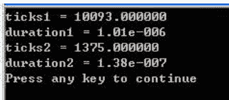


## 解决问题方法的效率，跟算法的巧妙程度有关

## 所以到底什么是数据结构？？？

- 数据对象在计算机中的组织方式
  - 逻辑结构
  - 物理存储结构
- 数据对象必定与一系列加在其上的操作相关联
- 完成这些操作所用的方法就是算法

### 抽象数据类型 （Abstract Data Type）

- 数据类型
  - 数据对象集
  - 数据集合相关联的操作集

- 抽象：描述数据类型的方法不依赖于具体实现
  - 与存放数据的机器无关
  - 与数据存储的物理结构无关
  - 与实现操作的算法和编程语言均无关

只描述数据对象集和相关操作集“是什么”，并不涉及“如何做到”的问题

### 例4：“矩阵”的抽象数据类型定义

- 类型名称：矩阵（Matrix）

- 数据对象集：一个M×N的矩阵A<sub>M×N</sub> = (a<sub>ij</sub>) (i=1, ..., M; j=1, ..., N) 由M×N个三元组 < a, i, j > 构成，其中 a 是矩阵元素的值，i 是元素所在的行号，j 是元素所在的列号。

- 操作集：对于任意矩阵A、B、C ∈ Matrix，以及整数i、j、M、N

- Matrix Create( int M, int N )：返回一个M×N的空矩阵；

- int GetMaxRow( Matrix A )：返回矩阵A的总行数；

- int GetMaxCol( Matrix A )：返回矩阵A的总列数；

- ElementType GetEntry( Matrix A, int i, int j )：返回矩阵A的第i行、第j列的元素；

- Matrix Add( Matrix A, Matrix B )：如果A和B的行、列数一致，则返回矩阵C=A+B，否则返回错误标志；

- Matrix Multiply( Matrix A, Matrix B )：如果A的列数等于B的行数，则返回矩阵C=AB，否则返回错误标志；

- ......


## 第一讲 基本概念


## 1.2 什么是算法

## 定义

- 算法（Algorithm）
  - 一个有限指令集
  - 接受一些输入（有些情况下不需要输入）
  - 产生输出
  - 一定在有限步骤之后终止
  - 每一条指令必须
    - 有充分明确的目标，不可以有歧义
    - 计算机能处理的范围之内
    - 描述应不依赖于任何一种计算机语言以及具体的实现手段

### 例1：选择排序算法的伪码描述

```c
void SelectionSort ( int List[], int N )
{ /* 将N个整数List[0]...List[N-1]进行非递减排序 */
for ( i = 0; i < N; i++ ) {
MinPosition = ScanMinFun( List, i, N-1 );
/* 从List[i]到List[N-1]中找最小元，并将其位置赋给MinPosition */
Swap( List[i], List[MinPosition] );
/* 将未排序部分的最小元换到有序部分的最后位置 */
}
}
```

抽象 ——

List到底是数组还是链表（虽然看上去很像数组）？

Swap用函数还是用宏去实现？

### 什么是好的算法？

- 空间复杂度\(S(n)\) —— 根据算法写成的程序在执行时占用存储单元的长度。这个长度往往与输入数据的规模有关。空间复杂度过高的算法可能导致使用的内存超限，造成程序非正常中断。

- 时间复杂度\(T(n)\) —— 根据算法写成的程序在执行时耗费时间的长度。这个长度往往也与输入数据的规模有关。时间复杂度过高的低效算法可能导致我们在有生之年都等不到运行结果。

## 1.1 例2

```c
void PrintN ( int N )
{
    if ( N ){
        PrintN( N - 1 );
        printf("%d\n", N );
    }
    return;
}
```

| …… | 100000 | 99999 | 99998 | …… …… | 1 | …… |
|---|---:|---:|---:|---|---:|---|

PrintN(100000)
PrintN(99999)
PrintN(99998)
PrintN(99997)
…… ……
PrintN(0)

\(S(N)=C\cdot N\)

### 1.1 例3

```c
double f( int n, double a[], double x )
{ int i;
  double p = a[0];
  for ( i=1; i<=n; i++ )      (1+2+......+n)
    p += (a[i] * pow(x, i));   =(n^2+n)/2次乘法
  return p;
}
```

```c
double f( int n, double a[], double x )
{ int i;
  double p = a[n];
  for ( i=n; i>0; i-- )      n次乘法!
    p = a[i-1] + x*p;
  return p;
}
```

### 什么是好的算法？

在分析一般算法的效率时，我们经常关注下面两种复杂度

- 最坏情况复杂度 \( T_{worst}(n) \)

- 平均复杂度 \( T_{avg}(n) \)

\( T_{avg}(n) \leq T_{worst}(n) \)

## 输入规模 *n*

| 函数 | 1 | 2 | 4 | 8 | 16 | 32 |
|---|---:|---:|---:|---:|---:|---:|
| 1 | 1 | 1 | 1 | 1 | 1 | 1 |
| \(\log n\) | 0 | 1 | 2 | 3 | 4 | 5 |
| \(n\) | 1 | 2 | 4 | 8 | 16 | 32 |
| \(n\log n\) | 0 | 2 | 8 | 24 | 64 | 160 |
| \(n^2\) | 1 | 4 | 16 | 64 | 256 | 1024 |
| \(n^3\) | 1 | 8 | 64 | 512 | 4096 | 32768 |
| \(2^n\) | 2 | 4 | 16 | 256 | 65536 | 4294967296 |
| \(n!\) | 1 | 2 | 24 | 40320 | 20922789888000 | \(2.6313 \times 10^{35}\) |


## 复杂度分析小窍门

- 若两段算法分别有复杂度 \( T_1(n) = O(f_1(n)) \) 和 \( T_2(n) = O(f_2(n)) \)，则  
  - \( T_1(n) + T_2(n) = \max(O(f_1(n)), O(f_2(n))) \)  
  - \( T_1(n) \times T_2(n) = O(f_1(n) \times f_2(n)) \)

- 若 \( T(n) \) 是关于 \( n \) 的 \( k \) 阶多项式，那么 \( T(n) = \Theta(n^k) \)

- 一个 `for` 循环的时间复杂度等于循环次数乘以循环体代码的复杂度

- `if-else` 结构的复杂度取决于 `if` 的条件判断复杂度和两个分支部分的复杂度，总体复杂度取三者中最大

## 第一讲 基本概念


## 1.3 应用实例：最大子列和问题

给定N个整数的序列{ A<sub>1</sub>, A<sub>2</sub>, ..., A<sub>N</sub> }，求函数 f(i,j)=max{0,∑<sub>k=i</sub><sup>j</sup>A<sub>k</sub>} 的最大值。

#### 算法1

```c
int MaxSubseqSum1( int A[], int N )
{
    int ThisSum, MaxSum = 0;
    int i, j, k;
    for( i = 0; i < N; i++ )   /* i是子列左端位置 */
        for( j = i; j < N; j++ )   /* j是子列右端位置 */
        {
            ThisSum = 0;   /* ThisSum是从A[i]到A[j]的子列和 */
            for( k = i; k <= j; k++ )
                ThisSum += A[k];

            if( ThisSum > MaxSum )   /* 如果刚得到的这个子列和更大 */
                MaxSum = ThisSum;   /* 则更新结果 */
        }   /* j循环结束 */
    }   /* i循环结束 */
    return MaxSum;
}
```

#### 算法2

```c
int MaxSubseqSum2( int A[], int N )
{
    int ThisSum, MaxSum = 0;
    int i, j;
    for( i = 0; i < N; i++ ) { /* i是子列左端位置 */
        ThisSum = 0; /* ThisSum是从A[i]到A[j]的子列和 */
        for( j = i; j < N; j++ ) { /* j是子列右端位置 */
            ThisSum += A[j];
            /*对于相同的i，不同的j，只要在j-1次循环的基础上累加1项即可*/
            if( ThisSum > MaxSum ) /* 如果刚得到的这个子列和更大 */
                MaxSum = ThisSum;    /* 则更新结果 */
        } /* j循环结束 */
    } /* i循环结束 */
    return MaxSum;
}
```

$T(N)=O(N^2)$

### 算法3：分而治之

T(N/2)

O(N)

T(N/2)

T(N) = 2 T(N/2) + c N，　T(1) = O(1)

= 2 [2 T(N/2²) + c N/2] + c N

= 2ᵏ O(1) + c k N　其中 N/2ᵏ = 1

= O(N log N)

### 算法4：在线处理

```c
int MaxSubseqSum( int A[], int N )
{
    int ThisSum, MaxSum;
    int i;
    ThisSum = MaxSum = 0;
    for( i = 0; i < N; i++ ) {
        ThisSum += A[i]; /* 向右累加 */
        if( ThisSum > MaxSum )
            MaxSum = ThisSum; /* 发现更大和则更新当前结果 */
        else if( ThisSum < 0 ) /* 如果当前子列和为负 */
            ThisSum = 0; /* 则不可能使后面的部分和增大，抛弃之 */
    }
    return MaxSum;
}

T(N) = O(N)
```

“在线”的意思指每输入一个数据就进行即时处理，在任何一个地方中止输入，算法都能正确给出当前的解。

## 运行时间比较（秒）

| 算法 | 1 | 2 | 3 | 4 |
|---|---|---|---|---|
| 时间复杂度 | O(N³) | O(N²) | O(Nlog N) | O(N) |
| 输入规模 | | | | |
| N=10 | 0.00103 | 0.00045 | 0.00066 | 0.00034 |
| N=100 | 0.47015 | 0.01112 | 0.00486 | 0.00063 |
| N=1,000 | 448.77 | 1.1233 | 0.05843 | 0.00333 |
| N=10,000 | NA | 111.13 | 0.68631 | 0.03042 |
| N=100,000 | NA | NA | 8.0113 | 0.29832 |


## 教程结构 精品课件

首页  例题

课件 > 第一讲 基本概念（1-1... > 1.3 应用实例：最大子...

1. int Max(int a, int b, int c )
2. {
3. /* 返回三个整数中的最大值 */
4. return A > B ? A > C ? A : C : B > C ? B : C;
5. }
6. }
7. int DivideAndConquer( int list[], int left, int right )
8. {
9. /* DivideAndConquer(list, left, right)返回list中左端为left、右端为right子段的最大和*/
10. int MaxLeftBorderSum, MaxRightBorderSum; /* 存放左右子段问题解 */
11. int MaxLeftBorderSum, MaxRightBorderSum; /* 存放跨分段分段的结果 */
12. }
13. int leftBorderSum, RightBorderSum;
14. int center = ( left + right ) / 2; /* 找到中分点 */
15. if( left == right ) /* 递归的终止条件，子序列只有一个数字 */
16. if( list[left] > 0 ) return list[left];
17. else return 0;
18. }
19. /* 下面是“分”的过程 */
20. center = ( left + right ) / 2; /* 找到中分点 */
21. MaxLeftSum = DivideAndConquer( list, left, center );
22. MaxRightSum = DivideAndConquer( list, left+1, right );
23. MaxLeftBorderSum = 0; leftBorderSum = 0;
24. for( i=center; i>=left; i-- ) /* 从中线向左扫描 */
25. {
26. leftBorderSum += list[i]; /* 求左部的和 */
27. if( leftBorderSum > MaxLeftBorderSum )
28. MaxLeftBorderSum = leftBorderSum; /* 左部边界和取最大值 */
29. }
30. MaxRightBorderSum = 0; rightBorderSum = 0;
31. for( i=center+1; i<=right; i++ ) /* 从中线向右扫描 */
32. {
33. rightBorderSum += list[i]; /* 求右部的和 */
34. if( rightBorderSum > MaxRightBorderSum )
35. MaxRightBorderSum = rightBorderSum; /* 右部边界和取最大值 */
36. }
37. /* 下面返回“治”的结果 */
38. return Max3( MaxLeftSum, MaxRightSum, MaxLeftBorderSum + MaxRightBorderSum );
39. }
40. int MaxSubseqSum( int list[], int n )
41. { /* 保持与旧算法相同的函数原形 */
42. return DivideAndConquer( list, 0, n-1 );
43. }

公告
评价分析
课件
编程作业
测验与作业
教材与参考资料
考试
讨论区
课程分享
微信群课程互助
扫码下载APP
帮助中心

评价课程


## 2.1 线性表及其实现

### 多项式的表示

#### [例] 一元多项式及其运算

一元多项式：\( f(x) = a_0 + a_1x + \cdots + a_{n-1}x^{n-1} + a_nx^n \)

主要运算：多项式相加、相减、相乘等

#### 【分析】如何表示多项式？

##### 多项式的关键数据：

- 多项式项数n
- 各项系数aᵢ及指数i

### 方法1：顺序存储结构直接表示

数组各分量对应多项式各项：
a[i]: 项x^i的系数a_i

例如：
f(x) = 4x^5 - 3x^2 + 1

表示成：

| 下标i | 0 | 1 | 2 | 3 | 4 | 5 | ...... |
|---|---|---|---|---|---|---|---|
| a[i] | 1 | 0 | -3 | 0 | 0 | 4 | ...... |

1 -3x^2 4x^5

两个多项式相加：两个数组对应分量相加
问题：如何表示多项式 x+3x^2000？

### 方法2：顺序存储结构表示非零项

每个非零项 \(a_i x^i\) 涉及两个信息：系数 \(a_i\) 和指数 \(i\)  
可以将一个多项式看成是一个 \((a_i, i)\) 二元组的集合。

用结构数组表示： 数组分量是由系数\(a_i\)、指数\(i\)组成的结构，  
对应一个非零项

例如： \(P_1(x) = 9x^{12} + 15x^8 + 3x^2\) 和 \(P_2(x) = 26x^{19} - 4x^8 - 13x^6 + 82\)

| 下标i | 0 | 1 | 2 | ...... |
|---|---|---|---|---|
| 系数a^i | 9 | 15 | 3 | - |
| 指数i | 12 | 8 | 2 | - |

| 下标i | 0 | 1 | 2 | 3 | ...... |
|---|---|---|---|---|---|
| 系数a^i | 26 | -4 | -13 | 82 | - |
| 指数i | 19 | 8 | 6 | 0 | - |

(a) \(P_1(x)\)

(b) \(P_2(x)\)

按指数大小有序存储！

### 方法2：顺序存储结构表示非零项

相加过程：从头开始，比较两个多项式当前对应项的指数

P1: (9,12), (15,8), (3,2)

P2: (26,19), (-4,8), (-13,6), (82,0)

P3: (26,19) (9,12) (11,8) (-13,6) (3,2) (82,0)

\(P_3(x) = 26x^{19} + 9x^{12} + 11x^8 - 13x^6 + 3x^2 + 82\)

### 方法3：链表结构存储非零项

链表中每个结点存储多项式中的一个非零项，包括系数和指数两个数据域以及一个指针域

| coef | expon | link |
|------|-------|------|

typedef struct PolyNode *Polynomial;
struct PolyNode {
    int coef;
    int expon;
    Polynomial link;
}

例如：
P₁(x) = 9x¹² + 15x⁸ + 3x²
P₂(x) = 26x¹⁹ - 4x⁸ - 13x⁶ + 82
链表存储形式为：

P1 → 9 12 → 15 8 → 3 2 NULL
P2 → 26 19 → -4 8 → -13 6 → 82 0 NULL

### 什么是线性表

多项式表示问题的启示：
1. 同一个问题可以有不同的表示（存储）方法
2. 有一类共性问题： 有序线性序列的组织和管理

**“线性表(Linear List)”：由同类型数据元素构成有序序列的线性结构**
➤ 表中元素个数称为线性表的长度
➤ 线性表没有元素时，称为空表
➤ 表起始位置称表头，表结束位置称表尾

### 线性表的抽象数据类型描述

类型名称：线性表（List）

数据对象集：线性表是 n (≥0)个元素构成的有序序列( a₁, a₂, ...,aₙ )

操作集：线性表L ∈ List，整数i表示位置，元素X ∈ ElementType，线性表基本操作主要有：

- 1、List MakeEmpty(): 初始化一个空线性表L；
- 2、ElementType FindKth( int K, List L ): 根据位序K，返回相应元素；
- 3、int Find( ElementType X, List L ): 在线性表L中查找X的第一次出现位置；
- 4、void Insert( ElementType X, int i, List L): 在位序i前插入一个新元素X；
- 5、void Delete( int i, List L ): 删除指定位序i的元素；
- 6、int Length( List L ): 返回线性表L的长度n。

## 主要操作的实现

#### 1.初始化（建立空的顺序表）

```
List MakeEmpty( )
{
    List PtrL;
    PtrL = (List )malloc( sizeof(struct LNode) );
    PtrL->Last = -1;
    return PtrL;
}
```

#### 2.查找

```
int Find( ElementType X, List PtrL )
{
    int i = 0;
    while( i <= PtrL->Last && PtrL->Data[i]!= X )
        i++;
    if (i > PtrL->Last) return -1; /* 如果没找到，返回-1 */
    else return i;    /* 找到后返回的是存储位置 */
}
```

> 查找成功的平均比较次数为 (n +1)/2，平均时间性能为 O(n)。

### 3. 插入操作实现

```
void Insert( ElementType X, int i, List PtrL )
{
    int j;
    if ( PtrL->Last == MAXSIZE-1 ){ /* 表空间已满，不能插入*/
        printf( " 表满 " );
        return;
    }
    if ( i < 1 || i > PtrL->Last+2 ) {
        printf( " 位置不合法 " );
        return;
    }
    for ( j = PtrL->Last; j >= i-1; j-- )
        PtrL->Data[j+1] = PtrL->Data[j]; /*将 a~i~ 到 a~n~ 倒序向后移动*/
    PtrL->Data[i-1] = X; /*新元素插入*/
    PtrL->Last++; /*Last仍指向最后元素*/
    return;
}
```

### 4. 删除（删除表的第 \( i \ (1 \leq i \leq n) \) 个位置上的元素）

| 下标 i | 0 | 1 | …… | i-1 | i | …… | n-1 | …… | MAXSIZE-1 |
|---|---|---|---|---|---|---|---|---|---|
| Data | a₁ | a₂ | …… | aᵢ | aᵢ₊₁ | …… | aₙ | …… | - |

后面的元素依次前移

| 下标 i | 0 | 1 | …… | i-1 | …… | n-2 | n-1 | …… | MAXSIZE-1 |
|---|---|---|---|---|---|---|---|---|---|
| Data | a₁ | a₂ | …… | aᵢ₊₁ | …… | aₙ | aₙ | …… | - |

### 4. 删除操作实现

```
void Delete( int i, List PtrL )
{
    int j;
    if( i < 1 || i > PtrL->Last+1 ) {
        printf("不存在第%d个元素", i);
        return;
    }
    for ( j = i; j <= PtrL->Last; j++ )
        PtrL->Data[j-1] = PtrL->Data[j];    /* 将 aᵢ₊₁～aₙ顺序向前移动 */
    PtrL->Last--;                           /* Last仍指向最后元素 */
    return;
}
```


## 线性表的链式存储实现

不要求逻辑上相邻的两个元素物理上也相邻；通过“链”建立起数据元素之间的逻辑关系。

- 插入、删除不需要移动数据元素，只需要修改“链”。

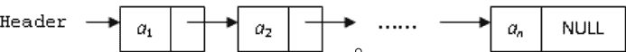

```c
typedef struct LNode *List;
struct LNode{
    ElementType Data;
    List Next;
};
struct LNode L;
List PtrL;
```


## 主要操作的实现

### 1. 求表长

```c
int Length( List PtrL )
{
    List p = PtrL; /* p指向表的第一个结点*/
    int j = 0;
    while ( p ) {
        p = p->Next;
        j++; /* 当前p指向的是第 j 个结点*/
    }
    return j;
}
```

时间性能为 O(n)。

### 2. 查找

#### （1）按序号查找：FindKth

```c
List FindKth( int K, List PtrL )
{
    List p = PtrL;
    int i = 1;
    while (p != NULL && i < K){
        p = p->Next;
        i++;
    }
    if (i == K) return p;
    else return NULL;
}
```

#### （2）按值查找：Find

```c
List Find( ElementType X, List PtrL )
{
    List p = PtrL;
    while (p != NULL && p->Data != X)
        p = p->Next;
    return p;
}
```

> 平均时间性能为 O(n)

### 3. 插入（在第 i-1 (1≤i≤n+1) 个结点后插入一个值为 X 的新结点）

（1）先构造一个新结点，用 s 指向；
（2）再找到链表的第 i-1 个结点，用 p 指向；
（3）然后修改指针，插入结点（p 之后插入新结点是 s）

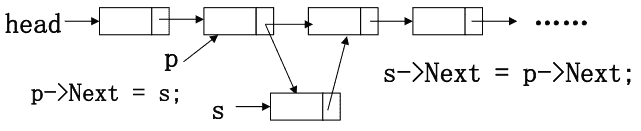

思考：修改指针的两个步骤如果交换一下，将会发生什么？

### 3. 插入操作实现

```c
List Insert( ElementType X, int i, List PtrL )
{
    List p, s;
    if ( i == 1 ) {
        s = (List)malloc(sizeof(struct LNode));
        s->Data = X;
        s->Next = PtrL;
        return s;
    }
    p = FindKth( i-1, PtrL );
    if ( p == NULL ) {
        printf( " 参数i错 " );
        return NULL;
    }
    else {
        s = (List)malloc(sizeof(struct LNode));
        s->Data = X;
        s->Next = p->Next;
        p->Next = s;
        return PtrL;
    }
}
```

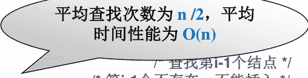

### 4. 删除（删除链表的第 i (1 ≤ i ≤ n) 个位置上的结点）

（1）先找到链表的第 i-1 个结点，用 p 指向；
（2）再用指针 s 指向要被删除的结点（p 的下一个结点）；
（3）然后修改指针，删除 s 所指结点；
（4）最后释放 s 所指结点的空间。

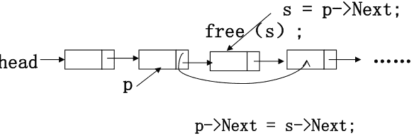

思考：操作指针的几个步骤如果随意改变，将会发生什么？

## 广义表

【例】我们知道了一元多项式的表示，那么二元多项式又该如何表示？
比如，给定二元多项式：
\( P(x, y) = 9x^{12}y^2 + 4x^{12} + 15x^8y^3 - x^8y + 3x^2 \)

【分析】可以将上述二元多项式看成关于 x 的一元多项式
\( P(x, y) = (9y^2 + 4)x^{12} + (15y^3 - y)x^8 + 3x^2 \)
\( ax^{12} + bx^8 + cx^2 \)

所以，上述二元多项式可以用“复杂”链表表示为：

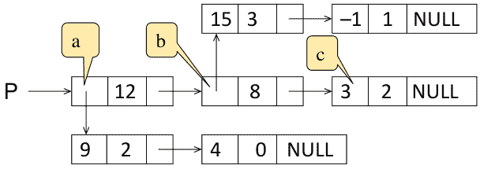

## 广义表 (Generalized List)

- 广义表是线性表的推广
- 对于线性表而言，n 个元素都是基本的单元素；
- 广义表中，这些元素不仅可以是单元素也可以是另一个广义表。

```c
typedef struct GNode *GList;
struct GNode{
    int Tag;          /*标志域：0 表示结点是单元素，1 表示结点是广义表*/
    union {           /*子表指针域 SubList 与单元素数据域 Data 复用，即共用存储空间*/
        ElementType  Data;
        GList  SubList;
    } URegion;
    GList Next;       /* 指向后继结点 */
};
```

| Tag | Data | Next |
|---|---|---|
|  | SubList |  |

## 多重链表

多重链表：链表中的节点可能同时隶属于多个链

- 多重链表中结点的指针域会有多个，如前面例子包含了 Next 和 SubList 两个指针域；
- 但包含两个指针域的链表并不一定是多重链表，比如在双向链表不是多重链表。

- 多重链表有广泛的用途：基本上如树、图这样相对复杂的数据结构都可以采用多重链表方式实现存储。

## [例] 矩阵可以用二维数组表示，但二维数组表示有两个缺陷：

- 一是数组的大小需要事先确定，
- 对于“稀疏矩阵”，将造成大量的存储空间浪费。

\( A = \begin{bmatrix} 18 & 0 & 0 & 2 & 0 \\ 0 & 27 & 0 & 0 & 0 \\ 0 & 0 & 0 & -4 & 0 \\ 23 & -1 & 0 & 0 & 12 \end{bmatrix} \quad B = \begin{bmatrix} 0 & 2 & 11 & 0 & 0 & 0 \\ 3 & -4 & -1 & 0 & 0 & 0 \\ 0 & 0 & 0 & 9 & 13 & 0 \\ 0 & -2 & 0 & 0 & 10 & 7 \\ 6 & 0 & 0 & 5 & 0 & 0 \end{bmatrix} \)

## 【分析】采用一种典型的多重链表——十字链表来存储稀疏矩阵

- 只存储矩阵非 0 元素项

结点的数据域：行坐标 Row、列坐标 Col、数值 Value

- 每个结点通过两个指针域，把同行、同列串起来；
- 行指针（或称为向右指针）Right
- 列指针（或称为向下指针）Down

## 矩阵 A 的多重链表图

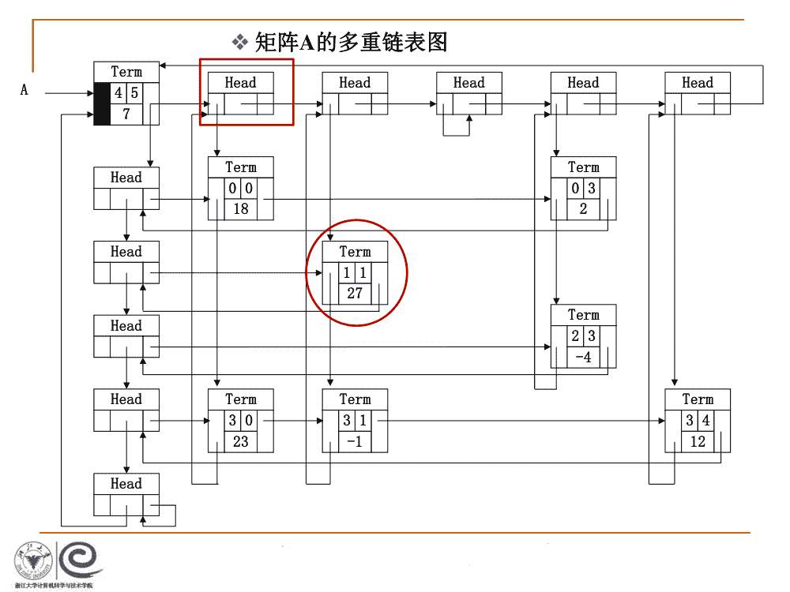

- 用一个标识域 Tag 来区分头结点和非 0 元素结点：
- 头结点的标识值为 “Head”，矩阵非 0 元素结点的标识值为 “Term”。

| Tag |
|---|
| Down | URegion | Right |

(a) 结点的总体结构

| Term |
|---|
| Down | Row | Col | Right |
|  | Value |  |  |

(b) 矩阵非 0 元素结点

| Head |
|---|
| Down | Next | Right |

(c) 头结点

## 2.2 堆栈

## 什么是堆栈

### 计算机如何进行表达式求值？

[例] 算术表达式 5+6/2-3*4。正确理解：
5+6/2-3*4 = 5+3-3*4 = 8-3*4 = 8-12 = -4

- 由两类对象构成的：
  - 运算数，如 2、3、4
  - 运算符号，如 +、-、*、/
- 不同运算符号优先级不一样


## 后缀表达式

➤ 中缀表达式：运算符号位于两个运算数之间。如， \( a+b*c-d/e \)
➤ 后缀表达式：运算符号位于两个运算数之后。如， \( abc*+de/- \)

【例】 \( 62/3-42*+ = ? \)

后缀表达式求值策略：从左向右“扫描”，逐个处理运算数和运算符号
1. 遇到运算数怎么办？如何“记住”目前还不未参与运算的数？
2. 遇到运算符号怎么办？对应的运算数是什么？

启示：需要有种存储方法，能顺序存储运算数，并在需要时“倒序”输出！

## 【例】 6 2 / 3 − 4 2 * + = ?

| 栈内容 | 输入/处理 |
|---|---|
| 对象：6（运算数） | 对象：2（运算数） |
| 对象：/（运算符） | 对象：3（运算数） |
| 对象：−（运算符） | 对象：4（运算数） |
| 对象：2（运算数） | 对象：*（运算符） |
| 对象：+（运算符） | Pop：8 |

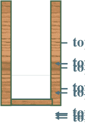

$T(N)=O(N)$

## 堆栈的抽象数据类型描述

堆栈（Stack）：具有一定操作约束的线性表

➢ 只在一端（栈顶，Top）做插入、删除

+   ➢ 插入数据：入栈（Push）
+   ➢ 删除数据：出栈（Pop）
+   ➢ 后入先出：Last In First Out（LIFO）


## 堆栈的抽象数据类型描述

**类型名称：**堆栈（Stack）

**数据对象集：**一个有0个或多个元素的有穷线性表。

**操作集：**长度为MaxSize的堆栈S ∈ Stack，堆栈元素item ∈ ElementType

+   1. `Stack CreateStack( int MaxSize )`：生成空堆栈，其最大长度为MaxSize；
+   2. `int IsFull( Stack S, int MaxSize )`：判断堆栈S是否已满；
+   3. `void Push( Stack S, ElementType item )`：将元素item压入堆栈；
+   4. `int IsEmpty( Stack S )`：判断堆栈S是否为空；
+   5. `ElementType Pop( Stack S )`：删除并返回栈顶元素；

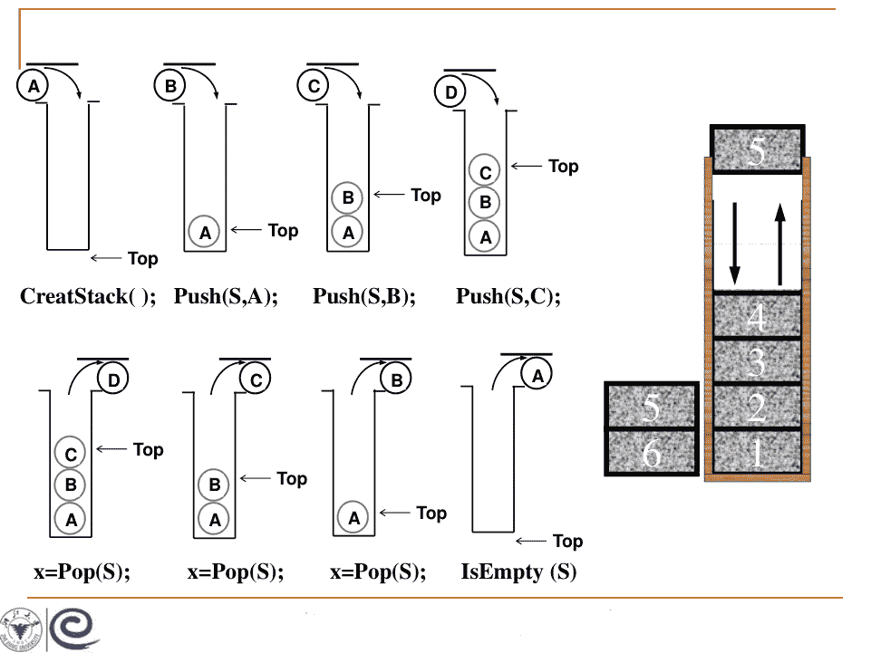

## Push 和 Pop 可以穿插交替进行；

按照操作系列
(1)Push(S,A), Push(S,B),Push((S,C),Pop(S),Pop(S),Pop(S)
堆栈输出是？
CBA
(2) 而Push(S,A), Pop(S),Push(S,B),Push((S,C),Pop(S),Pop(S)
堆栈输出是？
ACB

[例] 如果三个字符按ABC顺序压入堆栈
• ABC的所有排列都可能是出栈的序列吗？
• 可以产生CAB这样的序列吗？

## 栈的顺序存储实现

栈的顺序存储结构通常由一个一维数组和一个记录栈顶元素位置的变量组成。

```c
#define MaxSize <储存数据元素的最大个数>
typedef struct SNode *Stack;
struct SNode{
        ElementType Data[MaxSize];
        int Top;
};
```

```c
void Push( Stack PtrS, ElementType item )
{
    if ( PtrS->Top == MaxSize-1 ) {
        printf( “堆栈满” );  return;
    } else {
        PtrS->Data[++(PtrS->Top)] = item;
        return;
    }
}
```

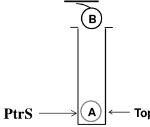

[例] 请用一个数组实现两个堆栈，要求最大地利用数组空间，使数组只要有空间入栈操作就可以成功。

【分析】一种比较聪明的方法是使这两个栈分别从数组的两头开始向中间生长；当两个栈的栈顶指针相遇时，表示两个栈都满了。

```c
#define MaxSize <存储数据元素的最大个数>
struct DStack {
    ElementType Data[MaxSize];
    int Top1; /* 堆栈 1 的栈顶指针 */
    int Top2; /* 堆栈 2 的栈顶指针 */
} S;

S.Top1 = -1;
S.Top2 = MaxSize;
```

```c
void Push( struct DStack *PtrS, ElementType item, int Tag )
{
    /* Tag作为区分两个堆栈的标志，取值为1和2 */
    if ( PtrS->Top2 - PtrS->Top1 == 1 ) { /*堆栈满*/
        printf("堆栈满");  return ;
    }
    if ( Tag == 1 ) /* 对第一个堆栈操作 */
        PtrS->Data[++(PtrS->Top1)] = item;
    else    /* 对第二个堆栈操作 */
        PtrS->Data[--(PtrS->Top2)] = item;
}
```

```c
ElementType Pop( struct DStack *PtrS, int Tag )
{
    /* Tag作为区分两个堆栈的标志，取值为1和2 */
    if ( Tag == 1 ) { /* 对第一个堆栈操作 */
        if ( PtrS->Top1 == -1 ) { /*堆栈1空 */
            printf("堆栈1空");  return NULL;
        } else return PtrS->Data[(PtrS->Top1)--];
    } else {    /* 对第二个堆栈操作 */
        if ( PtrS->Top2 == MaxSize ) { /*堆栈2空 */
            printf("堆栈2空");  return NULL;
        } else return PtrS->Data[(PtrS->Top2)++];
    }
}
```

## 堆栈的链式存储实现

栈的链式存储结构实际上就是一个单链表，叫做链栈。插入和删除操作只能在链栈的栈顶进行。栈顶指针Top应该在链表的哪一头？

typedef struct SNode *Stack;
struct SNode{
    ElementType Data;
    struct SNode *Next;
};

(1) 堆栈初始化（建立空栈）
(2) 判断堆栈S是否为空

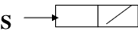

```c
Stack CreateStack()
{
    /* 构建一个堆栈的头结点，返回指针 */
    Stack S;
    S = (Stack)malloc(sizeof(struct SNode));
    S->Next = NULL;
    return S;
}
```

```c
int IsEmpty(Stack S)
{
    /*判断堆栈s是否为空，若为空函数返回整数1，否则返回0 */
    return ( S->Next == NULL );
}
```

```c
void Push( ElementType item, Stack S)
{ /* 将元素item压入堆栈S */
    struct SNode *TmpCell;
    TmpCell=(struct SNode *)malloc(sizeof(struct SNode));
    TmpCell->Element = item;
    TmpCell->Next = S->Next;
    S->Next = TmpCell;
}
```

```c
ElementType Pop(Stack S)
{ /* 删除并返回堆栈S的栈顶元素 */
    struct SNode *FirstCell;
    ElementType TopElem;
    if( IsEmpty( S ) {
    printf("堆栈空"); return NULL;
    } else {
    FirstCell = S->Next;
    S->Next = FirstCell->Next;
    TopElem = FirstCell ->Element;
    free(FirstCell);
    return TopElem;
    }
}
```


## 堆栈应用：表达式求值

回忆：应用堆栈实现后缀表达式求值的基本过程：  
从左到右读入后缀表达式的各项（运算符或运算数）；

1. 运算数：入栈；  
2. 运算符：从堆栈中弹出适当数量的运算数，计算并结果入栈；  
3. 最后，堆栈顶上的元素就是表达式的结果值。


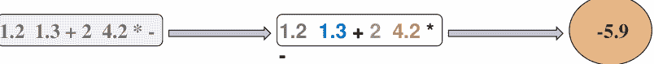

## 中缀表达式求值

**基本策略**：将中缀表达式转换为后缀表达式，然后求值

如何将中缀表达式转换为后缀？

**观察一个简单例子**： 2+9/3-5 → 2 9 3 / + 5 -

- 1. 运算数相对顺序不变  
- 2. 运算符号顺序发生改变  
  - 需要存储“等待中”的运算符号  
  - 要将当前运算符号与“等待中”的最后一个运算符号比较

堆栈！

有括号怎么办？

## 【例】a*(b+c)/d = ?

abc+*d/

输出： a b c + * d /

| 输入对象：a (操作数) | 输入对象：* (乘法) |
| --- | --- |
| 输入对象：( (左括号) | 输入对象：b (操作数) |
| 输入对象：+ (加法) | 输入对象：c (操作数) |
| 输入对象：) (右括号) | 输入对象：/ (除法) |
| 输入对象：d (操作数) | |

T(N) = O ( N )

## 中缀表达式求值

字符序列的中缀表达式 对象分割 GetOp 对象序列的中缀表达式 利用堆栈 转换 对象序列的后缀表达式 求值 利用堆栈 结果值

(1.2 +1.3 – 2) * 4.2 对象分割 GetOp (1.2 +1.3 – 2)* 4.2 利用堆栈 转换 1.2 1.3 + 2 - 4.2 * 求值 利用堆栈 2.1

## 中缀表达式如何转换为后缀表达式

从头到尾读取中缀表达式的每个对象，对不同对象按不同的情况处理。

- ① 运算数：直接输出；

- ② 左括号：压入堆栈；

- ③ 右括号：将栈顶的运算符弹出并输出，直到遇到左括号（出栈，不输出）；

- ④ 运算符：

  - 若优先级大于栈顶运算符时，则把它压栈；

  - 若优先级小于等于栈顶运算符时，将栈顶运算符弹出并输出；再比较新的栈顶运算符，直到该运算符大于栈顶运算符优先级为止，然后将该运算符压栈；

- ⑤ 若各对象处理完毕，则把堆栈中存留的运算符一并输出。

## 堆栈的其他应用：

- 函数调用及递归实现

- 深度优先搜索

- 回溯算法

- 。 。 。

## 2.3 队列及实现

## 什么是队列

队列(Queue)：具有一定操作约束的线性表

插入和删除操作：只能在一端插入，而在另一端删除。

- 数据插入：入队列（AddQ）

- 数据删除：出队列（DeleteQ）

- 先来先服务

- 先进先出：FIFO

## 队列的顺序存储实现

队列的顺序存储结构通常由一个一维数组和一个记录队列头元素位置的变量front以及一个记录队列尾元素位置的变量rear组成。

### 【例】一个工作队列

| 0 | 1 | 2 | 3 | 4 | 5 | 6 |
|---|---|---|---|---|---|---|
| Job 1 | Job 2 | Job 3 | Job 4 | Job 5 | Job 6 | Job 7 |

| AddQ Job 1 | AddQ Job 2 | AddQ Job 3 | DeleteQ Job 1 |
|---|---|---|---|
| AddQ Job 4 | AddQ Job 5 | AddQ Job 6 | DeleteQ Job 2 |
| AddQ Job 7 | AddQ Job 8 | | |

## 顺环队列：

- AddQ Job 1

- AddQ Job 2

- AddQ Job 3

- DeleteQ Job 1

- AddQ Job 4

- AddQ Job 5

- AddQ Job 6

- AddQ Job 7

## 思考：

- （1）这种方案：堆栈空和满的判别条件是什么？

- （2）为什么会出现空、满无法区分？根本原因？

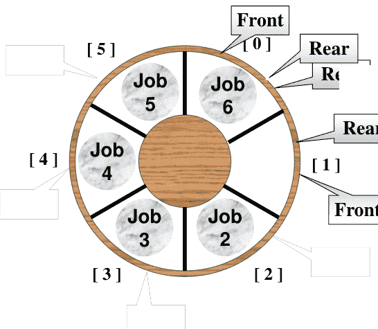

### (1)入队列

```c
void AddQ( Queue PtrQ, ElementType item )
{
    if ( (PtrQ->rear+1) % MaxSize == PtrQ->front ) {
        printf("队列满");
        return;
    }
    PtrQ->rear = (PtrQ->rear+1)% MaxSize;
    PtrQ->Data[PtrQ->rear] = item;
}
```

```c
ElementType DeleteQ ( Queue PtrQ )
{
    if ( PtrQ->front == PtrQ->rear ) {
        printf("队列空");
        return ERROR;
    } else {
        PtrQ->front = (PtrQ->front+1)% MaxSize;
        return PtrQ->Data[PtrQ->front];
    }
}
```


## 队列的链式存储实现

队列的链式存储结构也可以用一个单链表实现。插入和删除操作分别在链表的两头进行； 队列指针front和rear应该分别指向链表的哪一头？

```c
struct Node{
    ElementType Data;
    struct Node *Next;
};
struct QNode{    /* 链队列结构 */
    struct Node *rear;   /* 指向队尾结点 */
    struct Node *front;  /* 指向队头结点 */
};
typedef struct QNode *Queue;
Queue PtrQ;
```

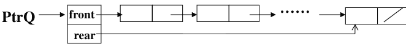

## 不带头结点的链式队列出队操作的一个示例：

```c
ElementType DeleteQ( Queue PtrQ )
{
    struct Node *FrontCell;
    ElementType FrontElem;

    if ( PtrQ->front == NULL) {
        printf("队列空"); return ERROR;
    }
    FrontCell = PtrQ->front;
    if ( PtrQ->front == PtrQ->rear) /* 若队列只有一个元素 */
        PtrQ->front = PtrQ->rear = NULL; /* 删除后队列置为空 */
    else
        PtrQ->front = PtrQ->front->Next;
    FrontElem = FrontCell->Data;
    free( FrontCell ); /* 释放被删除结点空间 */
    return FrontElem;
}
```

## 2.4 应用：多项式加法运算

$P1=3X^5+4X^4-X^3+2X-1$

$P2=2X^4+X^3-7X^2+X$

$P=3X^5+6X^4-7X^2+3X-1$

主要思路：相同指数的项系数相加，其余部分进行拷贝。

## 多项式加法运算

采用不带头结点的单向链表，按照指数递减的顺序排列各项

P1→ 3 5 → 4 4 → -1 3 → 2 1 → -1 0 → ||
P2→ 2 4 → 1 3 → -7 2 → 1 1 → ||

```c
struct PolyNode {
    int coef;    // 系数
    int expon;   // 指数
    struct PolyNode *link; // 指向下一个节点的指针
};
typedef struct PolyNode *Polynomial;
Polynomial P1, P2;
```

## 多项式加法运算

**算法思路：** 两个指针P1和P2分别指向这两个多项式第一个结点，不断循环：

- `P1->expon==P2->expon`：系数相加，若结果不为0，则作为结果多项式对应项的系数。同时，P1和P2都分别指向下一项；
- `P1->expon>P2->expon`：将P1的当前项存入结果多项式，并使P1指向下一项；
- `P1->expon<P2->expon`：将P2的当前项存入结果多项式，并使P2指向下一项；

**当某一多项式处理完时，将另一个多项式的所有结点依次复制到结果多项式中去。**

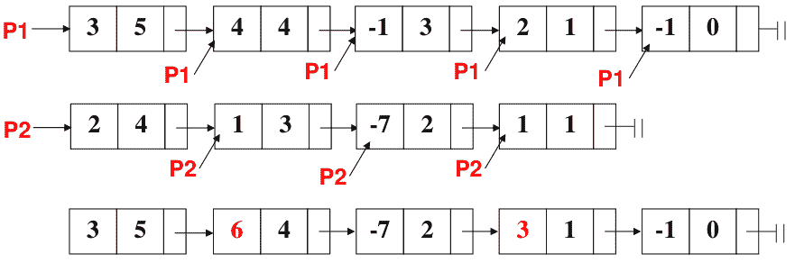


```c
Polynomial PolyAdd (Polynomial P1, Polynomial P2)
{
    Polynomial front, rear, temp;
    int sum;
    rear = (Polynomial) malloc(sizeof(struct PolyNode));
    front = rear;
    while (P1 && P2) {
        switch (Compare(P1->expon, P2->expon)) {
        case 1:
            Attach(P1->coef, P1->expon, &rear);
            P1 = P1->link;
            break;
        case -1:
            Attach(P2->coef, P2->expon, &rear);
            P2 = P2->link;
            break;
        case 0:
            sum = P1->coef + P2->coef;
            if (sum) Attach(sum, P1->expon, &rear);
            P1 = P1->link;
            P2 = P2->link;
            break;
        }
    }
    for (; P1; P1 = P1->link) Attach(P1->coef, P1->expon, &rear);
    for (; P2; P2 = P2->link) Attach(P2->coef, P2->expon, &rear);
    rear->link = NULL;
    temp = front;
    front = front->link;
    free(temp);
    return front;
}
```

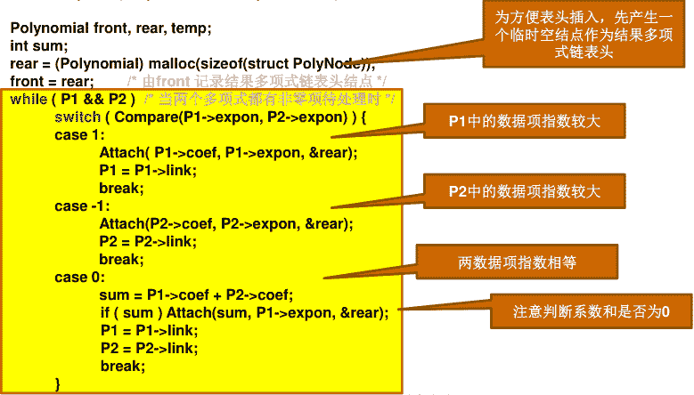

```c
void Attach( int c, int e, Polynomial *pRear )
{
    /* 由于在本函数中需要改变当前结果表达式尾项指针的值， */
    /* 所以函数传递进来的是结点指针的地址，*pRear指向尾项*/
    Polynomial P;

    P =(Polynomial)malloc(sizeof(struct PolyNode)); /* 申请新结点 */
    P->coef = c;    /* 对新结点赋值 */
    P->expon = e;
    P->link=NULL;
    /* 将P指向的新结点插入到当前结果表达式尾项的后面 */
    (*pRear)->link = P;
    *pRear = P;   /* 修改pRear值 */
}
```

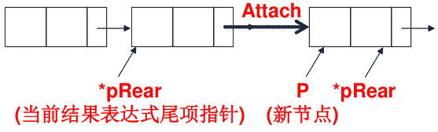

## 3.1 树与树的表示

### 什么是树

分层次组织在管理上具有更高的效率！

数据管理的基本操作之一： 查找

如何实现有效率的查找？

### 查找（Searching）

查找：根据某个给定关键字K，从集合R中找出关键字与K相同的记录

- 静态查找：集合中记录是固定的
  - 没有插入和删除操作，只有查找
- 动态查找：集合中记录是动态变化的
  - 除查找，还可能发生插入和删除

### 静态查找

### 方法1：顺序查找

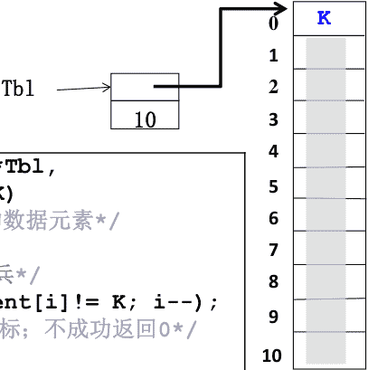

```c
int SequentialSearch (StaticTable *Tbl,
                     ElementType K)
{ /*在表Tbl[1]~Tbl[n]中查找关键字为K的数据元素*/
    int i;
    Tbl->Element[0] = K;   /*建立哨兵*/
    for(i = Tbl->Length; Tbl->Element[i] != K; i--);
    return i; /*查找成功返回所在单元下标，不成功返回0*/
}
```

顺序查找算法的时间复杂度为 **O(n)**。

### 方法2：二分查找（Binary Search）

- 假设n个数据元素的关键字满足有序（比如：小到大）

  k₁ < k₂ < ... < kₙ

  并且是连续存放（数组），那么可以进行二分查找。

[例] 假设有13个数据元素，按关键字由小到大顺序存放。二分查找关键字为444的数据元素过程如下：

| 5 | 16 | 39 | 45 | 51 | 98 | 100 | 202 | 226 | 321 | 368 | 444 | 501 |
|---|---|---|---|---|---|---|---|---|---|---|---|---|
| 1 | 2 | 3 | 4 | 5 | 6 | 7 | 8 | 9 | 10 | 11 | 12 | 13 |

left mid right

- 1、left = 1, right = 13; mid = (1+13)/2 = 7: 100 < 444;
- 2、left = mid+1=8, right = 13; mid = (8+13)/2 = 10: 321 < 444;
- 3、left = mid+1=11, right = 13; mid = (11+13)/2 = 12: 查找结束;

[例] 仍然以上面13个数据元素构成的有序线性表为例二分查找关键字为 43 的数据元素如下：

| 5 | 16 | 39 | 45 | 51 | 98 | 100 | 202 | 226 | 321 | 368 | 444 | 501 |
|---|---|---|---|---|---|---|---|---|---|---|---|---|
| 1 | 2 | 3 | 4 | 5 | 6 | 7 | 8 | 9 | 10 | 11 | 12 | 13 |

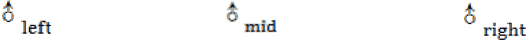

- 1、left = 1, right = 13; mid = (1+13)/2 = 7: 100 > 43;
- 2、left = 1, right = mid-1= 6; mid = (1+6)/2 = 3: 39 < 43;
- 3、left = mid+1=4, right = 6; mid = (4+6)/2 = 5: 51 > 43;
- 4、left = 4, right = mid-1= 4; mid = (4+4)/2 = 4: 45 > 43;
- 5、left = 4, right = mid-1= 3; left > right ? 查找失败，结束;

### 二分查找算法

```c
int BinarySearch ( StaticTable * Tbl, ElementType K)
{
    /*在表Tbl中查找关键字为K的数据元素*/
    int left, right, mid, NotFound=-1;
    left = 1;
    right = Tbl->Length;
    while ( left <= right )
    {
        mid = (left+right)/2; /*计算中间元素坐标*/
        if( K < Tbl->Element[mid]) right = mid-1; /*调整右边界*/
        else if( K > Tbl->Element[mid]) left = mid+1; /*调整左边界*/
        else return mid; /*查找成功，返回数据元素的下标*/
    }
    return NotFound; /*查找不成功，返回-1*/
}
```

二分查找算法具有对数的时间复杂度O(logN)

### ❖ 11个元素的二分查找判定树

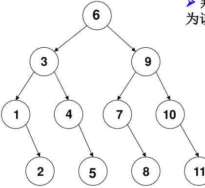

- 判定树上每个结点需要的查找次数刚好为该结点所在的层数；
- 查找成功时查找次数不会超过判定树的深度；
- n个结点的判定树的深度为 `⌊log₂ n⌋+1`。
- ASL = (4*4+4*3+2*2+1)/11 = 3。

二分查找的启示？

### 树与非树？

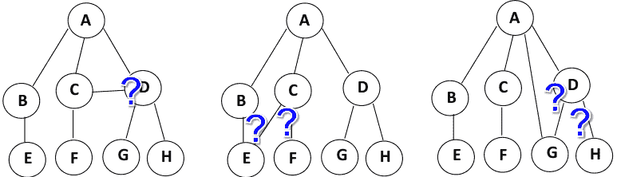

- 子树是不相交的；
- 除了根结点外，每个结点有且仅有一个父结点；
- 一棵N个结点的树有N-1条边。

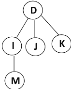


## 树的一些基本术语

1. 结点的度（Degree）：结点的子树个数  
2. 树的度：树的所有结点中最大的度数  
3. 叶结点（Leaf）：度为0的结点  
4. 父结点（Parent）：有子树的结点是其子树的根结点的父结点  
5. 子结点（Child）：若A结点是B结点的父结点，则称B结点是A结点的子结点；子结点也称孩子结点。  
6. 兄弟结点（Sibling）：具有同一父结点的各结点彼此是兄弟结点。  

7. **路径和路径长度**：从结点 n₁ 到 nₖ 的路径为一个结点序列 n₁，n₂，…，nₖ，nᵢ 是 nᵢ₊₁ 的父结点。路径所包含边的个数为**路径的长度**。  

8. **祖先结点 (Ancestor)**：沿树根到某一结点路径上的所有结点都是这个结点的祖先结点。  

9. **子孙结点 (Descendant)**：某一结点的子树中的所有结点是这个结点的子孙。  

10. **结点的层次（Level）**：规定根结点在1层，其它任一结点的层数是其父结点的层数加1。  

11. **树的深度（Depth）**：树中所有结点中的最大层次是这棵树的深度。  

## 树的表示

## 儿子-兄弟表示法

| Element |
|---|
| FirstChild | NextSibling |

## 二叉树

| Element |  |
|---|---|
| Left | Right |

## 3.2 二叉树及存储结构

## 二叉树的定义

二叉树T：一个有穷的结点集合。  
这个集合可以为空。  
若不为空，则它是由根结点和称为其左子树 T<sub>L</sub> 和右子树 T<sub>R</sub> 的两个不相交的二叉树组成。  

## 二叉树具体五种基本形态

φ  

(a)  
(b)  
(c)  
(d)  
(e)  

## 二叉树的子树有左右顺序之分  

## 特殊二叉树  

### 斜二叉树 (Skewed Binary Tree)  

### 完美二叉树 (Perfect Binary Tree)  
满二叉树 (Full Binary Tree)  

### 完全二叉树 (Complete Binary Tree)  
有 n 个结点的二叉树，对树中结点按从上至下、从左到右顺序进行编号，编号为 i（1 ≤ i ≤ n）结点与满二叉树中编号为 i 结点在二叉树中位置相同。  

## 二叉树几个重要性质

- 一个二叉树第 i 层的最大结点数为：$2^{i-1}$，$i \ge 1$。  
- 深度为 k 的二叉树有最大结点总数为：$2^k-1$，$k \ge 1$。  
- 对任何非空二叉树 T，若 n₀ 表示叶结点的个数、n₂ 是度为 2 的非叶结点个数，那么两者满足关系 $n_0=n_2+1$。  
- n₀=4，n₁=2  
- n₂=3  
- n₀=n₂+1  

## 二叉树的抽象数据类型定义

类型名称：二叉树  
数据对象集：一个有穷的结点集合。  
若不为空，则由根结点和其左、右二叉子树组成。  
操作集：BT∈ BinTree, Item ∈ ElementType，重要操作有：  
1. Boolean IsEmpty( BinTree BT )：判别BT是否为空；  
2. void Traversal( BinTree BT )：遍历，按某顺序访问每个结点；  
3. BinTree CreateBinTree()：创建一个二叉树。  

常用的遍历方法有：  
- void PreOrderTraversal( BinTree BT )：先序---根、左子树、右子树；  
- void InOrderTraversal( BinTree BT )：中序---左子树、根、右子树；  
- void PostOrderTraversal( BinTree BT )：后序---左子树、右子树、根；  
- void LevelOrderTraversal( BinTree BT )：层次遍历，从上到下、从左到右。  

## 二叉树的存储结构  

### 1. 顺序存储结构  

**完全二叉树**：按从上至下、从左到右顺序存储 n 个结点的完全二叉树的结点父子关系：  

- 非根结点（序号 i>1）的父结点的序号是 $\lfloor i/2 \rfloor$；  
- 结点（序号为 i）的左孩子结点的序号是 2i，（若 2i≤n，否则没有左孩子）；  
- 结点（序号为 i）的右孩子结点的序号是 2i+1，（若 2i+1≤n，否则没有右孩子）；  

| 结点 | A | B | O | C | S | M | Q | W | K |
|---|---|---|---|---|---|---|---|---|---|
| 序号 | 1 | 2 | 3 | 4 | 5 | 6 | 7 | 8 | 9 |

一般二叉树也可以采用这种结构，但会造成空间浪费。  

(a) 一般二叉树  
(b) 对应的完全二叉树  

| 结点 | A | B | O | ^ | ^ | M | ^ | ^ | ^ | ^ | ^ | ^ | C |
|---|---|---|---|---|---|---|---|---|---|---|---|---|---|
| 序号 | 1 | 2 | 3 | 4 | 5 | 6 | 7 | 8 | 9 | 10 | 11 | 12 | 13 |

造成空间浪费！  

### 2. 链表存储  

typedef struct TreeNode *BinTree;  
typedef BinTree Position;  
struct TreeNode{  
ElementType Data;  
BinTree Left;  
BinTree Right;  
}  

| Left | Data | Right |
|---|---|---|  

## 3.3 二叉树的遍历  

## 二叉树的遍历  

### （1）先序遍历  

遍历过程为：  
① 访问根结点；  
② 先序遍历其左子树；  
③ 先序遍历其右子树。  

A (B D F E) (C G H I)  

先序遍历=> A B D F E C G H I  

```c
void PreOrderTraversal( BinTree BT )
{
    if( BT ) {
        printf("%d", BT->Data);
        PreOrderTraversal( BT->Left );
        PreOrderTraversal( BT->Right );
    }
}
```  

### （2）中序遍历  

遍历过程为：  
① 中序遍历其左子树；  
② 访问根结点；  
③ 中序遍历其右子树。  

中序遍历=> D B E F A G H C I  

```c
void InOrderTraversal( BinTree BT )
{
    if( BT ) {
        InOrderTraversal( BT->Left );
        printf("%d", BT->Data);
        InOrderTraversal( BT->Right );
    }
}
```  


## （3）后序遍历

遍历过程为：

- ① 后序遍历其左子树；
- ② 后序遍历其右子树；
- ③ 访问根结点。

**（DFB）（HGIC）A**

**后序**遍历=> D E F B H G I C A

```c
void PostOrderTraversal( BinTree BT )
{
    if( BT ) {
        PostOrderTraversal( BT->Left );
        PostOrderTraversal( BT->Right );
        printf("%d", BT->Data);
    }
}
```

## 先序、中序和后序遍历过程

遍历过程中经过结点的路线一样，只是访问各结点的时机不同。

图中在从入口到出口的曲线上用⊗、☆ 和△三种符号分别标记出了先序、中序和后序访问各结点的时刻。

## 二叉树的非递归遍历

### 中序遍历非递归遍历算法

非递归算法实现的基本思路：**使用堆栈**

### 中序遍历非递归遍历算法

- 遇到一个结点，就把它压栈，并去遍历它的左子树；
- 当左子树遍历结束后，从栈顶弹出这个结点并访问它；
- 然后按其右指针再去中序遍历该结点的右子树。

```c
void InOrderTraversal( BinTree BT )
{
    BinTree T=BT;
    Stack S = CreatStack( MaxSize ); /*创建并初始化堆栈s*/
    while( T || !IsEmpty(S) ){
        while(T){ /*一直向左并将沿途结点压入堆栈*/
            Push(S,T);
            T = T->Left;
        }
        if(!IsEmpty(S)){
            T = Pop(S); /*结点弹出堆栈*/
            printf("%5d", T->Data); /*（访问）打印结点*/
            T = T->Right; /*转向右子树*/
        }
    }
}
```

### 先序遍历的非递归遍历算法

```c
void InOrderTraversal( BinTree BT )
{
    BinTree T = BT;
    Stack S = CreatStack( MaxSize ); /*创建并初始化堆栈s*/
    while ( T || !IsEmpty(S) ){
        while(T){ /*一直向左并将沿途结点压入堆栈*/
            Push(S,T);
            T = T->Left;
        }
        if(!IsEmpty(S)){
            T = Pop(S); /*结点弹出堆栈*/
            printf("%5d", T->Data); /*（访问）打印结点*/
            T = T->Right; /*转向右子树*/
        }
    }
}
```

### 后序遍历非递归遍历算法

### 层序遍历

二叉树遍历的核心问题：二维结构的线性化

- 从结点访问其左、右儿子结点
- 访问左儿子后，右儿子结点怎么办？
- 需要一个存储结构保存暂时不访问的结点
- 存储结构：堆栈、队列

### 层序遍历

❖ **队列实现：** 遍历从根结点开始，首先将根结点入队，然后开始执行循环：结点出队、访问该结点、其左右儿子入队

**层序遍历 =>** `A B C D F G I E H`

层序基本过程：先根结点入队，然后：

- ① 从队列中取出一个元素；
- ② 访问该元素所指结点；
- ③ 若该元素所指结点的左、右孩子结点非空，则将其左、右孩子的指针顺序入队。

```c
void LevelOrderTraversal ( BinTree BT )
{
    Queue Q;  BinTree T;
    if ( !BT ) return; /* 若是空树则直接返回 */
    Q = CreatQueue( MaxSize ); /*创建并初始化队列Q*/
    AddQ( Q, BT );
    while ( !IsEmpty( Q ) ) {
        T = DeleteQ( Q );
        printf("%d\n", T->Data); /*访问取出队列的结点*/
        if ( T->Left )  AddQ( Q, T->Left );
        if ( T->Right ) AddQ( Q, T->Right );
    }
}
```

## 【例】求二叉树的高度。

```c
int PostOrderGetHeight( BinTree BT )
{
    int HL, HR, MaxH;
    if( BT ) {
        HL = PostOrderGetHeight(BT->Left); /*求左子树的深度*/
        HR = PostOrderGetHeight(BT->Right); /*求右子树的深度*/
        MaxH = (HL > HR) ? HL : HR; /*取左右子树较大的深度*/
        return ( MaxH + 1 ); /*返回树的深度*/
    }
    else return 0; /* 空树深度为0 */
}
```

## 【例】由两种遍历序列确定二叉树

答案是：必须要有中序遍历序列和三种遍历中的任意两种遍历序列，能否唯一确定一棵二叉树呢？

没有中序的困扰：

- ➢ 先序遍历序列：A B
- ➢ 后序遍历序列：B A

### 【例】

先序序列：a b c d e f g h i j  
中序序列：c b e d a h g i j f

> 左子树（或右子树）序列不配套意味着什么？

类似地，后序和中序遍历序列也可以确定一棵二叉树。

## 小白专场：树的同构

## 题意理解

给定两棵树T1和T2。如果T1可以通过若干次左右孩子互换就变成T2，则我们称两棵树是“同构”的。现给定两棵树，请你判断它们是否是同构的。

# 求解思路

- 1. 二叉树表示
- 2. 建二叉树
- 3. 同构判别

## 二叉树表示

结构数组表示二叉树：静态链表

```c
#define MaxTree 10
#define ElementType char
#define Tree int
#define Null -1
struct TreeNode
{
    ElementType Element;
    Tree  Left;
    Tree  Right;
} T1[MaxTree], T2[MaxTree];
```

|   | A | B | C | D |   |
|---|---|---|---|---|---|
| Left | -1 | 2 | -1 | -1 |   |
| Right | 1 | 3 | -1 | -1 |   |
|   | 0 | 1 | 2 | 3 | 4 |


## 二叉树表示

结构数组表示二叉树

```c
#define MaxTree 10
#define ElementType char
#define Tree int
#define Null -1

struct TreeNode
{
        ElementType Element;
        Tree  Left;
        Tree  Right;
} T1[MaxTree], T2[MaxTree];
```

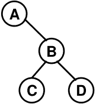

|       | 0 | 1 | 2 | 3 | 4 |
|-------|---|---|---|---|---|
| Element | B | A |   | D | C |
| Left   | 4 | -1 |   | -1 | -1 |
| Right  | 3 | 0  |   | -1 | -1 |

## 程序框架搭建

```c
int main()
{
    建二叉树1
    建二叉树2
    判别是否同构并输出
    return 0;
}
```

```c
int main()
{
    Tree R1, R2;
    R1 = BuildTree(T1);
    R2 = BuildTree(T2);
    if (Isomorphic(R1, R2)) printf("Yes\n");
    else printf("No\n");
    return 0;
}
```

- 需要设计的函数：
  - 读数据建二叉树
  - 二叉树同构判别

### 如何建二叉树

```c
Tree BuildTree( struct TreeNode T[] )
{
    ......
    scanf("%d\n", &N);
    if (N) {
        for (i=0; i<N; i++) check[i] = 0;
        for (i=0; i<N; i++) {
            scanf("%c %c %c\n", &T[i].Element, &cl, &cr);
            if (cl != '-') {
                T[i].Left = cl-'0';
                check[T[i].Left] = 1;
            }
            else T[i].Left = Null;
            ........ /*对cr的对应处理 */
        }
        for (i=0; i<N; i++)
            if (!check[i]) break;
        Root = i;
    }
    return Root;
}
```

### 如何判别两二叉树同构

```c
int Isomorphic ( Tree R1, Tree R2 )
{
    if ( (R1==Null )&& (R2==Null) ) /* both empty */
        return 1;
    if ( ((R1==Null)&&(R2!=Null)) || ((R1!=Null)&&(R2==Null)) )
        return 0; /* one of them is empty */
    if ( T1[R1].Element != T2[R2].Element )
        return 0; /* roots are different */
    if ( ( T1[R1].Left == Null )&&( T2[R2].Left == Null ) )
        /* both have no left subtree */
        return Isomorphic( T1[R1].Right, T2[R2].Right );

    if ( ((T1[R1].Left!=Null)&&(T2[R2].Left!=Null))&&
         ((T1[T1[R1].Left].Element)==(T2[T2[R2].Left].Element)) )
        /* no need to swap the left and the right */
        return ( Isomorphic( T1[R1].Left, T2[R2].Left ) &&
                 Isomorphic( T1[R1].Right, T2[R2].Right ) );

    else  /* need to swap the left and the right */
        return ( Isomorphic( T1[R1].Left, T2[R2].Right ) &&
                 Isomorphic( T1[R1].Right, T2[R2].Left ) );
}
```

## 4.1 二叉搜索树

### 什么是二叉搜索树

查找问题：

- 静态查找与动态查找
- 针对动态查找，数据如何组织？

二叉搜索树（BST，Binary Search Tree），也称二叉排序树或二叉查找树

二叉搜索树：一棵二叉树，可以为空；如果不为空，满足以下性质：

1. 非空左子树的所有键值小于其根结点的键值。
2. 非空右子树的所有键值大于其根结点的键值。
3. 左、右子树都是二叉搜索树。

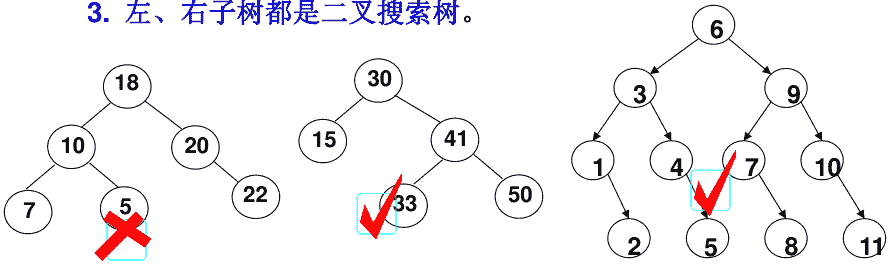

### 二叉搜索树操作的特别函数

- `Position Find( ElementType X, BinTree BST )`：从二叉搜索树BST中查找元素X，返回其所在结点的地址；
- `Position FindMin( BinTree BST )`：从二叉搜索树BST中查找并返回最小元素所在结点的地址；
- `Position FindMax( BinTree BST )`：从二叉搜索树BST中查找并返回最大元素所在结点的地址。
- `BinTree Insert( ElementType X, BinTree BST )`
- `BinTree Delete( ElementType X, BinTree BST )`

### 二叉搜索树的查找操作 Find

- 查找从根结点开始，如果树为空，返回NULL
- 若搜索树非空，则根结点关键字和X进行比较，并进行不同处理：

1. 若X小于根结点键值，只需在左子树中继续搜索；
2. 如果X大于根结点的键值，在右子树中继续搜索；
3. 若两者比较结果是相等，搜索完成，返回指向此结点的指针。

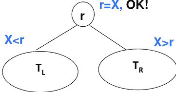

```c
Position Find( ElementType X, BinTree BST )
{
    if( !BST ) return NULL; /* 查找失败 */

    if( X > BST->Data )
        return Find( X, BST->Right ); /* 在右子树中继续查找 */

    else if( X < BST->Data )
        return Find( X, BST->Left ); /* 在左子树中继续查找 */

    else /* X == BST->Data */
        return BST; /* 查找成功，返回找到结点的地址 */
}
```

> 都是“尾递归”

### 查找的效率决定于树的高度

- 由于**非递归函数**的执行效率高，可将“**尾递归**”函数改为**迭代**函数

```c
Position IterFind( ElementType X, BinTree BST )
{
    while( BST ) {
        if( X > BST->Data )
            BST = BST->Right; /* 向右子树中移动，继续查找 */
        else if( X < BST->Data )
            BST = BST->Left;  /* 向左子树中移动，继续查找 */
        else /* X == BST->Data */
            return BST; /* 查找成功，返回找到结点的地址 */
    }
    return NULL; /* 查找失败 */
}
```


## 查找最大和最小元素

- 最大元素一定是在树的最右分枝的端结点上
- 最小元素一定是在树的最左分枝的端结点上

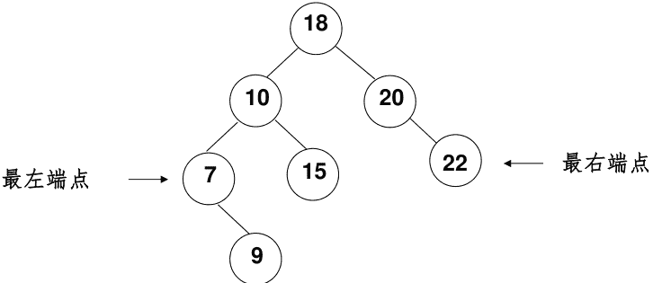

```c
Position FindMin( BinTree BST )
{
    if( !BST ) return NULL; /*空的二叉搜索树，返回NULL*/
    else if( !BST->Left )
        return BST; /*找到最左叶结点并返回*/
    else
        return FindMin( BST->Left ); /*沿左分支继续查找*/
}
```

查找最小元素的递归函数

```c
Position FindMax( BinTree BST )
{
    if(BST )
        while( BST->Right ) BST = BST->Right;
        /*沿右分支继续查找，直到最右叶结点*/
    return BST;
}
```

查找最大元素的迭代函数

## 二叉搜索树的插入

【分析】关键是要找到元素应该插入的位置，可以采用与Find类似的方法

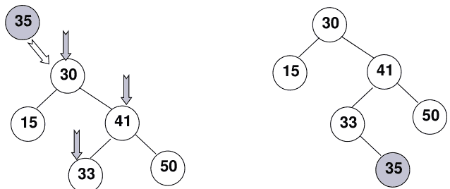

```c
BinTree Insert( ElementType X, BinTree BST )
{
    if( !BST ){
    /*若原树为空，生成并返回一个结点的二元搜索树*/
    BST = malloc(sizeof(struct TreeNode));
    BST->Data = X;
    BST->Left = BST->Right = NULL;
    }else /*开始找要插入元素的位置*/
    if( X < BST->Data )
    BST->Left = Insert( X, BST->Left );
    /*递归插入左子树*/
    else if( X > BST->Data )
    BST->Right = Insert( X, BST->Right );
    /*递归插入右子树*/
    /* else X已经存在，什么都不做 */
    return BST;
}
```

## 二叉搜索树的插入算法

【例】以一年十二个月的英文缩写为键值，按从一月到十二月顺序输入，即输入序列为（Jan, Feb, Mar, Apr, May, Jun, July, Aug, Sep, Oct, Nov, Dec）

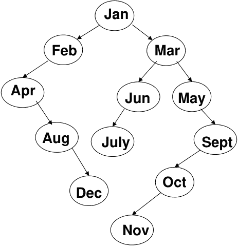

# 要删除的结点只有一个孩子结点：

将其父结点的指针指向要删除结点的孩子结点

【例】：删除 33

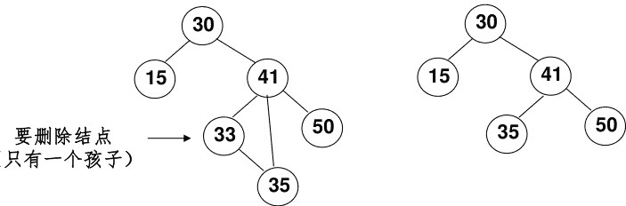

☞ 要删除的结点有左、右两棵子树：

用另一结点替代被删除结点：右子树的最小元素或者左子树的最大元素

【例】∶ 删除 41

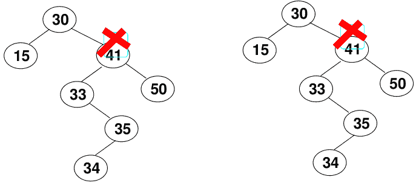

- 1、取右子树中的最小元素替代
- 2、取左子树中的最大元素替代

```c
BinTree Delete( ElementType X, BinTree BST )
{
    Position Tmp;
    if( !BST ) printf("要删除的元素未找到");
    else if( X < BST->Data )
        BST->Left = Delete( X, BST->Left); /* 左子树递归删除 */
    else if( X > BST->Data )
        BST->Right = Delete( X, BST->Right); /* 右子树递归删除 */
    else /*找到要删除的结点 */
    if( BST->Left && BST->Right ) { /*被删除结点有左右两个子结点 */
        Tmp = FindMin( BST->Right );
        /*在右子树中找最小的元素填充删除结点*/
        BST->Data = Tmp->Data;
        BST->Right = Delete( BST->Data, BST->Right);
        /*在删除结点的右子树中删除最小元素*/
    } else { /*被删除结点有一个或无子结点*/
        Tmp = BST;
        if( !BST->Left ) /* 有右孩子或无子结点*/
        BST = BST->Right;
        else if( !BST->Right ) /*有左孩子或无子结点*/
        BST = BST->Left;
        free( Tmp );
    }
    return BST;
}
```

## 4.2平衡二叉树

## 什么是平衡二叉树

【例】搜索树结点不同插入次序，将导致不同的深度和平均查找长度ASL

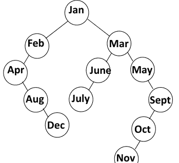

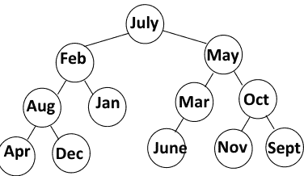

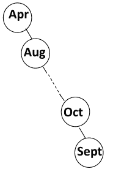

(a) 自然月份序列

ASL(a)=(1+2×2+3×3+3+4×3+5×2+6×1)/12 = 3.5

(b) 按July, Feb, May, Mar, Aug, Jan, Apr, Jun, Oct, Sept, Nov, Dec

ASL(b)=3.0

(c)月份字符串大小顺序

ASL(c)= 6.5

## 什么是平衡二叉树

“平衡因子（Balance Factor，简称BF）：**BF(T) = hₗ - hᵣ**，其中hₗ和hᵣ分别为T的左、右子树的高度。

> **平衡二叉树（Balanced Binary Tree）（AVL树）**  
> 空树，或者  
> 任一结点左、右子树高度差的绝对值不超过1，即 **|BF(T)| ≤ 1**

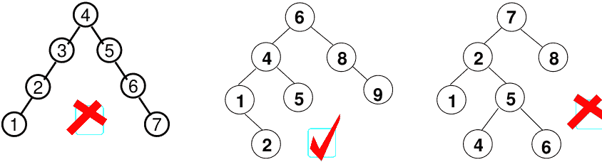

# 设 \( n_h \) 是高度为 \( h \) 的平衡二叉树的最小结点数.

| h   | n_h   | F_h   |
|-----|-------|-------|
| 0   | 1     | 1     |
| 1   | 2     | 1     |
| 2   | 4     | 2     |
| 3   | 7     | 3     |
| 4   | 12    | 5     |
| 5   | 20    | 8     |
| 6   | 33    | 13    |
| 7   | 54    | 21    |
| 8   | 88    | 34    |
| 9   | ......|       |

\(\Rightarrow \quad n_h = n_{h-1} + n_{h-2} + 1\)

\(\Rightarrow \quad n_h = F_{h+2} - 1, \quad (\text{对 } h \ge 0)\)

\(F_i \approx \frac{1}{\sqrt{5}} \left( \frac{1+\sqrt{5}}{2} \right)^i\)

\(\Rightarrow \quad n_h \approx \frac{1}{\sqrt{5}} \left( \frac{1+\sqrt{5}}{2} \right)^{h+2} - 1\)

\(\Rightarrow \quad h = O(\log_2 n)\)

□ 给定结点数为 \( n \) 的 AVL 树的最大高度为 \( O(\log_2 n) \)!

## 平衡二叉树的调整

## 平衡二叉树的调整

不平衡的“发现者”是Mar，“麻烦结点”Nov在发现者右子树的右边，因而叫RR插入，需要RR旋转（右单旋）

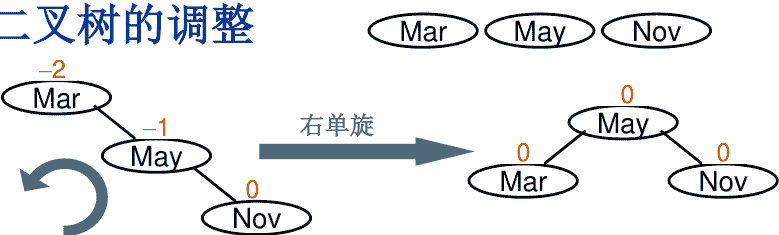

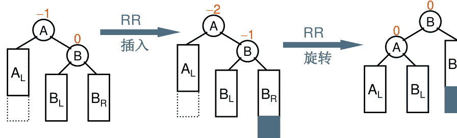

“发现者”是Mar，“麻烦结点”Apr在发现者左子树的左边，因而叫 LL 插入，需要LL 旋转（左单旋）


# 左-右双旋

LR 旋转

“发现者”是 May，“麻烦结点” Jan 在左子树的右边，因而叫 LR 插入，需要 LR 旋转

LR 插入

LR 旋转

OR

# 小白专场：是否同一棵二叉搜索树

## 题意理解

给定一个插入序列就可以唯一确定一棵二叉搜索树。然而，一棵给定的二叉搜索树却可以由多种不同的插入序列得到。

- 例如，按照序列 {2, 1, 3} 和 {2, 3, 1} 插入初始为空的二叉搜索树，都得到一样的结果。

问题：对于输入的各种插入序列，你需要判断它们是否能生成一样的二叉搜索树。

## 题意理解

### 输入样例：

```
4 2
3 1 4 2
3 4 1 2
3 2 4 1
2 1
2 1
1 2
0
```

### 输出样例：

```
Yes
No
No
```

# 求解思路

两个序列是否对应相同搜索树的判别

1. 分别建两棵搜索树的判别方法  
   根据两个序列分别建树，再判别树是否一样  

2. 不建树的判别方法  

3. 建一棵树，再判别其他序列是否与该树一致  

# 求解思路

1. 搜索树表示  
2. 建搜索树 T  
3. 判断一序列是否与搜索树 T 一致  

# 搜索树表示

```c
typedef struct TreeNode *Tree;
struct TreeNode {
    int v;
    Tree Left, Right;
    int flag;
};
```

## 程序框架搭建

```c
int main()
{ 对每组数据
  ● 读入N和L
  ● 根据第一行序列建树T
  ● 依据树T分别判别后面的L个序列是否能与T形成同一搜索树并输出结果

  return 0;
}
```

# 需要设计的主要函数：

- 读数据建搜索树T  
- 判别一序列是否与T构成一样的搜索树  

```c
int main()
{
    int N, L, i;
    Tree T;

    scanf("%d", &N);
    while (N) {
        scanf("%d", &L);
        T = MakeTree(N);
        for (i=0; i<L; i++) {
            if (Judge(T, N))printf("Yes\n");
            else printf("No\n");
            Reset(T); /*清除T中的标记flag*/
        }
        FreeTree(T);
        scanf("%d", &N);
    }

    return 0;
}
```

# 如何建搜索树

```c
Tree MakeTree( int N )
{
        Tree T;
        int i, V;

        scanf("%d", &V);
        T = NewNode(V);
        for (i=1; i<=N; i++) {
                scanf("%d", &V);
                T = Insert(T, V);
        }
        return T;
}
```

```c
Tree Insert( Tree T, int V )
{
        if ( !T ) T = NewNode(V);
        else {
                if ( V>T->v )
                        T->Right = Insert( T->Right, V );
                else
                        T->Left = Insert( T->Left, V );
        }
        return T;
}
```

```c
Tree NewNode( int V )
{
        Tree T = (Tree)malloc(sizeof(struct TreeNode));
        T->V = V;
        T->Left = T->Right = NULL;
        T->flag = 0;
        return T;
}
```

# 如何判别

通过 3 1 4 2 构造的 T  

3 2 4 1 对应的树  

如何判别序列 3 2 4 1 是否与树 T 一致？  

方法：在树 T 中按顺序搜索序列 3 2 4 1 中的每个数  

- 如果每次搜索所经过的结点在前面均出现过，则一致  
- 否则（某次搜索中遇到前面未出现的结点），则不一致  

# 如何判别

```c
int check ( Tree T, int V )
{
        if ( T->flag ) {
                if ( V<T->v ) return check(T->Left, V);
                else if (V>T->v) return check(T->Right, V);
                else return 0;
        }
        else {
                if ( V==T->v ) {
                        T->flag = 1;
                        return 1;
                }
                else return 0;
        }
}
```

# 如何判别

```c
int Judge( Tree T, int N )    /* 有bug版本 */
{
        int i, V;

        scanf("%d", &V);
        if ( V!=T->v) return 0;
        else T->flag = 1;

        for (i=1; i<N; i++) {
                scanf("%d", &V);
                if (!check(T, V)) return 0;
        }

        return 1;
}
```

3 2 4 1  

当发现序列中的某个数字与不一致时，必须把序列后面的数都读完！  

# 如何判别

```c
int Judge( Tree T, int N )
{
        int i, V, flag = 0;
        /* flag: 0代表目前还一致，1代表已经不一致*/

        scanf("%d", &V);
        if ( V!=T->v) flag = 1;
        else T->flag = 1;
        for (i=1; i<N; i++) {
                scanf("%d", &V);
                if ( (!flag) && (!check(T, V)) ) flag = 1;
        }
        if (flag) return 0;
        else return 1;
}
```

```c
void ResetT ( Tree T ) /* 清除T中各结点的flag标记 */
{
    if (T->Left) ResetT(T->Left);
    if (T->Right) ResetT(T->Right);
    T->flag = 0;
}
```

```c
void FreeTree ( Tree T ) /* 释放T的空间 */
{
    if (T->Left) FreeTree(T->Left);
    if (T->Right) FreeTree(T->Right);
    free(T);
}
```


## 线性结构之习题选讲

浙江大学 陈越

Copyright © 2014, 浙江大学计算机科学与技术学院  
All Rights Reserved


## Reversing Linked List

## 什么是抽象的链表

- 有块地方存数据
- 有块地方存指针 —— 下一个结点的地址

Sample Input:

```text
00100 6 4
00000 4 99999
00100 1 12309
68237 6 -1
33218 3 00000
99999 5 68237
12309 2 33218
```

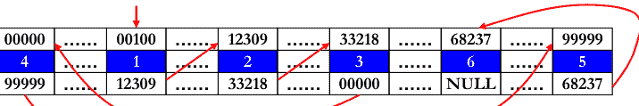

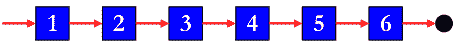

Copyright © 2014, 浙江大学计算机科学与技术学院  
All Rights Reserved

## 单链表的逆转

取巧：用顺序表存储，先排序，再直接逆序输出。

在“内存”里多加几个没用的结点，让你偷懒！

```c
Ptr Reverse( Ptr head, int K )
{
    cnt = 1;
    new = head->next;
    old = new->next;
    while ( cnt < K )
    {
        tmp = old->next;
        old->next = new;
        new = old; old = tmp;
        cnt++;
    }
    head->next->next = old;
    return new;
}
```


Copyright © 2014, 浙江大学计算机科学与技术学院  
All Rights Reserved

## 测试数据

- 有尾巴不反转
- 地址取到上下界
- 正好全反转
- K=N 全反转
- K=1 不用反转
- 最大（最后剩 K-1 不反转）、最小 N
- 有多余结点

## 边界测试

## 5.1 堆(heap)

## 若采用数组或链表实现优先队列

### 数组：

- 插入 — 元素总是插入尾部 ~ Θ(1)
- 删除 — 查找最大（或最小）关键字 ~ Θ(n)
  - 从数组中删去需要移动元素 ~ O(n)

### 链表：

- 插入 — 元素总是插入链表的头部 ~ Θ(1)
- 删除 — 查找最大（或最小）关键字 ~ Θ(n)
  - 删除结点 ~ Θ(1)

### 有序数组：

- 插入 — 找到合适的位置 ~ O(n) 或 O(log₂ n)
  - 移动元素并插入 ~ O(n)
- 删除 — 删去最后一个元素 ~ Θ(1)

### 有序链表：

- 插入 — 找到合适的位置 ~ O(n)
  - 插入元素 ~ Θ(1)
- 删除 — 删除首元素或最后元素 ~ Θ(1)

## 是否可以采用二叉树存储结构？

- 二叉搜索树？

- 如果采用二叉树结构，应更关注插入还是删除？

- 树结点顺序怎么安排？

- 树结构怎样？

## 优先队列的完全二叉树表示

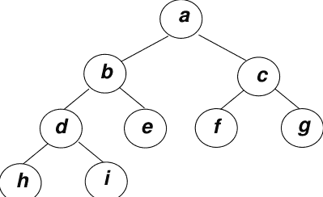

|   | a | b | c | d | e | f | g | h | i |   |   |
|---|---|---|---|---|---|---|---|---|---|---|---|
| 0 | 1 | 2 | 3 | 4 | 5 | 6 | 7 | 8 | 9 | 10 | 11 |

### 堆的两个特性

- 结构性：用数组表示的完全二叉树；
- 有序性：任一结点的关键字是其子树所有结点的最大值（或最小值）
- “最大堆（MaxHeap）”，也称“大顶堆”：最大值
- “最小堆（MinHeap）”，也称“小顶堆”：最小值

## 【例】最大堆和最小堆

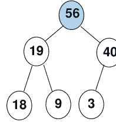

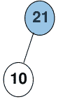

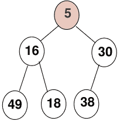

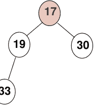

> **注意：** 从根结点到任意结点路径上结点序列的有序性！

## 【例】不是堆

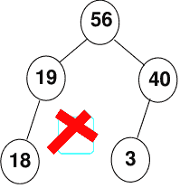

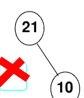

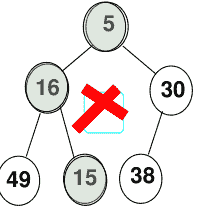

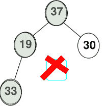

## 堆的抽象数据类型描述

**类型名称：** 最大堆（MaxHeap）

**数据对象集：** 完全二叉树，每个结点的元素值不小于其子结点的元素值

**操作集：** 最大堆 H ∈ MaxHeap，元素 item ∈ ElementType，主要操作有：

- `MaxHeap Create( int MaxSize )`：创建一个空的最大堆。
- `Boolean IsFull( MaxHeap H )`：判断最大堆 H 是否已满。
- `insert( MaxHeap H, ElementType item )`：将元素 item 插入最大堆 H。
- `Boolean IsEmpty( MaxHeap H )`：判断最大堆 H 是否为空。
- `ElementType DeleteMax( MaxHeap H )`：返回 H 中最大元素（高优先级）。

## 最大堆的操作

### 最大堆的创建

```c
typedef struct HeapStruct *MaxHeap;
struct HeapStruct {
    ElementType *Elements; /* 存储堆元素的数组 */
    int Size; /* 堆的当前元素个数 */
    int Capacity; /* 堆的最大容量 */
};
```

```c
MaxHeap Create( int MaxSize )
{
    /* 创建容量为MaxSize的空的最大堆 */
    MaxHeap H = malloc( sizeof( struct HeapStruct ) );
    H->Elements = malloc( (MaxSize+1) * sizeof(ElementType) );
    H->Size = 0;
    H->Capacity = MaxSize;
    H->Elements[0] = MaxData;
    /* 定义“哨兵”为大于堆中所有可能元素的值，便于以后更快操作 */
    return H;
}
```

> 把 MaxData 换成小于堆中所有元素的 MinData，同样适用于创建最小堆。

## 最大堆的插入

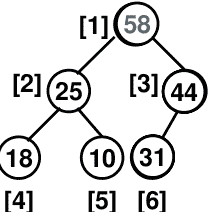

Case 1：new_item = 20，20 < 31 ✔

Case 2：new_item = 35，35 > 31，35 < 44 ✔

Case 3：new_item = 58，58 > 31，58 > 44，58 < MaxData ✔

### ❖ 算法：将新增加结点插入到从其父结点到根结点的有序序列中

```c
void insert( MaxHeap H, ElementType item )
{ /* 将元素item 插入最大堆，其中H->Elements[0]已经定义为哨兵 */
    int i;
    if ( IsFull(H) ) {
        printf("最大堆已满");
        return;
    }
    i = ++H->Size; /* i指向插入后堆中的最后一个元素的位置 */
    for ( ; H->Elements[i/2] < item; i/=2 )
        H->Elements[i] = H->Elements[i/2]; /* 向下过滤结点 */
    H->Elements[i] = item; /* 将item 插入 */
}
```

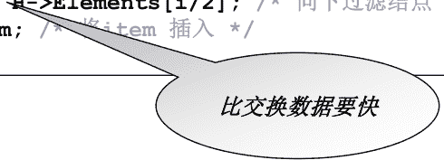


## ❖ 算法：将新增结点插入到从其父结点到根结点的有序序列中

```c
void Insert( MaxHeap H, ElementType item )
{ /* 将元素item 插入最大堆，其中H->Element[0]是哨兵元素 */
    int i;
    if ( IsFull(H) ) {
        printf("最大堆已满");
        return;
    }
    i = ++H->Size; /* i指向插入位置的最后一个元素的位置 */
    for ( ; H->Elements[i/2] < item; i/=2 )
        H->Elements[i] = H->Elements[i/2]; /* 向下过滤结点 */
    H->Elements[i] = item; /* 将item 插入 */
}
```

> H->Element[0] 是哨兵元素，它不小于堆中的最大元素，控制循环结束。

*T(N) = O(log N)*

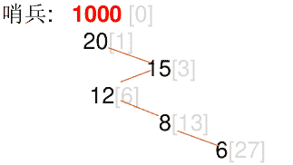

## 最大堆的删除

取出根结点（最大值）元素，同时删除堆的一个结点。


T(N) = O(log N)

```c
ElementType DeleteMax( MaxHeap H )
{
    /* 从最大堆中取出键值为最大的元素，并删除一个结点 */
    int Parent, Child;
    ElementType MaxItem, temp;
    if ( IsEmpty(H) ) {
        printf("最大堆已为空");
        return;
    }
    MaxItem = H->Elements[1]; /* 取出根结点最大值 */
    /* 用最大堆中最后一个元素从根结点开始向上过滤下层结点 */
    temp = H->Elements[H->Size--];
    for( Parent=1; Parent*2<=H->Size; Parent=Child ) {
        Child = Parent * 2;
        if( (Child!= H->Size) &&
            (H->Elements[Child] < H->Elements[Child+1]) )
            Child++;  /* Child指向左右子结点的较大者 */
        if( temp >= H->Elements[Child] ) break;
        else  /* 移动temp元素到下一层 */
            H->Elements[Parent] = H->Elements[Child];
    }
    H->Elements[Parent] = temp;
    return MaxItem;
}
```

## 最大堆的建立

建立最大堆：将已经存在的N个元素按最大堆的要求存放在一个一维数组中。

方法1：通过插入操作，将N个元素一个个相继插入到一个初始为空的堆中去，其时间代价最大为O(N logN)。

方法2：在线性时间复杂度下建立最大堆。
（1）将N个元素按输入顺序存入，先满足完全二叉树的结构特性。
（2）调整各结点位置，以满足最大堆的有序特性。


当前考察结点

终结点

当前考虑结点


## ➤ 线性时间复杂度 T(n)=O(n)

| 结点数 | 最多交换次数 |
|---|---|
| n/4 | 1 |
| n/8 | 2 |
| n/16 | 3 |
| …… | |
| n/2^k−1 | log₂n−1 (k−1) |

$T(n)=\frac{n}{4}+\frac{n}{8}\times2+\frac{n}{16}\times3+\cdots+\frac{n}{2^k}\times(k-1)$

$2T(n)=\frac{n}{2}+\frac{n}{4}\times2+\frac{n}{8}\times3+\cdots+\frac{n}{2^{k-1}}\times(k-1)$

$2T(n)-T(n)=\frac{n}{2}+\frac{n}{4}+\frac{n}{8}+\cdots+\frac{n}{2^{k-1}}-\frac{n}{2^k}\times(k-1)\le n-(\log_2 n-1)\le n$

## 5.2 哈夫曼树与哈夫曼编码

如果考虑学生成绩的分布的概率：

| 分数段 | 0-59 | 60-69 | 70-79 | 80-89 | 90-100 |
|---|---|---|---|---|---|
| 比例 | 0.05 | 0.15 | 0.40 | 0.30 | 0.10 |

查找效率：0.05×1+0.15×2+0.4×3+0.3×4+0.1×4 = 3.15


如果考虑学生成绩的分布的概率：

| 分数段 | 0-59 | 60-69 | 70-79 | 80-89 | 90-100 |
|---|---|---|---|---|---|
| 比例 | 0.05 | 0.15 | 0.40 | 0.30 | 0.10 |

修改判定树：


效率：0.05×3+0.15×3+0.4×2+0.3×2+0.1×2=2.2

如何根据结点不同的查找频率构造更有效的搜索树？

## 哈夫曼树的定义

带权路径长度(WPL)：设二叉树有n个叶子结点，每个叶子结点带有权值 $w_k$，从根结点到每个叶子结点的长度为 $l_k$，则每个叶子结点的带权路径长度之和就是：
\( WPL = \sum_{k=1}^{n} w_k l_k \)

最优二叉树或哈夫曼树：WPL最小的二叉树。

【例】有五个叶子结点，它们的权值为{1,2,3,4,5}，用此权值序列可以构造出形状不同的多个二叉树。


WPL = 34


WPL = 50


WPL = 33

## 哈夫曼树的特点：

+ 没有度为1的结点；
+ n个叶子结点的哈夫曼树共有2n-1个结点；
+ 哈夫曼树的任意非叶节点的左右子树交换后仍是哈夫曼树；
+ 对同一组权值{$w_1,w_2,\ldots,w_n$}，是否存在不同构的两棵哈夫曼树呢？

对一组权值{1, 2, 3, 3}，不同构的两棵哈夫曼树：


## 哈夫曼编码

+ 给定一段字符串，如何对字符进行编码，可以使得该字符串的编码存储空间最少？

[例] 假设有一段文本，包含58个字符，并由以下7个字符构成：a, e, i, s, t, 空格（sp），换行（nl）；这7个字符出现的次数不同。如何对这7个字符进行编码，使得总编码空间最少？

【分析】

+ （1）用等长ASCII编码：58 × 8 = 464位；
+ （2）用等长3位编码：58 × 3 = 174位；
+ （3）不等长编码：出现频率高的字符用的编码短些，出现频率低的字符则可以编码长些？

## 怎么进行不等长编码？

## 如何避免二义性？

前缀码prefix code：任何字符的编码都不是另一字符编码的前缀。

+ 可以无二义地解码。


# ◆ 二叉树用于编码

用二叉树进行编码：
（1）左右分支：0、1
（2）字符只在叶结点上

四个字符的频率：a:4，u:1，x:2，z:1


**Cost**（*aaxuaxz* → `0000001001001011`）
= 2×4 + 2×1 + 2×2 + 2×1 = 16


**Cost**（*aaaxuaxz* → `00010110010111`）
= 1×4 + 3×1 + 2×2 + 3×1 = 14

# 怎么构造一颗编码代价最小的二叉树？

# 5.3 集合及运算

# 集合的表示

- 集合运算：交、并、补、差，判定一个元素是否属于某一集合
- 并查集：集合并、查某元素属于什么集合
- 并查集问题中集合存储如何实现？
  - 可以用树结构表示集合，树的每个结点代表一个集合元素

例如，有三个整数集合

S1={1,2,4,7}
S2={3,5,8}
S3={6,9,10}

| 集合名 | 指针 |
|---|---|
| S1 | → |
| S2 | → |
| S3 | → |


# 采用数组存储形式

| 下标 | Data | Parent |
|---:|---:|---:|
| 0 | 1 | -1 |
| 1 | 2 | 0 |
| 2 | 3 | -1 |
| 3 | 4 | 0 |
| 4 | 5 | 2 |
| 5 | 6 | -1 |
| 6 | 7 | 0 |
| 7 | 8 | 2 |
| 8 | 9 | 5 |
| 9 | 10 | 5 |

数组中每个元素的类型描述为：

```c
typedef struct {
    ElementType Data;
    int Parent;
} SetType;
```


> 负数表示根结点；
> 非负数表示双亲结点的下标。

# 集合运算

（1）查找某个元素所在的集合（用根结点表示）

```c
int Find( SetType S[ ], ElementType X )
{
    /* 在数组S中查找值为X的元素所属的集合 */

    /* MaxSize是全局变量，为数组S的最大长度 */

    int i;

    for ( i=0; i < MaxSize && S[i].Data != X; i++);

    if( i >= MaxSize ) return -1; /* 未找到X，返回-1 */

    for( ; S[i].Parent >= 0; i = S[i].Parent );

    return i; /* 找到X所属集合，返回树根结点在数组S中的下标 */
}
```

# （2）集合的并运算

- 分别找到X1和X2两个元素所在集合树的根结点
- 如果它们不同根，则将其中一个根结点的父结点指针设置成另一个根结点的数组下标。

```c
void Union( SetType S[ ], ElementType X1, ElementType X2)
{
    int Root1, Root2;

    Root1 = Find(S, X1);

    Root2 = Find(S, X2);

    if ( Root1 != Root2 ) S[Root2].Parent = Root1;
}
```

> 当X1和X2不属于同一子集时，才需要合并

| 下标 | data | Parent |
|------|------|--------|
| 0    | 1    | -1     |
| 1    | 2    | 0      |
| 2    | 3    | 0      |
| 3    | 4    | 0      |
| 4    | 5    | 2      |
| 5    | 6    | -1     |
| 6    | 7    | 0      |
| 7    | 8    | 2      |
| 8    | 9    | 5      |
| 9    | 10   | 5      |


> 改成-7。表示集合有7个元素

> 改成-3。表示集合有3个元素

> 为了改善合并以后的查找性能，可以采用小的集合并到相对大的集合中。（修改Union函数）

# 小白专场：堆中的路径

## 题意理解

将一系列给定数字插入一个初始为空的小顶堆H[]。随后对任意给定的下标i，打印从H[i]到根结点的路径。

### 输入样例：
5 3
46 23 26 24 10
5 4 3

### 输出样例：
24 23 10
46 23 10
26 10


# 小白专场：File Transfer

浙江大学 陈 越

# 集合的简化表示

```c
typedef struct {
    ElementType Data;
    int Parent;
} SetType;
```

任何有限集合的（N个）元素都可以被一一映射为整数 0 ~ N-1

```c
int Find( SetType S[], ElementType X )
{
    int i;
    for ( i=0; i<MaxSize && S[i].Data!=X; i++ ) ;
    if ( i>=MaxSize ) return -1;
    for ( ; S[i].Parent>=0; i=S[i].Parent ) ;
    return i;
}
```


下标 [0] [1] [2] [3] [4] [5] [6]
S 6 6 -1 4 2 2 -1


# 集合的简化表示

```c
typedef int ElementType; /*默认元素可以用非负整数表示*/
typedef int SetName; /*默认用根结点的下标作为集合名称*/
typedef ElementType SetType[MaxSize];

SetName Find( SetType S, ElementType X )
{ /* 默认集合元素全部初始化为-1 */
    for( ; S[X]>=0; X=S[X] );
    return X;
}

void Union( SetType S, SetName Root1, SetName Root2 )
{ /* 这里默认Root1和Root2是不同集合的根结点 */
    S[Root2] = Root1;
}
```

## 题意理解

输入样例1：

5
C 3 2 ☞ no
I 3 2
C 1 5 ☞ no
I 4 5
I 2 4
C 3 5 ☞ yes
S

There are 2 components.


## 题意理解

输入样例2：

5
C 3 2 ☞ no
I 3 2
C 1 5 ☞ no
I 4 5
I 2 4
C 3 5 ☞ yes
I 1 3
C 1 5 ☞ yes
S

The network is connected.


## 程序框架搭建

```c
int main()
{
    初始化集合;
    do {
        读入一条指令;
        处理指令;
    } while (没结束);
    return 0;
}
```

```c
int main()
{
    SetType S;
    int n;
    char in;
    scanf("%d\n", &n);
    Initialization( S, n );
    do {
        scanf("%c", &in);
        switch (in) {
        case 'I': Input_connection( S ); break;
        case 'C': Check_connection( S ); break;
        case 'S': Check_network( S, n ); break;
        }
    } while ( in != 'S' );
    return 0;
}
```


## 程序框架搭建

```c
void Input_connection( SetType S )
{
    ElementType u, v;
    SetName Root1, Root2;
    scanf("%d %d\n", &u, &v);
    Root1 = Find(S, u-1);
    Root2 = Find(S, v-1);
    if ( Root1 != Root2 )
        Union( S, Root1, Root2 );
}
```

```c
void Check_connection( SetType S )
{
    ElementType u, v;
    SetName Root1, Root2;
    scanf("%d %d\n", &u, &v);
    Root1 = Find(S, u-1);
    Root2 = Find(S, v-1);
    if ( Root1 == Root2 )
        printf("yes\n");
    else printf("no\n");
}
```

```c
void Check_network( SetType S, int n )
{
    int i, counter = 0;
    for (i=0; i<n; i++) {
        if ( S[i] < 0 ) counter++;
    }
    if ( counter == 1 )
        printf("The network is connected.\n");
    else
        printf("There are %d components.\n", counter);
}
```

## TSSN的实现

```c
SetName Find( SetType S, ElementType X )
{ /* 默认集合元素全部初始化为-1 */
     for( ; S[X]>0; X=S[X] ) ;
     return X;
}
```

```c
void Union( SetType S, SetName Root1, SetName Root2 )
{ /* 这里默认Root1和Root2是不同集合的根结点 */
     S[Root1] = Root2;
}
```

| 测试点 | 结果   |
|--------|--------|
| 测试点1 | 答案正确 |
...
| 测试点7 | 答案正确 |

| 测试点 | 结果   |
|--------|--------|
...
| 测试点5 | 运行超时 |
...

```c
int Find( SetType S[], ElementType X )
{
    int i;
    for ( i=0; i<MaxSize && S[i].Data!=X; i++ ) ;
    if ( i>=MaxSize ) return -1;
    for( ; S[i].Parent>=0; i=S[i].Parent ) ;
    return i;
}
```

```c
void Union( SetType S[], ElementType X1, ElementType X2 )
{
    int Root1, Root2;
    Root1 = Find(S, X1);
    Root2 = Find(S, X2);
    if (Root1!=Root2) S[Root2].Parent = Root1;
}
```

| 测试点 | 结果 |
|---|---|
...
```

But wait, if we merge TSSN, the second implementation code appears after the two tables. Is that okay? Yes.

Need maybe "TSSN的实现" heading should be "## TSSN 的实现"? Original no space. Keep.

Need maybe "程序框架搭建" and "TSSN的实现" are both first-level. Good.

Then "## 按秩归并" with subsections.

Need maybe "为什么需要按秩归并？" as ###. Then bullets. Then "T(n) = O(n²)" paragraph. Then image.

Then maybe "### 为什么树会越来越高？" as heading? Original bullet. But if we make it a bullet under "按秩归并", then the following bullets are list. Let's output:
```
### 为什么需要按秩归并？

- Union(Find(2), Find(1))
- Union(Find(3), Find(1))
- ......
- Union(Find(n), Find(1))

T(n) = O(n²)


- 为什么树会越来越高？
- 应该把矮树贴到高树上！
- 树的高度存哪里？

S[Root] = -树高；

```c
if ( Root2高度 > Root1高度 )
...
```

```c
if ( S[Root2] < S[Root1] )
...
```


> 仍然初始化为-1
```
But "为什么树会越来越高？" is a bullet, not heading. Good. However "为什么需要按秩归并？" is a heading, and then after image, the bullet list "为什么树会越来越高？" is still under same section. Fine.

Need maybe "按秩归并 最坏情况下的树高 = O(log N)" as a subsection. Could be:
```
### 按秩归并 最坏情况下的树高 = O(log N)

#### 另一种做法：比规模

##### 把小树贴到大树上 S[Root] = -元素个数；

```c
void Union...
```

两种方法统称“按秩归并”
```
But user only specified ## and ###. Using ##### is too deep. Maybe use bold for "把小树贴到大树上..."? Let's think.

Original "# ### 把小树贴到大树上 S[Root] = -元素个数；" The "# ###" likely indicates a third-level heading? Actually in Markdown, "# ###" would be a level-1 heading containing literal "###"? But OCR likely from PPT outline: "按秩归并" (level 1), "另一种做法：比规模" (level 2), "把小树贴到大树上 S[Root] = -元素个数；" (level 3). So using #### is appropriate. User didn't forbid deeper. We'll use ####. For "六度空间理论" use ####. For "6.1 什么是图" use ###. Good.

Need maybe "按秩归并 最坏情况下的树高 = O(log N)" as ###. Then "另一种做法：比规模" as ####. Then "把小树贴到大树上..." as #####? Wait if "按秩归并" is ##, then "按秩归并 最坏情况下的树高 = O(log N)" is ###, "另一种做法：比规模" is ####, "把小树贴到大树上..." is #####. That's deep. But original hierarchy: "按秩归并" (##) -> "按秩归并 最坏情况下的树高 = O(log N)" (###) -> "另一种做法：比规模" (####) -> "把小树贴到大树上..." (#####). Is that intended? Maybe "按秩归并 最坏情况下的树高 = O(log N)" is a slide title, not a subsection under "按秩归并"; it's a separate section. Then "另一种做法：比规模" is a subsection, and "把小树贴到大树上..." is a sub-subsection. So:
### 按秩归并 最坏情况下的树高 = O(log N)
#### 另一种做法：比规模
##### 把小树贴到大树上 S[Root] = -元素个数；
This is cleaner. But then what about earlier "## 按秩归并" with "为什么需要按秩归并？"? We can have:
## 按秩归并
### 为什么需要按秩归并？
...
### 按秩归并 最坏情况下的树高 = O(log N)
#### 另一种做法：比规模
##### 把小树贴到大树上 S[Root] = -元素个数；
...
This preserves original slide titles. But duplicate "按秩归并" in heading. Could be okay. Alternatively, combine:
## 按秩归并
### 为什么需要按秩归并？
...
### 按秩归并 最坏情况下的树高 = O(log N)
#### 另一种做法：比规模
##### 把小树贴到大树上 S[Root] = -元素个数；
...
This is more hierarchical but deep. Which is better? User asked "根据语义和缩进/编号特征，识别标题". The original "# # 按秩归并" and "# # 按秩归并 最坏情况下的树高 = O(log N)" are both slide titles at same level. So maybe keep them as separate ## headings. But then "另一种做法：比规模" is ###, "把小树贴到大树上..." is ####. That seems good. Let's do that.

Need maybe "为什么需要按秩归并？" is a subsection under "按秩归并". Good.

Need maybe "路径压缩" is ##. "时间复杂度" is ##. "第六讲 图（上）" is ##. Good.

Need maybe "TSSN的实现" duplicate: Could also keep as separate ## headings? Hmm. If we keep duplicate "TSSN的实现", then "程序框架搭建" and "TSSN的实现" are sections. Page 254 "TSSN的实现" again. Maybe better to merge to avoid duplicate. But if we keep separate, it's okay. Let's decide based on "跨页的连续段落正确合并". Page 253 and 254 are not continuous paragraphs; they are separate slides. But the heading is same. I think merging is more polished. Let's merge.

Need maybe "程序框架搭建" and "TSSN的实现" are both under a larger "集合" topic? No.

Need maybe "TSSN的实现" code blocks and tables: If merged, the second implementation code appears after two tables. But the first implementation has two tables (maybe from two test runs). The second implementation has one table. Good.

Need maybe "TSSN的实现" first code block: `SetName Find( SetType S, ElementType X )` and `void Union( SetType S, SetName Root1, SetName Root2 )`. Then tables. Then second code block. Good.

Need maybe "TSSN" maybe "TSSN" not "TSSN 的实现"? Keep.

Need maybe "Input_connection" etc. Good.

Need maybe "程序框架搭建" code blocks: There is no table. Good.

Need maybe "按秩归并" page 255 image after T(n). Need output image link. Good.

Need maybe "按秩归并" page 256 image after code. Need output image link. Good.

Need maybe "路径压缩" page 258 two images. Need output both. Good.

Need maybe "时间复杂度" page 259 image. Need output. Good.

Need maybe "六度空间理论" page 262 image. Need output. Good.

Need maybe "第六讲 图（上）" page 260 no image. Good.

Need maybe "6.1 什么是图" page 261 no content. Good.

Need maybe "六度空间理论" heading and image. Good.

Need maybe "浙江大学 陈越" should be preserved. Could be "浙江大学 陈越" as paragraph. Good.

Need maybe "Ackermann 函数和 \( \alpha(M, N) \)" maybe should be a heading? It's a line. Could use `**Ackermann 函数和 \( \alpha(M, N) \)**`? Original no bold. Keep as paragraph.

Need maybe "【引理（Tarjan）】" maybe "引理（Tarjan）" with brackets. Keep.

Need maybe "A(i, j) = \begin{cases}..." Need ensure no line breaks lost. In Markdown, inline math with `\begin{cases}` can contain `\\` line breaks. Need preserve backslashes. We'll output:
\( A(i, j) = \begin{cases} 2^j & \quad i = 1 \text{ and } j \geq 1 \\ A(i-1, 2) & \quad i \geq 2 \text{ and } j = 1 \\ A(i-1, A(i, j-1)) & \quad i \geq 2 \text{ and } j \geq 2 \end{cases} \)
Need maybe "and" should be `\text{ and }`? Original has `\text{ and }`. Good.

Need maybe "α(M, N) = \min \{ i \geq 1 | A(i, \lfloor M/N \rfloor) > \log N \} \leq O(\log^* N) \leq 4" Good.

Need maybe "log^* N" with asterisk. Good.

Need maybe "Ackermann 反函数" definition. Good.

Need maybe "http://mathworld.wolfram.com/AckermannFunction.html" as plain. Good.

Need maybe "T(M, N)" with \( M \geq N \). Good.

Need maybe "k_1 M \alpha(M, N) \leq T(M, N) \leq k_2 M \alpha(M, N)" Good.

Need maybe "N-1 次按秩归并" Good.

Need maybe "交错执行" Good.

Need maybe "存在正常数" Good.

Need maybe "k_1" and "k_2" Good.

Need maybe "Ackermann 函数和 \( \alpha(M, N) \)" maybe should be "Ackermann 函数和 α(M, N)" but keep LaTeX.

Need maybe "TSSN的实现" code blocks: The first code block has comment `/* 默认集合元素全部初始化为-1 */` with Chinese. Good.

Need maybe "Union" comment `/* 这里默认Root1和Root2是不同集合的根结点 */` Good.

Need maybe "路径压缩" code comment `/* 找到集合的根 */` Good.

Need maybe "先找到根； 把根变成 X 的父结点； 再返回根。" Could be a list? Maybe output as:
先找到根；  
把根变成 X 的父结点；  
再返回根。
Need maybe "再返回根。" Good.

Need maybe "不用路径压缩 会死翘？" blockquote. Good.

Need maybe "仍然初始化为-1" blockquote. Good.

Need maybe "按秩归并" page 256 code snippets: The first snippet has `if ( Root2高度 > Root1高度 )` and `S[Root1] = Root2;` etc. Need maybe "Root2高度" should be "Root2 高度" but keep. The second snippet has `if ( S[Root2] < S[Root1] )` etc. Good.

Need maybe "S[Root] = -树高；" should be "S[Root] = -树高；" with Chinese semicolon. Good.

Need maybe "两种方法统称“按秩归并”" Good.

Need maybe "按秩归并 最坏情况下的树高 = O(log N)" heading. Good.

Need maybe "另一种做法：比规模" heading. Good.

Need maybe "把小树贴到大树上 S[Root] = -元素个数；" heading. Good.

Need maybe "Union" code in page 257:
```
void Union( SetType S, SetName Root1, SetName Root2 )
{
    if ( S[Root2]<S[Root1] ){
        S[Root2] += S[Root1];
        S[Root1] = Root2;
    }
    else {
        S[Root1] += S[Root2];
        S[Root2] = Root1;
    }
}
```
Good.

Need maybe "TSSN的实现" second code block: `int Find( SetType S[], ElementType X )` but `SetType S[]` maybe should be `SetType S[]`? Good.

Need maybe "for ( i=0; i<MaxSize && S[i].Data!=X; i++ ) ;" Good.

Need maybe "if ( i>=MaxSize ) return -1;" Good.

Need maybe "for( ; S[i].Parent>=0; i=S[i].Parent ) ;" Good.

Need maybe "return i;" Good.

Need maybe "Union" second code block: `S[Root2].Parent = Root1;` Good.

Need maybe "测试点" tables: Need maybe "结果" column alignment. Good.

Need maybe "答案正确" and "运行超时" no issue.

Need maybe "程序框架搭建" code blocks: Need maybe "Input_connection" should be "Input_connection" with lowercase c? Keep.

Need maybe "Check_connection" should be "Check_connection" with lowercase c? Keep.

Need maybe "Check_network" should be "Check_network" with lowercase n? Keep.

Need maybe "SetType S" in Check_network: `if ( S[i] < 0 ) counter++;` Good.

Need maybe "printf("The network is connected.\n");" Good.

Need maybe "printf("There are %d components.\n", counter);" Good.

Need maybe "TSSN" maybe "TSSN" not "TSSN" with Chinese? Keep.

Need maybe "第六讲 图（上）" and "6.1 什么是图" and "六度空间理论" heading levels. Let's choose:
```
# 第六讲 图（上）

浙江大学 陈越

### 6.1 什么是图

#### 六度空间理论（Six Degrees of Separation）


```
This uses #### for third-level. Good.

Need maybe "六度空间理论" is under "6.1 什么是图". Good.

Need maybe "6.1 什么是图" has no content. Good.

Need maybe "浙江大学 陈越" should be before "### 6.1 什么是图". Good.

Need maybe "程序框架搭建" and "TSSN的实现" maybe should be under a top-level "集合" but no. Fine.

Need maybe "按秩归并" and "路径压缩" and "时间复杂度" are sections. Good.

Need maybe "TSSN的实现" merged: Need maybe after first table and second table, then second implementation. But if we merge, the second implementation code appears after tables. Could be okay. But maybe the second implementation is a separate "TSSN的实现" section. Hmm. Let's think if merging loses the fact that there are two separate implementations? No, code blocks show.

Need maybe "TSSN的实现" first implementation has two tables; second implementation has one table. If merged, the reader might think all three tables belong to first implementation. But tables are separated by code blocks? Actually order:
- First Find/Union code
- Table 1
- Table 2
- Second Find/Union code
- Table 3
So table 3 clearly after second code. Good.

Need maybe "TSSN的实现" first code block and second code block both have same function names. That's okay.

Need maybe "程序框架搭建" code blocks: There is no "TSSN" heading before? Actually "程序框架搭建" is a section. Good.

Need maybe "Input_connection" etc. use `Find` and `Union` functions defined later. Good.

Need maybe "TSSN" maybe "TSSN" should be "TSSN" not "TSSN 的实现" with space. Keep.

Need maybe "按秩归并" page 255: The bullet list has `+   -` which might indicate nested list? Actually `+` and `-` both list markers. Could be from OCR of bullet points. Use simple `-`. Good.

Need maybe "为什么需要按秩归并？" heading and then bullets. Good.

Need maybe "T(n) = O(n²)" should be a paragraph. Good.

Need maybe "为什么树会越来越高？" bullet list under same section. Good.

Need maybe "S[Root] = -树高；" maybe should be a code line? It's a formula. Could use inline code? Original plain. Keep.

Need maybe "if ( Root2高度 > Root1高度 )" code block: Need maybe "Root2高度" and "Root1高度" are not valid C but pseudo-code. Use ```c? Maybe use ```text? Hmm. The second snippet is valid C. The first is pseudo-code. To be safe, use ```c for both? It might be okay. But "树++" is not C. Maybe use ``` for first and ```c for second? But original didn't specify language. User wants Markdown. We can use ```c for all code blocks. It's fine.

Need maybe "仍然初始化为-1" blockquote: Use `> 仍然初始化为-1`. Good.

Need maybe "不用路径压缩 会死翘？" blockquote: Use `> 不用路径压缩 会死翘？`. Good.

Need maybe "路径压缩" code block: Need maybe `return S[X] = Find( S, S[X] );` Good.

Need maybe "先找到根；" etc. Could be a list? Maybe output:
先找到根；  
把根变成 X 的父结点；  
再返回根。
Need maybe "先找到根；" line break. Good.

Need maybe "时间复杂度" page 259: Need maybe "Ackermann 函数和 \( \alpha(M, N) \)" as a line. Good.

Need maybe "http://mathworld.wolfram.com/AckermannFunction.html" maybe should be a link. Could output `http://mathworld.wolfram.com/AckermannFunction.html` plain. Good.

Need maybe "A(i, j) = \begin{cases}..." with `\text{ and }` maybe in Markdown, backslash t might be interpreted? No, in plain text okay. Need maybe escape backslashes? In final, we write `\\`? Actually in Markdown, a single backslash before `text` is okay. But in JSON? We're not in JSON. Need output literal backslashes. So write `\text{ and }`. Good.

Need maybe "α(M, N) = \min \{ i \geq 1 | A(i, \lfloor M/N \rfloor) > \log N \} \leq O(\log^* N) \leq 4" Good.

Need maybe "log^* N" with `^*`. Good.

Need maybe "Ackermann 反函数" definition. Good.

Need maybe "对 \( N \) 求对数直到结果 \(\leq 1\) 的次数" Good.

Need maybe "k_1 M \alpha(M, N) \leq T(M, N) \leq k_2 M \alpha(M, N)" Good.

Need maybe "T(M, N)" in lemma. Good.

Need maybe "M \geq N" Good.

Need maybe "N-1" Good.

Need maybe "正常数" Good.

Need maybe "Tarjan" Good.

Need maybe "引理" Good.

Need maybe "第六讲 图（上）" page 260: "浙江大学 陈越" maybe should be "浙江大学 陈越" with space. Good.

Need maybe "六度空间理论（Six Degrees of Separation）" heading. Good.

Need maybe "图片链接" preserve. Good.

Need maybe "如果只有图片链接，那么仅仅保留并输出图片链接。" Not applicable.

Need maybe "如果没有任何有效内容" Not applicable.

Need maybe "输出应包含在“[content]...[/content]”中." We'll do.

Need maybe "只输出处理后的最终文本，不要包含解释或额外注释" We'll do.

Need maybe "不要保留分页标记" We'll not include [PAGE].

Need maybe "恢复正常的段落缩进（首行空两格不是必须，但请用空行分隔不同段落）" We'll use blank lines between paragraphs.

Need maybe "根据语义和缩进/编号特征，识别标题" We'll use headings.

Need maybe "列表项用- 开头" We'll use bullets.

Need maybe "表格样式的文本转换为Markdown表格" We'll do.

Need maybe "纠正明显的OCR错误" Need identify any OCR errors beyond formatting. Let's scan for possible OCR errors:

- "TSSN" maybe "TSSN" but could be "TSSN" not sure.
- "Input_connection" maybe "Input_connection" okay.
- "Check_connection" maybe "Check_connection" okay.
- "Check_network" okay.
- "SetType S" okay.
- "SetName Root1, Root2;" okay.
- "Root1 = Find(S, u-1);" okay.
- "Union( S, Root1, Root2 );" okay.
- "printf("yes\n");" okay.
- "printf("no\n");" okay.
- "counter++" okay.
- "S[i] < 0" okay.
- "The network is connected." okay.
- "There are %d components." okay.
- "TSSN的实现" maybe "TSSN" should be "TSSN" not "TSSN"? Hmm.
- "默认集合元素全部初始化为-1" okay.
- "for( ; S[X]>0; X=S[X] ) ;" okay.
- "这里默认Root1和Root2是不同集合的根结点" okay.
- "S[Root1] = Root2;" okay.
- "MaxSize" okay.
- "S[i].Data!=X" okay.
- "S[i].Parent>=0" okay.
- "S[Root2].Parent = Root1;" okay.
- "按秩归并" okay.
- "为什么需要按秩归并？" okay.
- "Union(Find(2), Find(1))" okay.
- "Union(Find(3), Find(1))" okay.
- "Union(Find(n), Find(1))" okay.
- "T(n) = O(n²)" okay.
- "为什么树会越来越高？" okay.
- "应该把矮树贴到高树上！" okay.
- "树的高度存哪里？" okay.
- "S[Root] = -树高；" okay.
- "if ( Root2高度 > Root1高度 )" maybe "Root2高度" should be "Root2 高度" but okay.
- "if ( 两者等高 ) 树++;" okay.
- "if ( S[Root2] < S[Root1] )" okay.
- "if ( S[Root1]==S[Root2] ) S[Root1]--;" okay.
- "仍然初始化为-1" okay.
- "最坏情况下的树高 = O(log N)" okay.
- "另一种做法：比规模" okay.
- "把小树贴到大树上 S[Root] = -元素个数；" okay.
- "if ( S[Root2]<S[Root1] ){" okay.
- "S[Root2] += S[Root1];" okay.
- "S[Root1] = Root2;" okay.
- "S[Root1] += S[Root2];" okay.
- "S[Root2] = Root1;" okay.
- "两种方法统称“按秩归并”" okay.
- "路径压缩" okay.
- "if ( S[X] < 0 ) /* 找到集合的根 */" okay.
- "return S[X] = Find( S, S[X] );" okay.
- "先找到根；" okay.
- "把根变成 X 的父结点；" okay.
- "再返回根。" okay.
- "不用路径压缩 会死翘？" okay.
- "时间复杂度" okay.
- "【引理（Tarjan）】" okay.
- "令 \( T(M, N) \) 为交错执行 \( M \geq N \) 次带路径压缩的查找和 \( N-1 \) 次按秩归并的最坏情况时间。" okay.
- "则存在正常数 \( k_1 \) 和 \( k_2 \) 使得：" okay.
- "\( k_1 M \alpha(M, N) \leq T(M, N) \leq k_2 M \alpha(M, N) \)" okay.
- "Ackermann 函数和 \( \alpha(M, N) \)" okay.
- "A(i, j) = \begin{cases}..." okay.
- "http://mathworld.wolfram.com/AckermannFunction.html" okay.
- "\( \alpha(M, N) = \min \{ i \geq 1 | A(i, \lfloor M/N \rfloor) > \log N \} \leq O(\log^* N) \leq 4 \)" okay.
- "\( \log^* N \) (Ackermann 反函数) = 对 \( N \) 求对数直到结果 \(\leq 1\) 的次数" okay.
- "第六讲 图（上）" okay.
- "浙江大学 陈越" okay.
- "6.1 什么是图" okay.
- "六度空间理论（Six Degrees of Separation）" okay.

Need maybe "TSSN" could be "TSSN" but maybe "TSSN" is "TSSN" from "TSSN" (not OCR). Keep.

Need maybe "SetType S" in first Find: `SetName Find( SetType S, ElementType X )` If SetType is array type, passing `S` is okay. Good.

Need maybe "for( ; S[X]>0; X=S[X] ) ;" There is a space before semicolon. Good.

Need maybe "S[Root1] = Root2;" In union by size, if Root1 and Root2 are roots, setting S[Root1]=Root2 makes Root2 parent. Good.

Need maybe "TSSN的实现" second implementation: `int Find( SetType S[], ElementType X )` If SetType is struct type, `SetType S[]` is array of struct. Good.

Need maybe "for ( i=0; i<MaxSize && S[i].Data!=X; i++ ) ;" Good.

Need maybe "if ( i>=MaxSize ) return -1;" Good.

Need maybe "for( ; S[i].Parent>=0; i=S[i].Parent ) ;" Good.

Need maybe "Union( SetType S[], ElementType X1, ElementType X2 )" Good.

Need maybe "Root1 = Find(S, X1);" Good.

Need maybe "if (Root1!=Root2) S[Root2].Parent = Root1;" Good.

Need maybe "测试点" tables: Need maybe "测试点1" etc. Good.

Need maybe "答案正确" and "运行超时" Good.

Need maybe "程序框架搭建" code blocks: There is no "TSSN" heading before? Actually "程序框架搭建" is a section. Good.

Need maybe "Input_connection" etc. use `Find` and `Union` functions defined later. Good.

Need maybe "TSSN" maybe "TSSN" should be "TSSN" not "TSSN 的实现" with space. Keep.

Need maybe "按秩归并" page 255: The bullet list has `+   -` which might indicate nested list? Actually `+` and `-` both list markers. Could be from OCR of bullet points. Use simple `-`. Good.

Need maybe "为什么需要按秩归并？" heading and then bullets. Good.

Need maybe "T(n) = O(n²)" should be a paragraph. Good.

Need maybe "为什么树会越来越高？" bullet list under same section. Good.

Need maybe "S[Root] = -树高；" maybe should be a code line? It's a formula. Could use inline code? Original plain. Keep.

Need maybe "if ( Root2高度 > Root1高度 )" code block: Need maybe "Root2高度" and "Root1高度" are not valid C but pseudo-code. Use ```c? Maybe use ```text? Hmm. The second snippet is valid C. The first is pseudo-code. To be safe, use ```c for both? It might be okay. But "树++" is not C. Maybe use ``` for first and ```c for second? But original didn't specify language. User wants Markdown. We can use ```c for all code blocks. It's fine.

Need maybe "仍然初始化为-1" blockquote: Use `> 仍然初始化为-1`. Good.

Need maybe "不用路径压缩 会死翘？" blockquote: Use `> 不用路径压缩 会死翘？`. Good.

Need maybe "路径压缩" code block: Need maybe `return S[X] = Find( S, S[X] );` Good.

Need maybe "先找到根；" etc. Could be a list? Maybe output:
先找到根；  
把根变成 X 的父结点；  
再返回根。
Need maybe "先找到根；" line break. Good.

Need maybe "时间复杂度" page 259: Need maybe "Ackermann 函数和 \( \alpha(M, N) \)" as a line. Good.

Need maybe "http://mathworld.wolfram.com/AckermannFunction.html" maybe should be a link. Could output `http://mathworld.wolfram.com/AckermannFunction.html` plain. Good.

Need maybe "A(i, j) = \begin{cases}..." with `\text{ and }` maybe in Markdown, backslash t might be interpreted? No, in plain text okay. Need maybe escape backslashes? In final, we write `\\`? Actually in Markdown, a single backslash before `text` is okay. But in JSON? We're not in JSON. Need output literal backslashes. So write `\text{ and }`. Good.

Need maybe "α(M, N) = \min \{ i \geq 1 | A(i, \lfloor M/N \rfloor) > \log N \} \leq O(\log^* N) \leq 4" Good.

Need maybe "log^* N" with `^*`. Good.

Need maybe "Ackermann 反函数" definition. Good.

Need maybe "对 \( N \) 求对数直到结果 \(\leq 1\) 的次数" Good.

Need maybe "k_1 M \alpha(M, N) \leq T(M, N) \leq k_2 M \alpha(M, N)" Good.

Need maybe "T(M, N)" in lemma. Good.

Need maybe "M \geq N" Good.

Need maybe "N-1" Good.

Need maybe "正常数" Good.

Need maybe "Tarjan" Good.

Need maybe "引理" Good.

Need maybe "第六讲 图（上）" page 260: "浙江大学 陈越" maybe should be "浙江大学 陈越" with space. Good.

Need maybe "六度空间理论（Six Degrees of Separation）" heading. Good.

Need maybe "图片链接" preserve. Good.

Need maybe "如果只有图片链接，那么仅仅保留并输出图片链接。" Not applicable.

Need maybe "如果没有任何有效内容" Not applicable.

Need maybe "输出应包含在“[content]...[/content]”中." We'll do.

Need maybe "只输出处理后的最终文本，不要包含解释或额外注释" We'll do.

Need maybe "不要保留分页标记" We'll not include [PAGE].

Need maybe "恢复正常的段落缩进（首行空两格不是必须，但请用空行分隔不同段落）" We'll use blank lines between paragraphs.

Need maybe "根据语义和缩进/编号特征，识别标题" We'll use headings.

Need maybe "列表项用- 开头" We'll use bullets.

Need maybe "表格样式的文本转换为Markdown表格" We'll do.

Need maybe "纠正明显的OCR错误" Need identify any OCR errors beyond formatting. Let's scan for possible OCR errors:

- "TSSN" maybe "TSSN" but could be "TSSN" not sure.
- "Input_connection" maybe "Input_connection" okay.
- "Check_connection" maybe "Check_connection" okay.
- "Check_network" okay.
- "SetType S" okay.
- "SetName Root1, Root2;" okay.
- "Root1 = Find(S, u-1);" okay.
- "Union( S, Root1, Root2 );" okay.
- "printf("yes\n");" okay.
- "printf("no\n");" okay.
- "counter++" okay.
- "S[i] < 0" okay.
- "The network is connected." okay.
- "There are %d components." okay.
- "TSSN的实现" maybe "TSSN" should be "TSSN" not "TSSN"? Hmm.
- "默认集合元素全部初始化为-1" okay.
- "for( ; S[X]>0; X=S[X] ) ;" okay.
- "这里默认Root1和Root2是不同集合的根结点" okay.
- "S[Root1] = Root2;" okay.
- "MaxSize" okay.
- "S[i].Data!=X" okay.
- "S[i].Parent>=0" okay.
- "S[Root2].Parent = Root1;" okay.
- "按秩归并" okay.
- "为什么需要按秩归并？" okay.
- "Union(Find(2), Find(1))" okay.
- "Union(Find(3), Find(1))" okay.
- "Union(Find(n), Find(1))" okay.
- "T(n) = O(n²)" okay.
- "为什么树会越来越高？" okay.
- "应该把矮树贴到高树上！" okay.
- "树的高度存哪里？" okay.
- "S[Root] = -树高；" okay.
- "if ( Root2高度 > Root1高度 )" maybe "Root2高度" should be "Root2 高度" but okay.
- "if ( 两者等高 ) 树++;" okay.
- "if ( S[Root2] < S[Root1] )" okay.
- "if ( S[Root1]==S[Root2] ) S[Root1]--;" okay.
- "仍然初始化为-1" okay.
- "最坏情况下的树高 = O(log N)" okay.
- "另一种做法：比规模" okay.
- "把小树贴到大树上 S[Root] = -元素个数；" okay.
- "if ( S[Root2]<S[Root1] ){" okay.
- "S[Root2] += S[Root1];" okay.
- "S[Root1] = Root2;" okay.
- "S[Root1] += S[Root2];" okay.
- "S[Root2] = Root1;" okay.
- "两种方法统称“按秩归并”" okay.
- "路径压缩" okay.
- "if ( S[X] < 0 ) /* 找到集合的根 */" okay.
- "return S[X] = Find( S, S[X] );" okay.
- "先找到根；" okay.
- "把根变成 X 的父结点；" okay.
- "再返回根。" okay.
- "不用路径压缩 会死翘？" okay.
- "时间复杂度" okay.
- "【引理（Tarjan）】" okay.
- "令 \( T(M, N) \) 为交错执行 \( M \geq N \) 次带路径压缩的查找和 \( N-1 \) 次按秩归并的最坏情况时间。" okay.
- "则存在正常数 \( k_1 \) 和 \( k_2 \) 使得：" okay.
- "\( k_1 M \alpha(M, N) \leq T(M, N) \leq k_2 M \alpha(M, N) \)" okay.
- "Ackermann 函数和 \( \alpha(M, N) \)" okay.
- "A(i, j) = \begin{cases}..." okay.
- "http://mathworld.wolfram.com/AckermannFunction.html" okay.
- "\( \alpha(M, N) = \min \{ i \geq 1 | A(i, \lfloor M/N \rfloor) > \log N \} \leq O(\log^* N) \leq 4 \)" okay.
- "\( \log^* N \) (Ackermann 反函数) = 对 \( N \) 求对数直到结果 \(\leq 1\) 的次数" okay.
- "第六讲 图（上）" okay.
- "浙江大学 陈越" okay.
- "6.1 什么是图" okay.
- "六度空间理论（Six Degrees of Separation）" okay.

Need maybe "TSSN" could be "TSSN" but maybe "TSSN" is "TSSN" from "TSSN" (not OCR). Keep.

Need maybe "SetType S" in first Find: `SetName Find( SetType S, ElementType X )` If SetType is array type, passing `S` is okay. Good.

Need maybe "for( ; S[X]>0; X=S[X] ) ;" There is a space before semicolon. Good.

Need maybe "S[Root1] = Root2;" In union by size, if Root1 and Root2 are roots, setting S[Root1]=Root2 makes Root2 parent. Good.

Need maybe "TSSN的实现" second implementation: `int Find( SetType S[], ElementType X )` If SetType is struct type, `SetType S[]` is array of struct. Good.

Need maybe "for ( i=0; i<MaxSize && S[i].Data!=X; i++ ) ;" Good.

Need maybe "if ( i>=MaxSize ) return -1;" Good.

Need maybe "for( ; S[i].Parent>=0; i=S[i].Parent ) ;" Good.

Need maybe "Union( SetType S[], ElementType X1, ElementType X2 )" Good.

Need maybe "Root1 = Find(S, X1);" Good.

Need maybe "if (Root1!=Root2) S[Root2].Parent = Root1;" Good.

Need maybe "测试点" tables: Need maybe "测试点1" etc. Good.

Need maybe "答案正确" and "运行超时" Good.

Need maybe "程序框架搭建" code blocks: There is no "TSSN" heading before? Actually "程序框架搭建" is a section. Good.

Need maybe "Input_connection" etc. use `Find` and `Union` functions defined later. Good.

Need maybe "TSSN" maybe "TSSN" should be "TSSN" not "TSSN 的实现" with space. Keep.

Need maybe "按秩归并" page 255: The bullet list has `+   -` which might indicate nested list? Actually `+` and `-` both list markers. Could be from OCR of bullet points. Use simple `-`. Good.

Need maybe "为什么需要按秩归并？" heading and then bullets. Good.

Need maybe "T(n) = O(n²)" should be a paragraph. Good.

Need maybe "为什么树会越来越高？" bullet list under same section. Good.

Need maybe "S[Root] = -树高；" maybe should be a code line? It's a formula. Could use inline code? Original plain. Keep.

Need maybe "if ( Root2高度 > Root1高度 )" code block: Need maybe "Root2高度" and "Root1高度" are not valid C but pseudo-code. Use ```c? Maybe use ```text? Hmm. The second snippet is valid C. The first is pseudo-code. To be safe, use ```c for both? It might be okay. But "树++" is not C. Maybe use ``` for first and ```c for second? But original didn't specify language. User wants Markdown. We can use ```c for all code blocks. It's fine.

Need maybe "仍然初始化为-1" blockquote: Use `> 仍然初始化为-1`. Good.

Need maybe "不用路径压缩 会死翘？" blockquote: Use `> 不用路径压缩 会死翘？`. Good.

Need maybe "路径压缩" code block: Need maybe `return S[X] = Find( S, S[X] );` Good.

Need maybe "先找到根；" etc. Could be a list? Maybe output:
先找到根；  
把根变成 X 的父结点；  
再返回根。
Need maybe "先找到根；" line break. Good.

Need maybe "时间复杂度" page 259: Need maybe "Ackermann 函数和 \( \alpha(M, N) \)" as a line. Good.

Need maybe "http://mathworld.wolfram.com/AckermannFunction.html" maybe should be a link. Could output `http://mathworld.wolfram.com/AckermannFunction.html` plain. Good.

Need maybe "A(i, j) = \begin{cases}..." with `\text{ and }` maybe in Markdown, backslash t might be interpreted? No, in plain text okay. Need maybe escape backslashes? In final, we write `\\`? Actually in Markdown, a single backslash before `text` is okay. But in JSON? We're not in JSON. Need output literal backslashes. So write `\text{ and }`. Good.

Need maybe "α(M, N) = \min \{ i \geq 1 | A(i, \lfloor M/N \rfloor) > \log N \} \leq O(\log^* N) \leq 4" Good.

Need maybe "log^* N" with `^*`. Good.

Need maybe "Ackermann 反函数" definition. Good.

Need maybe "对 \( N \) 求对数直到结果 \(\leq 1\) 的次数" Good.

Need maybe "k_1 M \alpha(M, N) \leq T(M, N) \leq k_2 M \alpha(M, N)" Good.

Need maybe "T(M, N)" in lemma. Good.

Need maybe "M \geq N" Good.

Need maybe "N-1" Good.

Need maybe "正常数" Good.

Need maybe "Tarjan" Good.

Need maybe "引理" Good.

Need maybe "第六讲 图（上）" page 260: "浙江大学 陈越" maybe should be "浙江大学 陈越" with space. Good.

Need maybe "六度空间理论（Six Degrees of Separation）" heading. Good.

Need maybe "图片链接" preserve. Good.

Need maybe "如果只有图片链接，那么仅仅保留并输出图片链接。" Not applicable.

Need maybe "如果没有任何有效内容" Not applicable.

Need maybe "输出应包含在“[content]...[/content]”中." We'll do.

Need maybe "只输出处理后的最终文本，不要包含解释或额外注释" We'll do.

Need maybe "不要保留分页标记" We'll not include [PAGE].

Need maybe "恢复正常的段落缩进（首行空两格不是必须，但请用空行分隔不同段落）" We'll use blank lines between paragraphs.

Need maybe "根据语义和缩进/编号特征，识别标题" We'll use headings.

Need maybe "列表项用- 开头" We'll use bullets.

Need maybe "表格样式的文本转换为Markdown表格" We'll do.

Need maybe "纠正明显的OCR错误" Need identify any OCR errors beyond formatting. Let's scan for possible OCR errors:

- "TSSN" maybe "TSSN" but could be "TSSN" not sure.
- "Input_connection" maybe "Input_connection" okay.
- "Check_connection" maybe "Check_connection" okay.
- "Check_network" okay.
- "SetType S" okay.
- "SetName Root1, Root2;" okay.
- "Root1 = Find(S, u-1);" okay.
- "Union( S, Root1, Root2 );" okay.
- "printf("yes\n");" okay.
- "printf("no\n");" okay.
- "counter++" okay.
- "S[i] < 0" okay.
- "The network is connected." okay.
- "There are %d components." okay.
- "TSSN的实现" maybe "TSSN" should be "TSSN" not "TSSN"? Hmm.
- "默认集合元素全部初始化为-1" okay.
- "for( ; S[X]>0; X=S[X] ) ;" okay.
- "这里默认Root1和Root2是不同集合的根结点" okay.
- "S[Root1] = Root2;" okay.
- "MaxSize" okay.
- "S[i].Data!=X" okay.
- "S[i].Parent>=0" okay.
- "S[Root2].Parent = Root1;" okay.
- "按秩归并" okay.
- "为什么需要按秩归并？" okay.
- "Union(Find(2), Find(1))" okay.
- "Union(Find(3), Find(1))" okay.
- "Union(Find(n), Find(1))" okay.
- "T(n) = O(n²)" okay.
- "为什么树会越来越高？" okay.
- "应该把矮树贴到高树上！" okay.
- "树的高度存哪里？" okay.
- "S[Root] = -树高；" okay.
- "if ( Root2高度 > Root1高度 )" maybe "Root2高度" should be "Root2 高度" but okay.
- "if ( 两者等高 ) 树++;" okay.
- "if ( S[Root2] < S[Root1] )" okay.
- "if ( S[Root1]==S[Root2] ) S[Root1]--;" okay.
- "仍然初始化为-1" okay.
- "最坏情况下的树高 = O(log N)" okay.
- "另一种做法：比规模" okay.
- "把小树贴到大树上 S[Root] = -元素个数；" okay.
- "if ( S[Root2]<S[Root1] ){" okay.
- "S[Root2] += S[Root1];" okay.
- "S[Root1] = Root2;" okay.
- "S[Root1] += S[Root2];" okay.
- "S[Root2] = Root1;" okay.
- "两种方法统称“按秩归并”" okay.
- "路径压缩" okay.
- "if ( S[X] < 0 ) /* 找到集合的根 */" okay.
- "return S[X] = Find( S, S[X] );" okay.
- "先找到根；" okay.
- "把根变成 X 的父结点；" okay.
- "再返回根。" okay.
- "不用路径压缩 会死翘？" okay.
- "时间复杂度" okay.
- "【引理（Tarjan）】" okay.
- "令 \( T(M, N) \) 为交错执行 \( M \geq N \) 次带路径压缩的查找和 \( N-1 \) 次按秩归并的最坏情况时间。" okay.
- "则存在正常数 \( k_1 \) 和 \( k_2 \) 使得：" okay.
- "\( k_1 M \alpha(M, N) \leq T(M, N) \leq k_2 M \alpha(M, N) \)" okay.
- "Ackermann 函数和 \( \alpha(M, N) \)" okay.
- "A(i, j) = \begin{cases}..." okay.
- "http://mathworld.wolfram.com/AckermannFunction.html" okay.
- "\( \alpha(M, N) = \min \{ i \geq 1 | A(i, \lfloor M/N \rfloor) > \log N \} \leq O(\log^* N) \leq 4 \)" okay.
- "\( \log^* N \) (Ackermann 反函数) = 对 \( N \) 求对数直到结果 \(\leq 1\) 的次数" okay.
- "第六讲 图（上）" okay.
- "浙江大学 陈越" okay.
- "6.1 什么是图" okay.
- "六度空间理论（Six Degrees of Separation）" okay.

Need maybe "TSSN" could be "TSSN" but maybe "TSSN" is "TSSN" from "TSSN" (not OCR). Keep.

Need maybe "SetType S" in first Find: `SetName Find( SetType S, ElementType X )` If SetType is array type, passing `S` is okay. Good.

Need maybe "for( ; S[X]>0; X=S[X] ) ;" There is a space before semicolon. Good.

Need maybe "S[Root1] = Root2;" In union by size, if Root1 and Root2 are roots, setting S[Root1]=Root2 makes Root2 parent. Good.

Need maybe "TSSN的实现" second implementation: `int Find( SetType S[], ElementType X )` If SetType is struct type, `SetType S[]` is array of struct. Good.

Need maybe "for ( i=0; i<MaxSize && S[i].Data!=X; i++ ) ;" Good.

Need maybe "if ( i>=MaxSize ) return -1;" Good.

Need maybe "for( ; S[i].Parent>=0; i=S[i].Parent ) ;" Good.

Need maybe "Union( SetType S[], ElementType X1, ElementType X2 )" Good.

Need maybe "Root1 = Find(S, X1);" Good.

Need maybe "if (Root1!=Root2) S[Root2].Parent = Root1;" Good.

Need maybe "测试点" tables: Need maybe "测试点1" etc. Good.

Need maybe "答案正确" and "运行超时" Good.

Need maybe "程序框架搭建" code blocks: There is no "TSSN" heading before? Actually "程序框架搭建" is a section. Good.

Need maybe "Input_connection" etc. use `Find` and `Union` functions defined later. Good.

Need maybe "TSSN" maybe "TSSN" should be "TSSN" not "TSSN 的实现" with space. Keep.

Need maybe "按秩归并" page 255: The bullet list has `+   -` which might indicate nested list? Actually `+` and `-` both list markers. Could be from OCR of bullet points. Use simple `-`. Good.

Need maybe "为什么需要按秩归并？" heading and then bullets. Good.

Need maybe "T(n) = O(n²)" should be a paragraph. Good.

Need maybe "为什么树会越来越高？" bullet list under same section. Good.

Need maybe "S[Root] = -树高；" maybe should be a code line? It's a formula. Could use inline code? Original plain. Keep.

Need maybe "if ( Root2高度 > Root1高度 )" code block: Need maybe "Root2高度" and "Root1高度" are not valid C but pseudo-code. Use ```c? Maybe use ```text? Hmm. The second snippet is valid C. The first is pseudo-code. To be safe, use ```c for both? It might be okay. But "树++" is not C. Maybe use ``` for first and ```c for second? But original didn't specify language. User wants Markdown. We can use ```c for all code blocks. It's fine.

Need maybe "仍然初始化为-1" blockquote: Use `> 仍然初始化为-1`. Good.

Need maybe "不用路径压缩 会死翘？" blockquote: Use `> 不用路径压缩 会死翘？`. Good.

Need maybe "路径压缩" code block: Need maybe `return S[X] = Find( S, S[X] );` Good.

Need maybe "先找到根；" etc. Could be a list? Maybe output:
先找到根；  
把根变成 X 的父结点；  
再返回根。
Need maybe "先找到根；" line break. Good.

Need maybe "时间复杂度" page 259: Need maybe "Ackermann 函数和 \( \alpha(M, N) \)" as a line. Good.

Need maybe "http://mathworld.wolfram.com/AckermannFunction.html" maybe should be a link. Could output `http://mathworld.wolfram.com/AckermannFunction.html` plain. Good.

Need maybe "A(i, j) = \begin{cases}..." with `\text{ and }` maybe in Markdown, backslash t might be interpreted? No, in plain text okay. Need maybe escape backslashes? In final, we write `\\`? Actually in Markdown, a single backslash before `text` is okay. But in JSON? We're not in JSON. Need output literal backslashes. So write `\text{ and }`. Good.

Need maybe "α(M, N) = \min \{ i \geq 1 | A(i, \lfloor M/N \rfloor) > \log N \} \leq O(\log^* N) \leq 4" Good.

Need maybe "log^* N" with `^*`. Good.

Need maybe "Ackermann 反函数" definition. Good.

Need maybe "对 \( N \) 求对数直到结果 \(\leq 1\) 的次数" Good.

Need maybe "k_1 M \alpha(M, N) \leq T(M, N) \leq k_2 M \alpha(M, N)" Good.

Need maybe "T(M, N)" in lemma. Good.

Need maybe "M \geq N" Good.

Need maybe "N-1" Good.

Need maybe "正常数" Good.

Need maybe "Tarjan" Good.

Need maybe "引理" Good.

Need maybe "第六讲 图（上）" page 260: "浙江大学 陈越" maybe should be "浙江大学 陈越" with space. Good.

Need maybe "六度空间理论（Six Degrees of Separation）" heading. Good.

Need maybe "图片链接" preserve. Good.

Need maybe "如果只有图片链接，那么仅仅保留并输出图片链接。" Not applicable.

Need maybe "如果没有任何有效内容" Not applicable.

Need maybe "输出应包含在“[content]...[/content]”中." We'll do.

Need maybe "只输出处理后的最终文本，不要包含解释或额外注释" We'll do.

Need maybe "不要保留分页标记" We'll not include [PAGE].

Need maybe "恢复正常的段落缩进（首行空两格不是必须，但请用空行分隔不同段落）" We'll use blank lines between paragraphs.

Need maybe "根据语义和缩进/编号特征，识别标题" We'll use headings.

Need maybe "列表项用- 开头" We'll use bullets.

Need maybe "表格样式的文本转换为Markdown表格" We'll do.

Need maybe "纠正明显的OCR错误" Need identify any OCR errors beyond formatting. Let's scan for possible OCR errors:

- "TSSN" maybe "TSSN" but could be "TSSN" not sure.
- "Input_connection" maybe "Input_connection" okay.
- "Check_connection" maybe "Check_connection" okay.
- "Check_network" okay.
- "SetType S" okay.
- "SetName Root1, Root2;" okay.
- "Root1 = Find(S, u-1);" okay.
- "Union( S, Root1, Root2 );" okay.
- "printf("yes\n");" okay.
- "printf("no\n");" okay.
- "counter++" okay.
- "S[i] < 0" okay.
- "The network is connected." okay.
- "There are %d components." okay.
- "TSSN的实现" maybe "TSSN" should be "TSSN" not "TSSN"? Hmm.
- "默认集合元素全部初始化为-1" okay.
- "for( ; S[X]>0; X=S[X] ) ;" okay.
- "这里默认Root1和Root2是不同集合的根结点" okay.
- "S[Root1] = Root2;" okay.
- "MaxSize" okay.
- "S[i].Data!=X" okay.
- "S[i].Parent>=0" okay.
- "S[Root2].Parent = Root1;" okay.
- "按秩归并" okay.
- "为什么需要按秩归并？" okay.
- "Union(Find(2), Find(1))" okay.
- "Union(Find(3), Find(1))" okay.
- "Union(Find(n), Find(1))" okay.
- "T(n) = O(n²)" okay.
- "为什么树会越来越高？" okay.
- "应该把矮树贴到高树上！" okay.
- "树的高度存哪里？" okay.
- "S[Root] = -树高；" okay.
- "if ( Root2高度 > Root1高度 )" maybe "Root2高度" should be "Root2 高度" but okay.
- "if ( 两者等高 ) 树++;" okay.
- "if ( S[Root2] < S[Root1] )" okay.
- "if ( S[Root1]==S[Root2] ) S[Root1]--;" okay.
- "仍然初始化为-1" okay.
- "最坏情况下的树高 = O(log N)" okay.
- "另一种做法：比规模" okay.
- "把小树贴到大树上 S[Root] = -元素个数；" okay.
- "if ( S[Root2]<S[Root1] ){" okay.
- "S[Root2] += S[Root1];" okay.
- "S[Root1] = Root2;" okay.
- "S[Root1] += S[Root2];" okay.
- "S[Root2] = Root1;" okay.
- "两种方法统称“按秩归并”" okay.
- "路径压缩" okay.
- "if ( S[X] < 0 ) /* 找到集合的根 */" okay.
- "return S[X] = Find( S, S[X] );" okay.
- "先找到根；" okay.
- "把根变成 X 的父结点；" okay.
- "再返回根。" okay.
- "不用路径压缩 会死翘？" okay.
- "时间复杂度" okay.
- "【引理（Tarjan）】" okay.
- "令 \( T(M, N) \) 为交错执行 \( M \geq N \) 次带路径压缩的查找和 \( N-1 \) 次按秩归并的最坏情况时间。" okay.
- "则存在正常数 \( k_1 \) 和 \( k_2 \) 使得：" okay.
- "\( k_1 M \alpha(M, N) \leq T(M, N) \leq k_2 M \alpha(M, N) \)" okay.
- "Ackermann 函数和 \( \alpha(M, N) \)" okay.
- "A(i, j) = \begin{cases}..." okay.
- "http://mathworld.wolfram.com/AckermannFunction.html" okay.
- "\( \alpha(M, N) = \min \{ i \geq 1 | A(i, \lfloor M/N \rfloor) > \log N \} \leq O(\log^* N) \leq 4 \)" okay.
- "\( \log^* N \) (Ackermann 反函数) = 对 \( N \) 求对数直到结果 \(\leq 1\) 的次数" okay.
- "第六讲 图（上）" okay.
- "浙江大学 陈越" okay.
- "6.1 什么是图" okay.
- "六度空间理论（Six Degrees of Separation）" okay.

Need maybe "TSSN" could be "TSSN" but maybe "TSSN" is "TSSN" from "TSSN" (not OCR). Keep.

Need maybe "SetType S" in first Find: `SetName Find( SetType S, ElementType X )` If SetType is array type, passing `S` is okay. Good.

Need maybe "for( ; S[X]>0; X=S[X] ) ;" There is a space before semicolon. Good.

Need maybe "S[Root1] = Root2;" In union by size, if Root1 and Root2 are roots, setting S[Root1]=Root2 makes Root2 parent. Good.

Need maybe "TSSN的实现" second implementation: `int Find( SetType S[], ElementType X )` If SetType is struct type, `SetType S[]` is array of struct. Good.

Need maybe "for ( i=0; i<MaxSize && S[i].Data!=X; i++ ) ;" Good.

Need maybe "if ( i>=MaxSize ) return -1;" Good.

Need maybe "for( ; S[i].Parent>=0; i=S[i].Parent ) ;" Good.

Need maybe "Union( SetType S[], ElementType X1, ElementType X2 )" Good.

Need maybe "Root1 = Find(S, X1);" Good.

Need maybe "if (Root1!=Root2) S[Root2].Parent = Root1;" Good.

Need maybe "测试点" tables: Need maybe "测试点1" etc. Good.

Need maybe "答案正确" and "运行超时" Good.

Need maybe "程序框架搭建" code blocks: There is no "TSSN" heading before? Actually "程序框架搭建" is a section. Good.

Need maybe "Input_connection" etc. use `Find` and `Union` functions defined later. Good.

Need maybe "TSSN" maybe "TSSN" should be "TSSN" not "TSSN 的实现" with space. Keep.

Need maybe "按秩归并" page 255: The bullet list has `+   -` which might indicate nested list? Actually `+` and `-` both list markers. Could be from OCR of bullet points. Use simple `-`. Good.

Need maybe "为什么需要按秩归并？" heading and then bullets. Good.

Need maybe "T(n) = O(n²)" should be a paragraph. Good.

Need maybe "为什么树会越来越高？" bullet list under same section. Good.

Need maybe "S[Root] = -树高；" maybe should be a code line? It's a formula. Could use inline code? Original plain. Keep.

Need maybe "if ( Root2高度 > Root1高度 )" code block: Need maybe "Root2高度" and "Root1高度" are not valid C but pseudo-code. Use ```c? Maybe use ```text? Hmm. The second snippet is valid C. The first is pseudo-code. To be safe, use ```c for both? It might be okay. But "树++" is not C. Maybe use ``` for first and ```c for second? But original didn't specify language. User wants Markdown. We can use ```c for all code blocks. It's fine.

Need maybe "仍然初始化为-1" blockquote: Use `> 仍然初始化为-1`. Good.

Need maybe "不用路径压缩 会死翘？" blockquote: Use `> 不用路径压缩 会死翘？`. Good.

Need maybe "路径压缩" code block: Need maybe `return S[X] = Find( S, S[X] );` Good.

Need maybe "先找到根；" etc. Could be a list? Maybe output:
先找到根；  
把根变成 X 的父结点；  
再返回根。
Need maybe "先找到根；" line break. Good.

Need maybe "时间复杂度" page 259: Need maybe "Ackermann 函数和 \( \alpha(M, N) \)" as a line. Good.

Need maybe "http://mathworld.wolfram.com/AckermannFunction.html" maybe should be a link. Could output `http://mathworld.wolfram.com/AckermannFunction.html` plain. Good.

Need maybe "A(i, j) = \begin{cases}..." with `\text{ and }` maybe in Markdown, backslash t might be interpreted? No, in plain text okay. Need maybe escape backslashes? In final, we write `\\`? Actually in Markdown, a single backslash before `text` is okay. But in JSON? We're not in JSON. Need output literal backslashes. So write `\text{ and }`. Good.

Need maybe "α(M, N) = \min \{ i \geq 1 | A(i, \lfloor M/N \rfloor) > \log N \} \leq O(\log^* N) \leq 4" Good.

Need maybe "log^* N" with `^*`. Good.

Need maybe "Ackermann 反函数" definition. Good.

Need maybe "对 \( N \) 求对数直到结果 \(\leq 1\) 的次数" Good.

Need maybe "k_1 M \alpha(M, N) \leq T(M, N) \leq k_2 M \alpha(M, N)" Good.

Need maybe "T(M, N)" in lemma. Good.

Need maybe "M \geq N" Good.

Need maybe "N-1" Good.

Need maybe "正常数" Good.

Need maybe "Tarjan" Good.

Need maybe "引理" Good.

Need maybe "第六讲 图（上）" page 260: "浙江大学 陈越" maybe should be "浙江大学 陈越" with space. Good.

Need maybe "六度空间理论（Six Degrees of Separation）" heading. Good.

Need maybe "图片链接" preserve. Good.

Need maybe "如果只有图片链接，那么仅仅保留并输出图片链接。" Not applicable.

Need maybe "如果没有任何有效内容" Not applicable.

Need maybe "输出应包含在“[content]...[/content]”中." We'll do.

Need maybe "只输出处理后的最终文本，不要包含解释或额外注释" We'll do.

Need maybe "不要保留分页标记" We'll not include [PAGE].

Need maybe "恢复正常的段落缩进（首行空两格不是必须，但请用空行分隔不同段落）" We'll use blank lines between paragraphs.

Need maybe "根据语义和缩进/编号特征，识别标题" We'll use headings.

Need maybe "列表项用- 开头" We'll use bullets.

Need maybe "表格样式的文本转换为Markdown表格" We'll do.

Need maybe "纠正明显的OCR错误" Need identify any OCR errors beyond formatting. Let's scan for possible OCR errors:

- "TSSN" maybe "TSSN" but could be "TSSN" not sure.
- "Input_connection" maybe "Input_connection" okay.
- "Check_connection" maybe "Check_connection" okay.
- "Check_network" okay.
- "SetType S" okay.
- "SetName Root1, Root2;" okay.
- "Root1 = Find(S, u-1);" okay.
- "Union( S, Root1, Root2 );" okay.
- "printf("yes\n");" okay.
- "printf("no\n");" okay.
- "counter++" okay.
- "S[i] < 0" okay.
- "The network is connected." okay.
- "There are %d components." okay.
- "TSSN的实现" maybe "TSSN" should be "TSSN" not "TSSN"? Hmm.
- "默认集合元素全部初始化为-1" okay.
- "for( ; S[X]>0; X=S[X] ) ;" okay.
- "这里默认Root1和Root2是不同集合的根结点" okay.
- "S[Root1] = Root2;" okay.
- "MaxSize" okay.
- "S[i].Data!=X" okay.
- "S[i].Parent>=0" okay.
- "S[Root2].Parent = Root1;" okay.
- "按秩归并" okay.
- "为什么需要按秩归并？" okay.
- "Union(Find(2), Find(1))" okay.
- "Union(Find(3), Find(1))" okay.
- "Union(Find(n), Find(1))" okay.
- "T(n) = O(n²)" okay.
- "为什么树会越来越高？" okay.
- "应该把矮树贴到高树上！" okay.
- "树的高度存哪里？" okay.
- "S[Root] = -树高；" okay.
- "if ( Root2高度 > Root1高度 )" maybe "Root2高度" should be "Root2 高度" but okay.
- "if ( 两者等高 ) 树++;" okay.
- "if ( S[Root2] < S[Root1] )" okay.
- "if ( S[Root1]==S[Root2] ) S[Root1]--;" okay.
- "仍然初始化为-1" okay.
- "最坏情况下的树高 = O(log N)" okay.
- "另一种做法：比规模" okay.
- "把小树贴到大树上 S[Root] = -元素个数；" okay.
- "if ( S[Root2]<S[Root1] ){" okay.
- "S[Root2] += S[Root1];" okay.
- "S[Root1] = Root2;" okay.
- "S[Root1] += S[Root2];" okay.
- "S[Root2] = Root1;" okay.
- "两种方法统称“按秩归并”" okay.
- "路径压缩" okay.
- "if ( S[X] < 0 ) /* 找到集合的根 */" okay.
- "return S[X] = Find( S, S[X] );" okay.
- "先找到根；" okay.
- "把根变成 X 的父结点；" okay.
- "再返回根。" okay.
- "不用路径压缩 会死翘？" okay.
- "时间复杂度" okay.
- "【引理（Tarjan）】" okay.
- "令 \( T(M, N) \) 为交错执行 \( M \geq N \) 次带路径压缩的查找和 \( N-1 \) 次按秩归并的最坏情况时间。" okay.
- "则存在正常数 \( k_1 \) 和 \( k_2 \) 使得：" okay.
- "\( k_1 M \alpha(M, N) \leq T(M, N) \leq k_2 M \alpha(M, N) \)" okay.
- "Ackermann 函数和 \( \alpha(M, N) \)" okay.
- "A(i, j) = \begin{cases}..." okay.
- "http://mathworld.wolfram.com/AckermannFunction.html" okay.
- "\( \alpha(M, N) = \min \{ i \geq 1 | A(i, \lfloor M/N \rfloor) > \log N \} \leq O(\log^* N) \leq 4 \)" okay.
- "\( \log^* N \) (Ackermann 反函数) = 对 \( N \) 求对数直到结果 \(\leq 1\) 的次数" okay.
- "第六讲 图（上）" okay.
- "浙江大学 陈越" okay.
- "6.1 什么是图" okay.
- "六度空间理论（Six Degrees of Separation）" okay.

Need maybe "TSSN" could be "TSSN" but maybe "TSSN" is "TSSN" from "TSSN" (not OCR). Keep.

Need maybe "SetType S" in first Find: `SetName Find( SetType S, ElementType X )` If SetType is array type, passing `S` is okay. Good.

Need maybe "for( ; S[X]>0; X=S[X] ) ;" There is a space before semicolon. Good.

Need maybe "S[Root1] = Root2;" In union by size, if Root1 and Root2 are roots, setting S[Root1]=Root2 makes Root2 parent. Good.

Need maybe "TSSN的实现" second implementation: `int Find( SetType S[], ElementType X )` If SetType is struct type, `SetType S[]` is array of struct. Good.

Need maybe "for ( i=0; i<MaxSize && S[i].Data!=X; i++ ) ;" Good.

Need maybe "if ( i>=MaxSize ) return -1;" Good.

Need maybe "for( ; S[i].Parent>=0; i=S[i].Parent ) ;" Good.

Need maybe "Union( SetType S[], ElementType X1, ElementType X2 )" Good.

Need maybe "Root1 = Find(S, X1);" Good.

Need maybe "if (Root1!=Root2) S[Root2].Parent = Root1;" Good.

Need maybe "测试点" tables: Need maybe "测试点1" etc. Good.

Need maybe "答案正确" and "运行超时" Good.

Need maybe "程序框架搭建" code blocks: There is no "TSSN" heading before? Actually "程序框架搭建" is a section. Good.

Need maybe "Input_connection" etc. use `Find` and `Union` functions defined later. Good.

Need maybe "TSSN" maybe "TSSN" should be "TSSN" not "TSSN 的实现" with space. Keep.

Need maybe "按秩归并" page 255: The bullet list has `+   -` which might indicate nested list? Actually `+` and `-` both list markers. Could be from OCR of bullet points. Use simple `-`. Good.

Need maybe "为什么需要按秩归并？" heading and then bullets. Good.

Need maybe "T(n) = O(n²)" should be a paragraph. Good.

Need maybe "为什么树会越来越高？" bullet list under same section. Good.

Need maybe "S[Root] = -树高；" maybe should be a code line? It's a formula. Could use inline code? Original plain. Keep.

Need maybe "if ( Root2高度 > Root1高度 )" code block: Need maybe "Root2高度" and "Root1高度" are not valid C but pseudo-code. Use ```c? Maybe use ```text? Hmm. The second snippet is valid C. The first is pseudo-code. To be safe, use ```c for both? It might be okay. But "树++" is not C. Maybe use ``` for first and ```c for second? But original didn't specify language. User wants Markdown. We can use ```c for all code blocks. It's fine.

Need maybe "仍然初始化为-1" blockquote: Use `> 仍然初始化为-1`. Good.

Need maybe "不用路径压缩 会死翘？" blockquote: Use `> 不用路径压缩 会死翘？`. Good.

Need maybe "路径压缩" code block: Need maybe `return S[X] = Find( S, S[X] );` Good.

Need maybe "先找到根；" etc. Could be a list? Maybe output:
先找到根；  
把根变成 X 的父结点；  
再返回根。
Need maybe "先找到根；" line break. Good.

Need maybe "时间复杂度" page 259: Need maybe "Ackermann 函数和 \( \alpha(M, N) \)" as a line. Good.

Need maybe "http://mathworld.wolfram.com/AckermannFunction.html" maybe should be a link. Could output `http://mathworld.wolfram.com/AckermannFunction.html` plain. Good.

Need maybe "A(i, j) = \begin{cases}..." with `\text{ and }` maybe in Markdown, backslash t might be interpreted? No, in plain text okay. Need maybe escape backslashes? In final, we write `\\`? Actually in Markdown, a single backslash before `text` is okay. But in JSON? We're not in JSON. Need output literal backslashes. So write `\text{ and }`. Good.

Need maybe "α(M, N) = \min \{ i \geq 1 | A(i, \lfloor M/N \rfloor) > \log N \} \leq O(\log^* N) \leq 4" Good.

Need maybe "log^* N" with `^*`. Good.

Need maybe "Ackermann 反函数" definition. Good.

Need maybe "对 \( N \) 求对数直到结果 \(\leq 1\) 的次数" Good.

Need maybe "k_1 M \alpha(M, N) \leq T(M, N) \leq k_2 M \alpha(M, N)" Good.

Need maybe "T(M, N)" in lemma. Good.

Need maybe "M \geq N" Good.

Need maybe "N-1" Good.

Need maybe "正常数" Good.

Need maybe "Tarjan" Good.

Need maybe "引理" Good.

Need maybe "第六讲 图（上）" page 260: "浙江大学 陈越" maybe should be "浙江大学 陈越" with space. Good.

Need maybe "六度空间理论（Six Degrees of Separation）" heading. Good.

Need maybe "图片链接" preserve. Good.

Need maybe "如果只有图片链接，那么仅仅保留并输出图片链接。" Not applicable.

Need maybe "如果没有任何有效内容" Not applicable.

Need maybe "输出应包含在“[content]...[/content]”中." We'll do.

Need maybe "只输出处理后的最终文本，不要包含解释或额外注释" We'll do.

Need maybe "不要保留分页标记" We'll not include [PAGE].

Need maybe "恢复正常的段落缩进（首行空两格不是必须，但请用空行分隔不同段落）" We'll use blank lines between paragraphs.

Need maybe "根据语义和缩进/编号特征，识别标题" We'll use headings.

Need maybe "列表项用- 开头" We'll use bullets.

Need maybe "表格样式的文本转换为Markdown表格" We'll do.

Need maybe "纠正明显的OCR错误" Need identify any OCR errors beyond formatting. Let's scan for possible OCR errors:

- "TSSN" maybe "TSSN" but could be "TSSN" not sure.
- "Input_connection" maybe "Input_connection" okay.
- "Check_connection" maybe "Check_connection" okay.
- "Check_network" okay.
- "SetType S" okay.
- "SetName Root1, Root2;" okay.
- "Root1 = Find(S, u-1);" okay.
- "Union( S, Root1, Root2 );" okay.
- "printf("yes\n");" okay.
- "printf("no\n");" okay.
- "counter++" okay.
- "S[i] < 0" okay.
- "The network is connected." okay.
- "There are %d components." okay.
- "TSSN的实现" maybe "TSSN" should be "TSSN" not "TSSN"? Hmm.
- "默认集合元素全部初始化为-1" okay.
- "for( ; S[X]>0; X=S[X] ) ;" okay.
- "这里默认Root1和Root2是不同集合的根结点" okay.
- "S[Root1] = Root2;" okay.
- "MaxSize" okay.
- "S[i].Data!=X" okay.
- "S[i].Parent>=0" okay.
- "S[Root2].Parent = Root1;" okay.
- "按秩归并" okay.
- "为什么需要按秩归并？" okay.
- "Union(Find(2), Find(1))" okay.
- "Union(Find(3), Find(1))" okay.
- "Union(Find(n), Find(1))" okay.
- "T(n) = O(n²)" okay.
- "为什么树会越来越高？" okay.
- "应该把矮树贴到高树上！" okay.
- "树的高度存哪里？" okay.
- "S[Root] = -树高；" okay.
- "if ( Root2高度 > Root1高度 )" maybe "Root2高度" should be "Root2 高度" but okay.
- "if ( 两者等高 ) 树++;" okay.
- "if ( S[Root2] < S[Root1] )" okay.
- "if ( S[Root1]==S[Root2] ) S[Root1]--;" okay.
- "仍然初始化为-1" okay.
- "最坏情况下的树高 = O(log N)" okay.
- "另一种做法：比规模" okay.
- "把小树贴到大树上 S[Root] = -元素个数；" okay.
- "if ( S[Root2]<S[Root1] ){" okay.
- "S[Root2] += S[Root1];" okay.
- "S[Root1] = Root2;" okay.
- "S[Root1] += S[Root2];" okay.
- "S[Root2] = Root1;" okay.
- "两种方法统称“按秩归并”" okay.
- "路径压缩" okay.
- "if ( S[X] < 0 ) /* 找到集合的根 */" okay.
- "return S[X] = Find( S, S[X] );" okay.
- "先找到根；" okay.
- "把根变成 X 的父结点；" okay.
- "再返回根。" okay.
- "不用路径压缩 会死翘？" okay.
- "时间复杂度" okay.
- "【引理（Tarjan）】" okay.
- "令 \( T(M, N) \) 为交错执行 \( M \geq N \) 次带路径压缩的查找和 \( N-1 \) 次按秩归并的最坏情况时间。" okay.
- "则存在正常数 \( k_1 \) 和 \( k_2 \) 使得：" okay.
- "\( k_1 M \alpha(M, N) \leq T(M, N) \leq k_2 M \alpha(M, N) \)" okay.
- "Ackermann 函数和 \( \alpha(M, N) \)" okay.
- "A(i, j) = \begin{cases}..." okay.
- "http://mathworld.wolfram.com/AckermannFunction.html" okay.
- "\( \alpha(M, N) = \min \{ i \geq 1 | A(i, \lfloor M/N \rfloor) > \log N \} \leq O(\log^* N) \leq 4 \)" okay.
- "\( \log^* N \) (Ackermann 反函数) = 对 \( N \) 求对数直到结果 \(\leq 1\) 的次数" okay.
- "第六讲 图（上）" okay.
- "浙江大学 陈越" okay.
- "6.1 什么是图" okay.
- "六度空间理论（Six Degrees of Separation）" okay.

Need maybe "TSSN" could be "TSSN" but maybe "TSSN" is "TSSN" from "TSSN" (not OCR). Keep.

Need maybe "SetType S" in first Find: `SetName Find( SetType S, ElementType X )` If SetType is array type, passing `S` is okay. Good.

Need maybe "for( ; S[X]>0; X=S[X] ) ;" There is a space before semicolon. Good.

Need maybe "S[Root1] = Root2;" In union by size, if Root1 and Root2 are roots, setting S[Root1]=Root2 makes Root2 parent. Good.

Need maybe "TSSN的实现" second implementation: `int Find( SetType S[], ElementType X )` If SetType is struct type, `SetType S[]` is array of struct. Good.

Need maybe "for ( i=0; i<MaxSize && S[i].Data!=X; i++ ) ;" Good.

Need maybe "if ( i>=MaxSize ) return -1;" Good.

Need maybe "for( ; S[i].Parent>=0; i=S[i].Parent ) ;" Good.

Need maybe "Union( SetType S[], ElementType X1, ElementType X2 )" Good.

Need maybe "Root1 = Find(S, X1);" Good.

Need maybe "if (Root1!=Root2) S[Root2].Parent = Root1;" Good.

Need maybe "测试点" tables: Need maybe "测试点1" etc. Good.

Need maybe "答案正确" and "运行超时" Good.

Need maybe "程序框架搭建" code blocks: There is no "TSSN" heading before? Actually "程序框架搭建" is a section. Good.

Need maybe "Input_connection" etc. use `Find` and `Union` functions defined later. Good.

Need maybe "TSSN" maybe "TSSN" should be "TSSN" not "TSSN 的实现" with space. Keep.

Need maybe "按秩归并" page 255: The bullet list has `+   -` which might indicate nested list? Actually `+` and `-` both list markers. Could be from OCR of bullet points. Use simple `-`. Good.

Need maybe "为什么需要按秩归并？" heading and then bullets. Good.

Need maybe "T(n) = O(n²)" should be a paragraph. Good.

Need maybe "为什么树会越来越高？" bullet list under same section. Good.

Need maybe "S[Root] = -树高；" maybe should be a code line? It's a formula. Could use inline code? Original plain. Keep.

Need maybe "if ( Root2高度 > Root1高度 )" code block: Need maybe "Root2高度" and "Root1高度" are not valid C but pseudo-code. Use ```c? Maybe use ```text? Hmm. The second snippet is valid C. The first is pseudo-code. To be safe, use ```c for both? It might be okay. But "树++" is not C. Maybe use ``` for first and ```c for second? But original didn't specify language. User wants Markdown. We can use ```c for all code blocks. It's fine.

Need maybe "仍然初始化为-1" blockquote: Use `> 仍然初始化为-1`. Good.

Need maybe "不用路径压缩 会死翘？" blockquote: Use `> 不用路径压缩 会死翘？`. Good.

Need maybe "路径压缩" code block: Need maybe `return S[X] = Find( S, S[X] );` Good.

Need maybe "先找到根；" etc. Could be a list? Maybe output:
先找到根；  
把根变成 X 的父结点；  
再返回根。
Need maybe "先找到根；" line break. Good.

Need maybe "时间复杂度" page 259: Need maybe "Ackermann 函数和 \( \alpha(M, N) \)" as a line. Good.

Need maybe "http://mathworld.wolfram.com/AckermannFunction.html" maybe should be a link. Could output `http://mathworld.wolfram.com/AckermannFunction.html` plain. Good.

Need maybe "A(i, j) = \begin{cases}..." with `\text{ and }` maybe in Markdown, backslash t might be interpreted? No, in plain text okay. Need maybe escape backslashes? In final, we write `\\`? Actually in Markdown, a single backslash before `text` is okay. But in JSON? We're not in JSON. Need output literal backslashes. So write `\text{ and }`. Good.

Need maybe "α(M, N) = \min \{ i \geq 1 | A(i, \lfloor M/N \rfloor) > \log N \} \leq O(\log^* N) \leq 4" Good.

Need maybe "log^* N" with `^*`. Good.

Need maybe "Ackermann 反函数" definition. Good.

Need maybe "对 \( N \) 求对数直到结果 \(\leq 1\) 的次数" Good.

Need maybe "k_1 M \alpha(M, N) \leq T(M, N) \leq k_2 M \alpha(M, N)" Good.

Need maybe "T(M, N)" in lemma. Good.

Need maybe "M \geq N" Good.

Need maybe "N-1" Good.

Need maybe "正常数" Good.

Need maybe "Tarjan" Good.

Need maybe "引理" Good.

Need maybe "第六讲 图（上）" page 260: "浙江大学 陈越" maybe should be "浙江大学 陈越" with space. Good.

Need maybe "六度空间理论（Six Degrees of Separation）" heading. Good.

Need maybe "图片链接" preserve. Good.

Need maybe "如果只有图片链接，那么仅仅保留并输出图片链接。" Not applicable.

Need maybe "如果没有任何有效内容" Not applicable.

Need maybe "输出应包含在“[content]...[/content]”中." We'll do.

Need maybe "只输出处理后的最终文本，不要包含解释或额外注释" We'll do.

Need maybe "不要保留分页标记" We'll not include [PAGE].

Need maybe "恢复正常的段落缩进（首行空两格不是必须，但请用空行分隔不同段落）" We'll use blank lines between paragraphs.

Need maybe "根据语义和缩进/编号特征，识别标题" We'll use headings.

Need maybe "列表项用- 开头" We'll use bullets.

Need maybe "表格样式的文本转换为Markdown表格" We'll do.

Need maybe "纠正明显的OCR错误" Need identify any OCR errors beyond formatting. Let's scan for possible OCR errors:

- "TSSN" maybe "TSSN" but could be "TSSN" not sure.
- "Input_connection" maybe "Input_connection" okay.
- "Check_connection" maybe "Check_connection" okay.
- "Check_network" okay.
- "SetType S" okay.
- "SetName Root1, Root2;" okay.
- "Root1 = Find(S, u-1);" okay.
- "Union( S, Root1, Root2 );" okay.
- "printf("yes\n");" okay.
- "printf("no\n");" okay.
- "counter++" okay.
- "S[i] < 0" okay.
- "The network is connected." okay.
- "There are %d components." okay.
- "TSSN的实现" maybe "TSSN" should be "TSSN" not "TSSN"? Hmm.
- "默认集合元素全部初始化为-1" okay.
- "for( ; S[X]>0; X=S[X] ) ;" okay.
- "这里默认Root1和Root2是不同集合的根结点" okay.
- "S[Root1] = Root2;" okay.
- "MaxSize" okay.
- "S[i].Data!=X" okay.
- "S[i].Parent>=0" okay.
- "S[Root2].Parent = Root1;" okay.
- "按秩归并" okay.
- "为什么需要按秩归并？" okay.
- "Union(Find(2), Find(1))" okay.
- "Union(Find(3), Find(1))" okay.
- "Union(Find(n), Find(1))" okay.
- "T(n) = O(n²)" okay.
- "为什么树会越来越高？" okay.
- "应该把矮树贴到高树上！" okay.
- "树的高度存哪里？" okay.
- "S[Root] = -树高；" okay.
- "if ( Root2高度 > Root1高度 )" maybe "Root2高度" should be "Root2 高度" but okay.
- "if ( 两者等高 ) 树++;" okay.
- "if ( S[Root2] < S[Root1] )" okay.
- "if ( S[Root1]==S[Root2] ) S[Root1]--;" okay.
- "仍然初始化为-1" okay.
- "最坏情况下的树高 = O(log N)" okay.
- "另一种做法：比规模" okay.
- "把小树贴到大树上 S[Root] = -元素个数；" okay.
- "if ( S[Root2]<S[Root1] ){" okay.
- "S[Root2] += S[Root1];" okay.
- "S[Root1] = Root2;" okay.
- "S[Root1] += S[Root2];" okay.
- "S[Root2] = Root1;" okay.
- "两种方法统称“按秩归并”" okay.
- "路径压缩" okay.
- "if ( S[X] < 0 ) /* 找到集合的根 */" okay.
- "return S[X] = Find( S, S[X] );" okay.
- "先找到根；" okay.
- "把根变成 X 的父结点；" okay.
- "再返回根。" okay.
- "不用路径压缩 会死翘？" okay.
- "时间复杂度" okay.
- "【引理（Tarjan）】" okay.
- "令 \( T(M, N) \) 为交错执行 \( M \geq N \) 次带路径压缩的查找和 \( N-1 \) 次按秩归并的最坏情况时间。" okay.
- "则存在正常数 \( k_1 \) 和 \( k_2 \) 使得：" okay.
- "\( k_1 M \alpha(M, N) \leq T(M, N) \leq k_2 M \alpha(M, N) \)" okay.
- "Ackermann 函数和 \( \alpha(M, N) \)" okay.
- "A(i, j) = \begin{cases}..." okay.
- "http://mathworld.wolfram.com/AckermannFunction.html" okay.
- "\( \alpha(M, N) = \min \{ i \geq 1 | A(i, \lfloor M/N \rfloor) > \log N \} \leq O(\log^* N) \leq 4 \)" okay.
- "\( \log^* N \) (Ackermann 反函数) = 对 \( N \) 求对数直到结果 \(\leq 1\) 的次数" okay.
- "第六讲 图（上）" okay.
- "浙江大学 陈越" okay.
- "6.1 什么是图" okay.
- "六度空间理论（Six Degrees of Separation）" okay.

Need maybe "TSSN" could be "TSSN" but maybe "TSSN" is "TSSN" from "TSSN" (not OCR). Keep.

Need maybe "SetType S" in first Find: `SetName Find( SetType S, ElementType X )` If SetType is array type, passing `S` is okay. Good.

Need maybe "for( ; S[X]>0; X=S[X] ) ;" There is a space before semicolon. Good.

Need maybe "S[Root1] = Root2;" In union by size, if Root1 and Root2 are roots, setting S[Root1]=Root2 makes Root2 parent. Good.

Need maybe "TSSN的实现" second implementation: `int Find( SetType S[], ElementType X )` If SetType is struct type, `SetType S[]` is array of struct. Good.

Need maybe "for ( i=0; i<MaxSize && S[i].Data!=X; i++ ) ;" Good.

Need maybe "if ( i>=MaxSize ) return -1;" Good.

Need maybe "for( ; S[i].Parent>=0; i=S[i].Parent ) ;" Good.

Need maybe "Union( SetType S[], ElementType X1, ElementType X2 )" Good.

Need maybe "Root1 = Find(S, X1);" Good.

Need maybe "if (Root1!=Root2) S[Root2].Parent = Root1;" Good.

Need maybe "测试点" tables: Need maybe "测试点1" etc. Good.

Need maybe "答案正确" and "运行超时" Good.

Need maybe "程序框架搭建" code blocks: There is no "TSSN" heading before? Actually "程序框架搭建" is a section. Good.

Need maybe "Input_connection" etc. use `Find` and `Union` functions defined later. Good.

Need maybe "TSSN" maybe "TSSN" should be "TSSN" not "TSSN 的实现" with space. Keep.

Need maybe "按秩归并" page 255: The bullet list has `+   -` which might indicate nested list? Actually `+` and `-` both list markers. Could be from OCR of bullet points. Use simple `-`. Good.

Need maybe "为什么需要按秩归并？" heading and then bullets. Good.

Need maybe "T(n) = O(n²)" should be a paragraph. Good.

Need maybe "为什么树会越来越高？" bullet list under same section. Good.

Need maybe "S[Root] = -树高；" maybe should be a code line? It's a formula. Could use inline code? Original plain. Keep.

Need maybe "if ( Root2高度 > Root1高度 )" code block: Need maybe "Root2高度" and "Root1高度" are not valid C but pseudo-code. Use ```c? Maybe use ```text? Hmm. The second snippet is valid C. The first is pseudo-code. To be safe, use ```c for both? It might be okay. But "树++" is not C. Maybe use ``` for first and ```c for second? But original didn't specify language. User wants Markdown. We can use ```c for all code blocks. It's fine.

Need maybe "仍然初始化为-1" blockquote: Use `> 仍然初始化为-1`. Good.

Need maybe "不用路径压缩 会死翘？" blockquote: Use `> 不用路径压缩 会死翘？`. Good.

Need maybe "路径压缩" code block: Need maybe `return S[X] = Find( S, S[X] );` Good.

Need maybe "先找到根；" etc. Could be a list? Maybe output:
先找到根；  
把根变成 X 的父结点；  
再返回根。
Need maybe "先找到根；" line break. Good.

Need maybe "时间复杂度" page 259: Need maybe "Ackermann 函数和 \( \alpha(M, N) \)" as a line. Good.

Need maybe "http://mathworld.wolfram.com/AckermannFunction.html" maybe should be a link. Could output `http://mathworld.wolfram.com/AckermannFunction.html` plain. Good.

Need maybe "A(i, j) = \begin{cases}..." with `\text{ and }` maybe in Markdown, backslash t might be interpreted? No, in plain text okay. Need maybe escape backslashes? In final, we write `\\`? Actually in Markdown, a single backslash before `text` is okay. But in JSON? We're not in JSON. Need output literal backslashes. So write `\text{ and }`. Good.

Need maybe "α(M, N) = \min \{ i \geq 1 | A(i, \lfloor M/N \rfloor) > \log N \} \leq O(\log^* N) \leq 4" Good.

Need maybe "log^* N" with `^*`. Good.

Need maybe "Ackermann 反函数" definition. Good.

Need maybe "对 \( N \) 求对数直到结果 \(\leq 1\) 的次数" Good.

Need maybe "k_1 M \alpha(M, N) \leq T(M, N) \leq k_2 M \alpha(M, N)" Good.

Need maybe "T(M, N)" in lemma. Good.

Need maybe "M \geq N" Good.

Need maybe "N-1" Good.

Need maybe "正常数" Good.

Need maybe "Tarjan" Good.

Need maybe "引理" Good.

Need maybe "第六讲 图（上）" page 260: "浙江大学 陈越" maybe should be "浙江大学 陈越" with space. Good.

Need maybe "六度空间理论（Six Degrees of Separation）" heading. Good.

Need maybe "图片链接" preserve. Good.

Need maybe "如果只有图片链接，那么仅仅保留并输出图片链接。" Not applicable.

Need maybe "如果没有任何有效内容" Not applicable.

Need maybe "输出应包含在“[content]...[/content]”中." We'll do.

Need maybe "只输出处理后的最终文本，不要包含解释或额外注释" We'll do.

Need maybe "不要保留分页标记" We'll not include [PAGE].

Need maybe "恢复正常的段落缩进（首行空两格不是必须，但请用空行分隔不同段落）" We'll use blank lines between paragraphs.

Need maybe "根据语义和缩进/编号特征，识别标题" We'll use headings.

Need maybe "列表项用- 开头" We'll use bullets.

Need maybe "表格样式的文本转换为Markdown表格" We'll do.

Need maybe "纠正明显的OCR错误" Need identify any OCR errors beyond formatting. Let's scan for possible OCR errors:

- "TSSN" maybe "TSSN" but could be "TSSN" not sure.
- "Input_connection" maybe "Input_connection" okay.
- "Check_connection" maybe "Check_connection" okay.
- "Check_network" okay.
- "SetType S" okay.
- "SetName Root1, Root2;" okay.
- "Root1 = Find(S, u-1);" okay.
- "Union( S, Root1, Root2 );" okay.
- "printf("yes\n");" okay.
- "printf("no\n");" okay.
- "counter++" okay.
- "S[i] < 0" okay.
- "The network is connected." okay.
- "There are %d components." okay.
- "TSSN的实现" maybe "TSSN" should be "TSSN" not "TSSN"? Hmm.
- "默认集合元素全部初始化为-1" okay.
- "for( ; S[X]>0; X=S[X] ) ;" okay.
- "这里默认Root1和Root2是不同集合的根结点" okay.
- "S[Root1] = Root2;" okay.
- "MaxSize" okay.
- "S[i].Data!=X" okay.
- "S[i].Parent>=0" okay.
- "S[Root2].Parent = Root1;" okay.
- "按秩归并" okay.
- "为什么需要按秩归并？" okay.
- "Union(Find(2), Find(1))" okay.
- "Union(Find(3), Find(1))" okay.
- "Union(Find(n), Find(1))" okay.
- "T(n) = O(n²)" okay.
- "为什么树会越来越高？" okay.
- "应该把矮树贴到高树上！" okay.
- "树的高度存哪里？" okay.
- "S[Root] = -树高；" okay.
- "if ( Root2高度 > Root1高度 )" maybe "Root2高度" should be "Root2 高度" but okay.
- "if ( 两者等高 ) 树++;" okay.
- "if ( S[Root2] < S[Root1] )" okay.
- "if ( S[Root1]==S[Root2] ) S[Root1]--;" okay.
- "仍然初始化为-1" okay.
- "最坏情况下的树高 = O(log N)" okay.
- "另一种做法：比规模" okay.
- "把小树贴到大树上 S[Root] = -元素个数；" okay.
- "if ( S[Root2]<S[Root1] ){" okay.
- "S[Root2] += S[Root1];" okay.
- "S[Root1] = Root2;" okay.
- "S[Root1] += S[Root2];" okay.
- "S[Root2] = Root1;" okay.
- "两种方法统称“按秩归并”" okay.
- "路径压缩" okay.
- "if ( S[X] < 0 ) /* 找到集合的根 */" okay.
- "return S[X] = Find( S, S[X] );" okay.
- "先找到根；" okay.
- "把根变成 X 的父结点；" okay.
- "再返回根。" okay.
- "不用路径压缩 会死翘？" okay.
- "时间复杂度" okay.
- "【引理（Tarjan）】" okay.
- "令 \( T(M, N) \) 为交错执行 \( M \geq N \) 次带路径压缩的查找和 \( N-1 \) 次按秩归并的最坏情况时间。" okay.
- "则存在正常数 \( k_1 \) 和 \( k_2 \) 使得：" okay.
- "\( k_1 M \alpha(M, N) \leq T(M, N) \leq k_2 M \alpha(M, N) \)" okay.
- "Ackermann 函数和 \( \alpha(M, N) \)" okay.
- "A(i, j) = \begin{cases}..." okay.
- "http://mathworld.wolfram.com/AckermannFunction.html" okay.
- "\( \alpha(M, N) = \min \{ i \geq 1 | A(i, \lfloor M/N \rfloor) > \log N \} \leq O(\log^* N) \leq 4 \)" okay.
- "\( \log^* N \) (Ackermann 反函数) = 对 \( N \) 求对数直到结果 \(\leq 1\) 的次数" okay.
- "第六讲 图（上）" okay.
- "浙江大学 陈越" okay.
- "6.1 什么是图" okay.
- "六度空间理论（Six Degrees of Separation）" okay.

Need maybe "TSSN" could be "TSSN" but maybe "TSSN" is "TSSN" from "TSSN" (not OCR). Keep.

Need maybe "SetType S" in first Find: `SetName Find( SetType S, ElementType X )` If SetType is array type, passing `S` is okay. Good.

Need maybe "for( ; S[X]>0; X=S[X] ) ;" There is a space before semicolon. Good.

Need maybe "S[Root1] = Root2;" In union by size, if Root1 and Root2 are roots, setting S[Root1]=Root2 makes Root2 parent. Good.

Need maybe "TSSN的实现" second implementation: `int Find( SetType S[], ElementType X )` If SetType is struct type, `SetType S[]` is array of struct. Good.

Need maybe "for ( i=0; i<MaxSize && S[i].Data!=X; i++ ) ;" Good.

Need maybe "if ( i>=MaxSize ) return -1;" Good.

Need maybe "for( ; S[i].Parent>=0; i=S[i].Parent ) ;" Good.

Need maybe "Union( SetType S[], ElementType X1, ElementType X2 )" Good.

Need maybe "Root1 = Find(S, X1);" Good.

Need maybe "if (Root1!=Root2) S[Root2].Parent = Root1;" Good.

Need maybe "测试点" tables: Need maybe "测试点1" etc. Good.

Need maybe "答案正确" and "运行超时" Good.

Need maybe "程序框架搭建" code blocks: There is no "TSSN" heading before? Actually "程序框架搭建" is a section. Good.

Need maybe "Input_connection" etc. use `Find` and `Union` functions defined later. Good.

Need maybe "TSSN" maybe "TSSN" should be "TSSN" not "TSSN 的实现" with space. Keep.

Need maybe "按秩归并" page 255: The bullet list has `+   -` which might indicate nested list? Actually `+` and `-` both list markers. Could be from OCR of bullet points. Use simple `-`. Good.

Need maybe "为什么需要按秩归并？" heading and then bullets. Good.

Need maybe "T(n) = O(n²)" should be a paragraph. Good.

Need maybe "为什么树会越来越高？" bullet list under same section. Good.

Need maybe "S[Root] = -树高；" maybe should be a code line? It's a formula. Could use inline code? Original plain. Keep.

Need maybe "if ( Root2高度 > Root1高度 )" code block: Need maybe "Root2高度" and "Root1高度" are not valid C but pseudo-code. Use ```c? Maybe use ```text? Hmm. The second snippet is valid C. The first is pseudo-code. To be safe, use ```c for both? It might be okay. But "树++" is not C. Maybe use ``` for first and ```c for second? But original didn't specify language. User wants Markdown. We can use ```c for all code blocks. It's fine.

Need maybe "仍然初始化为-1" blockquote: Use `> 仍然初始化为-1`. Good.

Need maybe "不用路径压缩 会死翘？" blockquote: Use `> 不用路径压缩 会死翘？`. Good.

Need maybe "路径压缩" code block: Need maybe `return S[X] = Find( S, S[X] );` Good.

Need maybe "先找到根；" etc. Could be a list? Maybe output:
先找到根；  
把根变成 X 的父结点；  
再返回根。
Need maybe "先找到根；" line break. Good.

Need maybe "时间复杂度" page 259: Need maybe "Ackermann 函数和 \( \alpha(M, N) \)" as a line. Good.

Need maybe "http://mathworld.wolfram.com/AckermannFunction.html" maybe should be a link. Could output `http://mathworld.wolfram.com/AckermannFunction.html` plain. Good.

Need maybe "A(i, j) = \begin{cases}..." with `\text{ and }` maybe in Markdown, backslash t might be interpreted? No, in plain text okay. Need maybe escape backslashes? In final, we write `\\`? Actually in Markdown, a single backslash before `text` is okay. But in JSON? We're not in JSON. Need output literal backslashes. So write `\text{ and }`. Good.

Need maybe "α(M, N) = \min \{ i \geq 1 | A(i, \lfloor M/N \rfloor) > \log N \} \leq O(\log^* N) \leq 4" Good.

Need maybe "log^* N" with `^*`. Good.

Need maybe "Ackermann 反函数" definition. Good.

Need maybe "对 \( N \) 求对数直到结果 \(\leq 1\) 的次数" Good.

Need maybe "k_1 M \alpha(M, N) \leq T(M, N) \leq k_2 M \alpha(M, N)" Good.

Need maybe "T(M, N)" in lemma. Good.

Need maybe "M \geq N" Good.

Need maybe "N-1" Good.

Need maybe "正常数" Good.

Need maybe "Tarjan" Good.

Need maybe "引理" Good.

Need maybe "第六讲 图（上）" page 260: "浙江大学 陈越" maybe should be "浙江大学 陈越" with space. Good.

Need maybe "六度空间理论（Six Degrees of Separation）" heading. Good.

Need maybe "图片链接" preserve. Good.

Need maybe "如果只有图片链接，那么仅仅保留并输出图片链接。" Not applicable.

Need maybe "如果没有任何有效内容" Not applicable.

Need maybe "输出应包含在“[content]...


## 全球互联网用户数量约 30 亿

从陈家庄到张家村，怎么走最快呢？
怎么修公路使得村村通的花费最少呢？

Copyright @ 2014, 浙江大学计算机科学与技术学院  
All Rights Reserved

## 轨道交通7号线

## 轨道交通11号线

## 轨道交通4号线

## 轨道交通6号线

## 轨道交通9号线

## 轨道交通8号线

## 轨道交通5号线

## 抽象数据类型定义

- **类型名称：** 图（Graph）
- **数据对象集：** G(V, E) 由一个非空的有限顶点集合V和一个有限边集合E组成。
- **操作集合：** 对于任意图 G ∈ Graph，以及 v ∈ V，e ∈ E
  - `Graph Create()`：建立并返回空图；
  - `Graph InsertVertex(Graph G, Vertex v)`：将v插入G；
  - `Graph InsertEdge(Graph G, Edge e)`：将e插入G；
  - `void DFS(Graph G, Vertex v)`：从顶点v出发深度优先遍历图G；
  - `void BFS(Graph G, Vertex v)`：从顶点v出发宽度优先遍历图G；
  - `void ShortestPath(Graph G, Vertex v, int Dist[])`：计算图G中顶点v到任意其他顶点的最短距离；
  - `void MST(Graph G)`：计算图G的最小生成树；
  - ……

## 常见术语

无向图

有向图

网络

还有好多，用到再说……

## 怎么在程序中表示一个图

- 邻接矩阵 **G[N][N]**——N个顶点从0到N-1编号

**G[i][j] =** \(\begin{cases}1 & \text{若 }\langle v_i,v_j\rangle\text{ 是G中的边}\\0 & \text{否则}\end{cases}\)

|  | v₀ | v₁ | v₂ | v₃ | v₄ | v₅ | v₆ | v₇ | v₈ | v₉ |
|---|---:|---:|---:|---:|---:|---:|---:|---:|---:|---:|
| v₀ | 1 | 0 | 1 | 1 | 0 | 0 | 0 | 0 | 0 | 0 |
| v₁ | 1 | 0 | 1 | 1 | 0 | 1 | 0 | 0 | 0 | 0 |
| v₂ | 0 | 1 | 0 | 0 | 1 | 1 | 0 | 0 | 0 | 0 |
| v₃ | 1 | 1 | 0 | 0 | 0 | 0 | 1 | 1 | 0 | 0 |
| v₄ | 0 | 0 | 1 | 0 | 0 | 1 | 0 | 0 | 0 | 1 |
| v₅ | 0 | 1 | 1 | 0 | 1 | 0 | 1 | 0 | 1 | 1 |
| v₆ | 0 | 0 | 0 | 1 | 0 | 1 | 0 | 1 | 1 | 0 |
| v₇ | 0 | 0 | 0 | 1 | 0 | 0 | 1 | 0 | 0 | 0 |
| v₈ | 0 | 0 | 0 | 0 | 0 | 1 | 1 | 0 | 0 | 1 |
| v₉ | 0 | 0 | 0 | 0 | 1 | 1 | 0 | 0 | 1 | 0 |

## 怎么在程序中表示一个图

### 邻接矩阵

- 问题：对于无向图的存储，怎样可以省一半空间？

用一个长度为N (N+1) / 2的1维数组A存储{G00, G10, G11, ..., Gn-1 0, ..., Gn-1 n-1}，则Gij在A中对应的下标是：

( i*(i+1)/2 + j )

对于网络，只要把G[i][j]的值定义为边<vi, vj>的权重即可。
问题：vi和vj之间若没有边该怎么表示？

## 怎么在程序中表示一个图

### 邻接矩阵 —— 有什么好处？

- 直观、简单、好理解
- 方便检查任意一对顶点间是否存在边
- 方便找任一顶点的所有“邻接点”（有边直接相连的顶点）
- 方便计算任一顶点的“度”（从该点发出的边数为“出度”，指向该点的边数为“入度”）
  - 无向图：对应行（或列）非0元素的个数
  - 有向图：对应行非0元素的个数是“出度”，对应列非0元素的个数是“入度”

## 怎么在程序中表示一个图

- 邻接矩阵 — 有什么不好？
  - 浪费空间 — 存稀疏图（点很多而边很少）有大量无效元素
  - 对稠密图（特别是完全图）还是很合算的
  - 浪费时间 — 统计稀疏图中一共有多少条边

## 怎么在程序中表示一个图

- 邻接表：G[N] 为指针数组，对应矩阵每行一个链表，只存非0元素

对于网络，结构中要增加权重的域。

G[0] | 1 | 3 | ●
G[1] | 5 | 3 | 0 | 2 | ●
G[2] | 1 | 5 | 4 | ●
G[3] | 7 | 1 | 0 | 6 | ●
G[4] | 2 | 5 | 9 | ●
G[5] | 2 | 1 | 4 | 6 | 8 | 9 | ●
G[6] | 5 | 8 | 7 | 3 | ●
G[7] | 6 | 3 | ●
G[8] | 9 | 5 | 6 | ●
G[9] | 4 | 5 | 8 | ●

一定要够稀疏才合算啊~~~~~

## 怎么在程序中表示一个图

- 邻接表
  - 方便找任一点的所有“邻接点”
  - 节约稀疏图的空间
    - 需要 **N** 个头指针 + **2E** 个结点（每个结点至少 2 个域）
  - 方便计算任一项点的“度”？
    - 对无向图：是的
    - 对有向图：只能计算“出度”；需要构造“逆邻接表”（存指向自己的边）来方便计算“入度”
  - 方便检查任意一对顶点间是否存在边？
    - ☹ No

# 第六讲 图（上）

浙江大学 陈越

## 6.2 图的遍历

## 深度优先搜索 (Depth First Search, DFS)

类似于树的先序遍历

```
void DFS ( Vertex V )
{
    visited[ V ] = true;
    for ( V 的每个邻接点 W )
        if ( !visited[ W ] )
            DFS( W );
}
```

若有 N 个顶点、E 条边，时间复杂度是

- 用邻接表存储图，有 O(N+E)
- 用邻接矩阵存储图，有 O(N²)

## 广度优先搜索(Breadth First Search, BFS)

```cpp
void BFS ( Vertex V )
{
    visited[V] = true;
    Enqueue(V, Q);
    while(!IsEmpty(Q)){
    V = Dequeue(Q);
    for ( V 的每个邻接点 W )
    if ( !visited[W] ){
    visited[W] = true;
    Enqueue (W, Q);
    }
    }
}


```

若有N个顶点、E条边，时间复杂度是

- 用邻接表存储图，有O(N+E)
- 用邻接矩阵存储图，有O(N²)

## 为什么需要两种遍历？

## DFS

## 为什么需要两种遍历？

把出口换到哪里就该BFS不爽了？

## 图不连通怎么办？

- 连通：如果从v到w存在一条（无向）路径，则称v和w是连通的
- 路径：v到w的路径是一系列顶点{V, v1, v2, ..., vn, w}的集合，其中任一对相邻的顶点间都有图中的边。路径的长度是路径中的边数（如果带权，则是所有边的权重和）。如果v到w之间的所有顶点都不同，则称简单路径
- 回路：起点等于终点的路径
- 连通图：图中任意两顶点均连通

## 连通分量：无向图的极大连通子图

- 极大顶点数：再加1个顶点就不连通了
- 极大边数：包含子图中所有顶点相连的所有边
## 图不连通怎么办？

- 强连通：有向图中顶点v和w之间存在双向路径，则称v和w是强连通的
- 强连通图：有向图中任意两顶点均强连通
- 强连通分量：有向图的极大强连通子图
## 图不连通怎么办？

```c
void DFS ( Vertex V )
{
    visited[ V ] = true;
    for ( V 的每个邻接点 W )
        if ( !visited[ W ] )
            DFS( W );
}
```

```c
void ListComponents ( Graph G )
{
    for ( each V in G )
        if ( !visited[V] ) {
            DFS( V ); /*or BFS( V )*/
        }
}


```

每调用一次DFS(V)，就把V所在的连通分量遍历了一遍。BFS也是一样。

Copyright © 2014, 浙江大学计算机科学与技术学院  
All Rights Reserved

# 第六讲 图（上）

浙江大学 陈越

# 6.3 应用实例：拯救 007
## 总体算法

```c
void ListComponents ( Graph G )
{ for ( each V in G )
    if ( !visited[V] ) {
        DFS( V );
    }
}
```

```c
void Save007 ( Graph G )
{ for ( each V in G ) {
    if (!visited[V] && FirstJump(V) ) {
        answer = DFS( V );
        if (answer==YES) break;
    }
}
if (answer==YES) output ("Yes" );
else output ("No" );
}
```

## DFS算法

```c
void DFS ( Vertex V )
{ visited[V] = true;
    for ( V 的每个邻接点 W )
        if ( !visited[W] )
            DFS(W);
}
```

```c
int DFS ( Vertex V )
{ visited[V] = true;
    if ( IsSafe(V) ) answer = YES;
    else {
        for ( each W in G )
            if ( !visited[W] && Jump(V,W) ) {
                answer = DFS(W);
                if (answer==YES) break;
            }
    }
    return answer;
}
```

# 第六讲 图（上）

浙江大学 陈越

## 算法思路

- 对每个节点，进行广度优先搜索
- 搜索过程中累计访问的节点数
- 需要记录“层”数，仅计算6层以内的节点数

```c
void SDS()
{
    for ( each V in G ) {
        count = BFS( V );
        Output( count/N );
    }
}
```

```c
int BFS ( Vertex V )
{
    visited[V] = true; count = 1;
    Enqueue( V, Q );
    while( !IsEmpty( Q ) ){
    V = Dequeue( Q );
    for ( V 的每个邻接点 W )
    if ( !visited[W] ) {
    visited[W] = true;
    Enqueue( W, Q ); count ++;
    }
    } return count;
}
```

```c
int BFS ( Vertex V )
{ visited[V] = true; count = 1;
  level = 0; last = V;
  Enqueue(V, Q);
  while(!IsEmpty(Q)){
    V = Dequeue(Q);
    for ( V 的每个邻接点 W )
      if ( !visited[W] ) {
        visited[W] = true;
        Enqueue(W, Q); count++;
        tail = W;
      }
    if ( V == last ) {
      level++; last = tail;
    }
    if ( level == 6 ) break;
  }
  return count;
}


```
# MGraph初始化

- 初始化一个有VertexNum个顶点但没有边的图

```c
typedef int Vertex; /* 用顶点下标表示顶点，为整型 */
MGraph CreateGraph( int VertexNum )
{
    Vertex V, W;
    MGraph Graph;

    Graph = (MGraph)malloc(sizeof(struct GNode));
    Graph->Nv = VertexNum;
    Graph->Ne = 0;

    /* 注意：这里默认顶点编号从0开始，到(Graph->Nv - 1) */
    for (V=0; V<Graph->Nv; V++)
        for (W=0; W<Graph->Nv; W++)
            Graph->G[V][W] = 0; /* 或INFINITY */

    return Graph;
}
```

# 向MGraph中插入边

```c
typedef struct ENode *PtrToENode;
struct ENode {
    Vertex V1, V2; /* 有向边<V1, V2> */
    WeightType Weight; /* 权重 */
};
typedef PtrToENode Edge;

void InsertEdge( MGraph Graph, Edge E )
{
    /* 插入边 <V1, V2> */
    Graph->G[E->V1][E->V2] = E->Weight;

    /* 若是无向图，还要插入边<V2, V1> */
    Graph->G[E->V2][E->V1] = E->Weight;
}
```

## 完整地建立一个MGraph

### 输入格式

Nv Ne  
V1 V2 Weight  
......

```c
MGraph BuildGraph()
{
    MGraph Graph;
    Edge E;
    Vertex V;
    int Nv, i;

    scanf("%d", &Nv);
    Graph = CreateGraph(Nv);
    scanf("%d", &(Graph->Ne));
    if ( Graph->Ne != 0 ) {
        E = (Edge)malloc(sizeof(struct ENode));
        for (i=0; i<Graph->Ne; i++) {
            scanf("%d %d %d",
            &E->V1, &E->V2, &E->Weight);
            InsertEdge( Graph, E );
        }
    }

    /* 如果顶点有数据的话，读入数据 */
    for (V=0; V<Graph->Nv; V++)
        scanf(" %c", &(Graph->Data[V]));

    return Graph;
}
```

Copyright @ 2014, 浙江大学计算机科学与技术学院  
All Rights Reserved


## 如果不要这么麻烦......

```c
int G[MAXN][MAXN], Nv, Ne;
void BuildGraph()
{   int i, j, v1, v2, w;

    scanf("%d", &Nv);
    /* Create Graph */
    for (i=0; i<Nv; i++)
        for (j=0; j<Nv; j++)
            G[i][j] = 0;  /* 或INFINITY */
    scanf("%d", &Ne);
    for (i=0; i<Ne; i++) {
        scanf("%d %d %d", &v1, &v2, &w);
        /* InsertEdge */
        G[v1][v2] = w;
        G[v2][v1] = w;
    }
}
```

## 用邻接表表示图

邻接表：G[N]为指针数组，对应矩阵每行一个链表，只存非0元素

```c
typedef struct GNode *PtrToGNode;
struct GNode {
    int Nv; /* 顶点数 */
    int Ne; /* 边数 */
    AdjList G; /* 邻接表 */
};
typedef PtrToGNode LGraph;
/* 以邻接表方式存储的图类型 */
typedef struct Vnode{
    PtrToAdjVNode FirstEdge;
    DataType Data; /* 存顶点的数据 */
} AdjList[MaxVertexNum];
/* AdjList是邻接表类型 */
typedef struct AdjVNode *PtrToAdjVNode;
struct AdjVNode {
    Vertex AdjV; /* 邻接点下标 */
    WeightType Weight; /* 边权重 */
    PtrToAdjVNode Next;
};
```

## LGraph初始化

- 初始化一个有VertexNum个顶点但没有边的图

```c
typedef int Vertex; /* 用顶点下标表示顶点，为整型 */
LGraph CreateGraph( int VertexNum )
{
    Vertex V, W;
    LGraph Graph;

    Graph = (LGraph)malloc(sizeof(struct GNode));
    Graph->Nv = VertexNum;
    Graph->Ne = 0;

    /* 注意：这里默认顶点编号从0开始，到(Graph->Nv - 1) */
    for ( V=0; V<Graph->Nv; V++ )
        Graph->G[V].FirstEdge = NULL;

    return Graph;
}
```

## 完整地建立一个LGraph

```c
LGraph BuildGraph()
{
    LGraph Graph;

    ...... 还会有区别吗？
}


```

## 树之 习题选讲

浙江大学 陈 越

## Tree Traversals Again

Copyright @ 2014, 浙江大学计算机科学与技术学院  
All Rights Reserved

## 题意理解

### 非递归中序遍历

- Push的顺序为先序遍历
- Pop的顺序给出中序遍历
Sample Input:
6
Push 1
Push 2
Push 3
Pop
Pop
Push 4
Pop
Pop
Push 5
Push 6
Pop
Pop

|   |   |   |   |   |   |
|---|---|---|---|---|---|
| pre | 1 | 2 | 3 | 4 | 5 | 6 |
| in | 3 | 2 | 4 | 1 | 6 | 5 |

## 核心算法

pre ① 2 3 4 5 6

in 3 2 4 ① 6 5

post 3 4 2 6 5 ①
```c
void solve( int prel, int inl, int postL, int n )
{
    if (n==0) return;

    if (n==1) (post[postL] = pre[preL]; return;)

    root = pre[preL];
    post[postL+n-1] = root;

    for (i=0; i<n; i++)
    if (in[inL+i] == root) break;

    L = i; R = n-L-1;
    solve(preL+1, inL, postL, L);
    solve(preL+L+1, inL+L+1, postL+L, R);
}


```

Copyright @ 2014, 浙江大学计算机科学与技术学院  
All Rights Reserved

## 树之 习题选讲

浙江大学 陈 越

# Complete Binary Search Tree
完全二叉搜索树

## 题意理解

- 二叉搜索树
- 完全二叉树
输入：1 2 3 4 5 6 7 8 9 0

输出：6 3 8 1 5 7 9 0 2 4

## 树的表示法： 链表 vs. 数组

- 需要的操作  
  - 填写数字（某种遍历）  
  - 层序遍历  
    - 完全二叉树，不浪费空间  
    - 层序遍历 == 直接顺序输出  
- 数组完胜！

## 核心算法

### 二叉搜索树

### 完全二叉树

排序：0123456789
## 核心算法

从A段中选出正确的数字，填到T[TRoot]中

排序后的输入序列A

结果树T

```c
void solve( int ALeft, int ARight, int TRoot )
{
    /* 初始调用为 solve(0, N-1, 0) */
    n = ARight - ALeft + 1;
    if (n==0) return;
    L = GetLeftLength(n); /* 计算出n个结点的树其左子树有多少个结点 */
    T[TRoot] = A[ALeft + L];
    LeftTRoot = TRoot * 2 + 1;
    RightTRoot = LeftTRoot + 1;
    solve(ALeft, ALeft+L-1, LeftTRoot);
    solve(ALeft+L+1, ARight, RightTRoot);
}


```

Copyright @ 2014, 浙江大学计算机科学与技术学院  
All Rights Reserved

## 计算左子树的规模
L = 2<sup>H-1</sup> - 1 + X ?  ③

最小X = 0  
最大X = 2<sup>H-1</sup>  
X = min{ X, 2<sup>H-1</sup> }  ②

Copyright © 2014, 浙江大学计算机科学与技术学院  
All Rights Reserved

## 树之 习题选讲

浙江大学 陈 越

## Huffman Codes

## 题意理解

### Huffman编码不唯一 1 1 2 2
注意：最优编码不一定通过Huffman算法得到！
Copyright @ 2014, 浙江大学计算机科学与技术学院  
All Rights Reserved

## 核心算法

### 1. 计算最优编码长度

```c
MinHeap H = CreateHeap( N ); /* 创建一个空的、容量为N的最小堆 */
H = ReadData( N ); /* 将f[]读入H->Data[]中 */
HuffmanTree T = Huffman( H ); /* 建立Huffman树 */
int CodeLen = WPL( T, 0 );
```

```c
int WPL( HuffmanTree T, int Depth )
{
    if ( !T->Left && !T->Right )
        return (Depth*T->Weight);
    else /* 否则T一定有2个孩子 */
        return ( WPL(T->Left, Depth+1)
            + WPL(T->Right, Depth+1));
}


```
Copyright @ 2014, 浙江大学计算机科学与技术学院  
All Rights Reserved

## 核心算法

2. 对每位学生的提交，检查

a) 长度是否正确  $Len = \sum_{i=0}^{N-1} strlen(code[i]) \times f[i]$

**注意：** `Code[i]` 的最大长度为 **N−1**
b) 建树的过程中检查是否满足前缀码要求

```
Code[i] = "1011"
Code[i] = "100"
Code[i] = "10X1"
Code[i] = "101"


```
## 7.1 最短路径问题

## 轨道交通7号线

## 轨道交通11号线

## 轨道交通4号线

## 轨道交通6号线

## 轨道交通9号线

## 轨道交通8号线

## 轨道交通5号线

## 最短路径问题的抽象

- 在网络中，求两个不同顶点之间的所有路径中，边的权值之和最小的那一条路径
  - 这条路径就是两点之间的**最短路径**（Shortest Path）
  - 第一个顶点为**源点**（Source）
  - 最后一个顶点为**终点**（Destination）

## 无权图的单源最短路算法

按照递增（非递减）的顺序找出到各个顶点的最短路
- 0: \( v_3 \)
- 1: \( v_1 \) and \( v_6 \)
- 2: \( v_2 \) and \( v_4 \)
- 3: \( v_5 \) and \( v_7 \)

## BFS !

James Bond 从孤岛跳上岸，最少需要跳多少步？

## 无权图的单源最短路算法

```c
void BFS ( Vertex S )
{
    visited[S] = true;
    Enqueue(S, Q);
    while(!IsEmpty(Q)){
    V = Dequeue(Q);
    for ( V 的每个邻接点 W )
    if ( !visited[W] ) {
    visited[W] = true;
    Enqueue(W, Q);
    }
    }
}
```

```c
void Unweighted ( Vertex S )
{
    Enqueue(S, Q);
    while(!IsEmpty(Q)){
    V = Dequeue(Q);
    for ( V 的每个邻接点 W )
    if ( dist[W]==-1 ) {
    dist[W] = dist[V]+1;
    path[W] = V;
    Enqueue (W, Q) ;
    }
    }
}
T = O( |V| + |E| )


```

dist[W] = S到w的最短距离

dist[S] = 0

path[W] = S到W的路上经过的某顶点

## 有权图的单源最短路算法
- 按照递增的顺序找出到各个顶点的最短路

### Dijkstra 算法

## 有权图的单源最短路算法

### Dijkstra 算法

- 令S={源点s + 已经确定了最短路径的顶点v<sub>i</sub>}
- 对任一未收录的顶点v，定义dist[v]为s到v的最短路径长度，但该路径仅经过s中的顶点。即路径{s→(v<sub>i</sub>∈S)→v}的最小长度
- 若路径是按照递增（非递减）的顺序生成的，则
- 真正的最短路必须只经过s中的顶点（为什么？）
- 每次从未收录的顶点中选一个dist最小的收录（贪心）
- 增加一个v进入S，可能影响另外一个w的dist值！
- dist[w] = min{dist[w]，dist[v] + <v,w>的权重}

## 有权图的单源最短路算法

```c
void Dijkstra( Vertex s )
{
    while (1) {
    V = 未收录顶点中dist最小者;
    if ( 这样的V不存在 )
    break;
    collected[V] = true;
    for ( V 的每个邻接点 W )
    if ( collected[W] == false )
    if ( dist[V]+E<V,W> < dist[W] ) {
    dist[W] = dist[V] + E<V,W> ;
    path[W] = V;
    }
    }
}
/* 不能解决有负边的情况 */
```

T = O( ? )

## 有权图的单源最短路算法

- 方法1：直接扫描所有未收录顶点 - \( O(|V|) \)
  - \( T = O(|V|^2 + |E|) \) —— 对于稠密图效果好

- 方法2：将dist存在最小堆中 - \( O(\log|V|) \)
  - 更新dist[w]的值 - \( O(\log|V|) \)
  - \( T = O(|V|\log|V| + |E|\log|V|) = O(|E|\log|V|) \) —— 对于稀疏图效果好

## 多源最短路算法

### Floyd 算法

- \(D^k[i][j]\) = 路径\({i \to \{l \le k\} \to j}\)的最小长度
- \(D^0, D^1, \ldots, D^{|V|-1}[i][j]\)即给出了i到j的真正最短距离
- 最初的\(D^{-1}\)是什么？
- 当\(D^{k-1}\)已经完成，递推到\(D^k\)时：
  - 或者\(k \notin\)最短路径\({i \to \{l \le k\} \to j}\)，则\(D^k=D^{k-1}\)
  - 或者\(k \in\)最短路径\({i \to \{l \le k\} \to j}\)，则该路径必定由两段最短路径组成：\(D^k[i][j]=D^{k-1}[i][k]+D^{k-1}[k][j]\)

## 多源最短路算法

```c
void Floyd()
{
    for ( i = 0; i < N; i++ )
        for( j = 0; j < N; j++ ) {
            D[i][j] = G[i][j];
            path[i][j] = -1;
        }
    for( k = 0; k < N; k++ )
        for( i = 0; i < N; i++ )
            for( j = 0; j < N; j++ )
                if( D[i][k] + D[k][j] < D[i][j] ) {
                    D[i][j] = D[i][k] + D[k][j];
                    path[i][j] = k;
                }
}


```

$T = O(|V|^3)$
## 小白专场：哈利·波特的考试

浙江大学 陈 越

## 题意理解
hehe

④

⑥ lalala

④ haha

### 选择动物

```c
void FindAnimal( MGraph Graph )
{
    WeightType D[MaxVertexNum][MaxVertexNum], MaxDist, MinDist;
    Vertex Animal, i;

    Floyd( Graph, D );

    MinDist = INFINITY;
    for ( i=0; i<Graph->Nv; i++ ) {
        MaxDist = FindMaxDist( D, i, Graph->Nv );
        if ( MaxDist == INFINITY ) { /* 说明有人无法变出的动物 */
            printf("0\n");
            return;
        }
        if ( MinDist > MaxDist ) { /* 找到最短距离更小的动物 */
            MinDist = MaxDist;
            Animal = i+1; /* 更新距离，记录编号 */
        }
    }
    printf("%d %d\n", Animal, MinDist );
}
```

```c
WeightType FindMaxDist( WeightType D[][MaxVertexNum],
                        Vertex i, int N )
{
    WeightType MaxDist;
    Vertex j;

    MaxDist = 0;
    for( j=0; j<N; j++ ) /* 找出i到其他动物j的最长距离 */
        if ( i!=j && D[i][j]>MaxDist )
            MaxDist = D[i][j];

    return MaxDist;
}


```

## 模块的引用与裁剪
```c
/* 边的定义 */
typedef struct ENode *PtrToENode;
struct ENode{
    Vertex V1, V2;      /* 有向边<V1, V2> */
    WeightType Weight;  /* 权重 */
};
typedef PtrToENode Edge;

/* 图结点的定义 */
typedef struct GNode *PtrToGNode;
struct GNode{
    int Nv;              /* 顶点数 */
    int Ne;              /* 边数 */
    WeightType G[MaxVertexNum][MaxVertexNum]; /* 邻接矩阵 */
    DataType Data[MaxVertexNum];              /* 顶点对应数据 */
};
typedef PtrToGNode MGraph; /* 以邻接矩阵存储的图类型 */
```

```c
#define MaxVertexNum 100  /* 最大顶点数设为100 */
#define INFINITY 65535     /* ∞被认为是不带符号整数的最大值65535 */
typedef int Vertex;        /* 用顶点下标表示顶点, 为整型 */
typedef int WeightType;    /* 边的权值均为整型 */
typedef char DataType;     /* 顶点存储的数据类型为字符型 */
```

```c
MGraph CreateGraph( int VertexNum )
{   /* 初始化一个有VertexNum个顶点但没有边的图 */
    Vertex V, W;
    MGraph Graph;

    Graph = (MGraph)malloc( sizeof(struct GNode) ); /* 建立图 */
    Graph->Nv = VertexNum;
    Graph->Ne = 0;
    /* 初始化邻接矩阵 */
    /* 注意：这里默认顶点编号从0开始，到(Graph->Nv - 1) */
    for (V=0; V<Graph->Nv; V++)
        for (W=0; W<Graph->Nv; W++)
            Graph->G[V][W] = INFINITY;

    return Graph;
}

void InsertEdge( MGraph Graph, Edge E )
{
    /* 插入边 <V1, V2> */
    Graph->G[E->V1][E->V2] = E->Weight;
    /* 若是无向图，还要插入边<V2, V1> */
    Graph->G[E->V2][E->V1] = E->Weight;
}
```

```c
bool Floyd( MGraph Graph, WeightType D[][MaxVertexNum],
            Vertex path[][MaxVertexNum] )
{
    Vertex i, j, k;

    /* 初始化 */
    for ( i=0; i<Graph->Nv; i++ )
        for ( j=0; j<Graph->Nv; j++ ) {
            D[i][j] = Graph->G[i][j];
            path[i][j] = -1;
        }

    for ( k=0; k<Graph->Nv; k++ )
        for ( i=0; i<Graph->Nv; i++ )
            for ( j=0; j<Graph->Nv; j++ )
                if ( D[i][k] + D[k][j] < D[i][j] ) {
                    D[i][j] = D[i][k] + D[k][j];
                    if ( i==j && D[i][j]<0 ) /* 若发现负值圈 */
                        return false; /* 不能正确解决，返回错误标记 */
                    path[i][j] = k;
                }

    return true; /* 算法执行完毕，返回正确标记 */
}


```

## 第八讲 图（下）

浙江大学 陈 越

### 8.1 最小生成树问题

### 什么是最小生成树 (Minimum Spanning Tree)

最小生成树存在 ↔ 图连通

- 是一棵树
  - 无回路
  - \|V\| 个顶点一定有 \|V\|-1 条边
- 是生成树
  - 包含全部顶点
  - \|V\|-1 条边都在图里
- 边的权重和最小
> 向生成树中再加一条边都一定构成回路

### Prim算法 — 让一棵小树长大
是不是有点像Dijkstra算法.....

```c
void Dijkstra( Vertex s )
{
    while (1) {
        V = 未收录顶点中dist最小者;
        if ( 这样的V不存在 )
            break;
        collected[V] = true;
        for ( V 的每个邻接点 W )
            if ( collected[W] == false )
                if ( dist[V] + E<v, w> < dist[W] ) {
                    dist[W] = dist[V] + E<v, w>;
                    path[W] = V;
                }
    }
}
```

```c
void Prim()
{
    MST = {s};
    while (1) {
        V = 未收录顶点中dist最小者;
        if ( 这样的V不存在 )
            break;
        将V收录进MST: dist[V] = 0;
        for ( V 的每个邻接点 W )
            if ( dist[W] != 0 )
                if ( E<v, w> < dist[W] ) {
                    dist[W] = E<v, w>;
                    parent[W] = V;
                }
    }
    if ( MST中收的顶点不到|V|个 )
        Error( "生成树不存在" );
}


```

dist[V] = E<sub>(s,v)</sub>或正无穷

parent[s] = -1

T = O(|V|<sup>2</sup>)

稠密图合算

Copyright © 2014, 浙江大学计算机科学与技术学院
All Rights Reserved

## Kruskal算法 — 将森林合并成树
```c
void Kruskal ( Graph G )
{
    MST = { } ;
    while ( MST 中不到 |V| -1 条边 && E 中还有边 ) {
        从 E 中取一条权重最小的边 E(v,w) ; /* 最小堆 */
        将 E(v,w) 从 E 中删除;
        if ( E(v,w) 不在 MST 中构成回路 ) /* 并查集 */
            将 E(v,w) 加入 MST;
        else
            彻底无视 E(v,w) ;
    }
    if ( MST 中不到 |V| -1 条边 )
        Error ( "生成树不存在" ) ;
}


```

T = O(|E| log |E|)

## 第八讲 图（下）

浙江大学 陈 越

### 8.2 拓扑排序

- 拓扑序：如果图中从 v 到 w 有一条有向路径，则 v 一定排在 w 之前。满足此条件的顶点序列称为一个拓扑序
- 获得一个拓扑序的过程就是拓扑排序
- AOV 如果有合理的拓扑序，则必定是有向无环图（Directed Acyclic Graph，DAG）
Copyright © 2014, 浙江大学计算机科学与技术学院 All Rights Reserved

### 算法

| 课程号 | 课程名称 | 先修课程 |
|---|---|---|
| C1 | 程序设计基础 | 无 |
| C2 | 离散数学 | 无 |
| C3 | 数据结构 | C1, C2 |
| C4 | 微积分（一） | 无 |
| C5 | 微积分（二） | C4 |
| C6 | 线性代数 | C5 |
| C7 | 算法分析与设计 | C3 |
| C8 | 逻辑与计算机设计基础 | 无 |
| C9 | 计算机组成 | C8 |
| C10 | 操作系统 | C7, C9 |
| C11 | 编译原理 | C7, C9 |
| C12 | 数据库 | C7 |
| C13 | 计算理论 | C2 |
| C14 | 计算机网络 | C10 |
| C15 | 数值分析 | C6 |
```c
void TopSort()
{
    for ( cnt = 0; cnt < |V|; cnt++ ) {
        v = 未输出的入度为0的顶点;  /* O(|V|) */
        if ( 这样的v不存在 ) {
            Error ( "图中有回路" );
            break;
        }
        输出v，或者记录v的输出序号;
        for ( v 的每个邻接点 w )
            Indegree[w]--;
    }
}
```

👎 **T = O(|V|²)**

### 聪明的算法

- 随时将入度变为 0 的顶点放到一个容器里

```c
void TopSort()
{
    for ( 图中每个顶点 V )
        if ( Indegree[V]==0 )
            Enqueue( V, Q );
    while ( !IsEmpty(Q) ) {
        V = Dequeue( Q );
        输出V，或者记录V的输出序号; cnt++;
        for ( V 的每个邻接点 W )
            if ( --Indegree[W]==0 )
                Enqueue( W, Q );
    }
    if ( cnt != |V| )
        Error( "图中有回路" );
}


```

T = O(|V| + |E|)

此算法可以用来检测有向图是否 DAG

### 关键路径问题

#### AOE (Activity On Edge) 网络

- 一般用于安排项目的工序
由绝对不允许延误的活动组成的路径
问题1：整个工期有多长？

`Earliest[8] = 18`
`Earliest[0] = 0;`
`Earliest[j] = max_{<i,j>∈E} { Earliest[i] + C<i,j> };`

问题2：哪几个活动有机动时间？

`D<i,j> = Latest[j] − Earliest[i] − C<i,j>`
`Latest[8] = 18;`
`Latest[i] = min_{<i,j>∈E} { Latest[j] − C<i,j> };`

Copyright © 2014, 浙江大学计算机科学与技术学院 All Rights Reserved

## 图之习题选讲

浙江大学 陈 越

### 旅游规划

## 题意理解

- 城市为结点
- 公路为边
  - 权重1：距离
  - 权重2：收费
- 单源最短路
  - Dijkstra – 距离
  - 等距离时按收费更新
#### 其他类似问题

- 要求数最短路径有多少条
  - count[s] = 1;
  - 如果找到更短路：count[W] = count[V];
  - 如果找到等长路：count[W] += count[V];
- 要求边数最少的最短路
  - count[s] = 0;
  - 如果找到更短路：count[W] = count[V] + 1;
  - 如果找到等长路：count[W] = count[V] + 1;

## 第九讲 排序（上）

浙江大学 陈 越
### 9.1 简单排序

#### 前提

`void X_Sort ( ElementType A[], int N )`

- 大多数情况下，为简单起见，讨论从小到大的整数排序
- N 是正整数
- 只讨论基于比较的排序（> = < 有定义）
- 只讨论内部排序
- 稳定性：任意两个相等的数据，排序前后的相对位置不发生改变
- 没有一种排序是任何情况下都表现最好的

#### 冒泡排序

```c
void Bubble_Sort( ElementType A[], int N )
{
    for ( P=N-1; P>=0; P-- ) {
        flag = 0;
        for( i=0; i<P; i++ ) { /* 一趟冒泡 */
            if ( A[i] > A[i+1] ) {
                Swap(A[i], A[i+1]);
                flag = 1; /* 标识发生了交换 */
            }
        }
        if ( flag==0 ) break; /* 全程无交换 */
    }
}


```
最好情况：顺序 T = O(N)

最坏情况：逆序 T = O(N²)
#### 时间复杂度下界

- 对于下标 i < j，如果 A[i] > A[j]，则称 (i, j) 是一对逆序对 (inversion)
- 问题：序列 {34, 8, 64, 51, 32, 21} 中有多少逆序对？
  (34, 8) (34, 32) (34, 21) (64, 51) (64, 32) (64, 21) (51, 32) (51, 21) (32, 21)
- 交换 2 个相邻元素正好消去 1 个逆序对！
- 插入排序：T(N, I) = O(N + I) — 如果序列基本有序，则插入排序简单且高效

## 第九讲 排序（上）

浙江大学 陈越

### 9.2 希尔排序（by Donald Shell）

### 举个例子

| 81 | 94 | 11 | 96 | 12 | 35 | 17 | 95 | 28 | 58 | 41 | 75 | 15 |
|---|---|---|---|---|---|---|---|---|---|---|---|---|

**5-间隔**

| 35 | 17 | 11 | 28 | 12 | 41 | 75 | 15 | 96 | 58 | 81 | 94 | 95 |
|---|---|---|---|---|---|---|---|---|---|---|---|---|

**3-间隔**

| 28 | 12 | 11 | 35 | 15 | 41 | 58 | 17 | 94 | 75 | 81 | 96 | 95 |
|---|---|---|---|---|---|---|---|---|---|---|---|---|

**1-间隔**

| 11 | 12 | 15 | 17 | 28 | 35 | 41 | 58 | 75 | 81 | 94 | 95 | 96 |
|---|---|---|---|---|---|---|---|---|---|---|---|---|

- 定义增量序列 $D_M>D_{M-1}>\cdots>D_1=1$
- 对每个 $D_k$ 进行“$D_k$-间隔”排序 $(k=M,M-1,\ldots,1)$
- **注意：**“$D_k$-间隔”有序的序列，在执行“$D_{k-1}$-间隔”排序后，仍然是“$D_k$-间隔”有序的

#### 希尔增量序列

- 原始希尔排序 $D_M=\lfloor N/2\rfloor,\quad D_k=\lfloor D_{k+1}/2\rfloor$

```c
void Shell_sort( ElementType A[], int N )
{
  for ( D=N/2; D>0; D/=2 ) { /* 希尔增量序列 */
    for ( P=D; P<N; P++ ) { /* 插入排序 */
      Tmp = A[P];
      for ( i=P; i>=D && A[i-D]>Tmp; i-=D )
        A[i] = A[i-D];
      A[i] = Tmp;
    }
  }
}
```

最坏情况：$T=O(N^2)$

#### 更多增量序列

- ## Hibbard 增量序列
  - \( D_k = 2^k - 1 \) — 相邻元素互质
  - 最坏情况：\( T = \Theta(N^{3/2}) \)
  - 猜想：\( T_{avg} = O(N^{5/4}) \)

- ## Sedgewick 增量序列
  - \( \{1, 5, 19, 41, 109, \dots \} \)
    - \( 9 \times 4^i - 9 \times 2^i + 1 \) 或 \( 4^i - 3 \times 2^i + 1 \)
  - 猜想：\( T_{avg} = O(N^{7/6}) \)，\( T_{worst} = O(N^{4/3}) \)

### 选择排序

```c
void Selection_Sort ( ElementType A[], int N )
{
    for ( i = 0; i < N; i ++ ) {
        MinPosition = ScanForMin( A, i, N-1 );
        /* 从A[i]到A[N-1]中找最小元，并将其位置赋给MinPosition */
        Swap( A[i], A[MinPosition] );
        /* 将未排序部分的最小元换到有序部分的最后后位置 */
    }
}
```

无论如何：\( T = \Theta(N^2) \)

如何快速找到最小元？？？

Copyright © 2014, 浙江大学计算机科学与技术学院  
All Rights Reserved

### 堆排序

#### 算法1

```c
void Heap_Sort ( ElementType A[], int N )
{
    BuildHeap(A);  /* O(N) */
    for ( i=0; i<N; i++ )
        TmpA[i] = DeleteMin(A);  /* O(logN) */
    for ( i=0; i<N; i++ )  /* O(N) */
        A[i] = TmpA[i];
}
```

**T(N) = O(N log N)**

需要额外O(N)空间，并且复制元素需要时间。

#### 算法2

```c
void Heap_Sort ( ElementType A[], int N )
{
    for ( i=N/2-1; i>=0; i-- )/* BuildHeap */
    PercDown( A, i, N );
    for ( i=N-1; i>0; i-- ) {
    Swap( &A[0], &A[i] ); /* DeleteMax */
    PercDown( A, 0, i );
    }
}
```

- 定理：堆排序处理N个不同元素的随机排列的平均比较次数是  
  2N logN – O(Nlog logN)。
- 虽然堆排序给出最佳平均时间复杂度，但实际效果不如用Sedgewick增量序列的希尔排序。

### 9.4 归并排序

#### 核心：有序子列的归并

如果两个子列一共有N个元素，则归并的时间复杂度是？

T(N) = O(N)

Copyright @ 2014, 浙江大学计算机科学与技术学院  
All Rights Reserved

#### 递归算法

- 分而治之

```c
void MSort( ElementType A[], ElementType TmpA[],
           int L, int RightEnd )
{
    int Center;
    if ( L < RightEnd ) {
        Center = ( L + RightEnd ) / 2;
        MSort( A, TmpA, L, Center );
        MSort( A, TmpA, Center+1, RightEnd );
        Merge( A, TmpA, L, Center+1, RightEnd );
    }
}
```

$T(N)=T(N/2)+T(N/2)+O(N)\;\longrightarrow\;T(N)=O(N\log N)$

#### 递归算法

- 如果只在Merge中声明临时数组
  - `void Merge( ElementType A[], int L, int R, int RightEnd )`
  - `void MSort( ElementType A[], int L, int RightEnd )`

#### 非递归算法

```c
void Merge_sort( ElementType A[], int N )
{
    ElementType *TmpA;
    TmpA = malloc( N * sizeof( ElementType ) );
    if ( TmpA != NULL ) {
        while( length < N ) {
            Merge_pass( A, TmpA, N, length );
            length *= 2;
            Merge_pass( TmpA, A, N, length );
            length *= 2;
        }
        free( TmpA );
    }
    else Error( "空间不足" );
}


```

## 第十讲 排序（下）

浙江大学 陈越

## 10.1 快速排序

### 算法概述

- 分而治之
#### 分而治之

什么是快速排序算法的最好情况？  
每次正好中分 ➡️ T(N) = O( NlogN )

```c
void Quicksort( ElementType A[], int N )
{
    pivot = 从A[]中选一个主元;
    将S = { A[] \ pivot } 分成2个独立子集:
        A1={ a∈S | a ≤ pivot } 和
        A2={ a∈S | a ≥ pivot };
    A[] = Quicksort(A1,N1)∪
        {pivot}∪
        Quicksort(A2,N2);
}


```

### 选主元

令 pivot = A[0]？

1 2 3 4 5 6 ...... N-1 N

2 3 4 5 6 ...... N-1 N

3 4 5 6 ...... N-1 N

T(N) = O(N) + T(N-1)

= O(N) + O(N-1) + T(N-2)

= O(N) + O(N-1) + ... + O(1)

= O(N²)
### 子集划分
- 如果有元素正好等于 `pivot` 怎么办？
  - 停下来交换？ ✓
  - 不理它，继续移动指针？

### 小规模数据的处理

- **快速排序的问题**
  - 用递归……
  - 对小规模的数据（例如 N 不到 100）可能还不如插入排序快
- **解决方案**
  - 当递归的数据规模充分小，则停止递归，直接调用简单排序（例如插入排序）
  - 在程序中定义一个 **Cutoff** 的阈值——课后去实践一下，比较不同的 **Cutoff** 对效率的影响

### 算法实现

```c
void Quicksort( ElementType A[], int Left, int Right )
{
    if ( Cutoff <= Right-Left ) {
        Pivot = Median3( A, Left, Right );
        i = Left; j = Right - 1;
        for( ; ; ) {
            while ( A[++i] < Pivot ) { }
            while ( A[--j] > Pivot ) { }
            if ( i < j )
                Swap( &A[i], &A[j] );
            else break;
        }
        Swap( &A[i], &A[ Right-1 ] );
        Quicksort( A, Left, i-1 );
        Quicksort( A, i+1, Right );
    }
    else
        Insertion_Sort( A+Left, Right-Left+1 );
}
```

## 10.2 表排序

### 算法概述

#### 间接排序

定义一个指针数组作为“表”（table）

| A | [0] | [1] | [2] | [3] | [4] | [5] | [6] | [7] |
|---|---|---|---|---|---|---|---|---|
| key | f | d | c | a | g | b | h | e |
| table | 3 | 5 | 2 | 1 | 7 | 0 | 4 | 6 |

如果仅要求按顺序输出，则输出：

A[ table[0] ], A[ table[1] ], ……，A[ table[N−1] ]

### 物理排序

#### N个数字的排列由若干个独立的环组成

| A | [0] | [1] | [2] | [3] | [4] | [5] | [6] | [7] |
|---|---|---|---|---|---|---|---|---|
| key | f | d | c | a | g | b | h | e |
| table | ③ | ⑤ | ② | ① | ⑦ | 0 | ④ | ⑥ |

Temp = f

如何判断一个环的结束？

```c
if ( table[i] == i )


```

### 复杂度分析

- 最好情况：初始即有序
- 最坏情况：
  - 有 ⌊N/2⌋ 个环，每个环包含 2 个元素
  - 需要 ⌊3N/2⌋ 次元素移动

T = O(mN)，m 是每个 A 元素的复制时间。

## 10.3 基数排序

### 举个例子
### 桶排序

假设我们有 N 个学生，他们的成绩是0到100之间的整数（于是有 M = 101 个不同的成绩值）。如何在线性时间内将学生按成绩排序？
```c
void Bucket_Sort(ElementType A[], int N)
{
    count[] 初始化;
    while (读入1个学生成绩grade)
        将该生插入count[grade]链表;
    for ( i=0; i<M; i++ ) {
        if ( count[i] )
            输出整个count[i]链表;
    }
}


```

T(N, M) = O(M+N)

### 基数排序

假设我们有 N = 10 个整数，每个整数的值在0到999之间（于是有 M = 1000 个不同的值）。还有可能在线性时间内排序吗？

输入序列：64, 8, 216, 512, 27, 729, 0, 1, 343, 125

用“次位优先”（Least Significant Digit）

T = O(P(N+B))

| Bucket | 0 | 1 | 2 | 3 | 4 | 5 | 6 | 7 | 8 | 9 |
|---|---|---|---|---|---|---|---|---|---|---|
| Pass 1 | 0 | 1 | 512 | 343 | 64 | 125 | 216 | 27 | 8 | 729 |
| Pass 2 | 0<br>1<br>8 | 512<br>216 | 125<br>27<br>729 |  | 343 |  | 64 |  |  |  |
| Pass 3 | 0<br>1<br>8<br>27<br>64 | 125 | 216 | 343 |  | 512 |  | 729 |  |  |

## 多关键字的排序

一副扑克牌是按2种关键字排序的

K⁰ [花色]：♣ < ♦ < ♥ < ♠

K¹ [面值]：2 < 3 < 4 < 5 < 6 < 7 < 8 < 9 < 10 < J < Q < K < A

有序结果：2♣ ... A♣，2♦ ... A♦，2♥ ... A♥，2♠ ... A♠

用“主位优先”（Most Significant Digit）排序：为花色建4个桶

在每个桶内分别排序，最后合并结果。
## 多关键字的排序

- 用“次位优先”（Least Significant Digit）排序：为面值建13个桶
- 将结果合并，然后再为花色建4个桶
- 问题：LSD任何时候都比MSD快吗？
## 第十讲 排序（下）

浙江大学 陈 越

Copyright @ 2014, 浙江大学计算机科学与技术学院  
All Rights Reserved

| 排序方法 | 平均时间复杂度 | 最坏情况下时间复杂度 | 额外空间复杂度 | 稳定性 |
|---|---|---|---|---|
| 简单选择排序 | O(N²) | O(N²) | O(1) | 不稳定 |
| 冒泡排序 | O(N²) | O(N²) | O(1) | 稳定 |
| 直接插入排序 | O(N²) | O(N²) | O(1) | 稳定 |
| 希尔排序 | O(Nᵈ) | O(N²) | O(1) | 不稳定 |
| 堆排序 | O(NlogN) | O(NlogN) | O(1) | 不稳定 |
| 快速排序 | O(NlogN) | O(N²) | O(logN) | 不稳定 |
| 归并排序 | O(NlogN) | O(NlogN) | O(N) | 稳定 |
| 基数排序 | O(P(N+B)) | O(P(N+B)) | O(N+B) | 稳定 |

## 11.1散列表

### 已知的几种查找方法：

- 顺序查找
- 二分查找（静态查找）
- 二叉搜索树
- 平衡二叉树

还有其他方法吗？

O(N)

O(log₂N)

O(h) h为二叉查找树的高度

O(log₂N)

[例] 在登录QQ的时候，QQ服务器是如何核对你的身份？面对庞大的用户群,如何快速找到用户信息？

[分析] 看看是否可以用二分法查找。

- 十亿（\(10^9 \approx 2^{30}\)）有效用户，用二分查找30次。
- 十亿（\(10^9 \approx 2^{30}\)）× 1K ≈ 1024G，1T连续空间。
- 按有效QQ号大小有序存储：在连续存储空间中，插入和删除一个新QQ号码将需要移动大量数据。
【问题】如何快速搜索到需要的关键词？如果关键词不方便比较怎么办？

查找的本质：已知对象找位置。

- 有序安排对象：全序、半序
- 直接“算出”对象位置：散列
- 散列查找法的两项基本工作：
  - 计算位置：构造散列函数确定关键词存储位置；
  - 解决冲突：应用某种策略解决多个关键词位置相同的问题
- 时间复杂度几乎是常量：O（1），即查找时间与问题规模无关！

## 散列表(哈希表)

类型名称:符号表（SymbolTable）

数据对象集：符号表是“名字(Name)-属性(Attribute)”对的集合。

操作集：Table ∈ SymbolTable， Name ∈ NameType， Attr ∈ AttributeType

1. SymbolTable InitializeTable( int TableSize )：
   创建一个长度为TableSize的符号表；

2. Boolean IsIn( SymbolTable Table, NameType Name)：
   查找特定的名字Name是否在符号表Table中；

3. AttributeType Find( SymbolTable Table, NameType Name)：
   获取Table中指定名字Name对应的属性；

4. SymbolTable Modefy(SymbolTable Table, NameType Name, AttributeType Attr)：
   将Table中指定名字Name的属性修改为Attr；

5. SymbolTable Insert(SymbolTable Table, NameType Name, AttributeType Attr)：
   向Table中插入一个新名字Name及其属性Attr；

6. SymbolTable Delete(SymbolTable Table, NameType Name)：
   从Table中删除一个名字Name及其属性。
“散列（Hashing）”的基本思想是：
（1）以关键字key为自变量，通过一个确定的函数 h（散列函数），
计算出对应的函数值h(key)，作为数据对象的存储地址。
（2）可能不同的关键字会映射到同一个散列地址上，
即h(keyi) = h(keyj)（当keyi ≠ keyj），称为“冲突(Collision)”。
----需要某种冲突解决策略

[例] 有n = 11个数据对象的集合{18, 23, 11, 20, 2, 7, 27, 30, 42, 15, 34}。
符号表的大小用TableSize = 17，选取散列函数h如下：
h(key) = key mod TableSize （求余）

| 地址 | 0 | 1 | 2 | 3 | 4 | 5 | 6 | 7 | 8 | 9 | 10 | 11 | 12 | 13 | 14 | 15 | 16 |
|---|---|---|---|---|---|---|---|---|---|---|---|---|---|---|---|---|---|
| 关键词 | 34 | 18 | 2 | 20 | | | 23 | 7 | 42 | | 27 | 11 | | 30 | | 15 | |

□ 存放：
h(18)=1, h(23)=6, h(11)=11, h(20)=3, h(2)=2, ......
如果新插入35， h(35)=1, 该位置已有对象！ 冲突！！

□ 查找：
❖ key = 22, h(22)= 5, 该地址空，不在表中
❖ key = 30, h(30)= 13, 该地址存放是30，找到！

装填因子（Loading Factor）：设散列表空间大小为m，填入表中元素个数是n，则称α = n / m为散列表的装填因子
➤ α=11 / 17 ≈ 0.65。

[例] 将acos、define、float、exp、char、atan、ceil、floor、clock、ctime，顺次存入一张散列表中。
散列表设计为一个二维数组Table[26][2]，2列分别代表 2个槽。

如何设计散列函数 \( h(key) = ? \)
\( h(key) = key[0] - 'a' \)

acos define float exp char
atan ceil floor clock ctime

如果没有溢出，
\( T_{查询} = T_{插入} = T_{删除} = O(1) \)

|    | 槽 0 | 槽 1 |
|---|---|---|
| 0  | acos | atan |
| 1  |      |      |
| 2  | char | ceil |
| 3  | define |      |
| 4  | exp |      |
| 5  | float | floor |
| 6  |      |      |
| ...... |      |      |
| 25 |      |      |

## 11.2 散列函数的构造方法

### 一个“好”的散列函数一般应考虑下列两个因素：

1. 计算简单，以便提高转换速度；
2. 关键词对应的地址空间分布均匀，以尽量减少冲突。

### 数字关键词的散列函数构造

#### 1. 直接定址法

取关键词的某个线性函数值为散列地址，即  
h(key) = a × key + b   （a、b为常数）

| 地址h(key) | 出生年份(key) | 人数(attribute) |
|------------|---------------|-----------------|
| 0          | 1990          | 1285万          |
| 1          | 1991          | 1281万          |
| 2          | 1992          | 1280万          |
| ...        | ......        | ......          |
| 10         | 2000          | 1250万          |
| ...        | ......        | ......          |
| 21         | 2011          | 1180万          |

> h(key)=key-1990

## 2. 除留余数法

散列函数为：h(key) = key mod p

例：h(key) = key % 17

| 地址 h(key) | 0 | 1 | 2 | 3 | 4 | 5 | 6 | 7 | 8 | 9 | 10 | 11 | 12 | 13 | 14 | 15 | 16 |
|---|---|---|---|---|---|---|---|---|---|---|---|---|---|---|---|---|---|
| 关键词 key | 34 | 18 | 2 | 20 |  |  | 23 | 7 | 42 |  | 27 | 11 |  | 30 |  | 15 |  |

- 这里：p = TableSize = 17
- 一般，p 取素数

## 3. 数字分析法

分析数字关键字在各个位上的变化情况，取比较随机的位作为散列地址。

例如：取 11 位手机号码 key 的后 4 位作为地址：

散列函数为：`h(key) = atoi(key+7)`（`char *key`）

如果关键词 `key` 是 18 位的身份证号码：

| 1 | 2 | 3 | 4 | 5 | 6 | 7 | 8 | 9 | 10 | 11 | 12 | 13 | 14 | 15 | 16 | 17 | 18 |
|---|---|---|---|---|---|---|---|---|---|---|---|---|---|---|---|---|---|
| 3 | 3 | 0 | 1 | 0 | 6 | 1 | 9 | 9 | 0 | 1 | 0 | 0 | 8 | 0 | 4 | 1 | 9 |
| 省 | 省 | 市 | 市 | 区（县）下属辖区编号 | 区（县）下属辖区编号 | （出生）年份 | （出生）年份 | （出生）年份 | （出生）年份 | 月份 | 月份 | 日期 | 日期 | 该籍区内的序号 | 该籍区内的序号 | 该籍区内的序号 | 校验码 |

```
h₁(key) = (key[6]-'0')×10⁴ + (key[10]-'0')×10³ +
         (key[14]-'0')×10² + (key[16]-'0')×10 + (key[17]-'0')

h(key) = h₁(key)×10 + 10        （当 key[18] = 'x' 时）
      或 = h₁(key)×10 + key[18]-'0' （当 key[18] 为 '0'~'9' 时）
```

## 4. 折叠法

把关键词分割成位数相同的几个部分，然后叠加。

如：56793542

```
  542
  793
+ 056
─────
 1391


```
## 5. 平方取中法

如：56793542

```
       56793542
×      56793542
────────────────
3225506412905764


```
## 字符关键词的散列函数构造

### 1. 一个简单的散列函数——ASCII码加和法

对字符型关键词 key 定义散列函数如下：

h(key) = (Σkey[i]) mod TableSize

### 2. 简单的改进——前3个字符移位法

h(key) = (key[0]×27² + key[1]×27 + key[2]) mod TableSize

### 3. 好的散列函数——移位法

涉及关键词所有 n 个字符，并且分布得很好：

h(key) = (Σ_{i=0}^{n-1} key[n-i-1]×32ⁱ) mod TableSize

> 冲突严重：a3、b2、c1；eat、tea；
>
> 仍然冲突：string、street、strong、structure 等等；空间浪费：3000/26³ ≈ 30%

### 如何快速计算

h("abcde") = 'a'×32⁴ + 'b'×32³ + 'c'×32² + 'd'×32 + 'e'

```
Index Hash ( const char *Key, int TableSize )
{
    unsigned int h = 0;    /* 散列函数值，初始化为0 */
    while ( *Key != '\0' )  /* 位移映射 */
        h = ( h << 5 ) + *Key++;
    return h % TableSize;
}
```

## 11.3 冲突处理方法

### 处理冲突的方法

**常用处理冲突的思路：**

- 换个位置：开放地址法
- 同一位置的冲突对象组织在一起：链地址法

### 开放定址法（Open Addressing）

一旦产生了冲突（该地址已有其它元素），就按某种规则去寻找另一个空地址。

若发生了第 i 次冲突，试探的下一个地址将增加 dᵢ，基本公式是：

hᵢ(key) = (h(key)+dᵢ) mod TableSize （1≤i < TableSize）

dᵢ 决定了不同的解决冲突方案：线性探测、平方探测、双散列。

- dᵢ = i
- dᵢ = ± i²
- dᵢ = i ∗ h₂(key)

| 关键词 (key) | 47 | 7 | 29 | 11 | 9 | 84 | 54 | 20 | 30 |
|---|---|---|---|---|---|---|---|---|---|
| 散列地址 h(key) | 3 | 7 | 7 | 0 | 9 | 7 | 10 | 9 | 8 |
| 冲突次数 | 0 | 0 | 1 | 0 | 0 | 3 | 1 | 3 | 6 |

| 地址/操作 | 0 | 1 | 2 | 3 | 4 | 5 | 6 | 7 | 8 | 9 | 10 | 11 | 12 | 说明 |
|---|---|---|---|---|---|---|---|---|---|---|---|---|---|---|
| 插入47 |  |  |  | 47 |  |  |  |  |  |  |  |  |  | 无冲突 |
| 插入7 |  |  |  | 47 |  |  |  | 7 |  |  |  |  |  | 无冲突 |
| 插入29 |  |  |  | 47 |  |  |  | 7 | 29 |  |  |  |  | d₁ = 1 |
| 插入11 | 11 |  |  | 47 |  |  |  | 7 | 29 |  |  |  |  | 无冲突 |
| 插入9 | 11 |  |  | 47 |  |  |  | 7 | 29 | 9 |  |  |  | 无冲突 |
| 插入84 | 11 |  |  | 47 |  |  |  | 7 | 29 | 9 | 84 |  |  | d₃ = 3 |
| 插入54 | 11 |  |  | 47 |  |  |  | 7 | 29 | 9 | 84 | 54 |  | d₁ = 1 |
| 插入20 | 11 |  |  | 47 |  |  |  | 7 | 29 | 9 | 84 | 54 | 20 | d₃ = 3 |
| 插入30 | 11 | 30 |  | 47 |  |  |  | 7 | 29 | 9 | 84 | 54 | 20 | d₆ = 6 |

### 散列表查找性能分析

- 成功平均查找长度（ASLs）
- 不成功平均查找长度（ASLu）

| H(key) | 0 | 1 | 2 | 3 | 4 | 5 | 6 | 7 | 8 | 9 | 10 | 11 | 12 |
|---|---|---|---|---|---|---|---|---|---|---|---|---|---|
| key | 11 | 30 |  | 47 |  |  |  | 7 | 29 | 9 | 84 | 54 | 20 |
| 冲突次数 | 0 | 6 |  | 0 |  |  |  | 0 | 1 | 0 | 3 | 1 | 3 |

散列表：

**分析**

**ASLs：** 查找表中关键词的平均查找比较次数（**其冲突次数加1**）

ASLs = (1+7+1+1+2+1+4+2+4) / 9 = **23/9 ≈ 2.56**

**ASLu：** 不在散列表中的关键词的平均查找次数（不成功）

一般方法：将不在散列表中的关键词分若干类。

如：根据 H(key) 值分类

ASLu = (3+2+1+2+1+1+1+9+8+7+6) / 11 = **41/11 ≈ 3.73**

【例】将 `acos`、`define`、`float`、`exp`、`char`、`atan`、`ceil`、`floor` 顺次存入一张大小为 26 的散列表中。H(key)=key[0]-'a'，采用线性探测 d=i。

| acos | atan | char | define | exp | float | ceil | floor |  | …… |  |
|---|---|---|---|---|---|---|---|---|---|---|
| 0 | 1 | 2 | 3 | 4 | 5 | 6 | 7 | 8 |  | 25 |

**分析**

**ASLₛ：** 表中关键词的平均查找比较次数

ASLₛ = (1+1+1+1+1+2+5+3)/8 = **15/8 ≈ 1.87**

**ASLᵤ：** 不在散列表中的关键词的平均查找次数（不成功）

根据 H(key) 值分为 26 种情况：H 值为 0,1,2,…,25

ASLᵤ = (9+8+7+6+5+4+3+2+1×18)/26 = **62/26 ≈ 2.38**


## 2. 平方探测法（Quadratic Probing）——二次探测

❖ **平方探测法**：以增量序列 `1²、-1²、2²、-2²、……、q²、-q²` 且 `q ≤ ⌊TableSize/2⌋` 循环试探下一个存储地址。

**【例】** 设关键词序列为 `{47，7，29，11，9，84，54，20，30}`，

- 散列表表长 `TableSize = 11`，
- 散列函数为：`h(key) = key mod 11`。

用平方探测法处理冲突，列出依次插入后的散列表，并估算 ASL_s。

| 关键词 key | 47 | 7 | 29 | 11 | 9 | 84 | 54 | 20 | 30 |
| --- | --- | --- | --- | --- | --- | --- | --- | --- | --- |
| 散列地址 h(key) | 3 | 7 | 7 | 0 | 9 | 7 | 10 | 9 | 8 |

| 关键词 key | 47 | 7 | 29 | 11 | 9 | 84 | 54 | 20 | 30 |
| --- | --- | --- | --- | --- | --- | --- | --- | --- | --- |
| 散列地址 h(key) | 3 | 7 | 7 | 0 | 9 | 7 | 10 | 9 | 8 |
| 冲突次数 | 0 | 0 | 1 | 0 | 0 | 2 | 0 | 3 | 3 |

ASL_s =（1+1+2+1+1+3+1+4+4）/ 9 = 18/9 = 2

| 操作 | 0 | 1 | 2 | 3 | 4 | 5 | 6 | 7 | 8 | 9 | 10 | 说明 |
| --- | --- | --- | --- | --- | --- | --- | --- | --- | --- | --- | --- | --- |
| 插入 47 |  |  |  | 47 |  |  |  |  |  |  |  | 无冲突 |
| 插入 7 |  |  |  | 47 |  |  |  | 7 |  |  |  | 无冲突 |
| 插入 29 |  |  |  | 47 |  |  |  | 7 | 29 |  |  | d₁ = 1 |
| 插入 11 | 11 |  |  | 47 |  |  |  | 7 | 29 |  |  | 无冲突 |
| 插入 9 | 11 |  |  | 47 |  |  |  | 7 | 29 | 9 |  | 无冲突 |
| 插入 84 | 11 |  |  | 47 |  |  | 84 | 7 | 29 | 9 |  | d₂ = -1 |
| 插入 54 | 11 |  |  | 47 |  |  | 84 | 7 | 29 | 9 | 54 | 无冲突 |
| 插入 20 | 11 |  | 20 | 47 |  |  | 84 | 7 | 29 | 9 | 54 | d₃ = 4 |
| 插入 30 | 11 | 30 | 20 | 47 |  |  | 84 | 7 | 29 | 9 | 54 | d₃ = 4 |

是否有空间，平方探测（二次探测）就能找到？

| 5 | 6 | 7 |  |  |
| --- | --- | --- | --- | --- |
| 0 | 1 | 2 | 3 | 4 |

`h(k) = k mod 5`

插入 11，`h(11) = 1`

探测序列：1+1=2，1-1=0，(1+2²) mod 5=0，(1-2²) mod 5=2，(1+3²) mod 5=0，(1-3²) mod 5=2，(1+4²) mod 5=2，……

> 有定理显示：如果散列表长度 TableSize 是某个 **4k+3**（k 是正整数）形式的 **素数** 时，**平方探测法** 就可以 **探查到整个散列表空间**。

```c
Position Find( ElementType Key, HashTable H ) /*平方探测*/
{
    Position CurrentPos, NewPos;
    int CNum; /* 记录冲突次数 */
    CNum = 0;
    NewPos = CurrentPos = Hash( Key, H->TableSize );
    while( H->TheCells[ NewPos ].Info != Empty &&
           H->TheCells[ NewPos ].Element != Key ) {
        /* 字符串类型的关键词需要 strcmp 函数!! */
        if(++CNum % 2){ /* 判断冲突的奇偶次 */
            NewPos = CurrentPos + (CNum+1)/2*(CNum+1)/2;
            while( NewPos >= H->TableSize )
                NewPos -= H->TableSize;
        } else {
            NewPos = CurrentPos - CNum/2 * CNum/2;
            while( NewPos < 0 )
                NewPos += H->TableSize;
        }
    }
    return NewPos;
}
```

```cpp
void Insert( ElementType Key, HashTable H )
{
    /* 插入操作 */
    Position Pos;
    Pos = Find( Key, H );
    if( H->TheCells[ Pos ].Info != Legitimate ) {
        /* 确认在此插入 */
        H->TheCells[ Pos ].Info = Legitimate;
        H->TheCells[ Pos ].Element = Key;
        /* 字符串类型的关键词需要 strcpy 函数！*/
    }
}
```

> 在开放地址散列表中，**删除操作**要很小心。
> 通常只能“懒惰删除”，即需要增加一个“删除标记 (Deleted)”，而并不是真正删除它。
> 以便查找时不会“断链”。其空间可以在下次插入时重用。

## 3. 双散列探测法（Double Hashing）

双散列探测法：dᵢ 为 i*h₂(key)，h₂(key) 是另一个散列函数。探测序列为：h₂(key)，2h₂(key)，3h₂(key)，……

- 对任意的 key，h₂(key) ≠ 0！
- 探测序列还应该保证所有的散列存储单元都应该能够被探测到。选择以下形式有良好的效果：

  h₂(key) = p - (key mod p)

  其中：p < TableSize，p、TableSize 都是素数。

## 4. 再散列（Rehashing）

- 当散列表元素太多（即装填因子 α 太大）时，查找效率会下降；
  - 实用最大装填因子一般取 **0.5 ≤ α ≤ 0.85**
- 当装填因子过大时，解决的方法是加倍扩大散列表，这个过程叫做“**再散列（Rehashing）**”

## 分离链接法（Separate Chaining）

分离链接法：将相应位置上冲突的所有关键词存储在同一个单链表中。

**【例】** 设关键字序列为 47, 7, 29, 11, 16, 92, 22, 8, 3, 50, 37, 89, 94, 21；
散列函数取为：`h(key) = key mod 11`；
用分离链接法处理冲突。

```c
struct HashTbl {
    int TableSize;
    List TheLists;
} *H;


```

- 表中有 9 个结点只需 1 次查找，
- 5 个结点需要 2 次查找，
- 查找成功的平均查找次数：
  - ASL_s =（9+5*2）/ 14 ≈ 1.36
```c
typedef struct ListNode *Position, *List;
struct ListNode {
    ElementType Element;
    Position   Next;
};
typedef struct HashTbl *HashTable;
struct HashTbl {
    int TableSize;
    List TheLists;
};
```

```c
Position Find( ElementType Key, HashTable H )
{
    Position P;
    int Pos;

    Pos = Hash( Key, H->TableSize );  /*初始散列位置*/
    P = H->TheLists[Pos].Next;        /*获得链表头*/
    while( P != NULL && strcmp(P->Element, Key) )
        P = P->Next;
    return P;
}


```

## 11.4 散列表的性能分析

### 散列表的性能分析

- 平均查找长度（ASL）用来度量散列表查找效率：成功、不成功
- 关键词的比较次数，取决于产生冲突的多少

影响产生冲突多少有以下三个因素：
1. 散列函数是否均匀；
2. 处理冲突的方法；
3. 散列表的装填因子 $\alpha$。

分析：不同冲突处理方法、装填因子对效率的影响

### 1. 线性探测法的查找性能

可以证明，线性探测法的期望探测次数 $p$ 满足下列公式：

$$p = \begin{cases} \frac{1}{2}\left[1+\frac{1}{(1-\alpha)^2}\right] & \text{（对插入和不成功查找而言）} \\ \frac{1}{2}\left(1+\frac{1}{1-\alpha}\right) & \text{（对成功查找而言）} \end{cases}$$

当 $\alpha = 0.5$ 时：

- 插入操作和不成功查找的期望 $\text{ASL}_u = 0.5 \times \left(1 + \frac{1}{(1-0.5)^2}\right) = 2.5$ 次
- 成功查找的期望 $\text{ASL}_s = 0.5 \times \left(1 + \frac{1}{1-0.5}\right) = 1.5$ 次

| H(key) | 0 | 1 | 2 | 3 | 4 | 5 | 6 | 7 | 8 | 9 | 10 | 11 | 12 |
| :--- | :--- | :--- | :--- | :--- | :--- | :--- | :--- | :--- | :--- | :--- | :--- | :--- | :--- |
| key | 11 | 30 | | 47 | | | | 7 | 29 | 9 | 84 | 54 | 20 |
| 冲突次数 | 0 | 6 | | 0 | | | | 0 | 1 | 0 | 3 | 1 | 3 |

$\alpha = 9/13 = 0.69$，于是

期望 $\text{ASL}_u = 0.5 \times \left(1 + \frac{1}{(1-0.69)^2}\right) = 5.70$ 次

期望 $\text{ASL}_s = 0.5 \times \left(1 + \frac{1}{1-0.69}\right) = 2.11$ 次（实际计算 $\text{ASL}_s = 2.56$）

### 2. 平方探测法和双散列探测法的查找性能

可以证明，平方探测法和双散列探测法探测次数满足下列公式：

$$p = \begin{cases} \dfrac{1}{1-\alpha} & \text{（对插入和不成功查找而言）} \\ -\dfrac{1}{\alpha}\ln(1-\alpha) & \text{（对成功查找而言）} \end{cases}$$

当 $\alpha = 0.5$ 时：

- 插入操作和不成功查找的期望 $\text{ASL}_u = 1/(1-0.5) = 2$ 次
- 成功查找的期望 $\text{ASL}_s = -1/0.5 \times \ln(1-0.5) \approx 1.39$ 次

| H(key) | 0 | 1 | 2 | 3 | 4 | 5 | 6 | 7 | 8 | 9 | 10 |
| :--- | :--- | :--- | :--- | :--- | :--- | :--- | :--- | :--- | :--- | :--- | :--- |
| key | 11 | 30 | 20 | 47 | | | 84 | 7 | 29 | 9 | 54 |
| 冲突次数 | 0 | 3 | 3 | 0 | | | 2 | 0 | 1 | 0 | 0 |

$\alpha = 9/11 = 0.82$，于是

期望 $\text{ASL}_u = 1/(1-0.82) \approx 5.56$ 次

期望 $\text{ASL}_s = -1/0.5 \times \ln(1-0.5) \approx 2.09$ 次（例中 $\text{ASL}_s = 2$）。

### 期望探测次数与装填因子 $lpha$ 的关系

当装填因子 $\alpha < 0.5$ 的时候，各种探测法的期望探测次数都不大，也比较接近。

线性探测法（虚线）、双散列探测法（实线）U 表示不成功查找，I 表示插入，S 表示成功查找
期望探测次数与装填因子 $\alpha$ 的关系。
随着 $\alpha$ 的增大，线性探测法的期望探测次数增加较快，不成功查找和插入操作的期望探测次数比成功查找的期望探测次数要大。

线性探测法（虚线）、双散列探测法（实线）U 表示不成功查找，I 表示插入，S 表示成功查找

期望探测次数与装填因子 $\alpha$ 的关系。
线性探测法（虚线）、双散列探测法（实线）

U 表示不成功查找，I 表示插入，S 表示成功查找

### 3. 分离链接法的查找性能

所有地址链表的平均长度定义成装填因子 $\alpha$，$\alpha$ 有可能超过 1。
不难证明：其期望探测次数 $p$ 为：

$$p = \begin{cases} \alpha + e^{-\alpha} & \text{（对插入和不成功查找而言）} \\ 1 + \frac{\alpha}{2} & \text{（对成功查找而言）} \end{cases}$$

当 $\alpha = 1$ 时：

- 插入操作和不成功查找的期望 $\text{ASL}_u = 1 + e^{-1} = 1.37$ 次。
- 成功查找的期望 $\text{ASL}_s = 1 + 1/2 = 1.5$ 次。

前面例子 14 个元素分布在 11 个单链表中，所以 $\alpha = 14/11 \approx 1.27$，故
期望 $\text{ASL}_u = 1.27 + e^{-1.27} \approx 1.55$ 次
期望 $\text{ASL}_s = 1 + 1.27/2 \approx 1.64$ 次（例中 $\text{ASL}_s = 1.36$）。
- 选择合适的 $h(\text{key})$，散列法的查找效率期望是常数 $O(1)$，它几乎与关键字的空间的大小 $n$ 无关！也适合于关键字直接比较计算量大的问题
- 它是以较小的 $\alpha$ 为前提。因此，散列方法是一个以空间换时间
- 散列方法的存储对关键字是随机的，不便于顺序查找关键字，也不适合于范围查找，或最大值最小值查找。

### 分离链法：

散列表是顺序存储和链式存储的结合，链表部分的存储效率和查找效率都比较低。

关键字删除不需要“懒惰删除”法，从而没有存储“垃圾”。

太小的 $\alpha$ 可能导致空间浪费，大的 $\alpha$ 又将付出更多的时间代价。不均匀的链表长度导致时间效率的严重下降。

### 应用：文件中单词词频统计

[例] 给定一个英文文本文件，统计文件中所有单词出现的频率，并输出词频最大的前 10% 的单词及其词频。
假设单词字符定义为大小写字母、数字和下划线，其它字符均认为是单词分隔符，不予考虑。

【分析】关键：对新读入的单词在已有单词表中查找，如果已经存在，则将该单词的词频加 1，如果不存在，则插入该单词并记词频为 1。

如何设计该单词表的数据结构才可以进行快速地查找和插入？
```c
int main() {
    int TableSize = 10000; /* 散列表的估计大小 */
    int wordcount = 0, length;
    HashTable H;
    ElementType word;
    FILE *fp;
    char document[30] = "HarryPotter.txt"; /* 要被统计词频的文件名 */
    H = InitializeTable( TableSize ); /* 建立散列表 */
    if(( fp = fopen(document, "r" ))==NULL) FatalError("无法打开文件!\n");
    while( !feof( fp ) ){
        length = GetAWord( fp, word ); /* 从文件中读取一个单词 */
        if(length > 3){ /* 只考虑适当长度的单词 */
            wordcount++; /* 统计文件中单词总数 */
            InsertAndCount( word, H );
        }
    }
    fclose( fp );
    printf("该文档共出现 %d 个有效单词， ", wordcount);
    Show( H , 10.0/100 ); /* 显示词频前10%的所有单词 */
    DestroyTable( H ); /* 销毁散列表 */
    return 0;
}


```
### 小白专场：
电话聊天狂人
浙江大学 陈 越

## 题意理解

输入样例：

```
4
13005711862 13588625832
13505711862 13088625832
13588625832 18087925832
15005713862 13588625832
```

```
13005711862    1
13588625832    3
13505711862    1
13088625832    1
18087925832    1
15005713862    1
```

输出样例：

```
13588625832 3


```

## 解法1－排序

1. **第1步：**读入最多2×10^5个电话号码，每个号码存为长度为11的字符串
2. **第2步：**按字符串非递减顺序排序
3. **第3步：**扫描有序数组，累计同号码出现的次数，并且更新最大次数

- 编程简单快捷
- 无法拓展解决动态插入的问题

## 解法3 – 带智商的散列
## 程序框架搭建

```c
int main()
{
    创建散列表；
    读入号码插入表中；
    扫描表输出冠军；
    return 0;
}


```
```c
int main()
{
    int N, i;
    ElementType Key;
    HashTable H;

    scanf("%d", &N);
    H = CreateTable(N*2); /* 创建一个散列表 */
    for (i=0; i<N; i++) {
        scanf("%s", Key); Insert( H, Key );
        scanf("%s", Key); Insert( H, Key );
    }
    ScanAndOutput( H );
    DestroyTable( H );
    return 0;
}


```

扫描整个散列表

更新最大通话次数；
更新最小号码 + 统计人数；

## 模块的引用与裁剪
```c
#define KEYLENGTH 11 /* 关键词字符串的最大长度 */
/* 关键词类型用字符串 */
typedef char ElementType[KEYLENGTH+1];
typedef int Index; /* 散列地址类型 */
```

```c
typedef struct LNode *PtrToLNode;
struct LNode {
    ElementType Data;
    PtrToLNode Next;
    int Count;
};
typedef PtrToLNode Position;
typedef PtrToLNode List;
```

```c
typedef struct TblNode *HashTable;
struct TblNode { /* 散列表结点定义 */
    int TableSize; /* 表的最大长度 */
    List Heads; /* 指向链表头结点的数组 */
};


```

Copyright @ 2014, 浙江大学计算机科学与技术学院  
All Rights Reserved

## 模块的引用与裁剪
```c
#define MAXTABLESIZE 100000
int NextPrime( int N )
{ /* 返回大于N且不超过MAXTABLESIZE的最小素数 */
    int i, p = (N%2)? N + 2 : N+1; /* 从大于N的下一个奇数开始 */
    while ( p <= MAXTABLESIZE ) {
        for( i=(int)sqrt( p ); i>2; i-- )
            if ( !(p%i) ) break; /* p不是素数 */
        if ( i==2 ) break; /* for正常结束，说明p是素数 */
        else p += 2; /* 否则试探下一个奇数 */
    }
    return p;
}

HashTable CreateTable( int TableSize )
{
    HashTable H;
    int i;
    H = (HashTable)malloc(sizeof(struct TblNode));
    H->TableSize = NextPrime(TableSize);
    H->Heads = (List)malloc(H->TableSize*sizeof(struct LNode));
    for( i=0; i<H->TableSize; i++ ) {
        H->Heads[i].Data[0] = '\0'; H->Heads[i].Next = NULL;
        H->Heads[i].Count = 0;
    }
    return H;
}
```

```c
int Hash ( int Key, int P )
{ /* 除留余数法散列函数 */
    return Key%P;
}
```

## 模块的引用与裁剪

```c
bool Insert( HashTable H, ElementType Key )
{
    Position P, NewCell;
    Index Pos;

    P = Find( H, Key );
    if ( !P ) { /* 关键词未找到，可以插入 */
        NewCell = (Position)malloc(sizeof(struct LNode));
        strcpy(NewCell->Data, Key);
        NewCell->Count = 1;
        Pos = Hash(atoi(Key+KEYLENGTH-MAX), H->TableSize);
        /* 将NewCell插入为H->Heads[Pos]链表的第1个结点 */
        NewCell->Next = H->Heads[Pos].Next;
        H->Heads[Pos].Next = NewCell;
        return true;
    }
    else { /* 关键词已存在 */
        P->Count++;
        return false;
    }
}


```

## 树之 习题选讲

浙江大学 陈 越

## Tree Traversals Again

Copyright @ 2014, 浙江大学计算机科学与技术学院  
All Rights Reserved

## 题意理解

### 非递归中序遍历

- Push的顺序为先序遍历
- Pop的顺序给出中序遍历
Sample Input:
6
Push 1
Push 2
Push 3
Pop
Pop
Push 4
Pop
Pop
Push 5
Push 6
Pop
Pop

|   |   |   |   |   |   |
|---|---|---|---|---|---|
| pre | 1 | 2 | 3 | 4 | 5 | 6 |
| in | 3 | 2 | 4 | 1 | 6 | 5 |

## 核心算法

pre ① 2 3 4 5 6

in 3 2 4 ① 6 5

post 3 4 2 6 5 ①
```c
void solve( int prel, int inl, int postL, int n )
{
    if (n==0) return;

    if (n==1) (post[postL] = pre[preL]; return;)

    root = pre[preL];
    post[postL+n-1] = root;

    for (i=0; i<n; i++)
    if (in[inL+i] == root) break;

    L = i; R = n-L-1;
    solve(preL+1, inL, postL, L);
    solve(preL+L+1, inL+L+1, postL+L, R);
}
```

Copyright @ 2014, 浙江大学计算机科学与技术学院
All Rights Reserved
