# 浙江大学离散数学课件（DeRenChen）


## 什么叫数学？

### 数学的研究对象是什么？

数学家语录（1914年）：

> 几百个数学的定义

本身已如此一目了然，以致于没有任何词汇能够把他解说得更清楚的事物，绝不要试图给他下定义。以免被所使用的含混不清的词汇所欺骗。

> 帕斯卡（法、17世纪）

## 数学：心智的产物

### 珀拉图

### 数学是研究数量的科学

### 亚里士多德

## Introduction

数是一种离散的数量、线是一种连续的数量。

研究数及其属性的学科叫做算术。

研究量及其属性的学科叫做几何。

研究数和量的学科叫做数学。

> 亚里士多德

## 数学==逻辑

### 罗素

逻辑是数学的少年时代  
数学是逻辑的成年时代

数学是研究结构的科学

> 布尔巴基学派（30年代）

数学作为人类智慧的一种表达形式，反映生动活泼的意念、深入细致的思考、以及完美和谐的愿望。他的基础是逻辑和直觉、分析和推理、共性和个性。

> 科朗，罗宾斯（美）  
> 《数学是什么》，1941年

## 数学的研究对象是客观世界的和逻辑可能的数量关系和结构关系

丁孙石

数学是研究现实世界中量的关系的科学

> 关肇直

## Discrete Math.

## 离散数学

研究离散量的关系的一门科学。

研究离散结构的数学分科。（辞海）

## 离散数学的内容：

- 数理逻辑（Mathematics Logic）
- 集合论(Sets)
- 组合论（Combination）
- 图论（Graph Theory）
- 代数结构（Algebra Structure）
- 线性代数(Linear Algebra)
- 概率论（Probability Theory）……

## 与高等数学的区别：

## 离散数学的由来与发展：

### 一、古老

#### 历史：

- 计数：自然数

#### 发展：

- 图论：Konigsberg七桥问题

### 二、年轻

#### 新生：

- 计算机：二进制运算

## DEFINITION 2.

## Introduction

离散数学课程设置：

- 计算机系核心课程
- 信息类专业必修课程
- 其它类专业的重要选修课程

## 离散数学课程的学习方法：

强调：逻辑性、抽象性；

注重：概念、方法与应用

## 教材：

### Discrete Mathematics and Its Application

### (Forth Edition: 1999)

### Author: Kenneth H. Rosen

### Publisher: McGraw-Hill

### 机械工业出版社

### http://www.mhhe.com/rosen

## 参考教材：

1. 离散数学（左孝琳、李为槛、刘永才，上海科技文献版）
2. 离散数学-计算机数学基础学习（陈德人，浙大版）
3. Discrete Mathematics（Forth Edition: Richard Johnsonbaugh）
4. Discrete Mathematics（Revised Edition: Biggs）
5. Discrete Math. Elements（Liu Chuang Laung）

## 教学内容：

### 数理逻辑（Mathematics Logic）

### 集合论(Sets)

### 组合论（Combination）

### 图论（Graph Theory）

### 代数结构（Algebra Structure）

### 计算模型(Computing Model)

## 教学内容：

### 1. Foundation:

Logic, Sets, Functions

### 2. Foundation:

Algorithms, the Integers, Matrices

## 3. Mathematical Reasoning

## 4. Counting

## 5. Advanced Counting Techniques

## 6. Relations

## 7. Graphs

## 8. Trees

## 9. Boolean Algebra add other system

## 10. Modeling Computation

## 教学网站：

## Introduction

1. 课程介绍
2. 网络资源导航
3. 学习讨论区
4. 教学课件
5. 作业及答案

## 相关网站：

- http://www.mhhe.com/rosen
- http://dimacs.rutgers.edu/
- http://www.edu-sp.com/demo/xueli/computer/lisan/
- http://www.cis.nctu.edu.tw/~is83039/discret/discrete.html

## Introduction

用一组基本的指令来编制一个计算机程序，非常类似于从一组公理来构造一个数学证明。

> D. E. Knuth

## Discrete Math.

## 离散数学

研究离散对象及其相互间关系的一门数学学科。

研究离散结构的数学分支。（辞海）

计算机科学、信息科学、数字化科学的数学基础

## 离散数学的内容：

- 数理逻辑（Mathematics Logic）
- 集合论(Sets)
- 组合论（Combination）
- 图论（Graph Theory）
- 代数结构（Algebra Structure）
- 线性代数(Linear Algebra)
- 概率论（Probability Theory）……

与高等数学的区别：

## 离散数学的由来与发展：

### 一、古老

#### 历史：

- 计数：自然数

#### 发展：

- 图论：Konigsberg七桥问题

### 二、年轻

#### 新生：

- 计算机：二进制运算

## 离散数学课程设置：

- 计算机系核心课程
- 信息类专业必修课程
- 其它类专业的重要选修课程

## 离散数学的后继课程：

数据结构、编译技术、算法分析与设计、人工智能、数据库……

## 离散数学课程的学习方法：

强调：逻辑性、抽象性；

注重：概念、方法与应用

## 教材：

### Discrete Mathematics and Its Application

### (Forth Edition: 1998)

Author: Kenneth H. Rosen

Publisher: McGraw-Hill

机械工业出版社

http://www.mhhe.com/rosen

## 参考教材：

1. 离散数学（左孝琳、李为楷、刘永才，上海科技文献版）
2. 离散数学-计算机数学基础学习（陈德人，浙大版）
3. Discrete Mathematics（Forth Edition: Richard Johnsonbaugh）
4. Discrete Mathematics（Revised Edition: Biggs）
5. Discrete Math. Elements（Liu Chuang Laung）

## 教学内容：

## Introduction

- 数理逻辑（Mathematics Logic）
- 集合论(Sets)
- 组合论（Combination）
- 图论（Graph Theory）
- 代数结构（Algebra Structure）
- 计算模型(Computing Model)

陈德人

email add.: drchen@zj.edu.cn

drcchen@cs.zju.edu.cn

office room: 土木科技楼七楼(远程教育学院)

tel./fax: 87952297

曹光彪大楼(计算机系)

tel./fax: 87951245

homepage: http://ai.zju.edu.cn/chendr~


## 基础部分：

- 逻辑(Logic)
- 集合(Sets)
- 算法(Algorithms)
- 数论(Number Theory)

## 1.1 逻辑

## Logic

逻辑学：

研究推理的一门学科

数理逻辑：

用数学方法研究推理的一门数学学科

-------- 一套符号体系 + 一组规则

## 数理逻辑的内容：

## 古典数理逻辑：

命题逻辑、谓词逻辑

## 现代数理逻辑：

公理化集合论、递归论、模型论、证明论

## 命题逻辑

## Proposition Logic

### 命题 Proposition:

一个有确定真或假意义的语句。

All the following statements are propositions.

- 1. Washington, D.C., is the capital of the United States of America.
- 2. Toronto is the capital of Canada.
- 3. 1+1=2.
- 4. 2+2=3.

> Propositions 1 and 3 are true, whereas 2 and 4 are false.

### EXAMPLE 2

Consider the following sentences.

- 1. What time is it?
- 2. Read this carefully.
- 3. x+1 = 2.
- 4. x+y = z.

Sentences 1 and 2 are not propositions because they are not statements. Sentences 3 and 4 are not propositions because they are neither true nor false, since the variables in these sentences have not been assigned values. Various ways to form propositions from sentences of this type will be discussed in Section 1.3.

## 命题的语句形式

### 陈述句

### 非命题语句：

- 疑问句
- 命令句
- 感叹句

### 非命题陈述句：悖论语句

## 命题的符号表示：

大小写英文字母：P、Q、R、p、q、r、

## 命题真值（Truth Values）的表示：

真：T、1

假：F、0

命题语句真值确定的几点说明：

- 1、时间性
- 2、区域性
- 3、标准性

命题真值间的关系表示：

## 真值表（Truth Table）

# DEFINITION 1.

Let p be a proposition. The statement

"It is not the case that p."

is another proposition, called the negation of p.

The negation of p is denoted by ￢ p. The proposition

￢ p is read "not p."

## p的否定

| P | ¬ P |
|---|---|
| T | F |
| F | T |

## DEFINITION 2.

Let p and q be propositions. The proposition "p and q," denoted by \( p \land q \), is the proposition that is true when both p and q are true and is false otherwise. The proposition \( p \land q \) is called the conjunction of p and q.

The truth table for \( p \land q \) is shown in Table 2.

## p和q的合取

## TABLE 2

The Truth Table for the Conjunction of Two Propositions.

| p | q | p ∧ q |
|---|---|---|
| T | T | T |
| T | F | F |
| F | T | F |
| F | F | F |

# EXAMPLE 4

Find the conjunction of the propositions p and q where p is the proposition "Today is Friday" and q is the proposition "It is raining today."

Solution:

The conjunction of these propositions, \( p \land q \), is the proposition "Today is Friday and it is raining today." This proposition is true on rainy Fridays and is false on any day that is not a Friday and on Fridays when it does not rain.

# DEFINITION 3.

Let p and q be propositions.The proposition "p or q," denoted by p∨q, is the proposition that is false when p and q are both false and true otherwise. The proposition p∨q is called the disjunction of p and q.

The truth table for p∨q is shown in Table 3.

## p和q的析取

### TABLE 3

The Truth Table for the Disjunction of Two Propositions.

| p | q | p ∨ q |
|---|---|-------|
| T | T | T |
| T | F | T |
| F | T | T |
| F | F | F |

## EXAMPLE 5

## Logic 命题逻辑

What is the disjunction of the propositions p and q where p and q are the same propositions as in Example 4?

Solution:

The disjunction of p and q, \(p \lor q\), is the proposition "Today is Friday or it is raining today." This proposition is true on any day that is either a Friday or a rainy day (including rainy Fridays). It is only false on days that are not Fridays when it also does not rain.

## DEFINITION 4.

Let p and q be propositions. The exclusive or of p and q, denoted by p ⊕ q, is the proposition that is true when exactly one of p and q is true and is false otherwise.

The truth table for the exclusive or of two propositions is displayed in Table 4.

## p和q的对称差

## TABLE 4

The Truth Table for the Exclusive Or of Two Propositions.

| p | q | p ⊕ q |
|---|---|---|
| T | T | F |
| T | F | T |
| F | T | T |
| F | F | F |

### Table 5

| p | q | p→q |
|---|---|-----|
| T | T | T |
| T | F | F |
| F | T | T |
| F | F | T |


## EXAMPLE 6

What is the value of the variable x after the statement
if 2+2=4 then x := x+1
if x = 0 before this statement is encountered? (The symbol := stands for assignment. The statement x := x + 1 means the assignment of the value of x + 1 to x.)

**Solution:**

Since 2 + 2 = 4 is true, the assignment statement x := x + 1 is executed. Hence, x has the value 0+1=1 after this statement is encountered.

## implication p→q

The converse of p→q : q→p

The contrapositive of p→q :¬q→ ¬p

## EXAMPLE 7

## Logic 命题逻辑

Find the converse and the contrapositive of the implication
"If today is Thursday, then I have a test today."

Solution:
The converse is
"If I have a test today, then today is Thursday."
And the contrapositive of this implication is
"If I do not have a test today, then today is not Thursday."

# DEFINITION 6.

Let p and q be propositions, The biconditional p ↔ q is the proposition that is true when p and q have the same truth values and is false otherwise.

The truth table for p ↔q is shown in Table 6.

P当且仅当q 双条件，等价

## TABLE 6

## The Truth Table for the Biconditional p ←→ q.

| p | q | p ←→ q |
|---|---|---|
| T | T | T |
| T | F | F |
| F | T | F |
| F | F | T |

## EXAMPLE 8

How can the following English sentence be translated into a logical expression?

> "You can access the Internet from campus only if you are a computer science major or you are not a freshman,"

**Solution:**  
\(a \to (c \lor \lnot f)\).

## EXAMPLE 9

How can the following English sentence be translated into
a logical expression?

"You cannot ride the roller coaster if you are under 4 feet
tall unless you are older than 16 years old."

Solution:
(r∧¬s)→¬q.

## EXAMPLE 10

## Logic 命题逻辑

说离散数学是枯燥无味的或毫无价值的，那是不对的。

P: 离散数学是有味道的；

Q: 离散数学是有价值的；

## APPLICATION 2

## Logic
命题逻辑

A bit string is a sequence of zero or more bits.

The length of this string is the number of bits in the string.

+   The bitwise of two strings of the same length:
+   
+   - Bitwise OR
+   - Bitwise AND
+   - Bitwise XOR

## 命题公式的运算规则：

## 逻辑联接词的优先级：

¬、∧、∨、→、↔

## 命题公式的表达式的运算规律：

同代数表达式

## 命题公式的运算方法：

所有公式中的命题变量用指定命题（真值）代入（或指派），得到一个公式对应的真值。

## 性质1：

如果一个命题公式有N个互异的命题变量，则命题公式对应的真值有2的N次幂种可能分布。

## 永真命题公式（Tautology）

公式中的命题变量无论怎样代入，公式对应的真值恒为T。

## 永假命题公式（Contradiction）

公式中的命题变量无论怎样代入，公式对应的真值恒为F。

## 可满足命题公式（Satisfaction）

公式中的命题变量无论怎样代入，公式对应的真值总有一种情况为T。

## 一般命题公式（Contingency）

既不是永真公式也不是永假公式。

## 性质2：

+   (1) 设P是永真命题公式，则P的否定公式是永假命题公式；
+   (2) 设P是永假命题公式，则P的否定公式是永真命题公式；
+   (3) 设P、Q是永真命题公式，则（P ∧ Q）、（P ∨ Q）、（P → Q）、（P ↔ Q）也是永真命题公式

## 小结

+   1、命题的概念：定义、逻辑值、符号化表示  
+   2、从简单命题到复合命题：  
+      逻辑联接词：运算方法、运算优先级  
+   3、从命题常量到命题变量，  
+      从复合命题到命题公式：  
+      命题公式的真值描述：真值表  
+   4、命题公式的分类：  
+      永真公式、永假公式、可满足公式、一般公式

## 进一步的思考：

+   1、从二值逻辑到多值逻辑
+   2、从确定值到模糊值
+   　　模糊逻辑（Fuzzy Logic）

### 练习题：

1、2、7、9、25（d）、30（b）

## 基础部分：

+   逻辑(Logic)
+   集合(Sets)
+   算法(Algorithms)
+   数论(Number Theory)

## 1.1.1 命题逻辑

Proposition Logic

逻辑学：

研究推理的一门学科

数理逻辑：

用数学方法研究推理的一门数学学科

-------- 一套符号体系 + 一组规则

## 数理逻辑的内容：

## 古典数理逻辑：

命题逻辑、谓词逻辑

## 现代数理逻辑：

公理化集合论、递归论、模型论、证明论

## 命题逻辑

## Proposition Logic

## Proposition:

一个有确定真或假意义的语句。

## All the following statements are propositions.

+   1. Washington, D.C., is the capital of the United States of America.
+   2. Toronto is the capital of Canada.
+   3. 1+1=2.
+   4. 2+2=3.

> > Propositions 1 and 3 are true, whereas 2 and 4 are false.

### EXAMPLE 2

## Consider the following sentences.

+   1. What time is it?

+   2. Read this carefully.

+   3. x+1 = 2.

+   4. x+y = z.

Sentences 1 and 2 are not propositions because they are not statements. Sentences 3 and 4 are not propositions because they are neither tree nor false, since the variables in these sentences have not been assigned values. Various ways to form propositions from sentences of this type will be discussed in Section 1.3.


## 命题的语句形式

### 陈述句

### 非命题语句：
- 疑问句
- 命令句
- 感叹句

### 非命题陈述句：悖论语句

## 命题的符号表示：

大小写英文字母：P、Q、R、p、q、r、...

## 命题真值（Truth Values）的表示：

真： T、 1
假： F、 0

命题语句真值确定的几点说明：

- 1、时间性
- 2、区域性
- 3、标准性

命题真值间的关系表示：

## 真值表（Truth Table）

### DEFINITION 1（p的否定）

Let p be a proposition. The statement

"It is not the case that p."

is another proposition, called the negation of p.

The negation of p is denoted by ¬ p. The proposition ¬ p is read "not p."

| P | ¬ P |
|---|---|
| T | F |
| F | T |

### DEFINITION 2（p和q的合取）

Let p and q be propositions. The proposition "p and q," denoted by \( p \land q \), is the proposition that is true when both p and q are true and is false otherwise. The proposition \( p \land q \) is called the conjunction of p and q.

The truth table for \( p \land q \) is shown in Table 2.

## TABLE 2
**The Truth Table for the Conjunction of Two Propositions.**

| p | q | p ∧ q |
|---|---|---|
| T | T | T |
| T | F | F |
| F | T | F |
| F | F | F |

# EXAMPLE 4

Find the conjunction of the propositions p and q where p is the proposition "Today is Friday" and q is the proposition "It is raining today."

**Solution:**

The conjunction of these propositions, \( p \land q \), is the proposition "Today is Friday and it is raining today." This proposition is true on rainy Fridays and is false on any day that is not a Friday and on Fridays when it does not rain.

### DEFINITION 3（p和q的析取）

Let p and q be propositions. The proposition "p or q," denoted by p∨q, is the proposition that is false when p and q are both false and true otherwise. The proposition p∨q is called the disjunction of p and q.

The truth table for p∨q is shown in Table 3.

### TABLE 3
**The Truth Table for the Disjunction of Two Propositions.**

| p | q | p ∨ q |
|---|---|-------|
| T | T | T |
| T | F | T |
| F | T | T |
| F | F | F |

## EXAMPLE 5

What is the disjunction of the propositions p and q where p and q are the same propositions as in Example 4?

**Solution:**

The disjunction of p and q, p ∨ q, is the proposition

"Today is Friday or it is raining today."

This proposition is true on any day that is either a Friday or a rainy day (including rainy Fridays). It is only false on days that are not Fridays when it also does not rain.

### DEFINITION 4（p和q的对称差）

Let p and q be propositions. The exclusive or of p and q, denoted by p ⊕ q, is the proposition that is true when exactly one of p and q is true and is false otherwise.

The truth table for the exclusive or of two propositions is displayed in Table 4.

## TABLE 4
**The Truth Table for the Exclusive Or of Two Propositions.**

| p | q | p ⊕ q |
|---|---|---|
| T | T | F |
| T | F | T |
| F | T | T |
| F | F | F |

### TABLE 5

| p   | q   | p→q   |
|-----|-----|-------|
| T   | T   | T     |
| T   | F   | F     |
| F   | T   | T     |
| F   | F   | T     |

## EXAMPLE 6

What is the value of the variable x after the statement

if 2+2=4 then x := x+1

if x = 0 before this statement is encountered? (The symbol := stands for assignment. The statement x := x + 1 means the assignment of the value of x + 1 to x.)

**Solution:**

Since 2 + 2 = 4 is true, the assignment statement x := x + 1 is executed. Hence, x has the value 0+1=1 after this statement is encountered.

## EXAMPLE 7

**Logic 命题逻辑**

Find the converse and the contrapositive of the implication

"If today is Thursday, then I have a test today."

**Solution:**

The converse is

"If I have a test today, then today is Thursday."

And the contrapositive of this implication is

"If I do not have a test today, then today is not Thursday."

### DEFINITION 6（p当且仅当q，双条件、等价）

Let p and q be propositions. The biconditional p ↔ q is the proposition that is true when p and q have the same truth values and is false otherwise.

The truth table for p ↔ q is shown in Table 6.

p当且仅当q（双条件，等价）


| p | q | p ↔ q |
|---|---|---|
| T | T | T |
| T | F | F |
| F | T | F |
| F | F | T |

## EXAMPLE 8

## Logic 命题逻辑

How can the following English sentence be translated into a logical expression?

"You can access the Internet from campus only if you are a computer science major or you are not a freshman,"

Solution:
a → (c ∨ ¬ f ).

## EXAMPLE 9

## Logic 命题逻辑

## How can the following English sentence be translated into a logical expression?

"You cannot ride the roller coaster if you are under 4 feet tall unless you are older than 16 years old."

Solution:
(r∧¬s) → ¬q.

说离散数学是枯燥无味的或毫无价值的，那是不对的。

**P：** 离散数学是有味道的；

**Q：** 离散数学是有价值的；

## EXAMPLE 11

Web Page Searching. Most Web search engines support Boolean searching techniques, which usually can help find Web pages about particular subjects. For instance, using Boolean searching to find Web pages about universities in New Mexico, we can look for pages matching NEW AND MEXICO AND UNIVERSITIES. The results of this search will include those pages that contain the three words NEW, MEXICO, and UNIVERSITIES.

# DEFINITION 7.

## Logic 命题逻辑

A bit string is a sequence of zero or more bits.The length of this string is the number of bits in the string.

## TABLE 7

## Tables for the Bit Operators OR, AND, and XOR.

| x | y | x ∨ y | x ∧ y | x ⊕ y |
|---|---|---|---|---|
| 0 | 0 | 0 | 0 | 0 |
| 0 | 1 | 1 | 0 | 1 |
| 1 | 0 | 1 | 0 | 1 |
| 1 | 1 | 1 | 1 | 0 |

## EXAMPLE 12

Find the bitwise OR, bitwise AND, and bitwise XOR of the bit strings 01 1011 0110 and 11 0001 1101. (Here, and throughout this book, bit strings will be split into blocks of four bits to make them easier to read.)

**Solution:**

The bitwise OR, bitwise AND, and bitwise XOR of these strings are obtained by taking the OR, AND, and XOR of the corresponding bits, respectively. This gives us

```
01 1011 0110
11 0001 1101
11 1011 1111    bitwise OR
01 0001 0100    bitwise AND
10 1010 1011    bitwise XOR
```

## Logic 命题逻辑

P、Q、R...... 称为原子命题（Atomic Proposition）。
原子命题或加上逻辑联结词组成的表达式成为复合命题（Compositional Proposition）。
从命题常量 到 命题变量(Propositional Variable)

+ 命题公式：
+ 1、原子命题是命题公式；
+ 2、设P是命题公式，则￢P也是命题公式；
+ 3、设P、Q是命题公式，则（P∧Q）、（P∨Q）、（P→Q）、（P↔Q）也是命题公式；
+ 4、有限次地使用1、2、3所得到的也是命题公式。

# Proposition Formulas, Well-Formed Formulas(wff)

## 命题公式的运算规则：

## 逻辑联接词的优先级：

¬、∧、∨、→、↔

## 命题公式的表达式的运算规律：

同代数表达式

## 命题公式的运算方法：

所有公式中的命题变量用指定命题（真值）代入（或指派），得到一个公式对应的真值。

## 性质1：

如果一个命题公式有N个互异的命题变量，则命题公式对应的真值有2的N次幂种可能分布。

## 永真命题公式（Tautology）

公式中的命题变量无论怎样代入，公式对应的真值恒为T。

## 永假命题公式（Contradiction）

公式中的命题变量无论怎样代入，公式对应的真值恒为F。

## 可满足命题公式（Satisfaction）

公式中的命题变量无论怎样代入，公式对应的真值总有一种情况为T。

## 一般命题公式（Contingency）

既不是永真公式也不是永假公式。

## 性质2：

+ （1）设P是永真命题公式，则P的否定公式是永假命题公式；
+ （2）设P是永假命题公式，则P的否定公式是永真命题公式；
+ （3）设P、Q是永真命题公式，则P（P ∧ Q）、（P ∨ Q）、（P → Q）、（P ↔ Q）也是永真命题公式

## 小结

+ 1、命题的概念：定义、逻辑值、符号化表示
+ 2、从简单命题到复合命题：
   逻辑联接词：运算方法、运算优先级
+ 3、从命题常量到命题变量，
   从复合命题到命题公式：
   命题公式的真值描述：真值表
+ 4、命题公式的分类：
   永真公式、永假公式、可满足公式、一般公式

## 进一步的思考：

+ 1、从二值逻辑到多值逻辑
+ 2、从确定值到模糊值
   模糊逻辑（Fuzzy Logic）

### 练习题：

2、7、21（d）、25（d）

## 1.1.2 命题演算

## Propositional Equivalences

## 1、命题(Proposition)

## 2、从简单命题(atomic proposition)到复合命题(compositional proposition)

## 3、从命题常量(propositional constant)到命题变量(propositional variable)

## 4、从复合命题(compositional proposition)到命题公式(propositional formulas)

复合命题(compositional proposition)

命题变量(propositional variable)

命题公式(propositional formulas)

## 永真命题公式（Tautology）

公式中的命题变量无论怎样代入，公式对应的真值恒为T。

## 永假命题公式（Contradiction）

公式中的命题变量无论怎样代入，公式对应的真值恒为F。

## 可满足命题公式（Satisfaction）

公式中的命题变量无论怎样代入，公式对应的真值总有一种情况为T。

## 一般命题公式（Contingency）

既不是永真公式也不是永假公式。

### EXAMPLE 1

We can construct examples of tautologies and contradictions using just one proposition. Consider the truth tables of p ∨ ¬ p and p ∧ ¬ p, shown in Table 1.

Since p ∨ ¬ p is always true, it is a tautology. Since p ∧ ¬ p is always false, it is a contradiction.


## TABLE 1

### Examples of a Tautology and a Contradiction.

| p | ¬p | p∨¬p | p∧¬p |
|---|---|---|---|
| T | F | T | F |
| F | T | T | F |

### DEFINITION 2

The propositions p and q are called logically equivalent if p ⟷ q is a tautology. The notation p ⇔ q denotes that p and q are logically equivalent.

逻辑等值，或逻辑等价

### EXAMPLE 2

Show that ¬(p∨q) and ¬p∧¬q are logically equivalent. This equivalence is one of De Morgan's laws for propositions, named after the English mathematician Augustus De Morgan, of the mid-nineteenth century.

Solution:
The truth tables for these propositions are displayed in Table 2. Since the truth values of the propositions (p∨q) and p∧q agree for all possible combinations of the truth values of p and q, it follows that these propositions are logically equivalent.

## TABLE 2

### Truth Tables for ¬(p ∨ q) and ¬p ∧ ¬q

| p | q | p ∨ q | ¬(p ∨ q) | ¬p | ¬q | ¬p ∧ ¬q |
|---|---|---|---|---|---|---|
| T | T | T | F | F | F | F |
| T | F | T | F | F | T | F |
| F | T | T | F | T | F | F |
| F | F | F | T | T | T | T |

## Table 3

| p | q | ¬p | ¬p∨q | p→q |
|---|---|---|---|---|
| T | T | F | T | T |
| T | F | F | F | F |
| F | T | T | T | T |
| F | F | T | T | T |

# EXAMPLE 4

Show that the propositions p∨(q∧r) and
(p∨q)∧(p∨r) are logically equivalent. This is the
distributive law of disjunction over conjunction.

Solution:
We construct the truth table for these propositions in Table
4. Since the truth values of p∨(q∧r) and (p∨q)∧(p∨r)
agree, these propositions are logically equivalent.

## Table 4

| p | q | r | q∧r | p∨(q∧r) | p∨q | p∨r | (p∨q)∧(p∨r) |
|---|---|---|-----|---------|-----|-----|-------------|
| T | T | T | T   | T       | T   | T   | T           |
| T | T | F | F   | T       | T   | T   | T           |
| T | F | T | F   | T       | T   | T   | T           |
| T | F | F | F   | T       | T   | T   | T           |
| F | T | T | T   | T       | T   | T   | T           |
| F | T | F | F   | F       | T   | F   | F           |
| F | F | T | F   | F       | F   | T   | F           |
| F | F | F | F   | F       | F   | F   | F           |

### 基本逻辑等价定理：

对于任意的命题公式p、q、r，下面的命题公式是等价的。

## Table 5 Logical Equivalences.

| Equivalence | Name |
|---|---|
| p ∧ T ⇔ p   p ∨ F ⇔ p | Identity laws |
| p ∨ T ⇔ T   p ∧ F ⇔ F | Domination laws |
| p ∨ p ⇔ p   p ∧ p ⇔ p | Idempotent laws |
| ¬(¬p) ⇔ p | Double negation laws |
| p ∨ q ⇔ q ∨ p   p ∧ q ⇔ q ∧ p | Commutative laws |
| (p ∨ q) ∨ r ⇔ p ∨ (q ∨ r)  (p ∧ q) ∧ r ⇔ p ∧ (q ∧ r) | Associative laws |
| p ∨ (q ∧ r) ⇔ (p ∨ q) ∧ (p ∨ r)   p ∧ (q ∨ r) ⇔ (p ∧ q) ∨ (p ∧ r) | Distributive laws |
| ¬(p ∧ q) ⇔ ¬p ∨ ¬q   ¬(p ∨ q) ⇔ ¬p ∧ ¬q | De Morgan's laws |

# Table 6

| p ∨ q ⇔ T |
| p ∧ q ⇔ F |
| p ∨ (p ∧ q) ⇔ p |
| p ∧ (p ∨ q) ⇔ p |
| p → q ⇔ ¬p ∨ q |
| p ⇔ q ⇔ (p → q) ∧ (q → p) |

## EXAMPLE 5

Show that ¬(p∨( ¬p∧q)) and ¬p∧¬q are logically equivalent.

```
¬(p∨( ¬p∧q))⇔ ¬p∧¬( ¬p∧q)
⇔ ¬p ∧[¬( ¬p)∨ ¬q]
⇔ ¬p∧(p∨ ¬q )
⇔( ¬p∧p)∨( ¬p∧ ¬q)
⇔F∨( ¬p∧ ¬q)
⇔( ¬p∧ ¬q)∨F
⇔ ¬p∧ ¬q
```

## EXAMPLE 6

Show that \( (p \land q) \rightarrow (p \lor q) \) is a tautology.

```
\( (p \land q) \rightarrow (p \lor q) \)
\(\Leftrightarrow \neg(p \land q) \lor (p \lor q)\)
\(\Leftrightarrow (\neg p \lor \neg q) \lor (p \lor q)\)
\(\Leftrightarrow (\neg p \lor p) \lor (\neg q \lor q)\)
\(\Leftrightarrow T \lor T\)
\(\Leftrightarrow T\)
```

## 判断命题公式逻辑等价的方法：

+ 1、真值表

+ 2、命题公式的演算

基本等值定理；

公式的代入不变性；

等值关系的传递性。

## 命题公式逻辑等价关系的应用：

+ 1、判定是否逻辑等价；

+ 2、判断是否为永真公式或永假公式；

+ 3、命题公式的化简

### Example 7

## Propositional Equivalences

什么，如果她不来那么我也不去，没有那回事。

**P:** 她来。

**Q:** 我去。

## 进一步的思考：

### 一、命题公式的对偶性及其对偶处理。

## 限定性命题公式： 最多仅含有否定、析取、合取逻辑联结词的命题公式。

命题公式P的对偶公式（Dual）：将P中的析取联结词换成合取联结词，合取联结词换成析取联结词，T换成F，F换成T（如果存在的话）。记为P*

## 对偶原理（Duality Principle）

设P、Q是限定性命题公式。如果

**P ⇔ Q**

则

**P* ⇔ Q***

例：A: （P ∧ ￢Q） ∨ Q  
B: P ∨ Q


## 进一步的思考：

### 二、命题公式中的逻辑联接词的极小完备性。

逻辑联接词组是**功能完备的**（Functionally Complete）：任一个命题公式都能够等价于仅包含这些逻辑联接词联结起来的公式。

逻辑联接词组是**极小功能完备的**：是功能完备的并且不能少一个。

### 例1：否定、析取、合取组成的逻辑联结词组是功能完备的，但不是极小功能完备的。

### 例2：否定和合取组成的逻辑联结词组是极小功能完备的。

### 例3：否定和析取组成的逻辑联结词组是极小功能完备的。

## 进一步的思考：

### 三、命题公式的进一步分类。

## 命题公式的标准化----范式

### 文字（literal）/符号（symbol）：原子命题或其否定

### 小项（small item）/合取式（conjunctive form）：若干个文字的合取。

### 大项（large item）/析取式（disjunctive form）：若干个文字的析取。

### 合取范式（conjunctive normal form）：若干个大项的合取。

### 析取范式（disjunctive normal form）：若干个小项的析取。

标准句(standard sentence)：合取范式或析取范式。

子句（clause）：合取范式中的大项或析取范式中的小项。

### 定理1：任意一个命题公式都存在与之等价的合取范式和析取范式。

### 定理的证明思路：

- 1、化成限定性公式；
- 2、将否定联结词移到命题变量的前面；
- 3、消除多余的否定联结词；
- 4、化成合取范式和析取范式。

## Propositional Equivalence 命题等价

定理2：一个命题公式是永真公式当且仅当与它等价的合取范式的每一个大项中包含了一个命题变量和它的否定；一个命题公式是永假公式当且仅当与它等价的析取范式的每一个小项中包含了一个命题变量和它的否定。

令 A（a1、a2、……、an）包含有 n 个变量的公式，极小项（extremal ~）：小项中恰包含 n 个变量或其否定。极大项（extremal ~）：大项中恰包含 n 个变量或其否定。

主合取范式（Unique conjunctive normal form）：若干个极大项的合取。

主析取范式（Unique disjunctive normal form）：若干个极小项的析取。

定理3：令 A（a1、a2、……、an）包含有 n 个变量的公式，则有：

- 1、如果 A 存在与之等价的主析取范式，则必唯一；
- 2、如果 A 存在与之等价的主合取范式，则必唯一；
- 3、A 是永真公式当且仅当与 A 等价的主析取范式恰有 $2^n$ 个极小项或没有主合取范式；
- 4、A 是永假公式当且仅当与 A 等价的主合取范式恰有 $2^n$ 个极大项或没有主析取范式；
- 5、两个命题公式等价当且仅当它们有相同的主合取范式或相同的主析取范式。

## 命题演算

例6 张先生手中有代号为A、B、C、D、E的五种股票，根据当前股市情况及张先生本人的经济需求，需要有若干个股票抛出，但又必须满足如下复杂的要求：

- (1) 若A抛出，则B也抛出；
- (2) B和C要留一种股票且只能留一种；
- (3) C和D要么全抛，要么都不抛；
- (4) D和E两种股票中必然有一种或两种要抛出；
- (5) 若E抛出，则A、B也抛出。

上述五种条件全部满足，问有几种合理的方案供张先生选择。

## 小结

- 1、命题公式的等价演算
- 2、命题公式的标准化描述

表达、分类、判定、应用

## 1.1.3 谓词与量词

## Predicates and Quantifiers

前两节介绍的命题与命题演算是命题逻辑的内容，其基本组成单位是原子命题。一般地，原子命题作为具有真假意义的句子至少由主语和谓语两部分组成。

例如，电子商务是计算机技术的一个应用系统，这里“电子商务”是主语，而“是……”是谓语。当主语改变为“电子政务”时就得到新的原子命题：电子政务是计算机技术的一个应用系统。

由此可知，主语是独立存在的个体，而谓语用来描述该个体的性质或个体间的关系，这里我们称其为谓词。用P表示谓词“是......”。则P（电子商务）或P（电子政务）分别等值于前述两个命题的表达。将个体用变量（称为个体变量）x推广，则P（x）表示：x是计算机技术的一个新的应用系统。这时该语句就不是一个命题，而是一个命题函数。

# DEFINITION 1.

定义 一个谓词P连同相关的n（n≥0）个个体变量组成的表达式称为n元谓词（n-predicate），记P（x₁, x₂, ...，xₙ），其中n是该表达式中不同个体变量的数目。n元谓词也称简单命题函数，将简单命题函数视为命题，按1.1.1节定义10得到的递归定义的表达式称为复合命题函数。简单命题函数和复合命题函数，统称为命题函数（propositional function）。

### EXAMPLE 1

Let P(x) denote the statement "x > 3." What are the truth values of P(4) and P(2)?

P(4) = T.  
P(2) = F.

### EXAMPLE 2

Let Q(x, y) denote the statement "x = y + 3."

What are the truth values of the propositions Q(1, 2) and Q(3, 0)?

Q(1, 2) = F.  
Q(3, 0) = T.

当n>1时，通常P给出了x<sub>i</sub>(i=1, 2, ..., n)之间的关系。

例如，P(x, y, z)表示x位于y与z之间，是一个三元谓词。

与x, y, z分别用构件层、表现层、总线层代入时得到命题：构件层位于表现层与总线层之间，其命值真值为T。再如将杭州、南京、北京代入，则得到：杭州位于南京和北京之间，真值为F。

为了进一步讨论命题函数P(x)的真值情况，首先需要指定个体变量x可选择的范围，即个体域（universe of discourse, or domain）。每一个个体变量x都有自己的个体域。如果没有特别指定的个体域，则缺省为一个全个体域（total universe of discourse）即任意个体均可以作为常量对x代入。

## Predicates and Quantifiers 谓词与量词

在指定个体变量x的个体域后，该个体域中的每个个体a代入到P(x)中的所有x，就对应一个可以判定真假意义的命题P(a)。不同的个体代入后所对应的命题真值可能不同，也可能相同。

例如，P(x)表示为

x²-1=(x-1)(x+1) x指定的个体域为全体整数，

则对任意整数i，

i²-1=(i-1)(i+1)

恒成立。也就是说，该命题函数的真值无论用什么个体代入总是对应为T。此类命题函数的真值描述通过一个称为全称量词的特殊符号来量化。

## DEFINITION 2.

定义2 命题函数P(x)的全称量化（universal quantification）是一个按如下规则确定真值的命题：如果对每一个个体a代入得到的P(a)均为T。则该命题为T。记为∀xP(x)。这里∀是全称量词（universal quantifier），表示为“对任意的”、“所有的”、“对每一个”等等。

The universal quantification of P(x) is the proposition "P(x) is true for all values of x in the universe of discourse."

## EXAMPLE 5

Express the statement "Every student in this class has studied calculus" as a universal quantification.

It can be written as ∀xP(x) or ∀x (S(x)→P(x))

P(x) = "x has studied calculus."
S(x) = "x is in this class."


## EXAMPLE 8

## Predicates and Quantifiers

What is the truth value of ∀xP(x), where P(x) is the statement "x² < 10" and the universe of discourse consists of the positive integers not exceeding 4?

∀xP(x) = P(1) ∧ P(2) ∧ P(3) ∧ P(4) = F.

### DEFINITION 3

The existential quantification of P(x) is the proposition

“There exists an element x in the universe of discourse such that P(x) is true.”

## EXAMPLE 9

Let P(x) denote the statement "x > 3." What is the truth value of the quantification ∃xP(x), where the universe of discourse is the set of real numbers?

Since "x > 3" is true, for instance, when x = 4 the existential quantification of P(x), which is ∃xP(x), is true.

## EXAMPLE 10

Let Q(x) denote the statement "x = x + 1." What is the truth value of the quantification ∃xQ(x), where the universe of discourse is the set of real numbers?

F.

## EXAMPLE 11

What is the truth value of ∃xP(x) where P(x) is the statement "x² > 10" and the universe of discourse consists of the positive integers not exceeding 4?

∃xP(x) = P(1) ∨ P(2) ∨ P(3) ∨ P(4) = T.

**TABLE 1 — Quantifiers**

| Statement | When True? | When False? |
|---|---|---|
| ∀xP(x) | P(x) is true for every x. | There is an x for which P(x) is false. |
| ∃xP(x) | There is an x for which P(x) is true. | P(x) is false for every x. |

## DEFINITION 4

## Predicates and Quantifiers 谓词与量词

定义4 谓词公式定义为

(1) n元谓词是一个谓词公式；

(2) 若A是谓词公式，则（¬A）也是谓词公式；

(3) 若A, B是谓词公式，则（A∨B）、（A∧B）、（A→B）、（A↔B）也是谓词公式；

(4) 若A是谓词公式且含有未被量化的个体变量x，则∀xA(x), ∃xA(x)也是谓词公式。

(5) 有限次地使用（1）~（4）所得到的也是谓词公式。

## EXAMPLE 12

Translate the statement

∀x(C(x) ∨ ∃y(C(y) ∧ F(x, y)))

into English, where C(x) is "x has a computer," F(x,y) is "x and y are friends," and the universe of discourse for both x and y is the set of all students in ZJU.

The statement says that for every student x in ZJU, x has a computer or there is a student y such that y has a computer and x and y are friends. In other words, every student in ZJU has a computer or has a friend who has a computer.

## EXAMPLE 13

Translate the statement

∃x ∀y ∀z(((F(x,y) ∧ F(x,z) ∧ (y ≠ z)) → ¬F(y,z)))

into English, where F(a,b) means a and b are friends and the universe of discourse for x, y, and z is the set of all students in your school.

This statement says that there is a student x such that for all students y and all students z other than y, if x and y are friends and x and z are friends, then y and z are not friends. In other words, there is a student none of whose friends are also friends with each other.

## EXAMPLE 16

Express the statement "Everyone has exactly one best friend" as a logical expression.

∀x∃y∀z(B(x, y) ∧ ((z ≠ y) → ¬B(x,z))).

## EXAMPLE 17

Express the statement "If somebody is female and is a parent, then this person is someone's mother" as a logical expression.

∀x((F(x) ∧ P(x)) → ∃yM(x,y)).

### EXAMPLE 18

Use quantifiers to express the statement "There is a woman who has taken a flight on every airline in the world."

P(w,f): w has taken a flight.

Q(f,a): f is a flight on a.

∃w∀a∃f(P(w,f) ∧ Q(f,a))

## EXAMPLE 19

(Calculus required) Express the definition of a limit using quantifiers.

∀ε>0 ∃δ>0 ∀x (0 < |x - a| < δ → |f(x) − L| < ε)

## EXAMPLE 20

Consider the following statements. The first two are called premises and the third is called the conclusion. The entire set is called an argument.

"All lions are fierce."
"Some lions do not drink coffee."
"Some fierce creatures do not drink coffee."

Let P(x), Q(x), and R(x) be the statements "x is a lion," "x is fierce," and "x drinks coffee," respectively. Assuming that the universe of discourse is the set of all creatures, express the statements in the argument using quantifiers and P(x), Q(x), and R(x).

∀x(P(x) → Q(x)).

∃x(P(x) ∧ ¬R(x)).

∃x(Q(x) ∧ ¬R(x)).


## EXAMPLE 21

Consider the following statements, of which the first three are premises and the fourth is a valid conclusion.

- 1. “All hummingbirds are richly colored.”
- 2. “No large birds live on honey.”
- 3. “Birds that do not live on honey are dull in color.”
- 4. “Hummingbirds are small.”

Let P(x), Q(x), R(x), and S(x) be the statements “x is a hummingbird,” “x is large,” “x lives on honey,” and “x is richly colored,” respectively. Assuming that the universe of discourse is the set of all birds, express the statements in the argument using quantifiers and P(x), Q(x), R(x), and S(x).

```
$\forall x(P(x)\to S(x)).$

$\neg\exists x(Q(x)\land R(x)).$

$\forall x(\neg R(x)\to \neg S(x)).$

$\forall x(P(x)\to \neg Q(x)).$
```

## EXAMPLE 22

## Predicates and Quantifiers
谓词与量词

Let Q(x, y) denote "x + y = 0." What are the truth values of the quantifications ∃y ∀x Q(x, y) and ∀x ∃y Q(x, y)?

> "There is a real number y such that for every real number x, Q(x, y) is true."
> 
> No matter what value of y is chosen, there is only one value of x for which x + y = 0. Since there is no real number y such that x + y = 0 for all real numbers x, **the statement is false.**

> "For every real number x there is a real number y such that Q(x, y) is true."
> 
> Given a real number x, there is a real number y such that x + y = 0; namely, y = −x. **Hence, the statement is true.**

## EXAMPLE 23

Let Q(x, y, z) be the statement "x + y = z." What are the truth values of the statements

∀x ∀y ∃zQ(x, y, z) and ∃z ∀x ∀y Q(x, y, z)?

"For all real numbers x and for all real numbers y there is a real number z such that x + y = z," the statement is true.

"There is a real number z such that for all real numbers x and for all real numbers y it is true that x + y = z," the statement is false.

## TABLE 2 Quantifications of Two Variables.

| Statement | When True? | When False? |
|---|---|---|
| ∀x ∀y P(x,y) ∀y ∀x P(x,y) | P(x, y) is true for every pair x, y. | There is a pair x, y for which P(x, y) is false. |
| ∀x ∃y P(x,y) | For every x there is a y for which P(x, y) is true. | There is an x such that P(x, y) is false for every y. |
| ∃x ∀y P(x,y) | There is an x for which P(x, y) is true for every y. | For every x there is a y for which P(x, y) is false. |
| ∃x ∃y P(x,y) ∃y ∃x P(x,y) | There is a pair x, y for which P(x, y) is true. | P(x, y) is false for every pair x, y. |

## NEGATIONS

## Predicates and Quantifiers

¬∀xP(x)⇔∃x¬P(x).

¬∃xQ(x)⇔∀x¬Q(x).

## TABLE 3 Negating Quantifiers.

| Negation | Equivalent Statement | When Is Negation True? | When False? |
|---|---|---|---|
| ¬ ∃ xP(x) ¬ ∀ xP(x) | ∀ x ¬P(x) ∃ x ¬P(x) | P(x) is false for every x. There is an x for which P(x) is false. | There is an x for which P(x) is true. P(x) is true for every x. |

## 进一步的思考

- 一、谓词公式的分类
- 二、谓词公式的等价演算
- 三、谓词公式的标准化形式

## 进一步的思考

### 一、谓词公式的分类

与命题公式真值讨论类似，可以描述谓词公式在指定变量（包含非量化的个体变量和谓词变量）后的真值情况，进而划分出永真公式或永假公式。

定理 1 两个谓词公式A和B等值与且仅当A↔B是永真公式。

## 进一步的思考

### 二、谓词公式的等价演算

在判断谓词公式等价的运算中，所有命题公式的基本等值定律均适用，不过此时的A，B，C都是谓词公式。

## 进一步的思考

## 定理2 （基本量词等值定律）

#### \( E_{14} \): 量词分配律

\( \forall x (A(x) \land B(x)) \iff \forall x A(x) \land \forall x B(x) \)

\( \exists x (A(x) \lor B(x)) \iff \exists x A(x) \lor \exists x B(x) \)

另两种情况的思考： \( \lor \) 与 \( \lor \)， \( \exists \) 与 \( \land \)

## 进一步的思考

## 例 证明

∃ x(A(x)→B(x))⇐⇒ ∀xA(x)→ ∃xB(x)

## 进一步的思考

### 三、谓词公式的标准化形式

prenex normal form(PNF)，前束范式

前束合取范式

前束析取范式

## 小结

### 一、从命题到命题函数

### N元谓词

### 个体、个体变量、个体域

### 二、从命题公式到谓词公式

### 存在量词、全称量词

## 1、命题(Proposition)

## 2、从简单命题(atomic proposition)到复合命题(compositional proposition)

## 3、从命题常量(propositional constant)到命题变量(propositional variable)

## 4、从复合命题(compositional proposition)到命题公式(propositional formulas)

复合命题(compositional proposition)

命题变量(propositional variable)

命题公式(propositional formulas)


## 永真命题公式（Tautology）

公式中的命题变量无论怎样代入，公式对应的真值恒为T。

## 永假命题公式（Contradiction）

公式中的命题变量无论怎样代入，公式对应的真值恒为F。

## 可满足命题公式（Satisfaction）

公式中的命题变量无论怎样代入，公式对应的真值总有一种情况为T。

## 一般命题公式（Contingency）

既不是永真公式也不是永假公式。

### EXAMPLE 1

We can construct examples of tautologies and contradictions using just one proposition. Consider the truth tables of p ∨ ¬ p and p ∧ ¬ p, shown in Table 1.

Since p ∨ ¬ p is always true, it is a tautology. Since p ∧ ¬ p is always false, it is a contradiction.

## TABLE 1

### Examples of a Tautology and a Contradiction.

| p | ¬p | p∨¬p | p∧¬p |
|---|---|---|---|
| T | F | T | F |
| F | T | T | F |

### DEFINITION 2

## Propositional Equivalences

The propositions p and q are called logically equivalent if p ↔ q is a tautology. The notation p ⇔ q denotes that p and q are logically equivalent.

逻辑等值，或逻辑等价

### EXAMPLE 2

Show that ¬ (p ∨ q) and ¬p ∧ ¬q are logically equivalent. This equivalence is one of De Morgan's laws for propositions, named after the English mathematician Augustus De Morgan, of the mid-nineteenth century.

**Solution:**

The truth tables for these propositions are displayed in Table 2.

Since the truth values of the propositions (p ∨ q) and ¬p ∧ ¬q agree for all possible combinations of the truth values of p and q, it follows that these propositions are logically equivalent.

## TABLE 2

### Truth Tables for ¬(p ∨ q) and ¬p ∧ ¬q

| p | q | p ∨ q | ¬(p ∨ q) | ¬p | ¬q | ¬p ∧ ¬q |
|---|---|---|---|---|---|---|
| T | T | T | F | F | F | F |
| T | F | T | F | F | T | F |
| F | T | T | F | T | F | F |
| F | F | F | T | T | T | T |

## Table 3

| p | q | ¬p | ¬p∨q | p→q |
|---|---|---|---|---|
| T | T | F | T | T |
| T | F | F | F | F |
| F | T | T | T | T |
| F | F | T | T | T |

# EXAMPLE 4

Show that the propositions p∨(q∧r) and
(p∨q)∧(p∨r) are logically equivalent. This is the
distributive law of disjunction over conjunction.

Solution:
We construct the truth table for these propositions in Table
4. Since the truth values of p∨(q∧r) and (p∨q)∧(p∨r)
agree, these propositions are logically equivalent.

## Table 4

| p | q | r | q∧r | p∨(q∧r) | p∨q | p∨r | (p∨q)∧(p∨r) |
|---|---|---|-----|---------|-----|-----|-------------|
| T | T | T | T   | T       | T   | T   | T           |
| T | T | F | F   | T       | T   | T   | T           |
| T | F | T | F   | T       | T   | T   | T           |
| T | F | F | F   | T       | T   | T   | T           |
| F | T | T | T   | T       | T   | T   | T           |
| F | T | F | F   | F       | T   | F   | F           |
| F | F | T | F   | F       | F   | T   | F           |
| F | F | F | F   | F       | F   | F   | F           |

### 基本逻辑等价定理：

对于任意的命题公式p、q、r，下面的命题公式是等价的。

## Table 5 Logical Equivalences.

| Equivalence | Name |
|---|---|
| p ∧ T ⇔ p   p ∨ F ⇔ p | Identity laws |
| p ∨ T ⇔ T   p ∧ F ⇔ F | Domination laws |
| p ∨ p ⇔ p   p ∧ p ⇔ p | Idempotent laws |
| ¬(¬p) ⇔ p | Double negation laws |
| p ∨ q ⇔ q ∨ p   p ∧ q ⇔ q ∧ p | Commutative laws |
| (p ∨ q) ∨ r ⇔ p ∨ (q ∨ r)  (p ∧ q) ∧ r ⇔ p ∧ (q ∧ r) | Associative laws |
| p ∨ (q ∧ r) ⇔ (p ∨ q) ∧ (p ∨ r)   p ∧ (q ∨ r) ⇔ (p ∧ q) ∨ (p ∧ r) | Distributive laws |
| ¬(p ∧ q) ⇔ ¬p ∨ ¬q   ¬(p ∨ q) ⇔ ¬p ∧ ¬q | De Morgan's laws |

# Table 6

| 吸收律 | |
| --- | --- |
| p V (p ∧ q) ⇔ p | Absorption Laws/吸收律 |
| p ∧ (p V q) ⇔p | |
| p → q ⇔ ¬p V q | |
| p ⇔ q ⇔ (p → q) ∧( q → p) | |

## EXAMPLE 5

Show that ¬(p∨( ¬p∧q)) and ¬p∧¬q are logically equivalent.

```
¬(p∨( ¬p∧q))⇔ ¬p∧¬( ¬p∧q)
⇔ ¬p ∧[¬( ¬p)∨ ¬q]
⇔ ¬p∧(p∨ ¬q )
⇔( ¬p∧p)∨( ¬p∧ ¬q)
⇔F∨( ¬p∧ ¬q)
⇔( ¬p∧ ¬q)∨F
⇔ ¬p∧ ¬q
```

## Show that (p ∧ q) → (p ∨ q) is a tautology.

```
(p ∧ q) → (p ∨ q)
⇔ ¬(p ∧ q) ∨ (p ∨ q)
⇔ (¬p ∨ ¬q) ∨ (p ∨ q)
⇔ (¬p ∨ p) ∨ (¬q ∨ q)
⇔ T ∨ T
⇔ T
```

## 判断命题公式逻辑等价的方法：

- 1、真值表

- 2、命题公式的演算

基本等值定理；

公式的代入不变性；

等值关系的传递性。

## 命题公式逻辑等价关系的应用：

- 1、判定是否逻辑等价；

- 2、判断是否为永真公式或永假公式；

- 3、命题公式的化简


### Example 7

## Propositional Equivalences

什么，如果她不来那么我也不去，没有那回事。

**P:** 她来。

**Q:** 我去。

## 进一步的思考：

### 一、命题公式的对偶性及其对偶处理。

### 限定性命题公式：最多仅含有否定、析取、合取逻辑联结词的命题公式。

命题公式P的对偶公式（Dual）：将P中的析取联结词换成合取联结词，合取联结词换成析取联结词，T换成F，F换成T（如果存在的话）。记为P*

## 对偶原理（Duality Principle）

设P、Q是限定性命题公式。如果

**P ⇔ Q**

则

**P* ⇔ Q***

例：A: （P ∧ ￢Q） ∨ Q  
B: P ∨ Q

## 进一步的思考：

### 二、命题公式中的逻辑联接词的极小完备性。

逻辑联接词组是**功能完备的**

（**Functionally Complete**）：

任一个命题公式都能够等价于仅包含这些逻辑联接词联结起来的公式。

逻辑联接词组是**极小功能完备的**：

是功能完备的并且不能少一个。

### 例1：否定、析取、合取组成的逻辑联结词组是功能完备的，但不是极小功能完备的。

### 例2：否定和合取组成的逻辑联结词组是极小功能完备的。

### 例3：否定和析取组成的逻辑联结词组是极小功能完备的。

## 进一步的思考：

### 三、命题公式的进一步分类。

## 命题公式的标准化----范式

### 文字（literal）/符号（symbol）：

原子命题或其否定

### 小项（small item）/合取式（conjunctive form）：

若干个文字的合取。

### 大项（large item）/析取式（disjunctive form）：

若干个文字的析取。

### 合取范式（conjunctive normal form）：

若干个大项的合取。

### 析取范式（disjunctive normal form）：

若干个小项的析取。

标准句(standard sentence): 合取范式或析取范式

子句（clause）:合取范式中的大项或析取范式中的小项。

### 定理1：任意一个命题公式都存在与之等价的合取范式和析取范式。

### 定理的证明思路：

- 1、化成限定性公式；
- 2、将否定联结词移到命题变量的前面；
- 3、消除多余的否定联结词；
- 4、化成合取范式和析取范式。

## Propositional Equivalence 命题等价

定理2：一个命题公式是永真公式当且仅当与它等价的合取范式的每一个大项中包含了一个命题变量和它的否定；

一个命题公式是永假公式当且仅当与它等价的析取范式的每一个小项中包含了一个命题变量和它的否定；

令 A（a1、a2、……、an）包含有 n 个变量的公式，极小项（extremal ~）：小项中恰包含 n 个变量或其否定。  
极大项（extremal ~）：大项中恰包含 n 个变量或其否定。

主合取范式（Unique conjunctive normal form）：  
若干个极大项的合取。

主析取范式（Unique disjunctive normal form）：  
若干个极小项的析取。

### 定理3：命A（a1、a2、......、an）包含有n个变量的公式，则有：

- 1、如果A存在与之等价的主析取范式，则必唯一；
- 2、如果A存在与之等价的主合取范式，则必唯一；
- 3、A是永真公式当且仅当与A等价的主析取范式恰有2^n个极小项或没有主合取范式；
- 4、A是永假公式当且仅当与A等价的主合取范式恰有2^n个极大项或没有主析取范式；
- 5、两个命题公式等价当且仅当它们有相同的主合取范式或相同的主析取范式。

例6 张先生手中有代号为A、B、C、D、E的五种股票，根据当前股市情况及张先生本人的经济需求，需要有若干个股票抛出，但又必须满足如下复杂的要求：

- (1) 若A抛出，则B也抛出；
- (2) B和C要留一种股票且只能留一种；
- (3) C和D要么全抛，要么都不抛；
- (4) D和E两种股票中必然有一种或两种要抛出；
- (5) 若E抛出，则A、B也抛出。上述五种条件全部满足，问有几种合理的方案供张先生选择。

## 小结

- 1、命题公式的等价演算
- 2、命题公式的标准化描述

表达、分类、判定、应用

## 练习

Pp19 8(d), 15, 29

## 附加题

## 1.2 集合

### Sets

## 1.2.1 集合的基本概念

## Concepts of Sets

# DEFINITION 1.

The objects in a set are also called the **elements**, or **members**, of the set. A set is said to contain its elements.

Null Set: There are no anything in the set.

\(\varnothing=\{x|x\in P(x) \wedge \sim(x \in P(x))\}\)

### EXAMPLE 1

## Sets 集合

The set V of all vowels in the English alphabet can written as ----

V = {a, e, i, o, u}.

### EXAMPLE 2

The set O of odd positive integers less than 10 can be expressed by

$O = \{1, 3, 5, 7, 9\}$.

$O = \{x \mid x >= 1 \land x <= 10 \land x\text{ is odd number}\}$.

$A = \{a, b, c, \ldots, n\}$ 枚举法

$A = \{x \mid x \in P(x)\}$ 谓词公式法

## DEFINITION 2.

Two sets are equal if and only if they have the same elements. Presented as A=B otherwise A ≠ B

A = B ⇔ ∀ x ( x ∈ A ↔ x ∈ B)

## EXAMPLE 5

## Sets 集合

The sets {1, 3, 5} and {3, 5, 1} are equal, since they have the same elements. Note that the order in which the elements of a set are listed does not matter. Note also that it does not matter if an element of a set is listed more than once, so that {1, 3, 3, 3, 5, 5, 5, 5} is the same as the set {1, 3, 5} since they have the same elements.

## EXAMPLE 5

### 1、集合中的元素互异

### 2、集合中的元素无次序和大小之分

### 3、集合中的元素不一定同类

### 4、集合中的元素也可以是集合

# DEFINITION 3.

The set A is said to be a **subset** of B if and only if every element of A is also an element of B. We use the notation \( A \subseteq B \) to indicate that A is a subset of the set B.

A是B的子集、B包含A、A包含在B中

## Sets 集合

The set A is said to be a proper subset of B if A⊆B and there is a∈B and a∉A

A是B的真子集、B真包含A、A真包含在B中

### 定理1：$A=B$ 当且仅当 $A\subseteq B\land B\subseteq A$

### 定理2：对任意的集合 $A$，$A\subseteq A$

### 定理3：对任意的集合 $A$、$B$、$C$，如果 $A\subseteq B$，$B\subseteq C$，则 $A\subseteq C$

### 定理4：对任意的集合 $A$，$\varnothing\subseteq A$

### 定理5：空集 $arnothing$ 是唯一的


# DEFINITION 3.

## Sets 集合

The set U is said to be a **universal set** :

U = {x | x∈P(x) V ~(x ∈P(x) )}

全集

## DEFINITION 4.

Let S be a set. If there are exactly n distinct elements in S where n is a nonnegative integer, we say that S is a **finite set** and that n is the **cardinality** of S.

The cardinality of S is denoted by | S | .

### 集合的基、势

## EXAMPLE 7

## Sets 集合

Let A be the set of odd positive integers less than 10. Then | A | = 5

## EXAMPLE 8

## Sets 集合

Let S be the set of letters in the English alphabet. Then | S | = **26**

## EXAMPLE 9

## Sets 集合

Since the null set has no elements,
it follows that \( | \emptyset | = 0 \)

# DEFINITION 5.

## Sets 集合

A set is said to be **infinite** if it is not **finite**.

## EXAMPLE 10

## Sets 集合

The set of positive integers is infinite.

# DEFINITION 6.

## Sets 集合

Given a set S, the power set of S is the set of all subsets of the set S. The power set of S is denoted by P(S).

### 幂集

## EXAMPLE 11

## Sets 集合

What is the power set of the set {0, 1, 2}?

p({0, 1, 2}) = { ∅ , {0}, {1}, {2}, {0, 1}, {0, 2}, {1, 2}, {0, 1, 2}}.

## EXAMPLE 12

What is the power set of the empty set? What is the power set of the set {}?

```
P({}) = {{}, {{}}}
```

# DEFINITION 7.

The ordered n-tuple (a1,a2,...,an) is the ordered collection that
has a1 as its first element, a2 as its second element, ... , and an as its
nth element.

有序n元组 或 n元有序组 (a1,a2,...,an)

# DEFINITION 8.

## Sets 集合

Let A and B be sets. The **Cartesian product** of A and B, denoted by A × B, is the set of all ordered pairs (a, b) where a∈A and b∈B. Hence,

A × B = {(a, b) | a∈A∧b∈B}.

## EXAMPLE 14

What is the Cartesian product of A = {1, 2}
and B = {a, b, c}?

$$A \times B = \{(1, a), (1, b), (1, c),\\(2, a), (2, b), (2, c)\}$$

# DEFINITION 9.

The Cartesian product of the sets A1,A2, ... ,An, denoted  
by A1 × A2 × ...× An, is the set of ordered n-tuples (a1,  
a2, ..., an), where ai belongs to Ai for i=1, 2, ...., n. In other  
words

A1 × A2 × ...× An = {(a1, a2, ..., an)| ai∈ Ai   for i=1,  
2, ...., n}.


## EXAMPLE 16

## Sets 集合

What is the Cartesian product A x B x C, where

A = {0, 1},B = {1, 2}, and C = {0, 1, 2}?

A×B×C = {(0,1,0), (0,1,1),(0,1,2),

(0,2,0),(0,2,1),(0,2,2),

(1,1,0),(1,1,1), (1,1,2),

(1,2,0),(1,2,1),(1,2,2)}.

## Set Operations

### 集合的运算

# DEFINITION 1.

## Sets 集合

Let A and B be sets. The **union of the sets A and B**, denoted by \( A \cup B \), is the set that contains those elements that are either in A or in B, or in both..

集合的并

## DEFINITION 2.

## Sets 集合

Let A and B be sets. The intersection of the sets A and B, denoted by A∩B, is the set containing those elements in both A and B.

集合的交

# DEFINITION 3.

## Sets 集合

Two sets are called **disjoint** if their intersection is the empty set.

\( A \cap B = \varnothing \) A与B不相交

## DEFINITION 4.

## Sets 集合

Let A and B be sets. The **difference** of A and B, denoted by A – B, is the set containing those elements that are in A but not in B.

The difference of A and B is also called the **complement** of B with respect to A.

差集、补集、余集

# DEFINITION 5.

Let U be the universal set.The complement of the set A, denoted by A̅ , is the complement of A with respect to U. In other words, the complement of the set A is U - A.

## Table 1

| Identity | Name |
|---|---|
| \( A \cup \phi = A \) \n \( A \cap U = A \) | Identity laws |
| \( A \cup U = U \) \n \( A \cap \phi = \phi \) | Domination laws |
| \( A \cup A = A \) \n \( A \cap A = A \) | Idempotent laws |
| \( \overline{(\overline{A})} = A \) | Complementation law |
| \( A \cup B = B \cup A \) \n \( A \cap B = B \cap A \) | Commutative laws |
| \( A \cup (B \cup C) = (A \cup B) \cup C \) \n \( A \cap (B \cap C) = (A \cap B) \cap C \) | Associative laws |
| \( A \cap (B \cup C) = (A \cap B) \cup (A \cap C) \) \n \( A \cup (B \cap C) = (A \cup B) \cap (A \cup C) \) | Distributive laws |
| \( \overline{A \cup B} = \overline{A} \cap \overline{B} \) \n \( \overline{A \cap B} = \overline{A} \cup \overline{B} \) | De Morgan's laws |


### TABLE 5 Logical Equivalences.

| Equivalence | Name |
|---|---|
| \( p \wedge \text{T} \Leftrightarrow p \quad p \vee \text{F} \Leftrightarrow p \) | Identity laws |
| \( p \vee \text{T} \Leftrightarrow \text{T} \quad p \wedge \text{F} \Leftrightarrow \text{F} \) | Domination laws |
| \( p \vee p \Leftrightarrow p \quad p \wedge p \Leftrightarrow p \) | Idempotent laws |
| \( \neg (\neg p) \Leftrightarrow p \) | Double negation laws |
| \( p \vee q \Leftrightarrow q \vee p \quad p \wedge q \Leftrightarrow q \wedge p \) | Commutative laws |
| \( (p \vee q) \vee r \Leftrightarrow p \vee (q \vee r) \)<br>\( (p \wedge q) \wedge r \Leftrightarrow p \wedge (q \wedge r) \) | Associative laws |
| \( p \vee (q \wedge r) \Leftrightarrow (p \vee q) \wedge (p \vee r) \)<br>\( p \wedge (q \vee r) \Leftrightarrow (p \wedge q) \vee (p \wedge r) \) | Distributive laws |
| \( \neg (p \wedge q) \Leftrightarrow \neg p \vee \neg q \)<br>\( \neg (p \vee q) \Leftrightarrow \neg p \wedge \neg q \) | De Morgan's laws |

## EXAMPLE 11

Use set builder notation and logical equivalences to show that：

\(\overline{A \cap B} = \overline{A} \cup \overline{B}\)

\(\overline{A \cap B} = \{x \mid x \notin A \cap B\} = \{x \mid \neg(x \in (A \cap B))\} = \{x \mid \neg(x \in A \land x \in B)\} = \{x \mid x \notin A \lor x \notin B\} = \{x \mid x \in \overline{A} \lor x \in \overline{B}\} = \{x \mid x \in \overline{A} \cup \overline{B}\}.\)

## Table 2

| A | B | C | B ∪ C | A ∩ (B ∪ C) | A ∩ B | A ∩ C | (A ∩ B) ∪ (A ∩ C) |
|---|---|---|---|---|---|---|---|
| 1 | 1 | 1 | 1 | 1 | 1 | 1 | 1 |
| 1 | 1 | 0 | 1 | 1 | 1 | 0 | 1 |
| 1 | 0 | 1 | 1 | 1 | 0 | 1 | 1 |
| 1 | 0 | 0 | 0 | 0 | 0 | 0 | 0 |
| 0 | 1 | 1 | 1 | 0 | 0 | 0 | 0 |
| 0 | 1 | 0 | 1 | 0 | 0 | 0 | 0 |
| 0 | 0 | 1 | 1 | 0 | 0 | 0 | 0 |
| 0 | 0 | 0 | 0 | 0 | 0 | 0 | 0 |

## EXAMPLE 13

Let A, B, and C be sets. Show that

\(\overline{A \cup (B \cap C)} = (\overline{C} \cup \overline{B}) \cap \overline{A}\)

\(\overline{A \cup (B \cap C)} = \overline{A} \cap \overline{(B \cap C)}\)
\(= \overline{A} \cap (\overline{B} \cup \overline{C})\)
\(= (\overline{B} \cup \overline{C}) \cap \overline{A}\)
\(= (\overline{C} \cup \overline{B}) \cap \overline{A}\)

## EXAMPLE 14

Let \( A = \{0, 2, 4, 6, 8\} \), \( B = \{0, 1, 2, 3, 4\} \), and \( C = \{0, 3, 6, 9\} \). What are \( A \cup B \cup C \) and \( A \cap B \cap C \)?

\( A \cup B \cup C = \{0, 1, 2, 3, 4, 6, 8, 9\} \).

\( A \cap B \cap C = \{0\} \).

# DEFINITION 6.

The union of a collection of sets is the set that contains those elements that are members of at least one set in the collection.

多个集合的并


# DEFINITION 7.

The intersection of a collection of sets is the set that contains those elements that are members of all the sets in the collection.

多个集合的交

## 小结

- 1、一些特殊集合
- 2、集合的运算
- 3、两个集合相等的证明

## 进一步的思考

- 1、集合概念的矛盾：
  
  \( S = \{ x \mid x \notin x \} \)

- 2、集合概念的拓广：
  
  - 有序集(ordered sets)
  - 重集 (multisets)
  - 模糊集(fuzzy sets)
  - 可拓集(extension sets)

## 练习

pp. 45 7、12、15

pp. 54 12(e)、31、36

其中12（e）用三种不同的方法证明

## 1.2.2 函数 Functions / Mapping 映射

# DEFINITION 1.

Let A and B be sets. A function f from A to B is an assignment of exactly one element of B to each element of A. We write f(a) = b if b is the unique element of B assigned by the function f to the element a of A. If f is a function from A to B, we write f : A→B.

## DEFINITION 2.

If f is a function from A to B, we say that A is the domain of f and B is the codomain of f. If f(a) = b, we say that b is the image of a and a is a pre-image of b. The range of f is the set of all images of elements of A. Also, if f is a function from A to B, we say that f maps A to B.

- A: 定义域/domain of f
- B: 陪域/codomain of f
- f（A）：值域/range of f
- a: b 的原象/pre-image
- b: a的象/image


# DEFINITION 3.

## Function 函数

### 当B=Real Set

Let f₁ and f₂ be function from A to R. Then f₁ + f₂ and f₁ f₂ are also functions from A to R defined by

(f₁ + f₂)(x) = f₁(x) + f₂(x),

(f₁ f₂)(x) = f₁(x) f₂(x).

## DEFINITION 4.

## Function 函数

Let f be a function from the set A to the set B and let S be a subset of A. The image of S is the subset of B that consists of the images of the elements of S. We denote the image of S by f (S), so that
f (S) = { f (s) | s∈S}.

A的子集S的象

## DEFINITION 11.

Let f be a function from the set A to the set B. The graph of the function f is the set of ordered pairs \(\{(a, b) \mid a \in A \text{ and } f(a)=b\}\).

## EXAMPLE 20

## Function 函数

Display the graph of the function f(x) = x² from the set of integers to the set of integers.

# DEFINITION 1.

## Function 函数

## 函数的分类

# DEFINITION 5.

## Function 函数

> A function f is said to be one-to-one, or injective, if and only if f(x) = f(y) implies that x = y for all x and y in the domain of f. A function is said to be an injection if it is one-to-one.

一对一，单函数，单射

## EXAMPLE 6

## Function 函数

Determine whether the function f

from {a, b, c, d} to (1, 2, 3, 4, 5) with

f(a) = 4, f(b) = 5, f(c) = 1, and f(d) = 3

is one-to-one.

# DEFINITION 6.

## Function 函数

A function f whose domain and codomain are subsets of the set of real numbers is called **strictly increasing** if f(x) < f(y) whenever x < y and x and y are in the domain of f. Similarly, f is called **strictly decreasing** if f(x) > f(y) whenever x < y and x and y are in the domain of f.

# DEFINITION 7.

## Function 函数

A function f from A to B is called **onto**, or **surjective**, if and only if for every element b∈B there is an element a∈A with f (a) = b. A function f is called a surjection if it is onto.

映上的，满函数，满射

# DEFINITION 8.

## Function 函数

> The function **f** is a one-one correspondence, or a bijection, if it is both one-to-one and onto.

一一对应，双射

# DEFINITION 9.

Let f be a one-to-one correspondence f from the set A to the set B. The **inverse function** of f is the function that assigns to an element b belonging to B the unique element a in A such that f (a) = b. The inverse function of f is denoted by f⁻¹. Hence, f⁻¹(b) = a when f(a)=b.

逆函数

# DEFINITION 10.

Let g be a function from the set A to the set B and let f be a function from the set B to the set C. The composition of the functions f and g, denoted by f ◦ g, is defined by (f ◦ g)(a) = f (g (a)).

函数的复合运算，积运算

### EXAMPLE 18

## Function 函数

Let f and g be the functions from the set of integers to the set of integers defined by f(x) = 2x + 3 and g(x) = 3x + 2. What is the composition of f and g? What is the composition of g and f ?

(f ∘ g)(x) = f(g(x)) = f(3x + 2) = 2(3x + 2) + 3 = 6x + 7

(g ∘ f)(x) = g(f(x)) = g(2x + 3) = 3(2x + 3) + 2 = 6x + 11

## Function 函数

### 定理2 设f:A→B, g:B→C。

- 若f, g都是满射，则gf也是满射；
- 若f, g都是单射，则gf也是单射；
- 若f, g都是双射，则gf也是双射；

## Function 函数

### 定理3 设\( f: A 	o B \)，\( g: B 	o C \)，\( h: C 	o D \)

则积运算满足结合律，即

\( h(gf) = (hg)f \)

## 几个常用的函数：

Eigenfunction

floor function

ceiling function

## Eigenfunction:特征函数

### DEFINITION 12.

The floor function assigns to the real number x the largest integer that is less than or equal to x. The value of the floor function at x is denoted by ⌊x⌋ . The ceiling function assigns to the real number x the smallest integer that is greater than or equal to x . The value of the ceiling function at x is denoted by ⌈x⌉

(地板函数) （天花板函数）

## Sequences （序列、顺序）：

A **sequence** is a function from a subset of the set of integers ({0、1、2、...} or {1、2、3、...}) to a set V.

a<sub>n</sub> denote the image of the integer n

call a<sub>n</sub> a **term** of the sequence

a<sub>1</sub>, a<sub>2</sub>, a<sub>3</sub>, ......, a<sub>n</sub>


## Function 函数

### Closure of V （V的闭包）

V* = {a | a = a₁a₂a₃…aₙ 是 V 上的串且 n≥0}

### Positive Closure of V （V的正闭包）

V+ = {a | a = a₁a₂a₃…aₙ 是 V 上的串且 n>0}

### Language （语言）

L ⊆ V*

### 从集合的基（Cardinality）进行集合的分类

- A 是有限集：A 的基为 n（n≥0），或 f:{1,2,...,n}→A 且 f 是一一对应。
- A 是可数无限集：f:N→A 且 f 是一一对应。
- A 是可数集（countable）：A 是有限集或 A 是可数无限集。
- A 是不可数集（uncountable）：A 不是可数集。

## 小结

- 函数的概念
- 函数的分类
- 几个特殊的函数

## 进一步的思考

- 一、函数本身作为集合
- 二、集合间的大小比较

## 1.3 谓词与量词（Predicates and Quantifiers）

前两节介绍的命题与命题演算是命题逻辑的内容，其基本组成单位是原子命题。一般地，原子命题作为具有真假意义的句子至少由主语和谓语两部分组成。

例如，电子商务是计算机技术的一个应用，这里“电子商务”是主语，而“是……”是谓语。当主语改变为“电子政务”时就得到新的原子命题：电子政务是计算机技术的一个应用。

由此可知，主语是独立存在的个体/值/Value，而谓语用来描述该个体的性质或个体间的关系，这里我们称其为谓词/Predicate。用 P 表示谓词“是……”。则 P(电子商务) 或 P(电子政务) 分别等值于前述两个命题的表达。将个体用变量（称为个体变量）x 推广，则 P(x) 表示：x 是计算机技术的一个应用。这时该语句就不是一个命题，而是一个命题函数。

### DEFINITION 1

定义 一个谓词 P 连同相关的 n（n≥0）个个体变量组成的表达式称为 n 元谓词（n-predicate），记 P(x₁, x₂, ..., xₙ)，其中 n 是该表达式中不同个体变量的数目。n 元谓词也称简单命题函数，将简单命题函数视为命题，按 1.1 节定义 10 得到的递归定义的表达式称为复合命题函数。简单命题函数和复合命题函数，统称为命题函数（proposition function）。

### EXAMPLE 1

Let P(x) denote the statement "x > 3." What are the truth values of P(4) and P(2)?

P(4) = T  
P(2) = F

### EXAMPLE 2

Let Q(x, y) denote the statement "x = y + 3."

What are the truth values of the propositions Q(1, 2) and Q(3, 0)?

Q(1, 2) = F  
Q(3, 0) = T

当 n>1 时，通常 P 给出了 x_i（i=1, 2, ..., n）之间的关系。

例如，P(x, y, z) 表示 x 位于 y 与 z 之间，是一个三元谓词。将 x, y, z 分别用构件层、表现层、总线层代入时得到命题：构件层位于表现层与总线层之间，其命题真值为 T。再如将杭州、南京、北京代入，则得到：杭州位于南京和北京之间，真值为 F。

为了进一步讨论命题函数 P(x) 的真值情况，首先需要指定个体变量 x 可选择的范围，即个体域（universe of discourse, or domain）。每一个个体变量 x 都有自己的个体域。如果没有特别指定的个体域，则缺省为一个全总个体域（total universe of discourse），即任意个体均可以作为常量对 x 代入。

在指定个体变量 x 的个体域后，该个体域中的每个个体 a 代入到 P(x) 中的所有 x，就对应一个可以判定真假意义的命题 P(a)。不同的个体代入后所对应的命题真值可能不同，也可能相同。

例如，P(x) 表示为

x² - 1 = (x - 1)(x + 1)

x 指定的个体域为全体整数。

则对任意整数 i，

i² - 1 = (i - 1)(i + 1)

恒成立。也就是说，该命题函数的真值无论用什么个体代入总是对应为 T。此类命题函数的真值描述通过一个称为全称量词的特殊符号来量化。

### DEFINITION 2

定义 2 命题函数 P(x) 的全称量化（universal quantification）是一个按如下规则确定真值的命题：如果对每一个个体 a 代入得到的 P(a) 均为 T，则该命题为 T。记为 ∀xP(x)。这里 ∀ 是全称量词（universal quantifier），表示为“对任意的”、“所有的”、“对每一个”等等。

The universal quantification of P(x) is the proposition

"P(x) is true for all values of x in the universe of discourse."

## EXAMPLE 5

Express the statement "Every student in this class has studied calculus" as a universal quantification.

It can be written as ∀xP(x) or ∀x(S(x)→P(x)).

P(x) = "x has studied calculus."  
S(x) = "x is in this class."

## EXAMPLE 8

What is the truth value of ∀xP(x), where P(x) is the statement "x² < 10" and the universe of discourse consists of the positive integers not exceeding 4?

∀xP(x) = P(1) ∧ P(2) ∧ P(3) ∧ P(4) = F

### DEFINITION 3

The existential quantification of P(x) is the proposition

"There exists an element x in the universe of discourse such that P(x) is true."

## EXAMPLE 9

Let P(x) denote the statement "x > 3." What is the truth value of the quantification ∃xP(x), where the universe of discourse is the set of real numbers?

Since "x > 3" is true, for instance, when x = 4, the existential quantification of P(x), which is ∃xP(x), is true.

## EXAMPLE 10

Let Q(x) denote the statement "x = x + 1." What is the truth value of the quantification ∃xQ(x), where the universe of discourse is the set of real numbers?

F.

## EXAMPLE 11

What is the truth value of ∃xP(x), where P(x) is the statement "x² > 10" and the universe of discourse consists of the positive integers not exceeding 4?

∃xP(x) = P(1) ∨ P(2) ∨ P(3) ∨ P(4) = T

**TABLE 1 — Quantifiers**

| Statement | When True? | When False? |
|---|---|---|
| ∀xP(x) | P(x) is true for every x. | There is an x for which P(x) is false. |
| ∃xP(x) | There is an x for which P(x) is true. | P(x) is false for every x. |


## DEFINITION 4.

## Predicates and Quantifiers 谓词与量词

定义4 谓词公式定义为

(1) n元谓词是一个谓词公式；

(2) 若A是谓词公式，则（¬A）也是谓词公式；

(3) 若A, B是谓词公式，则（A∨B）、（A∧B）、（A→B）、（A↔B）也是谓词公式；

(4) 若A是谓词公式且含有未被量化的个体变量x，则∀xA(x), ∃xA(x)也是谓词公式。

(5) 有限次地使用（1）~（4）所得到的也是谓词公式。

## EXAMPLE 12

Translate the statement

∀x(C(x)∨∃y(C(y)∧F(x, y)))

into English, where C(x) is "x has a computer," F(x,y) is "x and y are friends," and the universe of discourse for both x and y is the set of all students in ZJU.

The statement says that for every student x in ZJU x has a computer or there is a student y such that y has a computer and x and y are friends. In other words, every student in ZJU has a computer or has a friend who has a computer.

## EXAMPLE 13

## Predicates and Quantifiers

Translate the statement

$\exists x\ \forall y\ \forall z\ (((F(x,y) \land F(x,z)) \land (y \ne z)) \to \neg F(y,z))$

into English, where $F(a,b)$ means a and b are friends and the universe of discourse for x, y, and z is the set of all students in your school.

> This statement says that there is a student x such that for all students y and all students z other than y, if x and y are friends and x and z are friends, then y and z are not friends. In other words, there is a student none of whose friends are also friends with each other.

## EXAMPLE 16

Express the statement "Everyone has exactly one best friend" as a logical expression.

```
∀x∃y∀z(B(x, y)∧((z≠y)→¬B(x,z))).
```

## EXAMPLE 17

Express the statement "If somebody is female and is a parent, then this person is someone's mother" as a logical expression.

∀x((F(x)∧P(x))→∃yM(x,y)).

### EXAMPLE 18

Use quantifiers to express the statement "There is a woman who has taken a flight on every airline in the world."

P(w,f): w has taken a f.

Q(f,a): f is a flight on a.

∃w∀a∃f(P(w,f)∧Q(f,a))

## EXAMPLE 19

(Calculus required) Express the definition of a limit using quantifiers.

```
∀ ε ∃ δ ∀ x ( 0 < | x - a | < δ→ | f(x)−L | < ε
∀ ε <0 ∃ δ >0 ∀ x (0< | x - a | < δ→ | f(x)−L | < ε
```

## EXAMPLE 20

Consider the following statements. The first two are called premises and the third is called the conclusion. The entire set is called an argument.
"All lions are fierce."
"Some lions do not drink coffee."
"Some fierce creatures do not drink coffee."

Let P(x), Q(x), and R(x) be the statements "x is a lion," "x is fierce," and "x drinks coffee," respectively. Assuming that the universe of discourse is the set of all creatures, express the statements in the argument using quantifiers and P(x), Q(x), and R(x).

```
∀ x(P(x)→ Q(x)).
∃ x( P( x)∧ ¬R( x ) ).
∃ x(Q(x)∧ ¬R(x)).
```

## EXAMPLE 21

Consider the following statements, of which the first three are premises and the fourth is a valid conclusion.

+   1. “All hummingbirds are richly colored.”
+   2. “No large birds live on honey.”
+   3. “Birds that do not live on honey are dull in color.”
+   4. “Hummingbirds are small.”

Let P(x), Q(x), R(x), and S(x) be the statements “x is a hummingbird,” “x is large,” “x lives on honey,” and “x is richly colored,” respectively. Assuming that the universe of discourse is the set of all birds, express the statements in the argument using quantifiers and P(x), Q(x), R(x), and S(x).

```
$\forall x(P(x)\to S(x)).$

$\neg\exists x(Q(x)\land R(x)).$

$\forall x(\neg R(x)\to \neg S(x)).$

$\forall x(P(x)\to \neg Q(x)).$
```

## EXAMPLE 22

## Predicates and Quantifiers
谓词与量词

Let Q(x, y) denote "x + y = 0." What are the truth values of the quantifications ∃y ∀x Q(x, y) and ∀x ∃y Q(x, y)?

> "There is a real number y such that for every real number x, Q(x, y) is true."
> 
> No matter what value of y is chosen, there is only one value of x for which x + y = 0. Since there is no real number y such that x + y = 0 for all real numbers x, **the statement is false.**

> "For every real number x there is a real number y such that Q(x, y) is true."
> 
> Given a real number x, there is a real number y such that x + y = 0; namely, y = −x. **Hence, the statement is true.**


## EXAMPLE 23

Let Q(x, y, z) be the statement "x + y = z." What are the truth values of the statements

∀x ∀y ∃zQ(x, y, z) and ∃z ∀x ∀y Q(x, y, z)?

"For all real numbers x and for all real numbers y there is a real number z such that x + y = z," the statement is true.

"There is a real number z such that for all real numbers x and for all real numbers y it is true that x + y = z," the statement is false.

## TABLE 2 Quantifications of Two Variables.

| Statement | When True? | When False? |
|---|---|---|
| ∀x ∀y P(x,y) ∀y ∀x P(x,y) | P(x, y) is true for every pair x, y. | There is a pair x, y for which P(x, y) is false. |
| ∀x ∃y P(x,y) | For every x there is a y for which P(x, y) is true. | There is an x such that P(x, y) is false for every y. |
| ∃x ∀y P(x,y) | There is an x for which P(x, y) is true for every y. | For every x there is a y for which P(x, y) is false. |
| ∃x ∃y P(x,y) ∃y ∃x P(x,y) | There is a pair x, y for which P(x, y) is true. | P(x, y) is false for every pair x, y. |

## NEGATIONS

## Predicates and Quantifiers

¬∀xP(x)⇔∃x¬P(x).

¬∃xQ(x)⇔∀x¬Q(x).

## TABLE 3 Negating Quantifiers.

| Negation | Equivalent Statement | When Is Negation True? | When False? |
|---|---|---|---|
| ¬ ∃ xP(x) ¬ ∀ xP(x) | ∀ x ¬P(x) ∃ x ¬P(x) | P(x) is false for every x. There is an x for which P(x) is false. | There is an x for which P(x) is true. P(x) is true for every x. |

$\forall x\,((F(x)\land P(x))\to\exists y\,M(x,y))$.

## 变量的约束（BINDING VARIABLES）

- 1. 自由变量（*Free Variable*）
- 2. 约束变量（*Bound variable*）

## 进一步的思考

### 一、谓词公式的分类

### 二、谓词公式的等价演算

### 三、谓词公式的标准化形式

## 进一步的思考

### 一、谓词公式的分类

与命题公式真值讨论类似，可以描述谓词公式在指定变量（包含非量化的个体变量和谓词变量）后的真值情况，进而划分出永真公式或永假公式。

定理1 两个谓词公式A和B等值与且仅当A↔B是永真公式。

## 进一步的思考

### 二、谓词公式的等价演算

在判断谓词公式等价的运算中，所有命题公式的基本等值定律均适用，不过此时的 $A$，$B$，$C$ 都是谓词公式。

## 进一步的思考

## 定理2 （基本量词等值定律）

#### E<sub>14</sub>: 量词分配律

\(\forall x (A(x) \land B(x)) \iff \forall x A(x) \land \forall x B(x)\)

\(\exists x (A(x) \lor B(x)) \iff \exists x A(x) \lor \exists x B(x)\)

另两种情况的思考： V与V， ∃与∧

## E<sub>15</sub>: 量词扩张/收缩律

∀x(P∨B(x))⟺⟹P∨∀xB(x)

∀x(P∧B(x))⟺⟹P∧∀xB(x)

∃x(P∨B(x))⟺⟹P∨∃xB(x)

∃x(P∧B(x))⟺⟹P∧∃xB(x)

这里A、B是任意包括个体变量x的谓词公式，P是不包括个体变量x的任意谓词公式。

## 例 证明

$\exists x(A(x)\to B(x))\Longleftrightarrow \forall xA(x)\to \exists xB(x)$

## 小结

### 一、从命题到命题函数

### N元谓词

### 个体、个体变量、个体域

### 二、从命题公式到谓词公式

### 存在量词、全称量词

## 练习题

*From pp. 33        9, 21, 35,48 (b)*

## 1.4 集合

Sets

## 集合/ Sets:

As a collection of some objects

### EXAMPLE 1

Sets
集合

The set V of all vowels in the English alphabet can
written as ----

$V = \{a, e, i, o, u\}$.

## DEFINITION 2.

## Sets 集合

Two sets are equal if and only if they have the same elements. Presented as A=B otherwise A ≠ B

A = B ⇔ ∀ x ( x ∈ A ↔ x ∈ B)

## EXAMPLE 5

The sets {1, 3, 5} and {3, 5, 1} are equal, since they have the same elements. Note that the order in which the elements of a set are listed does not matter. Note also that it does not matter if an element of a set is listed more than once, so that {1, 3, 3, 3, 5, 5, 5, 5} is the same as the set {1, 3, 5} since they have the same elements.

## Sets 集合

- 1、集合中的元素互异
- 2、集合中的元素无次序和大小之分
- 3、集合中的元素不一定同类
- 4、集合中的元素也可以是集合

# DEFINITION 3.

### Sets
集合

> The set A is said to be a subset of B if and only if
> 
> every element of A is also an element of B. We use the
> 
> notation A⊂B to indicate that A is a subset of the set B.

A是B的子集、
B包含A、
A包含在B中

## Sets 集合

The set A is said to be a proper subset of B if A⊆B  
and there is a∈B and a∉A

A是B的真子集、  
B真包含A、  
A真包含在B中

## Sets 集合

### 定理1： A = B 当且仅当 \( A \subseteq B \wedge B \subseteq A \)

### 定理2： 对任意的集合A， \( A \subseteq A \)

### 定理3： 对任意的集合A、B、C， 如果 \( A \subseteq B \), \( B \subseteq C \), 则 \( A \subseteq C \)

### 定理4： 对任意的集合A， \( \varnothing \subseteq A \)

### 定理5： 空集\(arnothing\) 是唯一的


# DEFINITION 3.

## Sets 集合

The set U is said to be a **universal set**:

U = {x | x∈P(x) V ~(x ∈P(x) )}

全集

## DEFINITION 4.

Let S be a set. If there are exactly n distinct elements in S where n is a nonnegative integer, we say that S is a **finite set** and that n is the **cardinality** of S.

The cardinality of S is denoted by | S | .

### 集合的基、势

## EXAMPLE 7

Let A be the set of odd positive integers less than 10. Then | A | = 5


## EXAMPLE 8

## Sets 集合

Let S be the set of letters in the English alphabet. Then | S | = 26

## EXAMPLE 9

## Sets 集合

Since the null set has no elements,
it follows that \( | \emptyset | = 0 \)

# DEFINITION 5.

A set is said to be **infinite** if it is not finite.

## EXAMPLE 10

## Sets 集合

The set of positive integers is infinite.

# DEFINITION 6.

## Sets 集合

Given a set S, the **power set** of S is the set of all subsets of the set S. The power set of S is denoted by P(S).

### 幂集

## EXAMPLE 11

## Sets 集合

What is the power set of the set {0, 1, 2}?

p({0, 1, 2}) = { ∅, {0}, {1}, {2}, {0, 1}, {0, 2}, {1, 2}, {0, 1, 2}}.

## EXAMPLE 12

## Sets 集合

What is the power set of the empty set? What is the power set of the set {}?

P({∅}) = {∅, {∅}}.

# DEFINITION 7.

## Sets 集合

The ordered n-tuple (a1,a2,...,an) is the ordered collection that has a1 as its first element, a2 as its second element, ... , and an as its nth element.

有序n元组 或 n元有序组 (a1,a2,...,an)

n=2　(a1,a2)

有序对/序偶/ordered pairs

# DEFINITION 8.

Let A and B be sets. The **Cartesian product** of A and B, denoted by A × B, is the set of all ordered pairs (a, b) where a∈A and b∈B. Hence,

A × B = {(a, b) | a∈A∧b∈B}.

## EXAMPLE 14

## Sets 集合

What is the Cartesian product of A = {1, 2} and B = {a, b, c}?

A × B = {(1, a), (1, b), (1, c), (2, a), (2, b), (2, c)}

# DEFINITION 9.

The Cartesian product of the sets A1,A2, ... ,An, denoted
by A1 × A2 × ...× An, is the set of ordered n-tuples (a1,
a2, ..., an), where ai belongs to Ai for i=1, 2, ...., n. In other
words

A1 × A2 × ...× An = {(a1, a2, ..., an) | ai∈Ai
for i=1, 2, ...., n}.

## EXAMPLE 16

## Sets 集合

What is the Cartesian product A x B x C, where
A = {0, 1},B = {1, 2}, and C = {0, 1, 2}?

A×B×C = {(0,1,0), (0,1,1),(0,1,2),
(0,2,0),(0,2,1),(0,2,2),
(1,1,0),(1,1,1), (1,1,2),
(1,2,0),(1,2,1),(1,2,2)}.

## 1.5 Set Operations
集合的运算

# DEFINITION 1.

## Sets 集合

Let A and B be sets. The **union of the sets A and B**, denoted by A∪B, is the set that contains those elements that are either in A or in B, or in both..

集合的并

## DEFINITION 2.

Let A and B be sets. The intersection of the sets A and B, denoted by A∩B, is the set containing those elements in both A and B.

### 集合的交


# DEFINITION 5.

Let U be the universal set.The complement of the set A, denoted by <o>A</o> , is the complement of A with respect to U. In other words, the complement of the set A is U - A.

## Venn diagram 文氏图

## Table 1

| Identity | Name |
|---|---|
| A U φ =A A ∩U= A | Identity laws |
| A U U = U A ∩ φ=φ | Domination laws |
| A U A=A A ∩ A = A | Idempotent laws |
| A̅̅̅ = A | Complementation law |
| A U B=B U A A ∩ B=B ∩ A | Commutative laws |
| A U (B U C)= (A U B) U C A ∩ (B ∩ C ) = (A ∩ B) ∩ C | Associative laws |
| A ∩ (B U C)=(A ∩ B) U (A ∩ C) A U (B ∩ C)= (A U B) ∩ (A U C) | Distributive laws |
| A̅̅̅̅̅̅̅̅̅ A∩B = A̅ ∪ B̅ A̅ ∪ B̅ = A̅∩B̅ | De Morgan's laws |

## EXAMPLE 11

### Sets
集合

Use set builder notation and logical equivalences to
show that
\[\overline{A\cap B}=\overline{A}\cup\overline{B}\]

\[\begin{aligned}
\overline{A\cap B} &= \{x\mid x\notin A\cap B\}\\
&= \{x\mid \neg(x\in(A\cap B))\}\\
&= \{x\mid \neg(x\in A\land x\in B)\}\\
&= \{x\mid x\notin A\lor x\notin B\}\\
&= \{x\mid x\in\overline{A}\lor x\in\overline{B}\}\\
&= \{x\mid x\in\overline{A}\cup\overline{B}\}.
\end{aligned}\]


| A | B | C | B ∪ C | A ∩ (B ∪ C) | A ∩ B | A ∩ C | (A ∩ B) ∪ (A ∩ C) |
|---|---|---|---|---|---|---|---|
| 1 | 1 | 1 | 1 | 1 | 1 | 1 | 1 |
| 1 | 1 | 0 | 1 | 1 | 1 | 0 | 1 |
| 1 | 0 | 1 | 1 | 1 | 0 | 1 | 1 |
| 1 | 0 | 0 | 0 | 0 | 0 | 0 | 0 |
| 0 | 1 | 1 | 1 | 0 | 0 | 0 | 0 |
| 0 | 1 | 0 | 1 | 0 | 0 | 0 | 0 |
| 0 | 0 | 1 | 1 | 0 | 0 | 0 | 0 |
| 0 | 0 | 0 | 0 | 0 | 0 | 0 | 0 |

## EXAMPLE 13

## Sets 集合

Let A, B, and C be sets. Show that

\(\overline{A \cup (B \cap C)} = (\overline{C} \cup \overline{B}) \cap \overline{A}\)

```
\(\overline{A \cup (B \cap C)} = \overline{A} \cap \overline{(B \cap C)}\)
\(= \overline{A} \cap (\overline{B} \cup \overline{C})\)
\(= (\overline{B} \cup \overline{C}) \cap \overline{A}\)
\(= (\overline{C} \cup \overline{B}) \cap \overline{A}\)
```

## EXAMPLE 14

## Sets 集合

Let A = {0, 2, 4, 6, 8}, B = {0, 1, 2, 3, 4}, and C = {0, 3, 6, 9}. What are A ∪ B ∪ C and A ∩ B ∩ C ?

A ∪ B ∪ C = {0, 1, 2, 3, 4, 6, 8, 9}.

A ∩ B ∩ C = {0}.

## Sets 集合

## 证明两个集合相等的方法：

- 1、定义方法：谓词公式
- 2、相等定理：互相包含
- 3、集合相等运算：基本相等定理
- 4、Venn 图（文氏图）：图解
- 5、位运算
- *6、特征函数

# DEFINITION 6.

## Sets 集合

The union of a collection of sets is the set that contains those elements that are members of at least one set in the collection.

多个集合的并

# DEFINITION 7.

## Sets 集合

The intersection of a collection of sets is the set that contains those elements that are members of all the sets in the collection.

多个集合的交

### EXAMPLE 18

## Sets 集合

The bit strings for the sets {1, 2, 3, 4, 5} and (1, 3, 5, 7, 9) are 11 1110 0000 and 10 1010 1010, respectively. Use bit strings to find the union and intersection of these sets.

11 1110 0000∨10 1010 1010 = 11 1110 1010,

11 1101 0000∧10 1010 1010 = 10 1010 0000,

## 进一步的思考

- 1、集合概念的矛盾：

  S = { x ∉ x }

  Russell’s paradox

  pp45 ex26

- 2、集合概念的拓广：

  有序集 (ordered sets)

  重集 (multisets)

  模糊集 (fuzzy sets)

  可拓集 (extension sets)

## 练习

pp. 45　　 7、13、15

pp. 54　　 12(e)、31、36

其中12（e）用三种不同的方法证明

ex31: symmetric difference

## 1.2.2 函数

### Functions

### /Mapping 映射

# DEFINITION 3.

## Sets 集合

### 当B=Real Set

Let \( f_1 \) and \( f_2 \) be function from A to R. Then \( f_1 + f_2 \) and \( f_1 f_2 \) are also functions from A to R defined by

\( (f_1 + f_2)(x) = f_1(x) + f_2(x) \),

\( (f_1 f_2)(x) = f_1(x) f_2(x) \).

## DEFINITION 4.

Let f be a function from the set A to the set B and let S  
be a subset of A. The **image of S** is the subset of B that  
consists of the images of the elements of S. We denote the  
image of S by f (S), so that  

f (S) = { f (s) | s∈S}.

A的子集S的象

## DEFINITION 11.

Let f be a function from the set A to the set B. The graph of the function f is the set of ordered pairs {(a, b)| a∈A and f (a) = b}.

## Sets 集合

## EXAMPLE 20

## Sets 集合

Display the graph of the function f(x) = x² from the set of integers to the set of integers.

## 函数的分类

# DEFINITION 5.

A function f is said to be **one-to-one**, or **injective**, if and only f (x) = f (y) implies that x = y for all x and y in the domain of f. A function is said to be an injection if it is one-to-one.

一对一， 单函数， 单射

## EXAMPLE 6

## Sets 集合

Determine whether the function f

from {a, b, c, d} to (1, 2, 3, 4, 5) with

f(a) = 4, f(b) = 5, f(c) = 1, and f(d) = 3

is one-to-one.

# DEFINITION 6.

## Sets 集合

A function f whose domain and codomain are subsets of the set of real numbers is called **strictly increasing** if f(x) < f(y) whenever x < y and x and y are in the domain of f.

Similarly, f is called **strictly decreasing** if f(x) > f(y) whenever x < y and x and y are in the domain of f.

## EXAMPLE 9

Let f be the function

from {a, b, c, d} to {1, 2, 3}

defined by f(a) = 3, f(b) = 2, f(c) = 1, and f(d) = 3.

Is f an onto function?


## Sets 集合

# DEFINITION 8.

The function \(f\) is a one-one correspondence, or a bijection, if it is both one-to-one and onto.

一一对应，双射

# DEFINITION 9.

Let \(f\) be a one-to-one correspondence from the set \(A\) to the set \(B\). The inverse function of \(f\) is the function that assigns to an element \(b\) belonging to \(B\) the unique element \(a\) in \(A\) such that \(f(a)=b\). The inverse function of \(f\) is denoted by \(f^{-1}\). Hence, \(f^{-1}(b)=a\) when \(f(a)=b\).

## 逆函数

## 定理1

设 \(f:A\to B\)，且 \(f\) 是双射，则 \(f^{-1}:B\to A\) 也是双射。

# DEFINITION 10.

Let \(g\) be a function from the set \(A\) to the set \(B\) and let \(f\) be a function from the set \(B\) to the set \(C\). The composition of the functions \(f\) and \(g\), denoted by \(f\circ g\), is defined by

\[
(f\circ g)(a)=f(g(a)).
\]

函数的复合运算，积运算

### EXAMPLE 18

Let \(f\) and \(g\) be the functions from the set of integers to the set of integers defined by \(f(x)=2x+3\) and \(g(x)=3x+2\). What is the composition of \(f\) and \(g\)? What is the composition of \(g\) and \(f\)?

\[
(f\circ g)(x)=f(g(x))=f(3x+2)=2(3x+2)+3=6x+7
\]

\[
(g\circ f)(x)=g(f(x))=g(2x+3)=3(2x+3)+2=6x+11
\]

## 定理2

设 \(f:A\to B\)，\(g:B\to C\)。

- （1）若 \(f,g\) 都是满射，则 \(g\circ f\) 也是满射；
- （2）若 \(f,g\) 都是单射，则 \(g\circ f\) 也是单射；
- （3）若 \(f,g\) 都是双射，则 \(g\circ f\) 也是双射。

## 定理3

设 \(f:A\to B\)，\(g:B\to C\)，\(h:C\to D\)。

则积运算满足结合律，即

\[
h\circ(g\circ f)=(h\circ g)\circ f
\]

## 几个常用的函数：

- Characteristic function（特征函数）
- floor function（地板函数）
- ceiling function（天花板函数）

### Characteristic function: 特征函数

### DEFINITION 12.

The floor function assigns to the real number \(x\) the largest integer that is less than or equal to \(x\). The value of the floor function at \(x\) is denoted by \(\lfloor x\rfloor\). The ceiling function assigns to the real number \(x\) the smallest integer that is greater than or equal to \(x\). The value of the ceiling function at \(x\) is denoted by \(\lceil x\rceil\).

（地板函数）（天花板函数）

### 关于集合的进一步讨论（基于函数）

- Sequences
- String
- Language
- Countability of elements in sets

## String（串）

\[
a_1a_2a_3\ldots a_n \quad n\ge 0
\]

the length of the string

\(n=0\): empty string

\(V\): symbol list set、alphabet set

### Closure of \(V\)（\(V\) 的闭包）

\[
V^*=\{a \mid a=a_1a_2a_3\ldots a_n \text{ 是 } V \text{ 上的串且 } n\ge 0\}
\]

### Positive Closure of \(V\)（\(V\) 的正闭包）

\[
V^+=\{a \mid a=a_1a_2a_3\ldots a_n \text{ 是 } V \text{ 上的串且 } n>0\}
\]

## Language（语言）

\[
L\subseteq V^*
\]

### 小结：

- 函数的概念
- 函数的分类
- 几个特殊的函数

## 进一步的思考：

- 一、函数本身作为集合
- 二、集合间的大小比较

### 练习题：

### 基础部分一：

- 1、逻辑：命题逻辑、谓词逻辑
- 2、集合：集合、函数

### 基础部分二：

- 1、算法
- 2、数论
- 3、代数系统


## 2.1 算法

## Algorithms 算法

算法是计算机科学中的一个最基本也是最重要的概念之一。其基本原理可以追溯到自然数 \(\mathbb{N}\)。用数学的方法来完整地描述自然数的，是一个由皮亚诺（G. Peano）定义的公理。

- （1）\(0\in\mathbb{N}\)；
- （2）对每一个 \(n\in\mathbb{N}\)，唯一定义了一个自然数 \(n'\)，\(n'\) 称为 \(n\) 的后继；
- （3）不同的自然数，其后继也不同；
- （4）没有一个自然数的后继是 0；
- （5）如果有一个子集 \(M\subseteq\mathbb{N}\) 满足：① \(0\in M\)；② \(n\in M\) 时必有 \(n'\in M\)，则 \(M=\mathbb{N}\)。

自然数全体 \(\mathbb{N}\) 由皮亚诺公理的五条公理组成。

这些公理缺一不可，其中性质（5）称为归纳公理，并指出了自然数是满足公理（1）~（4）的最小集合。

### DEFINITION 1

定义1 如果一个对象部分地由自己所组成，或者按它自己定义，则称为是递归的（Recursion）。

递归不仅是数学上的一种重要表达方法，也是计算机科学中的一个基本概念。

自然数阶乘 \(n!\) 就是采用递归方法计算出来的。

令 \(f(n)=n!\)，则 \(f(n)\) 可以表示为：

```
f(0) = 1
f(n) = n·f(n−1)    n>0
```

### example

斐波那契数：

\[
F(0)=1,\quad F(1)=1
\]

\[
F(n)=F(n-1)+F(n-2) \quad n>1
\]

由上述公式，我们得到：

\[
F(2)=2,\quad F(3)=3,\quad F(4)=5,\quad F(5)=8,\quad F(6)=13,\ldots
\]

利用斐波那契数可以推算出兔子繁衍规律。

### 递归与递推

这类推算表达也称为递推，即通常从初值开始计算。自然数表示也是一种递推。

一般地并不是所有的递归都能够用递推的方法来表达。

- 1、有解
- 2、有终点

## DEFINITION 2.

算法（Algorithm）是通过一个有限的指令序列集合对特定问题进行求解的一种计算执行描述。

An algorithm is a finite set of precise instructions for performing a computation or for solving a problem.

一个算法通常应具有下列特征：

- （1）输入：一个算法具有零个或多个取自指定集合的输入值；
- （2）输出：对算法的每一次输入，算法具有一个或多个与输入值相联系的输出值；
- （3）确定性：算法的每一个指令步骤都是明确的；
- （4）有限性：对算法的每一次输入，算法都必须在有限步骤（即有限时间）内结束；
- （5）正确性：对每一次输入，算法应产生出正确的输出值；
- （6）通用性：算法的执行过程可应用于所有同类求解问题，而不是仅适用于特殊的输入。


## Algorithms 算法

算法的概念与程序十分相似，但实际上有很大不同。程序并不都满足算法所要求的上述特征，例如有限性特征。算法代表了对特定问题的求解，而程序则是算法在计算机上的实现。因此算法也常常称为是一个能行过程。一个函数如果可以用一个算法来计算，那么我们称该函数是能行可计算的。

其中x, y为初始输入值，输出值在y中。由于x, y是正整数，所以算法在有限时间内结束。例如与x=90，y=924，算法的执行过程描述为：

924=10×90+24

90=3×24+18

24=1×18+6

18=3×6

所以，GCD（90, 924）=6。

从命题逻辑的角度来考虑，欧几里德算法也可称为一个判定过程。对于给定的x, y，该过程可以判定“x和y是互质的”（即除了1之外，x和y没有此因子）这样一个具有真假意义的命题的真值。

### 算法的计算量问题

例：f(x)=x²+2x+1

关于C和k的说明：

- 1、不唯一
- 2、是有序对作为元素的一个无限集
- 3、尽可能小

f(x)=x²+2x+1   g(x)= x²

f(x) is O(g(x)) and g(x) is O(f(x))

Example 2.

7 x²   is O(x³) ?

Example 3.

x³   is O(7 x²) ?

## Theorem 1

Theorem 1

If f(x)=a<sub>n</sub> x<sup>n</sup> +a<sub>n-1</sub> x<sup>n-1</sup>+...+a <sub>1</sub> x<sup>1</sup>+a<sub>0</sub>

where a<sub>i</sub> ∈ R, i=0,1,...,n

Then f(x) is O(x<sup>n</sup>)

## Theorem 2

Theorem 2

If f<sub>1</sub>(x) is O(g<sub>1</sub>(x)), f<sub>2</sub>(x) is O(g<sub>2</sub>(x)),

Then (f<sub>1</sub> + f<sub>2</sub>)(x) is O(max(g<sub>1</sub>(x), g<sub>2</sub>(x)) )

## Corollary 1

If $f_1(x)$ is $O(g(x))$, $f_2(x)$ is $O(g(x))$,

Then $(f_1+f_2)(x)$ is $O(g(x))$

## Theorem 3

Theorem 3

If f₁(x) is O(g₁(x)), f₂(x) is O(g₂(x)),

Then (f₁ f₂)(x) is O(g₁(x)g₂(x) )

## Definition 5

Let f and g be functions from the set of R or I to the set of R. Call that f(x) is Θ(g(x)) if f(x) is O(g(x)) and f(x) is Ω(g(x))

> Read as “f(x) is big-theta of g(x)”

> “f(x) is of order g(x)”

## Theorem 4

If \(f(x)=a_nx^n+a_{n-1}x^{n-1}+\cdots+a_1x^1+a_0\)

where \(a_i\in\mathbb{R}\), \(i=0,1,\ldots,n\)

with \(a_n\ne 0\)

Then \(f(x)\) is \(\Theta(x^n)\)

## 算法的计算复杂性

(computational complexity):

- 问题的规模 n
- 空间复杂度(space complexity): S(n)
- 时间复杂度(time complexity): T(n)

### 常用的算法复杂性分类：

- **O(1)**: constant complexity
- **O(log n)**: logarithmic complexity
- **O(n)**: linear complexity
- **O(n log n)**: n log n complexity
- **O(nᵇ)**: polynomial complexity
- **O(bⁿ)**: exponential complexity (b>1)
- **O(n!)**: factorial complexity

linear

polynomial

exponential

## 小结

### 一、算法的概念

Peano公理，递归，递推，可计算，特征

### 二、算法复杂性

表达形式，分类

## 练习题

pp90  2, 15,16

## 2.2 数论

# Number Theory

- 1、算术基本定理
- 2、同余关系
- 3、密码学基础

## 1、算术基本定理

以整数集为典型代数系统的数论知识一直被认为是既神秘又古老。虽然绝大多数人自小学生起就开始认识它，而一些数学家却一辈子踏着它在皇冠上攀。现在，计算机终于给数论这门再纯洁不过的数学分支扬起了应用的帆。我们这里介绍的虽然只是初等数论的基础知识，但它们在计算机的数据表示、数据传输以及电子商务应用中的数据保密等方面起着非常重要的作用。

# Definition 1

定义1 设a,b,c是任意的三个整数，若满足a=bc

则称b（或c）是a的因子/factor，a是b（或c）的倍数/multiple，b(或c)能整除（也称除尽/divides）a。

记为 b|a 和 c|a。

特别地，若b≠a且b≠1，则称b是a的真因子。

## Theorem 1

定理1. 设a、b、c 是任意三个整数，则下列各式成立

- (1) 若b | a，则下列各式成立 (b≠0)
- (−b) | a，b | (−a)，(−b) | (−a)，| b | | | a |
- (2) 若c | b且b | a (c≠0,b≠0)，则c | a
- (3) 若b | a (b≠0)，则b | ac
- (4) 若b | a且b | c (b≠0)，则b | (a±c)
- (5) 若a | b且b | a (a≠0,b≠0)，则a=±b

## 定理2

设 $a,b$ 是两个整数，$b\ne0$，则恰存在两个整数 $q、r$ 使满足

$a=bq+r$　　其中 $0\le r<|b|$

定理2中的等式 $a=bq+r$ 也可以用地板（下整）函数表示为

$a=b\lfloor a/b\rfloor+(a-b\lfloor a/b\rfloor)$

由此可知，定理2对于实数集 $R$ 也是成立的。

### EXAMPLE 2

定义2 设d,a₁,a₂,...,aₙ (n>=2)是任意整数，若有

d|a₁, d|a₂, ..., d|aₙ

则称d是a₁,a₂,...,aₙ的**公因子/common divisor**。

若d是a₁,a₂,...,aₙ的一个公因子，对a₁,a₂,...,aₙ的任一
个公因子c，存在c|d，则称d是a₁,a₂,...,aₙ的**最大公因子**
**/greatest common divisor**，记为(a₁,a₂,...,aₙ)。或 gcd

( a₁,a₂,...,aₙ ) 或GCD ( a₁,a₂,...,aₙ )

## theorem 3

定理3 设a、 b∈I 且满足

a=b*q+r

这里 a>b， 0<r<| b |， 则

gcd(a,b) = gcd(b,r)

## Theorem 4

## 定理4 任意两个整数都存在最大公因子。

求两个整数的最大公因子的欧几里德算法（Euclid，也称辗转相除法）。

设a、b是任意两个整数，a=q<sub>i</sub> b + r<sub>i</sub>i=0、1、2、...

## Example 1

## 例1：求133 和301 的最大公因子

| k   | 0   | 1   | 2   | 3   | 4   |
|-----|-----|-----|-----|-----|-----|
| q_k |     | 2   | 3   | 1   | 4   |
| r_k |     | 35  | 28  | 7   | 0   |


## Theorem 5

定理5 设a、b是正整数，则存在整数s、t，满足

$$s \cdot a + t \cdot b = \gcd(a,b)$$

$s \cdot a + t \cdot b$ 是 $\gcd(a,b)$ 的线性组合表达（linear combination）。

例2：求 $\gcd(252,198)$ 的线性组合表达。

## Theorem 5

定理5推论 设a、b是整数，则存在整数s、t，满足

$$s \cdot a + t \cdot b = \gcd(a,b)$$

## Definition 3

定义3 若一个大于1的正整数p除了1和p之外没有其它正因子，则称p是一个质数（或素数/prime）。一个既不是质数也不是1的正整数称为合数/composite。

定义4 设b是a的一个因子，如果b本身是质数，则称b是a的一个质因子/prime factor。

## 质数的存在性

设a是一个大于1的整数，则a的大于1的最小因子必是质数。

## 质数的判定

判断一个正整数是否为质数的局部比较方法。设a是一个大于1的正整数，只要考虑所有 $\le \sqrt{a}$ 的质数，若对每一个这样的质数b都有b不能整除a，则a就是质数，否则就不是质数。

## Definition 5

定义5 设 $a_1, a_2, \dots, a_n$ 是任意整数 ($n \ge 2$)。若有  
$(a_1, a_2, \dots, a_n) = 1$ 或 $(a_1, a_2, \dots, a_n) = -1$  
则称 $a_1, a_2, \dots, a_n$ **两两互质/pairwise relatively prime**。  
特别地，若 $(a_1, a_2) = 1$ 或 $(a_1, a_2) = -1$，则称 $a_1$ 与 $a_2$ **互质/relatively prime**。

### Theorem 7

定理7 设 $p, a_1, a_2, \dots, a_n$ 是整数，且 $p$ 是质数。

如果 $p | a_1 a_2 \dots a_n$，则有

$$p | a_1 \lor p | a_2 \lor \dots \lor p | a_n$$

## Theorem 8

定理8（算术基本定理）任意一个正整数 $n (n \neq 1)$ 可以唯一地表示为若干个质数的乘积。这里唯一的意义表示为不考虑质因子的次序。

推论1 任意一个整数 $n (n \neq 0, n \neq \pm 1)$ 可以唯一地表示为 $\pm p_1 p_2 \dots p_k$ ($k \ge 1$) 这里 $p_1, p_2, \dots, p_k$ 是质数。

## 推论2（质数分解定理）

任意一个整数 $n (n \neq 0, n \neq \pm 1)$ 可以唯一地表示为

$$\pm p_1^{r_1} p_2^{r_2} \dots p_k^{r_k}$$

这里 $p_1, p_2, \dots, p_k$ 是质数，$r_1, r_2, \dots, r_k$ 是正整数。

## Theorem 8

## 定理9（欧几里德定理）

所有质数组成的集合是一个无限集。

例3：求整数9892的质数标准分解式。

# EXAMPLE 4

例4 金库内有3根同样粗细的金条，分别长135、243和558（单位英寸）。现在要把它们截成相等的小段，要求小段要最长。问一共可以把这些金条分成几段，每段几英寸。

## 2、同余关系

定义1 设 $m$ 是一个正整数，对任意两个整数 $a$、$b$，若 $a-b$ 能被 $m$ 整除，则称 $a$ 与 $b$ 是（模 $m$）同余的，或（模 $m$）合同的/congruent by modulo m，记为

$$a \equiv b \pmod m$$

在 $m$ 确定的情况下，简记为 $a \equiv b$。

## Theorem 1

定理1 设 $m$ 是一个正整数，$a, b \in \mathbb{I}$，

则 $a \equiv b \pmod m$ 当且仅当存在一个整数 $k$ 使

$$a = km + b$$

定理1证明：

$$a \equiv b \pmod m \Leftrightarrow m \mid (a - b)$$
$$\Leftrightarrow km = a - b \Leftrightarrow a = km + b$$

## Theorem 2

定理2 设 $m$ 是一个正整数，$a, b, c, d \in \mathbb{I}$，

若 $a \equiv b \pmod m$，$c \equiv d \pmod m$，

则有

1. $a \pm c \equiv b \pm d \pmod m$
2. $ac \equiv bd \pmod m$

## Hashing Function / 哈希函数

设一个查找表 $S$ 有 $n$ 个数据元素 $S = \{R_1, R_2, \dots, R_n\}$。对于每个指定的 $R_i$，设 $key$ 是其关键字的值。则建立一个从 $R_i.key$ 到 $R_i$ 的存储地址函数 $H$ 为

```text
H(Rᵢ.key) = addr(Rᵢ)
```

称 $H$ 为**哈希函数**（Hash），函数值 $H(R_i.key)$ 称为**哈希地址**。按该方法所建立的表称为**哈希表**。

## Theorem 3

定理3 设 $m$ 是一个正整数，$a, b, c \in \mathbb{I}$，

若 $ac \equiv bc \pmod m$，$\gcd(c, m) = 1$

则有

$$a \equiv b \pmod m$$

## 数论

定理3证明：因为 $ac \equiv bc \pmod m$

有 $m \mid ac - bc$ 即 $m \mid (a - b)c$。

又有定义 $\gcd(c, m) = 1$

则根据上节定理6，得到 $m \mid (a - b)$，即

$$a \equiv b \pmod m$$

## Definition 2

定义2 设 $m$ 是一个正整数，对任意两个整数 $a$、$b$ 和变量 $x$，若存在

$$a x \equiv b \pmod m$$

则称 $a$ 与 $b$ 是（模 $m$）线性同余的/linear congruent（by modulo m）。

当 $b = 1$ 时，$x$ 的解称为 $a$（模 $m$）的逆/inverse of a modulo m，记为


## Theorem 4

定理4 设 $a$ 与 $m$ 互质，$m > 1$，则 $a$ 的逆存在。

证明：因为 $\gcd(a, m) = 1$ 即存在 $s, t \in \mathbb{I}$

$$sa + tm = 1$$ 从而 $$sa + tm \equiv 1 \pmod m$$

又因为 $tm \equiv 0 \pmod m$，根据定理2（1）

得到 $sa \equiv 1 \pmod m$，$s$ 是 $a$ 的逆。

## Theorem 4

定理4推论 设 $a$ 与 $m$ 互质且 $a, m$ 为正整数，$m > a$，则存在 $b$ 满足

$$ab \equiv 1 \pmod m$$

## 定理5（中国同余定理/孙子定理）

例3：

$$x \equiv 2 \pmod 3$$
$$x \equiv 3 \pmod 5$$
$$x \equiv 2 \pmod 7$$

## Example 4

例4：计算机系统仅考虑100以内的数的处理。

如何对 $x = 123684$ 和 $y = 413456$ 进行相加运算？

解的思路：

取四个两两互质的 $\langle 100$ 的数 99、98、97、95，

得到 $x+y$ 的同余数表达。再利用中国同余定理。

## Theorem 6

定理6（Fermat小定理）设 $p$ 是一个质数，$a$ 与 $p$ 互质，则有

$$a^{p-1} \equiv 1 \pmod p$$

证明思路：考虑多项式 $(1+1+\dots+1)^p$ 的展开式因子。 $a^p \equiv a \pmod p$

## Theorem 6

定理6推论 设 $m$ 是 $p$ 和 $q$ 两个质数之积，$a$ 与 $m$ 互质，则有

$$a^{(p-1)(q-1)} \equiv 1 \pmod m$$

证明思路：分别对 $p$ 和 $q$ 利用定理6，再利用定理2（2）。

### Theorem 7

## RSA Decryption

## (Rivest, Schamir, Adleman)

思路：利用质数分解的巨大工作量来达到安全的目标。

### Theorem 7

| 收报方 | 公开通讯 | 发报方 |
| :--- | :--- | :--- |
| 1. 确定 $p, q, a, k$ | | 0. 待发：$x_1, x_2, \dots, x_n$ |
| 2. 发出 $m, a, k$ | $m, a, k$ | |
| | | 3. 发出 $c_i \equiv x_i^a \pmod m, i=1,2,\dots,n$ |
| | $c_1, c_2, \dots, c_n$ | |
| 4. 由 $c_i$ 解出 $x_i$：$x \equiv c^d \pmod m$ | | |

### Example 5

例5：$p=47$ 和 $q=59$

$m = pq = 2773, (p-1)(q-1) = 2668, a = 157, d = 17, k = 2$

$x = 3$

$$3^{157} \equiv 441 \pmod{2773}$$

$$441^{17} \equiv 3 \pmod{2773}$$


## 小结

- 1、整数的因子、公因子、GCD
  - EUCLID算法、GCD的线性组合
- 2、质数、质因子、两两互质
  - 整数分解
- 3、同余关系、线性同余、中国同余定理
- 4、费尔玛小定理、RSA算法

## 进一步的思考

### 1、从GCD到LCM

(Least Common Multiple)

### 2、Cryptology

### 3、安全性应用

关键：质数m=pq的分解时间

## 练习

pp.149 2（f）

4、7、10、12、21

# DEFINITION 1.

A matrix is a rectangular array of numbers. A matrix with m rows and n columns is called an m × n matrix. The plural of matrix is matrices. A matrix with the same number of rows as columns is called equal if they have the same number of rows and the same number of columns and the corresponding entries in every position are equal.

## DEFINITION 2.

Let \( A = \begin{bmatrix} a_{i1} & a_{i2} & \cdots & a_{in} \\ a_{21} & a_{22} & \cdots & a_{2n} \\ \vdots & \vdots & \ddots & \vdots \\ a_{n1} & a_{n2} & \cdots & a_{nn} \end{bmatrix} \)

The ith row of A is the 1 × n matrix [ai1, ai2, ..., ain]. The jth column of A is the n × 1 matrix \(\begin{bmatrix} a_{1j} \\ a_{2j} \\ \vdots \\ a_{nj} \end{bmatrix}\)

The (i, j)th element or entry of A is the element aij, that is, the number in the ith row and jth column of A. A convenient shorthand notation for expressing the matrix A is to write A = [aij], which indicates that A is the matrix with its (i, j)th element equal to aij.

# DEFINITION 3.

Let A = [a<sub>ij</sub>] and B = [b<sub>ij</sub>] be m × n matrices. The sum of A and B, denoted by A + B, is the m × n matrix that has a<sub>ij</sub> + b<sub>ij</sub> as its (i, j)th element. In other words, A + B = [a<sub>ij</sub> + b<sub>ij</sub>].

## DEFINITION 4.

# Matrices 矩阵

Let A be an m × k matrix and B be a k × n matrix. The product of A and B, denoted by AB, is the m × n matrix with (i, j)th entry equal to the sum of the products of the corresponding elements from the ith row of A and the jth column of B. In AB = [cᵢⱼ], then

cᵢⱼ = aᵢ₁b₁ⱼ + aᵢ₂b₂ⱼ + … + aᵢₖbₖⱼ = ∑ₗ₌₁ᵏ aᵢₗbₗⱼ

# DEFINITION 5.

The identity matrix of order n is the n × n matrix I<sub>n</sub> = [ \(\delta_{ij}\) ], where \(\delta_{ij}=1\) if i = j and \(\delta_{ij} = 0\) if i ≠ j. Hence

\(I_n = \left[\begin{array}{ c c c c }
1 & 0 & \cdots & 0 \\
0 & 1 & \cdots & 0 \\
\cdots & \cdots & \cdots & \cdots \\
0 & 0 & \cdots & 1
\end{array}\right]\)

# DEFINITION 6.

Let A = [aij] be an m × n matrix. The transpose of A, denoted by At, is the n × m matrix obtained by interchanging the rows and columns of A. In other words, if At = [bij], then bij = aji for i = 1, 2, ... , n and j = 1, 2, ... , m.

# DEFINITION 7.

A square matrix A is called symmetric if A = Aᵗ. Thus A = [aᵢⱼ] is symmetric if aᵢⱼ = aⱼᵢ for all i and j with 1≤i≤n and 1≤j≤n.

# DEFINITION 8.

Let A = [aij] and B = [bij] be m × n zero-one matrices. Then the join of A and B is the zero-one matrix with (i, j)th entry aij ∨ bij. The join of A and B is denoted by A ∨ B. The meet of A and B is the zero-one matrix with (i, j)th entry aij ∧ bij. The meet of A and B is denoted by A ∧ B.

# DEFINITION 9.

# Matrices
矩阵

Let $A=[a_{ij}]$ be an $m\times k$ zero-one matrix and $B=[b_{ij}]$ be a $k\times n$ zero-one matrix. Then the Boolean product of $A$ and $B$, denoted by $A\circ B$, is the $m\times n$ matrix with $(i,j)$th entry $[c_{ij}]$ where

$c_{ij}=(a_{i1}\land b_{1j})\lor(a_{i2}\land b_{2j})\lor\cdots\lor(a_{ik}\land b_{kj})$.

# DEFINITION 10.

Let A be a square zero-one matrix and let r be a positive integer. The rth Boolean power of A is the Boolean product of r A. The rth Boolean product of A is denoted by A^[r]. Hence

$$A^{[r]} = A \odot A \odot A \odot A \odot A \odot \cdots \odot A$$

*R times*

(This is well defined since the Boolean product of matrices is associative.) We also define $A^{[0]}$ to be $I_n$.

# The Integers and Division

Number theory is the branch of mathematics involving the integers and their properties.

## Division

when one integer is divided by a second , nonzero integer ,the quotient may or may not be an integer . For example, 12/3 = 4 is an integer, whereas 11/4 = 2.75 is not. This leads to the following definition.

**Definition 1.** If a and b are integers with a ≠ 0,we say that a divides b if there is an integer c such that b=ac.When a divides b we say that a is a factor of b and that b is a multiple of a. The notation a | b denotes that a divides b. We write a∤b when a does not divide b.


## Example 1

Determine whether 3 | 7 and whether 3 | 12.

Solution: It follows that 3 ∤ 7, since 7/3 is not an integer. On the other hand, 3 | 12 since 12/3 = 4.

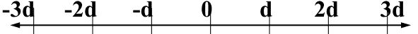

**Figure 1** Integers Divisible by the Positive Integer d.

## Example 2

Let n and d be positive integers. How many positive integers not exceeding n are divisible by d?

Solution: The positive integers divisible by d are all the integers of the form dk, where k is a positive integer. Hence, the number of positive integers divisible by d that do not exceed n equals the number of integers k with 0 < dk ≤ n, or with 0 < k ≤ n/d.

Therefore, there are ⌊n/d⌋ positive integers not exceeding n that are divisible by d.

## Theorem 1

Let a, b, and c be integers. Then

1. If a | b and a | c, then a | (b + c);
2. If a | b, then a | bc for all integers c;
3. If a | b and b | c, then a | c.

**Proof:** Suppose that a | b and a | c. Then, from the definition of divisibility, it follows that there are integers s and t with b = as and c = at. Hence, b + c = as + at = a(s + t). Therefore, a divides b + c. This establishes part (1) of the theorem. The proofs of parts (2) and (3) are left as exercises for the reader.

定理 2 设 a、b 是正整数，则存在整数 s、t，满足

$s \cdot a + t \cdot b = \gcd(a, b)$

$s \cdot a + t \cdot b$：$\gcd(a, b)$ 的线性组合表达 / linear combination

证明：此结论可以直接从 Euclid 算法得到。下面通过一个实例一说明 s 和 t 的求法。

## 例 2、求 gcd(252, 198) 的线性组合表达。

252 = 198 + 54  
198 = 3 · 54 + 36  
54 = 36 + 18  
36 = 2 · 18  

因而 gcd(252, 198) = 18，从上式回去溯得到：

18 = 54 - 36 = 54 - (198 - 3 · 54)  
= 4 · 54 - 198 = 4 · (252 - 198) - 198  
= 4 · 252 - 5 · 198  

因此，t = 4, s = -5。

推论：如果整数 a, b 互质，则存在 s, t 使得 s · a + t · b = 1。

## Example 3

The integer 7 is prime since its only positive factors are 1 and 7, whereas the integers 9 is composite since it is divisible by 3.

The primes less than 100 are

2, 3, 5, 7, 11, 13, 17, 19, 23, 29, 31, 37, 41, 43, 47, 53, 59, 61, 67, 71, 73, 79, 83, 89, and 97.

The primes are the building blocks of positive integers, as the Fundamental Theorem of Arithmetic shows. The proof will be given in Section 3.2.

## Theorem 3

## THE FUNDAMENTAL THEOREM OF ARITHMETIC

Every positive integer can be written uniquely as the product of primes, where the prime factors are written in order of increasing size. (Here, a product can have zero, one, or more than one prime factor.)

## 定理 3（算术基本定理）任意一个正整数 n (n ≠ 1) 可以唯一地表示为若干个质数的乘积。这里唯一的意义表示为不考虑质因子的次序。

## 推论 1 任意一个正整数 n (n ≠ 0, n ≠ 1) 可以唯一地表示为

n = p₁ p₂ ... pₖ （k ≥ 1）

这里 p₁, p₂, ..., pₖ 是质数。

## 推论 2（质数分解定理）任意一个正整数 n (n ≠ 0, n ≠ ±1) 可以唯一地表示为

n = p₁^r₁ p₂^r₂ ... pₖ^rₖ

这里 p₁ < p₂ < ... < pₖ 是质数，r₁, r₂, ..., rₖ 是正整数。

## 质数的性质

## 算法

定理 2 设 p, a, b 是整数，且 p 是质数。

如果 p | ab，则有

p | a 或 p | b

证明 如果 p | a，则 (p, a) = 1，存在整数 s, t 使得 sp + ta = 1

从而 spab + tab = b，p 整除此式的左边因而整除此式的右边。

设 p, a₁, a₂, ..., aₙ 是整数，且 p 是质数。

推论：如果 p | a₁a₂...aₙ，则有

p | a₁ ∨ p | a₂ ∨ … ∨ p | aₙ

## Example 4

The prime factorizations of 100, 641, 999, and 1024 are given by

100 = 2 · 2 · 5 · 5 = 2²5².

641 = 641

999 = 3 · 3 · 3 · 37 = 3³ · 37,

1024 = 2 · 2 · 2 · 2 · 2 · 2 · 2 · 2 · 2 · 2 = 2¹⁰

It is often important to show that a given integer is prime. For instance, in cryptology large primes are used in some methods for making messages secret. One procedure for showing that an integer is prime is based on the following observation.

## The integers and Division

## Algorithms
算法

**Theorem 3** if n is a composite integer, then n has

prime divisor less than or equal to \(\sqrt{n}\)

**proof:** if n is composite, it must has a factor a
with 1 < a < n. hence n = ab. We see that 1 < a < \(\sqrt{n}\) or
1 < b < \(\sqrt{n}\), otherwise, ab > n.

**Finding the prime factorization of n.** Begin by
dividing n by successive primes, starting with the

The smallest prime 2 to largest prime \(\lfloor \sqrt{n} \rfloor\)

If no prime factor is found, then n is prime,

otherwise, if a prime factor p is found, continue by

factoring n/p. Note that n/p has no prime factors less

than p. Again by dividing n by successive primes,

starting with the prime p to largest prime \(\lfloor \sqrt{n} \rfloor\)

And so on.


## Example 6 Find the prime factorization of 7007.

Solution: first perform divisions of 7007 by successive primes, beginning with 2. None of 2, 3 and 5 divides 7007. However, 7 divides 7007, with 7007/7=1001. Next, divide 1001 by successive prime beginning with 7, 7 also divides 1001, since 1001/7 = 143. Continue by dividing 143 by successive prime beginning with 7, 7 does not divide 143, 11 does divide 143, 143/11=13, 13 is a prime so

7007=7×7 × 11 × 13=7²× 11 × 13

## 定理4（欧几里德定理）

所有质数组成的集合是一个无限集。

证明：若质数是有限的，则可将它们按顺序一个不漏地记为

p₁<p₂<...<pₖ，令n= p₁·p₂·...· pₖ+1，则n或者是个质数，如果n不是质数，则由算术基本定理，则它可以表示成质数的积，它的质因子不可能是p₁， p₂， ...， pₖ之一，这与p₁， p₂， ...， pₖ是所有的质数矛盾。

## Definition 4

Let a and b be integers, not both zero. The largest integer d such that d | a and d | b is called the greatest common divisor of a and b. The greatest common divisor of a and b is denoted by gcd(a,b). Usually simply denoted by (a,b)

The greatest common divisor of two integers, not both zero, exists because the set of common divisors of these integers is finite. One way to find the greatest common divisor of two integers is to find all the positive common divisors of both integers and then take the largest divisor. This is done in the following examples. Later, a more efficient method of finding greatest common divisors will be given.

## Definition 5

The integers a and b are relatively prime if their greatest common divisor is 1

for example 7, 12 and 105, 106

But 105 and 45 are not relatively prime

## Definition 6

The integers a₁, a₂, ... aₙ are pairwise relatively prime, if gcd(aᵢ, aⱼ)=1 whenever 1≤i<j ≤n


Another way to find gcd(a,b) is to use the prime factorizations of a and b. Suppose that the prime factorization of integers a and b, neither equal to zero, are

$$a=p_1^{a_1}p_2^{a_2}\cdots p_n^{a_n}\qquad b=p_1^{b_1}p_2^{b_2}\cdots p_n^{b_n}$$

Where each exponent is zero or positive integer.

$$\operatorname{Gcd}(a,b)=p_1^{\min(a_1,b_1)}p_2^{\min(a_2,b_2)}\cdots p_n^{\min(a_n,b_n)}\tag{2.3.1}$$

$$120=2^3\cdot3\cdot5,\quad 500=2^2\cdot5^3;\quad 2^2\cdot3^0\cdot5^3$$

Gcd(120,500)=2^min(3,2)·3^min(1,0)·5^min(1,3)=2²·3⁰·5¹=20

例 金库内有3根同样粗细的金条，分别长135、243和558（单位英寸）。现在要把它们截成相等的小段，要求小段要最长。问一共可以把这些金条分成几段，每段几英寸。

解:135=3³ · 5, 243=3³, 558=2 · 3² · 31

gcd(135,243,558)=2⁰ · 3² · 5⁰ · 31⁰=9

## Definition 7

The least common multiple of the positive integer a and b is the smallest integer that is divisible by both a and b. it is denoted by lcm(a,b). Simply denote by [a,b]

It is obviously that lcm(a,b) ≤ ab.

Example lcm(4,6)=12

Like gcd(a,b), if have got the prime factorization of a and b, then lcm(a,b) is given by

## Lcm(a,b)= \( p_1^{max(a_1, b_1)} p_2^{max(a_2, b_2)} \cdots p_n^{max(a_n, b_n)} \) (2.3.2)

Theorem 5 Let a and b be positive integers,

Then \( ab = \text{gcd}(a,b) \times \text{lcm}(a,b) \)

Proof: from the formula (2.3.1) and (2.3.2), this conclusion is obvious.

注:另一种证明法: 首先a/(a,b), b/(a,b), 及[a,b]/a, [a,b]/b 都是整数.

## Algorithms 算法

由于ab/(a,b)=a·b/(a,b),因此a| ab/(a,b), b| ab/(a,b), 从而
ab/(a,b)是a,b的公倍数,而[a,b]是a,b的最小公倍数,故
ab/(a,b) ≥[a,b]. 即

ab≥[a,b] (a,b) . (2.3.3)

而另一方面,ab/[a,b] | a, ab/[a,b] | b, 说明ab/[a,b] 是a和b
的公约数, 而(a,b)是a,b的最大公约数, 因此
(a,b) ≥ab/[a,b],即

ab≤(a,b)[a,b] (2.3.4)

## Modular arithmetic (同余)

Definition 8. Let a be an integer and m be a positive integer, we denote by a mod m the remainder when a is divided by m.

For example 5 mod 3 = 2

Definition 9. If a and b are integers and m is a positive integer, then a is congruent to b modulo m if m divides a-b, we denote it by a≡b(mod m)


## Theorem 6

Let m be a positive integer. The integers a and b are congruent modulo m if and only if there is an integer k such that a=b+km.

**Proof:** If a≡b(mod m), then m ∣ (a − b). This means that there is an integer k such that a − b=km, so that a=b+km. Conversely, if there is an integer k such that a=b+km, then km=a − b. Hence, m divides a − b, so that a≡b(mod m).


### Theorem 7

Let \(m\) be a positive integer. If \(a\equiv b\pmod{m}\) and \(c\equiv d\pmod{m}\), then \(a+c\equiv b+d\pmod{m}\) and \(ac\equiv bd\pmod{m}\).

**Proof.** Since \(a\equiv b\pmod{m}\) and \(c\equiv d\pmod{m}\), there are integers \(s\) and \(t\) with \(b=a+sm\) and \(d=c+tm\). Hence,

\[
b+d=(a+sm)+(c+tm)=(a+c)+m(s+t)
\]

and

\[
bd=(a+sm)(c+tm)=ac+m(at+cs+stm).
\]

Hence,

\[
a+c\equiv b+d\pmod{m}\quad\text{and}\quad ac\equiv bd\pmod{m}.
\]

## 1 Hashing Function / 哈希函数

设一个查找表 \(S\) 有 \(n\) 个数据元素 \(S=\{R_1,R_2,\ldots,R_n\}\)。对于每个指定的 \(R_i\)，设 key 是其关键字的值。则建立一个从 \(R_i.\mathrm{key}\) 到 \(R_i\) 的存贮地址函数 \(H\) 为

\[
H(R_i.\mathrm{key})=\operatorname{addr}(R_i)
\]

称 \(H\) 为**哈希函数**（Hash），函数值 \(H(R_i.\mathrm{key})\) 称为**哈希地址**。

按该方法所建立的表称为**哈希表**。最常用的**哈希函数是同余函数**：

\[
h(k)=k\bmod m
\]

## 2. 密码学

密码学是研究信息隐藏的科学，一开始主要用于军事目的，两次世界大战期间都起到了关键的作用。现在由于计算机广泛应用于商业目的，信息安全是电子商务的关键核心，而密码学是信息和网络安全的核心。同余理论可以用于非常简单的信息保密目的。比如一个英文字母可以用另一个英文字母来代替，如最早的 Caesar 加密技术，将英文字母用它在字母表中的位置来代替，如 \(A\leftrightarrow 0\), \(B\leftrightarrow 1\), \(Z\leftrightarrow 25\)。令

\[
F(p)=(p+3)\bmod 26
\]

那么 \(\mathrm{MEETYOUINTHEPARK}\) 的 Caesar 密码是什么？

解：这个句子对应的编码为

\[
12\ 4\ 4\ 9\ 24\ 14\ 20\ 8\ 13\ 19\ 7\ 4\ 15\ 0\ 17\ 10
\]

用上面的函数计算得到：

\[
15\ 7\ 7\ 22\ 1\ 17\ 23\ 11\ 16\ 22\ 10\ 7\ 18\ 3\ 20\ 13
\]

对应到英文字母为

\[
\mathrm{PHHW\ BRX\ LQ\ WKH\ SDUN}
\]

### 解密函数

\[
F^{-1}(p)=(p-3)\bmod 26
\]

这种加密技术过于简单，很容易被攻破，实际上只要 \(f(p)\) 是一个 \(\mathbb{Z}_{26}\to\mathbb{Z}_{26}\) 的一个双射函数即可。由 Caesar 密码体制直接推广的一种密码技术是仿射密码：

\[
F(p)=(ap+b)\bmod 26
\]

这里 \(a\) 是一个质数。

## Exercises

Pp. 125: 5, 15, 21

## 2.4 Integers and Algorithms

## INTRODUCTION

As mentioned in Section 2.1, the term algorithm originally referred to procedures for performing arithmetic operations using the decimal representations of integers. These algorithms, adapted for use with binary representations, are the basis for computer arithmetic. They provide good illustrations of the concept of the algorithm and the complexity of algorithms. For these reasons, they will be discussed in this section.

There are many important algorithms involving integers besides those used in arithmetic. We will begin our discussion of integers and algorithms with the Euclidean algorithm. It is one of the most useful algorithms, and perhaps the oldest algorithm in mathematics. We will also describe an algorithm for finding the base \(b\) expansion of a positive integer for any base \(b\).

## REPRESENTATIONS OF INTEGERS

In everyday life we use decimal notation to express integers. For example, 965 is used to denote \(9\cdot 10^2+6\cdot 10+5\). However, it is often convenient to use bases other than 10. In particular, computers usually use binary notation (with 2 as the base) when carrying out arithmetic, and octal (base 8) or hexadecimal (base 16) notation when expressing characters, such as letters or digits. In fact, we can use any positive integer greater than 1 as the base when expressing integers. This is stated in the following theorem.

## Theorem 1

Let \(b\) be a positive integer greater than 1. Then if \(n\) is a positive integer, it can be expressed uniquely in the form

\[
n=a_kb^k+a_{k-1}b^{k-1}+\cdots+a_1b+a_0,
\]

where \(k\) is a nonnegative integer, \(a_0,a_1,\ldots,a_k\) are nonnegative integers less than \(b\), and \(a_k\neq 0\).

## Example 2

What is the decimal expansion of the integer that has \((101011111)_2\) as its binary expansion?

**Solution:** We have

\[
(101011111)_2=2^8+2^6+2^4+2^3+2^2+2+1=351.
\]

Sixteen is another base used in computer science. The base 16 expansion of an integer is called its *hexadecimal* expansion. Sixteen different digits are required for such expansions. Usually, the hexadecimal digits used are \(0,1,2,3,4,5,6,7,8,9,A,B,C,D,E,F\), the numbers 10 through 15 (in decimal notation).

## Example 3

What is the decimal expansion of the hexadecimal expansion of \((2AE0B)_{16}\)?

\[
(2AE0B)_{16}=2\cdot 16^4+10\cdot 16^3+14\cdot 16^2+0\cdot 16+11=(175627)_{10}.
\]

Since a hexadecimal digit is represented using four bits, bytes, which are bit strings of length eight, can be represented by two hexadecimal digits. For instance, \((11100101)_2=(E5)_{16}\) since \((1110)_2=(E)_{16}\) and \((0101)_2=(5)_{16}\).

We will now describe an algorithm for constructing the base \(b\) expansion of an integer \(n\). First, divide \(n\) by \(b\) to obtain a quotient and remainder, that is,

n = bq₀ + a₀, 0 ≤ a₀ < b.

The remainder, a₀, is the rightmost digit in the base b expansion of n. Next, divide q₀ by b to obtain

q₀ = bq₁ + a₁, 0 ≤ a₁ < b.

We see that a₁ is the second digit from the right in the base b expansion of n. Continue this process, successively dividing the quotients by b, obtaining additional base b digits as the remainders. This process terminates when we obtain a quotient equal to zero.

## Example 4

Find the base 8 expansion of \((12345)_{10}\).

**Solution:** First, divide 12345 by 8 to obtain

\[
12345 = 8 \cdot 1543 + 1.
\]

Successively dividing quotients by 8 gives

\[
1543 = 8 \cdot 192 + 7
\]

\[
192 = 8 \cdot 24 + 0
\]

\[
24 = 8 \cdot 3 + 0
\]

\[
3 = 8 \cdot 0 + 3.
\]

Since the remainders are the digits of the base 8 expansion of 12345, it follows that

\[
(12345)_{10} = (30071)_8.
\]

The pseudocode given in Algorithm 2 finds the base b expansion \((a_{k-1} \cdots a_1 a_0)_b\) of the integer n.

## Algorithms 算法

### Algorithm 2 Constructing Base b Expansions

```text
Procedure base b expansion(n: positive integer)
q := n
k := 0
while q ≠ 0
begin
    a_k := q mod b
    q := ⌊q/b⌋
    k := k + 1
end {the base b expansion of n is (a_{k-1} ⋯ a_1 a_0)_b}
```

In Algorithm 2, q represents the quotient obtained by successive divisions by b, starting with q = n. The digits in the base b expansion are the remainders of these divisions and are given by q mod b. The algorithm terminates when a quotient q = 0 is reached.

The algorithms for performing operations with integers using their binary expansions are extremely important in computer arithmetic. We will describe algorithms for the addition and the multiplication of two integers expressed in binary notation. We will also analyze the computational complexity of these algorithms, in terms of the actual number of bit operations used. Throughout this discussion, suppose that the binary expansions of a and b are

\[
a=(a_{n-1}a_{n-2}\cdots a_1a_0)_2,\quad b=(b_{n-1}b_{n-2}\cdots b_1b_0)_2,
\]

so that a and b each have n bits (putting bits equal to 0 at the beginning of one of these expansions if necessary).

Consider the problem of adding two integers in binary notation. A procedure to perform addition can be based on the usual method for adding numbers with pencil and paper. This method proceeds by adding pairs of binary digits together with carries, when they occur, to compute the sum of two integers. This procedure will now be specified in detail.

To add \(a\) and \(b\), first add their rightmost bits. This gives

\[
a_0+b_0=c_0\cdot 2+s_0,
\]

where \(s_0\) is the rightmost bit in the binary expansion of \(a+b\) and \(c_0\) is the carry, which is either 0 or 1. Then add the next pair of bits and the carry,

\[
a_1+b_1+c_0=c_1\cdot 2+s_1,
\]

where \(s_1\) is the next bit (from the right) in the binary expansion of \(a+b\), and \(c_1\) is the carry. Continue this process, adding the corresponding bits in the two binary expansions of \(a\) and \(b\). At the last stage, add \(a_{n-1}\), \(b_{n-1}\), and \(c_{n-2}\) to obtain \(c_{n-1}\cdot 2+s_{n-1}\). The leading bit of the sum is \(s_n=c_{n-1}\). This procedure produces the binary expansion of the sum, namely, \(a+b=(s_ns_{n-1}\cdots s_1s_0)_2\).

### Example 5

Add \(a=(1110)_2\) and \(b=(1011)_2\).

**Solution:** Following the procedure specified in the algorithm, first note that

\[
a_0+b_0=0+1=0\cdot2+1,
\]

so that \(c_0=0\) and \(s_0=1\). Then, since

\[
a_1+b_1+c_0=1+1+0=1\cdot2+0,
\]

it follows that \(c_1=1\) and \(s_1=0\). Continuing,

\[
a_2+b_2+c_1=1+0+1=1\cdot2+0,
\]

so that \(c_2=1\) and \(s_2=0\). Finally, since

\[
a_3+b_3+c_2=1+1+1=1\cdot2+1,
\]

it follows that \(c_3=1\) and \(s_3=1\). This means that \(s_4=c_3=1\). Therefore, \(s=a+b=(11001)_2\). This addition is displayed in Figure 1.


### Algorithm 3 Addition of Integers

```text
procedure add(a, b: positive integers)
{the binary expansions of a and b are \((a_{n-1}a_{n-2}\cdots a_1a_0)_2\)
and \((b_{n-1}b_{n-2}\cdots b_1b_0)_2\), respectively}
c := 0
for j := 0 to n - 1
begin
    d := ⌊(a_j + b_j + c)/2⌋
    s_j := a_j + b_j + c - 2d
    c := d
end
s_n := c
{the binary expansion of the sum is \((s_n s_{n-1} \cdots s_0)_2\)}
```


## Example 6

How many additions of bits are required to use Algorithm 3 to add two integers with n bits (or less) in their binary representations?

**Solution:** Two integers are added by successively adding pairs of bits and, when it occurs, a carry. Adding each pair of bits and the carry requires three or fewer additions of bits. Thus, the total number of additions of bits used is less than three times the number of bits in the expansion. Hence, the number of additions of bits used by Algorithm 3 to add two n-bit integers is $O(n)$.

Next, consider the multiplication of two n-bit integers $a$ and $b$. The conventional algorithm (used when multiplying with pencil and paper) works as follows. Using the distributive law, we see that


$$ab=a\sum_{j=0}^{n-1}b_j2^j=\sum_{j=0}^{n-1}a(b_j2^j)$$

We can compute $ab$ using this equation. We first note that $ab_j=a$ if $b_j=1$ and $ab_j=0$ if $b_j=0$. Each time we multiply a term by 2, we shift its binary expansion one place to the left and add a zero at the tail end of the expansion. Consequently, we can obtain $(ab_j)2^j$ by shifting the binary expansion of $ab_j$ $j$ places to the left, adding $j$ zero bits at the tail end of this binary expansion. Finally, we obtain $ab$ by adding the $n$ integers $ab_j2^j$, $j=0,1,2,\ldots,n-1$.

### Example 7

Find the product of $a=(110)_2$ and $b=(101)_2$.

**Solution:** First note that

$ab_0\cdot 2^0=(110)_2\cdot 1\cdot 2^0=(110)_2,$

$ab_1\cdot 2^1=(110)_2\cdot 0\cdot 2^1=(0000)_2,$

and

$ab_2\cdot 2^2=(110)_2\cdot 1\cdot 2^2=(11000)_2.$

To find the product, add $(110)_2$, $(0000)_2$, and $(11000)_2$.

Carrying out these additions (using Algorithm 3, including initial zero bits when necessary) shows that $ab=(11110)_2$. This multiplication is displayed in Figure 2.

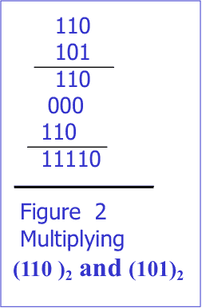

### Algorithm 4 Multiplying Integers

```
Procedure multiply(a,b: positive integers)
{the binary expansions of a and b are (a_{n-1} a_{n-2} ··· a_1a_0)_2
 and (b_{n-1} b_{n-2} ··· b_1b_0)_2, respectively}
for j := 0 to n-1
begin
    if b_j = 1 then c_j := a shifted j places
    else c_j := 0
end
{c_0, c_1, ..., c_{n-1} are the partial products}
p := 0
for j := 0 to n-1
    p := p + c_j
{p is the value of ab}
```

## 2.5 Applications of Number Theory

## Theorem 1

If a and b are positive integers, then there exist integers s and t such that $\gcd(a,b)=sa+tb$.

## Lemma 1

If a, b, and c are positive integers such that $\gcd(a,b)=1$ and $a \mid bc$, then $a \mid c$.

**Proof:** Since $\gcd(a,b)=1$, by Theorem 1 there are integers s and t such that $sa+tb=1$. Multiplying both sides of this equation by c, we obtain $sac+tbc=c$. Using Theorem 1 of Section 2.3, we can use this last equation to show that $a \mid c$. By part 2 of that theorem, $a \mid tbc$. Since $a \mid sac$ and $a \mid tbc$, by part 1 of that theorem, we conclude that $a$ divides $sac+tbc$, and $a \mid c$. This finishes the proof.

## Lemma 2

If p is a prime and $p \mid a_1a_2\cdots a_n$, where each $a_i$ is an integer, then $p \mid a_i$ for some i.

**Proof:** Suppose that the positive integer n can be written as the product of primes in two different ways, say, $n=p_1p_2\cdots p_s$ and $n=q_1q_2\cdots q_t$, where each $p_i$ and $q_j$ are primes such that $p_1 \le p_2 \le \cdots \le p_s$ and $q_1 \le q_2 \le \cdots \le q_t$. When we remove all common primes from the two factorizations, we have $p_{i_1}p_{i_2}\cdots p_{i_u}=q_{j_1}q_{j_2}\cdots q_{j_v}$, where no prime occurs on both sides of this equation and u and v are positive integers. By Lemma 2 it follows that $p_{i_l}$ divides $q_{j_k}$ for some k. Since no prime divides another prime, this is impossible. Consequently, there can be at most one factorization of n into primes in nondecreasing order.


## Theorem 2

Let m be a positive integer and let a, b, and c be integers. If ac ≡ bc (mod m) and gcd(c, m) = 1, then a ≡ b (mod m).

Proof: Since ac ≡ bc (mod m), m | ac - bc = c(a - b). By Lemma 1, since gcd(c, m) = 1, it follows that m | a - b. We conclude that a ≡ b (mod m).

## Theorem 3

If a and m are relatively prime integers and m > 1, then an inverse of a modulo m exists. Furthermore, this inverse is unique modulo m. (That is, there is a unique positive integer ã less than m that is an inverse of a modulo m and every other inverse of a modulo m is congruent to ã modulo m.)

Proof: By Theorem 1, since gcd(a, m) = 1, there are integers s and t such that
sa + tm = 1.
This implies that
sa + tm ≡ 1 (mod m).
Since tm ≡ 0 (mod m), it follows that
sa ≡ 1 (mod m).
Consequently, s is an inverse of a modulo m. That this inverse is unique modulo m is left as Exercise 9 at the end of this section.

## Theorem 4

The Chinese Remainder Theorem: Let \( m_1, m_2, \cdots, m_n \) be pairwise relatively prime positive integers. The system

\( x \equiv a_1 \pmod{m_1}, \)
\( x \equiv a_2 \pmod{m_2} \)

\(\vdots\)

\( x \equiv a_n \pmod{m_n} \)

has a unique solution modulo \( m = m_1 m_2 \cdots m_n \). (That is, there is a solution \( x \) with \( 0 \leq x < m \), and all other solutions are congruent modulo \( m \) to this solution.)

Proof: To establish this theorem, we need to show that a solution exists and that it is unique modulo m. We will show that a solution exists by describing a way to construct this solution; showing that the solution is unique modulo m is Exercise 20 at the end of this section.

To construct a simultaneous solution, first let

\( M_k = m / m_k \)

For k = 1, 2, ..., n. That is, \( M_k \) is the product of the moduli except for \( m_k \). Since \( m_i \) and \( m_k \) have no common factors greater than 1 when i ≠ k, it follows that gcd(m_k, M_k) = 1. Consequently, by Theorem 3, we know that there is an integer \( y_k \), an inverse of \( M_k \), modulo \( m_k \), such that

## Theorem 5

Fermat's little theorem

If p is prime and a is an integer not divisible by p,

then

\( a^{p-1} \equiv 1 \pmod{p} \).

Furthermore, for every integer a we have

\( a^p \equiv a \pmod{p} \).

## 2.4 Integers and Algorithms

## INTRODUCTION

As mentioned in Section 2.1, the term algorithm originally referred to procedures for performing arithmetic operations using the decimal representations of integers. These algorithms, adapted for use with binary representations, are the basis for computer arithmetic. They provide good illustrations of the concept of the algorithm and the complexity of algorithms. For these reasons, they will be discussed in this section.

These are many important algorithms involving integers besides those used in arithmetic. We will begin our discussion of integers and algorithms with the Euclidean algorithm. It is one of the most useful algorithms, and perhaps the oldest algorithm in mathematics. We will also describe an algorithm for finding the base b expansion of a positive integer for any base b.

## REPRESENTATIONS OF INTEGERS

In everyday life we use decimal notation to express integers. For example, 965 is used to denote \( 9 \cdot 10^2 + 6 \cdot 10 + 5 \). However, it is often convenient to use bases other than 10. In particular, computers usually use binary notation (with 2 as the base) when carrying out arithmetic, and octal (base 8) or hexadecimal (base 16) notation when expressing characters, such as letters or digits. In fact, we can use any positive integer greater than 1 as the base when expressing integers. This is stated in the following theorem.

## Example 2

What is the decimal expansion of the integer that has
(101011111)₂ as its binary expansion?

Solution: We have
(101011111)₂ = 2⁸ + 2⁶ + 2⁴ + 2³ + 2² + 2 + 1 = 351.

Sixteen is another base used in computer science. The base 16 expansion of an integer is called its hexadecimal expansion. Sixteen different digits are required for such expansions. Usually, the hexadecimal digits used are
0, 1, 2, 3, 4, 5, 6, 7, 8, 9, A, the numbers 10 through 15 (in decimal notation).


## Example 3

What is the decimal expansion of the hexadecimal expansion of $(2AE0B)_{16} = 2 \cdot 16^4 + 10 \cdot 16^3 + 14 \cdot 16^2 + 0 \cdot 16 + 11 = (175627)_{10}$.

Since a hexadecimal digit is represented using four bits, bytes, which are bit strings of length eight, can be represented by two hexadecimal digits. For instance, $(11100101)_2 = (E5)_{16}$ since $(1110)_2 = (E)_{16}$ and $(0101)_2 = (5)_{16}$.

We will now describe an algorithm for constructing the base $b$ expansion of an integer $n$. First, divide $n$ by $b$ to obtain a quotient and remainder, that is,

## Algorithms 算法

$n = bq_0 + a_0, 0 \leq a_0 < b$.

The remainder, $a_0$, is the rightmost digit in the base $b$ expansion of $n$. Next, divide $q_0$ by $b$ to obtain

$q_0 = bq_1 + a_1, 0 \leq a_1 < b$.

We see that $a_1$ is the second digit from the right in the base $b$ expansion of $n$. Continue this process, successively dividing the quotients by $b$, obtaining additional base $b$ digits as the remainders. This process terminates when we obtain a quotient equal to zero.

## Example 4

Find the base 8 expansion of $(12345)_{10}$.

_Solution:_ First, divide 12345 by 8 to obtain

$12345 = 8 \cdot 1543 + 1$.

Successively dividing quotients by 8 gives

$1543 = 8 \cdot 192 + 7$

$192 = 8 \cdot 24 + 0$

$24 = 8 \cdot 3 + 0$

$3 = 8 \cdot 0 + 3$.

Since the remainders are the digits of the base 8 expansion of 12345, it follows that

$(12345)_{10} = (30071)_8$.

The pseudocode given in Algorithm 2 finds the base $b$ expansion $(a_{k-1} \cdots a_1a_0)_b$ of the integer $n$.

## Algorithm 2 Constructing Base b Expansions.

```
Procedure base b expansion(n:positive integer)  
q:=n  
k:=0  
While q≠0  
Begin  
    aₖ:=q mod b  
    q:=[q/b]  
    k:=k+1  
End {the base b expansion of n is (aₖ₋₁ ··· a₁a₀)ᵦ}
```

In Algorithm 2, $q$ represents the quotient obtained by successive divisions by $b$, starting with $q=n$. The digits in the base $b$ expansion are the remainders of these divisions and are given by $q \mod b$. The algorithm terminates when a quotient $q=0$ is reached.

The algorithms for performing operations with integers using their binary expansions are extremely important in computer arithmetic. We will describe algorithms for the addition and the multiplication of two integers expressed in binary notation. We will also analyze the computational complexity of these algorithms, in terms of the actual number of bit operations used. Throughout this discussion, suppose that the binary expansions of $a$ and $b$ are

$$a=(a_{n-1}\ a_{n-2}\ \cdots\ a_1a_0)_2,\quad b=(b_{n-1}\ b_{n-2}\ \cdots\ b_1b_0)_2,$$

so that $a$ and $b$ each have $n$ bits (putting bits equal to 0 at the beginning of one of these expansions if necessary).

Consider the problem of adding two integers in binary notation. A procedure to perform addition can be based on the usual method for adding numbers with pencil and paper. This method proceeds by adding pairs of binary digits together with carries, when they occur, to compute the sum of two integers. This procedure will now be specified in detail.

To add $a$ and $b$, first add their rightmost bits. This gives

$a_0+b_0=c_0 \cdot 2+s_0$

where $s_0$ is the rightmost bit in the binary expansion of $a+b$ and $c_0$ is the carry, which is either 0 or 1. Then add the next pair of bits and the carry,

$a_0+b_0+c_0=c_1\cdot2+s_1,$

where $s_1$ is the next bit (from the right) in the binary expansion of $a+b$, and $c_1$ is the carry. Continue this process, adding the corresponding bits in the two binary expansions of $a+b$. At the last stage, add $a_{n-1}$, $b_{n-1}$, and $c_{n-2}$ to obtain $c_{n-1}\cdot2+s_{n-1}$. The leading bit of the sum is $s_n=c_{n-1}$. This procedure produces the binary expansion of the sum, namely, $a+b=(s_ns_{n-1}\cdots s_1s_0)_2$.

### Example 5

Add $a=(1110)_2$ and $b=(1011)_2$.

**Solution:** Following the procedure specified in the algorithm, first note that

$a_0+b_0=0+1=0\cdot2+1,$

so that $c_0=0$ and $s_0=1$. Then, since

$a_1+b_1+c_0=1+1+0=1\cdot2+0,$

it follows that $c_1=1$ and $s_1=0$. Continuing,

$a_2+b_2+c_1=1+0+1=1\cdot2+0,$

so that $c_2=1$ and $s_2=0$. Finally, since

$a_3+b_3+c_2=1+1+1=1\cdot2+1,$

it follows that $c_3=1$ and $s_3=1$. This means that $s_4=c_3=1$. Therefore, $s=a+b=(11001)_2$. This addition is displayed in figure 1.

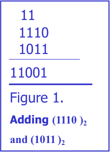


### Algorithm 3 Addition of Integers

Procedure add(a, b : positive integers)  
{the binary expansions of a and b are \((a_{n-1} a_{n-2} \cdots a_1 a_0)_2\) and \((b_{n-1} b_{n-2} \cdots b_1 b_0)_2\), respectively}  
c := 0  
for j := 0 to n-1  
begin  
    d := \(\lfloor (a_j + b_j + c)/2 \rfloor\)  
    s_j := a_j + b_j + c - 2d  
    c := d  
end  
s_n := c  
{the binary expansion of the sum is \((s_n s_{n-1} \cdots s_0)_2\)}

## Example 6

How many additions of bits are required to use Algorithm 3 to add two integers with n bits (or less) in their binary representations?

*Solution:* Two integers are added by successively adding pairs of bits and, when it occurs, a carry. Adding each pair of bits and the carry requires three or fewer additions of bits. Thus, the total number of additions of bits used is less than three times the number of bits in the expansion. Hence, the number of additions of bits used by Algorithm 3 to add two n-bit integers is O(n).

Next, consider the multiplication of two n-bit integers a and b. The conventional algorithm (used when multiplying with pencil and paper) works as follows. Using the distributive law, we see that


## Algorithms 算法

\[
ab=a\sum_{j=0}^{n-1}b_j2^j=\sum_{j=0}^{n-1}a(b_j2^j)
\]

We can compute \(ab\) using this equation. We first note that \(ab_j=a\) if \(b_j=1\) and \(ab_j=0\) if \(b_j=0\). Each time we multiply a term by 2, we shift its binary expansion one place to the left and add a zero at the tail end of the expansion. Consequently, we can obtain \((ab_j)2^j\) by shifting the binary expansion of \(ab_j\) \(j\) places to the left, adding \(j\) zero bits at the tail end of this binary expansion. Finally, we obtain \(ab\) by adding the \(n\) integers \(ab_j2^j\), \(j=0,1,2,\ldots,n-1\).

### Example 7

Find the product of \(a=(110)_2\) and \(b=(101)_2\).

**Solution:** First note that

\[
ab_0\cdot 2^0=(110)_2\cdot 1\cdot 2^0=(110)_2,
\]
\[
ab_1\cdot 2^1=(110)_2\cdot 0\cdot 2^1=(0000)_2,
\]
and
\[
ab_2\cdot 2^2=(110)_2\cdot 1\cdot 2^2=(11000)_2.
\]

To find the product, add \((110)_2\), \((0000)_2\), and \((11000)_2\).

Carrying out these additions (using Algorithm 3, including initial zero bits when necessary) shows that \(ab=(11110)_2\). This multiplication is displayed in Figure 2.


### Algorithm 4 Multiplying Integers

```
Procedure multiply(a, b : positive integers)
{the binary expansions of a and b are (a_{n-1} a_{n-2} ... a_1 a_0)_2
 and (b_{n-1} b_{n-2} ... b_1 b_0)_2, respectively}
for j := 0 to n-1
begin
    if b_j = 1 then c_j := a shifted j places
    else c_j := 0
end
{c_0, c_1, ..., c_{n-1} are the partial products}
p := 0
for j := 0 to n-1
    p := p + c_j
{p is the value of ab}
```

**How many additions of bits and shifts of bits are used to multiply a and b using Algorithm 4?**

Solution: Algorithm 4 computes the products of *a* and *b* by adding the partial products \(c_0, c_1, c_2, \ldots,\) and \(c_{n-1}\). When \(b_j=1\), we compute the partial product \(c_j\) by shifting the binary expansion of \(a\) \(j\) bits. When \(b_j=0\), no shifts are required since \(c_j=0\). Hence, to find all \(n\) of the integers \(a b_j 2^j\), \(j=0,1,\ldots,n-1\), requires at most

\[
0+1+2+\cdots+n-1
\]

shifts. Hence, by Example 4 in Section 1.8 the number of shifts required is \(O(n^2)\).

To add the integers \(a b_j 2^j\) from \(j=0\) to \(j=n-1\) requires the addition of an \(n\)-bit integer, an \((n+1)\)-bit integer, ..., and a \((2n)\)-bit integer. We know from Example 8 that each of these additions requires \(O(n)\) additions of bits. Consequently, a total of \(O(n^2)\) additions of bits are required for all \(n\) additions.

## 2.5 Applications of Number Theory

## Theorem 1

If *a* and *b* are positive integers, then there exist integers *s* and *t* such that \(\gcd(a,b)=sa+tb\).

## Example 1

Express \(\gcd(252,198)=18\) as a linear combination of 252 and 198.

**Solution:** To show that \(\gcd(252,198)=18\), the Euclidean algorithm uses the following divisions:

```
252 = 1 · 198 + 54
198 = 3 · 54 + 36
54 = 1 · 36 + 18
36 = 2 · 18.
```

Using the next-to-last division (the third division), we can express \(\gcd(252,198)=18\) as a linear combination of 54 and 36. We find that

\[
18 = 54 - 1 \cdot 36
\]

The second division tells us that

\[
36 = 198 - 3 \cdot 54.
\]


Substituting this expression for 36 into the previous equation, we can express 18 as a linear combination of 54 and 198. We have 18 = 54 - 1 · 36 = 54 - 1 · (198 - 3 · 54) = 4 · 54 - 1 · 198. The first division tells us that 54 = 252 - 1 · 198. Substituting this expression for 54 into the previous equation, we can express 18 as a linear combination of 252 and 198. We conclude that 18 = 4 · (252 - 1 · 198) - 1 · 198 = 4 · 252 - 5 · 198, Completing the solution.

## Lemma 1

If a, b, and c are positive integers such that gcd(a,b)=1 and a | bc, then a | c.

Proof: since gcd(a,b)=1, by Theorem 1 there are integers s and t such that sa + tb = 1.

Multiplying both sides of this equation by c, we obtain sac + tbc = c.

Using Theorem 1 of Section 2.3, we can use this last equation to show that a | c. By part 2 of that theorem, a | tbc. Since a | sac and a | tbc, by part 1 of that theorem, we conclude that a divides sac + tbc, and a | c. This finishes the proof.

## Lemma 2

If p is a prime and p ∣ a₁, a₂, …, aₙ, where each aᵢ is an integer, then p ∣ aᵢ for some i.

The fundamental theorem of arithmetic: Every positive integer can be written uniquely as the product of primes.

n = p₁ʳ¹ p₂ʳ² … pₖʳᵏ

这里 p₁ < p₂ < … < pₖ 是质数，r₁, r₂, …, rₖ 是正整数。

*Proof:* suppose that the positive integer n can be written as the product of primes in two different ways, say, n = p₁ p₂ … pₛ and n = q₁ q₂ … qₜ, each pᵢ and qⱼ are primes such that p₁ ≤ p₂ ≤ … ≤ pₛ and q₁ ≤ q₂ ≤ … ≤ qₜ.

## Algorithms 算法

When we remove all common primes from the two factorizations, we have \( p_{i1}p_{i2}\cdots p_{iu} = q_{j1}q_{j2}\cdots q_{jv} \), where no prime occurs on both sides of this equation and u and v are positive integers. By Lemma 2 it follows that \( p_{i1} \) divides \( q_{jk} \) for some k. Since no prime divides another prime, this is impossible. Consequently, there can be at most one factorization of n into primes in nondecreasing order.

Example 2 The congruence \( 14 \equiv 8 \pmod{6} \) holds, but both sides cannot be divided by 2 since \( 7 \equiv 4 \pmod{6} \)

But \( 7 \equiv 4 \pmod{3} \)

## Theorem 2

Let m be a positive integer and let a, b, and c be integers. If ac ≡ bc (mod m) and gcd(c,m)=1, then a ≡ b (mod m).

**Proof:** since ac ≡ bc (mod m), m ∣ ac - bc = c(a - b). By Lemma 1, since gcd(c,m)=1, it follows that m ∣ a - b. We conclude that a ≡ b (mod m).

## Theorem 3 11,06 同余逆

If a and m are relatively prime integers and m > 1, then an **inverse** of a modulo m exists. Furthermore, this inverse is unique modulo m. (That is, there is a unique positive integer ã less than m that is an inverse of a modulo m and every other inverse of a modulo m is congruent to ã modulo m.)

Proof: By Theorem 1, since gcd(a,m)=1, there are integers s and t such that

sa + tm = 1.

This implies that

sa + tm ≡ 1 (mod m).

Since tm ≡ 0 (mod m), it follows that

sa ≡ 1 (mod m).

Consequently, s is an **inverse** of a modulo m. That this inverse is unique modulo m is left as Exercise 9 at the end of this section.

## Example 3

### Find the inverse of 3 modulo 7.

Solution: Since gcd(3,7)=1, Theorem 2 tells us that an inverse of 3 modulo 7 exists. The Euclidean algorithm ends quickly when used to find the greatest common divisor of 3 and 7:

7 = 2 · 3 + 1

From this equation we see that

-2 · 3 + 1 · 7 = 1.

This shows that −2 is an inverse of 3 modulo 7. (Note that every integer congruent to −2 modulo 7 is also an inverse of 3, such as 5, −9, 12, and so on.)

## Example 4

What are the solutions of the linear congruence 3x ≡ 4 (mod 7)?

**Solution:** By Example 3 we know that −2 is an inverse of 3 modulo 7. Multiplying both sides of the congruence by −2 shows that

−2 · 3x ≡ −2 · 4 (mod 7).

Since −6 ≡ 1 (mod 7) and −8 ≡ 6 (mod 7), it follows that if x is a solution. Assume that x ≡ −8 ≡ 6 (mod 7).

We need to determine whether every x with x ≡ 6 (mod 7) is a solution. Assume that x ≡ 6 (mod 7). Then, by Theorem 7 of Section 2.3, it follows that

3x ≡ 3 · 6 ≡ 18 ≡ 4 (mod 7),

which shows that all such x satisfy the congruence. We conclude that the solutions to the congruence are the integers x such that x ≡ 6 (mod 7), namely, 6, 13, 20, … and −1, −8, −15, …


### Example 5

There are certain things whose number is unknown. When divided by 3, the remainder is 2; when divided by 5, the remainder is 3; and when divided by 7, the remainder is 2. What will be the number of things?

This puzzle can be translated into the following question: What are the solutions of the systems of congruences

x ≡ 2 (mod 3),
x ≡ 3 (mod 5),
x ≡ 2 (mod 7)?

We will solve this system, and with it Sun-Tsu’s puzzle, later in this section.


## Theorem 4

The Chinese Remainder Theorem let \(m_1, m_2, \cdots, m_n\) be pairwise relatively prime positive integers. The system

\(x \equiv a_1 \pmod{m_1}\),

\(x \equiv a_2 \pmod{m_2}\)

\(\vdots\)

\(x \equiv a_n \pmod{m_n}\)

has a unique solution modulo \(m = m_1 m_2 \cdots m_n\). (That is, there is a solution \(x\) with \(0 \le x < m\), and all other solutions are congruent modulo \(m\) to this solution.)

引理：设 \(a, b, c\) 是正整数，如果 \((a, b) = 1\)，\((a, c) = 1\)

则 \((a, bc) = 1\)。

证明：存在整数 \(s, t, u, v\) 使得

\(sa + tb = 1\)，\(ua + vc = 1\)，从而 \(uab + vcb = b\) 将 \(b\) 代入

第一式得到：\(sa + t(uab + vcb) = 1\) 即

\((s + tub)a + (tv)bc = 1\)，从而 \((a, bc) = 1\)

Proof: To establish this theorem, we need to show that a solution exists and that it is unique modulo \(m\). We will show that a solution exists by describing a way to construct this solution; showing that the solution is unique modulo \(m\) is Exercise 20 at the end of this section.

To construct a simultaneous solution, first let

\(M_k = m / m_k\)

For \(k = 1, 2, \dots, n\). That is, \(M_k\) is the product of the modulo except for \(m_k\). Since \(m_i\) and \(m_k\) have no common factors greater than 1 when \(i \neq k\), it follows that \(\gcd(m_k, M_k) = 1\). Consequently, by Theorem 3, we know that there is an integer \(y_k\), an inverse of \(M_k\), modulo \(m_k\), such that

\(M_k y_k \equiv 1 \pmod{m_k}\).

To construct a simultaneous solution, from the sum

\(x = a_1 M_1 y_1 + a_2 M_2 y_2 + \dots + a_n M_n y_n\).

We will now show that \(x\) is a simultaneous solution. First, note that since \(M_j \equiv 0 \pmod{m_k}\) whenever \(j \neq k\), all terms except the \(k\)th term in this sum are congruent to 0 modulo \(m_k\). Since \(M_k y_k \equiv 1 \pmod{m_k}\), we see that

\(x \equiv a_k M_k y_k \equiv a_k \pmod{m_k}\),

For \(k = 1, 2, \dots, n\). We have shown that \(x\) is a simultaneous solution to the \(m\) congruences.

## The solution to Sun-Tsu’s puzzle

To solve the system of congruences in Example 5, first let \(m = 3 \cdot 5 \cdot 7 = 105\), \(M_1 = m / 3 = 35\), \(M_2 = m / 5 = 21\), and \(M_3 = m / 7 = 15\). We see that 2 is an inverse of \(M_1 = 35\) modulo 3, since \(35 \equiv 2 \pmod{3}\); 1 is an inverse of \(M_2 = 21\) modulo 5, since \(21 \equiv 1 \pmod{5}\); and 1 is an inverse of \(M_3 = 15\) modulo 7, since \(15 \equiv 1 \pmod{7}\). The solutions to this system are those \(x\) such that

\(x \equiv a_1 M_1 y_1 + a_2 M_2 y_2 + a_3 M_3 y_3\)
\(= 2 \cdot 35 \cdot 2 + 3 \cdot 21 \cdot 1 + 2 \cdot 15 \cdot 1 \pmod{105} = 233 \equiv 23 \pmod{105}\).

It follows that 23 is the smallest positive integer that is a simultaneous solution. We conclude that 23 is the smallest positive integer that leaves a remainder of 2 when divided by 3, a remainder of 3 when divided by 5, and a remainder of 2 when divided by 7.

## Algorithms 算法

What are the pairs used to represent the nonnegative integers less than 12 when they are represented by the ordered pair where the first component is the remainder of the integer upon division by 3 and the second component is the remainder of the integer upon division by 4?

_Solution:_ We have the following representations, obtained by finding the remainder of each integer when it is divided by 3 and by 4:

0 = (0, 0)  4 = (1, 0)  8 = (2, 0)
1 = (1, 1)  5 = (2, 1)  9 = (0, 1)
2 = (2, 2)  6 = (0, 2)  10 = (1, 2)
3 = (0, 3)  7 = (1, 3)  11 = (2, 3)

## Theorem 5 (Fermat’s little theorem)

If \(p\) is prime and \(a\) is an integer not divisible by \(p\), then

$$a^{p-1} \equiv 1 \pmod{p}.$$

Furthermore, for every integer \(a\) we have

$$a^p \equiv a \pmod{p}.$$

Unfortunately, there are composite integers \(n\) such that \(2^{n-1} \equiv 1 \pmod{n}\)

Example \(2^{340} \equiv 1 \pmod{341}\)

Solution: \(341 = 11 \times 31\), from Fermat’s little theorem, we have \(2^{10} \equiv 1 \pmod{11}\), \(2^{30} \equiv 1 \pmod{31}\)

Then \(2^{340} \equiv 1 \pmod{11}\), \(2^{340} = 2^{30 \times 11 + 5 \times 2} = (2^5)^2 \equiv 1 \pmod{31}\)


由于（11，31）=1，存在整数s,t使得：

s·11+t·31=1 因此，由中国余数定理，M₁=31，

M₂=11，y₁=t，y₂=s，因此，

r=2³⁴⁰ (mod341)=(a₁M₁y₁+a₂M₂y₂)(mod)341=

(1·31·t+1·11·s)(mod)341=1

尽管满足费马小定理的整数，不一定是质数，但是这样的合数分布非常稀少。我们还可以利用此定理快速地寻找大质数。称这样的事数为伪质数。

## 收报方 公开通讯 发报方

1.确定p、q、e、d  
2、发出m、e、d  
3、发出cᵢ ≡ xᵢᵉ (mod m)  
i=1,2,...,n  
c₁、c₂、...、cₙ  
4、由 cᵢ解出xᵢ：  
x ≡ cᵈ(mod m)

0.待发： x₁、 x₂、 ...、 xₙ

# 例5：p=47 和 q = 59

n=pq=2773, (p-1)(q-1)=2668, e=157,

d=17, m=3

3¹⁵⁷≡441(mod 2773)

441¹⁷≡3(mod 2773)

## 3 数学推理

## Mathematical Reasoning

### 3.1 推理与证明方法

### Reasoning and Methods of Proof

### 3.2 数学归纳方法

### 3.3 递推方法

# 一些基本概念

## 推理与证明方法

**定理/Theorem**: 一个真值为 T 的命题语句。

**证明/Proof**: 用论证方式形成的一个命题语句序列说明一个定理为 T。

证明的构造/形式：由两个部分组成

+   1. **公理、假定或前提/axiom、postulate、hypotheses**
+   2. **推理规则/rule of inference**

其它：**引理/lemma、推论/corollary、猜想/conjecture**

# Definition 1

### 蕴涵演算/logical implying operation

对于任意的公式P和Q， 如果P → Q 为T， 则称P

蕴涵Q， 记为P ⇒ Q 或P/.: Q

蕴涵演算的推广表示：

P₁、 P₂、 ...、 Pₙ⇒ Q

前提组/hypotheses 结论/conclusion

## Table 1

| Rule of Inference | Name |
|---|---|
| P ⇒ P ∨ Q | Addition/析取附加式 |
| P ∧ Q ⇒ P | Simplification/合取化简式 |
| P、 Q ⇒ P ∧ Q | Conjunction/并发式 |
| P、 P → Q ⇒ Q | Modus ponens/分离式 |
| ¬ Q、 P → Q ⇒ ¬ P | Modus tollens/拒取式 |
| ¬ p、 P ∨ Q ⇒ Q | Disjunctive syllogism/析取三段式 |
| P → Q、 Q → R ⇒ P → R | Hypothetical syllogism/假言三段式 |

### EXAMPLE 1

## 推理与证明方法

**Hypotheses:** P ∨ Q, P → R, Q → S

**Conclusion:** S ∨ R

**Proof:**

P ∨ Q, P → R, Q → S ⇒ S ∨ R

### EXAMPLE 2

**Hypotheses:** (1) It is not sunny this afternoon and it is colder than yesterday. (2) We will go swimming only if it is sunny. (3) If we don’t go swimming, then we will take a canoe trip. (4) If we take a canoe trip, then we will be home by sunset. **Conclusion:** We will be home by sunset.

P: It is sunny this afternoon.

Q: It is colder than yesterday.

R: We will go swimming.

S: We will take a canoe trip. T: We will be home by sunset.

| Rule of Inference | Name |
|---|---|
| ∀x P(x) ⇒ P(c) if c∈U | UI/全称举例 |
| P(c) for an arbitrary c∈U ⇒ ∀x P(x) | UG/全称推广 |
| ∃x P(x) ⇒ P(c) for some c∈U | EI/存在举例 |
| P(c) for some c∈U ⇒ ∃x P(x) | EG/存在推广 |

U: Universal　I: Instantiation

E: Existential　G: Generalization

## 推理与证明方法

# 苏格拉底论证：

人固有一死，苏格拉底是人，因此苏格拉底固有一死。

# EXAMPLE 4

Hypotheses: 任何人如果他喜欢步行，则他就不喜欢乘汽车；每个人喜欢乘汽车或者喜欢骑自行车；有的人不喜欢骑自行车，

Conclusion: 因此有的人不喜欢步行。

## 推理与证明方法

## 定理证明方法：

+   1、直接证明/direct proof： p → Q

+   2、间接证明/indirect proof： p → Q ⇔ ¬ Q → ¬ P

+   3、空证明/vacuous proof： p → Q 其中 P 为 F

+   4、平凡证明/trivial proof： p → Q 其中 Q 为 T

## 推理与证明方法

## 定理证明方法：

### 5、反证明/proof of contradiction：

P

¬P⇒S∧¬S

### 6、分例证明/proof of cases：

P₁∨P₂ ... ∨Pₙ→Q

(P₁→Q)∧(P₂→Q) ...∧(Pₙ→Q)

## 推理与证明方法

## 定理证明方法：

7、存在证明/existence proof:

∃x P(x)

constructive, nonconstructive

8、归纳证明/induction proof：

∀x P(x)

## 小结

+   1、推理应用中的六个规则

+   2、证明的八种不同方法

## 进一步的思考

+   1、从等值演算到蕴涵演算
+   2、从命题公式的推理到谓词公式的推理
+   3、停机问题/Halting Problem

## 推理与证明方法

# 练 习

pp.183 4、16、43、68

## 3 数学推理

## Mathematical Reasoning

### 3.1 推理与证明方法

### 3.2 数学归纳方法

# Mathematical Induction

### 3.3 递推方法

# Definition 1

## 数学归纳方法

数学归纳法的公式表示：

[P(1) ∧ ∀ m(m ≥ 1 ∧ P(m) → P(m+1))] → ∀ n P(n)

+   1、归纳基础： P(1)

+   2、归纳步骤： ∀ m（m ≥ 1 ∧ P(m) → P(m+1)）

（1）\(0 \in \mathbb{N}\);

（2）对每一个\(n \in \mathbb{N}\)，唯一定义了一个自然数\(n'\)，\(n'\) 称为\(n\)的后邻；

（3）不同的自然数，其后邻也不同；

（4）没有一个自然数的后邻是0；

（5）如果有一个子集\(M \subseteq \mathbb{N}\)满足：

① \(0 \in M\); ② \(n \in M\) 时必\(n' \in M\)，则\(M = \mathbb{N}\)

自然数全体\(\mathbb{N}\)通过皮亚诺公理的五条公理组成。

这些公理缺一不可，其中性质（5）称为归纳公理，并指出了自然数是满足公理（1）～（4）的最小集合。

## Definition 2

数学归纳法的一般公式表示：

[P(k) ∧ ∀ m(m ≥ k ∧ P(m) → P(m+1))] → ∀ n P(n)

+   1、归纳基础： P(k)

+   2、归纳步骤： ∀ m (m ≥ k ∧ P(m) → P(m+1))

### EXAMPLE 1

### pp.191 example 5

1 + 2 + 2² +... + 2ⁿ = 2ⁿ⁺¹ - 1


## 第二数学归纳法：

$[P(n_0) \land \forall k\,(k>n_0 \land P(n_0) \land P(n_0+1) \land \cdots \land P(k) \rightarrow P(k+1))] \rightarrow \forall n\,P(n)$

- 1、归纳基础：$P(n_0)$
- 2、归纳步骤：$\forall k\,(k>n_0 \land P(n_0) \land P(n_0+1) \land \cdots \land P(k) \rightarrow P(k+1))$

### EXAMPLE 2

## 数学归纳方法

证明：任意一个大于1的自然数或为质数，或能表示为若干个质数的乘积。

## Definition 4

有限数学归纳法：对于 \( n_0 \le n \le n_k \) 的 \( P(n) \)

有限数学归纳法的前推公式表示：

\( [P(n_0) \land \forall n(n_0 \le n \le n_k-1 \land P(n)) \rightarrow P(n+1))] \rightarrow \)

\( \forall n (n_0 \le n \le n_k \rightarrow P(n)) \)

1、归纳基础： \( P(n_0) \)

2、归纳步骤： \( \forall n(n_0 \le n \le n_k-1 \land P(n)) \rightarrow P(n+1)) \)

## pp. 195 Example 11

## 3 数学推理

## Mathematical Reasoning

### 3.1 推理与证明方法

### 3.2 数学归纳方法

## 3.3 递归方法

### Recursive Definition

### DEFINITION 1

定义1 如果一个对象部分地由自己所组成，或者按它自己定义，则称为是递归的（Recursion）。

### 递归定义的函数f:

f的定义域：非负整数集

- 1、递归基础： f(0)
- 2、递归步骤： f(n)=g(f(k)), k<n, n>=0

## Example 1

自然数阶乘n!就是采用递归方法计算出来的。

令f(n) = n!, 则f(n)可以表示为：

f(0) = 1

f(n) = n·f(n-1) n>0

## PP. 205 Example 6

### 递归定义的集合：

- 1、3 ∈ S
- 2、X ∈ S ∧ Y ∈ S → X + Y ∈ S

S是能够被3整除的正整数集合。

## Well-formed formulae

- 1、命题公式的定义
- 2、谓词公式的定义
- 3、数集上的{+, -, *, /, ↑}

## 小结

### 1、数学归纳方法

基础，步骤

一般/强，无限/有限

### 2、递归方法

基础，步骤

## 练习

pp.199 5、48、57

pp.209 2(b),(d)、8、25

## 第三章 二元关系

### § 1 二元关系

[定义]相关:按照某种规则，确定二个对象或多个对象之间有关系，称这二个对象或多个对象是相关的。

注意:相关性与指定的规则有关。

- (1) 扑克牌中的方块 k 与梅花 k  
  同花关系：不相关  
  同点关系：相关  

- (2) 父子二人  
  同辈关系：不相关  
  父子关系：相关  

注：

二元关系： 二个对象之间相关的关系  
多元关系： 多个对象之间的关系  
多元关系常化成二元关系来研究  
无序的二元关系： 方块 k 与梅花 k，谁在前，谁在后都还是同点的  
有序的二元关系： 父子关系，不能交换父与子的次序

又如：

- (1) a + b =偶数， a 与 b 是无序的  
  用 [ a, b ] 表示无序对  

- (2) a ≤ b， a 与 b 是有序的二元关系，叫作 a 相关于 b，记成 a r b，用（a， b）表示有序对  

- (3) 无序的二元关系可用有序的二元关系表示  
  即（a， b）与（b， a）都属于这种二元关系  

### 定义2： 二元关系----按照某种规定，定义了一个有序对（a，b）的集合R，其中a ∈ A，b ∈ B，称R为A到B的一个二元关系。

## 注意： 二元关系是指满足某规律的有序对的全体。

R = {（a，b）| a ∈ A，b ∈ B，a r b } 其中a r b读作a相关于b。

### 定义3： 当A = B时，R是A到A的二元关系，称为A上的二元关系。

例：$R=\{(a,b)\mid a/b，a，b\in\mathbb{N}\}$  
是自然数集 $\mathbb{N}$ 上的二元关系

### 定义：

二元关系的表示：因为二元关系本身也是集合，也可用穷举法、描述法来表示，还可用表格、图示、矩阵法表示。

例如：

$A=\{张三，李四，王五，赵六\}$

$B=\{100米，跳高，铅球，足球，跨栏\}$

穷举法表示：

$R=\{（张三，铅球），（张三，足球），$
$（李四，100米），（李四，跳高），$
$（王五，跨栏），（赵六，100米）\}$

是运动会的报名表。

表格表示法：用表格表示一目了然

|  | 100米 | 跳高 | 铅球 | 足球 | 跨栏 |
|---|---|---|---|---|---|
| 张三 |  |  | √ | √ |  |
| 李四 | √ | √ |  |  |  |
| 王五 |  |  |  |  | √ |
| 赵六 | √ |  |  |  |  |

用字母数字来代替这些元素

A = { a，b，c，d }

B = { 1，2，3，4，5 }

### 图示法：关系图，直观

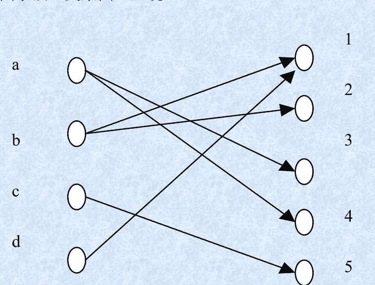

相关矩阵法表示：

把 A，B 集合内元素排好序

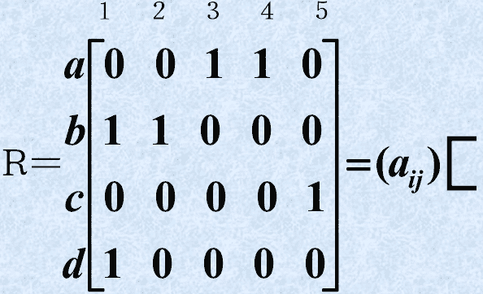

## 注：

(1) 若 R = A × B，称此二元关系为普遍关系

(2) 设 A = { a₁, a₂, ..., aₙ }

R = { (aᵢ, aⱼ) | aᵢ, aⱼ ∈ A }

若 R = { (aᵢ, aᵢ) | aᵢ ∈ A }

称 R 为恒等关系，用 Iₐ 表示，是单位矩阵

A = [
1 0 0 ... 0
0 1 0 ... 0
0 0 1 ... 0
⋮ ⋮ ⋮ ⋱ ⋮
0 0 0 ... 1
]

把二元关系看成函数关系

\(R=\{(a,b)\mid a\,r\,b,\ a\in A,\ b\in B\}\)

A称为R的定义域，记 \(A=dom\,R\)

B称为R的值域，记 \(B=Range\,R\)

当定义域与值域交换得

\(R^c=\{(b,a)\mid (a,b)\in R,\ a\in A,\ b\in B\}\)，称为R的逆关系。


### § 2 二元关系的运算

二元关系是集合，集合存在并，交，差，非和对称差的运算。故二元关系也存在这样的运算。


设R₁和R₂是A到B的二元关系，则

- (1) R₁∪R₂= { (a, b) | (a, b) ∈ R₁ 或 (a, b) ∈ R₂}
- (2) R₁∩R₂= { (a, b) | (a, b) ∈ R₁ 且 (a, b) ∈ R₂}
- (3) R₁-R₂= { (a, b) | (a, b) ∈ R₁ 但 (a, b) ∉ R₂}
- (4) R₁̅ = { (a,b) | (a,b) ∈ A*B, 但 (a, b) ∉ R₁}
- (5) R₁⊕R₂= { (a, b) | (a, b) ∈ R₁∪R₂ 但 (a, b) ∉ R₁∩R₂}

例1：A={1, 2, 3, 4}，I为整数集

R={(a, b) | a, b∈A, \(\frac{a-b}{2} \in I\)} □

S={(a, b) | a, b∈A, \(\frac{a-b}{3} \in I\), a-b>0}

求：R∪S, R∩S, R̄, R-S, S-R, S⊕R ■

解：R与S都是A上的二元关系

R={(1, 1), (2, 2), (3, 3), (4, 4), (1, 3), (3, 1), (2, 4), (4, 2)}

S={(4, 1)}

R∪S={(1, 1), (2, 2), (3, 3), (4, 4), (1, 3), (3, 1), (2, 4), (4, 2), (4, 1)}


R∩S = Φ

R = { (1, 2), (2, 1), (1, 4), (4, 1),
(2, 3), (3, 2), (3, 4), (4, 3) }

R - S = R, S - R = S, S ⊕ R = R ∪ S □

## 注：

二元关系的矩阵运算：
相关矩阵可表示二元关系，可用矩阵的逻辑运算
来研究二元关系的运算。

设： A = { a₁, a₂, ..., aₙ }
B = { b₁, b₂, ..., bₘ }
R₁ = (cᵢⱼ)
R₂ = (dᵢⱼ)


对上例：□

\( R = \begin{bmatrix} 1 & 0 & 1 & 0 \\ 0 & 1 & 0 & 1 \\ 1 & 0 & 1 & 0 \\ 0 & 1 & 0 & 1 \end{bmatrix} , \quad S = \begin{bmatrix} 0 & 0 & 0 & 0 \\ 0 & 0 & 0 & 0 \\ 0 & 0 & 0 & 0 \\ 1 & 0 & 0 & 0 \end{bmatrix} \)

则用矩阵的逻辑运算：

\( R \cup S = \begin{bmatrix} 1 & 0 & 1 & 0 \\ 0 & 1 & 0 & 1 \\ 1 & 0 & 1 & 0 \\ 1 & 1 & 0 & 1 \end{bmatrix} = S \oplus R \)

R∩S=\left[\begin{array}{ c c c c }
0 & 0 & 0 & 0 \\
0 & 0 & 0 & 0 \\
0 & 0 & 0 & 0 \\
0 & 0 & 0 & 0
\end{array}\right]=Φ, □

R̄=\left[\begin{array}{ c c c c }
0 & 1 & 0 & 1 \\
1 & 0 & 1 & 0 \\
0 & 1 & 0 & 1 \\
1 & 0 & 1 & 0
\end{array}\right],

R−S=R,S−R=S□

## 2. 二元关系的复合

[定义]：
设 \( R_1 \) 为 A 到 B 的二元关系，\( R_2 \) 为 B 到 C 的二元关系，
\( R_1 = \{ (a, b) \mid a \, r_1 \, b, \, a \in A, \, b \in B \} \)
\( R_2 = \{ (b, c) \mid b \, r_2 \, c, \, b \in B, \, c \in C \} \)
则 \( R_1 \cdot R_2 \) 是由 A 到 C 的二元关系，称为 \( R_1 \)，\( R_2 \) 的复合关系

\( R_3 = \{ (a, c) \mid (a, b) \in R_1, \, \text{且} \, (b, c) \in R_2 \} \)

记 \( R_3 = R_1 \cdot R_2 \)。

例 2：
\( R \) 是父子关系，则 \( R^2 = R \cdot R \) 是祖孙关系。

## 例 3：

$A=\{张华，王兵，陈平，李兰\}$ 是学生集合 □

$B=\{软件，硬件，自动化，遥感\}$ 是专业集合 □

$C=\{工程制图，电子线路，操作系统，离散数学\}$
是课程集合 □

则：$R_1=\{(a_1,b_1)，(a_1,b_3)，
(a_2,b_2)，(a_2,b_4)，
(a_3,b_3)，(a_3,b_4)，
(a_4,b_1)，(a_4,b_4)\}$

是选双学位专业的二元关系。

R₂ = { ( b₁, c₃), ( b₁, c₄), ( b₂, c₂), ( b₂, c₃), ( b₂, c₄), ( b₃, c₁), ( b₃, c₂), ( b₄, c₂), ( b₄, c₄) } 是各专业本学期必修课的二元关系。

R₃ = R₁ · R₂ = { ( a₁, c₁), ( a₁, c₂), ( a₁, c₃), ( a₁, c₄), ( a₂, c₂), ( a₂, c₃), ( a₂, c₄), ( a₃, c₁), ( a₃, c₂), ( a₃, c₄), ( a₄, c₂), ( a₄, c₃), ( a₄, c₄) } 是选双学位学生本学期必修课的二元关系

## 普通的矩阵乘法：

A = \( (a_{ij})_{m \times n} \) ,

B = \( (b_{jk})_{n \times L} \) ,

则： C = A • B = \( (c_{ik})_{m \times L} \)

而 \( c_{ik} = \sum_{j=1}^n a_{ij} b_{jk} \)

## 而二元关系的复合的矩阵布尔型乘法：

\( c_{ik} = \bigvee_{j=1}^n a_{ij} \wedge b_{jk} \)

对例 3，有： [ ]

[ R_1 = \begin{bmatrix} 1 & 0 & 1 & 0 \\ 0 & 1 & 0 & 1 \\ 0 & 0 & 1 & 1 \\ 1 & 0 & 0 & 1 \end{bmatrix} , \quad R_2 = \begin{bmatrix} 0 & 0 & 1 & 1 \\ 0 & 1 & 1 & 1 \\ 1 & 1 & 0 & 0 \\ 0 & 1 & 0 & 1 \end{bmatrix} ]

[ R_3 = R_1 \cdot R_2 = \begin{bmatrix} 1 & 1 & 1 & 1 \\ 0 & 1 & 1 & 1 \\ 1 & 1 & 0 & 1 \\ 0 & 1 & 1 & 1 \end{bmatrix} \quad [ ] ]

在行处标上姓名，列处标上课程，就知谁该必修哪些课了。

## 例 4：

R = { (0, 0), (0, 3),
(2, 3), (3, 2),
(2, 1), (2, 0) }
是有限集 {0, 1, 2, 3} 上的二元关系

# R的关系图：

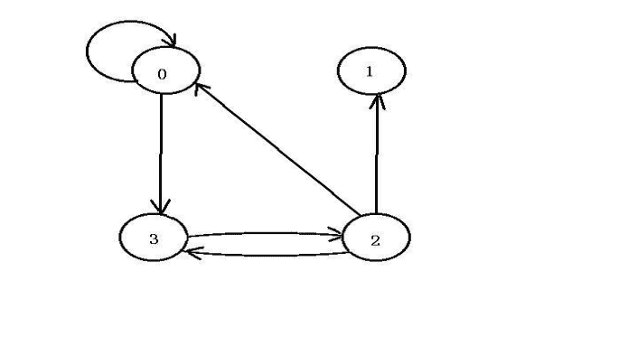

R²= { (0, 0), (0, 2), (0, 3),
(2, 0), (2, 2), (2, 3),
(3, 0), (3, 1), (3, 3) }

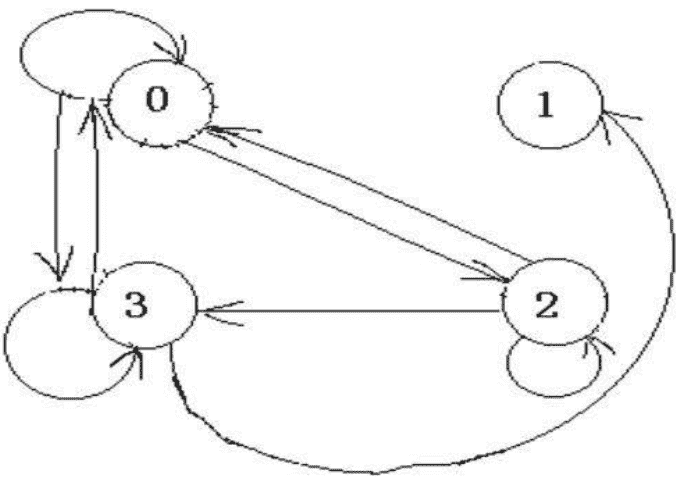

\( R = \begin{bmatrix} 1 & 0 & 0 & 1 \\ 0 & 0 & 0 & 0 \\ 1 & 1 & 0 & 1 \\ 0 & 0 & 1 & 0 \end{bmatrix} \)

\( R^2 = R \cdot R = \)

\( \begin{bmatrix} 1 & 0 & 0 & 1 \\ 0 & 0 & 0 & 0 \\ 1 & 1 & 0 & 1 \\ 0 & 0 & 1 & 0 \end{bmatrix} \begin{bmatrix} 1 & 0 & 0 & 1 \\ 0 & 0 & 0 & 0 \\ 1 & 1 & 0 & 1 \\ 0 & 0 & 1 & 0 \end{bmatrix} = \begin{bmatrix} 1 & 0 & 1 & 1 \\ 0 & 0 & 0 & 0 \\ 1 & 0 & 1 & 1 \\ 1 & 1 & 0 & 1 \end{bmatrix} \)

## 二元关系的逆关系：运算

设 R，S 是 A 到 B 的二元关系，T 是 B 到 C 的二元关系，P 是 C 到 D 的二元关系。则：

+   (1) \((R \cup S)^c = R^c \cup S^c\)

+   (2) \((R \cap S)^c = R^c \cap S^c\)

+   (3) \(\overline{R}^{\,c} = (\overline{R}^{\,c})\)

+   (4) \((R-S)^c = R^c-S^c\)

+   (5) \((A \times B)^c = B \times A\)

+   (6) \(\overline{R} = (A \times B)-R\)

+   (7) \((S \bullet T)^c = T^c \bullet S^c\)

(8) \( (R \cdot T) \cdot P = R \cdot (T \cdot P) \) ■

(9) \( (R \cup S) \cdot T = R \cdot T \cup S \cdot T \) ■

但： \( S \cdot T \neq T \cdot S \) □

且 \( (R \cap S) \cdot T \subseteq R \cdot T \cap S \cdot T \) □

(10) \( R \subseteq S \Leftrightarrow R^c \subseteq S^c \)

证明其中：

(1) 任意 \( (x, y) \in (R \cup S)^c \)

\( (y, x) \in (R \cup S) \)

\( (y, x) \in R \quad \text{或} \quad (y, x) \in S \)

\( (x, y) \in R^c \quad \text{或} \quad (x, y) \in S^c \)

\( (x, y) \in R^c \cup S^c \)


## § 3 A 上各类二元关系的性质

设 R 是 A 上的二元关系，\( R=(r_{ij})_{n*n} \)

(1) 自反性：

对 \(\forall a \in A\)，\( (a, a) \in R\)，则 R 称为自反的二元关系。

显然，\( r_{ii}=1 \ (i=1, 2, ..., n) \)

反自反性：

对 \(\forall a \in A\)，\( (a, a) \notin R\)，则 R 称为反自反的二元关系。

即 \( r_{ii}=0 \ (i=1, 2, ..., n) \)

## 注：

自反和反自反性互斥，但不互补。
如：\(r_{ij}\)中既有0又有1，则R既不是自反的也不是反自反的。

(2) 对称性：

若 \(a \neq b\)，\((a, b) \in R\)，必有 \((b, a) \in R\)，称R为对称的二元关系，即R的相关矩阵为对称阵，\(a_{ij} = a_{ji}\)

## 反对称性：

若 \( a \neq b \)，\( (a, b) \in R \)，则 \( (b, a) \notin R \)，称 \( R \) 为反对称的二元关系。

## 注：

+   (1) \( R \) 的相关矩阵是反对称的，即 \( r_{ij} \wedge r_{ji} = 0 \quad (i \neq j) \)
+   (2) 若 \( r_{ij} = 1 \)，则 \( r_{ji} = 0 \)，但 \( r_{ij} = 0 \) 时，不要求 \( r_{ji} = 1 \)，即 \( r_{ij} = r_{ji} = 0 \) 是允许的。
+   (3) 对称性与反对称性既不互斥，又不互补

例：

恒等关系：既是对称的，又是反对称的；
而相关矩阵是
[
\begin{bmatrix}
1 & 0 & 0 & 1 \\
0 & 0 & 1 & 0 \\
0 & 0 & 1 & 0 \\
1 & 0 & 0 & 1
\end{bmatrix}
]
的二元关系，是既不对称，又不是反对称的。

## 3）传递性：

若（a，b），（b，c）∈ R，

则（a，c）∈ R，称 R 为传递的二元关系。

即：\( (\overline{r_{ij} \wedge r_{jk}}) \vee r_{ik} = 1 \)

注：\(r_{ij}\)，\(r_{jk}\)中有一个不是 1，

则 \( \overline{(r_{ij} \wedge r_{jk})} = 1 \)，\(r_{ik}\)就可以任意。

即若(a，b),(c，d)中有1个不属于R，

则讨论（a,c)是否属于R，无意义。

即没有传递的条件，也不需传递的结果。如：

A = {a,b,c,d} ， R = { （a，b），（c，d） }

二元关系的性质对应于关系图，有：

+   （1）自反性：每个顶点都有自回路；
+   （2）反自反性：每个顶点都没有自回路；
+   （3）对称性：任一个顶点间或没有边，或有二条相对而指的有向边；
+   （4）反对称性：任二个顶点至多只有一条有向边；
+   （5）传递性：若 x 到 y 有边，y 到 z 有边，则 x 到 z 必有边。

例1：\( R_1 = \{ (a, b) \mid a \leq b, \ a, b \in \mathbb{N} \} \)

自反的，\( r_{ii}=1 \)；

不对称的，\( (1,2) \in R_1 \)，而 \( (2,1) \notin R_1 \)

反对称的，传递的。

注：将 \(\leq\) 改为 \(<\)，则无自反性，且是反自反的。

例2：\( R_2 = \{ (a, b) \mid a \mid b, \ a, b \in \mathbb{N} \} \)

自反的，不对称的，反对称的，传递的。

例3：\( R_3 = \{ (S_1, S_2) \mid S_1 \subseteq S_2, \ S_1, S_2 \in P(S) \} \) 其中 \( P(S) \) 是 \( S \) 的幂集。

自反的，不对称的，反对称的，传递的。

注：若 \(\subseteq\) 改为 \(\subset\)，则无自反性。

## 例 4：

R<sub>4</sub> = { ( a , b ) | a + b = 偶数，
a , b ∈ N }

自反的，对称的，传递的，

因： a + b = 偶， b + c = 偶，

则： 0 < a + c = ( a + b ) + ( b + c ) − 2 b = 偶数与偶数之差 = 偶数。

## 例 5：

R<sub>5</sub> = { ( a , b ) | ( a , b ) = 1 (互素） ， a , b ∈ N }

对称的，但不是自反的，也无传递性。

[定理1]：设R是A上的二元关系，则 \( R \cup I_A \) 一定是自反的，而且是包含R，具有自反性的最小关系。
（其中 \( I_A \) 是A上恒等关系）。

[定义1]：称 \( R \cup I_A \) 是R的自反闭包，记为 \( r(R) \) 。
证明：对 \( \forall x \in A \)，\( (x, x) \in I_A \subseteq R \cup I_A \)，
且 \( R \subseteq R \cup I_A \)。

若 \( R' \) 为包含R且具有自反性，则 \( I_A \subseteq R' \)，
\( R \subseteq R' \)，\( I_A \cup R \subseteq R' \)。即 \( I_A \cup R \) 为最小。

[推论1]：当且仅当R是自反闭包，R具有自反性。
证明：
（1）R是自反闭包，\( R = I_A \cup R \Rightarrow I_A \subseteq R \)；
（2）R具有自反性，\( I_A \subseteq R \)，\( R \cup I_A = R \)；

【定理2】：设 R 是 A 上的二元关系，则 $R \cup R^c$ 是对称的，包含 R 的最小关系，
（其中 $R^c$ 是 R 的逆关系）。

【定义2】：称 $R \cup R^c$ 是 R 的对称闭包，记为 $s(R)$。

证明：若 $(a,b) \in R \cup R^c$，则
$(a,b) \in R$ 或 $(a,b) \in R^c$，
$\Rightarrow (b,a) \in R^c$ 或 $(b,a) \in R$，
故 $(b,a) \in R \cup R^c$（对称性），
若 $R'$ 为包含 R、对称的二元关系，
则对任意 $(a,b) \in R \cup R^c$，
若 $(a,b) \in R \Rightarrow (a,b) \in R'$；
若 $(a,b) \in R^c \Rightarrow (b,a) \in R$，
$\Rightarrow (b,a) \in R'$，
又 $R'$ 具有对称性，$(a,b) \in R'$，
故 $R \cup R^c \subseteq R'$。


## 推论2

当且仅当 R 是对称闭包时，R 具有对称性。

证明：(1) R 具有对称性，
若 (a，b) ∈ R，则 (b，a) ∈ R，
又 (b，a) ∈ Rᶜ
即 ∀ (b，a) ∈ Rᶜ，(a，b) ∈ R
⇒ (b，a) ∈ R
⇒ Rᶜ ⊆ R ⇒ R ∪ Rᶜ = R；
(2) R 是对称闭包时，R = R ∪ Rᶜ ⇒ R 具有对称性。

## 定义3：传递扩张

设 R = { (a，b) | a r b，a，b ∈ A }，
则称 R₁ = { (a，b) | (a，b) ∈ R，或 ∃ c ∈ A，使 (a，c)，(c，b) ∈ R } 为 R 的传递扩张。

注：

(1) \(R \subseteq R_1\)

(2) \(R_1\) 不一定是传递的，如：

\(R=\{(a,b),(b,c),(c,d)\}\)

\(R_1=\{(a,b),(b,c),(c,d),\)
\(\qquad\ (a,c),(b,d)\}\)

由 \((a,c),(c,d),(a,b),\)
\((b,d)\) 又产生了新的传递条件，而 \((a,d)\)
\(\notin R_1\)，\(R_1\) 不是传递的。

## 定义3

设 \(R_0 = R\)，\(R_{k+1}\) 是 \(R_k\) 的传递扩张（\(k = 0, 1, 2, \dots\)），则称 \(R^* = R_0 \cup R_1 \cup R_2 \cup \dots \cup R_k \cup \dots\) 为 \(R\) 的传递闭包，也记作 \(t(R)\)。

## 定理3 传递闭包 \(R^* = R \cup R^2 \cup \dots \cup R^k \cup \dots\)

证明：\(R^2 = R \cdot R = \{ (a, b) \mid (a, c), (c, b) \in R \}\)

\(R_1 = \{ (a, b) \mid (a, b) \in R \text{ 或 } (a, c), (c, b) \in R \}\)

\(= R \cup R^2\)

\(R_2 = \{ (a, b) \mid (a, b) \in R_1, \text{ 或 } (a, c), (c, b) \in R_1 \}\)

## 定理4：传递闭包 R* 一定是传递的。

证明：设 (a，b)、(b，c) ∈ R*，则

∃ i，j，使 (a，b) ∈ Rᶦ，

(c，b) ∈ Rʲ，

故 (a，b) ∈ R⁽ⁱ⁺ʲ⁾⊆ R*

# 传递扩张的实际意义：

举例：

- R = {（a，b）| a 与 b 是父子关系}
- R · R = {（a，b）| a 与 b 是祖孙关系}
- R₁ = {（a，b）| a 与 b 是二代以内男性直系亲属}

## 定理5

设 \(|A|=n\)，\(R\) 是 \(A\) 上二元关系，则存在正整数 \(k\)，\(k\le n\)，使 \(R^*=R\cup R^2\cup\dots\cup R^k\)。

## 证明：

对任意 \((x,y)\in R^*\)，\(\exists k\)，使 \((x,y)\in R^k\)，表明在 \(A\) 中存在不同元素 \(a_1,a_2,\dots,a_{k-1}\)，使 \((x,a_1)，(a_1,a_2)，(a_2,a_3)，\dots，(a_{k-1},y)\in R\)。

若 \(k>n\)，由鸽洞原理，则 \(a_1，a_2，\dots，a_{k-1}\) 与 \(y\) 中至少有两个相同，不妨设 \(a_i:=y\)，\((i\le k-1)\)。

于是 \((x，a_1)，…(a_i，a_{i-1})\in R\)，
\((a_{i-1}，y)\in R\)，
故 \((x，y)\in R^i\)，
即 若 \(k>n\)，必存在比 \(k\) 的正整数 \(i\)，
使 \((x，y)\in R^i\)。

**注：**
定理说明，可用 \(R\cup R^2\cup…\cup R^n\) 来求 \(R^*\)。

### 例 6：

设 \(A=\{1，2，3\}\)，
\(R=\{(1，1)，(1，2)，(2，3)\}\)
求 \(R^*\)。

注：当 \(|A|=n\) 较大时，用定理5计算 \(R^*\) 工作量非常大。

# Warshall算法：（1962）

设 R 是 n 个元素集合上的二元关系

- (1) 是 R 的相关矩阵；
- (2) \(i \leftarrow 1\)；
- (3) **for** \(j=1\) **to** \(n\) **do**
    - **if** \(a_{j,i}=1\) **then do**
        - **for** \(k=1\) **to** \(n\) **do**
            - \(a_{j,k}\leftarrow a_{j,k}\lor a_{i,k}\)
- (4) \(i=i+1\)；
- (5) **if** \(i\le n\)，**then go** (3)
    - **else stop**

注：(1) 结果 \((a_{ij})_{n\times n}\) 是 \(R^*\) 的相关矩阵。(2) 算法的复杂度为 \(n^3\)。

### 例6：重新计算 R*

### 例 7：\(A = \{ a , b , c , d \}\) \(R = \{ ( a , b ) , ( b , c ) , ( c , d ) \}\) 计算 R*。

\(R = \begin{bmatrix} 0 & 1 & 0 & 0 \\ 0 & 0 & 1 & 0 \\ 0 & 0 & 0 & 1 \\ 0 & 0 & 0 & 0 \end{bmatrix}\)

(1) i=1 由于 \(a_{j1}=0\) (j=1, 2, 3, 4) 不改动

(2) i=2 j=1, \(a_{ji}=1 \Rightarrow a_{13}=1\)

(3) i=3 \(\begin{bmatrix} 0 & 1 & 1 & 0 \\ 0 & 0 & 1 & 0 \\ 0 & 0 & 0 & 1 \\ 0 & 0 & 0 & 0 \end{bmatrix}\)

j=1，\(a_{13}=1 \Rightarrow a_{14}=1\)

j=2，\(a_{23}=1 \Rightarrow a_{24}=1\)

即

\(R^* = \{(a,b),\ (a,c),\ (a,d),\ (b,c),\ (b,d),\ (c,d)\}\)

## § 4 等价关系

## 4.1 等价关系

### 定义1 等价关系：

A 上的二元关系 R，如果 R 是

- (1) 自反的
- (2) 对称的
- (3) 传递的

称 R 为等价关系。

( a，b ) ∈ R，称 a 与 b 等价，记作 a ~ b 。

### 定义4.2 等价类：

把 A 中的等价元素归为一类，称为等价类。

注：

等价关系 R 把 A 的元素分为若干类，各类之间没有公共元素。确定的 R 是对集合 A 进行的分划。

### 定义4.3 集合的分划：

把集合 A 分为若干子集 \(A_1, A_2, \dots\)，满足：

（1）当 \(i \neq j\) 时，\(A_i \cap A_j = \Phi\)

（2）\(\forall a \in A\)，\(\exists i\)，使 \(a \in A_i\)（\(i=1, 2, \dots\)）

则集合 \(P_r(A) = \{\{A_1, A_2, \dots, A_n, \dots\}\}\) 称为 A 的一个分划。

## 注：

(1) \(P_\gamma(A) \subseteq p(A)\)（A 的幂集）

(2) 当且仅当 \(A = \Phi\) 时，\(P_\gamma(A) = p(A) = \{\Phi\}\)

(3) A 非空时 \(P_\gamma(A) \subset p(A)\)

### 定理1：

A 在等价关系 R 下的等价类正是 A 的一种分划，A 的任一种分划，也必有 A 上的一个等价关系 R 与之对应。

## 证明：

R 是等价关系，\(\forall a \in A\)，由 R 的自反性，
（a，a）∈ R，即 a 与 a 属于同一等价类，
也即 \(\exists i\)，\(a \in A_i\)

若 \(i \neq j\)，\(A_i \neq A_j\)，而 \(A_i \cap A_j \neq \Phi\)，则 \(\exists c \in A_i \cap A_j\)，\(c \in A_i\)，且 \(c \in A_j\)

对 \(\forall a \in A_i\)，\(a \sim c\)，\(c \in A_j\)

对 \(\forall b \in A_j\)，\(b \sim c\)，即 \(c \sim b\)（对称性）

由 R 传递性，\(a \sim b\)

由 a，b 的任意性，故 \(A_i = A_j\)


与 \( A_i \) 和 \( A_j \) 为不同的等价类矛盾。

故 \( A_i \cap A_j \neq \Phi \)

所以，\( R \) 完成了等价类的分划

若 \( A \) 已进行了分划，则构造二元关系 \( R \)。

(1) \( \forall a \in A \)，使 \( (a, a) \in R \)。

(2) 分别对每一等价类内所有两个不同元素 \( a \)，\( b \)，\( (a, b) \in R \)，使 \( (b, a) \in R \)。

显然，\( R \) 是自反的，对称的，而且也是传递的，因为若 \( (a, b) \in R \)，\( (b, c) \in R \)，则 \( a \)，\( b \)，\( c \) 均在同一等价类内，

故 \( (a, c) \in R \)。

# 例 1：

A = { 5 2 张扑克 }

R₁ = { ( a , b ) | a 与 b 同花， a , b 是扑克 }

R₂ = { ( a , b ) | a 与 b 同点， a , b 是扑克 }

则： R₁把A分为四类同花类，

R₂把A分为 1 3 类同点类。

# 例 2：

A = { 0 , 1 , 2 , 3 , 4 , 5 }

R = { ( 0 , 0 ) , ( 1 , 1 ) , ( 2 , 2 ) , ( 3 , 3 ) , ( 1 , 2 ) , ( 1 , 3 ) , ( 2 , 1 ) , ( 2 , 3 ) , ( 3 , 1 ) , ( 3 , 2 ) , ( 4 , 4 ) , ( 4 , 5 ) , ( 5 , 4 ) , ( 5 , 5 ) }

二元关系R是自反的，对称的，传递的，且把A分成了三个等价类，（A）＝{{0}，{1，2，3}，{4，5}}

[定义] 商集：等价关系R将A分成若干等价类，每个类选个代表组成新集合称为A关于R的商集，表示为A/R。

例：在上例中

A/R＝{[0]，[1]，[4]}

[定义]：商集的元素个数（即A在R下的等价类个数）称为R的秩，

# 例3：

$R=\{(a,b)\mid a\equiv b\pmod{3},\ a,b\in I\}$ 是整数集合 $I$ 上模 3 同余的二元关系。

证明 $R$ 是等价关系。

证明：由于 $3\mid(a-b)\ a\equiv b\pmod{3}$

1. $3\mid(a-a)$，自反性
2. 若 $3\mid(a-b)$，则 $3\mid(b-a)$ 对称性
3. 若 $3\mid(a-b)$，$3\mid(b-c)$，则
   $$a-c=(a-b)+(b-c)$$
   $$\Rightarrow 3\mid(a-c)$$

满足传递性，故 $R$ 是等价关系

商集：$I/R=\{[0],[1],[2]\}$

其中
- $[0]=\{\ldots,-6,-3,0,3,6,\ldots\}$
- $[1]=\{\ldots,-5,-2,1,4,7,\ldots\}$
- $[2]=\{\ldots,-4,-1,2,5,8,\ldots\}$

## 例 4：

N的一个分划为：若 \(10^{i-1} \leq a < 10^i\)，  
则 \(a \in A^i\)，对应的等价关系  
\(R = \{(a, b) \mid a \text{ 与 } b \text{ 有相同位数，} a, b \in \mathbb{N} \}\) 相同位的数归为一类，此 \(R\) 把  
\(\mathbb{N}\) 分划为可列个等价类。

# [定义]相容关系：

A 上的二元关系 R，若是自反的，  
对称的，称 R 为相容关系。

## 注：

等价关系必然是相容关系。

# 4．2 等价关系的运算

【定理2】：若 $R_1，R_2$ 是 $A$ 上的等价关系，则 $R_1\cap R_2$ 也是等价关系。

证明：$R_1\cap R_2=R_3$，$R_3$ 传递。

1. ∀ $a\in A$，由 $R_1$，$R_2$ 自反  
   $(a，a)\in R_1$，$(a，a)\in R_2$，于是  
   $(a，a)\in R_1\cap R_2=R_3$，$R_3$ 自反

2. 若 $(a，b)\in R_3$，则 $(a，b)\in R_1$  
   且 $(a，b)\in R_2$，由 $R_1$，$R_2$ 对称  
   $(b，a)\in R_1$，$(b，a)\in R_2$  
   于是 $(b，a)\in R_1\cap R_2=R_3$，$R_3$ 对称

(3)若 \( (a, b) \in R_3 \)， \( (b, c) \in R_3 \)

\(\Rightarrow \begin{cases} (a,b) \in R_1, (b,c) \in R_1 \Rightarrow (a,c) \in R_1 \\ (a,b) \in R_2,(b,c) \in R_2 \Rightarrow (a,c) \in R_2 \end{cases}\)

于是 \( (a, c) \in R_1 \cap R_2 = R_3 \)，\( R_3 \) 传递。
归纳以上三点，\( R_3 = R_1 \cap R_2 \) 也是等价的二元关系。

[定理3]：若 \( R_1, R_2 \) 是 A 上等价关系，则 \( R_1 \cup R_2 \) 是相容关系。

注：\( R_1 \cup R_2 \) 不一定是等价关系。

## 例 5：

A = {a， b， c }  
R₁ = { (a， a)， (b， b)，  
（c， c）， (a， b)， (b， a) }  
R₂ = { (a， a)， (b， b)，  
（c， c）， (b， c)， (c， b) }  
R₄ = R₁ ∪ R₂ = { (a， a)， (b， b)，  
（c， c）， (a， b)， (b， a)，  
（b， c）， (c， b) }

显然， (a， b)， (b， c) ∈ R₁ ∪ R₂  
但 (a， c) ∉ R₁ ∪ R₂（不具有传递性），  
但 (R₁ ∪ R₂) * 一定是传递的。

# [定理4]: 若R<sub>1</sub>, R<sub>2</sub>是A上等价关系,

# 则（R<sub>1</sub> U R<sub>2</sub>）<sup>*</sup>也是A上等价关系。

## 证明：

(1)∀a ∈ A，（a，a）∈（R<sub>1</sub> U R<sub>2</sub>）⊆（R<sub>1</sub> U R<sub>2</sub>）<sup>*</sup>

(2)（R<sub>1</sub> U R<sub>2</sub>）是对称的，只需证明对称的二元关系的传递扩张还是对称的。

设R是A上对称的二元关系，R<sub>1</sub>是R的传递扩张，若（a，b）∈R<sub>1</sub>，则（a，b）∈R或（a，b）∈R·R，

a. 若（a，b）∈R，（b，a）∈R，故（b，a）∈R<sub>1</sub>;

b. 若 \( (a, b) \in R \cdot R \)，则 \(\exists c\)，使  
\( (a, c), \, (c, b) \in R \)  
\(\Rightarrow \, (b, c), \, (c, a) \in R \)  
\(\Rightarrow \, (b, a) \in R \cdot R \)  
\(\Rightarrow \, (b, a) \in R_1\)

由 \( (R_1 \cup R_2) \) 对称 \(\Rightarrow (R_1 \cup R_2)_1 \) 也对称，...，  
对任一 \( k \)， \( (R_1 \cup R_2)_k \) 也对称。  
若 \( (a, b) \in (R_1 \cup R_2)^* \)，则 \(\exists k\)，  
使 \( (a, b) \in (R_1 \cup R_2)_k \)，  
故 \( (b, a) \in (R_1 \cup R_2)_k \subseteq (R_1 \cup R_2)^*\)，  
于是 \( (R_1 \cup R_2)^* \) 是对称的。  
(3) 任一传递闭包都具有传递性。  
即证。

### 4.3 等价关系的运算与分划的关系

等价关系对应于集合的一种分划。

设 \( R_1, R_2 \) 是 \( A \) 上等价关系，对应的分划为 \( \pi_1, \pi_2 \)，

\( \pi_1 \cdot \pi_2 \) 对应于 \( R_1 \cap R_2 \)，称为二个分划的积，使分划分更细；

\( \pi_1 + \pi_2 \) 对应于 \( (R_1 \cup R_2)^* \)，称为两个分划的和，使分划比 \( \pi_1, \pi_2 \) 要粗。

例 6：
\( A = \{ a, b, c, d, e, f, g, h, i, j, k \} \)


$R_1 \leftrightarrow \pi_1 = \{\overline{abcd}_{A_1},\ \overline{efg}_{A_2},\ \overline{hi}_{A_3},\ \overline{jk}_{A_4}\}$

$R_2 \leftrightarrow \pi_2 = \{\overline{abch}_{B_1},\ \overline{di}_{B_2},\ \overline{efjk}_{B_3},\ \overline{g}_{B_4}\}$

$R_1=\{(a,a),(b,b),(c,c),(d,d),(e,e),(f,f),(g,g),(h,h),(i,i),(j,j),(k,k),(a,b),(a,c),(a,d),(b,c),(b,d),(c,d),(b,a),(c,a),(d,a),(c,b),(d,b),(d,c),(e,f),(e,g),(f,g),(f,e),(g,e),(g,f),(h,i),(i,h),(j,k),(k,j)\}$

R2= { (a, a), (b, b), (c, c), (d, d), (e, e), (f, f), (g, g), (h, h), (i, i), (j, j), (k, k), (a, b), (a, c), (a, h), (b, c), (b, h), (c, h), (b, a), (c, a), (h, a), (c, b), (h, b), (h, c), (d, i), (i, d), (e, f), (e, j), (e, k), (f, j), (f, k), (j, k), (f, e), (j, e), (k, e), (j, f), (k, f), (k, j) }

$R_1 \cap R_2 = \{(a,a), (b,b), (c,c), (d,d), (e,e), (f,f), (g,g), (h,h), (i,i), (j,j), (k,k), (a,b), (a,c), (b,c), (e,f), (j,k), (b,a), (c,a), (c,b), (f,e), (k,j)\}$

R₁∪R₂= { (a, a), (b, b), (c, c), (d, d), (e, e), (f, f), (g, g), (h, h), (i, i), (j, j), (k, k), (a, b), (a, c), (a, d), (b, c), (b, d), (c, d), (b, a), (c, a), (d, a), (c, b), (d, b), (d, c), (a, h), (b, h), (c, h), (h, a), (h, b), (h, c), (e, f), (e, g), (f, g), (f, e), (g, e), (g, f), (h, i), (i, h), (j, k), (k, j), (d, i), (i, d), (e, j), (e, k), (f, j), (f, k), (j, e), (k, e), (j, f), (k, f) }

但 $R_1\cup R_2$ 不是传递的，如：$(c,h)$，$(h,i)\in R_1\cup R_2$，而 $(c,i)\notin R_1\cup R_2$。把 $R_1\cup R_2$ 扩张到传递性满足，就是 $(R_1\cup R_2)^*$。

$R_1\cap R_2\leftrightarrow \pi_1\bullet\pi_2\square$

$=\{\overline{abc}_{A_1\cap B_1},\ \overline{d}_{A_1\cap B_2},\ \overline{ef}_{A_2\cap B_2},\ \overline{g}_{A_4\cap B_4},\ \overline{h}_{A_3\cap B_1},\ \overline{i}_{A_3\cap B_2},\ \overline{jk}_{A_4\cap B_3}\}$

□凡是在 $\pi_1$，$\pi_2$ 中有一个要求把它们拆开的，就拆开。□

$(R_1\cup R_2)^*\leftrightarrow\{\overline{abcdih}_{A_1\cup A_3=B_1\cup B_2},\ \overline{efgjk}_{A_2\cup A_4=B_3\cup B_4}\}$

# 例7：

A = {52张扑克}

R₁ = {（a，b）| a与b同花，
　　　　　　 a，b是扑克}

↔ π₁

R₂ = {（a，b）| a与b同点，
　　　　　　 a，b是扑克}

↔ π₂

R₁∩R₂ ↔ π₁、π₂把扑克分成52张
　　　　单张

(R₁∪R₂)* ↔ π₁＋π₂把52张扑克
　　　　归为同一类

[定义]平凡分割：
集合A的最粗或最细的分划，称为平凡分划。

## 注：

+ （1）等价关系，用穷举法很难判别
+ （2）用关系图比较直观，明确
+ （3）用集合的分划来研究等价关系

## § 5 半序关系

[定义]：半序关系（偏序关系）
R是A上的二元关系，如果R满足：
(1) 自反的
(2) 反对称的
(3) 传递的
则称R是A上半序关系。

# 例：

$A=\{1,\ 2,\ 3,\ 4,\ 5,\ 6,\ 7,\ 8,\ 9\}$

$B=\{a,\ b,\ c\}$

$R_1=\{(a,b)\mid a\le b,\ a,b\in A\}$

$R_2=\{(a,b)\mid a\mid b,\ a,b\in A\}$

$R_3=\{(s_1,s_2)\mid s_1\subseteq s_2,$  
$\qquad\qquad s_1,s_2\in\mathcal{P}(B)\}$

## 记号：

$R=\{(a,b)\mid a\le_R b,\ a,b\in A\}$ 其中 $\le_R$ 可为 $\le$、$\mid$、$\subseteq$

注：

+ 1. 用矩阵表示半序关系，不能明显看出二元关系的特征。
+ 2. 用简化的关系图表示较适合。

# 简化的关系图：

+ 1. 自反性：每个顶点都有自回路，省去。
+ 2. 反对称性：两个顶点间只可能有一个箭头，从左→右，或从下→上的方向；从小到大安置顶点，可省略箭头。
+ 3. 传递性：由于有（a，b），（b，c）∈R，则（a，c）∈R，故只画（a，b），（b，c）对应的边，省略边（a，c）。

# [定义]: Hasse图

设≤是A上的一个半序关系，如果a≤b，则将a画在b下面，且不∃c，使a≤c，c≤b，则a，b间用直线连接。并符合简化的关系图的绘制，称这样得到关系图为Hasse图。

例中半序关系的Hasse图如下：

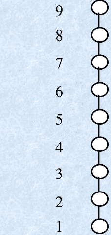

R1

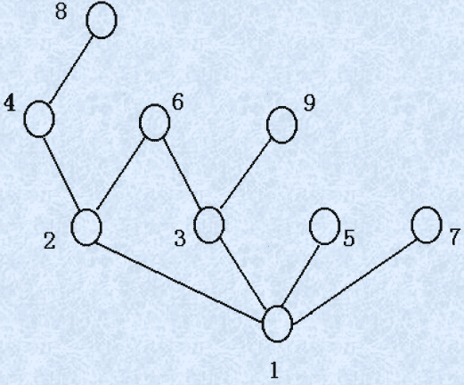

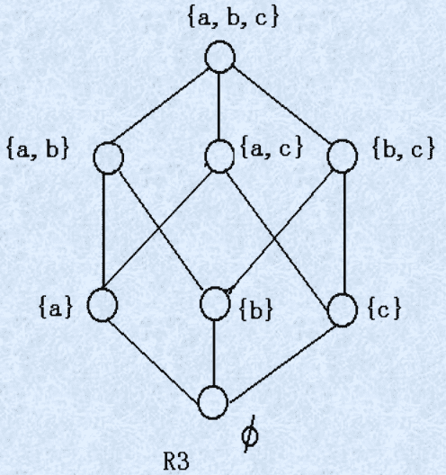

R3

## [定义] 全序：

A 上半序关系 R，如果 ∀a， b ∈ A，都有 a ≤ b，或 b ≤ a，则称 R 为 A 上的全序关系。

注：

（1）全序的含义： A 中每两个元素均能比大小，即任何两个元素都相关。

（2）半序则是部分有序。

（3）R₁是全序，R₂，R₃都是半序

如：R₂中，{1，2，6}，{1，2，4，8}，{1，3，9} 都排成了序，但 2 与 3，5 与 7，7 与 9 ...，在整除的意义上来说无法排出大小来。

# 【定义】半序集：

集合 A 及 A 上的一个半序关系 R 组成的二元组（A，R），称为半序集，记为（A，≼_R）或（A，≼）。

## 注：

+ （1）同一集合上的两个不同的半序关系，所构成两个半序集，如：

R₁ 和 R₂ 都定义在 A = {1，2，3，4，5，6，7，8，9} 上，但（A，R₁）与（A，R₂）显然不是一样的半序集。

# 【定义】全序集：

半序集 \( (A, \leq_R) \) 中的半序关系 \(\leq_R\) 是 \( A \) 上的全序，则此 \( (A, \leq_R) \) 称为全序集。

\( (A, R_\downarrow) \) 是全序集。显然，全序集是半序集的特例。又如：\( (-\infty, +\infty) \) 实数全体，在 \(\leq\) 下是全序集；平面上点集，也可以规定一种 \(\leq_R\)，模长大的大，模长相等的情况下，以幅角的大小来比大小，因此，平面上点集也是全序集。\( (N, \leq) \) 当然也是全序集。

## 注：

实数全体，平面点集是无法用Hasse图表示的。一般来说，对有限集用Hasse图比较好，对可列集只能示意一下，对不可列无限集是没法表示的，因为任二个数之间一定还有别的数。

# [定义]链：

设 \( (A, \leq_R) \) 是半序集，\( B \subseteq A \)，若 \( (B, \leq_R) \) 是全序集，则称 \( B \) 为 \( (A, \leq_R) \) 中的链（Chain）。


当B是有限集时，B的基数|B|称为链长。

例：

在上例Hasse图（A，R2）中，取B1={1，2，4，8}，R2=|（整除），则

（B1，R2）是全序关系，B1是半序集（A，|）中链长为4的链。

B2={1，2，6}，B3={1，3，9}，B4={1，5}，B5={1，7}也都是（A，|）中的链。

## [定义]反链：

设 \( (A, \leq_R) \) 为半序集，\( B \subseteq A \)，对 \(\forall a, b \in B \ (a \neq b)\)，\( (a, b) \notin R\)，\( (b, a) \notin R\)，则称 \( B \) 为 \( (A, \leq_R) \) 中的反链。

当 \( B \) 为有限集时，\( |B| \) 为反链的长度。

注：反链中的元素都互不相关。

例如：\( (A, R_2) \) 中

\( B_1 = \{2, 3, 5, 7\} \quad |B_1| = 4 \)
\( B_2 = \{4, 6, 9\} \quad |B_2| = 3 \)
\( B_3 = \{8, 6, 9, 5, 7\} \quad |B_3| = 5 \)

...

都是反链。

## 【定义】极大元与极小元：

设（P，≤）是半序集，A⊆P，若 a∈A，且在 A 中找不到一个元素 b（b≠a），使 a≤b（b≤a），则称 a 为 A 中的极大元（极小元）。

例：（N，|）是半序集，

A={2，3，4，5，6，7，8，9}

则 A 中极大元：8，6，9，5，7

极小元：2，3，5，7

注：

极大元，极小元并不要求唯一，且同一元素，可以既是极大元，又是极小元，如5，7。

## 注：

极大元，极小元必须是子集 A 中的元素。

## [定义]最大元与最小元：

设 \( (P, \leq) \) 是半序集，\( A \subseteq P \)，若 \( a \in A \)，\( \forall b \in A \)，\( b \leq a \) (\( a \leq b \))，则称 \( a \) 为 \( A \) 的最大元（最小元）。

例：上例

其Hasse图如下图所示

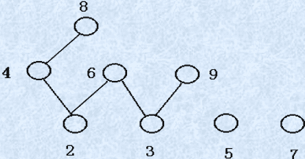

**结论：**  
子集 A 中是不存在最大元（最小元）的。

例： \( B = \{a, b, c\} \),

\( R_3 = \{ (s_1, s_2) \mid s_1 \subseteq s_2, s_1, s_2 \in p(B) \} \), \( (p(B), \subseteq) \) 是半序集。

设 \( A = \{\Phi, \{a\}, \{b\}, \{c\}, \{a, b\}, \{a, c\}, \{b, c\}\} \)

其Hasse图如下图所示

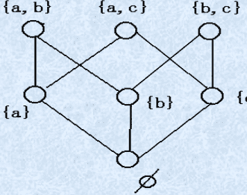

# 结论：

A存在最小元Φ，没有最大元。

## 注：

最大元（最小元）本身应属于子集A，且与A中任一元素都有关系。

## [定义]上界与下界：

设 \( (P, \leq) \) 是半序集，\( A \subseteq P \)，

若 \( a \in P \)，对 \( \forall b \in A \)，\( b \leq a \) （\( a \leq b \)）称 \( a \) 为 \( A \) 的上界（下界）。

## 注：

+   (1) 上例中，\( A \) 无最大元，但存在 \( A \) 的上界 \(\{a, b, c\}\)。

+   (2) \( \Phi \) 为 \( A \) 的最小元，也是 \( A \) 的下界

+   (3) 最大（小）元是 \( A \) 的一个上（下）界

+   (4) 上（下）界可以不唯一，也可以不存在

## 【定义】上确界与下确界：

设（p，≤）是半序集，A⊆P，若 a 是 A 的一个上界（下界），而 ∀A 的上界（下界）b，都有 a≤b（b≤a），则称 a 是 A 的上确界（下确界）。

注：

上确界：最小上界

下确界：最大下界

如果存在上（下）确界，则上（下）确界一定是唯一的

# 例：

（ p （ B ）， ⊆） 中取 A’ = { Φ，
{ b }， { c } }，则
{ b， c } 与 { a， b， c } 是A’ 的上
界， { b， c } 是A’ 的上确界。

## 注：

存在上（下）界，并不一定存在上
（下）确界。

# 例：

p = { a， b， c， d， e }
A = { a， b， c }， （ p， ≤）

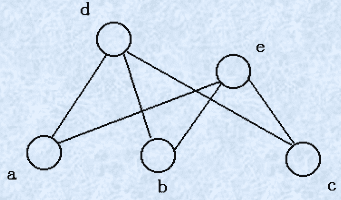

结论： （1） d， e 是A的上界

（2） d 与 e 无法比大小， 不存在上确界

（3） A的下界不存在， 不存在下确界

> [引理1]：

设（P，≤）是半序集，A 是 P 的非空有限子集，则 A 一定存在极大（小）元。

**证：** 若 |A| = 1，则 A 中唯一元素既是极大元，也是极小元。

假定 |A| = n 时存在极大（小）元

当 |A| = n + 1 时，则将 A 分成由 n 个元素组成的子集 A’ 与元素 a。

由假定，A’ 存在极大元 aₘ’，极小元 aₘ’

若 \(a_M \leq a\)，则 \(a\) 为极大元，否则为 \(a_M\)， 因为若 \(a_M \leq a\)，且存在 \(b \leq A'\)，而

\(a \leq b\)，由传递性 \(a_M \leq b\)，与 \(a_M\) 为极大元（\(A'\)）矛盾。

同理，若 \(a \leq a_m\)，则 \(a\) 为极小元，否则为 \(a_m\)。

## [引理2]：

设 \(M\) 是非空有限子集 \(A\) 的极大元集合，则 \(M\) 是 \(A\) 的反链。

# 反证：

若M不是反链，则∃a， b ∈ M（a ≠ b），（a，b） ∈ R或（b，a） ∈ R，即 a ≤ b 或 b ≤ a，则a或b不是极大元，矛盾。

## [定理1]：设（P，≤）是有限的半序集，P中最长链长度为n，则P可以划分为n个互不相交的反链。

证：（1）n = 1，P中任两个元素不相关，P本身是反链。

(2) 假设 n 时定理成立，即当 P 中最长链长为 n 时，可以划分为 n 个互不相交的反链。

(3) 当 P 中最长链长为 n + 1，由引理1，极大元一定存在，设 M 是极大元集合，由引理2，M 是 P 的一个反链。

如果去掉 M，（ P - M，≤）也是半序集，则 P - M 中最长链长为 n，由假设，P - M 可以划分为 n 个互不相交的反链，添上 M，可知 P 可划分为 n + 1 个互不相交的反链。

例：A = {1，2，3，4，5，6，7，8，9}，半序集（A，6），最长链为4，B = {1，2，4，8}

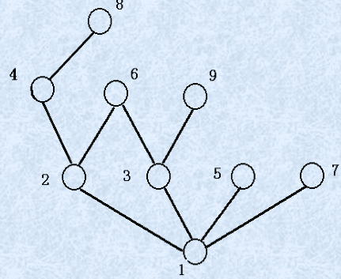

可划分为 4 个互不相交的反链：

A₁ = { 1 }
A₂ = { 2, 3, 5, 7 }
A₃ = { 4, 6, 9 }
A₄ = { 8 }

也可分为：

B₄ = { 8, 6, 9, 5, 7 }
B₃ = { 4, 3 }
B₂ = { 2 }
B₁ = { 1 }

注：

反链的取法并不唯一，而最长链中的元素必然分别落在每个反链里。

## 说明：

若 $P(A)=\{A_1，A_2，...，A_n\}$，是 $A$ 的一个分割，则可定义一个半序关系，当 $j-i=1$ 时，取 $a\in A_i$，$b\in A_j$，使 $(a,b)\in R_1$，且 $A_i$，$A_j$ 中每个元素至少取到一次。

并对 $\forall\ a\in A$，$(a,a)\in R_1$

然后取 $R=R_1^*$（闭包）

这样 $R$ 是半序关系，并使每个 $A_i$ 是反链，且最长链是 $A_1，A_2，...，A_n$ 中各取一个元素组成的。

## 【定理2】：每个 A 的分划

$p_r(A)=\{A_1,A_2,\ldots,A_n\}$，都可以找到一个半序关系 $R$，使 $A_1,A_2,\ldots,A_n$ 都是 $(A,R)$ 的反链，而 $(A,R)$ 的最长链由 $A_1,A_2,\ldots,A_n$ 中各取一个元素组成。

# 例：

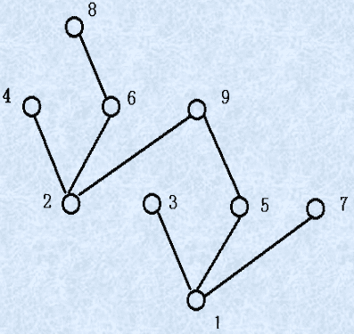

如上例：

取 \( R_1 = \{ (1, 2), (1, 3), (1, 5), (1, 7), (2, 6), (2, 4), (3, 6), (3, 9), (4, 8), (1, 1), (2, 2), (3, 3), (4, 4), (5, 5), (6, 6), (7, 7), (8, 8), (9, 9) \} \)

令 \( R = R_1^* \)，则 \( (A, R) = (A, 1) \)。


但若取：

\[
R_1 = \{ (1, 2), (1, 3), (1, 5), (1, 7), (2, 4), (2, 6), (2, 9), (6, 8), (5, 9), (1, 1), (2, 2), (3, 3), (4, 4), (5, 5), (6, 6), (7, 7), (8, 8), (9, 9) \}
\]

令 \(R = R_1^*\)，是无法得到 \((A, /)\) 的。

可见，由互不相交的反链构造出来的半序集并不是唯一的。

## 例 1

\(a \cdot b + 1\) 个自然数的集合 \(P\)，\((P, \mid)\) 是半序集。

或者有 \(a+1\)（或 \(b+1\)）个数，其中一个被另一个整除；

或者有 \(b+1\)（或 \(a+1\)）个数互素。

### 定义：良序集

设 \((A, R)\) 是半序集，若 \(A\) 的非空子集都存在最小元，则称 \(R\) 是良序关系，\((A, R)\) 为良序集。

注：

- （1）良序集是全序集。
- （2）全序集未必是良序的，如：实数全体，任两个实数都能比大小，但子集 \(\{1/n\}\) 的最小元找不到。但有限的全序集自然是良序的。


## 3 数学推理（Mathematical Reasoning）

### 3.1 推理与证明方法（Reasoning and Methods of Proof）

**一些基本概念**

**定理/Theorem**：一个真值为 T 的命题语句。

**证明/Proof**：用论证方式形成的一个命题语句序列，说明一个定理为 T。

证明的构造/形式：由两个部分组成：

- **公理、假定或前提** / axiom、postulate、hypotheses
- **推理规则** / rule of inference

其它：**引理** / lemma、**推论** / corollary、**猜想** / conjecture。

**Definition 1（蕴涵演算 / logical implying operation）**

对于任意的公式 \(P\) 和 \(Q\)，如果 \(P \to Q\) 为 T，则称 \(P\) 蕴涵 \(Q\)，记为 \(P \Rightarrow Q\) 或 \(P \therefore Q\)。

蕴涵演算的推广表示：

\[
P_1, P_2, \ldots, P_n \Rightarrow Q
\]

前提组 / hypotheses，结论 / conclusion。

证明的基本工具：等值演算、真值表、范式、引用已知简单结论。

下表是一些常用的简单结论：

**Table 1**

| Rule of Inference | Name |
|---|---|
| \(P \Rightarrow P \lor Q\) | Addition / 析取附加式 |
| \(P \land Q \Rightarrow P\) | Simplification / 合取化简式 |
| \(P, Q \Rightarrow P \land Q\) | Conjunction / 合取式 |
| \(P, P \to Q \Rightarrow Q\) | Modus ponens / 分离式 |
| \(\neg Q, P \to Q \Rightarrow \neg P\) | Modus tollens / 拒取式 |
| \(\neg P, P \lor Q \Rightarrow Q\) | Disjunctive syllogism / 析取三段式 |
| \(P \to Q, Q \to R \Rightarrow P \to R\) | Hypothetical syllogism / 假言三段式 |

The hypotheses become \(\neg P \land Q, R \to P, \neg R \to S\), and \(S \to T\); the conclusion is \(T\)。

1. \(\neg P \land Q\)（h）
2. \(\neg P\)（s）
3. \(R \to P\)（h）
4. \(\neg R\)（m）
5. \(\neg R \to S\)（h）
6. \(S\)（m）
7. \(S \to T\)（h）
8. \(T\)

**Table 2**

| Rule of Inference | Name |
|---|---|
| \(\forall x P(x) \Rightarrow P(c)\) 若 \(c \in U\) | UI / 全称实例 |
| \(P(c)\) 对任意 \(c \in U\) \(\Rightarrow \forall x P(x)\) | UG / 全称推广 |
| \(\exists x P(x) \Rightarrow P(c)\) 对某个 \(c \in U\) | EI / 存在实例 |
| \(P(c)\) 对某个 \(c \in U\) \(\Rightarrow \exists x P(x)\) | EG / 存在推广 |

U: Universal, I: Instantiation; E: Existential, G: Generalization.

**苏格拉底论证**

人固有一死，苏格拉底是人，因此苏格拉底固有一死。

\(P(x): x\) 是人，\(D(x): x\) 是要死的，\(S\)：苏格拉底。

\[
\forall x (P(x) \to D(x)),\ P(S) \Rightarrow D(S)
\]

1. \(\forall x (P(x) \to D(x))\)（h）
2. \(P(S) \to D(S)\)（UI）
3. \(P(S)\)
4. \(D(S)\)

**例 4（EXAMPLE 4）**

**Hypotheses:** 任何人如果他喜欢步行，则他就不喜欢乘汽车；每个人喜欢乘汽车或者喜欢骑自行车；有的人不喜欢骑自行车。

**Conclusion:** 因此有的人不喜欢步行。

\(W(x): x\) 喜欢步行，\(B(x): x\) 喜欢乘汽车，\(K(x): x\) 喜欢骑自行车；

前提：\(\forall x (W(x) \to \neg B(x))\)，\(\forall x (B(x) \lor K(x))\)，\(\exists x (\neg K(x))\)；

结论：\(\exists x (\neg W(x))\)。

**间接证明（否定结论）/ Indirect proof**

**Hypotheses:** \(P \lor Q,\ P \to R,\ Q \to S\)

**Conclusion:** \(S \lor R\)

**Proof:** \(P \lor Q,\ P \to R,\ Q \to S \Rightarrow S \lor R\)

1. \(\neg (S \lor R)\)（否定结论）
2. \(\neg S \land \neg R\)（DM）
3. \(\neg S\)（化简）
4. \(Q \to S\)（h）
5. \(\neg Q\)（3,4）
6. \(\neg R\)（2）
7. \(P \to R\)（h）
8. \(\neg P\)（6,7）
9. \(\neg P \land \neg Q\)（5,8）
10. \(\neg (P \lor Q)\)（9）
11. \(P \lor Q\)（h）
12. F（10,11）

**定理证明方法**

- 1. **直接证明 / direct proof**：\(P \to Q\)
- 2. **间接证明 / indirect proof**：\(P \to Q \Leftrightarrow \neg Q \to \neg P\)
- 3. **空证明 / vacuous proof**：\(P \to Q\)，其中 \(P\) 为 F
- 4. **平凡证明 / trivial proof**：\(P \to Q\)，其中 \(Q\) 为 T
- 5. **反证法 / proof by contradiction**：\(\neg P \Rightarrow S \land \neg S\)，则 \(P\)
- 6. **分例证明 / proof by cases**：\(P_1 \lor P_2 \lor \cdots \lor P_n \to Q\)，当且仅当 \((P_1 \to Q) \land (P_2 \to Q) \land \cdots \land (P_n \to Q)\)
- 7. **存在证明 / existence proof**：\(\exists x P(x)\)；constructive（构造性）、nonconstructive（非构造性）
- 8. **归纳证明 / induction proof**：\(\forall x P(x)\)

**进一步的思考**

- 1. 从等值演算到蕴涵演算
- 2. 从命题公式的推理到谓词公式的推理
- 3. 停机问题 / Halting Problem

**练习**

pp.183　4、16、43、68

### 3.2 数学归纳方法（Mathematical Induction）

**The well-ordering property（良序定理）**

Every nonempty set of nonnegative integers has a least element（非空的非负整数集合必有最小元）。

**皮亚诺公理**

1. \(0 \in \mathbb{N}\)；
2. 对每一个 \(n \in \mathbb{N}\)，唯一确定了一个自然数 \(n'\)，\(n'\) 称为 \(n\) 的后继；
3. 不同的自然数，其后继也不同；
4. 没有一个自然数的后继是 \(0\)；
5. 如果有一个子集 \(M \subseteq \mathbb{N}\) 满足：① \(0 \in M\)；② 若 \(n \in M\)，则 \(n' \in M\)，那么 \(M = \mathbb{N}\)。

自然数全体 \(\mathbb{N}\) 由皮亚诺公理的五条公理组成。

这些公理缺一不可，其中性质（5）称为归纳公理，并指出了自然数是满足公理（1）～（4）的最小集合。

### 3.3 递推方法


## Definition 2

### 数学归纳法的一般公式表示：

$[P(k) \land \forall m(m \geq k \land P(m) \rightarrow P(m+1))] \rightarrow \forall n\,P(n)$

- 1、归纳基础：$P(k)$
- 2、归纳步骤：$\forall m\,(m \geq k \land P(m) \rightarrow P(m+1))$

### pp.191 example 5

$$1 + 2 + 2^2 + \ldots + 2^n = 2^{n+1} - 1$$

数学归纳法的正确性可以用皮亚诺公理与良序定理来证明。

## Definition 3

## 推理与证明方法

## 第二数学归纳法：

$[P(n_0) \land \forall k\,(k>n_0 \land P(n_0) \land P(n_0+1) \land \cdots \land P(k) \rightarrow P(k+1))] \rightarrow \forall n\,P(n)$

- 1、归纳基础：$P(n_0)$
- 2、归纳步骤：$\forall k\,(k>n_0 \land P(n_0) \land P(n_0+1) \land \cdots \land P(k) \rightarrow P(k+1))$

证明：任意一个大于1的自然数或为质数，或能表示为若干个质数的乘积。

## Definition 4

有限数学归纳法：对于 \( n_0 \leq n \leq n_k \) 的 P(n)

有限数学归纳法的前推公式表示：

$[P(n_0) \land \forall n(n_0 \leq n \leq n_k-1 \land P(n)) \rightarrow P(n+1))] \rightarrow \forall n (n_0 \leq n \leq n_k \rightarrow P(n))$

- 1、归纳基础： P(n_0)
- 2、归纳步骤： \(\forall n(n_0 \leq n \leq n_k-1 \land P(n)) \rightarrow P(n+1))\)

pp. 195   Example 11, 12, 14

## 3.3 递归方法

### Recursive Definition

### DEFINITION 1

定义1 如果一个对象部分地由自己所组成，或者按它自己定义，则称为是递归的（Recursion）。

### 递归定义的函数f:

f的定义域：非负整数集

- 1、递归基础： f(0)
- 2、递归步骤： f(n)=g(f(k)), k<n, n≥0,

## Example 1

## 推理与证明方法

自然数阶乘 n! 就是采用递归方法计算出来的。

令 f(n) = n!，则 f(n) 可以表示为：

f(0) = 1

f(n) = n·f(n−1)　　 n>0

### Example 6 （ PP.205 ）

f₃=2>α， f₄=3> α²，（归纳基础）

fₙ₋₁> αⁿ⁻³， fₙ> αⁿ⁻²（n>3）（归纳假设）

fₙ₊₁=fₙ₋₁+fₙ> αⁿ⁻²+ αⁿ⁻³= αⁿ⁻³(1+ α)= αⁿ⁻³ · α²

= αⁿ⁻¹ （归纳证明）

### 利用 Fibonacci数列研究Euclid算法的计算复杂性。

a=r<sub>0</sub>,b=r<sub>1</sub>

r<sub>i</sub>=r<sub>i+1</sub>·q<sub>i+1</sub>+r<sub>i+2</sub> (0≤ r<sub>i+2</sub> < r<sub>i+1</sub>, 0≤ I<n-2)

r<sub>n-1</sub>=r<sub>n</sub>·q<sub>n</sub>

r<sub>n</sub>≥1 = f<sub>2</sub>, r<sub>n-1</sub>≥2 r<sub>n</sub> ≥ 2f<sub>2</sub>=f<sub>3</sub>, 假设r<sub>i+1</sub>≥ f<sub>n+1-i</sub> , r<sub>i+2</sub> ≥ f<sub>n-i</sub>

r<sub>i</sub> ≥ r<sub>i+1</sub>+r<sub>i+2</sub> ≥ f<sub>n+1-i</sub>+f<sub>n-i</sub> = f<sub>n+2-i</sub>(0≤ i<n-2) 因此

b=r<sub>1</sub> ≥ f<sub>n+1</sub> > α<sup>n-1</sup> , log<sub>10</sub>b>(n-1) log<sub>10</sub> α>(n-1)/5 hence,

n<5 log<sub>10</sub>b + 1

### 递归定义的集合：

- 1、3 ∈ S
- 2、X ∈ S ∧ Y ∈ S → X+Y ∈ S

S是能够被3 整除的正整数集合。

## 递归算法和迭代算法

## 推理与证明方法

建立在递归函数上的算法称为递归算法，即要求解一个有参数n的函数可以调用含有更小参数的同样的函数。

任何一个递归算法都有一个迭代算法与之对应。递归算法要保存和计算一系列中间过步骤，而迭代算法只须保存最新结果，因此其计算量与存贮量都比递归算法好，但是从逻辑结构上讲，递归算法更加紧凑简洁。

## 小结

### 1、数学归纳方法

基础，步骤

一般/强，无限/有限

### 2、递归方法

基础，步骤

## 推理与证明方法

## 进一步的思考

- 1、以可数集为对象的应用
- 2、与算法的关系

递归算法（recursive）与迭代算法(iterative)

# 4 计数原理/Counting

### 4.1 基本计数原理

### The Basic of Counting

### 4.2 包含与排斥原理

### The Inclusion-Exclusion Principle

### 4.3 鸽洞原理

## The Pigeonhole Principle

## 求和规则/The Sum Rule

If a first task can be done in **n** ways and a second task in **m** ways, and if there these tasks cannot be done at the same time, then there are **n+m** ways to be either task.

|A₁ ∪ A₂| = |A₁| + |A₂|  其中A₁ ∩ A₂ = ∅

## 求和规则的推广

|A₁ ∪ A₂ ∪ ... ∪ Aₙ| = |A₁| + |A₂| + ... + |Aₙ|

其中Aᵢ ∩ Aⱼ = ∅

i≠j, i,j = 1,2,...,n

## 求积规则/The Product Rule

Suppose that a procedure can be broken down into two tasks. If there are **n** ways to do the first task and **m** ways to do the second task after the first task has been done, then there are **nm** ways to do the procedure.

$|A_1 \times A_2| = |A_1|\,|A_2|$

## How many functions are there from a set with **m** elements to one with **n** elements?

$n^m$

## How many one-to-one functions are there
from a set with **m** elements to one with **n**
elements?

n(n-1)(n-2)…(n-m+1)

### 例11 多重循环程序

## 求积规则的推广

|A₁ × A₂ × ... × Aₙ| = |A₁| |A₂| ... |Aₙ|

# 4 计数原理/Counting

### 4.1 基本计数原理

### The Basic of Counting

### 4.2 包含与排斥原理/容斥原理

### The Inclusion-Exclusion Principle

### 4.3 鸽洞原理

## The Pigeonhole Principle


## 讨论范围：有限集 A 及其 A 的基 |A|

对任意有限集 A₁、A₂，

- (1) |A₁ ∪ A₂| ≤ |A₁| + |A₂|
- (2) |A₁ ∩ A₂| ≤ min(|A₁|，|A₂|)
- (3) |A₁ - A₂| ≥ |A₁| - |A₂|

对任意有限集 A₁、A₂，成立

|A₁ ∪ A₂| = |A₁| + |A₂| - |A₁ ∩ A₂|

推广：|A₁ ∪ A₂ ∪ ... ∪ A_n| =

## 例 1

10 个球迷，已知 5 个青年，7 个男性，3 个男青年，问有几个非青年女性球迷？

### EXAMPLE 2

## 例 2

30 户居民，有洗衣机、大屏幕彩电和高级音响的分别有 15、8、6 户，有 3 户有全部 3 大件。

问至少有几户没有三大件中的任何一件？

### EXAMPLE 3

## 例 3

1 到 250 个数中有多少个能被 2、3、5、7 的至少其中之一所整除？

# 4 计数原理/Counting

### 4.1 基本计数原理

### The Basic of Counting

### 4.2 包含与排斥原理

### The Inclusion-Exclusion Principle

### 4.3 鸽洞原理

## The Pigeonhole Principle

## The Pigeonhole Principle

If k+1 or more objects are placed into k boxes, then there is at least one box containing two or more of the objects.

对任意有限集 A、B，若 |A| > |B|，则对任意从 A 到 B 的函数 f，至少存在两个元素 a、b ∈ A 且 a ≠ b，使得 f(a) = f(b)

## EXAMPLE 8

## 例 8

Show that among any n+1 positive integers not exceeding 2n there must be an integer that divides one of the other integers.

## 例 2

132 个球放入 77 个盒子内，盒子排成一行，每盒至少放一个。证明无论怎样放，一定存在相邻的某几个盒子内放有 21 个球。

### EXAMPLE 3

## 计数原理

例 3. 证明在任意 6 个人中，要么有 3 个人互相认识，要么有 3 个人互相不认识。

## 小结

- 1、加法原理和乘法原理
- 2、容斥原理：有限集的基的运算
- 3、鸽洞原理：有限集的基的比较

## 进一步的思考

- 1、容斥原理：

有限集的基的运算：有限集的运算

- 2、鸽洞原理：

有限集的基的比较：函数建立两个集合间的关系

- 3、应用问题

example2: How many different ways are there to select 4 different players from 10 players on a team to play four tennis matches, where the matches are ordered?

pp251

## Example

## 计数原理

例 教室里有两排座位，每排 8 个。

14 个同学上课，5 人喜欢前排，4 人喜欢后排，求满足要求的座法。

P(8, 5) P(8, 4) P(7, 5)

## 排列/Permutations

排列的球盒模型表示：

|A| = n   ⇔ n 个盒子

B={1,2,...,r}   ⇔ r 个不同的球

F:B→A 且是单射   ⇔ 每个盒子最多放一个球

⇔ A 的一个 r-排列

B 到 A 的所有单射总数   ⇔ 球放入盒子的放法总数

⇔ P(n,r)

## 组合/Combinations

定义 2：n 个元素的集合 A 中任意选择 r 个（r ≤ n）

称为 A 的一个 r-组合/r-Combination

定理 2：n 个元素的集合 A 的 r-组合数为

n(n-1)(n-2)...(n-r+1)/r!

记为 C(n,r)

## 计数原理

例 一个 CLUB 有 10 名男士、12 名女士。选出 4 人组成董事会。

- （1）至少包含 2 名女士；
- （2）同时满足某男某女不能同时参加。

（1）C(12, 2)C(10, 2)+C(12, 3)C(10, 1)+C(12, 4)

（2）上式-C(11, 1)C(9, 1)-C(12, 2)

## 组合/Combinations

## 组合的函数表示：

$|A|=n,\quad B=\{0,\ 1\},\quad F:A\to B$

使得 A 中的 r 个元素的象为 1 的 F

$\Longleftrightarrow$ A 的一个 r-组合

$C(n,r)=\left|\left\{F\mid F:A\to B\land r=\left|\{a\mid a\in A\land F(a)=1\}\right|\right\}\right|$

## 组合的球盒模型表示：

B={0, 1} ⇔ 两个盒子

A ⇔ n 个不同的球

F:A→B 且使得 A 中的 r 个元素的象为 1

⇔ 指定一个盒子恰好放 r 个球

⇔ A 的一个 r-组合

满足条件的 F 总数 = C(n,r) = 满足条件的球的放法总数

## 定理 2 推论（组合推论/ combination corollary）：

C(n, r) = C(n, n-r)

## Binomial coefficients

## 计数原理

## 定理 3（PASCAL 公式）：

对任意正整数 n、k，其中 \(n \ge k\)，则

\(C(n+1, k) = C(n, k-1) + C(n, k)\)

## PASCAL 三角形/杨辉三角形

\(n \ge k \ge 0,\quad\quad n\ \ k = 0\ \ 1\ \ 2\ \ 3\ \ ...\)

## 二项式系数与二项式定理

## 计数原理

## 定理 4：

对任意正整数 n，

\(\sum_{k=0}^n C(n, k) = 2^n\)

## 定理 4 证明思路：

利用 |A|=n 时，|P(A)|=2ⁿ

## 二项式系数与二项式定理

## 计数原理

## 定理 5（Vandermonde 公式）：

对任意非负整数 m，n，r（r ≤ m，n）

C(m+n，r) =

\(\sum_{k=0}^r C(m, r-k) C(n, k)\)

定理 5 证明思路：两类不同物体中选择 r 个的方式数

## 二项式系数与二项式定理

## 计数原理

## 定理 6（Binomial Theorem/二项式定理）：

## 对任意正整数 n 和变量 x、y

## \((x+y)^n = \sum_{j=0}^n C(n, j) x^{n-j} y^j\)

## 二项式系数与二项式定理

## 计数原理

例 11(pp256)：求 \((x+y)^{25}\) 中 \(x^{12}y^{13}\) 的系数

Solution: \(C(25,13)\)

例 12(pp257)：求 \((2x-3y)^{25}\) 中 \(x^{12}y^{13}\) 的系数

Solution: \(C(25,13)2^{12}(-3)^{13}\)

### 二项式定理推论：

（1）\(\sum_{k=0}^{n} C(n,k)=2^n\)

（2）\(\sum_{k=0}^{n}(-1)^k C(n,k)=0\)

## 排列与组合的推广

## 计数原理

定义 1 n 个不同元素的集合 A，每个元素可重复选取，则 A 中任意选择 r 个（r ≤ n）进行排列称为 A 的一个 r-可重排列/r-Permutation with repetition。

定理 1 n 个不同元素的集合 A，每个元素可重复选取，则 A 的 r-可重排列总数为 n^r。

## 排列与组合的推广

## 计数原理

定义 2 k 个不同元素的重集 A，其中每个元素的重数分别为 n₁、n₂、...、nₖ，n₁+n₂+...+nₖ=n。则 A 中 n 个元素进行的一个排列称为 A 的一个 n-限重排列/n-Permutation with limited repetition。

定理 2 A 的 n-限重排列总数为

n!/ (n₁!n₂!...nₖ!)


## 排列与组合的推广

## 计数原理

**定义3**　n个元素的集合A中任意选择r个（r ≤ n）进行排列且头尾相连，称为A的一个r-循环排列/r-圆排列/r-Circular Permutation。

**定理3**　n个元素的集合A的r-循环排列数为

$$P(n,r)/r$$

**定义4**　n个不同元素的集合A，每个元素可重复选取，则A中任意选择r个（r ≥ 0）的方式称为A的一个 **r-可重组合/r-Combination with repetition**。

**定理4**　n个不同元素的集合A，每个元素可重复选取，则A的r-可重组合总数为

$$C(n-1+r,\ r)$$

**证明：**　n个不同元素的集合A：n个盒子；每个元素的重数：无穷大；取r：r个相同的球放入n个盒子内。

|0000|00| |000|

## 小结

- 排列：r-排列、全排列、r-可重排列、r-限重排列、r-循环排列
- 组合：r-组合、r-可重组合
- 二项式定理与二项式系数：

## 进一步的思考

- 其他排列组合问题：
  - r-可重排列和r-限重排列的结合
- 二项式定理的进一步考虑：x=1，y=z
- 排列组合的表示
- 应用问题

## 练习

pp.258 16、20、22、39、49（a）或（b）

pp.294 20、32、38

## 4、计数原理/Counting

### 4.6 排列与组合的生成 Generating Permutations and Combinations

在实际应用中，往往不仅需要计数，而且要把各种情况都枚举出来。

## 一、字典序排列/lexicographic ordering for permutation

**定义：**
- 顺序：排列 \(a_1, a_2, \ldots, a_n\) 中相邻两数 \(a_i < a_{i+1}\)，称为一个顺序。
- 逆序：排列 \(a_1, a_2, \ldots, a_n\) 中相邻两数 \(a_i > a_{i+1}\)，称为一个逆序。

**例：** 排列 1 3 2 6 5 4
顺序：1 3，2 6；逆序：3 2，6 5，5 4。
对 n 个对象进行全排列，有 n! 个排列，可以对 n 个对象加上标记。
不失一般性，我们只需对 n 个自然数 \(\{1, 2, \ldots, n\}\) 进行全排列，枚举出所有的情况。

**字典序排列算法**

1. 给出初始排列：\(p_1 = 1, 2, 3, 4, \ldots, n\)
2. 若 \(p_k\) 已定义（\(1 \le k \le n! - 1\)），设 \(p_k = a_1, a_2, \ldots, a_m, \ldots, a_n\)，则按下列规定定义 \(p_k\) 的下一个排列 \(p_{k+1} = b_1, b_2, \ldots, b_m, \ldots, b_n\)：
   (1) 寻找 \(a_m\)：\(m = \max\{j \mid a_j < a_{j+1}\}\)，即 \(a_m, a_{m+1}\) 是最右面的顺序，自 \(a_{m+1}\) 开始均为逆序。
   (2) 给出 \(b_i\)（\(i = 1, 2, \ldots, n\)）：
      a) 第 m 项之前的项不变：\(b_1 = a_1, b_2 = a_2, \ldots, b_{m-1} = a_{m-1}\)
      b) \(b_m = \min\{a_p \mid a_p > a_m, p > m\}\)，即在 \(a_m\) 右面大于 \(a_m\) 的项中选取最小的项作为 \(b_m\)。
      c) 把 \(a_m, a_{m+1}, \ldots, a_{p-1}, a_{p+1}, \ldots, a_n\) 从小到大排列，送入 \(b_{m+1}, b_{m+2}, \ldots, b_n\)。

**例1：** 设有 \(n = 6\) 个数字的排列 \(a_1, a_2, \ldots, a_6\) 为 \(1, 2, 4, 6, 5, 3\)，求它的下一个排列。

解：
1. 求 \(m\)：4, 6 是最右面的顺序，\(a_m = 4\)，\(m = 3\)。
2. 定义 \(b_i\)：\(b_1 = 1\)，\(b_2 = 2\)；在 \(a_m\) 右边还有 6, 5, 3，其中 6 和 5 大于 \(a_m = 4\)，5 是最小的，所以 \(b_3 = 5\)。
3. 余下 \(a_3 = 4\)，\(a_4 = 6\)，\(a_6 = 3\)，从小到大排起来为 3, 4, 6，即 \(b_4 = 3\)，\(b_5 = 4\)，\(b_6 = 6\)。

得到 \(1, 2, 4, 6, 5, 3\) 的下一个排列：\(1, 2, 5, 3, 4, 6\)。

**例2：** 求 \(n = 4\) 时 \(\{1, 2, 3, 4\}\) 的所有排列。

解：

1 2 3 4 → 1 2 4 3 → 1 3 2 4 → 1 3 4 2 → 1 4 2 3 → 1 4 3 2 → 2 1 3 4 → 2 1 4 3 → 2 3 1 4 → 2 3 4 1 → 2 4 1 3 → 2 4 3 1 → 3 1 2 4 → 3 1 4 2 → 3 2 1 4 → 3 2 4 1 → 3 4 1 2 → 3 4 2 1 → 4 1 2 3 → 4 1 3 2 → 4 2 1 3 → 4 2 3 1 → 4 3 1 2 → 4 3 2 1

**注：** 例 2 中开始的排列与结束时的排列的特征，可用数学归纳法证明，对任意 n 个数用此算法都能枚举出所有的排列。

**定理一：** 用字典序排序方法可由 \(1, 2, 3, \ldots, n\) 的第一个排列 \(1, 2, \ldots, n\)（全顺序）开始，得到 n! 个排列，且最后一个排列是 \(n, n-1, \ldots, 2, 1\)（全逆序）。

## 二、字典序组合/lexicographic ordering for combination

对任意 n 个对象，求取其中 k 个对象组合的所有组合。

不失一般性，只要讨论集合 \(\{1, 2, \ldots, n\}\) 的所有 k-子集，共 \(C_n^k\) 个。

**字典序组合算法**

1. \(S_1 = \{1, 2, \ldots, k\}\)
2. 若 \(S_i = \{a_1, a_2, \ldots, a_k\}\) 已得到（\(1 \le i \le C_n^k - 1\)），则构造下一个子集 \(S_{i+1} = \{b_1, b_2, \ldots, b_k\}\)：
   (1) \(m = \max\{j \mid a_j \neq n - (k - j)\}\)，即 \(\{a_1, a_2, \ldots, a_j, \ldots, a_k\}\) 与 \(\{n - k + 1, n - k + 2, \ldots, n - k + j, \ldots, n - 1, n\}\) 比较，从右边开始比较第一个不相等的项为 \(a_m\)。
   (2) 构造 \(S_{i+1}\)：
      a) \(b_1 = a_1, b_2 = a_2, \ldots, b_{m-1} = a_{m-1}\)
      b) \(b_m = a_m + 1\)
      c) \(b_{m+1} = b_m + 1, b_{m+2} = b_{m+1} + 1, \ldots, b_k = b_{k-1} + 1\)

**注：** 不用担心 \(b_k\) 会取到大于 n 的数。

**例：** \(n = 10\)，\(k = 7\)。若 \(m = 5\)，则
\((a_1, a_2, a_3, a_4, a_5, a_6, a_7)\) 与 \((4, 5, 6, 7, 8, 9, 10)\) 比较。
由于 \(m = 5\)，据算法，\(a_5\) 不会取到 8，只能小于 8，于是 \(b_m = a_m + 1\) 至多是 8，\(a_6, a_7\) 至多是 9 和 10，不会取到大于 10 的数。

**例3：** 求 \(\{1, 2, \ldots, 10\}\) 的 6 子集，共有 \(C_{10}^6 = 210\) 个。当 \(S_i = \{2, 3, 5, 6, 9, 10\}\) 时，求 \(S_{i+1}\)。

解：

\(S_i = \{2, 3, 5, 6, 9, 10\}\) 与 \(\{5, 6, 7, 8, 9, 10\}\) 比较，\(6 \ne 8\)，\(a_m = 6\)，\(m = 4\)。

于是 \(b_1 = a_1 = 2\)，\(b_2 = a_2 = 3\)，\(b_3 = a_3 = 5\)，\(b_4 = a_4 + 1 = 7\)，\(b_5 = 7 + 1 = 8\)，\(b_6 = 8 + 1 = 9\)。

得 \(S_{i+1} = \{2, 3, 5, 7, 8, 9\}\)。

继续求：

\(S_{i+2} = \{2, 3, 5, 7, 8, 10\}\)

\(S_{i+3} = \{2, 3, 5, 7, 9, 10\}\)

\(S_{i+4} = \{2, 3, 5, 8, 9, 10\}\)

\(S_{i+5} = \{2, 3, 6, 7, 8, 9\}\)

\(\cdots\cdots\)


## 练习

pp.300 5、10

# 4 计数原理/Counting

### 4.1 基本计数原理

### The Basic of Counting

### 4.2 包含与排斥原理

### The Inclusion-Exclusion Principle

### 4.3 鸽洞原理

## The Pigeonhole Principle

## 求和规则/The Sum Rule

If a first task can be done in **n** ways and a second task in **m** ways, and if there these tasks cannot be done at the same time, then there are **n+m** ways to be either task.

|A₁ ∪ A₂| = |A₁| + |A₂|  其中A₁ ∩ A₂ = ∅

## 求和规则的推广

|A₁ ∪ A₂ ∪ ... ∪ Aₙ| = |A₁| + |A₂| + ... + |Aₙ|

其中Aᵢ ∩ Aⱼ = ∅

i≠j, i,j = 1,2,...,n

## 求积规则/The Product Rule

Suppose that a procedure can be broken down into two tasks. If there are **n** ways to do the first task and **m** ways to do the second task after the first task has been done, then there are **nm** ways to do the procedure.

$|A_1 \times A_2| = |A_1|\,|A_2|$

### How many functions are there from a set with m elements to one with n elements ?

nn...n = n<sup>m</sup>

### example3

How many one-to-one functions are there
from a set with **m** elements to one with **n**
elements ?

n(n-1)(n-2)...(n-m+1)

### 例11 多重循环程序

## 求积规则的推广

|A₁ × A₂ × ... × Aₙ| = |A₁| |A₂| ... |Aₙ|

# 4 计数原理/Counting

### 4.1 基本计数原理

### The Basic of Counting

### 4.2 包含与排斥原理/容斥原理

### The Inclusion-Exclusion Principle

### 4.3 鸽洞原理

## The Pigeonhole Principle

讨论范围： 有限集A及其A的基|A|

对任意有限集A₁、 A₂，

- (1) |A₁ ∪ A₂| ≤ |A₁| + |A₂|
- (2) |A₁ ∩ A₂| ≤ min(|A₁| , |A₂| )
- (3) |A₁ - A₂| ≥ |A₁| - |A₂|

对任意有限集 $A_1、A_2$，成立

$|A_1 \cup A_2| = |A_1| + |A_2| - |A_1 \cap A_2|$

推广：$|A_1 \cup A_2 \cup ... \cup A_n| =$

### 例1.

10个球迷，已知5个青年，7个男性，3个男青年，问有几个非青年女性球迷？

### EXAMPLE 2

例2.

30户居民，有洗衣机、大屏幕彩电和高级音响的分别有15、8、6户，有3户有全部3大件。

问至少有几户没有三大件中的任何一件？

### EXAMPLE 3

例3.

1到250个数中有多少个能被2、3、5、7的至少其中之一所整除？

# 4 计数原理/Counting

### 4.1 基本计数原理

### The Basic of Counting

### 4.2 包含与排斥原理

### The Inclusion-Exclusion Principle

### 4.3 鸽洞原理

## The Pigeonhole Principle

The Pigeonhole Principle

If k+1 or more objects are placed into k boxes,\nthen there is at least one box containing two or\nmore of the objects.

对任意有限集A、B，若|A|>|B|，则对任意从A到B的函数f，至少存在两个元素a、b∈A且a≠b，使得 f(a)=f(b)

### EXAMPLE 1

## 计数原理

例1. Show that among any n+1 positive integers not exceeding 2n there must be an integer that divides one of the other integers.

### 例2.

132个球放入77个盒子内，盒子排成一行，每盒至少放一个。证明无论怎样放，一定存在相邻的某几个盒子内放有21个球。

### EXAMPLE 3

## 计数原理

例3. 证明在任意6个人中，要么有3个人互相认识，要么有3个人互相不认识。

## 小结

- 1、加法原理和乘法原理
- 2、容斥原理： 有限集的基的运算
- 3、鸽洞原理： 有限集的基的比较

## 进一步的思考

- 1、容斥原理：

有限集的基的运算：有限集的运算

- 2、鸽词原理：

有限集的基的比较：函数建立两个集合间的关系

- 3、应用问题

## 练习

- pp.242 1、3、33、45
- pp.248 12、23

## 4、计数原理/Counting

## 4.4 排列与组合

## Permutations and Combinations

## 排列/Permutations

## 计数原理

定义1：n个元素的集合A中任意选择r个（r ≤ n）进行排列称为A的一个r-排列/r-Permutation

定理1：n个元素的集合A的r-排列数为

n(n-1)(n-2)...(n-r+1)

记为P(n,r)

### 例1 教室里有两排座位，每排8个。14个同学上课，5人喜欢前排，4人喜欢后排，求满足要求的座法。

P（8，5）P（8，4）P（7，5）

## 排列/Permutations

定义1：n个元素的集合A中任意选择r个（r ≤ n）进行排列称为A的一个r-排列/r-Permutation

定理1：n个元素的集合A的r-排列数为

n(n-1)(n-2)…(n-r+1)=P(n,r)

特别地，当r = n时，记P(n,r)=n!

称为A的一个全排列

## 排列/Permutations

排列的球盒模型表示：

|A| = n ⇔ n个盒子

B={1,2,...,r} ⇔ r个不同的球

F:B→A且是单射 ⇔ 每个盒子最多放一个球

⇔ A的一个r-排列

B到A的所有单射总数 ⇔ 球放入盒子的放法总数

⇔ P(n,r)

## 组合/Combinations

## 计数原理

组合的球盒模型表示：

$B=\{0,1\}$  ⇔ 两个盒子

$A$  ⇔ $n$ 个不同的球

$F:B\to A$ 且使得 $A$ 中的 $r$ 个元素的象为 1

⇔ 指定一个盒子恰好放 $r$ 个球

⇔ $A$ 的一个 $r$-组合

满足条件的 $F$ 总数 = $C(n,r)$ = 满足条件的球的放法总数

## 二项式系数与二项式定理

## 计数原理

### 定理3（PASCAL’公式）：

对任意正整数n、k，其中\(n \geq k\)，则

\( C \, (n + 1, \, k) = C \, (n, \, k-1) + C \, (n, \, k) \)

### PASCAL三角形/杨辉三角形

\( C \, (n + 1, \, k) = C \, (n, \, k-1) + C \, (n, \, k) \)

\( n \geq k \geq 0, \quad n \, \, k = 0 \, \, 1 \, \, 2 \, \, 3 \, \, \dots \)


## 二项式系数与二项式定理

## 计数原理

### 定理4：

对任意正整数n，

\(\sum_{k=0}^n C(n, k) = 2^n\)

### 定理4证明思路：

利用\(|A|=n\)时，\(|P(A)|=2^n\)

## 二项式系数与二项式定理

### 定理5（Vandermonde公式）：

对任意非负整数 $m$，$n$，$r$（$r \leq m,n$）

$$C(m+n,r)=\sum_{k=0}^{r}C(m,r-k)C(n,k)$$

定理5证明思路：两类不同物体中选择$r$个的方式数

## 二项式系数与二项式定理

## 计数原理

### 定理6（Binomial Theorem/二项式定理）：

### 对任意正整数n和变量x、y

### \((x+y)^n = \sum_{j=0}^n C(n, j) x^{n-j} y^j\)

## 二项式系数与二项式定理

## 计数原理

例3：求 \((x+y)^{25}\) 中 \(x^{12}y^{13}\) 的系数

例4：求 \((2x-3y)^{25}\) 中 \(x^{12}y^{13}\) 的系数

## 二项式系数与二项式定理

## 计数原理

### 二项式定理推论：

(1) \(\displaystyle \sum_{k=0}^{n} C(n,k)=2^n\)

(2) \(\displaystyle \sum_{k=0}^{n}(-1)^k C(n,k)=0\)

## 排列与组合的推广

## 计数原理

定义3　n个不同元素的集合A，每个元素可重复选取，则A中任意选择r个（r ≤ n）进行排列称为A的一个 **r-可重排列**/r-Permutation with repetition。

定理7　n个不同元素的集合A，每个元素可重复选取，则A的r-可重排列总数为 n^r。

## 排列与组合的推广

## 计数原理

定义4　k个不同元素的重集A，其中每个元素的重数分别为 n₁、n₂、…、nₖ，n₁+n₂+…+nₖ=n。则A中n个元素进行的一个排列称为A的一个 **n-限重排列** / **n-Permutation with limited repetition**。

定理8　A的r-限重排列总数为

$$\frac{n!}{n_1!n_2!\cdots n_k!}$$

## 排列与组合的推广

## 计数原理

定义6　$n$个不同元素的集合$A$，每个元素可重复选取，则$A$中任意选择$r$个（$r\le n$）的方式称为$A$的一个 **$r$-可重组合 / r-Combination with repetition**。

定理10　$n$个不同元素的集合$A$，每个元素可重复选取，则$A$的$r$-可重组合总数为

$$C(n-1+r,\ r)$$

## 小结

+ 1、排列： r-排列、全排列、
+ r-可重排列、r-限重排列、r-循环排列

+ 2、组合： r-组合、 r-可重组合

+ 3、二项式定理与二项式系数：

## 进一步的思考

+ 1、其他排列组合问题：
+   
+ r-可重排列和r-限重排列的结合

+ 2、二项式定理的进一步考虑： x=1， y=z

+ 3、排列组合的表示

+ 4、应用问题

## 练习

pp.258　17、22、39、62

pp.294　20、35（参考pp258 t55）、38

## 4、计数原理/Counting

## 4.5 排列与组合的生成

## Generating Permutations

## and Combinations

在实际应用中，往往不仅需要计数，而且要把各种情况都枚举出来。

## 一、字典序排列/lexicographic ordering for permutation

### 定义：

顺序：排列 \(a_1, a_2, \ldots, a_n\) 中相邻两数  
\(a_i < a_{i+1}\)，称为一个顺序。  

逆序：排列 \(a_1, a_2, \ldots, a_n\) 中相邻两数  
\(a_i > a_{i+1}\)，称为一个逆序。

## 计数原理

例：
排列 1 3 2 6 5 4
顺序：1 3，2 6，逆序：3 2，6 5，5 4。
对 n 个对象进行全排列，有 n！个排列，可
以对 n 个对象加上标记。
不失一般性，我们只需对 n 个自然数 { 1，
2，...，n } 进行全排列，枚举出所有的情况。

## 字典序排列算法

1. 给出初始排列： p₁ = 1，2，3，4，...，n
2. 若 pₖ 已定义 （1 ≤ k ≤ n！- 1）
   pₖ = a₁，a₂，...，aₘ，...，aₙ

## 计数原理

则按下列规定，定义 \( p_k \) 的下一个排列  
\( p_{k+1} = b_1, b_2, \ldots, b_m, \ldots, b_n \)

(1) 寻找 \( a_m \): \( m = \max \{ j \mid a_j < a_{j+1} \} \)  
即 \( a_m, a_{m+1} \) 是最右面的顺序，自 \( a_{m+1} \) 开始均为逆序。

(2) 给出 \( b_i \) (\( i = 1, 2, \ldots, n \))  
a) 第 \( m \) 项之前的项不变：  
\( b_1 = a_1, b_2 = a_2, \ldots, b_{m-1} = a_{m-1} \)

b) \( b_m = \min \{ a_p \mid a_p > a_m, p > m \} \)  
即在 \( a_m \) 右面大于 \( a_m \) 的项中选取最小的项作为 \( b_m \)。

c) 把 \( a_m, a_{m+1}, \ldots, a_{p-1}, a_{p+1}, \ldots, a_n \) 从小到大排列，送入 \( b_{m+1}, b_{m+2}, \ldots, b_n \)。

## 计数原理

例1：设有 \( n = 6 \) 个数字的排列 \( a_1, a_2, \ldots, a_6 \) 为 \( 1, 2, 4, 6, 5, 3 \)，求它的下一个排列。

解：1.求 \( m \)：\( 4, 6 \) 是最右的顺序，\( a_m = 4 \)，\( m = 3 \)

2.定义 \( b_i \)：\( b_1 = 1, b_2 = 2 \)，在 \( a_m \) 右边还有 \( 6, 5, 3 \)，其中 \( 6 \) 和 \( 5 \) 大于 \( a_m = 4 \)，\( 5 \) 是最小的，\( b_3 = 5 \)

3.余下 \( a_3 = 4, a_4 = 6, a_6 = 3 \)，从小到大排起来，为 \( 3, 4, 6 \)，即让 \( b_4 = 3, b_5 = 4, b_6 = 6 \)

得到 \( 1, 2, 4, 6, 5, 3 \) 的下一个排列：\( 1, 2, 5, 3, 4, 6 \)。

## 例 2：求 n = 4 时 {1，2，3，4} 的所有排列。

解：

1 2 3 4 → 1 2 4 3 → 1 3 2 4 → 1 3 4 2 → 1
4 2 3 → 1 4 3 2 → 2 1 3 4 → 2 1 4 3 → 2
3 1 4 → 2 3 4 1 → 2 4 1 3 → 2 4 3 1 → 3
1 2 4 → 3 1 4 2 → 3 2 1 4 → 3 2 4 1 → 3
4 1 2 → 3 4 2 1 → 4 1 2 3 → 4 1 3 2 → 4
2 1 3 → 4 2 3 1 → 4 3 1 2 → 4 3 2 1

## 计数原理

注：例 2 中开始的排列与结束时的排列的特征，可用数学归纳法证明，对任意 n 个数用此算法都能枚举出所有的排列。

### 定理一：

用字典序排序方法可由 1，2，3，…，n 的第一个排列 1，2，…，n（全顺序）开始，得到 n！个排列，且最后一个排列是 n，n－1，…，2，1（全逆序）。

## 二、字典序组合/lexicographic ordering for combination

对任意 n 个对象，求取其中 k 个对象组合的所有组合。

不失一般性，只要讨论求 { 1，2，…，n } 的所有 k-子集，共 $C_n^k$ 个。

## 计数原理

字典序组合算法：

+ 1. $S_1=\{1,\ 2,\ ...,\ k\}$
+   
+ 2. 若 $S_i=\{a_1,\ a_2,\ ...,\ a_k\}$ 已得到（$1\leq i\leq C_n^k-1$）则构造下一个子集
+     $S_{i+1}=\{b_1,\ b_2,\ ...,\ b_k\}$

$(1)\ m=\max\{j\mid a_j\ne n-(k-j)\}$，即 $\{a_1,\ a_2,\ ...\ a_j,\ ...\ a_k\}$ 与 $\{n-k+1,\ n-k+2,\ ...,\ n-k+j,\ ...,\ (n-1),\ n\}$ 比较，从右边开始比较第一个不相等的项为 $a_m$


## (2) 构造 \( S_{i+1} \)

- a) \( b_1 = a_1 \), \( b_2 = a_2 \), ..., \( b_{m-1} = a_{m-1} \)
- b) \( b_m = a_m + 1 \)
- c) \( b_{m+1} = b_m + 1 \), \( b_{m+2} = b_{m+1} + 1 \), ..., \( b_k = b_{k-1} + 1 \)

## 注：

不用担心 \( b_k \) 会取到大于 \( n \) 的数

## 计数原理

例：

n = 10，k = 7。若 m = 5，则
（a₁，a₂，a₃，a₄，a₅，a₆，a₇）
与（4，5，6，7，8，9，10）比较
由于 m = 5，据算法，a₅不会取到8，只能小于8，于是 bₘ = aₘ + 1至多是8，a₆，a₇至多是9和10，不会取到大于10的数。

例3：求 {1，2，…，10} 的6子集，共有 C₁₀⁶ = 210个，当 Sᵢ = {2，3，5，6，9，10} 时，求 Sᵢ₊₁。

## 计数原理

Sᵢ = { 2, 3, 5, 6, 9, 10 } 与 { 5, 6, 7, 8, 9, 10 } 比较 6 ≠ 8, aₘ = 6, m = 4, 于是 b₁ = a₁ = 2, b₂ = a₂ = 3, b₃ = a₃ = 5, b₄ = a₄ + 1 = 7, b₅ = 7 + 1 = 8, b₆ = 8 + 1 = 9 得 Sᵢ₊₁ = { 2, 3, 5, 7, 8, 9 }

继续求：Sᵢ₊₂ = { 2, 3, 5, 7, 8, 10 } Sᵢ₊₃ = { 2, 3, 5, 7, 9, 10 } Sᵢ₊₄ = { 2, 3, 5, 8, 9, 10 } Sᵢ₊₅ = { 2, 3, 6, 7, 8, 9 } ......

## 定理二：

对 n 个元素的 k 子集组合，用字典序组合法，可由 { 1， 2， ⋯， k } 开始，到 { n − k + 1， n − k + 2， ⋯， n − 1， n } 结束，共有 \( C_n^k \) 个组合。

## 练习

pp.300 5、10

## 5. Relations

## 关系

### 5.1 Relations and their Properties

### 关系及其性质

## Relations关系

[定义1]相关/relative:按照某种规则，确定二个对象或多个对象之间有关系，称这二个对象或多个对象是相关的。

### 注意:相关性与指定的规则有关。

- (1) 扑克牌中的方块 k 与梅花 k  
  同花关系：不相关  
  同点关系：相关  

- (2) 父子二人  
  同辈关系：不相关  
  父子关系：相关  

## 注：

二元关系： 二个对象之间相关的关系  
多元关系： 多个对象之间的关系  
多元关系常化成二元关系来研究  
无序的二元关系： 方块 k 与梅花 k，谁在前，谁在后都还是同点的  
有序的二元关系： 父子关系，不能交换父与子的次序

又如：

(1) a + b = 偶数， a 与 b 是无序的  
用 [ a, b ] 表示无序对  
(2) a ≤ b， a 与 b 是有序的二元关系，叫作 a 相关于 b，记成 a r b，用 ( a, b ) 表示有序对  
(3) 无序的二元关系可用有序的二元关系表示  
即 ( a, b ) 与 ( b, a ) 都属于这种二元关系

# 定义2： 二元关系/binary relation

---按照某种规定，定义了一个有序对（a，b）的集合R，其中 \(a \in A\)，\(b \in B\)，称R为A到B的一个二元关系。

Let A and B be sets. A binary relation from A to B is a subset of \(A \times B\).

\( R = \{ (a, b) \mid a \in A, b \in B, a \, r \, b \} \) 其中 \(a \, r \, b\) 读作 a 相关于 b。

**注意：** 二元关系是指满足某规律的有序对的全体。

## Relations关系

定义3： 当A = B时， R是A到A的二元关系，称为A上的二元关系。

A relation on the set A is a relation from A to A.

例： R = { ( a, b ) | a/b, a, b ∈ N } 是自然数集N上的二元关系

### 函数作为二元关系

#### 二元关系看成函数关系

R = { ( a , b ) | a R b , a ∈ A , b ∈ B }

A称为R的定义域，记A = D o m R 或D(R)

B称为R的值域，记B = R a n g e R或R(R)

### 当定义域与值域交换得

Rᶜ = { ( b , a ) | ( a , b ) ∈ R , a ∈ A , b ∈ B }，称为R的逆关系。


# 二元关系中的计数问题

**Example 6:**

How many relations are there on a set with n elements?

## Relations关系

二元关系的表示：因为二元关系本身也是集合，也可用穷举法，描述法来表示，还可用表格，图示，矩阵法表示。

例如：
A = {张三，李四，王五，赵六}
B = { 1 0 0 米，跳高，铅球，足球，跨栏}
穷举法表示：
R = { （张三，铅球），（张三，足球），
（李四，1 0 0 米），（李四，跳高），
（王五，跨栏），（赵六，1 0 0 米） }
是运动会的报名表。

## 表格表示法：用表格表示一目了然

|  | 100米 | 跳高 | 铅球 | 足球 | 跨栏 |
|---|---|---|---|---|---|
| 张三 |  |  | √ | √ |  |
| 李四 | √ | √ |  |  |  |
| 王五 |  |  |  |  | √ |
| 赵六 | √ |  |  |  |  |

用字母数字来代替这些元素

A = { a，b，c，d }

B = { 1，2，3，4，5 }

## Relations关系

图示法：关系图，直观

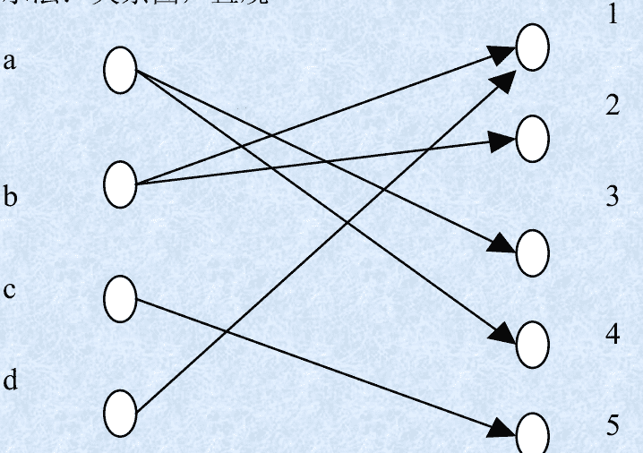

## Relations关系

相关矩阵法表示：
把 A， B 集合内元素排好序

\( R = \begin{bmatrix} 0 & 0 & 1 & 1 & 0 \\ 1 & 1 & 0 & 0 & 0 \\ 0 & 0 & 0 & 0 & 1 \\ 1 & 0 & 0 & 0 & 0 \end{bmatrix} = (a_{ij}) \)

## Relations关系

由于直交积 \( A \times B = \{ \, (a, b) \mid a \in A, \, b \in B \} \)，二元关系 \( R = \{ \, (a, b) \mid a \in A, \, b \in B, \, a \, r \, b \} \)，可见二元关系是直交积 \( A \times B \) 的子集。若 \( R = A \times B \)，则相关矩阵元素全为 1，

\( R = \begin{bmatrix} 1 & 1 & \cdots & 1 \\ 1 & 1 & \cdots & 1 \\ \vdots & \vdots & \ddots & \vdots \\ 1 & 1 & \cdots & 1 \end{bmatrix} \)

## Relations关系

注：

(1) 若 $R=A\times B$，称此二元关系为普遍关系

(2) 设 $A=\{a_1，a_2，\ldots，a_n\}$

$R=\{(a_i，a_j)\mid a_i，a_j\in A\}$

若 $R=\{(a_i，a_i)\mid a_i\in A\}$

称 $R$ 为恒等关系，用 $I_A$ 表示，是单位矩阵


## Relations关系

反对称性：
若 \(a \neq b\)，\((a, b) \in R\)，
则 \((b, a) \notin R\)，称 \(R\) 为反对称的二元关系/antisymmetric

注：
（1）\(R\) 的相关矩阵是反对称的，即  
\(r_{ij} \land r_{ji} = 0 \quad (i \neq j)\)

（2）若 \(r_{ij} = 1\)，则 \(r_{ji} = 0\)，但 \(r_{ij} = 0\) 时，不要求 \(r_{ji} = 1\)，即 \(r_{ij} = r_{ji} = 0\) 是允许的。

（3）对称性与反对称性既不互斥，又不互补


## Relations关系

例：

恒等关系：既是对称的，又是反对称的；

而相关矩阵是

[\begin{bmatrix}
1 & 0 & 0 & 1 \\
0 & 0 & 1 & 0 \\
0 & 0 & 1 & 0 \\
1 & 0 & 0 & 1
\end{bmatrix}]

的二元关系，

是既不对称，又不是反对称的。

## Relations关系

3）传递性：■

若（a，b），（b，c）∈ R，则（a，c）∈ R，称 R 为传递的二元关系。

即：（aᵢⱼ ∧ aⱼₖ）∨ aᵢₖ = 1 ■

> A relation R on a set A is called transitive if whenever (a, b) ∈ R and (b, c) ∈ R, then (a, c) ∈ R, for a, b, c ∈ A.

## Relations关系

**注：** $a_{ij}$，$a_{jk}$ 中有一个不是 1，则 $(\hat{a}_{ij}\hat{a}_{jk})=1$，$a_{ik}$ 就可以任意。

即若 $(a，b)，(c，d)$ 中有 1 个不属于 R，则讨论 $(a,c)$ 是否属于 R，无意义。

即没有传递的条件，也不需传递的结果。如：$A=\{a,b,c,d\}$，$R=\{(a，b)，(c，d)\}$

## 二元关系的性质对应于关系图，有：

（1）自反性：每个顶点都有自回路，

（2）对称性：任二个顶点间或没有边，或有二条相对而指的有向边；

（3）反对称性：任二个顶点至多只有一条有向边；

（4）传递性：若 x 到 y 有边， y 到 z 有边，则 x 到 z 必有边。

## Relations关系

注：由对称性与传递性可推出自反性。

理由：若 \( (a, b) \in R \)，由对称性，有 \( (b, a) \in R \)，由传递性有 \( (a, a) \in R \)。

错误原因：不是 \(\forall a\)，\(\exists b\)，使 \( (a, b) \in R \)。

如：R的相关矩阵是全0矩阵，是对称的，传递的，但不是自反的。

## Relations关系

例 1：\( R_1 = \{ (a, b) \mid a \leq b, \ a, b \in \mathbb{N} \} \)

自反的，\( a_{ii}=1 \)；

不对称的，\( (1,2) \in R_1 \)，而 \( (2,1) \notin R_1 \)

反对称的，传递的。

注：将 \(\leq\) 改为 \(<\)，则无自反性，且是反自反的。

例 2：\( R_2 = \{ (a, b) \mid a \mid b, \ a, b \in \mathbb{N} \} \)

自反的，不对称的，反对称的，传递的。

例 3：\( R_3 = \{ (S_1, S_2) \mid S_1 \subseteq S_2, \ S_1, S_2 \in P(S) \} \) 其中 \( P(S) \) 是 \( S \) 的幂集。

自反的，不对称的，反对称的，传递的。

注：若 \(\subseteq\) 改为 \(\subset\)，则无自反性。

## 例 4：

R₄ = { (a, b) | a + b = 偶数，a, b ∈ N }

自反的，对称的，传递的，

因： a + b = 偶， b + c = 偶，

则： 0 < a + c = (a + b) + (b + c) - 2b = 偶数与偶数之差 = 偶数。

## 例 5：

R₅ = { (a, b) | gcd(a, b) = 1（互素）, a, b ∈ N }

对称的，但不是自反的，也无传递性。

## 二元关系的集合运算

## Combining Relations

二元关系是集合，集合存在并，交，差，非和对称差的运算。故二元关系也存在这样的运算。

## Relations关系

设 $R_1$ 和 $R_2$ 是 $A$ 到 $B$ 的二元关系，则

- (1) $R_1\cup R_2=\{(a,b)\mid(a,b)\in R_1$ 或 $(a,b)\in R_2\}$

- (2) $R_1\cap R_2=\{(a,b)\mid(a,b)\in R_1$ 且 $(a,b)\in R_2\}$

- (3) $R_1-R_2=\{(a,b)\mid(a,b)\in R_1$ 但 $(a,b)\notin R_2\}$

- (4) $\overline{R_1}=\{(a,b)\mid(a,b)\in A*B，\text{但 }(a,b)\notin R_1\}$

- (5) $R_1\oplus R_2=\{(a,b)\mid(a,b)\in R_1\cup R_2$ 但 $(a,b)\notin R_1\cap R_2\}$

## Relations关系

例1：A = { 1, 2, 3, 4 }，I 为整数集

R = { (a, b) | a, b ∈ A, \frac{a-b}{2} ∈ I } □

S = { (a, b) | a, b ∈ A, \frac{a-b}{3} ∈ I, a-b > 0 }

求：R ∪ S, R ∩ S, R̄, R - S, S - R, S ⊕ R ■

解：R 与 S 都是 A 上的二元关系

R = { (1, 1), (2, 2), (3, 3), (4, 4), (1, 3), (3, 1), (2, 4), (4, 2) }

S = { (4, 1) }

R ∪ S = { (1, 1), (2, 2), (3, 3), (4, 4), (1, 3), (3, 1), (2, 4), (4, 2), (4, 1) }

## Relations关系

R ∩ S = Φ

R = { ( 1 , 2 ) , ( 2 , 1 ) , ( 1 , 4 ) , ( 4 , 1 ) , ( 2 , 3 ) , ( 3 , 2 ) , ( 3 , 4 ) , ( 4 , 3 ) }

R − S = R , S − R = S , S ⊕ R = R ∪ S □

## 注：

二元关系的矩阵运算：相关矩阵可表示二元关系，可用矩阵的逻辑运算来研究二元关系的运算。

设： A = { a₁ , a₂ , ... , aₙ }
B = { b₁ , b₂ , ... , bₘ }
R₁ = ( cᵢⱼ )
R₂ = ( dᵢⱼ )


2022年11月3日 Deren Chen, Zhejiang Univ. 27

## Relations关系

则：\( R_1 \cup R_2 = (c_{ij} \lor d_{ij}) \)

\( R_1 \cap R_2 = (c_{ij} \land d_{ij}) \)

\( R_1 - R_2 = (c_{ij} \land \overline{d_{ij}}) \)

\( \overline{R_1} = (\overline{C_{ij}}) \)

其中：

逻辑加（\(\lor\)）：\( 0 \lor 0 = 0, \quad 0 \lor 1 = 1, \quad 1 \lor 0 = 1, \quad 1 \lor 1 = 1 \)

逻辑乘（\(\land\)）：\( 0 \land 0 = 0, \quad 0 \land 1 = 0, \quad 1 \land 0 = 0, \quad 1 \land 1 = 1 \)

逻辑非（\(\neg\)）：\( \overline{0} = 1, \quad \overline{1} = 0 \)

## Relations关系

对上例：

\( R = \begin{bmatrix} 1 & 0 & 1 & 0 \\ 0 & 1 & 0 & 1 \\ 1 & 0 & 1 & 0 \\ 0 & 1 & 0 & 1 \end{bmatrix}, \quad S = \begin{bmatrix} 0 & 0 & 0 & 0 \\ 0 & 0 & 0 & 0 \\ 0 & 0 & 0 & 0 \\ 1 & 0 & 0 & 0 \end{bmatrix} \)

则用矩阵的逻辑运算：

\( R \cup S = \begin{bmatrix} 1 & 0 & 1 & 0 \\ 0 & 1 & 0 & 1 \\ 1 & 0 & 1 & 0 \\ 1 & 1 & 0 & 1 \end{bmatrix} = S \oplus R \)

## Relations关系

\( R \cap S = \begin{bmatrix} 0 & 0 & 0 & 0 \\ 0 & 0 & 0 & 0 \\ 0 & 0 & 0 & 0 \\ 0 & 0 & 0 & 0 \end{bmatrix} = \Phi \)，\(\square\)

\(\overline{R} = \begin{bmatrix} 0 & 1 & 0 & 1 \\ 1 & 0 & 1 & 0 \\ 0 & 1 & 0 & 1 \\ 1 & 0 & 1 & 0 \end{bmatrix}\)，

\( R - S = R \)，\( S - R = S \square \)


## 进一步的思考

- 1、函数复合运算应用到二元关系中
- 2、求满足给定性质的二元关系——原有二元关系的扩充
- 3、从二元关系到多元关系

## Relations关系

## 练习

pp.382 3、18、25（irreflexive 见题 7 前面定义）

## 5.2 二元关系的运算

## Relation Operation and Closures

二元关系作为集合，存在并、交、差、补和对称差的运算；作为函数，也存在复合运算和逆运算；作为特殊的集合和函数的推广，还存在闭包运算。

## 二元关系的复合运算

Let R be a relation from a set A to a set B and S a relation from B to a set C. The composite of R and S is the relation consisting of ordered pairs (a, c), where a ∈ A, c ∈ C, and for which there exists an element b ∈ B such that (a, b) ∈ R and (b, c) ∈ S. We denote the composite of R and S by SR.

### 定义

设 R₁ 为 A 到 B 的二元关系，R₂ 为 B 到 C 的二元关系，

R₁ = {(a, b) | a r₁ b, a ∈ A, b ∈ B}

R₂ = {(b, c) | b r₂ c, b ∈ B, c ∈ C}

则 R₁·R₂ 是由 A 到 C 的二元关系，称为 R₁、R₂ 的复合关系：

R₃ = {(a, c) | (a, b) ∈ R₁，且 (b, c) ∈ R₂}

记 R₃ = R₁·R₂。

例：R 是父子关系，则 R² = R·R 是祖孙关系。

## 例 3

设 A = {张华, 王兵, 陈平, 李兰} 是学生集合；  
B = {软件, 硬件, 自动化, 遥感} 是专业集合；  
C = {工程制图, 电子线路, 操作系统, 离散数学} 是课程集合。

则：

R₁ = {(a₁, b₁), (a₁, b₃), (a₂, b₂), (a₂, b₄), (a₃, b₃), (a₃, b₄), (a₄, b₁), (a₄, b₄)}

是选双学位专业的二元关系。

R₂ = {(b₁, c₃), (b₁, c₄), (b₂, c₂), (b₂, c₃), (b₂, c₄), (b₃, c₁), (b₃, c₂), (b₄, c₂), (b₄, c₄)}

是各专业本学期必修课的二元关系。

R₃ = R₁ · R₂ = {(a₁, c₁), (a₁, c₂), (a₁, c₃), (a₁, c₄), (a₂, c₂), (a₂, c₃), (a₂, c₄), (a₃, c₁), (a₃, c₂), (a₃, c₄), (a₄, c₂), (a₄, c₃), (a₄, c₄)}

是选双学位学生本学期必修课的二元关系。

## 普通的矩阵乘法

设 \(A=(a_{ij})_{m\times n}\)，\(B=(b_{jk})_{n\times L}\)，则：

\[
C=A\cdot B=(c_{ik})_{m\times L}
\]

而

\[
c_{ik}=\sum_{j=1}^{n}a_{ij}b_{jk}
\]

二元关系的复合的矩阵布尔型乘法为：

\[
c_{ik}=\bigvee_{j=1}^{n}a_{ij}\wedge b_{jk}
\]

对例 3，有：

\[
R_1=\begin{bmatrix}1&0&1&0\\0&1&0&1\\0&0&1&1\\1&0&0&1\end{bmatrix},\quad
R_2=\begin{bmatrix}0&0&1&1\\0&1&1&1\\1&1&0&0\\0&1&0&1\end{bmatrix}
\]

\[
R_3=R_1\cdot R_2=\begin{bmatrix}1&1&1&1\\0&1&1&1\\1&1&0&1\\0&1&1&1\end{bmatrix}
\]

在行处标上姓名，列处标上课程，就知谁该必修哪些课了。

## 关系的幂

若 R 是 A 上二元关系，

\[
R=\{(a,b)\mid a\,r\,b,\ a\in A,\ b\in A\}
\]

若设：

\[
R_1=R
\]

1. 
\[
R_2=R\cdot R=R^2=\{(a,c)\mid(a,b),(b,c)\in R\}
\]

2. 设 \(R_n=R\cdot R\cdots R=R^n\) 已定义，则

\[
R_{n+1}=R_n\cdot R=R^n\cdot R=R^{n+1}
\]

\[
=\{(a,c)\mid(a,b)\in R^n,\ (b,c)\in R\}
\]

Let R be a relation on the set A. The powers Rⁿ, n=1,2,3,…, are defined inductively by:

\[
R^1=R\quad\text{and}\quad R^{n+1}=R^nR.
\]

## THEOREM

The relation R on a set A is transitive if and only if Rⁿ ⊆ R for n = 1, 2, 3, ....

## 例 4

R = {(0, 0), (0, 3), (2, 3), (3, 2), (2, 1), (2, 0)} 是有限集 {0, 1, 2, 3} 上的二元关系。

### R 的关系图


R² = {(0, 0), (0, 2), (0, 3), (2, 0), (2, 2), (2, 3), (3, 0), (3, 1), (3, 3)}


R² 的关系图中不存在 (3, 2)、(2, 1)，故 R ⊄ R²。

## Rⁿ 的关系图的构造

可由 R 的关系图来构造：从 R 的每个结点 aᵢ 出发，走 n 条边。凡通过走 n 条边能到达的结点 aⱼ，则有 (aᵢ, aⱼ) ∈ Rⁿ，关系图中从 aᵢ 出发到 aⱼ 的边是存在的。

这样处理容易出错，用关系矩阵的布尔型乘法来做，简单，又不容易错，还适宜于计算机处理。

\[
R=\begin{bmatrix}1&0&0&1\\0&0&0&0\\1&1&0&1\\0&0&1&0\end{bmatrix}
\]

\[
R^2=R\cdot R=
\begin{bmatrix}1&0&0&1\\0&0&0&0\\1&1&0&1\\0&0&1&0\end{bmatrix}
\begin{bmatrix}1&0&0&1\\0&0&0&0\\1&1&0&1\\0&0&1&0\end{bmatrix}
=
\begin{bmatrix}1&0&1&1\\0&0&0&0\\1&0&1&1\\1&1&0&1\end{bmatrix}
\]

## 二元关系的逆关系：运算

设 R、S 是 A 到 B 的二元关系，T 是 B 到 C 的二元关系，P 是 C 到 D 的二元关系。则：

1. \((R \cup S)^c = R^c \cup S^c\)

2. \((R \cap S)^c = R^c \cap S^c\)

3. \((\overline{R})^c = \overline{R^c}\)

4. \((R - S)^c = R^c - S^c\)

5. \((A \times B)^c = B \times A\)

6. \(\overline{R} = (A \times B) - R\)

7. \((S \cdot T)^c = T^c \cdot S^c\)

8. \((R \cdot T) \cdot P = R \cdot (T \cdot P)\)

9. \((R \cup S) \cdot T = R \cdot T \cup S \cdot T\)

但 \(S \cdot T \neq T \cdot S\)，且 \((R \cap S) \cdot T \subseteq R \cdot T \cap S \cdot T\)。

10. \(R \subseteq S \Leftrightarrow R^c \subseteq S^c\)

证明其中 (1)：

任意 \((x, y) \in (R \cup S)^c\)

\((y, x) \in (R \cup S)\)

\((y, x) \in R\) 或 \((y, x) \in S\)

\((x, y) \in R^c\) 或 \((x, y) \in S^c\)

\((x, y) \in R^c \cup S^c\)


## Relations关系

(4) \( (R - S)^c = (R \cap \overline{S})^c \)

\( \xrightarrow{ii} R^c \cap \overline{S}^c \xrightarrow{iii} R^c \cap \overline{S}^c = R^c - S^c \)

(7) \( (S \cdot T)^c = T^c \cdot S^c \)

证：

对 \( \forall (x, y) \in (S \cdot T)^c \)，有

\( \Leftrightarrow (y, x) \in S \cdot T \)

\( \Leftrightarrow \exists z \in B, \) 使 \( (y, z) \in S \)，

\( (z, x) \in T \)

即： \( (z, y) \in S^c \)，

\( (x, z) \in T^c \)

\( \Leftrightarrow (x, y) \in T^c \cdot S^c \)

## Relations关系

(10) 证：

∀ \( (x, y) \in R^c \Rightarrow (y, x) \in R \)

⇒ \( (y, x) \in S \Rightarrow (x, y) \in S^c \)

注：

\( R \cdot T \cap S \cdot T \subseteq (R \cap S) \cdot T \) 不一定成立，

由于 \( (R \cap S) \cdot T \subseteq R \cdot T \cap S \cdot T \)

若上式成立，

则 \( (R \cap S) \cdot T = R \cdot T \cap S \cdot T \)

证明：等式不成立

若 ∀ \( a \in A \)，\( b_1, b_2 \in B \)，\( c \in C \)，且

\( (a, b_1) \in R \)，\( (a, b_2) \in S \)，

\( (b_1, c) \notin S \)，\( (a, b_2) \notin R \)，

\( (b_1, c) \in T \)，\( (b_2, c) \in T \)，

显然 \( (a, c) \in R \cdot T \cap S \cdot T \)

但 \( (a, c) \notin (R \cap S) \cdot T \)

## Relations关系

[定义2]：称 \( R \cup R^c \) 是 \( R \) 的对称闭包/symmetric closure of \( R \)，记为 \( s(R) \)。

[定理2]：设 \( R \) 是 \( A \) 上的二元关系，则 \( R \cup R^c \) 是对称的，包含 \( R \) 的最小关系，（其中 \( R^c \) 是 \( R \) 的逆关系）。

证明：若 \( (a, b) \in R \cup R^c \)，则 \( (a, b) \in R \) 或 \( (a, b) \in R^c \)，

\( \Rightarrow (b, a) \in R^c \) 或 \( (b, a) \in R \)，

故 \( (b, a) \in R \cup R^c \)（对称性），

若 \( R' \) 为包含 \( R \)，对称的二元关系，

则对 \( \forall (a, b) \in R \cup R^c \)，

若 \( (a, b) \in R \Rightarrow (a, b) \in R' \)；

若 \( (a, b) \in R^c \Rightarrow (b, a) \in R \)，

\( \Rightarrow (b, a) \in R' \)，

又 \( R' \) 具有对称性，\( (a, b) \in R' \)，

故 \( R \cup R^c \subseteq R' \)。

## Relations关系

[推论2]：当且仅当 \( R \) 是对称闭包时，\( R \) 具有对称性。

证明：(1) \( R \) 具有对称性，

若 \( (a, b) \in R \)，则 \( (b, a) \in R \)，

又 \( (b, a) \in R^c \)

即 \( \forall (b, a) \in R^c \)，\( (a, b) \in R \)

\( \Rightarrow (b, a) \in R \)

\( \Rightarrow R^c \subseteq R \Rightarrow R \cup R^c = R \)；

(2) \( R \) 是对称闭包时，\( R = R \cup R^c \Rightarrow R \) 具有对称性。

[定义3]：传递扩张

设 \( R = \{(a, b) \mid a \, r \, b, \, a, \, b \in A\} \)，则

称 \( R_1 = \{(a, b) \mid (a, b) \in R, \, \text{或} \exists c \in A, \)

使 \( (a, c), \, (c, b) \in R \} \) 为 \( R \) 的传递扩张。

## Relations关系

（3）当且仅当 \( R \) 是传递的，\( R = R_1 \)。

证明：“⇒” \( R \) 是传递的，（\( R \subseteq R_1 \)）

对 \( \forall (a, b) \in R_1 \)，有

\( (a, b) \in R \) 或 \( \exists c \in A \)，

使 \( (a, c), \, (c, b) \in R \)，

由 \( R \) 的传递性，\( (a, b) \in R \)，

故 \( R_1 \subseteq R \)，得 \( R = R_1 \)。

“⇐”：\( R = R_1 \)

若 \( (a, c) \in R \)，\( (c, b) \in R \)，

则 \( (a, b) \in R_1 = R \)，\( R \) 是传递的。

**注：**（1）若 \( R_1 \) 不是传递的，可扩张到 \( R_2 \)，\( R_3 \)，… \( R_k \)；

（2）若 \( R_k \) 是传递的，则 \( R_{k+1} = R_k \)。

## Relations关系

[定义3]：

设 \( R_0 = R \)，\( R_{k+1} \) 是 \( R_k \) 的传递扩张（\( k = 0, 1, 2, ... \)），则称 \( R^* = R_0 \cup R_1 \cup R_2 \cup ... \cup R_k \cup ... \) 为 \( R \) 的传递闭包/transitive closure of \( R \)，也记作 \( t(R) \)。

[定理3] 传递闭包 \( R^* = R \cup R^2 \cup ... \cup R^k \cup ... \)

证明：

\( R^2 = R \cdot R = \{ (a, b) | (a, c), (c, b) \in R \} \)

\( R_1 = \{ (a, b) | (a, b) \in R \text{ 或 } (a, c), (c, b) \in R \} \)

\( = R \cup R^2 \)

\( R_2 = \{ (a, b) | (a, b) \in R_1, \text{ 或 } (a, c), (c, b) \in R_1 \} \)

## Relations关系

故，\( R \) 的闭包 \( R^* = R \cup R_1 \cup R_2 \cup \cdots \cup R_k \cup \cdots \)

\( = \bigcup_{k=0}^{\infty} R_k \)

\( = R \cup R^2 \cup R^3 \cup \cdots \cup R^{2^k} \cup \cdots \)

\( = \bigcup_{k=1}^{\infty} R^k \)

## Relations关系

【定理4】：传递闭包 \( R^* \) 一定是传递的。

证明：设 \( (a, b) \)、\( (b, c) \in R^* \)，则

∃ \( i \)，\( j \)，使 \( (a, b) \in R^i \)，

\( (c, b) \in R^j \)；

故 \( (a, b) \in R^{(i+j)} \subseteq R^* \)

传递扩张的实际意义：

举例：

\( R = \{(a, b) \mid a \text{ 与 } b \text{ 是父子关系} \} \)

\( R \cdot R = \{(a, b) \mid a \text{ 与 } b \text{ 是祖孙关系} \} \)

\( R_1 = \{(a, b) \mid a \text{ 与 } b \text{ 是三代以内男性直系亲属} \} \)

...

## Relations关系

【定理5】：设 \( |A| = n \)，\( R \) 是 \( A \) 上二元关系，则存在正整数 \( k \)，\( k \le n \)，使 \( R^* = R \cup R^2 \cup \cdots \cup R^k \)。

## 证明：

对于 \( (x, y) \in R^* \)，∃ \( k \)，使 \( (x, y) \in R^k \)，表明在 \( A \) 中存在不同元素 \( a_1, a_2, \ldots, a_{k-1} \)，使 \( (x, a_1), (a_1, a_2), (a_2, a_3), \ldots, (a_{k-1}, y) \in R \)。若 \( k > n \)，由鸽洞原理，则 \( a_1, a_2, \ldots, a_{k-1}, y \) 中至少有两个相同，不妨设 \( a_i = y \)，\( (i \le k-1) \)。

## Relations关系

于是 \( (x, a_1), \ldots (a_i, a_{i-1}) \in R \)，

\( (a_{i-1}, y) \in R \)，

故 \( (x, y) \in R^i \)，

即 若 \( k > n \)，必存在比 \( k \) 的正整数 \( i \)，使 \( (x, y) \in R^i \)。

注：

定理说明，可用 \( R \cup R^2 \cup \ldots \cup R^n \) 来求 \( R^* \)。

例6：

设 \( A = \{1, 2, 3\} \),

\( R = \{(1, 1), (1, 2), (2, 3)\} \)

求 \( R^* \)。


## Relations关系

解：
\[
R = \begin{bmatrix} 1 & 1 & 0 \\ 0 & 0 & 1 \\ 0 & 0 & 0 \end{bmatrix}, \quad R^2 = \begin{bmatrix} 1 & 1 & 1 \\ 0 & 0 & 0 \\ 0 & 0 & 0 \end{bmatrix} = R^3
\]

故
\[
R^* = R \cup R^2 \cup R^3 = \begin{bmatrix} 1 & 1 & 1 \\ 0 & 0 & 1 \\ 0 & 0 & 0 \end{bmatrix}
\]

\[
R^* = \{ (1,1), (1,2), (1,3), (2,3) \}
\]

注：当 \(|A|=n\) 较大时，用定理 5 计算 \(R^*\) 工作量非常大。

### Warshall算法（1962）

设 \(R\) 是 \(n\) 个元素集合上的二元关系。

```
（1）置 a_{ij} 为 R 的关系矩阵；
（2）i ← 1；
（3）for j = 1 to n do
　　 if a_{ji} = 1 then do
　　　 for k = 1 to n do
　　　　 a_{jk} ← a_{jk} ∨ a_{ik}
（4）i = i + 1；
（5）if i ≤ n, then go to（3）
　　 else stop
```

注：
（1）结果 \((a_{ij})_{n\times n}\) 是 \(R^*\) 的关系矩阵。
（2）算法的复杂度为 \(n^3\)。

**例 7：** \(A=\{a,b,c,d\}\)，\(R=\{(a,b),(b,c),(c,d)\}\)，计算 \(R^*\)。

\[
R = \begin{bmatrix} 0 & 1 & 0 & 0 \\ 0 & 0 & 1 & 0 \\ 0 & 0 & 0 & 1 \\ 0 & 0 & 0 & 0 \end{bmatrix}
\]

- \(i=1\)：由于 \(a_{j1}=0\)（\(j=1,2,3,4\)），不改变。
- \(i=2\)：\(j=1\)，\(a_{12}=1 \Rightarrow a_{13}=1\)。
- \(i=3\)：
\[
\begin{bmatrix} 0 & 1 & 1 & 0 \\ 0 & 0 & 1 & 0 \\ 0 & 0 & 0 & 1 \\ 0 & 0 & 0 & 0 \end{bmatrix}
\]
  \(j=1\)，\(a_{13}=1 \Rightarrow a_{14}=1\)；\(j=2\)，\(a_{23}=1 \Rightarrow a_{24}=1\)。

即
\[
R^* = \{ (a,b), (a,c), (a,d), (b,c), (b,d), (c,d) \}
\]

## 小结

- (1) 二元关系的集合运算
- (2) 二元关系的复合运算
- (3) 二元关系的闭包运算

## 进一步的思考

- 1、从原有二元关系形成新的二元关系
- 2、现有的二元关系的进一步归纳

## 练习

pp. 407　21、23、25（b）

## 5.3 等价关系

### Equivalence Relations

**【定义 1】** 等价关系：

设 \(A\) 上的二元关系 \(R\)，如果 \(R\) 是

- 1. 自反的
- 2. 对称的
- 3. 传递的

则称 \(R\) 为等价关系（Equivalence Relations）。若 \((a,b)\in R\)，称 \(a\) 与 \(b\) 等价。

**【定义 2】** 把 \(A\) 中的等价元素归为一类，称为等价类（equivalence class），记为 \([a]_R\) 或 \([a]\)。

**【定理 1】** 设 \(R\) 是集合 \(A\) 上的一个等价关系，则下列命题是等价的：

- 1. \((a,b)\in R\)
- 2. \([a]=[b]\)
- 3. \([a]\cap[b]\neq\varnothing\)

注：
等价关系 \(R\) 把 \(A\) 的元素分为若干类，各类之间没有公共元素。确定的 \(R\) 是对集合 \(A\) 进行的一个划分。

**【定义 3】** 集合的划分：把集合 \(A\) 分为若干子集 \(A_1, A_2, \ldots\)，满足：

- 1. 当 \(i\neq j\) 时，\(A_i\cap A_j=\varnothing\)；
- 2. \(\forall a\in A\)，\(\exists i\)，使 \(a\in A_i\)（\(i=1,2,\ldots\)）。

则集合 \(P_r(A)=\{A_1,A_2,\ldots,A_n,\ldots\}\) 称为 \(A\) 的一个划分（partition）。

注：
- (1) \(P_r(A)\subseteq \mathcal P(A)\)（\(A\) 的幂集）；
- (2) 当且仅当 \(A=\varnothing\) 时，\(P_r(A)=\mathcal P(A)=\{\varnothing\}\)；
- (3) \(A\) 非空时，\(P_r(A)\subset \mathcal P(A)\)。

**【定理 2】** \(A\) 在等价关系 \(R\) 下的等价类正是 \(A\) 的一种划分；\(A\) 的任一种划分，也必有 \(A\) 上的一个等价关系 \(R\) 与之对应。

**证明：**

设 \(R\) 是等价关系，\(\forall a\in A\)，由 \(R\) 的自反性，\((a,a)\in R\)，即 \(a\) 与 \(a\) 属于同一等价类，也即 \(\exists i\)，\(a\in A_i\)。

若 \(i\neq j\)，\(A_i\neq A_j\)，而 \(A_i\cap A_j\neq\varnothing\)，则 \(\exists c\in A_i\cap A_j\)，\(c\in A_i\) 且 \(c\in A_j\)。

对 \(\forall a\in A_i\)，\(a\sim c\)；又 \(c\in A_j\)。对 \(\forall b\in A_j\)，\(b\sim c\)，即 \(c\sim b\)（对称性）。

由 \(R\) 的传递性，\(a\sim b\)。

由 \(a,b\) 的任意性，故 \(A_i=A_j\)。

这与 \(A_i\) 和 \(A_j\) 为不同的等价类矛盾。

故 \(A_i\cap A_j=\varnothing\)。

所以，\(R\) 完成了等价类的划分。

若 \(A\) 已进行了划分，则构造二元关系 \(R\)：

- 1. \(\forall a\in A\)，使 \((a,a)\in R\)；
- 2. 分别对每一等价类内所有两个不同元素 \(a,b\)，\((a,b)\in R\)，且使 \((b,a)\in R\)。

显然，\(R\) 是自反的、对称的，而且也是传递的，因为若 \((a,b)\in R\)，\((b,c)\in R\)，则 \(a,b,c\) 均在同一等价类内，故 \((a,c)\in R\)。

二元关系 \(R\) 是自反的、对称的、传递的，且把 \(A\) 分成了三个等价类，等价类集合为 \(\{\{0\},\{1,2,3\},\{4,5\}\}\)。

**【定义】** 商集：等价关系 \(R\) 将 \(A\) 分成若干等价类，每个类选一个代表组成新的集合称为 \(A\) 关于 \(R\) 的商集，表示为 \(A/R\)。例：在上例中

\[
A/R=\{[0],[1],[4]\}
\]

**【定义】** 商集的元素个数（即 \(A\) 在 \(R\) 下的等价类个数）称为 \(R\) 的秩。

**例 3：** \(R=\{(a,b)\mid a\equiv b\pmod 3,\ a,b\in I\}\) 是整数集合 \(I\) 上模 3 同余的二元关系。证明 \(R\) 是等价关系。

**证明：** 由于 \(3\mid(a-b)\)，即 \(a\equiv b\pmod 3\)。

- 1. \(3\mid(a-a)\)，自反性；
- 2. 若 \(3\mid(a-b)\)，则 \(3\mid(b-a)\)，对称性；
- 3. 若 \(3\mid(a-b)\)，\(3\mid(b-c)\)，则

\[
a-c=(a-b)+(b-c)\Rightarrow 3\mid(a-c)
\]

满足传递性，故 \(R\) 是等价关系。

商集：
\[
I/R=\{[0],[1],[2]\}
\]

其中

\[
[0]=\{\ldots,-6,-3,0,3,6,\ldots\}
\]
\[
[1]=\{\ldots,-5,-2,1,4,7,\ldots\}
\]
\[
[2]=\{\ldots,-4,-1,2,5,8,\ldots\}
\]

**例 4：** \(N\) 的一个分划为：若 \(10^{i-1}\le a<10^i\)，则 \(a\in A_i\)，对应的等价关系

\[
R=\{(a,b)\mid a\text{ 与 }b\text{ 有相同位数，}a,b\in N\}
\]

相同位数的数归为一类，此 \(R\) 把 \(N\) 分划为可列个等价类。

## 练习

pp. 413　3、5、30

## 5.4 半序关系

## Partial Ordering

**【定义】** 半序关系：

设 \(R\) 是 \(A\) 上的二元关系，如果 \(R\) 满足：

- 1. 自反的；
- 2. 反对称的；
- 3. 传递的。

则称 \(R\) 是 \(A\) 上的半序关系/偏序关系/部分序关系（Partial Ordering Relation）。

**【定义】** 集合 \(A\) 连同 \(A\) 上的半序关系 \(R\) 一起称为一个半序集/Partially Ordered Set（POSET），记为 \((A,R)\)。


## Relations关系

例1：A={1, 2, 3, 4, 5, 6, 7, 8, 9}，  
A上的二元关系  
R₁= { (a, b) | a ≤ b, a, b ∈I}  
R₂= { (a, b) | a | b, a, b ∈I}

R₁、R₂都是A上的二元关系，  
(A, R₁)、(A, R₂) 都是半序集。

## 例2：整数集I上的二元关系

R₁= { (a, b) | a ≤ b, a, b ∈I}  
R₂= { (a, b) | a | b, a, b ∈I}

(I, R₁)、(I, R₂) 也都是半序集。

## Relations关系

例3：A = { a，b，c }

R₃ = { (s₁，s₂) | s₁⊆s₂，  
s₁，s₂∈P（A）}

R₃是P(A)上的二元关系，（P(A)，R₃）是半序集。

例4：B是任意一个集合

R₄ = { (s₁，s₂) | s₁⊆s₂，  
s₁，s₂∈P（B）}

R₄是B上的二元关系，（B，R₄）是半序集。

## 记号：

R={（a，b）|a≤ᵣb，a，b∈A} 其中≤ᵣ可为≤，|，⊆等

## 几点说明：

（1）同一集合上的两个不同的半序关系，构成两个不同的半序集。

如： \( R_1 \) 和 \( R_2 \) 都定义在 \( A = \{1, 2, 3, 4, 5, 6, 7, 8, 9\} \) 上，但 \( (A, R_1) \) 与 \( (A, R_2) \) 显然不是一样的半序集。

（2）不同集合上分别相同定义的半序关系，其半序关系不同，同样构成两个不同的半序集。

如： \( (A, R_3) \) 与 \( (B, R_3) \) 是两个不同的半序集。

## Relations关系

注：
（1）用矩阵表示半序关系，不能明显看到二元关系的特征。
（2）用简化的关系图表示较适合。

简化的关系图：
(1)自反性：每个顶点都有自回路，省去。
(2)反对称性：两个顶点间只可能有一个箭头从左→右，或从下→上的方向。从小到大安置顶点，可省略箭头。
(3)传递性：由于有（a，b），（b，c）∈R，则（a，c）∈R，故只画（a，b），（b，c）对应的边，省略边（a，c）。

## [定义]：哈森图/Hasse图

设≤是 A 上的一个半序关系，如果  
a ≤ b，则将 a 画在 b 下面，且不∃ c，  
使 a ≤ c， c ≤ b，则 a， b 间用直线连接。  
并符合简化的关系图的绘制，称这样得到关系图为 Hasse 图。

前例中半序集的 Hasse 图：

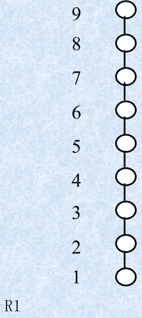

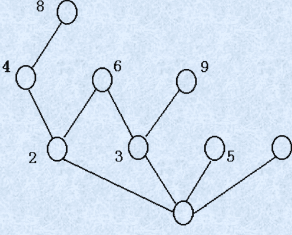

R2

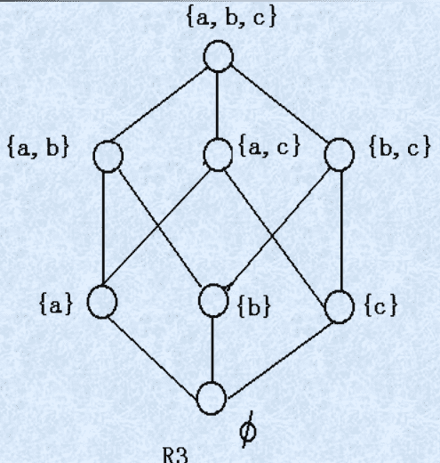

## [定义] 全序：

A 上半序关系 R，如果∀ a， b ∈ A，都有  
a ≤ b，或 b ≤ a，则称 R 为 A 上的全序关系/total order 或linear order。

说明：

（1）全序的含义： A 中每两个元素均能比大小，即任何两个元素都相关。
（2）半序则是部分有序。
（3）R₁是全序，R₂，R₃都是半序。

如： R₂中， { 1， 2， 6 }， { 1， 2， 4， 8 }， { 1， 3， 9 } 都排成了序，但 2 与 3， 5 与 7， 7 与 9 ...，在整除的意义上来说无法排出大小来。

## Relations关系

## [定义]全序集：

半序集 \( (A, \leq_R) \) 中的半序关系 \(\leq_R\) 是 \(A\) 上的全序关系，则称 \( (A, \leq_R) \) 为**全序集/total order set**或**linear order set**。

如上例： \( (A, R_1) \) 是全序集。

例5： \( (-\infty, +\infty) \) 实数全体，在 \(\leq\) 下是全序集；例6：平面上点集，也可以规定一种 \(\leq_R\)，模长大的大，模长相等的情况下，以幅角的大小来比大小，因此，平面上点集也是全序集。

例7： **lexicographic ordering on** \( A_1 \times A_2 \)

# 例：

在上例Hasse图（A，R₂）中，取B₁={1，2，4，8}，R₂=|（整除），则（B₁，R₂）是全序关系，B₁是半序集（A，|）中链长为4的链。

B₂={1，2，6}，B₃={1，3，9}，B₄={1，5}，B₅={1，7}也都是（A，|）中的链。

## Relations关系

[定义]反链：
设 \((A, \leq_R)\) 为半序集，\(B \subseteq A\)，对 \(\forall a, b \in B (a \neq b)\)，\(a\) 与 \(b\) 不可比较，则称 \(B\) 为 \((A, \leq_R)\) 中的反链/antichain。
当 \(B\) 为有限集时，\(|B|\) 为反链的长度。

例：\((A, R_2)\) 中
\(B_1 = \{2, 3, 5, 7\} \quad |B_1| = 4\)
\(B_2 = \{4, 6, 9\} \quad |B_2| = 3\)
\(B_3 = \{8, 6, 9, 5, 7\} \quad |B_3| = 5\)
...
都是反链。

## 【定义】极大元与极小元/maximal element and minimal element:

设（P，≤）是半序集，A⊆P，若 a∈A，且在 A 中没有一个元素 b（b≠a），使 a≤b（b≤a），则称 a 为 A 中的极大元（极小元）。

例：（N，|）是半序集，

A = { 2，3，4，5，6，7，8，9 }

则 A 中极大元：8，6，9，5，7  
极小元：2，3，5，7

说明：极大元、极小元并不要求唯一，且同一元素，可以既是极大元，又是极小元，如5，7。

## Relations关系

## 说明：

极大元，极小元必须是子集 A 中的元素。

【定义】最大元与最小元 / greatest element and least element：

设（P，≤）是半序集，A⊆P，若 a∈A，∀b∈A，b≤a（a≤b），则称 a 为 A 的最大元（最小元）。

## Relations关系

# 上例：其Hasse图如下图所示

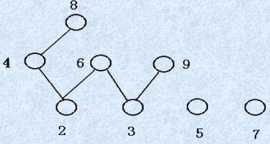

## Relations关系

例：\( B = \{a, b, c\} \)，

\( R_3 = \{ (s_1, s_2) \mid s_1 \subseteq s_2, s_1, s_2 \in p(B) \} \)，\( (p(B), \subseteq) \) 是半序集。

设 \( A = \{\Phi, \{a\}, \{b\}, \{c\}, \{a, b\}, \{a, c\}, \{b, c\} \} \)

其Hasse图如下图所示

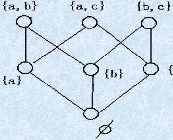

# 结论：

A存在最小元Φ，没有最大元。

## 说明：

最大元（最小元）本身应属于子集A，且与A中任一元素都有关系。

## Relations关系

### 【定义】上界与下界/upper bound and lower bound:

设（P，≤）是半序集，A⊆P，
若 a∈P，对 ∀b∈A，b≤a（a≤b）称 a 为 A 的上界（下界）。

说明：

+ （1）上例中，A无最大元，但存在A的上界 {a，b，c}。
+ （2）Φ为A的最小元，也是A的下界
+ （3）最大（小）元是A的一个上（下）界
+ （4）上（下）界可以不唯一，也可以不存在

## 【定义】上确界与下确界 / least upper bound and greatest lower bound:

设（p，≤）是半序集，A⊆P，若 a 是 A 的一个上界（下界），而∀A 的上界（下界）b，都有 a≤b（b≤a），则称 a 是 A 的上确界（下确界）。

说明：上确界：最小上界  
下确界：最大下界

如果存在上（下）确界，则上（下）确界一定是唯一的。

# 例：

( p （ B ）， ⊆ ) 中取 A’ = { Φ，  
{ b }， { c } }，则  
{ b， c } 与 { a， b， c } 是 A’ 的上  
界， { b， c } 是 A’ 的上确界。

## 说明：

存在上（下）界，并不一定存在上（下）确界。


## Relations 关系

# 例：

\(P=\{a,b,c,d,e\}\)

\(A=\{a,b,c\}\)，\((P,\le)\)

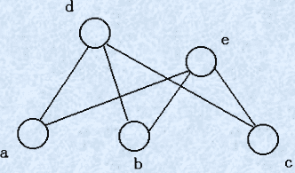

**结论：**

- (1) \(d,e\) 是 \(A\) 的上界；
- (2) \(d\) 与 \(e\) 无法比大小，不存在上确界；
- (3) \(A\) 的下界不存在，不存在下确界。

### 定理

设 \((P,\le)\) 是半序集，\(A\) 是 \(P\) 的非空有限子集，则 \(A\) 一定存在极大（小）元。

**证：** 若 \(|A|=1\)，则 \(A\) 中唯一元素既是极大元，也是极小元。

假定 \(|A|=n\) 时存在极大（小）元。

当 \(|A|=n+1\) 时，将 \(A\) 分成由 \(n\) 个元素组成的子集 \(A'\) 与元素 \(a\)。

由假定，\(A'\) 存在极大元 \(a_M\)、极小元 \(a_m\)。

若 \(a_M\le a\)，则 \(a\) 为极大元；否则为 \(a_M\)。因为若 \(a_M\le a\)，且存在 \(b\in A'\)，而 \(a\le b\)，由传递性 \(a_M\le b\)，与 \(a_M\) 为 \(A'\) 的极大元矛盾。

同理，若 \(a\le a_m\)，则 \(a\) 为极小元；否则为 \(a_m\)。

### 定理

设 \(M\) 是非空有限子集 \(A\) 的极大元集合，则 \(M\) 是 \(A\) 的反链。

### 定义 格/lattice

设 \((A,R)\) 是半序集，如果 \(\forall a,b\in A\)，\(\{a,b\}\) 的上确界和下确界都存在，则称 \((A,R)\) 是一个格。

### 例 20

### 例 22

### 例 23

### 定理

每一个非空有限半序集 \((A,R)\) 都存在极小元素。

### 定义 拓扑排序/topological sorting

设 \((A,R)\) 是半序集，对 \(A\) 中的元素按如下规则排序：\(a\) 排在 \(b\) 的前面（左边）当且仅当 \(a\le b\) 或 \(a\) 与 \(b\) 不可比较。

### 定义 良序集/well ordered set

设 \((A,R)\) 是半序集，若 \(A\) 的非空子集都存在最小元，则称 \(R\) 是良序关系/well order relation，\((A,R)\) 为良序集。

**说明：**

- 良序集是全序集。
- 全序集未必是良序的。

例：实数全体，任两个实数都是可比较的，但子集 \(\{1/n\}\) 的最小元找不到。

有限的全序集是良序集。

## 小结

- 半序关系与半序集
- 全序关系与全序集
- 半序集中的极小/大元素、最小/大元素、上/下界、上/下确界
- 良序关系与良序集、拓扑排序

## 进一步的思考

从半序集到格

从格到布尔代数

## 练习

pp.428　24、36、42

# 5. Relations 关系

### 5.1 Relations and their Properties 关系及其性质

**定义 1（相关/relative）**：按照某种规则，确定二个对象或多个对象之间有关系，称这二个对象或多个对象是相关的。

**注意：** 相关性与指定的规则有关。

- (1) 扑克牌中的方块 K 与梅花 K
  - 同花关系：不相关
  - 同点关系：相关
- (2) 父子二人
  - 同辈关系：不相关
  - 父子关系：相关

**注：**

二元关系：二个对象之间相关的关系。  
多元关系：多个对象之间的关系。  
多元关系常化成二元关系来研究。  
无序的二元关系：方块 K 与梅花 K，谁在前、谁在后都还是同点的。  
有序的二元关系：父子关系，不能交换父与子的次序。

又如：

- (1) \(a+b\) 为偶数，\(a\) 与 \(b\) 是无序的；用 \([a,b]\) 表示无序对。
- (2) \(a\le b\)，\(a\) 与 \(b\) 是有序的二元关系，叫作 \(a\) 相关于 \(b\)，记成 \(a\,r\,b\)，用 \((a,b)\) 表示有序对。
- (3) 无序的二元关系可用有序的二元关系表示，即 \((a,b)\) 与 \((b,a)\) 都属于这种二元关系。

**定义 2（二元关系/binary relation）**：按照某种规定，定义了一个有序对 \((a,b)\) 的集合 \(R\)，其中 \(a\in A\)，\(b\in B\)，称 \(R\) 为 \(A\) 到 \(B\) 的一个二元关系。

Let A and B be sets. A binary relation from A to B is a subset of \(A\times B\).

\(R=\{(a,b)\mid a\in A,\ b\in B,\ a\,r\,b\}\)，其中 \(a\,r\,b\) 读作“\(a\) 相关于 \(b\)”。

**注意：** 二元关系是指满足某规律的有序对的全体。

**定义 3**：当 \(A=B\) 时，\(R\) 是 \(A\) 到 \(A\) 的二元关系，称为 \(A\) 上的二元关系。

A relation on the set A is a relation from A to A.

例：\(R=\{(a,b)\mid a\mid b,\ a,b\in\mathbb{N}\}\) 是自然数集 \(\mathbb{N}\) 上的二元关系。

### 函数作为二元关系

#### 二元关系看成函数关系

\(R=\{(a,b)\mid a\,R\,b,\ a\in A,\ b\in B\}\)

\(A\) 称为 \(R\) 的定义域，记 \(A=\operatorname{Dom}R\) 或 \(D(R)\)；\(B\) 称为 \(R\) 的值域，记 \(B=\operatorname{Range}R\) 或 \(R(R)\)。

当定义域与值域交换得

\(R^{-1}=\{(b,a)\mid (a,b)\in R,\ a\in A,\ b\in B\}\)，称为 \(R\) 的逆关系。


# 二元关系中的计数问题

**Example 6:**

How many relations are there on a set with n elements?

### 二元关系的表示

因为二元关系本身也是集合，也可用穷举法、描述法来表示，还可用表格、图示、矩阵法表示。

例如：

\(A=\{张三，李四，王五，赵六\}\)

\(B=\{100米，跳高，铅球，足球，跨栏\}\)

穷举法表示：

\(R=\{(张三，铅球)，(张三，足球)，(李四，100米)，(李四，跳高)，(王五，跨栏)，(赵六，100米)\}\)

是运动会的报名表。

## 表格表示法：用表格表示一目了然

|          | 100米 | 跳高 | 铅球 | 足球 | 跨栏 |
|----------|:-----:|:----:|:----:|:----:|:----:|
| 张三     |       |      | √    | √    |      |
| 李四     | √     | √    |      |      |      |
| 王五     |       |      |      |      | √    |
| 赵六     | √     |      |      |      |      |

用字母数字来代替这些元素：

\(A=\{a,b,c,d\}\)

\(B=\{1,2,3,4,5\}\)

图示法：关系图，直观


关系矩阵法表示：

把 \(A\)、\(B\) 集合内元素排好序

\[
R=\begin{bmatrix}
0 & 0 & 1 & 1 & 0\\
1 & 1 & 0 & 0 & 0\\
0 & 0 & 0 & 0 & 1\\
1 & 0 & 0 & 0 & 0
\end{bmatrix}=(a_{ij})
\]

由于直积 \(A\times B=\{(a,b)\mid a\in A,\ b\in B\}\)，二元关系 \(R=\{(a,b)\mid a\in A,\ b\in B,\ a\,r\,b\}\)，可见二元关系是直积 \(A\times B\) 的子集。若 \(R=A\times B\)，则关系矩阵元素全为 1，

\[
R=\begin{bmatrix}
1 & 1 & \cdots & 1\\
1 & 1 & \cdots & 1\\
\vdots & \vdots & \ddots & \vdots\\
1 & 1 & \cdots & 1
\end{bmatrix}
\]


## Relations关系

注：

(1) 若 \(R=A\times B\)，称此二元关系为普遍关系

(2) 设 \(A=\{a_1，a_2，\ldots，a_n\}\)

\(R=\{(a_i，a_j)\mid a_i，a_j\in A\}\)

若 \(R=\{(a_i，a_i)\mid a_i\in A\}\)

称 \(R\) 为恒等关系，用 \(I_A\) 表示，是单位矩阵

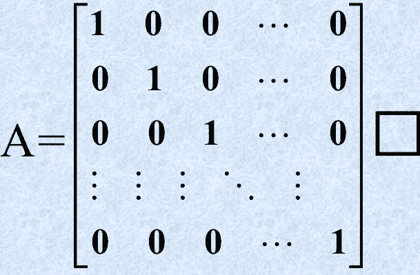

## Relations关系

反对称性：
若 \(a \neq b\)，\((a, b) \in R\)，
则 \((b, a) \notin R\)，称 \(R\) 为反对称的二元关系/antisymmetric

注：
（1）\(R\) 的相关矩阵是反对称的，即  
\(r_{ij} \land r_{ji} = 0 \quad (i \neq j)\)

（2）若 \(r_{ij} = 1\)，则 \(r_{ji} = 0\)，但 \(r_{ij} = 0\) 时，不要求 \(r_{ji} = 1\)，即 \(r_{ij} = r_{ji} = 0\) 是允许的。

（3）对称性与反对称性既不互斥，又不互补

## Relations关系

例：

恒等关系：既是对称的，又是反对称的；

而相关矩阵是

[\begin{bmatrix}
1 & 0 & 0 & 1 \\
0 & 0 & 1 & 0 \\
0 & 0 & 1 & 0 \\
1 & 0 & 0 & 1
\end{bmatrix}]

的二元关系，

是既不对称，又不是反对称的。

## Relations关系

3）传递性：■

若（a，b），（b，c）∈ R，则（a，c）∈ R，称 R 为传递的二元关系。

即：  
（aᵢⱼ ∧ aⱼₖ）∨ aᵢₖ = 1 ■

> A relation R on a set A is called transitive if whenever  
> (a, b) ∈ R and (b, c) ∈ R, then (a, c) ∈ R, for a, b, c ∈ A.

## Relations关系

**注：** \(a_{ij}\)，\(a_{jk}\) 中有一个不是 1，  
则 \((\hat{a}_{ij}\hat{a}_{jk})=1\)，\(a_{ik}\) 就可以任意。

即若 \((a，b)，(c，d)\) 中有 1 个不属于 R，  
则讨论 \((a,c)\) 是否属于 R，无意义。

即没有传递的条件，也不需传递的结果。如：  
\(A=\{a,b,c,d\}\)，$R=\{(a，b)，(c，d)\}$

## 二元关系的性质对应于关系图，有：

（1）自反性：每个顶点都有自回路，

（2）对称性：任二个顶点间或没有边，或有二条相对而指的有向边；

（3）反对称性：任二个顶点至多只有一条有向边；

（4）传递性：若 x 到 y 有边， y 到 z 有边，则 x 到 z 必有边。

## Relations关系

注：由对称性与传递性可推出自反性。

理由：若 \( (a, b) \in R \)，由对称性，  
有 \( (b, a) \in R \)，由传递性  
有 \( (a, a) \in R \)。

错误原因：不是 \(\forall a\)，  
\(\exists b\)，使 \( (a, b) \in R \)。

如：  
R的相关矩阵是全0矩阵，是对称的，  
传递的，但不是自反的。

## Relations关系

例 1：\( R_1 = \{ (a, b) \mid a \leq b, \ a, b \in \mathbb{N} \} \)

自反的，\( a_{ii}=1 \);

不对称的，\( (1,2) \in R_1 \), 而 \( (2,1) \notin R_1 \)

反对称的，传递的。

注：将 \(\leq\) 改为 \(<\)，则无自反性，且是反自反的。

例 2：\( R_2 = \{ (a, b) \mid a \mid b, \ a, b \in \mathbb{N} \} \)

自反的，不对称的，反对称的，传递的。

例 3：\( R_3 = \{ (S_1, S_2) \mid S_1 \subseteq S_2, \ S_1, S_2 \in P(S) \} \) 其中 \( P(S) \) 是 \( S \) 的幂集。

自反的，不对称的，反对称的，传递的。

注：若 \(\subseteq\) 改为 \(\subset\)，则无自反性。

## 例 4：

R₄ = { (a, b) | a + b = 偶数，  
a, b ∈ N }

自反的，对称的，传递的，

因： a + b = 偶， b + c = 偶，

则： 0 < a + c = (a + b) + (b + c) - 2b = 偶数与偶数之差 = 偶数。

## 例 5：

R₅ = { (a, b) | gcd(a, b) = 1  
（互素）, a, b ∈ N }

对称的，但不是自反的，也无传递性。

## 二元关系的运算

## Combining Relations

二元关系是集合，集合存在并，交，差，非和对称差的运算。  
故二元关系也存在这样的运算。

## Relations关系

设 \(R_1\) 和 \(R_2\) 是 \(A\) 到 \(B\) 的二元关系，则

+   (1) \(R_1\cup R_2=\{(a,b)\mid(a,b)\in R_1\) 或 \((a,b)\in R_2\}\)

+   (2) \(R_1\cap R_2=\{(a,b)\mid(a,b)\in R_1\) 且 \((a,b)\in R_2\}\)

+   (3) \(R_1-R_2=\{(a,b)\mid(a,b)\in R_1\) 但 \((a,b)\notin R_2\}\)

+   (4) \(\overline{R_1}=\{(a,b)\mid(a,b)\in A*B，\text{但 }(a,b)\notin R_1\}\)

+   (5) \(R_1\oplus R_2=\{(a,b)\mid(a,b)\in R_1\cup R_2\) 但 \((a,b)\notin R_1\cap R_2\}\)

## Relations关系

例1：A = { 1, 2, 3, 4 }，I 为整数集

R = { (a, b) | a, b ∈ A, \frac{a-b}{2} ∈ I } □

S = { (a, b) | a, b ∈ A, \frac{a-b}{3} ∈ I, a-b > 0 }

求：R ∪ S, R ∩ S, R̄, R - S, S - R, S ⊕ R ■

解：R 与 S 都是 A 上的二元关系

R = { (1, 1), (2, 2), (3, 3), (4, 4), (1, 3), (3, 1), (2, 4), (4, 2) }

S = { (4, 1) }

R ∪ S = { (1, 1), (2, 2), (3, 3), (4, 4), (1, 3), (3, 1), (2, 4), (4, 2), (4, 1) }

## Relations关系

R ∩ S = Φ

R = { ( 1 , 2 ) , ( 2 , 1 ) , ( 1 , 4 ) , ( 4 , 1 ) ,
( 2 , 3 ) , ( 3 , 2 ) , ( 3 , 4 ) , ( 4 , 3 ) }

R − S = R , S − R = S , S ⊕ R = R ∪ S □

## 注：

二元关系的矩阵运算：
相关矩阵可表示二元关系，可用矩阵的逻辑运算
来研究二元关系的运算。

设： A = { a₁ , a₂ , ... , aₙ }
B = { b₁ , b₂ , ... , bₘ }
R₁ = ( cᵢⱼ )
R₂ = ( dᵢⱼ )


2022年11月3日 Deren Chen, Zhejiang Univ. 27

## Relations关系

则：\( R_1 \cup R_2 = (c_{ij} \lor d_{ij}) \)

\( R_1 \cap R_2 = (c_{ij} \land d_{ij}) \)

\( R_1 - R_2 = (c_{ij} \land \overline{d_{ij}}) \)

\( \overline{R_1} = (\overline{C_{ij}}) \)

其中：

逻辑加（\(\lor\)）：\( 0 \lor 0 = 0, \quad 0 \lor 1 = 1, \quad 1 \lor 0 = 1, \quad 1 \lor 1 = 1 \)

逻辑乘（\(\land\)）：\( 0 \land 0 = 0, \quad 0 \land 1 = 0, \quad 1 \land 0 = 0, \quad 1 \land 1 = 1 \)

逻辑非（\(\neg\)）：\( \overline{0} = 1, \quad \overline{1} = 0 \)


## Relations关系

对上例：

\( R = \begin{bmatrix} 1 & 0 & 1 & 0 \\ 0 & 1 & 0 & 1 \\ 1 & 0 & 1 & 0 \\ 0 & 1 & 0 & 1 \end{bmatrix}, \quad S = \begin{bmatrix} 0 & 0 & 0 & 0 \\ 0 & 0 & 0 & 0 \\ 0 & 0 & 0 & 0 \\ 1 & 0 & 0 & 0 \end{bmatrix} \)

则用矩阵的逻辑运算：

\( R \cup S = \begin{bmatrix} 1 & 0 & 1 & 0 \\ 0 & 1 & 0 & 1 \\ 1 & 0 & 1 & 0 \\ 1 & 1 & 0 & 1 \end{bmatrix} = S \oplus R \)

\( R \cap S = \begin{bmatrix} 0 & 0 & 0 & 0 \\ 0 & 0 & 0 & 0 \\ 0 & 0 & 0 & 0 \\ 0 & 0 & 0 & 0 \end{bmatrix} = \Phi \)，\(\square\)

\(\overline{R} = \begin{bmatrix} 0 & 1 & 0 & 1 \\ 1 & 0 & 1 & 0 \\ 0 & 1 & 0 & 1 \\ 1 & 0 & 1 & 0 \end{bmatrix}\)，

\( R - S = R \)，\( S - R = S \square \)

## 进一步的思考

- 1、函数复合运算应用到二元关系中
- 2、求满足给定性质的二元关系
- ----原有二元关系的扩充
- 3、从二元关系到多元关系

## Relations关系

## 练习

pp.382 3、18、25（irreflexive见题7前面定义）

## 5.2 二元关系的运算

## Relation Operation and Closures

二元关系作为集合，存在并，交，差，非和对称差的运算；作为函数也存在复合运算和逆运算；作为特殊的集合和函数的推广还存在闭包运算。

## 二元关系的复合运算

Let R be a relation from a set A to a set B and S a relation from B to a set C. The composite of R and S is the relation consisting of ordered pairs (a, c), when a ∈ A, c ∈ C, and for which there exists an element b ∈ B such that (a, b) ∈ R and (b, c) ∈ S. We denote the composite of R and S by SR.

## Relations关系

【定义】：
设 R₁ 为 A 到 B 的二元关系，R₂ 为 B 到 C 的二元关系，
R₁ = { (a，b) | a r₁ b，a ∈ A，b ∈ B }
R₂ = { (b，c) | b r₂ c，b ∈ B，c ∈ C }
则 R₁·R₂ 是由 A 到 C 的二元关系，称为 R₁，R₂ 的复合关系

R₃ = { (a，c) | (a，b) ∈ R₁，且 (b，c) ∈ R₂ }

记  R₃ = R₁·R₂。

例：
R 是父子关系，则 R² = R·R 是祖孙关系。

## 例 3：

$A=\{张华, 王兵, 陈平, 李兰\}$ 是学生集合 □

$B=\{软件, 硬件, 自动化, 遥感\}$ 是专业集合 □

$C=\{工程制图, 电子线路, 操作系统, 离散数学\}$
是课程集合 □

则：$R_1=\{(a_1,b_1),(a_1,b_3),$ 
$(a_2,b_2),(a_2,b_4),$
$(a_3,b_3),(a_3,b_4),$
$(a_4,b_1),(a_4,b_4)\}$
是选双学位专业的二元关系。

## Relations关系

R₂ = { (b₁, c₃), (b₁, c₄), (b₂, c₂), (b₂, c₃), (b₂, c₄), (b₃, c₁), (b₃, c₂), (b₄, c₂), (b₄, c₄) } 是各专业本学期必修课的二元关系。

R₃ = R₁ · R₂ = { (a₁, c₁), (a₁, c₂), (a₁, c₃), (a₁, c₄), (a₂, c₂), (a₂, c₃), (a₂, c₄), (a₃, c₁), (a₃, c₂), (a₃, c₄), (a₄, c₂), (a₄, c₃), (a₄, c₄) } 是选双学位学生本学期必修课的二元关系

## 普通的矩阵乘法：

$$A=(a_{ij})_{m\times n},$$

$$B=(b_{jk})_{n\times L},$$

则：$C=A\bullet B=(c_{ik})_{m\times L}$

而
$$c_{ik}=\sum_{j=1}^{n}a_{ij}b_{jk}$$

而二元关系的复合的矩阵布尔型乘法：

$$c_{ik}=\bigvee_{j=1}^{n}a_{ij}\wedge b_{jk}$$

## Relations关系

对例 3，有：

\( R_1 = \begin{bmatrix} 1 & 0 & 1 & 0 \\ 0 & 1 & 0 & 1 \\ 0 & 0 & 1 & 1 \\ 1 & 0 & 0 & 1 \end{bmatrix}, \quad R_2 = \begin{bmatrix} 0 & 0 & 1 & 1 \\ 0 & 1 & 1 & 1 \\ 1 & 1 & 0 & 0 \\ 0 & 1 & 0 & 1 \end{bmatrix} \)

\( R_3 = R_1 \cdot R_2 = \begin{bmatrix} 1 & 1 & 1 & 1 \\ 0 & 1 & 1 & 1 \\ 1 & 1 & 0 & 1 \\ 0 & 1 & 1 & 1 \end{bmatrix} \)

在行处标上姓名，列处标上课程，就知谁该必修哪些课了。

## Relations关系

若 R 是 A 上二元关系，
\[
R=\{(a,b)\mid a\,r\,b,\ a\in A,\ b\in A\}
\]

若设：
\[
R_1=R
\]

+   1. \[
+   R_2=R\cdot R=R^2=\{(a,c)\mid(a,b),(b,c)\in R\}
+   \]

+   2. 设 \(R_n=R\cdot R\cdots R=R^n\) 已定义，则
+   \[
+   R_{n+1}=R_n\cdot R=R^n\cdot R=R^{n+1}
+   \]
+   \[
+   =\{(a,c)\mid(a,b)\in R^n,\ (b,c)\in R\}
+   \]

> > Let R be a relation on the set A. The powers Rⁿ, n=1,2,3, …, are defined inductively by
> >
> > \[
> > R^1=R\quad\text{and}\quad R^{n+1}=R^nR.
> > \]

## THEOREM

The relation R on a set A is transitive if and only if Rⁿ ⊆ R for n = 1,2,3, ....

## 例 4.

R = { (0, 0), (0, 3),
(2, 3), (3, 2),
(2, 1), (2, 0) }
是有限集 {0, 1, 2, 3} 上的二元关系

# R的关系图：

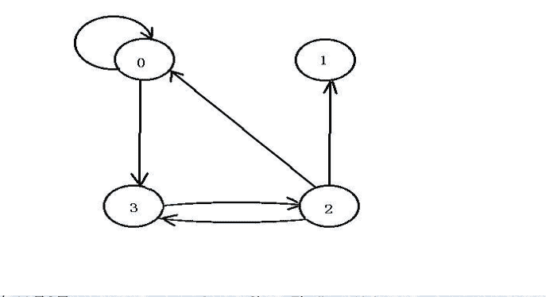

## Relations关系

R²= { (0, 0), (0, 2), (0, 3),
(2, 0), (2, 2), (2, 3),
(3, 0), (3, 1), (3, 3) }

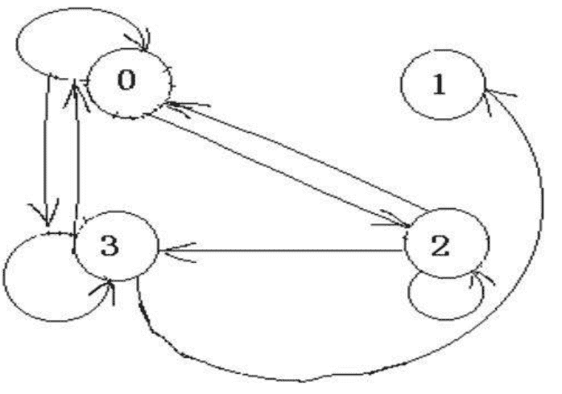

R²的关系图中不存在（3，2），（2，1），
故 R⊄R²

# Rⁿ的关系图的构造：

可由 R 的关系图来构造，从 R 的每个结点aᵢ
出发，数n条边。凡通过数n条边能到达的结点aⱼ，
则有（aᵢ，aⱼ）∈ Rⁿ。关系图中从 aᵢ出发到 aⱼ
的边是存在的。

这样处理容易出错，用相关矩阵的布尔型乘
法来做，简单，又不容易错，还适宜于计算机处
理。

## Relations关系

$$R=\begin{bmatrix}1&0&0&1\\0&0&0&0\\1&1&0&1\\0&0&1&0\end{bmatrix}$$

$$R^2=R\bullet R=$$

$$\begin{bmatrix}1&0&0&1\\0&0&0&0\\1&1&0&1\\0&0&1&0\end{bmatrix}\begin{bmatrix}1&0&0&1\\0&0&0&0\\1&1&0&1\\0&0&1&0\end{bmatrix}=\begin{bmatrix}1&0&1&1\\0&0&0&0\\1&0&1&1\\1&1&0&1\end{bmatrix}$$


## 二元关系的逆关系：运算

设 \(R\)、\(S\) 是 \(A\) 到 \(B\) 的二元关系，\(T\) 是 \(B\) 到 \(C\) 的二元关系，\(P\) 是 \(C\) 到 \(D\) 的二元关系。则：

- (1) \((R \cup S)^c = R^c \cup S^c\)
- (2) \((R \cap S)^c = R^c \cap S^c\)
- (3) \((\overline{R})^c = \overline{R^c}\)
- (4) \((R - S)^c = R^c - S^c\)
- (5) \((A \times B)^c = B \times A\)
- (6) \(\overline{R} = (A \times B) - R\)
- (7) \((S \cdot T)^c = T^c \cdot S^c\)
- (8) \((R \cdot T) \cdot P = R \cdot (T \cdot P)\) ■
- (9) \((R \cup S) \cdot T = R \cdot T \cup S \cdot T\) ■

但：\(S \cdot T \neq T \cdot S\) □

且：\((R \cap S) \cdot T \subseteq R \cdot T \cap S \cdot T\) □

- (10) \(R \subseteq S \Leftrightarrow R^c \subseteq S^c\)

**证明其中：**

**(1)** 任意 \((x,y)\in(R\cup S)^c\)：
\[
(y,x)\in(R\cup S) \Rightarrow (y,x)\in R \text{ 或 } (y,x)\in S
\]
\[
\Rightarrow (x,y)\in R^c \text{ 或 } (x,y)\in S^c \Rightarrow (x,y)\in R^c\cup S^c
\]

**(4)**
\[
(R-S)^c=(R\cap\overline{S})^c \xrightarrow{(2)} R^c\cap(\overline{S})^c \xrightarrow{(3)} R^c\cap\overline{S^c}=R^c-S^c
\]

**(7)** 证：

对 \(\forall (x,y)\in(S\cdot T)^c\)，有
\[
(y,x)\in S\cdot T
\]
\[
\Leftrightarrow \exists z\in B,\ \text{使 }(y,z)\in S,\ (z,x)\in T
\]
即 \((z,y)\in S^c,\ (x,z)\in T^c\)，
\[
\Leftrightarrow (x,y)\in T^c\cdot S^c
\]

**(10)** 证：

设 \(R\subseteq S\)。
\[
\forall (x,y)\in R^c \Rightarrow (y,x)\in R \Rightarrow (y,x)\in S \Rightarrow (x,y)\in S^c
\]

注：\(R\cdot T\cap S\cdot T \subseteq (R\cap S)\cdot T\) 不一定成立，由于 \((R\cap S)\cdot T \subseteq R\cdot T\cap S\cdot T\)。

若上式成立，则 \((R\cap S)\cdot T=R\cdot T\cap S\cdot T\)。

证明：等式不成立。

若 \(\forall a\in A\)，\(b_1,b_2\in B\)，\(c\in C\)，且
\[
(a,b_1)\in R,\ (a,b_2)\in S,\ (b_1,c)\notin S,\ (a,b_2)\notin R,\ (b_1,c)\in T,\ (b_2,c)\in T
\]
显然 \((a,c)\in R\cdot T\cap S\cdot T\)，但 \((a,c)\notin (R\cap S)\cdot T\)。

**[定义2]** 称 \(R\cup R^c\) 是 \(R\) 的对称闭包（symmetric closure of \(R\)），记为 \(s(R)\)。

**[定理2]** 设 \(R\) 是 \(A\) 上的二元关系，则 \(R\cup R^c\) 是对称的，且是包含 \(R\) 的最小对称关系（其中 \(R^c\) 是 \(R\) 的逆关系）。

证明：若 \((a,b)\in R\cup R^c\)，则 \((a,b)\in R\) 或 \((a,b)\in R^c\)，\(\Rightarrow (b,a)\in R^c\) 或 \((b,a)\in R\)，故 \((b,a)\in R\cup R^c\)（对称性）。

若 \(R'\) 为包含 \(R\) 的对称二元关系，则对 \(\forall (a,b)\in R\cup R^c\)：
- 若 \((a,b)\in R\)，则 \((a,b)\in R'\)；
- 若 \((a,b)\in R^c\)，则 \((b,a)\in R\)，\(\Rightarrow (b,a)\in R'\)，又 \(R'\) 对称，\((a,b)\in R'\)。

故 \(R\cup R^c\subseteq R'\)。

**[推论2]** \(R\) 具有对称性当且仅当 \(R\) 是对称闭包。

证明：

(1) 若 \(R\) 具有对称性。对 \(\forall (a,b)\in R^c\)，有 \((b,a)\in R\)，由 \(R\) 的对称性得 \((a,b)\in R\)，故 \(R^c\subseteq R\)，从而 \(R\cup R^c=R\)。

(2) 若 \(R\) 是对称闭包，则 \(R=R\cup R^c\)，故 \(R\) 具有对称性。

**[定义3]**（传递扩张）

设 \(R=\{(a,b)\mid a\,r\,b,\ a,b\in A\}\)，则称
\[
R_1=\{(a,b)\mid (a,b)\in R \text{ 或 } \exists c\in A,\ \text{使 }(a,c),(c,b)\in R\}
\]
为 \(R\) 的传递扩张。

**[定理3]** 当且仅当 \(R\) 是传递的，\(R=R_1\)。

证明：

“\(\Rightarrow\)”：\(R\) 是传递的，显然 \(R\subseteq R_1\)。对 \(\forall (a,b)\in R_1\)，有 \((a,b)\in R\) 或 \(\exists c\in A\)，使 \((a,c),(c,b)\in R\)，由 \(R\) 的传递性，\((a,b)\in R\)，故 \(R_1\subseteq R\)，得 \(R=R_1\)。

“\(\Leftarrow\)”：\(R=R_1\)。若 \((a,c)\in R\)，\((c,b)\in R\)，则 \((a,b)\in R_1=R\)，故 \(R\) 是传递的。

**注：**

1. 若 \(R_1\) 不是传递的，可扩张到 \(R_2,R_3,\dots,R_k\)；
2. 若 \(R_k\) 是传递的，则 \(R_{k+1}=R_k\)。

**[定义4]** 设 \(R_0=R\)，\(R_{k+1}\) 是 \(R_k\) 的传递扩张（\(k=0,1,2,\dots\)），则称
\[
R^*=R_0\cup R_1\cup R_2\cup\cdots\cup R_k\cup\cdots
\]
为 \(R\) 的传递闭包（transitive closure of \(R\)），也记作 \(t(R)\)。

**[定理4]** 传递闭包
\[
R^*=R\cup R^2\cup\cdots\cup R^k\cup\cdots
\]

证明：
\[
R^2=R\cdot R=\{(a,b)\mid \exists c\in A,\ (a,c),(c,b)\in R\}
\]
\[
R_1=\{(a,b)\mid (a,b)\in R \text{ 或 } \exists c\in A,\ (a,c),(c,b)\in R\}=R\cup R^2
\]
\[
R_2=\{(a,b)\mid (a,b)\in R_1 \text{ 或 } \exists c\in A,\ (a,c),(c,b)\in R_1\}
\]

故，\(R\) 的传递闭包
\[
R^*=R\cup R_1\cup R_2\cup\cdots\cup R_k\cup\cdots
=\bigcup_{k=0}^{\infty}R_k
=R\cup R^2\cup R^3\cup\cdots\cup R^k\cup\cdots
=\bigcup_{k=1}^{\infty}R^k
\]


## Relations关系

【定理4】：传递闭包 R* 一定是传递的。

证明：设 $(a, b)$、$(b, c) \in R^*$，则
$\exists i, j$，使 $(a, b) \in R^i$，
$(c, b) \in R^j$；
故 $(a, b) \in R^{(i+j)} \subseteq R^*$

传递扩张的实际意义：

举例：

$R=\{(a,b)\mid a与b是父子关系\}$

$R\cdot R=\{(a,b)\mid a与b是祖孙关系\}$

$R_1=\{(a,b)\mid a与b是三代以内男性直系亲属\}$

...

## Relations关系

【定理5】：设 $|A|=n$，$R$ 是 $A$ 上二元关系，则存在正整数 $k$，$k\le n$，使 $R^*=R\cup R^2\cup\cdots\cup R^k$。

## 证明：

对于 $(x,y)\in R^*$，$\exists k$，使 $(x,y)\in R^k$，表明在 $A$ 中存在不同元素 $a_1,a_2,\ldots,a_{k-1}$，使 $(x,a_1),(a_1,a_2),(a_2,a_3),\ldots,(a_{k-1},y)\in R$。若 $k>n$，由鸽洞原理，则 $a_1,a_2,\ldots,a_{k-1},y$ 中至少有两个相同，不妨设 $a_i=y$，$(i\le k-1)$。

于是 $(x, a_1), \ldots (a_i, a_{i-1}) \in R$，
$(a_{i-1}, y) \in R$，
故 $(x, y) \in R^i$，
即 若 $k > n$，必存在比 $k$ 的正整数 $i$，使 $(x, y) \in R^i$。

注：
定理说明，可用 $R \cup R^2 \cup \ldots \cup R^n$ 来求 $R^*$。

例6：
设 $A = \{1, 2, 3\}$，
$R = \{(1, 1), (1, 2), (2, 3)\}$
求 $R^*$。

解：
$ R = \begin{bmatrix} 1 & 1 & 0 \\ 0 & 0 & 1 \\ 0 & 0 & 0 \end{bmatrix} $，$ R^2 = \begin{bmatrix} 1 & 1 & 1 \\ 0 & 0 & 0 \\ 0 & 0 & 0 \end{bmatrix} = R^3 $

故
$ R^* = R \cup R^2 \cup R^3 = \begin{bmatrix} 1 & 1 & 1 \\ 0 & 0 & 1 \\ 0 & 0 & 0 \end{bmatrix} $

$ R^* = \{ (1, 1), (1, 2), (1, 3), (2, 3) \} $

## Relations关系

注：当 $|A| = n$ 较大时，用定理5计算 $R^*$ 工作量非常大。

# Warshall算法：（1962）

设 $R$ 是 $n$ 个元素集合上的二元关系

```
（1）是 R 的相关矩阵；
（2）i ← 1；
（3）for j = 1 to n do
　　 if aⱼ,ᵢ = 1 then do
　　　 for k = 1 to n do
　　　　 aⱼ,ₖ ← aⱼ,ₖ ∨ aᵢ,ₖ
（4）i = i + 1；
（5）if i ≤ n, then go （3）
　　 else stop
```

## Relations关系

注：（1）结果$(a_{ij})_{n\times n}$是$R^*$的相关矩阵。

（2）算法的复杂度为$n^3$。

例7：$A=\{a，b，c，d\}$
$R=\{(a，b)，(b，c)，(c，d)\}$

计算$R^*$。

$$R=\begin{bmatrix}0&1&0&0\\0&0&1&0\\0&0&0&1\\0&0&0&0\end{bmatrix}$$

+   1. $i=1$　由于 $a_{j1}=0\ (j=1,2,3,4)$ 不改变

+   2. $i=2$　$j=1,\ a_{ji}=1\Rightarrow a_{13}=1$

+   3. $i=3$
+   
+   $$\begin{bmatrix}0&1&1&0\\0&0&1&0\\0&0&0&1\\0&0&0&0\end{bmatrix}$$

$j=1,\quad a13=1 \Rightarrow a14=1$

$j=2,\quad a23=1 \Rightarrow a24=1$

即

$R^*=\{(a,b),(a,c),(a,d),(b,c),(b,d),(c,d)\}$

## 小结

+   (1) 二元关系的集合运算

+   (2) 二元关系的函数运算

+   (3) 二元关系的闭包运算

## 进一步的思考

+   1、从原有二元关系形成新的二元关系
+   2、现有的二元关系的进一步归纳

## 练习

pp.407　21、23、25（b）

## 5.3 等价关系

Equivalence Relations

**【定义1】** 等价关系：

A 上的二元关系 R，如果 R 是

+   1. 自反的
+   2. 对称的
+   3. 传递的

称 R 为等价关系/Equivalence Relations。

（a，b）∈ R，称 a 与 b 等价。

## Relations关系

**[定义2]** 把 A 中的等价元素归为一类，称为等价类  
/equivalence class。记为[a]R或[a]

**[定理1]** R是集合A上的一个等价关系，则下列命题是等价的：

+   1、\( (a, b) \in R \)  
+   2、\( [a] = [b] \)  
+   3、\( [a] \cap [b] \neq \varnothing \)

## Relations关系

注：
等价关系R把A的元素分为若干类，各类之间没有公共元素。确定的R是对集合A进行的一个划分。

[定义3]集合的划分：把集合A分为若干子集A₁，A₂，...，满足：
(1) 当 i ≠ j 时 Aᵢ ∩ Aⱼ = Φ
(2) ∀ a ∈ A， ∃ i，使 a ∈ Aᵢ（i = 1, 2, ...）
则集合Pᵣ(A) = {A₁, A₂, ..., Aₙ, ...} 称为A的一个划分/partition。

## Relations关系

# ## 注：

(1) \( P_r(A) \subseteq p(A) \)（A的幂集）

(2) 当且仅当 \( A = \Phi \) 时，\( P_r(A) = p(A) = \{ \Phi \} \)

(3) A非空时 \( P_r(A) \subset p(A) \)

# ## [定理1]：

A在等价关系R下的等价类正是A的一种划分。A的任一种划分，也必有A上的一个等价关系R与之对应。

## 证明：

R 是等价关系，∀ a ∈ A，由 R 的自反性，(a，a) ∈ R，即 a 与 a 属于同一等价类，也即 ∃ i，a ∈ Aᵢ

若 i ≠ j，Aᵢ ≠ Aⱼ，而 Aᵢ∩Aⱼ ≠ ∅，则 ∃ c ∈ Aᵢ∩Aⱼ，c ∈ Aᵢ，且 c ∈ Aⱼ，

对 ∀ a ∈ Aᵢ，a ∼ c，c ∈ Aⱼ

对 ∀ b ∈ Aⱼ，b ∼ c，即 c ∼ b（对称性）

由 R 传递性，a ∼ b

由 a，b 的任意性，故 Aᵢ = Aⱼ

与 \( A_i \) 和 \( A_j \) 为不同的等价类矛盾。

故 \( A_i \cap A_j \neq \Phi \)

所以，\( R \) 完成了等价类的划分。

若 \( A \) 已进行了划分，则构造二元关系 \( R \)。 (1) \( \forall a \in A \)，使 \( (a, a) \in R \)。

(2) 分别对每一等价类内所有两个不同元素 \( a \)，\( b \)，\( (a, b) \in R \)，使 \( (b, a) \in R \)。

显然，\( R \) 是自反的，对称的，而且也是传递的，因为若 \( (a, b) \in R \)，\( (b, c) \in R \)，则 \( a \)，\( b \)，\( c \) 均在同一等价类内，

故 \( (a, c) \in R \)。

## Relations关系

二元关系R是自反的，对称的，传递的，且把 A 分成了三个等价类，\(A\) = \{\{0\}, \{1, 2, 3\}, \{4, 5\}\}

[定义] 商集：等价关系R将A分成若干等价类，每个类选个代表组成新的集合称为A关于R的商集，表示为A/R。例：在上例中

\(A/R=\{[0],[1],[4]\}\)

[定义]：商集的元素个数（即 A 在 R 下的等价类个数）称为 R 的秩。


## Relations关系

**例3：**

R = { (a, b) | a ≡ b (mod 3), a, b ∈ I } 是整数集合 I 上模 3 同余的二元关系.
证明 R 是等价关系.

证明：由于 3 | (a − b) ⇔ a ≡ b (mod 3)
(1) 3 | (a − a)，自反性
(2) 若 3 | (a − b)，则 3 | (b − a)，对称性
(3) 若 3 | (a − b)，3 | (b − c)，则
a − c = (a − b) + (b − c)
⇒ 3 | (a − c)
满足传递性，故 R 是等价关系。

商集： I / R = { [0], [1], [2] }
其中 [0] = { ..., −6, −3, 0, 3, 6, ... }
[1] = { ..., −5, −2, 1, 4, 7, ... }
[2] = { ..., −4, −1, 2, 5, 8, ... }

**例4：**

N 的一个分划为：若 10^{i−1} ≤ a < 10^i，则 a ∈ A^i，对应的等价关系

R = { (a, b) | a 与 b 有相同位数，a, b ∈ N } 相同位的数归为一类，此 R 把 N 分划为可列个等价类。

## 练习

pp.413　3、5、30

### 4.2 等价关系的运算

**[定理2]**：
若 $R_1$、$R_2$ 是 $A$ 上的等价关系，则 $R_1 \cap R_2$ 也是等价关系。
证明：$R_1 \cap R_2 = R_3$，$R_3$ 传递。

(1) $\forall a \in A$，由 $R_1$、$R_2$ 自反  
$(a, a) \in R_1$，$(a, a) \in R_2$，于是  
$(a, a) \in R_1 \cap R_2 = R_3$，$R_3$ 自反

(2) 若 $(a, b) \in R_3$，则 $(a, b) \in R_1$  
且 $(a, b) \in R_2$，由 $R_1$、$R_2$ 对称  
$(b, a) \in R_1$，$(b, a) \in R_2$  
于是 $(b, a) \in R_1 \cap R_2 = R_3$，$R_3$ 对称

证明：

设 $R_4 = R_1 \cup R_2$

- （1）$\forall a \in A$，$(a,a) \in R_1$，$(a,a) \in R_2$，于是 $(a,a) \in R_1 \cup R_2 = R_4$。

- （2）若 $(a,b) \in R_4$，$(a,b) \in R_1$ 或 $(a,b) \in R_2$。由 $R_1$、$R_2$ 对称性，$(b,a) \in R_1$ 或 $(b,a) \in R_2$，于是 $(b,a) \in R_1 \cup R_2 = R_4$。

注：$R_4 = R_1 \cup R_2$ 是相容的，即 $R_1 \cup R_2$ 不一定是等价关系。若 $(a,b) \in R_4$，$(b,c) \in R_4$，$(a,b)$ 与 $(b,c)$ 可能分别属于 $R_1$ 与 $R_2$，无法保证 $R_1 \cup R_2$ 的传递性。

**例5：**

$A = \{a,b,c\}$

$R_1 = \{(a,a),(b,b),\\(c,c),(a,b),(b,a)\}$

$R_2 = \{(a,a),(b,b),\\(c,c),(b,c),(c,b)\}$

$R_4 = R_1 \cup R_2 = \{(a,a),(b,b),\\(c,c),(a,b),(b,a),\\(b,c),(c,b)\}$

显然，$(a,b),(b,c) \in R_1 \cup R_2$

但 $(a,c) \notin R_1 \cup R_2$（不具有传递性），

但 $(R_1 \cup R_2)^*$ 一定是传递的。

b. 若 $(a,b) \in R \cdot R$，则存在 $c$，使
$(a,c),(c,b) \in R$
$\Rightarrow\ (b,c),(c,a) \in R$
$\Rightarrow\ (b,a) \in R \cdot R$
$\Rightarrow\ (b,a) \in R_1$

由 $(R_1 \cup R_2)$ 对称 $\Rightarrow (R_1 \cup R_2)_1$ 也对称，…
对任一 $k$，$(R_1 \cup R_2)_k$ 也对称。
若 $(a,b) \in (R_1 \cup R_2)^*$，则存在 $k$，
使 $(a,b) \in (R_1 \cup R_2)_k$，
故 $(b,a) \in (R_1 \cup R_2)_k \subseteq (R_1 \cup R_2)^*$，
于是 $(R_1 \cup R_2)^*$ 是对称的。
(3) 任一传递闭包都具有传递性。
即证。

### 4.3 等价关系的运算与分划的关系

等价关系对应于集合的一种分划。

设 $R_1$、$R_2$ 是 A 上等价关系，对应的分划为 $\pi_1$、$\pi_2$，

$\pi_1 \cdot \pi_2$ 对应于 $R_1 \cap R_2$，称为二个分划的积，使分划分更细；

$\pi_1 + \pi_2$ 对应于 $(R_1 \cup R_2)^*$，称为两个分划的和，使分划比 $\pi_1$、$\pi_2$ 要粗。

**例6：**

A = { a, b, c, d, e, f, g, h, i, j, k }

$R_1 \leftrightarrow \pi_1 = \{ \overline{abcd}, \overline{efg}, \overline{hi}, \overline{jk} \} \quad \begin{matrix} A_1 \\ A_2 \\ A_3 \\ A_4 \end{matrix}$

$R_2 \leftrightarrow \pi_2 = \{ \overline{abch}, \overline{di}, \overline{efik}, \overline{g} \} \quad \begin{matrix} B_1 \\ B_2 \\ B_3 \\ B_4 \end{matrix}$

$R_1 = \{ (a, a), (b, b), (c, c), (d, d), (e, e), (f, f), (g, g), (h, h), (i, i), (j, j), (k, k), (a, b), (a, c), (a, d), (b, c), (b, d), (c, d), (b, a), (c, a), (d, a), (c, b), (d, b), (d, c), (e, f), (e, g), (f, g), (f, e), (g, e), (g, f), (h, i), (i, h), (j, k), (k, j) \}$

$R_2 = \{ (a, a), (b, b), (c, c), (d, d), (e, e), (f, f), (g, g), (h, h), (i, i), (j, j), (k, k), (a, b), (a, c), (a, h), (b, c), (b, h), (c, h), (b, a), (c, a), (h, a), (c, b), (h, b), (h, c), (d, i), (i, d), (e, f), (e, j), (e, k), (f, j), (f, k), (j, k), (f, e), (j, e), (k, e), (j, f), (k, f), (k, j) \}$

$R_1 \cap R_2 = \{(a,a), (b,b), (c,c), (d,d), (e,e), (f,f), (g,g), (h,h), (i,i), (j,j), (k,k), (a,b), (a,c), (b,c), (e,f), (j,k), (b,a), (c,a), (c,b), (f,e), (k,j)\}$


## Relations关系

$R_1 \cup R_2 = \{(a,a),(b,b),(c,c),(d,d),(e,e),(f,f),(g,g),(h,h),(i,i),(j,j),(k,k),(a,b),(a,c),(a,d),(b,c),(b,d),(c,d),(b,a),(c,a),(d,a),(c,b),(d,b),(d,c),(a,h),(b,h),(c,h),(h,a),(h,b),(h,c),(e,f),(e,g),(f,g),(f,e),(g,e),(g,f),(h,i),(i,h),(j,k),(k,j),(d,i),(i,d),(e,j),(e,k),(f,j),(f,k),(j,e),(k,e),(j,f),(k,f)\}$

但 \( R_1 \cup R_2 \) 不是传递的，如：\( (c, h) \)，\( (h, i) \in R_1 \cup R_2 \)，而 \( (c, i) \notin R_1 \cup R_2 \)。
把 \( R_1 \cup R_2 \) 扩张到传递性满足，就是 \( (R_1 \cup R_2)^* \)。

\( R_1 \cap R_2 \iff \pi_1 \cdot \pi_2 \square \)

\( = \{ \overline{abc}, \overline{d}, \overline{ef}, \overline{g}, \overline{h}, \overline{i}, \overline{jk} \} \quad A_1 \cap B_1 \quad A_1 \cap B_2 \quad A_2 \cap B_2 \quad A_4 \cap B_4 \quad A_3 \cap B_1 \quad A_3 \cap B_2 \quad A_4 \cap B_3 \)

\( \square \) 凡是在 \( \pi_1 \)，\( \pi_2 \) 中有一个要求把它们拆开的就拆开。\( \square \)

\( (R_1 \cup R_2)^* \iff \{ \overline{abcdih}, \overline{efgjk} \} \quad A_1 \cup A_3 = B_1 \cup B_2 \quad A_2 \cup A_4 = B_3 \cup B_4 \)

## Relations关系

例7：

$A=\{52张扑克牌\}$

$R_1=\{(a,b)\mid a与b同花，\\ a，b是扑克牌\}$

$\leftrightarrow\ \pi_1$

$R_2=\{(a,b)\mid a与b同点，\\ a，b是扑克牌\}$

$\leftrightarrow\ \pi_2$

$R_1\cap R_2\leftrightarrow\pi_1，\pi_2$把扑克分成52张单张

$(R_1\cup R_2)^*\leftrightarrow\pi_1+\pi_2$把52张扑克归为同一类

## Relations关系

[定义]平凡分划：
集合A的最粗或最细的分划，称为平凡分划。

注：

+ (1) 等价关系，用穷举法很难判别  
+ (2) 用关系图比较直观，明确  
+ (3) 用集合的分划来研究等价关系

## § 5 半序关系

【定义】：半序关系（偏序关系）

R 是 A 上的二元关系，如果 R 满足：

+ 1. 自反的  
+ 2. 反对称的  
+ 3. 传递的  

则称 R 是 A 上半序关系。

## Relations关系

例：

A = { 1, 2, 3, 4, 5, 6, 7, 8, 9 }

B = { a, b, c }

R₁ = { (a, b) | a ≤ b, a, b ∈ A }

R₂ = { (a, b) | a | b, a, b ∈ A }

R₃ = { (s₁, s₂) | s₁ ⊆ s₂,
                  s₁, s₂ ∈ 𝒫(B) }

记号：

R = { (a, b) | a ≤ᵣ b, a, b ∈ A } 其中 ≤ᵣ 可为 ≤、|、⊆

## Relations关系

注：
（1）用矩阵表示半序关系，不能明显看出二元关系的特征。
（2）用简化的关系图表示较适合。

简化的关系图：
（1）自反性：每个顶点都有自回路，省去。
（2）反对称性：两个顶点间只可能有一个箭头，从左→右，或从下→上的方向；从小到大安置顶点，可省略箭头。
（3）传递性：由于有（a，b），（b，c）∈R，则（a，c）∈R，故只画（a，b），（b，c）对应的边，省略边（a，c）。

## Relations关系

【定义】：Hasse图

设是 A 上的一个半序关系，如果 a≤b，则将 a 画在 b 下面，且不和 c，使 a≤c，c≤b，则 a，b 间用直线连接。并符合简化的关系图的绘制，称这样得到关系图为 Hasse图。

例中半序关系的 Hasse图如下：

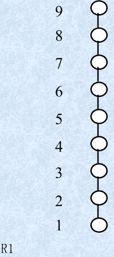

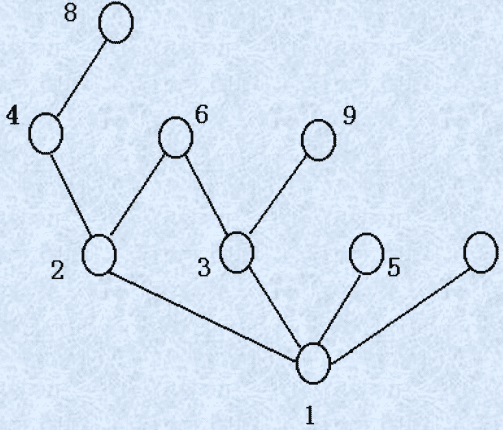

R2

## [定义] 全序：

A 上半序关系 R，如果 ∀a，b ∈ A，都有  
a ≤ b，或 b ≤ a，则称 R 为 A 上的全序关系。

注：

(1) 全序的含义：A 中每两个元素均能比大小，即任何两个元素都相关。

(2) 半序则是部分有序。

(3) R₁ 是全序，R₂，R₃ 都是半序

如：R₂中，{1，2，6}，{1，2，4，8}，{1，3，9} 都排成了序，但 2 与 3，5 与 7，7 与 9 ...，在整除的意义上来说无法排出大小来。

## Relations关系

[定义]半序集：

集合 A 及 A 上的一个半序关系 R 组成的二元组（A，R），称为半序集，记为（A，≤<sub>R</sub>）或（A，≤）。

注：

（1）同一集合上的两个不同的半序关系，所构成两个半序集，如：

R<sub>1</sub>和 R<sub>2</sub>都定义在 A = { 1， 2， 3， 4， 5， 6， 7， 8， 9 } 上，但（A， R<sub>1</sub>）与（A， R<sub>2</sub>）显然不是一样的半序集。

## Relations关系

[定义]全序集：
半序集 \( (A, \leq_R) \) 中的半序关系 \(\leq_R\) 是 \( A \) 上的全序，则此 \( (A, \leq_R) \) 称为全序集。

\( (A, R_1) \) 是全序集。显然，全序集是半序集的特例。又如：\( (-\infty, +\infty) \) 实数全体，在 \(\leq\) 下是全序集；平面上点集，也可以规定一种 \(\leq_R\)，模长大的大，模长相等的情况下，以幅角的大小来比大小，因此，平面上点集也是全序集。\( (N, \leq) \) 当然也是全序集。

## Relations关系

**注：**

实数全体，平面点集是无法用 Hass e 图表示的。一般来说，对有限集用 Hasse 图比较好，对可列集只能示意一下，对不可列无限集是没法表示的，因为任二个数之间一定还有别的数。

**[定义]链：**

设 $(A, \le_R)$ 是半序集，$B \subseteq A$，若 $(B, \le_R)$ 是全序集，则称 $B$ 为 $(A, \le_R)$ 中的链（Chain）。

## Relations关系

当B是有限集时，B 的基数 | B | 称为链长。

例：

在上例Hassee图（A，R₂）中，取B₁={1，2，4，8}，R₂=|（整除），则

（B₁，R₂）是全序关系，B₁是半序集（A，|）中链长为4 的链。

B₂={1，2，6}，B₃={1，3，9}，B₄={1，5}，B₅={1，7} 也都是（A，|）中的链。

## Relations关系

【定义】反链：设（A，≤_R）为半序集，B ⊆ A，对于∀ a，b ∈ B（a ≠ b），（a，b）∉ R，（b，a）∉ R，则称 B 为（A，≤_R）中的反链。

当 B 为有限集时，|B| 为反链的长度。

注：**反链中的元素都互不相关。**

例如：（A，R₂）中

B₁ = { 2，3，5，7 }　　 |B₁| = 4  
B₂ = { 4，6，9 }　　　 |B₂| = 3  
B₃ = { 8，6，9，5，7 }　|B₃| = 5  

...  
都是反链。

## [定义]极大元与极小元：

设 \( (P, \leq) \) 是半序集，\( A \subseteq P \)，若 \( a \in A \)，且在 \( A \) 中找不到一个元素 \( b \)（\( b \neq a \)），使 \( a \leq b \)（\( b \leq a \)），则称 \( a \) 为 \( A \) 中的极大元（极小元）。

例：\( (\mathbb{N}, \mid) \) 是半序集，
\( A = \{2, 3, 4, 5, 6, 7, 8, 9\} \)
则 \( A \) 中极大元：\( 8, 6, 9, 5, 7 \)
极小元：\( 2, 3, 5, 7 \)

注：
极大元，极小元并不要求唯一，且同一元素，可以既是极大元，又是极小元，如 \( 5, 7 \)。


注：极大元，极小元必须是子集 A 中的元素。

[定义] 最大元与最小元：
设（P，≤）是半序集，A ⊆ P，若 a ∈ A，∀ b ∈ A，b ≤ a（a ≤ b），则称 a 为 A 的最大元（最小元）。

例：上例

其 Hasse 图如下图所示

## Relations关系

例：\( B = \{a, b, c\} \)，
\( R_3 = \{ (s_1, s_2) \mid s_1 \subseteq s_2, s_1, s_2 \in p(B) \} \)，\( (p(B), \subseteq) \) 是半序集。

设 \( A = \{\emptyset, \{a\}, \{b\}, \{c\}, \{a, b\}, \{a, c\}, \{b, c\} \} \)

其Hasse图如下图所示

## Relations关系

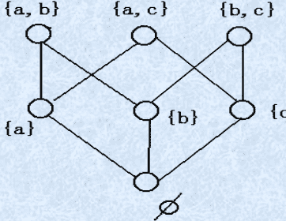

**结论：** A存在最小元∅，没有最大元。

**注：** 最大元（最小元）本身应属于子集A，且与A中任何元素都有关系。

## [定义]上界与下界：

设 \( (P, \leq) \) 是半序集，\( A \subseteq P \)，
若 \( a \in P \)，对 \( \forall b \in A \)，\( b \leq a \)（\( a \leq b \)）称 \( a \) 为 \( A \) 的上界（下界）。

**注：**
(1) 上例中，\( A \) 无最大元，但存在 \( A \) 的上界 \( \{a, b, c\} \)。
(2) \( \emptyset \) 为 \( A \) 的最小元，也是 \( A \) 的下界
(3) 最大（小）元是 \( A \) 的一个上（下）界
(4) 上（下）界可以不唯一，也可以不存在

## Relations关系

[定义]上确界与下确界：
设 \( (P, \leq) \) 是半序集，\( A \subseteq P \)，
若 \( a \) 是 \( A \) 的一个上界（下界），而 \(\forall A\) 的上界（下界）\( b \)，都有 \( a \leq b \)（\( b \leq a \)），则称 \( a \) 是 \( A \) 的上确界（下确界）。

注：
上确界：最小上界
下确界：最大下界
如果存在上（下）确界，则上（下）确界一定是唯一的

## Relations关系

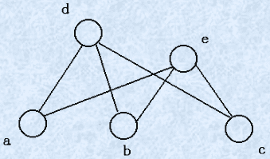

- 结论：
  - d，e 是 A 的上界
  - d 与 e 无法比大小，不存在上确界
  - A 的下界不存在，不存在下确界

## Relations关系

[引理1]：

设（P，≤）是半序集，A 是 P 的非空有限子集，则 A 一定存在极大（小）元。

**证：** 若 |A| = 1，则 A 中唯一元素既是极大元，也是极小元。

假定 |A| = n 时存在极大（小）元

当 |A| = n + 1 时，则将 A 分成由 n 个元素组成的子集 A’ 与元素 a。

由假定，A’ 存在极大元 \( a_M' \)，极小元 \( a_m' \)。

若 \( a \leq_M a \)，则 \( a \) 为极大元，否则为 \( a_M \)，
因为若 \( a \leq_M a \)，且存在 \( b \leq A' \)，而
\( a \leq b \)，由传递性 \( a_M \leq b \)，与 \( a_M \) 为极大元（\( A' \)）矛盾。

同理，若 \( a \leq a_m \)，则 \( a \) 为极小元，否则为 \( a_m \)。

[引理2]：

设 \( M \) 是非空有限子集 \( A \) 的极大元集合，
则 \( M \) 是 \( A \) 的反链。

## Relations关系

**反证：**

若M不是反链，则∃a，b ∈ M（a ≠ b），
（a，b）∈ R 或（b，a）∈ R，即 a ≤ b
或 b ≤ a，则 a 或 b 不是极大元，矛盾。

[定理1]：
设（P，≤）是有限的半序集，P 中最长链长度为 n，则 P 可以划分为 n 个互不相交的反链。
证：（1）n = 1，P 中任两个元素不相关，P 本身是反链。

## Relations关系

(2) 假设 n 时定理成立，即当 P 中最长链长为 n 时，可以划分为 n 个互不相交的反链。

(3) 当 P 中最长链长为 n + 1，由引理1，极大元一定存在，设 M 是极大元集合，由引理2，M 是 P 的一个反链。

如果去掉 M，（ P − M，≤）也是半序集，则 P − M 中最长链长为 n，由假设，P − M 可以划分为 n 个互不相交的反链，添上 M，可知 P 可划分为 n + 1 个互不相交的反链。

## Relations关系

例：A = {1，2，3，4，5，6，7，8，9}，半序集（A，≤），最长链为4，B = {1，2，4，8}

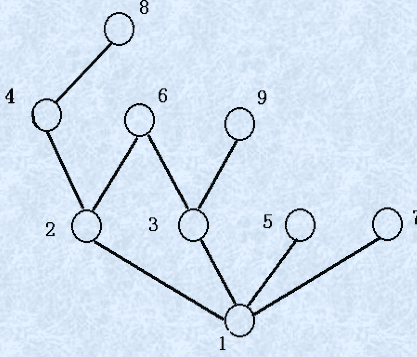

## Relations关系

可划分为 4 个互不相交的反链：

A₁ = { 1 }
A₂ = { 2, 3, 5, 7 }
A₃ = { 4, 6, 9 }
A₄ = { 8 }

也可分为：

B₄ = { 8, 6, 9, 5, 7 }
B₃ = { 4, 3 }
B₂ = { 2 }
B₁ = { 1 }

注：

反链的取法并不唯一，而最长链中的元素必然分别落在每个反链里。

## Relations关系

说明：

若 \( P_r(A) = \{A_1, A_2, \dots, A_n\} \)，是 \( A \) 的一个分划，则可定义一个半序关系，当 \( j-i=1 \) 时，取 \( a \in A_i \)，\( b \in A_j \)，使 \( (a, b) \in R_1 \)，且 \( A_i, A_j \) 中每个元素至少取到一次

并对 \( \forall a \in A \)，\( (a, a) \in R_1 \)

然后取 \( R = R_1^* \)（闭包）

这样 \( R \) 是半序关系，并使每个 \( A_i \) 是反链，且最长链是 \( A_1, A_2, \dots, A_n \) 中各取一个元素组成的。

## Relations关系

[定理2]：每个 A 的分割
\( p_r(A) = \{ A_1, A_2, ..., A_n \} \)，都可以找到一个半序关系 R，使 \( A_1, A_2, ..., A_n \) 都是 \( (A, R) \) 的反链，而 \( (A, R) \) 的最长链由 \( A_1, A_2, ..., A_n \) 中各取一个元素组成。

# 例：

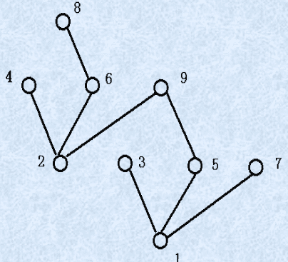

2022年11月3日
Deren Chen, Zhejiang Univ.
127

## Relations关系

[定理3]：
设半序集 \( (p, \leq) \) 包含 \( m \cdot n + 1 \) 个或以上个元素，则 \( p \) 至少有一个链长 \(\geq n + 1\)（或 \(m + 1\)）或至少有一个反链长 \(\geq m + 1\)（或 \(n + 1\)）。

证：
若 \( p \) 的最长链长 \(\leq n\)，反链长 \(\leq m\)，由定理1，\( p \) 可划分为不超过 \( n \) 个反链，则 \( p \) 至多有 \( n \cdot m \) 个元素，与 \( p \) 的元素个数矛盾。

## Relations关系

例1：
a · b + 1 个自然数的集合 p
（（p，|）是半序集）
或者有
（a + 1）（或（b + 1））个数一个
被一个整除
或者有
（b + 1）（或（a + 1））个数互素

[定义]良序集：
设（A，R）是半序集，若A的非空子集都存在最小元，则称R是良序关系，（A，R）为良序集。

## Relations关系

注：（1）良序集是全序集
（2）全序集未必是良序的，如：
实数全体，任两个实数都能比大小，
但子集 {1/n} 的最小元找不到。
但，有限的全序集自然是良序的。


## 5. Relations

## 关系

### 5.1 Relations and their Properties

### 关系及其性质

## Relations关系

[定义1] **相关/relative**: 按照某种规则，确定二个对象或多个对象之间有关系，称这一个对象或多个对象是相关的。

**注意**: 相关性与指定的规则有关。

+ 1. 扑克牌中的方块 k 与梅花 k
  - 同花关系：不相关
  - 同点关系：相关
+ 2. 父子二人
  - 同辈关系：不相关
  - 父子关系：相关

## Relations关系

## 注：

二元关系：二个对象之间相关的关系  
多元关系：多个对象之间的关系  
多元关系常化成二元关系来研究  
无序的二元关系：方块 k 与梅花 k，谁在前，谁在后都还是同点的  
有序的二元关系：父子关系，不能交换父与子的次序

又如：  
（1）a + b = 偶数，a 与 b 是无序的  
    用 [a, b] 表示无序对  
（2）a ≤ b，a 与 b 是有序的二元关系，叫作 a 相关于 b，记成 a r b，用 (a, b) 表示有序对  
（3）无序的二元关系可用有序的二元关系表示  
    即 (a, b) 与 (b, a) 都属于这种二元关系

# 定义2： 二元关系/binary relation

---按照某种规定，定义了一个有序对（a，b）的集合R，其中 \(a \in A\)，\(b \in B\)，称R为A到B的一个二元关系。

> Let A and B be sets. A binary relation from A to B is a subset of \(A \times B\).

\( R = \{ \, (a, b) \mid a \in A, \, b \in B, \, a \, r \, b \} \) 其中 \(a \, r \, b\) 读作 a 相关于 b。

## 注意： 二元关系是指满足某规律的有序对的全体。

## Relations关系

定义3： 当A = B时，R是A到A的二元关系，称为A上的二元关系。

A relation on the set A is a relation from A to A.

例：R = { (a, b) | a/b，a，b ∈ N } 是自然数集N上的二元关系

有时记为A²

2022年11月3日

Deren Chen, Zhejiang Univ.

5

函数作为二元关系

二元关系看成函数关系

$R=\{(a,b)\mid aRb,\ a\in A,\ b\in B\}$

$A$ 称为 $R$ 的定义域，记 $A=Dom\ R$ 或 $D(R)$

$B$ 称为 $R$ 的值域，记 $B=Range\ R$ 或 $R(R)$

当定义域与值域交换得

$R^{-1}=\{(b,a)\mid(a,b)\in R,\ a\in A,\ b\in B\}$，称为 $R$ 的逆关系。


# 二元关系中的计数问题

Example 6:

How many relations are there on a set A with n elements?

## Relations关系

二元关系的表示：因为二元关系本身也是集合，也可用穷举法、描述法来表示，还可用表格、图示、矩阵法表示。

例如：

A = {张三，李四，王五，赵六}
B = {100米，跳高，铅球，足球，跨栏}

穷举法表示：

R = {(张三，铅球)，(张三，足球)，
    (李四，100米)，(李四，跳高)，
    (王五，跨栏)，(赵六，100米)}

是运动会的报名表。

## 表格表示法：用表格表示一目了然

|    | 100米 | 跳高 | 铅球 | 足球 | 跨栏 |
|---|---|---|---|---|---|
| 张三 |    |    | √    | √    |    |
| 李四 | √    | √    |    |    |    |
| 王五 |    |    |    |    | √    |
| 赵六 | √    |    |    |    |    |

用字母数字来代替这些元素

A = { a, b, c, d }

B = { 1, 2, 3, 4, 5 }

## Relations关系

图示法：关系图，直观

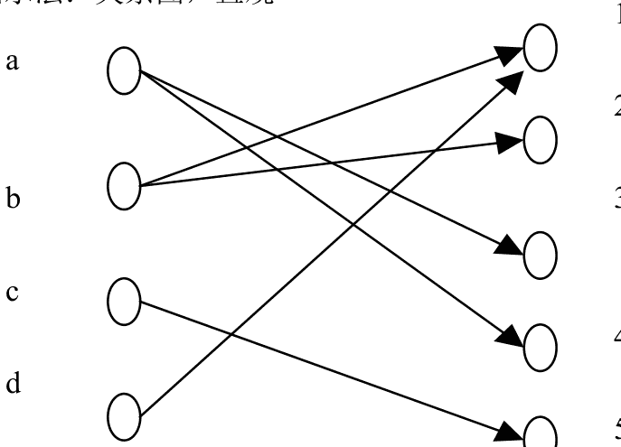

# 相关矩阵法表示：

# 把A， B集合内元素排好序

|   | 1 | 2 | 3 | 4 | 5 |
|---|---|---|---|---|---|
| a | 0 | 0 | 1 | 1 | 0 |
| b | 1 | 1 | 0 | 0 | 0 |
| c | 0 | 0 | 0 | 0 | 1 |
| d | 1 | 0 | 0 | 0 | 0 |

## Relations关系

**注：**

+ 1. 若 $R=A\times B$，称此二元关系为普遍关系。
+ 2. 设 $A=\{a_1,\ a_2,\ \ldots,\ a_n\}$
  
  $R=\{(a_i,a_j)\mid a_i,a_j\in A\}$
  
  若 $R=\{(a_i,a_i)\mid a_i\in A\}$，称 $R$ 为恒等关系，用 $I_A$ 表示，是单位矩阵。

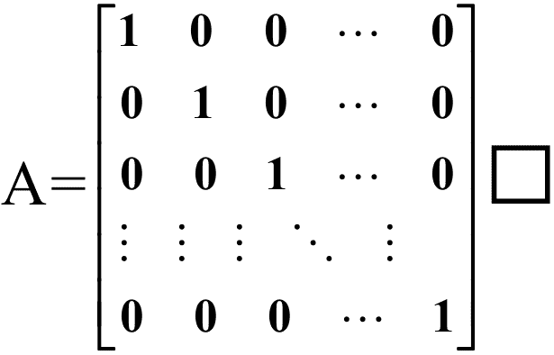

# 二元关系的性质（A上的R）

设 R 是 A 上的二元关系，R=(a_{ij})_{n*n}

(1) 自反性：

对∀ a ∈ A，(a，a) ∈ R，则 R 称为
**自反的二元关系/reflexive**。

显然，r_{ii}=1（i=1，2，…，n）

> > A relation R on a set A is called reflexive if (a,a)∈R
> > for every element a∈A.

## Relations关系

(2) 对称性：
若 \(a \neq b\)，\((a, b) \in R\)，必有 \((b, a) \in R\)，称 \(R\) 为对称的二元关系 / symmetric

即 \(R\) 的相关矩阵为对称阵，\(a_{ij} = a_{ji}\)

A relation R on a set A is called symmetric if \((b,a) \in R\) whenever \((a, b) \in R\), for \(a, b \in A\). A relation R on a set A such that \((a,b) \in R\) and \((b, a) \in R\) only if \(a=b\), for \(a, b \in A\), is called antisymmetric.

## Relations关系

## 反对称性：

若 \(a \neq b\)，\((a, b) \in R\)，  
则 \((b, a) \notin R\)，称 \(R\) 为反对称的二元关系/antisymmetric

## 注：

+ (1) \(R\) 的相关矩阵是反对称的，即  
+ \(r_{ij} \land r_{ji} = 0 \quad (i \neq j)\)

+ (2) 若 \(r_{ij} = 1\)，则 \(r_{ji} = 0\)，但 \(r_{ij} = 0\) 时，  
+ 不要求 \(r_{ji} = 1\)，即 \(r_{ij} = r_{ji} = 0\) 是允许的。

+ (3) 对称性与反对称性既不互斥，又不互补

## Relations关系

# 例：

恒等关系：既是对称的，又是反对称的；

而相关矩阵是  
[  
[ 1 0 0 1 ]  
[ 0 0 1 0 ]  
[ 0 0 1 0 ]  
[ 1 0 0 1 ]  
]  
的二元关系，

是既不对称，又不是反对称的。

## Relations关系

3）传递性：■

若（a，b），（b，c）∈ R，  
则（a，c）∈ R，称 R 为传递的二元关系。

即：  
\[(a_{ij} \land a_{jk}) \lor a_{ik} = 1\] ■

> A relation R on a set A is called transitive if whenever  
(a, b) ∈ R and (b, c) ∈ R, then (a, c) ∈ R, for a, b, c ∈ A.


## Relations关系

注：a<sub>ij</sub>，a<sub>jk</sub>中有一个不是1，  
则 \(\left( \mathbf{a}_{ij} \wedge \mathbf{a}_{jk} \right) = 1\)， a<sub>ik</sub>就可以任意。  
即若 \((a, b), (c, d)\) 中有1个不属于R，  
则讨论 \((a, c)\) 是否属于R，无意义。  
即没有传递的条件，也不需传递的结果。如：  
\( A = \{a, b, c, d\} \)， \( R = \{ (a, b), (c, d) \} \)

## 二元关系的性质对应于关系图，有：

- （1）自反性：每个顶点都有自回路，
- （2）对称性：任二个顶点间或没有边，或有二条相对而指的有向边；
- （3）反对称性：任二个顶点至多只有一条有向边；
- （4）传递性：若 x 到 y 有边， y 到 z 有边，则 x 到 z 必有边。

## Relations关系

注：由对称性与传递性可推出自反性。

理由：若（a，b）∈ R，由对称性，  
　　　有（b，a）∈ R，由传递性  
　　　有（a，a）∈ R。

错误原因：不是 ∀a，  
　　　　　∃b，使（a，b）∈ R。

如：  
　　R的相关矩阵是全0矩阵，是对称的，  
传递的，但不是自反的。

## 例 4：

$R_4=\{(a,b)\mid a+b=\text{偶数},\ a,b\in\mathbb{N}\}$

自反的，对称的，传递的，

因：$a+b=\text{偶}$，$b+c=\text{偶}$，

则：$0<a+c=(a+b)+(b+c)-2b=\text{偶数与偶数之差=偶数}$。

## 例 5：

$R_5=\{(a,b)\mid \gcd(a,b)=1\text{（互素）},\ a,b\in\mathbb{N}\}$

对称的，但不是自反的，也无传递性。

## 二元关系的集合运算

## Combining Relations

二元关系是集合，集合存在并、交、差和对称差的运算。  
故二元关系也存在这样的运算。

## 设 $R_1$ 和 $R_2$ 是 $A$ 到 $B$ 的二元关系，则

- 1. $R_1 \cup R_2 = \{(a,b)\mid (a,b)\in R_1$ 或 $(a,b)\in R_2\}$
- 2. $R_1 \cap R_2 = \{(a,b)\mid (a,b)\in R_1$ 且 $(a,b)\in R_2\}$
- 3. $R_1-R_2 = \{(a,b)\mid (a,b)\in R_1$ 但 $(a,b)\notin R_2\}$
- 4. $\overline{R_1}=\{(a,b)\mid (a,b)\in A*B$，但 $(a,b)\notin R_1\}$
- 5. $R_1\oplus R_2=\{(a,b)\mid (a,b)\in R_1\cup R_2$ 但 $(a,b)\notin R_1\cap R_2\}$

## Relations关系

例1：\( A = \{1, 2, 3, 4\} \)，\( I \) 为整数集

\( R = \{(a, b) \mid a, b \in A, \frac{a-b}{2} \in I\} \)

\( S = \{(a, b) \mid a, b \in A, \frac{a-b}{3} \in I, a-b>0\} \)

求：\( R \cup S, R \cap S, \overline{R}, R-S, S-R, S \oplus R \)

解：\( R \) 与 \( S \) 都是 \( A \) 上的二元关系

\( R = \{(1, 1), (2, 2), (3, 3), (4, 4), (1, 3), (3, 1), (2, 4), (4, 2)\} \)

\( S = \{(4, 1)\} \)

\( R \cup S = \{(1, 1), (2, 2), (3, 3), (4, 4), (1, 3), (3, 1), (2, 4), (4, 2), (4, 1)\} \)

## Relations关系

则：\( R_1 \cup R_2 = (c_{ij} \lor d_{ij}) \)

\( R_1 \cap R_2 = (c_{ij} \land d_{ij}) \)

\( R_1 - R_2 = (c_{ij} \land \overline{d_{ij}}) \)

\( \overline{R_1} = (\overline{C_{ij}}) \)

其中：

逻辑加（\(\lor\)）：\( 0 \lor 0 = 0, \quad 0 \lor 1 = 1, \quad 1 \lor 0 = 1, \quad 1 \lor 1 = 1 \)

逻辑乘（\(\land\)）：\( 0 \land 0 = 0, \quad 0 \land 1 = 0, \quad 1 \land 0 = 0, \quad 1 \land 1 = 1 \)

逻辑非（\(\neg\)）：\( \overline{0} = 1, \quad \overline{1} = 0 \)

## Relations关系

对上例：

$$R=\begin{bmatrix}1&0&1&0\\0&1&0&1\\1&0&1&0\\0&1&0&1\end{bmatrix},\quad S=\begin{bmatrix}0&0&0&0\\0&0&0&0\\0&0&0&0\\1&0&0&0\end{bmatrix}$$

则用矩阵的逻辑运算：

$$R\cup S=\begin{bmatrix}1&0&1&0\\0&1&0&1\\1&0&1&0\\1&1&0&1\end{bmatrix}=S\oplus R$$

## Relations关系

$R \cap S = \begin{bmatrix} 0&0&0&0 \\ 0&0&0&0 \\ 0&0&0&0 \\ 0&0&0&0 \end{bmatrix} = \Phi,$


$\overline{R} = \begin{bmatrix} 0&1&0&1 \\ 1&0&1&0 \\ 0&1&0&1 \\ 1&0&1&0 \end{bmatrix},$

$R-S=R,$

$S-R=S$


## 进一步的思考

### 1、其他的二元关系

不自反/反自反（irreflexive） PP382T7

不对称（asymmetric） PP382T10

## 进一步的思考

- 2、函数复合运算应用到二元关系中
- 3、求满足给定性质的二元关系
- ----原有二元关系的扩充
- 4、从二元关系到多元关系:N元关系
- ——应用：关系数据模型 （PP385-388）

## 5.2 二元关系的运算

## Relation Operation and Closures

二元关系  
作为集合，存在并，交，差，非和对称差的运算；  
作为函数 也存在复合运算和逆运算；  
作为特殊的集合和函数的推广 还存在闭包运算。

## 二元关系的复合运算

Let R be a relation from a set A to a set B and S a relation from B to a set C. The composite of R and S is the relation consisting of ordered pairs (a, c), when a ∈ A, c ∈ C, and for which there exists an element b ∈ B such that (a, b) ∈ R and (b, c) ∈ S. We denote the composite of R and S by SR.

## Relations关系

【定义】：设 $R_1$ 为 A 到 B 的二元关系，$R_2$ 为 B 到 C 的二元关系，
$R_1=\{(a,b)\mid a\ r_1\ b，a\in A，b\in B\}$
$R_2=\{(b,c)\mid b\ r_2\ c，b\in B，c\in C\}$
则 $R_1\cdot R_2$ 是由 A 到 C 的二元关系，称为 $R_1$，$R_2$ 的复合关系

$R_3=\{(a,c)\mid(a,b)\in R_1，\ 且\ (b,c)\in R_2\}$

记 $R_3=R_1\cdot R_2$。

例：
$R$ 是父子关系，则 $R^2=R\cdot R$ 是祖孙关系。


## 例 3：

A = { 张华 , 王兵 , 陈平 , 李兰 } 是学生集合 □

B = { 软件 , 硬件 , 自动化 , 遥感 } 是专业集合 □

C = { 工程制图 , 电子线路 , 操作系统 , 离散数学 }

是课程集合 □

则： R₁ = { ( a₁ , b₁ ) , ( a₁ , b₃ ) , ( a₂ , b₂ ) , ( a₂ , b₄ ) , ( a₃ , b₃ ) , ( a₃ , b₄ ) , ( a₄ , b₁ ) , ( a₄ , b₄ ) }

是选双学位专业的二元关系。

## Relations关系

R₂ = { ( b₁ , c₃ ) , ( b₁ , c₄ ) , ( b₂ , c₂ ) ,
(b₂ , c₃ ) , ( b₂ , c₄ ) , ( b₃ , c₁ ) ,
(b₃ , c₂ ) , ( b₄ , c₂ ) , ( b₄ , c₄ ) }
是各专业本学期必修课的二元关系。

R₃ = R₁ · R₂ = { ( a₁ , c₁ ) , ( a₁ , c₂ ) ,
(a₁ , c₃ ) , ( a₁ , c₄ ) ,
(a₂ , c₂ ) , ( a₂ , c₃ ) ,
(a₂ , c₄ ) , ( a₃ , c₁ ) ,
(a₃ , c₂ ) , ( a₃ , c₄ ) ,
(a₄ , c₂ ) , ( a₄ , c₃ ) ,
(a₄ , c₄ ) }
是选双学位学生本学期必修课的二元关系

## 普通的矩阵乘法：

A = \( (a_{ij})_{m \times n} \) ,
B = \( (b_{jk})_{n \times L} \) ,
则： C = A • B = \( (c_{ik})_{m \times L} \)
而 \( c_{ik} = \sum_{j=1}^{n} a_{ij} b_{jk} \)

## 而二元关系的复合的矩阵布尔型乘法：

\( c_{ik} = \bigvee_{j=1}^{n} a_{ij} \wedge b_{jk} \)

## 对例 3，有：

R₁ = [
[1 0 1 0]
[0 1 0 1]
[0 0 1 1]
[1 0 0 1]
], R₂ = [
[0 0 1 1]
[0 1 1 1]
[1 1 0 0]
[0 1 0 1]
]

R₃ = R₁ • R₂ = [
[1 1 1 1]
[0 1 1 1]
[1 1 0 1]
[0 1 1 1]
]

在行处标上姓名，列处标上课程，就知谁该必修哪些课了。

## Relations关系

若R是A上二元关系，
R= { (a, b) | a r b, a ∈A, b ∈A }
若设：
R₁= R
(1) R₂= R · R = R²= { (a, c) | (a, b) ,
(b, c) ∈ R }
(2) 设 Rₙ= R · R...R = Rⁿ已定义，则
Rₙ₊₁= Rₙ · R = Rⁿ · R = Rⁿ⁺¹
= { (a, c) | (a, b) ∈ Rⁿ,
(b, c) ∈ R }

Let R be a relation on the set A. The powers Rⁿ, n=1,2,3, ... , are defined inductively by
R¹ = R and Rⁿ⁺¹=Rⁿ R.

## THEOREM

The relation R on a set A is transitive if and only if Rⁿ ⊆ R for n = 1,2,3, ....

## 例 4：

R = { (0, 0) , (0, 3) ,
(2, 3) , (3, 2) ,
(2, 1) , (2, 0) }
是有限集 {0, 1, 2, 3} 上的二元关系

# R的关系图：

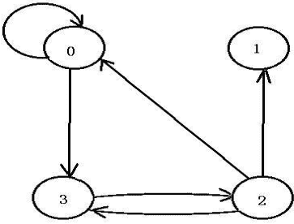

## Relations关系

$R^2=\{(0,0),(0,2),(0,3),(2,0),(2,2),(2,3),(3,0),(3,1),(3,3)\}$

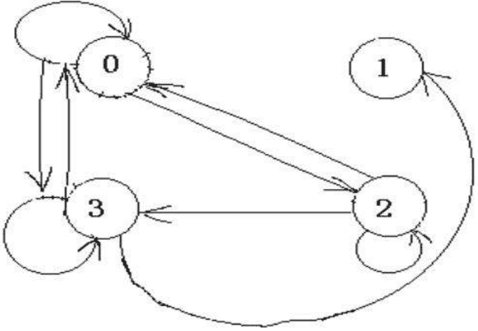

## Relations关系

R²的关系图中不存在（3，2）、（2，1），故 R ⊄ R²

# Rⁿ的关系图的构造：

可由 R 的关系图来构造，从 R 的每个结点 aᵢ 出发，数 n 条边。凡通过数 n 条边能到达的结点 aⱼ，则有（aᵢ，aⱼ）∈Rⁿ。关系图中从 aᵢ 出发到 aⱼ 的边是存在的。

这样处理容易出错，用相关矩阵的布尔型乘法来做，简单，又不容易错，还适宜于计算机处理。

## Relations关系

$$R=\begin{bmatrix}1&0&0&1\\0&0&0&0\\1&1&0&1\\0&0&1&0\end{bmatrix}$$

$$R^2=R\bullet R=$$

$$\begin{bmatrix}1&0&0&1\\0&0&0&0\\1&1&0&1\\0&0&1&0\end{bmatrix}\begin{bmatrix}1&0&0&1\\0&0&0&0\\1&1&0&1\\0&0&1&0\end{bmatrix}=\begin{bmatrix}1&0&1&1\\0&0&0&0\\1&0&1&1\\1&1&0&1\end{bmatrix}$$

## 二元关系的逆关系：运算

设R，S是A到B的二元关系，T是B到C的二元关系，P是C到D的二元关系。则：

+   (1) \( (R \cup S)^c = R^c \cup S^c \)

+   (2) \( (R \cap S)^c = R^c \cap S^c \)

+   (3) \( \overline{(R)^c} = \overline{(R^c)} \)

+   (4) \( (R - S)^c = R^c - S^c \)

+   (5) \( (A \times B)^c = B \times A \)

+   (6) \( \overline{R} = (A \times B) - R \)

+   (7) \( (S \cdot T)^c = T^c \cdot S^c \)

## Relations关系

(8) \( (R \cdot T) \cdot P = R \cdot (T \cdot P) \) ■

(9) \( (R \cup S) \cdot T = R \cdot T \cup S \cdot T \) ■

但： \( S \cdot T \neq T \cdot S \) □

且 \( (R \cap S) \cdot T \subseteq R \cdot T \cap S \cdot T \) □

(10) \( R \subseteq S \Leftrightarrow R^c \subseteq S^c \)

证明其中：

(1) 任意 \( (x, y) \in (R \cup S)^c \)

\( (y, x) \in (R \cup S) \)

\( (y, x) \in R \quad \text{或} \quad (y, x) \in S \)

\( (x, y) \in R^c \quad \text{或} \quad (x, y) \in S^c \)

\( (x, y) \in R^c \cup \quad S^c \)

## Relations关系

(10) 证：

$\forall\,(x,y)\in R^c\Rightarrow (y,x)\in R$

注：
$\Rightarrow (y,x)\in S\Rightarrow (x,y)\in S^c$

$R\cdot T\cap S\cdot T\subseteq (R\cap S)\cdot T$ 不一定成立，
由于 $(R\cap S)\cdot T\subseteq R\cdot T\cap S\cdot T$
若上式成立，
则 $(R\cap S)\cdot T=R\cdot T\cap S\cdot T$

证明：等式不成立

若 $\forall\,a\in A,\ b_1,b_2\in B,\ c\in C$，且
$(a,b_1)\in R，\ (a,b_2)\in S，$
$(a,b_1)\notin S，\ (a,b_2)\notin R，$
$(b_1,c)\in T，\ (b_2,c)\in T，$
显然 $(a,c)\in R\cdot T\cap S\cdot T$
但 $(a,c)\notin (R\cap S)\cdot T$


## 关系的闭包/Closure of Relations

[定义1]：称 \( R \cup I_A \) 是 \( R \) 的自反闭包/reflexive closure of \( R \)，记为 \( r(R) \)。

[定理1]：设 \( R \) 是 \( A \) 上的二元关系，则 \( r(R) \) 是包含 \( R \)，具有自反性的最小关系。

证明：对 \(\forall x \in A\)，\( (x, x) \in I_A \subseteq R \cup I_A \)，且 \( R \subseteq R \cup I_A \)。

若 \( R' \) 为包含 \( R \) 且具有自反性，则 \( I_A \subseteq R' \)，\( R \subseteq R' \)，\( I_A \cup R \subseteq R' \)。即 \( I_A \cup R \) 为最小。

[推论1]：\( R \) 是自反闭包当且仅当 \( R \) 是自反的。

证明：

(1) \( R \) 是自反闭包，\( R = I_A \cup R \Rightarrow I_A \subseteq R \);

(2) \( R \) 具有自反性，\( I_A \subseteq R \)，\( R \cup I_A = R \);

2022年11月3日 Deren Chen, Zhejiang Univ. 51

## Relations关系

[定义2]：称 \( R \cup R^c \) 是 \( R \) 的对称闭包/symmetric closure of \( R \)，记为 \( s(R) \)。

[定理2]：设 \( R \) 是 \( A \) 上的二元关系，则 \( R \cup R^c \) 是对称的，包含 \( R \) 的最小关系，（其中 \( R^c \) 是 \( R \) 的逆关系）。

证明：若 \( (a, b) \in R \cup R^c \)，则 \( (a, b) \in R \) 或 \( (a, b) \in R^c \)，
\( \Rightarrow (b, a) \in R^c \) 或 \( (b, a) \in R \)，
故 \( (b, a) \in R \cup R^c \)（对称性），
若 \( R' \) 为包含 \( R \)，对称的二元关系，
则对 \( \forall (a, b) \in R \cup R^c \)，
若 \( (a, b) \in R \Rightarrow (a, b) \in R' \)；
若 \( (a, b) \in R^c \Rightarrow (b, a) \in R \)，
\( \Rightarrow (b, a) \in R' \)，
又 \( R' \) 具有对称性，\( (a, b) \in R' \)，
故 \( R \cup R^c \subseteq R' \)。

## Relations关系

[推论2]：当且仅当 \( R \) 是对称闭包时， \( R \) 具有对称性。

证明：(1) \( R \) 具有对称性，
若 \( (a, b) \in R \)，则 \( (b, a) \in R \)，
又 \( (b, a) \in R^c \)
即 \(\forall (b, a) \in R^c, (a, b) \in R\)
\(\Rightarrow (b, a) \in R\)
\(\Rightarrow R^c \subseteq R \Rightarrow R \cup R^c = R\);
(2) \( R \) 是对称闭包时， \( R = R \cup R^c \Rightarrow R \) 具有对称性。

[定义3]：传递扩张

设 \( R = \{ (a, b) \mid a \, r \, b, \, a, \, b \in A \} \)，则
称 \( R_1 = \{ (a, b) \mid (a, b) \in R, \, 或 \exists c \in A, \, 使 \, (a, c), \, (c, b) \in R \} \) 为 \( R \) 的传递扩张。

## 注：

(1) \( R \subseteq R_1 \)

(2) \( R_1 \) 不一定是传递的，如：

\( R = \{ (a, b), (b, c), (c, d) \} \)

\( R_1 = \{ (a, b), (b, c), (c, d), (a, c), (b, d) \} \)

由 \( (a, c), (c, d), (a, b), (b, d) \) 又产生了新的传递条件，而 \( (a, d) \notin R_1 \)，
\( R_1 \) 不是传递的。

## Relations关系

(3) 当且仅当 \( R \) 是传递的， \( R = R_1 \)。

证明：“\(\Rightarrow\)”： \( R \) 是传递的， \( (R \subseteq R_1) \)

对 \(\forall (a, b) \in R_1\)，有
\( (a, b) \in R \) 或 \(\exists c \in A\)，
使 \( (a, c), (c, b) \in R \)，

由 \( R \) 的传递性， \( (a, b) \in R \)，

故 \( R_1 \subseteq R \)，得 \( R = R_1 \)。

“\(\Leftarrow\)”： \( R = R_1 \)

若 \( (a, c) \in R \)， \( (c, b) \in R \)，
则 \( (a, b) \in R_1 = R \)， \( R \) 是传递的。

注：(1) 若 \( R_1 \) 不是传递的，可扩张到 \( R_2 \)，
\( R_3, \ldots R_k \)；

(2) 若 \( R_k \) 是传递的，则 \( R_{k+1} = R_k \)。

## Relations关系

## [定义3]：

设 \( R_0 = R \)，\( R_{k+1} \) 是 \( R_k \) 的传递扩张（\( k = 0, 1, 2, \dots \)），则称 \( R^* = R_0 \cup R_1 \cup R_2 \cup \dots \cup R_k \cup \dots \) 为 \( R \) 的传递闭包/transitive closure of \( R \)，也记作 \( t(R) \)。

## [定理3] 传递闭包 \( R^* = R \cup R^2 \cup \dots \cup R^k \cup \dots \)

证明：

\( R^2 = R \cdot R = \{ (a, b) \mid (a, c), (c, b) \in R \} \)

\( R_1 = \{ (a, b) \mid (a, b) \in R \text{ 或 } (a, c), (c, b) \in R \} \)
\( = R \cup R^2 \)

\( R_2 = \{ (a, b) \mid (a, b) \in R_1, \text{ 或 } (a, c), (c, b) \in R_1 \} \)

## Relations关系

(1) 若 \( (a, c), (c, b) \in R \)，则 \( (a, b) \in R \cdot R \)，

(2) 若其一，如 \( (a, c) \in R \) 另一，如 \( (c, b) \in R \cdot R \) 则 \( (a, b) \in R \cdot R \cdot R \in R^3 \)，

(3) 若 \( (a, c), (c, b) \in R \cdot R \) 则 \( (a, b) \in R \cdot R \cdot R \cdot R \in R^4 = R^{22} \)，即 \( R_2 = R \cup R^2 \cup R^3 \cup R^4 \)

假设 \( R_k = \{ (a, b) \mid (a, b) \in R, \text{或} \dots \text{或} (a, b) \in R^{2k} \} \) 则 \( R_{k+1} = \{ (a, b) \mid (a, b) \in R_k, \text{或} (a, c), (c \ b) \in R_k \} \)

当 \( (a, c) \in R^i, (c, b) \in R^j, (i, j = 1, 2, \dots, 2k) (i + j = 2, 3, \dots, 2^{k+1}) \)

有 \( R_{k+1} = \{ (a, b) \mid (a, b) \in R, \text{或} \dots \text{或} (a, b) \in R^{2k+1} \} = R \cup R^1 \cup R^2 \cup R^3 \cup \dots \cup R^{2k+1} \)

2022年1月3日 Deren Chen, Zhejiang Univ. 57

## Relations关系

故，\( R \) 的闭包 \( R^* = R \cup R_1 \cup R_2 \cup \cdots \cup R_k \cup \cdots \)

\( = \bigcup_{k=0}^{\infty} R_k \)

\( = R \cup R^2 \cup R^3 \cup \cdots \cup R^{2^k} \cup \cdots \)

\( = \bigcup_{k=1}^{\infty} R^{k} \)


# 【定理4】：传递闭包 $R^*$ 一定是传递的。

证明：设 $(a,b)$、$(b,c)\in R^*$，则存在 $i,j$，使 $(a,b)\in R^i$，$(c,b)\in R^j$，故 $(a,b)\in R^{(i+j)}\subseteq R^*$。

# 传递扩张的实际意义：

例：
$R=\{(a,b)\mid a与b是父子关系\}$
$R\cdot R=\{(a,b)\mid a与b是祖孙关系\}$
$R_1=\{(a,b)\mid a与b是三代以内男性直系亲属\}$
…

## Relations关系

【定理5】：设 $|A|=n$，$R$ 是 $A$ 上二元关系，则存在正整数 $k$，$k\le n$，使 $R^*=R\cup R^2\cup\cdots\cup R^k$。

## 证明：

对∀（x，y）∈R*，∃k，使（x，y）∈R^k，表明在A中存在不同元素a₁，a₂，…，aₖ₋₁，使（x，a₁），（a₁，a₂），（a₂，a₃），…，（aₖ₋₁，y）∈R。

若k>n，由鸽洞原理，则a₁，a₂，…，aₖ₋₁，y中至少有两个相同，不妨设aᵢ=y，（i≤k−1）。

于是 $(x, a_1), \ldots (a_i, a_{i-1}) \in R,$

$(a_{i-1}, y) \in R,$

故 $(x, y) \in R^i,$

即 若 $k>n$，必存在比 $k$ 的正整数 $i$，使 $(x, y) \in R^i$。

**注：**

定理说明，可用 $R \cup R^2 \cup \ldots \cup R^n$ 来求 $R^*$。

**例 6：**

设 $A=\{1,\ 2,\ 3\}$，

$R=\{(1,1),\ (1,2),\ (2,3)\}$

求 $R^*$。

## Relations关系

解：
\( R = \begin{bmatrix} 1 & 1 & 0 \\ 0 & 0 & 1 \\ 0 & 0 & 0 \end{bmatrix}, \quad R^2 = \begin{bmatrix} 1 & 1 & 1 \\ 0 & 0 & 0 \\ 0 & 0 & 0 \end{bmatrix} = R^3 \)

故
\( R^* = R \cup R^2 \cup R^3 = \begin{bmatrix} 1 & 1 & 1 \\ 0 & 0 & 1 \\ 0 & 0 & 0 \end{bmatrix} \)

\( R^* = \{ (1, 1), (1, 2), (1, 3), (2, 3) \} \)

## Relations关系

注：当 | A | = n较大时，用定理5计算 R* 工作量非常大。

Warshall算法：(1962) 设R是n个元素集合上的二元关系 (1)是R的相关矩阵； (2) i ← 1； (3) for j = 1 to n do if a<sub>j,i</sub> = 1 then do for k = 1 to n do a<sub>j,k</sub> ← a<sub>j,k</sub> ∨ a<sub>i,k</sub> (4) i = i + 1； (5) if i ≤ n, then go (3) else stop

注：（1）结果 \((a_{ij})_{n\times n}\) 是 \(R^*\) 的相关矩阵。
（2）算法的复杂度为 \(n^3\)。

例7：\(A=\{a,b,c,d\}\)
\(R=\{(a,b),(b,c),(c,d)\}\)

计算 \(R^*\)。

## Relations关系

\( R = \begin{bmatrix} 0 & 1 & 0 & 0 \\ 0 & 0 & 1 & 0 \\ 0 & 0 & 0 & 1 \\ 0 & 0 & 0 & 0 \end{bmatrix} \)

(1) i=1  由于 \( a_{j1}=0 (j=1,2,3,4) \) 不改动

(2) i=2  \( j=1, \ a_{ji}=1 \Rightarrow a_{13}=1 \)

(3) i=3  \(\begin{bmatrix} 0 & 1 & 1 & 0 \\ 0 & 0 & 1 & 0 \\ 0 & 0 & 0 & 1 \\ 0 & 0 & 0 & 0 \end{bmatrix}\)

## Relations关系

j=1， a13=1 ⇒ a14=1

j=2， a23=1 ⇒ a24=1

即

$R^* = \{(a,b),(a,c),(a,d),(b,c),(b,d),(c,d)\}$

## 小结

+   (1) 二元关系的集合运算

+   (2) 二元关系的函数运算

+   (3) 二元关系的闭包运算

## 进一步的思考

+   1、从原有二元关系形成新的二元关系
+   2、现有的二元关系的进一步归纳

## 练习

pp. 382　　3、25

pp. 407　　29

# 5.3 等价关系 Equivalence Relations

## [定义1] 等价关系：
A 上的二元关系 R，如果 R 是

(1) 自反的  
(2) 对称的  
(3) 传递的  

称 R 为等价关系/Equivalence Relations。

## Relations关系

example1: 52张扑克牌中的同花关系

example2: 52张扑克牌中的同点关系

# example 4: Congruence Modulo m

R={ (a, b) | a ≡ b (mod m) }

## Relations关系

例（M=3）：
\[
R=\{(a,b)\mid a\equiv b\pmod{3},\ a,b\in I\}
\]
是整数集合 I 上模 3 同余的二元关系。
证明 R 是等价关系。

证明：由于 $3\mid(a-b)$ 等价于 $a\equiv b\pmod{3}$

+   1. $3\mid(a-a)$，自反性

+   2. 若 $3\mid(a-b)$，则 $3\mid(b-a)$，对称性

+   3. 若 $3\mid(a-b)$，$3\mid(b-c)$，则
+      $a-c=(a-b)+(b-c)$
+      $\Rightarrow 3\mid(a-c)$
+      满足传递性，故 $R$ 是等价关系

# example 4: Congruence Modulo m

R={ (a, b) | a ≡ b (mod m) }

m=3时， 3个等价类： [0]， [1]， [2]

其中  [ 0 ] = { ..., −6 , −3 , 0 , 3 , 6 , ...}  [ 1 ] = { ..., −5 , −2 , 1 , 4 , 7 , ...}  [ 2 ] = { ..., −4 , −1 , 2 , 5 , 8 , ...}

## Relations关系

【定理1】 R是集合A上的一个等价关系，则下列命题是等价的：

+   1、(a, b) ∈ R
+   2、[a] = [b]
+   3、[a] ∩ [b] ≠ ∅

## Relations关系

## 注：

等价关系 R 把 A 的元素分为若干类，各类之间没有公共元素。确定的 R 是对集合 A 进行的一个划分。

## [定义3]集合的划分：把集合 A 分为若干子集 A₁，A₂，...，满足：

+   (1) 当 i ≠ j 时 Aᵢ ∩ Aⱼ = Φ

+   (2) ∀ a ∈ A， ∃ i，使 a ∈ Aᵢ （i = 1，2，...）

则集合 Pᵣ（A）= { A₁，A₂，...，Aₙ，... } 称为 A 的一个划分/分划/partition。

# 定理2：

A 在等价关系 R 下的等价类是 A 的一个划分。对于 A 的任何一个划分，也必有 A 上的一个等价关系 R 与之对应。

## Relations关系

## 证明：

R是等价关系， ∀ a ∈ A， 由 R 的自反性，
( a， a ) ∈ R，即 a 与 a 属于同一等价类，也
即 ∃ i， a ∈ A<sub>i</sub>

若 i ≠ j， A<sub>i</sub>≠A<sub>j</sub>，而 A<sub>i</sub>∩A<sub>j</sub>≠Φ，则 ∃ c ∈ A
<sub>i</sub>∩A<sub>j</sub>， c ∈ A<sub>i</sub>，且 c ∈ A<sub>j</sub>，

对 ∀ a ∈ A<sub>i</sub>， a ~ c

对 ∀ b ∈ A<sub>j</sub>， b ~ c，即 c ~ b (对称性)

由 R 传递性， a ~ b

由 a， b 的任意性，故 A<sub>i</sub> = A<sub>j</sub>


## Relations关系

与 $A_i$ 和 $A_j$ 为不同的等价类矛盾。

故 $A_i \cap A_j = \Phi$

所以，$R$ 完成了等价类的划分。

若 $A$ 已进行了划分，则构造二元关系 $R$。

- 对于 $\forall a \in A$，使 $(a,a) \in R$。
- 分别对每一等价类内所有两个不同元素 $a,b$，$(a,b) \in R$，使 $(b,a) \in R$。

显然，$R$ 是自反的、对称的，而且也是传递的，因为若 $(a,b) \in R$，$(b,c) \in R$，则 $a,b,c$ 均在同一等价类内，故 $(a,c) \in R$。

## EXAMPLE:

A = { 0, 1, 2, 3, 4, 5 }

R = { (0, 0), (1, 1), (2, 2), (3, 3), (1, 2), (1, 3), (2, 1), (2, 3), (3, 1), (3, 2), (4, 4), (4, 5), (5, 4), (5, 5) }

## R是等价关系，用关系图表示。

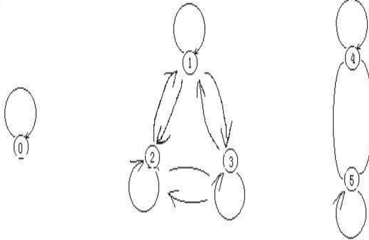

二元关系R是自反的，对称的，传递的，且把A分成三个等价类，（A）= {{0}，{1，2，3}，{4，5}}

## Relations关系

例 4：

ℕ 的一个分划为：若 $10^{i-1}\leq a<10^i$，则 $a\in A^i$，对应的等价关系

$R=\{(a,b)\mid a\text{ 与 }b\text{ 有相同位数，}a,b\in\mathbb{N}\}$ 相同位的数归为一类，此 $R$ 把 $\mathbb{N}$ 分划为可列个等价类。

## 小结

- (1) 等价关系的概念
- (2) 等价关系与划分

## 进一步的思考

- 1、等价关系的本质----集合中元素的相关性
- 2、作为二元关系的运算问题

## Relations关系

## 练习

pp.413  2、10、22

## 5.4 半序关系

## Partial Ordering

[定义]: 半序关系  
R是A上的二元关系，如果R满足：  
(1) 自反的  
(2) 反对称的  
(3) 传递的  
则称R是A上半序关系/偏序关系/部分序关系  
Partial Ordering Relation

[定义]: 集合A连同A上的半序关系R一起称为一个  
半序集/Partially Ordered Set （POSET），  
记为（A，R）

例1：A={1, 2, 3, 4, 5, 6, 7, 8, 9}，  
A上的二元关系  
R₁= { ( a , b ) | a ≤ b , a , b ∈I}  
R₂= { ( a , b ) | a | b , a , b ∈I}  
R₁、R₂都是A上的二元关系，  
(A， R₁) 、 (A， R₂) 都是半序集。

例2：整数集I上的二元关系  
R₁= { ( a , b ) | a ≤ b , a , b ∈I}  
R₂= { ( a , b ) | a | b , a , b ∈I}  
(I， R₁) 、 (I， R₂) 也都是半序集。

例3：A = { a , b , c }  
R₃ = { ( s₁ , s₂ ) | s₁ ⊆ s₂ , s₁ , s₂ ∈ p ( A ) }  
R₃ 是 P(A) 上的二元关系， ( P(A) , R₃ ) 是半序集。

例4：B 是任意一个集合  
R₃ = { ( s₁ , s₂ ) | s₁ ⊆ s₂ , s₁ , s₂ ∈ p ( B ) }  
R₄ 是 B 上的二元关系， ( B , R₄ ) 是半序集。

记号：  
R = { ( a , b ) | a ≤_R b , a , b ∈ A } 其中 ≤_R 可为 ≤ , | , ⊆ 等

## 几点说明：

（1）同一集合上的两个不同的半序关系，构成两个不同的半序集。  
如：\( R_1 \) 和 \( R_2 \) 都定义在 \( A = \{ 1, 2, 3, 4, 5, 6, 7, 8, 9 \} \) 上，但 \( (A, R_1) \) 与 \( (A, R_2) \) 显然不是一样的半序集。

（2）不同集合上分别相同定义的半序关系，其半序关系不同，同样构成两个不同的半序集。  
如：\( (A, R_3) \) 与 \( (B, R_3) \) 是两个不同的半序集。

## Relations关系

注：  
（1）用矩阵表示半序关系，不能明显看到二元关系的特征。  
（2）用简化的关系图表示较适合。

简化的关系图：  
(1) 自反性：每个顶点都有自回路，省去。  
(2) 反对称性：两个顶点间只可能有一个箭头从左→右，或从下→上的方向，从小到大安置顶点，可省略箭头。  
(3) 传递性：由于有（a，b）、（b，c）∈R，则（a，c）∈R，故只画（a，b）、（b，c）对应的边，省略边（a，c）。

## 【定义】：哈森图/Hasse图

设≤是 A 上的一个半序关系，如果 a≤b，则将 a 画在 b 下面，且不记 c，使 a≤c，c≤b，则 a，b 间用直线连接。并将简化的关系图的绘制，称这样得到关系图为 Hasse图。

前例中半序集的 Hasse图：

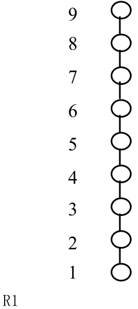

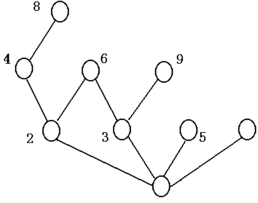

R2

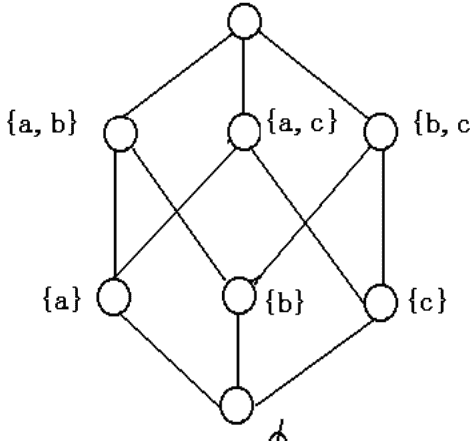

## 【定义】可比较与不可比较：

（A，R）是半序集，a，b ∈ A，  
若存在 a ≤ b，或 b ≤ a，则称 a 与 b 是可比较的/comparable。  
若既不存在 a ≤ b，也不存在 b ≤ a，则称 a 与 b 是不可比较的/incomparable。

## [定义] 全序：

A 上半序关系 R，如果∀ a， b ∈ A，都有 a ≤ b，或 b ≤ a，则称 R 为 A 上的全序关系/total order 或linear order。

说明：  
（1）全序的含义：A 中每两个元素均能比大小，即任何两个元素都相关。  
（2）半序则是部分有序。  
（3）R₁是全序，R₂，R₃都是半序  
如：R₂中，{ 1， 2， 6 }， { 1， 2， 4， 8 }， { 1， 3， 9 } 都排成了序，但 2 与 3， 5 与 7， 7 与 9 ...，在整除的意义上来说无法排出大小来。

## Relations关系

【定义】全序集：  
半序集 \( (A, \leq_R) \) 中的半序关系 \(\leq_R\) 是 \( A \) 上的全序关系，则称 \( (A, \leq_R) \) 为**全序集/total order set**或**linear order set**。  
如上例： \( (A, R_1) \) 是全序集。

例5： \( (-\infty, +\infty) \) 实数全体，在 \(\leq\) 下是全序集；  
例6：平面上点集，也可以规定一种 \(\leq_R\)，模长大的大，模长相等的情况下，以幅角的大小来比大小，因此，平面上点集也是全序集。

例7： **lexicographic ordering on** \( A_1 \times A_2 \)

## 【定义】链：

设（A，≤₍R₎）是半序集，B⊆A，若（B，≤₍R₎）是全序集，则称B为（A，≤₍R₎）中的链/Chain。  
当B是有限集时，B的基数|B|称为链长/length of chain。

## [定义]反链：

设 \( (A, \leq_R) \) 为半序集，\( B \subseteq A \)，对 \(\forall a, b \in B (a \neq b)\)，\( a \) 与 \( b \) 不可比较，则称 \( B \) 为 \( (A, \leq_R) \) 中的反链/antichain。  
当 \( B \) 为有限集时，\( |B| \) 为反链的长度。

例：\( (A, R_2) \) 中  
\( B_1 = \{2, 3, 5, 7\} \quad |B_1| = 4 \)  
\( B_2 = \{4, 6, 9\} \quad |B_2| = 3 \)  
\( B_3 = \{8, 6, 9, 5, 7\} \quad |B_3| = 5 \)  
都是反链。


## Relations关系

### [定义]极大元与极小元/maximal element and minimal element:

设 \((P, \leq)\) 是半序集，\(A \subseteq P\)，若 \(a \in A\)，且在 \(A\) 中没有一个元素 \(b\) (\(b \neq a\))，使 \(a \leq b\) (\(b \leq a\))，则称 \(a\) 为 \(A\) 中的极大元（极小元）。

例： \((N, |)\) 是半序集，

\(A = \{2, 3, 4, 5, 6, 7, 8, 9\}\)

则 \(A\) 中极大元： \(8, 6, 9, 5, 7\)

极小元： \(2, 3, 5, 7\)

说明：极大元，极小元并不要求唯一，且同一元素，可以既是极大元，又是极小元，如 \(5, 7\)。

### [定义]最大元与最小元/greatest element and least element:

设 \( (P, \leq) \) 是半序集，\( A \subseteq P \)，若 \( a \in A \)，\( \forall b \in A \)，\( b \leq a \) (\( a \leq b \))，则称 \( a \) 为 \( A \) 的最大元（最小元）。

上例：其Hasse图如下图所示

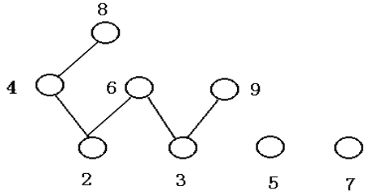

例：\quad B=\{a,b,c\},

$R_3=\{(s_1,s_2)\mid s_1\subseteq s_2,\ s_1,s_2\in p(B)\}$，$(p(B),\subseteq)$ 是半序集。

设 $A=\{\Phi,\{a\},\{b\},\{c\},\{a,b\},\{a,c\},\{b,c\}\}$

其Hasse图如下图所示

### 【定义】上界与下界/upper bound and lower bound:

设（P，≤）是半序集，A⊆P，

若 a∈P，对∀ b∈A，b≤a（a≤b）称 a 为 A 的上界（下界）。

**说明：**

+ 1. 上例中，A无最大元，但存在A的上界 {a，b，c}。

+ 2. Φ为A的最小元，也是A的下界

+ 3. 最大（小）元是A的一个上（下）界

+ 4. 上（下）界可以不唯一，也可以不存在

例：
（ p （ B ）， ⊆）中取 A’ = { Φ，
{ b }， { c } }，则
{ b， c } 与 { a， b， c } 是 A’ 的上
界， { b， c } 是 A’ 的上确界。

说明：
存在上（下）界，并不一定存在上（下）确界。

### ## [定理]:

设 \( (P, \leq) \) 是半序集，A 是 P 的非空有限子集，则 A 一定存在极大（小）元。

### ## 证：

若 \( |A| = 1 \)，则 A 中唯一元素既是极大元，也是极小元。

假定 \( |A| = n \) 时存在极大（小）元

当 \( |A| = n + 1 \) 时，则将 A 分成由 n 个元素组成的子集 A’ 与元素 a 。

由假定， A’ 存在极大元 \( a_M \)，极小元 \( a_m \)，

若 $a_M\leq a$，则 $a$ 为极大元，否则为 $a_M$，因为若 $a_M\leq a$，且存在 $b\leq A'$，而 $a\leq b$，由传递性 $a_M\leq b$，与 $a_M$ 为极大元（$A'$）矛盾。

同理，若 $a\leq a_m$，则 $a$ 为极小元，否则为 $a_m$。

### [定理]：

设 $M$ 是非空有限子集 $A$ 的极大元集合，则 $M$ 是 $A$ 的反链。

### [定义]格/lattice:

设（A， R）是半序集，如果∀ a ， b ∈ A， {a,b}的上确界和下确界都存在，则称（A， R）是一个格。

例20 如图8（PP424）

例22 （{1， 2， 3， 4， 5}， |）， （{1， 2， 4， 8， 16}， |）

例23 （ p （A）， ⊆）

[定理] 每一个非空有限半序集（A， R）都存在极小元素。

[定义]拓扑排序/topological sorting：设（A， R）是半序集，对A中的元素按如下规则排序：a排在b的前面（左边）当且仅当 a ≤ b 或a与b不可比较。

[定义] **良序集/well ordered set**：\n设（A，R）是半序集，若 A 的非空子集都存在最小元，则称 R 是**良序关系/well order relation**，（A，R）为良序集。

+ 说明：
1. 良序集是全序集
2. 全序集未必是良序的，

例：实数全体，任两个实数都是可比较的，但子集 `{1/n}` 的最小元找不到。

有限的全序集是良序集。

## 小结

+ 1. 半序关系与半序集
+ 2. 全序关系与全序集
+ 3. 半序集中的极小/大元素、最小/大元素、上/下界、上/下确界
+ 4. 良序关系与良序集、拓扑排序

## 进一步的思考

# 从半序集到格

# 从格到布尔代数

## 练习

pp.428　10，24、36

## Chapter 7 Graphs

# 图 论

图/Graph：

可直观地表示离散对象之间的相互关系，研究它们的共性和特性，以便解决具体问题。

# ## 7.1 图的概念/Introduction of Graph

# ## 7.2 图的术语/Graph Terminology

# ## 7.3 图的表示与同构/Representing Graph and Graph Isomorphism

# ## 7.4 连通性/Connectivity

# ## 7.5 欧拉道路与哈密尔顿道路/Euler and Hamilton Paths

# ## 7.6 最短道路问题/Shortest Path Problem

# ## 7.7 平面图/Planar Graphs

# ## 7.8 图的着色/Graph Coloring

# # 7.1 图的概念/Introduction of Graph

[定义]图
V是一个非空有限集，E是V上的一个二元关系，有序对（V，E）称为有向图/Directed Graph。
若将E中的有序对看成是无序的（即将e=(a,b)看成e={a,b}），则称（V，E）为无向图/Undirected Graph。有向图和无向图统称为图/Graph，记为G。
G = （V，E）

# # [定义]顶点：

V 中的元素称为顶点，用带标记的点表示，也称为**结点/Vertices**。

# # [定义]边：

在有向图G中，若e=（a，b）∈ E，e称为G的**有向边/directed edge**。用由 a 到 b 带箭头的线把a 和 b 连起来；
在无向图G中，若e=（a，b）∈ E，e称为G的**无向边/undirected edge** 。a、b 间用连线连结，有向边和无向边统称为G的**边/edge**。

## [定义]图的分类

对图G=（V， E）。若对于任意的（a， b）∈ E， a ≠ b，则称图G为简单图/Simple Graph。

对图G=（V， E）。若允许E是一个重集，则称图G为重图/Multigraph。其相同的元素称为重边。

对图G=（V， E）。若G既允许是重图又允许是非简单图，则称图G为拟图/Pseudograph。

一般的G称为线性图/Linear Graph。

# # [定义]孤立顶点：

若 \(a \in V\)， \(a\) 不与其他顶点相邻，称 \(a\) 为**孤立顶点/isolated**。

# # [定义]自回路：

若 \((a, a) \in E\)， \((\{a, a\} \in E)\)，称边 \((a, a)\) (\(\{a, a\}\)) 是**自回路/loop**。

[定理1（Handshaking）] 设无向图 G=(V, E) 有 e 条边，则 G 中所有顶点的次数之和等于 e 的两倍。

证明思路：利用数学归纳法。

[定理2] 无向图中次为奇数的顶点个数恰有偶数个。

证明思路：将图中顶点的次分类，再利用定理1。


## Graphs/图论

### [定理3] 设有向图 $G=(V,E)$ 有 $e$ 条边，则 $G$ 中所有顶点的入次之和等于所有顶点的出次之和，也等于 $e$。

证明思路：利用数学归纳法。

## 有向图与无向图的对应：

无向图对应有向图：加上箭头。
有向图对应无向图：去掉箭头。
称为 **underlying undirected graph**。

## 一些特殊的简单无向图：

- (1) Complete Graphs/完全图 $K_n$
- (2) Cycles/环图 $C_n$
- (3) Wheels/轮图 $W_n$
- (4) n-Cubes/n-立方图 $Q_n$
- (5) Bipartite Graphs/二分图 $K_{n,m}$

### [定理4] 设无向完全图 $G$ 有 $n$ 个顶点，则 $G$ 有 $n(n-1)/2$ 条边。

### 计算机处理和网络应用特殊图表示：

- （1）串行处理/Serial
  - linear array network
- （2）并行处理/Parallel
  - $K_n$、Star、$C_n$、$W_n$
  - 2-dimensional array network
  - hypercube network

### [定义] 子图

$G=(V,E)$ 是图，若 $G'=(V',E')$ 也是图且满足：

1. $V' \subseteq V$；
2. $E' \subseteq E$；

则称 $G'$ 为 $G$ 的子图/subgraph。

**注：**

当 $V'=V$ 时，称 $G'$ 为 $G$ 的生成子图。当 $E'\neq E$ 时，或 $V'\neq V$ 时称 $G'$ 为 $G$ 的真子图。

### [定义] 补图/complementary graph

$G=(V,E)$ 是图，$G'=(V',E')$ 是 $G$ 的子图，$E''=E-E'$，$V''=V-V'$ 或是 $E''$ 中边所关联的所有顶点集合，则 $G''=(V'',E'')$ 称为 $G'$ 关于 $G$ 的相对补图。

### 定义补图：

关于完全图的子图的补图称为此子图的绝对补图，若子图记为 $G$，则补图记为 $\overline{G}$。

○ a

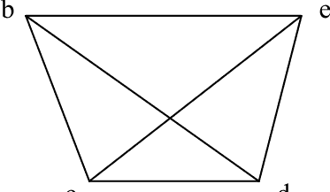

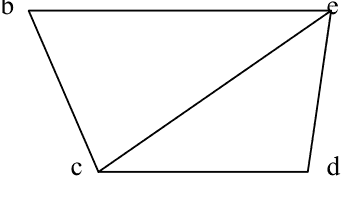

图 C

图 D

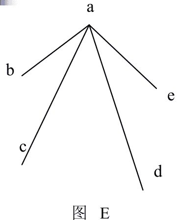

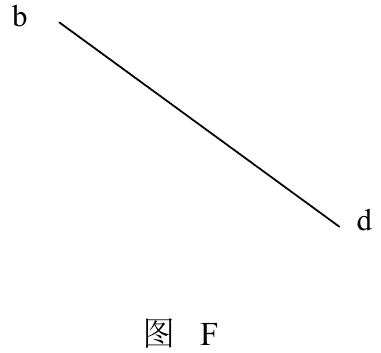

- 图A是一个无向完全图
- 图B、C、D、E、F均是A的子图
- 图C的顶点 $a$ 是孤立顶点
- 图B的边 $[a,b]$ 是孤立边
- 图D是图C的子图
- 图F是图D关于图C的余图
- 图E是图C的补图
- （A是完全图，C是A的子图）

**说明：**

图 C 不是 E 的补图（不互为补图）。

因为：

$$E'' = E - E' = \{[b,c], [b,d], [b,e], [c,d], [c,e], [d,e]\}$$

$$V'' = \{b,c,d,e\}$$

而图 C 多了顶点 $a$。

### [定义] 并图

$G=(V,E)$ 和 $G'=(V',E')$ 是两个简单无向图，它们的并图 $G\cup G'$ 定义为

$$G\cup G' = (V'\cup V, E'\cup E)$$

称 $G\cup G'$ 为 $G$ 和 $G'$ 的并图/union of $G$ and $G'$。

## 7.3 图的表示与同构 / Representing Graph and Graph Isomorphism

图 $G$ 表示的三种方法：

1. 集合表示
2. 邻接表（adjacency list）表示
3. 矩阵（matrix）表示
   - 邻接矩阵（adjacency matrix）表示
   - 关联矩阵（incidence matrix）表示

### [定义] 邻接矩阵

设有向图 $G=(V,E)$，$V=\{V_1,V_2,\cdots,V_n\}$，若用方阵 $A=(a_{ij})_{n\times n}$ 来表示，其中

$$a_{ij} = \begin{cases}
1 & (V_i,V_j)\in E \\
0 & (V_i,V_j)\notin E
\end{cases}$$

则称 $A$ 为 $G$ 的邻接矩阵。

### 【定义】图的同构

图 $G_1=(V_1,E_1)$，$G_2=(V_2,E_2)$，如果能建立 $V_1$ 与 $V_2$ 间的一一对应，在此对应下，$E_1$ 与 $E_2$ 中的边也一一对应，对有向图还保持关联方向的对应，则称图 $G_1$ 与 $G_2$ 同构，记作 $G_1\cong G_2$。

从图中不容易直接得出。

可用邻接矩阵，通过某种算法确定两个图是否同构。

上例的邻接矩阵：

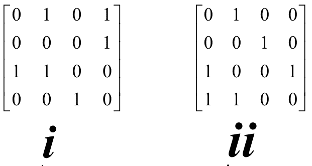

## 同构判定算法（用邻接矩阵）

1. 根据图确定其邻接矩阵（I）
2. 计算行次：矩阵每行 1 的个数（对应于出次），和列次（对应于入次）
3. 不考虑出现次序的不同，若行次与列次不同，则必不同构，否则继续
4. 同时交换其一矩阵的 $i$ 行和 $j$ 行、$i$ 列和 $j$ 列。

若此矩阵能变成与另一矩阵一样，则同构。对所有顶点的排列都试过，仍不相同，则不同构。

例：(1) 的行次（2，1，2，1），列次（1，2，1，2）；
(2) 的行次（1，1，2，2），列次（2，2，1，1）。

例：把（II）的第1行与第4行交换，第1列与第4列交换，得：

$$\begin{bmatrix}0&1&0&1\\0&0&1&0\\1&0&0&1\\0&1&0&0\end{bmatrix}$$

再把第2行与第4行交换，第2列与第4列交换，就得：

$$\begin{bmatrix}0&1&0&1\\0&0&0&1\\1&0&0&1\\0&1&0&0\end{bmatrix}$$

## 小结

1. 图的概念与术语
2. 一些特殊的图：极端情况、有用情况
3. 图的表示：集合、表、矩阵
4. 图的关系：图的转换、图的包含、图的运算、图的同构

## 进一步的思考

1. **图中内容的进一步组合**
2. **图的计算机表示与运算处理**

**说明：**

（1）若从（I）→（II），如何处理？

（2）算法的复杂度：$n!$，NP完全问题。（对稍多一些顶点的图，难以计算机实现。）

## 练习

- pp.443　11
- pp.454　17、20、27、33
- pp.463　43、51

## 7.4 连通性/Connectivity

### [定义] 道路/path

当 $G$ 中相邻边的序列 $(V_0,V_1),(V_1,V_2),\ldots,(V_{k-1},V_k)$ 称为一条道路（通路）。此道路的长度为 $k$。也可以用 $(V_0,V_1,\ldots,V_k)$ 表示道路，$V_0$ 为起点，$V_k$ 为终点。

当 $V_0=V_k$ 时，该道路称为回路/circuit。

### [定义] 简单道路/Simple Path

一条道路中没有两条边是相同的，称此道路为简单道路。当其是回路时，称为简单回路/Simple Circuit。

### [定义] 基本道路/Element Path

一条道路中，除了起点和终点可以相同，没有其他相同顶点出现，称此道路为基本道路。当其是回路时，称为基本回路/Element Circuit。

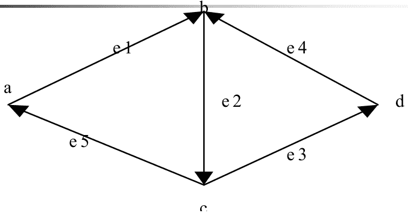

$(e_5,e_1,e_2,e_3,e_4)$ 是简单道路，不是基本道路，因为 $(c,a,b,c,d,b)$ 中 $b,c$ 均出现了两次。但 $(c,d,b,c)$ 是基本道路。


## [定义]连通性/connectivity

设 \( G = (V, E) \)，\( (V_0, V_1, \ldots, V_k) \) 是 \( G \) 中的一条道路，则称 \( V_0 \) 到 \( V_k \) 连通/connective 或可达。

说明：对无向图而言，若 \( V_0 \) 到 \( V_k \) 可达，则 \( V_k \) 到 \( V_0 \) 也可达。对有向图而言则未必。

### [定义] 无向图的连通性

若 \( G = (V, E) \) 中任两个不同顶点都连通，则称此无向图是连通的/connected。

### [定理1]

任意一个连通无向图的任两个不同顶点都存在一条简单道路。

## [定义]无向图的连通性

若 \( G = (V, E) \) 中任两个顶点都连通，则称此无向图是连通的/connected。

## [定义]连通分图/connected components

图 \( G \) 可分为几个不相连通的子图，每一子图本身都是连通的。称这几个子图为 \( G \) 的连通分图。

## [定义]有向图的连通性

1. **弱连通：**  
   若 \( G=(V,E) \) 对应的无向图是连通图，则称 \( G \) 为弱连通/weakly connected。

2. **强连通：**  
   若 \( G=(V,E) \) 中任两点间都有路，即对 \( a \) 与 \( b \)，\( a \) 到 \( b \) 可达，\( b \) 到 \( a \) 可达，称 \( G \) 为强连通/strongly connected。

### 连通无向图

### 弱连通

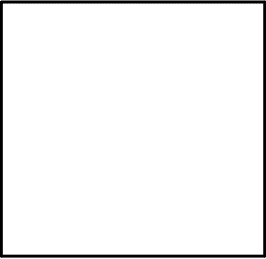

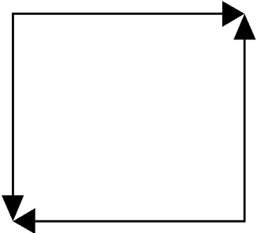

### 强连通

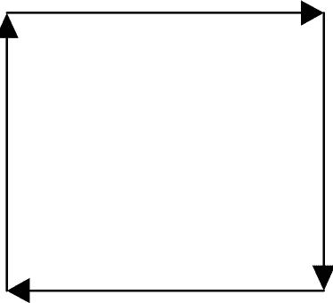

## Graphs/图论

例：用图描述一台自动售货机，只用 5 分、10 分两种硬币，满 15 分后压按钮，选择一块巧克力，钱多了不找还。

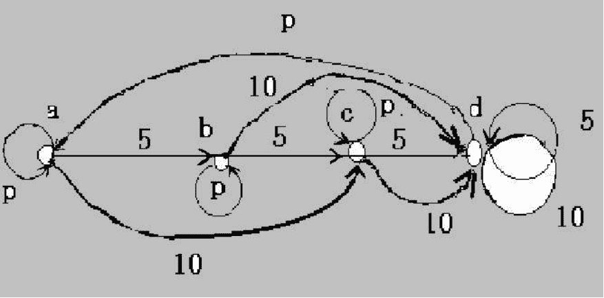

## Graphs/图论

顶点：a：0    分边：5：投5分  
b：5分    10：投10分  
c：10分    p：压按扭动作  
d：≥15分  
表示已投入钱的状态    表示一种动作

自动售货机：有向加权图描绘得很清楚

- (1) 钱数不够，压按扭，不起作用  
- (2) 钱数够了，压按扭，给过糖果回到 0 分状态  
- (3) 钱超过 15 分，再加钱白加  

### 用邻接矩阵讨论图 G 的连通性质

在邻接矩阵中，若 \( a_{ij}=1 \)，表明 \( V_i \) 到 \( V_j \) 有一条边，即 \( V_i \) 到 \( V_j \) 可达；若 \( a_{ij}=0 \) 不说明 \( V_i \) 到 \( V_j \) 没有道路，若通过其他点中转，也有可能连通。作邻接矩阵的普通矩阵乘法：

\( B=A^2=A\bullet A=(b_{ij})_{n\times n} \)

\( b_{ij}=\sum_{k=1}^{n}a_{ik}a_{kj} \)

\( b_{ij} \) 的值表示 \( V_i \) 到 \( V_j \) 路长为 2 的道路条数，一般地，就有：

## [定理2]

\( A^m \) 的元素 \( m_{ij} \) 表示 \( V_i \) 到 \( V_j \) 长度为 \( m \) 的道路条数。

## 【定理3】

n 个顶点的图 \( G \) 中，如果 \( V_i \) 到 \( V_j \)（\( V_i \neq V_j \)）有道路，则其最短的道路长度 \( \leq n - 1 \)。

## 【定理4】

n 个顶点的图 \( G \) 中，\( A \) 是 \( G \) 的邻接矩阵。\( V_i \)、\( V_j \) 是 \( G \) 的顶点，

\( B=A+A^2+\ldots+A^{n-1} \)

则 \( V_i \) 到 \( V_j \)（\( V_i \neq V_j \)）连通当且仅当 \( b_{ij} \) 非零。

## 定义：n 个顶点的图 G 中，A 是 G 的邻接矩阵。\( B=A+A^2+\ldots+A^{n-1}+A^n \) 称为 G 的可达性矩阵。

## 有向图的连通性（n>1）

（1）\( B \) 中元素全为 1 \( \Leftrightarrow G \) 强连通  
（2）\( A \lor A^T \) 的可达性矩阵元素全为 1 \( \Leftrightarrow G \) 是弱连通的。

## 无向图的连通性（n>1）

\( B \) 中元素全为 1 \( \Leftrightarrow G \) 连通

## 7.5 Euler and Hamilton Path

## Konigsberg(哥尼斯堡)七桥问题


问题：能否从河岸或小岛出发，通过每一座桥，而且仅仅通过一次回到原地。

Euler(欧拉)1736年对这个问题，给出了否定的回答。将河岸和小岛作为图的顶点，七座桥为边，构成一个无向重图，问题化为图论中简单道路的问题：

### [定义] 欧拉道路（回路）

\( G = (V, E) \)，称包含 \( E \) 中所有边的简单道路为欧拉道路/Euler Path/E道路。

包含 \( E \) 中所有边的简单回路为欧拉回路/Euler Circuit/E回路

### [定理1]（欧拉定理）

没有次为 0 的孤立顶点的无向图存在欧拉道路的充要条件是：(1) 图是连通的；(2) 图中奇次顶点个数是 0 个或 2 个。

## Graphs/图论

## 证明

### 必要性

若存在欧拉道路，且没有 0 次顶点，则每个顶点都有边关联，而边又全在欧拉道路上，故所有顶点都连通。

除了起点、终点外，欧拉道路每经过一个顶点，使顶点的次增加 2，故只有起点和终点才可能成为奇次顶点，而一个奇次顶点是不可能的，当无奇次顶点时，是欧拉回路。

### 充分性

若（1）、（2）成立，构造欧拉道路。

若图 \( G \) 存在奇次顶点，任取一个作为起点，若不存在，则任取一个顶点作为起点。  
若此图有 \( n \) 条边，总次为 \( 2n \)。每进入或离开一个顶点，让此顶点的次减 1，由于除了两个（或没有）奇次顶点外，其余顶点次为偶数，只要进得去，一定出来，直至进入另一个奇次顶点（或起点）作为终点。这样构造的是简单道路，如果经过所有的边，即得到一条欧拉道路。

不然，记走过的简单道路为 \( p_1 \)，\( p_1 \) 上顶点集 \( V_1 \)，边集 \( E_1 \)，\( G_1=(V_1, E_1) \) 是 \( G \) 的子图。

若 \( G_2 = (V_2, E_2) \) 是 \( G_1 \) 的关于 \( G \) 的余图，\( E_2 = E - E_1 \)，但 \( V_1 \cap V_2 \neq \phi \)，否则 \( G \) 不连通，设 \( C \in V_1 \cap V_2 \)，从 \( C \) 出发，用上面方法作 \( G_2 \) 的简单回路 \( p_2 \) 回到 \( C \)，这能做到。

因为作好 \( p_1 \) 后，留下顶点的次都是偶次。若 \( p_1 \cup p_2 \) 经过所有边，则欧拉道路是 \( p_1 \) 走到 \( C \) 时，先把 \( p_2 \) 走完，最后走完 \( p_1 \) 的余下道路。

若 \( p_1 \cup p_2 \) 仍未经过所有边，将 \( p_1 \cup p_2 \) 视为 \( p_1 \) 重复上述过程，由于 \( E \) 边有限，故存在欧拉道路。

## Graphs/图论

## 例1


（1）顶点的次：A(3)，B(2)，C(4)，D(2)，E(6)，F(2)，G(6)，H(2)，I(4)，J(3)。其中奇次顶点 A，J  

（2）从 A 出发，走一条道路  
\( (A,C,E,A,B,C,D,E,G,J) \)

（3）\( G_1=(V_1,E_1) \)  
\( V_1=\{A,B,C,D,E,G,J\} \)  
\( E_1=\{(A,B),(B,C),(A,C),(C,D),(C,E),(D,E),(E,G),(G,J)\} \)

\( G_2=(V_2,E_2) \)  
\( E_2=\{(E,F),(F,G),(E,J),(G,H),(G,I),(I,J),(H,I)\} \)  
\( V_2=\{E,F,G,H,I,J\} \)  
\( E\in(V_1\cap V_2) \)

（4）从 E 出发回到 E 的回路 \( (E,F,G,I,J,E) \)，加入到 \( P_1 \) 中  
\( P_1' = (A,C,E,F,G,I,J,E,A,B,C,D,G,J) \)

（5）还有未经过的边，重复上述过程，从 G 出发，\( (G,H,I,G) \)，再加入即得欧拉道路。

说明：  
哥尼斯堡七桥问题，由于四个顶点都是齐次的，不可能有欧拉道路。

- 应用与推广：  
  1. 一笔画问题；  
  2. 如果齐次顶点个数为 2K 个，此问题是 K 笔画问题。


## 例

8个顶点均为3次，至少要4笔。

## 定理2（有向图的欧拉定理）

不含次为0的孤立顶点的有向图具有欧拉道路的充要条件是：

（1）弱连通；

（2）除了可能有2个顶点，一个入次比出次大1，一个出次比入次大1，其余顶点出次等于入次。


## 中国邮递员问题

（欧拉道路的应用）（加权图）

问题：邮递员从邮局出发，走遍投递区域的所有街道，送完邮件后回到邮局，怎样使所走的路线全程最短。

若街道图（街道的交叉口为顶点）存在欧拉道路，显然此路是全程最短。

## Hamilton（哈密顿）道路问题

1859年发明的一种游戏。在一个实心的正十二面体，20个顶点标上世界著名大城市的名字，要求游戏者从某一城市出发，遍历各城市一次，最后回到原地。

这就是“绕行世界”问题。即找一条经过所有顶点（城市）的基本道路（回路）。

## [定义] 哈密顿道路/回路

G = （V, E），G中经过V中所有顶点的基本道路称为哈密顿道路/Hamilton Path，简称H道路。

G = （V, E），G中经过V中所有顶点的基本回路称为哈密顿回路/Hamilton Circuit，简称H回路。


图A每个顶点都是奇次的，不存在欧拉道路，但有H道路。图B存在欧拉道路，不存在H道路。

## 定理3

设G =（V，E）是n个顶点的简单图，如果任何一对顶点的次之和 ≥ n − 1，则G中一定有H道路。

证明：

G一定连通，否则G分为二个不连通的分图G₁、G₂，其中G₁有n₁个顶点，G₂有n₂个顶点，G₁中每个顶点次 ≤ n₁ − 1，G₂中每个顶点次 ≤ n₂ − 1，从G₁中取一个顶点，G₂中取一个顶点，这一对顶点之和 ≤ n₁ − 1 + n₂ − 1 = n₁ + n₂ − 2 = n − 2 < n − 1，与定理的假设矛盾。

如果V₁与Vₚ相邻，显然成了环。不然，由于V₁，Vₚ仅与{ V₁， V₂， ...， Vₚ }中顶点相邻，V₁，Vₚ的次 ≤ p - 1。不妨设V₁的次为k ≤ p - 1，分别记相邻顶点为Vᵢ₁，Vᵢ₂，...，Vᵢₖ，它们前面的顶点（指在基本道路{ V₁， V₂， ...， Vₚ }中的序）为Vᵢ₁₋₁，Vᵢ₂₋₁，...，Vᵢₖ₋₁，Vₚ必与Vᵢ₁₋₁，Vᵢ₂₋₁，...，Vᵢₖ₋₁中某顶点相邻，否则Vₚ的次 ≤ p - 1 - k，V₁与Vₚ的次之和 ≤ k + p - 1 - k = p - 1 < n - 1，与任一对顶点次之和 ≥ n - 1矛盾。不妨Vₚ与Vⱼ₋₁相邻，V₁与Vⱼ相邻。将V₁与Vⱼ连起来，Vₚ与Vⱼ₋₁连起来，并将Vⱼ₋₁到Vⱼ的边去掉，就形成一个环，如下图所示。


又由G的连通性，总可在V − { V₁， V₂， ...， Vₚ }中找到一个点Vₓ，与{ V₁， V₂， ...， Vₚ }中某一顶相邻，不妨与Vₖ相邻，Vₖ ≠ V₁，Vₖ ≠ Vₚ，连上Vₓ与Vₖ的边，去掉Vₖ₋₁到Vₖ的边，可以从Vₖ₋₁为起点，一直走到Vₖ，再到Vₓ，这是一条p + 1个顶点的基本道路。

如果p + 1 < n，仍继续扩充基本道路内的顶点，直至达到n。

注意：此定理条件显然不是必要条件，如n ≥ 6的n边形，二个顶点次之和 = 4，4 < n − 1，而n边形显然有H道路。

## 定理4

G = (V，E)是n ≥ 3的简单图，若任何一对顶点的次之和 ≥ n，则G必有哈密顿回路。

由于定理4条件也必满足定理3条件，存在H道路，可类似于定理一的方法找到一条回路。

## 定理5

有向完全图一定存在H道路。

## 小结

- 1. 图中顶点的连通性/可达性
- 2. 图的连通性
  - 有向图、无向图
- 3. E图：简单道路+所有边
- 4. H图：基本道路+所有顶点

## 进一步的思考

- 1. 图的连通性的计算机表示与实现
- 2. E图/H图的应用
- 3. E图/H图的判定

要判别一个图不存在H道路、H回路，也不是很容易的，只能对无向图给出一些必要条件：

（1）H道路存在必要条件：

1. 连通
2. 至多只能有二个顶点的次 < 2，其余顶点的次 ≥ 2。


（2）H回路存在必要条件：

对V的任一非空真子集S，G − S的连通分图个数≤|S|。


解：取S = {A₁, A₂}

G—S存在3个分图。


根据H道路存在的必要条件之二，可知：H道路不存在。

## 应用问题之一：Knight’s tour

## 应用问题之二：Gray Code

## 应用问题之三：Tower of Hanoi

## 练习

pp.473 1、2、12、31

pp.486 36、37、65

## 7.6 最短道路问题（Shortest Path Problem）

### 加权图/Weighted graph

G = (V, E, f), f: E → R+

G满足简单连通无向

### Example: Weighted Graphs Modeling an Airline System For SF, LS, DL, DV, CG, BT, NY Cities

- Mileage
- Flight Times
- Fares

### Example: Weighted Graphs Modeling a Computer Network For SF, LS, DL, DV, CG, BT, NY Cities

- Distance
- Response Time
- Lease Rate(per month)

### 定义：a到b的道路及其长度

道路中所有边的函数值之和。

### 定义：a到b的最短道路/shortest path

所有a到b的道路中长度最短的一条。

### 应用问题：旅行商问题（TSP） / Traveling Salesman Problem

问题：从某地出发，恰好一次经过n个城市回到原地，寻找最短的道路。

实质：无向简单加权图，寻找最短H回路的问题。

说明：

1. 不一定存在，若无向图是完全图则存在。
2. 图是连通的，两个城市间总有路，若以两城市间交通费用作为边的权，则是无向图的H回路问题。

### 无向加权完全图的最近邻域算法/Approximation

1. 从任一顶点出发，记为 \( V_1 \)，找一个与 \( V_1 \) 最近的顶点 \( V_2 \)，\( (V_1, V_2) \) 为两个顶点的基本道路。
2. 若找出有 \( p \) 个顶点的基本道路 \( (V_1, V_2, \ldots, V_p) \)，\( p < n \)，在道路外找一个离 \( V_p \) 最近的顶点，记为 \( V_{p+1} \)，将其加入则得到具有 \( P+1 \) 个顶点的基本道路。
3. 若 \( p+1 = n \)，转 4，否则转 2。
4. 闭合H回路：即增加一条边 \( (V_n, V_1) \)，则 \( (V_1, V_2, \ldots, V_n, V_1) \) 为一条近似的最短回路。

### 说明

(1) 找最近一个顶点不唯一时，按序取。
(2) 不一定是最短H回路。

## 例

下图是加权无向完全图，从a点出发，用最近邻域法求最短H回路，并与实际的最短H回路做比较。


最近邻域法所求为：(a, c, e, d, b, a)  
总长为 7 + 6 + 8 + 5 + 14 = 40  
最短回路：(a, c, e, b, d, a)  
总长为 7 + 6 + 9 + 5 + 10 = 37。

## Graphs/图论

设 \( G = (V, E, W) \) 是 \( n \) 个顶点的完全无向图，满足三角不等式 \( w(i, j) + w(j, k) \geq w(i, k) \)，\( d_0 \) 是最短 \( H \) 回路 \( D_0 \) 的长度，\( d \) 是最近邻域法得到的 \( H \) 回路 \( D \) 的长度，则：

\[
\frac{d}{d_0} \leq \frac{1}{2}[\log_2 n] + \frac{1}{2}
\]

## 练习

pp.499  17, 26

## 7.1 图的概念/Introduction of Graph

## 7.2 图的术语/Graph Terminology

## 7.3 图的表示与同构/ Representing Graph and Graph Isomorphism

## 7.4 连通性/Connectivity

## 7.5 欧拉道路与哈密尔顿道路/ Euler and Hamilton Paths

## 7.6 最短道路问题/Shortest Path Problem

## 7.7 平面图/Planar Graphs

## 7.8 图的着色/Graph Coloring

## § 6 平面图/Planar Graphs

[定义]平面图：  
图 \( G = (V, E) \)，如果 \( E \) 中边除了在 \( V \) 中顶点处可以相交，在其他地方都可以不相交，则 \( G \) 称为平面图/Planar。  
其画法称为图的平面表示/Planar Representation。

下面的图 A、图 B 看上去有边相交的，但改画一下得 A′、B′，就知是平面图。但对 C、D 两图，无论如何改画，也无法使所有的边不相交。

A  
A′

Graphs/图论

Graphs/图论

Graphs / 图论

D (k₅)  
图 D 是 5 个顶点的完全图。  
非平面图。

## [定义]区域/region

被平面图中回路分割成互不重叠的连通块，这些块称为**区域/Region**。

(1) 如果不存在回路，整个平面只有一个区域。如图，分为四个区域。

(2) 有限区域与无限区域：区域内任两点距离有上界，称此区域为有限区域，否则为无限区域。上图中，区域 4 是无限区域。

## [定理1]（欧拉公式/Euler’s formula）

对任何一个连通平面简单图，有 \( v - e + \gamma = 2 \)，其中 \( v \) 为顶点数，\( e \) 为边数，\( \gamma \) 是区域数。

证明：  
对 \( e \) 归纳：  
(1) \( e = 1 \)，只有二种情况  
a) ______，\( v = 2 \)，\( \gamma = 1 \)，  
\( v - e + \gamma = 2 - 1 + 1 = 2 \)

b) ______，\( v = 1 \)，\( \gamma = 2 \)，  
\( v - e + \gamma = 1 - 1 + 2 = 2 \)

(2) 若 \( e = n - 1 \) 时欧拉公式成立  

\( e = n \) 时，  

a) 若 \( G \) 中有有限区域，去掉此区域的一条边，成 \( G' \)，只有 \( n - 1 \) 条边，满足 \( v' - e' + \gamma' = 2 \)，而 \( v = v' \)，\( e = e' + 1 \)，\( \gamma = \gamma' + 1 \)，仍有 \( v - e + \gamma = v' - e' - 1 + \gamma' + 1 = v' - e' + \gamma' = 2 \)。

b) 若 \( G \) 不存在有限区域，即 \( G \) 中无回路，必有次为 1 的顶点，去掉这个顶点及关联的边，得 \( G' \)，顶点和边都减少 1，区域数总为 1，由假设 \( G' \) 中只有 \( n - 1 \) 条边，满足 \( v' - e' + \gamma' = 2 \)，而 \( v = v' + 1 \)，\( e = e' + 1 \)，\( \gamma = \gamma' = 1 \)，\( v - e + \gamma = v' + 1 - e' - 1 + \gamma' = v' - e' + \gamma' = 2 \)。

由于平面图的区域比较难数（如果已能画成边不相交的图，则已明确是平面图了），对一些特殊的图，欧拉公式有以下推论。

### 【推论一】：

如果 \( G = (V, E) \) 是连通的平面简单图且 \( v \) 大于等于 3，则有 \( e \leq 3v - 6 \)。

问题：如何判定一个图是否为平面图？

[定义]同胚（次 2 范围内的同构）：增加或减少次为 2 的顶点，能使两个图同构，称为同胚/homeomorphic。

## 定理2 库氏定理/Kuratowski’s theorem

平面图判断的充要条件。

一个图是平面图的充分必要条件是它不含有与 \( K_5 \) 和 \( K_{3,3} \) 同胚的子图。

例：6 个顶点的完全图必不是平面图。

图 b 是图 a 的子图，图 b 去掉次为 2 的顶点 \( V_6 \)，使 \( V_1 \) 与 \( V_5 \) 直接相邻，就是 5 个顶点的完全图 \( K_5 \)，图 b 与 \( K_5 \) 同胚，所以图 a 一定不是平面图。当然，\( K_5 \) 也是图 a 的子图。

尽管有了库氏定理，判别一个图是否平面图还是相当困难。

Graphs/图论

Graphs/图论

+ 7.1 图的概念/Introduction of Graph  
+ 7.2 图的术语/Graph Terminology  
+ 7.3 图的表示与同构/Representing Graph and Graph Isomorphism  
+ 7.4 连通性/Connectivity  
+ 7.5 欧拉道路与哈密尔顿道路/Euler and Hamilton Paths  
+ 7.6 最短道路问题/Shortest Path Problem  
+ 7.7 平面图/Planar Graphs  
+ 7.8 图的着色/Graph Coloring

## 图的着色应用与对偶图

### DUAL GRAPH:

每一个 region 表示顶点，两个 region 有公共边界对应有一条边。

## 定义1：简单图的着色/coloring

每一个顶点指定一个颜色使得任意两个相邻顶点有不同的颜色。

## 定义2：简单图的色数/chromatic number

图的着色中使用的最小颜色数。

## 定理1

### 四着定理/four color theorem

任意一个图的色数小于等于 4。

## 应用问题

+ 1. SCHEDULING FINAL EXAMS  
+ 2. FREQUENCY ASSIGNMENT

## 小结

+ 1、平面图的概念：无向、简单、有限、非交叉边/区域  
+ 2、平面图的欧拉公式：必要条件  
+ 3、平面图判定的库氏定理：关键点：极大非平面图  
+ 4、图的着色和图的色数：

## 进一步的思考

+ 1、如何判断图中的极大非平面子图  
+ 2、如何对图中顶点着色---PAOWELL  
+ 3、进一步如何建立起对边的着色的一套方法

## Chapter 7 Graphs

## 图论

图/Graph：  
可直观地表示离散对象之间的相互关系，研究它们的共性和特性，以便解决具体问题。

## 7.1 图的概念/Introduction of Graph

## 7.2 图的术语/Graph Terminology

## 7.3 图的表示与同构/ Representing Graph and Graph Isomorphism

## 7.4 连通性/Connectivity

## 7.5 欧拉道路与哈密尔顿道路/ Euler and Hamilton Paths

## 7.6 最短道路问题/Shortest Path Problem

## 7.7 平面图/Planar Graphs

## 7.8 图的着色/Graph Coloring


## 7.1 图的概念/Introduction of Graph

[定义]图
V是一个非空有限集，E是V上的一个二元关系，有序对（V，E）称为有向图/Directed Graph。
若将E中的有序对看成是无序的（即将e=(a,b)看成e={a,b}），则称（V，E）为无向图/Undirected Graph。有向图和无向图统称为图/Graph，记为G。
G = （V，E）

## [定义]顶点：
V 中的元素称为顶点，用带标记的点表示，也称为**结点/Vertices**。

## [定义]边：
在有向图G中，若e=（a，b）∈ E，e称为G的**有向边/directed edge**。用由 a 到 b 带箭头的线把a 和 b 连起来；
在无向图G中，若e=（a，b）∈ E，e称为G的**无向边/undirected edge**。a、b 间用连线连结，有向边和无向边统称为G的**边/edge**。

## [定义]图的分类
对图G=（V， E）。若对于任意的（a， b）∈ E， a ≠ b，则称图G为简单图/Simple Graph。

对图G=（V， E）。若允许E是一个重集，则称图G为重图/Multigraph。其相同的元素称为重边。

对图G=（V， E）。若G既允许是重图又允许是非简单图，则称图G为拟图/Pseudograph。

一般的G称为线性图/Linear Graph。

## 图的模型
- Niche Overlap Graphs in Ecology
- Influence Graphs
- Round-Robin Tournaments
- Precedence Graphs
- Traffic Map
- Family Graphs

## 7.2 图的术语/Graph Terminology

### [定义]相邻和关联：
在无向图G中，若e=（a，b）∈E，则称a与b相邻/adjacent，或边e关联a、b/incident或联结a、b/connect。a、b称为边e的端点或结束顶点/endpoint。

在有向图G中，若e=（a，b）∈E，即箭头由a到b，称a相邻到b，或a关联或联结b。a称为e的起点/initial vertex，b称为e的终点/terminal or end vertex。

### [定义] 孤立顶点：
若 a ∈ V，a 不与其他顶点相邻，称 a 为孤立顶点 isolated。

### [定义] 自回路：
若（a，a）∈ E，（{a，a}∈ E），称边（a，a）（{a，a}）是自回路/loop。

### 【定义】顶点的次：
在无向图G中，与a相邻的顶点的数目称为a的次数或度数/degree。记为deg(a)或d(a)。

在有向图G中，以a为终点的边的条数称为a的入次或入度/in-degree。记为deg⁻(a)或d⁻(a)。以a为起点的边的条数称为a的出次或出度/out-degree。记为deg⁺(a)或d⁺(a)。

## [定理1 (Handshaking)] 设无向图G= (V, E) 有e条边，则G中所有顶点的次之和等于e的两倍。
证明思路：利用数学归纳法。

## [定理2] 无向图中次为奇数的顶点个数恰有偶数个。
证明思路：将图中顶点的次分类，再利用定理1。

## [定理3] 设有向图G=（V， E）有e条边，则G中所有顶点的入次之和等于所有顶点的出次之和，也等于e。
证明思路：利用数学归纳法。

## 有向图与无向图的对应：
无向图对应有向图：加上箭头。
有向图对应无向图：去掉箭头。
称为underlying undirected graph

## 一些特殊的简单无向图：
- (1) Complete Graphs/完全图K<sub>n</sub>(n>0)
- (2) Cycles/环图C<sub>n</sub>(n>2)
- (3) Wheels/轮图W<sub>n</sub>(n>2)
- (4) n-Cubes/n-立方图Q<sub>n</sub>(n>0)
- (5) Bipartite Graphs/二分图
- Complete Bipartite Graphs/完全二分图Kn,m

## [定理4] 设无向完全图G有n个顶点，则G有n(n-1)/2条边。

## 一些特殊的其他图：
1. 有向完全图
2. 零图
3. 平凡图
4. 正则图：若图 $G=(V,E)$ 中每个顶点的次均为 $n$，称此图 $G$ 是 $n$-正则的 / $n$-regular。（PP455 T27）

## 【定义】子图：
$G=(V,E)$ 是图，若 $G'=(V',E')$ 也是图且满足：
1. $V'\subseteq V$；
2. $E'\subseteq E$；
则称 $G'$ 为 $G$ 的子图/subgraph。

注：
当 $V'=V$ 时，称 $G'$ 为 $G$ 的生成子图。
当 $E'\ne E$ 时，或 $V'\ne V$ 时称 $G'$ 为 $G$ 的真子图。

## [定义]补图/complementary graph :
G = (V， E) 是图， G’ = (V ’ ， E ’ ) 是G的子图， E ” = E − E ’ ， V ” =V−V’ 或是E ” 中边所关联的所有顶点集合，则G ” = (V ” ， E ” ) 称为G’ 关于G的相对补图。

## [定义]补图:
关于完全图的子图的补图称为此子图的绝对补图，若子图记为G，则补图记为 Ḡ 。

## Graphs/图论


图A是一个无向完全图
图B， C， D， E， F均是A的子图
图C的顶点 a 是孤立顶点
图B的边 [ a ， b ] 是孤立边
图D是图C的子图
图F是图D关于图C的余图
图E是图C的补图
（ A 是完全图， C 是A的子图 ）

## 练习
pp.443 6、7、11（a）
pp.454 17、20、27

## 7.3 图的表示与同构 / Representing Graph and Graph Isomorphism
图G表示的三种方法：
1. 集合表示
2. 邻接表（adjacency list）表示
3. 矩阵（matrix）表示
   1. 邻接矩阵（adjacency matrix）表示
   2. 关联矩阵（incidence matrix）表示

## Graphs/图论
【定义】邻接矩阵：
设有向图 $G=(V,E)$，$V=\{V_1,V_2,\cdots,V_n\}$，若用方阵 $A=(a_{ij})_{n\times n}$ 来表示，其中

$$a_{ij}=\begin{cases}1 & (V_i,V_j)\in E\\0 & (V_i,V_j)\notin E\end{cases}$$

称 $A$ 为 $G$ 的邻接矩阵。

## Graphs/图论
[定义]图的同构：
图 $G_1=(V_1,E_1)$，$G_2=(V_2,E_2)$，如果能建立 $V_1$ 与 $V_2$ 间的一一对应，在此对应下，$E_1$ 与 $E_2$ 中的边也一一对应，对有向图还保持关联方向的对应，则称图 $G_1$ 与 $G_2$ 同构/isomorphism，记作 $G_1\cong G_2$。

## 从图中不容易直接得出。
可用邻接矩阵，通过某种算法确定两个图是否同构。
上例的邻接矩阵：

\(\left[\begin{array}{ c c c c }
0 & 1 & 0 & 1 \\
0 & 0 & 0 & 1 \\
1 & 1 & 0 & 0 \\
0 & 0 & 1 & 0
\end{array}\right]\)

i

\(\left[\begin{array}{ c c c c }
0 & 1 & 0 & 0 \\
0 & 0 & 1 & 0 \\
1 & 0 & 0 & 1 \\
1 & 1 & 0 & 0
\end{array}\right]\)

ii


## 同构判定算法（用邻接矩阵）

1. 根据图确定其邻接矩阵（I）。
2. 计算行次：矩阵每行 1 的个数（对应于出次）和列次（对应于入次）。
3. 不考虑出现的次序不同，若行次与列次不同，则必不同构；否则继续。
4. 同时交换其一矩阵的 i 行和 j 行、i 列和 j 列。若此矩阵能变成与另一矩阵一样，则同构。对所有顶点的排列都试过，仍不相同，则不同构。

再把第2行与第4行交换，第2列与第4列交换，就得：

```text
[0 1 0 1]
[0 0 0 1]
[1 0 0 1]
[0 1 0 0]
```

## 小结（1-3）

1. 图的概念与术语
2. 一些特殊的图：极端情况、有用情况
3. 图的表示：集合、表、矩阵
4. 图的关系：图的转换、图的包含、图的运算、图的同构

## 进一步的思考

- 图中内容的进一步组合
- 图的计算机表示与运算处理

说明：
1. 若从（I）→（II），如何处理？
2. 算法的复杂度：n!，NP完全问题。（对稍多一些顶点的图，难以计算机实现。）

- 7.1 图的概念/Introduction of Graph
- 7.2 图的术语/Graph Terminology
- 7.3 图的表示与同构/Representing Graph and Graph Isomorphism
- 7.4 连通性/Connectivity
- 7.5 欧拉道路与哈密尔顿道路/Euler and Hamilton Paths
- 7.6 最短道路问题/Shortest Path Problem
- 7.7 平面图/Planar Graphs
- 7.8 图的着色/Graph Coloring

## 7.4 连通性/Connectivity

### [定义] 道路/path

G 中相邻边的序列 \((V_0,V_1),(V_1,V_2),\ldots,(V_{k-1},V_k)\) 称为一条道路（通路）。此道路的长度为 \(k\)。也可以以 \((V_0,V_1,\ldots,V_k)\) 表示道路，\(V_0\) 为起点，\(V_k\) 为终点。

当 \(V_0=V_k\) 时，该道路称为回路/circuit。

### [定义] 简单道路/Simple Path

一条道路中没有两条边是相同的，称此道路为简单道路。当其是回路时，称为简单回路/Simple Circuit。

### [定义] 基本道路/Element Path

一条道路中，除了起点和终点可以相同，没有其他相同顶点出现，称此道路为基本道路。当其是回路时，称为基本回路/Element Circuit。


（e₅，e₁，e₂，e₃，e₄）是简单道路，不是基本道路，因为（c，a，b，c，d，b）中 b、c 均出现了两次。但（c，d，b，c）是基本道路。

### [定义] 无向图的连通性

若 \(G=(V,E)\) 中任两个不同顶点都连通，则称此无向图是连通的/connected。

### [定理1]

任意一个连通无向图的任意两个不同顶点都存在一条简单道路。

### [定义] 连通分图/connected components

图 G 可分为几个不相连通的子图，每一子图本身都是连通的。称这几个子图为 G 的连通分图。

### [定义] 有向图的连通性

1. 弱连通：若 \(G=(V,E)\) 对应的无向图是连通图，则称 \(G\) 为弱连通/weakly connected。
2. 强连通：若 \(G=(V,E)\) 中任两点间都有路，即对 \(a\) 与 \(b\)，\(a\) 到 \(b\) 可达，\(b\) 到 \(a\) 可达，称 \(G\) 为强连通/strongly connected。

### 连通无向图


### 弱连通


### 强连通


### 例：用图描述一台自动售货机

只用 5 分、10 分两种硬币，满 15 分后按按钮，选择一块巧克力，钱多了不找还。


| 顶点（表示已投入钱的状态） | 边（表示一种动作） |
|---|---|
| a：0分 | 5：投5分 |
| b：5分 | 10：投10分 |
| c：10分 | p：压按钮动作 |
| d：≥15分 |  |

自动售货机：有向加权图描绘得很清楚

1. 钱数不够，压按钮，不起作用。
2. 钱数够了，压按钮，给出糖果并回到 0 分状态。
3. 钱超过 15 分，再加钱白加。

### 用邻接矩阵讨论图 G 的连通性质

在邻接矩阵中，若 \(a_{ij}=1\)，表明 \(V_i\) 到 \(V_j\) 有一条边，即 \(V_i\) 到 \(V_j\) 可达；若 \(a_{ij}=0\)，并不能说明 \(V_i\) 到 \(V_j\) 没有道路，若通过其他点中转，也有可能连通。作邻接矩阵的普通矩阵乘法：

\(B=A^2=A\cdot A=(b_{ij})_{n\times n}\)

\(b_{ij}=\sum_{k=1}^{n}a_{ik}a_{kj}\)

\(b_{ij}\) 的值表示 \(V_i\) 到 \(V_j\) 路长为 2 的道路条数，一般地，就有：

### 【定理2】

\(A^m\) 的元素 \(a_{ij}^{(m)}\) 表示 \(V_i\) 到 \(V_j\) 长度为 \(m\) 的道路条数。

## 进一步的思考

### 结论1

n 个顶点的图 G 中，如果 \(V_i\) 到 \(V_j\)（\(V_i\ne V_j\)）有道路，则其最短的道路长度 ≤ \(n-1\)。

定义：n 个顶点的图 G 中，A 是 G 的邻接矩阵。\(B=A+A^2+\cdots+A^{n-1}+A^n\) 称为 G 的可达性矩阵。

### 结论2

有向图的连通性（n>1）：

- B 中元素全为 1 ⇔ G 强连通。
- \(A\lor A^T\) 的可达性矩阵元素全为 1 ⇔ G 是弱连通的。

无向图的连通性（n>1）：

- B 中元素全为 1 ⇔ G 连通。

## 进一步的思考

本节内容可以针对重图或非简单图。

- 7.1 图的概念/Introduction of Graph
- 7.2 图的术语/Graph Terminology
- 7.3 图的表示与同构/Representing Graph and Graph Isomorphism
- 7.4 连通性/Connectivity
- 7.5 欧拉道路与哈密尔顿道路/Euler and Hamilton Paths
- 7.6 最短道路问题/Shortest Path Problem
- 7.7 平面图/Planar Graphs
- 7.8 图的着色/Graph Coloring

## 7.5 Euler and Hamilton Paths

### Konigsberg（哥尼斯堡）七桥问题


问题：能否从河岸或小岛出发，通过每一座桥，而且仅仅通过一次回到原地？

Euler（欧拉）1736年对这个问题给出了否定的回答。将河岸和小岛作为图的顶点，七座桥为边，构成一个无向重图，问题化为图论中简单道路的问题：

### [定义] 欧拉道路（回路）

\(G=(V,E)\)，称包含 \(E\) 中所有边的简单道路为欧拉道路/Euler Path（E路径）。

包含 \(E\) 中所有边的简单回路为欧拉回路/Euler Circuit（E回路）。

### [定理1]（欧拉定理）

没有次为 0 的孤立顶点的无向图存在欧拉道路的充要条件是：

1. 图是连通的；
2. 图中奇次顶点个数是 0 个或 2 个。


## 证明：

### 必要性：

若存在欧拉道路，且没有 0 次顶点，则每个顶点都有边关联，而边又全在欧拉道路上，故所有顶点都连通。

除了起点、终点外，欧拉道路每经过一个顶点，使顶点的次增加 2，故只有起点和终点才可能成为奇次顶点，而一个奇次顶点是不可能的，当无奇次顶点时，是欧拉回路。

### 充分性：

若（1）、（2）成立，构造欧拉道路。

若图 G 存在奇次顶点，任取一个作为起点，若不存在，则任取一个顶点作为起点。
若此图有 n 条边，总次为 2n。每进入或离开一个顶点，让此顶点的次减 1，由于除了两个（或没有）奇次顶点外，其余顶点次为偶数，只要进得去，一定出得来，直至进入另一个奇次顶点（或起点）作为终点。这样构造的是简单道路，如果经过所有的边，即得到一条欧拉道路。

不然，记走过的简单道路为 p1，p1 上顶点集 V1，边集 E1，G1 = (V1, E1) 是 G 的子图。

若 G2 = (V2, E2) 是 G1 的关于 G 的余图，E2 = E - E1，但 V1 ∩ V2 ≠ φ，否则 G 不连通，设 C ∈ V1 ∩ V2，从 C 出发，用上面方法作 G2 的简单回路 p2 回到 C，这能做到。

因为作好 p1 后，留下顶点的次都是偶次。若 p1 ∪ p2 经过所有边，则欧拉道路是 p1 走到 C 时，先把 p2 走完，最后走完 p1 的余下道路。

若 p1 ∪ p2 仍未经过所有边，将 p1 ∪ p2 视为 p1 重复上述过程，由于 E 边有限，故存在欧拉道路。

## 例1：


（1）顶点的次：A(3)，B(2)，C(4)，D(2)，E(6)，F(2)，G(6)，H(2)，I(4)，J(3)。其中奇次顶点 A，J

（2）从 A 出发，走一条道路

(A,C,E,A,B,C,D,E,G,J)

(3) G1 = (V1, E1)

V1 = {A, B, C, D, E, G, J}

E1 = {(A,B), (B,C), (A,C), (C,D), (C,E), (D,E), (E,G), (G,J)}

G2 = (V2, E2)

E2 = {(E,F), (F,G), (E,J), (G,H), (G,I), (I,J), (H,I)}

V2 = {E, F, G, H, I, J}

E ∈ (V1 ∩ V2)

（4）从 E 出发回到 E 的回路（E，F，G，I，J，E），加入到 P1 中

P1 = （A，C，E，F，G，I，J，E，A，B，C，D，G，J）

（5）还有未经过的边，重复上述过程，从 G 出发，（G，H，I，G），再加入即得到欧拉道路。

## 说明：

哥尼斯堡七桥问题，由于四个顶点都是齐次的，不可能有欧拉道路。

## 应用与推广：

（1）一笔画问题；

（2）如果齐次顶点个数为 2K 个，此问题是 K 笔画问题。

## 例

8 个顶点均为 3 次，至少要 4 笔。


【推论】（欧拉定理）：
没有次为 0 的孤立顶点的无向图存在欧拉回路的充要条件是：

+ 1. 图是连通的；
+ 2. 图中没有奇次顶点。

## 定理2（有向图的欧拉定理）：

不含出/入次为 0 的孤立顶点的有向图具有欧拉道路的充要条件是：

+ (1) 弱连通；
+ (2) 除了可能有 2 个顶点，一个入次比出次大 1，一个出次比入次大 1，其余顶点出次等于入次。

### 推论

不含出/入次为 0 的孤立顶点的有向图具有欧拉回路的充要条件是：

+ (1) 弱连通；
+ (2) 所有顶点出次等于入次。

## Hamilton（哈密顿）道路问题：

1859 年发明的一种游戏。
在一个实心的正十二面体，20 个顶点标上世界著名大城市的名字，要求游戏者从某一城市出发，遍历各城市一次，最后回到原地。

这就是“绕行世界”问题。即找一条经过所有顶点（城市）的基本道路（回路）。

## [定义]哈密顿道路/回路：

G = (V, E)，G 中经过 V 中所有顶点的基本道路称为哈密顿道路/Hamilton Path，简称 H 道路。

G = (V, E)，G 中经过 V 中所有顶点的基本回路称为哈密顿回路/Hamilton Circuit，简称 H 回路。

## 【定理3】：设 G = (V, E) 是 n 个顶点的简单图，如果任何一对顶点的次之和 ≥ n-1，则 G 中一定有 H 道路（n ≥ 2）。

## 证明：

1、G 一定连通，否则 G 分为二个不连通的分图 G1、G2，其中 G1 有 n1 个顶点，G2 有 n2 个顶点，G1 中每个顶点次 ≤ n1-1，G2 中每个顶点次 ≤ n2-1，从 G1 中取一个顶点，从 G2 中取一个顶点，这一对顶点之和 ≤ n1-1+n2-1=n1+n2-2=n-2<n-1，与定理的假设矛盾。

2、用归纳法证明 G 中存在 H 道路：

(1) 任取一条边（V1，V2），是含 2 个顶点的基本道路。

(2) 如果已有 p 个顶点的基本道路（V1，V2，...，Vp），（p ≤ n − 1）必能构造 p + 1 个顶点的基本道路。

a）如果在 V − {V1，V2，... Vp} 中存在与 V1 或 Vp 相邻的顶点，则基本道路自然可以扩充一个顶点。

b）如果 V1，Vp 仅与 {V1，V2，...，Vp} 中顶点相邻，则 {V1，V2，...，Vp} 必可适当排列，形成回路。

## Graphs/图论

如果 V1 与 Vp 相邻，显然成了环。不然，由于 V1，Vp 仅与 {V1, V2, …, Vp} 中顶点相邻，V1，Vp 的次 ≤ p - 1。不妨设 V1 的次为 k ≤ p - 1，分别记相邻顶点为 V_{i1}, V_{i2}, …, V_{ik}，它们前面的顶点（指在基本道路 {V1, V2, …, Vp} 中的序）为 V_{i1-1}, V_{i2-1}, …, V_{ik-1}，Vp 必与 V_{i1-1}, V_{i2-1}, …, V_{ik-1} 中某顶点相邻，否则 Vp 的次 ≤ p - 1 - k，V1 与 Vp 的次之和 ≤ k + p - 1 - k = p - 1 < n - 1，与任一对顶点次之和 ≥ n - 1 矛盾。

不妨 Vp 与 V_{j-1} 相邻，V1 与 Vj 相邻。将 V1 与 Vj 连起来，Vp 与 V_{j-1} 连起来，并将 V_{j-1} 到 Vj 的边去掉，就形成一个环，如下图所示。


又由 G 的连通性，总可在 V - {V1, V2, …, Vp} 中找到一个点 Vx，与 {V1, V2, …, Vp} 中某一顶相邻，不妨与 Vk 相邻，Vk ≠ V1，Vk ≠ Vp，连上 Vx 与 Vk 的边，去掉 V_{k-1} 到 Vk 的边，可以从 V_{k-1} 为起点，一直走到 Vk，再到 Vx，这是一条 p + 1 个顶点的基本道路。

## Graphs/图论

如果 p + 1 < n，仍继续扩充基本道路内的顶点，直至达到 n。

注意：
此定理条件显然不是必要条件，如 n ≥ 6 的 n 边形，二个顶点次之和 = 4，4 < n − 1，而 n 边形显然有 H 道路。

【推论】：
G = (V, E) 是 n ≥ 3 的简单图，若任何一对顶点的次之和 ≥ n，则 G 必有哈密顿回路。


## 9.3 双曲线

在直线与圆、椭圆的学习中，我们已经接触过解析几何的研究方法。本章将在这些研究的基础上，进一步学习双曲线和抛物线。

我们知道，平面内与两个定点 F₁, F₂ 的距离的和等于常数（大于 |F₁F₂|）的点的轨迹是椭圆。一个自然的问题是：平面内与两个定点的距离的差等于常数的点的轨迹是什么？

如图 9.3-1，取一条拉链，打开它的一部分，在拉开的两边上各选择一点，分别固定在点 F₁, F₂ 上，把笔尖放在点 M 处，随着拉链逐渐拉开或者闭拢，笔尖就画出一条曲线。


由图 9.3-1 可知，笔尖在点 M 处移动时，|MF₁| 与 |MF₂| 之差的绝对值保持不变，即 ||MF₁| - |MF₂|| 等于常数。这样，笔尖就画出一条双曲线。

一般地，平面内与两个定点 F₁, F₂ 的距离的差的绝对值等于非零常数（小于 |F₁F₂|）的点的轨迹叫做双曲线。这两个定点叫做双曲线的焦点，两焦点间的距离叫做双曲线的焦距。

思考 类比求椭圆标准方程的过程，我们如何建立适当的坐标系，得出双曲线的方程？

## 小结

- 1、E图：简单道路+所有边
- 2、H图：基本道路+所有顶点

## 进一步的思考

- 1、E图/H图的应用
- 2、E图/H图的判定


## Graphs/图论

要判别一个图不存在 H 道路，H 回路，也不是很容易的，只能对无向图给出一些必要条件：
（1）H 道路存在必要条件：
1）连通
2）至多只能有二个顶点的次 < 2，其余顶点的次 ≥ 2。


（2）H 回路存在必要条件：

对 V 的任一非空真子集 S，G－S 的连通分图个数 ≤ |S|。

## Graphs/图论


解：取 \( S = \{ A_1, \, A_2 \} \)

## G－S 存在3个分图


根据H道路存在的必要条件之一，可知：H道路不存在。

## 练习

pp.486 16, 36、38、55

边的权值可以表示距离、时间、运费、票价、线路月租费等。

## Algorithms 算法


## 7.6 Shortest Path Problems

Example 1

What is the length of the shortest path between a and z in the weighted graph shown in Figure 3?

Solution :Although the shortest path is easily found by inspection,we will develop some ideas useful in understanding Dijkstra’s algorithm. We will solve this problem by finding the length of the shortest path from a to successive vertices ,until z is reached.

To find the third closest vertex to a, we need to examine only paths that go through only a,d,and b (until the terminal vertex is reached).There is a path of length 7 to c,namely,a,b,c,and a path of length 6 to z ,namely,a,d,e,z.Consequently,z is the next closest vertex to a, and the length of the shortest path to z is 6 .

## Algorithm 1 Dijkstra’s Algorithm.

```
Procedure Dijkstra(G: weighted connected simple graph, with all weights positive)

{G has vertices a = v₀, v₁, …, vₙ = z and weights w(vᵢ, vⱼ)

    where w(vᵢ, vⱼ) = ∞ if {vᵢ, vⱼ} is not an edge in G}

For i := 1 to n

    L(vᵢ) := ∞

L(a) := 0

S := ∅

{the labels are now initialized so that the label of a is zero and all other labels are ∞, and S is the empty set}
```

## Algorithms 算法

```
While z ∈ S

Begin

    u := a vertex not in S with L(u) minimal

    S := S ∪ {u}

    for all vertices v not in S

        if L(u) + w(u,v) < L(v) := L(u) + w(u,v)

{this adds a vertex to S with minimal label and updates the
labels of vertices not in S}

End {L(z) = length of shortest path from a to z}
```

## Example 2


## Theorem 2

Dijkstra’s algorithm uses O(n²) operations (additions and comparisons) to find the length of the shortest path between two vertices in a connected simple undirected weighted graph.

See another slide

## 7.7 Planar Graphs

**Definition 1.** A graph is called planar if it can be drawn in the plane without any edges crossing (where a crossing of edges is the intersection of the lines or arcs representing them at a point other than their common endpoint). Such a drawing is called a planar representation of the graph.

## Example 1

Is K₄ (shown in Figure 2 with two edges crossing) planar?

Solution: K₄ is planar because it can be drawn without crossings, as shown in Figure 3.

## Theorem 1

**Euler’s formula** Let G be a connected planar simple graph with e edges and v vertices. Let r be the number of regions in a planar representation of G. Then r=e-v+2.

Proof : First ,we specify a planar representation of G.We will prove the theorem by constructing a sequence of subgraphs G1 , G2 , ⋯ , Ge = G,successively adding an edge at each stage. This is done using the following inductive definition.Arbitrarily pick one edge of G to obtain G1.Obtain Gn from Gn-1 by arbitrarily adding an edge that is incident with a vertex already in Gn-1.


This construction is possible since G is connected. G is obtained after e edges are added. Let r_n, e_n, and v_n represent the number of regions, edges, and vertices of the planar representation of G_n induced by the planar representation of G, respectively.

The proof will now proceed by induction. The relationship r_1 = e_1 − v_1 + 2 is true for G_1, since e_1 = 1, v_1 = 2, and r_1 = 1. This is shown in Figure 9.

Now assume that r_n = e_n − v_n + 2. Let {a_{n+1}, b_{n+1}} be the edge that is added to G_n to obtain G_{n+1}. There are two possibilities to consider. In the first case, both a_{n+1} and b_{n+1} are already in G_n. These two vertices must be on the boundary of a common region R, or else it would be impossible to add the edge {a_{n+1}, b_{n+1}} to G_n without two edges crossing (and G_{n+1} is planar). The addition of this new edge splits R into two regions.

Consequently, in this case, r_{n+1} = r_n + 1, e_{n+1} = e_n + 1, and v_{n+1} = v_n. Thus, each side of the formula relating the number of regions, edges, and vertices increases by exactly one, so this formula is still true. In other words, r_{n+1} = e_{n+1} − v_{n+1} + 2. This case is illustrated in Figure 10(a).

In the second case, one of the two vertices of the new edge is not already in G_n. Suppose that a_{n+1} is in G_n but that b_{n+1} is not. Adding this new edge does not produce any new regions, since b_{n+1} must be in a region that has a_{n+1} on its boundary. Consequently, r_{n+1} = r_n. Moreover, e_{n+1} = e_n + 1 and v_{n+1} = v_n + 1. Each side of the formula relating the number of regions, edges, and vertices remains the same, so the formula is still true. In other words, r_{n+1} = e_{n+1} − v_{n+1} + 2. This case is illustrated in Figure 10(b).

We have completed the induction argument. Hence r_n = e_n − v_n + 2 for all n. Since the original graph is the graph G_e, obtained after e edges have been added, the theorem is true.

## Algorithms / 算法


## Example 4

Suppose that a connected planar simple graph has 20 vertices, each of degree 3. Into how many regions does a representation of this planar graph split the plane?

**Solution:** This graph has 20 vertices, each of degree 3, so v = 20. Since the sum of the degrees of the vertices, 3v = 3·20 = 60, is equal to twice the number of edges, 2e, we have 2e = 60, or e = 30. Consequently, from Euler’s formula, the number of regions is

r = e − v + 2 = 30 − 20 + 2 = 12.

## Corollary 1

**Degree of a region:** Suppose R is a region of a connected planar simple graph. The number of edges which surround R is called the **degree of R**, denoted by **Deg(R)**.

The region is a **closed path**.


- Deg(R₁) = 3
- Deg(R₂) = 6
- Deg(R₃) = 7


- Deg(R₁) = 12
- Deg(R₂) = 4

### Proof of Corollary 1

If G is a connected planar simple graph with e edges and v vertices where v ≥ 3, then e ≤ 3v − 6.

**Proof:** Suppose that a connected planar simple graph divides the plane into r regions. The degree of each region is at least 3 (no simple region can be surrounded by one or two different edges).

Using Euler’s formula e − v + 2 = r, we obtain

e − v + 2 ≤ (2/3)e,

this shows that

e ≤ 3v − 6.

The equality holds if and only if every region has exactly three edges.

### Example 5

Show that K₅ is nonplanar using Corollary 1.

**Solution:** The graph K₅ has five vertices and 10 edges. However, the inequality e ≤ 3v − 6 is not satisfied for this graph since e = 10 and 3v − 6 = 9. Therefore, K₅ is not planar.


If a connected planar simple graph has e edges and v vertices with v ≥ 3 and no circuits of length 3, then e ≤ 2v − 4.

The proof of Corollary 2 is similar to that of Corollary 1, except that in this case the fact that there are no circuits of length 3 implies that the degree of a region must be at least 4. The details of this proof are left for the reader (see Exercise 13 at the end of this section).

## Example 6

Use Corollary 2 to show that K_{3,3} is nonplanar.

**Solution:** Since K_{3,3} has no circuits of length 3 (this is easy to see since it is bipartite), Corollary 2 can be used. K_{3,3} has six vertices and nine edges. Since e=9 and 2v−4=8, Corollary 2 shows that K_{3,3} is nonplanar.

## Corollary 3

Generally, if every region of a planar connected graph has at least l edges, then:

e ≤ l/(l−2)(v−2)

Proof: similarly, 2e = 2e = Σ deg(Ri) ≥ lr, this imply r ≤ (2/l)e,

Using Euler’s formula e−v+2=r, we obtain

e−v+2 ≤ (2/l)e, this shows that

e ≤ l/(l−2)(v−2)


## The construction of Dodecahedron(正12面体)

the degree of every vertex is 3 and the degree of every region is 5, hence 2e=3v, and

e= l/l−2 (v−2)= 5/5−2(v−2)=(5/3)(v−2), hence

v=20, e=30 and r=12

## Theorem 2

A graph is nonplanar if and only if it contains a subgraph homeomorphic to K_{3,3} or K_5.

It is clear that a graph containing a subgraph homeomorphic to K_{3,3} or K_5, is complicated and will not be given here. The following examples illustrate how Kuratowski’s theorem is used.

Hint: homeomorphic is mainly adding or deleting a series if **vertices of degree 2**


## Example 8

Is the Petersen graph, shown in Figure 14(a), planar? (The Danish mathematician Julius Petersen introduced this graph in 1891; it is often used to illustrate various theoretical properties of graphs.)


## Algorithms
算法


Solution :The subgraph H of the Petersen graph obtained by deleting b and the three edges that have b as an endpoint ,shown in Figure 14(b),is homeomorphic to K3,3, with vertex sets {f,d,j}and {e,I,h},since it can be obtained by a sequence of elementary subdivisions,deleting {d,h} and adding {c,h} and {c,d},deleting {e,f} and adding {a,e }and {a,f},and deleting {I,j}and adding {g,I} and {g,j}.Hence,the Petersen graph is not planar.

## 7.8 Graph Coloring

## Definition 1:

A coloring of a simple graph is the assignment of a color to each vertex of the graph so that no two adjacent vertices are assigned the same color

## Vertex coloring and region coloring

**Dual graph:** A region to a vertex; edges connect two vertices if the original regions are adjacent.


- G=(V,E)
- 
- 1. G中每一个区域Fi用一个顶点vi来表示
- 2. 若Fi与Fj相邻，则vi与vj相邻；
- 3. 若e是区域Fi中的一条悬边，则vi点是增加一条自回路

## Definition 2

The chromatic number of a graph G is the least number of colors needed for a coloring of this graph. Denoted by x(G)


(1) x(G1)=3, (2)x(G2)=2

## Theorem 1

The Four Color Theorem  The chromatic number of a planar graph is no greater than four.

## Example 1

What are the chromatic numbers of the graphs G and H shown in Figure 3?

**Solution:** The chromatic number of G is at least 3, since the vertices a, b, and c must be assigned different colors. To see if G can be colored with three colors, assign red to a, blue to b, and green to c. Then d can (and must) be colored red since it is adjacent to b and c. Furthermore, e can (and must) be colored green since it is adjacent only to vertices colored red and blue, and f can (and must) be colored blue since it is adjacent only to vertices colored blue and green. This produces a coloring of G using exactly three colors. Figure 4 displays such a coloring.


## Algorithms 算法

The graph H is made up of the graph G with an edge connecting a and g. Any attempt to color H using three colors must follow the same reasoning as that used to color G, except at the last stage, when all vertices other than g have been colored. Then, since g is adjacent (in H) to vertices colored red, blue, and green, a fourth color, say brown, needs to be used. Hence, H has a chromatic number equal to 4. A coloring of H is shown in Figure 4.

## Example 2

What is the chromatic number of K<sub>n</sub>?

Solution: A coloring of K<sub>n</sub> can be constructed using n colors by assigning a different color to each vertex. Is there a coloring using fewer colors? The answer is no. No two vertices can be assigned the same color, since every two vertices of this graph are adjacent. Hence, the chromatic number of K<sub>n</sub> = n. (Recall that K<sub>n</sub> is not planar when n ≥ 5, so this result does not contradict the four color theorem.) A coloring of K<sub>5</sub> using five colors is shown in Figure 5.

X(K<sub>5</sub>) = 5, generally, X(K<sub>n</sub>) = n

## Example 3

What is the chromatic number of the complete bipartite graph K<sub>m,n</sub>, where m and n are positive integers?

Solution: The number of colors needed may seem to depend on m and n. However, only two colors are needed. Color the set of m vertices with one color and the set of n vertices with a second color. Since edges connect only a vertex from the set of m vertices and a vertex from the set of n vertices, no two adjacent vertices have the same color. A coloring of K<sub>3,4</sub> with two colors is displayed in Figure 6.

X(K<sub>m,n</sub>) = 2

## Example 4

What is the chromatic number of graph C<sub>n</sub>? (Recall that C<sub>n</sub> is the cycle with n vertices.)

Solution: We will first consider some individual cases. To begin, let n = 6. Pick a vertex and color it red. Proceed clockwise in the planar depiction of C<sub>6</sub> shown in Figure 7. It is necessary to assign a second color, say blue, to the next vertex reached. Continue in the clockwise direction; the third vertex can be colored red, the fourth vertex blue, and the fifth vertex red. Finally, the sixth vertex, which is adjacent to the first, can be colored blue. Hence, the chromatic number of C<sub>6</sub> is 2. Figure 7 displays the coloring constructed here.

Next, let n = 5 and consider C<sub>5</sub>. Pick a vertex and color it red. Proceeding clockwise, it is necessary to assign a second color, say blue, to the next vertex reached. Continuing in the clockwise direction, the third vertex can be colored red, and the fourth vertex can be colored blue. The fifth vertex cannot be colored either red or blue, since it is adjacent to the fourth vertex and the first vertex.

Consequently, a third color is required for this vertex. Note that we would have also needed three colors if we had colored vertices in the counterclockwise direction. Thus, the chromatic number of C<sub>5</sub> is 3. A coloring of C<sub>5</sub> using three colors is displayed in Figure 7.

In general, two colors are needed to color C<sub>n</sub> when n is even. To construct such a coloring, simply pick a vertex and color it red. Then proceed around the graph in a clockwise direction (using a planar representation of the graph) coloring the second vertex blue, the third vertex red, and so on. The nth vertex can be colored blue, since the two vertices adjacent to it, namely, the first and (n−1)st. Hence, a third color must be used.

When n is odd and n > 1, the chromatic number of C<sub>n</sub> is 3. To see this, pick an initial vertex. To use only two colors, it is necessary to alternate color as the graph is traversed in a clockwise direction. However, then nth vertex reached is adjacent to two vertices of different colors, namely, the first and (n−1)st. Hence, a third color must be used.


## 1. Scheduling Final Exam


## 2. Frequency Assignments

## 3. Index Register

## Exercise p498-500 2, 17, 26

## pp.508 7、10、20

## pp.517 11、15

## 树/Trees

### 8.1 树的概念/Introduction of Trees

### 8.2 树的应用/Applications of Trees

### 8.3 树的遍历/Tree Traversal

### 8.4 树和排序/Trees and Sorting

### 8.5 生成树和最小生成树/Spanning Trees and minimum Spanning Trees

## § 1 树的概念

- [定义]树：一个无简单回路的连通无向图称为一棵树/Tree。记为 T。
- [定义]林：无简单回路的无向图是林/Forests。

## [定理1]树的基本性质：

- (1) 树是平面图。
- (2) 树中任二顶点间都有唯一道路。
- (3) 去掉树的任一边，成了林。
- (4) 在树上任添一条边，产生唯一回路。
- (5) 设 T = (V, E)，|V| = v，|E| = e，则 v = e + 1。

树是平面图，且无回路，区域数 γ = 1，满足欧拉公式 v - e + γ = 2，即 v = e + 1。

也可用强归纳法证：（对 V 归纳）

- (1) v ≤ 2，显然成立
- (2) 假设 v < p 时成立，v = p 时，先移去一条边，成了两棵树 T₁ 和 T₂，有 v₁ = e₁ + 1，v₂ = e₂ + 1，且 e₁ + e₂ = e - 1，故 v = v₁ + v₂ = e₁ + 1 + e₂ + 1 = (e₁ + e₂ + 1) + 1 = e + 1。

- 【定义】有向树：如果有向图 $G=(V,E)$ 对应的无向图是树，称 $G$ 为有向树/directed tree。
- 【定义】有根树：如果有向树存在唯一一个入次为 0 的顶点，其余顶点入次均为 1，称此有向树为有根树/rooted tree。
- 【定义】根：有根树中入次为 0 的顶点称为根/root。
- 【定义】叶：有根树中出次为 0 的顶点称为叶/leaf。
- 【定义】枝点：有根树中除叶以外的顶点均为枝点/internal vertices。

- 【定义】父亲，儿子，兄弟：
    有根树 G = (V, E)，若 (a, b) ∈ E，则称 a 是 b 的父亲/parent，b 是 a 的儿子/child。
    若 (a, b₁) ∈ E，(a, b₂) ∈ E，称 b₁ 与 b₂ 互为兄弟/siblings。
- 【定义】祖先，后裔：
    有根树中，若 a 到 c 有道路存在，则称 a 是 c 的祖先/ancestors，c 是 a 的后裔 descendants。

- 【定义】有序树中的：
    - 左儿子/left child：枝点的左边儿子
    - 右儿子/right child：枝点的右边儿子
    - 左子树/left subtree：左儿子为根的子树
    - 右子树/right subtree：右儿子为根的子树

## Graphs/图论

如下图：

- 作为有根树：同构
- 作为有序树：不同构


- 【定义】m元树：每个枝点最多有m个儿子的有根树称为m元树/m-ary tree。
- 【定义】m元正规树：每个枝点恰有m个儿子的有根树称为m元正规树/full m-ary tree。
- 【定义】m元树 m=2 时称为二元树或二叉树/binary tree。

例：
算术表达式的树表示(二元树)：

((a+b×c)×d-e)/(f+g)+h×i×j


## Graphs/图论

- 【定义】顶点道路长度和层：顶点 a 的道路长或顶点的层/level是指从根到 a 的边的条数，记为 l(a)。
- 【定义】树高：有根树的树高/height指到根最远的顶点 a 的道路长度。

即 h = max[l(a)]，a ∈ V

性质：m元树高度为 h，最多能有 m^h 片叶。

- 【定义】m元完全树：如果树高为 h 的m元树有 m^h 片叶，称此树为m元完全树/complete m-ary tree。

注：完全树当然是正规的。

[定理]：若 \(T\) 为 \(m\) 元树，则 \((m-1)i \ge t-1\)，其中 \(i\) 为枝点数，\(t\) 为叶数。

## Graphs/图论


## Graphs/图论


图 d

## 小结

- 1、树的概念：无向/有向
    树的层、树中顶点的道路长度
- 2、树的分类：M元树、正规M元树、完全M元树

## 练习

pp.539 14、15

## 树/Trees

### 8.1 树的概念/Introduction of Trees

### 8.2 树的应用/Applications of Trees

### 8.3 树的遍历/Tree Traversal

### 8.4 树和排序/Trees and Sorting

### 8.5 生成树和最小生成树/Spanning Trees and minimum Spanning Trees

## 前缀码/Prefix Codes

- 1. 计算机是用 0 和 1 序列来表示和存储信息。通讯编码也是这样处理的。如 26 个英文字母(a-z)，用 v 位则可表示 2^v，由于 2^4=16 < 26 < 2^5=32，故要用 5 位二进制才能区分 26 个字母。
- 2. 是否能用不同位数的二进制数来表示信息，尽量缩短通讯时序列的长度。这是可行的，但要注意：如 00 表示 A，01 表示 B，0001 表示 z，那么收到 0001 是代表 AB 还是 z？怎样避免二义性？

- 【定义】前缀：a，b，c 均为二进制序列，如果 b = a 并置 c，c 不是空序列，则称 a 是 b 的前缀/prefix。即 a 是 b 的前面一部分。
- 【定义】前缀码：一个二进制序列集合，如果这些二进制序列互不为前缀，则称此集合为前缀码/prefix code。

例：二元有序加权树

每枝点左边对应权为0，右边对应权1，叶对应一个码（即每片叶都有一条从根到叶的路径，路径上的权排列成序即为叶的码，也称作叶的名）。

设 \(l_i\) 为第 \(i\) 个字母前缀码长，\(w_i\) 为此字母在 1000 个字母中出现次数（频率、概率），\(\sum_{i=1}^{26} l_i w_i\) 就是 1000 个字母所需二进制代码总长。

目标：构造一个适当的二元有序加权树，使总长达到最小。（对任何标识符及文字的集合均可采用）。

- 【定义】树的权：设树 \(T\) 有 \(t\) 片叶，对应的权为 \(w_1,w_2,\cdots,w_t\)（叶中以权 \(w_i\) 命名），根到叶 \(w_i\) 的道路长为 \(l(w_i)=l_i\)，则称 \(T\) 为关于权 \(w_1,w_2,\cdots,w_t\) 的二元树，\(w(T)=\sum_{i=1}^{t}w_i l_i\)，称为树 \(T\) 的权。

- 【定义】最优树：对于确定的权 \(w_1, w_2, \dots, w_t\)，若 \(T\) 中取到合适的 \(l_1, l_2, \dots, l_t\)，使 \(w(T)\) 达到最小，则称 \(T\) 为关于权 \(w_1, w_2, \dots, w_t\) 的最优树。

注：如果对 \(w_1, w_2, \dots, w_t\) 作出一棵最优的二元有序加权树，则从根到叶的路径上的权序列集合就是前缀码。

Huffman. D·A算法：

设 \(w_1 \leq w_2 \leq w_3 \dots \leq w_t\) 为二元有序树的叶的权，

（1）\(t = 2\)，关于 \(w_1, w_2\) 的最优树为

是显然的。


## Graphs/图论

(2) 若 \( w_1 + w_2, w_3, w_4, \ldots, w_t \) 的最优树是 \( T' \) 已求出，则用树 \( T' \) 代替叶 \( w_1 + w_2 \)，即得到最优树 \( T \) (关于权 \( w_1, w_2, \ldots, w_t \))。

例：构造关于权 \( \{2, 3, 4, 4, 5, 5, 7\} \) 的最优树。

解：

- (1) \( \{ \underline{2, 3}, 4, 4, 5, 5, 7 \} \)
- (2) \( \{ \underline{4, 4}, 5, 5, 5, 7 \} \)
- (3) \( \{ \underline{5, 5}, 5, 7, 8 \} \)
- (4) \( \{ \underline{5, 7}, 8, 10 \} \)
- (5) \( \{ \underline{8, 10}, 12 \} \)
- (6) \( \{ \underline{12, 18} \} \)


（7）倒推
回去：


（8）


$$w(T)=\sum_{i=1}^{7} w_i l_i$$

$$=2\times3+3\times3+7\times2+4\times3$$
$$\quad+4\times3+5\times3+5\times3$$
$$=83$$

| w<sub>i</sub> | 7 | 5 | 5 | 4 | 4 | 3 | 2 |
|---|---|---|---|---|---|---|---|
| l<sub>i</sub> | 1 | 2 | 3 | 4 | 5 | 6 | 6 |


w(T) = \sum_{i=1}^{7} w_i l_i
= 7 + 10 + 15 + 16 + 20 + 18 + 12
= 98

## [定理]:

用 Huffman 算法构造的二元树一定是最优树。

## 注:

如何根据1000字母中26个英文字母出现的频率，构造一种编码方式。

使1000个字符保存的字节数最少？

（压缩编码）

## 树/Trees

### 8.1 树的概念/Introduction of Trees

### 8.2 树的应用/Applications of Trees

### 8.3 树的遍历/Tree Traversal

### 8.4 树和分类/Trees and Sorting

### 8.5 生成树和最小生成树/Spanning Trees and minimum Spanning Trees

## 二元树的遍历问题：
（或周游/traversal：即访问一遍所有顶点）
有三种访问方法：

- 1. 前序周游/preorder traversal：
   先游根，
   再左子树，
   后右子树。

- 2. 中序周游/inorder traversal：
   先游左子树，
   再根，
   后右子树。

- 3. 后序周游/postorder traversal：
   先游左子树，
   再右子树，
   最后游根。


- a）前序：a，b，d，g，e，h，i，c，f
- b）中序：g，d，b，h，e，i，a，c，f
- c）后序：g，d，h，i，e，b，f，c，a

## 二元树的遍历问题的应用公式的三种表示方法：

- 1. Infix notation
- 2. Prefix notation Polish notation
- 3. Postfix notation reverse Polish notation

## 小结

- 1、前缀码与最优树
- 2、树的遍历：检索与分类应用

## 练习

pp.546 14

pp.561 16、17


## 树/Trees

### 8.1 树的概念/Introduction of Trees

### 8.2 树的应用/Applications of Trees

### 8.3 树的遍历/Tree Traversal

### 8.4 树和分类/Trees and Sorting XXX

### 8.5 生成树和最小生成树/Spanning Trees and minimum Spanning Trees

## Graphs/图论

[定义]生成树：无向简单图G = (V, E) 的生成子图T 是树，则称T 为G的生成树/spanning tree。

T = (V, E’)， E’ ⊆E

[定理一]：
无向简单图G = (V, E) 存在生成树的充要条件是G 是连通的。
证明： 必要性：T 是生成子图，包含G 的所有顶点，T 是树，T 连通，则G 连通。

充分性：若 G 是连通的，
（1）若 G 无回路，则 G 本身是树，即生成树。
（2）若存在回路，去掉回路中任一边，不影响连通性，也不减少顶点。

所有回路都移去一条边，剩下的子图包含所有顶点，又是无回路的连通图，即为生成树。

注：① 移去边时可随意，故生成树不唯一。
② 生成树是 G 的最小连通生成子图，若将 G =（V，E）看成是各顶点间的通讯联络图，则生成树 T =（V，E′）即为各顶点间直接或间接联络的最小通讯联络图。

## 最小生成树/minimum spanning tree

城市通讯网图中，最小生成树就是能保证通讯费用最小的通讯网。

[定义]

最小生成树：设加权图G = (V, E, W)，T = (V, E′) 是G的生成树，称w（T） = \(\sum_{e \in E'} w(e)\) 为T的权，使权w（T）达到最小值的

## Kruskal 算法：

设 \( G = (V, E, W) \) 是连通图

- 1. 各边以权由小到大排序。
- 2. 选 \( E \) 中最小边 \( e_1 \)，令 \( G_1 = (V, S_1) \)，\( S_1 = \{ e_1 \} \)，\( i = 1 \)
- 3. 设 \( S_i = \{ e_1, e_2, \dots, e_i \} \)，\( G_i = (V, S_i) \) 选出 \( S_{i+1} \)，从 \( E - S_i \) 中选一条边 \( e_{i+1} \)，满足：
  - (1) \( S_i \cup \{ e_{i+1} \} \) 中不含回路；
  - (2) \( e_{i+1} \) 是满足 (1) 的最小权的边。令 \( S_{i+1} = \{ e_1, e_2, \dots, e_i, e_{i+1} \} \)，\( G_{i+1} = (V, S_{i+1}) \)；
- 4. \( i = i + 1 \)，若 \( i = v - 1 \)，则 \( G_i = G_{v-1} \) 为最小生成树，否则转 3 继续。


## 解题过程：

(1）边排序：(v1,v2),(v2,v7),(v1,v6),(v6,v7)

(v1,v4),(v5,v6),(v4,v5),(v3,v4),(v3,v8)

(v5,v8),(v2,v3),(v7,v8)

(2) 选s1={e1} e1=(v1,v2)

(3) 选e2=(v2,v7)

(4) e3=(v1,v6)

(5) e4=(v1,v4)=5

(6) e5=(v5,v6)=6

(7) e6=(v3,v4)=8

(8) e7=(v3,v8)


## 小结

- 1、生成树存在的充分必要条件
- 2、最小生成树的求法 Kruskal 算法

## 进一步的思考

- 1、求最小生成树的其他方法
- 2、最大生成树问题

## 练习

pp.579 12

pp.586 7、15

## 9 布尔代数

Boolean Algebra

## 布尔代数的抽象定义：

半序集（A，≤）

格/Lattics:半序集（A，≤）对任意a,b∈A,a,b 的上确界c和下确界d存在，记a ∨ b=c, a ∧ b=d

有界格：格中存在最大元素1和最小元素0。

有界格中元素的余元：a∈A，若存在b∈A使得a ∨ b=1, a ∧ b=0，称b是 a的一个余元。

## 布尔代数的抽象定义：

有余格：有界格中每一个元素都存在余元。

分配格：有界格中上确界和下确界运算满足分配律。

定理：分配格中任意元素若有余元，则必唯一。

布尔格：至少有两个元素的有余分配格。

布尔代数：布尔格对应的代数系统

(A, v, ^, ￢)

## TABLE 1

### Examples of a Tautology and a Contradiction.

| p | ¬p | p∨¬p | p∧¬p |
|---|---|---|---|
| T | F | T | F |
| F | T | T | F |

## Table 4

## TABLE 4

## A Demonstration That p∨(q∨r) and (p∨q)∧(p∨r) Are Logically Equivalent.

| p | q | r | q∧r | p∨(q∧r) | p∨q | p∨r | (p∨q)∧(p∨r) |
|---|---|---|-----|---------|-----|-----|-------------|
| T | T | T | T   | T       | T   | T   | T           |
| T | T | F | F   | T       | T   | T   | T           |
| T | F | T | F   | T       | T   | T   | T           |
| T | F | F | F   | T       | T   | T   | T           |
| F | T | T | T   | T       | T   | T   | T           |
| F | T | F | F   | F       | T   | F   | F           |
| F | F | T | F   | F       | F   | T   | F           |
| F | F | F | F   | F       | F   | F   | F           |

## Boolean Algebra
布尔代数

### 基本逻辑等价定理：

对于任意的命题公式p、q、r，下面的命题公式是等价的。

## Table 5 Logical Equivalences.

| Equivalence | Name |
|---|---|
| p ∧ T ⇔ p p ∨ F ⇔ p | Identity laws |
| p ∨ T ⇔ T p ∧ F ⇔ F | Domination laws |
| p ∨ p ⇔ p p ∧ p ⇔ p | Idempotent laws |
| ¬(¬p) ⇔ p | Double negation laws |
| p ∨ q ⇔ q ∨ p p ∧ q ⇔ q ∧ p | Commutative laws |
| (p ∨ q) ∨ r ⇔ p ∨ (q ∨ r) (p ∧ q) ∧ r ⇔ p ∧ (q ∧ r) | Associative laws |
| p ∨ (q ∧ r) ⇔ (p ∨ q) ∧ (p ∨ r) p ∧ (q ∨ r) ⇔ (p ∧ q) ∨ (p ∧ r) | Distributive laws |
| ¬(p ∧ q) ⇔ ¬p ∨ ¬q ¬(p ∨ q) ⇔ ¬p ∧ ¬q | De Morgan's laws |

# Table 6

Boolean Algebra
布尔代数


## 进一步的思考：

### 一、命题公式的对偶性及其对偶处理。

## 布尔代数

限定性命题公式： 最多仅含有否定、析取、合取逻辑联结词的命题公式。

命题公式P的对偶公式（Dual）：将P中的析取联结词换成合取联结词，合取联结词换成析取联结词，T换成F，F换成T（如果存在的话）。记为P*

## 对偶原理（Duality Principle）

设P、Q是限定性命题公式。如果

**P ⇔ Q**

则

**P* ⇔ Q***

例：A: （P ∧ ¬Q） ∨ Q  
B: P ∨ Q

## 进一步的思考：

### 二、命题公式的进一步分类。

## 命题公式的标准化----范式

### 文字（literal）/符号（symbol）：
原子命题或其否定

### 小项（small item）/合取式（conjunctive form）：
若干个文字的合取。

### 大项（large item）/析取式（disjunctive form）：
若干个文字的析取。

## Boolean Algebra布尔代数

令A（a1、a2、……、an）包含有n个变量的公式，
极小项(extremal ~):小项中恰包含n个变量或其否定。
极大项( extremal ~):大项中恰包含n个变量或其否定。
主合取范式（Unique conjunctive normal form):
若干个极大项的合取。
主析取范式（Unique disjunctive normal form):
若干个极小项的析取。

## 定理3：令A（a1、a2、......、an）包含有n个变量的公式，则有：

- 1、如果A存在与之等价的主析取范式，则必唯一；
- 2、如果A存在与之等价的主合取范式，则必唯一；
- 3、A是永真公式当且仅当与A等价的主析取范式恰有2^n个极小项或没有主合取范式；
- 4、A是永假公式当且仅当与A等价的主合取范式恰有2^n个极大项或没有主析取范式；
- 5、两个命题公式等价当且仅当它们有相同的主合取范式或相同的主析取范式。

## 进一步思考

### 1、卡诺图/Karnaugh Maps

布尔表达式的图示方法

### 2、布尔表达式的标准化描述

表达、分类、判定、应用

## 练习

PP 624 9, 10(a)(c)

## 第三章

## 命题逻辑的推理理论

## § 3.1 推理的形式结构

定义3.1 推理是指从一些已知的命题公式（称为前提）应用推理规则推演出另一些命题公式（称为结论）的过程。设 A₁，A₂，…，Aₖ，B 是命题公式，若对于 A₁，A₂，…，Aₖ，B 中出现的命题变项的任一组赋值，要么 A₁∧A₂∧…∧Aₖ 为假，要么 A₁∧A₂∧…∧Aₖ 为真且 B 也为真，则称由前提 A₁，A₂，…，Aₖ 推出 B 的推理是有效的（或正确的），并称 B 是有效的结论。

## 注：

- 1. 由前提A₁,A₂,...,Aₖ 推结论B的推理是否正确与诸前提的排列次序无关。

- 2. 将一个推理诸前提的集合记为Γ，则由Γ推出结论B的推理一般记为Γ ⊢ B。若该推理是正确的，则记为Γ ⊢ B（或Γ⇒B），否则记为Γ ⊬ B（或Γ⇏B）。称Γ ⊢ B 和 {A₁, A₂, ..., Aₖ} ⊢ B为推理的形式结构。

- 3. 设命题公式A₁, A₂, ..., Aₖ, B中共有n个命题变项。对于任一组赋值α₁, α₂, ..., αₙ(αᵢ取0或1, i=1,2,..., n)，前提和结论的取值情况有如下四种：
  - (1) A₁∧A₂∧...∧Aₖ 为0，B为0
  - (2) A₁∧A₂∧...∧Aₖ 为0，B为1
  - (3) A₁∧A₂∧...∧Aₖ 为1，B为0
  - (4) A₁∧A₂∧...∧Aₖ 为1，B为1
  
  按照定义，只要不出现(3)，推理就是正确的。因而判断一个推理正确与否，只需判断是否会出现情况(3)即可。

- 4. 推理正确，并不能保证结论B一定为真。因为前提可能是假的(情况(1))。

## 定理3.1

命题公式 \( A_1, A_2, \ldots, A_k \) 推 \( B \) 的推理正确，(即 \( \{A_1, A_2, \ldots, A_k\} \Rightarrow B \))
当且仅当 \( (A_1 \land A_2 \land \ldots \land A_k) \rightarrow B \) 为重言式。

证明 见教材54页。

由该定理，我们可以将推理的形式结构 \( \{A_1, A_2, \ldots, A_k\} \vdash B \) 转换成 \( (A_1 \land A_2 \land \ldots \land A_k) \rightarrow B \)。

判断推理是否正确的三种直接方法：

- 1 真值表法

- 2 等值演算法

- 3 主析取范式法


## 例3.1 判断下列推理是否正确

(1) \(\{p, p \rightarrow q\} \vdash q\); \qquad (2) \(\{p, q \rightarrow p\} \vdash q\)

解：用真值表法

| p | q | \(p \land (p \rightarrow q)\) | q | \(p \land (q \rightarrow p)\) | q |
|---|---|---|---|---|---|
| 0 | 0 | 0 | 0 | 0 | 0 |
| 0 | 1 | 0 | 1 | 0 | 1 |
| 1 | 0 | 0 | 0 | 1 | 0 |
| 1 | 1 | 1 | 1 | 1 | 1 |

(1) 从真值表可见，没有出现前提 \(p \land (p \rightarrow q)\) 为真，结论 \(q\) 为假的情况，故 \(\{p, p \rightarrow q\} \Rightarrow q\)。

(2) 在赋值为10时，出现了前提 \(p \land (q \rightarrow p)\) 为真而 \(q\) 为假的情况，故 \(\{p, q \rightarrow p\} \nRightarrow q\)。

## 例3.2 判断下列推理是否正确。

- (1) 若 \(a\) 能被4整除，则 \(a\) 能被2整除。\(a\) 能被2整除，所以 \(a\) 能被4整除。
- (2) 下午马芳或去看电影或去游泳。她没去看电影，所以她去游泳了。
- (3) 若下午气温超过30°C，则王小燕必去游泳。若她去游泳，她就不去看电影了。所以，若王小燕没去看电影，下午气温必超过了30°C。

解：(1) 设 \(p\)：\(a\) 能被4整除；\(q\)：\(a\) 能被2整除

前提：\(p\to q\)，\(q\)

结论：\(p\)

推理的形式结构：\((p\to q)\land q\to p\)

易见，01是该蕴含式的成假赋值，故 \((p\to q)\land q\nRightarrow p\)。

(3) 设 \(p\)：下午气温超过30°C；\(q\)：王小燕去游泳；\(r\)：王小燕去看电影。

前提：\(p\to q\)，\(q\to\neg r\)；结论：\(\neg r\to p\)

推理形式结构：\(((p\to q)\land(q\to\neg r))\to(\neg r\to p)\)

我们用主析取式法检验该蕴含式是否为重言式。

\[
((p\to q)\land(q\to\neg r))\to(\neg r\to p)
\]
\[
\Leftrightarrow \neg((\neg p\lor q)\land(\neg q\lor\neg r))\lor(r\lor p)
\]
\[
\Leftrightarrow ((p\land\neg q)\lor(q\land r))\lor(r\lor p)
\]
\[
\Leftrightarrow p\lor r
\]
\[
\Leftrightarrow (p\land q)\lor(p\land\neg q)\lor(q\land r)\lor(\neg q\land r)
\]
（两次吸收律及例2.11 (1)）
\[
\Leftrightarrow (p\land\neg q\land\neg r)\lor(p\land\neg q\land r)\lor(p\land q\land\neg r)\lor(p\land q\land r)\lor(\neg p\land\neg q\land r)\lor(\neg p\land q\land r)\lor(p\land\neg q\land r)\lor(p\land q\land r)
\]
（用例2.11(1)）
\[
\Leftrightarrow m_1\lor m_3\lor m_4\lor m_5\lor m_6\lor m_7
\]
（顺序经过重排）。

可见，主析取范式中少两个极小项 \(m_0\) 和 \(m_2\)，故蕴含式不是重言式，从而推理不正确。

### 常用的推理定律

- (1) 附加律：\(A \Rightarrow A \lor B\)
- (2) 化简律：\(A \land B \Rightarrow A\)
- (3) 假言推理：\((A \rightarrow B) \land A \Rightarrow B\)
- (4) 拒取式：\((A \rightarrow B) \land \neg B \Rightarrow \neg A\)
- (5) 析取三段论：\((A \lor B) \land \neg B \Rightarrow A\)
- (6) 假言三段论：\((A \rightarrow B) \land (B \rightarrow C) \Rightarrow (A \rightarrow C)\)
- (7) 等价三段论：\((A \leftrightarrow B) \land (B \leftrightarrow C) \Rightarrow (A \leftrightarrow C)\)
- (8) 构造性二难：\((A \rightarrow B) \land (C \rightarrow D) \land (A \lor C) \Rightarrow (B \lor D)\)
- 构造性二难(特殊形式)：\((A \rightarrow B) \land (\neg A \rightarrow B) \land (A \lor \neg A) \Rightarrow B\)
- (9) 破坏性二难：\((A \rightarrow B) \land (C \rightarrow D) \land (\neg B \lor \neg D) \Rightarrow (\neg A \lor \neg C)\)

此外，§2.1中给出的24个等值式中的每一个都派生出两条推理定律。比如 \(\neg\neg A\Leftrightarrow A\) 产生出 \(\neg\neg A\Rightarrow A\) 和 \(A\Rightarrow\neg\neg A\)。

还有一些等值式和重言蕴含式可在推理中引用。如：

\[
A \Leftrightarrow (A\land B)\lor(A\land\neg B)
\]
\[
\neg(A\rightarrow B) \Leftrightarrow A\land\neg B
\]
\[
A\rightarrow(B\rightarrow C) \Leftrightarrow (A\land B)\rightarrow C
\]
\[
(A\leftrightarrow B) \Leftrightarrow (A\land B)\lor(\neg A\land\neg B)
\]
\[
\neg(A\leftrightarrow B) \Leftrightarrow A\leftrightarrow\neg B
\]
\[
\neg A \Rightarrow A\rightarrow B
\]
\[
B \Rightarrow A\rightarrow B
\]
\[
A\rightarrow B \Rightarrow (A\lor C)\rightarrow(B\lor C)
\]
\[
A\rightarrow B \Rightarrow (A\land C)\rightarrow(B\land C)
\]

## § 3.2 自然推理系统

定义3.2 “证明”是一个描述推理过程的命题公式序列，其中的每个公式或者是已知前提，或者是由某些前提应用推理规则得到的结论。

注：

前已述及，可以用真值表法、等值演算法和主析取范式法来判断推理是否正确。但当推理中包含的命题变项较多时，这些方法的演算量很大。因此需要对推理进行严谨的证明。证明应在推理系统中进行。

## 例3.3 在自然推理系统P中构造下面推理的证明：

(1) 前提：\(p\lor q, q\rightarrow r, p\rightarrow s, \neg s\)；结论：\(r\land(p\lor q)\)

证明：

- ① \(p\rightarrow s\)    前提引入
- ② \(\neg s\)    前提引入
- ③ \(\neg p\)    ①②拒取式
- ④ \(p\lor q\)    前提引入
- ⑤ \(q\)    ③④析取三段式
- ⑥ \(q\rightarrow r\)    前提引入
- ⑦ \(r\)    ⑤⑥假言推理
- ⑧ \(r\land(p\lor q)\)    ⑦④合取

(2) 前提：\(\neg p\lor q, r\lor\neg q, r\rightarrow s\)；结论：\(p\rightarrow s\)

证明：

- ① \(\neg p\lor q\)    前提引入
- ② \(p\rightarrow q\)    ①置换
- ③ \(r\lor\neg q\)    前提引入
- ④ \(q\rightarrow r\)    ③置换
- ⑤ \(p\rightarrow r\)    ②④假言三段论
- ⑥ \(r\rightarrow s\)    前提引入
- ⑦ \(p\rightarrow s\)    ⑤⑥假言三段式

## 例3.4 在自然推理系统P中构造下面推理的证明：

若数 \(a\) 是实数，则它不是有理数就是无理数。若 \(a\) 不能表示成分数，则它不是有理数。\(a\) 是实数且它不能表示成分数，所以 \(a\) 是无理数。

解：令 \(p\)：\(a\) 是实数；\(q\)：\(a\) 是有理数；\(r\)：\(a\) 是无理数；\(s\)：\(a\) 能表示成分数。

前提：\(p\rightarrow(q\lor r)\)，\(\neg s\rightarrow\neg q\)，\(p\land\neg s\)

结论：\(r\)

## 证明：

| 步骤 | 公式 | 依据 | 步骤 | 公式 | 依据 |
|---|---|---|---|---|---|
| ① | \(p\land\neg s\) | 前提引入 | ⑤ | \(q\lor r\) | ②④假言推理 |
| ② | \(p\) | ①化简 | ⑥ | \(\neg s\rightarrow\neg q\) | 前提引入 |
| ③ | \(\neg s\) | ①化简 | ⑦ | \(\neg q\) | ③⑥假言推理 |
| ④ | \(p\rightarrow(q\lor r)\) | 前提引入 | ⑧ | \(r\) | ⑤⑦析取三段论 |

## 注：构造证明时的两个技巧：

- 1. 附加前提证明法：欲证 \((A_1\land A_2\land\ldots\land A_k)\Rightarrow(A\rightarrow B)\)，可改证
  \((A_1\land A_2\land\ldots\land A_k\land A)\Rightarrow B\)。道理如下：

  \[
  (A_1\land A_2\land\ldots\land A_k)\rightarrow(A\rightarrow B)
  \]
  \[
  \Leftrightarrow\neg(A_1\land A_2\land\ldots\land A_k)\lor(\neg A\lor B)
  \]
  \[
  \Leftrightarrow(\neg A_1\lor\neg A_2\lor\ldots\lor\neg A_k\lor\neg A)\lor B
  \]
  \[
  \Leftrightarrow\neg(A_1\land A_2\land\ldots\land A_k\land A)\lor B
  \]
  \[
  \Leftrightarrow(A_1\land A_2\land\ldots\land A_k\land A)\rightarrow B
  \]

- 2. 归谬法：欲证 \((A_1\land A_2\land\ldots\land A_k)\Rightarrow B\)，若将 \(\neg B\) 作为附加前提后能得出矛盾（比如得到 \(A\land\neg A\)），则说明原推理正确。道理如下：

  \[
  (A_1\land A_2\land\ldots\land A_k)\rightarrow B
  \]
  \[
  \Leftrightarrow\neg(A_1\land A_2\land\ldots\land A_k)\lor B
  \]
  \[
  \Leftrightarrow\neg(A_1\land A_2\land\ldots\land A_k\land\neg B)
  \]

  可见若 \(A_1\land A_2\land\ldots\land A_k\land\neg B\) 为矛盾式，则 \(A_1\land A_2\land\ldots\land A_k\rightarrow B\) 为重言式。


# 例3.5 在自然推理系统P中构造下面推理的证明：

如果小张和小王去看电影，则小李也去看电影。小赵不去看电影或小张去看电影。小王去看电影。所以，当小赵去看电影时，小李必定也去。

解：令 p：小张去看电影；q：小王去看电影；r：小李去看电影；s：小赵去看电影。

前提：(p∧q)→r，¬s∨p，q

结论：s→r

证明：用附加前提法。

+   ① s　　　　附加前提引入　　　　⑤ p∧q　　　　③④合取
+   ② ¬s∨p　　前提引入　　　　　　⑥ (p∧q)→r　 前提引入
+   ③ p　　　　①②析取三段论　　　⑦ r　　　　　⑤⑥假言推理
+   ④ q　　　　前提引入

# 例3.6 在自然推理系统P中构造下面推理的证明：

如果小张守第一垒并且小李向B队投球，则A队将取胜。或者A队未取胜，或者A队成为联赛第一名。A队没有成为联赛第一名。小张守第一垒。因此，小李没向B队投球。

解：令 p：小张守第一垒；q：小李向B队投球；r：A队取胜；s：A队成为联赛第一名。

前提：(p∧q)→r，¬r∨s，¬s，p

结论：¬q

证明：用归谬法

+   ① q　　　　结论否定引入　　　　⑥ ¬(p∧q)　　④⑤拒取式
+   ② ¬r∨s　　前提　　　　　　　　⑦ ¬p∨¬q　　⑥置换
+   ③ ¬s　　　　前提　　　　　　　　⑧ p　　　　　前提
+   ④ ¬r　　　　②③析取三段论　　　⑨ ¬q　　　　⑦⑧析取三段论
+   ⑤ (p∧q)→r　前提　　　　　　　　⑩ q∧¬q　　①⑨合取

因 q∧¬q ⇔ 0，故原推理正确。

# 第四章

# （一阶）谓词逻辑基本概念

## § 4.1 谓词逻辑命题符号化

一、谓词逻辑命题符号化的三个基本要素：个体词、谓词、量词。

+   1. 个体词：研究对象中可以独立存在的具体的或抽象的客体。

例如：小王、小张、√2、3、北京等都可做为个体词。

+   注：
+   (1) 表示具体或特定客体的个体词称为个体常项，一般用小写字母 a, b, c, … 表示；
+   (2) 表示抽象或泛指的个体词称为个体变项，一般用小写字母 x, y, z, … 表示。个体变项的取值范围称为个体域（或论域）。个体域可以是有限集合，如 {1, 2, 3} 或 {a, b, c}，也可以是无限集合，如自然数集合 N 或实数集合 R。由宇宙间一切事物组成的个体域称为全总个体域。

+   2. 谓词：用来刻划个体词的性质或个体词之间相互关系的词。

（4）不含个体变项的谓词称为0元谓词。

例如 F(a)，G(a, b)，P(a₁, a₂，…，aₙ) 等。当F，G，P等为谓词常项时，0元谓词即为命题。因此，命题可看作特殊的谓词。

## 例4.1 用0元谓词将下列命题符号化，并讨论它们的真值。

+   1. 只有当2是素数时，4才是素数；
+   2. 如果5大于4，则4大于6。

解：（1）设一元谓词F(x)：x是素数；个体常项：a：2；b：4。则(1)中命题可符号化：F(b) → F(a)。

因为该蕴含式前件为假，故命题为真。

（2）设二元谓词G(x,y)：x大于y。个体常项：a：4；b：5；c：6。则(2)中命题可符号化为：G(b,a) → G(a,c)。

由于G(b,a)为真，而G(a,c)为假，故命题为假。

## 3. 量词：表示个体常项或变项之间数量关系的词。

量词只有两个：全称量词、存在量词。

(1) 全称量词：表示“全部”含义的词。全称量词统一符号化为“∀”。

注：a. 常用语中“全部”、“所有的”、“一切”、“每一个”、“任何”、“任意的”、“凡”、“都”等词都是全称量词。

b. ∀x F(x)表示个体域里所有个体都有性质F。

(2) 存在量词：表示“存在”含义的词。存在量词统一符号化为“∃”。

注：a. 常用语中“存在”、“有一个”、“有的”、“至少有一个”等词都是存在量词。

b. ∃x F(x)表示个体域中存在一个个体具有性质F。

## 例4.2 将下面两个命题符号化：

+   (1) 凡是人都要呼吸； (2) 有人用左手写字。

其中个体域为人类集合。

解：令 F(x): x 呼吸；G(x): x 用左手写字。则 (1) ∀x F(x); (2) ∃x G(x)。

## 例4.3 上例中，将个体域改为全总个体域后，两命题的符号化形式如何？

解：令 F(x): x呼吸；G(x): x用左手写字；M(x): x是人。

+   则：(1) ∀x (M(x) → F(x)); (2) ∃x (M(x)∧ G(x)).

由例4.2和例4.3可见，在不同个体域中，同一个命题的符号化形式可能不同。此外，同一个命题，在不同个体域中的真值也可能不同。例如“存在x,使得x+5=3”这一命题，可符号化为∃xF(x)，(F(x): x+5=3)。当个体域是自然数集合时，命题为假，当个体域是实数域时，命题为真。

问题中没有指明个体域时，默认为全总体域。

## 例4.4 将下列命题符号化，并讨论其真值。

+   (1) 所有的人都长着黑头发；
+   (2) 有的人登上过月球；
+   (3) 没有人登上过木星；
+   (4) 在美国留学的学生未必都是亚洲人。

解： 令 M(x): x 为人。

+   (1) 令F(x): x长着黑头发。则 ∀x (M(x)→ F(x))。命题为假。
+   (2) 令G(x): x登上过月球。则 ∃x (M(x)∧G(x))。命题为真。
+   (3) 令H(x): x登上过木星。则 ¬∃x (M(x)∧H(x))。命题为真。
+   (4) 令N(x): x是在美国留学的学生； K(x): x是亚洲人。则 ¬∀x (N(x)→ K(x))。命题为真。


嗨！别睡了

科技新 MAKOTO

+   注：
+   1. 命题中表示性质和关系的谓词，分别符号化为一元和 n 元谓词（n≥2）。
+   2. 多个量词在一起时，其顺序不能随意调换。例如：“对任意 x，都存在 y，使 x+y=10”这一命题，可符号化为 ∀x∃yH(x,y)，(H(x,y)：x+y=10)，它不能改写为 ∃y∀xH(x,y)。
+   3. 有些命题的符号化形式不止一种。例如例 4.5 中的 (3) 还可符号化为 ∃x∃y(F(x)∧G(y)∧¬H(x,y))；(4) 还可符号化为 ∀x∀y(F(x)∧F(y)→¬L(x,y))。

## § 4.2（一阶）谓词逻辑公式及解释

定义4.1（一阶）谓词语言 F 字母表定义如下：

+   1. 个体常项：$a,b,c,\ldots;\ a_i,b_i,c_i,\ldots,\ i\geq 1$
+   2. 个体变项：$x,y,z,\ldots;\ x_i,y_i,z_i,\ldots,\ i\geq 1$
+   3. 函数符号：$f,g,h,\ldots;\ f_i,g_i,h_i,\ldots,\ i\geq 1$
+   4. 谓词符号：$F,G,H,\ldots;\ F_i,G_i,H_i,\ldots,\ i\geq 1$
+   5. 联结词符号：$\neg,\land,\lor,\rightarrow,\leftrightarrow$。
+   6. 逗号与括号：$，、（）$。

定义 4.2（一阶）谓词语言 F 的项定义如下：

+   1. 个体常项和个体变项是项；
+   2. 若 $\varphi(x_1,x_2,\ldots,x_n)$ 是任意的 $n$ 元函数，$t_1,t_2,\ldots,t_n$ 是任意的 $n$ 个项，则 $\varphi(t_1,t_2,\ldots,t_n)$ 是项。
+   3. 所有的项都是有限次使用(1)、(2)得到的。

定义4.3 设 \( R(x_1,x_2,\dots,x_n) \) 是一阶语言 \( F \) 中的任意一个 \( n \) 元谓词。\( t_1,t_2,\dots,t_n \) 是 \( F \) 的任意 \( n \) 个项，则称 \( R(t_1,t_2,\dots,t_n) \) 是 \( F \) 的原子公式。

定义4.4 一阶谓词语言 \( F \) 中的合式公式（也称为谓词公式或公式）定义如下：

+   (1) 原子公式是合式公式；
+   (2) 若 \( A \) 是合式公式，则 \( (\neg A) \) 也是合式公式；
+   (3) 若 \( A, B \) 是合式公式，则 \( (A \land B), (A \lor B), (A \to B), (A \leftrightarrow B) \) 也是合式公式；
+   (4) 若 \( A \) 是合式公式，则 \( \forall x A, \exists x A \) 也是合式公式；
+   (5) 只有有限次应用 (1)~(4) 构成的符号串才是合式公式。

定义4.5 在公式 \( \forall x A \) 和 \( \exists x A \) 中，称 \( x \) 为指导变元，\( A \) 为相应量词的辖域。
在 \( \forall x \) 和 \( \exists x \) 的辖域中，\( x \) 的所有出现都称为约束出现，\( A \) 中不是约束出现的其它变项都称为自由出现。


例4.6 指出下列公式中的指导变元，各量词的辖域，自由出现和约束出现的个体变项：

(1) ∀x(F(x,y) → G(x,z));

(2) ∀x(F(x) → G(y)) → ∃y(H(x) ∧ L(x,y,z)).

解：(1) 指导变元：x；量词∀的辖域：A=F(x,y) → G(x,z);
在A中，x是约束出现的；y,z是自由出现的。

(2) 前件量词的指导变元：x；后件量词的指导变元：y。

量词∀的辖域：F(x) → G(y)，其中x是约束出现的，y是自由出现的。
量词∃的辖域：H(x) ∧ L(x,y,z)，其中y是约束出现的，而x,z是自由出现的。

## 谁说我睡了？


## 例 4.7 给定解释 I 如下：

(a) 个体域 D = 自然数集合 N

(b) \(\overline{a}=0\)

(c) \(\overline{f}(x,y)=x+y\)，\(\overline{g}(x,y)=x\cdot y\)

(d) \(\overline{F}(x,y)：x=y\)

在解释 I 之下，下列公式哪些成为命题？哪些是真命题？哪些是假命题？

(1) F(f(x,y), g(x,y));

(2) F(f(x,a), y) → F(g(x, y),z);

(3) ¬ F(g(x,y), g(y,z));

(4) ∀ x F(g(x, y), z)

(5) ∀ x Fg(x, a),x);

(6) ∀ x F(g(x, a),x) → F(x,y)

(7) ∀ x∀ y(F(f(x,a),y) → F(f(y,a), x))

(8) ∀ x∀ y∀ z F(f(x,y),z);

(9) ∃ x F(f(x,x),g(x,x))

## 例4.8 判断下列公式中，哪些是永真式，哪些是永假式？

1. \(\forall x\,(F(x)\to G(x))\)；

2. \(\forall x\,F(x)\to(\exists x\,\exists y\,G(x,y)\to\forall x\,F(x))\)；

3. \(\neg(\forall x\,F(x)\to\exists y\,G(y))\land\exists y\,G(y)\)。

解：用A，B，C分别代表(1)、(2)、(3)、(4)中的公式。

(1) 取解释：个体域 \(I_1\) 为实数域；\(F(x)\)：x是实数；\(G(x)\)：x是有理数。在 \(I_1\) 下A为真，故A不是矛盾式。

再取解释：个体域 \(I_2\) 为实数域；\(F(x)\)：x是无理数；\(G(x)\)：x能表示成分数。在 \(I_2\) 下A为假。故公式A是可满足式但不是永真式。

(2) 易知B是合题公式 \(p\to(q\to p)\) 的代换实例，而该合题公式是重言式，故公式B是永真式。

(3) C是命题公式 \(\neg(p\to q)\land q\) 的代换实例，而该命题公式为矛盾式，故公式C是永假式。

## 例4.10 判断下列公式的类型：

(1) ∀x F(x) → ∃x F(x); （2） ∀x∃yF(x,y)→∃x∀y F(x,y);
(3) ∃x (F(x)∧G(x))→∀y G(y)

解：记三式中的公式分别为A, B, C。

(1) 设I为任一解释，个体域为D。若存在x₀ ∈ D，使F(x₀)为假，则∀xF(x)为假，所以A的前件为假，故A为真。从而公式A为真。由 I 的任意性知，A是永真式。

(2) 取解释I, 个体域为自然数集合N，F(x,y)为x≤y，在 I 下 B的前件与后件均为真，故B为真，这说明 B不是矛盾式。另取解释 I₁, 个体域为自然数集合N，F(x,y)为 x=y，在 I₁下，B的前件真而后件假，故B为假。这又说明 B不是永真式。从而 B是非永真的可满足式。

(3) C也是非永真的可满足式，留作练习。

## 第五章

## 谓词逻辑等值演算与推理

## § 5.1 谓词逻辑等值式与等值变换规则

## 一、等值式

定义5.1 设A, B是（一阶）谓词逻辑中任意两个公式，若 A↔B是永真式，则称A与B是等值的，记做A⇔ B 。并称A⇔ B为等值式。

注：判断公式A与B是否等值，等价于判断公式 A↔B是否为永真式，这个问题目前尚没有一般的解决方法。但是，人们已经证明了一些重要的等值式。利用这些等值式和推演规则，可以推演出更多的等值式。

## 二、一些重要的等值式

1. 消去量词等值式：设个体域为 D={a₁, a₂, …, aₙ}，则

(1) ∀x A(x) ⇔ A(a₁) ∧ A(a₂) ∧ … ∧ A(aₙ)；

(2) ∃x A(x) ⇔ A(a₁) ∨ A(a₂) ∨ … ∨ A(aₙ)。

2. 量词否定等值式：设 A(x) 是含个体变项 x 的公式，则

(1) ¬∀x A(x) ⇔ ∃x ¬A(x)；

(2) ¬∃x A(x) ⇔ ∀x ¬A(x)。

## 3. 量词辖域收缩与扩张等值式：设A(x)含个体变项x，B中不含x，则：

(1) ∀x(A(x)∨B) ⇔ ∀x A(x)∨B
∀x(A(x)∧B) ⇔ ∀x A(x)∧B
∀x(A(x)→B) ⇔ ∃x A(x)→B
∀x(B→A(x)) ⇔ B→∀x A(x)

(2) ∃x(A(x)∨B) ⇔ ∃x A(x)∨B
∃x(A(x)∧B) ⇔ ∃x A(x)∧B
∃x(A(x)→B) ⇔ ∀x A(x)→B
∃x(B→A(x)) ⇔ B→∃x A(x)

## 4. 量词分配等值式：

(1) ∀x(A(x) ∧ B(x)) ⇔ ∀x A(x) ∧ ∀x B(x)

(2) ∃x(A(x) ∨ B(x)) ⇔ ∃x A(x) ∨ ∃x B(x)

## 5. 命题逻辑中16组等值式给出的代换实例都是谓词逻辑的等值式。例如：

∀x F(x) ⇔ ¬∃x ¬∀x F(x)

∀x∃y(F(x, y)→G(x, y)) ⇔ ¬∃x ¬∀x∃y(F(x, y)→G(x, y))

F(x)→G(y) ⇔ ¬F(x) ∨ G(y)

∀x(F(x)→G(y))→∃z H(z) ⇔ ¬∀x(F(x)→G(y)) ∨ ∃z H(z)

∃x F(x) ⇔ ∃x F(x) ∨ ∃x F(x)

∀x F(x) ∨ ¬∀x F(x) ⇔ 1

∃x F(x) ∧ ¬∃x F(x) ⇔ 0 等。


## 我要起床了

村松献 MAK0107 www.sushicat.net/makoto/

## 三、谓词逻辑的等值演算规则

1. **置换规则**：设Φ(A)是含公式A的公式，Φ(B)是用公式B取代Φ(A)中所有A之后所得的公式。若A⇔B，则Φ(A)⇔Φ(B)。

2. **换名规则**：设A为一公式，将A中某量词辖域中某个约束变项的所有出现及相应的指导变元，改为该量词辖域中未曾出现过的某个体变项符号，公式中其余部分不变，所得公式记为A'，则A⇔A'。

3. **代替规则**：设A为一公式，将A中某自由出现的个体变项的所有出现用A中未曾出现过的个体变项符号代替，其余部分不变，所得公式记为A'，则A⇔A'。

4. **代入规则（p规则）**：如果一个谓词逻辑的合式公式A是命题逻辑中永真式（永假式）的代换实例，则A是谓词逻辑的永真式（永假式）。

## 例5.1 将下列公式化成与之等值的公式，使其没有既是约束出现的又是自由出现的个体变项。

(1) ∀x F(x,y,z)→∃y G(x , y, z); (2) ∀x(F(x,y) → ∃y G(x, y, z))

解： (1) ∀x F(x,y,z)→∃y G(x ,y ,z)

⇔ ∀t F(t ,y, z)→∃y G (x ,y ,z) （换名规则）

⇔ ∀t F(t ,y, z)→∃w G (x ,w ,z) （换名规则）

或： ∀x F(x,y,z)→∃y G(x ,y ,z)

⇔ ∀x F(x ,t, z)→∃y G (x ,y ,z) （代替规则）

⇔ ∀x F(x ,t, z)→∃y G (w ,y ,z) （代替规则）

(2) ∀x(F(x,y) → ∃y G(x, y, z))

⇔ ∀x (F(x,y) → ∃t G(x, t, z)) （换名规则）

或： ∀x(F(x,y) → ∃y G(x, y, z))

⇔ ∀x(F(x,t) → ∃y G(x, y, z)) （代替规则）


## 例 5.2 证明：

1. \(\forall x\,(A(x)\lor B(x)) \Leftrightarrow \forall x\,A(x)\lor\forall x\,B(x)\)

2. \(\exists x\,(A(x)\land B(x)) \Leftrightarrow \exists x\,A(x)\land\exists x\,B(x)\)

证明（1）我们来证 \(\forall x\,(A(x)\lor B(x))\leftrightarrow\forall x\,A(x)\lor\forall x\,B(x)\) 不是永真式。为此，取解释 \(I\)：个体域为自然数集 \(N\)，\(F(x)\)：x 是奇数，\(G(x)\)：x 是偶数。并分别用 \(F(x)\) 和 \(G(x)\) 代替 \(A(x)\) 和 \(B(x)\)。则 \(\forall x\,(F(x)\lor G(x))\) 为真命题，而 \(\forall x\,F(x)\lor\forall x\,G(x)\) 是假命题。故该公式存在成假解释，不是永真式。

（2）可类似证明。

此例说明，“∀”对“∨”无分配律，“∃”对“∧”无分配律。

## 例5.3 设个体域为D={a，b，c}，将下列公式中的量词消去：

1. ∀x (F(x)→G(x))； 2. ∀x (F(x)∨∃y G(y))； 3. ∃x∀y F(x,y)

## 解：

1. ∀x(F(x)→G(x)) ⇔ (F(a)→G(a)) ∧ (F(b)→G(b)) ∧ (F(c)→G(c)).

2. ∀x (F(x)∨∃y G(y)) ⇔ ∀x F(x)∨∃y G(y)
   ⇔ (F(a)∧F(b)∧F(c))∨(G(a)∨G(b)∨G(c)).

3. ∃x ∀y F(x,y) ⇔ ∃x (F(x,a)∧F(x,b)∧F(x,c))
   ⇔(F(a,a)∧F(a,b)∧F(a,c))∨(F(b,a)∧F(b,b)∧F(b,c))∨(F(c,a)∧F(c,b)∧F(c,c)).

## 例5.4 给定解释I 如下：

(a) 个体域D={2,3};

(b) D中特定元素，a=2;

(c) D上特定函数f (x) 为： f (2)=3, f (3)=2。

(d) D上特定谓词：

G(x,y): G(2,2)=G(2,3)=G(3,2)=1, G(3,3)=0;

L(x,y): L(2,2)= L(3,3)=1, L(2,3)= L(3,2) =0;

F(x): F(2)=0, F(3)=1

在I下求下列各式的真值。

(1) ∀x(F(x)∧G(x,a)); (2) ∃x(F(f(x) ∧ G(x,f(x)));

(3) ∀x∃y L(x,y); (4) ∃y∀x L(x,y)

解：设以上公式分别为 A, B, C, D

(1) A ⇔ (F(2) ∧ G(2,2)) ∧ (F(3) ∧ G(3,2))

⇔ (0 ∧ 1) ∧ (1 ∧ 1) ⇔ 0

(2) B ⇔ (F(f(2)) ∧ G(2,f(2))) ∨ (F(f(3)) ∧ G(3,f(3)))

⇔ (F(3) ∧ G(2,3)) ∨ (F(2) ∧ G(3,2))

⇔ (1 ∧ 1) ∨ (0 ∧ 1) ⇔ 1

(3) C ⇔ (L(2, 2) ∨ L(2,3)) ∧ (L(3,2) ∨ L(3,3))

⇔ (1 ∨ 0) ∧ (0 ∨ 1) ⇔ 1

(4) D ⇔ (L(2,2) ∧ L(2,3)) ∨ (L(3,2) ∧ L(3,3))

⇔ (1 ∧ 0) ∨ (0 ∧ 1) ⇔ 0

## 例5.5 证明下列等值式

1. ¬∃x(M(x) ∧F(x) ⇔ ∀x(M(x) →¬F(x))

2. ¬∀x(F(x)→G(x)) ⇔ ∃x(F(x) ∧¬G(x))

3. ¬∀x∀y(F(x) ∧G(y)→H(x,y))⇔∃x∃y (F(x) ∧G(y) ∧¬H(x,y))

证：(1) ¬∃x(M(x) ∧F(x))

⇔∀x ¬(M(x) ∧F(x)) （量词否定等值式）

⇔∀x (¬M(x) ∨¬F(x)) （德摩根律，置换规则）

⇔∀x (M(x) →¬F(x)) （蕴含等值式，置换规则）

## (2) ¬ ∀x(F(x)→G(x))

⇔ ∃x ¬ (F(x)→G(x)) （量词否定等值式）

⇔ ∃x ¬ (¬ F(x)∨G(x)) （蕴含等值式，置换规则）

⇔ ∃x (F(x) ∧¬ G(x)) （德摩根律，置换规则）

## (3) ¬ ∀x∀y (F(x)∧G(y)→H(x,y))

⇔ ∃x ¬ (∀y(¬ (F(x)∧G(y))∨H(x,y))) （量词否定等值式，蕴含等值式）

⇔ ∃x ∃y¬ (¬ (F(x)∧G(y))∨H(x,y)) （量词否定等值式）

⇔ ∃x ∃y((F(x)∧G(y)) ∧¬ H(x,y)) （德摩根律）

## 洗澡好爽呦


竹松诚 MAKOTO

www.sushicat.net/makoto/

## §5.2 谓词逻辑的前束范式

**定义5.2** 设A是一个逻辑公式，若A具有如下形式

$$Q_1x_1Q_2x_2\cdots Q_kx_kB$$

则称A为**前束范式**，其中 $Q_i\ (1\leq i\leq k)$ 为∨或∃，B为不含量词的公式。

例如：$\forall x\forall y\,(F(x)\land G(y)\to H(x,y))$

$\forall x\forall y\exists z\,(F(x)\land G(y)\land H(x)\to L(x,y,z))$

是前束范式，而

$\forall x\,(F(x)\to\exists y\,(G(y)\land H(x,y)))$

$\exists x\,(F(x)\land\forall y\,(G(y)\to H(x,y)))$

不是前束范式。

## 定理5.1 请调逻辑中的任何公式都存在与之等值的前束范式。

证明：略。

## 注：

1. 虽然任何公式都有前束范式，但一般来说，一个公式的前束范式并不唯一。

2. 前束范式的求法：利用上节所述的三条等值演算规则和已知的等值式（比如上节所列的五组等值式）。

## 例5.6 求下列公式的前束范式：

(1) \(\forall x F(x) \land \neg \exists x G(x)\); (2) \(\forall x F(x) \lor \neg \exists x G(x)\).

解：(1) \(\forall x F(x) \land \neg \exists x G(x)\)

\(\Leftrightarrow \forall x F(x) \land \neg \exists y G(y)\) 换名规则

\(\Leftrightarrow \forall x F(x) \land \forall y \neg G(y)\) 量词否定等值式

\(\Leftrightarrow \forall x (F(x) \land \forall y \neg G(y))\) 量词辖域扩张等值式

\(\Leftrightarrow \forall x \forall y (F(x) \land \neg G(y))\) 量词辖域扩张等值式

或 \(\forall x F(x) \land \neg \exists x G(x)\)

\(\Leftrightarrow \forall x F(x) \land \forall x \neg G(x)\) 量词否定等值式

\(\Leftrightarrow \forall x (F(x) \land \neg G(x))\) 量词分配等值式

(2) \(\forall x F(x) \lor \neg \exists x G(x)\)

\(\Leftrightarrow \forall x F(x) \lor \forall x \neg G(x)\) 量词否定等值式

\(\Leftrightarrow \forall x F(x) \lor \forall y \neg G(y)\) 换名规则

\(\Leftrightarrow \forall x \forall y (F(x) \lor \neg G(y))\) 量词辖域扩张等值式

注：\(\forall\) 只对 \(\land\) 有分配律，对 \(\lor\) 无分配律；\(\exists\) 只对 \(\lor\) 有分配律，对 \(\land\) 无分配律。

## 例5.7 求下列各式的前束范式

(1) ∃x F(x) ∧ ∀x G(x); (2) ∀x F(x)→∃x G(x);

(3) ∃x F(x)→∀x G(x);

解： (1) ∃x F(x) ∧ ∀x G(x)

⇔∃y F(y) ∧ ∀x G(x) 换名规则

⇔∃y∀x(F(y) ∧ G(x)) 量词辖域扩张等值式

(2) ∀x F(x)→∃x G(x)

⇔∀y F(y)→∃x G(x) 换名规则

⇔∃y(F(y)→∃x G(x)) 量词辖域扩张等值式

⇔∃y∃x(F(y)→G(x)) 量词辖域扩张等值式

(3) ∃x F(x)→∀x G(x)

⇔ ∃y F(y)→∀x G(x) 换名规则

⇔ ∀y (F(y)→∀x G(x)) 量词辖域扩张等值式

⇔ ∀y ∀x (F(y)→G(x)) 量词辖域扩张等值式


## 例5.8 求下列各公式的前束范式

(1) ∀x F(x,y)→∃y G(x,y)

⇔ ∀t F(t,y)→∃w G(x,w)　　换名规则

⇔ ∃t (F(t,y)→∃w G(x,w))　　量词辖域扩张等值式

⇔ ∃t∃w (F(t,y)→G(x,w))　　量词辖域扩张等值式

或：∀x F(x,y)→∃y G(x,y)

⇔ ∀x F(x,t)→∃y G(w,y)　　代替规则

⇔ ∃x (F(x,t)→∃y G(w,y))　　量词辖域扩张等值式

⇔ ∃x∃y (F(x,t)→G(w,y))　　量词辖域扩张等值式

(2) (∀x₁ F(x₁,x₂)→∃x₂ G(x₂))→∀x₁ H(x₁,x₂,x₃)

⇔ (∀x₄ F(x₄,x₂)→∃x₅ G(x₅))→∀x₁ H(x₁,x₂,x₃)　　换名规则

⇔ ∃x₄ (F(x₄,x₂)→∃x₅ G(x₅))→∀x₁ H(x₁,x₂,x₃)　　量词辖域扩张等值式

⇔ ∃x₄∃x₅ (F(x₄,x₂)→G(x₅))→∀x₁ H(x₁,x₂,x₃)　　量词辖域扩张等值式

⇔ ∀x₄∀x₅ ((F(x₄,x₂)→G(x₅))→∀x₁ H(x₁,x₂,x₃))　　量词辖域扩张等值式

⇔ ∀x₄∀x₅∀x₁ ((F(x₄,x₂)→G(x₅))→H(x₁,x₂,x₃))　　量词辖域扩张等值式

## § 5.3 谓词逻辑的推理理论

### 一、谓词逻辑推理的形式结构

从前提 A₁, A₂, …, Aₖ 出发推结论 B 的推理，其形式结构为蕴含式

A₁∧A₂∧…∧Aₖ→B。若该蕴含式为永真式，则称推理正确，否则称推理不正确。

### 二、谓词逻辑推理定律

第一组：命题逻辑推理定律的代换实例都是谓词逻辑的推理定律。

- ∀x F(x) ∧ ∀y G(y) ⇒ ∀x F(x)
- ∀x F(x) ⇒ ∀x F(x) ∨ ∃y G(y)
- ∀x F(x) ⇒ ¬¬∀x F(x)
- ¬¬∀x F(x) ⇒ ∀x F(x)

第二组：由基本等值式生成的推理定律。每个等值式可生成两个推理定律。

如：由量词否定等值式 ¬∀xA(x)⇔∃x¬A(x) 生成两个定律：

¬∀x A(x) ⇒∃x ¬A(x)，

∃x ¬A(x) ⇒¬∀x A(x)

由量词辖域扩张等值式 ∀x(A(x) ∨ B) ⇔ ∀xA(x) ∨ B 生成：

∀x(A(x) ∨ B) ⇒∀x A(x) ∨ B，

∀xA(x) ∨ B ⇒∀x(A(x) ∨ B)

由量词分配等值式 ∀x(A(x) ∧ B(x)) ⇔∀xA(x) ∧ ∀xB(x) 生成：

∀x(A(x) ∧ B(x)) ⇒∀xA(x) ∧ ∀xB(x)，

∀xA(x) ∧ ∀xB(x) ⇒∀x(A(x) ∧ B(x))

等等。

### 第三组：其它重要推理定律。

- ∀x A(x) ∨ ∀x B(x) ⇒ ∀x(A(x) ∨ B(x))
- ∃x(A(x) ∧ B(x)) ⇒ ∃x A(x) ∧ ∃x B(x)
- ∀x(A(x) → B(x)) ⇒ ∀x A(x) → ∀x B(x)
- ∃x(A(x) → B(x)) ⇒ ∃x A(x) → ∃x B(x)

2. 全称量词引入规则（记为UG）：A(y) ⇒ ∀x A(x)，其中y是A(y)中自由出现的个体变项，且无论y取何值，A(y)总为真。

注：取代y的x不能在A(y)中约束出现。

例：取个体域为实数，F(x,y)：x>y，A(y)=∃x F(x,y)，则

A(y) ⇒ ∀z A(z) = ∀z∃x F(x,z)，

但不能 A(y) ⇒ ∀x A(x) = ∀x∃x F(x,x)

3. 存在量词引入规则（记为EG）：A(c) ⇒ ∃x A(x)，其中c是特定的个体常项。取代c的x不能在A(c)中出现过。

例：取个体域为实数，F(x,y)：x>y，A(5)=∃x F(x,5)，则

A(5) ⇒ ∃y A(y) = ∃y∃x F(x,y)，

但不能 A(5) ⇒ ∃x A(x) = ∃x∃x F(x,x)

4. 存在量词消去规则（记为EI）：∃xA(x) ⇒ A(c)，其中c是使A为真的特定的个体常项，它未在A(x)中出现。

注：若A(x)中除自由出现的x外，还有其它自由出现的个体变项，则不能用 EI 规则。

例：取个体域为自然数集合，F(x,y)：x是y的倍数，

A(x)：∃yF(x,y)，则∃xA(x) ⇒ A(c) = ∃y F(c,y)，

其中c必须是大于1的整数，如：A(2), A(3) 等。

取个体域为自然数集合，F(x)：x是奇数，A(x)：F(x)。则

∃xA(x) = ∃xF(x) ⇒ F(c)，

其中c必须是奇数，如F(1), F(3)，等。

注意：只能对前束范式使用以上四条规则。

## 四、自然推理系统

定义5.3 自然推理系统下由如下要素构成。

1. 字母表：见定义4.1
2. 合式公式：见定义4.4
3. 推理规则：

- 前提引入规则
- 结论引入规则
- 置换规则
- 假言推理规则
- 附加规则
- 化简规则
- 拒取式规则
- 假言三段论规则
- 析取三段论规则
- 构造性二难推理规则
- 合取引入规则
- UI规则
- UG规则
- EG规则
- EI规则

其中规则 (1)~(11) 与命题逻辑中的推理规则相同。

## 例5.9 设个体域为实数域，F(x,y): x>y。指出下列推理的错误之处。

① ∀x∃y F(x, y) 前提

② ∃y F(z, y) ①UI规则

③ F(z, c) ②EI规则

④ ∀x F(x, c) ③UG规则

解：注意∀x∃yF(x, y)是真命题，而∀xF(x, c)是假命题，因而推理是错误的，错误发生在第三步，因∃yF(z, y)中有自由变项z，故不能使用EI规则。

## 例5.10 在自然推理系统F中，构造下面推理的证明：

任何自然数都是整数，存在着自然数，所以存在着整数。

个体域为实数集R。

解：先将原子命题符号化，

设F(x)：x为自然数，G(x)：x为整数

前提：∀x(F(x)→G(x)), ∃x F(x)

结论：∃x G(x)

证明：

① ∃x F(x) 前提引入

② F(c) ① EI规则

③ ∀x(F(x)→G(x)) 前提引入

④ F(c)→G(c) ③UI规则

⑤ G(c) ②④假言推理

⑥ ∀x G(x) ⑤EG规则

## 例5.11 在自然推理系统中，构造下面推理的证明：

前提：∀x（F(x)→G(x)），∃x（F(x)∧H(x)）

结论：∃x（G(x)∧H(x)）

证明：

① ∃x（F(x)∧H(x)）　　前提引入

② F(c)∧H(c)　　　　①EI规则

③ ∀x（F(x)→G(x)）　前提引入

④ F(c)→G(c)　　　　③UI规则

⑤ F(c)　　　　　　②化简

⑥ G(c)　　　　　　④⑤假言推理

⑦ H(c)　　　　　　②化简

⑧ G(c)∧H(c)　　　⑥⑦合取

⑨ ∃x（G(x)∧H(x)）　⑧EG规则


## 例5.12 在自然推理系统F中，构造下面推理的证明（个体域为实数集）：不存在能表示出分数的无理数，有理数都能表示成分数，因此，有理数都不是无理数。

解：设F(x): x为无理数； G(x): x为有理数； H(x): x能表示成分数。

前提：¬∃x(F(x)∧H(x)), ∀x(G(x)→H(x))

结论：∀x(G(x)→¬F(x))

证明：① ¬∃x(F(x)∧H(x)) 前提引入

② ∀x(¬F(x)∨¬H(x)) ①置换

③ ∀x(H(x)→¬F(x)) ②置换

④ H(y)→¬F(y) ③UI规则

⑤ ∀x(G(x)→H(x)) 前提引入

⑥ G(y)→H(y) ⑤UI规则

⑦ G(y)→¬F(y) ⑥④假言三段论

⑧ ∀x(G(x)→¬F(x)) ⑦UG规则

## 注：

1. ¬∃x(F(x)∧H(x))不是前束范式，因而不能对它使用EI规则

2. 一般总是先引用带存在量词的前提。

## 第六章 集合代数

## §6.1 集合的基本概念

1. **集合**：将一些事物汇集到一起组成的整体，其中每个事物称为这个集合的元素。

   注：如果 x 是集合 A 的元素，则记为 x∈A。

2. **子集合**：若集合 B 中的元素都在集合 A 中，则称 B 是 A 的子集合（简称子集）。这时也称 B 被 A 包含，或 A 包含 B。记为 B⊆A。

   注：(1) 包含的符号化：B⊆A⇔∀x(x∈B→x∈A)。

   (2) 对任何集合 A，都有 A⊆A。

3. **集合的相等**：如果 A⊆B 且 B⊆A，则称集合 A 与 B 相等，记为 A=B。

   注：相等的符号化：A=B⇔A⊆B∧B⊆A。

4. **真子集**：对符号 A,B，若 B⊆A 且 B≠A，则称 B 是 A 的真子集，记为 B⊂A。

   注：真子集的符号化：B⊂A⇔(B⊆A)∧(B≠A)。

5. **空集**：不含任何元素的集合称为空集，记为∅。

   注：
   1. 空集的符号化：∅ = {x | x≠x}。
   2. 空集是一切集合的子集。（证明见教材P₉₃）。
   3. 空集是唯一的。（证明见教材P₉₃）。

6. **n元集**：含有n个元素的集合。

7. **集合A的幂集**：由A的所有子集作为元素形成的集合。记为P(A)，或2^A。

   注：幂集的符号化：P(A) = { B | B ⊆ A }。

8. **全集**：如果一个问题中所涉及的集合都是某一集合的子集，则称该集合为全集。全集一般记为E。

   注：不同问题有不同的全集，同一问题也可以取不同的全集。一般总是将全集取得尽可能小，以便描述和处理问题更加简便。

## §6.2 集合的运算

### 一、集合的基本运算

设 A,B 是集合。

1. A 与 B 的并：$A∪B=\{x\mid x∈A∨x∈B\}$。

2. A 与 B 的交：$A∩B=\{x\mid x∈A∧x∈B\}$。

3. A 与 B 的差（B 对 A 的相对补）：$A−B=\{x\mid x∈A∧x∉B\}$。

4. A 与 B 的对称差：$A⊕B=(A−B)∪(B−A)=(A∪B)−(A∩B)$。

5. A 的补集（或称绝对补）：$\sim A=E−A=\{x\mid x∈E∧x∉A\}$。

注：（1）“并”和“交”运算可以推广到各个集合：

$\displaystyle \bigcup_{i=1}^{n}A_i=A_1∪A_2∪\cdots∪A_n=\{x\mid x∈A_1∨x∈A_2∨\cdots∨x∈A_n\}$

$\displaystyle \bigcap_{i=1}^{n}A_i=A_1∩A_2∩\cdots∩A_n=\{x\mid x∈A_1∧x∈A_2∧\cdots∧x∈A_n\}$

### 二、文氏图

见教材 P₉₅～P₉₇，自行阅读。

另：注意证明对称差两个定义的等价性。

## §6.3 集合恒等式

设A,B,C是集合，则下列运算律成立：

1. 幂等律：\( A \cup A = A, A \cap A = A \)

2. 结合律：\( (A \cup B) \cup C = A \cup (B \cup C), (A \cap B) \cap C = A \cap (B \cap C) \)

3. 交换律：\( A \cup B = B \cup A, A \cap B = B \cap A \)

4. 分配律：\( A \cup (B \cap C) = (A \cup B) \cap (A \cup C), A \cap (B \cup C) = (A \cap B) \cup (A \cap C) \)

5. 同一律：\( A \cup \varnothing = A, A \cap E = A \)

6. 零律：\( A \cup E = E, A \cap \varnothing = \varnothing \)

7. 排中律：\( A \cup \sim A = E \)

8. 矛盾律：\( A \cap \sim A = \varnothing \)

9. 吸收律：\( A \cup (A \cap B) = A, A \cap (A \cup B) = A \)

10. 德摩根律：\( A - (B \cup C) = (A - B) \cap (A - C), A - (B \cap C) = (A - B) \cup (A - C) \)

    \( \sim (B \cup C) = \sim B \cap \sim C, \sim (B \cap C) = \sim B \cup \sim C \)

    \( \sim \varnothing = E, \sim E = \varnothing \)

11. 双重否定律：\( \sim (\sim A) = A \)

### 其它重要运算性质：

1. \( A \cap B \subseteq A \, A \cap B \subseteq B \)

2. \( A \subseteq A \cup B \, B \subseteq A \cup B \)

3. \( A - B \subseteq A \)

4. \( A - B = A \cap \sim B \)

5. \( A \cup B = B \Leftrightarrow A \subseteq B \Leftrightarrow A \cap B = A \Leftrightarrow A - B = \varnothing \)

6. \( A \oplus B = B \oplus A \)

7. \( (A \oplus B) \oplus C = A \oplus (B \oplus C) \)

8. \( A \oplus \varnothing = A \)

9. \( A \oplus A = \varnothing \)

10. \( A \oplus B = A \oplus C \Rightarrow B = C \)

### 证明集合恒等式的方法：欲证 $P=Q$

1. 利用命题演算方法证明 $P\subseteq Q$ 且 $Q\subseteq P$。即证
   $$\forall x\in P\Rightarrow x\in Q\quad\text{且}\quad\forall x\in Q\Rightarrow x\in P$$

2. 直接利用运算律和已知的集合恒等式做恒等变形。

### 例 6.1 证明 $A-(B\cup C)=(A-B)\cap(A-C)$

证：对任意的 $x$

$$x\in A-(B\cup C)\Leftrightarrow x\in A\land x\notin(B\cup C)$$

$$\Leftrightarrow x\in A\land x\notin B\land x\notin C$$

$$\Leftrightarrow (x\in A\land x\notin B)\land(x\in A\land x\notin C)$$

$$\Leftrightarrow x\in(A-B)\land x\in(A-C)$$

$$\Leftrightarrow x\in(A-B)\cap(A-C)$$

$$\therefore A-(B\cup C)=(A-B)\cap(A-C)$$

### 例6.4 证明 \( A \cup (A \cap B) = A \)

证：\( A \cup (A \cap B) = (A \cap E) \cup (A \cap B) \) （同一律）
\( = A \cap (E \cup B) \) （分配律）
\( = A \cap E \) （零律）
\( = A \) （同一律）

### 例6.5 证明 \( (A - B) \cup B = A \cup B \)

证：\( (A - B) \cup B = (A \cap \sim B) \cup B = (A \cup B) \cap (\sim B \cup B) \)
\( = (A \cup B) \cap E = A \cup B \)


## 例6.6 证明 $A\cup B=B\Leftrightarrow A\subseteq B\Leftrightarrow A\cap B=A\Leftrightarrow A-B=\varnothing$

证明：(1) 先证 $A\cup B=B\Rightarrow A\subseteq B$

对∀x，$x\in A\Rightarrow x\in A\lor x\in B\Rightarrow x\in(A\cup B)\Rightarrow x\in B$，（∵ $A\cup B=B$）

∴ $A\subseteq B$

(2) 再证 $A\subseteq B\Rightarrow A\cap B=A$

显然 $A\cap B\subseteq A$，下面只需证 $A\subseteq A\cap B$

对∀x，$x\in A\Rightarrow x\in A\land x\in A\Rightarrow x\in A\land x\in B\Rightarrow x\in(A\cap B)$。（∵ $A\subseteq B$）

∴ $A\cap B=A$

(3) 下证 $A\cap B=A\Rightarrow A-B=\varnothing$

$A-B=A\cap\sim B=(A\cap B)\cap\sim B=A\cap(B\cap\sim B)=A\cap\varnothing=\varnothing$

(4) 最后证明 $A-B=\varnothing\Rightarrow A\cup B=B$

$A\cup B=(A-B)\cup B=\varnothing\cup B=B$（由上例及 $A-B=\varnothing$）

## 例 6.7 化简 \(((A \cup B \cup C) \cap (A \cup B)) - ((A \cup (B - C)) \cap A)\)

解：因 \(A \cup B \subseteq A \cup B \cup C\)，\(A \subseteq A \cup (B - C)\)，故
\(((A \cup B \cup C) \cap (A \cup B)) - ((A \cup (B - C)) \cap A)\)
\(=(A \cup B) - A\)
\(=(A \cup B) \cap \sim A\)
\(=(A \cap \sim A) \cup (B \cap \sim A)\)
\(=\emptyset \cup (B - A)\)
\(=B - A\)

## 例 6.8 已知 \(A \oplus B = A \oplus C\)，证明 \(B = C\)

证：\(A \oplus (A \oplus B) = A \oplus (A \oplus C)\) （已知）
\(\Rightarrow (A \oplus A) \oplus B = (A \oplus A) \oplus C\)
\(\Rightarrow \emptyset \oplus B = \emptyset \oplus C\)
\(\Rightarrow B = C\)

## 第七章 二元关系

### § 7.1 有序对与笛卡尔积

定义7.1 由两个元素x和y（允许x=y）按一定顺序排列成的二元组叫做一个有序对，记为<x, y>。

注：有序对的性质：

- 1. 当x≠y时，<x, y>≠<y, x>。
- 2. <x, y>=<u, v>的充分必要条件是 x=u且y=v。

定义7.2 设A, B是集合。由A中元作为第一元素，B中元作为第二元素组成的所有有序对的集合，称为集合A与B的笛卡尔积，记为A×B。即 A×B={<x,y>| x∈A∧y∈B }。

注：笛卡尔积的性质：

- 1. A×Φ= Φ， Φ ×A= Φ；
- 2. A×B ≠ B×A，除非 A=Φ 或 B= Φ 或 A=B；
- 3. (A×B)×C ≠ A×(B×C)，除非 A= Φ或 B= Φ 或C= Φ。
- 4. A×(B∪C)= (A×B)∪(A×C)；
- (B∪C)×A=(B×A)∪(C×A)；
- A×(B∩C)=(A×B)∩(A×C)；
- (B∩C)×A=(B×A)∩(C×A)；
- 5. (A ⊆ C)∧(B ⊆ D) ⇒ (A×B)⊆ (C×D)。

例7.1 证明A×(B∪C)=(A×B)∪(A×C)。

证：任取 <x,y>，

<x,y>∈A×(B∪C) ⇔ x∈A ∧ y∈(B∪C)

⇔ x∈A ∧ (y∈B ∨ y∈C)

⇔ (x∈A ∧ y∈B)∨(x∈A ∧ y∈C)

⇔ (<x,y> ∈ A×B)∨(<x,y> ∈ A×C)

⇔ <x,y> ∈ (A×B) ∪(A×C)

∴ A×(B∪C) = (A×B) ∪(A×C)

例7.2 设 A={1, 2} ，求 P(A)×A。

解：P(A)×A

={∅,{1},{2},{1,2}}×{1,2}

={<∅, 1>, <∅, 2>, <{1}, 1>, <{1},2>, <{2},1>,

<{2},2>, <{1,2},1>, <{1,2},2>}

例7.3 设\(A, B, C, D\)为任意集合，判断下列命题是否为真。

(1) \(A \times B = A \times C \Rightarrow B = C\)

(2) \(A - (B \times C) = (A - B) \times (A - C)\)

(3) \((A=B) \wedge (C=D) \Rightarrow A \times C = B \times D\)

(4) 存在集合\(A\)，使 \(A \subseteq A \times A\)

解：(1) 不一定为真，当\(A=\Phi, B=\{1\}, C=\{2,3\}\)时，便不真。

(2) 不一定为真，当\(A=B=\{1\}, C=\{2\}\)时，

\(A-(B \times C) = \{1\}-\{<1,2>\} = \{1\}\)，而\((A-B) \times (A-C) = \Phi \times \{1\} = \Phi\)。

(3) 为真。等量代入。

(4) 为真。当\(A=\Phi\)时，使\(A \subseteq A \times A\)。

## §7.2 二元关系

### 一、基本概念

**定义7.3** 如果一个非空集合的元素都是有序对，则称该集合为一个二元关系。特别地，空集也是一个二元关系。

**注：** 对一个二元关系R，如果<x,y>∈R，则记为xRy；如果<x,y>∉R，则记为x\not R y。

**定义7.4** 设A,B为集合，A×B的任何子集所定义的二元关系称为从A到B的二元关系。特别地，当A=B时，称为A上的二元关系。

**定义7.5** 对任何集合A，

- 1. 称空集∅为A上的空关系。
- 2. A上的全域关系E_A={<x,y>|x∈A ∧ y∈A}=A×A。
- 3. A上的恒等关系I_A={<x,x>|x∈A}。

### 二、关系的表达方式

1. **集合表达式**：列出关系中的所有有序对。

**例7.4** 设 $A=\{1,2,3,4\}$，试列出下列关系 $R$ 的元素。

- (1) $R=\{\langle x,y\rangle\mid x\text{ 是 }y\text{ 的倍数}\}$
- (2) $R=\{\langle x,y\rangle\mid (x-y)^2\in A\}$
- (3) $R=\{\langle x,y\rangle\mid x/y\text{ 是素数}\}$
- (4) $R=\{\langle x,y\rangle\mid x\ne y\}$
- (5) $R=\{\langle x,y\rangle\mid (x,y\in A)\land(x<y)\}$

**解：** (1) $R=\{\langle4,4\rangle,\langle4,2\rangle,\langle4,1\rangle,\langle3,3\rangle,\langle3,1\rangle,\langle2,2\rangle,\langle2,1\rangle,\langle1,1\rangle\}$

(2) $R=\{\langle2,1\rangle,\langle3,2\rangle,\langle4,3\rangle,\langle3,1\rangle,\langle4,2\rangle,\langle2,4\rangle,\langle1,3\rangle,\langle3,4\rangle,\langle2,3\rangle,\langle1,2\rangle\}$

(3) $R=\{\langle2,1\rangle,\langle3,1\rangle,\langle4,2\rangle\}$

(4) $R=E_A-I_A=\{\langle1,2\rangle,\langle1,3\rangle,\langle1,4\rangle,\langle2,1\rangle,\langle2,3\rangle,\langle2,4\rangle,$  
$\langle3,1\rangle,\langle3,2\rangle,\langle3,4\rangle,\langle4,1\rangle,\langle4,2\rangle,\langle4,3\rangle\}$

(5) $R=\{\langle1,2\rangle,\langle1,3\rangle,\langle1,4\rangle,\langle2,3\rangle,\langle2,4\rangle,\langle3,4\rangle\}$


## 2. 关系矩阵法：

设 \( A=\{x_1,x_2,\ldots,x_n\} \)，\( R \) 是 \( A \) 上的关系。令：

\[
r_{ij}=\left\{\begin{array}{ll}
1 & \text{若 } x_i R x_j \\
0 & \text{否则}
\end{array}\right., \quad (i,j=1,2,\ldots,n)
\]

则矩阵

\[
M_R=(r_{ij})=\left(\begin{array}{cccc}
r_{11} & r_{12} & \cdots & r_{1n} \\
r_{21} & r_{22} & \cdots & r_{2n} \\
\cdots & \cdots & \cdots & \cdots \\
r_{n1} & r_{n2} & \cdots & r_{nn}
\end{array}\right)
\]

称为 \( R \) 的关系矩阵。

## 例7.5

设 \( A=\{1,2,3,4\} \)，\( R=\{\langle1,1\rangle,\langle1,2\rangle,\langle2,3\rangle,\langle2,4\rangle,\langle4,2\rangle\} \)，则 \( R \) 的关系矩阵为

\[
M_R = \begin{pmatrix}
1 & 1 & 0 & 0 \\
0 & 0 & 1 & 1 \\
0 & 0 & 0 & 0 \\
0 & 1 & 0 & 0
\end{pmatrix}
\]

## 3. 关系图法

设 \( A=\{x_1,x_2,\ldots,x_n\} \)，\( R \) 是 \( A \) 上的关系。当且仅当 \( x_i R x_j \) 时，\( x_i \) 向 \( x_j \) 连一条有向边，所得到的图形称为 \( R \) 的关系图，记为 \( G_R \)。

## 例7.6

设 \( A=\{1,2,3,4\} \)，\( R=\{\langle1,1\rangle,\langle1,2\rangle,\langle2,3\rangle,\langle2,4\rangle,\langle4,2\rangle\} \)，则 \( R \) 的关系图为


## 定义7.7

设 \( R \) 为二元关系，称 \( R^{-1}=\{\langle x,y\rangle \mid \langle y,x\rangle \in R\} \) 为 \( R \) 的逆关系。

## 定义7.8

设 \( F,G \) 为二元关系。称 \( F \circ G = \{\langle x,y\rangle \mid \exists t(\langle x,t\rangle \in F \land \langle t,y\rangle \in G)\} \) 为 \( G \) 对 \( F \) 的右复合（或 \( F \) 对 \( G \) 的左复合）。

例如，\( F=\{\langle3,3\rangle,\langle6,2\rangle\} \)，\( G=\{\langle2,3\rangle\} \)，则

\[
F^{-1}=\{\langle3,3\rangle,\langle2,6\rangle\}, \quad F \circ G = \{\langle6,3\rangle\}, \quad G \circ F = \{\langle2,3\rangle\}
\]

## 定义7.9

设 \( R \) 是二元关系，\( A \) 是集合（通常 \( A \subseteq \text{dom} R \)）。

1. \( R \) 在 \( A \) 上的限制：\( R \cap A = \{\langle x,y\rangle \mid x R y \land x \in A\} \)
2. \( A \) 在 \( R \) 下的像：\( R[A] = \text{ran}(R \cap A) \)

## 例7.7

设 \( R \) 为 \( \{\langle1,2\rangle,\langle1,3\rangle,\langle2,2\rangle,\langle2,4\rangle,\langle3,2\rangle\} \)，则

\[
R \downarrow \{1\} = \{\langle1,2\rangle,\langle1,3\rangle\}, \quad R \downarrow \Phi = \Phi, \quad R \downarrow \{2,3\} = \{\langle2,2\rangle,\langle2,4\rangle,\langle3,2\rangle\}
\]

\[
R[\{1\}] = \{2,3\}, \quad R[\Phi] = \Phi, \quad R[\{2,3\}] = \{2,4\}
\]

## 例7.8

设 \( A=\{a,b,c,d\} \)，\( R=\{\langle a,b\rangle,\langle b,a\rangle,\langle b,c\rangle,\langle c,d\rangle\} \)，求 \( R \) 的各次幂，分别用矩阵和关系图表示。

解：\( R \) 的关系矩阵：

\[
M = \begin{pmatrix}
0 & 1 & 0 & 0 \\
1 & 0 & 1 & 0 \\
0 & 0 & 0 & 1 \\
0 & 0 & 0 & 0
\end{pmatrix}
\]

\( R^2, R^3, R^4 \) 的关系矩阵分别是：

\[
M^2 = \begin{pmatrix}
0 & 1 & 0 & 0 \\
1 & 0 & 1 & 0 \\
0 & 0 & 0 & 1 \\
0 & 0 & 0 & 0
\end{pmatrix}
\begin{pmatrix}
0 & 1 & 0 & 0 \\
1 & 0 & 1 & 0 \\
0 & 0 & 0 & 1 \\
0 & 0 & 0 & 0
\end{pmatrix}
= \begin{pmatrix}
1 & 0 & 1 & 0 \\
0 & 1 & 0 & 1 \\
0 & 0 & 0 & 0 \\
0 & 0 & 0 & 0
\end{pmatrix}
\]

\[
M^3 = M^2 M = \begin{pmatrix}
1 & 0 & 1 & 0 \\
0 & 1 & 0 & 1 \\
0 & 0 & 0 & 0 \\
0 & 0 & 0 & 0
\end{pmatrix}
\begin{pmatrix}
0 & 1 & 0 & 0 \\
1 & 0 & 1 & 0 \\
0 & 0 & 0 & 1 \\
0 & 0 & 0 & 0
\end{pmatrix}
= \begin{pmatrix}
0 & 1 & 0 & 1 \\
1 & 0 & 1 & 0 \\
0 & 0 & 0 & 0 \\
0 & 0 & 0 & 0
\end{pmatrix}
\]

\[
M^4 = M^3 M = \begin{pmatrix}
0 & 1 & 0 & 1 \\
1 & 0 & 1 & 0 \\
0 & 0 & 0 & 0 \\
0 & 0 & 0 & 0
\end{pmatrix}
\begin{pmatrix}
0 & 1 & 0 & 0 \\
1 & 0 & 1 & 0 \\
0 & 0 & 0 & 1 \\
0 & 0 & 0 & 0
\end{pmatrix}
= \begin{pmatrix}
1 & 0 & 1 & 0 \\
0 & 1 & 0 & 1 \\
0 & 0 & 0 & 0 \\
0 & 0 & 0 & 0
\end{pmatrix}
\]

可见 \( M^4 = M^2 \)。故 \( R^2 = R^4 = R^6 = \cdots \)；\( R^3 = R^5 = R^7 = \cdots \)。

此外，\( R^0 = I_A \) 的关系矩阵为：


用关系图法得到 \( R^0, R^1, R^2, \ldots \) 的关系图如下：


\( R^0 \)


\( R^1 \)


\( R^2 = R^4 = \cdots \)


\( R^3 = R^5 = \cdots \)

## 二. 关系的运算性质

关系是集合，故有关集合的所有运算性质对关系都成立。

## 定理7.1

设 \( F \) 是关系，则

1. \( (F^{-1})^{-1} = F \)
2. \( \text{dom } F^{-1} = \text{ran } F, \quad \text{ran } F^{-1} = \text{dom } F \)

证：

(1) \(\because \langle x,y\rangle \in (F^{-1})^{-1} \Leftrightarrow \langle y,x\rangle \in F^{-1} \Leftrightarrow \langle x,y\rangle \in F\)

\(\therefore (F^{-1})^{-1} = F\).

(2) \(\because x \in \text{dom } F^{-1} \Leftrightarrow \exists y(\langle x,y\rangle \in F^{-1})\)

\(\Leftrightarrow \exists y(\langle y,x\rangle \in F)\)

\(\Leftrightarrow x \in \text{ran } F\)

\(\therefore \text{dom } F^{-1} = \text{ran } F\).

同理可证 \(\text{ran } F^{-1} = \text{dom } F\).

## 定理7.2

设 \( F,G,H \) 是关系，则

1. \( (F \circ G) \circ H = F \circ (G \circ H) \)
2. \( (F \circ G)^{-1} = G^{-1} \circ F^{-1} \)

证：

(1) \(\because \langle x,y\rangle \in ((F \circ G) \circ H) \Leftrightarrow \exists t(\langle x,t\rangle \in (F \circ G) \land \langle t,y\rangle \in H)\)

\(\Leftrightarrow \exists t(\exists s(\langle x,s\rangle \in F \land \langle s,t\rangle \in G) \land \langle t,y\rangle \in H)\)

\(\Leftrightarrow \exists t \exists s(\langle x,s\rangle \in F \land \langle s,t\rangle \in G) \land \langle t,y\rangle \in H)\)

\(\Leftrightarrow \exists s(\langle x,s\rangle \in F \land \exists t(\langle s,t\rangle \in G \land \langle t,y\rangle \in H))\)

\(\Leftrightarrow \exists s(\langle x,s\rangle \in F \land \langle s,y\rangle \in (G \circ H))\)

\(\Leftrightarrow \langle x,y\rangle \in F \circ (G \circ H)\)

\(\therefore (F \circ G) \circ H = F \circ (G \circ H)\)

(2) \(\because \langle x,y\rangle \in (F \circ G)^{-1} \Leftrightarrow \langle y,x\rangle \in F \circ G\)

\(\Leftrightarrow \exists t(\langle y,t\rangle \in F \land \langle t,x\rangle \in G)\)

\(\Leftrightarrow \exists t(\langle x,t\rangle \in G^{-1} \land \langle t,y\rangle \in F^{-1})\)

\(\Leftrightarrow \langle x,y\rangle \in (G^{-1} \circ F^{-1})\)

\(\therefore (F \circ G)^{-1} = G^{-1} \circ F^{-1}\)


## 定理7.3

设 \(R\) 是 \(A\) 上的关系，则
\[
R\circ I_A=I_A\circ R=R.
\]

证：
\[
\langle x,y\rangle\in R\circ I_A
\]
\[
\Rightarrow \exists t(\langle x,t\rangle\in R\land\langle t,y\rangle\in I_A)
\]
\[
\Rightarrow \exists t(\langle x,t\rangle\in R\land t=y)
\]
\[
\Rightarrow \langle x,y\rangle\in R
\]

又
\[
\langle x,y\rangle\in R
\]
\[
\Rightarrow \langle x,y\rangle\in R\land y\in A
\]
\[
\Rightarrow \langle x,y\rangle\in R\land\langle y,y\rangle\in I_A
\]
\[
\Rightarrow \langle x,y\rangle\in R\circ I_A
\]

所以 \(R\circ I_A=R\)。

同理可证 \(I_A\circ R=R\)。

## 定理7.4

设 \(F,G,H\) 是关系，则

- (1) \(F\circ(G\cup H)=(F\circ G)\cup(F\circ H)\)；
- (2) \((G\cup H)\circ F=(G\circ F)\cup(H\circ F)\)；
- (3) \(F\circ(G\cap H)\subseteq(F\circ G)\cap(F\circ H)\)；
- (4) \((G\cap H)\circ F\subseteq(G\circ F)\cap(H\circ F)\)。

证：以(3)为例。

\[
\langle x,y\rangle\in F\circ(G\cap H)
\]
\[
\Leftrightarrow \exists t(\langle x,t\rangle\in F\land\langle t,y\rangle\in G\cap H)
\]
\[
\Leftrightarrow \exists t(\langle x,t\rangle\in F\land\langle t,y\rangle\in G\land\langle t,y\rangle\in H)
\]
\[
\Rightarrow \exists t(\langle x,t\rangle\in F\land\langle t,y\rangle\in G)\land\exists t(\langle x,t\rangle\in F\land\langle t,y\rangle\in H)
\]
\[
\Leftrightarrow \langle x,y\rangle\in F\circ G\land\langle x,y\rangle\in F\circ H
\]
\[
\Leftrightarrow \langle x,y\rangle\in(F\circ G)\cap(F\circ H)
\]

所以
\[
F\circ(G\cap H)\subseteq(F\circ G)\cap(F\circ H).
\]

## 定理7.5

设 \(F\) 为关系，\(A,B\) 为集合，则

- (1) \(F\upharpoonright(A\cup B)=(F\upharpoonright A)\cup(F\upharpoonright B)\)；
- (2) \(F[A\cup B]=F[A]\cup F[B]\)；
- (3) \(F\upharpoonright(A\cap B)=(F\upharpoonright A)\cap(F\upharpoonright B)\)；
- (4) \(F[A\cap B]\subseteq F[A]\cap F[B]\)。

证：以(1)和(4)为例。

(1)
\[
\langle x,y\rangle\in F\upharpoonright(A\cup B)
\]
\[
\Leftrightarrow \langle x,y\rangle\in F\land x\in(A\cup B)
\]
\[
\Leftrightarrow \langle x,y\rangle\in F\land(x\in A\lor x\in B)
\]
\[
\Leftrightarrow (\langle x,y\rangle\in F\land x\in A)\lor(\langle x,y\rangle\in F\land x\in B)
\]
\[
\Leftrightarrow \langle x,y\rangle\in F\upharpoonright A\lor\langle x,y\rangle\in F\upharpoonright B
\]
\[
\Leftrightarrow \langle x,y\rangle\in(F\upharpoonright A)\cup(F\upharpoonright B)
\]

所以
\[
F\upharpoonright(A\cup B)=(F\upharpoonright A)\cup(F\upharpoonright B).
\]

(4)
\[
y\in F[A\cap B]\Leftrightarrow\exists x(\langle x,y\rangle\in F\land x\in A\cap B)
\]
\[
\Leftrightarrow\exists x(\langle x,y\rangle\in F\land x\in A\land x\in B)
\]
\[
\Rightarrow\exists x(\langle x,y\rangle\in F\land x\in A)\land\exists x(\langle x,y\rangle\in F\land x\in B)
\]
\[
\Leftrightarrow y\in F[A]\land y\in F[B]
\]
\[
\Leftrightarrow y\in F[A]\cap F[B]
\]

所以
\[
F[A\cap B]\subseteq F[A]\cap F[B].
\]

## 定理7.6

设 \(R\) 为 \(A\) 上的关系，\(m,n\in\mathbb{N}\)，则

- (1) \(R^m\circ R^n=R^{m+n}\)；
- (2) \((R^m)^n=R^{mn}\)。

证：

(1) 对于任意取定的 \(m\in\mathbb{N}\)，关于 \(n\) 作数学归纳法。

当 \(n=0\) 时，
\[
R^m\circ R^0=R^m\circ I_A=R^m=R^{m+0}.
\]

假设 \(R^m\circ R^n=R^{m+n}\)，则
\[
R^m\circ R^{n+1}=R^m\circ(R^n\circ R)=(R^m\circ R^n)\circ R=R^{m+n}\circ R^1=R^{m+n+1}.
\]

由归纳法原理，知命题成立。

(2) 对任意取定的 \(m\in\mathbb{N}\)，关于 \(n\) 作数学归纳法。

当 \(n=0\) 时，
\[
(R^m)^0=I_A=R^0=R^{m\cdot0}.
\]

假设 \((R^m)^n=R^{mn}\)，则
\[
(R^m)^{n+1}=(R^m)^n\circ R^m=R^{mn}\circ R^m=R^{mn+m}=R^{m(n+1)}.
\]

由归纳法原理，知命题成立。

## 定理7.7

设 \(R\) 为 \(A\) 上的关系，\(A\) 是 \(n\) 元集合，则存在自然数 \(s\) 和 \(t\)，使得 \(R^s=R^t\)。

证明：见教材 P120。

## 定理7.8

设 \(R\) 为 \(A\) 上的关系，若存在自然数 \(s,t(s<t)\)，使得 \(R^s=R^t\)，则

- (1) 对 \(\forall k\in\mathbb{N}\) 都有 \(R^{s+k}=R^{t+k}\)；
- (2) 对 \(\forall k,i\in\mathbb{N}\) 都有 \(R^{s+kp+i}=R^{s+i}\)，其中 \(p=t-s\)；
- (3) 令 \(S=\{R^0,R^1,\ldots,R^{t-1}\}\)，则对 \(\forall q\in\mathbb{N}\) 都有 \(R^q\in S\)。

证明：见教材 P121。

**注：**定理7.7和定理7.8的(3)表明，有限集合 \(A\) 上的二元关系只有有限多个，而且一个关系的幂序列 \(R^0,R^1,R^2,\ldots\) 是一个周期性变化的序列。

## 例7.9

见教材 P122。

## 例7.10

- (1) \(A\) 上的全域关系 \(E_A\)、恒等关系 \(I_A\) 都是 \(A\) 上的自反关系。
- (2) 小于等于关系
  \[
  L_A=\{\langle x,y\rangle\mid x,y\in A\land x\le y\},\quad A\subseteq\mathbb{R}
  \]
  整除关系
  \[
  D_A=\{\langle x,y\rangle\mid x,y\in A\land x\text{整除}y\},\quad A\subseteq\mathbb{Z}^*
  \]
  包含关系
  \[
  R_\subseteq=\{\langle x,y\rangle\mid x,y\in A\land x\subseteq y\},\quad A\text{是集合族}
  \]
  都是自反关系。
- (3) 小于关系
  \[
  S_A=\{\langle x,y\rangle\mid x,y\in A\land x<y\},\quad A\subseteq\mathbb{R}
  \]
  真包含关系
  \[
  R_\subset=\{\langle x,y\rangle\mid x,y\in A\land x\subset y\},\quad A\text{是集合族}
  \]
  都是反自反关系。
- (4) 设 \(A=\{1,2,3\}\)，
  \[
  R_1=\{\langle1,1\rangle,\langle2,2\rangle,\langle3,3\rangle,\langle1,2\rangle\}
  \]
  是 \(A\) 上的自反关系；
  \[
  R_2=\{\langle1,3\rangle\}
  \]
  是 \(A\) 上的反自反关系；
  \[
  R_3=\{\langle1,1\rangle,\langle2,2\rangle\}
  \]
  既不是自反的，也不是反自反的。

## 定义7.12

设 \(R\) 是 \(A\) 上的关系，若
\[
\forall x\forall y(x,y\in A\land\langle x,y\rangle\in R\to\langle y,x\rangle\in R)
\]
则称 \(R\) 是 \(A\) 上的**对称关系**；若
\[
\forall x\forall y(x,y\in A\land\langle x,y\rangle\in R\land\langle y,x\rangle\in R\to x=y)
\]
则称 \(R\) 是 \(A\) 上的**反对称关系**。

## 例7.11

- (1) \(A\) 上的全域关系 \(E_A\)、恒等关系 \(I_A\) 及空关系 \(\Phi\) 都是 \(A\) 上的对称关系；\(I_A\) 和 \(\Phi\) 同时也是 \(A\) 上的反对称关系。
- (2) 设 \(A=\{1,2,3\}\)，则
  - \(R_1=\{\langle1,1\rangle,\langle2,2\rangle\}\) 既是 \(A\) 上的对称关系，也是 \(A\) 上的反对称关系；
  - \(R_2=\{\langle1,1\rangle,\langle1,2\rangle,\langle2,1\rangle\}\) 是对称的，但不是反对称的；
  - \(R_3=\{\langle1,2\rangle,\langle1,3\rangle\}\) 是反对称的，但不是对称的；
  - \(R_4=\{\langle1,2\rangle,\langle2,1\rangle,\langle1,3\rangle\}\) 既不是对称的也不是反对称的。

## 定义7.13

设 \(R\) 是 \(A\) 上的关系，若
\[
\forall x\forall y\forall z(x,y,z\in A\land\langle x,y\rangle\in R\land\langle y,z\rangle\in R\to\langle x,z\rangle\in R)
\]
则称 \(R\) 是 \(A\) 上的**传递关系**。

## 例7.12

- (1) \(A\) 上的全域关系 \(E_A\)、恒等关系 \(I_A\) 和空关系 \(\Phi\) 都是传递关系。
- (2) 小于等于关系、整除关系和包含关系是传递关系；小于关系和真包含关系也是传递关系。
- (3) 设 \(A=\{1,2,3\}\)，则
  \[
  R_1=\{\langle1,1\rangle,\langle2,2\rangle\}
  \]
  和
  \[
  R_2=\{\langle1,3\rangle\}
  \]
  都是 \(A\) 上的传递关系，但
  \[
  R_3=\{\langle1,2\rangle,\langle2,3\rangle\}
  \]
  不是 \(A\) 上的传递关系。

## 二、各种性质的充分必要条件

## 定理7.9

设 \(R\) 为 \(A\) 上的关系，则

- (1) \(R\) 在 \(A\) 上自反当且仅当 \(I_A\subseteq R\)；
- (2) \(R\) 在 \(A\) 上反自反当且仅当 \(R\cap I_A=\Phi\)；
- (3) \(R\) 在 \(A\) 上对称当且仅当 \(R=R^{-1}\)；
- (4) \(R\) 在 \(A\) 上反对称当且仅当 \(R\cap R^{-1}\subseteq I_A\)；
- (5) \(R\) 在 \(A\) 上传递当且仅当 \(R\circ R\subseteq R\)。

证：(1) 必要性：因 \(R\) 在 \(A\) 上自反，故
\[
\langle x,y\rangle\in I_A\Rightarrow x,y\in A\land x=y\Rightarrow\langle x,y\rangle\in R,
\]
从而 \(I_A\subseteq R\)。

充分性：因 \(I_A\subseteq R\)，故
\[
x\in A\Rightarrow\langle x,x\rangle\in I_A\Rightarrow\langle x,x\rangle\in R,
\]
因此 \(R\) 在 \(A\) 上自反。


（4）必要性：因 \(R\) 在 \(A\) 上是反对称的，故

\[
\forall \langle x,y\rangle\in R\cap R^{-1}
\Rightarrow \langle x,y\rangle\in R\land \langle x,y\rangle\in R^{-1}
\Rightarrow \langle x,y\rangle\in R\land \langle y,x\rangle\in R
\Rightarrow x=y
\Rightarrow \langle x,y\rangle\in I_A.
\]

∴ \(R\cap R^{-1}\subseteq I_A\)。

充分性：因 \(R\cap R^{-1}\subseteq I_A\)，故

\[
\forall \langle x,y\rangle\in R\land \langle y,x\rangle\in R
\Rightarrow \langle x,y\rangle\in R\land \langle x,y\rangle\in R^{-1}
\Rightarrow \langle x,y\rangle\in R\cap R^{-1}
\Rightarrow \langle x,y\rangle\in I_A
\Rightarrow x=y.
\]

从而 \(R\) 在 \(A\) 上是反对称的。

（5）必要性：因 \(R\) 在 \(A\) 上是传递的，故

\[
\langle x,y\rangle\in R\circ R
\Rightarrow \exists t(\langle x,t\rangle\in R\land \langle t,y\rangle\in R)
\Rightarrow \langle x,y\rangle\in R
\]

因此 \(R\circ R\subseteq R\)。

充分性：因 \(R\circ R\subseteq R\)，故

\[
\langle x,y\rangle\in R\land \langle y,z\rangle\in R
\Rightarrow \langle x,z\rangle\in R\circ R
\Rightarrow \langle x,z\rangle\in R
\]

∴ \(R\) 在 \(A\) 上是传递的。

### 例7.13 设 \(A\) 是集合，\(R_1\) 和 \(R_2\) 是 \(A\) 上的关系，证明

- （1）若 \(R_1\) 和 \(R_2\) 都是自反的和对称的，则 \(R_1\cup R_2\) 也是自反的和对称的。
- （2）若 \(R_1\) 和 \(R_2\) 是传递的，则 \(R_1\cap R_2\) 也是传递的。

证：

（1）因 \(R_1\) 和 \(R_2\) 是 \(A\) 上的自反关系，故 \(I_A\subseteq R_1\)，\(I_A\subseteq R_2\)，从而 \(I_A\subseteq R_1\cup R_2\)。由定理7.9，\(R_1\cup R_2\) 在 \(A\) 上是自反的。

由 \(R_1\) 和 \(R_2\) 的对称性，有 \(R_1=R_1^{-1}\) 和 \(R_2=R_2^{-1}\)，因此 \((R_1\cup R_2)^{-1}=R_1^{-1}\cup R_2^{-1}=R_1\cup R_2\)（见习题7.20）。由定理7.9，\(R_1\cup R_2\) 在 \(A\) 上是对称的。

（2）由 \(R_1\) 和 \(R_2\) 的传递性，有 \(R_1\circ R_1\subseteq R_1\) 和 \(R_2\circ R_2\subseteq R_2\)。由定理7.4，

\[
(R_1\cap R_2)\circ(R_1\cap R_2)
\subseteq (R_1\circ R_1)\cap(R_1\circ R_2)\cap(R_2\circ R_1)\cap(R_2\circ R_2)
\subseteq (R_1\cap R_2)\cap(R_1\circ R_2)\cap(R_2\circ R_1)
\subseteq R_1\cap R_2
\]

由定理7.9，\(R_1\cap R_2\) 在 \(A\) 上是传递的。

## 三、各种性质在关系矩阵和关系图中的体现

| 性质表示 | 自反性 | 反自反性 | 对称性 | 反对称性 | 传递性 |
|---|---|---|---|---|---|
| 集合表达式 | \(I_A\subseteq R\) | \(R\cap I_A=\emptyset\) | \(R=R^{-1}\) | \(R\cap R^{-1}\subseteq I_A\) | \(R\circ R\subseteq R\) |
| 关系矩阵 | 主对角线元素全是1 | 主对角线元素全是0 | 矩阵是对称矩阵。 | 若 \(r_{ij}=1\)，且 \(i\neq j\)，则 \(r_{ji}=0\)。 | 对 \(M^2\) 中 1 所在的位置，M 中相应的位置都是1。 |
| 关系图 | 每个顶点都有环 | 每个顶点都没有环 | 如果两个顶点之间有边，则必有一对方向相反的边。 | 每对顶点之间至多有一条边（不会有双向边）。 | 如果顶点 \(x_i\) 到 \(x_j\) 有边，\(x_j\) 到 \(x_k\) 有边，则从 \(x_i\) 到 \(x_k\) 也有边。 |

### 例7.14 判断图7.3中关系的性质


解：

（a）该关系是对称的。其它性质均不具备。

（b）该关系是反自反的、反对称的，同时也是传递的。

（c）该关系是自反的、反对称的，但不是传递的。

## §7.5 关系的闭包

### 一、闭包的定义

**定义7.14** 设 \(R\) 是非空集合 \(A\) 上的关系，\(R\) 的自反闭包（对称闭包、传递闭包）是 \(A\) 上的关系 \(R'\)，它满足：

- （1）\(R'\) 是自反的（对称的、传递的）；
- （2）\(R\subseteq R'\)；
- （3）对 \(A\) 上任何包含 \(R\) 的自反关系（对称关系、传递关系）\(R''\)，都有 \(R'\subseteq R''\)。

注：\(R\) 的自反闭包记为 \(r(R)\)，对称闭包记为 \(s(R)\)，传递闭包记为 \(t(R)\)。

### 二、闭包的求法

**定理7.10** 设 \(R\) 是 \(A\) 上的关系，则

- （1）\(r(R)=R\cup R^0\)；
- （2）\(s(R)=R\cup R^{-1}\)；
- （3）\(t(R)=R\cup R^2\cup R^3\cup\cdots\)。

证明：

（1）由 \(I_A=R^0\subseteq R\cup R^0\) 知，\(R\cup R^0\) 是自反的，且 \(R\subseteq R\cup R^0\)。

设 \(R''\) 是 \(A\) 上包含 \(R\) 的自反关系，则 \(R\subseteq R''\)，\(I_A\subseteq R''\)，因而

\[
\langle x,y\rangle\in R\cup R^0
\Rightarrow \langle x,y\rangle\in R\cup I_A
\Rightarrow \langle x,y\rangle\in R''\cup R''=R''.
\]

即 \(R\cup R^0\subseteq R''\)。可见 \(R\cup R^0\) 满足自反闭包的定义，从而

\[
r(R)=R\cup R^0.
\]

（2）留作练习。

下证 \(R\cup R^2\cup\cdots\) 是传递的。事实上，对任意 \(\langle x,y\rangle,\langle y,z\rangle\)，

\[
(\langle x,y\rangle\in R\cup R^2\cup\cdots)\land(\langle y,z\rangle\in R\cup R^2\cup\cdots)
\]
\[
\Rightarrow \exists t(\langle x,y\rangle\in R^t)\land\exists s(\langle y,z\rangle\in R^s)
\]
\[
\Rightarrow \exists t\exists s(\langle x,z\rangle\in R^t\circ R^s)
\]
\[
\Rightarrow \exists t\exists s(\langle x,z\rangle\in R^{t+s})
\]
\[
\Rightarrow \langle x,z\rangle\in R\cup R^2\cup\cdots
\]

从而 \(R\cup R^2\cup\cdots\) 是传递的。

因 \(t(R)\) 是传递闭包，故 \(t(R)\subseteq R\cup R^2\cup\cdots\)。

由以上两方面知，

\[
t(R)=R\cup R^2\cup\cdots
\]

### 推论

设 \(R\) 是有限集合 \(A\) 上的关系，则存在正整数 \(r\) 使得

\[
t(R)=R\cup R^2\cup\cdots\cup R^r
\]

证：由定理7.6和定理7.10立即得证。

- **通过关系矩阵求闭包**

  设关系 \(R\)、\(r(R)\)、\(s(R)\)、\(t(R)\) 的关系矩阵分别为 \(M\)、\(M_r\)、\(M_s\)、\(M_t\)，则

  \[
  M_r=M+E,\quad M_s=M+M',\quad M_t=M+M^2+M^3+\cdots
  \]

  其中 \(E\) 是与 \(M\) 同阶的单位矩阵，\(M'\) 是 \(M\) 的转置矩阵，矩阵元素相加时使用逻辑加。

- **通过关系图求闭包**

  设关系 \(R\)、\(r(R)\)、\(s(R)\)、\(t(R)\) 的关系图分别记为 \(G\)、\(G_r\)、\(G_s\)、\(G_t\)，则 \(G_r\)、\(G_s\)、\(G_t\) 的顶点集与 \(G\) 的顶点集相同。除 \(G\) 的边外，依下述方法添加新边：

  - （1）对 \(G\) 的每个顶点，如果无环，则添加一条环，由此得到 \(G_r\)；
  - （2）对 \(G\) 的每条边，如果它是单向边，则添加一条反方向的边，由此得到 \(G_s\)；
  - （3）对 \(G\) 的每个顶点 \(x_i\)，找出从 \(x_i\) 出发的所有 2 步、3 步、\(\cdots\)、\(n\) 步长的有向路（\(n\) 为 \(G\) 的顶点数）。设路的终点分别为 \(x_{j_1},x_{j_2},\cdots,x_{j_k}\)，如果从 \(x_i\) 到 \(x_{j_l}\)（\(l=1,2,\cdots,k\)）无边，则添上这条边。处理完所有顶点后得到 \(G_t\)。

例7.15 见教材 \(P_{129}\)。

### 三、闭包的性质

**定理7.11** 设 \(R\) 是非空集合 \(A\) 上的关系，则

- （1）\(R\) 是自反的当且仅当 \(r(R)=R\)；
- （2）\(R\) 是对称的当且仅当 \(s(R)=R\)；
- （3）\(R\) 是传递的当且仅当 \(t(R)=R\)。

证：

（1）充分性显然。下证必要性。

因 \(R\) 是包含了 \(R\) 的自反关系，故 \(r(R)\subseteq R\)。

另一方面，显然 \(R\subseteq r(R)\)。从而，\(r(R)=R\)。

（2）、（3）留作练习。

**定理7.12** 设 \(R_1\) 和 \(R_2\) 是非空集合 \(A\) 上的关系，且 \(R_1\subseteq R_2\)，则

- （1）\(r(R_1)\subseteq r(R_2)\)；
- （2）\(s(R_1)\subseteq s(R_2)\)；
- （3）\(t(R_1)\subseteq t(R_2)\)。

证明留作练习。


**定理 7.13** 设 R 是非空集合 A 上的关系

1. 若 R 是自反的，则 s(R) 和 t(R) 也是自反的。
2. 若 R 是对称的，则 r(R) 和 t(R) 也是对称的。
3. 若 R 是传递的，则 r(R) 也是传递的。

**证明：** 只证（2），其余留作练习。

先考虑 r(R)。因 R 是 A 上的对称关系，故 R=R⁻¹，同时 I_A=I_A⁻¹，于是

(R∪I_A)⁻¹=R⁻¹∪I_A⁻¹（根据习题 7.20）。

从而 r(R)⁻¹=(R∪R⁰)⁻¹=(R∪I_A)⁻¹=R⁻¹∪I_A⁻¹=R∪I_A=r(R)。

这便说明 r(R) 是对称的。

下面证明 t(R) 的对称性。为此，先用数学归纳法证明：若 R 是对称的，则对任何正整数 n，Rⁿ 也是对称的。

事实上，当 n=1 时，R¹=R 显然是对称的。

假设 Rⁿ 是对称的，下证 Rⁿ⁺¹ 的对称性。由于

⟨x, y⟩∈Rⁿ⁺¹ ⇒ ⟨x, y⟩∈Rⁿ∘R

⇒ ∃t(⟨x, t⟩∈Rⁿ ∧ ⟨t, y⟩∈R)

⇒ ∃t(⟨t, x⟩∈Rⁿ ∧ ⟨y, t⟩∈R)

⇒ ⟨y, x⟩∈R∘Rⁿ

⇒ ⟨y, x⟩∈Rⁿ⁺¹

故 Rⁿ⁺¹ 是对称的。归纳法完成。

现在来证 t(R) 的对称性。由于

⟨x, y⟩∈t(R) ⇒ ∃n(⟨x, y⟩∈Rⁿ) ⇒ ∃n(⟨y, x⟩∈Rⁿ) ⇒ ⟨y, x⟩∈t(R)

因此 t(R) 是对称的。

注：由于对称闭包运算不保持传递性，传递闭包运算不保持对称性，故在运算顺序上它们应放在自反闭包之后，即 t s r(R)=t(s(r(R)))。

## § 7.6 等价关系与划分

### 一、等价关系

**定义 7.15** 设 R 为非空集合 A 上的关系。如果 R 是自反的、对称的和传递的，则称 R 为 A 上的等价关系。对等价关系 R，若 ⟨x,y⟩∈R，则称 x 等价于 y，记为 x ~ y。

**例 7.16** 设 A={1,2,...,8}，定义 A 上的关系 R 如下：

R = { ⟨x, y⟩ | x, y ∈ A ∧ x ≡ y (mod 3) }

验证 R 是 A 上的等价关系。

解：∵ ∀x∈A，有 x ≡ x (mod 3)，故 R 是自反的。

∀x,y∈A，若 x ≡ y (mod 3)，则 y ≡ x (mod 3)，故 R 是对称的。

∀x,y,z∈A，若 x ≡ y (mod 3) 且 y ≡ z (mod 3)，则 x ≡ z (mod 3)，故 R 是传递的。

∴ R 是 A 上的一个等价关系。

### 三、等价类的性质

**定理 7.14** 设 R 为非空集合 A 上的等价关系，则

1. ∀x∈A，[x] 是 A 的非空子集。
2. ∀x, y∈A，如果 xRy，则 [x]=[y]。
3. ∀x, y∈A，如果 x 与 y 不具有关系 R，则 [x] 与 [y] 不相交。
4. ⋃{[x] | x∈A}=A

**证：** (1) 显然。

(2) ∵ z∈[x] ⇒ ⟨x, z⟩∈R

⇒ ⟨z, x⟩∈R（R 是对称的）

∴ ⟨z, x⟩∈R ∧ ⟨x, y⟩∈R

⇒ ⟨z, y⟩∈R

⇒ ⟨y, z⟩∈R

∴ z∈[y]，从而 [x]⊆[y]。

同理可得，[y]⊆[x]。故 [x]=[y]。

(3) 反证法。假设 [x]∩[y]≠∅，则存在 z∈[x]∩[y]。

因而 z∈[x] 且 z∈[y]，即 ⟨x,z⟩∈R 且 ⟨y,z⟩∈R。

根据 R 的对称性和传递性，必有 ⟨x,y⟩∈R。这与前提条件矛盾。

故原命题成立。

(4) 先证 ⋃{[x] | x∈A}⊆A：

- y∈⋃{[x] | x∈A} ⇒ ∃x(x∈A ∧ y∈[x]) ⇒ y∈A（∵ [x]⊆A）
- ∴ ⋃{[x] | x∈A}⊆A

再证 ⋃{[x] | x∈A}⊇A：

- y∈A ⇒ y∈[y] ∧ y∈A ⇒ y∈⋃{[x] | x∈A}
- ∴ A⊆⋃{[x] | x∈A}

因此 ⋃{[x] | x∈A}=A。

### 四、商集

**定义 7.17** 设 R 为非空集合 A 上的等价关系，以 R 的所有等价类作为元素，形成的集合称为 A 关于 R 的商集，记为 A/R，即：

A/R = { [x]_R | x∈A }

例如：例 7.16 中等价关系形成的商集为：

A/R = { {1,4,7}, {2,5,8}, {3,6} }

### 五、集合的划分

**定义 7.18** 设 A 为非空集合，若 A 的子集族 π（π⊆P(A)，是由 A 的一些子集形成的集合）满足下列条件：

1. ∅∉π
2. ∀x∀y(x,y∈π ∧ x≠y ⇒ x∩y=∅)
3. ⋃_{x∈π} x = A

则称 π 是 A 的一个划分，而 π 中的元素为 A 的划分块或类。

**例 7.17** 设 A={a，b，c，d}，则

π₁={ {a,b,c}, {d} } 和 π₂={ {a,b}, {c}, {d} } 都是 A 的划分，

而 π₃={ {a}, {a,b,c,d} } 和 π₄={ ∅, {a,b}, {c} } 都不是 A 的划分。

**注：** 给定非空有限集 A 上的一个等价关系 R，在 R 下彼此等价的元素构成的子集便形成了 A 的一个划分，它其实就是商集 A/R，其每个类（等价块）就是 R 的一个等价类；反之，给定 A 的一个划分 π，可定义 A 上的关系 R 如下：

R = { ⟨x,y⟩ | x,y∈A ∧ x 与 y 在 π 的同一个类中 }

可以验证 R 是 A 上的一个等价关系。可见 A 上的等价关系与 A 的划分是一一对应的。

**例 7.18** 求 A={1, 2, 3} 上所有的等价关系。

解：先求出 A 的所有划分：

- π₁={ {1,2,3} }；　　π₂={ {1}, {2,3} }；
- π₃={ {2}, {1,3} }；　　π₄={ {3}, {1,2} }；
- π₅={ {1}, {2}, {3} }。

与这些划分一一对应的等价关系是：

- π₁ 对应全域关系 E_A
- π₂ 对应 R₂={ ⟨2,3⟩, ⟨3,2⟩ } ∪ I_A
- π₃ 对应 R₃={ ⟨1,3⟩, ⟨3,1⟩ } ∪ I_A
- π₄ 对应 R₄={ ⟨1,2⟩, ⟨2,1⟩ } ∪ I_A
- π₅ 对应恒等关系 I_A

## §7.7 偏序关系

### 1 偏序关系与偏序集

**定义 7.19** 设 R 为非空集合 A 上的关系。如果 R 是自反的、反对称的和传递的，则称 R 为 A 上的偏序关系，记为 ≤。对一个偏序关系 ≤，如果 ⟨x, y⟩∈≤，则记为 x ≤ y。

**注：**

1. 集合 A 上的恒等关系 I_A 和空关系都是 A 上的偏序关系，但全域关系 E_A 一般不是 A 上的偏序关系。

2. 实数域上的小于等于关系（大于等于关系），自然数域上的整除关系，集合的包含关系等都是偏序关系。

**定义 7.20** 设 R 为非空集合 A 上的偏序关系，定义

1. ∀x, y∈A，x < y 当且仅当 x ≤ y 且 x≠y
2. ∀x, y∈A，x 与 y 可比当且仅当 x ≤ y 或 y ≤ x

**注：** 在具有偏序关系的集合 A 中任二元素 x 和 y 之间必有下列四种情形之一：

x < y，y < x，x=y，x 与 y 不可比。

**例 7.19** 设 A={1, 2, 3}

1. ≤ 是 A 上的整除关系，则：1 < 2，1 < 3，1=1，2=2，3=3，2 和 3 不可比；
2. ≤ 是 A 上的大于等于关系，则：2 < 1，3 < 1，3 < 2，1=1，2=2，3=3。


**定义7.21** 设R为非空集合A上的偏序关系，如果∀x，y∈A，x与y都是可比的，则称R为A上的全序关系。

**例如** 大于等于关系（小于等于关系）是全序集，但整除关系一般不是全序集。

**定义7.22** 带有某种指定的偏序关系≤的集合A称为偏序集，记为⟨A，≤⟩。

**例如** 整数集Z和数的小于等于关系⟨构成偏序集⟨Z，≤⟩；
集合A的幂集P(A)和集合的包含关系⊆构成偏序集⟨P(A)，⊆⟩。

**定义7.23** 设⟨A，≤⟩为偏序集，∀x，y∈A，如果x＜y且不存在z∈A，使得x＜z＜y，则称y覆盖x。

**例如** A={1，2，4，6}上的整除关系，有2覆盖1，4和6都覆盖2，但4不覆盖1，6不覆盖4。

解：（1）⟨{1, 2, 3, …, 9}, R\_{整除}⟩和⟨P({a, b, c}), R\_{⊆}⟩的哈斯图分别为图A、图B表示如下：


图A


图B

(2) A={a, b, c, d, e, f, g, h},

R={⟨b,d⟩, ⟨b,e⟩, ⟨b,f⟩, ⟨c,d⟩, ⟨c,e⟩, ⟨c,f⟩, ⟨d,f⟩, ⟨e,f⟩, ⟨g,h⟩}∪I_A。

## 三、偏序集中的特殊元素

定义7.24 设⟨A,≼⟩为偏序集，B⊆A，y∈B。

+   1. 若 ∀x(x∈B→y≼x) 成立，则称 y 是B的最小元；
+   2. 若 ∀x(x∈B→x≼y) 成立，则称 y 是B的最大元；
+   3. 若 ∀x(x∈B∧x≼y→x=y) 成立，则称 y 是B的极小元；
+   4. 若 ∀x(x∈B∧y≼x→x=y) 成立，则称 y 是B的极大元；

## 注：

+   1. 极大（极小）元未必是最大（最小）元。极大（极小）元未必与B中任何元素都可比；
+   2. 对有限集B，极大（极小）元一定存在，但最大（最小）元不一定存在；
+   3. 最大（最小）元如果存在，必定是唯一的；而极大（极小）元一般不唯一。但如果B中只有一个极大（极小）元，则它一定是B的最大（最小）元。

## 例7.21 求上例(2)中A的极大元、极小元、最大元、最小元，

解：极大元：a, f, h； 极小元：a,b,c,g； 无最大元和最小元。

## 例7.22 设x为集合， A=p(x)-{Φ}-{x,} 且A≠Φ，若 |x|= n, 问：

+   (1) 偏序集 <A, R⊆> 是否有最大元？
+   (2) 偏序集 <A, R⊆> 是否有最小元？
+   (3) 偏序集 <A, R⊆> 中极大元和极小元的一般形式是什么？

解：首先，因A≠Φ，故n≥2，x中单个元素构成的子集都在 A 中，他们在 R⊆ 下互相不可比，因此A中无最大元和最小元。
其次考察(P (x)，R⊆)的哈斯图。
其最低层是空集Φ，记为第0层，由底向上，第1层是单元集，第2层是二元子集，⋯，第n-1层是x的所有n-1元子集，最顶层即第n层，只有一个顶点x。
偏序集<A，R⊆>的哈斯图是由⟨P (x) 的哈斯图去掉第0层与第n层得到的，故x的所有单元集都是<A，R⊆>的极小元，x的所有n-1元子集都是<A，R⊆>的极大元

## 定义7.25 设<A, ≤ >为偏序集， B⊆A, y∈A.

+   (1) 若 ∀x (x∈B→x≤ y) 成立， 则称y为B的上界；
+   (2) 若 ∀x (x∈B→x≤ y) 成立， 则称y为B的下界；
+   (3) 令 c = {y | y为B的上界}， 则称c的最小元为B的最小上界或上确界；
+   (4) 令 c = {y | y为B的下界}， 则称c的最大元为B的最大下界或下确界。

## 注：

+   1. B的最大元(最小元)必定是B的上界(下界)，也是B的上确界(下确界)。
+   2. B的上界和上确界都未必是B的最大元，因它们可能不在B中。同理，下界和下确也未必是B的最小元。
+   3. B的上界、上确界、下界、下确界都可能不存在。但如果上确界(下确界)存在，则它是唯一的。

## 第八章 函数

## § 8.1 函数的定义与性质

**定义8.1** 设 F 为二元关系，若 ∀x∈dom F 都存在唯一的 y∈ran F 使 xFy 成立，则称 F 为函数。对于函数 F，如果 xFy，则记 y=F(x)，并称 y 为 F 在 x 的值。

**例8.1** 设 F₁={<x₁,y₁>, <x₂,y₁>, <x₃,y₂>}，F₂={<x₁,y₁>, <x₁,y₂>}，则 F₁ 是函数，而 F₂ 不是函数。

**定义8.2** 设 F、G 是函数，如果它们满足：

+   1. dom F=dom G；
+   2. ∀x∈dom F=dom G 都有 F(x)=G(x)，则称 F 与 G 相等，记为 F=G。

**注：** F=G ⇔ F⊆G ∧ G⊆F。

**定义8.3** 设A，B为集合，如果 *f* 是函数，且 $\operatorname{dom}f=A$，$\operatorname{ran}f\subseteq B$，则 *f* 称为从 A 到 B 的函数，记作 $f:A\to B$。

**定义8.4** 所有从 A 到 B 的函数的集合记作 $B^A$，即：

$$B^A=\{f\mid f:A\to B\}.$$

+   **注：**
+   1. 若 $|A|=m$，$|B|=n$，则 $|B^A|=n^m$；
+   2. $\Phi^\Phi=\{\Phi\}$，$B^\Phi=\{\Phi\}$，$\Phi^A=\Phi$。

**例8.2** 见教材P₁₄₇。

## 定义 8.5

设函数 $f:A\to B$，$A_1\subseteq A$，$B_1\subseteq B$。

+   1. 令 $f(A_1)=\{f(x)\mid x\in A_1\}$。称 $f(A_1)$ 为 $A_1$ 在 $f$ 下的**像**。特别地，当 $A_1=A$ 时，称 $f(A)$ 为函数的像。

+   2. 令 $f^{-1}(B_1)=\{x\mid x\in A\land f(x)\in B_1\}$，称 $f^{-1}(B_1)$ 为 $B_1$ 在 $f$ 下的**完全原像**。

## 例 8.3

见教材 P₁₄₈。

## 定义8.6 设 $f:A	o B$。

+   1. 若 $ran\,f=B$，则称 $f$ 是满射。

+   2. 若 $\forall y\in ran\,f$ 都存在唯一的 $x\in A$ 使得 $f(x)=y$，则称 $f$ 是单射。

+   3. 若 $f$ 既是满射又是单射，则称 $f$ 是双射（一一映射）。

## 注：

+   1. 如果 $f$ 是满射，则对 $\forall y\in B$，都存在 $x\in A$，使 $f(x)=y$。

+   2. 如果 $f$ 是单射，则对 $x_1,x_2\in A$，$x_1\ne x_2$，必定 $f(x_1)\ne f(x_2)$。

也就是说，如果 $f(x_1)=f(x_2)$，则 $x_1=x_2$。

## 解：

(1) $f: R \to R$, $f(x) = -x^2 + 2x -1$ 是开口向下的抛物线。
在 x=1 处取得最大值 0，既不是单射，也不是满射。

(2) $f: Z^+ \to R$, $f(x) = \ln x$ 是单调增函数，是单射，但不是满射，因 $ran f = \{\ln 1, \ln 2, ...\} \subset R.$

(3) $f: R \to Z$, $f(x) = \lfloor x \rfloor$ 是满射，但不是单射。

(4) $f: R \to R$, $f(x) = 2x + 1$ 是满射，也是单射，从而是双射。

(5) $f: R^+ \to R^+$, $f(x) = \dfrac{x^2 + 1}{x}$, 当 $x \to 0$ 时，$f(x) \to +\infty$；而当 $x \to +\infty$ 时，$f(x) \to +\infty$. 在 x=1 处 f(x) 取得极小值 2。故它既不是单射，也不是满射。

## 例8.5 对如下给定的 $A$、$B$ 和 $f$，判断 $f$ 是否构成 $A$ 到 $B$ 的函数，如果是，说明它是否为单射、满射和双射，并按要求进行计算。

+   (1) $A=\{1,2,3,4,5\}$，$B=\{6,7,8,9,10\}$，
+   
+   $f=\{\langle1,8\rangle,\langle3,9\rangle,\langle4,10\rangle,\langle2,6\rangle,\langle5,9\rangle\}$。

+   (2) $A,B$ 同(1)，$f=\{\langle1,7\rangle,\langle2,6\rangle,\langle4,5\rangle,\langle1,9\rangle,\langle5,10\rangle\}$

+   (3) $A,B$ 同(1)，$f=\{\langle1,8\rangle,\langle3,10\rangle,\langle2,6\rangle,\langle4,9\rangle\}$

+   (4) $A=B=R$，$f(x)=x^3$

+   (5) $A=B=R^+$，$f(x)=\dfrac{x}{x^2+1}$

+   (6) $A=B=R\times R$，$f(\langle x,y\rangle)=\langle x+y,x-y\rangle$。
+   
+   令 $L=\{\langle x,y\rangle\mid x,y\in R\land y=x+1\}$。计算 $f(L)$。

+   (7) $A=N\times N$，$B=N$，$f(\langle x,y\rangle)=|x^2-y^2|$，
+   
+   计算 $f(N\times\{0\})$，$f^{-1}(\{0\})$。


解：(1) \( A = \{1,2,3,4,5\}, B = \{6,7,8,9,10\} \)，
\( f = \{<1,8>,<3,9>,<4,10>,<2,6>,<5,9>\} \)。
\( f \) 能构成 A 到 B 的函数。它不是单射也不是满射。
因为 \( f(3) = f(5) = 9 \)，且 \( 7 \notin \text{ranf} \).

(2) \( A,B \) 同(1)，\( f = \{<1,7>,<2,6>,<4,5>,<1,9>,<5,10>\} \)
\( f \) 不能构成 \( A \) 到 \( B \) 的函数。因 \( <1,7> \in f \) 且 \( <1,9> \in f \).

(3) \( A,B \) 同(1)，\( f = \{<1,8>,<3,10>,<2,6>,<4,9>\} \)
\( f \) 不能构成 \( A \) 到 \( B \) 的函数。因 \( \text{domf} = \{1,2,3,4\} \neq A \).

(4) \( A = B = R \)，\( f(x) = x^3 \)
\( f \) 能构成 \( A \) 到 \( B \) 的函数，且是双射。

(5) \( A = B = R^+, f(x) = \frac{x}{x^2 + 1} \)

\( f \) 能构成 \( A \) 到 \( B \) 的函数，但既不是单射，也不是满射。

因 \( f(2+\sqrt{3}) = f(2-\sqrt{3}) = \frac{1}{4} \)，且在 \( x=1 \) 处取得最大值 \( \frac{1}{2} \).

(6) \( A = B = R \times R, f(<x, y>) = <x+y, x-y> \).

令 \( L = {<x, y> | x, y \in R \wedge y = x + 1} \). 计算 \( f(L) \).

\( f \) 能构成 \( A \) 到 \( B \) 的函数，且是双射

\( f(L) = {<2x+1, -1> | x \in R} \)

(7) \( A = N \times N, B = N, f(<x, y>) = |x^2 - y^2| \). 计算 \( f(N \times {0}) \), \( f^{-1}({0}) \).

\( f \) 能构成 \( A \) 到 \( B \) 的函数，但既不是单射，也不是满射。

因 \( f(<1, 1>) = f(<2, 2>) = 0 \)，且 \( 2 \notin ranf \).

\( f(N \times {0}) = {f(<n, 0>) | n \in N} = {n^2 | n \in N} \).

\( f^{-1}({0}) = {<n, n> | n \in N} \).

## 例8.6 对给定的集合 $A$ 和 $B$ 构造双射函数 $f:A	o B$。

+   (1) $A=P(\{1,2,3\}),\ B=\{0,1\}^{\{1,2,3\}}$；　(2) $A=[0,1],\ B=[\frac14,\frac12]$；
+   (3) $A=\mathbb{Z},\ B=\mathbb{N}$；　(4) $A=[\frac\pi2,\frac32\pi],\ B=[-1,1]$。

解：(1) $A=\{\varnothing,\{1\},\{2\},\{3\},\{1,2\},\{1,3\},\{2,3\},\{1,2,3\}\}$

$B=\{f_0,f_1,\cdots,f_7\}$，其中：

$f_0=\{\langle1,0\rangle,\langle2,0\rangle,\langle3,0\rangle\},\quad f_1=\{\langle1,0\rangle,\langle2,0\rangle,\langle3,1\rangle\}$

$f_2=\{\langle1,0\rangle,\langle2,1\rangle,\langle3,0\rangle\},\quad f_3=\{\langle1,1\rangle,\langle2,0\rangle,\langle3,0\rangle\}$

$f_4=\{\langle1,0\rangle,\langle2,1\rangle,\langle3,1\rangle\},\quad f_5=\{\langle1,1\rangle,\langle2,0\rangle,\langle3,1\rangle\}$

$f_6=\{\langle1,1\rangle,\langle2,1\rangle,\langle3,0\rangle\},\quad f_7=\{\langle1,1\rangle,\langle2,1\rangle,\langle3,1\rangle\}$

令 $f:A\to B$ 使得：

$f(\varnothing)=f_0,\quad f(\{1,2,3\})=f_7,\quad f(\{1,2\})=f_4,\quad f(\{1,3\})=f_5,$

$f(\{2,3\})=f_6,\quad f(\{1\})=f_1,\quad f(\{2\})=f_2,\quad f(\{3\})=f_3$。

(2) $A=[0,1],\ B=\left[\frac{1}{4},\frac{1}{2}\right]$

令 $f:[0,1]\to\left[\frac{1}{4},\frac{1}{2}\right]$，$f(x)=\frac{x+1}{4}$

(3) $A=Z,\ B=N$

将 $Z$ 中元素按下列方式与 $N$ 中元素对应

$Z:\quad 0\quad -1\quad 1\quad -2\quad 2\quad -3\quad 3\quad \cdots$

$N:\quad 0\quad 1\quad 2\quad 3\quad 4\quad 5\quad 6\quad \cdots$

这种对应关系表示的函数是：$f(x)=\begin{cases}2x, & x\geq 0\\-2x-1, & x<0\end{cases}$

(4) $A=\left[\frac{\pi}{2},\frac{3}{2}\pi\right],B=[-1,1]$

令 $f:\left[\frac{\pi}{2},\frac{3}{2}\pi\right]\to[-1,1]$，$f(x)=\sin x$。

## 定义8.7

+   1. 设 \(f:A\to B\)，如果存在 \(c\in B\) 使得对 \(\forall x\in A\) 都有 \(f(x)=c\)，则称 \(f\) 是常函数；

+   2. 称 A 上的恒等关系 \(I_A\) 为 A 上的恒等函数，对 \(\forall x\in A\)，都有 \(I_A(x)=x\)。

+   3. 设 \((A,\preceq)\)、\((B,\preceq)\) 为偏序集，\(f:A\to B\)。若对 \(\forall x_1,x_2\in A\)，\(x_1\preceq x_2\) 时有 \(f(x_1)\preceq f(x_2)\)，则称 \(f\) 是单调递增的；若对 \(\forall x_1,x_2\in A\)，\(x_1\prec x_2\) 时 \(f(x_1)\prec f(x_2)\)，则称 \(f\) 是严格单调递增的，类似可定义单调递减和严格单调递减函数。

+   4. 设 A 为集合，对 \(\forall A'\subseteq A\)，\(A'\) 的特征函数 \(X_{A'}:A\to\{0,1\}\) 定义为
+   \[
+   X_{A'}(a)=\begin{cases}
+   1 & a\in A'\\
+   0 & \text{否则}
+   \end{cases}
+   \]

+   5. 设 R 是 A 上的等价关系，令 \(\sigma:A\to A/R\)，\(\sigma(a)=[a]\)（\(\forall a\in A\)），称 \(\sigma\) 是从 A 到商集 \(A/R\) 的自然映射。

## § 8.2 函数的复合与反函数

课外阅读

## § 8.3 一个电话系统的描述实例

略

## # 第九章 集合的基数

## §9.1 集合大小的比较——等势与优势

**定义9.1** 集合的势是一个用来度量集合所含元素多少的量。
集合的势越大，所含的元素越多。对两个集合 A 和 B，如果存在从 A 到 B 的双射，就称 A 和 B 是等势的，记为 A≈B。
否则，称 A 与 B 不等势，记为 $A\not\approx B$。

**注：**

+   1. 集合 A 与 B 等势当且仅当 A 的元素与 B 的元素一一对应。
+   2. 有些文献将 A 与 B 等势记为 A∼B。

## 例9.1 证明下列命题：

+   1. $Z\approx N$，其中$Z$和$N$分别是整数集和自然数集。
+   2. $N\approx M$，其中$N$是自然数集，$M$是非负的偶数集。
+   3. $N\times N\approx N$，其中$N$是自然数集。
+   4. $N\approx Q$，其中$N$是自然数集，$Q$是有理数集。

证：（1）令$f:Z\to N$，
$$
f(x)=
\begin{cases}
2x, & x\geq 0,\\
-2x-1, & x<0.
\end{cases}
$$

则$f$是$Z$到$N$的双射（见上章例8.6）。从而$Z\approx N$。

（2）令$f:N\to M, f(x)=2x$，则$f$是$N$到$M$的双射，

故$N\approx M$。


在“十四五”规划收官之年、也是进一步全面深化改革重要之年，翻开过去一年的相册，每一页都是人民至上的温暖印记。

2025年，是“十四五”规划收官之年，也是进一步全面深化改革的重要一年。翻开过去一年的相册，每一页都是人民至上的温暖印记——

从社区食堂的暖心饭菜，到老旧小区改造后的崭新面貌；从乡村学校的明亮教室，到大山深处的便捷交通……这些发生在群众身边的点滴变化，汇聚成温暖的民生答卷。

民生无小事，枝叶总关情。过去一年，各地各部门坚持以人民为中心的发展思想，用心用情用力解决好群众急难愁盼问题，不断把人民对美好生活的向往变为现实。

(3) \([0,1]\approx(0,1)\)，其中\((0,1)\)同上，\([0,1]=\{x\mid x\in R\land 0\le x\le 1\}\)

构造\([0,1]\)与\((0,1)\)间的一一对应如下：首先令


而\([0,1]\)中其余的数自己对应该自己，则得到一个双射函数

$$f:[0,1]\to(0,1),$$


因此，\([0,1]\approx(0,1)\)。

## 例9.3 设 $A$ 为任意集合，证明：$P(A)pprox\{0,1\}^A$

证：构造从 $P(A)$ 到 $\{0,1\}^A$ 的函数如下：

$$f:P(A)\to\{0,1\}^A,\quad f(A')=\chi_{A'},\quad \forall A'\in P(A)$$

其中 $\chi_{A'}$ 是 $A'$ 的特征函数（见第八章定义8.7）。

由于对于不同的子集 $A'$，特征函数 $\chi_{A'}$ 的定义域不同，故 $f$ 是单射。

另一方面，对于 $\forall g\in\{0,1\}^A$，令 $B=\{x\mid x\in A\land g(x)=1\}$，

则：$B\subseteq A$ 且 $\chi_B=g$，即 $\exists B\in P(A)$ 且 $f(B)=g$，

由此可知 $f$ 是满射。由以上两方面知，$f$ 是 $P(A)$ 到 $\{0,1\}^A$ 的双射，从而 $P(A)\approx\{0,1\}^A$。

## 定理9.1 设 $A$、$B$、$C$ 是任意集合

1. $A\approx A$
2. 若 $A\approx B$，则 $B\approx A$
3. 若 $A\approx B$，$B\approx C$，则 $A\approx C$

证明留作练习。

这个定理说明，集合的等势关系满足自反性，对称性和传递性，因而是一种等价关系。

**注：** 由前面的例题可知：

$N\approx Z\approx Q\approx N\times N；\quad (0,1)\approx[0,1]\approx R$。

## 定理9.2 (1) \(N\not\sim R\)；(2) 对任意集合 \(A\)，都有 \(A^*\notin P(A)\)。

证：(1) 由于 \(R\approx[0,1]\)，我们只需证明 \(N\not\approx[0,1]\)，为此只要能证明任何函数 \(f:N\to[0,1]\) 都不是满射即可。

对∀x∈[0,1]，x总可写成x=0.a₁a₂…，(aᵢ是自然数且0≤aᵢ≤9)的形式。设 \(f:N\to[0,1]\) 是从 \(N\) 到 \([0,1]\) 的任意一个函数，列出 \(f\) 的所有函数值：

$$
\begin{aligned}
f(0)&=0.a_1^{(1)}a_2^{(1)}\cdots\\
f(1)&=0.a_1^{(2)}a_2^{(2)}\cdots\\
\cdots\quad&\cdots\\
f(n-1)&=0.a_1^{(n)}a_2^{(n)}\cdots\\
\cdots\quad&\cdots
\end{aligned}
$$

构造数字 \(y=0.b_1b_2\cdots\)，其中 \(b_i\) 是自然数，\(0\le b_i\le 9\) 且 \(b_i\ne a_i^{(i)}\)（i=1,2,…），则 \(y\in[0,1]\)，但 \(y\) 与上述 \(f\) 的任何一个函数值都不相等，故 \(y\notin ran\,f\)，这便说明 \(f\) 不是满射。

证：(2) 对任意集合 $A$，都有 $A^* = P(A)$。

我们来证明任何函数 $g:A\to P(A)$ 都不是满射。

设 $g:A\to P(A)$ 是从 $A$ 到 $P(A)$ 的函数。如果对 $\forall x\in A$，都有 $x\in g(x)$，则 $\varnothing\in P(A)$ 在 $g$ 下无原像，从而 $g$ 不是满射。

下面假设 $\exists x\in A$，使 $x\notin g(x)$，此时，集合

$B=\{x\mid x\in A\land x\notin g(x)\}$

非空，且 $B\in P(A)$。但对 $\forall x\in A$，都有 $x\in B\Leftrightarrow x\notin g(x)$。

由此可见，对 $\forall x\in A$，都有 $g(x)\ne B$。从而 $B$ 在 $g$ 下无原像。

## 定义9.2

设 $A$、$B$ 是集合，若存在从 $A$ 到 $B$ 的单射，则称 $B$ 优势于 $A$，记作 $A\preceq B$。如果 $A\preceq B$ 但 $A\not\approx B$，则称 $B$ 真优势于 $A$，记作 $A\prec B$。

例如：$M\preceq N$；$N\preceq R$；$A\preceq P(A)$；$N\prec R$；$A\prec P(A)$ 等

**注：** $B$ 真优势于 $A$，通俗地说，就是集合 $B$ 大于集合 $A$，即 $B$ 含元素的量多于 $A$ 含元素的量。但应注意这并不是说 $B$ 包含 $A$。

## 定理9.3

设 $A$、$B$、$C$ 是任意集合，则

1. $A\preceq A$
2. 若 $A\preceq B$ 且 $B\preceq A$，则 $A\approx B$
3. 若 $A\preceq B$ 且 $B\preceq C$，则 $A\approx C$

证明略


## § 9.2 集合的基数

定义 9.3 设 A 为集合，如果存在自然数 $n$，使得从 A 到集合 $\{0,1,\cdots,n-1\}$ 有双射，则称 A 是有限集。如果一个集合不是有限的，则称为无限集。

注：A 是有限集当且仅当 A 与某个自然数集 $\{0,1,\cdots,n-1\}$ 等势。有时用 $n$ 代表自然数集 $\{0,1,\cdots,n-1\}$，因此一些文献上定义 A 是有限集当且仅当 A 与某自然数 $n$ 等势。

## 定理9.4 无限集合A为可数集的充分必要条件是A的全部元素可以排成无重复项的序列：\(a_1, a_2, \cdots, a_n, \cdots\)。

证：若A可排成上述形式，则将A的元素 \(a_n\) 与其下标 \(n\) 对应，就得到 A 与自然数集 \(N\) 之间的一一对应，故A是可数集。

反之，若A为可数集，则A的元素与自然数集 \(N\) 的元素之间存在一一对应 \(f\)，将与 \(n\) 对应的元素记为 \(a_n\)，则 A 的元素可排列成的 \(a_1, a_2, \ldots, a_n, \ldots\) 的形式。

## 定理9.5 任何无限集合A必含有无限可数子集。

**证：** 从A中任取一个元素，记为 $a_1$，因 A 是无限集，故 $A-\{a_1\}$ 仍是无限集，从 $A-\{a_1\}$ 中再取一个元素，记为 $a_2$。一般地，记已取出 $a_1,a_2,\ldots,a_n$，则因 $A-\{a_1,a_2,\ldots,a_n\}$ 仍是无限集，故可从 $A-\{a_1,a_2,\ldots,a_n\}$ 中再取出一个元素，记为 $a_{n+1}$。如此继续，便可得到 A 的一个无限可数子集 $M=\{a_1,a_2,\ldots,a_n,\ldots\}$。

## 定理9.6

1. 可数集的任何子集都是可数集；
2. 两个可数集的并是可数集；
3. 两个可数集的笛卡尔积是可数集；
4. 可数个可数集的并是可数集；
5. 无限集A的幂集P(A)不是可数集。

证明略


**定义9.5**

(1) 对任何集合A，其所含元素的量称为A的基数(势)，记为Card A。等势的集合有相同的基数(势)；

(2) 对于有限集A，A的基数(势)定义为它所含元素的个数；

(3) 对于无限可数集A，其基数(势)用ℵ₀表示，即Card A=ℵ₀

(4) 所有与实数集合 R 等势的集合A，其基数 (势) 用ℵ表示，即 Card A= ℵ.

注：自然数集N及与N等势的一切集合的基数都为ℵ₀，特别地，

Card Z = Card Q = Card N × N = Card N = ℵ₀；

Card P(N) = Card {0,1}^N = Card [a,b] = Card (a,b) = Card R = ℵ；

Card P(A) = Card {0,1}^A.

**定义9.6** 设 \(A,B\) 为集合，若从 \(A\) 到 \(B\) 有一个单射，则称 \(Card\ A\leq Card\ B\)，即：

\[
Card\ A\leq Card\ B\Leftrightarrow A\preceq B;
\]

若 \(Card\ A\leq Card\ B\) 且 \(Card\ A\neq Card\ B\)，则称

\[
Card\ A<Card\ B
\]

**定理9.7**

(1) 对任何有限集 \(A\)，\(Card\ A<\aleph_0\)

(2) 对任何无限集 \(A\)，\(\aleph_0<Card\ A\)

(3) \(\aleph_0<\aleph\)

**证：** (1) 设 \(Card\ A=n\)，则 \(A\approx\{0,1,2,\ldots,n-1\}\)。定义函数

\[
f:\{0,1,2,\ldots,n-1\}\to N,
\]

\[
f(x)=x。
\]

则 \(f\) 是单射，故 \(Card\ A\leq\aleph_0\)。

另一方面，设 \(g\) 是任意一个从 \(\{0,1,2,\ldots,n-1\}\) 到 \(N\) 的函数，记

\[
k=1+\max\{g(0),g(1),\ldots,g(n-1)\}
\]

则 \(k\in N\)，但对 \(\forall x\in\{0,1,2,\ldots,n-1\}\)，\(g(x)\neq k\)，即 \(k\) 在 \(g\) 下无原像，故 \(g\) 不是满射。由 \(g\) 的任意性，不存在从 \(\{0,1,2,\ldots,n-1\}\) 到 \(N\) 的满射，故

\[
Card\ A\neq\aleph_0，
\]

从而

\[
Card\ A<\aleph_0。
\]

(2) 对任何无限集 $A$，$\aleph_0 \leq \operatorname{Card} A$；

因 $A$ 是无限集，故 $A$ 包含无限可数子集 $A'$。构造函数
$$f:A'\to A,\quad f(x)=x.\quad(\forall x\in A').$$
则 $f$ 是从 $A'$ 到 $A$ 的单射，故 $\operatorname{Card} A'\leq \operatorname{Card} A$。
但 $\operatorname{Card} A'=\aleph_0$，从而 $\aleph_0\leq \operatorname{Card} A$。

(3) $\aleph_0\leq\aleph$。

构造从 $\mathbb{N}$ 到 $[0,1]$ 的函数 $f:\mathbb{N}\to[0,1]$，$f(n)=\frac{1}{n+1}$。
则 $f$ 是单射，故 $\aleph_0=\operatorname{Card}\mathbb{N}\leq\operatorname{Card}[0,1]=\aleph$。
故 $\aleph_0\leq\aleph$。
另一方面，由定理 9.2，$\mathbb{N}\not\approx\mathbb{R}$。故 $\aleph_0<\aleph$。

**注：** 定理9.7说明：

（1）任何有限集的基数都小于\(\aleph_0\)；\(\aleph_0\)是无穷集合的最小基数；\(\aleph\)是比\(\aleph_0\)更大的基数；

（2）已知的基数由小到大排列为：\(0,1,2,\cdots,\aleph_0,\aleph,\cdots\)。

- **连续统假设：**不存在集合\(A\)，使得\(\aleph_0<Card\ A<\aleph\)。

**定理9.8（Cantor定理）** 设\(A\)是集合，则\(Card\ A<Card\ \mathrm{P}(A)\)。

**证明：** 构造函数\(f:A\to\mathrm{P}(A)\)，\(f(x)=\{x\}\)，（\(\forall x\in A\)）。

易见\(f\)是一个单射，故\(Card\ A\leq Card\ \mathrm{P}(A)\)；

另一方面，由定理9.2，\(A\not\approx \mathrm{P}(A)\)，故

\[Card\ A<Card\ \mathrm{P}(A)。\]

**注：** 由Cantor定理知，不存在最大的基数。

**例9.4** 求下列集合的基数：

(1) T={x|x是单词 “baseball”中的字母}

(2) B={x|x∈R∧x²=9∧2x=8}

(3) C=P(A), A={1,3,7,11}

解： (1)∵ T={b, a, s, e, l}， 故 Card T = |T| = 5。

(2)∵ B=Φ， 故 Card B = 0。

(3)∵ |A|=4， 故 Card C = Card P(A)= |P(A)| = 2⁴=16。

**例9.5** 设 $A、B$ 为集合，且 $Card\,A=\aleph_0$，$Card\,B=n$，$(n\ne0$ 是自然数$)$。求 $Card(A\times B)$。

**解法1：** 令 $A=\{a_0,a_1,\ldots\}$，$B=\{b_0,b_1,\ldots,b_{n-1}\}$。

对 $\langle a_i,b_j\rangle\in A\times B$ 和 $\langle a_k,b_l\rangle\in A\times B$，有

$\langle a_i,b_j\rangle=\langle a_k,b_l\rangle\Longleftrightarrow(a_i=a_k)\land(b_j=b_l)\Longleftrightarrow(i=k)\land(j=l)$。

定义 $f:A\times B\to\mathbb{N}$，$f(\langle a_i,b_j\rangle)=i\cdot n+j$，$(i=0,1,\ldots；j=0,1,\ldots,n-1)$。

则可以检验 $f$ 是 $A\times B$ 到 $\mathbb{N}$ 的双射函数，故

$$Card(A\times B)=Card\,\mathbb{N}=\aleph_0.$$

**解法2：** 因 $A$ 和 $B$ 都是可数集，由定理9.6，两个可数集的笛卡尔集仍是可数集，故

$$Card(A\times B)=\aleph_0.$$

## 9 布尔代数（Boolean Algebra）

竺可桢学院的同学们，新年好！

我非常珍视这个学期与大家一起学习离散数学的美好时光。你们的聪明才智与勤于钻研的精神给我留下深刻的印象，在此新春之际，祝大家新年愉快，取得好的学习成绩，并拥有美好灿烂的明天！

同时，我以我们浙江大学计算机图形图像实验室的名义热情地邀请你们中有兴趣的同学选择专业及实验室的时候加入我们的实验室，我们实验室的简介也与这次讲义放在一起，文件名是《计算机学院图形图像实验室的简介》，请有兴趣的同学浏览，仅供参考。

浙江大学计算机学院  张三元

Email: syzhang@cs.zju.edu.cn

Tel: 87952690 地址：玉泉校区曹光彪楼东楼310

### 9.1 代数系统和群

#### 9.1.1 二元运算及性质

二元运算是最常见的代数运算，例如：实数的加法、减法、乘法，集合的交、并等运算都是二元运算。

**定义9.1** 设A为任意非空集合，函数\(f: A \times A \rightarrow A\)称为集合A上的一个二元运算。

**例9.1** (1) 设𝑍为整数集，定义𝑍上的“⊙”运算为普通的加法“+”，即：a⊙b=a+b。则：“+”是𝑍上的二元运算。同样𝑍上的普通减法、乘法运算也是二元运算。

(2) 在非零实数集𝑅*上定义的普通乘法和除法是𝑅*上的二元运算。但一般的加法和减法并不是二元运算。因为1+(-1)=0∉𝑅*，1−1=0∉𝑅*，𝑅*对一般的加法和减法是不封闭的，因此不是𝑅*上的二元运算。

**例9.2** 设A=𝑍⁺，定义：

(1) a⊙₁b=a−b，则：“⊙₁”不是𝑍⁺上的二元运算。因为“⊙₁”在𝑍⁺中是不封闭的。例如：1⊙₁3=−2∉𝑍⁺。

(2) a⊙₂b=a÷b，则：“⊙₂”不是𝑍⁺上的二元运算。因为“⊙₂”在𝑍⁺中是不封闭的。例如：1⊙₂2=0.5∉𝑍⁺。

(3) a⊙₃b=a×b，则：“⊙₃”是𝑍⁺上的二元运算。

**注：** 红色“∈”表示不属于


**例9.3** 设 \(A=\mathbb{Z}\)，定义 \(a\circ b\) 为比 \(a\)、\(b\) 小的数，则：“\(\circ\)”不是 \(\mathbb{Z}\) 上的二元运算。因为对任意 \(a、b\in\mathbb{Z}\)，都有无穷多个比 \(a\) 与 \(b\) 小的数。

**例9.4** 设 \(A=\mathbb{Z}\)，定义 \(a\circ b=\max\{a，b\}\)，则：“\(\circ\)”是 \(\mathbb{Z}\) 上的二元运算。

**例9.5** 设 \(S\) 是任意一个集合，令 \(A=P(S)\)，则：\(P(S)\) 中的并、交、差、对称差运算都是集合 \(A\) 上的二元运算。

**例9.6** 设 \(M_n(\mathbb{R})\) 为实数 \(\mathbb{R}\) 上的 \(n(n\geq2)\) 阶方阵的全体，则：在 \(M_n(\mathbb{R})\) 上定义的矩阵加法与乘法都是二元运算。如果为 \(\mathbb{R}\) 上 \(n\) 阶可逆矩阵的全体，则矩阵的加法不是 \(M_n(\mathbb{R})\) 上的二元运算，而矩阵的乘法是 \(M_n(\mathbb{R})\) 上的二元运算。

**例9.7** 设 \(R\) 是整数集 \(\mathbb{Z}\) 上的模 \(n\) 等价关系，记 \(\mathbb{Z}_n=\{[0]，[1]，\ldots，[n-1]\}\)。在 \(A\) 上定义“\(\square\)”、“\(\odot\)”分别为：对任意的 \(a、b\in A\)，

(1) \([a]\square[b]=[a+b]\)，则：“\(\square\)”为 \(A\) 上的二元运算。

(2) \([a]\odot[b]=[a\times b]\)，则：“\(\odot\)”为 \(A\) 上的二元运算。

## 9.1.2 二元运算的性质

定义9.4 设“⊙”是非空集合 \(A\) 上的二元运算，如果对任意的 \(a、b、c\in A\)，有：

$$(a\odot b)\odot c=a\odot(b\odot c)。$$

则称运算“⊙”满足结合律。

定义9.5 设“⊙”是非空集合 \(A\) 上的二元运算，如果对任意的 \(a、b\in A\)，有：

$$a\odot b=b\odot a。$$

则称运算“⊙”满足交换律。

定义9.6 设 \((A；*，\odot)\) 是一代数系统，如果对任意的 \(a、b、c\in A\)，有：

+   1. \(a*(b\odot c)=(a*b)\odot(a*c)\)，则称：“*”对“\(\odot\)”有左分配律。
+   2. \((b\odot c)*a=(b*a)\odot(c*a)\)，则称：“*”对“\(\odot\)”有右分配律。

## 例9.11

（1）整数集 \(\mathbb{Z}\) 上的加法、乘法运算都满足结合律与交换律；而减法运算既不满足结合律，也不满足交换律。乘法对加法、减法都有左、右分配律。而加法、减法对乘法不满足分配律。

（2）设 \(M_n(\mathbb{R})\) 为实数集 \(\mathbb{R}\) 上的 \(n\) 阶方阵，则矩阵的加法运算满足结合律与交换律；矩阵的乘法运算满足结合律，但不满足交换律。矩阵的乘法对加法有左、右分配律。

## 例9.12

非空集合 \(S\) 的幂集 \(P(S)\) 上的“\(\cup\)”、“\(\cap\)”、“\(\setminus\)”运算满足结合律和交换律；而差运算既不满足结合律，也不满足交换律。

如果参与运算的每个元素都相同，则可定义该元素的幂。即：

$$aa\ldots a=a^n\ (n\text{为正整数})。$$

## 9.1.3 代数系统的零元、单位元和逆元

我们知道在数的乘法中，数“0”和“1”起着一种很特殊的作用，将之推广便可得代数系统中的零元和单位元。

定义9.7 设“○”是非空集合 \(A\) 上的二元运算，如果 \(A\) 中存在某一元素 \(e\)，对任意的 \(a\in A\)，有：\(e\circ a=a\)（或 \(a\circ e=a\)），则称：\(e\) 为代数 \((A；\circ)\) 的左单位元（或右单位元）。

一个代数的左、右单位元一般可分别记为 \(e_l\)、\(e_r\)。

例9.13 在实数集 \(\mathbb{R}\) 中分别定义二元运算“\(\square\)”：

(1) 对任意 \(a、b\in \mathbb{R}\)，\(a\square b=a+bi\)（其中 \(i^2=1\)）。则：数 \(0\) 为二元运算“\(\square\)”的右单位元，但它不是左单位元。

(2) 对任意 \(a、b\in \mathbb{R}\)，\(a\square b=b\)。则：任何一个实数 \(a\) 都是二元运算“\(\square\)”的左单位元，但该二元运算没有右单位元。

## 布尔代数

定义9.8 设 \((A; \circ)\) 为一代数系统，如果存在 \(e\in A\)，对任意的 \(a\in A\)，都有：
\(e\circ a = a\circ e = a\)
则称 \(e\) 为该代数系统的单位元。

定义9.9 设“\(\circ\)”是非空集合 \(A\) 上的二元运算，如果 \(A\) 中存在某一元素 \(\theta\)，对任意的 \(a\in A\)，有：\(\theta\circ a = \theta\)（或 \(a\circ\theta = \theta\)）。则称：\(\theta\) 为代数 \((A; \circ)\) 的左零元（或右零元）。
类似地，左、右零元可分别记为 \(\theta_l\)、\(\theta_r\)。

例9.14 在实数集 \(\mathbb{R}\) 中分别定义二元运算“\(\square\)”：
(1) 对任意 \(a, b \in \mathbb{R}\)，\(a\square b = a\)。则：任何一个实数 \(a\) 都是该二元运算的左零元，没有右零元。
(2) 对任意 \(a, b \in \mathbb{R}\) 且 \(a \neq 0\)，\(a\square b = b/a\)。则：0 是该二元运算的右零元，没有左零元。

## Boolean Algebra 布尔代数

例9.18 设 \(S\) 是非空集合，试求代数 \((P(S); \cup)\)、\((P(S); \cap)\) 的单位元和零元。

解：(1) 在代数系统 \((P(S); \cup)\) 中，由于对任意的 \(a\in P(S)\)，有：
\(a\cup\varphi=\varphi\cup a=a\)，因此，\(\varphi\) 是该代数系统的单位元。
\(S\cup a=a\cup S=S\)，因此，\(S\) 是该代数系统的零元。
(2) 同理可得，代数系统 \((P(S); \cap)\) 的单位元和零元分别是 \(S\)、\(\varphi\)。
一个代数系统 \((A; \circ)\)，如果有单位元 \(e\) 和零元 \(0\)，则该代数系统可记为 \((A; \circ，e, 0)\)。

定义9.10 设 \((A; \circ，e)\) 是一个代数系统，如果对 \(a\in A\)，存在 \(b\in A\)，使得：
\(a\circ b=e\)（或 \(b\circ a=e\)）。
则称：\(b\) 是 \(a\) 的右逆元（或左逆元）。

## Boolean Algebra

例9.19 (1) 代数系统 \((\mathbb{R}; +)\) 中的任意一个元素 \(a\) 都有逆元，其逆元为 \(a\) 的相反数 \(-a\)。即：\(a^{-1}=-a\)。因为 \(a+(-a)=(-a)+a=0\)。

(2) 代数系统 \((\mathbb{R}; \times)\) 中，任意一个非零元素 \(a\)，都有逆元，其逆元为 \(a\) 的倒数 \(1/a\)。即：\(a^{-1}=1/a\)。因为 \(a\times(1/a)=(1/a)\times a=1\)。而对于该系统的零元 \(0\)，没有逆元。

例9.20 设 \(\mathbb{R}^*\) 是非零实数集，在 \(\mathbb{R}^*\) 中定义运算“\(\circ\)”：

对任意的 \(a、b\in \mathbb{R}^*\)，\(a\circ b=ab/2\)。

试问：\(\circ\) 是不是二元运算？它满足哪些性质？\(\mathbb{R}^*\) 中的元素有没有逆元，逆元是什么？

解：(1) 对任意的 \((a, b)\in \mathbb{R}^*\times \mathbb{R}^*\)，\(\mathbb{R}^*\) 中存在唯一的非零实数与之对应，因此，“\(\circ\)”是 \(\mathbb{R}^*\) 上的二元运算。

(2) 二元运算“\(\circ\)”显然满足交换律。而对任意 \(a、b、c\in \mathbb{R}^*\)，有：

\((a\circ b)\circ c=(ab/2)\circ c=(abc)/4\)。

\(a\circ(b\circ c)=a\circ(bc/2)=(abc)/4\)。

因此，二元运算满足结合律。

(3) 对任意的 \(a\in \mathbb{R}^*\)，因为：

\(2\circ a=(2a)/2=a\)，\(a\circ 2=(a\times2)/2=a\)。

因此，2 是代数系统 \((\mathbb{R}^*; \circ)\) 的单位元。

(4) 对任意的 \(a\in \mathbb{R}^*\)，都有逆元 \(4/a\)。因为：

\(a\circ(4/a)=a*(4/a)/2=2\)，同理 \((4/a)\circ a=2\)。

所以， \(a^{-1}=4/a\)。

事实上，该代数系统是一个群。

定理9.4 设 \((A; \circ)\) 是一代数系统，且满足结合律。其中任一元素都有逆元，则：

\((ab)^{-1}=b^{-1}a^{-1}\)。

## 9.2.2 群

定义9.14 设 \((A; *)\) 是一个代数系统，如果 * 是可结合的，并且 \(A\) 中有单位元，而且 \(A\) 中任意一个元素都有逆元，则称 \((A; *)\) 是一个群。

在运算 “*” 已知的情况下，群 \((A; *)\) 可以简记为 \(A\)。

由群的定义可以知道，一个代数系统 \((A; *)\) 是群，则应满足以下条件：

+   (1) \((A; *)\) 是可结合的。即：\((A; *)\) 是一个半群。
+   (2) \((A; *)\) 中有单位元 \(e\)。
+   (3) \((A; *)\) 中，任何一个元素都有逆元。

如果一个群满足交换律，则此群称为交换群，也称作阿贝尔 (Abel) 群（或加法群）。

## 布尔代数

例9.24 (1) 代数系统 \((\mathbb{Z}; +)\)、\((\mathbb{Q}; +)\)、\((\mathbb{R}; +)\) 关于一般加法运算都是群，由于加法运算满足交换律，因此它们都是 Abel 群。

(2) 代数系统 \((\mathbb{R}; \times)\) 不是群。因为数 0 没有逆元。而 \((\mathbb{R}^*; \times)\) 是一个 Abel 群。单位元为 1，对任意 \(x\in \mathbb{R}\)，其逆元为 \(1/x\)。

(3) 实数集 \(\mathbb{R}\) 上的 \(n\) 阶可逆方阵的全体组成的集合对于矩阵的乘法构成一个群，其单位元是单位矩阵，对任意 \(A\in\)，\(A\) 的逆元是 \(A\) 的逆矩阵。但它不是 Abel 群，因为矩阵乘法不满足交换律。

## Boolean Algebra 布尔代数

定义9.15 如果群 \(G\) 的元素只有有限个，则称群 \(G\) 为有限群。其元素个数称为群的阶，记作 \(|G|\)。

定义9.16 设群 \(G\) 的单位元为 \(e\)，\(a\) 是 \(G\) 中的一个元素，使得 \(a^k=e\) 成立的最小正整数 \(k\) 称为 \(a\) 的阶。如果不存在这样的正整数 \(k\)，则称 \(a\) 是无穷阶的。
有限阶的元素 \(a\)，其阶可记为 \(|a|\)。显然，群中单位元的阶为 1。

例9.28 (1) 在群 \((\mathbb{Z}; +)\) 中，数 0 是一阶的，而其他元素都是无穷阶的。
(2) 对于群 \(\mathbb{Z}_n=([0], [1], \ldots, [n-1])\)，
(a) 当 \(n=4\) 时，\(||0||=1, ||1||=4, ||2||=2, ||3||=4\)。
(b) 当 \(n=5\) 时，\(||0||=1, ||1||=||2||=||3||=||4||=5\)。


## 9.2.3 子群

定义9.17 设H是群G的非空子集(G的单位元为e)，如果H对于群G的运算满足：

- (1) 如果a、b∈H，则ab∈H；
- (2) e∈H；
- (3) 如果a∈H，则a⁻¹∈H。

那么，H称为群G的子群。记作H≤G。

H是群G的子群，实际上就是G的非空子集H关于G的运算构成群。

群{e}和G称为G的平凡子群，其余子群称为非平凡子群。

## 9.3 Boolean functions

Introduction Boolean algebra provides the operations and the rules for working with the set {0,1}. The three operations defined on {0,1} are: The Boolean sum “+”, The Boolean product “.” Complement “–”


## Boolean Algebra 布尔代数

1·0+(0+1)=(1·0)+(0+1)=0+1=0+0=0

The Boolean sum “+”, The Boolean product “.”

Complement “–” correspond to the logical operators,

“∨”,“∧” and “¬”

The Boolean algebra system is isomorphism to proposition system

## Boolean expressions and Boolean functions

## 布尔代数

Boolean functions of degree n (n元布尔函数）f:

F:Bⁿ⟶B (B={0,1})

F is usually expressed by F(x₁,x₂,...,xₙ),where xᵢ∈B and F∈B

Boolean functions can be represented using expressions made up from the variables and three Boolean operations. The Boolean expressions in variables x₁,x₂,...,xₙ are defined recursively as follows:

## Boolean Algebra
布尔代数

0,1, x₁,x₂,...,xₙ are Boolean expressions;

If E1 and E2 are expressions, (E1+E2), (E1·E2), \overline{E1} are also Boolean expressions; each Boolean expression is a Boolean function.

Boolean function’s value can be display in a table.

Example 2 Find the values of the boolean function:

F(x,y,z)=xy+z

## Table 2

| x | y | z | xy | z | F(x,y,z)=xy+z |
|---|---|---|---|---|---|
| 1 | 1 | 1 | 1 | 0 | 1 |
| 1 | 1 | 0 | 1 | 1 | 1 |
| 1 | 0 | 1 | 0 | 0 | 0 |
| 0 | 0 | 0 | 0 | 1 | 1 |
| 0 | 1 | 1 | 0 | 0 | 0 |
| 0 | 0 | 0 | 0 | 1 | 1 |
| 0 | 0 | 1 | 0 | 0 | 0 |
| 0 | 0 | 0 | 0 | 1 | 1 |

## The Number of Boolean functions

## Boolean Algebra

## 布尔代数

Given *n* variable x₁,x₂,…,xₙ, How many different Boolean functions are there?

Solution: from the table of the function, we see there are 2ⁿ different row (2ⁿ different n-tuples), since a Boolean functions is an assignment of 0 or 1 to each of these 2ⁿ different n-tuples, the product rule shows that there 2²ⁿ different Boolean functions

## Table 5 Boolean Identites

| Identity | Name |
|---|---|
| x̄̄ = x | law of double complement |
| X+x=x, x·x=x | Identity laws |
| X+1=1, x ·0=0, | Dominance laws |
| X+y=y+x, x ·y=y ·x | Commutative laws |
| X+(y+z)=(x+y)+z X(yz)=(xy)z | Associative laws |
| X+yz= (x+y) ·(x+z) X ·(y+z)=x ·y+x ·z | Distributive laws |
| (xy)̄ = x+y (x+y)̄ = x ·y | De Morgan’s laws |

## 练习

PP 624 9, 10(a)(c)

祝

## 二元关系(Binary relation)

## Δ相关：

按照某种规则，确认了二个对象或多个对象之间有关系，称这二个对象或多个对象是相关的。

## 二元关系(Binary relation)

注意，相关性，与指定的规则有关。如：

- 扑克牌中的方块 k 与梅花 k，以同花关系来说是不相关的，而以同点关系来说是相关的。
- 父子二人，以同辈关系来说是不相关的，以父子关系来说是相关的。

以上例子都是二个对象相关的关系，称为二元关系，多个对象之间的关系，称多元关系，我们常常把多元关系也化成二元关系来研究。方块 k 与梅花 k，谁在前，谁在后都还是同点的，这种二元关系是无序的；而父子关系，不能交换父与子的次序，因此是有序的。

## 二元关系(Binary relation)

又如，a + b = 偶数，a 与 b 是无序的，常用 [ a， b ] 表示无序对，而 a ≤ b，a 与 b 是有序的二元关系，叫作 a 相关于 b，记成 a r b，常用（a， b）表示有序对。而且，无序的二元关系也可用有序的二元关系表示，无非（a， b）与（b， a）都属于这种二元关系。

## 二元关系（Binary relation）

## 二元关系

△二元关系：按照某种规定，定义了一个有序对（a，b）的集合 R，其中 a ∈ A，b ∈ B，称 R 为 A 到 B 的一个二元关系。

**注意**，二元关系是指满足某规律的有序对的全体。$R=\{(a,b)\mid a\in A，b\in B，a\,r\,b\}$ 其中 a r b 读作 a 相关于 b。

当 A = B 时，R 是 A 到 A 的二元关系，称为 A 上的二元关系。

## 二元关系(Binary relation)

对不同的 A 与 B，在不少情况下，可以把 A ∪ B 看成某一有意义的集合，若 C = A ∪ B，那么 A 到 B 的二元关系可以看成是 C 上的二元关系。

- 如：$R=\{(a,b)\mid a/b，a，b\in N\}$ 是自然数集 N 上的二元关系。

## 二元关系(Binary relation)

## ## △二元关系的表示：

因为二元关系本身也是集合，也可用穷举法，描述法来表示，还可用表格，图示，矩阵法表示。

- 例如： A = {张三，李四，王五，赵六}  
  B = { 100米，跳高，铅球，足球，跨栏}

## 用穷举法：

- R = { （张三，铅球），（张三，足球），（李四， 100米），（李四，跳高），（王五，跨栏），（赵六， 100米）} 是运动会的报名表，用表格表示一目了然。

|    | 100 米 | 跳高 | 铅球 | 足球 | 跨栏 |
|---|---|---|---|---|---|
| 张三 |    |    | √    | √    |    |
| 李四 | √    | √    |    |    |    |
| 王五 |    |    |    |    | √    |
| 赵六 | √    |    |    |    |    |


## 二元关系(Binary relation)

用字母数字来代替这些元素  
{ 1, 2, 3, 4, 5 }  
简单地用图示，得到关系图：


图 3.1.1

## 二元关系(Binary relation)

只要把 A、B 集合内元素排好序，也可用相关矩阵表示：

R = [
0 0 1 1 0
1 1 0 0 0
0 0 0 0 1
1 0 0 0 0
] = (a_ij)

## 二元关系(Binary relation)

由于直交积 $A \times B = \{(a, b) \mid a \in A,\ b \in B\}$，二元关系 $R = \{(a, b) \mid a \in A,\ b \in B,\ a\ r\ b\}$，可见二元关系是直交积 $A \times B$ 的子集。若 $R = A \times B$，则相关矩阵元素全为 1。


## 二元关系(Binary relation)

若 \( R = A \times B \)，称此二元关系为普遍关系，设 \( A = \{ a_1, a_2, \dots, a_n \} \)，

\( R = \{ (a_i, a_j) \mid a_i, a_j \in A \} \)。若 \( R = \{ (a_i, a_i) \mid a_i \in A \} \)，称 \( R \) 为恒等关系，用 \( I_A \) 表示，是单位矩阵，


## 二元关系的运算

1．由于二元关系是集合，也可以象集合一样进行运算。我们用描述法表示二个二元关系的并，交，差，非和对称差的运算：

## 二元关系的运算

设 \( R_1 \) 和 \( R_2 \) 都是 A 到 B 的二元关系

\( R_1 \cup R_2 = \{ (a, b) \mid (a, b) \in R_1 \text{ or } (a, b) \in R_2 \} \)

\( R_1 \cap R_2 = \{ (a, b) \mid (a, b) \in R_1 \text{ and } (a, b) \in R_2 \} \)

\( R_1 \cdot R_2 = \{ (a, b) \mid (a, b) \in R_1 \text{ and } (a, b) \in R_2 \} \)

\( \overline{R_1} = \{ (a, b) \mid (a, b) \notin R_1 \} \)

\( R_1 \oplus R_2 = \{ (a, b) \mid (a, b) \in R_1 \cup R_2 \text{ and } (a, b) \notin R_1 \cap R_2 \} \)

## 二元关系的运算

3. 把逆关系也看成是一种运算，那么与其他一些运算的组合可以有一些结论。设 R，S 是 A 到 B 的二元关系，T 是 B 到 C 的二元关系，P 是 C 到 D 的二元关系

+   1) \( (R \cup S)^c = R^c \cup S^c \)

+   2) \( (R \cap S)^c = R^c \cap S^c \)

+   3) \( \overline{(R)^c} = \overline{R}^c \)

+   4) \( (R - S)^c = R^c - S^c \)

+   5) \( (A \times B)^c = B \times A \)

+   6) \( \overline{R} = (A \times B) - R \)

+   7) \( (S \cdot T)^c = T^c \cdot S^c \)

+   8) \( (R \cdot T) \cdot P = R \cdot (T \cdot P) \)

+   9) \( (R \cup S) \cdot T = R \cdot T \cup S \cdot T \)

+   但：\( S \cdot T \neq T \cdot S \)

## 二元关系的运算

还有：\((R \cap S) \cdot T \subseteq R \cdot T \cap S \cdot T\)

\(R \subseteq S \Leftrightarrow R^c \subseteq S^c\)

证明其中

1) 任意 \((x, y) \in (R \cup S)^c \Leftrightarrow (y, x) \in (R \cup S)\)

\(\Leftrightarrow (y, x) \in R \text{ or } (y, x) \in S\)

\(\Leftrightarrow (x, y) \in R^c \text{ or } (x, y) \in S^c\)

\(\Leftrightarrow (x, y) \in R^c \cup S^c\)

4) \((R - S)^c = (R \cap \overline{S})^c \xrightarrow{\text{iii}} R^c \cap (\overline{S})^c \xrightarrow{\text{iii}} R^c \cap \overline{S}^c\)

## 二元关系的运算

7) 任意 \((x, y) \in (S \cdot T)^c \iff (y, x) \in S \cdot T\)  
\(\iff \exists z \in B, 使 (y, z) \in S, (z, x) \in T\)  
\(\iff \exists z \in B, 使 (z, y) \in S^c, (x, z) \in T^c\)  
\(\iff (x, y) \in T^c \cdot S^c\)

注: \( R \cdot T \cap S \cdot T \subseteq (R \cap S) \cdot T \) 不一定成立，若 \(a \in A, b_1, b_2 \in B, c \in C\)，

且 \((a, b_1) \in R, (a, b_2) \in S, (a, b_2) \notin S, (a, b_1) \notin R, (b_1, c) \in T, (b_2, c) \in T\)，  
此时，\((a, c) \in R \cdot T \cap S \cdot T\)，但 \((a, c) \notin (R \cap S) \cdot T\)。

## A 上各类二元关系的性质

设 R 是 A 上的二元关系，

### 1）自反性与反自反性

a A，（a，a）∈R，称这样的 R 为自反的二元关系.自反的二元关系的相关矩阵对角元均为 1，即 \(a_{ii}=1\) （i = 1，2，..., n）。 a ∈A，（a，a）R，称这样的 R 为反自反的二元关系。此 R 的相关矩阵对角元均为 0，即 \(a_{ii}=0\) （i = 1，2，..., n）。

注意，不是自反的不一定反自反，不是反自反的不一定自反。如果对角元中有 0 有 1，就既不是自反的又不是反自反的。自反性与反自反性是互斥的，但不互补。

## A 上各类二元关系的性质

### 3）传递性

若（a，b），（b，c）∈R，则（a，c）∈R，称这样的R为传递的二元关系(Transitive relation)。

此R的相关矩阵满足（）∀=1

## A 上各类二元关系的性质

注意，a<sub>ij</sub>，a<sub>jk</sub>中有一个不是 1，a<sub>ik</sub>就可以任意。例如：
A = { a， b， c， d }，R = { (a， b) （c， d） }
是传递的二元关系，因为没有传递的条件，也就不需传递的结果。二元关系的这些性质，体现在关系图中，自反性表现为每个顶点都有自回路，反自反性表现为每个顶点都没有自回路；对称性表现为任二个顶点间或没有边，或有二条相对而指的有向边，反对称性表现为任二个顶点至多只有一条有向边；传递性则表现为：若 x 到 y 有边， y 到 z 有边，则 x 到 z 必有边。有人说，对称性与传递性可以推出自反性来，因为（a， b）∈R，由对称性（b， a）∈R，又由传递性得出（a， a）∈R，

## A 上各类二元关系的性质

但这是错的，因为不是任何一个元素 a，都有某一元素 b，使（a，b）∈ R的。

例如：非空集合上的空关系，对应于全零矩阵，是对称的，传递的，而不是自反的。

传递性不象自反，对称等性质容易判别，可以用高级语言编一个子程序来判别，利用等式（）V = 1，当然，只要对 a ij = 1 的情况进行判别，凡出现一个逻辑表达式为 0 了，就不用进行下去了。


## A上各类二元关系的性质

### Δ传递扩张（Transitive extension）

设 \( R = \{ (a, b) \mid a \, r \, b, \, a, \, b \in A \} \)，则称 \( R_1 = \{ (a, b) \mid (a, b) \in R, \, \text{or} \, C \in A \, \text{使} \, (a, c), \, (c, b) \in R \} \) 为 \( R \) 的传递扩张。

定义三：设 \( R_0 = R \)，\( R_{k+1} \) 是 \( R_k \) 的传递扩张（\( k = 0, 1, 2, ...\)），则称 \( R_0 \cup R_1 \cup R_2 \cup ... \cup R_k \cup ... \) 为 \( R \) 的传递闭包，也记作 \( T(R) \)。

\( R_2 = R \cdot R = \{ (a, b) \mid (a, c), (c, b) R \} \)

\( R_1 = \{ (a, b) \mid (a, b \ R \ or \ (a, c), (c, b) R) \} = R \cup R \cdot R \)

\( R_2 = \{ (a, b) \mid (a, b) \ R_1, \ or \ (a, c), (c, b) \ R_1 \} \) 其中 \( (a, c), (c, b) \ R_1 = R \cup R \cdot R \)，

当二者均 \( R \) 时 \( (a, b) \ R \cdot R \)，当一个 \( R \)，另一个 \( R \cdot R \) 时，\( (a, b) \ R^3 \)，当二者均 \( R \cdot R \) 时，\( (a, b) \ R^4 \)，因此 \( R_2 = \{ (a, b) \mid (a, b) \ R, \ or \ (a, b) \ R^2, \ or \ (a, b) \ R^4, \ or \ (a, b) \ R^4 \} = R \cup R^2 \cup R^3 \cup R^4 \)

假设 \( R_k = \{ (a, b) \mid (a, b) \in R, \text{or ... or } (a, b) \in \} \)

\( R_{k+1} = \{ (a, b) \mid (a, b) \in R_k, \text{or } (a, c), \quad (c, b) \in R_k \} \)，当 \( (a, c) \in R^i \)，\( (c, b) \in R^j \) 时 \( (a, b) \in R^{(i+j)} \)，\( (i, j = 1, 2, ..., 2^k) \) \( (i+j = 2, 3, ..., 2^{k+1}) \)，

于是：\( R_{k+1} = \{ (a, b) \mid (a, b) \in R, \text{or ... or } (a, b) \} \)

\( = R \cup R^2 \cup R^3 \cup ... \cup \)

因此，\( R \) 的闭包 \( = R \cup R_1 \cup R_2 \cup ... \cup R_k \cup ... = R \cup R^2 \cup R^3 \cup ... \cup U ... \)

\( == \{ (a, b) \mid (a, b) \in R, \text{or } (a, b) \in R^2, ..., \text{or } (a, b) \in R^k, ... \} \) 得到以下定理

## 图形图像技术实验室情况介绍

### 实验室主任 叶修梓

教育部长江学者奖励计划特聘教授，博士生导师  
浙江大学计算机学院、CAD/CG 国家重点实验室  
美国 SolidWorks 公司 首席科学顾问

2002年12月

## 内容提要

- 人员构成
- 硬件设施
- 研究方向
- 主要课题
- 国际合作
- 研究生培养与管理

## 图形图像技术实验室

- 图形图像技术实验室成立于2001年9月，是隶属于浙江大学计算机学院的一个新的科研团队。
- 图形图像技术实验室正处在不断的发展和壮大中。


## 人员构成

- 教师
  - 教授：2人
  - 副教授：2人
  - 博士后：2人
- 学生
  - 博士生：6人
  - 2001级硕士生：10人
  - 2002级硕士生：18人
  - 本科生毕业设计：30人


## 实验室主任

- ◆ 叶修桦教授
  
  2001.09 – Present: Professor, Doctoral Supervisor, Zhejiang Univer.
  
  1995.12 – 2001.09: Principal Scientist, SolidWorks Corp., U.S.
  
  1994.07 – 1995.12: Post-doc Researcher, MIT Design Lab, U.S.
  
  1989.10 – 1994.06: Ph.D., Technical University of Berlin, Germany

## 实验室副主任

- 张三元教授

1992-present: 浙江大学计算机学院.

1989. – 1992: 浙江大学CAD&CG重点实验室攻读博士学位

1986-1989 浙江大学数学系攻读硕士学位

1982. – 1986: 浙江大学数学系读本科

## 主要教师

- 副教授
  - 何利力
  - 张 引
- 博士后
  - 陈志杨
  - 彭 维


## 硬件设施

- **实验室场地**
  - 办公室：40 m²
  - 机房：80 m²
- **计算机设备**
  - 高档微机：≈ 40 台


## 研究方向

- CAD 与图形学
- 图像工程
- 生物信息学
- 地理信息系统（GIS）
- 数据库与管理信息系统
- 网络信息安全


## 研究方向分类

| 研究方向 | 纵向课题 | 横向课题 |
|---|---|---|
| CAD 与图形学 | ★ | ★ |
| 图像工程 | | ★ |
| 生物信息学 | ★ | |
| GIS | ★ | ★ |
| 数据库与管理系统 | | ★ |
| 网络信息安全 | ★ | |

- 纵向课题：以技术研究为主、国家科研项目
- 横向课题：以软件开发为主、公司开发项目

## CAD 与图形学：研发内容

- 三维数字化设计
- 基于手绘草图的概念设计
- 网络 CAD 与网络图形学
- 逆向工程
- 高级曲面造型、风格化曲面造型


## CAD 与图形学：主要课题

- 国家863计划重点项目
  - 三维数字化设计系统框架及通用平台

- SolidWorks 公司
  - SolidWorks 产品的新造型功能模块开发

## 图像工程：研发内容

- 字元识别
  - 车牌识别
- 图元识别
  - 联机草图识别
- 纹理识别
  - 人脸纹理识别


## 图像工程：主要课题

- 江西德利丰公司
  - 普通车牌识别系统
  - 集装箱车牌识别系统

- 法国 L’Oréal（欧莱雅）化妆品公司
  - 人脸纹理识别系统

## 生物信息学：研发内容

- 生物信息系统
  - 血库系统
  - 蛋白质系统
- 生物信息获取
  - 大规模基因测序
- 蛋白质结构分析
  - 结构可视化
  - 几何造型、运动模拟
  - 结构预测
- 药物筛选
  - 药物分子的结合模拟

## 生物信息学：主要课题

- 中科院华大基因研究中心
  - 植物（水稻）生长过程模拟
- 协和干细胞基因工程有限公司
  - 造血干细胞库及管理系统
  - 公司信息网站
  - 公司管理系统

## 地理信息系统（GIS）：研发内容

### 技术研究

- 海量空间数据处理
- 地形分析（平坦性分析、可视分析、最佳路径计算）
- 3D GIS（3D 漫游、多分辨率显示）

### 应用开发

- 城镇规划管理系统
- 土地管理系统
- 城市管网系统
- 消防管理系统

## 地理信息系统（GIS）：主要课题

- 国家自然科学基金
  - 海量空间数据的连续模型建模技术
- 国家自然科学基金
  - 数字化人体设计研究

## 数据库与管理系统：研发内容

- 管理信息系统的开发
- 办公自动化系统的开发

## 数据库与管理系统：主要课题

- 血库管理系统
- 车辆管理系统

## 网络信息安全：研发内容

- 网格数字水印
- ......

## Q & A


## 研究生培养

- 硕士生
  - 学校要求：发表 B 类刊物第一作者论文一篇
  - 实验室补充要求：
    - 要求发表 A 类刊物第二作者论文一篇
    - 鼓励发表 A 类刊物第一作者论文

- 博士生
  - 学校要求：发表 A 类刊物第一作者论文两篇
  - 实验室补充要求：
    - 要求入学一年半以内，发表 A 类刊物第一作者论文一篇

- 参考《浙江大学学位与研究生教育期刊目录》

## 研究生管理

- 研究生（硕士、博士）第一年，在学习课程的同时，应当积极参加课题工作。
- 努力提高工作效率，不允许在实验室玩计算机游戏。
- 遵守保密规定，不允许随意拷贝实验室的软件产品和源代码。

## 离散数学

授课教师：高随祥

中国科学院研究生院

## 第一章

## 命题逻辑基本概念

## § 1.1 命题与联结词

### 一、命题

命题：能判断真假的陈述句。

**命题的真值：**命题的判断结果。它只有两种可能：真或假，分别用1和0来表示。真值为1的命题称为真命题；真值为0的命题称为假命题。

**判断一个句子是否为命题：**首先判断它是否陈述句，如果是陈述句，再判断它是否具有唯一的真值。

### 例 1.1 判断下列句子是否为命题

- (1) 4是素数。
- (2) \(\sqrt{5}\) 是无理数。
- (3) \(x\) 大于 \(y\)。
- (4) 月球上有冰。
- (5) 2000年元旦是晴天。
- (6) \(\pi\) 大于 \(\sqrt{2}\) 吗？
- (7) 请不要吸烟！
- (8) 这朵花真美丽啊！
- (9) 我正在说假话。

解：(6)、(7)、(8)、(3)、(9)不是命题，其余都是。

注：通常用小写字母 \(p\)，\(q\)，\(r\) 等来表示命题。

### 二．联结词与复合命题

定义1.0 一个命题若不能被分解成更简单的陈述句，则称为简单命题或原子命题；若一个命题是由几个简单陈述句通过联结词联结而成的，则称为复合命题。

定义1.1 设 $p$ 为命题，复合命题“非 $p$”（即“$p$ 的否定”）称为 $p$ 的否定式，记为 ¬$p$。符号 ¬ 称为否定联结词。¬$p$ 为真当且仅当 $p$ 为假。

### 例 1.2 将下列命题符号化：

(1) 张伟不是三好学生。

(2) \(\sqrt{2}\) 不是有理数。

解：记 \(p\)：张伟是三好学生。

\(\sqrt{2}q\)： 是有理数。

则： (1) \(\neg p\)； (2) \(\neg q\)

### 定义1.2

设 $p$，$q$ 为两个命题。复合命题“$p$ 与 $q$”（即“$p$ 并且 $q$”）称为 $p$ 与 $q$ 的合取式，记为 $p \land q$。符号 $\land$ 称为合取联结词。当且仅当 $p$ 与 $q$ 同时为真时，$p \land q$ 为真。

注：自然语言中“与”，“和”，“且”，“既……又……”，“不仅……而且……”，“虽然……但是……”，“一面……一面……”等联结词都可以符号化为 $\land$；但并不是所有的“与”、“和”等都能用联结词 $\land$ 替代。

### 例1.3 将下列命题符号化

- 1. 2和3都是素数。
- 2. 张伟既用功又好学。
- 3. 张伟不仅用功而且聪明。
- 4. 张伟虽然用功但不聪明。
- 5. 张伟和王辉都是三好学生。
- 6. 张伟和王辉是同学。

解：(1) 令 $p$：2是素数；$q$：3是素数，则：$p\land q$。

(2)、(3)、(4)：令 $r$：张伟用功；$s$：张伟好学，$t$：张伟聪明；则：
$r\land s$；$r\land t$；$r\land\neg t$。

(5) 令 $x$：张伟是三好学生；$y$：王辉是三好学生，则：$x\land y$。

(6) 是原子命题。

### 定义1.3 设 p，q 为两个命题，复合命题 “ p 或 q ”

称为 p 与 q 的析取式，记为 p∨q。符号∨称 为析取联结词。当且仅当 p 与 q 同时为假时， p∨q 为假。

注：自然语言中的 “或” 联结的两个命题可以 具有相容性，也可以具有排斥性。前者称为相 容或，后者称为排斥或。析取联结词∨指的是 “相容或”。

### 例1.4 将下列命题符号化

- (1) 2 或 4 是素数。
- (2) 他想去唱歌或跳舞。
- (3) 老王只能住 204 房或 206 房。
- (4) 派老五或小李中一个去上海。

解：(1)令p：2是素数；q：4是素数，则：p∨q；

(2)令r：他想去唱歌；s：他想去跳舞，则：r∨s；

(3)令t：老王住204房；u：老王住206房，则：(t∧¬u)∨(¬t∧u)；

(4)令x：派老王去上海；y：派小李去上海，

则：(x∧¬y)∨(¬x∧y)。

### 定义1.4 设 p,q为两个命题。复合命题 “如果 p，则 q ” 称为p与q的蕴含式，记作p→q。称 p 是蕴含式的前件，q 是蕴含式的后件。符号→称为为蕴含联结词。当且仅当 p 为真且q为假时， p→q为假。

注：

1. p→q 可理解为 “ q 是 p 的必要条件” 。
2. 在自然语言中，“如果 p，则 q ” 中的前件 p 和后件 q 往往具有某种内在联系，而在数理逻辑中，p 与 q 可以无任何内在联系。
3. 在自然语言中，“如果 p，则 q ”这种命题还有其它叙述方式，比如：“只要 p，就 q”，“因为 p，所以 q”，“ p 仅当 q ”，“只有 q 才 p”，“除非 q 才 p”，“除非 q，否则非 p ” 等等，它们都可符号化为 p→q。
4. 在数学或其它自然科学中，“如果 p，则 q ”往往表达的是前件 p 为真，后件 q 也为真的推理关系。但在数理逻辑中，作为一种规定，当 p 为假时，无论 q 是真是假， p→q 均为真。

### 定义1.5 设 $p,q$ 是两个命题，复合命题“$p$ 当且仅当 $q$”称为 $p$ 与 $q$ 的等价式，记为 $p\leftrightarrow q$。符号 $\leftrightarrow$ 称为等价联结词。当且仅当 $p$ 与 $q$ 同时为真或同时为假时，$p\leftrightarrow q$ 为真。

注：$p\leftrightarrow q$ 可理解为“$q$ 与 $p$ 互为充分必要条件”；它与 $(p\to q)\land(q\to p)$ 的逻辑关系完全一致。


## 例 1.6 将下列命题符号化，并讨论它们的真值。

- (1) \(\sqrt{3}\) 是无理数当且仅当加拿大位于亚洲。
- (2) \(2+3=5\) 的充要条件是 \(\sqrt{3}\) 是无理数。
- (3) 若两圆的面积相等，则它们的半径相等，反之亦然。
- (4) 燕子飞向北方时，春天就来了；而当春天来时，燕子就会飞回北方。

解：(1) 令 p: \(\sqrt{3}\) 是无理数；q: 加拿大位于亚洲，则 \(p \leftrightarrow q\)，真值为 0。

(2) 令 r: \(2+3=5\)；令 p: \(\sqrt{3}\) 是无理数，则 \(r \leftrightarrow p\)，真值为 1。

(3) 令 s: 两圆面积相等；t: 两圆半径相等，则 \(s \leftrightarrow t\)，真值为 1。

(4) 令 x: 燕子飞回北方；y: 春天来了，则 \(x \leftrightarrow y\)，真值为 1。

## 本节小结

以上定义的五种最基本的联结词组成一个联结词集{¬，∧，∨，→，↔}。由其中某个联结词联结两个原子命题（¬联结一个原子命题）所形成的复合命题称为基本复合命题，它们的真值情况如下表。

| p | q | ¬p | p∧q | p∨q | p→q | p↔q |
|---|---|---|---|---|---|---|
| 0 | 0 | 1 | 0 | 0 | 1 | 1 |
| 0 | 1 | 1 | 0 | 1 | 1 | 0 |
| 1 | 0 | 0 | 0 | 1 | 0 | 0 |
| 1 | 1 | 0 | 1 | 1 | 1 | 1 |

多次使用联结词集中的联结词，可组成更为复杂的复合命题。求复杂的复合命题的真值时，可依据上述真值表逐次求取。但运算过程中应注意联结词的优先顺序(包括括号)：

$( )$、$\neg$、$\land$、$\lor$、$\to$、$\leftrightarrow$。

对同一优先级的联结词，按出现的先后次序运算。

例 1.7 令：$p$：北京比天津人口多；$q$：$2+2=4$；$r$：乌鸦是白色的。求下列命题的真值：

- 1. $((\neg p\land q)\lor(p\land\neg q))\to r$；
- 2. $(q\lor r)\to(p\to\neg r)$；
- 3. $(\neg p\lor r)\leftrightarrow(p\land\neg r)$。

解：$\therefore\ p，q，r$ 的真值分别为$1，1，0$，

$\therefore$ 按照真值表及命题式，(1)、(2)、(3)的真值分别为$1，1，0$。

## § 1.2 命题公式及其赋值

定义 1.6 简单命题（原子命题）称为命题常项，而称真值可以变化的陈述句为命题变项。命题变项一般也用小写字母 $p,q,r,\ldots$ 来表示。将命题变项用联结词和括号按一定逻辑关系联结起来的符号串称为合式公式或命题公式。具体地说，合式公式定义如下：

- 1. 单个命题变项是合式公式，称为原子命题公式。
- 2. 若 $A$ 是合式公式，则 $\neg A$ 也是合式公式。
- 3. 若 $A,B$ 是合式公式，则 $A\land B$、$A\lor B$、$A\to B$、$A\leftrightarrow B$ 也是合式公式。
- 4. 只有有限次地应用(1)～(3)形成的符号串才是合式公式。

例如：$p$、$(p\lor q)\lor(\neg r)$、$(p\to q)\land(q\leftrightarrow r)$、$(p\land q)\land\neg r$、$p\land(q\lor\neg r)$ 都是命题公式。

定义 1.7 (1) 若命题公式 A 是单个命题变项，则称 A 为 0 层公式。
(2) 称命题 A 是 n+1(n≥0) 层公式，只要 A 是下列情况之一：
(a) A = ¬B，B 是 n 层公式；
(b) A= B∧C，B，C 分别为 i 层和 j 层公式，且 max(i, j) = n。
(c) A= B∨C，B，C 分别为 i 层和 j 层公式，且 max(i, j) = n。
(d) A= B→C，B，C 分别为 i 层和 j 层公式，且 max(i, j) = n。
(e) A= B↔C，B，C 分别为 i 层和 j 层公式，且 max(i, j) = n。

例如：(¬ p∧q)→r，(¬ (p→¬ q))∧(( r∨s)↔¬ p) 分别为 3 层和 4 层公式。

由于命题公式中含有命题变项，故其真值一般是不确定的。当公式中所有命题变项都解释成具体的命题后，命题公式就成了真值确定的命题了。

例如，在命题公式 (p∨q)→r 中，若将 p 解释成命题：2 是素数，q 解释成：3 是偶数，r 解释成：√2 是无理数，则命题公式 (p∨q)→r 就被解释成了一个真命题：若 2 是素数或 3 是偶数，则 √2 是无理数。（因 p,q,r 的真值为 1, 0, 1）；另一方面，如果 p,q 的解释不变，而将 r 解释成：√2 是有理数，则 (p∨q)→r 就被解释成了一个假命题。

**定义 1.8** 设在命题公式 A 中出现的所有命题变项为 \(p_1,p_2,\ldots,p_n\)，给它们各指定一个真值，称为对公式 A 的一个赋值（或解释）。若一个赋值使 A 的真值为 1，则称该赋值为 A 的成真赋值（或真赋值），否则称为 A 的成假赋值（或假赋值）。

注：设 A 中的变项为 \(p_1,p_2,\ldots,p_n\)，给 A 的赋值 \(a_1,a_2,\ldots,a_n\) 是指 \(p_1=a_1,p_2=a_2,\ldots,p_n=a_n\)，其中 \(a_i\) 为 0 或 1，\((i=1,2,\ldots,n)\)。

例如：公式 \((\neg p_1\land\neg p_2\land\neg p_3)\lor(p_1\land p_2)\) 中，000（即 \(p_1=0,p_2=0,p_3=0\)）和 110（即 \(p_1=1,p_2=1,p_3=0\)）都是成真赋值；而 001（即 \(p_1=0,p_2=0,p_3=1\)）和 011（即 \(p_1=0,p_2=1,p_3=1\)）都是成假赋值。

将命题公式 A 在其变项的所有可能的赋值下的取值情况列表，称为真值表。含 n 个命题变项的公式共有 $2^n$ 个不同的赋值。构造真值表的一般步骤如下：

- 1. 列出命题公式中的所有命题变项 $p_1,p_2,\ldots,p_n$，（无下标时按字典序排列）。列出这些变项的所有 $2^n$ 个赋值。一般从 00…0 开始，按二进制加法依次列到 11…1 为止。
- 2. 按从低到高的顺序依次列出公式的各个层。
- 3. 对应于变项的 $2^n$ 个赋值分别计算出各层的真值，直至算出公式的真值。

## 例 1.8 求下列公式的真值表。

- （1）(¬p∧q)→¬r；
- （2）(p∧¬p)↔(q∧¬q)；
- （3）¬(p→q)∧q∧r

解：

### (¬p∧q)→¬r 的真值表

| p | q | r | ¬p | ¬r | ¬p∧q | (¬p∧q)→¬r |
|---|---|---|---|---|---|---|
| 0 | 0 | 0 | 1 | 1 | 0 | 1 |
| 0 | 0 | 1 | 1 | 0 | 0 | 1 |
| 0 | 1 | 0 | 1 | 1 | 1 | 1 |
| 0 | 1 | 1 | 1 | 0 | 1 | 0 |
| 1 | 0 | 0 | 0 | 1 | 0 | 1 |
| 1 | 0 | 1 | 0 | 0 | 0 | 1 |
| 1 | 1 | 0 | 0 | 1 | 0 | 1 |
| 1 | 1 | 1 | 0 | 0 | 0 | 1 |

### (p∧¬p)↔(q∧¬q) 的真值表

| p | q | ¬p | ¬q | p∧¬p | q∧¬q | (p∧¬p)↔(q∧¬q) |
|---|---|---|---|---|---|---|
| 0 | 0 | 1 | 1 | 0 | 0 | 1 |
| 0 | 1 | 1 | 0 | 0 | 0 | 1 |
| 1 | 0 | 0 | 1 | 0 | 0 | 1 |
| 1 | 1 | 0 | 0 | 0 | 0 | 1 |

### ¬（p→q）∧q∧r 的真值表

| p | q | r | p→q | ¬（p→q） | ¬（p→q）∧q | ¬（p→q）∧q∧r |
|---|---|---|---|---|---|---|
| 0 | 0 | 0 | 1 | 0 | 0 | 0 |
| 0 | 0 | 1 | 1 | 0 | 0 | 0 |
| 0 | 1 | 0 | 1 | 0 | 0 | 0 |
| 0 | 1 | 1 | 1 | 0 | 0 | 0 |
| 1 | 0 | 0 | 0 | 1 | 0 | 0 |
| 1 | 0 | 1 | 0 | 1 | 0 | 0 |
| 1 | 1 | 0 | 1 | 0 | 0 | 0 |
| 1 | 1 | 1 | 1 | 0 | 0 | 0 |


## 本节结束语

给定n个命题变项，使用联结词和括号，可构成无穷多个命题公式。其中 n 个命题变项共有 2<sup>n</sup> 个可能的赋值，而在每个赋值下公式只能取值 0 或1。因此含 n 个命题变项的公式其真值表只有2<sup>2<sup>n</sup></sup>种可能的情况。从而必有无穷多个公式具有相同的真值表。

## 例1.9 下列公式中哪些具有相同的真值表？

- (1) `p → q`；
- (2) `p ↔ q`；
- (3) `¬(p ∧ ¬q)`；
- (4) `(p → q) ∧ (q → p)`；
- (5) `¬q ∨ p`

解：5个公式的真值表

| p | q | p → q | p ↔ q | ¬(p ∧ ¬q) | (p → q) ∧ (q → p) | ¬q ∨ p |
|---|---|---|---|---|---|---|
| 0 | 0 | 1 | 1 | 1 | 1 | 1 |
| 0 | 1 | 1 | 0 | 1 | 0 | 0 |
| 1 | 0 | 0 | 0 | 0 | 0 | 1 |
| 1 | 1 | 1 | 1 | 1 | 1 | 1 |

从上表可见，命题公式“p → q”与“¬(p ∧ ¬q)”有相同的真值表，命题“p ↔ q”与“(p → q) ∧ (q → p)”有相同的真值表。

设公式 A、 B 中总共含有命题变项\(p_1, p_2, \ldots p_n\)，但 A 或 B 并不全含有这些变项。如果某个变项未在公式 A 中出现，则称该变项为 A 的哑元。同样可定义 B 的哑元。

在讨论 A 与 B 是否有相同的真值表时，应将哑元考虑在内，即将 A、 B 都看成含所有\(p_1, p_2, \ldots p_n\)的命题公式。

## 例1.10 下列公式中，哪些具有相同的真值表？

(1) p→q； (2) ¬q∨r； (3) (¬p∨q)∧((p∧r)→p); (4) (q→r)∧(p→p).

解：四个命题共含p, q, r三个变项， r是(1)的哑元， p是(2)的哑元。

## 4 个公式的真值表

| p | q | r | p→q | ¬q∨r | (¬p∨q)∧((p∧r)→p) | (q→r)∧(p→p) |
|---|---|---|---|---|---|---|
| 0 | 0 | 0 | 1 | 1 | 1 | 1 |
| 0 | 0 | 1 | 1 | 1 | 1 | 1 |
| 0 | 1 | 0 | 1 | 0 | 1 | 0 |
| 0 | 1 | 1 | 1 | 1 | 1 | 1 |
| 1 | 0 | 0 | 0 | 1 | 0 | 1 |
| 1 | 0 | 1 | 0 | 1 | 0 | 1 |
| 1 | 1 | 0 | 1 | 0 | 1 | 0 |
| 1 | 1 | 1 | 1 | 1 | 1 | 1 |

从表中可见，(1)与(3)具有相同的真值表；(2)与(4)具有相同的真值表。

## 第二章

## 命题逻辑等值演算

### § 2.1 等值式

定义2.1 设A，B是两个命题公式，若A，B构成的等价式A ↔ B为重言式，则称A与B是等值的，记为A⊕B。

例2.1 判断公式¬ (p∨q) 与 ¬ p∧¬ q是否等值。

解：用真值表法判断¬(p∨q)↔¬ p∧¬ q 是否为重言式，真值表如下：

| p | q | ¬ p | ¬ q | p∨q | ¬ (p∨q) | ¬ p∧¬ q | ¬ (p∨q)↔(¬ p∧¬ q) |
|---|---|-----|-----|-----|---------|---------|-------------------|
| 0 | 0 | 1   | 1   | 0   | 1       | 1       | 1                 |
| 0 | 1 | 1   | 0   | 1   | 0       | 0       | 1                 |
| 1 | 0 | 0   | 1   | 1   | 0       | 0       | 1                 |
| 1 | 1 | 0   | 0   | 1   | 0       | 0       | 1                 |

从表中可见， ¬ (p∨q)↔ (¬ p∧¬ q) 是重言式，故¬ (p∨q) 与¬ p∨¬ q等值。

注： A与B等值当且仅当A与B的真值表相同。因此，检验A与B是否等值，也可通过检查A与B的真值表是否相同来实现。

### 例2.2 判断下列两组公式是否等值：

(1) \( p \rightarrow (q \rightarrow r) \) 与 \( (p \land q) \rightarrow r \)；(2) \( (p \rightarrow q) \rightarrow r \) 与 \( (p \land q) \rightarrow r \)。

解：所给的4个公式的真值表如下：

| p | q | r | \( p \rightarrow (q \rightarrow r) \) | \( (p \land q) \rightarrow r \) | \( (p \rightarrow q) \rightarrow r \) |
|---|---|---|---------------------------------|-----------------------------|---------------------------------|
| 0 | 0 | 0 | 1                               | 1                           | 0                               |
| 0 | 0 | 1 | 1                               | 1                           | 1                               |
| 0 | 1 | 0 | 1                               | 1                           | 0                               |
| 0 | 1 | 1 | 1                               | 1                           | 1                               |
| 1 | 0 | 0 | 1                               | 1                           | 1                               |
| 1 | 0 | 1 | 1                               | 1                           | 1                               |
| 1 | 1 | 0 | 0                               | 0                           | 0                               |
| 1 | 1 | 1 | 1                               | 1                           | 1                               |

由真值表可见，\( p \rightarrow (q \rightarrow r) \Leftrightarrow (p \land q) \rightarrow r \)，但 \( (p \rightarrow q) \rightarrow r \nLeftrightarrow (p \land q) \rightarrow r \)。

8. 零律：A∨1⇔1，A∧0⇔0

9. 同一律：A∨0⇔A，A∧1⇔A

10. 排中律：A∨¬A⇔1

11. 矛盾律：A∧¬A⇔0

12. 蕴含等值式：A→B⇔¬A∨B

13. 等价等值式：(A↔B)⇔(A→B)∧(B→A)

14. 假言易位律： A→B⇔ ¬B→¬A （逆否律）

15. 等价否定律： A↔B⇔¬A↔¬ B

16. 归谬律：(A→B)∧(A→¬B) ⇔ ¬A

利用这16组24个等值式可以推演出更多的等值式。由已知的等值式推演出另一些等值式的过程称为等值演算。在等值演算中，经常用到如下置换规则。

置换规则：设Φ（A）是含公式A的命题公式， Φ（B）是用公式B置换了 Φ（A）中所有的A后所得的公式。若 B ⇔ A，则 Φ（B）⇔ Φ（A）。

此规则可用数学归纳法证明。


例如，对公式 \( (p \to q) \to r \)，如果用 \( \neg p \lor q \) 置换其中的 \( p \to q \)，则得 \( (\neg p \lor q) \to r \)。由于 \( p \to q \iff \neg p \lor q \)，故

\( (p \to q) \to r \iff (\neg p \lor q) \to r \)。

类似地，可进行如下等值演算：

\( (p \to q) \to r \iff (\neg p \lor q) \to r \) （蕴含等值式，置换规则）

\( \iff \neg (\neg p \lor q) \lor r \) （蕴含等值式，置换规则）

\( \iff (p \land \neg q) \lor r \) （德摩根律，置换规则）

\( \iff (p \lor r) \land (\neg q \lor r) \) （分配律，置换规则）

为简便起见，以后凡用到置换规则时，均不必标出。

## 例2.3 用等值演算证明：\((p \lor q) \to r \Leftrightarrow (p \to r) \land (q \to r)\)

证：\((p \to r) \land (q \to r) \Leftrightarrow (\lnot p \lor r) \land (\lnot q \lor r)\)（蕴含等值式）

\(\Leftrightarrow (\lnot p \land \lnot q) \lor r\)　　（分配律）

\(\Leftrightarrow \lnot (p \lor q) \lor r\)　　（德摩根律）

\(\Leftrightarrow (p \lor q) \to r\)　　（蕴含等值式）

> 注：用等值演算证明等值式时，既可以从左向右推演，也可以从右向左推演。

## 例2.4 证明： \( (p \to q) \to r \Leftrightarrow p \to (q \to r) \)

证 方法一： 真值表法，略。

方法二： 观察法。易见010是 \( (p \to q) \to r \) 的成假赋值，而它却是 \( p \to (q \to r) \) 的成真赋值，故 \( (p \to q) \to r \Leftrightarrow p \to (q \to r) \)。

方法三： 记 \( A = (p \to q) \to r \)， \( B = p \to (q \to r) \)。先将 \( A \)、\( B \) 等值演算化成易于观察真值的公式，再进行判断。

\( A = (p \to q) \to r \Leftrightarrow (\neg p \lor q) \to r \) （蕴含等值式）

\( \Leftrightarrow \neg (\neg p \lor q) \lor r \) （蕴含等值式）

\( \Leftrightarrow (p \land \neg q) \lor r \) （德摩根律）

\( B = p \to (q \to r) \Leftrightarrow \neg p \lor (\neg q \lor r) \) （蕴含等值式）

\( \Leftrightarrow \neg p \lor \neg q \lor r \) （结合律）

易见， 000， 010 是 \( A \) 的成假赋值，而它们是 \( B \) 的成真赋值。故 \( (p \to q) \to r \Leftrightarrow p \to (q \to r) \)。

(2) ¬(p→(p∨q))∧r ⇔ ¬(¬p∨p∨q)∧r （蕴含等值式，结合律）
⇔ (p∧¬p∧¬q)∧r （德摩根律）
⇔ (0∧¬q)∧r （矛盾律）
⇔ 0∧r （零律）
⇔ 0 （零律）

故 ¬(p→(p∨q))∧r 是矛盾式。

(3) \(p \land (((p \lor q) \land \neg p) \to q)\)

\(\Leftrightarrow p \land (\neg((p \lor q) \land \neg p) \lor q)\)（蕴含等值式）

\(\Leftrightarrow p \land (\neg((p \land \neg p) \lor (q \land \neg p)) \lor q)\)（分配律）

\(\Leftrightarrow p \land (\neg(0 \lor (q \land \neg p)) \lor q)\)（矛盾律）

\(\Leftrightarrow p \land (\neg(q \land \neg p) \lor q)\)（同一律）

\(\Leftrightarrow p \land ((\neg q \lor p) \lor q)\)（德摩根律，双重否定律）

\(\Leftrightarrow p \land ((\neg q \lor q) \lor p)\)（交换律，结合律）

\(\Leftrightarrow p \land (1 \lor p)\)（排中律）

\(\Leftrightarrow p \land 1\)（零律）

\(\Leftrightarrow p\)（同一律）

可见，（3）中公式不是重言式，因为00，01都是假真值；它也不是矛盾式，因为10，11都是其成真赋值，故它是可满足式。

例2.6 见教材29页，留作课外阅读。

## § 2.2 析取范式与合取范式

定义2.2 命题变项及其否定统称作文字。仅由有限个文字构成的析取式称作简单析取式，仅由有限个文字构成的合取式称作简单合取式。

定理2.1 (1)一个简单析取式是重言式当且仅当它同时含有某个命题变项及它的否定式；
(2)一个简单合取式是矛盾式当且仅当它同时含有某个命题变项及其否定式。

定义2.3 由有限个简单合取式构成的析取式称为析取范式；
由有限个简单析取式构成的合取式成为合取范式；析取范式与合取范式统称为范式。

例如：\((p \land \neg q) \lor (\neg q \land \neg r) \lor r\) 是一个析取范式，而 \((p \lor q \lor r) \land (\neg p \lor \neg q) \land r\) 是一个合取范式。

注：单个文字既是简单析取式又是简单合取式。因此形如 \(\neg p \land q \land r\) 的公式既是由一个简单合取式构成的析取范式，又是由三个简单析取式构成的合取范式。类似地，形如 \(p \lor \neg q \lor r\) 的公式既可看成析取范式也可看成合取范式。

定理2.2 一个析取范式是矛盾式当且仅当它的每个简单合取式都是矛盾式；一个合取范式是重言式当且仅当它的每个简单析取式都是重言式。

证明留作练习。

定理2.3（范式存在定理）任一命题公式都存在着与之等值的析取范式与合取范式。

证明：首先给出一组等值式。由蕴含等值式和等价等值式可知：

$A\to B\Leftrightarrow\neg A\lor B,\quad A\leftrightarrow B\Leftrightarrow(\neg A\lor B)\land(A\lor\neg B)。$

由双重否定律和德摩根律可知：

$\neg\neg A\Leftrightarrow A,\quad \neg(A\land B)\Leftrightarrow\neg A\lor\neg B,\quad \neg(A\lor B)\Leftrightarrow\neg A\land\neg B。$

利用分配律，可得：

$A\land(B\lor C)\Leftrightarrow(A\land B)\lor(A\land C),$

$A\lor(B\land C)\Leftrightarrow(A\lor B)\land(A\lor C)。$

使用这些等值式，便可将任一公式化成与之等值的析取范式或合取范式。

## 求给定公式的范式的步骤：

+ 1. 消去联结词→和↔；
+ 2. 否定号¬的消去（双重否定）
+   或内移（德摩根律）；
+ 3. 利用∨对∧的分配律求合取范式；
+   利用∧对∨的分配律求析取范式。

## 例2.7 求公式 \((p\to q)\leftrightarrow r\) 的析取范式与合取范式。

解：（1）合取范式：

\((p\to q)\leftrightarrow r\Leftrightarrow(\lnot p\lor q)\leftrightarrow r\)　（消去\(\to\)）

\(\Leftrightarrow((\lnot p\lor q)\to r)\land(r\to(\lnot p\lor q))\)　（消去\(\leftrightarrow\)）

\(\Leftrightarrow(\lnot(\lnot p\lor q)\lor r)\land(\lnot r\lor(\lnot p\lor q))\)　（消去\(\to\)）

\(\Leftrightarrow((p\land\lnot q)\lor r)\land(\lnot p\lor q\lor\lnot r)\)　（否定号内移，结合律，交换律）

\(\Leftrightarrow(p\lor r)\land(\lnot q\lor r)\land(\lnot p\lor q\lor\lnot r)\)　（\(\lor\) 对\(\land\) 的分配律）

（2）析取范式

\((p\to q)\leftrightarrow r\Leftrightarrow((p\land\lnot q)\lor r)\land(\lnot p\lor q\lor\lnot r)\)　（见上述第一至第四步）

\(\Leftrightarrow(p\land\lnot q\land\lnot p)\lor(p\land\lnot q\land q)\lor(p\land\lnot q\land\lnot r)\lor(r\land\lnot p)\lor(r\land q)\lor(r\land\lnot r)\)

（\(\land\) 对 \(\lor\) 的分配律）

\(\Leftrightarrow(p\land\lnot q\land\lnot r)\lor(\lnot p\land r)\lor(q\land r)\)　（矛盾律和同一律）


注：

- 1. 在演算过程中，利用交换律，可使每个简单析取式或简单合取式中命题变项都按字典序出现。
- 2. 上述求析取范式的过程中，第二步和第三步结果都是析取范式。这说明命题公式的析取范式是不唯一的。同样，合取范式也是不唯一的。为了得到唯一的规范化形式的范式，需要定义主析取范式和主合取范式。为此，先引入如下极小项和极大项概念。

### 定义2.4

在含有n个命题变项的简单合取式（简单析取式）中，若每个命题变项和它的否定式不同时出现，但二者之一必出现且仅出现一次，并且第i个命题变项或其否定式出现在从左算起的第i位上(若命题变项无下标，则按字典序排列)，则称该简单合取式(简单析取式)为极小项（极大项）。

注：由于每个命题变项在极小项中以原形或否定式形式出现且仅出现一次，因而n个命题变项共可产生2^n个不同的极小项。每个极小项仅有一个成真赋值，若一个极小项的成真赋值对应的二进制数转化为十进制数为i，则将该极小项记为m_i。

类似地，n个命题变项可产生2^n个不同的极大项。每个极大项只有一个成假赋值。若一个极大项的成假赋值对应的十进制数为i，则将该极大项记为M_i。

### 定理2.4

设 $m_i$ 与 $M_i$ 是命题变项 $p_1$，$p_2$ …，$p_n$ 形成的极小项和极大项，则 $\lnot m_i \Leftrightarrow M_i$，$\lnot M_i \Leftrightarrow m_i$。

证明：略，可从以上两表验证该定理。

### 定义2.5

如果由$n$个命题变项构成的析取范式（合取范式）中所有的简单合取式（简单析取式）都是极小项（极大项），则称该析取范式（合取范式）为主析取范式（主合取范式）。

### 定理2.5

任何命题公式都存在着与之等值的主析取范式和主合取范式，并且是唯一的。

证明：见教材37页。

注：主析取范式和主合取范式的求法：

- (1) 先通过等值推演将所给的命题公式化为析取范式（合取范式）；
- (2) 若某个简单合取式（简单析取式）A中既不含变项p<sub>i</sub>，又不含变项¬p<sub>i</sub>，则通过：

  A⇔A∧1 ⇔ A∧(p<sub>i</sub>∨¬p<sub>i</sub>) ⇔ (A∧p<sub>i</sub>)∨(A∧¬p<sub>i</sub>)

  或： A⇔A∨0 ⇔ A∨(p<sub>i</sub>∧¬p<sub>i</sub>) ⇔ (A∨p<sub>i</sub>)∧(A∨¬p<sub>i</sub>)

  补齐变项。

- (3) 消去重复变项和矛盾式，如用p，m<sub>i</sub>,0 分别代替p∧p，m<sub>i</sub>∨m<sub>i</sub> 和矛盾式，等。

### 例2.8

求公式 (p→q)↔r的主析取范式和主合取范式。

解：(1)主析取范式

由例2.7 知，
\((p→q)↔r \Leftrightarrow (p∧¬q∧¬r)∨(¬p∧r)∨(q∧r)\)
其中
\((¬p∧r) \Leftrightarrow ¬p∧(¬q∨q)∧r\)
\(\Leftrightarrow (¬p∧¬q∧r)∨(¬p∧q∧r)\)
\(\Leftrightarrow m₁∨m₃\)

\((q∧r) \Leftrightarrow (¬p∨p)∧q∧r\)
\(\Leftrightarrow (¬p∧q∧r)∨(p∧q∧r)\)
\(\Leftrightarrow m₃∨m₇\)

\((p∧¬q∧¬r) \Leftrightarrow m₄\)

因此
\((p→q)↔r \Leftrightarrow m₁∨m₃∨m₄∨m₇\)

(2)主合取范式

由例2.7 知，
\((p→q)↔r \Leftrightarrow (p∨r)∧(¬q∨r)∧(¬p∨q∨¬r)\)
∵
\((p∨r) \Leftrightarrow p∨(q∧¬q)∨r\)
\(\Leftrightarrow (p∨q∨r)∧(p∨¬q∨r)\)
\(\Leftrightarrow M₀∧M₂\)

\((¬q∨r) \Leftrightarrow (p∧¬p)∨¬q∨r\)
\(\Leftrightarrow (p∨¬q∨r)∧(¬p∨¬q∨r)\)
\(\Leftrightarrow M₂∧M₆\)

\((¬p∨q∨¬r) \Leftrightarrow M₅\)

∴
\((p→q)↔r \Leftrightarrow M₀∧M₂∧M₅∧M₆\)

### 1. 求公式的成真与成假赋值

对含有n个变项的命题公式A，若其主析取范式含s（0≤s≤2<sup>n</sup>）个极小项，则A有s个成真赋值，它们是极小项下标的二进制表示，其余2<sup>n</sup> - s个赋值都是成假赋值。

例如，在例2.8中，(p→q)↔r⇔m<sub>1</sub>∨m<sub>3</sub>∨m<sub>4</sub>∨m<sub>7</sub>，因各极小项含三个文字，故各极小项下标的长为3的二进制数 001， 011， 100， 111为该公式的成真赋值，而其余赋值000， 010， 101， 110为成假赋值。

### 2. 判断公式的类型

设公式A中含n个变项，则

- (1) A为重言式当且仅当A的主析取范式含全部2ⁿ个极小项；
- (2) A为矛盾式当且仅当A的主析取范式不含任何极小项。（此时，记A的主析取范式为0）。
- (3) A为可满足式当且仅当A的主析取范式中至少含一个极小项。

### 例2.10

利用公式的主析取范式判断公式的类型：

- (1) ¬(p→q)∧q
- (2) p→(p∨q)
- (3) (p∨q)→r

解：

(1) ¬(p→q)∧q ⇔ ¬(¬p∨q)∧q ⇔ p∧¬q∧q ⇔ 0.

故 ¬(p→q)∧q 是矛盾式。

(2) p→(p∨q) ⇔ ¬p∨p∨q

⇔ (¬p∧(¬q∨q))∨(p∧(¬q∨q))∨((¬p∨p)∧q)

⇔ (¬p∧¬q)∨(¬p∧q)∨(p∧¬q)∨(p∧q)∨(¬p∧q)∨(p∧q)

⇔ (¬p∧¬q)∨(¬p∧q)∨(p∧¬q)∨(p∧q)

⇔ m₀∨m₁∨m₂∨m₃.

该主析取范式含全部2²个极小项，故p→(p∨q)是重言式。

注：另一种推演： p→(p∨q) ⇔ ¬p∨p∨q ⇔ 1∨q ⇔ 1 ⇔ m₀∨m₁∨m₂∨m₃

(3) \((p \vee q) \rightarrow r \Leftrightarrow \neg (p \vee q) \vee r\)

\(\Leftrightarrow (\neg p \wedge \neg q) \vee r\)

\(\Leftrightarrow (\neg p \wedge \neg q \wedge (\neg r \vee r)) \vee ((\neg p \vee p) \wedge (\neg q \vee q) \wedge r)\)

\(\Leftrightarrow (\neg p \wedge \neg q \wedge \neg r) \vee (\neg p \wedge \neg q \wedge r) \vee (\neg p \wedge \neg q \wedge r) \vee (\neg p \wedge q \wedge r) \vee (p \wedge \neg q \wedge r) \vee (p \wedge q \wedge r)\)

\(\Leftrightarrow m_0 \vee m_1 \vee m_3 \vee m_5 \vee m_7\)

故该公式是可满足式，但不是重言式。

### 3. 判断两公式是否等值

设公式A, B共有n个变项。按n个变项求出A, B的主析取范式。
若A与B有相同的主析取范式，则A⇔B；否则 A⇎B。

### 例2.11

判断下面两组公式是否等值：

- (1) p与(p∧q)∨(p∧¬q)
- (2) (p→q)→r 与 (p∧q)→r

解：

(1) p⇔p∧(¬q∨q)⇔(p∧¬q)∨(p∧q)⇔m2∨m3

而 (p∧q)∨(p∧¬q)⇔ m2∨m3，

故 p⇔ (p∧q) ∨ (p∧¬q)

(2) 因 (p→q) →r⇔m1∨m3∨m4∨m5∨m7

而 (p∧q) →r⇔m0∨m1∨m2∨m3∨m4∨m5∨m7

故 (p→q)→r⇎(p∧q)→r

### 4. 利用主析取范式和主合取范式解决应用问题

### 例2.12

某单位欲从三人A, B, C中挑选1～2人出国进修。由于工作需要选派时要满足以下条件：

- (1) 若A去，则C同去；
- (2) 若B去，则C不能去；
- (3) 若C不去，则A或B可以去。

问应如何选派？

解：设p：派A去；q：派B去；r：派C去

由条件得：(p→r)∧(q→ ¬r)∧( ¬r→(p∨q))

经演算得其主析取范式为：m₁∨m₂∨m₅

- m₁= ¬p∧ ¬q∧r；
- m₂= ¬p∧q∧ ¬r；
- m₅=p∧ ¬q∧r

由此可知，有3种选派方案：

- (1) C去，A, B都不去；
- (2) B去，A, C都不去；
- (3) A, C同去，B不去。

### 关于主合取范式的两点说明

- 1. 主合取范式可由主析取范式直接得到。

设公式 A 含有 n 个变项，A 的主析取范式为

$$A \Leftrightarrow m_{i_1} \lor m_{i_2} \lor \cdots \lor m_{i_l},\ (0 \leq i_r \leq 2^n-1,\ r=1,2,\cdots,l)$$

未在主析取范式中出现的极小项设为 $m_{j_1},m_{j_2},\cdots,m_{j_{2^n-l}}$，则 A 的主合取范式为：$A \Leftrightarrow M_{j_1}\land M_{j_2}\land\cdots\land M_{j_{2^n-l}}$

事实上，因 $\neg A \Leftrightarrow m_{j_1}\lor m_{j_2}\lor\cdots\lor m_{j_{2^n-l}}$，故

$$A \Leftrightarrow \neg(\neg A) \Leftrightarrow \neg(m_{j_1}\lor m_{j_2}\lor\cdots\lor m_{j_{2^n-l}}) \Leftrightarrow \neg m_{j_1}\land\neg m_{j_2}\land\cdots\land\neg m_{j_{2^n-l}}$$

$$\Leftrightarrow M_{j_1}\land M_{j_2}\land\cdots\land M_{j_{2^n-l}}$$


## 例2.13 由公式的主析取范式，求主合取范式：

+ (1) A ⇔ m₁ ∨ m₂, (A含两个变项p, q);
+ (2) B ⇔ m₁ ∨ m₂ ∨ m₃ , (B含三个变项p, q, r)。

解：(1) 主析取范式中未出现的极小项为： m₀, m₃, 故A的主合取范式为：
A ⇔ M₀ ∧ M₃。

(2) 主析取范式中未出现的极小项为m₀，m₄，m₅，m₆，m₇， 故B的主合取范式为： B ⇔ M₀ ∧ M₄ ∧ M₅ ∧ M₆ ∧ M₇。

## 2 . 重言式与矛盾式的主合取范式

重言式无成假赋值，因而其主合取范式不含任何极大项。重言式的主合取范式记为1。矛盾式无成真赋值，故其主合取范式含有所有2ⁿ个极大项。

## 本节结束语

+ 1. 含n个变项的所有公式，共有2²ⁿ种不同的主析取范式（主合取范式）。这是因为n个变项共可产生2ⁿ个极小项（极大项），因而可产生2²ⁿ种主析取范式(主合取范式)（因每个极小项可以在主析取范式中出现或不出现）。

+ 2. A⇔B当且仅当A与B有相同的真值表，又当且仅当A与B有相同的主析取范式(主合取范式)。可见，真值表与主析取范式(主合取范式)是描述命题公式标准形式的两种不同的等价形式。

## § 2.3 联结词的完备集

定义 2.6 称映射 $F:\{0,1\}^n \to \{0,1\}$ 为 $n$ 元真值函数。其中 $\{0,1\}^n$ 表示由 0，1 组成的长为 $n$ 的字符串集合。

注：1 元真值函数有 $2^2=4$ 个；2 元真值函数有 $2^{2^2}=16$ 个；3 元真值函数有 $2^{2^3}=256$ 个。

4个一元真值函数

| p | $F_0^{(1)}$ | $F_1^{(1)}$ | $F_2^{(1)}$ | $F_3^{(1)}$ |
|---|:---:|:---:|:---:|:---:|
| 0 | 0 | 0 | 1 | 1 |
| 1 | 0 | 1 | 0 | 1 |

注：每个真值函数与唯一的主析取范式(主合取范式)等值，而每个主析取范式(主合取范式)对应无穷多个与之等值的命题公式。因此每个真值函数对应无穷多个与之等值的命题公式。另一方面，由定理2.5，每个命题公式都有唯一一个真值函数与之等值。

定义2.7 设S是一个联结词集合。如果任何n元(n≥1)真值函数都可以由仅含S中的联结词构成的公式表示，则称S是联结词完备集。

定理 2.6 S = {¬， ∧， ∨}是联结词完备集。

证：因任何n元真值函数都与唯一一个主析取范式等值，而主析取范式中仅含联结词¬,∧,∨,故结论成立。

## 推论：以下联结词集都是完备集：

+ (1) \( S_1 = \{\neg, \land, \lor, \rightarrow\} \);
+ (2) \( S_2 = \{\neg, \land, \lor, \rightarrow, \leftrightarrow\} \);
+ (3) \( S_3 = \{\neg, \land\} \);
+ (4) \( S_4 = \{\neg, \lor\} \);
+ (5) \( S_5 = \{\neg, \rightarrow\} \).

证：(1)、(2)显然

(3) 因任何真值函数都可由只用完备集 \( S = \{\neg, \land, \lor\} \) 中的联结词表示，而对任意公式 A 和 B，\( A \lor B \Leftrightarrow \neg(\neg A \land \neg B) \)。故任何真值函数都可用 \( S_3 = \{\neg, \land\} \) 中的联结词的公式表示。因此 \( S_3 = \{\neg, \land\} \) 是联结词完备集。

(4)、(5) 的证明留作练习。

## 注：

+ 1. 可以证明{\(\wedge\), \(\vee\), \(\rightarrow\), \(\leftrightarrow\)}不是联结词完备集，其任何子集，如{\(\wedge\)}, {\(\vee\)}, {\(\wedge\), \(\rightarrow\)}, {\(\wedge\), \(\vee\), \(\rightarrow\)}, {\(\wedge\), \(\vee\), \(\leftrightarrow\)}等也不是联结词完备集。

+ 2. 设\(S_1\)和\(S_2\)是两个不同的联结词完备集。用\(S_1\)中联结词构成的任何公式，必可等值转化成用\(S_2\)中联结词构成的公式，反之亦然。因此，在某一特定的系统中，只需采用一种联结词完备集即可。但在不同的应用中，人们往往采用不同的联结词完备集。例如，在计算机硬件设计中，常用如下的“与非门”或者“或非门”来设计逻辑线路。

定义 2.8. 设p, q为两个命题。复合命题 “p与q的否定式” (“p或q的否定式” )称为p, q的 “与非式” (“或非式” )，记作p↑q (p↓q)。符号↑称作与非联结词(↓称作或非联结词)。p↑q为真当且仅当p与q不同时为真， (p↓q为真当且仅当p与q同时为假)。

定理2.7 {↑}和{↓}都是联结词完备集。

证明：由定义， p↑q = ¬(p∧q), p↓q = ¬(p∨q)

由于{¬,∧,∨}是联结词完备集，故只需证明其中每个联结词都可以由↑表示即可。事实上，

¬p ⇔ ¬(p∧p) ⇔ p↑p;

p∧q ⇔ ¬¬(p∧q) ⇔ ¬(p↑q) ⇔(p↑q)↑(p↑q); （利用前一式）

p∨q ⇔ ¬¬(p∨q) ⇔ ¬(¬p∧¬q) ⇔ ¬p↑¬q ⇔(p↑p)↑(q↑q).

证毕

## 再谈离散数学

## Reviewing in Discrete Mathematics

## Discrete Math.

## 离散数学

研究离散对象及其相互间关系的一门数学学科。
研究离散结构的数学分支。（辞海）

## 离散数学的内容：基础——概念

原理——方法
应用——实践

## Review

基础部分：

+ - 逻辑(Logic)
+ - 集合(Sets)
+ - 算法(Algorithms)
+ - 数论(Number Theory)

原理部分：

+ - 数学推理(Reasoning)
+ - 计数原理(Counting)
+ - 关系(Relations)

应用部分：

+ - 图(Graphs)
+ - 树(Trees)

代数系统：布尔代数(Boolean Algebra)，群（Group）

## 逻辑（LOGIC）：

## 命题逻辑

## Proposition Logic

## 命题演算

## Propositional Equivalences

## 谓词和量词

## Predicates and Quantifiers

(1) 命题的概念：定义、逻辑值、符号化表示

(2) 从简单命题到复合命题：

逻辑联接词：运算方法、运算优先级

(3) 从命题常量到命题变量，

从复合命题到命题公式：

命题公式的真值描述：真值表

(4) 命题公式的分类：

永真公式、永假公式、可满足公式

(5) 命题公式的等价演算：基本等价定理；两种方法

(6) 命题公式的标准化描述：表达、判定、分类与应用

(7) 从命题到命题函数：\( N \)元谓词、个体、个体变量、个体域

(8) 从命题公式到谓词公式：存在量词、全称量词；变量的分类

(9) 谓词公式的演算：基本等价定理

## Table 5 Logical Equivalences.

| Equivalence | Name |
|---|---|
| \( p \land T \Leftrightarrow p \quad p \lor F \Leftrightarrow p \) | Identity laws |
| \( p \lor T \Leftrightarrow T \quad p \land F \Leftrightarrow F \) | Domination laws |
| \( p \lor p \Leftrightarrow p \quad p \land p \Leftrightarrow p \) | Idempotent laws |
| \( \neg(\neg p) \Leftrightarrow p \) | Double negation laws |
| \( p \lor q \Leftrightarrow q \lor p \quad p \land q \Leftrightarrow q \land p \) | Commutative laws |
| \( (p \lor q) \lor r \Leftrightarrow p \lor (q \lor r) \) \( (p \land q) \land r \Leftrightarrow p \land (q \land r) \) | Associative laws |
| \( p \lor (q \land r) \Leftrightarrow (p \lor q) \land (p \lor r) \) \( p \land (q \lor r) \Leftrightarrow (p \land q) \lor (p \land r) \) | Distributive laws |
| \( \neg(p \land q) \Leftrightarrow \neg p \lor \neg q \) \( \neg(p \lor q) \Leftrightarrow \neg p \land \neg q \) | De Morgan’s laws |


## 判断命题公式逻辑等价的方法：

- 1、真值表
- 2、命题公式的演算

基本等值定理（基本等价定理）；
公式的代入不变性；
等值关系的传递性。

## 命题公式逻辑等价关系的应用：

- 1、判定是否逻辑等价；
- 2、判断是否为永真公式或永假公式；
- 3、命题公式的化简

## 定理2（基本量词等值定律）

### 量词分配律

\(\forall x (A(x) \land B(x)) \iff \forall x A(x) \land \forall x B(x)\)

\(\exists x(A(x) \lor B(x)) \iff \exists x A(x) \lor \exists x B(x)\)

另两种情况的思考：\(\forall\) 与 \(\lor\)，\(\exists\) 与 \(\land\)

### 量词否定律

\(\neg \forall x P(x) \iff \exists x \neg P(x)\)

\(\neg \exists x Q(x) \iff \forall x \neg Q(x)\)

## 量词扩张/收缩律

∀x(P∨B(x))⟺⟹P∨∀xB(x)

∀x(P∧B(x))⟺⟹P∧∀xB(x)

∃x(P∨B(x))⟺⟹P∨∃xB(x)

∃x(P∧B(x))⟺⟹P∧∃xB(x)

这里A、B是任意包括个体变量x的谓词公式，P是不包括个体变量x的任意谓词公式。

## 集合

- 1. 集合的表示
- 2. 集合间的关系：相等、包含
- 3. 集合间的运算
- 4. 一些特殊的集合：空集、全集、幂集、X集
- 5. 集合的分类：集合的基
- 6. 函数的概念
- 7. 函数的分类
- 8. 函数的运算
- 9. 一些特殊的应用函数：语言

| Identity | Name |
|---|---|
| $A \cap \varnothing = A$<br>$A \cap U = A$ | Identity laws |
| $A \cup U = U$<br>$A \cap \varnothing = \varnothing$ | Domination laws |
| $A \cup A = A$<br>$A \cap A = A$ | Idempotent laws |
| $\overline{\overline{A}} = A$ | Complementation law |
| $A \cup B = B \cup A$<br>$A \cap B = B \cap A$ | Commutative laws |
| $A \cup (B \cup C) = (A \cup B) \cup C$<br>$A \cap (B \cap C) = (A \cap B) \cap C$ | Associative laws |
| $A \cap (B \cup C) = (A \cap B) \cup (A \cap C)$<br>$A \cup (B \cap C) = (A \cup B) \cap (A \cup C)$ | Distributive laws |
| $\overline{A \cup B} = \overline{A} \cap \overline{B}$<br>$\overline{A \cap B} = \overline{A} \cup \overline{B}$ | De Morgan's laws |

## 命题演算的基本等价定理

| Equivalence | Name |
|---|---|
| p ∧ T ⇔ p　　p ∨ F ⇔ p | Identity laws |
| p ∨ T ⇔ T　　p ∧ F ⇔ F | Domination laws |
| p ∨ p ⇔ p　　p ∧ p ⇔ p | Idempotent laws |
| ¬(¬p) ⇔ p | Double negation laws |
| p ∨ q ⇔ q ∨ p　 p ∧ q ⇔ q ∧ p | Commutative laws |
| (p ∨ q) ∨ r ⇔ p ∨ (q ∨ r)<br>(p ∧ q) ∧ r ⇔ p ∧ (q ∧ r) | Associative laws |
| p ∨ (q ∧ r) ⇔ (p ∨ q) ∧ (p ∨ r)<br>p ∧ (q ∨ r) ⇔ (p ∧ q) ∨ (p ∧ r) | Distributive laws |
| ¬(p ∧ q) ⇔ ¬p ∨ ¬q<br>¬(p ∨ q) ⇔ ¬p ∧ ¬q | De Morgan’s laws |

## 证明两个集合相等的方法：

- 1、定义方法：谓词公式
- 2、相等定理：互相包含
- 3、集合相等运算：基本相等定理
- 4、Venn 图（文氏图）：图解
- 5、位运算

一对一，单函数，单射

映上的，满函数，满射

一一对应，双射

## 逆函数

函数的复合运算，积运算

## 几个常用的函数：

Eigenfunction
floor function
ceiling function

## 关于集合的进一步讨论（基于函数）：

Sequences
string
Language
Countable of elements in sets

## DEFINITION 2.

算法（Algorithm）是通过一个有限的指令序列集合对特定问题进行求解的一种计算执行描述。

An algorithm is a finite set of precise instructions for performing a computation or for solving a problem.

## 一个算法通常应具有下列特征：

（1）输入：一个算法具有零个或多个取自指定集合的输入值；
（2）输出：对算法的每一次输入，算法具有一个或多个与输入值接联系的输出值；
（3）确定性：算法的每一个指令步骤都是明确的；
（4）有限性：对算法的每一次输入，算法都必须在有限步骤（即有限时间）内结束；
（5）正确性：对每一次输入，算法应产生出正确的输出值；
（6）通用性：算法的执行过程可应用于所有同类求解问题，而不是仅适用于特殊的输入。

Let f and g be functions from the set of R or I to the set of R. Call that f(x) is **O(g(x))** if there are constants C and k such that

$|f(x)| <= C|g(x)|$

Wherever x > k.

Read as “f(x) is big-oh of g(x)”

O: Landau symbol

- 关于C和k的说明：
- 1、不唯一
- 2、是有序对作为元素的一个无限集
- 3、尽可能小

## Theorem 1

If f(x)=a<sub>n</sub> x<sup>n</sup> +a<sub>n-1</sub> x<sup>n-1</sup>+...+a <sub>1</sub> x<sup>1</sup>+a<sub>0</sub>

where a<sub>i</sub> ∈ R, i=0,1,....,n

Then f(x) is O(x<sup>n</sup>)

## Theorem 2

If f<sub>1</sub>(x) is O(g<sub>1</sub>(x)), f<sub>2</sub>(x) is O(g<sub>2</sub>(x)),

Then (f<sub>1</sub>+f<sub>2</sub>)(x) is O(max(g<sub>1</sub>(x), g<sub>2</sub>(x)) )

## Corollary 1

If f<sub>1</sub>(x) is O(g(x)), f<sub>2</sub>(x) is O(g(x)),
Then (f<sub>1</sub> + f<sub>2</sub>)(x) is O(g(x) )

## Theorem 3

If f<sub>1</sub>(x) is O(g<sub>1</sub>(x)), f<sub>2</sub>(x) is O(g<sub>2</sub>(x)),
Then (f<sub>1</sub> f<sub>2</sub>)(x) is O(g<sub>1</sub>(x)g<sub>2</sub>(x) )

### 常用的算法复杂性分类：

- O(1): constant complexity
- O(log n): logarithmic complexity
- O(n): linear complexity
- O(n log n): n log n complexity linear
- O(n<sup>b</sup>): polynomial complexity polynomial
- O(b<sup>n</sup>): exponential complexity(b>1) exponential
- O(n!): factorial complexity


Let f and g be functions from the set of R or I to the set of R. Call that f(x) is **Ω(g(x))** if there are constants C and k such that $|f(x)| >= C|g(x)|$ wherever x > k.

Read as “f(x) is big-omega of g(x)”

Let f and g be functions from the set of R or I to the set of R. Call that f(x) is **Θ(g(x))** if f(x) is O(g(x)) and f(x) is Ω(g(x)).

Read as “f(x) is big-theta of g(x)”
“f(x) is of order g(x)”

## 数论（Number Theory）

- 1、算术基本定理
- 2、同余关系
- 3、密码学基础

定义 设m是一个正整数，对任意两个整数a、b，若a-b能被m整除，则称a与b是（模m）同余的，或（模m）合同的/congruent by modulo m，记为  
a ≡ b ( mod m)  
在m确定的情况下，简记为 a ≡ b 。

# 1、整数的因子、公因子、GCD

---EUCLID算法、GCD的线性组合

# 2、质数、质因子、两两互质　　---整数分解

# 3、同余关系、线性同余、中国同余定理

# 4、费尔玛小定理、RSA算法

### 原理部分：

### 数学推理(Reasoning)

### 3.1 推理与证明方法

### 3.2 数学归纳方法

### 3.3 递推方法

### 计数原理(Counting)

### 关系(Relations)

### 蕴涵演算/logical implying operation

对于任意的公式P和Q，如果P → Q 为T，则称P蕴涵Q，记为P ⇒ Q 或P/.: Q

## 蕴涵演算的推广表示：

P₁、 P₂、 ... 、 Pₙ ⇒ Q

前提组/hypotheses 结论/conclusion

## Table 1

| Rule of Inference | Name |
|---|---|
| P => P ∨ Q | Addition/析取附加式 |
| P ∧ Q => P | Simplification/合取化简式 |
| P、 Q => P ∧ Q | Conjunction/并发式 |
| P、 P → Q => Q | Modus ponens/分离式 |
| ¬ Q、 P → Q => ¬ P | Modus tollens/拒取式 |
| ¬ p、 P ∨ Q => Q | Disjunctive syllogism/析取三段式 |
| P → Q、 Q → R => P → R | Hypothetical syllogism/假言三段式 |

## 定理证明方法：

- 1、直接证明/direct proof： \( p \rightarrow Q \)
- 2、间接证明/indirect proof： \( p \rightarrow Q \Leftrightarrow \neg Q \rightarrow \neg P \)
- 3、空证明/vacuous proof： \( p \rightarrow Q \) 其中 \( P \) 为 \( F \)
- 4、平凡证明/trivial proof： \( p \rightarrow Q \) 其中 \( Q \) 为 \( T \)

## 定理证明方法：

### 5、反证明/proof of contradiction：

P

¬ P ⇒ S ∧ ¬ S

### 6、分例证明/proof of cases：

P₁∨ P₂ ... ∨ Pₙ → Q

(P₁ → Q) ∧ (P₂ → Q) ...∧ (Pₙ → Q)

### 7、存在证明/existence proof：

∃x P(x)

constructive, nonconstructive

### 8、归纳证明/induction proof：

∀x P(x)

## 皮亚诺公理

- （1）\(0\in N\)；
- （2）对每一个\(n\in N\)，唯一地定义了一个自然数\(n'\)，\(n'\)称为\(n\)的后部；
- （3）不同的自然数，其后部也不同；
- （4）没有一个自然数的后部是0；
- （5）如果有一个子集\(M\subseteq N\)满足：
  - ① \(0\in M\)；
  - ② \(n\in M\)时必\(n'\in M\)，则\(M=N\)

自然数全体N通过皮亚诺公理的五条公理组成。

这些公理缺一不可，其中性质（5）称为归纳公理，并指出了自然数是满足公理（1）～（4）的最小集合。

## Definition 2

数学归纳法的一般公式表示：
[P(k) \land \forall m(m \ge k \land P(m) \rightarrow P(m+1))] \rightarrow \forall n P(n)

- 1、归纳基础： P(k)
- 2、归纳步骤： \forall m (m \ge k \land P(m) \rightarrow P(m+1))

## 第二数学归纳法：

[P(n_0) \land \forall k ( k > n_0 \land P(n_0) \land P(n_0+1) \land ... \land P(k) \rightarrow P(k+1)) ]\rightarrow \forall n P(n)

- 1、归纳基础： P(n_0)
- 2、归纳步骤： \forall k ( k > n_0 \land P(n_0) \land P(n_0+1) \land ... \land P(k) \rightarrow P(k+1))

## 有限数学归纳法：对于 $n_0 \le n \le n_k$ 的 $P(n)$

有限数学归纳法的前推公式表示：

$[P(n_0) \land \forall n(n_0 \le n \le n_{k-1} \land P(n)) \to P(n+1))] \to$  
$\forall n(n_0 \le n \le n_k \to P(n))$

- 1、归纳基础：$P(n_0)$  
- 2、归纳步骤：$\forall n(n_0 \le n \le n_{k-1} \land P(n)) \to P(n+1))$

## 有限数学归纳法：对于 $n_0 \le n \le n_k$ 的 $P(n)$

有限数学归纳法的后推公式表示：

$[P(n_k) \land \forall n(n_0+1 \le n \le n_k \land P(n)) \to P(n-1))] \to$  
$\forall n(n_0 \le n \le n_k \to P(n))$

- 1、归纳基础：$P(n_k)$  
- 2、归纳步骤：$\forall n(n_0+1 \le n \le n_k \land P(n)) \to P(n-1))$

## 递归定义的函数f：

f的定义域：非负整数集

- 1、递归基础： f(0)
- 2、递归步骤： f(n)=g(f(k)), k<n, n>=0

## 菲波那契数/Fibonacci

F(0) = 0， F(1) = 1

F(n) = F (n-1) + F (n-2) n>1

定义1 如果一个对象部分地由自己所组成，或者按它自己定义，则称为是递归的（Recursion）。

## 4、计数原理/Counting

### 4.1 基本计数原理:加法原理和乘法原理

The Basic of Counting

### 4.2 包含与排斥原理:有限集的基的运算

The Inclusion-Exclusion Principle

### 4.3 鸽洞原理:有限集的基的比较

The Pigeonhole Principle

### 4.4 排列与组合:排列、组合、二项式

Permutations and Combinations

## 4.5 排列与组合的生成：排列生成、组合生成

Generating Permutations and Combinations

## 求和规则/The Sum Rule

If a first task can be done in **n** ways and a second task in **m** ways, and if there these tasks cannot be done at the same time, then there are **n+m** ways to be either task.

|A₁ ∪ A₂| = |A₁| + |A₂| 其中A₁ ∩ A₂ = ∅

## 求和规则的推广

|A₁ ∪ A₂ ∪ ... ∪ Aₙ| = |A₁| + |A₂| +... + |Aₙ| 其中Aᵢ ∩ Aⱼ = ∅ i≠j, i,j =1,2,...,n


## 求积规则/The Product Rule

Suppose that a procedure can be broken down into two tasks. If there are n ways to do the first task and m ways to do the second task after the first task has been done, then there are nm ways to do the procedure.

|A₁ × A₂| = |A₁| |A₂|

## 求积规则的推广

|A₁ × A₂ × ... × Aₙ| = |A₁| |A₂| ... |Aₙ|

## Theorem of Inclusion-Exclusion

对任意有限集 $A_1、A_2$，成立

$|A_1 \cup A_2| = |A_1| + |A_2| - |A_1 \cap A_2|$

推广：$|A_1 \cup A_2 \cup \ldots \cup A_n| =$

## The Pigeonhole Principle

If k+1 or more objects are placed into k boxes, then there is at least one box containing two or more of the objects.

## The Generalized Pigeonhole Principle

If N objects are placed into k boxes, then there is at least one box containing at least ⌈N/k⌉ objects.

## 排列/Permutations

定义1：n个元素的集合A中任意选择r个（r ≤ n）进行排列称为A的一个r-排列/r-Permutation

定理1：n个元素的集合A的r-排列数为

n(n-1)(n-2)…(n-r+1)=P(n,r)

特别地，当r = n时，记P(n,r)=n!

称为A的一个全排列

## 排列/Permutations

### 排列的函数表示：

$|A|=n，\ B=\{1,2,\ldots,r\}，\ F:B\to A$

- $F$ 是一个单射 $\Leftrightarrow A$ 的一个 $r$-排列
- $B$ 到 $A$ 的所有单射总数 $\Leftrightarrow P(n,r)$

### 排列的球盒模型表示：

$|A|=n$ $\Leftrightarrow$ $n$ 个盒子

$B=\{1,2,\ldots,r\}$ $\Leftrightarrow$ $r$ 个不同的球

$F:B\to A$ 且是单射 $\Leftrightarrow$ 每个盒子最多放一个球 $\Leftrightarrow$ $A$ 的一个 $r$-排列

$B$ 到 $A$ 的所有单射总数 $\Leftrightarrow$ 球放入盒子的放法总数 $\Leftrightarrow P(n,r)$

## 组合/Combinations

定义2：n个元素的集合A中任意选择r个（r≤n）称为A的一个 **r-组合/r-Combination**

定义2：n个元素的集合A的r-组合数为

n(n-1)(n-2)…(n-r+1)/r!

记为C(n,r)

组合的球盒模型表示：

- B={0，1} ⇔ 两个盒子
- A ⇔ n个不同的球
- F:B→A且使得A中的r个元素的象为1
  - ⇔ 指定一个盒子恰好放r个球
  - ⇔ A的一个r-组合
- 满足条件的F总数 = C(n,r) = 满足条件的球的放法总数

## 二项式系数与二项式定理

### 定理6（Binomial Theorem/二项式定理）：

对任意正整数 n 和变量 x、y

$$(x+y)^n=\sum_{j=0}^{n}C(n,j)x^{n-j}y^j$$

## 排列与组合的推广

定义3 n个不同元素的集合A，每个元素可重复选取，则A中任意选择r个（r≤n）进行排列称为A的一个 **r-可重排列/r-Permutation with repetition**。

定理7 n个不同元素的集合A，每个元素可重复选取，则A的r-可重排列总数为 n^r。

## Relations 关系

- (1) 二元关系的概念：集合、关系、函数

### 多元关系

- (2) 二元关系的表示:集合、图形、矩阵
- (3) 二元关系的性质：分类
- (4) 二元关系的运算：集合运算、函数运算、闭包运算

## （5）等价关系的概念、等价关系与划分

## （6）半序关系与半序集、全序关系与全序集

半序集中的极小/大元素、最小/大元素、上下界、上/下确界

良序关系与良序集、拓扑排序

# 7、图/Graph

## 7.1 图的概念/Introduction of Graph

## 7.2 图的术语/Graph Terminology

### 7.3 图的表示与同构/Representing Graph and Graph Isomorphism

表示:集合、表、矩阵

图的转换、图的包含、图的运算、图的同构

## 7.4 连通性/Connectivity

## 一些特殊的简单无向图：

- (1) Complete Graphs/完全图K<sub>n</sub>
- (2) Cycles/环图C<sub>n</sub>
- (3) Wheels/轮图W<sub>n</sub>
- (4) n-Cubes/n-立方图Q<sub>n</sub>
- (5) Bipartite Graphs/二分图K<sub>n,m</sub>

## 7.5 欧拉道路与哈密尔顿道路/Euler and Hamilton Paths

## 7.6 最短道路问题/Shortest Path Problem

## 7.7 平面图/Planar Graphs

平面图的概念：无向、简单、有限、非交叉边/区域

平面图的欧拉公式：必要条件

平面图判定的库氏定理：关键点：极大非平面图

## 7.8 图的着色/Graph Coloring

## 树/Trees

### 8.1 树的概念/Introduction of Trees

### 8.2 树的应用/Applications of Trees

### 8.3 树的遍历/Tree Traversal

### 8.4 树和分类/Trees and Sorting

### 8.5 生成树和最小生成树/Spanning Trees and minimum Spanning Trees

## 1、树的概念：无向/有向

## 树的层、树中顶点的道路长度

## 2、树的分类：M元树、正规M元树、完全M元树

## 3、树的应用：前缀码、二元树的遍历问题

## 4、生成树：存在的充分必要条件

## 最小生成树的求法Kruskal算法

## 布尔代数的抽象定义：

半序集（A， ≤）

格/Lattics:半序集 （A， ≤） 对任意a,b∈A,a,b 的上确界c和下确界d存在， 记a ∨ b=c, a ∧ b=d

有界格： 格中存在最大元素1和最小元素0。

有界格中元素的余元： a∈A， 若存在b∈A使得a ∨ b=1, a ∧ b=0， 称b是 a的一个余元。

有余格：有界格中每一个元素都存在余元。

分配格：有界格中上确界和下确界运算满足分配律。

定理：分配格中任意元素若有余元，则必唯一。

布尔格：至少有两个元素的有余分配格。

布尔代数：布尔格对应的代数系统

(A, v, ^, ¬)

## 布尔表达式与布尔函数

## Boolean Expressions and Boolean Functions

$B=\{0,1\}$，$x_i$：布尔变量，$i=1,2,\ldots,n$

$F:B^n\to B$，布尔函数，$n$：布尔函数的维数

布尔表达式的表示

- 布尔表达式的图示方法：卡诺图/Karnaugh Maps
- 布尔表达式的标准化描述
  - 表达、分类、判定、应用

## That’s all !

## Discrete Math.

## 离散数学

研究离散对象及其相互间关系的一门数学学科。研究离散结构的数学分支。（辞海）

## 离散数学的内容：基础、原理、应用


## 基础部分：

- 逻辑(Logic)
- 集合(Sets)
- 算法(Algorithms)
- 数论(Number Theory)

### 原理部分：

- 数学推理(Reasoning)
- 计数原理(Counting)
- 关系(Relations)

## 应用部分：

- 图 (Graphs)
- 树 (Trees)
- 布尔代数 (Boolean Algebra)

## 逻辑（LOGIC）：

- 1. 命题逻辑
  Proposition Logic
- 2. 命题演算
  Propositional Equivalences
- 3. 谓词和量词
  Predicates and Quantifiers

- (1) 命题的概念：定义、逻辑值、符号化表示
- (2) 从简单命题到复合命题：逻辑联接词：运算方法、运算优先级
- (3) 从命题常量到命题变量，从复合命题到命题公式：命题公式的真值描述：真值表
- (4) 命题公式的分类：永真公式、永假公式、可满足公式、一般公式
- (5) 命题公式的判定、分类与标准化描述
- (6) 从命题到命题函数：N元谓词、个体、个体变量、个体域
- (7) 从命题公式到谓词公式：存在量词、全称量词

命题公式：

- 1、原子命题是命题公式；
- 2、设P是命题公式，则¬P也是命题公式；
- 3、设P、Q是命题公式，则（P ∧ Q）、（P ∨ Q）、（P → Q）、（P ↔ Q）也是命题公式；
- 4、有限次地使用1、2、3所得到的也是命题公式。

# Proposition Formulas, Well-Formed Formulas(wff)

## 永真命题公式（Tautology）

公式中的命题变量无论怎样代入，公式对应的真值恒为T。

## 永假命题公式（Contradiction）

公式中的命题变量无论怎样代入，公式对应的真值恒为F。

## 可满足命题公式（Satisfaction）

公式中的命题变量无论怎样代入，公式对应的真值总有一种情况为T。

## 一般命题公式（Contingency）

既不是永真公式也不是永假公式。

| Equivalence | Name |
|---|---|
| $p \land T \Leftrightarrow p$　$p \lor F \Leftrightarrow p$ | Identity laws |
| $p \lor T \Leftrightarrow T$　$p \land F \Leftrightarrow F$ | Domination laws |
| $p \lor p \Leftrightarrow p$　$p \land p \Leftrightarrow p$ | Idempotent laws |
| $\neg(\neg p) \Leftrightarrow p$ | Double negation laws |
| $p \lor q \Leftrightarrow q \lor p$　$p \land q \Leftrightarrow q \land p$ | Commutative laws |
| $(p \lor q) \lor r \Leftrightarrow p \lor (q \lor r)$<br>$(p \land q) \land r \Leftrightarrow p \land (q \land r)$ | Associative laws |
| $p \lor (q \land r) \Leftrightarrow (p \lor q) \land (p \lor r)$<br>$p \land (q \lor r) \Leftrightarrow (p \land q) \lor (p \land r)$ | Distributive laws |
| $\neg(p \land q) \Leftrightarrow \neg p \lor \neg q$<br>$\neg(p \lor q) \Leftrightarrow \neg p \land \neg q$ | De Morgan’s laws |

# Table 6

p ∨ q ⇔ T  
p ∧ q ⇔ F  

p ∨ (p ∧ q) ⇔ p　　 Absorption Laws/吸收律  
p ∧ (p ∨ q) ⇔ p  

p → q ⇔ ¬p ∨ q  
p ↔ q ⇔ (p → q) ∧ (q → p)

## 判断命题公式逻辑等价的方法：

- 1、真值表
- 2、命题公式的演算
  - 基本等值定律；
  - 公式的代入不变性；
  - 等值关系的传递性。

## 命题公式逻辑等价关系的应用：

- 1、判定是否逻辑等价；
- 2、判断是否为永真公式或永假公式；
- 3、命题公式的化简

## 命题公式的标准化描述：

表达、分类、判定、应用

### 文字（literal）/符号（symbol）：

原子命题或其否定

### 小项（small item）/合取式（conjunctive form）：

若干个文字的合取。

### 大项（large item）/析取式（disjunctive form）：

若干个文字的析取。

合取范式（conjunctive normal form）：

若干个大项的合取。

析取范式（disjunctive normal form）：

若干个小项的析取。

标准句(standard sentence)：合取范式或析取范式

子句（clause）：合取范式中的大项或析取范式中的小项。

令A（a1、a2、……、an）包含有n个变量的公式，

极小项(extremal ~):小项中恰包含n个变量或其否定。

极大项(extremal ~):大项中恰包含n个变量或其否定。

主合取范式（Unique conjunctive normal form):若干个极大项的合取。

主析取范式（Unique disjunctive normal form):若干个极小项的析取。

## Review

定理：令A（a1、a2、......、an）包含有n个变量的公式，则有：

- 1、如果A存在与之等价的主析取范式，则必唯一；
- 2、如果A存在与之等价的主合取范式，则必唯一；
- 3、A是永真公式当且仅当与A等价的主析取范式恰有2^n个极小项或没有主合取范式；
- 4、A是永假公式当且仅当与A等价的主合取范式恰有2^n个极大项或没有主析取范式；
- 5、两个命题公式等价当且仅当它们有相同的主合取范式或相同的主析取范式。

为了进一步讨论命题函数P(x)的真值情况，首先需要指定个体变量x可选择的范围，即**个体域**（universe of discourse, or domain）。每一个个体变量x都有自己的个体域。如果没有特别指定的个体域，则缺省为一个**全个体域**（total universe of discourse）即任意个体均可以作为常量对x代入。

## DEFINITION 2.

定义2 命题函数P(x)的全称量化（universal quanification）

是一个按如下规则确定真值的命题：如果对每一个个体a代入得到的P(a)均为T。则该命题为T。记为∀xP(x)。这里V是全称量词（universal quantifier），表示为“对任意的”、“所有的”、“对每一个”等等。

## DEFINITION 4.

定义4 谓词公式定义为

(1) n元谓词是一个谓词公式；

(2) 若A是谓词公式，则（¬A）也是谓词公式；

(3) 若A，B是谓词公式，则（A∨B）、（A∧B）、（A→B）、（AB）也是谓词公式；

(4) 若A是谓词公式且含有未被量化的个体变量x，则∀xA(x)，∃xA(x)也是谓词公式。

(5) 有限次地使用（1）~（4）所得到的也是谓词公式。

## 定理2 （基本量词等值定律）

### E14: 量词分配律

∀x (A(x)∧B(x)) ⟺∀xA(x)∧∀xB(x)

∃x(A(x)∨B(x)) ⟺ ∃xA(x)∨ ∃xB(x)

另两种情况的思考：V与∀， ∃与∧

### E15: 量词扩张/收缩律

∀x(P ∨ B(x)) ⇔ P ∨ ∀xB(x)

∀x(P ∧ B(x)) ⇔ P ∧ ∀xB(x)

∃x(P ∨ B(x)) ⇔ P ∨ ∃xB(x)

∃x(P ∧ B(x)) ⇔ P ∧ ∃xB(x)

这里A、B是任意包括个体变量x的谓词公式，P是不包括个体变量x的任意谓词公式。


## 1.2 集合（Sets）

### 1.2.1 集合的概念（Concepts of Sets）
### 1.2.2 集合的运算（Operating of Sets）
### 1.2.3 函数（Functions）
### 1.2.4 语言（Language）

The objects in a set are also called the **elements**, or **members**, of the set. A set is said to contain its elements.

A = {a, b, c, ...... n} 枚举法

A = {x | x∈P(x)} 谓词公式法

**Null Set:** There are no elements in the set.

Ø={x | x∈P(x) ∧ ~(x ∈P(x) )}

**DEFINITION 2.** Two sets are equal if and only if they have the same elements. Denoted as A=B, otherwise A≠B.

A = B ⇔ ∀ x ( x ∈ A ↔ x ∈ B)

The set A is said to be a subset of B if and only if every element of A is also an element of B. We use the notation A⊆B to indicate that A is a subset of the set B.

The set A is said to be a proper subset of B if A⊆B and there is an element a ∈ B and a ∉ A.

**定理1：** A = B 当且仅当 A ⊆ B ∧ B ⊆ A

**定理2：** 对任意的集合A， A ⊆ A

**定理3：** 对任意的集合A、B、C， 如果 A ⊆ B， B ⊆ C，则 A ⊆ C

**定理4：** 对任意的集合A， Ø ⊆ A

**定理5：** 空集Ø 是唯一的

The set U is said to be a universal set:

U = {x | x∈P(x) ∨ ~(x ∈ P(x)) }

全集

Given a set S, the power set of S is the set of all subsets of the set S. The power set of S is denoted by P(S).

The ordered n-tuple (a1,a2,...,an) is the ordered collection that has a1 as its first element, a2 as its second element, ... , and an as its nth element.

有序n元组 或 n元有序组 (a1,a2,...,an)

Let A and B be sets. The **Cartesian product** of A and B, denoted by A × B, is the set of all ordered pairs (a, b) where a∈A and b∈B. Hence,

A × B = {(a, b) | a∈A∧b∈B}.

**Review**

Let A and B be sets. The **union** of the sets A and B, denoted by A ∪ B, is the set that contains those elements that are either in A or in B, or in both.

集合的并

Let A and B be sets. The intersection of the sets A and B, denoted by A ∩ B, is the set containing those elements in both A and B.

集合的交

Let A and B be sets. The **difference** of A and B, denoted by A − B, is the set containing those elements that are in A but not in B. The difference of A and B is also called the **complement** of B with respect to A.

差集、补集、余集

**TABLE 5 Logical Equivalences.**

| Equivalence | Name |
|---|---|
| p∧T ⇔ p<br>p∨F ⇔ p | Identity laws |
| p∨T ⇔ T<br>p∧F ⇔ F | Domination laws |
| p∨p ⇔ p<br>p∧p ⇔ p | Idempotent laws |
| ¬(¬p) ⇔ p | Double negation laws |
| p∨q ⇔ q∨p<br>p∧q ⇔ q∧p | Commutative laws |
| (p∨q)∨r ⇔ p∨(q∨r)<br>(p∧q)∧r ⇔ p∧(q∧r) | Associative laws |
| p∨(q∧r) ⇔ (p∨q)∧(p∨r)<br>p∧(q∨r) ⇔ (p∧q)∨(p∧r) | Distributive laws |
| ¬(p∧q) ⇔ ¬p∨¬q<br>¬(p∨q) ⇔ ¬p∧¬q | De Morgan's laws |

## 函数/映射/Functions/Mapping

If f is a function from A to B, we say that A is the domain of f and B is the codomain of f. If f(a) = b, we say that b is the image of a and a is a pre-image of b. The range of f is the set of all images of elements of A. Also, if f is a function from A to B, we say that f maps A to B.

- A: 定义域/domain of f
- B: 陪域/codomain of f
- f(A)：值域/range of f
- a: b 的原象/pre-image
- b: a 的象/image

**DEFINITION 9.** Let f be a one-to-one correspondence from the set A to the set B. The **inverse function** of f is the function that assigns to an element b belonging to B the unique element a in A such that $f(a) = b$. The inverse function of f is denoted by $f^{-1}$. Hence, $f^{-1}(b) = a$ when $f(a) = b$.

逆函数

Let g be a function from the set A to the set B and let f be a function from the set B to the set C. The **composition** of the functions f and g, denoted by f ◦ g, is defined by

(f ◦ g)(a) = f(g(a))

函数的复合运算，积运算

**定理2：**设 $f:A\to B$，$g:B\to C$。

1. 若 $f,g$ 都是满射，则 $gf$ 也是满射；
2. 若 $f,g$ 都是单射，则 $gf$ 也是单射；
3. 若 $f,g$ 都是双射，则 $gf$ 也是双射；

**定理3：**设 $f:A\to B$，$g:B\to C$，$h:C\to D$。

则积运算满足结合律，即

$$h(gf)=(hg)f$$

**几个常用的函数：**

- Eigenfunction
- floor function
- ceiling function

**关于集合的进一步讨论（基于函数）：**

- Sequences
- string
- Language
- Countability of elements in sets


## Sequences（序列、顺序）：

A sequence is a function from a subset of the set of integers ({0, 1, 2, …} or {1, 2, 3, …}) to a set V.

$a_n$ denote the image of the integer n

call $a_n$ a term of the sequence

$a_1, a_2, a_3, \ldots, a_n$

## String（串）

$a_1a_2a_3\ldots a_n$    $n \ge 0$

the length of the string

$n=0$: empty string

V: symbol list set, alphabet set

## Closure of V（V的闭包）

$V^*=\{a\mid a=a_1a_2a_3\cdots a_n\text{ 是 }V\text{ 上的串且 }n\geq0\}$

## Positive Closure of V（V的正闭包）

$V^+=\{a\mid a=a_1a_2a_3\cdots a_n\text{ 是 }V\text{ 上的串且 }n>0\}$

## Language（语言）

$L\subseteq V^*$

### 从集合的基（Cardinality）进行集合的分类

- A是有限集：A的基为n（n≥0）或 $f:\{1,2,\dots,n\} \to A$ 且 $f$ 是一一对应
- A是可数无限集：$f:\mathbb{N} \to A$ 且 $f$ 是一一对应
- A是可数集（countable）: A是有限集或A是可数无限集
- A是不可数集(uncountable): A不是可数集

### 基础部分二：

- 1、算法
- 2、数论

## DEFINITION 2.

算法（Algorithm）是通过一个有限的指令序列集合对特定问题进行求解的一种计算执行描述。

An algorithm is a finite set of precise instructions for performing a computation or for solving a problem.

一个算法通常应具有下列特征：

1. **输入**：一个算法具有零个或多个取自指定集合的输入值；
2. **输出**：对算法的每一次输入，算法具有一个或多个与输入值接联的输出值；
3. **确定性**：算法的每一个指令步骤都是明确的；
4. **有限性**：对算法的每一次输入，算法都必须在有限步骤（即有限时间）内结束；
5. **正确性**：对每一次输入，算法应产生出正确的输出值；
6. **通用性**：算法的执行过程可应用于所有同类求解问题，而不是仅适用于特殊的输入。

算法的概念与程序十分相似，但实际上有很大不同。程序并不都满足算法所要求的上述特征，例如有限性特征。算法代表了对特定问题的求解，而程序则是算法在计算机上的实现。因此算法也常常称为是一个能行过程。一个函数如果可以用一个算法来计算，那么我们称该函数是能行可计算的。

### 算法的计算量问题

Let f and g be functions from the set of R or I to the set of R. Call that f(x) is $O(g(x))$ if there are constants C and k such that

$|f(x)| \le C|g(x)|$

whenever x > k.

Read as “f(x) is big-oh of g(x)”

O: Landau symbol

关于C和k的说明：

- 1、不唯一
- 2、是有序对作为元素的一个无穷集
- 3、尽可能小

## Theorem 1

If \( f(x)=a_n x^n + a_{n-1} x^{n-1} + \cdots + a_1 x + a_0 \)

where \( a_i \in \mathbb{R}, i=0,1,\dots,n \)

Then \( f(x) \) is \( O(x^n) \)

## Theorem 2

If \( f_1(x) \) is \( O(g_1(x)) \), \( f_2(x) \) is \( O(g_2(x)) \),

Then \( (f_1 + f_2)(x) \) is \( O(\max(g_1(x), g_2(x))) \)

## Corollary 1

If \( f_1(x) \) is \( O(g(x)) \), \( f_2(x) \) is \( O(g(x)) \), Then \( (f_1 + f_2)(x) \) is \( O(g(x)) \)

## Theorem 3

If \( f_1(x) \) is \( O(g_1(x)) \), \( f_2(x) \) is \( O(g_2(x)) \), Then \( (f_1 \, f_2)(x) \) is \( O(g_1(x)g_2(x)) \)

### 常用的算法复杂性分类：

- \(O(1)\): constant complexity
- \(O(\log n)\): logarithmic complexity
- \(O(n)\): linear complexity
- \(O(n \log n)\): n log n complexity linear
- \(O(n^b)\): polynomial complexity polynomial
- \(O(b^n)\): exponential complexity(b>1) exponential
- \(O(n!)\): factorial complexity

### 数论 (Number Theory)

- 1、算术基本定理
- 2、同余关系
- 3、密码学基础

定义 设m是一个正整数，对任意两个整数a、b，若a-b能被m整除，则称a与b是（模m）同余的，或（模m）合同的/congruent by modulo m，记为
a ≡ b ( mod m)
在m确定的情况下，简记为 a ≡ b 。

- 1、整数的因子、公因子、GCD
  - ---EUCLID算法、GCD的线性组合
- 2、质数、质因子、两两互质 ---整数分解
- 3、同余关系、线性同余、中国同余定理
- 4、费尔玛小定理、RSA算法

### 原理部分：

### 数学推理(Reasoning)

- 3.1 推理与证明方法
- 3.2 数学归纳方法
- 3.3 递推方法

### 计数原理(Counting)

### 关系(Relations)

### 蕴涵演算/logical implying operation

对于任意的公式P和Q，如果P → Q 为T，则称P蕴涵Q，记为P ⇒ Q 或P ∴ Q

蕴涵演算的推广表示：

P₁、P₂、 ... 、Pₙ ⇒ Q

前提组/hypotheses 结论/conclusion

## Table 1

| Rule of Inference | Name |
|---|---|
| P ⇒ P ∨ Q | Addition/析取附加式 |
| P ∧ Q ⇒ P | Simplification/合取化简式 |
| P, Q ⇒ P ∧ Q | Conjunction/并发式 |
| P, P → Q ⇒ Q | Modus ponens/分离式 |
| ¬Q, P → Q ⇒ ¬P | Modus tollens/拒取式 |
| ¬P, P ∨ Q ⇒ Q | Disjunctive syllogism/析取三段式 |
| P → Q, Q → R ⇒ P → R | Hypothetical syllogism/假言三段式 |

## 定理证明方法：

1. 直接证明/direct proof: \(p \to Q\)
2. 间接证明/indirect proof: \(p \to Q \Leftrightarrow \neg Q \to \neg p\)
3. 空证明/vacuous proof: \(p \to Q\) 其中 \(p\) 为 F
4. 平凡证明/trivial proof: \(p \to Q\) 其中 \(Q\) 为 T
5. 反证明/proof of contradiction：P；¬P ⇒ S ∧ ¬S
6. 分例证明/proof of cases：P₁∨P₂ ... ∨Pₙ → Q；(P₁ → Q) ∧ (P₂ → Q) ... ∧ (Pₙ → Q)
7. 存在证明/existence proof：∃x P(x)；constructive, nonconstructive
8. 归纳证明/induction proof：∀x P(x)


## 皮亚诺公理

（1）0∈N；
（2）对每一个 n∈N，唯一地定义了一个自然数 n'，n' 称为 n 的后邻；
（3）不同的自然数，其后邻也不同；
（4）没有一个自然数的后邻是 0；
（5）如果有一个子集 M⊆N 满足：
① 0∈M；② n∈M 时必 n'∈M，则 M=N

自然数全体 N 通过皮亚诺公理的五条公理组成。

这些公理缺一不可，其中性质（5）称为归纳公理，并指出了自然数是满足公理（1）～（4）的最小集合。

## Definition 2

数学归纳法的一般公式表示：

[P(k) ∧ ∀ m(m ≥ k ∧ P(m) → P(m+1))] → ∀ n P(n)

1. 归纳基础：P(k)
2. 归纳步骤：∀ m (m ≥ k ∧ P(m) → P(m+1))

## 第二数学归纳法

[P(n₀) ∧ ∀ k ( k > n₀ ∧ P(n₀) ∧ P(n₀+1) ∧ ... ∧ P(k) → P(k+1)) ]→ ∀ n P(n)

1. 归纳基础：P(n₀)
2. 归纳步骤：∀ k ( k > n₀ ∧ P(n₀) ∧ P(n₀+1) ∧ ... ∧ P(k) → P(k+1))

## 有限数学归纳法：对于 n₀ ≤ n ≤ nₖ 的 P(n)

有限数学归纳法的前推公式表示：

[P(n₀) ∧ ∀ n(n₀ ≤ n ≤ nₖ₋₁ ∧ P(n)) → P(n+1))] → ∀ n (n₀ ≤ n ≤ nₖ → P(n))

1. 归纳基础：P(n₀)
2. 归纳步骤：∀ n(n₀ ≤ n ≤ nₖ₋₁ ∧ P(n)) → P(n+1)

## 有限数学归纳法：对于 n₀ ≤ n ≤ nₖ 的 P(n)

有限数学归纳法的后推公式表示：

[P(nₖ) ∧ ∀ n(n₀+1 ≤ n ≤ nₖ ∧ P(n)) → P(n−1))] → ∀ n (n₀ ≤ n ≤ nₖ → P(n))

1. 归纳基础：P(nₖ)
2. 归纳步骤：∀ n(n₀+1 ≤ n ≤ nₖ ∧ P(n)) → P(n−1)

## 递归定义的函数

定义1：如果一个对象部分地由自己所组成，或者按它自己定义，则称为是递归的（Recursion）。

递归定义的函数：
定义域：非负整数集

1. 递归基础：$f(0)$
2. 递归步骤：$f(n)=g(f(k))$，$k<n$，$n\geq 0$

## 菲波那契数/Fibonacci

$F(0)=0,\quad F(1)=1$

$F(n)=F(n-1)+F(n-2)\qquad n>1$

# 4 计数原理/Counting

## 4.1 基本计数原理：加法原理和乘法原理

The Basic of Counting

## 4.2 包含与排斥原理：有限集的基的运算

The Inclusion-Exclusion Principle

## 4.3 鸽洞原理：有限集的基的比较

The Pigeonhole Principle

## 4.4 排列与组合：排列、组合、二项式

Permutations and Combinations

## 4.5 排列与组合的生成：排列生成、组合生成

Generating Permutations and Combinations

## 求和规则/The Sum Rule

If a first task can be done in **n** ways and a second task in **m** ways, and if there these tasks cannot be done at the same time, then there are **n+m** ways to be either task.

|A₁ ∪ A₂| = |A₁| + |A₂| 其中A₁ ∩ A₂ = ∅

## 求和规则的推广

|A₁ ∪ A₂ ∪ ... ∪ Aₙ| = |A₁| + |A₂| +... + |Aₙ| 其中Aᵢ ∩ Aⱼ = ∅ i≠j, i,j =1,2,...,n

## 求积规则/The Product Rule

Suppose that a procedure can be broken down into two tasks. If there are n ways to do the first task and m ways to do the second task after the first task has been done, then there are nm ways to do the procedure.

\(|A_1 \times A_2| = |A_1| \ |A_2|\)

## 求积规则的推广

\(|A_1 \times A_2 \times ... \times A_n| = |A_1| \ |A_2| \ ... \ |A_n|\)

## Theorem of Inclusion-Exclusion

对任意有限集 $A_1、A_2$，成立

$|A_1 \cup A_2| = |A_1| + |A_2| - |A_1 \cap A_2|$

推广：$|A_1 \cup A_2 \cup ... \cup A_n| =$

## 4.4 排列与组合/Permutations and Combinations

1. 排列： r-排列、全排列、r-可重排列、 r-限重排列、 r-循环排列
2. 组合： r-组合、 r-可重组合
3. 二项式定理与二项式系数：

## 4.5 排列与组合的生成 Generating Permutations and Combinations

## 排列/Permutations

定义1：n个元素的集合A中任意选择r个（r ≤ n）进行排列称为A的一个r-排列/r-Permutation

定理1：n个元素的集合A的r-排列数为

n(n-1)(n-2)...(n-r+1) =P(n,r)

特别地，当r = n 时，记P(n,r)=n!

称为A的一个全排列

## 排列/Permutations

### 排列的函数表示：

|A| = n，B={1,2,...,r}，F:B→A
（1）F是一个单射 ⇔ A的一个r-排列
（2）B到A的所有单射总数 ⇔ P(n,r)

### 排列的球盒模型表示：

|A| = n ⇔ n个盒子
B={1,2,...,r} ⇔ r个不同的球
F:B→A且是单射 ⇔ 每个盒子最多放一个球
⇔ A的一个r-排列
B到A的所有单射总数 ⇔ 球放入盒子的放法总数
⇔ P(n,r)

## 组合/Combinations

定义2：n个元素的集合A中任意选择r个（r≤n）称为A的一个 **r-组合/r-Combination**

定义2：n个元素的集合A的r-组合数为

n(n-1)(n-2)…(n-r+1)/r!

记为C(n,r)

组合的球盒模型表示：

B={0，1} ⇔ 两个盒子
A ⇔ n个不同的球
F:B→A且使得A中的r个元素的象为1
⇔ 指定一个盒子恰好放r个球
⇔ A的一个r-组合
满足条件的F总数 = C(n,r) = 满足条件的球的放法总数

## 二项式系数与二项式定理

### 定理6（Binomial Theorem/二项式定理）：

对任意正整数 n 和变量 x、y

$$(x+y)^n=\sum_{j=0}^{n}C(n,j)x^{n-j}y^j$$

定义3：n个不同元素的集合A，每个元素可重复选取，则A中任意选择r个（r≤n）进行排列称为A的一个 **r-可重排列/r-Permutation with repetition**。

定理7：n个不同元素的集合A，每个元素可重复选取，则A的r-可重排列总数为 $n^r$。

# 5. Relations 关系

1. 二元关系的概念：集合、关系、函数
多元关系
2. 二元关系的表示：集合、图形、矩阵
3. 二元关系的性质：分类
4. 二元关系的运算：集合运算、函数运算、闭包运算
5. 等价关系的概念、等价关系与划分
6. 半序关系与半序集、全序关系与全序集
半序集中的极小/大元素、最小/大元素、
上/下界、上/下确界
良序关系与良序集、拓扑排序

# 7、图/Graph

## 7.1 图的概念/Introduction of Graph

## 7.2 图的术语/Graph Terminology

## 7.3 图的表示与同构/

Representing Graph and Graph Isomorphism

表示：**集合、表、矩阵**

**图的转换、图的包含、图的运算、图的同构**

## 7.4 连通性/Connectivity


## 一些特殊的简单无向图：

- 1. **Complete Graphs/完全图** $K_n$
- 2. **Cycles/环图** $C_n$
- 3. **Wheels/轮图** $W_n$
- 4. **n-Cubes/n-立方图** $Q_n$
- 5. **Bipartite Graphs/二分图** $K_{n,m}$

## 些特殊的其他图：

- (1) 有向完全图
- (2) 零图
- (3) 平凡图
- (4) 正则图：若图G = (V, E) 中每个顶点的次均为n，称此图G是n-正则的/n-regular。

## 树/Trees

### 8.1 树的概念/Introduction of Trees

### 8.2 树的应用/Applications of Trees

### 8.3 树的遍历/Tree Traversal

### 8.4 树和分类/Trees and Sorting

### 8.5 生成树和最小生成树/Spanning Trees and minimum Spanning Trees

## 1、树的概念：无向/有向

## 树的层、树中顶点的道路长度

## 2、树的分类：M元树、正规M元树、完全M元树

## 3、树的应用：前缀码、二元树的遍历问题

## 4、生成树：存在的充分必要条件

## 最小生成树的求法Kruskal算法

## 布尔代数的抽象定义：

### 半序集（A，≤）

**格/Lattice：** 半序集（A，≤）对任意 a,b∈A，a,b 的上确界 c 和下确界 d 存在，记 a∨b=c，a∧b=d

**有界格：** 格中存在最大元素 1 和最小元素 0。

**有界格中元素的余元：** a∈A，若存在 b∈A 使得 a∨b=1，a∧b=0，称 b 是 a 的一个余元。

有余格：有界格中每一个元素都存在余元。

分配格：有界格中上确界和下确界运算满足分配律。

定理：分配格中任意元素若有余元，则必唯一。

布尔格：至少有两个元素的有余分配格。

布尔代数：布尔格对应的代数系统

(A, ∨, ∧, ¬)

## 布尔表达式与布尔函数

## Boolean Expressions and Boolean Functions

B={0,1}, x<sub>i</sub>:布尔变量,i=1,2,...,n

F:B<sup>n</sup>→B, 布尔函数， n:布尔函数的维数

## 布尔表达式的表示

布尔表达式的图示方法：卡诺图/Karnaugh Maps  
布尔表达式的标准化描述  
表达、分类、判定、应用

陈德人 email add.: [drchen@zjedu.cn](mailto:drchen@zjedu.cn)

[drchen@cs.zju.edu.cn](mailto:drchen@cs.zju.edu.cn)

office room: 土木科技楼七楼(远程教育学院)

曹光彪大楼406(计算机系)

Tel number: 87952297

答疑地点：土木科技楼-七楼(远程教育学院)

答疑时间：1月10日晚上/11日

