# 浙江大学组成原理课件（施青松）


## Background

It is very easy to design CPU **IP** Core!

It is not easy to design good CPU!

To design successfully is far more
difficult than one!

## 课程地位

- 考研统考课程之一

软件：汇编语言→编译→OS→算法语言→软件工程

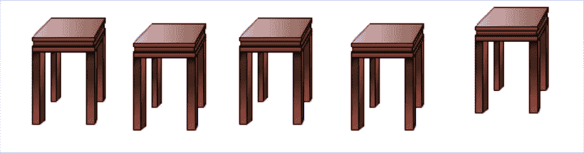

硬件：数字电路→组成→硬件实现→接口→体系结构

软件专业
计算机专业

## 课程体系：三位一体、循序递进

### 立足基础、加强实践、服务专业、进入国际

- 数字逻辑课程：计算机组成相关部件的设计基础
  - 组合电路设计、时序电路设计

- 计算机组成：设计简单RISC-CPU核心
  - ALU部件
  - 单周期实现、多周期实现简单的32位RISC-CPU
  - 写入FPGA，用实验板卡做测试验证。

- 计算机系统结构：设计流水线RISC-CPU核心提高


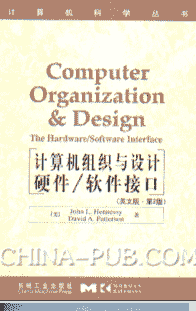

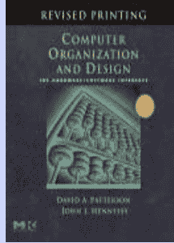


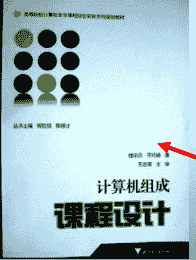


## 如何学好这门课？——耕耘与收获

### 孟子曰：

- 舜发于畎亩之中，傅说举于版筑之间，胶鬲举于鱼盐之中，管夷吾举于士，孙叔敖举于海，百里奚举于市。

- 故天将降大任于斯人也，必先苦其心志，劳其筋骨，饿其体肤，空乏其身，行拂乱其所为，所以动心忍性，曾益其所不能。

- 人恒过，然后能改。困于心，衡于虑，而后作。征于色，发于声，而后喻。入则无法家拂士，出则无敌国外患者，国恒亡。

- 然后知生于忧患，而死于安乐也。

## 成功的秘诀

- 舜从田野之中被任用，傅说从筑墙工作中被举用；胶鬲从贩卖盐的工作中被举用；管夷吾从狱官手里释放后被举用为相；孙叔敖从海边被举用进了朝廷，百里奚从市井中被举用登上了相位。

- 所以上天将要降落重大责任在这样的人身上，一定要首先使他的内心痛苦，使他的筋骨劳累，使他经受饥饿，以致肌肤消瘦，使他受贫困之苦，使他做的事颠倒错乱，总不如意。通过这些来使他的内心警觉，使他的性格坚定，增加他不具备的才能。

- 人经常犯错误，然后才能改正；内心困苦，思虑阻塞，然后才能有所作为；这一切表现在脸色上，抒发到言语中，然后才被人了解。在内（国内）如果没有坚持法度的世臣和辅佐君主的贤士，在外（国际）如果没有敌对国家和外患，此国便经常导致灭亡。

- 这就可以说明，忧愁患害可以使人生存，而安逸快乐使人萎靡死亡。


## 课堂教学的作用

- 教学是双方互动的，不能一边倒。大学应素质教育为主，要鼓励学生在教师指导下的自学与动手。

- 课堂教学作用是：引出知识及相关知识点，引导学生猎取知识的方向，分析知识的难点，学会分析讨论解决问题的途径，节省课余时间，提高自学的效率。

- 学会‘止于至善’，知道‘物极必反’
  - 大学之道，在明明德，在亲民，在止於至善。知止而後有定，定而後能静，静而後能安，安而後能虑，虑而後能得。物有本末，事有终始，知所先後，则近道矣。

## 课堂教学——实践的指导方针

### 注重知识的系统性、连贯性，强化实践能力

- 立足组成，三位一体，从程序员角度俯视组成结构

- 知其来路，又知其去路；知其然，知其所以然。

### 培养自主学习能力

- 引出组成及相关知识的自主获取和消化方法

- 力求充分体现培养学生硬件知识的自学方法

- 引导猎取知识的方向，给出分析问题的途径

- 节省课余时间，提高预习、复习、自学的效率。

### 启发式、鼓励式课堂交互

- 引出关键问题，开展提问和讨论

- 培养讨论，争论，辩论的学习气氛

- 核心、重要知识点学生上台

- *课程设计presentation*


## 实验教学——知识的感性化


以实验课为准


## 考核

- 平时 15%
  - 作业、阅读：光盘+一篇论文
- 期中 15%（统一时间）
  - 5.4 A Simple Implementation Scheme
- 期末 70%
  - The all and the one
- 英文试卷


## 计算机组成原理

### 考查目标

1. 理解单处理器计算机系统中各部件的内部工作原理、组成结构以及相互连接方式，具有完整的计算机系统的整体概念。
2. 理解计算机系统层次化结构概念，熟悉硬件与软件之间的界面，掌握指令集体系结构的基本知识和基本实现方法。
3. 能够运用计算机组成的基本原理和基本方法，对有关计算机硬件系统中的理论和实际问题进行计算、分析，并能对一些基本部件进行简单设计。

目标1：以MIPS为主，本课程主要介绍的是RISC，补充CISC处理器(X86)后续微机原理课程主要介绍X86结构

目标2：这部分包括了汇编，本课程介绍RISC汇编，CISC汇编在微机原理课程介绍中；内容还涉及到部分计算机体系结构课程，后面有详述

目标3：这部分涉及了数字电路知识，由逻辑与计算机设计基础课程介绍


## 大知识点分析

### 大纲涉及七大知识点

- 一、计算机系统概述
- 二、数据的表示和运算
- 三、存储器层次结构
- 四、指令系统
- 五、中央处理器(CPU)
- 六、总线
- 七、输入输出(I/O)系统

结论：在大知识点上，本课程覆盖大纲

### 本课程的大纲：

- 一、概述
- 二、MIPS汇编语言（属于RISC指令集）
- 三、计算机代数（含数的表示、ALU设计）
- 四、数据通道（含控制器）设计*
- 五、存储层次
- 六、输入输出（含一小部分总线知识点）


## 1.1 Introduction

- Computers have led to a third revolution for civilization
- The following applications used to be “computer science fiction”
- Automatic teller machines
- Computers in automobiles
- Laptop computers
- Human genome project
- World Wide Web

## Classes of Computer Applications and Their Characteristics

- Desktop computer
- Servers
- Embedded computer

## Brief introduction to this course

- The internal organization of computers and its influence on the performance of programs
- The hierarchy of software and hardware
  - How are programs written in high-level language translated into the language of the hardware, and how does it run?
  - What is the interface between the software and the hardware, and how does software instruct the hardware to perform?
  - What determines the performance of a program, and a programmer improve the performance?
  - What techniques can used to improve performance?

## Brief introduction to Chapter 1

- Basic ideas and definitions
- Major components of software and hardware
- Introduction to integrated circuits
- Technology that fuels the computer revolution

## Where is the performance bottleneck?

| Hardware or software component | How this component affects performance | Where is this topic covered? |
|---|---|---|
| Algorithm | Determines both the number of source-level statements and the number of I/O operations executed | Other books! |
| Programming language,compiler, and architecture | Determines the number of machine instructions for each source-level statements | Chapter 2 and 3 |
| Processor and memory system | Determines how fast instructions can be executed | Chapter 5,6 and 7 |
| I/O system(hardware and operating system) | Determines how fast I/O operations may be executed | Chapter 8 |


## 1.2 Below Your Program: From a High-Level Language to the Language of Hardware

A simplified view of hardware and software as hierarchical layers

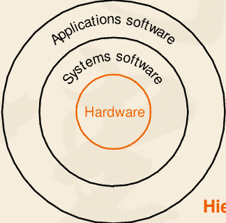

Problem: should we really place compilers in the systems software level?

Hierarchical layers

### Some terms

- **Machine language**
  - Computers only understands electrical signals
  - Easiest signals: *on* and *off*
  - Binary numbers express machine instructions ex. **1000110010100000** means to add two numbers
  - Very tedious to write

- **Assembly language**
  - Symbolic notations ex. **add A, B**
  - The assembler translates them into machine instruction
  - Programmers have to think like the machine

- **High-level programming language**
  - Notations more closer to the natural language ex. A + B
  - The compiler translates them into assembly language statements
  - Subroutine library — reusing programs
  - Advantages over assembly language
    - Programmers can think in a more natural language
    - Improved programming productivity
    - Programs can be independent of hardware

### From a High-Level Language to the Language of Hardware

#### The process of compiling and assembling

High-level language program (in C)

```
swap(int v[], int k)
{
int temp;
temp = v[k];
v[k] = v[k+1];
v[k+1] = temp;
}
```


Assembly language program (for MIPS)

```
swap:
muli $2, $5, 4
add $2, $4, $2
lw $15, 0($2)
lw $16, 4($2)
sw $16, 0($2)
sw $15, 4($2)
jr $31
```


Binary machine language program (for MIPS)

```
00000000101000010000000000011000
00000000100011100000110000000001
10001100110001010000000000000000
10001100111001010000000000000100
10101100111100100000000000000000
10101100111100100000000000000100
00000011111000000000000000001000
```

### An example of the decomposability of computer systems

- Software
  - Applications Software
    - LaTeX
    - ......
  - System Software
    - Compilers
      - gcc
      - ......
    - Operating system
      - Virtual memory
        - ......
      - File system
        - ......
      - I/O device drivers
        - ......
    - Assemblers
      - as
      - ......

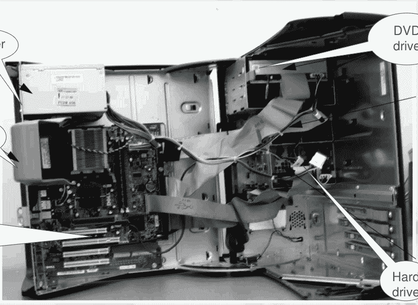


### Display

#### CRT (raster cathode ray tube) display

- Scan an image one line at a time, 30 to 75 times / s
- Pixels and the bit map, 512×340 to 1560×1280
- The more bits per pixel, the more colors to be displayed

#### LCD (liquid crystal display)

- Thin and low-power
- The LCD pixel is not the source of light
- Rod-shaped molecules in a liquid that form a twisting helix that bends light entering the display

- Hardware support for graphics — raster refresh buffer (**frame buffer**) to store bit map
- Goal of bit map — to faithfully represent what is on the screen

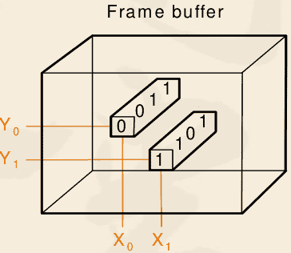
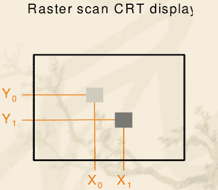

### Motherboard and the hardware on it

## Motherboard

- Thin, green, plastic, covered with dozens of small rectangles which contain **integrated circuits (chips)**
- Three pieces: the piece connecting to the I/O devices, memory, and processor

#### Memory

- Place to keep running programs and data needed
- Each memory board contains some integrated circuits
- DRAM and cache

#### Central Processor Unit — CPU

- Add numbers, tests numbers, signals I/O devices to activate, and so on
- CPU (central processor unit)


## Motherboard

## The five classic components of a computer

Compiler

Interface

Computer

Evaluating performance

Control

Datapath

Processor

Memory

Input

Output

## Important concept: Virtual machine

### Abstractions

- Lower-level details are hidden to higher levels
- Instruction set architecture --- the interface between hardware and lowest-level software
- Many implementations of varying cost and performance can run identical software

## A safe place for data --- secondary memory

- Main memory is volatile
- Secondary memory is nonvolatile
- Magnetic disk
  - Rotating platter coated with a magnetic material
  - Floppy disk
    - Flexible mylar substance
    - 1.44~100MB
    - Removable
  - Hard disk
    - Metal
    - Mostly not removable
    - Rotate on a spindle at 3600 to 7200 r.p.m.
    - Read/write head and movable arm
    - Slower than DRAM, but cheaper for a given storage unit
- CD (optical compact disk)
- Magnetic tape

## Communicating with Other Computer

------Computer network

- Communication----Information is exchanged
- Resource sharing
- Nonlocal access
- LAN (local area network): Ethernet network
- WAN (wide area network) :World Wide Web

## 1.4 Real Stuff: Manufacturing Pentium 4 Chips

### Semiconductor Integrated Circuits

- Relative performance / unit cost of technologies used in computers

| Year | Technology used in computers | Relative performance / unit cost |
|---|---|---|
| 1951 | Vacuum tube | 1 |
| 1965 | Transistor | 35 |
| 1975 | Integrated Circuit | 900 |
| 1995 | Very large-scale integrated Circuit | 2,400,000 |

## Growth of capacity per DRAM chip over time

## The semiconductor silicon and the chip manufacturing process

## Manufacturing Pentium 4 Chips

### Major blocks of a Pentium Pro die

## Digital circuits vs Computer organization

- Digital circuit
  - General circuits that controls logical event with logical gates (Hardware)
- Computer organization
  - Special circuits that processes logical action with instructions (Software)

## Board

## FPGA

## VGA Interface

## MIPS/X86

## CPU

## Controller

## Datapath

*Experimenting*

## BUS Interface

## RS-232 Interface

## PS/2 Interface

## VRAM

## Memory(256K × 32bit)

## DBUS

32

## ABUS

18

## PC Terminal

## KEY Board

## VGA Monitor

RGB signals

VRAM Data

VRAM Address

Control r signal

Address signals

Data signals

## 1.5 History of Computer Development

### The first electronic computers

- ENIAC (Electronic Numerical Integrator and Calculator)
  - J. Presper Eckert and John Mauchly
  - Publicly known in 1946
  - 30 tons, 80 feet long, 8.5 feet high, several feet wide
  - 18,000 vacuum tubes
- EDVAC (Electronic Discrete Variable Automatic Computer)
  - John von Neumann’s memo about stored-program computer
  - von Neumann Computer

### EDSAC (Electronic Delay Storage Automatic Calculator)

- Operational in 1949
- First full-scale, operational, stored-program computer in the world

### Other computers(omitted)

### Harvard architecture:

Program memory and data memory are independent.


## Commercial Developments

### Eckert-Mauchly Computer Corporation

- Formed in 1947
- $1 million for each of the 48 computers

### IBM computers

- First one, the IBM 701, shipped in 1952
- Investing $5 billion for System/360 in 1964

### Digital Equipment Corporation (DEC)

- The first commercial minicomputer PDP-8 in 1965
- Low-cost design, under $20,000

### CDC 6600

- The first supercomputer, built in 1963

## Cray Research, Inc.

- Cray-1 in 1976
- The fastest, the most expensive, the best performance/cost for scientific programs.

## Personal computer

- Apple II
- In 1977
- Low cost, high volume, high reliability
- IBM Personal Computer
- Announced in 1981
- Best-selling computer of any kind
- Microprocessors of Intel and operating systems of Microsoft became popular

## Computer Generations

### First generation

- 1950-1959, vacuum tubes, commercial electronic computer

### Second generation

- 1960-1968, transistors, cheaper computers

### Third generation

- 1969-1977, integrated circuit, minicomputer

### Fourth generation

- 1978-1997, LSI and VLSI, PCs and workstations

### Fifth generation

- 1998-?, micromation and hugeness


- Language of the machine
  - Instructions
  - Instruction set
- Design goals
  - Maximize performance
  - Minimize cost
  - Reduce design time
- Our chosen instruction set: MIPS
  - Similar to other ones developed since the 1980's
  - Used by NEC, Nintendo, Silicon Graphics, Sony

# Example 2.2 Compiling a complex C statement

# C code:

```
f = ( g + h ) − ( i + j );
```

# MIPS code:

```
add t0, g, h        # temporary variable t0 contains g + h
add t1, i, j        # temporary variable t1 contains i + j
sub f, t0, t1       # f gets t0 − t1
```

# MIPS assembly language

| Category | Instruction | Example | Meaning | Comments |
|---|---|---|---|---|
| Arithmetic | add | add a,b,c | a←b+c | Always three operand |
| Arithmetic | subtract | sub a,b,c | a←b-c | Always three operand |

### 2.3 Operands of the Computer Hardware

#### Register Operands

- Arithmetic instructions operands must be registers
- Difference between the variables of a programming
  - Registers is limited number of
    - 32 registers in MIPS
    - 32 bits for each register in MIPS

#### Design Principle 2

- **Smaller is faster**

#### MIPS convention for registers

- $s0, $s1, ... for registers corresponding to variables in C
- $t0, $t1, ... for temporary registers for compiler

## Memory operands

- Save complex data structures
  - Arrays and structures

### Data transfer instructions

- Load: from memory to register; load word ( lw )
- Store: from register to memory; store word( sw )

### Memory addresses and contents at those locations

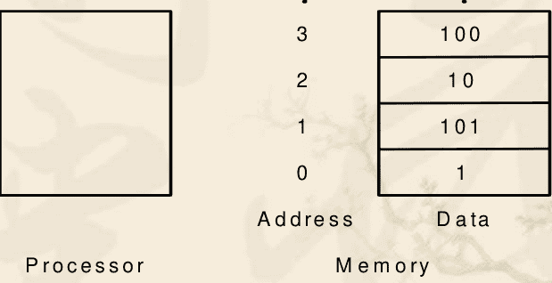

# Example 2.4 Compiling with an operand in memory

C code:

```
g = h + A[8];        // A is an array of 100 words
(Assume: g --- $s1    h --- $s2    base address of A --- $s3)
```

MIPS code:

```
lw   $t0, 8($s3)        # temporary reg $t0 gets A[8]
add  $s1, $s2, $t0      # g = h + A[8]
```

- **Offset**: the constant in a data transfer instruction → `8($s3)`
- **Base register**: the register added to form the address

# Byte addressing

→ `8($s3)`

# Alignment restriction

- Addresses of words are multiples of 4 in MIPS


## Software/hardware interface

## Compiler allocates data structures to memory

## Compiler associating variables with registers

## Actual MIPS memory addresses and contents

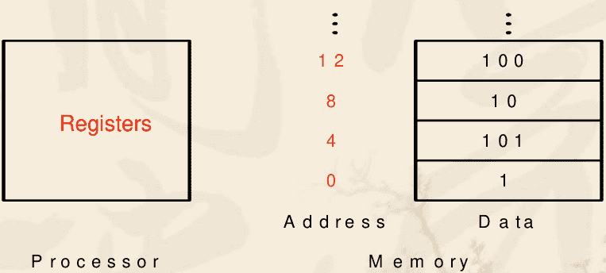

### The offset to be added to $s3 in Example 2.4 must be 4×8

### Example 2.5 Compiling using **load and store**

C code:

```
A[12] = h + A[8];  // A is an array of 100 words
(Assume: h ---- $s2   base address of A ---- $s3)
```

MIPS code:

```
lw    $t0, 32($s3)     # temporary reg $t0 gets A[8]
add   $t0, $s2, $t0     # temporary reg $t0 gets h + A[8]
sw    $t0, 48($s3)      # stores h + A[8] back into A[12]
```

### Example 2.6 Compiling using a variable array index

C code:

```
g = h + A[i]; // A is an array of 100 words
(Assume: g, h, i---- $s1, $s2, $s4 base address of A ---- $s3)
```

MIPS code:

```
add $t1, $s4, $s4 # temp reg $t1 = 2 * i
add $t1, $t1, $t1 # temp reg $t1 = 4 * i
add $t1, $t1, $s3 # $t1 = address of A[i] (4 * i + $s3)
lw $t0, 0($t1) # temp reg $t0 = A[i]
add $s1, $s2, $t0 # g = h + A[i]
```

### Spilling registers:

Putting less commonly used variables (or those needed later) into memory.

## 2.4 Representing Instructions in the Computer --- Instruction Format

- All information in computer consists of binary bits
- Mapping registers into numbers
  - Map registers $s0 to $s7 onto registers 16 to 23
  - Map registers $t0 to $t7 onto registers 8 to 15
- Example 2.7 Translating assembly into machine instruction
  - MIPS code

    ```
    add $t0, $s1, $s2
    ```

  - Decimal version of machine code

    ```
    | 0 | 17 | 18 | 8 | 0 | 32 |
    ```

  - Binary version of machine code

    ```
    | 000000 | 10001 | 10010 | 01000 | 00000 | 100000 |
    6 bits 5 bits 5 bits 5 bits 5 bits 6 bits
    ```

### MIPS fields (format)

**R-type or R-format**

| op | rs | rt | rd | shamt | funct |
|---|---|---|---|---|---|
| 6 bits | 5 bits | 5 bits | 5 bits | 5 bits | 6 bits |

**I-type or I-format**

| op | rs | rt | address |
|---|---|---|---|
| 6 bits | 5 bits | 5 bits | 16 bits |

### Must bear in mind!

- op: basic operation of the instruction, traditionally called the opcode.
- rs: the first register source operand.
- rt: the second register source operand.
- rd: the register destination operand.
- shamt: shift amount.
- funct: function, this field selects the specific variant of the operation in the op field.


### Design Principle 3

Good design demands good compromises

### All instructions in MIPS have the same length

Conflict: same length <----> single instruction

### Example 2.8 Translating assembly into machine instruction

C code:

```
A[300] = h + A[300];
(Assume: h ---- $s2 base address of A ---- $t1)
```

MIPS assembly code:

```
lw $t0, 1200($t1) # temporary reg $t0 gets A[300]
add $t0, $s2, $t0 # temporary reg $t0 gets h + A[300]
sw $t0, 1200($t1) # stores h + A[300] back into A[300]
```

### MIPS machine language code:

### Decimal version

| instruction | op | rs | rt | rd | address/shamt | funct |
|---|---|---|---|---|---|---|
| lw | 35 | 9 | 8 |  | 1200 |  |
| add | 0 | 18 | 8 | 8 | 0 | 32 |
| sw | 43 | 9 | 8 |  | 1200 |  |

### Binary version

| instruction | op | rs | rt | rd | address/shamt | funct |
|---|---|---|---|---|---|---|
| lw | 100011 | 01001 | 01000 |  | 0000 0100 1011 0000 |  |
| add | 000000 | 10010 | 01000 | 01000 | 00000 | 100000 |
| sw | 101011 | 01001 | 01000 |  | 0000 0100 1011 0000 |  |

### Note the only difference of the first and last instructions!

### Two key principles of today’s computers

- Instructions are represented as numbers
- Programs can be stored in memory like numbers


### Stored-program concept

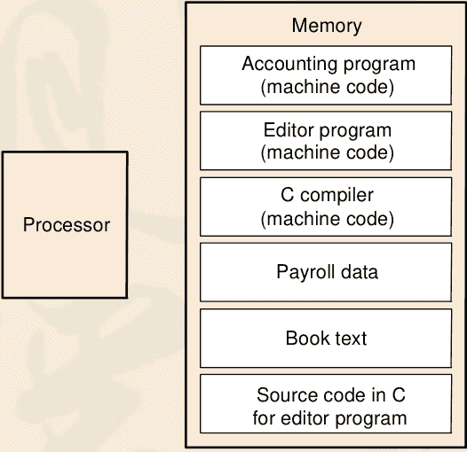

2.4 Instruction Format


## MIPS operands, assembly and machine language

| Name | Example | Comments |
|---|---|---|
| **32 registers** | `$s0, $s1, …, $s7`<br>`$t0, $t1, …, $t7` | Fast locations for data. In MIPS, data must be in registers to perform arithmetic. Registers `$s0-$s7` map to 16-23 and `$t0-$t7` map to 8-15. |
| **2³⁰ memory words** | `Memory[0]`, `Memory[4]`, …, `Memory[4294967292]` | Accessed only by data transfer instructions in MIPS. MIPS uses byte addresses, so sequential word addresses differ by 4. Memory holds data structures, arrays, and spilled registers. |

| Category | Instruction | Example | Meaning | Comments |
|---|---|---|---|---|
| **Arithmetic** | add | `add $s1, $s2, $s3` | `$s1 = $s2 + $s3` | Three register operands |
| | subtract | `sub $s1, $s2, $s3` | `$s1 = $s2 - $s3` | Three register operands |
| | Add immediate | `addi $s1, $s2, 100` | `$s1 = $s2 + 100` | Used to add constants |
| **Data transfer** | load word | `lw $s1, 100($s2)` | `$s1 = Memory[$s2 + 100]` | Data from memory to register |
| | store word | `sw $s1, 100($s2)` | `Memory[$s2 + 100] = $s1` | Data from register to memory |

| Name | Format | Example | Comment |
|---|---|---|---|
| add | R | `0 18 19 17 0 32` | `add $s1, $s2, $s3` |
| sub | R | `0 18 19 17 0 34` | `sub $s1, $s2, $s3` |
| addi | I | `8 18 17 100` | `addi $s1, $s2, 100` |
| lw | I | `35 18 17 100` | `lw $s1, 100($s2)` |
| sw | I | `43 18 17 100` | `sw $s1, 100($s2)` |

| Format | Fields | Total bits | Comments |
|---|---|---|---|
| **R-format** | op (6 bits), rs (5 bits), rt (5 bits), rd (5 bits), shamt (5 bits), funct (6 bits) | 32 | Arithmetic instruction format |
| **I-format** | op (6 bits), rs (5 bits), rt (5 bits), address (16 bits) | 32 | Data transfer, branch format |

All MIPS instructions are 32 bits.

### 2.5 Logical Operation

Operations on selected bits within a word or on individual bits.

| Logic operations | C operators | Java operators | MIPS instructions |
|---|---|---|---|
| Shift left | `<<` | `<<` | `sll` |
| Shift right | `>>` | `>>>` | `srl` |
| Bit-by-bit AND | `&` | `&` | `and, andi` |
| Bit-by-bit OR | `\|` | `\|` | `or, ori` |
| Bit-by-bit NOT | `~` | `~` | `nor` |

### Shift operator

Move all the bits in a word to the left or right, filling emptied bits with 0.

Shifting left by *i* is the same result as multiplying by 2<sup>*i*</sup>.

```text
0000 0000 0000 0000 0000 0000 0000 1001    (9)₁₀
Shift left 4 ←
0000 0000 0000 0000 0000 0000 1001 0000    (9 × 16 = 144)₁₀
```

```asm
sll $t2, $s0, 4   # reg $t2 = reg $s0 << 4 bits
```

| op | rs | rt | rd | shamt | funct |
|---|---|---|---|---|---|
| 0 | 0 | 16 | 10 | 4 | 0 |

### OR operator

It is bit-by-bit.

- Result = 1 if **either** operand bit is 1.

```text
$t2: 0000 0000 0000 0000 0000 1101 0000 0000
$t1: 0000 0000 0000 0000 0011 1100 0000 0000

or $t0, $t1, $t2   # reg $t0 = reg $t1 | reg $t2

Result:
0000 0000 0000 0000 0011 1101 0000 0000
```

### NOR operator

- **NOT(A OR B)**
- A NOR 0 = NOT(A OR 0) = **NOT(A)**

```text
$t1: 0000 0000 0000 0000 0011 1100 0000 0000
$t3: 0000 0000 0000 0000 0000 0000 0000 0000

nor $t0, $t1, $t3   # reg $t0 = ~(reg $t1 | reg $t3)

Result:
1111 1111 1111 1111 1100 0011 1111 1111
```

# MIPS operands

| Name | Example | Comments |
|---|---|---|
| **32 registers** | `$s0, $s1, …, $s7`<br>`$t0, $t1, …, $t7` | Fast locations for data. In MIPS, data must be in registers to perform arithmetic. Registers `$s0-$s7` map to 16-23 and `$t0-$t7` map to 8-15. |
| **2³⁰ memory words** | `Memory[0]`, `Memory[4]`, …, `Memory[4294967292]` | Accessed only by data transfer instructions in MIPS. MIPS uses byte addresses, so sequential word addresses differ by 4. Memory holds data structures, arrays, and spilled registers. |

# MIPS assembly language

| Category | Instruction | Example | Meaning | Comments |
|---|---|---|---|---|
| **Arithmetic** | add | `add $s1, $s2, $s3` | `$s1 = $s2 + $s3` | Three register operands |
| | subtract | `sub $s1, $s2, $s3` | `$s1 = $s2 - $s3` | Three register operands |
| | Add immediate | `addi $s1, $s2, 100` | `$s1 = $s2 + 100` | + constants; overflow detected |
| **Data transfer** | load word | `lw $s1, 100($s2)` | `$s1 = Memory[$s2 + 100]` | Data from memory to register |
| | store word | `sw $s1, 100($s2)` | `Memory[$s2 + 100] = $s1` | Data from register to memory |
| **logical** | and | `and $s1, $s2, $s3` | `$s1 = $s2 & $s3` | three reg. operands; bit-by-bit AND |
| | or | `or $s1, $s2, $s3` | `$s1 = $s2 \| $s3` | three reg. operands; bit-by-bit OR |
| | nor | `nor $s1, $s2, $s3` | `$s1 = ~($s2 \| $s3)` | three reg. operands; bit-by-bit NOR |
| | and immediate | `andi $s1, $s2, 100` | `$s1 = $s2 & 100` | Bit-by-bit AND reg with constant |
| | or immediate | `ori $s1, $s2, 100` | `$s1 = $s2 \| 100` | Bit-by-bit OR reg with constant |
| | shift left logical | `sll $s1, $s2, 10` | `$s1 = $s2 << 10` | Shift left by constant |
| | shift right logical | `srl $s1, $s2, 10` | `$s1 = $s2 >> 10` | Shift right by constant |


## 2.6 Instructions for making decisions

### Branch instructions

- beq register1, register2, L1
- bne register1, register2, L1

### Example 2.9 Compiling an if statement to a branch

(Assume: f ~ j ---- $s0 ~ $s4)

# C code:

```
if (i == j) goto L1 ;
f = g + h;
L1: f = f - i ;
```

#### MIPS assembly code:

```
beq $s3, $s4, L1 # go to L1 if i equals j
add $s0, $s1, $s2 # f = g + h ( skipped if i equals j )
L1: sub $s0, $s0, $s3 # f = f - i ( always executed )
```

### Example 2.10

### Compiling *if-then-else* into Conditional Branches

(Assume: f ~ j ---- $s0 ~ $s4)

```
C code:
if (i == j) f = g + h;
else    f = g - h;
```

```
MIPS assembly code:
bne    $s3, $s4, Else    # go to Else if i ≠ j
add    $s0, $s1, $s2    # f = g + h (Executed if i == j if)
j      Exit             # go to Exit
Else:  sub    $s0, $s1, $s2    # f = g - h (Executed if i ≠ j else)
Exit:                         # the first instruction of the next C statement
```

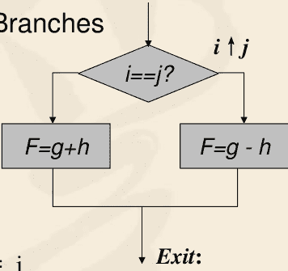

### Supports LOOPs

### Example 2.11 Compiling a loop with variable array index

(Assume: g ~ j ---- $s1 ~ $s4    base of A[i] ---- $s5)

# C code:

```
Loop:    g = g + A[i];      // A is an array of 100 words
         i = i + j;
         if (i != h)  goto Loop;
```

#### MIPS assembly code:

```
Loop:    add   $t1, $s3, $s3       # temp reg $t1 = 2 * i
         add   $t1, $t1, $t1       # temp reg $t1 = 4 * i
         add   $t1, $t1, $s5       # $t1 = address of A[i]
         lw    $t0, 0($t1)         # temp reg $t0 = A[i]
         add   $s1, $s1, $t0       # g = g + A[i]

         add   $s3, $s3, $s4       # i = i + j
         bne   $s3, $s2, Loop      # go to Loop if i != h
```

### Example 2.12 Compiling a **while** loop

(Assume: i ~ k --- $s3 ~ $s5   base of save ---- $s6 )

# C code:

```
while ( save[i] == k )
    i = i + j;
```

#### MIPS assembly code:

```
Loop:   add    $t1, $s3, $s3      # temp reg $t1 = 2 * i
        add    $t1, $t1, $t1      # temp reg $t1 = 4 * i
        add    $t1, $t1, $s6      # $t1 = address of save[i]
        lw     $t0, 0($t1)        # temp reg $t0 = save[i]
        bne    $t0, $s5, Exit     # go to Exit if save[i] != k
        add    $s3, $s3, $s4      # i = i + j
        j      Loop                # go to Loop
Exit:
```

### Jump register & jump address table

#### Jump with register content

jr $r

#### jump address table

$r←$t4+4*K

| K=0 | P1 address |
| --- | --- |
| K=1 | P2 address |
| K=2 | P3 address |
| K=3 | P4 address |

| Program 1 |
| --- |
| Program 2 |
| Program 3 |
| Program 3 |

2.6 Instructions for making decisions

### MIPS assembly code:

```
asm
slt   $t3, $s5, $zero       # test if k < 0
bne   $t3, $zero, Exit      # if k < 0, go to Exit
slt   $t3, $s5, $t2         # test if k < 4
beq   $t3, $zero, Exit      # if k >= 4, go to Exit

add   $t1, $s5, $s5         # temp reg $t1 = 2 * k (0<=k<=3)
add   $t1, $t1, $t1         # temp reg $t1 = 4 * k
add   $t1, $t1, $t4         # $t1 = address of JumpTable[k]
lw    $t0, 0($t1)           # temp reg $t0 = JumpTable[k]
jr    $t0                   # jump based on register $t0
```

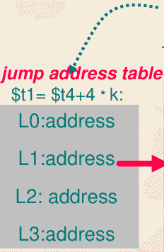

```
asm
L0:  add   $s0, $s3, $s4       # k = 0 so t gets i + j
     j     Exit               # end of this case so go to Exit
L1:  add   $s0, $s1, $s2       # k = 1 so t gets g + h
     j     Exit               # end of this case so go to Exit
L2:  sub   $s0, $s1, $s2       # k = 2 so t gets g - h
     j     Exit               # end of this case so go to Exit
L3:  sub   $s0, $s3, $s4       # k = 3 so t gets i - j
     Exit:                    # end of switch statement
```

### Important conception-----**_basic block_**

A sequence of instructions without branches (except possibly at end) and without branch target or branch labels (except possibly at the beginning)


## 2.7 Supporting Procedures in Computer Hardware

### Procedure/function be used to structure programs

- A stored subroutine that performs a specific task based on the parameters with which it is provided
- easier to understand, allow code to be reused

### Six step

1. Place Parameters in a place where the procedure can access them
2. Transfer control to the procedure
3. Acquire the storage resources needed for the procedure
4. Perform the desired task
5. Place the result value in a place where the calling program can access it
6. Return control to the point of origin

## Registers for procedure calling

- $a0 ~ $a3: four argument registers to pass parameters
- $v0 ~ $v1: two value registers to return values
- $ra: one return address register to return to origin point

## Instruction for procedures: jal ( jump-and-link )

Caller jal ProcedureAddress  
Callee jr $ra

## Using more registers

- Stack: ideal data structure for spilling registers
  - Push, pop
  - Stack pointer ($sp)


```
add    $t0, $a0, $a1      # register $t0 contains  g + h
add    $t1, $a2, $a3      # register $t1 contains  i + j
sub    $s0, $t0, $t1      # f = $t0 - $t1, which is (g + h) - (i + j)

add    $v0, $s0, $zero   # returns f   ( $v0 = $s0 + 0)

lw    $s0, 0($sp)         # restore register $s0 for caller
lw    $t0, 4($sp)         # restore register $t0 for caller
lw    $t1, 8($sp)         # restore register $t1 for caller
add   $sp, $sp, 12        # adjust stack to delete 3 items
jr    $ra                 # jump back to calling routine
```

But maybe some of the three are not used by the caller. So, this way might be inefficient.

## Two classes of registers

- $t0 ~ $t9: 10 temporary registers, not preserved
- $s0 ~ $s7: 8 saved registers, must be preserved

## The values of the stack pointer and stack before, during and after procedure call in Example 2.15

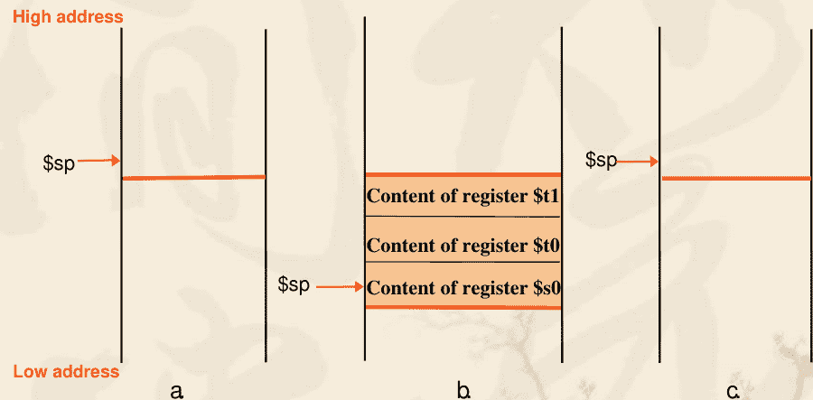

- Conflict over the use of register both
- Push all the registers to stack
  - Caller: pushes $a0~$a3 or $t0~$t9
  - Callee: pushes $ra (return address) and $s0~$s7

## Nested Procedures

Example 2.16 Compiling a recursive procedure  
( Assume: n --- $a0 )

C code for n!

```
int fact ( int n )
{
    if ( n < 1 ) return ( 1 );
    else return ( n * fact ( n - 1 ) );
}
```

MIPS assembly code

```
fact: sub $sp, $sp, 8 # adjust stack for 2 items
    sw $ra, 4($sp) # save the return address
    sw $a0, 0($sp) # save the argument n
    slt $t0, $a0, 1 # test for n < 1
    beq $t0, $zero, L1 # if n >= 1, go to L1(else)
    add $v0, $zero, 1 # return if n < 1
    add $sp, $sp, 8 # Recover $sp (Why not recover $ra and $a0 ?)
    jr $ra # return to after jal
```

```
L1:  sub  $a0, $a0, 1        # n >= 1: argument gets ( n - 1 )
     jal  fact                  # call fact with ( n - 1 )
     lw   $a0, 0($sp)           # return from jal: restore argument n
     lw   $ra, 4($sp)           # restore the return address
     add  $sp, $sp, 8           # adjust stack pointer to pop 2 items
     mul  $v0, $a0, $v0         # return n*fact ( n - 1 )
     jr   $ra                    # return to the caller
```

- **Why $a0 is saved? Why $ra is saved?**
- **Preserved things across a procedure call**
  - Saved registers ($s0 ~ $s7), stack pointer register ($sp), return address register ($ra), stack **above** the stack pointer
- **Not preserved things across a procedure call**
  - Temporary registers ($t0 ~ $t9), argument registers ($a0 ~ $a3), return value registers ($v0 ~ $v1), stack **below** the stack pointer

## Stack allocation before, during and after procedure call

High address  
$fp  
$sp  
Low address  

a.

$fp  
Saved argument registers (if any)  
Saved return address  
Saved saved registers (if any)  
Local arrays and structures (if any)  
$sp  

b.

$fp  
$sp  

c.


## Allocating Space for New Data on the Stack

- Procedure frame/activation record
  - The segment of stack containing a procedure’s saved registers and local variables
- Frame pointer
  - A value denoting the location of saved register and local variables for a given procedure

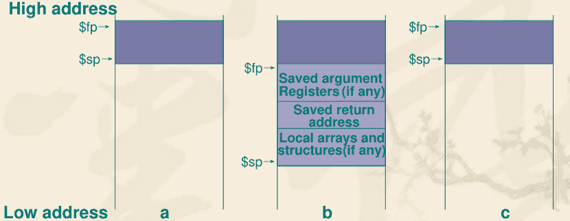

## Allocating Space for New Data on the Heap

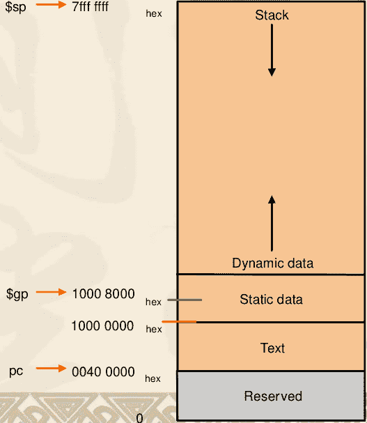

$sp → 7fff ffff

hex

$gp → 1000 8000

1000 0000   hex

pc → 0040 0000

Stack

Dynamic data

Static data

Text

Reserved

# MIPS operands

| Name | Example | Comment |
|---|---|---|
| 32 registers | $s0-$s7,$t0-$t9.<br>$zero,$a0-$a3,$v0-$v1, | Fast locations for data. In MIPS, data must be in registers to perform arithmetic. MIPS register $zero always equals 0.<br>$gp(28) is the global pointer, $sp(29) is the stack pointer,<br>$fp(30) is the frame pointer, and $ra(31) is the return address. |
| 2³⁰ memory words | Memory[0]<br>Memory[4]......<br>Memory[4294967292] | Accessed only by data transfer instructions. MIPS uses byte addresses, so sequential word addresses differ by 4. Memory holds data structures, arrays, and spilled registers, such as those saved on procedure calls. |

| Name | Register no. | Usage | Preserved on call |
|---|---|---|---|
| $zero | 0 | The constant value 0 | n.a. |
| $v0-$v1 | 2-3 | Values for results and expression evaluation | no |
| $a0-$a3 | 4-7 | Arguments | no |
| $t0-$t7 | 8-15 | Temporaries | no |
| $s0-$s7 | 16-23 | Saved | yes |
| $t8-$t9 | 24-25 | More temporaries | no |
| $gp | 28 | Global pointer | yes |
| $sp | 29 | Stack pointer | yes |
| $fp | 30 | Frame pointer | yes |
| $ra | 31 | Return address | yes |

# MIPS assembly language

| Category | Instruction | Example | Meaning | Comments |
|---|---|---|---|---|
| Arithmetic | add | Add $s1,$s2,$s3 | $s1=$s2 + $s3 | Three register operands |
| | subtract | Sub $s1,$s2,$s3 | $s1=$s2 - $s3 | Three register operands |
| Data transfer | load word | lw $1, 100($s2) | $s1=Memory[$s2+100] | Data from memory to register |
| | store word | sw $s1, 100($s2) | Memory[$s2+100]=$s1 | Data from register to memory |
| logical | and | and $s1,$s2,$s3 | $s1=$s2 & $s3 | three reg. operands;bit-by-bit AND |
| | or | or $s1,$s2,$s3 | $s1=$s2 \| $s3 | three reg. operands;bit-by-bit OR |
| | nor | nor $s1,$s2,$s3 | $s1=~($s2 \| $s3) | three reg. operands;bit-by-bit NOR |
| | and immediate | addi $s1,$s2,100 | $s1=$s2 & 100 | Bit-by-bit AND reg with constant |
| | or immediate | ori $s1,$s2,100 | $s1=$s2 \| 100 | Bit-by-bit OR reg with constant |
| | shift left logical | sll $s1,$s2,10 | $s1=$s2 << 10 | Shift left by constant |
| | shift right logical | srl $s1,$s2,10 | $s1=$s2 >> 10 | Shift right by constant |
| Conditional branch | branch on equal | beq $s1,$s2,L | If($s1==$s2) go to L | Equal test and branch |
| | branch not equal | bne $s1,$s2,L | If($s1!=$s2) go to L | Not equal test and branch |
| | set on less than | slt $s1,$s2,$s3 | If($s2<$s3) $s1=1 Else $s1=0 | Compare less than;used with beq, bne |
| | set on less than immediate | slti $s1,$s2,100 | If($s2<100) $s1=1 Else $s1=0 | Compare less than immediate;used with beq, bne |
| Unconditional jump | jump | j L | go to L | Jump to target address |
| | jump register | jr $ra | go to $ra | For procedure return |
| | jump and link | jal L | $ra=PC+4; go to L | For procedure call |

## MIPS machine language

| Name | Format | Example | Comment |
|---|---|---|---|
| add | R | 0 18 19 17 0 32 | add $s1, $s2, $s3 |
| sub | R | 0 18 19 17 0 34 | sub $s1, $s2, $s3 |
| lw | I | 35 18 17 100 | lw $s1, 100($s2) |
| sw | I | 43 18 17 100 | sw $s1, 100($s2) |
| and | R | 0 18 19 17 0 36 | and $s1, $s2, $s3 |
| or | R | 0 18 19 17 0 37 | or $s1, $s2, $s3 |
| nor | R | 0 18 19 17 0 39 | nor $s1, $s2, $s3 |
| addi | I | 12 18 17 100 | addi $s1, $s2,100 |
| ori | I | 13 18 17 100 | ori $s1, $s2,100 |
| sll | R | 0 0 18 17 10 0 | sll $s1, $s2,10 |
| srl | R | 0 0 18 17 10 2 | srl $s1, $s2,10 |
| beq | I | 4 17 18 25 | beq $s1, $s2,100 |
| bne | I | 5 17 18 25 | bne $s1, $s2,100 |
| slt | R | 0 18 19 17 0 42 | slt $s1, $s2,$s3 |
| j | J | 2 2500 | j 10000(see section 2.9) |
| jr | R | 0 31 0 0 0 8 | jr $ra |
| jal | J | 3 2500 | jal 10000(see section 2.9) |
| Field size | | 6bits 5bits 5bits 5bits 5bits 6bits | All MIPS instruction 32 bits |
| R-format | R | op rs rt rd shamt funct | Arithmetic instruction format |
| i-format | I | op rs rt address | Data transfer ,branch format |


## 2.8 Communicating with People Beyond Numbers

- ASCII (American Standard Code for Information Interchange)
- Instructions for moving bytes in MIPS
- Load byte (lb): lb $t0, 0($sp) # read byte from source
- Store byte (sb): sb $t0, 0($sp) # write byte to destination
- Three choices for representing a string
- Place the length of the string in the first position
- An accompanying variable has the length
- A character in the last position to mark the end of a string
- C uses the third choice
- Terminate a string with a byte whose value is 0 (null in ASCII)

# Example 2.17 Compiling a string copy procedure

(Assume: base addresses for x and y --- $a0 and $a1 i --- $s0)

```c
C code: X→Y

void strcpy(char x[], char y[])
{
        int i;
        i = 0;
        while ((x[i] = y[i]) != “\0”)    /* copy and test byte */
                i += 1;
}
```

```asm
MIPS assembly code:

strcpy:  sub   $sp, $sp, 4                 # adjust stack for 1 more item
         sw    $s0, 0($sp)                 # save $s0
         add   $s0, $zero, $zero            # i = 0 + 0
L1:      add   $t1, $a1, $s0                # address of y[i] in $t1
         lb    $t2, 0($t1)                 # $t2 = y[i]
         add   $t3, $a0, $s0                # address of x[i] in $t3
         sb    $t2, 0($t3)                 # x[i] = y[i]
         add $s0, $s0, 1 # i = i + 1
         bne $t2, $zero, L1 # if y[i] != 0, go to L1
         lw $s0, 0($sp) # y[i] == 0: end of string;
         # restore old $s0
         add $sp, $sp, 4 # pop 1 word off stack
         jr $ra # return
```

## Optimization for example 2.17

- strcpy is a leaf procedure
- Allocate i to a temporary register $t0

### For a leaf procedure

- The compiler exhausts all temporary registers
- Then use the registers it must save

## 2.9 MIPS Addressing for 32-Bit Immediate and Addresses

### 32-Bit Immediate addressing

- most constants is short and fit into 16-bit field
- Set upper 16 bits of a constants in a register with load upper immediate (lui)
- lui $t0 , 255

| Instruction | 001111 | 00000 | 01000 | 0000 0000 1111 1111 |
|-------------|--------|-------|-------|---------------------|
| Register    | 0000 0000 1111 1111 | 0000 0000 0000 0000 |       |                     |

## Example 2.19 Loading a 32-bit constant

The 32-bit constant:

**0000 0000 0011 1101** **0000 1001 0000 0000** (61*16⁴ + 2304 = 4000000)₁₀

MIPS code:

```asm
lui   $s0, 61          # 61 decimal = 0000 0000 0011 1101 binary
```
(The value of $s0 afterward is: 0000 0000 0011 1101 0000 0000 0000 0000)

```asm
addi  $s0, $s0, 2304   # 2304 decimal = 0000 1001 0000 0000 binary
```
(The value of $s0 afterward is: 0000 0000 0011 1101 0000 1001 0000 0000)

Note: Why does it need two steps?

The reserved register $at for the assembler

### Addressing in branches and jumps

For jumps: J-format

- Example:
- j 10000 # go to location 10000
- | 2 | 10000 |
- 6 bits 26 bits

- Pseudo-direct addressing
- 26 bits of the instruction concatenated with the upper 4 bits of PC

For branches:

- Example:
- bne $s0, $s1, Exit # go to Exit if $s0 != $s1
- | 5 | 16 | 17 | Exit |
- 6 bits 5 bits 5 bits 16 bits

- PC-relative addressing
- PC = (PC + 4) + Branch address

## Example 2.20 Show branch offset in machine language

### C language:

```c
while (save[i] == k) i = i + j;
```

MIPS assembler code in Example 2.12:

```asm
Loop:    add   $t1, $s3, $s3       # temp reg $t1 = 2 * i
         add   $t1, $t1, $t1       # temp reg $t1 = 4 * i
         add   $t1, $t1, $s6       # $t1 = address of save[i]
         lw    $t0, 0($t1)         # temp reg $t0 = save[i]
         bne   $t0, $s5, Exit      # go to Exit if save[i] != k

         add   $s3, $s3, $s4       # i = i + j
         j     Loop                # go to Loop
Exit:
```

### Assembled instructions and their addresses:

| Instruction | Address | Opcode | Rs | Rt | Rd | Shamt | Funct | Label |
|-------------|---------|--------|----|----|----|-------|-------|-------|
| add         | 80000   | 0      | 19 | 19 | 9  | 0     | 32    | Loop: |
| add         | 80004   | 0      | 9  | 9  | 9  | 0     | 32    |       |
| add         | 80008   | 0      | 9  | 22 | 9  | 0     | 32    |       |
| Lw          | 80012   | 35     | 9  | 8  |    | 0     |       |       |
| bne         | 80016   | 5      | 8  | 21 |    | 2     | (8)   |       |
| add         | 80020   | 0      | 19 | 20 | 19 | 0     | 32    |       |
| j           | 80024   | 2      |    |    | 20000 |     | (80000) | Exit: |
|             | 80028   | ...    |    |    |    |       |       |       |

80028 - 80020 = 8

PC+4+offset=80028

### Modification:

- All MIPS instructions are 4 bytes long
- PC-relative addressing refers to the number of words
- The address field at 80016 above should be 2 instead of 8

## 2.9 MIPS Addressing for 32-Bit Immediate and Addresses


## Example 2.21 Branching far away

- While branch target is far away
  - Inserts an unconditional jump to target
  - Invert the condition so that the branch decides whether to skip the jump

- Given a branch:

  `beq  $s0, $s1, L1`

- Rewrite it to offer a much greater branching distance:

  `bne  $s0, $s1, L2`

  `j    L1`

  `L2:`

# MIPS addressing mode summary

- Register addressing: `add $s0,$s0,$s0`
- Base or displacement addressing: `lw $s1,0($s0)`
- Immediate addressing: `addi $s0,$s0,4`
- PC-relative addressing: `beq $s0,$s1,L1`
- Pseudodirect addressing: `j Address1`

# Five MIPS addressing modes

## 1. Immediate addressing

op | rs | rt | Immediate

## 2. Register addressing

op | rs | rt | rd | ... | funct

Registers
Register

## 3. Base addressing

op | rs | rt | Address

Register

Memory
Byte | Halfword | Word

## 4. PC-relative addressing

op | rs | rt | Address

PC

Memory
Word

## 5. Pseudodirect addressing

op | Address

PC

Memory
Word

## 2.9 MIPS Addressing for 32-Bit Immediate and Addresses

# Example 2.22 Decoding machine code

# Machine instruction

**(Bits:** 31 28 26 5 2 0 **)**

`0000 0000 1010 1111 1000 0000 0010 0000`

# Decoding

- Determine the operation from opcode

op: `000000` ➜ **R-format instruction**

| op | rs | rt | rd | shamt | funct |
|---|---|---|---|---|---|
| 000000 | 00101 | 01111 | 10000 | 00000 | 100000 |

funct: `100000` ➜ **add instruction**

- Determine other fields
- **rs: $a1$, rt: $t7$, rd: $s0$**

- Show the assembly instruction
- **add $s0, $a1, $t7** (Note: add rd,rs,rt)

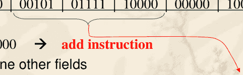

# Summary of MIPS architecture in Chapter 2

# MIPS instruction format

| Name | Fields | Comments |
|---|---|---|
| Field size | 6 bits \| 5 bits \| 5 bits \| 5 bits \| 5 bits \| 6 bits | All MIPS instructions 32 bits |
| R-format | op \| rs \| rt \| rd \| shamt \| funct | Arithmetic instruction format |
| I-format | op \| rs \| rt \| address/immediate | Transfer, branch, imm. format |
| J-format | op \| target address | Jump instruction format |

# MIPS operands

| Name | Example |
|---|---|
| 32 registers | $s0~$s7, $t0~$t9, $zero, $a0~$a3, $v0~$v1, $gp, $fp, $gp, $ra, $at |
| Mem words | Memory[0], Memory[4], …, Memory[4294967292] |

# MIPS assembly language

- Arithmetic
  - add — `add $s1, $s2, $s3`
  - subtract — `sub $s1, $s2, $s3`
  - add immediate — `addi $s1, $s2, -3` (Note: subi does not exist)

# Data transfer

- load word — `lw   $s1, 100($s2)`
- store word — `sw   $s1, 100($s2)`
- load byte — `lb   $s1, 100($s2)`
- store byte — `sb   $s1, 100($s2)`
- load upper immediate — `lui  $s1, 100`

# Conditional branch

- branch on equal — `beq  $s1, $s2, 25(Why not beqi?)`
- branch on not equal — `bne  $s1, $s2, 25`
- set on less than — `slt  $s1, $s2, $s3`
- set on less than immediate — `slti $s1, $s2, 100`

# Unconditional jump

- jump — `j   2500`
- jump register — `jr  $ra`
- jump and link — `jal 2500`

# 2.10 Translating and starting a Program

# A translation hierarchy

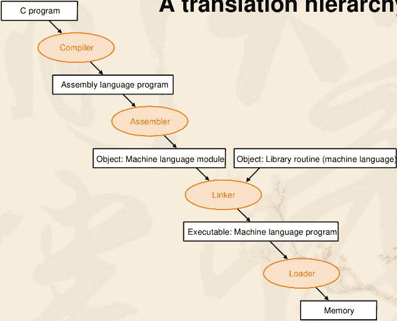

# Start a C program in a file on disk to run

## Compiling

- C program → assembly language program

## Assembling

- Assembly language program → machine language module
- pseudoinstructions
- move $t0,$t1
- add $t0,$zero, $t1
- # register St0 gets register $t1
- # register St0 gets 0+register $t1
- Symbol table
- A table that matches name of lables to the addresses of the memory words that instructions occupy.
- Object file of UNIX (six distinct pieces)
- object file header—size and position of the other pieces
- Text segment
- static data segment and dynamic data


## Linking

Object modules (including library routine) → executable program

3 step of Link

- Place code and data modules symbolically in memory
- Determine the addresses of data and instruction labels
- Patch both the internal and external references (Address of invoke)

MIPS memory allocation for program and data

## Link object file A & B

| 0000000000000000 | 011111111111111 |
| 0001000000000000 | 100000000000000 |
| 1111111111111111 | 100000000000000 |
| 0001000000000000 | 000000000000000 |

$sp → 7fff fffc<sub>hex</sub>  
+ 2<sup>15</sup>-1  
-2<sup>15</sup>

$gp → 1000 8000<sub>hex</sub>  
1000 0000<sub>hex</sub>

PC → 0040 0000<sub>hex</sub>

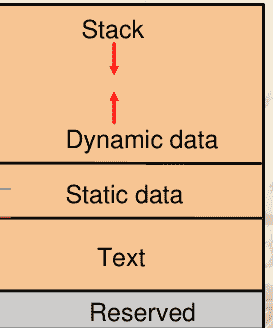

## Loading

- Determine size of text and data segments
- Create an address space large enough
- Copy instructions and data from executable file to memory
- Copy parameters (if any) to the main program onto the stack
- Initialize registers and set $sp to the first free location
- Jump to a start-up routine

## 2.13 A C Sort Example to Put it All Together

Three general steps for translating C procedures

- Allocate registers to program variables
- Produce code for the body of the procedures
- Preserve registers across the procedures invocation

### Procedure swap

- C code

```c
swap( int v[], int k )
{
    int temp;
    temp = v[k];
    v[k] = v[k + 1];
    v[k + 1] = temp;
}
```

### Register allocation for swap

v ---- $a0  k ---- $a1   temp ---- $t0

swap is a leaf procedure, nothing to preserve

### MIPS code for the procedure swap

#### Procedure body

swap: sll $t1, $a1, 2 # $t1 = k * 4

add $t1, $a0, $t1 # $t1 = v + ( k * 4 )

# $t1 has the address of v[ k ]

lw $t0, 0($t1) # $t0 ← v[ k ]

lw $t2, 4($t1) # $t2 ← v[ k + 1 ]

sw $t2, 0($t1) # v[k+1]) → v[ k ]

sw $t0, 4($t1) # v[k] → v[ k + 1 ]

#### Procedure return

jr $ra # return to calling routine

## Procedure *sort*

### C code

```c
sort ( int v[ ], int n )
{
        int i, j;
        for ( i = 0; i < n; i += 1 ) {
                for ( j = i - 1; j >= 0 && v[j] > v[j+1]; j -= 1 )
                        swap ( v, j );
        }
}
```

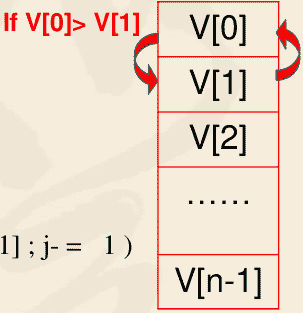

### Register allocation for *sort*

v ---- $a0    n ---- $a1    i ---- $s0    j ---- $s1

### Passing parameters in *sort*

### Preserving registers in *sort*

$ra, $s0, $s1, $s2, $s3

### Code for the procedure sort

#### Saving registers

```asm
sort: addi $sp, $sp, -20 # make room on stack for 5 registers
sw $ra, 16($sp) # save $ra on stack
sw $s3, 12($sp) # save $s3 on stack
sw $s2, 8($sp) # save $s2 on stack
sw $s1, 4($sp) # save $s1 on stack
sw $s0, 0($sp) # save $s0 on stack
```

#### Procedure body{Outer loop {Inner loop} }

#### Restoring registers

```asm
exit1: lw $s0, 0($sp) # restore $s0 from stack
lw $s1, 4($sp) # restore $s1 from stack
lw $s2, 8($sp) # restore $s2 from stack
lw $s3, 12($sp) # restore $s3 from stack
lw $ra, 16($sp) # restore $ra from stack
addi $sp, $sp, 20 # restore stack pointer
```

#### Procedure return

```asm
jr $ra # return to calling routine
```

### Code for Procedure body

#### Outer loop—first for loop

```c
for ( i = 0 ; i < n ; i += 1 ){
```

#### Move parameters

```asm
move $s2, $a0      # $s2 ← $a0 ($a0: base address)
move $s3, $a1      # $s3 ← $a1 ($a1: array size)
```

#### Outer loop

```asm
move $s0, $zero    # $s0 ← $zero (i = 0)
for1tst:  slt  $t0, $s0, $s3    # test if $s0 >= $s3 (i >= n)
          beq  $t0, $zero, exit1 # go to exit1 if $s0 >= $s3 (i >= n)
```

........................................................................

( **body of first for loop is second _for_ loop** )

........................................................................

```asm
exit2:  addi  $s0, $s0, 1       # i = i + 1
         j     for1tst           # jump to test of outer loop
exit1:
```


## 2.15 Arrays versus Pointers

### Two C procedures

**Array version**

```c
clear1(int array[], int size)
{
    int i;
    for (i = 0; i < size; i = i + 1)
        array[i] = 0;
}
```

**Pointer version**

```c
clear2(int *array, int size)
{
    int *p;
    for (p = &array[0]; p < &array[size]; p = p + 1)
        *p = 0;
}
```

### Assembly code for clear-1 procedure (array version)

```
move $t0,$zero # i = 0
loop1: sll $t1,$t0,2 # $t1 = i * 4
add $t2,$a0,$t1 # $t2 = address of array[i]
sw $zero,0($t2) # array[i] = 0
addi $t0,$t0,1 # i = i + 1
slt $t3,$t0,$a1 # test if i < size
bne $t3,$zero,loop1 # if ( i < size ) go to loop1
jr $ra
```

This code works as long as **_size_** is greater than 0.  
(In this case, the loop will be executed once even though the value of the size parameter is invalid. Actually, size > 0 must be checked at first)

### Assembly code for clear-2 procedure (pointer version)

```
move $t0, $a0 # p = the start address of the array[]
sll $t1, $a1, 2 # $t1 = size * 4
add $t2, $a0, $t1 # $t2 = &array[size] (address of array[size])
loop2: sw $zero, 0($t0) # Memory[p] = 0
addi $t0, $t0, 4 # p = p + 4
slt $t3, $t0, $t2 # $t3 = (p < &array[size])
bne $t3, $zero, loop2 # if ( p < &array[size] ) go to loop2
jr $ra
```

This code works as long as **size** is greater than 0.

### Compare the two versions

- Array version has the “multiply” and add inside loop
- Pointer version reduces instructions/iteration from **6** to **4**
- For modern compilers, both ways are the same.

## 2.16 Real Stuff: IA-32 Instructions

### The Intel IA-32

- **1978** — Intel 8086
  - 16-bit architecture
  - Is not considered a general-purpose register
- **1980** — Intel 8087 floating-point processor
- **1982** — 80286 extended the 8086 architecture by
  - Increasing Address Space to 24 bits
  - Manipulate the protection model
- **1985** — **80386** extended the 80286 architecture
  - 32-bit architecture with 32-bit registers
  - 32-bit address space
  - Add paging support in addition to segmented addressing
  - Nearly a general-purpose register machine **?**

### 1989~95 Higher performance

- 80486 in 1989
- Pentium in 1992
- Pentium Pro in 1995

### 1997 Expand Pentium and Pentium Pro with MMX

### 1999 Expand Pentium with SSE (SIMD) as Pentium III

- 8 separate registers, double their width to 128 bits
- Add a single-precision floating-point data type
- 4 32-bit floating-point operations can be performed in parallel
- Cache prefetch instructions

### 2001 Intel Pentium 4

### 2003 A company other than Intel enhanced the IA-32 architecture

- AMD
- Executing all IA-32 instructions with 64-bit Address space & data

### 2004 Intel capitulates and embraces AMD64

### 80x86 registers and data addressing modes

- 80386 extended all 16-bit registers but segment ones to 32 bits
- GPR ( general-purpose register )
- Addressing modes
- Register indirect
- Based mode with 8- or 32-bit displacement
- Base plus scaled index
- Base plus scaled index with 8- or 32-bit displacement

### 80x86 integer operations

- Data movement instructions
- Arithmetic and logic instructions
- Control flow
- String instructions

### IA-32 Register and Data Addressing Modes

| Name | Register no. | Usage |
| --- | --- | --- |
| $zero | 0 | The constant value 0 |
| $v0-$v1 | 2-3 | Values for results and expression evaluation |
| $a0-$a3 | 4-7 | Arguments |
| $t0-$t7 | 8-15 | Temporaries |
| $s0-$s7 | 16-23 | Saved |
| $t8-$t9 | 24-25 | More temporaries |
| $gp | 28 | Global pointer |
| $sp | 29 | Stack pointer |
| $fp | 30 | Frame pointer |
| $ra | 31 | Return address |

## 2.12 PowerPC and 80x86 Instructions

### Instruction types for ALU & data transfer

| Source/destination operand type | Second source operand |
| --- | --- |
| Register | Register |
| Register | Immediate |
| Register | Memory |
| Memory | Register |
| Memory | Immediate |


## Some typical IA-32 Integer Operations

| Instruction | Function |
|---|---|
| JE name | If equal (CC) EIP = name; EIP − 128 ≤ name < EIP + 128 |
| JMP name | {EIP = NAME}; |
| CALL name | SP = SP − 4; M[SP] = EIP + 5; EIP = name; |
| MOVW EBX,[EDI + 45] | EBX = M [EDI + 45] |
| PUSH ESI | SP = SP − 4; M[SP] = ESI |
| POP EDI | EDI = M[SP]; SP = SP + 4 |
| ADD EAX,#6765 | EAX = EAX + 6765 |
| TEST EDX,#42 | Set condition codea (flags) with EDX & 42 |
| MOVSL | M[EDI] = M[ESI]; EDI = EDI + 4; ESI = ESI + 4 |

## Typical 80x86 instruction format

a. JE EIP + displacement  
b. CALL  
c. MOV EBX, [EDI + 45]  
d. PUSH ESI  
e. ADD EAX, #6765  
f. TEST EDX, #42  

| 4 | 4 | 8 |
|---|---|---|
| JE | Condition | Displacement |

| 8 | 32 |
|---|---|
| CALL | Offset |

| 6 | 1 1 | 8 | 8 |
|---|---|---|---|
| MOV | d w | r-m postbyte | Displacement |

| 5 | 3 |
|---|---|
| PUSH | Reg |

| 4 | 3 1 | 32 |
|---|---|---|
| ADD | Reg w | Immediate |

| 7 | 1 | 8 | 32 |
|---|---|---|---|
| TEST | w | Postbyte | Immediate |

## 2.18 Concluding Remarks

### Two principles of stored-program computers

- Use instructions as numbers  
- Use alterable memory for programs  

### Four design principles

- Simplicity favors regularity  
- Smaller is faster  
- Make the common case fast  
- Good design demands good compromises  

### MIPS instruction set  

## 2.19 History of Instruction Set Development

### Accumulator Architectures

- Only 1 register for arithmetic instructions: *accumulator*  
- Memory-based operand-addressing mode  

### Example 2.23

Compiling C code to accumulator instructions  

C code: `A = B + C;`  

Accumulator instructions:

```
load  AddressB   # Acc = Memory[AddressB], or Acc = B
add   AddressC   # Acc = Acc + Memory[AddressC], or Acc = B + C
store AddressA   # Memory[AddressA] = Acc, or A = B + C
```

### Extended Accumulator Architectures  

## General-Purpose Register Architectures

- Register-memory architecture  
  - 80386  
  - IBM 360  
- Load-store or register-register architecture  
  - CDC 6600  
  - MIPS  
- DEC’s VAX architecture  
  - Allow any combination of registers and memory operands  
  - Memory-memory architecture  

### Example 2.24 Compiling C code to memory-memory instructions

- C code: A = B + C;  
- instructions:  
  - add AddressA, AddressB, AddressC  

# Computer Organization & Design
The Hardware/Software Interface

Qing-song Shi  
http://10.214.26.103    Email: zjsqs@zju.edu.cn  

## Chapter 3
Arithmetic for Computer  

## Contents of Chapter 3

- 3.1 Introduction  
- 3.2 Signed and Unsigned Numbers-Possible Representations  
- 3.3 Arithmetic--Addition & subtraction and ALU  
- 3.4 Multiplication  
- 3.5 Division  
- 3.6 Floating point numbers  

## Numbers

Bits are just bits (no inherent meaning)— conventions define relationship between bits and numbers  

Binary numbers (base 2)  
0000 0001 0010 0011 0100 0101 0110 0111 1000 1001...  
decimal: 0 1 2 3...2ⁿ-1  

Of course it gets more complicated:  
- numbers are finite (overflow)  
- fractions and real numbers  
- negative numbers  
- e.g., No MIPS subi instruction; addi can add a negative number  

How do we represent negative numbers?  
i.e., which bit patterns will represent which numbers?  

## Do you Know?

What is this about following Digital?  
00110011110111100000000100000000₂  
Don’t know! (Do not know, is the right answer !)  

Ah, Why?  
Because different occasions have different meaning  

The possible meaning is  
- IP Address  
- Machine instructions  
- Values of Binary number :  
  - Integer  
  - Fixed Point Number  
  - Floating Point Number  


## For binary integer

- The following 4-bit binary integer: what does it mean?

  1001₂

- Don't know!

  (Do not know is the right answer!)

- Ah, still do not know for?

- Integer representation of different methods has different meanings.

- Unsigned
- Signed

  1001₂ = 9₁₀  
  1001₂ = -1₁₀ or -7₁₀ ?

## 3.2 Signed and Unsigned Numbers

### Possible Representations

| Sign Magnitude | One's Complement | Two's Complement |
|---|---|---|
| 000 = +0 | 000 = +0 | 000 = +0 |
| 001 = +1 | 001 = +1 | 001 = +1 |
| 010 = +2 | 010 = +2 | 010 = +2 |
| 011 = +3 | 011 = +3 | 011 = +3 |
| 100 = -0 | 100 = -3 | 100 = -4 |
| 101 = -1 | 101 = -2 | 101 = -3 |
| 110 = -2 | 110 = -1 | 110 = -2 |
| 111 = -3 | 111 = -0 | 111 = -1 |

- **Issues:** number of zeros, ease of operations
- **Which one is best? Why?**

## Numbers and their representation

## Number systems

- Radix-based systems are dominating: decimal, octal, binary, ...

  (N)<sub>k</sub> = (A<sub>n-1</sub>A<sub>n-2</sub>A<sub>n-3</sub>...A<sub>1</sub>A<sub>0</sub> · A<sub>-1</sub>A<sub>-2</sub>A<sub>-3</sub>...A<sub>-m+1</sub>A<sub>-m</sub>)<sub>k</sub>

  (N)<sub>K</sub> = ( Σ<sub>i=-m</sub><sup>n-1</sup> b<sub>i</sub> · k<sup>i</sup> )<sub>k</sub>

- b: value of the digit, k: radix, n: digits left of the radix point, m: digits right of the radix point
- Alternatives, e.g., Roman numbers (or letters)
- Decimal (k = 10) — used by humans
- Binary (k = 2) — used by computers

- Representation
  - ASCII — text characters
    - Easy read and write of numbers
    - Complex arithmetic (characterwise)
  - Binary number
    - Natural form for computers
    - Requires formatting routines for I/O
- In MIPS:
  - Least significant bit is right (bit 0)
  - Most significant bit is left (bit 31)

## Number types

- Integer numbers, unsigned
  - Address calculations
  - Numbers that can only be positive
- Signed numbers
  - Positive
  - Negative
- Floating point numbers
  - Numeric calculations
  - Different grades of precision
    - Single precision (IEEE)
    - Double precision (IEEE)
    - Quadruple precision

## Number formats

- Sign and magnitude
- 2's complement
- 1's complement
- Biased notation
- Representation: similar to 2's complement, +0 & -0
  - 1000 0000 = minimal negative value (-2⁷)
  - 0111 1111 = maximal positive value (2⁷ - 1)
- Binary
- Decimal
- Hexadecimal

## Signed number representation

First idea: positive and negative numbers.

Take one bit (e.g., bit 31) as the **sign bit**.

- Problem:
  - `0 0000000 = 0` — positive zero!
  - `1 0000000 = 0` — negative zero!

Each comparison to 0 requires two steps.

- 1's complement
- 2's complement

## Two's Complement Operations

- Negating a two's complement number:
  - Invert all bits and add 1.
  - Remember: "negate" and "invert" are quite different!

Defining: Assume x = ±0.x₁x₂x₃...xₘ OR x = ±xₙ₋₁xₙ₋₂xₙ₋₃xₙ₋₄...x₀.

[X]<sub>C</sub> = X, 0 ≤ X < 1  
[X]<sub>C</sub> = 2 + X = 2 - |X|, -1 ≤ X < 0  
(fraction)

[X]<sub>C</sub> = X, 0 ≤ X < 2ⁿ  
[X]<sub>C</sub> = 2ⁿ⁺¹ + X = 2ⁿ⁺¹ - |X|, -2ⁿ ≤ X < 0  
(integer)

- Converting n-bit numbers into numbers with more than n bits:
  - MIPS 16-bit immediate gets converted to 32 bits for arithmetic.
  - Copy the most significant bit (the sign bit) into the other bits.
    - 0010 -> 0000 0010
    - 1010 -> 1111 1010

## 2's Complement for n=3

2ⁿ⁺¹ + X = 2ⁿ⁺¹ - |X|

== 2⁴ - 8

== (10000 - 1000)₂

== 01000

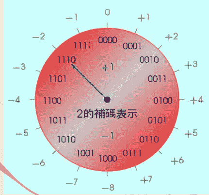

0 100 = +4  
1 100 = -4

- Only one representation for 0
- One more negative number than positive number

## More Common: Use of 2's Complement

— negatives have one additional number

```text
(0000 0000 0000 0000 0000 0000 0000 0000)₂ = (0)₁₀
(0000 0000 0000 0000 0000 0000 0000 0001)₂ = (1)₁₀
......
(0111 1111 1111 1111 1111 1111 1111 1101)₂ = (2,147,483,645)₁₀
(0111 1111 1111 1111 1111 1111 1111 1110)₂ = (2,147,483,646)₁₀
(0111 1111 1111 1111 1111 1111 1111 1111)₂ = (2,147,483,647)₁₀
(1000 0000 0000 0000 0000 0000 0000 0000)₂ = (-2,147,483,648)₁₀
(1000 0000 0000 0000 0000 0000 0000 0001)₂ = (-2,147,483,647)₁₀
(1000 0000 0000 0000 0000 0000 0000 0010)₂ = (-2,147,483,646)₁₀
......
(1111 1111 1111 1111 1111 1111 1111 1101)₂ = (-3)₁₀
(1111 1111 1111 1111 1111 1111 1111 1110)₂ = (-2)₁₀
(1111 1111 1111 1111 1111 1111 1111 1111)₂ = (-1)₁₀
```


## Two's Biased notation

❖ Negating Biased notation number:

invert all bits and add 1 with end

**Defining:** Assume: `X = ±xₙ₋₁xₙ₋₂xₙ₋₃xₙ₋₄···x₀`

`[X]ᵦ = 2ⁿ + X`,   `−2ⁿ ≤ X ≤ 2ⁿ`
`[0]ᵦ = 100000... (2ⁿ)`

`X = +1011`   `[X]ᵦ = 11011`               sign bit “1” Positive
`X = −1011`   `[X]ᵦ = 00101`               sign bit “0” Negative

2's Biased notation VS 2's complement

+   - ◉ Only reverse sign bit
+   - e.g.

`X = +1011`   `[X]c = 01011`   `[X]b = 11011`
`X = −1011`   `[X]c = 10101`   `[X]b = 00101`

**IEEE 754:** `[X]ᵦ = (2ⁿ−1) + X`

base

## sign extension (Iou vs. lb)

+   - Expansion
+     - e.g. 16 bit numbers to 32 bit numbers
+   - Required for operations with registers(32 bits) and immediate operands (16 bits)
+   - Sign extension
+     - Take the lower 16 bits as they are
+     - Copy the highest bit to the remaining 16 bits
+     - `0000 0000 0000 0010 → 2`
+       `0000 0000 0000 0000 0000 0000 0000 0010`
+     - `1111 1111 1111 1110 → -2`
+       `1111 1111 1111 1111 1111 1111 1111 1110`

## Compare operations

+   - Different compare operations required for both number types
+     - Signed integer
+       - slt Set an less than
+       - slti Set on less than immediate
+     - Unsigned integer
+       - sltu Set an less than
+       - sltiu Set on less than immediate

## Example for Compare

+   - Register $s0
+     `1111 1111 1111 1111 1111 1111 1111 1111`
+   - Register $s1
+     `0000 0000 0000 0000 0000 0000 0000 0001`

+   - Compared Operations
+     `slt $t0, $s0, $s1`
+     `sltu $t0, $s0, $s1`

+   - Results
+     `$t0 = 1`  (-1 < 1)
+     `$t0 = 0`  (4,294,967,295₁₀ > 1₁₀)

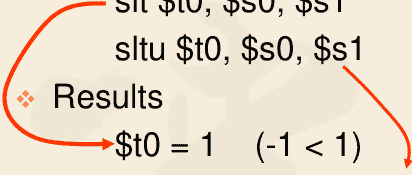

## Bounds check Shortcut

### Reduce an index-out-of-bounds check

If ($a1>=$t2 & $a1<0) goto IndexOutofBounds

sltu $t0, $a1, $t2 #Temp reg $t0=0 if k>=length or k<0

beq $t0, $zero, IndexOutofBounds # if bad, goto Error

lw $t2, 4($s6) #temp reg $s2=length of array save

slt $t0, $s3, $zero #temp reg $t0=1 if i<0

slt $t3, $s3, $t2 #temp reg $t3=0, if i>=length

slti $t3, $t3, 1 #temp reg $t3=1, if i>=length

or $t3, $t3, $t0 # $t3=1, if i is out of bounds

bne $t3,$zero, IndexOutofBounds # if out of bounds, goto Error

## Adition & subtraction

+   - Adding bit by bit, carries -> next digit

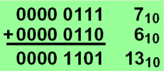

### Subtraction

+   - Directly
+   - Addition of 2's complement

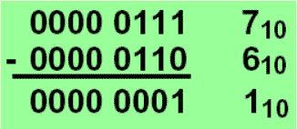

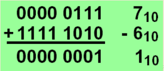

## Overflow

+   - The sum of two numbers can exceed any representation

1111 1111 255₁₀
+1111 1010 250₁₀
1 1111 1001 249₁₀

+   - The difference of two numbers can exceed any representation

+   - 2's complement:

Numbers change
sign and size

1000 0001 -127₁₀
+1111 1110 -2₁₀
0111 1111 +127₁₀

## Overflow conditions

### General overflow conditions

| Operation | Operand A | Operand B | Result overflow |
|---|---|---|---|
| A+B | ≥0 | ≥0 | <0 _(01)_ |
| A+B | <0 | <0 | ≥0 _(10)_ |
| A-B | ≥0 | <0 | <0 _(01)_ |
| A-B | <0 | ≥0 | ≥0 _(10)_ |

### Reaction on overflow

+   - Ignore ?
+   - Reaction of the OS
+   - Signalling to application (Ada, Fortran,...)


## Which instructions cause Overflow

+   • Overflows in signed arithmetic instructions cause exceptions:
+   
+     add
+   
+     add immediate (addi)
+   
+     subtract (sub)

+   • Overflows in unsigned arithmetic instructions don't cause exceptions
+   
+     add unsigned (addu)
+   
+     add immediate unsigned (addiu)
+   
+     Subtract unsigned (subu)

### Handle with care!

## New MIPS instructions

### Byte instructions

+   - **lbu**: load byte unsigned
+     - Loads a byte into the lowest 8 bit of a register
+     - Fills the remaining bits with '0'
+   - **Lb**: load byte (signed)
+     - Loads a byte into the lowest 8 bit of a register
+     - Extends the highest bit into the remaining 24 bits

### Set instructions for conditional branches

+   - **sltu**: set on less than unsigned
+   - **Sltiu**: set on less than unsigned immediate


## Logical operations

### skip

### Logical shift operations

- right (srl)
- left (sll)

**Filled with '0'**

The machine instruction for the instruction `sll $t2, $s0, 3` (`sll rd, rt, i`)

| Op | Rs | Rt | Rd | Shamt | Adr/funct |
|---:|---:|---:|---:|---:|---:|
| 0 | 0 | 16 | 10 | 3 | 0 |

Example: `sll $t2, $s0, 3`

- $s0: 0000 0000 0000 0000 1100 1000 0000 1111
- $t2: 0000 0000 0000 0110 0100 0000 0111 1000

### AND / OR

AND → bit-wise AND between registers
`and register1, register2, register3`

OR → bit-wise OR between registers
`or register1, register2, register3`

Example:

```
and $3, $10, $16
or $4, $10, $16
```

- R16: 0000 0000 0000 0000 1100 1000 0000 1111
- R10: 0000 0000 0000 0110 0100 0000 0111 1000
- R3:  0000 0000 0000 0000 0100 0000 0000 1000
- R4:  0000 0000 0000 0110 1100 1000 0111 1111

## A half adder

- Sum = a ⊕ b
- Carry = a · b

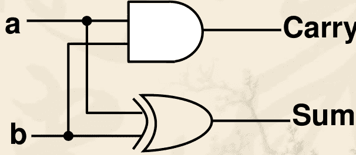

## A full adder

- Accepts a carry in
- Sum = A ⊕ B ⊕ Carry_in
- Carry_out = B · Carry_in + A · Carry_in + AB

Inputs: A, B, Carry_in; Outputs: Carry_out, Sum; Comments (two)

| A | B | Carry_in | Carry_out | Sum | Comments (two) |
|---|---|---|---|---|---|
| 0 | 0 | 0 | 0 | 0 | 0+0+0=00 |
| 0 | 0 | 1 | 0 | 1 | 0+0+1=01 |
| 0 | 1 | 0 | 0 | 1 | 0+1+0=01 |
| 0 | 1 | 1 | 1 | 0 | 0+1+1=10 |
| 1 | 0 | 0 | 0 | 1 | 1+0+0=01 |
| 1 | 0 | 1 | 1 | 0 | 1+0+1=10 |
| 1 | 1 | 0 | 1 | 0 | 1+1+0=10 |
| 1 | 1 | 1 | 1 | 1 | 1+1+1=11 |

## Full adder Logic circuit

- Full adder in 2-level design

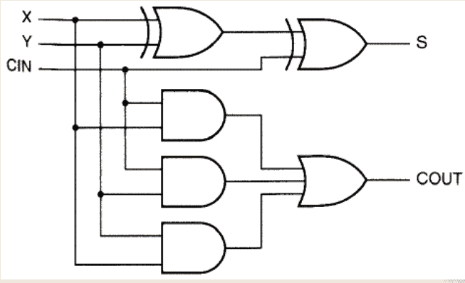

## 1 bit ALU

- ALU
  - AND
  - OR
  - ADD
- Cell
  - Cascade Element

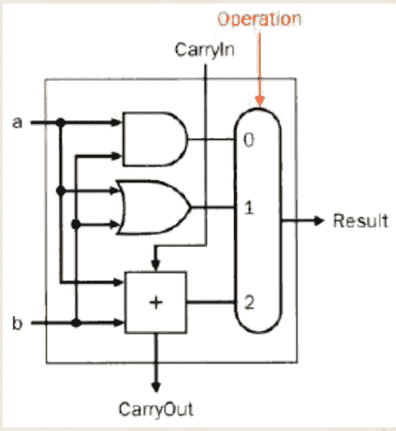

## Basic 32 bit ALU

- Inputs parallel
- Carry is cascaded
- Ripple carry adder
- Slow, but simple
- **1st Carry In = 0**

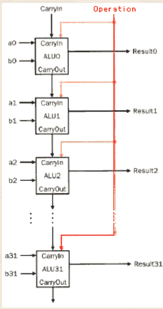

## Extended 1 bit ALU — Subtraction

- Subtraction
  - a - b
  - Inverting b
  - **1st CarryIn = 1**

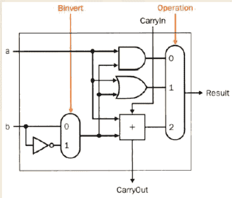

## Extended 1 bit ALU — comparison

#### Functions

- AND
- OR
- Add
- Subtract

#### Missing: comparison

- Slt rd, rs, rt
- If rs < rt, rd = 1, else rd = 0
- All bits = 0 except the least significant
- Subtraction (rs - rt), if the result is negative → rs < rt
- Use of sign bit as indicator

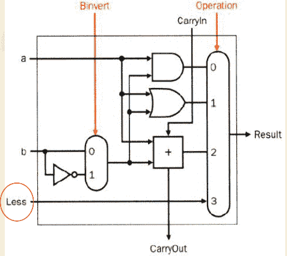

## Most significant bit

- Set for comparison
- Overflow detect

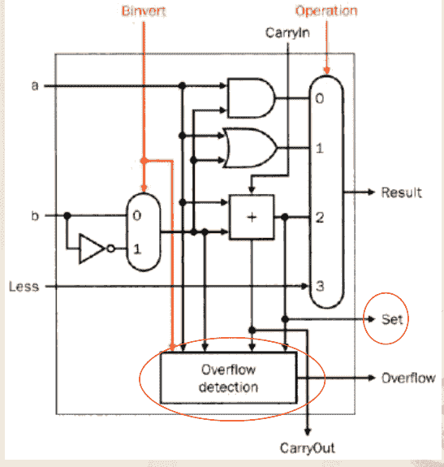

## Complete ALU

- Input
  - A、B
- Control lines
  - Binvert
  - Operation
  - Carryin
- Output
  - Result
  - Overflow

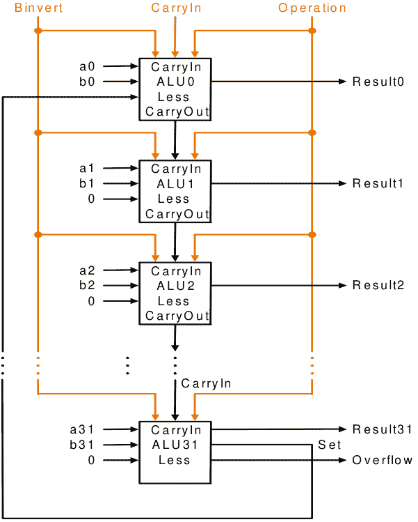

## Complete ALU — with Zero detector

- Add a Zero detector

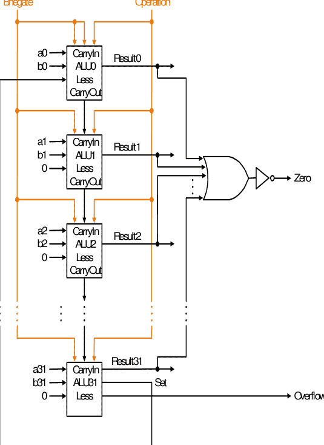

## ALU symbol & Control

- Symbol of the ALU
- Control: Function table

| ALU Control Lines | Function |
|-------------------|----------|
| 000 | And |
| 001 | Or |
| 010 | Add |
| 110 | Sub |
| 111 | Set on less than |

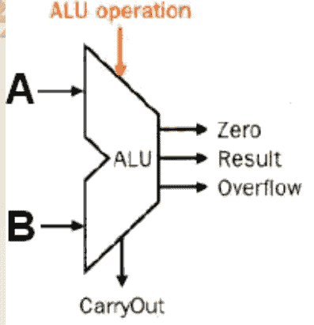

## ALU Hardware Code

```
module alu(A, B, ALU_operation, res, zero, overflow );
input [31:0] A, B;
input [2:0] ALU_operation;
output [31:0] res;
output zero, overflow ;
wire [31:0] res_and,res_or,res_add,res_sub,res_nor,res_slt;
reg [31:0] res;
parameter one = 32'h00000001, zero_0 = 32'h00000000;
assign res_and = A&B;
assign res_or = A|B;
assign res_add = A+B;
assign res_sub = A-B;
assign res_slt =(A < B) ? one : zero_0;
always @ (A or B or ALU_operation)
case (ALU_operation)
3'b000: res=res_and;
3'b001: res=res_or;
3'b010: res=res_add;
3'b110: res=res_sub;
3'b100: res=~(A | B);
3'b111: res=res_slt;
default: res=32'hx;
endcase
assign zero = (res==0)? 1: 0;
endmodule
```

## How do you write with overflow code?

## What is the difference The codes in the Synthesize?

```
always @ (A or B or ALU_operation)
case (ALU_operation)
3'b000: res=A&B;
3'b001: res=A|B;
3'b010: res=A+B;
3'b110: res=A-B;
3'b100: res=~(A | B);
3'b111: res=(A < B) ? one :
zero_0;
default: res=32'hx;
endcase
```


## Speed considerations

- Previously used: ripple carry adder
- Delay for the sum: two units

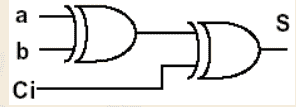

- Delay for the carry: two - three units

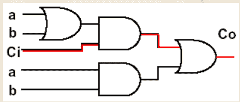

- Delay of one adder
  ≈ 2 time units
- Total delay for stages:
  2n unit delays
- Not appropriate for high speed application

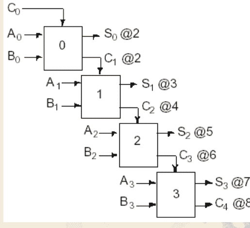

## Fast adders

- All functions can be represented in 2-level logic.

- But:

The number of inputs of the gates would drastically rise

- Target:

Optimum between speed and size

## Fast adders

- Carry look-ahead adder
  - Calculating the carries before the sum is ready
- Carry skip adder
  - Accelerating the carry calculation by skipping some blocks
- Carry select adder
  - Calculate two results and use the correct one
- ...

## Carry look ahead adder (CLA)

- Separation of
  - add operation
  - carry calculation
- Factorisation
  - \( C_{i+1} = b_i c_i + a_i c_i + a_i b_i \)
    \( = a_i b_i + a_i + b_i c_i \)
  - Generate \( g_i = a_i b_i \)
  - Propagate \( p_i = a_i + b_i \)

## Carry look ahead adder

- C<sub>i+1</sub> = g<sub>i</sub> + p<sub>i</sub> c<sub>i</sub>

- Carry generate: g<sub>i</sub> = a<sub>i</sub> b<sub>i</sub>

- If a and b are '1' ->
  we always have a carryout independent of c<sub>i</sub>

- Carry propagate: p<sub>i</sub> = a<sub>i</sub>+ b<sub>i</sub>

- If only one of a and b is '1' ->
  the carry out depends on the carry in

- p<sub>i</sub> propagates the carry

## Four bit carry look ahead adder

- c1 = g0 + (p0 * c0)
- c2 = g1 + p1*c1 = g1 + (p1 * g0) + (p1 * p0 * c0)
- c3 = g2 + p2*c2 = g2 + (p2 * g1) + (p2 * p1 * g0) + (p2 * p1 * p0 * c0)
- c4 = g3 + p3*c3 = g3 + (p3 * g2) + (p3 * p2 * g1) + (p3 * p2 * p1 * g0) + (p3 * p2 * p1 * p0 * c0)

**COMMENT:**

This kind of adder will be faster than the ripple carry adder,and smaller than the adder with the tow-level logic.

**PROBLEM:**

If the number of the adder bits is very large,this kind of adder will be too large.So we must seek more efficient ways.

## Four bit carry look ahead adder

Let’s consider a 16-bit adder.
Divide 16 bits into 4 groups.Each group has 4 bits.
As we know:
c4 = g3 + p3*g2 + p3*p2*g1 + p3*p2*p1*g0 + p3*p2*p1*p0*c0

So,we can get the following:
c8 = g7 + p7*g6 + p7*p6*g5 + p7*p6*p5*g4 + p7*p6*p5*p4*c4
c12 = g11+p11*g10+p11*p10*g9+p11*p10*p9*g8+p11*p10*p9*p8*c8
c16=g15+p15*g14+p15*p14*g13+p15*p14*p13*g12+p15*p14*p13*p12*c12

Assume:
G0= g3 + p3*g2 + p3*p2 *g1 +p3*p2*p1*g0
G1= g7 + p7*g6 + p7*p6*g5 + p7*p6*p5*g4
G2= g11+p11*g10+p11*p10*g9+p11*p10*p9*g8
G3= g15+p15*g14+p15*p14*g13+p15*p14*p13*g12
P0= p3 * p2 * p1 * p0
P1= p7 * p6 * p5 * p4
P2= p11 * p10 * p9 * p8
P3= p15 * p14 * p13 * p12

## Four bit carry look ahead adder

Then we get:
c4=G0+P0*c0 ; c8=G1+P1*c4
c12=G2+P2*c8 ; c16=G3+P3*c12
Assume:C1=c4,C2=c8,C3=c12,C4=c16
Then:
C1=G0+P0*c0 ; C2=G1+P1*C1
C3=G2+P2*C2 ; C4=G3+P3*C3
And,we can further get:
C1=G0+P0*c0 ;
C2= G1+P1*C1 = G1+P1*G0+ P1* P0*c0
C3=G2+P2*C2 = G2+P2*G1 + P2* P1*G0+ P2* P1* P0*c0
C4=G3+P3*C3= G3+P3*G2+P3*P2*G1+P3*P2*P1*G0+P3*P2*P1* P0*c0

## Hybrid CLA + Ripple carry

- Realisation:
  - Ripple carry adders and
  - Carry look ahead logic

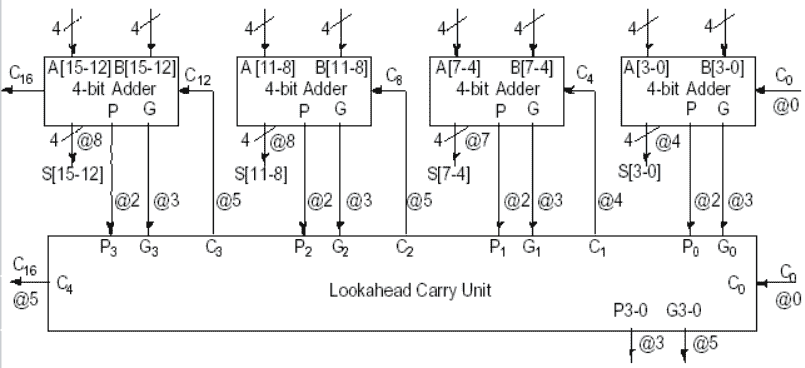

## Carry skip adder

- Accelerating the carry by skipping the interior blocks
- Optimal speed with no-equal distribution of block length

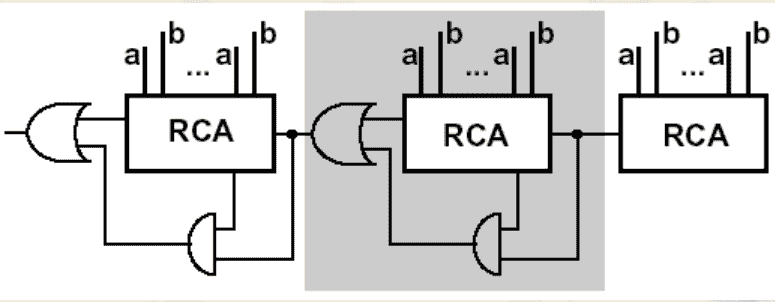

## Carry select adder (CSA)

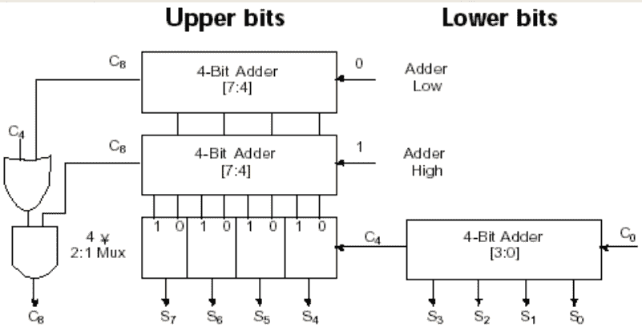

## Carry select adder

### Carry selection by nibbles

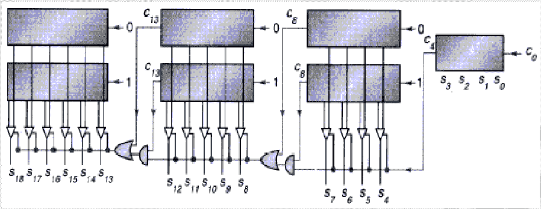

## 3.4 Multiplication

- Binary multiplication
  Multiplicand × Multiplier
  1000 × 1001

- Look at current bit position
  - If multiplier is 1
    - then add multiplicand
  - Else add 0
  - shift multiplicand left by 1 bit

|   |   |   |   |   |
|---|---|---|---|---|
| 1 | 0 | 0 | 0 | 0 |
| × | 1 | 0 | 0 | 1 |
|   |   |   |   |   |
| 1 | 0 | 0 | 0 | 0 |
| 0 | 0 | 0 | 0 | 0 |
| 0 | 0 | 0 | 0 | 0 |
| + | 1 | 0 | 0 | 0 |
| 1 | 0 | 0 | 1 | 0 | 0 | 0 | 0 |


## Multiplier V1 – Logic Diagram

- 32 bits: multiplier
- 64 bits: multiplicand, product, ALU
- 0010 * 0011

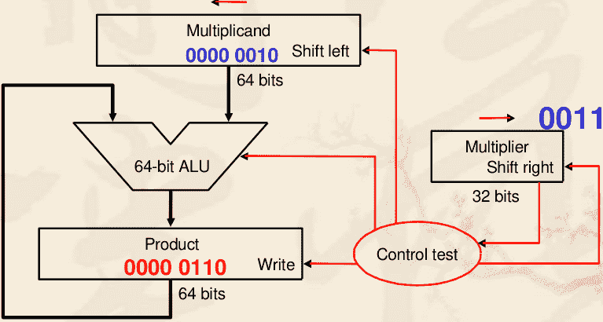

## Multiplier V1 – Algorithmic rule

- Requires **32 iterations**
  - Addition
  - Shift
  - Comparison
- Almost 100 cycles
- **Very big, Too slow!**

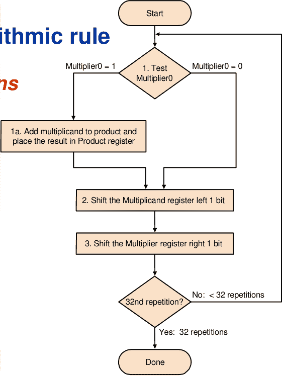

## Multiplier V2

- Real addition is performed only with 32 bits
- Least significant bits of the product don't change
- **New idea:**
  - Don't shift the multiplicand
  - Instead, **shift the product**
  - Shift the multiplier
- ALU reduced to 32 bits!

## Multiplier V2 – Logic Diagram

- Diagram of the V2 multiplier
- Only **left half of product register is changed**

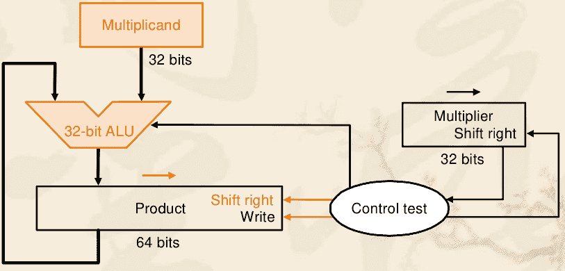

## Multiplier V2 – Algorithmic rule

- Addition performed only on left half of product register
- Shift of product register

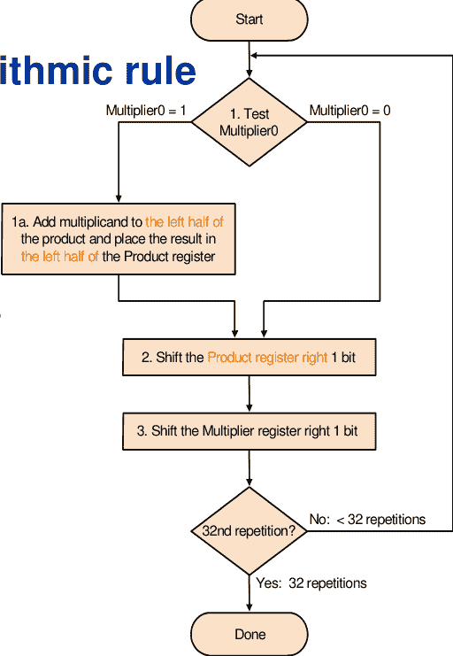

## Revised 4-bit example with V2

Multiplicand × multiplier: 0001 × 0111

Multiplicand: 0001  
Multiplier: × 0111

| Step | Add | Product | Shift out | Notes |
| --- | --- | --- | --- | --- |
| Initial |  | 00000000 |  | #Initial value for the product |
| 1 | 0001 | 00010000 |  | #After adding 0001, Multiplier=1 |
|  |  | 00001000 | 0 | #After shifting right the product one bit |
| 2 | 0001 | 00011000 |  | #After adding 0001, Multiplier=1 |
|  |  | 00001100 | 0 | #After shifting right the product one bit |
| 3 | 0001 | 00011100 |  | #After adding 0001, Multiplier=1 |
|  |  | 00001110 | 0 | #After shifting right the product one bit |
| 4 | 0000 | 00001110 |  | #After adding 0000, Multiplier=0 |
|  |  | 00000111 | 0 | #After shifting right the product one bit |

## Multiplier V3

- Further optimization
- At the initial state the product register contains only '0'
- The lower 32 bits are simply shifted out
- Idea:
  - Use these lower 32 bits for the multiplier

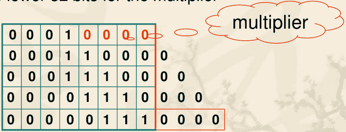

## Multiplier V3 Logic Diagram

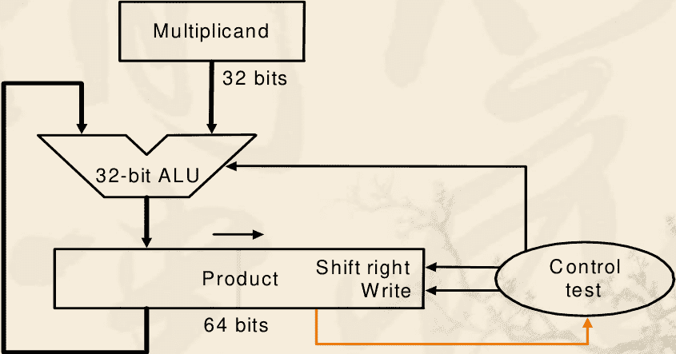

Multiplicand  
32 bits  
32-bit ALU  
Product  
Shift right / Write  
64 bits  
Control / test

## Example with V3

Multiplicand × multiplier: 0001 × 0111

Multiplicand: 0001  
Multiplier: × 0111

| Step | Add | Product | Shift out | Notes |
| --- | --- | --- | --- | --- |
| Initial |  | 00000111 |  | #Initial value for the product |
| 1 | 0001 | 00010111 |  | #After adding 0001, Multiplier=1 |
|  |  | 00001011 | 1 | #After shifting right the product one bit |
| 2 | 0001 | 00011011 |  | #After adding 0001, Multiplier=1 |
|  |  | 00001101 | 1 | #After shifting right the product one bit |
| 3 | 0001 | 00011101 |  | #After adding 0001, Multiplier=1 |
|  |  | 00001110 | 1 | #After shifting right the product one bit |
| 4 | 0000 | 00001110 |  | #After adding 0000, Multiplier=0 |
|  |  | 00000111 | 0 | #After shifting right the product one bit |

## Signed multiplication

- **Basic approach:**
  - Store the signs of the operands
  - Convert signed numbers to unsigned numbers
    - (most significant bit (MSB) = 0)
  - Perform multiplication
  - If sign bits of operands are equal
    - sign bit = 0, else
    - sign bit = 1
- **Improved method:**

## Booth's Algorithm

Assumption: addition and subtraction are available

Idea: If you have a sequence of '1's

- subtract at first '1' in multiplier
- shift for the sequence of '1's
- add where prior step had last '1'

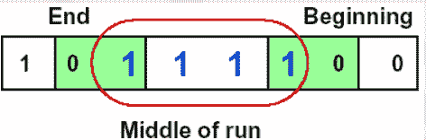

Result:

- Possibly less additions and more shifts
- Faster, if shifts are faster than additions

## Example for Booth’s Algorithm

- Logic required identifying the run

| Straight | Booth |
| --- | --- |
| `0010 * 0110` | `0010 * 0110` |
| `0000` shift | `0000` shift |
| `0010` add | `0010` sub |
| `0010` add | `0000` shift |
| `0000` shift | `0010` add |
| `00001100` | `00001100` |


## Booth's Algorithm rule

### Analysis of two consecutive bits

| Current | last | Explanation | Example |
|---|---|---|---|
| 1 | 0 | Beginning | 000011110000 |
| 1 | 1 | middle of '1' | 000011110000 |
| 0 | 1 | End | 000011110000 |
| 0 | 0 | Middle of '0' | 000011110000 |

### Action

- 10 subtract multiplicand from left
- 11 no arithmetic operation
- 01 add multiplicand to left half
- 00 no arithmetic operation

- Bit₋₁ = '0'

- Arithmetic shift right:
  - keeps the **leftmost bit constant**
  - no change of sign bit !

### Example with negative numbers

- - 2 * -3 = - 6

- - 0010 * 1101 = 1111 1010

| iteration | step | Multiplicand | product |
|---|---|---|---|
| 0 | Initial Values | 0010 | 0000 1101 0 |
| 1 | 1.c:10→Prod=Prod-Mcand<br>2: shift right Product | 0010<br>0010 | 1110 1101 0<br>1111 0110 1 |
| 2 | 1.b:01→Prod=Prod+Mcand<br>2: shift right Product | 0010<br>0010 | 0001 0110 1<br>0000 1011 0 |
| 3 | 1.c:10→Prod=Prod-Mcand<br>2: shift right Product | 0010<br>0010 | 1110 1011 0<br>1111 0101 1 |
| 4 | 1.d: 11 → no operation<br>2: shift right Product | 0010<br>0010 | 1111 0101 1<br>**1111 1010** 1 |

## 3.5 Division

- Dividend = quotient × divisor + remainder
  - Remainder < divisor
  - Iterative subtraction

- Result:
  - Greater than 0: then we get a 1
  - Smaller than 0: then we get a 0

## Division V1 --Logic Diagram

- At first,the divisor is in the left half of the divisor register, the dividend is in the right half of the remainder register.
- Shift right the divisor register each step

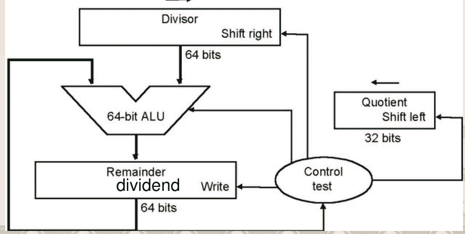

## Algorithm V 1

### Each step:

- Subtract divisor

- Depending on Result

- Leave or

- Restore

- Depending on Result

- Write '1' or

- Write '0'


## Two questions

1. Why should the divisor be shifted right one bit each time?

2. Why should the divisor be placed in the left half of the divisor register, and the dividend be placed in the right half of the remainder register at first?


## Division V 2

- Reduction of Divisor and ALU width by half
- Shifting of the remainder
- Saving 1 iteration


## Division V 3

- Remainder register keeps quotient No quotient register required


## Algorithm V 3

- Much the same than the last one
- Except change of register usage


## Example 7/2 for Division V3

Well known numbers: 0000 0111/0010

| iteration | step | Divisor | Remainder |
|---|---|---|---|
| 0 | Initial Values | 0010 | 0000 0111 |
| | Shift Rem left 1 | 0010 | **0000 1110** |
| 1 | 1.Rem=Rem-Div | 0010 | 0110 1110 |
| | 2b: Rem<0 → +Div, sll R, R₀=0 | 0010 | **0001 1100** |
| 2 | 1.Rem=Rem-Div | 0010 | 0111 0110 |
| | 2b: Rem<0 → +Div, sll R, R₀=0 | 0010 | **0011 1000** |
| 3 | 1.Rem=Rem-Div | 0010 | 0001 1000 |
| | 2a: Rem≥0 → sll R, R₀=1 | 0010 | **0011 0001** |
| 4 | 1.Rem=Rem-Div | 0010 | 0001 0011 |
| | 2a: Rem≥0 → sll R, R₀=1 | 0010 | **0010 0111** |
| | Shift left half of Rem right 1 | | |


## Signed division

- Keep the signs in mind for Dividend and Remainder
  - (+ 7) ÷(+ 2) = + 3 Remainder = +1
  - 7 = 3 × 2 + (+1) = 6 + 1
  - (- 7 ) ÷(+ 2) = - 3 Remainder = -1
  - -7 = -3 × 2 + (-1) = - 6 - 1
  - (+ 7 ) ÷(- 2) = - 3 Remainder = +1
  - (- 7 ) ÷(- 2) = + 3 Remainder = -1
- One 64 bit register : Hi & Lo
  - Hi: Remainder, Lo: Quotient
- Instructions: div, divu
- Divide by 0 → overflow : Check by software

## 3.6 Floating point numbers

- **Reasoning**
  - Larger number range than integer range
  - Fractions
  - Numbers like e (2.71828) and π (3.14159265....)
- **Representation**
  - Sign
  - Significant
  - Exponent
  - More bits for significand: more accuracy
  - More bits for exponent: increases the range


## Floating point numbers

- Form
  - Arbitrary 363.4 • 10<sup>34</sup>
  - Normalised 3.634 • 10<sup>36</sup>
- Binary notation
  - Normalised 1.xxxxxx • 2<sup>yyyy</sup>
- Standardised format IEEE 754
  - Single precision 8 bit exp, 23 bit significand
  - Double precision 11 bit exp, 52 bit significand
- Both formats are supported by MIPS


## Example

- Show the binary representation of -0.75 in IEEE single precision format

- Decimal representation: -0.75 = - 3/4 = - 3/2²

- Binary representation: - 0.11 = - 1.1 • 2⁻¹

- Floating point

α (-1)^sign • (1 + fraction) • 2^exponent - bias

α (-1)^sign =-1,so Sign = 1

α 1 + fraction = 1.1,so Significand=.1

α exponent -127 =-1,so Exponent=(-1 + 127) = 126

| 31 | 30 ...... 23 | 22 ...... 0 |
|---|---|---|
| 1 | 0111 1110 | 100 0000 0000 0000 0000 0000 |

1 bit 8 bits 23 bits

| 31 | 30 ...... 20 | 19 ...... 0 |
|---|---|---|
| 1 | 011 1111 1110 | 1000 0000 0000 0000 0000 |

1bit 11 bits 20 bits

| 0000 0000 0000 0000 0000 0000 0000 0000 |

## Limitations

- Overflow:
  The number is too big to be represented
- Underflow:
  The number is too small to be represented

## Floating point addition

- Alignment
- The proper digits have to be added
- Addition of significands
- Normalisation of the result
- Rounding
- Example in decimal
  - system precision 4 digits

What is 9.999 • 10¹ + 1.610 • 10⁻¹?

## Example for Decimal

- Aligning the two numbers

  `9.999 • 10¹`

  `0.01610 • 10¹ → 0.016 • 10¹` Truncation

- Addition

  ```text
      9.999   • 10¹
    + 0.016   • 10¹
    ─────────────
     10.015   • 10¹
  ```

- Normalisation

  `1.0015 • 10²`

- Rounding

  `1.002 • 10²`

## Algorithm

- Normalise Significands
- Add Significands
- Normalise the sum
- Over/underflow
- Rounding
- Normalisation


## Example y=0.5+(-0.4375) in binary

- 0.5₁₀ = 1.000₂×2⁻¹
- -0.4375₂=-1.110₂×2⁻²
- Step1:The fraction with lesser exponent is shifted right until matches
  -1.110₂×2⁻² → -0.1111₂×2⁻¹
- Step2: Add the significands
  1.000₂×2⁻¹
  +) - 0.1111₂×2⁻¹
  0.001₂×2⁻¹
- Step3: Normalize the sum and checking for overflow or underflow
  0.001₂×2⁻¹ → 0.010₂×2⁻² → 0.100₂×2⁻³ → 1.000₂×2⁻⁴
- Step4: Round the sum
  1.000₂×2⁻⁴ = 0.0625₁₀

## Algorithm


Compare exponents

Shift smaller number right

Add

Normalize

Round

## Multiplication

- Composition of number from different parts

→ separate handling

(s1 · 2<sup>e1</sup>) · (s2 · 2<sup>e2</sup>) = (s1 · s2) · 2<sup>e1+ e2</sup>

- Example

1 10000010 000 0000 0000 0000 0000 0000 = -1 × 2<sup>3</sup>

0 10000011 000 0000 0000 0000 0000 0000 = 1 × 2<sup>4</sup>

- Both significands are 1 → product = 1 →Sign=1

- Add the exponents, bias = 127

10000010
+10000011
110000101

Correction: 110000101-01111111=10000110=134=127+3+4

- The result: 1 10000110 000 0000 0000 0000 0000 0000 = -1 × 2<sup>7</sup>

## Multiplication

- Add exponents
- Multiply the significands
- Normalise
- Over- underflow
- Rounding
- Sign


## Data Flow


Sign  Exponent  Significand

Sign  Exponent  Significand

ALU

Exp + Exp - bias

ALU

Sig · Sig

Overflow/
Underflow

Shift right

Norm.

Control

Rounding
logic

Incr.

Sign logic

Sign  Exponent  Significand


# Computer Organization & Design

# The Hardware/Software Interface

# Chapter 5  The processor -
Datapath and control

Qing-song Shi

http://10.214.26.103    Email: zisgs@zju.edu.cn


## Chapter 5

## The processor : Datapath and control


## Chapter Five

## The processor : Datapath and control

- 5.1 Introduction
- 5.2 Logic Design Conventions (skip)
- 5.3 Building a datapath
- 5.4 A Simple Implementation Scheme
- 5.5 A Multicycle Implementation
- 5.5 Microprogramming
- 5.6 Exception

# What is the MIPS?

# Microprocessor
without
Interlocked
Pipeline
Stages

# 5.1 Introduction

- We'll look at an implementation of the MIPS
- Simplified to contain only:
  - memory-reference instructions: `lw`, `sw`
  - arithmetic-logical instructions: `add`, `sub`, `and`, `or`, `slt`
  - control flow instructions: `beq`, `j`
- An Overview of the implementation
  - For every instruction, the first two step are identical
    1. **Fetch the instruction from the memory**
    2. **Decode and read the registers**
  - Next steps depend on the instruction class
    - **Memory-reference**
    - **Arithmetic-logical**
    - **branches**

What are steps?

How many FUN ?

# # An abstract view of the implementation of MIPS


## Chapter Five

## The processor : Datapath and control

- 5.1 Introduction
- 5.2 Logic Design Conventions (skip)
- 5.3 Building a datapath
- 5.4 A Simple Implementation Scheme
- 5.5 A Multicycle Implementation
- 5.5 Microprogramming
- 5.6 Exception

# # State Elements

- Unclocked vs. Clocked
- Clocks used in synchronous logic

or when should an element that contains state be updated?


# # D-Latch for state

| C | D | S | R | Q(t + 1) |
|---|---|---|---|----------|
| 0 | X | X | X | hold     |
| 1 | 0 | 0 | 1 | Q=0: reset |
| 1 | 1 | 1 | 0 | Q=1: reset |

| C | D | Q(t + 1)   |
|---|---|------------|
| 0 | X | hold       |
| 1 | 0 | Q=0: reset |
| 1 | 1 | Q=1: set   |

**D-Latch FUN. table**


**D-Latch symbol**

# # Chapter Five

# # The processor : Datapath and control

# ## 5.1 Introduction

# ## 5.2 Logic Design Conventions (skip)

# ## 5.3 Building a datapath

# ## 5.4 A Simple Implementation Scheme

# ## 5.5 A Multicycle Implementation

# ## 5.5 Microprogramming

# ## 5.6 Exception

# The datapath there are ......

| Name | Example | Comments |
|---|---|---|
| 32 register | `$s0-$s7, $t0-$t9, $zero, $a0-$a3, $v0-$v1` | **Fast locations for data.** In MIPS, data must be in registers to perform arithmetic. MIPS register `$zero` always equals 0. `$gp`(28) is the global pointer, `$sp`(29) is the stack pointer, `$fp`(30) is the frame pointer, and `$ra`(31) is the return address. |
| 30 Word Addresses signals line | Memory[0], Memory[4], Memory[4294967292] | Accessed only by data transfer instructions. MIPS uses byte addresses, so sequential word addresses differ by 4. Memory holds data structures, arrays, and spilled registers, such as those saved on procedure calls. |

| Name | Register no. | Usage | Preserved on call |
|---|---:|---|---|
| `$zero` | 0 | The constant value 0 | n.a. |
| `$v0-$v1` | 2-3 | Values for results and expression evaluation | no |
| `$a0-$a3` | 4-7 | Arguments | no |
| `$t0-$t7` | 8-15 | Temporaries | no |
| `$s0-$s7` | 16-23 | Saved | yes |
| `$t8-$t9` | 24-25 | More temporaries | no |
| `$gp` | 28 | Global pointer | yes |
| `$sp` | 29 | Stack pointer | yes |
| `$fp` | 30 | Framer pointer | yes |
| `$ra` | 31 | Return address | yes |

# # ALU OP for MIPS machine language

| Name | Format | Example | Comment |
|---|---|---|---|
| add | R | 0 18 19 17 0 32 | add $s1, $s2, $s3 |
| sub | R | 0 18 19 17 0 34 | sub $s1, $s2, $s3 |
| lw | I | 35 18 17 100 | lw $s1, 100($s2) |
| sw | I | 43 18 17 100 | sw $s1, 100($s2) |
| and | R | 0 18 19 17 0 36 | and $s1, $s2, $s3 |
| or | R | 0 18 19 17 0 37 | or $s1, $s2, $s3 |
| nor | R | 0 18 19 17 0 39 | nor $s1, $s2, $s3 |
| addi | I | 12 18 17 100 | addi $s1, $s2,100 |
| ori | I | 13 18 17 100 | ori $s1, $s2,100 |
| beq | I | 4 17 18 25 | beq $s1, $s2,100 |
| bne | I | 5 17 18 25 | bne $s1, $s2,100 |
| slt | R | 0 18 19 17 0 42 | slt $s1, $s2,$s3 |
| j | J | 2 2500 | j 10000(see section 2.9) |
| jr | R | 0 31 0 0 0 8 | j $ra |
| jal | J | 3 2500 | jar 10000(see section 2.9) |
| Field size | | 6bits 5bits 5bits 5bits 5bits 6bits | All MIPS instruction 32 bits |
| R-format | R | op rs rt rd shamt funct | Arithmetic instruction format |
| i-format | I | op rs rt address | Data transfer ,branch format |


## Instruction execution in MIPS

- **Fetch:**
  - Take instructions from the instruction memory
  - Modify PC to point the next instruction

- **Instruction decoding & Read Operand:**
  - Will be translated into machine control command
  - Reading Register Operands, whether or not to use

- **Executive Control:**
  - Control the implementation of the corresponding ALU operation

- **Memory access:**
  - Write or Read data from memory
  - Only LW/SW

- **Write results to register:**
  - If it is R-type instructions, ALU results are written to Rd
  - If it is I-type instructions, Results are written to Rt

## Instruction fetching unit


PC

Read address

Instruction memory

Instruction

Add

4

CPU

## More Implementation Details

### Abstract / Simplified View:


## Register File--Built using D flip-flops

### Read

Output from the register

5 bits

Read register number 1

5 bits

Read register number 2

5 bits

Write register

32 bits

Write data

Register file

Write

Read data 1

32 bits

Read data 2

32 bits

Read register number 1

Read register number 2

Reg. address

Reg. address

Data output

Register 0

Register 1

...

Register n − 1

Register n

Mux

Read data 1

Mux

Read data 2


## Register File

### Write

Written to the register

Write signals

rd or rt
5 bits

Reg. address

32 bits


## Register files

- Foundation element of Computer（Part of Datapath）
- Aggregation of many Registers
- Register address、Control signals: Read/Write


## Description: 32×32bits Register files

```verilog
Module regs(clk, rst,reg_Rd_addr_A, reg_Rt_addr_B, reg_Wt_addr, wdata, we, rdata_A,
rdata_B);

input clk, rst, we;
input [4:0] reg_Rd_addr_A, reg_Rt_addr_B, reg_Wt_addr;
input [31:0] wdata;
output [31:0] rdata_A, rdata_B;
reg [31:0] register [1:31];          // r1 - r31
integer i;

assign rdata_A = (reg_Rd_addr_A == 0)? 0 : register[reg_Rd_addr_A]; // read
assign rdata_B = (reg_Rt_addr_B == 0)? 0 : register[reg_Rt_addr_B]; // read
always @(posedge clk or posedge rst)
begin
    if (rst==1) begin                // reset
        for (i=1; i<32; i=i+1)
            register[i] <= 0;
    end
    else begin
        if ((reg_Wt_addr != 0) && (we == 1)) // write
            register[reg_Wt_addr] <= wdata;
    end
end
endmodule
```

## Path Built using Multiplexer

- R-type instruction Datapath
- I-type instruction Datapath
  - For ALU
  - For memory
  - For branch
- J-type instruction Datapath
  - For Jump
- First, Look at the data flow within instruction execution

## R type Instruction & Data stream

| Bnegate | op   | function   |
|---------|------|------------|
| 0       | 00   | and        |
| 0       | 01   | Or         |
| 0       | 10   | Add        |
| 1       | 10   | Sub        |
| 1       | 11   | Slt        |

## I type Instruction & Data stream

Sw $t0, 200($s2)

op(6)
rs(5)
rt(5)
Immediate data

bit21-25
bit16-20
bit0-15
16

control

Read reg. address1
Read data1
Read reg. address2
Registers
Write reg. address
Read data2
Write data

RegWrite

Sign extend
32

3
ALU operation

ALU
ALU result
Zero

32bits data

MenWrite
address
Read data
Data
Memory
Write data
MenRead

lw $t0, 200($s2)
if $s2=1000, it will load word in element number 1200 to $t0

## Combine the datapath R & I type


## Combine the datapath R & I type

PC
Read address
Instruction
Instruction Memory
Instruction
bit21-25
bit16-20
bit11-15
bit0-15
Sign extend
16
32
Read address1
Read data1
Read address2
Write address
Read data2
Write data
Registers
RegWrite
MUX
MUX
Shift left 2
ADD
4
ADD
ALU operation
Zero
ALU result
ALU
MUX
MUX
MenWrite
address
Read data
Data Memory
Write data
MenRead
MUX
MUX
32bits data


## Combine the datapath R & I type

## Chapter Five: The processor: Datapath and control

- 5.1 Introduction
- 5.2 Logic Design Conventions (skip)
- 5.3 Building a Datapath
- 5.4 A Simple Implementation Scheme
- 5.5 A Multicycle Implementation
- 5.6 Microprogramming
- 5.7 Exception

### Building the Datapath

- Use multiplexors to stitch them together


### Building Control

Analyse for cause and effect

- Information comes from the 32 bits of the instruction
- Selecting the operations to perform (ALU, read/write, etc.)
- Controlling the flow of data (multiplexor inputs)
- ALU's operation based on instruction type and function code

| Instruction format | Fields |
|---|---|
| R-format instruction (add, sub, and, or, slt) | Op \| Rs \| Rt \| Rd \| Shamt \| Funct |
| Bit widths | 6 bits \| 5 bits \| 5 bits \| 5 bits \| 5 bits \| 6 bits |
| I-format instruction (lw, sw, beq) | Op \| Rs \| Rt \| Immediate |
| Bit widths | 6 bits \| 5 bits \| 5 bits \| 16 bits |
| J-format instruction (j) | Op \| address |
| Bit widths | 6 bits \| 26 bits |

### Instruction Code

| Instruction | Format | 31–26 | 25–21 | 20–16 | 15–11 | 10–6 | 5–0 |
|---|---|---|---|---|---|---|---|
| add | R | 000000 | rs | rt | rd | 00000 | 100000 |
| sub | R | 000000 | rs | rt | rd | 00000 | 100010 |
| and | R | 000000 | rs | rt | rd | 00000 | 100100 |
| or | R | 000000 | rs | rt | rd | 00000 | 100101 |
| slt | R | 000000 | rs | rt | rd | 00000 | 101010 |
| lw | I | 100011 | rs | rt | Immediate(displacement) |  |  |
| sw | I | 101011 | rs | rt | Immediate(displacement) |  |  |
| beq | I | 000100 | rs | rt | Immediate(offset) |  |  |
| j | J | 000010 | address |  |  |  |  |

### What should ALU do?

- e.g. what should the ALU do with these instructions
- Example: lw $1, 100($2)

| OP | rs | rt | 16 bit displacement | ALU op |
|---|---|---|---|---|
| lw | 2 | 1 | 100 | 00 |
| sw | 2 | 1 | 100 | 00 |

| R | rs(5) | rt(5) | rd(5) | shamt | func(6) |
|---|---|---|---|---|---|
| 000000(00) |  |  |  |  | 10 |

| B negate | op | function |
|---|---|---|
| 0 | 00 | and |
| 0 | 01 | Or |
| 0 | 10 | Add |
| 1 | 10 | Sub |
| 1 | 11 | Slt |

- ALU control input
  - 3-types
- Why is the code for subtract 110 and not 011?

### Scheme of Controller: 2-level decoder

```
op(6) rs(5) rt(5) rd(5) shamt func(6)
instruction op code (6)
First Main decoder
ALU op(2) Defined
ALU Decoder Second
Defined at Chapter-3 ALU operation(3)
Signals for Other Components (7)
Defined
```

### The ALU control is where and other signals(7)

### Designing the Main Control Unit (First level)

- Main Control Unit function
  - ALU op (2)
  - Divided 7 control signals into 2 groups
    - 4 Mux
    - 3 R/W


### Truth Table for Main decoder


| Instruction | RegDst | ALUSrc | MemtoReg | RegWrite | MemRead | MemWrite | Branch | ALUop1 | ALUop0 |
|---|---:|---:|---:|---:|---:|---:|---:|---:|---:|
| beq | X | 0 | X | 0 | 0 | 0 | 1 | 0 | 1 |
| R-format | 1 | 0 | 0 | 1 | 0 | 0 | 0 | 1 | 0 |
| LW | 0 | 1 | 1 | 1 | 1 | 0 | 0 | 0 | 0 |
| SW | X | 1 | X | 0 | 0 | 1 | 0 | 0 | 0 |

### Designing the ALU decoder (Second level)

- Must describe hardware to compute 3-bit ALU control input

| Instruction opcode | ALUop | Instruction operation | Funct field | Desired ALU action | ALU control input |
|---|---|---|---|---|---|
| LW | 00 | Load word | xxxxxx | Load word | 0010 |
| SW | 00 | Store word | xxxxxx | Store word | 0010 |
| Beq | 01 | branch equal | xxxxxx | branch equal | 0110 |
| R-type | 10 | add | 100000 | add | 0010 |
| R-type | 10 | subtract | 100010 | subtract | 0110 |
| R-type | 10 | AND | 100100 | AND | 0000 |
| R-type | 10 | OR | 100101 | OR | 0001 |
| R-type | 10 | Set on less than | 101010 | Set on less than | 0111 |


## Truth Table for ALU decoder

Describe it using a truth table (can turn into gates):

| ALUOp1 | ALUOp0 | F5 | F4 | F3 | F2 | F1 | F0 | Operation 210 |
|--------|--------|----|----|----|----|----|----|----------------|
| 0      | 0      | X  | X  | X  | X  | X  | X  | 010            |
| X      | 1      | X  | X  | X  | X  | X  | X  | 110            |
| 1      | X      | X  | X  | 0  | 0  | 0  | 0  | 010            |
| 1      | X      | X  | X  | 0  | 0  | 1  | 0  | 110            |
| 1      | X      | X  | X  | 0  | 1  | 0  | 0  | 000            |
| 1      | X      | X  | X  | 0  | 1  | 0  | 1  | 001            |
| 1      | X      | X  | X  | 1  | 0  | 1  | 0  | 111            |

Operation $_{2}$ = $ALU_{op0}$ + $ALU_{op1}(\overline{F_3}\overline{F_2}F_1\overline{F_0} + F_3\overline{F_2}F_1\overline{F_0})$

Operation $_{1}$ = $\frac{ALU_{op1}\overline{F_3}F_2\overline{F_1}\overline{F_0} + ALU_{op1}\overline{F_3}F_2\overline{F_1}F_0}{}$

Operation $_{0}$ = $ALU_{op1}\overline{F_3}F_2\overline{F_1}F_0 + ALU_{op1}F_3\overline{F_2}F_1\overline{F_0}$

## The ALU control signals----logic circuit


Operation 2 = ALUop0 + ALUop1F1

Operation 1 = ALUop1F̅2

Operation 0 = ALUop1 + (F0 + F3)

## Our Simple Control Structure

- All of the logic is combinational
- We wait for everything to settle down, and the right thing to be done
- ALU might not produce right answer? right away
- we use write signals along with clock to determine when to write
- Cycle time determined by length of the longest path


We are ignoring some details like setup and hold times

## The simple Datapath with the control unit


## The Datapath in operation for R-type

add sub and or slt R-type

| Op | rs | rt | rd | shamt | Funct |
|---|---|---|---|---|---|
| I-type | | | | | |
| Op | rs | rt | Immediate | | |
| Jump-type | | | | | |
| Op | address | | | | |


## The Datapath in operation for load


load instruction

I-type d mt nct

| Op | rs | rt | Immediate |
|---|---|---|---|

## The Datapath in operation for beq

beq instruction

I-type

Op rs rt Immediate

Op address

## j instruction

- ❖ instruction format
- ❧ j Label

| `(000010)₂` | 26 bits address |
|---|---|

- ❖ Implementation

pc = pc₂₈~₃₁ ## 26bits-address × 4

## The Datapath in operation for Jump

Instruction [25-0] Shift left 2 jump address[31-0] 26 28 PC+4[31-28] Add 4 pc Read address Instruction [31-0] Instruction memory Instruction [31-26] Control RegDst Branch MemRead MemtoRead ALUOp MemWrite ALUSrc RegWrite Instruction [25-21] Read register 1 Read data 1 Instruction [20-16] Read register 2 Read data 2 Write register Write data Registers Instruction [15-11] Instruction [15-0] 16 32 Sign extend Instruction [5-0] ALU control Zero ALU result Address Read data Data memory Write data 0 MUX 1 0 MUX 1 0 MUX 1 0 MUX 1 1 MUX 0 jump jump instruction Jump-type Op address

## Single Cycle Implementation performance for lw

- Calculate cycle time assuming negligible delays except:
  - memory (2ns), ALU and adders (2ns), register file access (1ns)


## The CPU Performance Equation

CPU time = CPU clock cycles for a program × Clock cycle time

CPU time = \frac{CPU clock cycles for a program}{Clock rate}

CPU time = I CPI τ

CPI = \frac{CPU \text{ clock cycles for a program}}{\text{Instruction count}}

CPU time = Instruction count × Clock cycle time × Cycles per instruction

CPU time = \frac{\text{Instruction count × Clock cycle time}}{\text{Clock rate}}

\frac{\text{Instructions}}{\text{Program}} × \frac{\text{Clock cycles}}{\text{Instruction}} × \frac{\text{Seconds}}{\text{Clock cycle}} = \frac{\text{Seconds}}{\text{Program}} = \text{CPU time}


## MIPS (*million instruction per second*)

$$\mathrm{MIPS}=\frac{\mathrm{Instruction\ count}}{\mathrm{Execution\ time}\times 10^6}=\frac{\mathrm{Clock\ rate}}{\mathrm{CPI}\times 10^6}$$

$$\mathrm{Execution\ time}=\frac{\mathrm{Instruction\ count}}{\mathrm{MIPS}\times 10^6}$$

> ❌ **The bigger the MIPS, the faster the machine.**

- **Three problems with MIPS:**
  - MIPS is dependent on the instruction set, making it difficult to compare MIPS of computers with different instruction sets.
  - MIPS varies between programs on the same computer.
  - Most importantly, MIPS can vary inversely to performance!

## Single Cycle Problems

- what if we had a more complicated instruction like floating point?
  If so, the waste of time will be more serious.
- wasteful of area. The reason is the following:
  - **Let’s see the instruction ‘mult’. This instruction needs to use the ALU repeatedly.**
  - **But, in the single cycle implementation, one ALU can be used only once in one clock cycle.**
  - **So, the instruction ‘mult’ will need many ALUs. The CPU will be very large.**

## One Solution for Single Cycle Problems

- One Solution:
  - Use a smaller cycle time
  - Let different instructions take different numbers of cycles
- a Multicycle datapath:


## Chapter Five

## The processor : Datapath and control

1. 5.1 Introduction
2. 5.2 Logic Design Conventions (skip)
3. 5.3 Building a datapath
4. 5.4 A Simple Implementation Scheme
5. 5.5 A Multicycle Implementation
6. 5.5 Microprogramming
7. 5.6 Exception

## Multicycle Approach

- Break up the instructions into steps, each step takes a cycle
  - balance the amount of work to be done
  - restrict each cycle to use only one major functional unit
- At the end of a cycle
  - store values for use in later cycles
  - introduce additional internal registers

## Analyse events: Five Execution Steps

- **F:** Instruction Fetch
- **ID:** Instruction Decode and Register Fetch
- **EX (BC):** Execution, Memory Address Computation, or Branch Completion
- **MEM (WB):** Memory Access or R-type instruction completion
- **WB:** Write-back step

***INSTRUCTIONS TAKE FROM 3 - 5 CYCLES!***

## Step 1: Instruction Fetch

- Use PC to get instruction and put it in the Instruction Register.
  - `IR = Memory[PC];`
- Increment the PC by 4 and put the result back in the PC.
  - `PC = PC + 4;`
- Can be described simply using RTL "Register-Transfer Language"
  - `IR = Memory[PC];`
  - `PC = PC + 4;`
- Can we figure out the values of the control signals?
- What is the advantage of updating the PC now?

## Step 2: Instruction Decode and Register Fetch

- Read registers rs and rt in case we need them
- Compute the branch address in case the instruction is a branch
- RTL:

```
A = Reg[IR[25–21]];
B = Reg[IR[20–16]];
ALUOut = PC + (sign-extend(IR[15–01]) << 2);
```

- We aren't setting any control lines based on the instruction type
  (we are busy "decoding" it in our control logic)

## Step 3 (instruction dependent)

- ALU is performing one of three functions, based on instruction type
- Memory Reference ( lw / sw ):
  ALUOut = A + sign-extend(IR[15-0]);
- R-type:
  ALUOut = A op B;
- Branch:
  if (A==B) PC = ALUOut;
- jump:
  pc = pc31-28 + IR25-0 << 2


## Step 4 (R-type or memory-access)

- Loads and stores access memory
  - `MDR = Memory[ALUOut]; # for lw`
  - `or`
  - `Memory[ALUOut] = B; # for sw`
- R-type instructions finish
  - `Reg[rd]=Reg[ IR[15-11] ] = ALUOut;`

The write actually takes place at the end of the cycle on the edge

## Write-back step (step 5)

- lw
  - `Reg[rt]=Reg[IR[20-16]]=MDR;`

What about all the other instructions?

## Summary:

| Step name | Action for R-type instructions | Action for memory-reference instructions | Action for branches | Action for jumps |
|---|---|---|---|---|
| Instruction fetch | | IR = Memory[PC]<br>PC = PC + 4 | | |
| Instruction decode/register fetch | | A = Reg[IR[25-21]]<br>B = Reg[IR[20-16]]<br>ALUOut = PC + (sign-extend (IR[15-0]) << 2) | | |
| Execution, address computation, branch/jump completion | ALUOut = A op B | ALUOut = A + sign-extend (IR[15-0]) | if (A == B) then<br>PC = ALUOut | PC = PC[31-28] || (IR[25-0] << 2) |
| Memory access or R-type completion | Reg[IR[15-11]] = ALUOut | Load: MDR = Memory[ALUOut]<br>or<br>Store: Memory[ALUOut] = B | | |
| Memory read completion | | Load: Reg[IR[20-16]] = MDR | | |

## Simple Questions

- How many cycles will it take to execute this code? (1–2)

```asm
lw $t2, 0($t3)
lw $t3, 4($t3)
beq $t2, $t3, Label     #assume not
add $t5, $t2, $t3
sw $t5, 8($t3)
```

Label1: ...

- What is going on during the 8th cycle of execution?
  - Answer: Calculating memory address

- In what cycle does the actual addition of $t2 and $t3 takes place?
  - No. 16


## Reusing Resource

- We will be reusing functional units
  - ALU used to compute address and to increment PC
  - Memory used for instruction and data
- We will use a finite state machine for control


## Scheme of Controller of Multicycle


## How does it control in Multicycle Approach

## signals for datapath of Multicycle

Defined 10+6 control (p. 324)

| Signal name | Effect when deasserted (=0) | Effect when asserted (=1) |
|---|---|---|
| RegDst | Select register destination number from the rt(20:16) when WR. | Select register destination number from the rd(15:11) when WB. |
| RegWrite | None | Register destination input is written with the value on the Write data input |
| ALUSrcA | The first ALU operand is the PC | The first ALU operand come from the A register. |
| MemRead | None | Memory contents at the location specified by the address input is put on the Memory data out. |
| MemWrite | None | Memory contents at the location specified by the address input are replaced by value on the Write data input. |
| MemtoReg | The value fed to register Write data input comes from the ALUOut | The value fed to the register Write data input comes from the MDA. |
| IorD | The PC is used to supply the address to the memory unit. | ALUOut is used to supply the address to the memory unit. |
| IRWrite | None | The output of memory is written into the IR. |
| PCWrite | None | The is written; the source is controlled by PCSource. |
| PCWriteCond | None | The PC is written if the zero output from the ALU is also active. |

## Control signals

| Signal name | Value | Effect |
|---|---|---|
| **ALUOp** | **00** | The ALU performs an add operation. |
| | **01** | The ALU performs an subtract operation. |
| | **10** | The funct field of the instruction determines the ALUoperation |
| **ALUSrcB** | **00** | The second input to the ALU comes from the B register. |
| | **01** | The second input to the ALU is the constant 4. |
| | **10** | The second input to the ALU is the sign-extended, lower 16 bits of the IR. |
| | **11** | The second input to the ALU is the sign-extended, lower 16 bits of the IR shift 2 bits. |
| **PCSource** | **00** | Output of the ALU(PC+4) is sent to the PC for writing. |
| | **01** | The contents of ALUOut (the branch target address) are sent to the PC writing. |
| | **10** | The jump target address (IR[25:0]shifted left 2 bits and concatenated with PC+4[31:28]) is sent to the PC for writing. |


## seq: pc = pc + 4
beq: pc = pc + offset * 4
j : pc = pc31-28 + IR25-0 << 2


## Implementing the Control

- Value of control signals is dependent upon:
  - what instruction is being executed
  - which step is being performed

- Let’s go over the main control unit in the single-cycle implementation.

## Review for single-cycle

## Main control unit in the single-cycle implementation

| Instruction | Opcode |
|-------------|--------|
| R-type      | 0      |
| lw          | 35     |
| sw          | 43     |
| beq         | 4      |


## Review

• Now, let’s look at the AIU control unit. It does not need to changed.


- As same as the single-cycle

- So, the following truth table remains the same.

| ALUOp1 | ALUOp0 | F5 | F4 | F3 | F2 | F1 | F0 | Operation |
|--------|--------|----|----|----|----|----|----|-----------|
| 0      | 0      | X  | X  | X  | X  | X  | X  | 010       |
| X      | 1      | X  | X  | X  | X  | X  | X  | 110       |
| 1      | X      | X  | X  | 0  | 0  | 0  | 0  | 010       |
| 1      | X      | X  | X  | 0  | 0  | 1  | 0  | 110       |
| 1      | X      | X  | X  | 0  | 1  | 0  | 0  | 000       |
| 1      | X      | X  | X  | 0  | 1  | 0  | 1  | 001       |
| 1      | X      | X  | X  | 1  | 0  | 1  | 0  | 111       |

## Review: Finite state machines

- Finite state machines:
  - a set of states
  - next state function (determined by current state and the input)
  - output function (determined by current state and possibly input)


## Difference in controller

- Do something different in each cycle
- Two main ways to implement the control
  - 1. Finite state machine
  - 2. use microprogramming
- Next, we will discuss the first way.


## State diagram for Instruction execute flow

Ref Fig5.31 (p.332)

Start

Instruction fetch/decode and registerfetch Figure(5.32)

Menory access instructions Figure(5.33)

R-type instructions Figure(5.34)

Branch instructions Figure(5.35)

Jump instructions Figure(5.36)

## Instruction fetch / decode and Reg fetch


Start

Instruction fetch

```
0
MemRead
ALUSrcA = 0
IorD = 0
IRWrite
ALUSrcB = 01
ALUOp = 00
PCWrite
PCSource = 00
```

Instruction decode/Register fetch

```
1
ALUSrcA = 0
ALUSrcB = 11
ALUOp = 00
```

Memory reference FSM (Figure 5.33)

R-type FSM (Figure 5.34)

Branch FSM (Figure 5.35)

Jump FSM (Figure 5.36)

(Op = 'LW' or (Op = 'SW'))

(Op = R-type)

(Op = BEQ)

(Op = JMP)

## lw and sw

From state 1

(Op = 'LW') or (Op = 'SW')

Memory address computation

ALUSrcA = 1
ALUSrcB = 10
ALUOp = 00

2

(Op = LW)

(Op = SW)

3

Memory access

MemRead
IorD = 1

5

Memory access

MemWrite
IorD = 1

4

Write-back step

RegWrite
MemtoReg = 1
RegDst = 0

To state 0 (Figure 5.32)

## R-type

From state 1
Op=R-type

6
ALUSrcA=1
ALUSrcB=00
ALUOp=10

Execution

7
RegDst=1
RegWrite
MemtoReg=0

R-type completion

To state 1 (Figure 5.32)

## Branch

From state 1

Op=‘BEQ’

8

ALUSrcA=1
ALUSrcB=00
ALUOp=01
PCWriteCond
PCSource=01

Branch completion

To state 1

(Figure 5.32)

## Graphical Specification of FSM


## The logic equations for the control unit shown in a shorthand form

| Output | Current states | Op |
|--------|----------------|----|
| PCWrite | state0 + state9 | |
| PCWriteCond | state8 | |
| IorD | state3 + state5 | |
| MemRead | state0 + state3 | |
| MemWrite | state5 | |
| IRWrite | state0 | |
| MemtoReg | state4 | |
| PCSource1 | state9 | |
| PCSource0 | state8 | |
| ALUOp1 | state6 | |
| ALUOp0 | state8 | |
| ALUSrcB1 | state1 + state2 | |
| ALUSrcB0 | state0 + state1 | |
| ALUSrcA | state2 + state6 + state8 | |
| RegWrite | state4 + state7 | |
| RegDst | state7 | |
| NextState0 | state4 + state5 + state7 + state8 + state9 | |
| NextState1 | state0 | |
| NextState2 | state1 | (Op = 'lw')+(Op = 'sw') |
| NextState3 | state2 | (Op = 'lw') |
| NextState4 | state3 | |
| NextState5 | state2 | (Op = 'sw') |
| NextState6 | state1 | (Op = 'Rtype') |
| NextState7 | state6 | |
| NextState8 | state1 | (Op = 'beq') |
| NextState9 | state1 | (Op = 'jmp') |


## Implemented using a block of combinational logic and a register to hold the current state


## Microinstruction format

- Microinstruction
  - control signal
  - position of next Microinstruction
- Representation
  - split into some fields

| ALU control | SRC1 | SRC2 | Register control | Memory | PCWrite control |
| --- | --- | --- | --- | --- | --- |

- next position
  - sequential
  - dispatch table (jump)

| Field name | Value | Signals active |
| --- | --- | --- |
| ALU control | Add | ALUOp = 00 |
|  | Subt | ALUOp = 01 |
|  | Func code | ALUOp = 10 |
| SRC1 | PC | ALUSrcA = 0 |
|  | A | ALUSrcA = 1 |
| SRC2 | B | ALUSrcB = 00 |
|  | 4 | ALUSrcB = 01 |
|  | Extend | ALUSrcB = 10 |
|  | Extshft | ALUSrcB = 11 |
| Register control | Read (Reg fetch) | A=Reg[IR<sub>25–21</sub>], B=Reg[IR<sub>20–16</sub>] |
|  | Write ALU | RegWrite, RegDst = 1, MemtoReg = 0 |
|  | Write MDR | RegWrite, RegDst = 0, MemtoReg = 1 |

| Category | Operation | Control signals |
| --- | --- | --- |
| Memory | Read PC | MemRead, IorD = 0 |
|  | Read ALU | MemRead, IorD = 1 |
|  | Write ALU | MemWrite, IorD = 1 |
| PC write control | ALU | PCSource = 00<br>PCWrite |
|  | ALUOut-cond | PCSource = 01,<br>PCWriteCond |
|  | jump address | PCSource = 10,<br>PCWrite |
| Sequencing | Seq | AddrCtl = 11 |
|  | Fetch | AddrCtl = 00 |
|  | Dispatch 1 | AddrCtl = 01 |
|  | Dispatch 2 | AddrCtl = 10 |


## Microoperation


## 微指令编码

| Label | ALU control | SRC1 | SRC2 | Register control | Memory | PCWrite control | Sequencing |
| --- | --- | --- | --- | --- | --- | --- | --- |
| Fetch | Add | PC | 4 |  | Read PC | ALU | Seq |
|  | Add | PC | ExtShift | Read |  |  | Dispatch 1 |
| Mem1 | Add | A | Extend |  |  |  | Dispatch 2 |
| LW2 |  |  |  |  | Read ALU |  | Seq |
|  |  |  |  | Write MDR |  |  | Fetch |
| SW2 |  |  |  |  | Write ALU |  | Fetch |
| Rformat | Func code | A | B |  |  |  | Seq |
|  |  |  |  | Write ALU |  |  | Fetch |
| BEQ1 | Subt | A | B |  |  | ALUOut-cond | Fetch |
| JUMP1 |  |  |  |  |  | Jump address | Fetch |

| Field | State 0 | State 1 | State 2 | State 3 | State 4 | State 5 | State 6 | State 7 | State 8 | State 9 | Signal |
| --- | --- | --- | --- | --- | --- | --- | --- | --- | --- | --- | --- |
| ALU | 0 | 0 | 0 | 0 | 0 | 0 | 1 | 0 | 0 | 0 | ALUOp1 |
|  | 0 | 0 | 0 | 0 | 0 | 0 | 0 | 0 | 1 | 0 | ALUOp0 |
| SRC1 | 0 | 0 | 1 | 0 | 0 | 0 | 1 | 0 | 1 | 0 | ALUSrcA |
| SRC2 | 0 | 1 | 1 | 0 | 0 | 0 | 0 | 0 | 0 | 0 | ALUSrcB1 |
|  | 1 | 1 | 0 | 0 | 0 | 0 | 0 | 0 | 0 | 0 | ALUSrcB0 |
| Register control | 1 | 0 | 0 | 0 | 0 | 0 | 0 | 0 | 0 | 0 | IRWrite |
|  | 0 | 0 | 0 | 0 | 1 | 0 | 0 | 1 | 0 | 0 | RegWrite |
|  | 0 | 0 | 0 | 0 | 0 | 0 | 0 | 1 | 0 | 0 | RegDst |
|  | 0 | 0 | 0 | 0 | 1 | 0 | 0 | 0 | 0 | 0 | MemtoReg |
| Memory control | 1 | 0 | 0 | 1 | 0 | 0 | 0 | 0 | 0 | 0 | MemRead |
|  | 0 | 0 | 0 | 0 | 0 | 1 | 0 | 0 | 0 | 0 | MemWrite |
|  | 0 | 0 | 0 | 1 | 0 | 1 | 0 | 0 | 0 | 0 | IorD |
| PCWrite | 0 | 0 | 0 | 0 | 0 | 0 | 0 | 0 | 0 | 1 | PCSource1 |
|  | 0 | 0 | 0 | 0 | 0 | 0 | 0 | 0 | 1 | 0 | PCSource0 |
|  | 1 | 0 | 0 | 0 | 0 | 0 | 0 | 0 | 0 | 1 | PCWrite |
|  | 0 | 0 | 0 | 0 | 0 | 0 | 0 | 0 | 1 | 0 | PCWriteCond |
| Seq | 1 | 0 | 1 | 1 | 0 | 0 | 1 | 0 | 0 | 0 | AddrCtl1 |
|  | 1 | 1 | 0 | 1 | 0 | 0 | 1 | 0 | 0 | 0 | AddrCtl0 |

## Microprogramming

### What are the Microinstructions?


## Details

| Op | Opcode name | Value |
| --- | --- | --- |
| 000000 | R-format | 0110 |
| 000010 | jmp | 1001 |
| 000100 | beq | 1000 |
| 100011 | lw | 0010 |
| 101011 | sw | 0010 |

| Op | Opcode name | Value |
| --- | --- | --- |
| 100011 | lw | 0011 |
| 101011 | sw | 0101 |

| State number | Address-control action | Value of AddrCtl |
| --- | --- | --- |
| 0 | Use incremented state | 3 |
| 1 | Use dispatch ROM1 | 1 |
| 2 | Use dispatch ROM2 | 2 |
| 3 | Use incremented state | 3 |
| 4 | Replace state number by 0 | 0 |
| 5 | Replace state number by 0 | 0 |
| 6 | Use incremented state | 3 |
| 7 | Replace state number by 0 | 0 |
| 8 | Replace state number by 0 | 0 |
| 9 | Replace state number by 0 | 0 |


## Seeing to CD


| ALU | 0 | 0 | 0 | 0 | 0 | 0 | 0 | 1 | 0 | 0 | 0 |
| --- | --- | --- | --- | --- | --- | --- | --- | --- | --- | --- | --- |
| | 0 | 0 | 0 | 0 | 0 | 0 | 0 | 0 | 0 | 1 | 0 |
| SRC1 | 0 | 0 | 1 | 0 | 0 | 0 | 1 | 0 | 1 | 0 | |
| SRC2 | 0 | 1 | 1 | 0 | 0 | 0 | 0 | 0 | 0 | 0 | |
| | 1 | 1 | 0 | 0 | 0 | 0 | 0 | 0 | 0 | 0 | |
| Register control | 1 | 0 | 0 | 0 | 0 | 0 | 0 | 0 | 0 | 0 | |
| | 0 | 0 | 0 | 0 | 1 | 0 | 0 | 1 | 0 | 0 | |
| | 0 | 0 | 0 | 0 | 0 | 0 | 0 | 1 | 0 | 0 | |
| | 0 | 0 | 0 | 0 | 1 | 0 | 0 | 0 | 0 | 0 | |
| Memory control | 1 | 0 | 0 | 1 | 0 | 0 | 0 | 0 | 0 | 0 | |
| | 0 | 0 | 0 | 0 | 0 | 1 | 0 | 0 | 0 | 0 | |
| | 0 | 0 | 0 | 1 | 0 | 1 | 0 | 0 | 0 | 0 | |
| PCWrite | 0 | 0 | 0 | 0 | 0 | 0 | 0 | 0 | 0 | 1 | |
| | 0 | 0 | 0 | 0 | 0 | 0 | 0 | 0 | 1 | 0 | |
| | 1 | 0 | 0 | 0 | 0 | 0 | 0 | 0 | 0 | 1 | |
| | 0 | 0 | 0 | 0 | 0 | 0 | 0 | 0 | 1 | 0 | |
| Seq | 1 | 0 | 1 | 1 | 0 | 0 | 1 | 0 | 0 | 0 | |
| | 1 | 1 | 0 | 1 | 0 | 0 | 1 | 0 | 0 | 0 | |

- ALUOp1
- ALUOp0
- ALUSrcA
- ALUSrcB1
- ALUSrcB0
- IRWrite
- RegWrite
- RegDst
- MemtoReg
- MemRead
- MemRead
- IorD
- PCSource1
- PCSource0
- PCWrite
- PCWriteCond
- Addrct11
- Addrct10


## 5.6 Exception

- Exception
  An Exception is a unexpected event from within processor.
- We follow the MIPS convention, using the term exception to refer to any unexpected change in control flow.
- Here we will discuss two types exceptions :
  - arithmetic overflow
  - undefined instruction

## How Exceptions Are Handled

- When exceion happens, the processor must do something.
- The predefined process routines are saved in memory when computer starts.
- Problem: how can CPU goto relative routine when an exceion occurs.
- CPU should know
  - the cause of exception
  - which instruction generate the exception

## How Exceptions Are Handled

- Design
  - add a register: exception program counter(EPC)
    save the address of the offending instruction
  - add a status register: cause register( CauseReg)
    hold a field that indicates the reason for the exception.
    \(\text{bit0} = \begin{cases} \text{0 undefined instruction} \\ \text{1 overflow} \end{cases}\)
  - Another method is to use vector interrupts

| Exception type | vector address |
|---|---|
| undefine instr | c0 00 00 00<sub>H</sub> |
| overflow | c0 00 00 20<sub>H</sub> |

## How Control Checks for Exceptions

- **add control signal**
  - **CauseWrite** for CauseReg
  - **EPCWrite** for EPC
    - EPC = PC - 4 (completed by ALU)

- **process of control**
  - CauseReg = 0 or 1
  - EPC = PC - 4
  - PC <--- address of process routine ( ex. c0000000 )

# Chapter Seven

# Large and Fast:\
Exploiting Memory Hierarchy

Qingsong Shi

Email: zjsqs@zju.edu

Website: http://zjsqs.hzs.cn

Zhejiang University’2006

# Memories: Review

- **DRAM:**
  - value is stored as a charge on capacitor (must be refreshed)
  - very small but slower than SRAM (factor of 5 to 10)
- **Write**
  - Charge bitline HIGH or LOW and set wordline HIGH
- **Read**
  - Bit line is precharged to a voltage **halfway between HIGH and LOW**, and then the word line is set HIGH.
  - Depending on the charge in the cap, the precharged bitline is pulled slightly higher or lower.
  - Sense Amp Detects change


## DRAM logical organization (64 Mbit)


- Square root of bits per RAS/CAS


## Problems in Memory Designing

- In fact

| Memory technology | Typical access time | Cost per GByte (2004) |
|---|---|---|
| SRAM | 0.5-5ns | $4000-$10,000 |
| DRAM | 50-70ns | $100-$200 |
| Magnetic disk | 5,000,000-20,000,000ns |  |

- Users want large and fast memories!

## Locality — Two Important Concepts

1. Temporal locality (locality in time):
   If an item is referenced, it will tend to be referenced again soon.

2. Spatial locality (locality in space):
   If an item is referenced, items whose addresses are close by will tend to be referenced soon.

- As we know, these two principles actually exist in most programs.
  - *Why does code have locality?*
- Our initial focus: two levels (upper, lower)
  - `block`: minimum unit of data
  - `hit`: data requested is in the upper level
  - `miss`: data requested is not in the upper level

## Solutions

- Build a memory hierarchy


## Some Important Items

**Hit:** The CPU accesses the upper level and succeeds.

**Miss:** The CPU accesses the upper level and fails.

**Hit time:**

The time to access the upper level of the memory hierarchy, which includes the time needed to determine whether the access is a hit or a miss.

**Miss penalty:**

The time to replace a block in the upper level with the corresponding block from the lower level, plus the time to deliver this block to the processor.

## Exploiting Memory Hierarchy

### The Method

- **Hierarchies** are based on memories of different speeds and sizes
- The more closely the level is to the CPU, the faster it is.
- The more closely the level is to the CPU, the smaller it is.
- The more closely the level is to the CPU, the more expensive it is.


## There Has Been Exploited Memory Hierarchy

### 1. The Basics of Cache: SRAM and DRAM (Main Memory)

The solution is in speed.

### 2. Virtual Memory: DRAM and DISK

The solution is in size.

## 7.2 The Basics of Cache

### Simple Implementations

- For each item of data at the lower level, there is exactly one location in the cache where it might be.
  - e.g., lots of items at the lower level share locations in the upper level


- **Two issues:**
  - How do we know if a data item is in the cache?
  - If it is, how do we find it?

- **Our first example: "direct mapped"**
  - block size is one word of data

## Accessing a Cache — How Do We Find It?

- Memory block address is larger than cache block address


## Access Sequence

- 10110, 11010, **10110**, **11010**, 10000, 00011, 10000, 10010

a. After handling a miss of address(10110)

| Index | V | Tag | Data |
|---|---|---|---|
| 000 | N |  |  |
| 001 | N |  |  |
| 010 | N |  |  |
| 011 | N |  |  |
| 100 | N |  |  |
| 101 | N |  |  |
| 110 | Y | (10)₂ | Memory(10110) |
| 111 | N |  |  |

b. After handling a miss of address(11010)

| Index | V | Tag | Data |
|---|---|---|---|
| 000 | N |  |  |
| 001 | N |  |  |
| 010 | Y | (11)₂ | Memory(11010) |
| 011 | N |  |  |
| 100 | N |  |  |
| 101 | N |  |  |
| 110 | Y | (10)₂ | Memory(10110) |
| 111 | N |  |  |

c. After handling a hit of address(10110)

| Index | V | Tag | Data |
|---|---|---|---|
| 000 | N |  |  |
| 001 | N |  |  |
| 010 | Y | (11)₂ | Memory(11010) |
| 011 | N |  |  |
| 100 | N |  |  |
| 101 | N |  |  |
| 110 | Y | (10)₂ | Memory(10110) |
| 111 | N |  |  |

d. After handling a hit of address(11010)

| Index | V | Tag | Data |
|---|---|---|---|
| 000 | N |  |  |
| 001 | N |  |  |
| 010 | Y | (11)₂ | Memory(11010) |
| 011 | N |  |  |
| 100 | N |  |  |
| 101 | N |  |  |
| 110 | Y | (10)₂ | Memory(10110) |
| 111 | N |  |  |


## Access sequence-2

+   • 10110,11010,10110,11010,10000,00011,10000,10010

| Index | V | Tag | Data |
|---|---|---|---|
| 000 | Y | (10)₂ | Memory(10000) |
| 001 | N | | |
| 010 | Y | (11)₂ | Memory(11010) |
| 011 | N | | |
| 100 | N | | |
| 101 | N | | |
| 110 | Y | (10)₂ | Memory(10110) |
| 111 | N | | |

| Index | V | Tag | Data |
|---|---|---|---|
| 000 | Y | (10)₂ | Memory(10000) |
| 001 | N | | |
| 010 | Y | (11)₂ | Memory(11010) |
| 011 | Y | (00)₂ | Memory(00011) |
| 100 | N | | |
| 101 | N | | |
| 110 | Y | (10)₂ | Memory(10110) |
| 111 | N | | |

| Index | V | Tag | Data |
|---|---|---|---|
| 000 | Y | (10)₂ | Memory(10000) |
| 001 | N | | |
| 010 | Y | (11)₂ | Memory(11010) |
| 011 | Y | (00)₂ | Memory(00011) |
| 100 | N | | |
| 101 | N | | |
| 110 | Y | (10)₂ | Memory(10110) |
| 111 | N | | |

| Index | V | Tag | Data |
|---|---|---|---|
| 000 | Y | (10)₂ | Memory(10000) |
| 001 | N | | |
| 010 | Y | (11)→(10)₂ | Memory(10010) |
| 011 | Y | (00)₂ | Memory(00011) |
| 100 | N | | |
| 101 | N | | |
| 110 | Y | (10)₂ | Memory(10110) |
| 111 | N | | |

f. After handling a miss of address(10000)

g. After handling a miss of address(00011)

h. After handling a hit of address(10000)

i. After handling a miss of address(10010)

## Direct Mapped Cache construction

+   - **For MIPS:**

What kind of locality are we taking advantage of?


## Bits in Cache

## Example

+   - How many total bits are required for a direct-mapped cache 16KB of data and 4-word blocks, assuming a 32-bit address?

### Answer

+   - 16KB=4KWord=2<sup>12</sup> words

+   - One block=4 words = 2<sup>2</sup> words

+   - Number of blocks (index bit) = 2<sup>12</sup> ÷ 2<sup>2</sup> = 2<sup>10</sup> blocks

+   - Data bits of block =4×32=128 bits

+   - Tag bits = address - index-block size =32-10-2-2 =18 bits

+   - Valid bit = 1 bit

+   - Total Cache size = 2<sup>10</sup> × (128+18+1)= 2<sup>10</sup>×147= 147 Kbits = 18.4KB

+   - It is about 1.15 times as many as needed just for the data

## Mapping an Address to Multiword Cache Block

## Example

+   - Consider a cache with 64 blocks and a block size of 16 bytes.
+   - What block number does byte address 1200 map to?

### Answer

(Block address) modulo (Number of cache blocks)

Where the address of the block is

\(\left\lfloor \frac{\text{Byte address}}{\text{Bytes per block}} \right\rfloor = \left\lfloor \frac{1200}{16} \right\rfloor = 75\)

**75 modulo 64 = 11**

### Notice!!!

\(\left\lfloor \frac{\text{Byte address}}{\text{Bytes per block}} \right\rfloor \times \text{Byte per block} \longleftrightarrow \left\lfloor \frac{\text{Byte address}}{\text{Bytes per block}} \right\rfloor \times \text{Byte per block} + (\text{Byte per block} - 1)\)

**Here:** 1200 ↔ 1215

## Handling Cache reads hit and Misses

+   - **Read hits**
+     - this is what we want!
+   - **Read misses—two kinds of misses**
+     - instruction cache miss
+     - data cache miss
+   - **let’s see main steps taken on an instruction cache miss**
+     - stall the CPU, fetch block from memory, deliver to cache, restart CPU read

+   1. Send the original PC value (current PC-4) to the memory.
+   2. Instruct main memory to perform a read and wait for the memory to complete its access.
+   3. Write the cache entry, putting the data from memory in the data portion of the entry, writing the upper bits of the address (from the ALU) into the tag field,and turning the valid bit on.
+   4. Restart the instruction execution at the first step, which will refetch the instruction again, this time finding it in the cache.

## Handling Cache Writes hit and Misses

+   - **Write hits:** *Difference Strategy*
+     - write-back: Cause Inconsistent
+       - Wrote the data into only the data cache
+       - Strategy --- write back data from the cache to memory later
+         Fast
+     - write-through: Ensuring Consistent
+       - Write the data into both the memory the cache
+       - Strategy --- writes always update both the cache and the memory
+       - Slower----write buffer

+   - **Write misses:**
+     - read the entire block into the cache, then write the word


## Deep concept in Cache

## Four Questions for Memory Hierarchy Designers

**Caching** is a general concept used in processors, operating systems, file systems, and applications.

There are **Four Questions** for Memory Hierarchy Designers

- Q1: Where can a block be placed in the upper level? _(Block placement)_
  - Fully Associative, Set Associative, Direct Mapped

- Q2: How is a block found if it is in the upper level? _(Block identification)_
  - Tag/Block

- Q3: Which block should be replaced on a miss? _(Block replacement)_
  - Random, LRU, FIFO

- Q4: What happens on a write? _(Write strategy)_
  - Write Back or Write Through (with Write Buffer)

## Q1: Block Placement

- Direct mapped
  - Block can only go in one place in the cache
    Usually address MOD Number of blocks in cache
- Fully associative
  Block can go anywhere in cache.
- Set associative
  - Block can go in one of a set of places in the cache.
  - A set is a group of blocks in the cache.
    Block address MOD Number of sets in the cache
  - If sets have n blocks, the cache is said to be n-way set associative.

> Note that direct mapped is the same as 1-way set associative, and fully associative is m-way set-associative (for a cache with m blocks).

## Figure 8-32 Block Placement

Direct Mapped
block 12 can go only into
block 4 (12 mod 8)

Fully-associative
block 12 can go anywhere

2-way Set-associative
block 12 can go anywhere in set 0
(12 mod 4)

| Block Number | 0 | 1 | 2 | 3 | 4 | 5 | 6 | 7 |
|---|---|---|---|---|---|---|---|---|
| Cache | 0 | 1 | 2 | 3 | 4 | 5 | 6 | 7 |
| Set 0 | 0 | 1 | 2 | 3 | 4 | 5 | 6 | 7 |
| Set 1 | 0 | 1 | 2 | 3 | 4 | 5 | 6 | 7 |
| Set 2 | 0 | 1 | 2 | 3 | 4 | 5 | 6 | 7 |
| Set 3 | 0 | 1 | 2 | 3 | 4 | 5 | 6 | 7 |

| Block Number | 0 | 1 | 2 | 3 | 4 | 5 | 6 | 7 | 8 | 9 | 0 | 1 | 2 | 3 | 4 | 5 | 6 | 7 | 8 | 9 | 0 | 1 | 2 | 3 | 4 | 5 | 6 | 7 | 8 | 9 | 0 | 1 | 2 | 3 | 4 | 5 | 6 | 7 | 8 | 9 | 0 | 1 |
|---|---|---|---|---|---|---|---|---|---|---|---|---|---|---|---|---|---|---|---|---|---|---|---|---|---|---|---|---|---|---|---|---|---|---|---|---|---|---|---|---|---|---|---|---|
| Memory | | | | | | | | | | | | | | | | | | | | | | | | | | | | | | | | | | | | | | | | | |

O.S.Shi Zhejiang University 23

## Q2: Block Identification

- Every block has an **address tag** that stores the main memory address of the data stored in the block.
- When checking the cache, the processor will **compare** the requested **memory address** to the **cache tag** -- if the two are equal, then there is a cache hit and the data is present in the cache.
- Often, each cache block also has a **valid bit** that tells if the contents of the cache block are valid

## The Format of the Physical Address


- The Index field selects
  - The set, in case of a set-associative cache
  - The block, in case of a direct-mapped cache
  - Has as many bits as log2(#sets) for set-associative caches, or log2(#blocks) for direct-mapped caches

- The Byte Offset field selects
  - The byte within the block
  - Has as many bits as log2(size of block)

- The Tag is used to find the matching block within a set or in the cache
  - Has as many bits as Address_size - Index_size - Byte_Offset_Size

## Direct-mapped Cache Example (1-word Blocks)

LOAD R1, 0x04
TAG
Index Byte Offset
31
4 3 2 1 0
0000...000
01
00

MEMORY
Address Data
0x00 0x00000000
0x04 0x12345678
0x08 0x87654321
0x0C 0x11111111
0x10 0x22222222
0x14 0x33333333
0x18 0x44444444
0x1C 0x55555555
0x20 0x10101010

Index Tag Data Valid Bit
0
1 0x0000000 0x12345678 1
2
3 0
0

## Fully-Associative Cache example (1-word Blocks)

- Assume cache has 4 blocks


| Block | Tag | Data | Valid Bit |
|---:|---|---|---|
| 0 |  |  |  |
| 1 |  |  |  |
| 2 |  |  |  |
| 3 |  |  |  |


## 2-Way Set-Associative Cache

- Assume cache has 4 blocks and each block is 1 word
- 2 blocks per set, hence 2 sets per cache


## Q3: Block Replacement

- In a direct-mapped cache, there is only one block that can be replaced
- In set-associative and fully-associative caches, there are N blocks (where N is the degree of associativity)


## Write buffers


## Write misses

- **Write misses**
  - *If a miss occurs on a write (the block is not present), there are two options.*
    - **Write allocate**
      - **The block is loaded into the cache on a miss before anything else occurs.**
    - **Write around (no write allocate)**
      - **The block is only written to main memory**
      - **It is not stored in the cache.**
  - *In general, write-back caches use write-allocate, and write-through caches use write-around.*

## Larger blocks exploit spatial locality

- Taking advantage of spatial locality to lower miss rates with many word in the block:


## Designing the Memory system to Support Cache

- Make reading multiple words easier by using banks of memory


- It can get a lot more complicated...

## Performance basic memory organization


Assume

1. 1 clock cycles to send the address
2. 15 memory bus clock cycles for each DRAM access initiated
3. 1 bus clock cycles to send a word of data
4. Block size is 4 words
5. Every word is 4 bytes

The time to transfer one word is 1+15+1=17

**The miss penalty** *(The time to transfer one block is):*

$1+4\times(1+15)=65\ \text{CLKs}$

**Bandwidth:** $\frac{4\times4}{65}\approx\frac{1}{4}$

Only one word is useful, and three other words may be useless. So, for caches using four-word blocks, this memory system is not viable.


## Performance in Wider Main Memory

- With a main memory width of 2 words(64bits)

**The miss penalty:** 4words/Block

\[1+2\times(15+1)=33\text{ CLK}s\]

**Bandwidth:**

\[\frac{4\times4}{33}=\frac{16}{33}\approx0.48\]

> only two times that needed
> to transfer one word.

- With a main memory width of 4 words(128bits)

**The miss penalty:** 4words/Block

\[1+1\times(15+1)=17\text{ CLK}s\]

**Bandwidth:**

\[\frac{4\times4}{17}=\frac{16}{17}\approx0.98\]

> Equal to time to
> transfer one word.

## Performance in Four-way interleaved memory

- With 4 banks Interleaved Memory

### The miss penalty:

4words/Block

1+15 +(4 × 1)=20.

### Bandwidth :

\(\frac{4 \times 4}{20} = 0.8\)

> Almost equal to time to transfer one word.

### Four-way interleaved memory

#### Parallel access

| Word address | Bank 0 | Word address | Bank 1 | Word address | Bank 2 | Word address | Bank 3 |
|---|---|---|---|---|---|---|---|
| 0 | | 1 | | 2 | | 3 | |
| 4 | | 5 | | 6 | | 7 | |
| 8 | | 9 | | 10 | | 11 | |
| 12 | | 13 | | 14 | | 15 | |

#### Optimizes sequential address access patterns


## Performance in different block size

- Increasing the block size tends to decrease miss rate:


- Use split caches because there is more spatial locality in code:

| Program | Block size in words | Instruction miss rate | Data miss rate | Effective combined miss rate |
|---|---:|---:|---:|---:|
| gcc | 1 | 6.1% | 2.1% | 5.4% |
| gcc | 4 | 2.0% | 1.7% | 1.9% |
| spice | 1 | 1.2% | 1.3% | 1.2% |
| spice | 4 | 0.3% | 0.6% | 0.4% |

## 7.3 Measuring and improving cache performance

- In this section, we will discuss two questions:
  1. How to measure cache performance?
  2. How to improve performance?

- The main contents are the following:
  1. Measuring cache performance
  2. Reducing cache misses by more flexible placement of blocks
  3. Reducing the miss penalty using multilevel caches

Average Memory Assess time = hit time + miss time
= hit rate × Cache time + miss rate ×memory time
= 99% × 5 + (1-99%) × 45 =5.5ns


## Measuring cache performance

We use CPU time to measure cache performance.

CPU time = (CPU execution clock cycles + Memory-stall clock cycles) × Clock cycle time

CPU time = I × CPI × Clock cycle time

Memory-stall clock cycles = # of instructions × miss ratio × miss penalty
= Read-stall cycles + Write-stall cycles

For Read-stall

Read-stall cycles = (Read / Program) × Read miss rate × Read miss penalty

For a write-through plus write buffer scheme:

Write-stall cycles = {(Read / Program) × Write miss rate × Write miss penalty} + Write buffer stalls

- If the write buffer stalls are small, we can safely ignore them.
- If the cache block size is one word, the write miss penalty is 0.

## Combine the reads and writes

- In most write-through cache organizations, the read and write miss penalties are the same
  - the time to fetch the block from memory.
- If we neglect the write buffer stalls, we get the following equation:

Memory-stall clock cycles = \frac{\text{Memory accesses}}{\text{Program}} \times \text{Miss rate} \times \text{Miss penalty}

We can also write this as:

Memory-stall clock cycles = \frac{\text{Instructions}}{\text{Program}} \times \frac{\text{Misses}}{\text{Instructions}} \times \text{Miss penalty}

## Calculating cache performance

- **Assume:**
  - instruction cache miss rate: **2%**
  - data cache miss rate: **4%**
  - CPI without any memory stalls: **2**
  - miss penalty: **100 cycles**
  - The frequency of all loads and stores in gcc is 36%, as we see in Figure 3.26, on page 288.

- **Question: How faster a processor would run with a perfect cache?**

- **Answer:**

Instruction miss cycles = I × 2% × 100 = 2.00I

Data miss cycles = I × 36% × 4% × 100 = 1.44I

Total memory-stall cycles = 2.00I + 1.44I = 3.44 I

CPI with stall = CPI with perfect cache + total memory-stalls

= (2 + 3.44) I = 5.44I

## How faster a processor for ideal

\(\frac{\text{CPU time with stalls}}{\text{CPU time with perfect cache}} = \frac{\text{I} \times \text{CPI}_\text{stall} \times \text{Clock cycle}}{\text{I} \times \text{CPI}_\text{perfect} \times \text{Clock cycle}}\)

\(= \frac{\text{CPI}_\text{stall}}{\text{CPI}_\text{perfect}} = \frac{5.44}{2} = 2.72\)

- What happens if the processor is made faster?

### Assume CPI reduces from 2 to 1

CPI with stall = CPI with perfect cache + total memory-stalls

\(=(1+3.44)\text{I} = 4.44\text{I}\)

\(\frac{\text{CPU time with stalls}}{\text{CPU time with perfect cache}} = \frac{\text{CPI}_\text{stall}}{\text{CPI}_\text{perfect}} = \frac{4.44}{1} = 4.44\)

Ratio time for Memory stalls

\(\text{from } \frac{3.44}{5.44} = 63\% \quad \text{to } \frac{3.44}{4.44} = 77\%\)

## Calculating cache performance with Increased Clock Rate

- Suppose we increase the performance of the computer in the previous example by doubling its clock rate for same memory system.

- Question : How much faster will the computer be with the faster clock to slow clock?

- Answer

Total miss cycles per instruction = (2% × 200) + 36% × (4% × 200)=6.88 CPI with cache misses = 2 + 6.88 =8.88

\(\frac{\text{Performance with fast clock}}{\text{Performance with slow clock}} = \frac{\text{Execution time with slow clock}}{\text{Execution time with fast clock}}\)
\(= \frac{\text{IC} \times \text{CPI}_\text{slow clock} \times \text{Clock cycle}}{\text{IC} \times \text{CPI}_\text{fast clock} \times \text{Clock cycle}/2} = \frac{5.44}{8.88 \times 1/2} = 1.23\)

This, the computer with the faster clock is about 1.2 times faster rather than 2 time faster.

## Solution 1

## Reducing cache misses by more flexible placement of blocks

1. The disadvantage of a direct-mapped cache
2. The basics of a set-associative cache
3. Miss rate versus set-associative
4. Locating a block in the set-associative cache
5. Size of tags versus set associative
6. Choosing which block to replace


## The disadvantage of a direct-mapped cache


- If the CPU requires the following memory units sequentially: word 0, word 8 and word 0. Word 0 and word 8 both are mapped to cache block 0, so the third access will be a miss.
- But obviously, if one memory block can be placed in **any** cache block, the miss can be avoided. So, there is a possibility that the miss rate can be improved.

## The basics of a set-associative cache

### Decreasing miss ratio with associativity

- A set-associative cache is divided into some sets. A set contains several blocks.
- A memory block is mapped to a set in the cache through a mapping algorithm.
  - The memory block can be placed in any block in the corresponding set.
- The mapping algorithm is: (same as direct-mapped)

  Set number (Index) = (Memory block number) modulo (Number of sets in the cache)

- If a set has only one block, this set-associative cache is actually a direct-mapped cache.
- If a set-associative cache has only one set, this set-associative cache is called a fully-associative cache.

## Miss rate versus set-associativity

**Assume:** there are three small caches, each consisting of **four** one-word blocks. One cache is direct-mapped, the second is two-way set associative, and the third is fully associative.

**Question:** Given the following sequence of block addresses: 0, 8, 0, 6, 8, find the number of misses for each cache organization.

**Answer: for direct-mapped** — **5 misses**

| Memory block | Hit or miss | Set 0 Block 0 | Set 1 Block 1 | Set 2 Block 2 | Set 3 Block 3 |
|---|---|---|---|---|---|
| 0 | Miss | M[0] |  |  |  |
| 8 | Miss | M[8] |  |  |  |
| 0 | Miss | M[0] |  |  |  |
| 6 | Miss | M[0] |  | M[6] |  |
| 8 | Miss | M[8] |  | M[6] |  |

## How much of a reduction in the miss rate is achieved by associativity?

| Associativity | Data miss rate |
|---:|---:|
| 1 | 10.3% |
| 2 | 8.6% |
| 4 | 8.3% |
| 8 | 8.1% |

The data cache miss rates for organization like the Intrinsity FastMATH processor for SPEC2000 benchmarks with associativity varying from one-way to eight-way.

- Data cache organization is 64KB data cache and 16-word block.

## Locating a block in the set-associative cache


- The implementation of a four-way set-associative cache requires four comparators and a 4-to-1 multiplexer.

## Size of tags versus set associativity

### Assume

- Cache size is 4K blocks.
- Block size is 4 words.
- Physical address is 32 bits.

### Question

Find the total number of sets and total number of tag bits for various associativities.

### Answer

- Offset size (byte) = 16 = 2⁴
- Number of memory blocks = 2³² ÷ 2⁴ = 2²⁸
- Number of cache blocks = 2¹²
- 4 bits for offset address
- 28 bits for memory block address
- 12 bits for cache index

### For direct-mapped

- Bits of index = 12 bits
- Bits of tag = (28 - 12) × 4K = 16 × 4K = 64 Kbits

### For two-way associative

- Number of cache sets = 2¹² ÷ 2 = 2¹¹
- Bits of index = 12 - 1 = 11 bits
- Bits of tag = (28 - 11) × 2 × 2K = 17 × 2 × 2K = 68 Kbits

### For four-way associative

- Number of cache sets = 2¹² ÷ 4 = 2¹⁰
- Bits of index = 12 - 2 = 10 bits
- Bits of tag = (28 - 10) × 4 × 1K = 18 × 4 × 1K = 72 Kbits

### For fully associative

- Number of cache sets = 2¹² ÷ 2¹² = 2⁰
- Bits of index = 12 - 12 = 0 bits
- Bits of tag = (28 - 0) × 4K × 1 = 28 × 4K = 112 Kbits

|  | Direct | 2-way | 4-way | Fully |
|---|---|---|---|---|
| Index (bit) | 12 | 11 | 10 | 0 |
| Tag (bit) | 16 | 17 | 18 | 28 |

## Choosing which block to replace

- In an associative cache, we must decide which block to replace when a miss happens and the corresponding set is full.
- The most commonly used scheme is least recently used (LRU), which we used in the previous example. In an LRU scheme, the block replaced is the one that has been unused for the longest time.
- For a two-way set associative cache, the LRU can be implemented easily. We could keep a single bit in each set. We set the bit whenever a specific block in the set is referenced, and reset the bit whenever another block is referenced.
- As associativity increases, implementing LRU gets harder.


## 7.4 Virtual Memory

- Main memory can act as a cache for the secondary storage (disk)


- **Advantages:**
  - illusion of having more physical memory
  - program relocation
  - protection

## Pages: virtual memory blocks

- **Page faults: the data is not in memory, retrieve it from disk**
  - huge miss penalty, thus pages should be fairly large (e.g., 4KB)
  - reducing page faults is important (LRU is worth the price)
  - can handle the faults in software instead of hardware
  - using write-through is too expensive so we use write back


## Page Tables


## Page faults

- When the OS creates a process, it usually creates the space on disk for all the pages of a process.

- When a page fault occurs, the OS will be given control through exception mechanism.

- The OS will find the page in the disk by the page table.

- Next, the OS will bring the requested page into main memory. If all the pages in main memory are in use, the OS will use LRU strategy to choose a page to replace


## What about writes?

- Because disk accesses are too slow, virtual memory systems cannot use write-through strategy.
- Instead, they must use write-back strategy. To do so, the machines need add a dirty bit to the entry of page table.
- The dirty bit is set when a page is first written. If the dirty bit of a page is set, the page must be written back to disk before being replaced.

## Making Address Translation Fast----TLB

- A cache for address translations: translation lookaside buffer


## TLBs and caches


## Modern Systems

- **Very complicated memory systems:**

| Characteristic | Intel Pentium Pro | PowerPC 604 |
|---|---|---|
| Virtual address | 32 bits | 52 bits |
| Physical address | 32 bits | 32 bits |
| Page size | 4 KB, 4 MB | 4 KB, selectable, and 256 MB |
| TLB organization | A TLB for instructions and a TLB for data<br>Both four-way set associative<br>Pseudo-LRU replacement<br>Instruction TLB: 32 entries<br>Data TLB: 64 entries<br>TLB misses handled in hardware | A TLB for instructions and a TLB for data<br>Both two-way set associative<br>LRU replacement<br>Instruction TLB: 128 entries<br>Data TLB: 128 entries<br>TLB misses handled in hardware |


| Characteristic | Intel Pentium Pro | PowerPC 604 |
|---|---|---|
| Cache organization | Split instruction and data caches | Split instruction and data caches |
| Cache size | 8 KB each for instructions/data | 16 KB each for instructions/data |
| Cache associativity | Four-way set associative | Four-way set associative |
| Replacement | Pseudo-LRU replacement | LRU replacement |
| Block size | 32 bytes | 32 bytes |
| Write policy | Write-back | Write-back or write-through |

## Some Issues

- Processor speeds continue to increase very fast
  - much faster than either DRAM or disk access times

- Design challenge: dealing with this growing disparity

- Trends:
  - synchronous SRAMs (provide a burst of data)
  - redesign DRAM chips to provide higher bandwidth or processing
  - restructure code to increase locality
  - use prefetching (make cache visible to ISA)


## Contents of Chapter 8

- **8.1** Introduction
- **8.2** Disk Storage and Dependability
- **8.3** Networks *(Skim)*
- **8.4** Buses and Other Connections between Processors Memory, and I/O Devices
- **8.5** Interfacing I/O Devices to the Memory, Processor, and Operating System
- **8.6** I/O Performance Measures: Examples from Disk and File Systems
- **8.7** Designing an I/O system
- **8.8** Real Stuff: A Typical Desktop I/O System

## 8.1 Introduction

- I/O Designers must consider many factors such as expandability and resilience(resume),as well as performance.

- Assessing I/O system performance is very difficult. In different situations, needs use different measurements.

- Performance of I/O system depends on: connection between devices and the system the memory hierarchy the operating system

## Three characteristics

- **Behavior**
  - Input (read once), output (write only, cannot read), or storage (can be reread and usually rewritten)

- **Partner**
  - Either a human or a machine is at the other end of the I/O device, either feeding data on input or reading data on output.

- **Data rate**
  - The peak rate at which data can be transferred between the I/O device and the main memory or processor.

- **I/O performance depends on the application:**

↪ *throughput:*

In theses cases, I/O bandwidth will be most important.

Even I/O bandwidth can be measured in two different ways according to different situations:

1. How much data can we move through the system in a certain time?

   For examples, in many supercomputer applications, most I/O requires are for long streams of data, and transfer bandwidth is the important characteristic.

## 2.How many I/O operations can we do per unit of time?

For example, National Income Tax Service mainly processes large number of small files.

- response time (e.g., workstation and PC)

- both throughput and response time (e.g., ATM)

## The diversity of I/O devices

| Device | Behavior | Partner | Data rate (KB/sec) |
|---|---|---|---|
| Keyboard | input | human | 0.01 |
| Mouse | input | human | 0.02 |
| Voice input | input | human | 0.02 |
| Scanner | input | human | 400.00 |
| Voice output | output | human | 0.60 |
| Line printer | output | human | 1.00 |
| Laser printer | output | human | 200.00 |
| Graphics display | output | human | 60,000.00 |
| Modem | input or output | machine | 2.00-8.00 |
| Network/LAN | input or output | machine | 500.00-6000.00 |
| Floppy disk | storage | machine | 100.00 |
| Optical disk | storage | machine | 1000.00 |
| Magnetic tape | storage | machine | 2000.00 |
| Magnetic disk | storage | machine | 2000.00-10,000.00 |

## Important but neglected

- “The difficulties in assessing and designing I/O systems have often relegated I/O to second class status”
- “courses in every aspect of computing, from programming to computer architecture often ignore I/O or give it scanty coverage”
- “textbooks leave the subject to near the end, making it easier for students and instructors to skip it!”

## Amdahl's law remind us that ignoring I/O is dangerous

### Assume:

- a bench mark executes in 100 seconds of elapsed time , where 90 seconds is CPU time and the rest is I/O time.

- CPU time improves by 50% per year, but I/O time doesn’t improve.

- After five years, the improvement in CPU performance is 7.5 times.

The elapsed time is reduced to 90/7.5+10=12+10=22 seconds.

So, the improvement in elapsed time is only 4.5 times.

## 8.2 Disk Storage and Dependability

- Two major types of magnetic disks
  - floppy disks
  - hard disks
    - larger
    - higher density
    - higher data rate
    - more than one platter

## The organization of hard disk

- **platters**: disk consists of a collection of *platters*, each of which has two recordable disk surfaces
- **tracks**: each disk surface is divided into concentric circles
- **sectors**: each track is in turn divided into *sectors*, which is the smallest unit that can be read or written


Disks are organized into platters, tracks, and sectors.

## What's Inside A Disk Drive?


Actuator, Arm, Spindle, Platters, IDE/SCSI Electronics

- To access data of disk:
  - **Seek**: position read/write head over the proper track
    - **minimum seek time**
    - **maximum seek time**
    - **average seek time (3 to 14 ms)**
  - **Rotational latency**: wait for desired sector
    - average latency is the half-way round the disk.

    Average rotational latency = 0.5 rotation / 5400 RPM = 0.5 rotation / (5400 RPM × (1 minute / 60 seconds)) = 0.0056 seconds = 5.6 ms

    Average rotational latency = 0.5 rotation / 15000 RPM = 0.5 rotation / (15000 RPM × (1 minute / 60 seconds)) = 0.0020 seconds = 2.0 ms

  - **Transfer**: time to transfer a sector (1 KB/sector), function of rotation speed. Transfer rate: today's drives – 30 to 80 MBytes/second.
  - **Disk controller**, which controls the transfer between the disk and the memory.

### Disk Read Time

Access Time = Seek time + Rotational Latency + Transfer time + Controller Time

= 6 ms + 0.5 rotation / 10,000 RPM + 0.5 KB / 50 MB/sec + 0.2 ms

= 6 ms + 3.0 ms + 0.01 ms + 0.2 ms = 9.2 ms

Assuming the measured seek time is 25% of the calculated average:

Access Time = 25% × 6 ms + 3.0 ms + 0.01 ms + 0.2 ms = 4.7 ms

## Dependability, Reliability, Availability

Computer system dependability is the quality of delivered service such that reliance can justifiably be placed on this service. The service delivered by a system is its observed actual behavior as perceived by other system(s) interacting with this system’s users. Each module also has an ideal specified behavior, where a service specification is an agreed description of the expected behavior. A system failure occurs when the actual behavior deviates from the specified behavior.

- **Service accomplishment**, where the service is delivered as specified
- **Service interruption**, where the delivered service is different from the specified service

## Use Arrays of Small Disks?

- Katz and Patterson asked in 1987:
  - Can smaller disks be used to close the gap in performance between disks and CPUs?

### Conventional

4 disk designs

3.5", 5.25", 10", 14"

Low End → High End

### Disk Array

1 disk design

3.5" → 6.21

### Array Reliability

- Reliability of N disks = Reliability of 1 Disk ÷ N
- 50,000 Hours ÷ 70 disks = 700 hours
- Disk system MTTF: Drops from 6 years to 1 month!
- Arrays (without redundancy) too unreliable to be useful!

Hot spares support reconstruction in parallel with access: very high media availability can be achieved.

## RAID 1: Disk Mirroring/Shadowing


- Each disk is fully duplicated onto its “mirror”. Very high availability can be achieved.
- Bandwidth sacrifice on write: Logical write = two physical writes
- Reads may be optimized
- Most expensive solution: 100% capacity overhead
- (RAID 2 not interesting, so skip)

## RAID 3: Bit-Interleaved Parity Disk

10010011
11001101
10010011
…

logical record


Striped physical records

| Disk 1 | Disk 2 | Disk 3 | P |
|---:|---:|---:|---:|
| 1 | 1 | 1 | 1 |
| 0 | 1 | 0 | 1 |
| 0 | 0 | 0 | 0 |
| 1 | 0 | 1 | 0 |
| 0 | 1 | 0 | 1 |
| 0 | 1 | 0 | 1 |
| 1 | 0 | 1 | 0 |
| 1 | 1 | 1 | 1 |

P contains sum of other disks per stripe mod 2 ("parity"). If disk fails, subtract P from sum of other disks to find missing information.

- Sum computed across recovery group to protect against hard disk failures, stored in P disk
- Logically, a single high capacity, high transfer rate disk: good for large transfers
- Wider arrays reduce capacity costs, but decrease availability
- 33% capacity cost for parity in this configuration


## Inspiration for RAID 4

- RAID 3 relies on parity disk to discover errors on read
- But every sector has an error detection field
- Rely on error detection field to catch errors on read, not on the parity disk
- Allows independent reads to different disks simultaneously

## RAID 4: High I/O Rate Parity

Inside of 5 disks

Example: small read D0 & D5, large write D12-D15

| D0 | D1 | D2 | D3 | P |
|---|---|---|---|---|
| D4 | D5 | D6 | D7 | P |
| D8 | D9 | D10 | D11 | P |
| D12 | D13 | D14 | D15 | P |
| D16 | D17 | D18 | D19 | P |
| D20 | D21 | D22 | D23 | P |

Increasing Logical Disk Address

Stripe

Disk Columns

## Inspiration for RAID 5

- RAID 4 works well for small reads
- Small writes (write to one disk):
  - Option 1: read other data disks, create new sum and write to Parity Disk
  - Option 2: since P has old sum, compare old data to new data, add the difference to P
- Small writes are limited by Parity Disk: writes to D0 and D5 both also write to P disk


## RAID 5: High I/O Rate Interleaved Parity

Independent writes possible because of interleaved parity

Example: write to D0, D5 uses disks 0, 1, 3, 4


Increasing Logical Disk Addresses

Disk Columns

## Problems of Disk Arrays: Small Writes

### RAID-5: Small Write Algorithm

1 Logical Write = 2 Physical Reads + 2 Physical Writes

D0' new data
old data (1. Read)
old parity (2. Read)
XOR XOR
D0 D1 D2 D3 P
D0' D1 D2 D3 P'
(3. Write) (4. Write)

## Summary: RAID Techniques: Goal was performance, popularity due to reliability of storage

- Disk Mirroring, Shadowing (RAID 1)
  - Each disk is fully duplicated onto its "shadow"
  - Logical write = two physical writes
  - 100% capacity overhead
- Parity Data Bandwidth Array (RAID 3)
  - Parity computed horizontally
  - Logically a single high data bw disk
- High I/O Rate Parity Array (RAID 5)
  - Interleaved parity blocks
  - Independent reads and writes
  - Logical write = 2 reads + 2 writes


## 8.3 Networks *(skim)*

Key characteristics of typical networks include the following

- **Distance:** 0.01 to 10,000 kilometers
- **Speed:** 0.001MB/sec to 100MB/sec
- **Topology:** Bus, ring, star, tree
- **Shared lines:** None (point-to-point) or shared (multidrop)

- Local area network (LAN) **e.g., Ethernet**
- Packet-switched networks, which are common in long-haul networks
  - **e.g., ARPANET**
- TCP/IP is the key to interconnecting different networks
- The bandwidths of networks are probably growing faster than the bandwidth of any other type of device at present.

## 8.4 Buses and Other Connections between Processors, Memory, and I/O Devices

- Shared communication link (one or more wires)
- Difficult design:
  - may be a bottleneck
  - length of the bus
  - number of devices
  - tradeoffs (fast bus accesses and high bandwidth)
  - support for many different devices
  - cost

### A bus contains two types of lines

- **Control lines**, which are used to signal requests and acknowledgments, and to indicate what types of information are on the data lines.
- **Data lines**, which carry information (**e.g., data, addresses, and complex commands**) between the source and the destination.

### Bus transaction

- Includes two parts: sending the address and receiving or sending the data
- Two operations:
  - **input**: inputting data from the device to memory
  - **output**: outputting data to a device from memory

### The steps of an output operation

1. Initiate a read from memory. Control lines signal a read request to memory, while the data lines contain the address.
2. Memory accesses the data.
3. Memory transfers data and signals data is available. The device stores data as it appears on the bus.


## Types of buses:

- **processor-memory** (short high speed, custom design)
- **backplane** (high speed, often standardized, e.g., PCI)
- **I/O** (lengthy, different devices, standardized, e.g., SCSI)

Older PCs often use a single bus for processor-to-memory communication, as well as communication between I/O devices and memory.

A separate bus is used for processor-memory traffic. The I/O bus uses a bus adapter to interface to the processor-memory bus.

A separate bus is used for processor-memory traffic. A small number of backplane buses tap into the processor-memory bus.

## Synchronous vs. Asynchronous

- Synchronous bus uses a clock and a synchronous protocol, fast and small but every device must operate at same rate and clock skew requires the bus to be short
- Asynchronous bus doesn't use a clock and instead uses handshaking

## Handshaking protocol

- Our example, which illustrates how asynchronous buses use handshaking, assumes there are three control lines.
  - ReadReq: Used to indicate a read request for memory. The address is put on the data lines at the same time.
  - DataRdy: Used to indicate that data word is now ready on the data lines.
  - Ack: Used to acknowledge the ReadReq or the DataRdy signal of the other party.

❖ **Example:** The asynchronous handshaking consists of seven steps to read a word from memory and receive it in an I/O device.

1. When memory sees the ReadReq line, it reads the address from the data bus, begins the memory read operation, then raises Ack to tell the device that the ReadReq signal has been seen.
2. I/O device sees the Ack line high and releases the ReadReq data lines.
3. Memory sees that ReadReq is low and drops the Ack line.

❖ **Example:** The asynchronous handshaking consists of seven steps to read a word from memory and receive it in an I/O device.

4. When the memory has the data ready, it places the data on the data lines and raises **DataRdy**.
5. The I/O device sees **DataRdy**, reads the data from the bus, and signals that it has the data by raising **ACK**.
6. The memory sees **Ack** signals, drops **DataRdy**, and releases the data lines.
7. Finally, the I/O device, seeing **DataRdy** low, drops the **ACK** line, which indicates that the transmission is completed.

## Obtaining Access to the Bus

- “Without any control, multiple devices desiring to communicate could each try to assert the control and data lines for different transfers!”
- So, a bus master is needed. Bus masters initiate and control all bus requests.
- e.g., processor is always a bus master.
- Example: the initial steps in a bus transaction with a single master (the processor).

> First, the device generates a bus request to indicate to the processor that it wants to use the bus.

The processor responds and generates appropriate bus control signals. For example, if the device wants to perform output from memory, the processor asserts the read request lines to memory.

The processor also notifies the device that its bus request is being processed; as a result, the device knows it can use the bus and places the address for the request on the bus.

## ❖ Bus Arbitration

- 🔗 Deciding which bus master gets to use the bus next
- 🔗 In a bus arbitration scheme, a device wanting to use the bus signals a **bus request** and is later **granted** the bus.
- 🔗 four bus arbitration schemes:
  - ❖ *daisy chain arbitration* (**not very fair**)(p670)
  - ❖ **centralized, parallel arbitration** (*requires an arbiter*), *e.g.,* **PCI**
  - ❖ **self selection**, *e.g.,* **NuBus used in Macintosh**
  - ❖ **collision detection**, *e.g.,* **Ethernet**

## ❖ Two factors in choosing which device to grant the bus:

- **bus priority**
- **fairness**


## The Buses and Networks of Pentium

Processor
FSB
VGA
Analog Display
(G)MCH
AGP or PCI Exp.
Graphics Card
System Memory
G_Ethernet
DMI/Hub Interface
IDE (& SATA)
USB
AC'97 Codecs
PCI Exp.
PCI Bus
GPIO
Other ASIC (Optional)
Low Pin Count (LPC) Interfaces
BIOS Support / Firmware Hub
Power Management
Clock Generation
LAN
System Management
SMBus/I2C
Super IO
Key Board
Mouse

## 8.5 Interfacing I/O Devices to the Memory, Processor, and Operating System

## Three characteristics of I/O systems

- shared by multiple programs using the processor.
- often use interrupts to communicate information about I/O operations.
- The low-level control of an I/O devices is complex

## Three types of communication are required:

- The OS must be able to give commands to the I/O devices.
- The device must be able to notify the OS, when I/O device completed an operation or has encountered an error.
- Data must be transferred between memory and an I/O device

## Giving Commands to I/O Devices

Two methods used to address the device

- memory-mapped I/O:
  - portions of the memory address space are assigned to I/O devices, and lw and sw instructions can be used to access the I/O port.

- special I/O instructions
  - exp: in al,port out port,al

- command port, data port
  - The Status register (a done bit, an error bit……)
  - The Data register, The command register

## Communication with the Processor

## I/O SYSTEM DATA TRANSFER CONTROL MODE

- Polling: The processor periodically checks status bit to see if it is time for the next I/O operation.
- Interrupt: When an I/O device wants to notify processor that it has completed some operation or needs attentions, it causes processor to be interrupted.
- DMA (direct memory access): the device controller transfer data directly to or from memory without involving processor.

## Compare polling, interrupts, DMA

- The disadvantage of polling is that it wastes a lot of processor time. When the CPU polls the I/O devices periodically, the I/O devices maybe have no request or have not get ready.
- If the I/O operations is interrupt driven, the OS can work on other tasks while data is being read from or written to the device.
- Because DMA doesn’t need the control of processor, it will not consume much of processor time.

## Interrupt-Driven I/O mode

### Advantage: concurrent operation

## DMA transfer mode

CPU

DMA

I/O DEVICE

memory

CPU INITIATION DMA

NO DMA I/O--CPU--M

DMA-- I/O--M I/O DIRECT ACCESS MEMORY

## A DMA transfer need three steps:

- The processor sets up the DMA by supplying some information, including the identity of the device, the operation, the memory address that is the source or destination of the data to be transferred, and the number of bytes to transfer.
- The DMA starts the operation on the device and arbitrates for the bus. If the request requires more than one transfer on the bus, the DMA unit generates the next memory address and initiates the next transfer.
- Once the DMA transfer is complete, the controller interrupts the processor, which then examines whether errors occur.

## Performance analysis of Synchronous versus Asynchronous buses

Assume: The synchronous bus has a clock cycle time of 50 ns, and each bus transmission takes 1 clock cycle . The asynchronous bus requires 40 ns per handshake. The data portion of both buses is 32 bits wide.

Question: Find the bandwidth for each bus when reading one word from a 200-ns memory.

Answer: synchronous bus: the bus cycles is 50 ns. The steps and times required for the synchronous bus are follows:

1. Send the address to memory : 50ns
2. Read the memory : 200ns
3. Send the data to the device : 50ns

Thus, the total time is 300 ns. So, the bandwidth = 4bytes/300ns = 4MB/0.3seconds = 13.3MB/second


## asynchronous bus:

If we look carefully at Figure 8.10 in the text, we realize that several of the steps can be overlapped with the memory access time.

In particular, the memory receives the address at the end of step 1 and does not need to put the data on the bus until the beginning of step 5; steps 2, 3, and 4 can overlap with the memory access time.

This leads to the following timing:

step1: 40ns

step2,3,4: maximum(2×40ns+40ns,200ns)=200ns

step5,6,7: 3×40ns=120ns

Thus, the total time is 360ns, so

the maximum bandwidth = 4bytes/360ns = 4MB/0.36seconds

=11.1MB/second

Accordingly, the synchronous bus is only about 20% faster. (Why?)


## Find the sustained bandwidth and the latency for a read of 256 words for transfers that use 4-word blocks and for transfers that use 16-word blocks. Also compute effective number of bus transactions per second for each case.

## Answer:

the 4-word block transfers:

each block takes

- 1 clock cycle to send the address to memory
- 200ns/(5ns/cycle) = 40 clock cycles to read memory
- 2 clock cycles to send the data from the memory
- Two clock cycles needed between each bus operation.

This is a total of 45cycles.

There are 256/4 = 64 blocks.

So the transfer of 256 words takes

45×64=2880 clock cycles

The latency for the transfer of 256 words is:

2880 cycles×5ns/cycle = 14,400ns.

so the number of bus transactions per second is:

The bus bandwidth is:

$$(256 \times 4)bytes \times \frac{1second}{14,400 \, ns} = 71.11 \, MB/sec$$

Thus, the total number of cycles for each 16- word block is:
1+40+4×3+2+2=57 cycles.
There are 256/16=16 blocks.
so the transfer of 256 words takes 57×16=912 cycles.
Thus the latency is:
912cycles×5ns/cycles = 4560ns.

## The number of bus transactions per second with 16-word blocks is:

_____

## The bus bandwidth with 16-word blocks is:

$(256 \times 4)\text{ bytes} \times \frac{1\text{ second}}{4560\text{ ns}} = 224.56\text{ MB/sec}$

## Now, let’s put two bus bandwidth together:

- 4-word blocks: 71.11 MB/sec
- 16-word blocks: 224.56 MB/sec

The bandwidth for the 16-word blocks is 3.16 times higher than for the 4-word blocks.

## Overhead of Polling in an I/O System

Assume: that the number of clock cycles for a polling operation is 400 and that processor executes with a 500-Mhz clock.

Determine the fraction of CPU time consumed for the mouse, floppy disk, and hard disk.

We assuming that you poll often enough so that no data is ever lost and that those devices are potentially always busy.

We assume again that:

- The mouse must be polled 30 times per second to ensure that we do not miss any movement made by the user.
- The floppy disk transfers data to the processor in 16-bit units and has a data rate of 50 KB/sec. No data transfer can be missed.
- The hard disk transfers data in four-word chunks and can transfer at 4 MB/sec. Again, no transfer can be missed.

## Answer:

the mouse:
clock cycles per second for polling :
30×400=12,000 cycles
Fraction of the processor clock cycles consumed is

the floppy disk:
the number of polling access per second:
50KB/2B = 25K
clock cycles per second for polling: 25K×400cycles
Fraction of the processor clock cycles consumed:
10/500 10/10 2%

## the hard disk:

## The number of polling access per second :

## 4MB/16B = 250K

Clock cycles per second for polling = 250K×400

Fraction of the processor clock cycles consumed:

100 10 500 10 20%

Now,let's put three fractions together:

Mouse: 0.002%

Floppy disk: 2%

Hard disk: 20%

Clearly, polling can be used for the mouse without much performance impact on the processor, but it is unacceptable for a hard disk on this machine.

## Overhead of Interrupt-Driven I/O

Suppose we have the same hard disk and processor
we used in the former example, but we used interrupt-
driven I/O. The overhead for each transfer, including the
interrupt, is 500 clock cycles. Find the fraction of the
processor consumed if the hard disk is only transferring
data 5% of the time.

Answer: First, we assume the disk is transferring data 100%
of the time. So, the interrupt rate is the same as the polling rate.

Cycles per second for disk is:
250K×500=125×10<sup>6</sup>cycles per secondFraction of
the processor consumed during a transfer is:

\(\frac{125}{500}\frac{10}{10} 25\%\)


## Overhead of I/O Using DMA

Suppose we have the same hard disk and processor we used in the former example.

Assume that the initial setup of a DMA transfer takes 1000 clock cycles for the processor, and assume the handling of the interrupt at DMA completion requires 500 clock cycles for the processor.

The hard disk has a transfer rate of 4MB/sec and uses DMA. The average transfer from disk is 8 KB. Assume the disk is actively transferring 100% of the time.

Please find what fraction of the processor time is consumed.

## Answer:

Time for each 8KB transfer is:
8KB/(4MB/second)=2×10⁻³seconds.
It requires the following cycles per second:

Fraction of processor time: 750/500 10/10 0.2%

Unlike either polling or interrupt-driven I/O, DMA can be used to interface a hard disk without consuming all the processor cycles for a single I/O.

## 8.7 Designing an I/O system

The general approaches to designing I/O system

- Find the weakest link in the I/O system, which is the component in the I/O path that will constrain the design. Both the workload and configuration limits may dictate where the weakest link is located.
- Configure this component to sustain the required bandwidth.
- Determine the requirements for the rest of the system and configure them to support this bandwidth.

## I/O System Design

### Examples:

Consider the following computer system:

1. A CPU sustains 3 billion instructions per second and it takes average 100,000 instructions in the operating system per I/O operation.
2. A memory backplane bus is capable of sustaining a transfer rate of 1000 MB/sec.
3. SCSI-Ultra320 controllers with a transfer rate of 320 MB/sec and accommodating up to 7 disks.
4. Disk drives with a read/write bandwidth of 75 MB/sec and an average seek plus rotational latency of 6 ms.

If the workload consists of 64-KB reads (assuming the data block is sequential on a track), and the user program need 200,000 instructions per I/O operation, please find the maximum sustainable I/O rate and the number of disks and SCSI controllers required.

## Answer:

The two fixed component of the system are the memory bus and the CPU. Let’s first find the I/O rate that these two components can sustain and determine which of these is the bottleneck.

Maximum I/O rate of CPU =

Instruction execution rate

Instruction per I/O

=

3 × 10^9

(200+ 100)×10^3

= 10000

I/Os

seconds

Maximum I/O rate of bus =

Bus bandwidth

Bytes per I/O

=

1000×10^6

64×10^3

= 15625

I/Os

seconds

The bus is the bottleneck, so we can now configure the rest of the system to perform at the level dictated by the bus, 15625 I/Os per second.

Now, let’s determine how many disks we need to be able to Accommodate 15625 I/Os per second. To find the number of disks, we first find the time per I/O operation at the disk:

Time per I/O at disk = Seek/rotational time + Transfer time

= 6 ms + \(\frac{64KB}{75MB/sec}\) = 6.9 ms

This means each disk can complete 1000ms/6.9ms, or 146 I/Os per second. To saturate the bus,the system need 10000/146≈69 disks.

To compute the number of SCSI buses, we need to know the average transfer rate per disk, which is given by:

$$\text{Transfer rate} = \frac{\text{Transfer size}}{\text{Transfer time}} = \frac{64KB}{6.9ms} \approx 9.56MB/sec$$

Assuming the disk accesses are not clustered so that we can use all the bus bandwidth, we can place 7 disks per bus and controller. This means we will need 69/7, or 10 SCSI buses and controllers.

