# 浙江大学编译原理课件


Lexical analysis: input a stream of characters, output tokens

Example: a [index] = 4+2

Output:

- a identifier
- [ left bracket
- index identifier
- ] right bracket
- = assignment
- 4 number
- + plus sign
- 2 number

other operations: enter identifiers into the symbol table enter literals into the literal table


- Determine the structure of the program
- Input : the forms of tokens
- Output : a parse tree or a syntax tree

syntax tree ( abstract syntax tree): a condensation of the information contained in the parse tree.


- Static semantics: including declarations and type checking
- Dynamic semantics
- attribute: computed by the semantic analyzer


intermediate code: Three–address code or P-code

t =4+2
a [index] = t

t =6
a [index] = t

a [index] = 6

intermediate code or IR: a form of code representation intermediate between source code and object code.
syntax tree
three address code
p-code


Input : intermediate code or IR  
Output: machine code, code for the target machine

```
MOV R0, index    ; ; value of index → R0
MUL R0, 2        ; ; double value in R0
MOV R1, &a       ; ; address of a → R1
ADD R1,R0        ; ; add R0 to R1
MOV *R1, 6       ; ; constant 6 → address in R1
```

> The machine performs byte addressing and that integers occupy two bytes of memory.


- Improve the target code generated by the code generator
- choosing addressing modes to improve performance
- replacing slow instructions by faster ones
- eliminating redundant or unnecessary operations

```
MOV R0, index   ; ; value of index → R0
MUL R0, 2       ; ; double value in R0
MOV R1, &a      ; ; address of a → R1
ADD R1, R0      ; ; add R0 to R1
MOV *R1, 6      ; ; constant 6 → address in R1
```

```
MOV R0, index   ; ; value of index → R0
SHL R0          ; ; double value in R0
MOV &a[R0], 6   ; ; constant 6 → address a + R0
```


   a value of an enumerated data type    the sets of tokens

   each node is a record whose fields represent the information collected
   by the parser and semantic analyzer

   information associated with identifiers: functions, variables,
   constants, and data types.

   store constants and strings

   this code kept as an array of text strings, a temporary text file   or as a
   linked list of structures.

   using temporary files to hold   the products of intermediate steps


  - process the entire source program several times
  - a pass consist of several phases
  - relation between the language definition and compiler
  - interfaces with the operating system
  - provide options to the user for various purposes


Source code
(character stream)

```
if (b == 0) a = b;
```

token
stream

- if | ( | b | == | 0 | ) | a | = | b | ;

Lexical Analysis

Syntax Analysis

Semantic Analysis


1) Σ = {a,b,c}
   - the set of all strings over this alphabet that contain exactly one b.
   - `(a|c)*b(a|c)*`

2) Σ = {a,b,c}
   - the set of all strings that contain at most one b.
   - `(a|c)*(a|c)*b(a|c)*`    `(a|c)*(b|ε)(a|c)*`

> *the same language may be generated by many different regular expressions.*


3) Σ={ a,b}

the set of strings consists of a single b surrounded by the same number of a's.

S = {b,aba,aabaa,aaabaaa,......} = { aⁿbaⁿ | n≠0}

This set can not be described by a regular expression.

"regular expression can't count "

a regular set : a set of strings that is the language for a regular expression is distinguished from other sets


```
nat = [0-9]+
signedNat = (+|-)?nat
number = signedNat(". "nat)? (E signedNat)?
```


```
reserved = if | while | do |.........
letter = [a-z A-Z]
digit = [0-9]
identifier = letter(letter|digit)*
```


/* this is a C comment */ ba(~(ab))*ab (wrong)

"/**" ([^*/] | [^*] "/" | "*" [^/]) * "*"/"

not include /*/. 。 。 。 。

not include /****/

"/" ""/" " * ([^*/] | [^*] "/" | " " [^/]) * "" " * " * "*/ "

{ this is a pascal comment } {{(~}) *}}

; this is a schema comment

-- this is an Ada comment --(~newline)*


Ambiguity: some strings can be matched by several different regular expressions.

> an identifier or a keyword ( keyword interpretation is preferred.)

> a single token or a sequence of several tokens( the single-token interpretation is preferred.)

> (the principle of longest substring.)


A DFA (deterministic finite automation) M consist of an alphabet Σ, a set of states S, a transition function T: S × Σ → S, a start state s₀ ∈ S, and a set of accepting states A ⊆ S. The language accepted by M, written L(M), is defined to be the set of strings of characters c₁c₂c₃…cₙ with each cᵢ ∈ Σ such that there exist states s₁ = t(s₀, c₁), s₂ = t(s₁, c₂), …, sₙ = T(sₙ₋₁, cₙ), with sₙ an element of A.

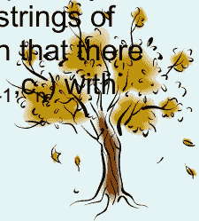


- Accepting state sn means the diagram:
  → S0 → S1 → S2 → ..........Sn-1 → Sn

  1) the definition does not restrict the set of states to numbers
  
  2) we have not labeled the transitions with characters but with names representing a set of characters
  
  3) definitions T: S ×Σ → S , T(s, c) must have a value for every s and c.
  
  In the diagram, T (start,c) defined only if c is a letter, T(in_id, c) is defined only if c is a letter or a digit.
  
  Error transitions are not drawn in the diagram


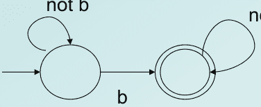


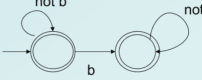


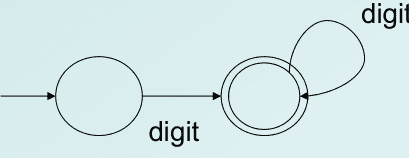


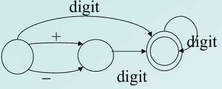


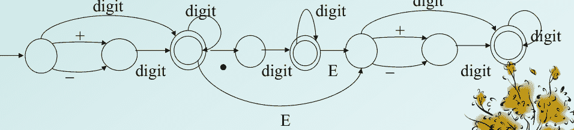


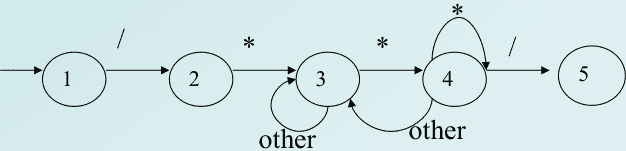


  
  


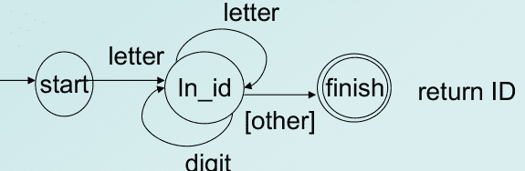


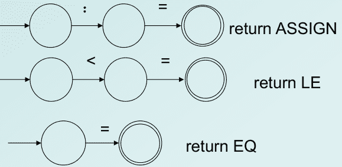


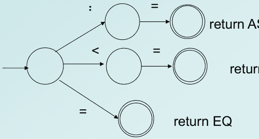


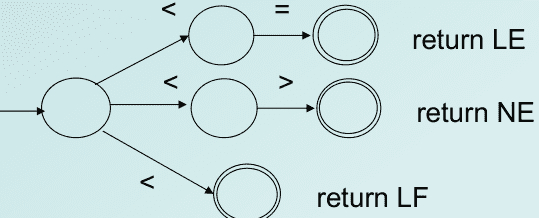


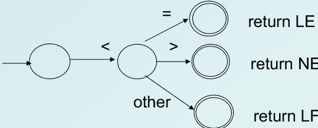


ε-transitions are useful in two ways.

**First:** they can express a choice of alternatives in a way that does not involve combining states. *Advantage:* keeping the original automata intact and only adding a new start state to connect them.

**Second:** they can explicitly describe a match of the empty string.

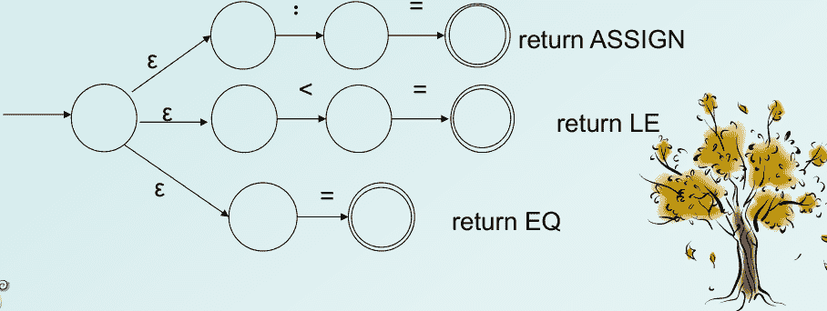

  - a transition function \(T: S \times (\Sigma \cup \{\varepsilon\}) \to \mathcal{P}(S)\),
  - a start state \(s_0\) from S, and a set of accepting states A from S.
  - The language accepted by *M*, written \(L(M)\), is defined to be the set of strings of characters \(c_1c_2\cdots c_n\) with each \(c_i\) from \(\Sigma \cup \{\varepsilon\}\) such that there exist states \(s_1\) in \(T(s_0,c_1)\), \(s_2\) in \(T(s_1,c_2)\), ..., \(s_n\) in \(T(s_{n-1},c_n)\), with \(s_n\) an element of A.


  Example: string abb: →1 →2 →4 →2 →4
                       →1 →3 →4 →2 →4 →2 →4

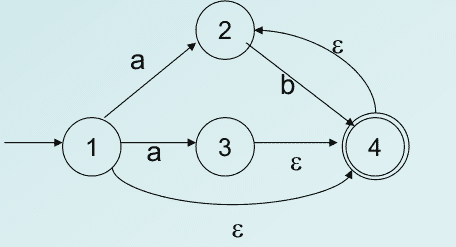

Regular expression: (a|ε)b*. The DFA:

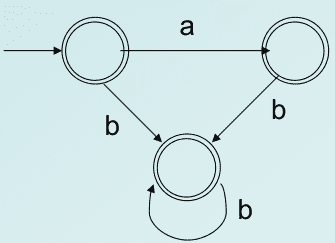


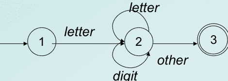


```text
{ starting in state 1 }
if the next character is a letter then
    advance the input;
    { now in state 2 }
while the next character is a letter or a digit do
    advance the input; { stay in state 2 }
end while;
{ go to state 3 without advancing the input}
accept;
else
{ error or other cases }
end if;
```


1. It is ad hoc

   Each DFA has to be treated slightly differently, and it is difficult to state an algorithm that will translate every DFA to code in this way.


```text
{ state 1 }
if the next character is "/" then advance the input; { state 2 }
    if the next character is "*" then
        advance the input; { state 3 }
        done := false;
        while not done do
            while the next input character is not "*" do
                advance the input; end while;
            advance the input; { state 4 }
            while the next input character is "*" do
                advance the input;
            end while;
            if the next input character is "/" then
                done := true; end if;
            advance the input; end while;
        accept; { state 5 }
    else { other processing }
    end if;
else { other processing }
end if;
```

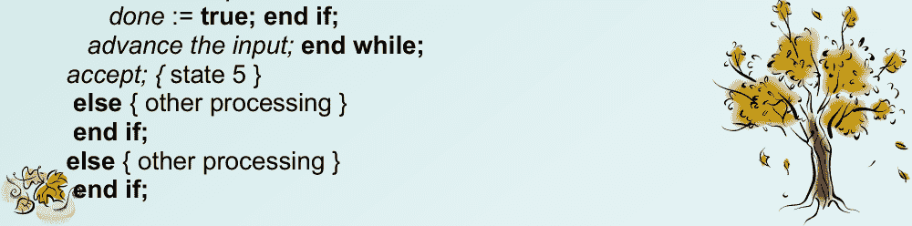


```
3: case input character of
"*": advance the input;
state := 4;
else advance the input { and stay in state 3 };
end case;
4: case input character of
"/": advance the input;
state := 5;
"*": advance the input; { and stay in state 4 }
else advance the input;
state := 3;
end case;
end case;
end while;
if state = 5 then accept else error;
```


  express the DFA as a data structure and then write "generic" code  

  two-dimensional array, indexed by state and input character that expresses the values of the transition function *T*

| States | Characters in the alphabet c |
|---|---|
| | States representing transitions T (s, c) |


Assume : the first state listed is the start state.

| state input char | letter | digit | other |
|------------------|--------|-------|-------|
| 1 | 2 | | |
| 2 | 2 | 2 | 3 |
| 3 | | | |


| state | Input char | letter | digit | other | Accepting |
|---|---|---|---|---|---|
| 1 | | 2 | | | no |
| 2 | | 2 | 2 | [3] | no |
| 3 | | | | | yes |

> Brackets indicate “noninput-consuming” transitions  
> This column indicates accepting states  


| state | Input/char | * | other | Accepting |
|---|---|---|---|---|
| 1 | 2 | | | no |
| 2 | | 3 | | no |
| 3 | 3 | 4 | 3 | no |
| 4 | 5 | 4 | 3 | no |
| 5 | | | | yes |


```
state := 1;
ch := next input character;
while not Accept[state] and not error(state) do
    newstate := T[state,ch];
    if Advance[state,ch] then ch := next input char;
    state := newstate;
end while;
if Accept[state] then accept;
```


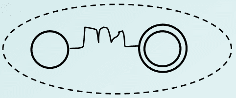


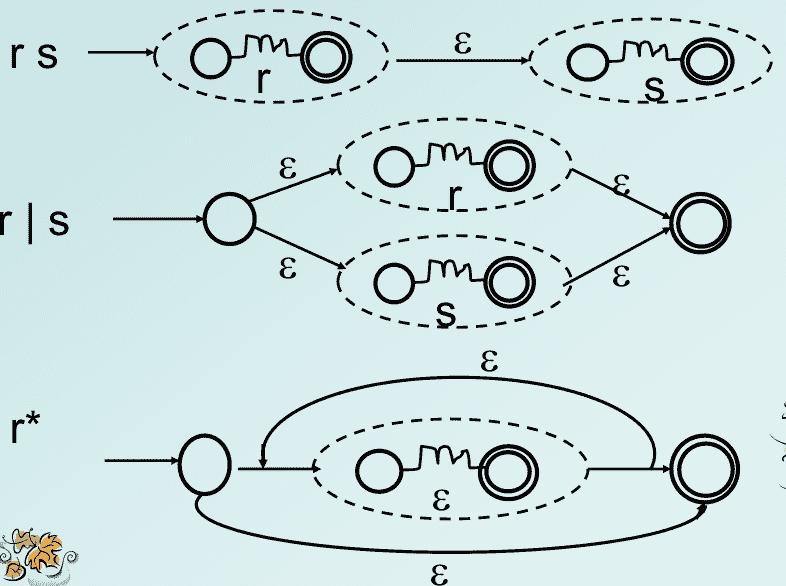


  the ε-closure of a single state s is the set of states reachable by a series of zero or more ε-transitions.  
  the ε-closure of a set of states : the union of the ε-closures of each individual state.


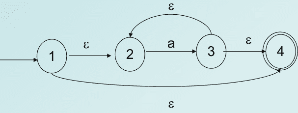

1̄ = { 1, 2, 4 }, 2̄ = { 2 }, 3̄ = { 2, 3, 4 }, 4̄ = { 4 }

The ε-closure of a set of states: the union of the ε-closures of each individual state.

$$ \overline{S} = \bigcup_{s \in S} \overline{s} $$

$$ \overline{\{1,3\}} = \overline{1} \cup \overline{3} = \{1,2,4\} \cup \{2,3,4\} = \{1,2,3,4\} $$


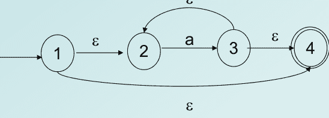

| S | S' | S̄'ₐ |
|---|---|---|
| 1 | 1,2,4 | 2,3,4 |
| 3 | 2,3,4 | 2,3,4 |

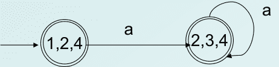


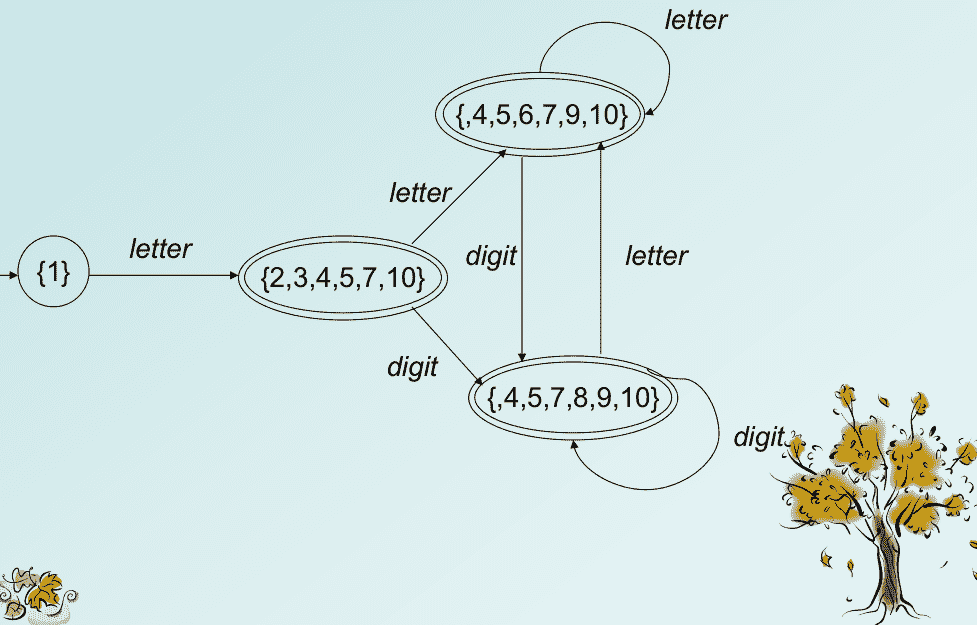


  - instead of constructing all the states of the associated DFA,
  - construct only the state at each point that is indicated by the next input character.

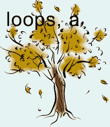


- the resulting DFA may be more complex than necessary. (deriving a DFA algorithmically from a regular expression)

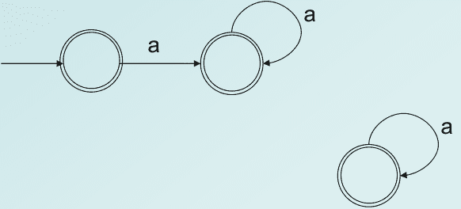


  one consisting of all the accepting states
  the other consisting of all the nonaccepting states.


If all accepting states have transitions on *a* to accepting states,

defines an *a*-transition from the new accepting state (the set of all the old accepting states) to itself.

If all accepting states have transitions on *a* to nonaccepting states,

defines an *a*-transition from the new accepting state to the new nonaccepting state (the set of all the old nonaccepting states).

If there are two accepting states *s* and *t* that have transitions on *a* that land in different sets,

no a transition can be defined for this grouping of the states. We say that *a* distinguishes the states *s* and *t*.

If there are accepting states $s$ and $t$ such that $s$ has an $a$-transition to another accepting state, while $t$ has no $a$-transition at all (i.e., an error transition),
then $a$ distinguishes $s$ and $t$.
If any further sets are split, we must return and repeat the process from the beginning.


| The accepting sets | {1,2,3} |
|---|---|
| | |

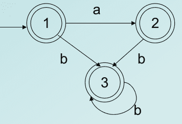

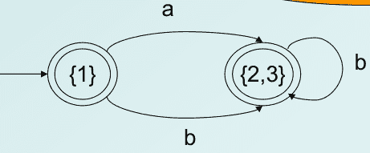

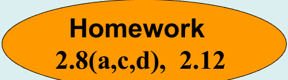


| Reserved Words | Special Symbols | Other |
|---|---|---|
| if | + | number |
| then | - | (1 or more digits) |
| else | * | |
| end | / | |
| repeat | = | |
| until | < | identifier |
| read | ( | (1 or more letters) |
| write | ) | |
| | ; | |
| | := | |


```
{ sample program
In TINY language  -
Computes  factorial
  }
read x; { input on integer }
if 0 < x then { don't compute if x <= 0 }
fact := 1 ;
repeat
fact := fact * x;
x := x - 1
until x = 0;
write fact { output factorial of x }
end
```


TINY COMPILATION: sample.tny
1: { Sample program
2: in TINY language –
3: computes factorial
4: }
5: read x; { input an integer }
5: reserved word: read
5: id, name= x
5: ;
6: if 0 < x then { don’t compute if x <= 0 }
6: reserved word: if
6: num, val= 0
6: <
6: id, name= x
6: reserved word: then


```
7: fact := 1;
    7: id, name= fact
    7: :=
    7: num, val= 1
    7: ;
8: repeat
    8: reserved word: repeat
9: fact := fact * x;
    9: id, name= fact
    9: :=
    9: id, name= fact
    9: *
    9: id, name= x
    9: ;
```


```
10:x := x – 1
    10: id, name= x
    10: :=
    10: id, name=x
    10: -
    10: num, val = 1
11:until x = 0;
    11: reserved word: until
    11: id, name= x
    11: =
    11: num, val= 0
    11: ;
12: write fact { output factorial of x }
    12: reserved words: write
    12: id, name= fact
13:end
    13: reserved word: end
14: EOF
```

## 2.6 Use of Lex to generate a scanner automatically

- We will use the Lex scanner generator to generate a scanner from a description of the tokens of TINY as regular expressions.
- The most popular version of Lex is called flex (for Fast Lex).

It is distributed as part of the **Gnu compiler package** produced by the Free Software Foundation, and is also freely available at many Internet sites.


## 2.6 Use of Lex to generate a scanner automatically

Lex is a program:

- Input : a text file containing regular expressions, together with the actions to be taken when each expression is matched
- Output : Contains C source code defining a procedure yylex that is a table-driven implementation of a DFA corresponding to the regular expressions of the input file, and that operates like a getToken procedure.

## 2.6 Use of Lex to generate a scanner automatically

- The format of a Lex input file

```
{ definitions }
%%
{ rules }
%%
{ auxiliary routines}
```

## 2.6 Use of Lex to generate a scanner automatically

### 1、The first section :definitions

The definition section occurs before the first %%.

- any C code that must be inserted external to any function should appear in this section between the delimiters %{and %},
- **(Note the order of these characters!)**
- names for regular expressions must also be defined in this section.


## 2.6 Use of Lex to generate a scanner automatically

```
%%
/* a Lex program that changes all numbers from decimal to hexadecimal
notation, printing a summary statistic to stderr
*/
#include <stdlib.h>
#include <stdio.h>
int count = 0;
%%
digit [0-9]
number {digit}+
%%
{ number }  { int n = atoi (yytext);
              printf("%x", n);
              if (n > 9) count ++; }
%%
main( )
{ yylex( );
  fprintf(stderr, “number of replacements = %d”, count);
  return 0;
```

# Chapter 3 Context-Free Grammars and Parsing

## Where We Are

### Source code

```
if (b == 0) a = b;
```

### Token stream

```
if ( b == 0 ) a = b ;
```

### Abstract Syntax Tree (AST)

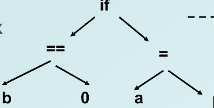

### Lexical Analysis

### Syntax Analysis
(parsing)

# Semantic Analysis

## 3.1 the parsing process

The parser may be viewed as a function that takes as its input the sequence of tokens produced by the scanner and produces as its output the syntax tree.

1、the parser calls a scanner procedure such as **getToken** to fetch the next token from the input


2、In a single-pass compiler the parser will incorporate all the other phases of a compiler, parse( );

3、More commonly, a compiler will be multipass the further passes will use the syntax tree as their input.

## 3.1 the parsing process

- The structure of the syntax tree : dependent on the particular syntactic structure of the language.
- This tree is usually defined as a dynamic data structure
  - each node consists of a record whose fields include the attributes needed for the remainder of the compilation process.

## 3.1 the parsing process

One problem that is more difficult: the treatment of errors.

1. error in the scanner: generate an error token and consume the offending character.
2. error in the parser:
   - report an error message
   - recover from the error and continue parsing (to find as many errors as possible).

Sometimes, a parser may perform **error repair**.

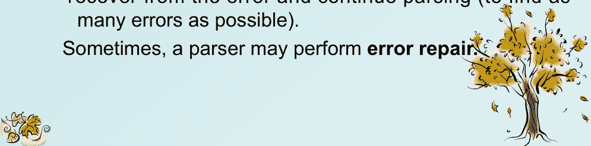

## 3.2 Context-free grammars

- A context-free grammar is a specification for the syntactic structure of a programming language.
- a context-free grammar involves recursive rules.

For example:

exp → exp op exp | (exp) | number
op → + | - | *

### 3.2.2 Specification of context-free grammar rules

- A Context-Free Grammar is a 4-tuple \((V, \Sigma, S, \to)\), where
  - \(V\) is a finite set of nonterminal symbols
  - \(\Sigma\) is a finite set of terminal symbols
  - \(S \in V\) is a distinguished nonterminal, the start symbol
  - \(\to \subseteq V \times (V \cup \Sigma)^*\) is a finite relation, the productions

• Context Free Grammar is abbreviated CFG


### 3.2.2 Specification of context-free grammar rules

- The choice operation given by the vertical bar metasymbol is also not necessary in grammar rules.
  For example, simple expression grammar could be written as follows:
  ```
  exp → exp op exp
  exp → ( exp )
  exp → number
  op → +
  op → -
  op → *
  ```

### 3.2.2 Specification of context-free grammar rules

• we will use uppercase letters for structure names and lowercase letters for individual token symbols (which often are just single characters).

```
E → E o E | (E) | n
O → + | − | *
```


### 3.2.3 Derivations and the language defined by a grammar

• Let G = (V,Σ,S,→) be a CFG. The “directly derives” relation (⇒) is defined as { (αAy, αβy) | A→β }.

• Example

Let G be the grammar with productions S → aSbS | ε

- S ⇒ aSbS
- aSbS ⇒ aaSbSbS
- aaSbSbS ⇒ aabSbS
- aabSbS ⇒ aabbS
- aabbS ⇒ aabbaSbS
- aabbaSbS ⇒ aabbabS
- aabbabS ⇒ aabbab

> **nonterminal** is LHS of production  
> **string** is RHS of production


### 3.2.3 Derivations and the language defined by a grammar

- **Derivation:** Grammar rules determine the legal strings of token symbols by means of derivations.
- **A derivation** is a sequence of replacements of structure names by choices on the right-hand sides of grammar rules.
- **A derivation** begins with a single structure name and ends with a string of token symbols.
- At each step in a derivation, a single replacement is made using one choice from a grammar rule.

figure 3.1 : a derivation

```
• exp → exp op exp | (exp) | number
• op → + | − | *
```

- (1) exp => exp op exp
- (2) => exp op number
- (3) => exp * number
- (4) => ( exp ) * number
- (5) => { exp op exp ) * number
- (6) => (exp op number) * number
- (7) => (exp - number) * number
- (8) => (number - number) * number

```
[exp → exp op exp]
[exp → number]
[op → *]
[exp → ( exp )]
[exp → exp op exp]
[exp → number]
[op → −]
[exp → number]
```

- 1、*G* represents the expression grammar
- 2、*s* represents an arbitrary string of token symbols (sometimes called a **sentence**)
- 3、the symbols =>* stand for a derivation consisting of a sequence of replacements as described earlier.
- 4、Grammar rules are sometimes called productions because they "produce" the strings in *L(G)* via derivations.

- **the start symbol:** the most general structure is listed first in the grammar rules.
- **nonterminals:** structure names are also called nonterminals, since they always must be replaced further on in a derivation.
- **terminals:** symbols in the alphabet are called terminals, since they terminate a derivation. Terminals are usually tokens in compiler applications.

- The grammar for a programming language often defines a structure called **program**,
- the language of this structure is the set of all syntactically legal programs of the programming language.
- For example : a BNF for pascal

```
program → program-heading; program-block
program-heading → ....
program-block → .....
```

- Example : Consider the following extremely simplified grammar of statements:
```
Statement → if-stmt | other
if-stmt → if ( exp ) statement
         | if ( exp ) statement else statement
exp → 0 | 1
```

- Examples of strings in this language are
```
if (0) other
if (1) other
if (0) other else other
if (1)     other else other
if (0)     if (0) other
if (0)     if (1) other else other
if (1)     other else if (0) other else other
```

recursion: the grammar rule \( A \to A a \mid a \)
or the grammar rule \( A \to a A \mid a \)

- generates the language \(\{a^n \mid n \text{ an integer } >=1 \}\) (the set of all strings of one or more a's)

- (the regular expression a+)

- the string aaaa can be generated by the first grammar rule with the derivation
\( A => Aa => Aaa => Aaaa => aaaa \)


### 3.2.3 Derivations and the language defined by a grammar

- **left recursive**: the nonterminal *A* appears as the first symbol on the right-hand side of the rule defining *A*.
- **right recursive**: the nonterminal *A* appears as the last symbol on the right-hand side of the rule defining *A*.


- Consider a rule of the form \(A \rightarrow A\alpha \mid \beta\), where \(\alpha\) and \(\beta\) represent arbitrary strings and \(\beta\) does not begin with \(A\).
- This rule generates all strings of the form \(\beta, \beta\alpha, \beta\alpha\alpha, \beta\alpha\alpha\alpha, \ldots\)
- This grammar rule is equivalent in its effect to the regular expression \(\beta\alpha^*\).
- \(A \rightarrow \alpha A \mid \beta\) generates all strings \(\beta, \alpha\beta, \alpha\alpha\beta, \alpha\alpha\alpha\beta, \ldots\)


- To generate the same language as the regular expression `a*`, we must have a notation for a grammar rule that generates the empty string (since the regular expression `a*` matches the empty string).

  `Empty →`

- We will use the epsilon metasymbol for the empty string (similar to its use in regular expressions):

  `empty → ε`


- Such a grammar rule is called an ε-production (an "epsilon production").
- A grammar that generates a language containing the empty string must have at least one ε-production.
- A grammar equivalent to the regular expression `a*` can be written as \(A \rightarrow A a \mid \varepsilon\) or \(A \rightarrow a \mid \varepsilon\).
- Both grammars generate the language \(\{a^n \mid n \text{ is an integer} \ge 0\} = L(a^*)\).

**Example:**

```
statement → if-stmt | other
if-stmt → if ( exp ) statement else-part
else-part → else statement | ε
exp → 0 | 1
```

The ε-production indicates that the structure else-part is optional.


- Example: \(A \rightarrow (A) A \mid \varepsilon\)

This grammar generates all strings of balanced parentheses.

For example, the string \((( ) (( ))) ( )\)

\(A \Rightarrow (A) A \Rightarrow (A)(A)A \Rightarrow (A)(A) \Rightarrow (A)() \Rightarrow ((A)A)() \Rightarrow (()A)() \Rightarrow (()(A)A)() \Rightarrow (( )(A))() \Rightarrow (( )((A)A))() \Rightarrow (( )(( )A))() \Rightarrow (( )(( )))()\)

- **Example:** Consider the following grammar \(G\) for a sequence of statements:

  ```
  stmt-sequence → stmt ; stmt-sequence | stmt
  stmt → s
  ```

- This grammar generates sequences of one or more statements separated by semicolons:

  \(L(G) = \{ s,\ s;s,\ s;s;s,\ \ldots \}\)

If we want to allow statement sequences to also be empty, we could write the following grammar \(G'\):

```
stmt-sequence → stmt ; stmt-sequence | ε
stmt → s
```

\(L(G') = \{ \varepsilon,\ s;,\ s;s;,\ s;s;s;,\ \ldots \}\)


- This turns the semicolon into a `statement terminator` rather than a **statement separator**.
- To allow statement sequences to be empty, but retain the semicolon as a statement separator:

```
stmt-sequence → nonempty-stmt-sequence | ε
nonempty-stmt-sequence → stmt; nonempty-stmt-sequence | stmt
stmt → s
```

- Care must be taken in the placement of the ε-production when constructing optional structures.


## 3.3 Parse trees and abstract syntax trees

- derivations do not uniquely represent the structure of the strings they construct.
- there are many derivations for the same string.
  - the string of tokens `(number - number) * number` from our simple expression grammar using the derivation in Figure 3.1.
  - A second derivation for this string is given in Figure 3.2.

### 3.3.1 Parse trees

(1) exp => exp op exp  
(2) => exp op **number**  
(3) => exp * **number**  
(4) => ( exp ) * **number**  
(5) =>( exp op exp ) * **number**  
(6) => (exp op number) * **number**  
(7) => (exp - number) * **number**  
(8) => (number - number) * **number**

[exp -> exp op exp]  
[exp -> **number**]  
[op→ * ]  
[exp→ ( exp ) ]  
[exp -> exp op exp]  
[exp→ **number**]  
[op → - ]  
[exp -> **number**]


**A parse tree** corresponding to a derivation is a labeled tree

- the interior nodes are labeled by nonterminals,
- the leaf nodes are labeled by terminals
- the children of each internal node represent the replacement of the associated nonterminal in one step of the derivation.


corresponds to the parse tree

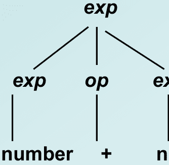


the above parse tree is corresponds to the three derivations:

1. 
   (1) `exp => exp op exp`
   (2) `=> number op exp`
   (3) `=> number + exp`
   (4) `=> number + number`

> leftmost derivation

2. 
   (1) `exp => exp op exp`
   (2) `=> exp op number`
   (3) `=> exp + number`
   (4) `=> number + number`

> rightmost derivation

3. 
   (1) `exp => exp op exp`
   (2) `=> exp + exp`
   (3) `=> number + exp`
   (4) `=> number + number`

> neither leftmost nor rightmost derivation

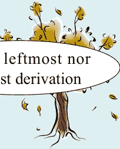


it is possible to distinguish particular derivations that are uniquely associated with the parse tree.

- **A left-most derivation**: a derivation in which the leftmost nonterminal is replaced at each step in the derivation.
  - Corresponds to the preorder numbering of the internal nodes of its associated parse tree.

- **A rightmost derivation**: a derivation in which the rightmost nonterminal is replaced at each step in the derivation.
  - Corresponds to the postorder numbering of the internal nodes of its associated parse tree.

parse tree for the arithmetic expression `(34-3)*42`

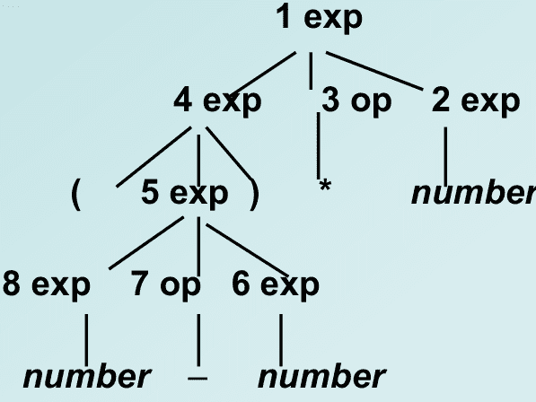

### 3.3.2 Abstract syntax trees

- **The principle of syntax-directed translation** states that the meaning, or semantics, of the string `3+4` should be directly related to its syntactic structure as represented by the parse tree.
- **The principle of syntax-directed translation** means that the parse tree should imply that the value 3 and the value 4 are to be added.

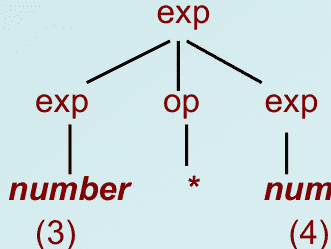


a much simpler way to represent this same information, namely, as the tree

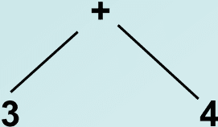


- **abstract syntax trees, or syntax trees:**
  1. Such trees represent abstractions of the actual source code token sequences, and *the token sequences cannot be recovered from them (unlike parse trees).*
  2. a parse tree is a representation for the structure of ordinary called **concrete syntax** when comparing it to **abstract syntax**.
  3. **abstract syntax** can be given a formal definition using a BNF-like notation, just like concrete syntax.


### 3.3.2 Abstract syntax trees

Example 3.8: Consider the grammar for simplified if-statements of Example 3.4:

statement → if-stmt | other
if-stmt → if ( exp ) statement
| if ( exp ) statement else statement
exp → 0 | 1

statement → if-stmt | other
if-stmt → if ( exp ) statement else-part
else-part → else statement | ε
exp → 0 | 1

a syntax tree for the previous string:

a set of C declarations that would be appropriate for the structure of the statements and expressions in this example is as follows:

typedef enum {ExpK,StmtK} NodeKind;
typedef enum {Zero,One} ExpKind;
typedef enum {IfK,OtherK} StmtKind;
typedef struct streenode
{ NodeKind kind;
ExpKind ekind; .
StmtKind skind;
struct streenode
*test,*thenpart,*elsepart;
} STreeNode;
typedef STreeNode * SyntaxTree;

to bind all the statement nodes in a sequence together with just one node

The problem : a seq node may have an arbitrary number of children

The solution: use the standard leftmost-child right-sibling representation for a tree (presented in most data structures texts).

With this arrangement, we can also do away with the connecting seq node, and the syntax tree then becomes simply:

# Chapter 3 Context-Free Grammars and Parsing

## 3.4 Ambiguity

exp → exp op exp|( exp ) | number
op → + | - | *

### 3.4.1 Ambiguity grammars

corresponding to the two leftmost derivations

exp => exp op exp
=> exp op exp op exp ,
=> number op exp op exp
=> number - exp op exp
=> number - number op exp
=> number - number * exp
=> number - number * number

and

exp=> exp op exp
=>number op exp
=>number - exp
=>number - exp op exp
=>number - number op exp
=>number - number * exp
=> number - number * number

+ an ambiguous grammar: a grammar that generates a string with two distinct parse trees is called an ambiguous grammar.
+ Such a grammar represents a serious problem for a parser.
+ it does not specify precisely the syntactic structure of a program.

Two basic methods:

+ 1. a rule: that specifies in each ambiguous case which of the parse trees (or syntax trees) is the correct one.
   Such a rule is called a disambiguating rule.
   The advantage: it corrects the ambiguity without changing (and possibly complicating) the grammar.
   The disadvantage: the syntactic structure of the language is no longer given by the grammar alone.

+ 2、 change the grammar into a form that forces the construction of the correct parse tree.

in either method we must first decide which of the trees in an ambiguous case is the correct one.


### 3.4.1 Ambiguity grammars

To remove the given ambiguity in our simple expression grammar:

- state a disambiguating rule that establishes the relative precedences of the three operations represented.
- the associativity of each of the operations of addition, subtraction, and multiplication.

specify that an operation is nonassociative, in that a sequence of more than one operator in an expression is not allowed.

```
exp → factor op factor | factor
factor → ( exp ) | number
op → + | - | *
```

### 3.4.2 Precedence and associativity

- group the operators into groups of equal precedence, and for each precedence we must write a different rule.
- For example, the precedence of multiplication over addition and subtraction can be added to our simple expression grammar as follows:

```
exp    → exp addop exp | term
addop  → + | -
term   → term mulop term | factor
mulop  → *
factor → ( exp ) | number
```

- **addition** and **subtraction** will appear "higher" (that is, closer to the root) in the parse and syntax trees, and thus receive lower precedence.
- a precedence cascade: a grouping of operators into different precedence levels is a standard method in syntactic specification using **BNF**.

- a left recursive rule makes its operators associate on the left
- a right recursive rule makes them associate on the right.

*exp* → *exp addop exp* | *term*

replacing the rule by

*exp* → *exp addop term* | *term*    (left associative)

*exp* → *term addop exp* | *term*    (right associative)

- complete the removal of ambiguity in the BNF rules for our simple arithmetic expressions:

```
exp → exp addop term | term
addop → + | -
term → term mulop factor | factor
mulop → *
factor → ( exp ) | number
```

the parse tree for the expression 34-3*42

the parse tree for the expression 34-3-42

the precedence cascades cause the parse trees to become much more complex. The syntax trees, however, are not affected.

### 3.4.3 The dangling else problem

- Which one is correct depends on whether we want to associate the single else-part with the first or the second if-statement:

the first parse tree associates the else-part with the first if-statement;
the second parse tree associates it with the second if-statement.

- This ambiguity is called the **dangling else problem**.

an else-part should always be associated with
the nearest if-statement that does not yet have
an associated else-part.

- This disambiguating rule is called the **most closely nested rule** for the dangling else problem.
- if we wanted we could associate the else-part with the first if-statement by using brackets {…} in C, as in
if (x != 0)
{ if (y == 1/x) ok = TRUE; }
else z = 1/x;


### 3.4.3 The dangling else problem

- The dangling else problem has its origins in the syntax of Algol60.
- To design the syntax so that the dangling else problem does not appear.

- Require the presence of the else-part, and this method has been used in LISP and other functional languages (where a value must also be returned).
- Use a **bracketing keyword** for the if-statement; languages that use this solution include Algol68 and Ada.

- In Ada, for example, the programmer writes:

```ada
if x /= 0 then
   if y = 1/x then ok := true;
   else z := 1/x;
   end if;
end if;
```

- To associate the else-part with the second if-statement. Alternatively, the programmer writes:

```ada
if x /= 0 then
   if y = 1/x then ok := true;
   end if
else z := 1/x;
end if;
```

- BNF in Ada (somewhat simplified):

*if-stmt* → *if* *condition* **then** *statement-sequence* **end if**  
&nbsp;&nbsp;&nbsp;&nbsp;| *if* *condition* **then** *statement-sequence* **else**  
&nbsp;&nbsp;&nbsp;&nbsp;&nbsp;&nbsp;&nbsp;&nbsp;*statement-sequence* **end if**

### 3.4.4 Inessential ambiguity

- Sometimes a grammar may be ambiguous and yet always produce unique abstract syntax trees.

The grammar ambiguously as:

```
stmt-sequence → stmt-sequence ; stmt-sequence
              | stmt
stmt → s
```

- Either a right recursive or left recursive grammar rule would still result in the same syntax tree structure.

- **Inessential ambiguity**: _the associated semantics do not depend on what disambiguating rule is used._

- Arithmetic addition or string concatenation.
- That represent **associative operations** (a binary operator · is associative if (a · b) · c = a · (b · c) for all values a, b, and c).

- The syntax trees are still distinct, semantic value are the same.

## 3.5 Extended notations: EBNF and syntax diagrams

- BNF notation is sometimes extended to include special notations for repetitive and optional constructs.

- Extended BNF, or EBNF.

Repetition:

A → A α | β (left recursive)

A → α A | β (right recursive)

EBNF opts to use curly brackets { . . } to express repetition.

A → β{α}

A → {α} β

- **Example:**

`stmt-Sequence → stmt ; stmt-Sequence | stmt`

`stmt → s`

- **In EBNF this would appear as**

`stmt-sequence → { stmt ; } stmt`

*(right recursive form)*

`stmt-sequence → stmt { ; stmt}`

*(left recursive form)*

- Optional constructs in EBNF are indicated by surrounding them with square brackets [...].

```
statement → if-stmt | other
if-stmt → if ( exp ) statement [ else statement ]
exp → 0 | 1
```

## 3.6 Formal properties of context-free language

**Definition**: A context-free grammar consists of the following:

1. A set T of **terminals**.
2. A set N of **nonterminals** (disjoint from T).
3. A set P of **productions**, or **grammar rules**, of the form A → a, where A is an element of N and a is an element of (T ∪ N)* (a possibly empty sequence of terminals and nonterminals).
4. A **start symbol** S from the set N.


### 3.6.1 A formal definition of context-free language

- Let \(G\) be a grammar as defined above, \(G = (T, N, P, S)\).
- A derivation step over \(G\) is of the form \(a A \gamma \Rightarrow a \beta \gamma\), where \(a\) and \(\gamma\) are elements of \((T \cup N)^*\) and \(A \to \beta\) is in \(P\).
- **The set of symbols**: The union \(T \cup N\) of the sets of terminals and nonterminals.
- **A sentential form**: a string \(a\) in \((T \cup N)^*\).

- \(\alpha \Rightarrow^* \beta\) if and only if there is a sequence of 0 or more derivation steps (\(n \ge 0\)):  
  \(\alpha_1 \Rightarrow \alpha_2 \Rightarrow \cdots \Rightarrow \alpha_{n-1} \Rightarrow \alpha_n\) such that \(\alpha = \alpha_1\) and \(\beta = \alpha_n\)  
  (If \(n = 0\), then \(\alpha = \beta\).)

- A derivation over the grammar \(G\) is of the form \(S \Rightarrow^* w\), where \(w \in T^*\).  
  \(w\) is a string of terminals only, called a **sentence**.  
  \(S\) is the start symbol of \(G\).


- The **language generated by \(G\)**, written \(L(G)\), is defined:

\[
L(G) = \{ w \in T^* \mid \text{there exists a derivation } S \Rightarrow^* w \text{ of } G \}.
\]

- A **leftmost derivation** \(S \Rightarrow^*_{lm} w\) is a derivation in which each derivation step \(a A \gamma \Rightarrow a \beta \gamma\) is such that \(a \in T^*\); that is, \(a\) consists only of terminals.

- A **rightmost derivation** is one in which each derivation step \(a A \gamma \Rightarrow a \beta \gamma\) has the property that \(\gamma \in T^*\).


- A **parse tree** over the grammar \(G\) is a rooted labeled tree with the following properties:

1. Each node is labeled with a terminal or a nonterminal or \(\varepsilon\).
2. The root node is labeled with the start symbol \(S\).
3. Each leaf node is labeled with a terminal or with \(\varepsilon\).
4. Each nonleaf node is labeled with a nonterminal.
5. If a node with label \(A \in N\) has \(n\) children with labels \(X_1, X_2, \ldots, X_n\) (which may be terminals or nonterminals), then \(A \to X_1 X_2 \ldots X_n \in P\) (a production of the grammar).

- Each derivation gives rise to a parse tree.
- In general, many derivations may give rise to the same parse tree.
- Each parse tree, however, has a unique leftmost and rightmost derivation that give rise to it.
- The leftmost derivation corresponds to a preorder traversal of the parse tree.
- The rightmost derivation corresponds to the reverse of a postorder traversal of the parse tree.

- A grammar \(G\) is **ambiguous** if there exists a string \(w \in L(G)\) such that \(w\) has two distinct parse trees (or leftmost or rightmost derivations).
- A set of strings \(L\) is said to be a **context-free language** if there is a context-free grammar \(G\) such that \(L = L(G)\).

## 3.7 Syntax of the TINY language

**Figure 3.6: Grammar of the TINY language in BNF**

```bnf
program        → stmt-sequence
stmt-sequence → stmt-sequence ; statement | statement
statement     → if-stmt | repeat-stmt | assign-stmt | read-stmt | write-stmt
if-stmt       → if exp then stmt-sequence end
              | if exp then stmt-sequence else stmt-sequence end
repeat-stmt   → repeat stmt-sequence until exp
assign-stmt   → identifier := exp
read-stmt     → read identifier
write-stmt    → write exp
exp           → simple-exp comparison-op simple-exp | simple-exp
comparison-op → < | =
simple-exp    → simple-exp addop term | term
addop         → + | -
term          → term mulop factor | factor
mulop         → * | /
factor        → ( exp ) | number | identifier
```

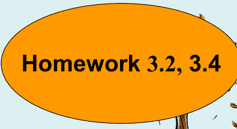

# Chapter 4: Top-Down Parsing


## Outline

- Top-down parsing
- LL(k) grammars
- Transforming a grammar into LL form
- Recursive-descent parsing

## Where We Are

**Source code** *(character stream)*

```
if (b == 0) a = b;
```

**Token stream**

```
if ( b == 0 ) a = b ;
```

**Lexical Analysis** → **Syntax Analysis (parsing)** → **Abstract Syntax Tree (AST)**

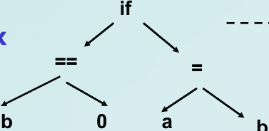

**Semantic Analysis**


## 4.1 Top-Down Parsing by Recursive-Descent

- The idea of Recursive-Descent Parsing
- The grammar rule for a non-terminal A as a definition for a procedure to recognize an A
- The right-hand side of the grammar for A specifies the structure of the code for this procedure.


### 4.1.1 The Basic Method of Recursive-Descent

factor → (expr) | number

```
Procedure factor
BEGIN
case token of
( : match( );
expr;
match( ));
number:
match(number);
else error;
end case;
END factor
```

### 4.1.2 Repetition and Choice: Using EBNF

- The second example
  - `If-stmt → if ( exp ) statement`
  - `| if ( exp ) statement else statement`

The EBNF of the if-statement is as follows:

`If-stmt → if ( exp ) statement [ else statement]`


- `expr → expr addop term | term`

This would lead to an immediate infinite recursive loop.

Both exp and term can begin with the same tokens (a number or left parenthesis).

- The solution is to use the EBNF rule:

expr → term {addop term}

```
Procedure exp;
Begin
  term;
  while token = + or token = - do
    match(token);
    term;
  End while;
End exp;
```

- The EBNF rule for term:
- `term → factor {mulop factor}`

```
Procedure term;
Begin
    factor;
    While token = * do
        match(token);
        factor;
    End while;
End exp;
```


- A question: whether the left associatively implied by the curly bracket (and explicit in the original BNF) can still be maintained within this code.

- A recursive-descent calculator for the simple integer arithmetic of our grammar:

```
Function exp : integer;
  var temp: integer;
  begin
    temp:=term;
    while token= + or token = - do
      case token of
        + : match(+);
            temp:=temp+term;
        -: match(-);
           temp:=temp-term;
      end case;
    end while;
    return temp;
  end exp;
```


### 4.1.3 Further Decision Problems

- It may be necessary to know what token legally coming from the non-terminal A, A→ε. (Follow Sets.)
- It requires computing the First and Follow sets in order to detect the errors as early as possible. Such as “)3-2)”, (descend from exp to term to factor)


## 4.2 LL(1) PARSING

### Main idea:

- LL(1) Parsing uses an explicit stack rather than recursive calls to perform a parse.

### An example:

a simple grammar

S → E + S | E

E → num | (S)

The following table shows the actions of a top-down parser :


### 4.2.1 The Basic Method of LL(1) Parsing

S → E + S | E
E → num | (S)

| Partly-derived String | Lookahead | parsed part unparsed part |
|---|---|---|
| S | | |
| ( | (1+2+(3+4))+5 | |
| ⇒ E+S | ( | (1+2+(3+4))+5 |
| ⇒ (S)+S | 1 | (1+2+(3+4))+5 |
| ⇒ (E+S)+S | 1 | (1+2+(3+4))+5 |
| ⇒ (1+S)+S | 2 | (1+2+(3+4))+5 |
| ⇒ (1+E+S)+S | 2 | (1+2+(3+4))+5 |
| ⇒ (1+2+S)+S | 2 | (1+2+(3+4))+5 |
| ⇒ (1+2+E)+S | ( | (1+2+(3+4))+5 |
| ⇒ (1+2+(S))+S | 3 | (1+2+(3+4))+5 |
| ⇒ (1+2+(E+S))+S | 3 | (1+2+(3+4))+5 |

- Want to decide which production to apply
  based on next symbol
  
  >(1)        `S ⇒ E ⇒ (S) ⇒ (E) ⇒ (1)`
  
  >(1)+2      `S ⇒ E+S ⇒ (S)+S ⇒ (E)+S`
  
                `⇒ (1)+E ⇒ (1)+2`

- Why is this hard?


### 4.2.1 The Basic Method of LL(1) Parsing

• S→(S) S | ε

| Step | Parsing | Input | Action |
|---|---|---|---|
| 1 | $S | ()$ | S→(S)S |
| 2 | $S)S( | ()$ | match |
| 3 | $S)S | )$ | S→ε |
| 4 | $S) | )$ | match |
| 5 | $S | $ | S→ε |
| 6 | $ | $ | accept |

The two actions:

(1) generate: replace a non-terminal A at the top
of the stack by a string α(in reverse) using a
grammar rule A →α,

(2) Match: match a token on top of the stack
with the next input token.

### 4.2.2 The LL(1) Parsing Table and Algorithm

- **Purpose of the LL(1) Parsing Table:**
  - To express the possible rule choices for a non-terminal A: A is at the top of parsing stack, based on the current input token (the look-ahead).

- **The LL(1) Parsing table for the following simple grammar:**

$S \rightarrow (S)S \mid \varepsilon$

| M[N,T] | ( | ) | $ |
|---|---|---|---|
| S | S→(S)S | S→ε | S→ε |


### 4.2.2 The LL(1) Parsing Table and Algorithm

- The general LL(1) Parsing table definition:
  - The table is a two-dimensional array indexed by non-terminals and terminals
  - The table contains production choices to use at the appropriate parsing step, which called M[N,T].
- N is the set of non-terminals of the grammar;
- T is the set of terminals or tokens (including $);
- Any entrances remaining empty represent potential errors.

### 4.2.2 The LL(1) Parsing Table and Algorithm

• The table-constructing rule:

+   (1) If $A\to\alpha$ is a production choice, and there is a derivation $\alpha\Rightarrow^* a\beta$, where $a$ is a token, then add $A\to\alpha$ to the table entry $M[A,a]$;

+   (2) If $A\to\alpha$ is a production choice, and there are derivations $\alpha\Rightarrow^*\varepsilon$ and $S\Rightarrow^*\beta A a\gamma$, where $S$ is the start symbol and $a$ is a token (or $\$$), then add $A\to\alpha$ to the table entry $M[A,a]$;


### 4.2.2 The LL(1) Parsing Table and Algorithm

- The constructing-process of the above table:
  
  (1) For the production : S→(S) S, α =(S)S,
  where a=(, the entry M[S,(] ;
  
  (2) For the production: S→ ε , α = ε i.e. there
  are derivation α=> ε and
  S$=>* β Aa γ =(S)S$. where a=) or a=$.
  So add the choice S → ε to the both M[S, )]
  and M[S,$].


### 4.2.2 The LL(1) Parsing Table and Algorithm

- Definition of **LL(1)** Grammar:
  - A grammar is an **LL(1)** grammar if the associated **LL(1)** parsing table has at most one production in each table entry.
  - An **LL(1)** grammar cannot be ambiguous.


- A Parsing Algorithm Using the LL(1) Parsing Table:

```
push the start symbol onto the top of the parsing stack;
while the top of the parsing stack ≠ $ and the next
      input token ≠ $ do
    if the top of the parsing stack is terminal a
       and the next input token = a
    then (* match *)
       pop the parsing stack;
       advance the input;
    else if the top of the parsing stack is non-terminal A
       and the next input token is terminal a
       and parsing table entry M[A, a] contains production
       A → X1 X2 ... Xn
```

The LL(1) parsing table for simplified grammar of if-statements:

```
statement → if-stmt | other
if-stmt → if (exp) statement else-part
else-part → else statement | ε
exp → 0 | 1
```

| M[N,T] | if | other | else | 0 | 1 | $ |
|---|---|---|---|---|---|---|
| statement | statement → if-stmt | statement → other | | | | |
| if-stmt | if-stmt → if (exp) statement else-part | | | | | |
| else-part | | | else-part → else statement \| else-part → ε | | | else-part → ε |
| exp | | | | exp → 0 | exp → 1 | |

The parsing actions for the string `if (0) if (1) other else other` (for conciseness, `statement = S`, `if-stmt = I`, `else-part = L`, `exp = E`, `if = i`, `else = e`, `other = o`):

| Step | Stack | Input | Action |
|---|---|---|---|
| 1 | `$S` | `i(0)i(1)oeo$` | `S → I` |
| 2 | `$I` | `i(0)i(1)oeo$` | `I → i ( E ) S L` |
| 3 | `$LS)E(i` | `i(0)i(1)oeo$` | `match` |
| 4 | `$LS)E(` | `(0)i(1)oeo$` | `match` |
| 5 | `$LS)E` | `0)i(1)oeo$` | `E → 0` |
| 6 | `$LS)0` | `0)i(1)oeo$` | `match` |
| 7 | `$LS)` | `)i(1)oeo$` | `match` |
| 8 | `$LS` | `i(1)oeo$` | `S → I` |
| 9 | `$LI` | `i(1)oeo$` | `I → i ( E ) S L` |
| 10 | `$LLS)E(i` | `i(1)oeo$` | `match` |
| 11 | `$LLS)E(` | `(1)oeo$` | `match` |
| 12 | `$LLS)E` | `1)oeo$` | `E → 1` |
| 13 | `$LLS)1` | `1)oeo$` | `match` |
| 14 | `$LLS)` | `)oeo$` | `match` |
| 15 | `$LLS` | `oeo$` | `S → o` |
| 16 | `$LLo` | `oeo$` | `match` |
| 17 | `$LL` | `eo$` | `L → e S` |
| 18 | `$LSe` | `eo$` | `match` |
| 19 | `$LS` | `o$` | `S → o` |
| 20 | `$Lo` | `o$` | `match` |
| 21 | `$L` | `$` | `L → ε` |
| 22 | `$` | `$` | `accept` |


### 4.2.3 Left Recursion Removal and Left Factoring

- Two standard techniques for Repetition and Choice problems:
  1. Left Recursion Removal

*Immediate left recursion:* the left recursion occurs only within the production of a single non-terminal.

```
exp → exp + term | exp - term | term
```

*Indirect left recursion:*

```
A → Bb | …
B → Aa | …
```


#### CASE 1: Simple immediate left recursion

```
A → A α | β
```

We rewrite this grammar rule into two rules:

```
A → βA′
A′ → α A′ | ε
```

- **EXAMPLE:**

```
exp → exp addop term | term
exp → term exp′
exp′ → addop term exp′ | ε
```


#### CASE 2: General immediate left recursion

```
A → A α₁ | A α₂ | … | A αₙ | β₁ | β₂ | … | βₘ
```

where none of β₁, …, βₘ begin with A.

The solution is similar to the simple case:

```
A → β₁A′ | β₂A′ | … | βₘA′
A′ → α₁A′ | α₂A′ | … | αₙA′ | ε
```

- **EXAMPLE:**

```
exp → exp + term | exp - term | term
```

remove the left recursion as follows:

```
exp → term exp′
exp′ → + term exp′ | - term exp′ | ε
```


### 4.2.3 Left Recursion Removal and Left Factoring

Case 3: General left recursion

Grammars with no ε-productions and no cycles.

- (1) A cycle is a derivation of at least one step that begins and ends with same non-terminal: A=> α=>* A;
- (2) Programming language grammars do have ε-productions, but usually in very restricted forms.


- Algorithm for general left recursion removal:
  For i:=1 to m do
    For j:=1 to i-1 do
      Replace each grammar rule choice of the form
      Ai→ Ajβ by the rule
      
      Ai→α1β|α2β| ... |αkβ,
      
      where Aj→α1|α2| ... |αk is the current rule for Aj.
      remove, if necessary, immediate left recursion
      involving Ai

EXAMPLE: consider the following grammar,
A→Ba| Aa| c
B→Bb| Ab| d
Where, A1=A, A2=B and n=2

(1) When i=1, the inner loop does not execute,
So only to remove the immediate left recursion of A
A→BaA’| c A’
A’→aA’| ε
B→Bb| Ab| d


(2) when i=2, the inner loop execute once, with j=1.

To eliminate the rule B→Ab by replacing A with its choices

- A→BaA'| c A'
- A'→aA'| ε
- B→Bb| BaA'b|cA'b| d

- A→BaA'| c A'
- A'→aA'| ε
- B→Bb| Ab| d

(3) remove the immediate left recursion of B to obtain

- A→BaA'| c A'
- A'→aA'| ε
- B→cA'bB'| dB'
- B'→bB' |aA'bB'|ε

Now, the grammar has no left recursion.

- Left recursion removal does not change the language, but changes the grammar and the parse tree.
- This change causes a complication for the parser.

Example: Simple arithmetic expression grammar
After removal of the left recursion.

exp → term exp’
exp’→ addop term exp’ | ε
addop → + | -
term → factor term’
term’ → mulop factor term’ | ε
mulop → *
factor →(expr) | number

The parse tree for the expression 3-4-5, which does not express the left associativity of subtraction. Nevertheless, a parse should still construct the appropriate left associative syntax tree. ( p161 )


The grammar with its left recursion removed would give rise to the procedures exp and exp’ as follows:

exp → term exp’
exp’→ addop term exp’ | ε
addop → + | -
term → factor term’
term’ → mulop factor term’ | ε
mulop → *
factor →(expr) | number

exp → term exp’
Procedure exp
Begin
Term;
Exp’;
End exp;

exp’→ addop term exp’ | ε
Procedure exp’
Begin
Case token of
+: match(+);
term;
exp’;
-: match(-);
term;
exp’;
end case;
end exp’

To compute the value of the expression, we can rewrite them as follows:

```
function exp:integer;
    var temp:integer;
    Begin
        Temp:=Term;
        Return Exp’(temp);
    End exp;
```

```
function exp’(valsofar:integer):integer;
    Begin
        If token=+ or token=- then
            Case token of
                +: match(+);
                    valsofar:=valsofar+term;
                -: match(-);
                    valsofar:=valsofar-term;
            end case;
            return exp’(valsofar);
        else return valsofar;
    end exp’;
```

Note: the exp’ needs a parameter from the exp procedure.

The LL(1) parsing table for the new expression is given as follows:

| M[N,T] | ( | number | ) | + | - | * | $ |
|---|---|---|---|---|---|---|---|
| exp | exp → term exp′ | exp → term exp′ |  |  |  |  |  |
| exp′ |  |  | exp′ → ε | exp′ → addop term exp′ | exp′ → addop term exp′ |  | exp′ → ε |
| addop |  |  |  | addop → + | addop → - |  |  |
| term | term → factor term′ | term → factor term′ |  |  |  |  |  |
| term′ |  |  | term′ → ε | term′ → ε | term′ → ε | term′ → mulop factor term′ | term′ → ε |
| mulop |  |  |  |  |  | mulop → * |  |
| factor | factor → ( exp ) | factor → number |  |  |  |  |  |


### 4.2.3 Left Recursion Removal and Left Factoring

2、Left factoring:

Left factoring is required when two or more grammar rule choices share a common prefix string,

A→ α β | α γ


```
A→αA′
A′→ β | γ
```

Example:

```
Stmt-sequence→stmt; stmt-sequence | stmt
Stmt→s
```


### 4.2.3 Left Recursion Removal and Left Factoring

- **Example**

  `Stmt-sequence→stmt; stmt-sequence | stmt`

  `Stmt→s`

Left Factored as follows:

`Stmt-sequence→stmt stmt-seq’`

`Stmt-seq’→; stmt-sequence | ε`


### 4.2.3 Left Recursion Removal and Left Factoring

#### Algorithm for left factoring a grammar:

While there are changes to the grammar do
For each non-terminal A do
Let α be a prefix of maximal length that is shared by two or more production choices for A
If α≠ε then
Let A →α₁|α₂|...|αₙ be all the production choices for A
And suppose thatα₁, α₂,...,αₖ share α, so that A→αβ₁|αβ₂|...|αβₖ αₖ₊₁|...|αₙ, the βj’s share no common prefix, and αₖ₊₁,...αₙ do not share α.
A →αA'|αₖ₊₁|...|αₙ
A ‘→β₁|β₂|...|βₖ

### 4.2.3 Left Recursion Removal and Left Factoring

- **Example:**

  If-stmt → if ( exp ) statement

  | if ( exp ) statement else statement

The left factored form of this grammar is:

If-stmt → if ( exp ) statement else-part

Else-part → else statement | ε


### 4.2.3 Left Recursion Removal and Left Factoring

**Example:**

```
exp → term⁺exp | term
exp → term exp′
exp′ → + exp | ε
```

Suppose we substitute term exp′ for exp:

```
exp → term exp′
exp′ → + term exp′ | ε
```

*this is identical to the grammar obtained from the left recursive rule by left recursion removal*


### 4.2.3 Left Recursion Removal and Left Factoring

- **Example**

Statement → assign-stmt| call-stmt| other

Assign-stmt→ identifier:=exp

Call-stmt → identifier(exp-list)

Statement → identifier:=exp | identifier(exp-list) | other

Statement → identifier statement’ | other

Statement’ →:=exp |(exp-list)

this obscures the semantics of call and assignment by separating the identifier from the actual call or assign action.


### 4.2.4 Syntax Tree Construction in LL(1) Parsing

- It is more difficult for LL(1) to adapt to syntax tree construction.
- (1) The structure of the syntax tree can be obscured by left factoring and left recursion removal;
- (2) The parsing stack represents only predicated structure, not structure that have been actually seen.

#### The solution:

- (1) An extra stack is used to keep track of syntax tree nodes, and
- (2) “action” markers are placed in the parsing stack to indicate when and what actions on the tree stack should occur.


### 4.2.4 Syntax Tree Construction in LL(1) Parsing

- How to compute the arithmetic value of the expression.

  (1) Use a separate stack to store the intermediate values of the computation, called the value stack;
  (2) Schedule two operations on that stack:
  A push of a number;
  The addition of two numbers.
  (3) PUSH can be performed by the match procedure, and
  (4) ADDITION should be scheduled on the stack, by pushing a special symbol (such as #) on the parsing stack.

### 4.2.4 Syntax Tree Construction in LL(1) Parsing

- This symbol must also be added to the grammar rule that match a +, the rule for E':
  E' →+n#E'|ε

- The addition is scheduled just after the next number, but before any more E' non-terminals are processed.

- This guaranteed left associativity.


# Chapter 4 Top-Down Parsing

### 4.3.1 First Sets

**Definition:**

Let X be a grammar symbol (a terminal or non-terminal) or ε. Then First(X) is a set of terminals or ε, which is defined as follows:

1. If X is a terminal or ε, then First(X) = {X};
2. If X is a non-terminal, then for each production choice X → X₁ X₂ … Xₙ, First(X) contains First(X₁) − {ε}.


Let α = X₁X₂...Xₙ be a string of terminals and non-terminals. First(α) is defined as follows:

1. First(α) contains First(X₁) − {ε};
2. For each i = 2,...,n, if for all k = 1,...,i−1, First(Xₖ) contains ε, then First(α) contains First(Xᵢ) − {ε}.
3. If all the sets First(X₁),...,First(Xₙ) contain ε, then First(α) contains ε.

**Algorithm for computing First(A) for all non-terminal A:**

```
For all non-terminal A do First(A) := {};
While there are changes to any First(A) do
    For each production choice A → X₁X₂...Xₙ do
        k := 1; Continue := true;
        While Continue = true and k <= n do
            Add First(Xₖ) − {ε} to First(A);
            If ε is not in First(Xₖ) then Continue := false;
            k := k + 1;
        If Continue = true then add ε to First(A);
```

**Simplified algorithm in the absence of ε-production.**

```
For all non-terminal A do First(A) := {};
While there are changes to any First(A) do
    For each production choice A → X₁X₂...Xₙ do
        Add First(X₁) to First(A);
```


- **Definition:** A non-terminal A is **nullable** if there exists a derivation A ⇒* ε.

- **Theorem:** A non-terminal A is **nullable** if and only if First(A) contains ε.


- Grammar for statement sequences:

```
stmt-sequence → stmt stmt-seq'
stmt-seq' → ; stmt-sequence | ε
stmt → s
```

- List the production choices individually:

```
stmt-sequence → stmt stmt-seq'
stmt-seq' → ; stmt-sequence
stmt-seq' → ε
stmt → s
```

- The First sets are as follows:

```
First(stmt-sequence) = {s}
First(stmt-seq') = {;, ε}
First(stmt) = {s}
```


### 4.3.2 Follow Sets

- **Definition:**

Given a non-terminal A, the set Follow(A) is defined as follows.

1. If A is the start symbol, then $ is in Follow(A).
2. If there is a production B → α Aγ, then First(γ) − {ε} is in Follow(A).
3. If there is a production B → α Aγ, such that ε is in First(γ), then Follow(A) contains Follow(B).


- **Note:**

1. The symbol `$` is used to mark the end of the input.
2. The empty “pseudotoken” `ε` is never an element of a follow set.
3. Follow sets are defined only for non-terminals.


- Follow sets work “on the right” in production.
- First sets work “on the left” in the production.
- Given a grammar rule A → α B, Follow(B) will contain Follow(A), the opposite of the situation for first sets, if A → B α, First(A) contains First(B), except possibly for ε.


**Algorithm for the computation of follow sets:**

```
Follow(start-symbol) := {$};
For all non-terminals A ≠ start-symbol do
    Follow(A) := {};
While there are changes to any follow sets do
    For each production A → X₁X₂...Xₙ do
        For each Xᵢ that is a non-terminal do
            Add First(Xᵢ₊₁Xᵢ₊₂...Xₙ) − {ε} to Follow(Xᵢ);
            If ε is in First(Xᵢ₊₁Xᵢ₊₂...Xₙ) then
                Add Follow(A) to Follow(Xᵢ);
```


### 4.3.2 Follow Sets

- nullable
  - only S’ is nullable
- FIRST
  - FIRST( ES’ ) = {num,(}
  - FIRST( +S ) = {+}
  - FIRST( num ) = {num}
  - FIRST( (S) ) = {(}, FIRST(S’) = {+, ε}
  - FIRST(S) = {num,(},
- FOLLOW
  - FOLLOW(S) = { ), $ }
  - FOLLOW(S’) = { ), $ }
  - FOLLOW(E) = { +,) , $ }

```
S → ES’
S’ → ε | +S
E → num | (S)
```

### 4.3.2 Follow Sets

#### Example: the simple expression grammar.

(1) exp → exp addop term  
(2) exp → term  
(3) addop → +  
(4) addop → -  
(5) term → term mulop factor  
(6) term → factor  
(7) mulop → *  
(8) factor →(exp )  
(9) factor →number  

The First sets:
First(exp)={(,number}
First(term)={(,number}
First(factor)={(,number}
First(addop)={+,-}
First(mulop)={*}

The Follow sets:
Follow (exp)={ $,+,-,) }
Follow (addop)={(,number}
Follow (term)={$,+,-,* ,)}
Follow (mulop)={(,number}
Follow (factor)={$,+,-,* ,)}

### 4.3.3 Constructing LL(1) Parsing Tables

The table-constructing rules:

- If \(A\to\alpha\) is a production choice, and there is a derivation \(\alpha\Rightarrow^*a\beta\), where \(a\) is a token, then add \(A\to\alpha\) to the table entry \(M[A,a]\);
- If \(A\to\alpha\) is a production choice, and there are derivations \(\alpha\Rightarrow^*\varepsilon\) and \(S\Rightarrow^*\beta Aa\gamma\), where \(S\) is the start symbol and \(a\) is a token (or \($\)), then add \(A\to\alpha\) to the table entry \(M[A,a]\);

### 4.3.3 Constructing LL(1) Parsing Tables

the following algorithmic construction of the LL(1) parsing table:

Repeat the following two steps for each non-terminal A and production choice A→ α.

1. For each token a in First(α), add A→α to the entry M[A,a].
2. If ε is in First(α), for each element a of Follow(A) ( a token or $), add A→α to M[A,a].

### 4.3.3 Constructing LL(1) Parsing Tables

- **Theorem:**
  
  A grammar in BNF is LL(1) if the following conditions are satisfied.
  
  1. For every production A→α₁|α₂|···|αₙ, First(αᵢ) ∩ First(αⱼ) is empty for all i and j, 1≤i,j≤n, i≠j.
  2. For every non-terminal A such that First(A) contains ε, First(A) ∩ Follow(A) is empty.

### 4.3.3 Constructing LL(1) Parsing Tables

- algorithm for automatically generating a predictive parse table from a grammar

– FOLLOW(S) = { ), $ }  
– FOLLOW(S’) = { ), $ }  
– FOLLOW(E) = { +,) ,  
$ }

FIRST( E) = {num, (}  
FIRST(S’) = {+, ε}  
FIRST(S) = {num, (},

S → ES’  
S’ → ε | +S  
E → num | (S)

|    | num | + | ( | ) | $ |
|---|---|---|---|---|---|
| S  | S → ES’ |   | S → ES’ |   |   |
| S’ |   | S ’→ +S |   |   | S ’→ ε S’ |
| E  | E → num |   | E → (S) |   |   |

### 4.3.3 Constructing LL(1) Parsing Tables

# Example: The simple expression grammar.

exp →term exp’  
addop →+ | -  
term’→mulop factor term’| ε  
factor→(exp) | number  

exp’→addop term exp’ | ε  
term →factor term’  
mulop→*

| First Sets |
|------------|
| First(exp) = { (,number} |
| First(exp’) = { +,-,ε } |
| First(term)= {(,number} |
| First(term’) = { *, ε } |
| First(factor)= {(,number } |
| First(addop)={ + ,- } |
| First(mulop)={ * } |

| Follow Sets |
|-------------|
| Follow(exp) = {$, )} |
| Follow (exp’) = {$, )} |
| Follow (term)= {$,+,-,) } |
| Follow (term’) = {$,+,-,) } |
| Follow (factor)= {$,+,-,*,)} |
| Follow (addop)={ (,number } |
| Follow (mulop)={(,number } |

### 4.3.3 Constructing LL(1) Parsing Tables

| M[N,T] | ( | **number** | ) | + | - | * | $ |
|---|---|---|---|---|---|---|---|
| *exp* | *exp* → *term* *exp’* | *exp* → *term exp’* |  |  |  |  |  |
| *exp’* |  |  | *exp’* → ε | *exp’* → *addop term exp’* | *exp’* → *addop term exp’* |  | *exp’* → ε |
| *addop* |  |  |  | *addop* → + | *addop* → - |  |  |
| *term* | *term* → *factor term’* | *term* → *factor term’* |  |  |  |  |  |
| *term’* |  |  | *term’* → ε | *term’* → ε | *term’* → ε | *term’* → *mulop factor term’* | *term’* → ε |
| *mulop* |  |  |  |  |  | *mulop* → * |  |
| *factor* | *factor* → (*exp*) | *factor* → **number** |  |  |  |  |  |


### 4.3.3 Constructing LL(1) Parsing Tables

- **Example:** The simplified grammar of if-statements

**statement** → **if-stmt** | **other**

**if-stmt** → **if (exp) statement else-part**

**else-part** → **else statement** | ε

**exp** → 0 | 1

**The First sets:**

First(statement) = {if, other}
First(if-stmt) = {if}
First(else-part) = {else, ε}
First(exp) = {0, 1}

**The Follow sets:**

Follow(statement) = {$, else}
Follow(if-stmt) = {$, else}
Follow(else-part) = {$, else}
Follow(exp) = {)}

| M[N,T] | if | other | else | 0 | 1 | $ |
|---|---|---|---|---|---|---|
| statement | statement → if-stmt | statement → other |  |  |  |  |
| if-stmt | if-stmt → if (exp) statement else-part |  |  |  |  |  |
| else-part |  |  | else-part → else statement<br>else-part → ε |  |  | else-part → ε |
| exp |  |  |  | exp → 0 | exp → 1 |  |

- **Example:** Consider the following grammar with left factoring applied.

1. `stmt-sequence → stmt stmt-seq’`
2. `stmt-seq’ → ; stmt-sequence | ε`
3. `stmt → s`

**The First sets:**

First(stmt-sequence) = {s}
First(stmt) = {s}
First(stmt-seq’) = {;, ε}

**The Follow sets:**

Follow(stmt-sequence) = {$}
Follow(stmt) = {;, $}
Follow(stmt-seq’) = {$}

| M[N,T] | s | ; | $ |
|---|---|---|---|
| stmt-sequence | stmt-sequence → stmt stmt-seq’ |  |  |
| stmt | stmt → s |  |  |
| stmt-seq’ |  | stmt-seq’ → ; stmt-sequence | stmt-seq’ → ε |

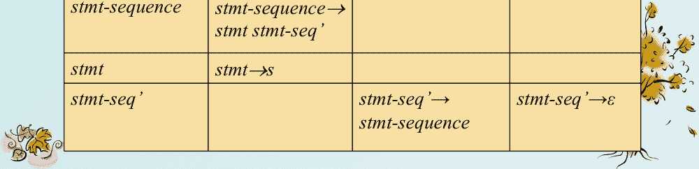

## 4.5 Error Recovery in Top-Down Parsers

- **Different levels of response to errors.**

1. Give a meaningful error message; determine as closely as possible the location where that error has occurred.
2. Some form of error correction; (error repair) the parser attempts to infer a correct program from the incorrect one given.

- **Most of the techniques for error recovery are ad hoc, and general principles are hard to come by.**


### Some important considerations that apply are the following:

1. To determine that an error has occurred as soon as possible.
2. After an error has occurred pick a likely place to resume the parse, try to parse as much of the code as possible.
3. To avoid the error cascade problem.
4. To avoid infinite loops on error.

- The basic mechanism of panic mode:
  - A set of **synchronizing tokens** are provided to each recursive procedure;
  - If an error is encountered, the parser scans ahead, throwing away tokens until one of the synchronized tokens is seen in the input, and then parsing is resumed.

- **Check-input procedure: performs the early look-ahead checking**

```text
Procedure Checkinput(Firstset, Followset)
Begin
    If not (token in Firstset) then
        Error;
        Scanto(Firstset ∪ Followset)
    End if;
End;
```

- **Scanto procedure:**

```text
Procedure Scanto(synchset)
Begin
    While not (token in synchset ∪ {$}) do
        gettoken;
End Scanto;
```

- **Procedure exp(synchset):**

```text
Procedure exp(synchset)
Begin
    Checkinput({(, number}, synchset);
    If not (token in synchset) then
        term(synchset);
        While token = + or token = - do
            match(token);
            term(synchset);
        End while;
    Checkinput(synchset, {(, number});
    End if;
End exp;
```


- **Procedure factor(synchset):**

```text
Procedure factor(synchset)
Begin
    Checkinput({(, number}, synchset);
    If not (token in synchset) then
        case token of
            (: match(();
               exp({ });
               match());
            number:
               match(number);
            else error;
        end case;
    Checkinput(synchset, {(, number});
    End if;
End factor;
```


## 4.5 Error Recovery in Top-Down Parsers

- **Note: checkinput is called twice in each procedure**
  - (1) once to verify that a token in the First set is the next token in the input;
  - (2) a second time to verify that a token in the Follow set is the next token on exit.
- **This form of panic mode will generate reasonable errors.**

For example, `(2+-3)*4+-5` will generate exactly two error messages:
1. one at the first minus sign;
2. one at the second plus sign.


- **Note:**
  - in general, synchset is to be passed down in the recursive calls, with new synchronizing tokens added as appropriate.
  - As an exception, in the case of factor, exp is called with right parenthesis only as its follow set (synchset is discarded).
  - The kind of ad hoc analysis accompanies panic mode error recovery.

### 4.5.2 Error Recovery in LL(1) Parsers

- Panic mode error recovery can be implemented in LL(1) parsers:
  - A new stack is required to keep the synchset parameters;
  - A call to checkpoint must be scheduled by the algorithm before each generate action of the algorithm.

- The primary error situation occurs:
  - the current input token is not in First(A) (or Follow(A), if ε is in First(A)), A is the non-terminal at the top of the stack.


- An alternative to the use of an extra stack is: build the sets of synchronizing tokens directly into the LL(1) parsing table, together with the corresponding actions that checkinput would take.


- Given a non-terminal A at the top of the stack and an input token that is not in First(A) (or Follow(A), if ε is in First(A)), there are three possible alternatives:
  1. Pop A from the stack.
  2. Successively pop tokens from the input until a token is seen for which we can restart the parse.
  3. Push a new non-terminal onto the stack.


- **alternative 1 (Pop)**
  - if the current input token is $ or is in Follow(A);

- **alternative 2 (scan)**
  - if the current input token is not $ and is not in First(A) ∪ Follow(A)

- **Option 3 (Push a new non-terminal)**
  - occasionally useful in special situations.

See Page 187

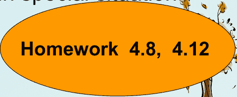

# Chapter 5
# Bottom-Up Parsing


## Outline

A more powerful parsing technology

- **LR grammars** -- more expressive than LL:
  - Construct **right-most derivation** of program
  - Left-recursive grammars, virtually all programming languages
  - Easier to express programming language syntax

- **Shift-reduce parsers**
  - Parsers for LR grammars
  - Automatic parser generators (e.g., yacc, ...)


## Where We Are

**Source code**
*(character stream)*

```
if (b == 0) a = b;
```

Token stream

```
if ( b == 0 ) a = b ;
```

Lexical Analysis

Syntax Analysis (parsing)

Abstract Syntax Tree (AST)


Semantic Analysis

## 5.1 OVERVIEW OF BOTTOM-UP PARSING

- A bottom-up parser uses an explicit stack to perform a parse.
- The parsing stack will contain both tokens and nonterminals.

$ InputString $
......
$ StartSymbol $ accept


## 5.1 OVERVIEW OF BOTTOM-UP PARSING

Right-most derivation — backward.  
Start with the tokens; end with the start symbol.

```
(1+2+(3+4))+5 ⇐
(E+2+(3+4))+5 ⇐
(S+2+(3+4))+5 ⇐
(S+E+(3+4))+5 ⇐
(S+(3+4))+5 ⇐
(S+(E+4))+5 ⇐
(S+(S+4))+5 ⇐
(S+(S+E))+5 ⇐
(S+(S))+5 ⇐
(S+E)+5 ⇐
(S)+5 ⇐
E+5 ⇐
S+5 ⇐
S+E ⇐
S
```

```
S → S + E | E
E → num | (S)
```


- **Parsing actions:** a sequence of **shift** and **reduce** operations.
- **Parser state:** a stack of terminals and non-terminals (grows to the right).
- **Current derivation step** = always stack + input.

| Derivation step | Step stack | Unconsumed input |
|---|---|---|
| `(1+2+(3+4))+5 ⇐` |  | `(1+2+(3+4))+5` |
|  | `(` | `1+2+(3+4))+5` |
|  | `(1` | `+2+(3+4))+5` |
| `(E+2+(3+4))+5 ⇐` | `(E` | `+2+(3+4))+5` |
| `(S+2+(3+4))+5 ⇐` | `(S` | `+2+(3+4))+5` |
|  | `(S+` | `2+(3+4))+5` |
|  | `(S+2` | `+(3+4))+5` |
| `(S+E+(3+4))+5 ⇐` | `(S+E` | `+(3+4))+5` |

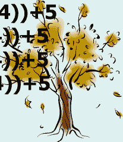


1. **Shift**: Shift a terminal from the front of the input to the top of the stack.
2. **Reduce**: Reduce a string α at the top of the stack to a nonterminal A, given the BNF choice A → α.

**A bottom-up parser is a shift-reduce parser.**

One further feature of bottom-up parsers: grammars are always augmented with a **new start symbol**. If S is the start symbol, a new start symbol S′ is added to the grammar: S′ → S.

### Example 5.1

Consider the following augmented grammar for balanced parentheses:

```
S′ → S
S → (S)S | ε
```

Four steps of the rightmost derivation:

```
S′ ⇒ S ⇒ (S)S ⇒ (S) ⇒ ( )
```

|  | Parsing stack | Input | Action |
|---|---|---|---|
| 1 | `$` | `( ) $` | **Shift** |
| 2 | `$ (` | `) $` | **Reduce S → ε** |
| 3 | `$ (S` | `) $` | **Shift** |
| 4 | `$ (S )` | `$` | **Reduce S → ε** |
| 5 | `$ (S ) S` | `$` | **Reduce S → (S)S** |
| 6 | `$S` | `$` | **Reduce S′ → S** |
| 7 | `$S′` | `$` | **Accept** |

### Example 5.2

Consider the following augmented grammar for arithmetic expressions (no parentheses and one operation):

```
E′ → E
E → E + n | n
```

A bottom-up parse of the string `n + n`:

The rightmost derivation is `E′ ⇒ E ⇒ E + n ⇒ n + n`.

|  | Parsing stack | Input | Action |
|---|---|---|---|
| 1 | `$` | `n+n$` | **Shift** |
| 2 | `$n` | `+n$` | **Reduce E → n** |
| 3 | `$E` | `+n$` | **Shift** |
| 4 | `$E+` | `n$` | **Shift** |
| 5 | `$E+n` | `$` | **Reduce E → E+n** |
| 6 | `$E` | `$` | **Reduce E′ → E** |
| 7 | `$E′` | `$` | **Accept** |

### Right sentential form

- Each of the intermediate strings of terminals and nonterminals in such a derivation is called a right sentential form.
- Each such sentential form is split between the parsing stack and the input during a shift-reduce parse.


- Thus, E, E+, and E+n are all *viable prefixes* of the right sentential form E+n.
- The right sentential form n+n has ε and n as its viable prefixes.
- n+ is not a viable prefix of n+n.
- The sequence of symbols on the parsing stack is called *a viable prefix* of the right sentential form.


## 5.1 OVERVIEW OF BOTTOM-UP PARSING

- **Handle:** This string, together with the position in the right sentential form where it occurs, and the production used to reduce it, is called the **handle** of the right sentential form.

- **Determining the next handle in a parse is the main task of a shift-reduce parser.**

- For example, in step 3 of Table 5.1, a reduction by `S → ε` could be performed, but the resulting string `( S S )` is not a right sentential form; thus `ε` is not the handle at this position in the sentential form `( S`.


## 5.2 FINITE AUTOMATA OF LR(0) ITEMS AND LR(0) PARSING

- An **LR(0) item** of a context-free grammar is a production choice with a distinguished position in its right-hand side.
- The distinguished position is marked by a period.
- If `A → α` and `α = βγ`, then `A → β·γ` is an LR(0) item.


### 5.2.1 LR(0) Items

**Example 5.3**

```
S' → S
S → (S)S | ε
```

This grammar has three production choices and eight items:

```
S' → ·S
S' → S·
S → ·(S)S
S → (·S)S
S → (S·)S
S → (S)·S
S → (S)S·
S → ·
```


**Example 5.4**

The grammar of Example 5.2 has the following eight items:

- `E'→·E`
- `E'→E·`
- `E→·E + n`
- `E→E· + n`
- `E→E + · n`
- `E→E + n·`
- `E→·n`
- `E→n·`


### 5.2.2 Finite Automata of Items

- The LR(0) items serve as the states of a finite automaton.
- This starts out as a nondeterministic finite automaton.
- We construct the DFA of sets of LR(0) items using the subset construction from this NFA of LR(0) items.
- We construct the DFA of sets of LR(0) items directly.


- If `X` is a token or a nonterminal, the item can be written as `A → α·Xη`.

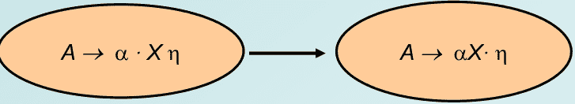

- If `X` is a token, then this transition corresponds to a shift of `X` from the input to the top of the stack during a parse.

- If `X` is a nonterminal, `X` will never appear as an input symbol. Such a transition will still correspond to the pushing of `X` onto the stack during a parse, but this can only occur during a reduction by a production `X → β`.

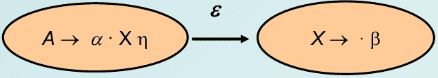

- The start state of the NFA corresponds to the initial state of the parser: the stack is empty.
  - `S` is the start symbol of the grammar.
  - Any initial item `S → ·α` is a start state.
- The solution is to augment the grammar by a single production `S' → S`.
- The initial item `S' → ·S` is the start state of the NFA.
- The NFA will have some information on acceptance, but not in the form of an accepting state.

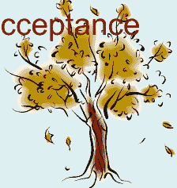


**Example 5.5**

Note that every item in the figure with a dot before the nonterminal `S` has an ε-transition to every initial item of `S`.

```
S' → ·S
S' → S·
S → ·(S)S
S → (·S)S
S → (S·)S
S → (S)·S
S → (S)S·
S → ·
```

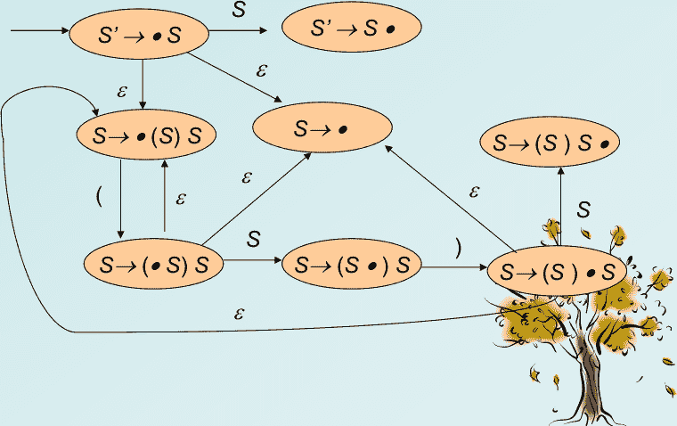

**Example 5.6**

Note that the initial item `E → ·E + n` has an ε-transition to itself (this situation will occur in all grammars with immediate left recursion).

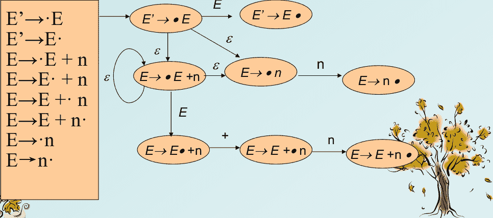


### 5.2.2 Finite Automata of Items

• **Example 5.7** the DFA of the NFA of Figure 5.1.

+   ▪ S′ → ·S  
+   ▪ S′ → S·  
+   ▪ S → ·(S)S  
+   ▪ S → (·S)S  
+   ▪ S → (S·)S  
+   ▪ S → (S)·S  
+   ▪ S → (S)S·  
+   ▪ S → ·

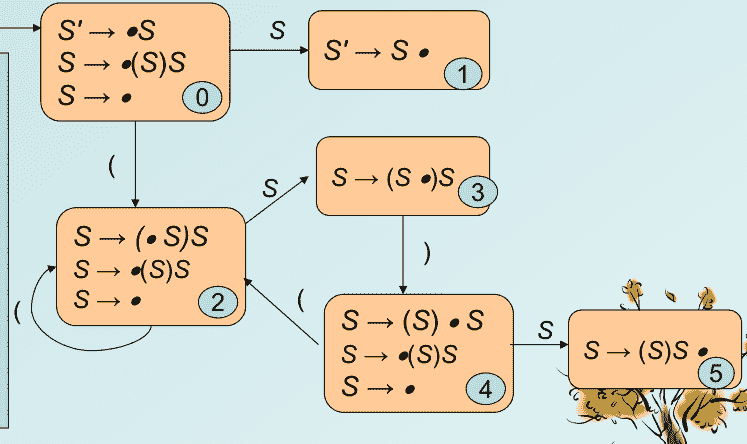

• Example 5.8 the DFA of the NFA of Figure 5.2

+   ■ E′ → ·E  
+   ■ E′ → E·  
+   ■ E → ·E + n  
+   ■ E → E′ + ·n  
+   ■ E → E + ·n  
+   ■ E → ·n  
+   ■ E → n·

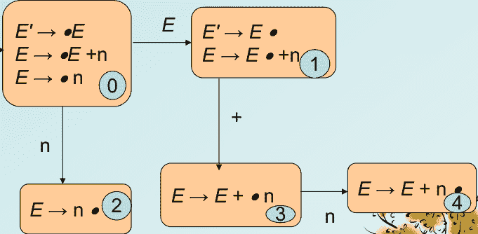

### 5.2.3 The LR(0) Parsing Algorithm

+   - the parsing stack to store: symbols and state numbers.  
+   - pushing the new state number onto the parsing stack after each push of a symbol.

| Parsing stack | input |
|---|---|
| $0 | Input String |
| $0 n2 | Rest input string $ |

| Parsing stack | Symbol stack | input |
|---|---|---|
| 0 | $ | Input String |
| 02 | $n | Rest input string $ |


+   - the parsing stack to store: symbols and state numbers.  
+   - pushing the new state number onto the parsing stack after each push of a symbol.


• Definition (*The LR (0) parsing algorithm*)

Let **s** be the current state (at the top of the parsing stack). Then actions are defined as follows:

+   1. If state **s** contains any item of the form **A → α·Xβ** (X is a terminal). Then the action is to **shift** the current input token on to the stack.


2. If state s contains any complete item (an item of the form A → γ·), then the action is to reduce by the rule A → γ.

+   - A reduction by the rule S′ → S, where S′ is the start state,  
+   - Acceptance if the input is empty  
+   - Error if the input is not empty.


+   - A grammar is said to be LR(0) grammar if  
    the above rules are unambiguous.  
+   - A grammar is LR(0) _if and only if_  
    +   - each state is a shift state( a state containing  
        only “shift” items)  
    +   - a reduce state containing a single complete  
        item.


• Example 5.9 Consider the grammar A → ( A ) | a

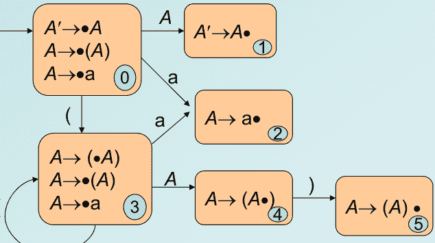

|   | Parsing stack | Input | Action |
|---|---|---|---|
| 1 | $0 | ((a))$ | Shift |
| 2 | $0 (3 | (a))$ | Shift |
| 3 | $0 (3 (3 | a))$ | Shift |
| 4 | $0 (3 (3 a2 | ))$ | Reduce A→a |
| 5 | $0 (3 (3 A4 | ))$ | Shift |
| 6 | $0 (3 (3 A4 )5 | )$ | Reduce A → ( A ) |
| 7 | $0 (3 A4 | )$ | Shift |
| 8 | $0 (3 A4 )5 | $ | Reduce A → ( A ) |
| 9 | $0 A1 | $ | Accept |

+   - The DFA of sets of items and the actions : be combined into a parsing table.  
+   - The LR(0) parsing becomes a table-driven parsing method.  
+   - The table rows labeled with the states of the DFA.  
+   - The columns to be labeled with “shift” and “reduce”.

| State | Action | Rule | ( | a | ) | Goto |
|---|---|---|---|---|---|---|
| 0 | Shift | | 3 | 2 | | 1 |
| 1 | Reduce | A'→A | | | | |
| 2 | Reduce | A→(A) | | | | |
| 3 | Shift | | 3 | 2 | | 4 |
| 4 | Shift | | | | 5 | |
| 5 | Reduce | A→a | | | | |

# Chapter 5 Bottom-Up Parsing


## Outline

A more powerful parsing technology

+   - **LR grammars** -- more expressive than LL  
    +   - Construct **right-most derivation** of program  
    +   - Left-recursive grammars, virtually all programming languages  
    +   - Easier to express programming language syntax  
+   - **Shift-reduce parsers**  
    +   - Parsers for LR grammars  
    +   - Automatic parser generators (e.g., yacc, ...)


## 5.3 SLR(1) Parsing

- Definition:
  - The SLR(1) parsing algorithm.
    - 1. If state s contains any item of form A → α·Xβ, then the action is to shift the current input token onto the stack, and the new state to be pushed on the stack is the state containing the item A → αX·β.
    - 2. If state s contains the complete item A → γ·, and the next token in the input string is in Follow(A), then the action is to reduce by the rule A → γ.

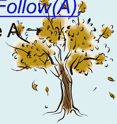


### 5.3.1 The SLR(1) Parsing Algorithm

- A reduction by the rule S' → S, where S' is the start state, this will happen only if the next input token is $.
- Remove the string γ and all of its corresponding states from the parsing stack.
- Back up in the DFA to the state from which the construction of γ began.
- This state must contain an item of the form B → α·Aβ. Push A onto the stack, and push the state containing the item B → αA·β.

3. If the next input token is such that neither of the above two cases applies, an error is declared.


### 5.3.1 The SLR(1) Parsing Algorithm

- A grammar is an SLR(1) grammar: the SLR(1) parsing rules results in no ambiguity.
- a grammar is SLR(1) if and only if, for any state s, the following two conditions are satisfied:
  1. For any item A → α·Xβ in s with X a terminal, there is no complete item B → γ· in s with X in Follow(B).
  2. For any two complete items A → α· and B → β· in s, Follow(A) ∩ Follow(B) is empty.

### 5.3.1 The SLR(1) Parsing Algorithm

- Example 5.10
  this grammar is not LR(0), but it is SLR(1). Follow(E') = {$} and Follow(E) = {$, +}.

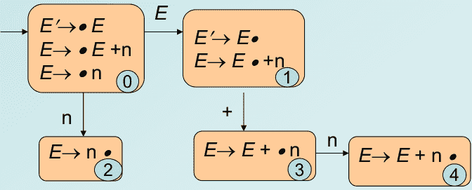


### 5.3.1 The SLR(1) Parsing Algorithm

- Example 5.11
  the grammar of balanced parentheses, Follow(S') = {$} and Follow(S)={$,)}.

Note how the non-LR(0) states 0, 2, and 4 have both shifts and reductions by the \(\epsilon\)-production S →


### 5.3.1 The SLR(1) Parsing Algorithm

- Note how the stack continues to grow until the final reductions.
- This is characteristic of bottom-up parsers in the presence of right-recursive rules such as S → (S)S.
- Right recursion can cause **stack overflow**, and so is to be avoided if possible.


### 5.3.2 Disambiguating Rules for Parsing Conflicts

- two kinds of parsing conflicts in SLR(1) parsing
  - shift-reduce conflicts
  - reduce-reduce conflicts.
- In the case of shift-reduce conflicts, **there is a natural disambiguating rule**
  - always prefer the shift over the reduce.
- The case of reduce-reduce conflicts is more difficult
  - such conflicts often (but not always) indicate an error in the design of the grammar.


### 5.3.2 Disambiguating Rules for Parsing Conflicts

#### Example 5.12

statement → if-stmt | **other**
if-stmt → **if** (exp) statement
| **if** (exp) statement **else** statement
exp → 0 | 1

S → | **other**
I → **if** S | if S **else** S


### 5.3.2 Disambiguating Rules for Parsing Conflicts


- The conflict occurs in states 5 of the DFA.
- A disambiguating rule: prefers the shift over the reduce.

### 5.3.3 Limits of SLR(1) Parsing Power

- SLR(1) parsing is not quite powerful enough

Example 5.13: the statements extracted and simplified from Pascal (a similar situation occurs in C)

```
stmt → call-stmt | assign-stmt
call-stmt → identifier
assign-stmt → var := exp
var → var [ exp ] | identifier
exp → var | number
```


### 5.3.3 Limits of SLR(1) Parsing Power

S’ → ·S  
S → ·id  
S → ·V := E  
V → ·id  

This state has a shift transition on id to the state  
S → id·  
V → id·  

Follow(S)={$}   Follow(V)={:=, $}  

the SLR(1) parsing algorithm calls for a reduction:  
the rule S → id and the rule V → id under  
input symbol $.  
(This is a reduce-reduce conflict.)


## 5.4 General LR(1) and LALR(1) Parsing

- The difficulty with the SLR(1) method:  
  applies lookaheads after the construction of the  
  DFA of LR(0) items

- The power of the general LR(1) method:  
  it uses a new DFA that has the lookaheads built  
  into its construction from the start.

- an LR(1) item is a pair consisting of an LR(0)  
  item and a lookahead token.

### 5.4.1 Finite Automata of LR(1) Items

- We write **LR(1)** items using square brackets as  

  `[A → α·β, a]`  

  where A → α β is an LR(0) item and a is a token (the lookahead).

- The major difference between the LR(0) and LR(1) automata:  

  the definition of the ε-transitions.


### 5.4.1 Finite Automata of LR(1) Items

#### Definition of LR(1) transitions (part 1).

Given an LR(1) item [A→α·XΥ,a], where X is any symbol (terminal or nonterminal), there is a transition on X to the item [A→ αX·Υ,a]

#### Definition of LR(1) transitions (part 2).

Given an LR(1) item [A→ α·B Υ ,a], where B is a nonterminal, there are ε-transitions to items [B→· β ,b] for every production B → β and for every token b in First( Υ a).


### 5.4.1 Finite Automata of LR(1) Items

- **The start state:**  
  - augmenting the grammar with a new start symbol S’  
  - a new production S’ ⟶ S  
- **The start symbol of the NFA of LR(1) items becomes the item [S’ ⟶ .S, $].**


### 5.4.1 Finite Automata of LR(1) Items

- **Example 5.14**  
- Consider the grammar: `A → (A) | a`


### 5.4.2 The LR(1) Parsing Algorithm

#### The General LR(1) parsing algorithm:

Let s be the current state (a the top of the parsing stack). Then actions are defined as follows:

1. If state s: any LR(1) item of the form [A→α·Xβ,a], X is a terminal, and X is the next token in the input string  
2. If state s: the complete LR(1) item [A→ α ·,a], the next token in the input string is a  
3. If the next input token is such that neither of the above two cases applies, an error is declared.

### 5.4.2 The LR(1) Parsing Algorithm

- A grammar is an LR(1) grammar:  
  if the application of the above general LR(1) parsing rules results in no ambiguity.

- a grammar is LR(1) if and only if, for any state s, the following two conditions are satisfied.  

  1. For any item [A→α⋅Xβ,a] in s with X a terminal, there is no item in s of the form [B→γ⋅,X] (otherwise there is a shift-reduce conflict).  
  2. There are no two items in s of the form [A→α⋅,a] and [B→β⋅,a] (otherwise, there is a reduce-reduce conflict).


### 5.4.2 The LR(1) Parsing Algorithm

- Example 5.16  
- S → id | V := E  
- V→ id  
- E → V | n  

S'→• S, $  
S→• id, $  
S→• V := E, $  
V→• id, :=  

S→ V• := E, $  

S→ V := E •, $  

E→ V•,$  

S'→S• , $  

S→id• , $  
V→ id•, :=  

S→ V := • E, $  
E→• V,$  
E→• n,$  
V→• id, $  

E→n• , $  

V→ id• , $  


### 5.4.3 LALR(1) Parsing

- The LALR(1) parsing algorithm: it makes sense to identify all such states and combine their lookaheads.  
- LALR(1) parsing retains some of the benefit of LR(1) parsing over SLR(1) parsing,  
- preserving the smaller size of the DFA of LR(0) items.


### 5.4.3 LALR(1) Parsing

#### FIRST PRINCIPLE OF LALR(1) PARSING

The core of a state of the DFA of LR(1) items is a state of the DFA of LR(0) items.

#### SECOND PRINCIPLE OF LALR(1) PARSING

Given two states s₁ and s₂ of the DFA of LR(1) items that have the same core, suppose there is a transition on the symbol X from s₁ to a state t₁. Then there is also a transition on X from state s₂ to a state t₂, and the states t₁ and t₂ have the same core.

#### Example 5.17

Consider the grammar of Example 5.14. (1) A→(A) (2) A→a


- A grammar is an LALR(1) grammar if no parsing conflicts arise in the LALR(1) parsing algorithm.
- If a grammar is LR(1), then the LALR(1) parsing table cannot have any shift-reduce conflicts, there may be reduce-reduce conflicts.


- If a grammar is SLR(1), then it certainly is LALR(1).
- LALR(1) parsers often do as well as general LR(1) parsers in removing typical conflicts that occur in SLR(1) parsing.

- compute the DFA of LALR(1) items directly from the DFA of LR(0) items through a process of propagating lookaheads.

## 5.7 ERROR RECOVERY IN BOTTOM-UP PARSERS

- A bottom-up parser will detect an error when a blank (or error) entry is detected in the parsing table.
- Errors should be detected as soon as possible.
- This goal conflicts with an equally important one: reducing the size of the parsing table.

An LR(1) parser can, for example, detect errors earlier than an LALR(1) or SLR(1) parser, and these latter can detect errors earlier than an LR(0) parser.


- A good error recovery in bottom-up parsers: removing symbol from either the parsing stack or the input or both.
- There are three possible alternative actions:
  1. Pop a state from the stack.
  2. Successively pop tokens from the input until a token is seen for which we can restart the parse.
  3. Push a new state onto the stack.

1. **Pop** states from the parsing stack until a state is found with nonempty Goto entries.
2. If there is a legal action on the current input token from one of the Goto states, **push** that state onto the stack and restart the parse.
3. If there is no legal action on the current input token from one of the Goto states, **advance** the input.


# Chapter 5
# Bottom-Up Parsing


## Outline

A more powerful parsing technology

- **LR grammars** -- more expressive than LL
  - Construct **right-most derivation** of program
  - Left-recursive grammars, virtually all programming languages
  - Easier to express programming language syntax

- **Shift-reduce parsers**
  - Parsers for LR grammars
  - Automatic parser generators (e.g., yacc, ...)


## 5.5 Yacc: LALR(1) PARSING GENERATOR

- Yacc takes a specification file (usually with a **.y** suffix)
- produces an output file consisting of C source code for the parser (usually in a file called **y.tab.c** or **ytab.c**)
- A Yacc specification file has the basic format

```
{definitions}
%%
{rules}
%%
{auxiliary routines}
```


## 5.5 Yacc: LALR(1) PARSING GENERATOR

exp → exp addop term | term
addop → + | -
term → term mulop factor | factor
mulop → *
factor → ( exp ) | number

```c
%{
#include <stdio.h>
#include <ctype.h>
%}
%token NUMBER
%%
command : exp { printf ("%d\n",$1);}
; /*allows printing of the result */
exp: exp '+' term {$$ = $1 + $3;}
| exp '-' term {$$ = $1 - $3;}
| term {$$ = $1;}
;
term: term '*' factor {$$ = $1* $3;}
| factor {$$ = $1;}
;
factor :NUMBER {$$ = $1;}
| '(' exp ')' {$$=$2;}
;
%%
```

```c
main ( )
{ return yyparse( );
}
int yylex(void)
{
  int c;
  while( ( c = getchar( ) ) == ' ');
  /*eliminates blanks */
  if ( isdigit(c) ) {
    ungetc (c,stdin) ;
    scanf (“%d”,&yylval) ;
    return (NUMBER ) ;
  }
  if (c== ‘\n’) return 0;
  /* makes the parse stop */
  return ( c ) ;
}
```

```c
int yyerror (char * s)
{ fprintf (stderr, "%s\n",s ) ;
return 0;
}/* allows for printing of an error message
*/
```

- different values for different grammar rules.
  - \( exp \rightarrow exp \ addop \ term \ | \ term \)
  - \( addop \rightarrow + \ | \ - \)

- there are two ways to do this.
  - (1) declare the union directly in the Yacc specification using the `%union` Yacc declaration:
    `%union { double val;
    char op;}`

```yacc
%token NUMBER
%union { double val;
          char op;}
%type <val> exp term factor NUMBER
%type <op> addop mulop
%%
command : exp {printf("%d\n",$1);}
         ;
exp : exp op term { switch ($2){
                         case '+': $$=$1+$3; break;
                         case '-': $$=$1-$3; break;
                       }
                     }
    | term {$$ = $1;}
    ;
op : '+' {$$ = '+';}
   | '-' {$$ = '-';}
```

- All nonterminals achieve their values by such user-supplied actions.
  - Tokens may also be assigned values, this is done during the scanning process.
  - Yacc assumes that the value of a token is assigned to the variable `yylval`.

- In the third section, yyparse is declared to return an integer value, which is 0 if the parse succeeds, and 1 if it does not.
  - The yyparse procedure calls a scanner procedure (yylex.)
  - Yacc expects the end of input to be signaled by a return of the null value 0 by yylex.
  - yyerror prints an error message when an error is encountered during the parse.

# Chapter 6
# Semantic Analysis

## outline

- Attributes and attribute grammars
- Algorithms for attribute computation
- The symbol table
- Data types and type checking
- A semantic analyzer for the TINY language

## 6.1 Attributes and attribute grammars

- Attributes: any property of a programming language construct such as
  - The data type of a variable
  - The value of an expression
  - The location of a variable in memory
  - The object code of a procedure
  - The number of significant digits in a number
- Attributes may be fixed prior to the compilation process.
- Attributes may be only determinable during program execution.


## 6.1 Attributes and attribute grammars

- **Binding** of the attribute: the process of computing an attribute and associating its computed value with the language construct in question.
- **Binding time**: the time during the compilation/execution process when the binding of an attribute occurs.

- Binding times of different attributes vary, and even the same attributes that can have quite different binding times from language to language.

- **Static attributes/Dynamic attributes:** Based on the difference of the binding time
  - be bound prior to execution
  - be bound during execution


- A type checker: is an important part of semantic analysis (in a language like C or Pascal)

- A type checker is a analyzer

- ➤ computes the data type attribute of all language entities for which data types are defined

- ➤ verifies that these types conform to the type rules of the language.

- Type checking = set of rules that ensure the type consistency of different constructs in the program

- Examples:

- The type of a variable must match the type from its declaration

- The operands of arithmetic expressions (+, *, -, /) must have integer types; the result has integer type

- The operands of comparison expressions (==, !=) must have integer or string types; the result has boolean type


### More examples:

> For each assignment statement, the type of the updated variable must match the type of the expression being assigned

> For each call statement foo(v1, ..., vn), the type of each actual argument vi must match the type of the corresponding formal argument fi from the declaration of function foo

> The type of the return value must match the return type from the declaration of the function


### 6.1.1 Attribute grammars

X.a : the value of a associated to X  
X is a grammar symbol and a is an attribute associated to X.

syntax-directed semantics: attributes are associated directly with the grammar symbols of the language.

Given attributes a₁, a₂, ... , aₖ, for each grammar rule X₀→X₁ X₂ ... Xₙ ( X₀ is a nonterminal ), the values of the attributes Xᵢ.aⱼ of each grammar symbol Xᵢ are related to the values of the attributes of the other symbols in the rule.

• An attribute grammar for attributes a₁, a₂, ... , aₖ is the collection of all attribute equations or semantic rules of the following form, for all the grammar rules of the language.
Xᵢ.aⱼ=fᵢⱼ(X₀.a₁,...,X₀.aₖ, X₁.a₁, ..., X₁.aₖ,...Xₙ.a₁, ...Xₙ.aₖ)
fᵢⱼ is a mathematical function of its arguments

attribute grammars are written in tabular form as follows:

| Grammar Rule | Semantic Rules |
|---|---|
| Rule 1 | Associated attribute equations |
| ..... | .......... |
| .......... | ............ |
| ... | . |
| Rule n | Associated attribute equations |


#### Example 6.1:

Number → number digit | digit

Digit → 0|1|2|3|4|5|6|7|8|9

| Grammar Rule | Semantic Rules |
|---|---|
| number1 → number2 digit | number1.val = number2.val*10+digit.val |
| number → digit | number.val = digit.val |
| digit → 0 | digit.val = 0 |
| digit → 1 | digit.val = 1 |
| digit → 2 | digit.val = 2 |
| digit → 3 | digit.val = 3 |
| digit → 4 | digit.val = 4 |
| digit → 5 | digit.val = 5 |
| digit → 6 | digit.val = 6 |
| digit → 7 | digit.val = 7 |
| digit → 8 | digit.val = 8 |
| digit → 9 | digit.val = 9 |


### 6.1.1 Attribute grammars

the parse tree showing attribute computations for the number 345 is given as follows


#### Example 6.2:

exp → exp + term | exp - term | term  
term → term * factor | factor  
factor → (exp) | number

| Grammar Rule | Semantic Rules |
|---|---|
| exp1 → exp2 + term | exp1.val = exp2.val + term.val |
| exp1 → exp2 - term | exp1.val = exp2.val - term.val |
| exp1 → term | exp1.val = term.val |
| term1 → term2 * factor | term1.val = term2.val * factor.val |
| term → factor | term.val = factor.val |
| factor → (exp) | factor.val = exp.val |
| factor → number | factor.val = number.val |

the computations implied by this attribute grammar by attaching equations to nodes in a parse tree is as follows. (given the expression (34-3)*42)


#### Example 6.3:

decl → type var-list  
type → int | float  
var-list → id, var-list | id

| Grammar Rule | Semantic Rules |
|---|---|
| decl → type var-list | var-list.dtype = type.dtype |
| type → int | type.dtype = integer |
| type → float | type.dtype = real |
| var-list1 → id, var-list2 | id.dtype = var-list1.dtype<br>var-list2.dtype = var-list1.dtype |
| var-list → id | id.dtype = var-list.dtype |


Parse tree for the string float x,y showing the dtype attribute as specified by the attribute grammar above is as follows


#### Example 6.4

based-num → num basechar  
basechar → o | d  
num → num digit | digit  
digit → 0 | 1 | 2 | 3 | 4 | 5 | 6 | 7 | 8 | 9

| Grammar Rule | Semantic Rules |
|---|---|
| based-num → num basechar | based-num.val = num.val<br>num.base = basechar.base |
| basechar → o | basechar.base = 8 |
| basechar → d | basechar.base = 10 |
| num1 → num2 digit | num1.val =<br>&nbsp;&nbsp;&nbsp;&nbsp;If digit.val = error or num2.val = error<br>&nbsp;&nbsp;&nbsp;&nbsp;Then error<br>&nbsp;&nbsp;&nbsp;&nbsp;Else num2.val * num1.base + digit.val<br>num2.base = num1.base<br>digit.base = num1.base |
| num → digit | num.val = digit.val<br>digit.base = num.base |
| digit → 0 | digit.val = 0 |
| digit → 1 | digit.val = 1 |
| ….. | ….. |
| digit → 7 | digit.val = 7 |
| digit → 8 | digit.val = if digit.base = 8 then error else 8 |
| digit → 9 | digit.val = if digit.base = 8 then error else 9 |


### 6.1.2 Simplifications and Extensions to Attribute Grammars

- Metalinguage for the attribute grammar: the collection of expressions allowable in an attribute equation.
  - In this book limited to arithmetic, logical and a few other kinds of expressions.
  - an if-then-else expression and occasionally a case or switch expression.
- Functions can be added to the metalinguage whose definitions may be given elsewhere.
  - digit → D (D is understood to be one of the digits)
  - digit.val = numval(D)

#### Example 6.5

define an abstract syntax tree for simple integer arithmetic expressions by the attribute grammar as follows:

| Grammar Rule | Semantic Rules |
|---|---|
| exp1 → exp2 + term | exp1.tree = mkOpNode(+, exp2.tree, term.tree) |
| exp1 → exp2 - term | exp1.tree = mkOpNode(-, exp2.tree, term.tree) |
| exp1 → term | exp1.tree = term.tree |
| term1 → term2 * factor | term1.tree = mkOpNode(*, term2.tree, factor.tree) |
| term → factor | term.tree = factor.tree |
| factor → (exp) | factor.tree = exp.tree |
| factor → number | factor.tree = mkNumNode(number.lexval) |


# Chapter 6
# Semantic Analysis

## 6.2 Algorithms for attribute computation

### Purpose:

- study the ways an attribute grammar can be used as basis for a compiler to compute and use the attributes defined by the equations of the attribute grammar.
- $X_i.a_j = f_{ij}(X_0.a_1,\dots,X_0.a_k, X_1.a_l, \dots, X_1.a_k, \dots, X_n.a_1, \dots, X_n.a_k)$ is viewed as an assignment of the value of the functional expression on the right-hand side to the attribute $X_i.a_j$.

### 6.2.1 dependency graphs and evaluation order

decl → type var-list  
type → int|float  
var-list → id,var-list|id

based-num → num basechar  
num → num digit  
num → digit  
digit → 9  
......

Example 6.9 the dependency of Fig 6.6(DAG)

Another topological sort is given by the order

12 6 9 1 2 11 3 8 4 5 7 10 13 14

how attribute values are found at the roots of the graph

- **Parse tree method:** construction of the dependency graph is based on the specific parse tree at compile time., add complexity, and need circularity detective.
- **Rule based method:** fix an order for attribute evaluation at compiler construction time. It depends on an analysis of the attribute equations, or semantic rules.

### 6.2.2 Synthesized and inherited attributes

Classification of the attributes:

1. synthesized attributes
2. inherited attributes

#### Synthesized attributes

- An attribute is synthesized
  - if all its dependencies point from child to parent in the parse tree.
  - given a grammar rule $A \to X_1 X_2 \dots X_n$, the only associated attribute equation with an $a$ on the left-hand side is of the form:
    - $A.a = f(X_1.a_1,\dots,X_1.a_k,\dots,X_n.a_1,\dots,X_n.a_k)$

- S-attributed grammar:
  An attribute grammar in which all the attributes are synthesized

The attribute values of an S-attributed grammar can be computed by a single bottom-up, or post-order, traversal of the parse or syntax tree.

```
Procedure PostEval (T : treenode);
Begin
    For each child C of T do
        PostEval(C);
        Compute all synthesized attributes of T;
End
```

#### inherited attributes

- An attribute that is not synthesized is called an inherited attribute.
- Such as dtype in example 6.3 and base in example 6.4.

inherited attributes: computed by a preorder traversal, or combined preorder/inorder traversal of the parse or syntax tree, represented by the following pseudocode:

```
Procedure PreEval(T: treenode);
Begin
    For each child C of T do
        Compute all inherited attributes of C;
        PreEval(C);
    End;
```


### 6.2.2 Synthesized and inherited attributes

- The order in which the inherited attributes of the children are computed is important.
- It must adhere to any requirements of the dependencies.

#### Example 6.12

Procedure EvalType(T: treenode);
Begin
    Case nodekind of T of
        Decl:
                EvalType(type child of T);
                Assign dtype of type child of T to var-list child of T;
                EvalType(var-list child of T);
        Type:
                If child of T = int then T.dtype := integer
                Else T.dtype := real;
        Var-list:
                Assign T.dtype to first child of T;
                If third child of T is not nil then
                        Assign T.dtype to third child;
                        EvalType(third child of T);
    End case;
End EvalType;


- preorder and inorder operations are mixed.
- Inorder: decl node
- Preorder: var-list node


- If use the actual C code, assume that a syntax tree has been constructed, in which var-list is represented by a sibling list of id nodes as follows.


typedef enum {decl, type,id} nodekind;
typedef enum {integer, real} typekind;
typedef struct treenode
{nodekind kind;
struct treenode *lchild, *rchild , *sibling;
typekind dtype;
char *name;
} *Syntaxree;

void evaltype ( syntaxtree t )
{
    if(t->kind == decl)
    {
        syntaxtree p = t->rchild;
        p->dtype = t->lchild->dtype;
        while (p->sibling !=NULL)
        {p->sibling->dtype = p->dtype;
            p = p->sibling;
        }
    }
}


#### Example 6.14

- • the simple version of an expression grammar:exp → exp / exp | num | num.num

- • Operations may be interpreted differently depending on whether they are floating-point or strictly integer operations.

- • For instance:
  - 5/2/2.0 = 1.25
  - 5/2/2 = 1

- **the attributes needed to express the corresponding semantic:**
  - `isFloat`: boolean, indicates if any part of an expression has a floating-point value (**synthesized**)
  - `etype`: gives the type of each subexpression and depends on `isFloat` (**inherited**), here is int or float
  - `val`: gives the numeric value of each subexpression, depends on `etype`.


| Grammar Rule | Semantic Rules |
|---|---|
| **S → exp** | **exp.etype** = if **exp.isFloat** then **float** else **int**<br>**S.val** = **exp.val** |
| **Exp1 → exp2 / exp3** | **exp1.isFloat** = **exp2.isFloat** or **exp3.isFloat**<br>**exp2.etype** = **exp1.etype**<br>**exp3.etype** = **exp1.etype**<br>**exp1.val** = if **exp1.etype** = **int** then **exp2.val / exp3.val** else **exp2.val / exp3.val** |
| **exp → num** | **exp.isFloat** = **false**<br>**exp.val** = if **exp.etype** = **int** then **num.val** else **Float(num.val)** |
| **exp → num.num** | **exp.isFloat** = **true**<br>**exp.val** = **num.num.val** |


### 6.2.3 Attributes as parameters and returned values.

- Many attributes are the same or are only used temporarily to compute other attribute values, needn't be stored as fields in a syntax tree record structure.
- Inherited attributes: computed in preorder, often treated as parameters of the call.
- Synthesized attributes: computed in postorder, often treated as returned values of the call.

#### Example 6.15

- The recursive procedure `EvalWithBase` of Example 6.13.
- Turn `base` into a parameter and `val` into a returned value.

```
based-num → num basechar
basechar → o | d
num → num digit | digit
```

```
Num:
    temp := EvalWithBase(left child of T, base);
    if right child of T is not nil then
        temp2 := EvalWithBase(right child of T, base);
        if temp != error and temp2 != error then
            return base*temp + temp2
        else return error;
    else return temp;
Basechar:
    if child of T = 'o' then return 8
    else return 10;
Digit:
    if base = 8 and child of T = 8 or 9 then return error;
    else return numval(child of T);
end case;
end EvalWithBase;
```


```pascal
function EvalBasedNum(T: treenode) : integer;
(* only called on root node *)
begin
    return EvalNum(left child of T, EvalBase(right child of T));
end;

function EvalBase(T: treenode) : integer;
(* only called on basechar node *)
begin
    if child of T = 'o' then return 8
    else return 10;
end
```

```pascal
function EvalNum(T: treenode; base: integer) : integer;
var temp, temp2: integer;
begin
  case nodekind of T of
    Num:
      temp := EvalNum(left child of T, base);
      if right child of T is not nil then
        temp2 := EvalNum(right child of T, base);
        if temp != error and temp2 != error then
          return base*temp + temp2
        else return error;
      else return temp;
    Digit:
      if base = 8 and child of T = 8 or 9 then return error;
      else return numval(child of T);
  end case;
end.
```


### 6.2.4 The use of external data structures to store attributes values.

**Applicability:**

- Not suitable to the method of parameters and returned values.
- Particularly when the attribute values have significant structure and may be needed at arbitrary points during translation.
- Not reasonable to be stored in the syntax tree nodes.


**Ways:**

- External data structures: tables, graphs and other data structures. One of the prime examples is the symbol table.
- Replace attribute evaluations by calls to procedures responsible for maintaining appropriate data structures on the ... the attribute ...


### 6.2.5 The computation of attributes during parsing.

#### Computing synthesized attributes during LR parsing

Value stack: store synthesized attributes, be manipulated in parallel with the parsing stack.


| Stack | Input | Action | State | Attribute computation |
|---|---|---|---|---|
| `$` | `3*4+5$` | Shift | `$` | |
| `$n` | `*4+5$` | Reduce E→n | `$n` | `E.val = n.val` |
| `$E` | `*4+5$` | Shift | `$3` | |
| `$E*` | `4+5$` | Shift | `$3*` | |
| `$E*n` | `+5$` | Reduce E→n | `$3*n` | `E.val = n.val` |
| `$E*E` | `+5$` | Reduce E→E*E | `$3*4` | `E1.val = E2.val * E3.val` |
| `$E` | `+5$` | Shift | `$12` | |
| `$E+` | `5$` | Shift | `$12+` | |
| `$E+n` | `$` | Reduce E→n | `$12+n` | `E.val = n.val` |
| `$E+E` | `$` | Reduce E→E+E | `$12+5` | `E1.val = E2.val + E3.val` |
| `$E` | `$` | | `$17` | |


### 6.2.5 The computation of attributes during parsing.

inheriting a previously computed synthesized attributes during LR parsing

an action associated to a nonterminal in the right-hand side of a rule can make use of synthesized attributes of the symbols to the left of it in the rule.

- For instance:
  - A → B C
  - C.i = f(B.s) s is a synthesized attribute.


### 6.2.5 The computation of attributes during parsing.

inheriting a previously computed synthesized attributes during LR parsing

- The question can be settled through a ε-production as follows

| Grammar Rule | Semantic Rules |
|---|---|
| A→BDC | |
| B→... | {computer B.s} |
| D→ε | saved_i=f(valstack[top]) |
| C→... | {now saved_i is available} |

- In Yacc this process is made easier. The action of storing the computed attribute is simply written at the place in the rule where it is to be scheduled:
A: B { saved_i=f($1);} C;

### 6.2.5 The computation of attributes during parsing.

inheriting a previously computed synthesized attributes during LR parsing

the following attribute grammar satisfy the above request.

| Grammar Rule | Semantic Rules |
|---|---|
| decl→type var-list | var-list.dtype = type.dtype |
| type→int | type.dtype = integer |
| type→ float | type.dtype = real |
| var-list1→var-list2,id | insert(id.name, var-list1.dtype)<br>var-list2.dtype = var-list1.dtype |
| var-list→id | insert(id.name, var-list.dtype) |

## 6.2.5 The computation of attributes during parsing

## Problems

1. Require the programmer to directly access the value stack during a parse

   *this may be risky in automatically generated parsers.*

2. only works if the position of the previously computed attribute is predictable from the grammar.

   the best technique for dealing with inherited attributes in LR parsing:

   use external data structures, to hold inherited attribute values and to add ε-production or embedded actions, as in Yacc (may add parsing conflicts).


### 6.2.6 The dependence of attributes computation on the syntax

- modifications to the grammar that do not change the legal strings of the language
  make the computation of attributes simpler or more complex.
- The properties of attributes depend heavily on the structure of the grammar.


### 6.2.6 The dependence of attributes computation on the syntax

#### Theorem

Given an attribute grammar, **all inherited attributes can be changed into synthesized attributes** by suitable modification of the grammar, without changing the language of the grammar.

> (from Knuth [1968]).


### 6.2.6 The dependence of attributes computation on the syntax

#### Example 6.18

- an inherited attribute can be turned into a synthesized attribute by modification of the grammar.
- Consider the grammar as follows:
  decl → type var-list
  type→int|float
  var-list→id,var-list|id
- The dtype attribute is inherited.
- rewrite the grammar as follows
  decl → var-list id
  var-list→ var-list id , | type
  type → int | float

### 6.2.6 The dependence of attributes computation on the syntax

#### Example 6.18

- turned the inherit attribute into synthesized attribute as follows:

| Grammar Rule | Semantic Rules |
|---|---|
| `decl → var-list id` | `id.dtype = var-list.dtype` |
| `var-list1 → var-list2 id` | `varlist1.dtype = varlist2.dtype`<br>`id.dtype = varlist2.dtype` |
| `var-list → type` | `var-list.dtype = type.dtype` |
| `type → int` | `type.dtype = integer` |
| `type → float` | `type.dtype = real` |


# Chapter 6 Semantic Analysis

## outline

- Attributes and attribute grammars
- Algorithms for attribute computation
- The symbol table
- Data types and type checking
- A semantic analyzer for the TINY language

## 6.3 The symbol table

- **Semantic checks** refer to properties of identifiers in the program -- their scope or type
- Need an environment to store the information about identifiers = **symbol table**
- Each entry in the symbol table contains
  - the name of an identifier
  - additional information: its kind, its type, if it is constant, ...

| NAME | KIND | TYPE | ATTRIBUTES |
|---|---|---|---|
| `foo` | fun | `int x int → bool` | extern |
| `m` | arg | int | |
| `n` | arg | int | const |
| `tmp` | var | bool | const |

### 6.3.1 The structure of the symbol table

1. linear list:
   provide easy and direct implementations of the three basic operations;
   *insert* operation is performed in constant time
   *lookup* and *delete* operation are linear time in the size of the list;
   good for a compiler implementation in which speed is not a major concern
   - a prototype
   - experimental compiler
   - an interpreter for a very small programs.

2. various search tree structures
   (binary search trees, AVL trees, B trees)
   don't provide best case efficiency;
   the delete operation is very complexity;
   less useful

3. hash tables
   all three operation can be performed in almost
   constant time;
   most frequently in practice, best choice

### 6.3.1 The structure of the symbol table

#### the hash table

- a **hash function** turns the search key( the identifier name, consisting of a string of characters) into an integer hash value in the index range
- indexed by an integer range from 0 to the table size minus one
- the item corresponding to the search key is stored in the bucket at this index.

### 6.3.1 The structure of the symbol table

the hash table

- **Main problem:**
  - collision: two keys are mapped to the same index by the hash function.

### 6.3.1 The structure of the symbol table

#### Collision resolution

1. **open addressing:**
   - inserting the collided new items in successive buckets.
   - cause a significant degradation in performance and make delete operation difficult.
2. **separate chaining**
   - each bucket is a linear list, collisions are resolved by inserting the new item into the bucket list.
   - it is the best scheme for compiler construction.

### 6.3.1 The structure of the symbol table

#### The algorithm of the hash function

1. one simple algorithm : ignore many of the characters and to add together only the value of the first few, or the first, middle, and last, characters.

_This is inadequate for a compiler._

2. Another simple method : add up the values of all the characters.

_all permutations of the same characters cause collisions._

### 6.3.1 The structure of the symbol table

#### The algorithm of the hash function

3. one good solution : repeatedly use a constant number α as a multiplying factor when adding in the value of the next character.

$h_{i+1}=αh_i+c_i \quad h_0=0$

final hash value $h=h_n \bmod size$

n is the number of characters in the name being hashed.

$h=(α^{n-1}c_1+α^{n-2}c_2+…..+αc_{n-1}+c_n) \bmod size$

The choice of α has a significant effect on the outcome.

A reasonable choice for α is a power of 2, such as 16 or 128, so that the multiplication can be performed as a shift.


### 6.3.2 Declarations

four basic kinds of declarations:

- constant declarations,
- type declarations,
- variable declarations
- procedure/function declarations.

#### type declarations

- Bind names to newly constructed types and may also create aliases for existing named types. Type names are used in conjunction with a type equivalence algorithm (perform type checking of a program)

```
type table = array [1..SIZE] of Entry  (pascal)
struct Entry        (C)
{
char * name;
 int count;
 struct Entry *next ;
};
typedef struct Entry *Entryptr;
```

#### variable declarations

- bind names to data types,

- integer a, b[100];  (C declaration)

- integer a, b(100)   (FORTRAN declaration)

- Variable declarations may also bind other attributes implicitly: _the scope of a declaration_.

- an attribute of variables related to scope that is also implicitly or explicitly bound is _the allocation of memory for the declared variable_ and _the duration during execution of the allocation_ (lifetime or extent of the declaration)

#### procedure/function declarations

- include explicit and implicit declarations

declarations are attached to executable instructions without explicit mention.

### 6.3.3 Scope rules and block structure

- two rules:
  - declaration before use
  - the most closely nested rule for block structure

#### declaration before use

- used in C and Pascal, that requires a name be declared prior to any references to the name.

- Declaration before use permits

- the symbol table to be built as parsing proceeds.

- lookups to be performed as soon as a name reference is encountered in the code.

- If the lookup fails

- a violation of declaration before use has occurred,

- the compiler will issue an appropriate error message.

#### the most closely nested rule for block structure

- A language is block structured
  - if it permits the nesting of blocks inside other blocks
  - if the scope of declarations in a block are limited to that block and other block contained in that block

```
int i, j ;
int f(int size)
{ char i, temp;
  …
  {double j;
   …
  }
  {char * j;
   …
  }
}
```

after processing the declarations of the body of f

after processing the declarations of the second nested compound statement within the body of f

after exiting the body of f (and deleting its declarations)

### 6.3.4 Interaction of same-level declarations

interaction among declarations at the same nesting level can vary with the kind of declaration and with the language being translated.

One typical requirement:
No reuse of the same name in declarations at the same level.
typedef int i;
int i;
( The above declaration will cause an error.)

How much information the declarations in a sequence at the same level have available about each other

int i = 1;
Void f(void)
{ int i = 2 , j = i+1;
... }

By the most closely nested rule, the local declaration is used, j should be 3.


### 6.3.4 Interaction of same-level declarations

- **sequential declaration:**
    - each declaration is added to the symbol table as it is processed.
- **collateral declaration:**
    - declarations are not added immediately to the existing symbol table
    - accumulated in a new table (or temporary structure)
    - then added to the existing table after all declarations have been processed.
- **recursive declaration:**
    - declarations may refer to themselves or to each other.


```
int gcd ( int n, int m)
{ if (m == 0) return n;
  else return gcd (m, n%m);
}
```

```
void g(void); /* function prototype declaration
*/
void f (void)
{ .....g( ) .....}
```

### 6.3.5 An extended example of an attribute grammar using a symbol table

```
S → exp
exp → (exp) | exp + exp | id | num | let dec-list in exp
dec-list → dec-list, decl | decl
decl → id = exp
```

- The declarations inside a let expression represent a kind of constant declaration. Such as `let x = 2+1, y=3+4 in x+y`.
- The let expressions represent the blocks of this language.
- The grammar allows arbitrary nesting of let expressions inside each other.


#### Semantic Rules

| Grammar Rule | Semantic Rules |
| --- | --- |
| `S → exp` | `exp.symtab = emptytable`<br>`exp.nestlevel = 0`<br>`S.err = exp.err` |
| `exp1 → exp2 + exp3` | `exp2.symtab = exp1.symtab`<br>`exp3.symtab = exp1.symtab`<br>`exp2.nestlevel = exp1.nestlevel`<br>`exp3.nestlevel = exp1.nestlevel`<br>`exp1.err = exp2.err or exp3.err` |
| `exp1 → (exp2)` | `exp2.symtab = exp1.symtab`<br>`exp2.nestlevel = exp1.nestlevel`<br>`exp1.err = exp2.err` |
| `exp → id` | `exp.err = not isin(exp.symtab, id.name)` |
| `exp → num` | `exp.err = false` |


## 6.4 Data types and type checking

- Type inference and type checking are the principal tasks of a compiler.
- Type checking = set of rules that ensure the type consistency of different constructs in the program
- Examples:
    - The type of a variable must match the type from its declaration
    - The operands of arithmetic expressions `(+, *, -, /)` must have integer types; the result has integer type
    - The operands of comparison expressions `(==, !=)` must have integer or string types; the result has boolean type
- More examples:
    - For each assignment statement, the type of the updated variable must match the type of the expression being assigned
    - For each call statement `foo(v1, ..., vn)`, the type of each actual argument `vi` must match the type of the corresponding formal argument `fi` from the declaration of function `foo`
    - The type of the return value must match the return type from the declaration of the function

### 6.4.1 Type expressions and type constructors

- **data type forms:**
    - a set of values with certain operations on those values.
- **type information can be explicit and implicit.**
    - For instance `var x: array[1..10] of real` (explicit)
    - `const greeting = "Hello"` (implicitly `array [1..6] of char`)
- **a data type is a set of values, or more precisely, a set of values with certain operations on those values.**
- **These sets are usually described by a type expression.**


#### Structured type

- New data types can be created using type constructors.
- Such constructors can be viewed as functions: they take existing types as parameters and return new types with a structure that depends on the constructor.
- Array: type parameter: index type, component type.


### 6.4.1 Type expressions and type constructors

#### Array

- Arrays are commonly allocated contiguous storage from smaller to larger indexes.
- allow for the use of automatic offset calculations during execution.
- The amount of memory needed is n * size.

#### record

- a record or structure type constructor takes a list of names and associated types and constructs a new type.

```
struct
{
  double r;
  int i;
}
```

- different types may be combined.
- the names are used to access the different components.


#### union

- correspond to the set union operation

```
union
{double r;
 int i;}
```

- disjoint union, each value is viewed as either a real or an integer, but never both.
- Allocate memory in parallel for each component.


#### pointer

- values that are references to values of another type. Most useful in describing recursive types.
- A value of a pointer type is a memory address whose location holds a value of its base type.

```
^integer
```

```
*integer
```

- allocated space based on the address size of the target machine.


#### function

- an array can be viewed as a function from its index set to its component set.
- Many language have a more general ability to describe function types.
- The allocated space depend on the address size of the target machine. According to the language and the organization of the runtime environment, it should allocate for :
  - A code pointer alone
  - Environment pointer.


#### class

- similar to a record declaration, except it includes the definition of operations (methods or member functions)
- beyond type system such as inheritance and dynamic binding, must be maintained by separate data structures.


# Chapter 6
# Semantic Analysis


## outline

- Attributes and attribute grammars
- Algorithms for attribute computation
- The symbol table
- Data types and type checking

### 6.4.2 Type names, type declarations and recursive type

- type declarations(type definition): mechanism for a programmer to assign names to type expressions.
- Such as : typedef, = , associated directly with a struct or union constructor.

```
typedef struct
    {double r;
     int i;
    } RealIntRec;    (C)
```


### 6.4.2 Type names, type declarations and recursive type

- Since type names can appear in type expressions, questions arise about the recursive use of type names.
- Such recursive data types are extremely important in modern programming languages include lists, trees, and many other structures.

```
direct use of recursion (ML language):
datatype intBST = Nil | Node of int*intBST*intBST
```

```
indirect use of recursion (C language):
struct intBST
    { int val;
      struct intBST *left, *right;
    };
typedef struct intBST *intBST;
```


### 6.4.3 Type equivalence

- type equivalence: two type expression represent the same type.
- There are many possible ways for type equivalence to be defined by a language.
- We represent type equivalence as it would be in a compiler semantic analyzer.

```pascal
function typeEqual (t1,t2:TypeExp): Boolean;
```

A simple grammar for type expressions:

var-decls → var-decls; var-decl | var-decl
var-decl → id: type-exp
type-exp → simple-type | structured-type
simple-type → int | bool | real | char | void
structurd-type → array [ num] of type-exp|
record var-decls end |
union var-decls end |
pointer to type-exp |
proc ( type-exps) type-exp
type-exps → type-exps, type-exp | type-exp

The type expression can be represented by a syntax tree.

The type expression:

```pascal
record
    x: pointer to real;
    y: array [10] of int
end
```


The type expression:

```pascal
proc (bool, union a:real; b:char end, int): void
```


Classification of type equivalence

1. Structural equivalence
2. Name equivalence
3. Declaration equivalence


#### Structural equivalence

- two types are the same if and only if they have the same structure.
- two types are the same if and only if they have syntax trees that are identical in structure.

```pascal
function typeEqual (t1,t2:TypeExp): Boolean:
var temp: Boolean;
    p1, p2: TypeExp;
Begin
        If t1 and t2 are of simple type then return t1=t2;
        Else if t1.kind = array and t2.kind = array then
                    return t1.size = t2.size and TypeEqual(t1.child1, t2.child1)
        Else if t1.kind = record and t2.kind = record
                or t1.kind = union and t2.kind = union then
            begin
            p1 :=t1.child1;
            p2 :=t2.child1;
            temp :=true;
```


```pascal
while temp and p1 != nil and p2!=nil do
    If p1.name !=p2.name then
        temp := false
    else if not typeEqual(p1.child1, p2.child1)
    then temp := false
    else begin
        p1 := p1.sibling;
        p2 := p2.sibling;
    end;
    return temp and p1 = nil and p2 = nil;
end
else if t1.kind = pointer and t2.kind = pointer then
    return typeEqual(t1.child1, t2.child1)
```


- two arrays are equivalent: the same size and component type.
- two records are equivalent: the same components with the same names and in the same order.

different choices:

The size of the array can be ignored

The components of a structure or union can be in a different order.


#### Name equivalence

```pascal
function typeEqual (t1,t2:TypeExp): Boolean;
var temp: Boolean;
    p1,p2: TypeExp;
begin
    if t1 and t2 are of simple type then
        return t1 = t2
    else if t1 and t2 are type names then
        return t1 = t2
    else return false;
end;
```


#### Name equivalence

One complication in name equivalence:

type expressions can be allowed in variable declarations
or subexpressions of type expressions.

a type expression may have no explicit name given to it,
a compiler will have to generate an internal name for the
type expression that is different from any other names.

```pascal
x:array [10] of int;
y:array [10] of int;
```

The variable x and y are assigned different ( and
unique ) type names corresponding to the type
expression.

It is possible to retain structural equivalence in the
present of type names.


### 6.4.3 Type equivalence

#### Declaration equivalence

- weaker version of name equivalence
- `t2 = t1;` are interpreted as establishing type aliases, rather than new types.
- Every type name is equivalent to some base type name, which is either a predefined type or is given by a type expression resulting from the application of a type constructor.

```
t1 = array [10] of int;
t2 = array [10] of int;
t3 = t1;
```

type names t1 and t3 are equivalent under declaration equivalence, but neither is equivalent to t2.

- Pascal uniformly uses declaration equivalence
- C uses declaration equivalence for structures and unions, but structural equivalence for pointers and arrays.
- A language will offer a choice of structural, declaration or name equivalence.

### 6.4.4 Type inference and type checking

```
program → var-decls; stmts
var-decls → var-decls; var-decl | var-decl
var-decl → id: type-exp
type-exp → int | bool | array [num] of type-exp
stmts → stmts; stmt | stmt
stmt → if exp then stmt | id := exp
```

Table 6.10 (p.330)
Attributes grammar for type checking of this grammar

- The behavior of such a type checker in the presence of errors:
  - the primary issues are when to generate an error message.
  - how to continue to check types in the presence of errors.

### 6.4.5 Additional topics in type checking

- **Overloading:** the same operator name is used for two different operations.
  - `procedure max(x,y: integer):integer;`
  - `procedure max(x,y: real):real;`
  - In C and Pascal: illegal (redeclaration)
  - In Ada and C++: legal

- **type conversion and coercion**
  - allow arithmetic expressions of mixed type.
  - There are two approaches a language can take to such conversions.
  - Require the programmer supply a conversion function (Modula-2)
  - The type checker supply the conversion automatically (coercion)

# Chapter 7
Runtime Environments

## outline

- Runtime Environment:
- Three kinds of runtime environments:
  - (1) Fully static environment; FORTRAN77
  - (2) stack-based environment; C C++
  - (3) fully dynamic environment; LISP

## 7.1 Memory Organization During Program Execution

- **The memory of a typical computer:**
  - A register area;
  - Addressable Random access memory(RAM):
    - A code area
    - A data area

The general organization of runtime storage

## 7.1 Memory Organization During Program Execution

### Procedure activation record

| Space for arguments (parameters) |
| Space for bookkeeping information, including return address |
| Space for local data |
| Space for local temporaries |

### Procedure activation record

- Depending on the language, activation records may be allocated in different areas:
  - Fortran77 in the static area;
  - C and Pascal in the stack area; referred to as stack frames
  - LISP in the heap area.


## 7.1 Memory Organization During Program Execution

### Processor registers

- Processor registers are also part of the structure of the runtime environment.
- Special-purpose registers to keep track of execution
  - `PC` — program counter;
  - `SP` — stack pointer;
  - `FP` — frame pointer;
  - `AP` — argument pointer

### calling sequence

- The allocation of memory for the activation record;
- The computation and storing of the arguments;
- The storing and setting of necessary registers to affect the call

### returning sequence

- The placing of the return value where it can be accessed by the caller;
- The readjustment of registers;
- The possible releasing for activation record memory.

## 7.2 Fully Static Runtime Environments

- All data are static, remaining fixed in memory for the duration of program execution.
- Used for a language, such as FORTRAN77.
  - no pointer or dynamic allocation.
  - no recursive procedure calling.

### The entire program memory

| Memory section | Contents |
|---|---|
| Code area | Code for main procedure<br>Code for procedure 1<br>…<br>Code for procedure n |
| Data area | Global data area<br>Activation record of main procedure<br>Activation record of procedure 1<br>…<br>Activation record of procedure n |

- The global variables and all variables are allocated statically.
- Each procedure has only a single activation record.
- All variables ( local or global) can be accessed directly via fixed address.
- No extra information about the environment needs to be kept in an activation record.

### The calling sequence (simple)

- each argument is computed and stored into its appropriate parameter location in the activation of the procedure being called.
- the return address in the code of the caller is saved.
- a jump is made to the beginning of the code of the called procedure.
- On return, a simple jump is made to the return address.

### Example: A FORTRAN77 sample program

```
PROGRAM TEST
COMMON       MAXSIZE
INTEGER      MAXSIZE
REAL         TABLE(10),TEMP
MAXSIZE = 10
READ *, TABLE(1),TABLE(2),TABLE(3)
CALL QUADMEAN(TABLE,3,TEMP)
PRINT *, TEMP
END
```

```
SUBROUTINE   QUADMEAN(A, SIZE,QMEAN)
COMMON   MAXSIZE
INTEGER   MAXSIZE,SIZE
REAL A(SIZE),QMEAN,TEMP
INTEGER K
TEMP=0.0
IF ((SIZE .GT. MAXSIZE) .OR. (SIZE .LT. 1) GOTO 99
DO 10 K=1,SIZE
   TEMP=TEMP+A(K)*A(K)
10   CONTINUE
99   QMEAN = SQRT(TEMP/SIZE)
RETURN
END
```

### A runtime environment for the example program

| Global area | MAXSIZE |
|---|---|
| Activation record of main procedure | TABLE (1) (2) (10) |
| | TEMP |
| | 3 |
| Activation record of procedure QUADMEAN | A |
| | SIZE |
| | QMEAN |
| | Return address |
| | TEMP |
| | K |
| | unnamed location |

- In FORTRAN77, parameter values are implicitly **memory references**, so the locations of the arguments of the call(TABLE, 3, and TEMP) are copied into the parameter locations of QUADMEAN.
  1. an extra dereference is required to access parameter values.
  2. array parameters do not need to be reallocated and copied.
  3. constant arguments must be stored to a memory location and this location used during the call. The unnamed location is used to store temporary value during the computation of arithmetic expression.


## 7.3 Stack-based runtime environments

- For a language, in which
  - Recursive calls are allowed
  - Local variables are newly allocated at each call
  - Activation records cannot be allocated statically.
- Instead, activation records must be allocated in a stack-based fashion.

- The stack of activation records grows and shrinks with the main of calls in the executing program.
- Each procedure may have several different activation records on the call stack at one time.
- More complex strategy for bookkeeping and variable access.


# Chapter 7 Runtime Environments


## outline

- Runtime Environment:
- Three kinds of runtime environments:
  - (1) Fully static environment; FORTRAN77
  - (2) stack-based environment; C C++
  - (3) fully dynamic environment; LISP

## 7.1 Memory Organization During Program Execution

- **The memory of a typical computer:**
  - A register area;
  - Addressable Random access memory(RAM):
    - A code area
    - A data area


The general organization of runtime storage


### Procedure activation record

| Space for arguments (parameters) |
| Space for bookkeeping information, including return address |
| Space for local data |
| Space for local temporaries |

Depending on the language, activation records may be allocated in different areas:
- Fortran77 in the static area;
- C and Pascal in the stack area; referred to as stack frames
- LISP in the heap area.

### Processor registers

Processor registers are also part of the structure of the runtime environment.

Special-purpose registers to keep track of execution

- PC program counter;
- SP stack pointer;
- FP frame pointer;
- AP argument pointer


### calling sequence

- The allocation of memory for the activation record;
- The computation and storing of the arguments;
- The storing and setting of necessary registers to affect the call

returning sequence

- The placing of the return value where it can be accessed by the caller;
- The readjustment of registers;
- The possible releasing for activation record memory.


## 7.2 Fully Static Runtime Environments

The entire program memory

| Memory section | Contents |
|---|---|
| Code area | Code for main procedure<br>Code for procedure 1<br>…<br>Code for procedure n |
| | Global data area |
| Data area | Activation record of main procedure<br>Activation record of procedure 1<br>…<br>Activation record of procedure n |


### The entire program memory

- The global variables and all variables are allocated statically.
- Each procedure has only a single activation record.
- All variables ( local or global) can be accessed directly via fixed address.
- No extra information about the environment needs to be kept in an activation record.


## 7.2 Fully Static Runtime Environments

### The calling sequence (simple)

- each argument is computed and stored into its appropriate parameter location in the activation of the procedure being called.
- the **return address** in the code of the **caller** is saved.
- a jump is made to the beginning of the code of the called procedure.
- On return, **a simple jump** is made to the return address.


### Example: A FORTRAN77 sample program

```
PROGRAM TEST
COMMON MAXSIZE
INTEGER MAXSIZE
REAL TABLE(10),TEMP
MAXSIZE = 10
READ *, TABLE(1),TABLE(2),TABLE(3)
CALL QUADMEAN(TABLE,3,TEMP)
PRINT *, TEMP
END
```

```
SUBROUTINE   QUADMEAN(A, SIZE,QMEAN)
COMMON   MAXSIZE
INTEGER   MAXSIZE,SIZE
REAL A(SIZE),QMEAN,TEMP
INTEGER K
TEMP=0.0
IF ((SIZE .GT. MAXSIZE) .OR. (SIZE .LT. 1) GOTO 99
DO 10 K=1,SIZE
   TEMP=TEMP+A(K)*A(K)
10   CONTINUE
99   QMEAN = SQRT(TEMP/SIZE)
RETURN
END
```

### A runtime environment for the example program

- In FORTRAN77, parameter values are implicitly **memory references**, so the locations of the arguments of the call(TABLE, 3, and TEMP) are copied into the parameter locations of QUADMEAN.
  - an extra dereference is required to access parameter values.
  - array parameters do not need to be reallocated and copied.
  - constant arguments must be stored to a memory location and this location used during the call. The unnamed location is used to store temporary value during the computation of arithmetic expression.


## 7.3 Stack-based runtime environments

- For a language, in which
  - Recursive calls are allowed
  - Local variables are newly allocated at each call
  - Activation records cannot be allocated statically.
  Instead, activation records must be allocated in a stack-based fashion.

### 7.3.1 Stack-Based Environments Without Local Procedures

In a language where **all procedures are global** (such as C language), the stack-based environment requires two things

1. Frame pointer or fp, a pointer to the current activation record to allow access to local variable.
   - *control link or dynamic link*, a point to a record of the immediately preceding activation.
2. Stack pointer or sp, a point to the last location allocated on the call stack.


#### Example

```c
#include <stdio.h>
int x,y;
int gcd(int u,int v)
{ if (v==0) return u;
        else return gcd(v, u%v);
}

main()
{scanf("%d%d",&x,&y);
printf("%d\n",gcd(x,y));
return 0;
}
```


#### Example

- suppose the user inputs the values 15 and 10 to this program.
- In each new activation record, the control link points to the control link of the previous activation record.
- The fp points to the control link of the current activation record.


| X:15 Y:10 | Global/static area |
|---|---|
| | Activation record of main |
| U:15 V:10 Control link Return address | Activation record of First call to gcd |
| U:10 V:5 Control link Return address | Activation record of Second call to gcd |
| U:5 V:0 Control link Return address | Activation record of Third call to gcd |
| Free space | Direction of stack growth ↓ |

#### Example

```c
int x=2;
void g(int);/*prototype*/
void f(int n)
{ static int x = 1 ;
 g(n);
 x--;
}
```

```c
void g(int m)
{int y=m-1;
 if (y>0)
 { f(y);
 x--;
 g(y);
 }
}
main( )
{g(x);
 return 0;
}
```


#### (a) Runtime environment of the above program during the second call to g

|  |  |
|---|---|
| x:2<br>x(from f):1 | Global/static area |
|  | Activation record of main |
| m:2<br>Control link<br>Return address<br>y:1 | Activation record of call to g |
| n:1<br>Control link<br>Return address<br>m:1 | Activation record of call to f |
| Control link<br>Return address<br>y:0 | Activation record of call to g |
| Free space |  |
| fp<br>sp |  |

#### (b) Runtime environment of the above program during the third call to g

|  |  |
|---|---|
| x:1<br>x(from f):0 | Global/static area |
|  | Activation record of main |
| m:2<br>Control link<br>Return address<br>y:1 | Activation record of call to g |
| m:1<br>Control link<br>Return address<br>y:0 | Activation record of call to g |
| Free space |  |
| fp<br>sp |  |


### 7.3.1 Stack-Based Environments Without Local Procedures

**Activation tree**: a useful tool for the analysis of complex calling structures. Each activation record (or call) becomes a node in this tree.


#### Access to Names

- Parameters and local variables must be found by offset from the current frame pointer.
- In most languages, the offset can be statically computable by the compiler.


#### Example 7.4

C procedure:

```c
void f(int x, char c)
{
    int a[10];
    double y;
    ...
}
```


| Name | Offset |
|------|--------|
| x | +5 |
| c | +4 |
| a | -24 |
| y | -32 |

#### The calling sequence

- 1. Compute the arguments and store them in their correct positions in the new activation record of the procedure.
- 2. Store the fp as the control link in the new activation record;
- 3. Change the fp so that it points to the beginning of the new activation record;
- 4. Store the return address in the new activation record;
- 5. Perform a jump to the code of the procedure to be called.


#### When a procedure exits

- (1) Copy the fp to the sp.
- (2) Load the control link into the fp.
- (3) Perform a jump to the return address.
- (4) Change the sp to pop the arguments.

#### Dealing with variable-length data

- C compilers typically deal with this by pushing the arguments to a call in reverse order onto the runtime stack. The first parameter is always located at a fixed offset from the fp in the implementation described above.
- Another option is to use a processor mechanism such as AP (argument pointer) in VAX architecture.


#### Local Temporaries and Nested Declarations

- Local temporaries are partial results of computations that must be saved across procedure calls, for example:

  `x[i] = (i + j) * (i/k + f(j))`

- The three partial results need to be saved across the call to f:
    - The address of x[i];
    - The sum i+j;
    - The quotient i/k;


- **Nested declarations present a similar problem.**

```c
void p(int x, double y)
{
    char a;
    int i;
    ...
    A: {
        double x;
        int j;
        ...
    }
    ...
    B: {
        char *a;
        int k;
        ...
    }
    ...
}
```


### 7.3.2 Stack-Based Environment with local Procedures

- Consider the non-local and non-global references
  - Example: Pascal program showing nonlocal,nonglobal reference

- To solve the above problem about variable access, we add an extra piece of bookkeeping information called the access link to each activation record.


```pascal
program nonlocalRef;

procedure p;
var n: integer;

    procedure q;
    begin
        (* a reference to n is
           now non-local and
           non-global *)
    end; (* q *)

    procedure r(n:integer);
    begin
        q;
    end; (* r *)

begin  (* p *)
    n :=1;
    r(2);
end;  (*p*)

begin (* main*)
    p;
end.
```


Activation record of main program

Activation record of Call to p

Activation record of Call to r

Activation record of Call to q


- Access link represents the defining environment of the procedure; access link is sometimes also called the static link.
- Control link represents the calling environment of the procedure.

Activation record of main program

Activation record of Call to p

Activation record of Call to r

Activation record of Call to q

fp
sp

- The calling sequence:
  1. The access link must be pushed onto the runtime stack just before the fp during a call
  2. The sp must be adjusted by an extra amount to remove the access link after an exit.


- How to find the access link of a procedure during a call.
  1. Using the (compile-time) nesting level information attached to the declaration of the procedure;
  2. Generate an access chain as if to access a variable at the same nesting level;


### 7.3.3 Stack-Based Environment with Procedure Parameters

Example 7.7 Consider the standard pascal program of Figure 7.14, which has a procedure p, with a parameter a that is also a procedure.


## 7.4 DYNAMIC MEMORY

- A stack-based environment will result in a dangling reference if a local variable in a procedure can be returned to the caller when the procedure is exited.
- The simplest example:
  ```c
  Int * dangle(void)
  { int x;
    return &x;}
  ```
- An assignment `addr = dangle( )` now cause addr to point to an unsafe location in the activation stack.

### 7.4.1 Fully Dynamic Runtime Environments

- A more complex instance of a dangling reference occurs if a local function can be returned by a call.

```c
typedef int(* proc)(void);
proc g(int x)
{
    int f(void) /*illegal local function*/
    {
        return x;
    }
    return f;
}
main()
{
    proc c;
    c = g(2);
    printf("%d\n", c());/* should print 2*/
    return 0;
}
```

- C language avoids the above problem by prohibiting local procedure.
- Other languages, like Modula-2, have local procedures as well as procedure variables, parameters, and returned values.
  - Must state a special rule that makes such program erroneous.
  - In Modula-2 the rule is that only global procedures can be arguments or returned values.


### 7.4.1 Fully Dynamic Runtime Environments

- garbage collection:
  - the tracking of references during execution.
  - the ability to find and deallocate in accessible areas of memory at arbitrary times during execution.


- In fully dynamic environment, the basic structure of activation record remains the same.
- When control is returned to the caller, the exited activation record remains in memory, to be de-allocated at some later time.

### 7.4.2 Dynamic Memory in Object-Oriented Languages

- OO languages require special mechanisms in the runtime environment to implement their added features.
- features: Objects, methods, inheritance, and dynamic binding.

1. One straightforward mechanism:
   - **for initialization code to copy all the currently inherited features (and methods) directly into the record structure. This is extremely wasteful of space.**

2. keep a complete description of the class structure in memory at each point during execution.
   - **inheritance maintained by superclass pointers**
   - **all method pointers kept as fields in the class structure.**


3. compute the list of code pointers for available methods of each class, and store this in (static) memory as a virtual function table (in C++).
   - ➤ it can be arranged so that each method has a predictable offset
   - ➤ a traversal of the class hierarchy with a series of table lookups is no longer necessary.
   - ➤ Each object contains a pointer to the appropriate virtual function table.

```c
Class A
{
public:
    double x, y;
    void f();
    virtual void g();
}

class B : public A
{
public:
    double z;
    void f();
    virtual void h();
}
```


### 7.4.3 Heap Management

- In most language, needs some dynamic capabilities in order to handle pointer allocation and de-allocation.
- *Heap* the data structure

1. allocate
   - take a size parameter
   - return a pointer to a block of memory of the correct size, return a null pointer if none exists.

2. free
   - takes a pointer to an allocated block of memory and marks it as being free again.

- A standard method for maintaining the heap and implementing these functions:
  1. a circular linked list of free blocks.
  2. memory is taken by malloc.
  3. memory is return by free.

- drawbacks:
  1. The free operation can not tell if the pointer is legal or not.
  2. Care must be taken to coalesce blocks otherwise, the heap can quickly become fragmented.

- A different implementation of malloc and free.
  - use a circular linked list data structure that keep track of both allocated and free block.

```c
#define NULL 0
#define MEMSIZE 8096 /* change for different sizes */

typedef double align;
typedef union header
{
    struct {
        union header *next;
        unsigned usedsize;
        unsigned freesize;
    } s;
    align a;
} header;

static header mem[MEMSIZE];
static header *memptr = NULL;
```


```c
void *malloc(unsigned nbytes)
{
    header *p, *newp;
    unsigned nunits;
    nunits = (nbytes + sizeof(header) - 1) / sizeof(header) + 1;
    if (memptr == NULL)
    {
        memptr->s.next = memptr = mem;
        memptr
        memptr-
    }
    for (p = memp
        >s.next)
    {
        if (p->s.freesize < nunits) return NULL;
        /* no block big enough */
        newp = p + p->s.usedsize;
        newp->s.usedsize = nunits;
        newp->s.freesize = p->s.freesize - nunits;
        newp->s.next = p->s.next;
        p->s.freesize = 0;
        p->s.next = newp;
        memptr = newp;
        return (void *)(newp + 1);
    }
}
```


### 7.4.3 Heap Management

```c
void free(void *ap)
{
    header *bp, *p, *prev;
        bp = (header *)ap - 1;
        for (prev=memptr, p=memptr->s.next;
        (p!=bp) && (p!=memptr); prev=p, p=p->s.next);
        if (p!=bp) return;
              /* corrupted list, do nothing */
        prev->s.freesize += p->s.usedsize + p->s.freesize;
        prev->s.next = p->s.next;
            memptr = prev;
}
```

# Chapter 7 Runtime Environments


## outline

- Runtime Environment:
- Three kinds of runtime environments:
  - (1) Fully static environment; FORTRAN 77
  - (2) stack-based environment; C, C++
  - (3) fully dynamic environment; LISP

### 7.4.4 Automatic Management of the heap

- **manual method**

  the use of malloc and free to perform dynamic allocation and de-allocation of pointer.

- **garbage collection**

  the process of reclamation of allocated but no longer used storage without an explicit call to free.


- **mark and sweep garbage collection**

  no memory is freed until a call to malloc fails, which does this in two passes.

  1. Follows all pointers recursively, starting with all currently accessible pointer values and marks each block of storage reached.
  2. Sweeps linearly through memory.

  - **returning unmarked blocks to free memory.**
  - **perform memory compaction to leave only one large block of contiguous free space at the other end.**


- The Mark and Sweep garbage collection has several drawbacks:
  1. Requires extra storage;
  2. The double pass through memory cause a significant delay in processing


- Generational garbage collection

  Allocated objects that survive long enough are simply copied into permanent space and are never deallocated during subsequent storage reclamations.

## 7.5 Parameter Passing Mechanisms

- The common parameter passing mechanisms
  - pass by value
  - pass by reference
  - pass by value-result
  - pass by name


### 7.5.1 Pass by Value

- The arguments are expressions that are evaluated at the time of the call.
- their values becomes the values of the parameter during the execution of the procedure.

- The only parameter passing mechanism available in C;
- The default in Pascal and Ada.

### 7.5.2 Pass by Reference

- pass by reference passes the location of the variable.
- the parameter becomes an alias for the argument.

- The only parameter passing mechanism in Fortran 77
- In Pascal, pass by reference achieved with the use of var keyword
- In C++, by the use of special symbol & in the parameter declaration


### 7.5.3 Pass by Value-Result

- The mechanism achieves a similar result to pass by reference, except that no actual alias is established.
- Known as copy-in, copy-out, or copy-restore.
- The value of the argument is copied and used in the procedure.
- The final value of the parameter is copied back out to the location of the argument.

**This is the mechanism of Ada in out parameter.**


### 7.5.3 Pass by Value-Result

- If pass by reference is used, **a** has value 3 after p is called.
- If pass by value-result, **a** has value 2 after p is called.

```cpp
Void p(int x, int y)
{
 ++x;
 ++y;
}
main( )
{ int a=1;
 p(a, a);
 return 0;
}
```

### 7.5.3 Pass by Value-Result

- The unspecified issues in this mechanism:
  - The order in which results are copied back to the arguments.
  - The locations of the arguments are calculated only on entry or recalculated on exit.

### 7.5.4 Pass by Name

- This is the most complex of the parameter passing mechanisms. (delayed evaluation)

- Idea:

the argument is not evaluated until its actual use in the called program.


### 7.5.4 Pass by Name

```
int i;
int a[10];
void p(int x)
{++i;
++x;
}
```

```
main()
{
i=1;
a[1]=1;
a[2]=2;
p(a[i]);
return 0;
}
```

The result of the call p(a[i]) is that a[2] is set to 3 and a[1] is left unchanged.

### 7.5.4 Pass by Name

- The interpretation of pass by name is as follows:

  (1) The text of an argument at point of call is viewed as a function in its own right.

  (2) The arguments are evaluated every time the param... are passed in the proce...

  (3) Th... the b... ated in...


# Chapter 8 Code Generation


## outline

- Two popular forms of intermediate code (three address code and P-code)

- The basic algorithms for generating intermediate or assembly code.

- Code generation techniques for various language features are discussed.

- Generation of target code from IR code

- optimization


## Intermediate Code and Data Structures for Code Generation

- A data structure that represents the source program called an intermediate or IR, for short.
- Such an intermediate that resembles target intermediate code

- Intermediate code can be very high level, representing all operations almost as abstractly as a syntax tree, or it can closely resemble target code.
- Intermediate code can also be useful in making a compiler more easily retargetable

## Three-Address Code

- The most basic instruction of three address code is designed to represent the evaluation of arithmetic expressions.

x = y op z

2*a+(b-3)

the corresponding three-address code

T1 = 2 * a
T2 = b - 3
T3 = T1 + T2

### example

**Figure 8.1 Sample TINY program**

```text
{ sample program
  in TINY language --
computes factorial
}
read x ; { input an integer }
if 0 < x then { don’t compute if x <= 0 }
  fact:=1;
  repeat
    fact:=fact*x;
    x:=x-1
  until x=0;
write fact { output factorial of x }
  end
```

**Figure 8.2 Three-address code**

```text
read x
t1=x>0
if_false t1 goto L1
fact=1
label  L2
t2 = fact * x
fact = t2
t3 = x - 1
x = t3
t4 = x == 0
if_false t4 goto L2
write fact
label  L1
halt
```

## Data Structures for the Implementation of Three-Address Code

```
Typedef enum { rd, gt, if_f, asn, lab, mul, sub, eq, wri, halt, ...} OpKind;
Typedef enum { Empty, IntConst, String } AddrKind;
Typedef struct
        { AddrKind kind;
          Union
             { int val;
               char * name;
             } contents;
        } Address;
Typedef struct
       { OpKind op;
         Address addr1, addr2,addr3;
       } Quad
```

## Basic Code Generation Techniques

- Intermediate code generation : as an attribute computation.

This code becomes a synthesized attribute.

- Intermediate code generation :

directly during parsing
by a postorder traversal of the syntax tree


# Practical Code Generation

The basic algorithm can be described as the following recursive procedure.

```
Procedure gencode ( T: treenode );
Begin
    If T is not nil then
        Generate code to prepare for code of left child of T;
        Gencode(left child of T);
        Generate code to prepare for code of right child of T;
        Gencode(right child of T);
        Generate code to implement the action of T
End;
```


# Practical Code Generation

```
typedef enum {Plus, Assign} optype;
typedef enum {OpKind, ConstKind, IdKind} NodeKind;
typedef struct streenode
{ NodeKind kind;
  Optype op;         /* used with OpKind */
  struct streenod *lchild, *rchild;
  int val;           /* used with ConstKind */
  char * strval;
         /* used for identifiers and numbers */
} STreenode;
typedef streenode *syntaxtree;
```

```
```yacc
%{
#define YYSTYPE char *
    /* make Yacc use strings as values */
/* other inclusion code ... */
%}
%token NUM ID
%%
exp              : ID
                 { sprint(codestr, "%s %s", “Ida”, $1);
                   emitCode( codestr); }
                 | ‘-’ exp
                 { emitCode (“stn”); }
                 | aexp
                 ;
/*    */
```
```


```
aexp : aexp '+' factor { emitCode("adi"); }
| factor
;
factor : '(' exp ')'
| num { sprintf(codestr, "%s %s", "Idc", $1);
emitCode(codestr); }
| ID { sprintf(codestr, "%s %s", "lod", $1);
emitCode(codestr); }
;
%%
```

# optimizations

+   - Register allocation

# Good use of registers

+   - Increase the number and speed of operations
+     that can be performed directly in memory.
+     (avoid register spill operations)
+   - Decrease the number of operations that can
+     be performed directly in memory (often to
+     zero), increase the number of available
+     registers to 32,64, or 128.(RISC)


# optimizations

+   - Unnecessary operations
+     avoid generating code for operations that are redundant or unnecessary
+     - common subexpression elimination
+     - unreachable or dead code

```
```c
#define DEBUG 0
....
if ( DEBUG )
{.........}
```
```


# optimizations

+   - Costly operations
+     Reduce the cost of operations that are necessary
+     — reduction in strength
+     the replacement of arithmetic operations by cheaper operations.
+     – multiplication by 2 can be implemented as a shift operation
+     – a small integer power can be implemented as a multiplication
+   Replace the procedure call with the code for the procedure body
+   Eliminate procedure call with tail recursion

# optimizations

+   - Classification of optimizations
+     - the time of application during compilation:
+       - (source-level optimization, target-level optimization)
+     - the area of the program over which the optimization applies: local optimization, interprocedural optimization, global optimization
+     - dataflow analysis

