# 浙江大学软件工程课件（陈越）


## 教材


## 参考书目


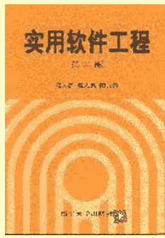
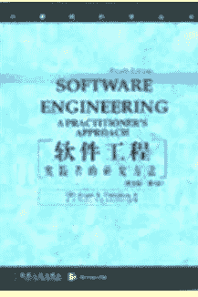

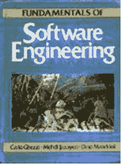


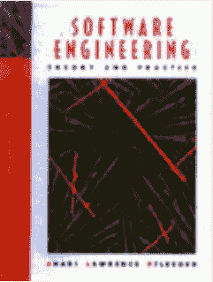


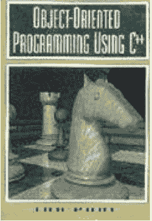

## 课程评分方法

- 实验 30% + 期末考试 70%  
  = 总评 100%

- 作业仅供参考。可通过 e-mail 递交，不限时，不记分

## Software Engineering Laboratory Project

### Home Design and Improvement System

The Home Design and Improvement System, HDIS, is intended to integrate and unify all activities related to construction and improvements of homes. Constructing a new home or renovating an existing home can require a high number of interactions with numerous individuals, companies, and stores. The purpose of HDIS is to utilize computing technology in a positive way to enhance, facilitate, and promote this activity.

### 计划

按用户界面分为7个组，分别为：

- ① Contractor’s Interface Group
- ② Home Owner’s Interface Group
- ③ Architectural Interface Group
- ④ Interior Designer’s Interface Group
- ⑤ Landscape Interface Group
- ⑥ Schedule & Supplier’s Interface Group
- ⑦ Funding Interface Group
- ⑧ Land Office Interface

### 要求

每组不超过20人；  
组长负责：组织、分工、安排进度等  
组长奖罚：引起过半数组员不满，改选组长；带领全组顺利完成任务，总评+5


### 内容

- 1. “可行性分析报告”（演讲）
- 2. “需求规格说明书”（书面）
- 3. “总体设计报告”（演讲）
- 4. 推出HDIS v1.0（现场验收）
- 5. 推出HDIS升级版（现场验收）；同时完成面向对象分析练习题一道（演讲）
- 6. 推出HDIS期末合并版（现场验收）

**要求：** 1、6、7、8组合并；2、3、4、5组合并。

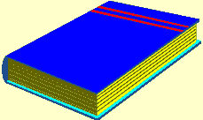

### 目的

- 体验软件工程各阶段的主要工作，特别注意吸取教训；
- 学会与他人合作，培养团队精神，单干户将得不到成绩。


### 现在开始 分组 抽签 行动起来！

## 第一章 软件危机与软件工程

### §1.软件危机 （Software Crisis）

**In the early days:**

“Software” = “Place a sequence of instructions together to get the computer to do something useful”. User <-> Computer

**Late 1950’s:**

Computer became cheaper and more common High level languages were invented } easier

User 😞 Programmer <->Computer

**Early 1960s:**

Very few large software projects were done by some experts.

Hacker ≠ Cracker

**Middle to late 1960s:**

Truly large software systems were attempted.

例：美国IBM公司在1963年至1966年开发的IBM360机的操作系统。这一项目花了5000人一年的工作量，最多时有1000人投入开发工作，写出了近100万行源程序。……据统计，这个操作系统每次发行的新版本都是从前一版本中找出1000个程序错误而修正的结果。……

这个项目的负责人F. D. Brooks事后总结了他在组织开发过程中的沉痛教训时说：“……正像一只逃亡的野兽落到泥潭中做垂死的挣扎，越是挣扎，陷得越深，最后无法逃脱灭顶的灾难。……程序设计工作正像这样一个泥潭，……一批批程序员被迫在泥潭中拼命挣扎，……谁也没有料到问题竟会陷入这样的困境……”。IBM360操作系统的历史教训成为软件开发项目的典型事例为人们所记取。

**Software Crisis！**


**问题出在哪里？**

- (1) 项目没有被很好地理解；计划不周，最终导致进度拖延。

**例1.** In the late 1960s, a bright-eyed young engineer* was chosen to “write” a computer program for an automated manufacturing application. The reason for his selection was simple. He was the only person in his technical group who had attended a computer programming seminar. He knew the in’s and out’s of assembler language and Fortran, but nothing about software engineering and even less about project scheduling and tracking.

> *If you’re wondering whether this story is autobiographical, it is!

His boss gave him the appropriate manuals and a verbal description of what had to be done. He was informed that the project must be completed in two months.

He read the manuals, considered his approach, and began writing code. After two weeks, the boss called him into his office and asked how things were going.

“Really great,” said the young engineer with youthful enthusiasm, “This was much simpler than I thought. I’m probably close to 75 percent finished.”

The boss smiled. “That’s really terrific,” he said. He then told the young engineer to keep up the good work and plan to meet again in a week’s time.


## 例2：

In the early 1980s, the United States’ Internal Revenue Service (IRS) hired Sperry Corporation to build an automated federal income tax form processing system. According to the *Washington Post*, the “system has proved **inadequate to the workload, cost nearly twice what was expected and must be replaced soon**” (Sawyer 1985). In 1985, an extra **$90 million** was needed to enhance the original **$103 million** worth of Sperry equipment. In addition, because the problem prevented the IRS from returning refunds to taxpayers by the deadline, the IRS was forced to pay **$40.2 million** in interest and **$22.3 million** in overtime wages for its employees who were trying to catch up.

## § 1.软件危机

In 1996, the situation had not improved. The *Los Angeles Times* reported on March 29 that there was still no master plan for the modernization of IRS computers, only a six-thousand-page technical document. Congressman Jim Lightfoot called the project “a $4-billion fiasco that is floundering because of inadequate planning” (Vartabedian 1996).

**Myth:** If we get behind schedule, we can add more programmers and catch up.

> **Reality:** Software development is not a mechanistic process like manufacturing. In the words of Brooks, “adding people to a late software project makes it later.”

## § 1.软件危机

### (2) 没有充分的文档资料(documentation)

**Myth:** The only deliverable for a successful project is  
the working program.

**Reality:** A working program is only one part of a  
software configuration that includes programs,  
documents, and data. **Documentation** forms the  
foundation for successful development and, more  
important, provides guidance for the software  
maintenance task.

- Managers —— evaluate, track progress, ......  
- Programmers —— communicate to each other  
- Maintainers —— VITAL!

人与人的交流比写程序困难得多。

## § 1.软件危机

### (3) 软件可靠性(reliability)缺少度量的标准，质量无法保证。

如何保证软件产品的质量，是非常复杂困难的问题。特别对于规模庞大的软件，如：.

The software supporting the **American space shuttle** consists of **3 million lines of code**, including computers on the ground controlling the launch and the flight; there were one hundred thousand lines of code in the shuttle itself in 1985.

President Reagan’s proposed **Strategic Defense Initiative** (SDI) is estimated to require **10 to 100 million lines of code**. Many computer scientists and software engineers continue to believe **there is no way to write and test the software to guarantee adequate reliability**.

## § 1.软件危机

### (4) 软件难以维护(maintainability)
不易升级(evolvability)

**Myth:** Once we write the program and get  
it to work, our job is done.

**Reality:** Someone once said that “the  
sooner you begin ‘writing code’, the longer it’ll  
take you to get done.” Industry data indicate  
that between **50 and 70 percent** of all effort  
expended on a program will be expended **after**  
it is delivered to the customer for the first time.

## 解决问题的想法：

- Better management  
- Different team organizations  
- Better languages & tools  
- Uniform coding conventions

必须意识到：“软件≠编程，它有自己的生命周期 (life cycle)。大型软件系统的开发与其它工程项目如建造桥梁、制造飞机、轮船等的开发是同理的。

> “软件工程”（Software Engineering）

> NATO Conference，Garmisch，Germany，1968.

## § 2. 软件工程 (Software Engineering)

### 1、原理 (Principles)：P.5-7

#### (1) 用分阶段的生命周期计划严格管理

- 项目概要计划  
- 里程碑计划  
- 项目控制计划  
- 产品控制计划  
- 验证计划  
- 运行维护计划

#### (2) 坚持进行阶段评审

#### (3) 实行严格的产品控制——基准配置管理
(Baseline configuration management)

#### (4) 采用现代程序设计技术

#### (5) 结果应能清楚地审查— set standards

#### (6) 开发小组的成员应该少而精

1+1 < 2

#### (7) 承认不断改进软件工程实践的必要性


## 2、瀑布模型(Waterfall Model)：P. 12

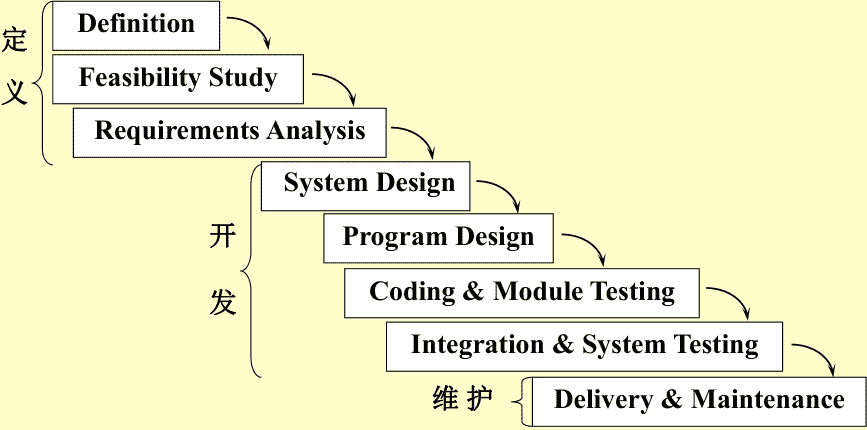

## § 3.技术审查和管理复审

任务：发现技术方面的错误，监督项目进度、经费开支、投资回收的前景等。

作业：阅读HDIS简介，回答下列问题：

- 1、第一件要做的事是什么？
- 2、你认为该软件应具备的最重要的两种品质是什么？
- 3、你认为怎样分工是最合理的？

## 第二章 可行性研究（Feasibility Study）

§ 1. 任务：不是解决问题，而是确定是否可解、值得解
例：HDIS —— 可从下述 3 方面考虑：

- Technically（技术上）---- over one hundred students, 15 weeks, machines, languages, ......
- Operationally（操作上）---- can our customers use it?
- Economically（经济上）---- budget, profit, ......

注：不要花过多精力，占总成本的 5 ~ 10 %

## § 2. 步骤

1、复查定义，明确限制的约束。
我们认为用户要的 用户要的

- 2、研究老系统
  - 解决老系统问题

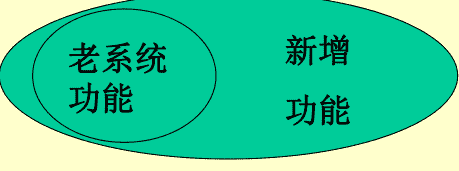

- 新系统效益 老系统效益

> 注：
> - 只了解老系统做什么，而不管怎样做；
> - 注意了解与其它系统的接口。

## 3、导出高层逻辑模型(conceptual design)

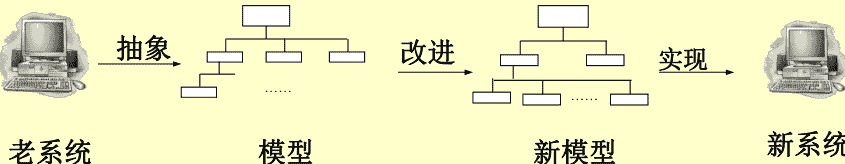

报告应该告诉用户 “What”而不是 “How”

- It is written in the customer’s language
- It contains no technical jargon
- It describes the functions of the system
- It is independent of implementation
- It is linked to the requirements documents

## 3、逻辑模型

## 4、重新定义

## 1、复查定义

注：此时合同未签，应考虑成本，不宜反复太多次。

## 5、导出多种解法

技术上可行

技术上不可行

用户不可能

操作

操作上可行

不合算

经济上合算

进度表

## 6、推荐行动方针

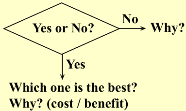

## 7、开发计划（粗略）

- 任务分解，确定负责人
- 大致进度规划
- 财务预算
- 风险分析及对策

## 8、审查、存档

## § 3. 系统流程图
(System Flow Diagram)

反映信息在各部分间流动的情况
≠控制、处理信息（不同于程序流程图）
1.符号：P. 21 - 22
2.例子：P. 22 - 23

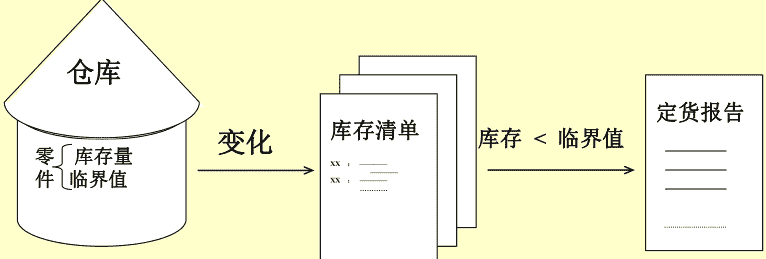

## § 4. 数据流图
(Data Flow Diagram)

System = data + function

1、符号： P.24

input output Data storage
function Data flow

2、例子：
(1)P.25 — 27(自习)
注意：图2.6中，“产生报表”功能没有启动！

## （2）[摘自《Fundamentals of Software Engineering》]

Information System of a Public Library

```
IF {user requests a book (title, author, user’s name)}
THEN {Get a book}
→ book, and user’s list of books borrowed;

IF {user searches a book by topics}
THEN {Search by topics}
→ list of book titles referring to the topic.
```

## § 4. 数据流图

# Refinement: Book request = **Find book position** + **Get a book**

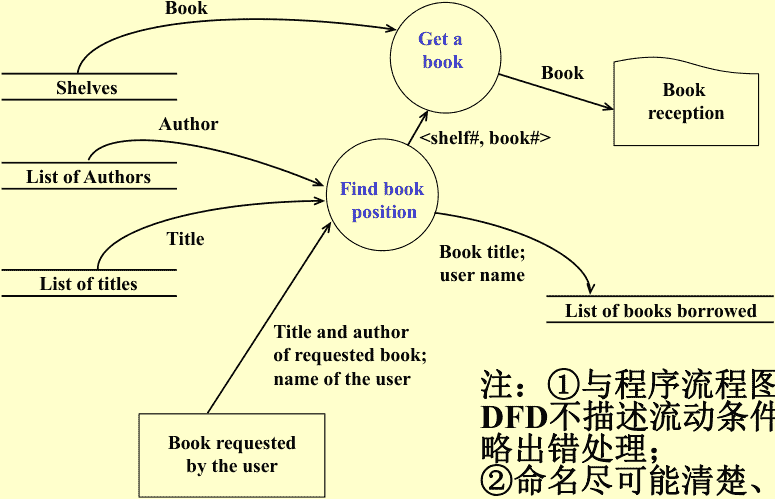

> 注：①与程序流程图不同，DFD不描述流动条件，忽略出错处理；
> ②命名尽可能清楚、具体。

## § 5. 数据字典
(Data Dictionary)

与DFD结合，构成系统的规格说明(specifications)

- 1、符号：P.31
- 2、例子：P.31

名字：定货报表
别名：定货信息
描述：每天一次送检采购员的需要定货的零件表

定义：
定货报表=零件编号+零件名称
　　　　+定货数量+目前价格
　　　　+主要供应者
　　　　+次要供应者

位置：输出到打印机

```
struct 定货报表 {
    char    零件编号[8];
    char    零件名称[20];
    int     定货数量;
    float   目前价格;
    struct supplier 主要供应者;
    struct supplier 次要供应者;
};
```

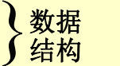

## § 5. 数据字典

| 字段 | 内容 |
|---|---|
| 名字 | 零件编号 |
| 别名 | |
| 描述 | 唯一地标识库存清单中一个特定零件的关键域 |
| 定义 | 零件编号 = 8 {字符} 8 |
| 位置 | 定货报告<br>定货信息<br>库存清单 |

> 若修改“零件编号”的定义，则受到影响的数据均列于此

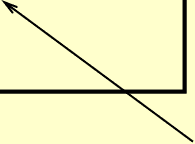

## § 6 成本/效益分析

## (Cost/Benefit)

## 1、成本估计(Cost Estimation)

- (1) 代码行技术： 每行代码的平均成本 × 源代码行数
- (2) 任务分解技术： 人力 × 工资
- (3) 经验公式及软件：

常见公式形如 \( Cost = (a + bS^c) \cdot m(\bar{x}) \)

其中 \( S = \text{Size of the system}, \quad a,b,c = \text{Costant}, \)

\( \bar{x} = (x_1, x_2, \cdots, x_n)^T = \text{Cost factors}, \)

\( m = \text{adjustment multiplier}. \)

- 软件： Boehm's Constructive Cost Model (COCOMO)
- v1.0 in 1970s , v2.0 in 1995

详细讨论见第十三章。

## 2、效益估计(Benefit Estimation)

例：假设某软件生命周期为5年。现在投资20万元，平均年利率3%。从第一年起，每年年底收入4.2万元，问该项目是否值得投资？

P=20万 4.2万 4.2万 4.2万 4.2万 4.2万
↑ ↓ ↓ ↓ ↓ ↓
0 1 2 3 4 5

F = P(1 + i)n 其中P为初始投资，i为年利率，F为第n年底P的值

## § 6 成本/效益分析

到第5年底结算时：

投资额 = 200000×(1+3%)⁵ ≈ 231855(元)

收入 = 42000 × [(1+3%)⁴+ (1+3%)³+
　　　　(1+3%)²+ (1+3%)+1]

　　　　≈ 222984(元)

不合算！

## Project Part I
“可行性分析报告”分组演讲

- ◆ **演讲内容：**
  1. 本组任务简介
  2. 本系统流程图讲解
  3. 数据流图讲解
  4. 数据字典卡片讲解
  5. 财务预算
  6. 结论

◆ **演讲时间：** 下一次课时（本周六），每组至多10分钟演讲＋2分钟听众提问

◆ **演讲顺序：** 课前抽签决定


## “可行性分析报告” 分组演讲

### 评分方法：

(1) 八个组演讲结束后，分组讨论，按评分标准给除自己组外的七个组打分，写评语；

(2) 本组成绩 = 其他七组给出的平均成绩 × 50% + 主讲教师评定成绩 × 50%

## 评分标准：

| 组名： | | | |
|---|---|---|---|
| 任务简介（5） | | 系统流程（20） | |
| 数据流图（30） | | 数据字典（20） | |
| 财务预算（10） | | 结论（5） | |
| 材料组织（5） | | 演讲风格（5） | |
| 总分（100） | | | |
| 评语 | | | |
| 优点： | | | |
| 缺点： | | | |

## 第三章 需求分析

The reason: there was no discussion in the requirements documents of the ways in which the Ariane-5 trajectory would be different from Ariane-4.

### 统计资料：

In 1994, the Standish Group surveyed over 350 companies about their over 8000 software projects to find out how well they were faring. The results are sobering. Thirty-one percent of the software projects were canceled before they were completed. Moreover, in large companies, only 9% of the projects were delivered on time and cost what they were budgeted, and 16% met those criteria in small companies (Standish 1994).

To understand why, Standish (1995) asked the survey respondents to explain the causes of the failed projects. The top factors were reported to be

- 1. incomplete requirements (13.1%)
- 2. lack of user involvement (12.4%)
- 3. lack of resources (10.6%)
- 4. unrealistic expectations (9.9%)
- 5. lack of executive support (9.3%)
- 6. changing requirements and specifications (8.7%)
- 7. lack of planning (8.1%)
- 8. system no longer needed (7.5%)

### § 1. 需求分析的任务

仍然回答 “What”，而不是 “How”，但更细致、精确（合同的拟定）

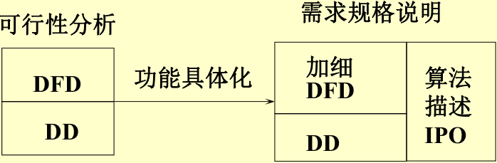

Final stage of **Definition** phase

### 1、确定要求

- (1) 功能要求 (functional requirements)：系统必须做什么？
- (2) 性能要求 (performance requirements)：做得怎样？

例：response time，memory，back-up memory，security，……

- (3) 运行要求 (operational requirements)：运行环境、软硬件配置等。
- (4) 未来可能的扩充要求 (possible evolution)：如 HDIS 各组的合并，3 维虚拟现实的效果等等。

### 2、分析数据

- 1. 建立概念模型（conceptual models）：E-R Diagram
- 2. 形象描绘数据结构：Data Hierarchy, Warnier Diagram, IPO
- 3. 数据结构规范化（Normalization）

### 3、导出逻辑模型：

DFD + DD + IPO

### 4、修正计划：重估成本、进度等

### 5、开发原型系统 (Prototyping)


“样机试用”

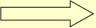


### § 2. 分析过程

- 1、沿 DFD 回溯：DFD 的输出端是系统的最终目的。向回确定每个数据元素的来源，可加细 DFD 及 DD，并将相关算法记录在 IPO 图中。
- 2、用户复查
- 3、细化 DFD：
  - ◆ 加细前后的 I/O 须相同。
  - ◆ 分解到须考虑具体实现的代码时即可停止

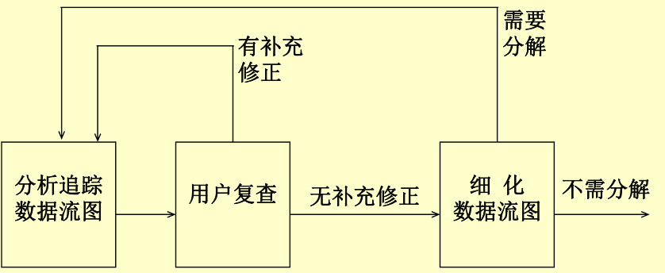

4、修正计划

5、文档：《需求规格说明书》

### 封面：

### 需求规格说明书

文档编号：______

版本号：______

文档名称：
项目名称：
项目负责人：

_年 _月 _日

编写：
核对：
审核：
批准：

开发单位：______

### 内容：

#### (1) 系统规格说明：

- 系统概貌
- 功能要求
- 性能要求
- 运行要求
- 可能增加的要求
- DFD
- IPO

#### (2) 数据要求：

- DD
- Hierarchy 或 Warnier Diagram

#### (3) 用户系统描述

—— 初步用户手册：从用户的观点考虑系统

- 系统功能、性能
- 使用与步骤 等

#### (4) 修正的开发计划：

- 成本估计
- 资源使用计划
- 进度计划

### 轻松一分钟 —— True Tech Support Stories

- A woman complied with a tech's request to send in a copy of a defective diskette. A few days later, the tech received a letter from her along with a xerox copy of the floppy.
- A tech advised a customer to put his troubled floppy back in the drive and close the door. The customer put his phone down and was heard walking across the room and shutting the door to the room.

### 6、审查和复审

### § 3. 概念模型和规范化 —— 对数据的分析

1、概念模型：描述从用户角度看到的数据实体 - 联系图(Entity - Relationship Diagram)

(1) Entities 例：Student，Instructor，Class

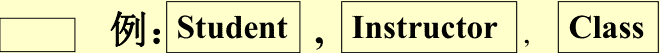

(2) Relations 例：Enrolled in，Teach

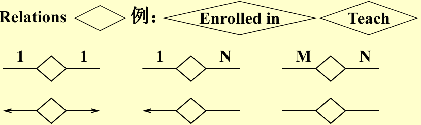

(3) Attributes 例：Name，ID#

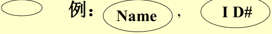

例：

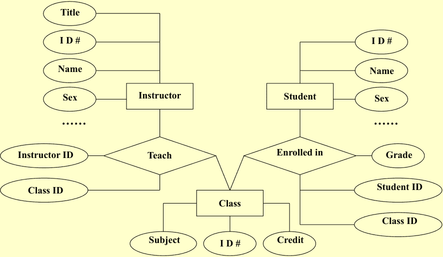


## 2、范式(Normal Forms): 消除数据冗余的程度

IBM E. F. Godd (1970)

| Student | Instructor | Class | Enrolled in | Teach |
|---|---|---|---|---|
| ID* Name Sex Age Major ... | ID* Name Sex Age Title ... | ID* Subject Credit ... | Student ID* Class ID Grade ... | Instructor ID* Class ID* |

*Keyword:可唯一地标识一个元组的属性

1 - NF： 所有属性都是原子值，即不出现 “表中有表”

2 - NF： 在 1-NF 基础上，每个non-key-word都由整个 key word 决定（而非依赖于 key word 的一部分）。例： “Major”实际上由 “ID”的第6、7位决定，可省去。

3 - NF： 在 2-NF基础上， non-key-word之间无从属关系。

## § 4.图形工具

### 1、层次方框图 (Hierarchy) —— 描绘数据的结构

例： A Room hierarchy based on an interior designer’s perspective.

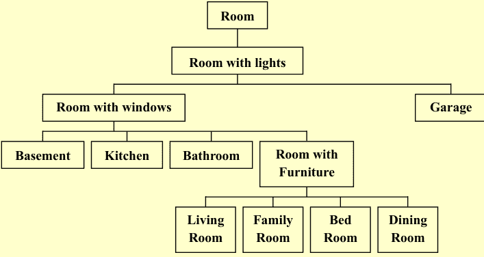

例： P.46 图 3.3

### 2、Warnier Diagram:

{. 层次 （n1,n2):重复n1到n2次 ⊕: 二者择一

例：

头版  
{  
头条新闻  
国内新闻  
本地新闻  
}

体育新闻  
{  
地区队  
职业队  
拳击  
}

报纸  
{  
社论  
{  
社论(1,1)  
专栏(1,3)  
读者来信(1,3)  
讽刺漫画(0,1)  
}  
副刊  
{  
体育新闻联播  
商业新闻  
广告  
}  
}

商业新闻  
{  
经营简讯  
⊕  
雇员简讯  
一般新闻  
}

广告  
{  
招生  
招聘  
求助  
}

例： P.46 图 3.4

### 3、IPO图(Input / Process / Output)：简要的算法描述

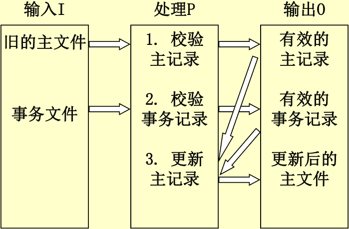

## § 5.验证要求(Requirements Validation)

+ 正确性： Are the requirements correct?

+ 一致性： Are the requirements consistent?

+ 完整性： Are the requirements complete?

+ 现实性： Are the requirements realistic?

+ Do the requirements described something that is really needed by the customer?

# 方法：

+ 人工审查

+ 初步用户手册

+ Prototyping

+ 使用软件工具 —— 完整性、一致性

# 例1：Software Requirements Engineering Methodology (SREM) (TRW Corporation, 1977)

SREM = Requirements Statement Language (RSL) + Requirements Engineering Validation System (REVS)

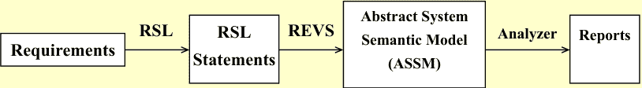

# 例2：Problem Statement Language (PSL) / Problem Statement Analyzer (PSA) (Michigan University, 1977)


# 例 3：Heimdahl and Leveson (1996) have developed an approach for checking the completeness and consistency in hierarchical, state-based requirements. Their framework uses the Requirements Specification Modeling Language (RSML), developed at the University of California at Irvine.

In RSML, the system being built is considered as a finite-state machine, and the language models the states, transitions, and sequencing of events. The graphical RSML specification defines a mathematical next-state function. Ideally, the function should be defined over all possible system states; this property is called _d-completeness_. Also, the function should have no conflicting requirements, meaning that the system is _consistent_.

RSML was used to analyze TCAS II, a collision avoidance system used in U.S. airspace. By describing TCAS with the next-state approach, Heimdahl and Leveson revealed an unplanned nondeterminism that had serious safety implications and was not apparent when the specification was originally written.

# Project Part II《需求规格说明书》

+ 上交书面报告,两星期内完成。

+ 截止日期：10月23日。

+ 每迟交一日，多扣1分

# 第四章 总体设计

(System Design)

开始考虑“How”，但仍属高层设计（确定黑盒关系）

# § 1. 过程

# 1、确定最佳方案：

+ 从DFD出发进行任务分解，不同的划分方法即对应不同的方案。每个合理的方案应配备下列4份资料：

  1. 系统流程图

  2. 组成系统的物理元素清单

  3. 成本/效益分析

  4. 进度计划

+ 选择最佳方案并制定详细的实现计划（主要技术详见第十三章）

# 2、结构设计 —— 模块化思想：

将DFD细化，至每个子功能都明白易懂；每个模块完成一个子功能；每层模块合成一个高一级的功能。

主要工具有 System Design Hierarchy及HIPO图等。

# 3、数据库设计 （略）

# 4、测试计划 （详见第七章）

# 5、文档、审查

# § 2.模块化原理(Modularization)

# 1、原理：

经验1： E(P<sub>1</sub>+P<sub>2</sub>)>E(P<sub>1</sub>)+E(P<sub>2</sub>)

经验2： P.58 图4.1

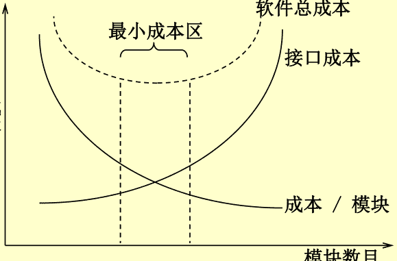

# 2、抽象(Abstraction):

忽略细节，分层理解问题，自顶向下层层加细。

例：开发一个CAD软件，实现一个二维绘图系统的全部功能，供低级计算机辅助设计使用。

+ 抽象层次I：用问题所处环境的术语来描述这个软件。该软件包括一个计算机绘图界面，向绘图员显示图形，以及一个数字化仪界面，用以代替绘图板和丁字尺。所有直线、折线、矩形、圆及曲线的描画、所有的几何计算、所有的剖面图和辅助视图都可以用这个CAD软件实现......。

## § 2.模块化原理

+ 抽象层次II： 任务需求的描述。列出 “What” 而不是 “How” 。

# CAD SOFTWARE TASKS:

+ user interaction task;

+ 2-D drawing creation task;

+ graphics display task;

+ drawing file management task;

# END


## § 2.模块化原理

◆ 抽象层次III：程序过程表示。以2-D绘图生成任务为例：

```
PROCEDURE 2-D drawing creation
REPEAT UNTIL (drawing creation task terminates)
DO WHILE (digitizer interaction occurs)
    Digitizer interface task;
    DETERMINE drawing request CASE
        Line:  line drawing task;
        Rectangle:  rectangle drawing task;
        Circle:  circle drawing task;
        ……
    END;
    DO WHILE (keyboard interaction occurs)
        keyboard interaction task;
        PROCESS analysis/computation CASE
            View:  auxiliary view task;
            Section:  cross sectioning task;
            ……
        END;
        ……
    END REPETITION;
END PROCEDURE.
```

在这个抽象层次上，给出了初步的过程表示，所用的术语都已面向软件，而且模块化的工作已经开始显露。

### 3、信息隐藏(Information hiding)

The **clients** of a module know about its services only through its **interface**; the **implementation is hidden** from them (hence may change without affecting the clients).

### 4、模块独立性(Module independence)

好设计的关键：每个模块完成一个相对独立的子功能，并且与其它模块间的接口简单。

### 独立性的度量：耦合(Coupling)&内聚(Cohesion) (Yourdon & Constantine,1978)

#### (1) 耦合(Coupling)

Great deal of dependence Independent

Highly coupled Loosely coupled Uncoupled

Goal: as loose as possible = as independent as possible

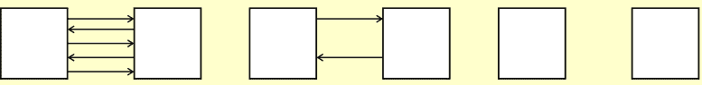

独立性由弱到强排列为：

◆ 内容耦合（Content Coupling）：One module modifies another.

例1：A访问C的内部数据或不通过正常入口而转入C的内部。

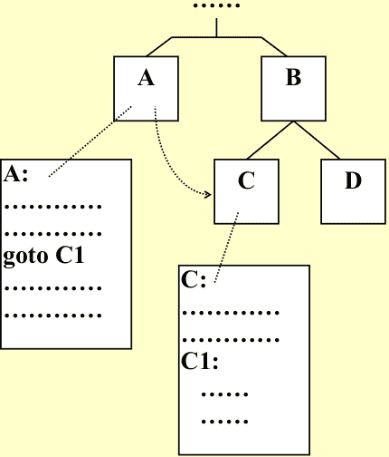

例2：部分代码重叠（常出现在汇编程序中）

例3：一个模块有多个入口（功能）

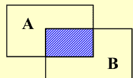

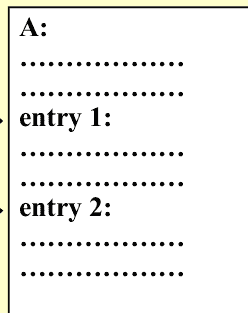

> > The least desirable

◆ 公共耦合（Common coupling）：Data are accessible from a common data store.

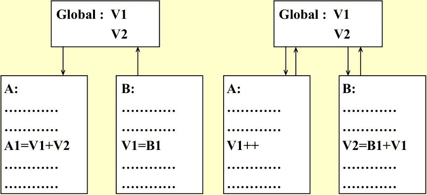

问题：

- 公共部分的改动将影响所有调用它的模块；
- 公共部分的数据存取无法控制；
- 复杂程度随耦合模块的个数增加而增加。

#### 控制耦合(Control coupling)

One module passes parameters to control the activity of another module.

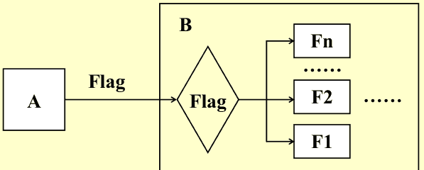

接口单一，但仍然影响被控模块的内部逻辑。

#### 数据耦合(Data coupling)

Only data are passed. It is easy to trace data and make changes.

The most desirable.

原则：尽量使用数据耦合，少用控制耦合，限制公共耦合的范围，完全不用内容耦合。

#### (2) 内聚（Cohesion）

The elements of a module are directed to perform the same task.

**Goal:** as cohesive as possible.

+ 低内聚：

+ 巧合内聚（Coincidental cohesion）：Unrelated functions, processes, or data are found in the same module (for convenience).

+ 逻辑内聚（Logical cohesion）：Logically related functions or data are placed in the same module.

例如：

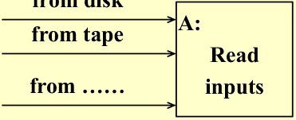

+ 通信内聚（Communicational cohesion）：All the functions in a module operate on or produce the same data set.

例如：从同一磁带上读取不相干的数据 —— 可能破坏独立性。

+ 高内聚：

+ 顺序内聚（Sequential cohesion）：The output from one part of a module is the input to the next part.

+ 功能内聚（Functional cohesion）：Every processing element is essential to the performance of a single function.

## § 3. 启发式规划

+ 1. 争取低耦合、高内聚（增加内聚 > 减少耦合）

+ 2. 模块规模适中：

  过大不易理解；太小则接口开销过大。注意分解后不应降低模块的独立性。

+ 3. 适当控制 ——

  - 深度 = 分层的层数。过大表示分工过细。
  - 宽度 = 同一层上模块数的最大值。过大表示系统复杂度大。

♠ 扇出 = 一个模块直接调用控制的模块数。

3 ≤ fan-out ≤ 9

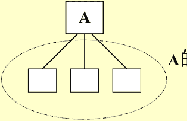

扇入 = 直接调用该模块的模块数

在不破坏独立性的前提下，fan-in 大的比较好。

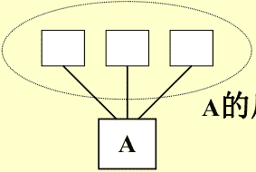

### 4、作用域在控制域内

+ 控制域

M的控制域为 {M， A， B， C}

+ 作用域：M中的一个判定所影响的模块。

例如：

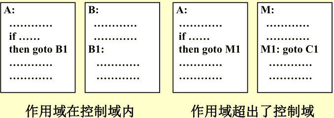

上例中A的作用超出了控制域。改进方法之一，可以把A中的 if 移到M中；方法之二，可以把C移到A下面。

## § 3.启发式规划

+ 5、降低接口的复杂程度：接口复杂可能表明模块的独立性差。

+ 6、单出单入，避免内容耦合。

+ 7、模块功能可预测——相同输入必产生相同输出。

反例：模块中使用全局变量或静态变量，则可能导致不可预测。

**作业：**你自己负责设计的HDIS界面中可能遇到哪些类型的耦合和内聚？对列出的每种类型试举一例。

## 1、Hierarchy和HIPO

例：P.65 图4.4

例：

## § 4.图形工具

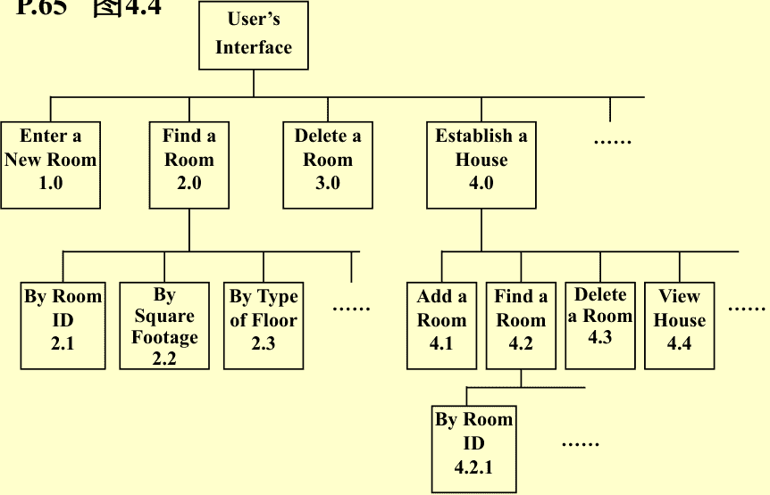

## § 4.图形工具

### 注意：

- 这里的hierarchy表现软件的结构，而非数据结构；
- 每个矩形框代表一个模块，连线表示“调用”而非“组成”；
- 所谓IPO，即对每个模块附一张IPO图。每个IPO图中应明确标出对应模块的编号。

## 2、结构图(Structured Diagram)

### 符号：

○→ 数据传递；●→ 控制信息；◇ 或；↷ 循环。


## § 5.面向数据流的设计方法

（又称为SD：Structural Design）

**基本思想：** DFD → System Hierarchy

### 1、Data Flow 的分类

（1）交换流(Transform Flow)：

事实上所有信息流都可归结为交换流

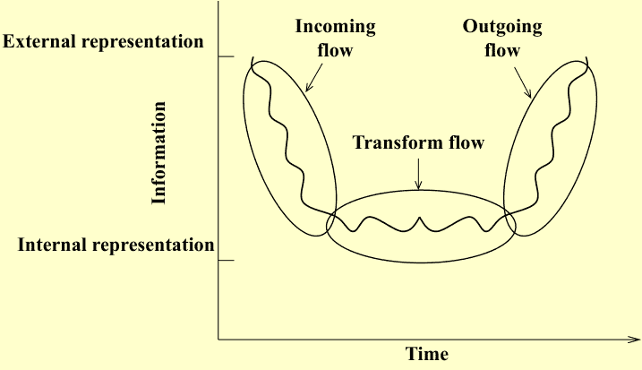

## § 5. 面向数据流的设计方法

### 2、分析设计

#### （1）变换分析

例：P.68－69

### 汽车数字仪表板的设计

功能：

- 通过模－数转换实现传感器和微处理机接口；
- 在发光二极管面板上显示数据；
- 指示每小时英里数(mph)、行驶的里程，每加仑汽油行驶的英里数(mpg)等等；
- 指示加速或减速；
- 如果车速超过55mph，则发出警告铃声。

## § 5. 面向数据流的设计方法

### 第一步：DFD的分界，先分出 I、P、O 三块

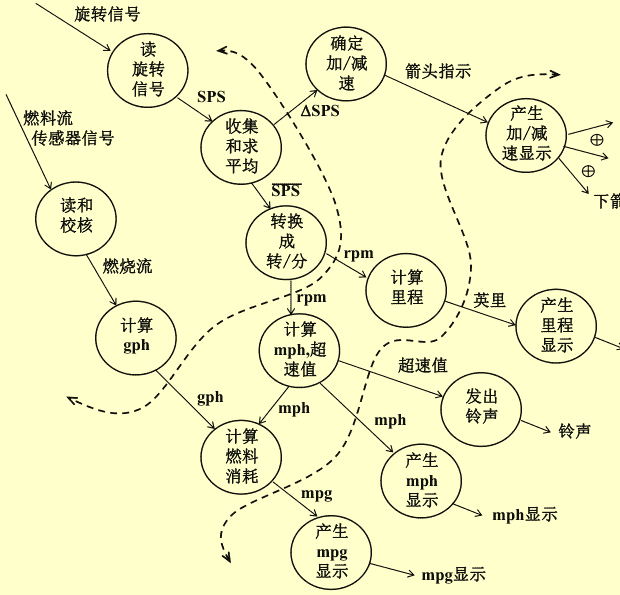

## § 5.面向数据流的设计方法

### 数字仪表板控制

### 接收传感器信号

### 数据转换控制

### 驱动仪表板

### 一般问题的一级分解方法：

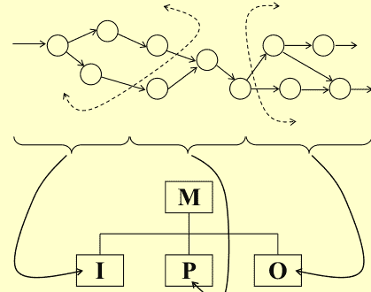

## 例：

### 数字仪表板控制

## § 5.面向数据流的设计方法（与P.70 图4.12 对照）

### 接收传感器信号

### 数据转换控制

### 驱动仪表板

### 转换成rpm

### 计算gph

### 确定加/减速

### 计算mph

### 计算mpg

### 计算里程

### 加/减速显示

### 显示mpg

### 显示mph

### 显示里程

### 发出铃声

### 收集sps

### 读燃料流

### 读旋转信号

### 发光二极管显示

## § 5.面向数据流的设计方法

第三步：修改 —— 本着高内聚、低耦合的原则。

例： P.73 图4.19精化后的数字仪表板系统的软件结构。

- 注：每个模块应附一简要说明描述
  - ① 进出该模块的信息（接口描述）；
  - ② 模块内部的信息；
  - ③ 过程陈述，包括主要判定点及任务等；
  - ④ 对约束和特殊特点的简短讨论。

## § 5.面向数据流的设计方法

### 3、SD的总体过程：

优化的前题是：
“Get it to work,
then make it fast.”

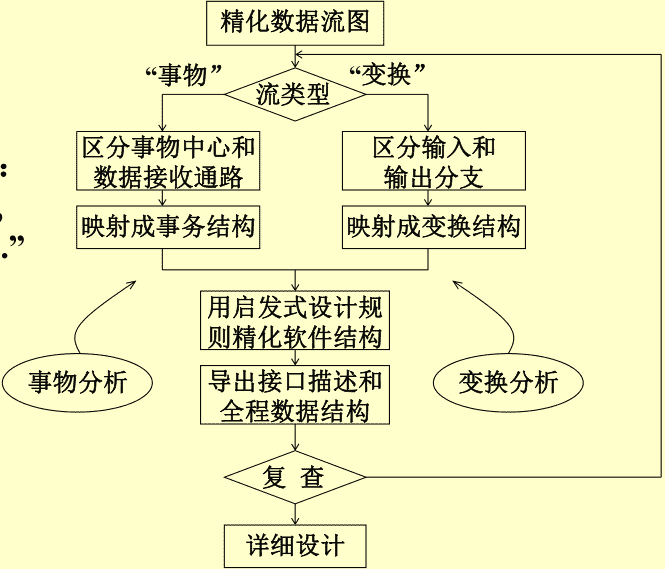

## 评分标准

| 组名： | | | |
|---|---|---|---|
| 任务简介(5) | | 数据流图(25) | |
| 系统层次图(30) | | HIPO(30) | |
| 演讲风格(10) | | 总分(100) | |
| 评 语 | | | |
| 优点： | | | |
| 缺点： | | | |

## 第五章 详细设计
(Program Design ≠ Coding)

结构程序设计的特点：
① 自顶向下逐步求精；
② 具有单入、单出的控制结构（取消GOTO语句）

## § 1. 工具

### 1、程序流程图(Program Flow Chart)

### 5种基本控制结构为：

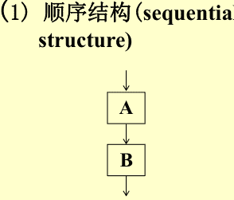

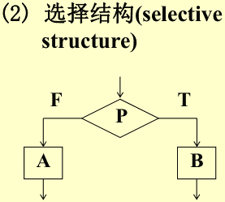

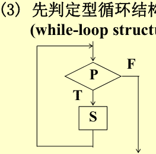

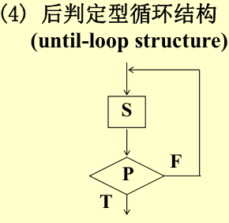

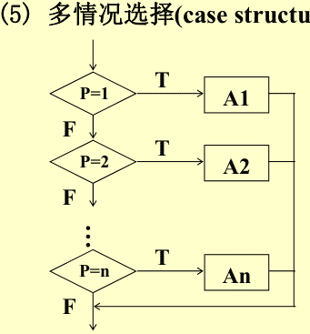

## § 1. 工具

- 任何复杂的程序流程图都应由以上五种基本结构组合而成。
- ISO 认可的规定符号：P.83 图 5.3
- 优点：容易掌握，且历史“悠久”，使用广泛。
- 缺点：本质上不具备逐步求精的特点，对于提高大型系统的可理解性作用甚微；
  - 不易表示数据结构；
  - 转移控制太方便。
- 趋势：停止使用

## 2、盒图(Box Diagram): Nassi &Shneiderman 1973年提出，又称为N-S Charts。 Chapin 1974年作扩充，故也称为Chapin charts.

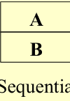

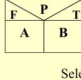

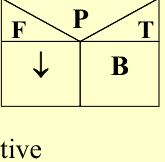

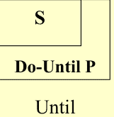

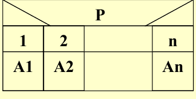


## 例：


## 特点：

- ① 没有箭头，不允许随意转移控制；
- ② 每个矩形框(Case中条件取值例外)都是一个功能域(即一个特定结构的作用域)，结构表示明确；
- ③ 局部及全程数据的作用域易见；
- ④ 易表现嵌套关系(embedded structure)以及模块的层次结构。

## 例： N-S图与PAD的转换


## § 1. 工具

## 特点：

- ① 结构清晰，层次分明，易读；
- ② 支持逐步求精的设计思想；
- ③ 容易将PAD自动转换为高级语言源程序。

4、判定表 & 判定树(Decision Table & Tree)表示复杂的条件(input)组合与应做动作(output)之间的对应关系。

## 例：P.86 航空行李托运费的算法

按规定：重量不超过30公斤的行李可免费托运。
重量超过30公斤时，对超运部分，头等舱国内乘客收4元/公斤；其它舱位国内乘客收6元/公斤；外国乘客收费为国内乘客的2倍；残疾乘客的收费为正常乘客的1/2。

## Rules

| Rule numbers | 1 | 2 | 3 | 4 | 5 | 6 | 7 | 8 | 9 |
|---|---:|---:|---:|---:|---:|---:|---:|---:|---:|
| 国内乘客 | | T | T | T | T | F | F | F | F |
| 头等舱 | | T | F | T | F | T | F | T | F |
| 残疾乘客 | | F | F | T | T | F | F | T | T |
| 行李重量 W ≤ 30 | T | F | F | F | F | F | F | F | F |
| 免费 | × | | | | | | | | |
| (W-30) × 2 | | | | × | | | | | |
| (W-30) × 3 | | | | | × | | | | |
| (W-30) × 4 | | × | | | | | | × | |
| (W-30) × 6 | | | × | | | | | | × |
| (W-30) × 8 | | | | | | × | | | |
| (W-30) × 12 | | | | | | | × | | |

用判定表表示计算行李费的算法


## § 1. 工具

用判定树表示计算行李费的算法

> 注：判定表与判定树并不适用于作为一种通用的设计工具，通常将之用于辅助测试

## § 1. 工具

### 5、PDL(Program Design Language)：又称 Pseudocode.

例：


优点：易于实现由PDL到源代码的自动转换。
缺点：不够直观。

6、文件夹：  记录模块开发过程的文档。

建议各组建立自己的文件夹。

项目名称：　　　　　　　　　模块名称：
开发人员：　　　　　　　　　完成日期：
模块简述：

| 任务 | 起始日期 | 完成日期 |
|---|---|---|
| 设计 |  |  |
| 编码 |  |  |
| 单元测试 |  |  |
| 集成测试 |  |  |

| 修改日期 |  |  |  |  |  |  |  |  |
|---|---|---|---|---|---|---|---|---|
| 代码长度 |  |  |  |  |  |  |  |  |

作业：

P.108 #6,
P.111 #11(1)

## § 2. Jackson System Development(JSD)

与SD的由DFD导出结构设计不同，JSD是以数据结构(data structure)为基础设计每个模块的处理过程。

### 1、Jackson Diagram:


A = B → C

A = B ∪ C

A = B ↻

> 注意：
> 
> H中的方框表示模块，而JD中的方框代表几个语句构成的简单操作；
> 
> H表现调用关系，而JD表现组成关系。

### 2、Jackson方法：

例：(P.91)一个正文文件由若干个记录组成，每个记录是一个字符串。要求统计每个记录中空格字符的个数，以及文件中空格字符的总个数。要求的输出数据格式是：每复制一行输入字符串之后，另起一行印出这个字符串中的空格数，最后印出文件中空格的总个数。

### 第1步：用Jackson图描述 I\O 的数据结构

输入

输出


### 第2步：在两个图中指出有直接因果关系(causality)、可以同时处理的单元（重复的次序，次数均相同）

输入

输出

正文文件

输出表格

字符串*

字符*

空格⁰

非空格⁰

表格体

空格总数

串信息*

字符串

空格数

§ 2. JSD

经过程序处理由正文文件得到输出表格。

字符不与多字符组成的字符串对应。

每处理输入中一个字符串后就得到输出中一个串信息，二者重复次序和次数均相同。

单个空格不能决定空格数。

### 第3步：Data structure → Program structure

把有对应关系的单元合为一个处理框，画在相应的层次中（不同层以低层为准）

输入

输出


注：顺序执行的处理中不允许混有重复执行或选择执行的处理。

### 第4步：列出所有操作条件，并分配到上幅程序结构图中

例:(部分列举，详见P.93-93)

(1)打开文件
(2)读入字符串
(3)空格总数totalsum=0
(4)关闭文件
(5)行止
I (1)文件结束

第5步：用 Pseudocode 表示程序。（详见P.94 -95）


§ 2. JSD

## § 3. Warnier方法

Warnier方法又称LCP法(Logically Constructing Program)

例：(P.96)假设要设计一个系统用来定期产生有关顾客账户的报表，输入文件中每个顾客有一个头记录，后接若干个事务记录。


输出报表如下：

| 顾客号 | 顾客姓名 | 活动号 | 支出数 | 存入数 |
|---|---|---|---|---|
| 0000001 | 张 三 | 001 | 300.00 | |
| | | 002 | | 1000.00 |
| 5000.00 | 5700.00 | | 300.00 | 1000.00 |
| 0000002 | 李 士 | | | |
| 20000.00 | 20000.00 | | | |
| 0000003 | 王 武 | 001 | | 2500.00 |

例：（部分列举，详见P.98 - 99）

输入类 010 — 读 040 — 读 100 — 读

分支准备类：040 — 顾客号送到访问顾客号

分支指令类：010 — 若EOF ——> 030

040 — 若读出的顾客号 =访问的顾客号 ——> 060

100 — 若读出的顾客号 =访问的顾客号 ——>

070 ......

计算类：040 — 旧余额送到工作区

......

输出类：040 — 旧余额送到参考区

040 — 编辑顾客标题

040 — 输出并复原打印区

......

### 第5步：将前一步分类结果标号排序

⇒ **Pseudocode.**
见 P.99 — 100

**辅助技术：** 当 I0 数据有多个时，借助判定表

见 P.100 — 104

## § 4.程序复杂程度的定量度量
(Measuring Program Complexity)

### 1、 McCabe’s Theory (Thomas McCabe，1976)

### 第1步：将程序流程图转化为程序图(Control Flow Graph)


### 第2步：计算CFG的环形复杂度
(Cyclomatic Complexity)

已知公式：\( V(G) = m - n + p \)

其中\( V(G) \)为强连通有向图G中线性无关环
(independent paths)的个数(称为 cyclomatic
number of G)；\( m \)是边数 (number of edges)；\( n \)
是 节 点 数(number of nodes)；\( p \) 是G中连通
集的数目(number of connected components)。

## § 4.程序复杂程度的定量度量

注：
① 对于一个正常的程序，其CFG应是连通的，即 \( p = 1 \).
② CFG通常不是强连通的，故须从出口到入口画一条虚弧，使其成为强连通图。

③ 对于平面图G，\( V(G) = G \) 在平面上围成的区域的个数。


\( V(G) = 11 - 9 + 1 = 3 \)

### McCabe 环形复杂度的特点：

+   ① 分支或循环增多时，CC也随之增大，故CC值实际上是为软件测试的难易度提供了一个定量度量的方法，间接表示了软件的可靠性。

+   ② CC是可加的：2模块的总复杂度 = 各自CC之和。

+   ③ 实践经验表明，对于CC>10的程序，应分成几个小程序处理，以降低出错率。

+   ④ 缺点：

+   ◆ 有些控制结构不能区分，例如 IF 与 LOOP，嵌套 IF 与 CASE 等；

+   ◆ 不能区分一个多行顺序结构与一个单行程序的复杂性。

### 2. Halstead’s Theory (M. Halstead, 1977)

—— based on source code measurements

+   The primitive measures are

+   _n_<sub>1</sub> — the number of distinct operators that appear in a program

+   _n_<sub>2</sub> — the number of distinct operands that appear in a program

+   _N_<sub>1</sub> — the total number of operator occurrences

+   _N_<sub>2</sub> — the total number of operand occurrences

注：成对出现的运算符，如 BEGIN...END，IF...THEN...ELSE 等都算1个运算符。


## § 4.程序复杂程度的定量度量

(5) 程序级别(program level): \( L = V^* / V \)
其中 potential volume \( V^* = (2+n_2^*) \log_2 (2+n_2^*) \)，\( n_2^* \) 为I/O变量的个数。这里 \( V^* \) 是 \( V \) 的最小值，2表示程序中至少有2个运算符 — 赋值符和调用符。
\( L \) 体现了抽象程度，编码语言越高级，\( L \) 越接近1。

(6) 工作量(effort): \( E = V / L \)。

(7) 潜在错误(potential error): \( B = N \log_2 n / 3000 \)。

注： It should be noted that Halstead's "laws" have generated substantial controversy and that not everyone agrees that the underlying theory is correct. However, experimental verification of Halstead's findings have been made for a number of programming languages.

## Project Part IV
## HDIS v1.0 的隆重推出

- 验收截止日期：11月28日 （星期二）
- 验收地点： 各组自定
- 验收内容：
  - ① 组长介绍分工情况及指定功能完成概况；
  - ② 个人工作介绍（编程人员演示模块功能；测试人员出示测试报告；文档人员出示相应文档、文件夹）。

注意：不到现场汇报工作者无成绩；交付验收日期拖延一日须扣1分。

- 作业：自习第六章 编程 (Coding)

## 第七章 测试 (Testing)

## 防不胜防的软件错误 ——

例1： 1963年，美国，飞往火星的火箭爆炸，损失$ 10 million.
原因：FORTRAN循环 DO 5 I = 1, 3 误写为 DO 5 I = 1.3

例2： 1996年，美国 Washington Post 报导
Dallas, Aug. 23 — The captain of an American Airlines jet that
crashed in Colombia last December entered an incorrect one-
letter computer command that sent the plane into a mountain,
the airline said today.

The crash killed **all but four of the 163 people aboard**.

American’s investigators concluded that the captain of the Boeing 757 apparently thought he had entered the coordinates for the intended destination, Cali.

But on most South American aeronautical charts, the one-letter code for Cali is the same as the one for Bogota, 132 miles in the opposite direction.

The coordinates for Bogota directed the plane toward the mountain, according to a letter by Cecil Ewell, American’s chief pilot and vice president for flight. The codes for Bogota and Cali are different in most computer databases, Ewell said.

例3：[摘自Pfleeger 书中的 “REAL-TIME EXAMPLE”]

Our real-time example is based on the embedded software in the Ariane-5, a space rocket belonging to the European Space Agency (ESA). On June 4, 1996, on its maiden flight, the Ariane-5 was launched and performed perfectly for approximately 40 seconds. Then, it began to veer off course. At the direction of an Ariane ground controller, the rocket was destroyed by remote control. The destruction of the uninsured rocket was a loss not only of the rocket itself, but also of the four satellites it contained; the total cost of the disaster was $500 million.

The business impact of the incident went well beyond the $500 million in equipment. In 1996, the Ariane-4 rocket and previous variants held more than half of the world’s launch contracts, ahead of American, Russian, and Chinese launchers. Thus, the credibility of the program was at stake, as well as the potential business from future Ariane rockets.

**Cause:** There was no discussion in the SRI (Inertial Reference System) **requirements documents** of the ways in which the Ariane-5 trajectory would be different from Ariane-4.

## § 1. 基本概念

1、定义： 测试是为了**发现程序中的错误**而执行程序的过程。

注意：① 只能尽可能查错，不能证明程序中 **没有错**；  
② 测试员与程序员不应是同一个人。

## 2、黑盒和白盒测试

- 黑盒测试(black-box , or closed-box testing):  
  Make sure that every kind of input is submitted,  
  and the output observed matches the output  
  expected. —— Functional testing

- **白盒测试**(white-box，or open-box, clear-box testing):  
  Use the structure of the program to test. —— Structural testing

**主要问题：** 穷尽测试(complete test)通常是不可能的。

例：(Black-box) 程序要求输入3个整形数据。若字长16位，则各种可能输入的排列组合共有

\[
2^{16}\times 2^{16}\times 2^{16}\approx 3\times 10^{14}\text{（种）}
\]

若程序执行需10^-3秒，则对于所有合法输入的测试大约需用一万年，而且还应测试输入非法数据的情况。

## § 1. 基本概念

例: (White-box) 下图所示的程序中共有 \( 5^{20} \approx 10^{14} \) 条可能的执行通路，显然，每条通路都执行一遍是不现实的。


## 3、测试步骤：

- (1) Component testing —— program design & coding bugs
- (2) Subsystem testing —— connections between modules
- (3) System testing —— requirements & system design
- (4) Acceptance testing —— customer joins in
- (5) Parallel running —— compare the new system with the old one.

# 测试阶段的信息流：


## § 2. 单元测试（白盒）

主要测试以下五个方面：

1、模块接口：

- 内部检查：传输参数的数目、属性、单位、次序是否匹配；全局变量的定义是否一致；只做输入的变元有无被修改，等等。
- 外部检查：打开、结束、关闭文件的操作；文件和属性；IO错误处理；输出拼写，等等。

2、局部数据结构：

数据说明(declaration)；初始化与缺省值的设置；变量名拼写；数据类型的相容性；上下溢出及地址异常，等等。

3、重要的执行通路：

由于穷尽测试不可能，故通常针对最常见的错误设计测试方案。较常见的错误有：

- 计算次序问题
- 不同类型混合运算（例：比较类型不同的量）
- 初值设置错误
- 精度问题（例：精度不够导致两变量不可能相等，而程序中等待相等条件的出现）
- 表达式错误
- 循环终止条件错误（例：次数差1，或陷入死循环）

4、出错处理通路：

预见出现错误的条件，设置处理。较常见的问题有：

- 输出的错误信息难以理解，不能确定错误位置
- 描述的错误与实际错误不符
- 处理之前系统已经干预
- 处理不正确

轻松一分钟 ☺ —— True Tech Support Stories

A tech once calmed a woman who was enraged because "her computer had told her she was bad and an invalid." The tech patiently explained that the computer's "bad command" and "invalid" responses shouldn't be taken personally.

A guy was perplexed by an error that would appear every time he tried to print. The computer would say, "Looking for LaserWriter" and after a while, "Can't find LaserWriter." His solution? He turned the Mac so that the screen faced the printer.

5、边界条件 —— 单元测试中最后，也可能是最重要的任务，因为软件常在其边界失效。

单元测试的主要手段：

1、代码审查(code inspection)

- Walk-through: 例如 Lucent Technologies 的测试策略，是由三人一组(包括 author, reader, 和 recorder)，逐行检查源代码。
- Rehearsal: 由人扮演computer，模拟执行情况。

优点：一次审查可发现多个错误，不必改一个测一个。

2、制做测试软件：Stub（存根）和 Driver（驱动）软件的编写，属额外开支。模块高内聚可简化这一过程。

## § 3. 集成测试 (Integration Testing)

1、非渐增式测试 (Big-bang testing)


2、渐增式测试（Incremental testing）

两种方式的比较：

- **Incremental testing** 可以较早发现模块间的接口错误；**Big-bang testing** 最后才组装，因此错误发现得晚。
- **Big-bang testing** 中发现错误后难以诊断定位；**Incremental testing** 中，出现的错误往往跟最新加入的模块有关。
- **Incremental testing** 在不断集成的过程中使模块不断在新的条件下受到新的检测，测试更彻底。
- **Incremental testing** 较 **Big-bang testing** 费时。**Big-bang testing** 可以同时并行测试所有模块，能充分利用人力。

3、Incremental testing 的几种策略

### (1) Top-down testing

第1步： 测试顶端模块，用存根程序(stub)代替直接附属的下层模块

Stub: to simulate the activity of the component which is not yet tested.


第2步：根据深度优先或宽度优先的策略，每次用一个实际模块代换一个stub。


第3步：在结合进一个模块的同时进行测试。

第4步：回归测试(regression testing)——全部或部分地重复以前做过的测试。

THE CONSEQUENCES OF NOT DOING REGRESSION TESTING

Seligman (1997) and Trager (1997) reported that 167,000 Californians were billed **$667,000** for unwarranted local telephone calls because of a problem with software purchased from Northern Telecom. A similar problem was experienced by customers in New York City.

The problem stemmed from a fault in a **software upgrade** to the DMS-100 telephone switch. The fault caused the billing interface to use the wrong area code in telephone company offices that used more than one area code. As a result, local calls were billed as long-distance toll calls. When customers complained, the local telephone companies told their customers that the problem rested with the long-distance carrier; then the long-distance carrier sent the customers back to the local phone company! It took the local phone companies about a month to find and fix the cause of the problem. Had Northern Telecom performed **complete regression testing** on the software upgrade, including a check to see that area codes were reported properly, the billing problem would not have occurred.

优点：在早期即对主要控制及关键的模块进行检验。
问题：Stub只是对低层模块的模拟，测试时没有重要的数据自下往上流，许多重要的测试须推迟进行，而且在早期不能充分展开人力。

### (2) Bottom-up testing

第1步：把低层模块组合成族，每族实现一个子功能。

第2步：用驱动程序(Driver)协调测试数据的I/O，测试子功能族。

**Driver**: to call a particular component
and passes a test case to it.


第3步：去掉Driver，自下而上把子功能族合成更大的子功能族。


> **注意：** 两种策略的优、缺点刚好互补，但单用其中任一种都不实际，通常根据软件的特点将二者混用。

### (3) Sandwich testing


## § 4. 验收测试(Acceptance testing)

任务：验收软件的有效性（功能和性能达标）。

手段：黑盒测试；用户参与；主要用实际数据进行测试。

内容：
- 按合同规定审查软件配置；
- 设计测试计划，使通过测试保证软件能满足所有功能、性能要求；
- 文档与程序一致，具有维护阶段所必须的细节；
- 严格按用户手册操作，以检查手册的完整性和正确性。

## § 5. 设计测试方案(Plan of testing)

任务：
- ①预定要测试的功能
- ②设计输入的测试数据(test cases)
- ③列出预期结果(expected output)

主要技术：

### 1、逻辑覆盖(Logical coverage)

适用于白盒测试，覆盖程度由弱到强顺次为：

- **(1) 语句覆盖(Statement coverage):** 每个语句至少执行一次。

例：P.140 图7.6

Test case:
A=2, B=0, X=4.

问题：若AND错写为OR，或X>1错写为X<1，则错误无法由上例测出。


- **(2) 判定覆盖(Branch coverage):** 在(1)的基础上，每个判定的每个分支至少执行一次。


Test cases:
① A=3, B=0, X=3
② A=2, B=1, X=1

问题：若X>1错写为X<1，仍然无法被测出。

- **(5) 条件组合覆盖：** 每个判定表达式中条件的各种可能组合都至少出现一次。


全部可能的条件组合为：
① A>1, B=0
② A>1, B≠0
③ A≤1, B=0
④ A≤1, B≠0
⑤ A=2, X>1
⑥ A=2, X≤1
⑦ A≠2, X>1
⑧ A≠2, X≤1

Test cases:
① A=2, B=0, X=4 (T T)
② A=2, B=1, X=1 (F T)
③ A=1, B=0, X=2 (F T)
④ A=1, B=1, X=1 (F F)

问题：没有测试到（TF）的情形

考察control flow graph的角度，还可考虑下述覆盖：

- **(6) 点覆盖 = 语句覆盖**
- **(7) 边覆盖 = 判定覆盖**
- **(8) 路径覆盖(Path coverage):** 每条可能的路径都至少执行一次，若图中有环，则每个环至少经过一次。

Test cases:
① A=1, B=1, X=1
② A=1, B=1, X=2
③ A=3, B=0, X=1
④ A=2, B=0, X=4

- **(9) 路径覆盖 ∧ 条件组合覆盖**

作业：P.162 #1 (3), #2

### 2、等价划分（Equivalence Partitioning）

—— 适用于黑盒测试

An **equivalence class** represents a set of valid or invalid states for input conditions，so that there is no particular reason to choose one element over another as a class representative.

**（1）划分经验**

- ♣ 当规定了输入范围时：无效类（有效类）无效类
- ♣ 当规定了输入的一组值，且对不同值做不同处理时：
  - 例：教工分房方案中，按教授、副教授、讲师、助教分别计分 ⇒ 有效类4个；无效类1个
- ♣ 当规定了输入的规则时：
  - 例：(PASCAL) 语言规定，每个语句以 “；” 结束⇒ 有效类1个；无效类若干（以 “，” 结束、以 “：” 结束、以空格结束等等）
- ♣ 当输入为整型时：有效类可分为Z+、0、Z- 三种
- ♣ 当处理表格时：有效类可分为空表、含一项的表、含多项的表等

注：① 以上经验亦适用于输出数据；② 不需要测试编译程序肯定能发现的错误。

**（2）设计步骤**

- 设计一个新方案以尽可能多地覆盖尚未被覆盖的有效等价类；重复这一步骤直到所有有效类都被覆盖为止。
- 设计一个新方案以覆盖一个且仅一个尚未被覆盖的无效等价类；重复这一步骤直到所有无效类都被覆盖为止。（通常程序执行一个错误后即不继续检测其它错误，故每次只测一个无效类）

例：考察一个把数字串转变成整数的函数。用二进制补码表示整数，机器字长16位，即整数范围最小为-32768，最大为32767。函数及参数的PASCAL说明如下：

```
function StrToInt (dstr : shortstr) : integer;
type shortstr = array [1..6] of char;
```

要求被处理的数字串是右对齐的，即在少于6个字符的串左边补空格。负号在最高位数字左边一位。

试用等价划分法设计测试方案。

解：首先根据规格说明划分等价类。考虑到PASCAL编译器的固有检错功能，测试时不需要使用长度不等于6的数组，也不需要用非字符数组类型的参数。

**有效输入类：**
- ① 1~6个数字字符组成的数字串（最高位非0）；
- ② 最高位为0的数字串；
- ③ 最高位紧邻负号的数字串；

**无效输入类：**
- ④ 空字符串（6位空格）；
- ⑤ 左边补位的既非0亦非空格；
- ⑥ 最高位右边含有空格；
- ⑦ 最高位右边含有其它非数字字符；
- ⑧ 负号与最高位间有空格；

**有效输出类：**
- ⑨ 在合法范围内的负整数；
- ⑩ 0；
- ⑪ 在合法范围内的正整数；

**无效输出类：**
- ⑫ 小于-32768的负整数；
- ⑬ 大于32767的正整数。

**下面根据等价划分，设计出一套测试方案：**

① 1~6个数字字符组成的数字串，最高位非0；输出为合法正整数。

输入：1      预期输出：1

② 最高位为0的数字串，输出为合法正整数。

输入：0 0 0 0 0 1      预期输出：1

③ 负号与最高位数字相邻；输出合法负整数。

输入：- 0 0 0 0 0 1    预期输出：-1

④ 最高位为0；输出0。

输入：0 0 0 0 0 0 0    预期输出：0

⑤ 太小的负整数。

输入：- 3 2 7 6 9    预期输出：“错误，无效输入”

⑥ 太大的正整数。

输入：3 2 7 6 8    预期输出：“错误，无效输入”

⑦ 空字符串。

输入：`______`　预期输出：“错误：没有数字”

⑧ 左边补位的非0也非空格。

输入：`aaaaa1`　预期输出：“错误：非法填充”

⑨ 最高位右边也含空格。

输入：`__1__2`　预期输出：“错误：无效输入”

⑩ 最高位右边含其它非数字字符。

输入：`001xx2`　预期输出：“错误：无效输入”

⑪ 负号与最高位间有空格。

输入：`__-__12`　预期输出：“错误：负号位置非法”

### 3、边界值分析(Boundary Value Analysis)

注意：① 程序最容易在边界发生错误；② 通常与等价划分结合进行。

### 4、错误推测(Failure Prediction)

思路：① 列出可能有的错误；② 列出容易发生错误的特殊情况。以此为基础设计测试方案。

根据：直觉、经验

工具：常见错误清单、判定表等。

## § 6. 调试(Debugging)

测试 —— 发现错误
调试 —— 改正错误

- 1. 确定错误的位置(95%工作量)；
- 2. 改正错误。

Failure（外错误）is the departure of a system from its required behavior.

Fault（故障、内错误、error、bug）is resulted by human error in some software product.

A program’s failure is clear symptom of the presence of a fault；but not every fault corresponds to a failure，since the conditions under which a fault results in system failure may never be met.


## § 6. 调试

### 1、调试技术

#### ① 输出存储器内容 (memory dump)

以八进制或十六进制的形式印出存储器的内容。

**缺点：**

- 输出信息量极大，不易解读且大多无用；
- 输出的是程序在某一时刻的静态情况，且往往不是出错时的状态。

#### ② 插入 “watch points” (或称 “spy points”)

- 人工插入打印缺点：
  - 改动源代码，增加了出错机会；
  - 打印信息可能太多。
- 自动调试工具 —— 无须打印额外信息，且不改动源代码

### 2、调试策略

调试过程的关键不是调试技术，而是用来推断错误原因的基本策略。主要有：

- ① 试探法，凭经验猜测。
- ② 回溯法：由症状 (symptom) 最先出现的地方，沿 control flow 向回检查。适用于小型程序。
- ③ 对分法：在关键点插入变量的正确值，则：

#### ④ 归纳法

从错误症状中找出规律，推断根源。

例：学生考试评卷报告。要求输出成绩排名、平均分、试题分析报告。

发现错误：对 51 个学生评分 → 中间值为 26（期望值 80）；对 1 个学生评分 → 中间值为 1。

| | Yes | No |
|---|---|---|
| **What** | 第 2 号报告中打印的中间值有误 | 平均值和标准偏差的计算 |
| **Where** | 在第 2 号报告中 | 在其它报告中，学生分数计算似乎正确 |
| **When** | 在对 51 个和 1 个学生评分的测试时发现 | |
| **How** | 51 个学生 → 中间值 = 26<br>1 个学生 → 中间值 = 1 | 对 2 个和 200 个学生计算时并无错误 |

观察分析：取奇数时出错？打印的是中间学生的编号而非分数？加测试来验证上述推测。

#### ⑤ 演绎法

普通 → 特殊。从假设中逐步排除、精化，从而导出错误根源。

## § 7. 软件可靠性 (Reliability)

### 1、基本概念

- 可靠性 (Reliability)：程序在给定的时间间隔内，按照说明书的规定，成功地运行的概率。
- 可用性 (Usability)：程序在给定的时间点，按照说明书的规定，成功地运行的概率。
- 正确性 (Correctness)：程序的功能正确。

设系统故障停机时间为 $t_{d1}, t_{d2}, \ldots$；正常运行时间为 $t_{u1}, t_{u2}, \ldots$；则系统的“稳态可用性”为

$$\text{Availability}=\frac{\text{MTTF}}{\text{MTTF}+\text{MTTR}}\qquad\text{(Shooman, 1983)}$$

其中 $\text{MTTF}=\text{Mean Time To Failure}=\frac{1}{n}\sum_{i=1}^{n}t_{ui}$

$\text{MTTR}=\text{Mean Time To Repair}=\frac{1}{n}\sum_{i=1}^{n}t_{di}$

### 换个角度看问题

$$E_c(\tau) = E_T - \frac{I_T}{K \cdot MTTF}$$

意义：可根据对软件平稳运行时间的要求，估算需改正多少个错误后才能结束测试。

还有一个问题 —— $E_T = ?$

估算方法：

① 植入故障法：

人为植入 $N_s$ 个故障，测后发现 $n_s$ 个植入故障和 $n$ 个原有故障，则设

$$\frac{n_s}{N_s} = \frac{n}{\hat{N}} \Rightarrow \hat{N} = \frac{n}{n_s} \approx E_T$$

② Hyman 分别测试法：

二人（组）分别独立测试同一程序，甲测得故障总数为 $B_1$，乙测得为 $B_2$，其中有 $b_c$ 是相同的，设以甲的测试结果为基准（即相当于①中的植入故障），则设

$$\frac{b_c}{B_1}=\frac{B_2}{\hat{B}}\Rightarrow \hat{B}=\frac{B_2}{b_c}B_1\approx E_T$$

一般多测几个 $\hat{B}$ 取平均。

### 3、正确性说明

目标：研究能证明程序正确性的自动系统。

**原理：**

a(i)：断言 (assertion)。证明：对任一个 i，执行了 $p_i$ 到 $p_{i+1}$ 之间的语句后，可将 a(i) 变为 a(i+1)，则证明由 a(1) 可导出 a(n)。若 a(1) 和 a(n) 正确，且程序确定可终止，则证明程序正确。

但是：即使有了正确性证明程序，软件测试也仍然是需要的。

因为：① 正确性证明只证明程序功能正确，但不能验证动态特性；② 证明过程本身也可能发生错误。

## § 8. 日立预测法

日立预测法——测试时间绘制并检查两种曲线。

### 1、测试完成率曲线：

> 经验：工程的成败取决于第一阶段向第二阶段转移断点的位置，一般成功的工程其转折点位于 15%；若超过 55% 则破产不可避免。

### 2、错误发现率曲线：

错误发现率 = 单位时间内发现的错误数。

> **经验：** 刚过峰值点后曲线的导数关系到工程的成败。若导数值大于 0.3，则失败不可避免。

其它可靠性预测模型 (reliability prediction model)：

- 最早：Jelinski - Moranda model (1972)
- 最广泛应用：Musa model (1990)
- 最近：Fenton - Pfleeger model (1997)

## § 9. 自动测试工具

### 1、测试数据生成程序 (Test case generator)

功能：自动生成大量输入数据。

**主要用于：**

- 测试系统在实际环境中的性能（例如测试数据库管理系统）；
- 自动校核系统输出（若输出数据的语法可以被形式地说明）。

缺点：不能自动生成预期的输出，因此用途有限。

### 2、动态分析程序 (Dynamic analyzer)

功能：分析程序中每个语句的执行次数。

**组成：**

- 检测部分：插入检测语句，负责收集、整理语句执行次数；
- 显示部分：以容易理解的形式印出收集的信息。

**用途：**

- 发现测试中没有执行的语句，以增加相应的测试用例；
- 发现不按要求终结的循环；
- 发现不应执行却执行了的代码，及应执行而未执行的代码。

### 3、静态分析程序 (Static analyzer)

不执行程序，仅扫描程序的正文，从中寻找可能导致错误的异常情况。

### 4、文件比较程序 (File inspector)

主要步骤：

1. 建立一个文件存放预期的正确结果；
2. 执行测试，将输出数据存进另一个文件；
3. 使用文件比较程序来比较上述两个文件，印出两者之差异。

作业：P.164 # 7

## 第八章 维护 (Maintenance) —— 亦称 Software Evolution

## § 1. 定义

#### 例：成功的维护

In 1993, Bell Atlantic introduced the **SaleService Negotiation System** (SSNS) to replace three legacy systems that supported operators taking orders for new telephone-based services. The **initial goals** of the system were to **minimize errors** and to **reduce the amount of time** customer service representatives spend on the telephone with customers. But as the sales representatives used the system, management realized the system’s **great potential to provides on-screen cues** reminding representatives of Bell Atlantic products that might meet the customers’ needs. The goals of the system changed, **from order-taking to needs-based sales**.


## § 1. 定义

The SSNS order process is much like an interview, guided by the system. As the customer representative enters more information about the customer, SSNS prompts the representative about relevant products. Thus, as Bell Atlantic expands its product and service line, SSNS must be enhanced accordingly. SSNS has already been expanded to handle billing information, verify address and credit through remote databases, generate automatic service verification letters to customers, and give representatives information on service questions.

## § 1. 定义

Q: 什么是维护？

A: 在软件已经交付使用之后，为了改正错误或满足新的需要而修改软件的过程。

Q: 维护做什么？

A: ① 诊断和改正错误 —— 改正性维护(corrective maintenance)，约占全部维护活动的 17~20%；
② 为了和变化了的环境（如软硬件升级、新数据库等）适当地配合而修改软件 —— 适应性维护(adaptive maintenance)，约占全部维护活动的 18~25%；
③ 为了增加新功能，修改已有功能，改造界面，增加HELP等，而修改软件 —— 完善性维护（perfective maintenance），约占全部维护活动的 50~66%；
④ 为了改进未来的可维护性或可靠性，或为了给未来的改进奠定更好的基础而修改软件 —— 预防性维护(preventive maintenance)，与其它维护活动共占总维护的 4% 左右。

注：① 一般维护的工作量占生存周期 70% 以上，维护成本约为开发成本的 4 倍(80 - 20 Rule)；
② 文档维护与代码维护同样重要。

## ## 1、结构化维护与非结构化维护的对比

## ## § 2. 维护的特点


## § 2. 维护的特点

## # 2、维护的代价

- 有形代价：费用已上升至总预算的 80%；
- 无形代价：
  - 占用资源以致延误开发；
  - 修改不及时引起用户不满；
  - 维护引入新错误，降低了软件质量；等等。
- 维护工作量的经验模型：

$$M = P + K e^{c-d}$$

其中：

M = Total maintenance effort;

P = Productive efforts (e.g. Analysis, evaluation, design, coding, and testing);

K = Empirical constant；

c = Complexity (caused by the lack of structured design and documentation)

d = Degree to which the maintenance team is familiar with the software.

## # 3、维护的问题

- 别人的程序很难读懂
- 文档与代码不一致
- 开发人员往往不参加维护
- 大多数软件在设计时没有考虑将来的修改

软件工程的思想至少部分地解决了与维护有关的每一个问题。


## § 3. 维护过程 —— 本质上是修改和压缩了的软件定义和开发过程

+ 1、建立维护组织（maintenance team）：

在维护活动开始之前就明确维护责任是十分必要的，这样可以大大减少维护过程中可能出现的混乱

## § 3. 维护过程

变化授权人

钱太多
不要维护

要求维护

任务评价

客户要求

任务评价

维护管理员

系统管理员


## § 3. 维护过程

## # 2、维护报告

(1) 维护申请报告 (Maintenance Request Form)

由用户填写的外部文件，提供错误情况说明（输入数据，错误清单等），或修改说明书等。

(2) 软件修改报告 (Software Change Report)

与MRF相应的内部文件，要求说明：

+ ① 所需修改变动的性质；
+ ② 申请修改的优先级；
+ ③ 为满足某个维护申请报告，所需的工作量；
+ ④ 预计修改后的状况。

## # 3、维护的事件流


用户

维护要求

类型

改错

估计错误严重程度

严重

分析问题

不严重

计划改正进度

错误改正目录

完善

适应

评价优先度

低

开发目录

高

开始分析

分配的人员

维护任务

分配的人员

修改后的软件配置

复审

复审后供使用的软件配置

## # 4、存档及评估

**Q：哪些数据是值得记录的？**

**A：P.171 Swanson 提议的18项内容。**

**Q：维护工作一般从哪几方面定量度量？**

**A：P.172 七个方面。**

## § 4. 可维护性(Maintainability)的度量
—— 软件度量学(Software Measurement)

软件可维护性可定义地定义为：维护人员理解、改正、改动和改进这个软件的难易程度。

1、用于衡量可维护性的软件特性：

|  | 改正性维护 | 运行性维护 | 完善性维护 |
|---|---|---|---|
| 1. 可理解性 | √ |  |  |
| 2. 可测试性 | √ |  |  |
| 3. 可修改性 | √ | √ |  |
| 4. 可靠性 | √ |  |  |
| 5. 可移植性 |  | √ |  |
| 6. 可使用性 |  | √ | √ |
| 7. 效率 |  |  | √ |

## § 4. 可维护性

## (1) 可理解性（Understandability）

是指由文档代码理解功能运行的容易程度。对外文称 **user friendliness**。

好程序的特征：模块化、结构化、代码与设计风格一致，高级语言实现。

度量方法：**90 - 10 Test** —— 读源程序10分钟，能否默写出90%？

## (2) 可测试性（Testability）

是指论证程序正确性的容易程度。

好程序的特征：可理解、可靠、简单。

度量方法：程序复杂度（第五章中已讨论）

## § 4. 可维护性

## (3) 可修改性(Reparability)

是指程序容易修改的程度。

好程序的特征： 可理解、简单、通用。

度量方法： \( D = \frac{A}{C} \)

其中： \( D = \) 修改难度； \( A = \) 要修改的模块的复杂度； \( C = \) 所有模块的平均复杂度。

\( D > 1 \) 表示修改很困难。

## (4) 可靠性 （第七章中已讨论）

## (5) 可移植性(Portability)

是指程序被移到一个新环境的容易程度。

好程序的特征： 结构好，不特别依赖于某一具体的计算机或操作系统。

## 例： UNIX系统

Internally: allows programs to interact with
many different terminals without
explicit assumptions in the programs
about the terminals they are using .

Externally: has been ported to many different
hardware systems .

(6) 可使用性（第七章中已讨论）

(7) 效率(Efficiency)
是指程序能执行预定功能，而又不浪费机器资源
（包括内存、外存、通道容量、执行时间等等）
的程度。

## # 2、文档——影响可维护性的决定因素，比代码更重要。

## （1）用户文档：

+ 1. **功能描述**——说明系统能做什么；
+ 2. **安装文档**——说明安装系统的方法及适应特定的硬件配置的方法；
+ 3. **使用手册**——说明使用方法以及错误挽救方法；
+ 4. **参考手册**——详尽描述用户可使用的所有系统设施以及它们的使用方法；给出错误信息注解表；
+ 5. **操作员指南**（如果需要有系统操作员的话）——说明操作员处理使用中出现的各种情况的方法。

（2）系统文档：即软件生产过程中每一步产生的文档。


## 3、复审

### 例：The Ariane-5 Case —— investigator’s report

... It is evident that the limitations of the SRI software were not fully analyzed in the reviews, and it was not realized that the test coverage was inadequate to expose such limitations. Nor were the possible implications of allowing the alignment software to operate during flight realized. In these respects, **the review process was a contributory factor in the failure**. (Lions et al. 1996)

## § 4. 可维护性

### 各阶段复审重点：


## Project Part V

### HDIS v2.0 闪亮登场

验收截止日期：12月11日（星期二）

验收地点：各组自定

验收内容：

- ① 组长介绍升级概况及分工；
- ② 个人工作介绍（编程人员演示模块功能，测试人员出示测试报告，文档维护人员出示相应文档、文件夹）；

### 注意：

- ① 此项工作占第五次实验成绩的50%；另50%有关面向对象设计，将在第十章结束后布置，各组可留一部分人手去完成另一半工作。两项工作的总分数为参加工作人员的第五次实验成绩。
- ② 不到验收现场汇报工作，且未在面向对象设计文档中标明自己工作内容者，无成绩。
- ③ 交付验收日期拖延一日须扣1分。

## 第九章 面向对象方法学引论

### (Object-Oriented Methodology)

### § 1 传统方法学的缺点

**1、瀑布模型的缺点：僵化**

- 瀑布模型要求：生命周期各阶段间遵守严格的顺序。
- 实际情况是：软件开发往往在反复实践中完成。
- 瀑布模型要求：预先定义并“冻结”软件需求。
- 实际情况是：某些系统的需求是一个逐渐明确的过程，且预先定义的需求到软件完成时可能已经过时。


**2、SA-SD-SP 技术的缺点：**

本质上是功能分解，以实现功能的过程为中心，而用户的需求变化主要是针对功能的。这就使基于过程的设计不易被理解；且功能变化往往引起结构变化较大，稳定性不好。

- 系统有明确的边界定义，且系统结构依赖于系统边界的定义，这样的系统不易扩充和修改。
- 数据与操作分开处理，可能造成软构件对具体应用环境的依赖，可重用性(reusability)较差。

## § 2. 软件工程的新途径

**1、快速原型法（Prototyping）**

适用于用户驱动的系统（即需求模糊或随时间变化的系统）


**(1) 抛弃原型法（throw-away prototype）**

Brooks (1975): “Do it twice.”

- Version 1: a trial to verify requirements, and to get enough feedback.
- Version 2: produced following a waterfall model.

**(2) 演化原型法（evolutionary prototype）**

- ① 螺旋模型（the spiral model）: Boehm (1988)

```text
Cumulative cost

Progress through steps

Determine objectives, alternatives, constraints

Evaluate alternatives, identify, resolve risks

Risk analysis

Risk analysis

Risk analysis

Risk analysis

Review

Commitment

Partition

Requirements plan, life-cycle plan

Concept of operation

Prototype 1

Prototype 2

Prototype 3

Operational prototype

Simulations, models, benchmarks

Development plan

Software requirements

Detailed design

Requirements validation

Software product design

Unit test

Code

Design validation and verification

Integration and test

Integration and test plan

Acceptance test

Implementation

Develop, verify next-level product

Plan next phases
```

*The spiral model*

例：

```cpp
class Post_office {
private:
    loc_type   location;
    emp_type   employee;
    ...
public:
    void send(req_type request, money_type payment);
    void sell(int goods, money_type payment);
    ...
};

main()
{
    Post_office My_PO;
    req_type    My_request;
    money_type  My_payment;

    ...
    My_PO.send(My_request, My_payment);
    ...
}
```

- ③ **继承（inheritance）**：类可分层，下层子类与上层父类有相同特征，称为继承。
- ④ **消息（message）**：对象间只能通过发送消息进行联系，外界不能处理对象的内部数据，只能通过消息请求它进行处理（如果它提供相应消息的话）。

OOM = Object + Class + Inheritance + Communication with messages

**OOM 的优点：**

- ① 传统方法：面向过程设计，以计算为核心，数据与操作分离，不易理解。
  **OOM：** 以 object 为核心，强调对现实概念的模拟而不强调算法。“面向对象方法学的基本原则，是按照人们习惯的思维方式建立问题域的模型，开发出尽可能直观、自然地表现求解方法的软件系统”。
  - **Class：** 由特殊到一般的归纳（induction）
  - **Inheritance：** 由一般到特殊的演绎（deduction）
- ② 传统方法：结构依赖于功能，不稳定。
  **OOM：** 以 object 模拟实体，需求变化不会引起结构的整体变化，因为实体相对稳定，故系统也相应稳定。
- ③ 传统方法：通过建立标准函数库来重用软件构件。但标准函数缺少必要的“柔性”，难以适应不同场合的不同需要。
  **OOM：** 一个 class 所有的 instances 都可重用它的代码；由 inheritance 派生出的新的 class 可重用其父类的代码，并且可以修改、扩充而不影响其父类的使用。
- ④ 传统方法：可维护性是最令人头痛的问题。
  **OOM：** 从以下几方面改善了可维护性——
  - 稳定性好：软件功能需求的变化不牵动全局，只需局部修改；
  - Class 独立性强：只要修改不涉及 class 的对外接口，则内部修改完全不影响外部调用；
  - Inheritance 和多态性（polymorphism）使其很容易被修改和扩充；
  - 容易理解；
  - 容易测试、调试。


## § 2. 软件工程的新途径

注：OOM并不是减少了开发时间，而是通过提高可重用性、可维护性，进行扩充和修改的容易程度等，从长远角度改进了软件的质量。OOM与Prototyping结合使用效果好。

## 3、适于采用上述三种开发模型的软件的特点

### (1) Waterfall:

- 需求稳定少变化
- 对环境较熟悉（低风险）
- 用户很少参与开发
- 面向过程编程

### (2) Spiral:

- 需求可能在开发早期有变化
- 对环境较熟悉（中风险）
- 用户不同程度地参与整个过程
- OOP

### (3) Incremental:

- 需求随时可能变化
- 对环境不熟悉（高风险）
- 用户完全参与开发
- OOP

SA - SD - SP 与Waterfall model 有本质上的密切联系；OOP由可用于任何模型。OOM的工作重点在分析阶段，确定objects，此外，生命周期的各阶段可以“无缝”连接。

1、Object := ID + Method + Attribute + Message

## § 3.基本概念

特点：

- ① 以数据为中心，不设与数据无关的操作；
- ② Object主动处理而不被动地等待被处理，外部只能通过message请求操作；
- ③ 具有黑盒性：外部操作时，无须知道该object内部的数据结构及算法；
- ④ 具有并行性：不同object各自独立地处理自身数据，彼此间仅通过传递message完成通信；
- ⑤ 模块独立性好：内聚强（①）、耦合松（③④）

- 2、**Class**：具有相同数据和相同操作的一组对象；
- 3、**Instance**：某个class描述的具体对象；
- 4、**Message**：= object_ID. method_ID (parameter(s))；
- 5、**Method**：object能做的操作，亦称为service、responsibility，在class中须定义相应的代码；
- 6、**Attribute**：object的固有数据；
- 7、**Inheritance**：子类自动共享父类的attributes和methods，而不必重复定义。

例：

Class 中国人

中国人 Attributes

中国人 Methods

张山 (instance)

Class 中国人

张山的 Attributes

Class 杭州人 (子类)

Class 中国人

杭州人 Attributes

杭州人 Methods

李士 (instance)

Class 杭州人

中国人李士的 Attributes

杭州人李士的 Attributes

## § 3.基本概念

特点：

① 若杭州人的 methods中有与中国人的同名，则李士执行该 method 时以杭州人为准，不执行中国人中定义的同名 method。

讲官话，这叫做“低层性质override高层性质”讲土话，这叫做“县官不如现管”

② 传递性(transitivity): A→B、B→C ⇒ A→C一个 class 继承了上层全部 classes 的一切性质。

③ 一个子类只 有一个父类称为单 继承 (single inheritance)，一个子类可有多个父类称为多重继承（multiple inheritance)。

## § 3.基本概念

例：

注意：multiple inheritance 定义中应避免二义性(ambiguity)，即两个父类中定义重名，但各具不同性质。

例：

| CardDeck | GraphicalObject |
|---|---|
| **Method:**<br>Draw := take<br>a card from<br>a deck | **Method:**<br>Draw := display<br>a graphical object |

GraphicalDeck

| Method: |
|---|
| Draw := ? |

## § 3.基本概念

### 9、Overloading

#### (1) Function (or parameter) overloading：

不同函数共用一个名字，而调用参数的特征不同。

例：

```cpp
double avg (const double a[], int size);
double avg (const int a[], int size);

double avg (const double a[], int size);
{ double sum = 0.0 ;
for ( int i = 0; i < size; ++i )
sum += a[i] ;
return ( sum / size ) ;
}

double avg (const int a[], int size);
{ int sum = 0 ;
for ( int i = 0; i < size; ++i )
sum += a[i] ;
return ( (double) sum / size ) ;
}

main()
{ int k[3] = { 1, 2, 3 } ;
double x[3] = { 1.1, 2.2, 3.3 } ;
cout << avg(k, 3) << " int average \n" ;
cout << avg(x, 3) << " double average \n" ;
}
```

## § 3.基本概念

#### (2) Operator overloading：

同一运算符 (operator)作用于不同类型的操作数 (operand) 上面。

在编译(compile)阶段就决定了使用类型及执行代码，故意亦称为静态联编 (static binding)或先前联编(early binding) 。

## § 4. Object Modeling Technique (OMT)

Rambaugh et al (1991)

建立三种模型：

- ① 描述系统数据结构的对象模型(object model).
- ② 描述系统控制结构的动态模型(dynamic model).
- ③ 描述系统功能的功能模型(function model).

### 1、Object Model:

描述系统的静态结构

图形符号有：

Inductive relation

注：子类is a父类；是class间的关系，直线端点进入虚框。

Combinative relation

注：是object间的关系，有传递性。多层关系例子见教材 p.198图9.7。

### Correlative relation:

是object间的关系

关于对象模型与ER模型间的对应关系，请参看教材 p.200 图9.12-13。

## § 4. OMT

例：电话的状态图

## § 4. OMT

- 对每个object (class) 建立DM；
- Action对应DFD中的 process 以及OM中的 method；
- FM中的 process 对应OM中的 method；
- FM中的数据存储及数据的源/终点对应OM中的 object；
- FM中的数据流对应OM中的 attribute， 或是整个 object；
- FM中的 process 产生DM中的的 event；
- OM描述了FM中的动作对象、数据存储及数据流的结构。


## 第十章 面向对象分析
### (Object-Oriented Analysis)

### § 1. 基本过程

Requirement statement ⇒ Rapid prototype ⇒ Models

其中 model 有三个：

- ① **Object model**：最重要，开发任何系统都需要；
- ② **Dynamic model**：对于开发交互式系统（interactive system）很重要；
- ③ **Function model**：对于开发大运算量问题（如科学计算、编译系统等）很重要。

Object model 由五个层次组成（Coad & Yourdon, 1991），相当于把五张透明胶片（transparencies）叠在一起，每一层显示更多的细节。


### § 2. 需求陈述

第三章中已介绍过，需求陈述的内容包括：

问题范围、功能需求、性能要求、应用环境、假设条件等等。陈述方式可繁可简，说明 What 而不是 How。

例：教材 p.209 - 210，对 Automated Teller Machine (ATM) 的需求陈述。

### § 3. 建立 Object Model

#### 1、确定 Class-&-Object

第 1 步：列出所有候选对象（candidates），它们可能是

- 物理实体
- 人或组织
- 要处理的事件
- 对象间的活动
- 抽象概念
等等


非正式分析：从需求陈述中挑出

- 名词 → Class-&-Object
- 形容词 → Attribute
- 动词 → Method

#### 第 2 步：去粗取精

例：从 ATM 需求分析中提出的名词集合

银行、ATM、系统、中央计算机、分行计算机、柜员终端、网络、总行、分行、软件、成本、街道、营业厅、储蓄所、柜员、储户、现金、支票、账户、事务、现金兑换卡、余额、磁卡、分行代码、卡号、用户、副本、信息、密码、类型、取款额、账单、访问、通信链路、事务日志

筛选时依下列标准删除：

- 冗余
- 无关
- 笼统
- 属性
- 操作 既可为名词又可为动词的词，应慎重考虑。
- 实现

#### 第 2 步：筛选删除

① 与已删去的 object 有关的关联

- ~~ATM、中央计算机、分行计算机及柜员终端组成网络~~
- 总行拥有多台 ATM
- ~~ATM 设在主要街道上~~
- 分行提供分行计算机和柜员终端
- ~~柜员终端设在分行营业厅及储蓄所内~~
- ~~分行分摊软件开发成本~~
- 储户拥有账户
- 总行由各个分行组成
- 现金兑换卡访问账户
- 分行保管账户
- 总行拥有中央计算机
- 分行雇用柜员

- 分行计算机处理对账单的事务
- 分行计算机维护账户
- 柜员终端与分行计算机通信
- 柜员输入针对账户的事务
- ATM 与中央计算机交换关于事务的信息
- 中央计算机确定事务与分行的对应关系
- ATM 读现金兑换卡
- ATM 与用户交互
- ~~ATM 吐出现金~~
- ~~ATM 打印账单~~
- ~~系统处理并发的访问~~
- ~~系统维护事务日志~~
- ~~系统提供必要的安全性~~
- 储户拥有现金兑换卡

② 与问题无关的或应在实现阶段考虑的关联

③ 瞬时事件：注意关联描述静态结构

- ATM、中央计算机、分行计算机及柜员终端组成网络
- 总行拥有多台 ATM
- ATM 设在主要街道上
- 分行提供分行计算机和柜员终端
- 柜员终端设在分行营业厅及储蓄所内
- 分行分摊软件开发成本
- 储户拥有账户
- 总行由各个分行组成
- 现金兑换卡访问账户
- 分行保管账户
- 总行拥有中央计算机
- 分行雇用柜员

- 分行计算机处理对账户的事务
- 分行计算机维护账户
- 柜员终端与分行计算机通信
- 柜员输入针对账户的事务
- ATM 与中央计算机交换关于事务的信息
- 中央计算机确定事务与分行的对应关系
- ATM 读现金兑换卡
- ATM 与用户交互
- ATM 吐出现金
- ATM 打印账单
- 系统处理并发的访问
- 系统维护事务日志
- 系统提供必要的安全性
- 储户拥有现金兑换卡

④ 三元关联：分解为二元关联或限定关联

- 柜员输入针对账户的事务  
  = 柜员输入事务 + 事务修改账户

- 分行计算机处理针对账户的事务  
  = 分行计算机处理事务 + 事务修改账户

- ATM 与中央计算机交换关于事务的信息  
  = ATM 与中央计算机通信 + 在 ATM 上输入事务

注：识别链属性 —— 某实体仅用于描述另两个实体的关系，且该实体本身不包含属性。例如“公司付给员工工资”可分解为“公司雇用员工”，附链属性“工资”。

⑤ 派生关联：即可用其它关联定义的冗余关联

- 总行拥有多台 ATM
- 分行提供分行计算机和柜员终端
- 储户拥有账户
- 总行由各个分行组成
- 分行保管账户
- 总行拥有中央计算机
- 现金兑换卡访问账户
- 储户拥有现金兑换卡
- 分行雇用柜员

- 分行计算机处理事务
- 分行计算机维护账户
- 柜员终端与分行计算机通信
- 柜员输入事务
- 事务修改账户
- ATM 与中央计算机通信
- 在 ATM 上输入事务
- 中央计算机确定事务与分行的对应关系

#### 第 3 步：完善

① 正名：分行提供分行计算机和柜员终端  
= 分行拥有分行计算机 + 分行拥有柜员终端

② 分解：适当分解前面确定的 class-&-objects，使其适用于不同的关联  
事务 = 远程事务 + 柜员事务

③ 补充

- 柜员输入柜员事务
- 在 ATM 上输入远程事务
- 柜员事务输进柜员终端
- 远程事务由现金兑换卡授权

④ 标明阶数（可能经常变动，不要花太多时间）

#### 3、划分主题

注意：① 按问题域而不是按功能分解  
② 主题间的依赖和交互尽可能少

#### 4、确立属性

注意：

1. Attribute 不表示 objects 之间的关系，只表示其本质性质，不要与链属性、限定词混淆。
2. 暂不考虑纯用于实现的 attributes（即单纯的内部状态）。
3. 需求陈述中与已确定的 objects 有关的名词、形容词可能是选择的线索。


## § 4. 建立 Dynamic Model

1、编写脚本（scenarios），描述 event 序列：

Event = Activator + Receiver + Parameters

基本类型：

- ① 正常情况脚本；
- ② 特殊情况脚本（输入\输出取边界值时）；
- ③ 异常情况脚本（应允许用户异常中止或取消一个操作）

#### 例：ATM 系统的正常、异常情况脚本（p.222 - 223）

#### ATM 系统的正常情况脚本

- ATM 请储户插卡；储户插入一张现金兑换卡。
- ATM 接受该卡并读它上面的分行代码和卡号。
- ATM 要求储户输入密码；储户输入自己的密码“1234”等数字。
- ATM 请求总行验证卡号和密码；总行要求“39”号分行核对储户密码，然后通知 ATM 说这张卡有效。
- ATM 要求储户选择事务类型（取款、转帐、查询等）；储户选择“取款”。
- ATM 要求储户输入取款额；储户输入“880”。
- ATM 确认取款额在预先规定的限额内，然后要求总行处理这个事务；总行把请求转给分行，该分行成功地处理完这项事务并返回该帐户的新余额。
- ATM 吐出现金并请储户拿走这些现金；储户拿走现金。
- ATM 问储户是否继续这项事务；储户回答“不”。
- ATM 打印帐单，退出现金兑换卡，请储户拿走它们；储户取走帐单和卡。
- ATM 请储户插卡


## ATM系统的异常情况脚本

- ATM请储户插卡；储户插入一张现金兑换卡。
- ATM接受该卡并读它上面的分行代码和卡号。
- ATM要求储户输入密码；储户误输入“8888”。
- ATM要求总行验证卡号和密码；总行要求“39”号分行核对储户密码，然后通知ATM拒绝该张卡。
- ATM显示“密码错”，并请储户重新输入密码；储户输入“1234”；ATM请总行验证后知此次输入的密码正确。
- ATM要求储户选择事务类型（取款、转帐、查询等）；储户选择“取款”。
- ATM要求储户输入取款额；储户改变主意不想取款了，敲“取消”键。
- ATM退出现金兑换卡，请储户拿走它；储户取走他的卡。
- ATM请储户插卡

## § 4. 建立 Dynamic Model

2. 设想用户界面(user interface) ⇒ rapid prototype.

3. 画事件跟踪图(event tracing diagram)


每个脚本对应一张图

### 例：ATM系统的正常情况脚本的ETD


### 例：ATM类的EFD


注：①一个event若缺少activator或receiver，而对应status又不是在起点终点，则发生错误。②画状态图时应考虑所有的事件跟踪图脚本，包括异常处理。

## § 5. 建立 Function Model

### DFD + IPO + Pseudocode

必要时对功能进行文字描述（参考教材P.229 表10.3）。

## § 6. 定义服务

1. 状态图(EFD)中的do: action 对应 method。

   例

   

2. DFD中的process 对应 method。

   注: ① 常规行为（读写内部属性）不在图中显示；② 每个method对应一段源程序代码，故应尽量利用inheritance抽象出父类，共享methods。

## Project

“面向对象分析报告” 分组演讲

演讲题目：

- (1) 储蓄系统 (P.36 #2)
- (2) 机票预订系统 (P.36 # 3)
- (3) 患者监护系统 (P.36 # 4)
- (4) 房产管理系统 (P.37 # 5)
- (5) 选票统计系统 (P.77 # 7)
- (6) 自动售货机系统 (P.231 # 4)
- (7) 采购订货系统 (P.25 例2.4.2)
- (8) 家庭娱乐中心 (P.77 # 6)

## 评分标准：

| 组名： |  |  |  |
|---|---|---|---|
| 5 层图(25) |  | ETD (5) |  |
| EFDs (15) |  | 材料组织(3) |  |
| 演讲风格(2) |  | 总分(50) |  |
| 评语 |  |  |  |
| 优点： |  |  |  |
|  |  |  |  |
| 缺点： |  |  |  |
|  |  |  |  |

## 第十一章　面向对象设计 (Object-Oriented Design)

## § 1. OOD准则：优秀软件设计的一个重要特点是容易维护

回顾：SD准则包括

- Modularization
- Information hiding
- Abstraction
- Module independence

对于OOD有类似的准则：

1. Module = Object
2. Abstraction: 抽出事物的本质特性，暂不考虑其细节，使设计从具体实现方法中超脱。

   - Procedure abstraction: 在SD中已讨论
   - Data abstraction: Class即是一种抽象数据类型。外界无须知道实现方法就可按照类协议(class description protocol)*使用class中定义的数据。
   - Parameter abstraction: 将数据类型作为参数处理。

   > * Class description protocol : The complete definition of all properties, features, and methods that are descriptive of any object that is an instance of a class. [Timothy Budd An Introduction to Object-Oriented Programming Addison-Wesley Publishing Company, Inc. 1991]

### 例：C++ 中的 “模板” (template)

```cpp
template < class T, int n >
class array_n {
private :
T items [n] ; // 定义了T类型的向量元素共n个
} ;
main ()
{ ......
array_n < complex, 1000 > w ; //w是有1000个元素的复向量
......
}
```

3. Information hiding = Encapsulation of object
4. Coupling:

   - ◆ 交互耦合(interactive coupling):通过传递message发生要求\降低参数个数和参数复杂性\减少objects发送\接收message的个数⇒ as loose as possible
   - ◆ 继承耦合(inheritance coupling):要求 Parent class IS_A child class ⇒ as high as possible

## § 2. 启发式规则

3. 设计简单的class（定义不超过一页纸或两屏）。应注意：

   - ① 避免过多attributes；
   - ② 能用简单的语句描述一个class的任务；
   - ③ objects之间合作关系要简单；
   - ④避免过多methods(≤ 7个)。

   问题：设计出大量的classes，使结构复杂度增加。

   解决：划分主题，提高可理解性。

4. 使用简单的protocol，减少message 中传递的parameters
5. 使用简单的method(CASE 可考虑用 inheritance替代)。
6. 把设计变动减至最小。

## § 3. 软件重用 (Software Reuse)

1. 概念：

   - 知识重用（例如软件工程知识的重用）
   - 方法和标准重用（例如OO方法和国家规定的软件开发规范的重用）
   - 软件成分的重用

重用软件成分有三个级别：

- ① 代码重用：
  - 源码剪贴 —— 无法溯源，无配置管理
  - Include —— 修改后所有包含了此段代码的程序都须重新编译。
  - Inheritance —— 无须改动原有代码

  
  
  
  

- ② 设计重用 —— 当移植系统时
- ③ 分析重用 —— 当需求未变，而系统结构改变时（例如将HDIS改为OO实现）

2. 重用效果的衡量：

   (1) 额外代价：

   - ◆ 创建可重用成分的专门投资
   - ◆ 多花2～4倍时间测试以保证质量
   - ◆ 构件库的建立与维护需要投资

以上投资将分摊到重用这些构件的新系统成本中。重用次数越多，分摊成本越少。


## § 3. 软件重用

### (2) 重用率(Reusability)与生产率(Productivity)

记：
\(L_t = \text{Total length of code (\# of lines)}\)

\(L_n = \text{Length of new code}\)

\(L_r = \text{Length of reused code}\)

\(E_t、E_n、E_r\) are the corresponding efforts (\# of m-d)

\[
\textbf{Productivity} = \frac{L_t}{E_t} = \frac{L_n + L_r}{E_n + E_r}
\qquad
\textbf{Reusability} = \frac{L_r}{L_t}
\]

开发代码的生产率 \(C_n = \frac{L_n}{E_n}\)

重用新代码的生产率 \(C_r = \frac{L_r}{E_r}\)

\[
\Rightarrow\quad P = \frac{C_n}{1 - (1 - C_n/C_r)R}
\]

### Q：是否 R 越高 P 就越高？

A：是，前提条件为 \(C_n < C_r\)，即重用比新开发效率高。

### (3) 重用技术

指利用可重用的构件开发软件的技术，及开发可重用软件的技术。

#### ① 软件组合技术：

- ◆ 底层部件库法(Bottom-up compositional reuse)：从可重用的代码部件库(reuse repository)中选用部件，组合成软件。

例：

Lucent Technologies initiated a companywide program to reuse software components (McClure 1997). As a consequence, the Workstation Software Development Department formed a Reuse Council to devise a strategy for selecting candidate components for its reuse repository. The Council was comprised of seven people, representing all groups in the department. The Council created an inventory of components and formed a matrix with the features of all past and planned projects. Then, each feature was rated in terms of whether it had been implemented and was still needed, had been implemented but was no longer needed, or had not been implemented but was still needed. Those features that were needed and were common to more than one project were targeted for reuse. In fact, some were redesigned to make them more reusable.

The Council met every week for 2 hours to make component selections, inspect design documentation for those components already in the repository, and to monitor the levels of reuse in the department’s projects.

- 上层组合法：完整程序的组合

#### ② 软件生成技术：

按照形式化的软件功能描述和一定的生成机理，由生成器系统(generator system)自动生成目标程序。重用的是generator 的代码规则。

#### ③ OO重用技术：

Class component的重用（详见下文）。

### (4) 类构件(Class component)

#### ① 可重用的软构件应具备的特点：

独立、可塑、接口清晰（文档详尽）。

#### ② 重用方式：

- 实例重用(instance reuse \ black-box reuse)：创建class的不同instances，通过messages完成不同的任务。是最基本的重用方式。用几个简单的objects创建出更复杂的class，是实例重用的另一种形式。
- 继承重用(inheritance reuse)：是一种安全地裁剪已有的class component的方式。
- 多态重用(polymorphism reuse)：Parent class与child class有相同的对外接口，使消息连接的复杂度降低。

注意：有些操作可能会妨碍class component的重用，如

- 与表示方法有关的操作
- 与数据结构、大小有关的操作
- 与外部设备有关的操作
- 实现算法在将来可能会改进改变的核心操作

解决方法：将这些操作分离出来，作为适配接口（adaptive interface），使class中其它操作通过调用AI而实现。在不同应用环境下，用户只须重新定义AI操作就可以重用class。

### Adaptive Interface还可进一步细分为：

- 转换接口(transition interface)：重用时必须重定义与表示方法、数据结构、硬件等有关的操作（例如C++中class里的 pure virtual function）。
- 扩充接口(expansion interface)：一个操作可由多种算法实现，若无新算法则继承老算法。

# § 4. 系统分解

回顾SD：从DFD出发 => I P O

OOD模型分解：

| 问题域 Application Domain | 人机交互 Human-Computer Interface (HCI) | 任务管理 Task Management | 数据管理 Data Management | Category Class-&-Object Structure Attribute Method |
|---|---|---|---|---|

### 1、子系统之间的交互方式(collaboration)

#### ① 客户-供应商(client-server)关系：


#### ② 平等伙伴(peer-to-peer)关系：


### 2、系统组织方案

#### ① 水平层次组织：

将系统组织成hierarchy，同一层中的objects相互独立，而上、下层间有 client-server关系。

- 一个client只能调用其相邻下层的server —— 封闭式(closed)
- 一个client可调用其下任一层的server —— 开放式(open)

优点：高效；缺点：修改影响面广

#### ② 垂直块组织：

将系统垂直分解成若干独立的子系统，一个子系统相当于一块，每块提供一种类型的服务。

### 典型应用系统的组织结构

| 应用软件包 | | |
|---|---|---|
| 人机对话控制 | 窗口图形图形屏幕图形处理象图形 | 仿真软件包 |
| 操作系统 | | |
| 计算机硬件 | | |

### 3、四种子系统的设计

#### (1) 问题域子系统：

基于OOA建立的object model，进行补充修改。

- ① 调整需求
- ② 重用class：
  - 选出可用的class，标出与本问题无关的attributes 和 methods
  - 派生出child class，标出继承的attributes 和 methods
  - 修改关联
- ③ 组合class：通过引入root class完成，用于建立public protocol。
- ④ 调整inheritance。

#### （2）HCI子系统：好的包装

##### ① 设计准则：

- 一致性：术语、步骤、操作等始终一致。
- 减少步骤：使完成一件任务所需敲键盘、点鼠标、下拉菜单等的次数都减至最少。
- 及时提供反馈信息：做一个体贴的 status bar
- 提供撤销(undo)命令：仁慈的你如佛祖相对众生：回头是岸
- 无须记忆：不应要求用户记住某个窗口的信息，然后再用到窗口中——这是系统的责任而不是用户的任务。
- 易学：提供HELP、联机参考等。
- 富有吸引力


# § 4. 系统分解

## ② 设计策略

- 将用户分类（按技能、职务等）
- 描述用户的类型、水平、使用目的、其它特征（如年龄、性别、习惯等），写出操作脚本
- 设计命令层次：注意同用户熟悉的方式（如 Windows 界面）尽量保持一致。次序、深度、宽度调整适当
- 设计 HCI 类：例如 VC 提供的 MFC 类库（Microsoft Foundation Class Library）

## (3) 任务管理子系统：基于 OOA 建立的 dynamic model

### ① 分析并发性：

- 若两个 objects 之间无交互行为，或它们同时接受 events，则它们本质上是并发的 (synchronous)
- 考察 event flow diagram，找出没有并发对象的路径（称为控制线），每条对应一个任务 (task，亦称 process)
- 不同的 tasks 对应必须同时发生的不同行为

### ② 确定 task 类型，并分配给适当的软件硬件去执行

- **事件驱动型 (event-driven)**：主要完成通信工作。
  - event = 数据到达的 interrupt
- **时钟驱动型 (clock-driven)**：完成周期性工作。
- **优先型 (priority)**：将 high priority 或 low priority 的任务专门分离出来先做或后做。
- **关键任务 (key task)**：指关系系统成败的处理，要求高可靠性，应分离考虑，严格测试。
- **协调任务 (coordinator)**：当系统中存在三个以上 tasks 时，应增设一个协调任务，用于封装不同 tasks 之间的协调控制。

## (4) 数据管理子系统：

### ① 选择管理模式

- 文件管理 (file manager) 系统
- 关系数据库 (Relational Data Base) 管理系统
- 面向对象数据库 (OODB) 管理系统

### ② 设计数据格式及相应的服务

（请参阅教材 p.252 - 255）

# § 5. 设计类中的服务
——细化 object model 中的 methods

## 1、确立服务

### （1）从 dynamic model 出发：Event flow diagram 中

- Event = message；
- 接受 message 的 object 必有对应的 method；
- Method 改变 status（即 attributes），并完成 action。

# § 5. 设计类中的服务

**注意：** Action（即算法）与 status 有关。例如：不同 status 接受同一个 event 时，其 action 不同——


则算法应有 DO_CASE 型控制

### （2）从 function model 出发：

DFD 的一般结构是


# § 5. 设计类中的服务

若 Process=从 Input Flow 中抽取一个值，则

若 I 和 O 类型相同，而 output 实质上是 input 的另一个状态，则 I\O 是一类，有

若

则

| Input Flow Class |
|------------------|
| ......           |
| Process          |

| I\O Class |
|-----------|
| ......    |
| Process   |

| Output Flow Class |
|-------------------|
| ......            |
| Process           |


# § 5. 设计类中的服务

若 Process Storage 则 Storage Class ...... Process

对照 DFD 与 Class-&-Object 图，若一个 process 涉及多个 classes，则必须判断它属于哪一个 class。

例如：Activator Process Receiver 若 Process 改变了 Receiver，则 Receiver Class ...... Process

又如：从关联上看，process 所涉及的所有 classes 中，处于中心地位的 class，一般拥有该 process。

# ## 2、设计实现方法

### (1) 算法设计：要求做到易修改，并且复杂度低（即效率高）易理解，易实现。


### (2) 数据结构设计：需要考虑具体的物理结构的选择。

### (3) 新添用于存放内部处理中间结果的 class；引入新的低层操作，进一步细化。

# § 6. 设计关联

## 方法2：设公司的属性雇员为一指针集。（快速）


## 2、双向关联

### 方法1：将上述两种单向关联结合使用


### 方法2：另设关联类（特别适用于链属性）


# § 7. 优化

## 1、确定优先级：

必须站在全局高度确定各项质量指标的优先级，在优化设计时制定折衷方案。切忌各子系统自以为是，导致最终优化目标对立。

最常见的情况是在效率与清晰性之间的折衷。

## 2、提高效率的技术

### ① 增加关联（类）

例：设某公司有 2000 名雇员，平均每名雇员会 10 种技能，其中有 5 人精通日语，现要查询公司中会讲日语的雇员是哪些人


# § 7. 优化

1. **方法1：** 嵌套查询——遍历雇员 2000 次，而对每个雇员遍历技能 10 次。命中率为 1/4000。
2. **方法2：** 用 Hash Table 实现技能，使“会讲日语”对应唯一的技能对象，则命中率上升为 1/400。
3. **方法3：** 增加一个额外的限定关联“精通语言”，即可立刻查得结果。


建立这样的索引必然多占空间，而且基关联改变时也必须相应地修改索引。因此，应只给那些经常执行并且开销大、命中率低的查询建立索引。

### ② 调整查询次序，优化算法

例如公司有 5 名会日语的雇员，有 200 名会法语的雇员。现要找日、法语均会的雇员，则应先找会日语雇员，再从中找会法语的雇员。

### ③ 保留内部中间过程中产生的派生属性。

## 3、调整继承关系

### ① 向上归纳

### ② 向下派生

### ③ 利用委托 (commitment)

例：实现 Stack 方法1：从 List 派生 push = last + add pop = last + remove 问题：Stack.first 也是合法的。

方法2：把 List 作为 Stack 的一个 attribute，称为 commitment。这种方法比较安全 (Stack.first 为非法)。

作业：自习第十二章 OOP，并回答问题 P.275 #3, #5。


§ 7. 优化

# Project Part VI
HDIS 期末合并版首次面世

- 验收截止日期：1月16日
- 验收地点：各组自定
- 验收内容：
  - 数据库合并情况；
  - 用户界面合并情况。

# 第十三章 管理技术 (Software Management)


## § 1. 成本估计(Cost Estimation)

(1) 静态：Effort = _f_ (length of code)

(2) 动态：Effort = _f_ (time) 也与程序长度有关

Putnam model : _K_=_L_<sup>3</sup>_C<sub>k</sub>_<sup>-3</sup>_t<sub>d</sub>_<sup>-4</sup>

(3) 标准值法(Expert Judgment)

请多位专家估算程序的最小规模 _a_ ，最可能的规模 _m_ ，和最大规模 _b_ 。以三组平均值估算程序规模：

\(L = \frac{\overline{a} + 4\overline{m} + b}{6}\)

然后根据标准生产率(standard productivity)，即每人每日可开发程序长度，来估算工作量：

\( E = C \cdot \frac{L}{SP} \)

这里C为修正系数，反映其它因素对开发工作量的影响：\( C = 1 + 0.1 \times n \)

其中n的详细定义请参看教材 p. 278 - 279

(4) COCOMO (Constructive Cost Model): Boehm (V2.0, 1995)

\( MM = C \cdot KLOC^a \cdot \prod_{i=1}^{15} f_i \)

关于成本因素的详细讨论请看教材 p. 279 - 282

## § 2. 进度计划（Software Plan）

### 1、Gantt Chart

优点：简单，能动态地反映开发进展。

缺点：难以反映多个任务间的逻辑关系。

### 2、PERT (Program Evaluation & Review Technique) 和CPM (Critical Path Method)

例：开发三个模块A、B、C。A为公用模块，B、C的测试须等A的调试完成后进行。A的编码需6天，测试8天，调试6天。B的编码需7天，测试8天，调试6天。C利用已有的模块，须先理解原模块8天，再修改8天，测试9天，调试7天。最后三模块集成测试需5天完成。

### (1) 标出 Lasting Time

### (2) 标出 EST：= 从起点始，所有进入事件的 EST+LT 中最大的

### (3) 标出 LST：= 从终点(EST = LST)始，所有离开事件的 LST-LT 中最小的

### (4) 标出 ST：= 终点LST - 起点EST - LT

### (5) 标出Critical Path: 即EST = LST的所有事件组成的路径

## § 3. 人员组织 (Personnel)

1、程序设计小组：2 ~ 8人的非正式组织
优点：规模小，交流方便。
缺点：没有明确的权威负责人，组员间缺乏必要的协调。

## § 4. 质量保证

### 2、质量保证的措施：

（1）审查：由组长、作者、2位评审员（与评审结果有利害关系的）组成审查小组，进行发现、记录错误的工作，并复查返工结果。

（2）复查和管理复审：从技术、管理两方面进行的复查工作。

（3）测试

## § 5. 项目计划 (Project Plan)

### 1、内容：

### 1. 概述

一般性地叙述开发项目，描述计划组织，并概述这个文档其余部份的内容。

### 2. 阶段计划

讨论项目开发周期 —— 需求分析阶段、总体设计阶段、详细设计阶段等等。详细说明每个阶段应该完成的日期，并指出不同阶段可以相互重叠的时间等等。

### 3. 组织计划

规定从事这个开发项目的每个小组的具体责任。

### 4. 测试计划

概述应进行的测试和需要的工具，以及完成系统测试的过程和分工，在这一节中并不包括具体的测试方案。

### 5. 变动控制计划

确定在系统开发过程中需求变动时的管理控制机制。

### 6. 文档计划

这一节的目的是定义和管理与项目有关的文档。

### 7. 培训计划

培训从事开发工作的程序员和使用系统的用户的计划。

### 8. 复审和报告计划

讨论如何报告项目的状况，并确定对项目进展情况进行正式复审的计划。

### 9. 安装和运行计划

描述在用户现场安装该系统的过程。

### 10. 资源和配置计划

概述关键的细节计划 —— 进度、里程碑和按合同规定应交付的系统配置成份。

### 11. 索 引

内容(续)

§ 5. 项目计划

### 3、变动控制

(1) 改错控制：若发现前阶段的错误，则必须记入文档，以保证所有受这个变动影响的部分都做相应的修改。

(2)加、删功能：须经审批，因涉及费用问题。

例：Lucent 公司的“Change Management Board”和“Change Defense”。

## § 6. 管理工具

+   1、计划工具：提供和以前完成的工程项目有关的信息，完成诸如成本计算和关键路径分析等工作。

+   2、报告生成工具：自动产生标准形式的报告。

## § 7. 风险管理

### 2、风险管理

Steps in risk management (Rook 1993)

# BUILDS AT MICROSOFT

Microsoft’s integration strategy is **market-driven**, based on the need to have a working product as quickly as possible (Cusumano and Selby 1995, 1997). It uses many small, parallel teams (three to eight developers each) implementing a “synch-and-stabilize” approach. The process iterates among designing, building, and testing components while involving customers in the testing process. All parts of a product are integrated frequently to determine what does and does not work.

The Microsoft approach allows the team to change the specification of features as the developers learn more about what the product can and should do. Sometimes the feature set changes as much as 30% or more. The product and project are divided into parts, based on features, and different teams are responsible for different features.

Then, milestones are defined, determined by a partitioning of features into **most critical**, **desirable** and **least critical**. The feature teams synchronize their work by building the product and by finding and fixing faults on a daily basis, as shown in the figure. Thus, the most important features are developed and integrated first, and each milestone includes “buffer time” to handle unexpected complications or delays. If the schedule must be shortened, the least important features are cut from the product.

**Figure: Microsoft synch-and-stabilize approach**


# The C Programming Language

# Introduction

- C is a general-purpose programming language
- C provides the fundamental control-flow constructions
- C is a relatively “low-level” language
- C provides no operations to deal directly with composite objects
- C offers only straightforward, single-thread control flow
- C is independent of any particular machine architecture
- Some of C operators have the wrong precedence
- Some parts of the C syntax could be better

# Chapter 1. A Tutorial Introduction

## Let us begin with a quick introduction to C

Writing a program in C to print the words:

**hello, world**

In C, the program to print “hello, world” is:

```c
#include <stdio.h>

main( )
{
    printf (“hello, world\n”);
}
```

include information about standard library

main function with no arguments

statements of main are enclosed in brace

call library function named printf

It’s easy!

The program would be written:

```c
#include <stdio.h>
main()
{
    printf("hello, ");
    printf("world");
    printf("\n");
}
```

【example】 Calculate 1+2+3+......+100

◆ How to calculate a+b　(if a=1,b=2)

```c
main()
{
    int a,b, sum ;
    a= 1;  b= 2;  sum=0;
    sum = a+b;
    printf("%d\n", sum);
}
```

variables declared before used

◆ How to calculate a+b+c　(if a=1,b=2,c=3)

```c
main()
{
    int a,b,c, sum ;
    a= 1;  b= 2;  c= 3;  sum=0;
    sum = a+b;
    sum =sum+c;
    printf("%d\n", sum);
}
```

Understand?

Let me see.

【example】 Calculate 1+2+3+..... + 100

◆ How to calculate 1+2+3+.....+100

```c
main()
{
    int i,sum;
    i = 1;sum=0;
    while (i <= 100) {
        sum = sum+ i;
        i=i+1;
    }
    printf("%d\n", sum);
}
```

It's easy too!

If a,b inputted from keyboard with different values ?

- How to calculate a+b （if a,b inputted）

```c
main()
{
    int a,b, sum ;
    scanf("%d %d",&a,&b);
    sum = a+b;
    printf("%d\n", sum);
}
```

# 1.2 Variables and Arithmetic Expressions

In C, all variables must be decleared before they are used.

- **Formats:**
  - type variables

- **Examples**
  - int fahr, celsius;
  - int lower, upper, step;
  - float total;

- **In C, an expression is composed with:**
  - constants
  - variables
  - functions
  - operators

**Examples:**

- fahr=fahr+step

# 1.2 Variables and Arithmetic Expressions

Program Examples

| Fahrenheit | Celsius |
|---:|---:|
| 0 | -17 |
| 20 | -6 |
| 40 | 4 |
| 60 | 15 |
| 80 | 26 |
| 100 | 37 |
| 120 | 48 |
| 140 | 60 |
| 160 | 71 |
| 180 | 82 |
| 200 | 93 |
| 220 | 104 |
| 260 | 126 |
| 280 | 137 |
| 300 | 148 |

```c
Include <stdio.h>

/* printf Fahrenheit-Celsius table
   for fahr=0,20,40,...,300 */
main()
{
    int fahr, celsius;
    int lower, upper, step;
    lower=0;    /* lower limit of T table */
    upper=300;  /* upper limit */
    step=20;    /* step size */
    fahr=lower;
    while(fahr<=upper) {
        celsius=5*(fahr-32)/9;
        printf("%d\t%d\n", fahr,celsius);
        fahr=fahr+step;
    }
}
```

# 第3章 线性表

线性表是最基本、最简单、最常用的一种数据结构。在计算机中，线性表可以采用顺序存储和链式存储两种存储结构。本章将详细讨论线性表的特点、存储结构以及相关操作的实现，并给出一些应用实例。

线性表（linear list）是数据结构中最简单且最常用的一种数据结构。在结构上，线性表是n（n≥0）个数据元素的有限序列。

在日常生活中，线性表的例子很多。例如，某班学生的学号登记表就是一个线性表，表中的每一个学号就是一个数据元素。又如，英文字母表（A，B，C，…，Z）也是一个线性表，表中每个英文字母是一个数据元素。

线性表的顺序存储结构称为顺序表（sequential list），其基本思想是用一段地址连续的存储单元依次存储线性表的数据元素，如图3.1所示。


## 1.5 Character Input and Output

### Important View:

In C, the model of Input & Output are supported by the standard library, and NOT the statements of C. This is very different of PASCAL.

### Tow simplest I/O functions:

- .getchar() ——read on character at a time from text stream

```c
c=getchar();
```

- .putchar() ——write one character at a time from text stream

```c
putchar(c);
```

### File Copying Algorithm

Program:
```c
#include <stdio.h>
/* copy input to output; 1st version*/
main()
{
int c;
c=getchar();
while(c!=EOF){
putchar(c);
c=getchar();
}
}
```

> read a character  
> while( character is not end-of-file indicator)  
> output the character just read  
> read a character  

### File copying program (2nd version)

```c
#include <stdio.h>
/* copy input to output; 2nd version*/
main()
{
	int c;
	while((c=getchar())!=EOF)
		putchar( c);
}
```

> NOTE:  
> c=getchar()!=EOF  
> is eauivalent to  
> c=(getchar()!=EOF)

### Character Counting

#### Version 1

```c
#include <stdio.h>
main()
{
    long nc;
    nc=0;
    while(getchar()!=EOF)
        ++nc;
    printf("%ld\n",nc);
}
```

#### Version 2

```c
#include <stdio.h>
main()
{
    double nc;
    for(nc=0;getchar()!=EOF;++nc)
        ;
    printf("%.0f\n",nc);
}
```

++ means increment by one.

++nc → nc=nc+1


### Line Counting

```c
#include <stdio.h>

/* count lines in input */
main()
{
    int c, nl;
    nl=0;
    while(( c=getchar())!=EOF)
        if(c=='\n')
            ++nl;
    printf("%d\n",nl);
}
```


### Word Counting:

count lines, words and characters in input

```c
#include <stdio.h>
#define IN 1    /*inside a word */
#define OUT 0   /*outside a word */
main()
{
    int c, nl, nw, nc, state;
    state=OUT;
    nl=nw=nc=0;
    while((c=getchar())!=EOF){
    ++nc;
    if(c== '\n')        ++nl;
    if(c==' '||c=='\n'||c=='\t')   state=OUT;
    else if(state==OUT) {
        state=IN; ++nw; }
    }
    printf("%d %d %d\n",nl,nw,nc);
}
```

## 1.6 Arrays

Array Example: To count digits, white spaces, others.

```c
#include <stdio.h>
main()
{
	int c,i,nwhite,nother;
	int ndigit[10];
	nwhite=nother=0;
	for(i=0;i<10;++i)
		ndigit[i]=0;
	while((c=getchar())!=EOF)
		if(c>='0' && c <='9')
			++ndigit[c-'0'];
		else if(c==' ' && c=='\n'|| c=='\t')
			++nwhite;
		else
			++nother;
	printf("digits=");
	for(i=0;i<10;i++)
		printf ("%d", ndigit[i]);
	printf(", white space=%d, other=%d\n", nwhite,
		nother);
}
```

## 1.7 Functions

### Function definition form:

```
return-type function-name (parameter
declarations, if any)
{
    declarations
    statements
}
```

### Example: call n-th power.

```c
#include<stdio.h>
int power(int m,int n);
main()
{
    int i;
    for(i=0;i<10;i++)
    printf("%d %d %d\n", i, power(2,i), power(-3,i));
    return 0;
}
/* power: raise base to n-th power: n>= 0 */
int power (int base, int n)
{
    int i, p;
    p=1;
    for(i=1; i<= n; ++i) p=p* base;
    return p;
}
```

/* power: raise base to n-th power; n > 0 */
/*      (old-style version             */
power( base, n)
int base, n;
{
    int i, p;
    p=1;
    for(i=1;i<=n;++i)
        p=p *base;
    return p;
}

## 1.8 Arguments—call by Value

In C, all function arguments are passed **"by value"**

/* power: raise base to n-th power; n>=0; version 2*/
int power (int base, int n)
{
    int p;
    for(n=1;n>0;--n)
        p=p* base;
    return p;
}


## 1.9 Character Arrays

**Example:** reads a set of text lines and prints the longest

### Algorithm:

while (there’s another line)  
if(it’s longer than the previous longest)  
save it  
save its length  
print longest line  

### Program:

```c
#include <stdio.h>
#define MAXLINE 1000 /*maximum input line size */
int getline (char line [], int maxline);
void copy(char to[ ], char from[ ]);
main()
{
        int len, max;
        char line [MAXLINE], longest [MAXLINE];
        max = 0;
        while(( len = getline (line, MAXLINE)) > 0
                if(len > max)
                        {max = len; copy (longest, line); }
                if(max > 0) /* there was a line */
                        printf("%s", longest);
        return 0;
}
```


## 1.9 Character Arrays

```c
/* getline: read a line into s, return length */
int getline(char s[], int lim)
{
    int c, i;
    for (i = 0; i < lim - 1 && (c = getchar()) != EOF && c != '\n'; ++i)
        s[i] = c;
    s[i] = '\0';
    return i;
}

/* copy: copy 'from' into 'to'; assume to be big enough */
void copy(char to[], char from[])
{
    int i = 0;
    while ((to[i] = from[i]) != '\0')
        ++i;
}
```

Any String is Terminated with `\0`

## 1.10 External Variables and scope

If the program is in several source file, and a variables is defined in file1 and used in file2 and file3, then extern declarations are needed in file2 and file3 to connect the occurences of the variable.

### file1.c

### file2.c

```c
#include <stdio.h>
float rate;
main()
{
    int number;
    float total(int n);
    number = 10;
    rate = 0.98;
    printf ("total =%f, number = %d\n",
            total (number), number);
}
```

```c
float total (int num)
{
    extern float rate;
    return rate * num;
}
```

## Chapter 2: Types, Operators, and Expressions

### 2.1 Variable Name

- letters (include ‘_’) and digits, begin with letter.
- Lower case and upper case letters are distinct
- Keywords like if, else, int float, ect, are reserved.

### 2.2 Data Types and Sizes

#### basic data types in C:

char 字符类型

int 整型

可加 long, short:

short int sh; or short sh;

long int counter;or long counter;

float 浮点型

double 双精度浮点型

对char, int可加 unsigned; unsigned int i;

### 2.3 Constants

- `int`: 123
- `long`: 12345678l, 12345678L
- `float(double)`: 123.4, 1.2e-2
- `char`: 'a', '4', '\013', '\n'
- `string constant`: “hello, world”

> `'h'+'e'+'l'+'l'+'o'+' '+'w'+'o'+'r'+'l'+'d'+'\0'`

strlen(s)

**NOTICE!**

```c
int strlen(char s[])
{
    int i;
    i=0;
    while(s[i] != '\0') ++i;
    return i;
}
```

### 2.3 Constants

int: 123

long: 12345678l, 12345678L

float(double): 123.4  1.2e-2

char: 'a' , '4', '\013', '\n'

string constant : “ hello, world”

enumeration constant (枚举常量) :

enum boolean {NO, YES};

/* NO=0, YES=1 */

enum weeks {MON=1,TUE, WED, THU, FRI, SAT, SUN}

### 2.3 Constants

- int: 123
- long: 12345678l, 12345678L
- float(double): 123.4  1.2e-2
- char: ‘a’, ‘4’, ‘\013’, ‘\n’
- string constant : “ hello, world”
- enumeration constant (枚举常量）：
- symbolic constant

```c
#define MAXLINE 1000
#define NO 0        /* NO “;”, here */
#define YES 1
```


### 2.4 Declarations

type var1, var2, ..., varN;

int lower, upper, step;
char c, line[1000];

int lower;
int upper;
int step;
char c;
char line[1000];

a variable may also be initialized in its declaration, e.g.;

char esc = '\\';

int i=0;

int limit = MAXLINE + 1;

the qualifier const can be appied to the declaration
of any variable to specify that its value will not be changed.

const double e=2.71828;

const char msg[]="warning:";

### 2.5 Arithmetic Operators

arithmetic operators: +, -, *, /, %

%: produces the remainder(求余), can not be applied to float, double

/: int/int => int;

17/5 => 3;

17./5 => 3.4

```c
if((year %4 ==0 && year % 100 !=0) || year % 400==0)
printf("%d is a leap year\n”, year);
else printf("%d is not a leap year\n”, year);
```

precedence:

- * , / , %    **high**
- +, -    **low**


### 2.7 Type Conversions

char<short int<int<unsigned<long<unsigned long<float<double

type conversions take place in:

- expression with multi-kinds of data
- assignments
- argument passing ( function call)
- explicit type conversion ( forced);

(type_name) expression

```c
unsigned long int next=1;
int rand(void)
{
    next = next * 1103515245 + 12345;
    return (unsigned int)(next/65536) % 32768;
}
void srand(unsigned int seed)
{
    next=seed;
}
```


## 2.8 Increment and Decrement Operators

- (increment operator) `++`: adds 1 to its operand（自增）
- (decrement operator) `--`: subtract 1 from its operand（自减）

```c
int i=3;
i++;   /* i=i+1 */
```

`i++` and `++i` are different (also `i--`, `--i`);

If `n` is 5, then:

```
x=n++;   /* n=6,x=5 */
but: x=++n; /* n=6,x=6 */
```

```c
void squeeze(char s[], int c)
{   int i, j;
for(i=j=0; s[i]!='\0'; i++)
if(s[i] != c) s[j++]=s[i];
s[j]='\0';
}
```


- **Example 2:**
  - `if (c== '\n') { s[i]=c; ++i; }`
  - `if (c== '\n') s[i++]=c;`

- **Example 3:**

```c
/* strcat: concat t to end of s; s must be big enough */
void strcat(char s[], char t[])
{
    int i, j;
    i=j=0;
    while (s[i] != '\0') i++;
    while ((s[i++] = t[j++]) != '\0');
}
```


## 2.9 Bitwise Operators

- **Operators:**
  - `&`: bitwise AND
  - `|`: bitwise inclusive OR
  - `^`: bitwise exclusive OR
  - `<<`: left shift
  - `>>`: right shift
  - `~`: one’s complement (unary)

- **distinguish `&`/`|` from `&&`/`||`:**
  - `x=1; y=2;`
  - `x&y => 0;`
  - `x&&y => 1;`

- **shift operators `<<` and `>>`:**
  - `<<`: fill with 0;
  - `>>`: fill with 0 (logical shift) or with sign bit (arithmetic shift)

| a | b | a&b | a\|b | a^b | ~a |
|---|---|---|---|---|---|
| 0 | 0 | 0 | 0 | 0 | 1 |
| 0 | 1 | 0 | 1 | 1 | 1 |
| 1 | 0 | 0 | 1 | 1 | 0 |
| 1 | 1 | 1 | 1 | 0 | 0 |


- **☆ Bitwise inclusive OR (`|`)**
  - `060 | 017 = ?`
  - `060 => 0011 0000`
  - `017 => 0000 1111`
  - `|        0011 1111 (077)`
  - i.e., `060 | 017 = 077`
  - `|` is used to turn bits on:
    - `x = x | SET_ON`

- **☆ Bitwise exclusive OR (`^`)**
  - 规则：参加运算的两个相应位相同，则结果为0，相异则为1。
  - `0011 1001                         (071)`
  - `(^)    0010 1010                         (052)`
  - `0001 0011                         (023)`
  - i.e., `071^052 = 023`

- **☆ One's complement (`~`)**
  - The unary operator `~` yields the one's complement of an integer; that is, it converts each 1-bit into a 0-bit and vice versa.
  - `025= 0000 0000 0010 0101`
  - `~025= 1111 1111 1101 1010`
  - i.e., `~025 = 0177732` (**NOT** `-025`)
  - Example: `x = x & ~077` sets the last six bits of `x` to zero.
  - Note: `x & ~077` is independent of word length.
    - (cf: `x & 0177700`)

- **☆ Left shift (`<<`)**
  - The `x << n` shifts the value of `x` left by `n` positions, filling vacated bits with zero.
  - `char a;`

| a | binary | a << 1 | a << 2 |
|---|---|---|---|
| 64 | 01000000 | 10000000 | 00000000 |
| 127 | 01111111 | 11111110 | 11111100 |

  - i.e., `64<<1 = 0x80`, `64<<2 = 0`, `127<<1 = 0xfe`, `127<<2 = 0xfc`

- **☆ Right shift (`>>`)**
  - Right shifting an **unsigned** quantity always fills vacated bits with zero;
  - Right shifting a **signed** quantity will fill with sign bits (arithmetic shift 算术移位) on some machines and with 0-bits (logical shift 逻辑移位) on others.
  - `a`: `1001 0111 1110 1101`
  - `a>>1`: `0100 1011 1111 0110` (logical shift)
  - `a>>1`: `1100 1011 1111 0110` (arithmetic shift)
  - **Distinguish `&`/`|` (bitwise ops) from `&&`/`||` (logical ops).**
    - `x = 1, y = 2`
    - `x & y => 00000001 & 00000010 => 00000000`
    - `x && y => 1`

- **☆ Precedence:**
  - `~` = `&` > `<<` = `>>` > `^` > `|`

- **Example:**

```c
/* getbits: get n bits from position p */
unsigned getbits(unsigned x, int p, int n)
{
    return (x >> (p+1-n)) & ~(~0 << n);
}
```

See chap2_1.doc

```
p　　　　　　　　　0
n　　　　　　　　p+1-n
x
　　　　　　　　p
　　　　　　　　n
x>>(p+1-n) xx......xx ???......???
~(~0<<n)　　00......00　111......1111
&)
　　　　　　　　00......00　???......???
```


## 2.10 Assignment Operators and Expressions

- assignment operators:

`=`, `+=`, `-=`, `*=`, `/=`, `%=`, `<<=`, `>>=`, `&=`, `^=`, `|=`

`expr1 op= expr2 <==> expr1 = (expr1) op (expr2)`

Example:

```c
/* bitcount: count 1 bits in x */
int bitcount(unsigned x)
{
    int b;
    for(b=0; x!=0; x>>=1)
        if(x&01)    b++;
    return b;
}
```

assignment in expression:

`while ((c = getchar()) != EOF) ...`


## 2.11 Conditional Expressions

expr1 ? expr2 : expr3

**example:**

```
z=(a>b)? a:b;
```

```
if(a>b) z=a;
else z=b;
```

**example 2:**

```
for(i=0; i< n; i++)
```

```
printf("%6d%c", a[i],(i%10==9|| i==n-1)? '\n' : ' ');
```

```
/* print an array, 10 per lin */
```


## 2.12 Precedence and Order of Evaluation

### Operators Associativity

| Operators | Associativity |
|-----------|---------------|
| () [] -> . | left to right |
| ! - + - + - * & sizeof | right to left |
| * / % | left to right |
| + - | left to right |
| << >> | left to right |
| == != | left to right |
| & | left to right |
| ^ | left to right |
| \| | left to right |
| && | left to right |
| \|\| | left to right |
| ?: | right to left |
| = += -= *= /= %= ^= \|= <<= >>= | right to left |

**NOTICE:**

x= f() +g();

1. evaluate f() --> evaluate g();
2. evaluate g() --> evaluate f();

Example:

```
i=1;

x=i + ++i;
```

x have different results with different compilers (x=3 or 4)


# Chapter 3. Control Flow

## 3.1 Statements and Blocks

.expression +; === > statement

x=0;

i++;

printf(...);

compound statement (block):

```
{
statement1
...
statementN
}
```

## 3.2 If-else

- syntax:

if(expression) statement1
else statement2

rule: associating the else with the closest previous else-less if.

if (n>0)
if (a>b) z=a;
else z=b;

if( n>0)
{ if (a>b) z=a;
else z=b; }

## 3.2 If-else

- Example:

```
if (n>=0)
    for(i=0;i<n;i++)
        if( s[i]>0) {
            printf("...");
            return i;
        }
else printf("error – n is negative \n");
```


## 3.3 Else-if

if (expression) statement

else if (expression) statement

else if (expression) statement

else statement

```
/* binsearch: find x in v[0]<=v[1]<=...<=v[n-1] */
int binsearch(int x ,int v[], int n)
{ int low ,high,mid;
low =0;
high=n-1;
while(low <=high) {
mid=(low+high)/2;
if(x < v[mid]) high =mid-1;
else if (x>v[mid]) low = mid+1;
else return mid;
}
return -1;
}
```

## 3.4 Switch

**syntax:** see chap2_2 2.3
**example:**

```c
#include <stdio.h>
main()/* count digits, white space, others */
{	int c,i,nwhite, nother, ndigit[10];
	nwhite = nother=0;
for(i=0;i<10;i++)	 ndigit[i]=0;
while (( c=getchar())!=EOF ){
	switch(c) {
		case '0': case '1': case '2': case '3': case '4':
		case '5': case '6': case '7': case '8': case '9':
			ndigit[c-'0']++, break;
		case ' ': case '\n': case '\t' :
			nwhite++, break;
		default: nother++, break;
	}
}
printf("digits = ");
for (i=0;i<10;i++) printf(" %d", ndigit[i]);
printf(", white space = %d, other = %d\n", nwhite, nother);
return 0;
}
```

## 3.5 Loops-----While and For

- while:
  - `while (expression)
    statement`
- For


```
for
(expr1;expr2;expr3)
statement
```

```
expr1;
while (expr2) {
    statement
    expr3;
}
```

inifinite loop:
processing the first n element of an array

```
for(;;) {......}
```

```
for(i=0;i<n;i++)
...
```

## 3.5 Loops----While and For

### Example 1:

```
#include <ctype.h>
/*atoi: convey s to integer; version 2 */
int atoi(char s[])
{ int i,n, sign;
for(i=0;isspace(s[i]);i++; /*skip white space */
sign = (s[i] == '-')? -1:1;
if( s[i] == '-')? -1:1;
i++;
for(n=0; isdigit(s[i]);i++)
n=10*n +(s[i]- '0');
return sign *n ;
}
```

## 3.5 Loops-----While and For

- **Example 2:** see chap2_2 2.4

```
/* shellshort: sort v[0]...v[n-1] into increasing order */
void shellshort(int v[],int n)
{
    int gap,i,j,temp;
    for(gap=n/2;gap>0;gap/=2)
    for(i=gap;i<n;i--)
    temp=v[j];
    v[j]=v[j+gap];
    v[j+jap]=temp;
    }
}
```

## 3.5 Loops-----While and For

### Example 2:

```
/* shellshort: sort v[0]...v[n-1] into increasing order */
void shellshort(int v[],int n)
{
    int gap,i,j,temp;
    for(gap=n/2;gap>0;gap/=2)
    for(i=gap;i<n;i++)
    for(j=i-gap;j>=0 && v[j]>v[j+gap];j-=gap) {
    temp=v[j];
    v[j]=v[j+gap];
    v[j+gap]=temp;
    }
}
```

```
for(i=1;i<n;i--)
for (j=j-1;j>=0&&v[j]>v[j+1];j=1 {
temp=v[j];
v[j]=v[j+1];
v[j+1]=temp;
}
```


## 3.5 Loops----While and For

+   * **Example 3:**

```c
#include <string.h>
/* reverse : reverse string s in place */
void reverse(char s[])
{ int c,i,j;
for(i=0,j=strlen(s)-1;i<j; i++,j--) {
c= s[i];
s[i]=s[j];
s[j]=c;
}
}
```

## 3.6 Loops---Do-while

+   - syntax:
+     do
+       statement
+     while (expression);

## Example:

```c
/* itoa: convert n to characters in s */
void itoa(int n,char s[])
{ int i,sign;
  if ((sign=n)<0 ) /*record sign */
    n=-n;
  i=0;
  do {
    s[i++]= n %10+'0'; /*get next digit */
  } while ((n/=10)>0); /*delete it */
  if( sign <0) s[i++] = '-';
  s[i]='\0';
  reverse(s);
}
```

## 3.7 Break and Continue

+   - break: exit the loop

```c
/* trim: remove trailing blanks, tabs, newlines */
int trim(char s[])
{
    int n;
    for(n=strlen(s)-1;n>=0;n--)
        if(s[n]!=' ' && s[n]!='\t' && s[n]!='\n') break;
    s[n+1]= '\0';
    return n;
}
```

*continue*: cause the next iteration to begin

```c
for(i=0;i<n;i++) {
    if(a[i]<=0) /* skip negative element */
        continue;
    /* do positive elements */
}
```

## 3.8 Goto and Labels

+   - syntax:
+     goto label_name
+     label_name: statements

Example 1:
for(...)
  for(...) {
    if(disaster)
      goto error;
  }
...
error: clean up the mess

## 3.8 Goto and Labels

+   - with goto:

```cpp
for(i=0;i<n;i++)
for(j=0;j<m;j++)
if(a[i]==b[j])
goto found;
/* didn't find any common element */
...
found:
/* got one: a[i] == b[j] */
...
```

### without goto:

```cpp
found = 0;
for(i=0;i<n && !found; i++)
for(j=0;j<m && !found; j++)
if(a[i] == b[j])
found = 1;
if (found)
/* got one: a[i] == b[j] */
...
else
/* didn't find any common element*/
...
```

## Examples:

【Example 1】把100~200之间不能被3整除的数输出。

```c
main()
{
    int n;

    for (n = 100; n <= 200; n++) {
        if (n%3 == 0)                 /* if (n%3) */
            continue;                  /* printf("%d ", n);*/
        printf("%d ", n);
    }
}
```

【Example 2】求 Sn=a+aa+aaa+…+aaa…a 值，其中 a 是一个数字。

+   - 例如：2+22+222+2222+22222（此时 n=5），n 和 a 由键盘输入。

+   - ☆ 算法分析：求解该题的关键是要求出每一个 aaa…a（共 i 个 a），i=1~n。而：第 i 个 a 与第（i-1）个 a 的关系：

+   - 若令：s（i-1）= aaa…a，则：
+   
+     s（i）= aaaa…a = s(i-1)*10+a

+   - 如：22=2*10+2，222=22*10+2，2222=222*10+2，

+   - 22222=2222*10+2

+   - ……

```c
#include <stdio.h>

main()
{
    int       a, n, i, j;
    long      s, s0;
    printf("Please enter digit number a: ");
    while ((a=getchar()) < '0' || a > '9') ;   /*输入一个数字*/
    a = a - '0';   /* 将字符a转换成数a*/
    printf("Please enter n: ");
    scanf("%d", &n);
    s = 0L;
    for (i = 1; i <= n; i++) {
        s0 = 0L;
        for (j = 1; j <= i; j++)     /* 求s0=aaa...a(i个a) */
            s0 = s0 * 10L + a;
        s += s0;   /* 累加前i个数 */
    }
    for (i = 1; i < n; i++) {   /* 打印a+aa+...+aaa...a+ */
        for (j = 1; j <= i; j++)
            putchar(a+'0');   /* 将数字a以字符形式打印出来 */
        printf("+");
    }
    for (j = 1; j <= n; j++)   /* 打印aaa...a(n个a) */
        putchar(a+'0');
    printf("=");
    printf("%ld\n", s);
}
```

Solution 2:
```c
#include <stdio.h>
main()
{
    int   a, n, i, j;
    long  s, s0;
    printf("Please enter digit number a: ");
    while ((a=getchar()) < '0' || a > '9') ;   /*输入一个数字*/
    a = a - '0';   /* 将字符a转换成数a */
    printf("Please enter n: ");
    scanf("%d", &n);
    s = s0 = a;
    for (i = 2; i <= n; i++) {
        s0 = s0 * 10L + a;   /* 利用i-1个a计算i个a */
        s += s0;   /* 累加前i个数 */
    }
    for (i = 1; i < n; i++) {
        for (j = 1; j <= i; j++)
            putchar(a+'0');/* 将数字a以字符形式打印出来 */
        printf("+");
    }
    for (j = 1; j <= n; j++)
        putchar(a+'0');   /* 打印aaa...a(n个a) */
    printf("=");
    printf("%ld\n", s);
}
```

+   • 【Example 3】

+   • 一个数如果恰好是它的因子之和，这个数就称为“完数”。例如：6的因子1、2、3，而6=1+2+3，因此，6是“完数”。编程找出1000之内的所有完数，并按下面格式输出其因子：

+   • 6 its factors are 1,2,3

+   • ☆ 算法分析：求解该题的关键是求出一个数的所有因子，又因为还要打印完数的因子，所以，还必须将每个因子暂时保存起来。


☆Solution:

```c
#include <stdio.h>

int factors(int i, int fac[]); /* 函数原型说明 */

main()
{
    int fac[1000];
    int i, j, n, s;

    for (i = 2; i < 1000; i++) {
        n = factors(i, fac);                 /* 调函数 factors 求 i 的所有因子 */
        s = 0;                               /* fac 为存放因子的数组，n 为个数 */
        for (j = 0; j < n; j++)
            s += fac[j];                     /* 将所有的因子累加起来 */
        if (i == s) {                        /* 若该数 i 等于其所有因子之和 */
            printf("%3d its factors are ", i);
            for (j = 0; j < n; j++) {
                printf("%d", fac[j]);
                if (j != n - 1) printf(",");
            }
        }
    }
}

int factors(int i, int fac[])
{
    int k, j;
    j = 0;
    for (k = 1; k < i; k++)
        if (i % k == 0) {                    /* 若 i 能被 k 整除 */
            fac[j] = k;                      /* 保存因子 k 到数组 fac[] 中 */
            j++;                             /* 因子的个数加 1 */
        }
    return j;                                /* 将因子的个数传回 */
}
```

# Chapter 4. Function and Program Structure

## 4.1 Basics of Functions

Form of function definition:

```c
return-type function-name(argument declaration)
{
    declarations and statements
}
```

a minimal function: `dummy() {}`

return statement:

```c
return expression;
or    return (expression);
```

- Example:

```c
#include <stdio.h>
#define MAXLINE 1000 /* maximum input line length */

int getline(char line[], int max);
int strindex(char source[], char searchfor[]);
char pattern[] = "ould"; /* pattern to search for */

/* find all lines matching pattern */
main()
{
    char line[MAXLINE];
    int found = 0;

    while (getline(line, MAXLINE) > 0)
        if (strindex(line, pattern) >= 0) {
            printf("%s", line);
            found++;
        }
    return found;
}
```

```c
/* getline: get line into s, return length */
int getline(char s[], int lim)
{
    int c, i;
    i = 0;
    while (--lim > 0 && (c = getchar()) != EOF && c != '\n')
        s[i++] = c;
    if (c == '\n')
        s[i++] = c;
    s[i] = '\0';
    return i;
}
```

```c
/* strindex: return index of t in s, -1 if none */
int strindex(char s[], char t[])
{
    int i, j, k;
    for (i = 0; s[i] != '\0'; i++) {
        for (j = i, k = 0; t[k] != '\0' && s[j] == t[k]; j++, k++)
            ;
        if (k > 0 && t[k] == '\0') return i;
    }
    return -1;
}
```

## 4.2 Functions Returning Non-integers

- calling atof():

```c
#include <stdio.h>
#define MAXLINE 100

main()
{
    double sum, atof(char []);
    char line[MAXLINE];
    int getline(char line[], int max);

    sum = 0;
    while (getline(line, MAXLINE) > 0)
        printf("\t%lf \n", sum += atof(line));
    return 0;
}
```


## 4.3 External Variables

- external variables: defined outside of any function and available to many functions (globally accessible)

Example:

calculator that provides the operators `+`, `-`, `*`, `/`; use reverse Polish（逆波兰）notation instead of infix（中缀）.

```
1 2 - 4 5 + *  <===>  (1-2)*(4+5)
```

```
the main algorithm of the program:

while (next operator or operand is not end_of_file indicator)
    if (number)                 push it
    else if (operator)          pop operands
                                do operation
                                push result
    else if (newline)           pop and print top of stack
    else error
```

```c
#include <stdio.h>
#include <math.h>

#define MAXOP 100 /* max size of operand or operator */
#define NUMBER '0'

int getop(char []);
void push(double);
double pop(void);

/* reverse Polish calculator */

main()
{
    int type;
    double op2;
    char s[MAXOP];

    while ((type = getop(s)) != EOF) {
        switch (type) {
        case NUMBER: push(atof(s)); break;
        case '+': push(pop() + pop()); break;
        case '*': push(pop() * pop()); break;
        case '-': op2 = pop(); push(pop() - op2); break;
        case '/': op2 = pop();
            if (op2 != 0.0) push(pop() / op2);
            else printf("error: zero divisor\n"); break;
        case '\n': printf("\t%.8g\n", pop()); break;
        default: printf("error: unknown command %s\n", s);
            break;
        }
    }
    return 0;
}
```


## 4.3 External Variables

```c
#define MAXVAL 100                 /* maximum depth of val stack */
int sp=0;                          /* next free stack position */
double val[MAXVAL];                /* val stack */

/* push: push f onto value stack */
void push(double f)
{
    if(sp<MAXVAL) val[sp++]=f;
    else printf("error: stack full, can't push %g\n", f);
}

/* pop: pop and return top value from stack */
double pop(void)
{
    if(sp>0) return val[--sp];
    else { printf("error: stack empty\n");
           return 0.0;}
}
```

```c
#include <ctype.h>
int getch(void);
void ungetch(int);
/* getop: get next operator or numeric operand */
int getop(char s[])
{
    int i,c;
    while ((s[0] = c = getch()) == ' ' || c == '\t');
    s[1] = '\0';
    if (!isdigit(c) && c!= '.') return c;
    i=0;
    if( isdigit(c)) while (isdigit(s[++i] = c = getch())) ;
    if(c=='.') while (isdigit(s[++i]=c=getch())); /* . OK */
    s[i] = '\0'; /* last getch is not digit */
    if(c!=EOF) ungetch(c);
    return NUMBER;
}
```

```c
#define BUFSIZE 100
char buf[BUFSIZE]; /*buffer for ungetch */
int bufp=0;        /* next free position in buf */
int getch(void)    /* get a character */
{ return (bufp >0) ? buf[--bufp] : getchar(); }
void ungetch(int c) /*push character back on input */
{ if (bufp >= BUFSIZE) printf( "ungetch: too many characters\n" );
else buf[bufp++]=c;
}
```

## 4.4 Scope Rules

- scope of a name (variable, function, etc); SEE CHAP2_4 4.8  
  _the part of the program within which the name can be used._

- scope of an automatic variable :  
  _the function in which the name is declared_

- scope of an external variable or a function:  
  _from the point at which it is declared to the end of the file_  
  if an external variable is to be referred to before it is defined  
  or a name is defined in a different source file:  
  an extern declaration is mandatory

In file1:

```c
extern int sp;
extern double val[];
void push(double f) {...}
void pop(void) {...}
```

In file2:

```c
int sp=0;
double val[MAXVAL];
```

## Discussion

### § 4.8 局部变量和全局变量

#### 4.8.1 局部变量

- ☆ 在一个函数内部定义的变量是内部变量，它只在本函数范围内有效。

函数f1
```c
float f1(int a)
{
    int b, c;
    ......
    a、b、c有效
}
```

函数f2
```c
char f2(int x, int y)
{
    int a, b;
    ......
    x、y、a、b有效
}
```

主函数
```c
main()
{
    int m, n;
    ......
    m、n有效
}
```

【说明】

1. 主函数main中定义的变量（m、n）也只在主函数中有效。主函数也不能使用其它函数中定义的变量。
2. 不同函数中可以使用相同名字的变量。它们代表不同的对象，互不干扰。
   如：在f1函数中定义了变量b，在f2函数中也定义了变量b，它们占用不同的内存单元。
3. 形式参数也是局部变量。
4. 可以在复合语句中定义变量，这些变量只在本复合语句中有效。

```c
main()
{
    int a, b;
    ......
    {
        int c;
        a、b、b在此范围内有效
        c = a + b;    c在此范围内有效
    }
}
```

### § 4.3 函数参数和函数的值

#### 4.3.1 形式参数和实际参数

- ☆ 在定义函数时，函数名后面括号中的变量名称为“形式参数”。
- ☆ 在调用函数时，函数名后面括号中的表达式称为“实际参数”。
- ☆ 【Example】

```c
#include <stdio.h>
main()
{
    int a, b, c;
    scanf("%d%d", &a, &b);
    c = max(a, b);
    printf("Max is %d\n", c);
}
int max(int x, int y)    /* 广义定义有参函数max */
{
    int z;
    z = x > y ? x : y;
    return(z);
}
```

- ☆ 关于形参与实参的说明：

1. 形参变量是函数占用内存的，在未出现函数调用时，它们并不占内存中的存储单元，只有在发生函数调用时函数max中的形参才分配内存单元，在调用结束后，形参占用的内存单元也被释放。
2. 实参可以是常量、变量表达式。如：  
   但要求它们有确定的值。在调用时将实参的值赋给形参变量。
3. 在被定义的函数中，必须指定形参的类型。
4. 实参与形参的类型应一致。
5. C语言规定，实参对形参的数据传递是“值传递”，即单向传递，只有实参传给形参，而不能由形参传回给实参。在内存中，实参单元与形参单元是不同的单元，形参变量值的改变不影响对应的实参的值：

广义定义有参函数max
```c
{
    int z;
    z = x > y ? x : y;
    x = x * 5;
    y = y * 5;
}
```

## 4.5 Header Files

- place the definitions and declarations shared among the files in a *header file.*
- *example:*

**calc.h:**
```c
#define NUMBER '0'
void push(double);
int getop(char []);
int getch(void);
void ungetch(int);
```

**main.c:**
```c
#include <stdio.h>
#include <math.h>
#include "calc.h"
#define MAXOP 100
main() {
...
}
```

**getop.c:**
```c
#include <stdio.h>
#include <ctype.h>
#include "calc.h"
getop() {
...
}
```

**stack.c:**
```c
...
```

**getch.c**
```c
...
```


## 4.6 Static Variables

### (1) applied to an external variables or function:

limits the scope of that object to the rest of the source file, the name is invisable outside the file.

```c
static char[BUFSIZE]; /* buffer for ungetch */
int getch(void) {...}
void ungetch(int c) {...}
```

### (2) applied to an internal variable:

the scope is the function (as automatic variable,but it remain in existence as the program (not the function) is activated.

```c
void Example()
{
 static i=1;
 printf("%d times\n", i++);
}

main()
{
 Example();
 Example();
 Example();
}
```

static variables is initialized only the first time function is entered

## 4.7 Register Variables

- **register:** advises the compiler to place the variable in registers, in order to result in smaller and faster programs.

- **format**
  
  ```c
  register int x;
  register char c;
  ```

```c
f(register unsigned m, register long n)
{
    register int i;
    ...
}
```

- **example:**

- **notice:**
  - register declaration can only be applied to automatic variable and to the formal parameters of a function
  - only a few variables can be kept in registers, excess declaration will be ignored.
  - can not take the address of a register variable
  - there are restrictions on types of register variables.


## 4.9 Initialization

- in the absence of explicit initialization:
  1. external and static variable are initialized to zero
  2. automatic and register variables have undefined initial value
- in explicit initialization:
  1. for external and static variables:
     - the initializer must be a constant expression
     - the initialization is done once before the program begins execution
  2. for automatic and static variables:
     - initializer may be any expression involving previously defined value
     - it is done each time the function or block is entered

```c
int x=1;
char c='a'+5;
```

```c
int binsearch(int x, int v[],int n)
{
    int low=0;
    int high=n-1;
    ...}
```


## 4.9 Initialization

The initialization of an array:  
PROJECT FILE 的应用讲解

- with a list initializes enclosed in braces and separated by commas  
  int days[]={31,28,31,30,31,30,31,31,30,31,30,31}

- if there are fewer initializers  
  (1) for external or static variables: the others will be zero  
  (2) for automatic variables: the others will be undefined  
  static int a[4]={1,2}; /*a[2],a[3] will be 0 */

```c
int f()
{
    int a[4]={1,2}; /* a[2],a[3] will be undefined */
    ...
}
```

for character array's initialization: a string can be used  
char s[]="hello";  <=>  char s[]={'h','e','l','l','o','\0'};

## 函数的递归（recursion）调用

☆ 在调用一个函数的过程中又出现直接或间接地调用该函数本身，称为函数的**递归调用**。

☆ C语言的特点之一就在于允许递归调用。

```c
int f(int x)                         /* 直接调用本函数的例子 */
{
        int y, z;
        ……
        z = f(y);
        ……
        return(2*z);
}
```

```c
/* 间接调用本函数的例子 */

int f1(int x)                         int f2(int t)
{                                     {
        int y, z;                             int a, c;
        ……                                    c = f1(a);
        z = f2(y);
        ……                                    return(3+c);
        return(2*z);}
                                      }
```

☆ 应当有能终止递归过程的条件出现，否则就会进入无穷递归。

- 【Example 1】有5个人坐在一起，问第5个人多少岁？他说比第4个人大2岁。第4个人说比第3个人大2岁。第3个人说比第2个人大2岁。第2个人说比第1个人大2岁。第1个人说他10岁。请问第5个人多大？

- 〖分析〗

- 显然，这是一个递归问题：

- age(5) = age(4) + 2

- 回 age(4) = age(3) + 2 递

- age(3) = age(2) + 2

- 推 age(2) = age(1) + 2; 推

- age(1) = 10

- 可表示为递归公式：

- 10 n = 1

- age(n) =

- age(n-1)+2 n > 1

- 使递归结束的条件： age(1) = 10;

- • 【Solution】
- • #include <stdio.h>
- • int age(int n)
- • { int c;
- • if (n == 1) c = 10;
- • else c = age(n-1) + 2;
- • return(c);}

- • main()
- • { printf("%d", age(5));}

- • 【执行过程示意图】
- • age函数 age函数 age函数 age函数 age函数
- • main n=5 n=4 n=3 n=2 n=1
- • age(5) c=age(4)+2 c=age(3)+2 c=age(2)+2 c=age(1)+2
- • c=10
- • age(5)=18 age(4)=16 age(3)=14 age(2)=12 age(1)=10


# 【Example 2】用递归方法求 n!

## 【递归公式】

$$n! = \begin{cases} 1, & n = 0,1 \\ (n-1)! \cdot n, & n > 1 \end{cases}$$

## 【Solution】

```c
#include <stdio.h>

long fac(int n)
{
    long f;
    if (n < 0)
        printf("Error!\n");
    else if (n == 0 || n == 1)
        f = 1;
    else
        f = fac(n-1) * n;
    return(f);
}

main()
{
    int n;        long y;
    printf("Please input an integer number: ");
    scanf("%d", &n);
    y = fac(n);
    printf("%d! = %ld\n", n, y);
}
```

# 【Example 3】Hanoi塔问题： 有三根柱子A,B,C。A柱子上有64个大小不等的并且按照从大到小排列好的盘子。要求把这64个盘子从A柱子移到C柱子，在移动过程中可以借助B柱子，每次只允许移动一个盘，且在移动过程中在三根柱子上都保持大盘在下，小盘在上。要求编程序打印出移动的步骤。

## 【分析】将n个盘子从A柱子移到C柱子可以分解成以下三个步骤：

1. 将A上的n-1个盘子借助C柱子先移到B柱子上；
2. 把A柱子上剩下的一个盘移到C柱子上。
3. 将n-1个盘子从B柱子借助A柱子移到C柱子上。

| A | B | C |
|---|---|---|
| A | B | C |
| B | A | C |

## 【Solution】

SEE CHAP2_4

# 4.10 Recursion

## Example :

```c
/* qsort: sort v[left]..v[right] into increasing order */
void qsort(int v[], int i, int j);
if(left>=right) return ;  /*do nothing */
swap(v, left, (left+right)/2); /*move partition elem to v[0] */
last=left;
for(i=left+1; i<=right; i++)  /* partition */
    if(v[i]<v[left]) swap(v, ++last, i);
swap(v, left, last);
qsort(v, last+1, right);
}
```

```c
/* swap: interchange v[i] and v[j] */
void swap(int v[], int i, int j)
{
    int temp;
    temp=v[i]; v[i]=v[j]; v[j]=temp;
}
```

# 4.11 The C Preprocessor

## 4.11.1 File inclusion

```c
#include<filename>
```

search filename in the compiler’s “include” directory

```c
#include "filename"
```

search filename in current directory, then in the compiler’s “include” directory

# 4.11 The C Preprocessor

## 4.11.2 Macro Substitution

form:

```c
#define name replacement_text
```

macro without arguments:

```c
#define PI 3.14159
```

macro with arguments:

```c
#define max(A,B) ((A)>(B) ? (A): (B) )
```

```c
max(2+5,6) <==> ((2+5)>(6) ? (2+5): (6)
```

**notice:**

```c
#define square(x)  x*x
```

```c
square(i+j) <==> i+j*i+j
```

use “#undefine” to undefine a macro

```c
#undefine getchar        /* define in <stdio.h> */
```

```c
int getchar(void) {...}
```

# 4.11 The C Preprocessor

## 4.11.3 Conditional Inclusion

form:

(1) #if constant
    block1
    #elif constant
    block2
    #else
    blockN
    #endif

(2) #ifdef name
    block1
    #else
    block2
    #endif

(3) #ifdef name
    block1
    #else
    block2
    #endif

example:

```c
#if SYSTEM==SYSU
    #define HDR “sysv.h”
#elif SYSTEM == BSD
    #define HDR “bsd.h”
#elif SYSTEM == MSDOS
    #define HDR “msdos.h”
#else
    #define HDR “default.h”
#endif
#include HDR
```

```c
#ifdef HDR
    …(block1)
#else
    …(block2)
#endif
```


# Chapter 5. Pointers and Arrays

## 5.1 Pointers and Addresses

declare a point:
type *namep int *ip;
operate:
(1) &: give the address of an object:
(2) *: access the object the pointer points to
int x=1,y=2,z[10];
int *ip; /*ip is a pointer to int */
ip=&x; /*ip now points to x */
y=*ip; /* y is now 1 */
*ip=0; /* x is now 0 */
ip=&z[0]; /*ip now points to z[0] */


# 5.2 Pointers and Function Arguments

Pointer arguments enable a function to **access and change objects in the function that called it.**

# *An example*

**Fill an array with integers by calls to getint that performs free-format input conversion by breaking a stream of characters into integer values.**

There is a loop in the calling function:

```c
int n,array[SIZE], getint(int *);

for(n=0; n< SIZE&& getint(&array[n])!=EOF; n++)
;
```


# 5.2 Pointers and Function Arguments

```c
#include <ctype.h>
int getch(void);
void ungetch(int);
int getint(int *pn)
{
    int c, sign;
    while(isspace(c=getch())) /*skip white space */
        ;
    if(!isdigit@ && c!= EOF && c!='+' && c!='-') {
        ungetch(c);      /* it's not number */
        return 0;
    }
    sign = (c == '-') ? -1:1;
    if(c== '+' || c=='-')
    c=getch();
    for(*pn=0; isdigit( c);c=getch())
    *pn=10* *pn +(c-'0');
    *pn *=sign;
    if(c != EOF)
    ungetch( c);
    return c;
}
```


## 5.3 pointers and Arrays

There is a strong relationship between pointers and arrays, any operation that can be achieved by array subscripting can also be done with pointers.

Let’s see an example:

```c
int a[10], *px, x;
......
px=&a[0];
x=*px;
x=*(px+2);
px=&a[8];
x=*px;
```

which can be done by following program:

```c
int a[10], x;
......
x=a[0];
x=a[2];
x=a[8];
```


- Since the name of an array is synonym for the location of the initial element, the assignment `pa=&a[0]` can also be written as

  ```c
  pa=a;
  ```

- Rather more, in evaluating `a[i]`, C converts it to `*(a+i)` so

  ```c
  &a[i] < == > a+i
  ```

- **Note:**

  A pointer is a variable, so `pa = a` and `pa++` are legal but an array name is not a variable, so `a = pa` and `a++` are illegal.


When an array name is passed to a function, what is passed is the location of the initial element,

```c
int strlen(char *s)
{
    int n;
    for(n=0;*s!='\0';s++)
        n++;
    return n;
}
```

1. argument `s` is a local variable, it is a pointer, so `s++` is legal.
2. It's a local variable of the function `strlen`, so `s++` only increments `strlen`'s private copy of the pointer.
3. So, in the calling function, the calls like

   ```c
   strlen("hello, world");
   strlen(array);
   strlen(ptr);
   ```

   all work.

Within `strlen`, the parameter declaration can be written as

```c
int strlen(char *s)
```

or

```c
int strlen(char s[])
```

They are equivalent.

We prefer the latter because it says more explicitly that the parameter is a pointer.


## 5.4 Address Arithmetic

If `p` is a pointer to some element of an array

1. Pointer adds a number or subtracts a number

   ```c
   p++;  /* increments p to point to the next element */
   
   p--;  /* decrements p to point to the previous element */
   
   p += i;  /* increment it to point i element beyond it points now */
   ```

2. Subtraction between pointers

   ```c
   int strlen(char *s)
   {
       char *p = s;
       while(*p != '\0')
           p++;
       return p-s;
   }
   ```

3. Comparison between pointers

   If `p` and `q` point to members of the same array, then relations like `==`, `!=`, `<`, `>`, `>=`, etc. work properly.

   `p < q` is true if `p` points an earlier member of the array than `q` does.

An example about a rudimentary storage allocator. There are two routines.

`.alloc(n)` returns a pointer to `n` consecutive character positions.

`.free(p)` release the storage thus acquired so it can be re_used later.

```c
#define ALLOSIZE 10000
static char allocbuf[ALLOCSIZE];
static char *allocp = allocbuf;
char *alloc(int n)
{
    if(allocbuf + ALLOSIZE - allocp >= n)
    {
        allocp += n;
        return allocp - n;
    }
    else return 0;
}
void afree(char *p)
{
    if(p >= allocbuf && p < allocbuf + ALLOSIZE)
        allocp = p;
}
```

```c
char *p;
to alloc
int m;
......
p = alloc(m);
......
afree(p);
```

before call

```
allocbuf
in use
free
allocp
```

after call to alloc and before call to afree

```
allocp
m
in use
free
```

## 5.5 Character Pointers and Functions

1. A string constant is accessed by a pointer to its first element.

   ```c
   printf("hello, world\n");
   
   /* printf received a pointer which point to "hello, world\n" */
   
   char *pmessage;
   pmessage = "now is the time";
   
   /*pmessage is assigned by a pointer to the character array
   */
   ```

2. Difference between character array and character pointer.

   ```c
   char amessage[] = "now is the time";
   char *pmessage = "now is the time";
   ```


## 5.6 Pointer Arrays: Pointer to Pointer

```c
# include<stdio.h>
#include <string.h>
#define MAXLINES 5000
char *lineptr[MAXLINES];
void readlines(char *lineptr[], int nlines);
void writelines(char *lineptr[], int nlines);
void qsort(char *lineptr[], int left, int right);
/* sort input lines */
main()
{
    int nlines;       /* number of input lines read */
    if((nlines=readlines(lineptr,MAXLINES))>=0) {
        qsort(lineptr,0,nlines-1);
        writelines(lineptr,nlines);
        return 0;
    } else { printf("error: input too big to sort\n");
        return 1;
    }
}
```


## 5.6 Pointer Arrays: Pointer to Pointer

```c
#define MAXLINE 1000										/* max length of any input line */
int getline(char *, int);
char *alloc(int);
/* readlines: read input lines */
int readlines(char *lineptr[], int maxlines)
{
    int len, nlines;
    char *p, line[MAXLINE];
    nlines = 0;
    while ((len = getline(line, MAXLINE)) > 0)
        if (nlines >= maxlines || (p = alloc(len)) == NULL)
            return -1;
        else {
            line[len-1] = '\0'; /* delete newline */
            strcpy(p, line);
            lineptr[nlines++] = p;
        }
    return nlines;
}

void writelines(char *lineptr[], int nlines)
{
    int i;
    for (i = 0; i < nlines; i++)
        printf("%s\n", lineptr[i]);
}
```

```c
while (nlines-- > 0)
    printf("%s\n", *lineptr++);
```

```c
/* qsort: sort v[left]...v[right] into increasing order */
void qsort(char *v[], int left, int right)
{
    int i, last;
    void swap(char *v[], int i, int j);
    if (left >= right) return;
    swap(v, left, (left + right) / 2);
    last = left;
    for (i = left + 1; i <= right; i++)
        if (strcmp(v[i], v[left]) < 0)
            swap(v, ++last, i);
    swap(v, left, last);
    qsort(v, left, last - 1);
    qsort(v, last + 1, right);
}

void swap(char *v[], int i, int j)
{
    char *temp;
    temp = v[i];
    v[i] = v[j];
    v[j] = temp;
}
```

## 5.7 Multi-Dimensional Arrays

chap2_3 3.2  chap2_6  6.3.4

```c
/* daytab is a 2-dimensional array */
static char daytab[2][13] = {
    {0, 31, 28, 31, 30, 31, 30, 31, 31, 30, 31, 30, 31},
    {0, 31, 29, 31, 30, 31, 30, 31, 31, 30, 31, 30, 31}
};

int day_of_year(int year, int month, int day)
{
    int i, leap;

    leap = year % 4 == 0 && year % 100 != 0 || year % 400 == 0;
    for (i = 1; i < month; i++)
        day += daytab[leap][i];
    return day;
}

void month_day(int year, int yearday, int *pmonth, int *pday)
{
    int i, leap;

    leap = year % 4 == 0 && year % 100 != 0 || year % 400 == 0;
    for (i = 1; yearday > daytab[leap][i]; i++)
        yearday -= daytab[leap][i];
    *pmonth = i;
    *pday = yearday;
}
```

## 5.9 Pointers vs. Multi-dimensional Array

Example:

```c
char aname[][15] = {"Illegal month", "Jan", "Feb", "Mar"};
```


```
aname:  Illegal\0  month\0  Jan\0  Feb\0  Mar\0
```

```c
char *name[] = {"Illegal month", "Jan", "Feb", "Mar"};
```

## 5.10 Command-line Arguments

example 2:

```c
#include <stdio.h>
#include <string.h>
#define MAXLINE 1000

int getline(char *line, int max);

/* find: print lines that match pattern from 1st arg */
main(int argc, char *argv[])
{
    char line[MAXLINE];
    int found = 0;

    if (argc != 2)
        printf("Usage: find pattern\n");
    else
        while (getline(line, MAXLINE) > 0)
            if (strstr(line, argv[1]) != NULL) {
                printf("%s", line);
                found++;
            }
    return found;
}
```

example 3:

find -x -n pattern   x: except,   n: print line number

```c
#include <stdio.h>

#include <string.h>

#define MAXLINE 1000

/* find: print lines that match pattern from 1st arg */
main(int argc, char *argv[])
{
    char line[MAXLINE];
    long lineno = 0;
    int c, except = 0, number = 0, found = 0;

    while (--argc > 0 && (*++argv)[0] == '-')
        while (c = *++argv[0])
            switch (c) {
                case 'x':
                    except = 1;
                    break;
                case 'n':
                    number = 1;
                    break;
                default:
                    printf("find: illegal option %c\n", c);
                    argc = 0;
                    found = -1;
                    break;
            }
    if (argc != 1)
        printf("Usage: find -x -n pattern\n");
    else
        while (getline(line, MAXLINE) > 0) {
            lineno++;
            if ((strstr(line, *argv) != NULL) != except) {
                if (number)
                    printf("%ld:", lineno);
                printf("%s", line);
                found++;
            }
        }
    return found;
}
```


## 5.11 Pointers to Functions

```c
main(int argc, char *argv[])
{
    int nlines;             /* number of input lines read */
    int numeric = 0;        /* 1 if numeric sort */
    if (argc > 1 && strcmp(argv[1], "-n") == 0) numeric = 1;
    if ((nlines = readlines(lineptr, MAXLINES)) >= 0) {
        qsort((void **)lineptr, 0, nlines - 1,
              (int (*)(void *, void *))(numeric ? numcmp : strcmp));
        writelines(lineptr, nlines);
        return 0;
    } else {
        printf("input too big to sort\n");
        return 1;
    }
}
```

```c
/* qsort: sort v[left]...v[right] into increasing order */
void qsort(void *v[], int left, int right, int (*comp)(void *, void *))
{
    int i, last;
    void swap(void *v[], int, int);
    if (left >= right) return;
    swap(v, left, (left + right) / 2);
    last = left;
    for (i = left + 1; i <= right; i++)
        if ((*comp)(v[i], v[left]) < 0) swap(v, ++last, i);
    swap(v, left, last);
    qsort(v, left, last - 1, comp);
    qsort(v, last + 1, right, comp);
}
void swap(void *v[], int i, int j)
{
    void *temp;
    temp = v[i];
    v[i] = v[j];
    v[j] = temp;
}
```

```c
int numcmp(char *s1, char *s2)
{
    double v1, v2;
    v1 = atof(s1);
    v2 = atof(s2);
    if (v1 < v2) return -1;
    else if (v1 > v2) return 1;
    else return 0;
}
```

## 5.12 Complicated Declarations

- declarations to word descriptions:
  - `int *f();`
    - f: function returning pointer to int
  - `int (*f)()`
    - f: pointer to function returning int
  - `char **argv`
    - argv: pointer to pointer to char
  - `int (*daytab)[13]`
    - daytab: pointer to array[13] of int
  - `void *comp()`
    - comp: function returning pointer to void
  - `void (*comp)()`
    - comp: pointer to function returning void
  - `char (*(*x())[])()`
    - x: function returning pointer to array[] of pointer to function returning char
  - `char (*(*x[3])())[5]`
    - x: array[3] of pointer to function returning pointer to array[5] of char

- convert C declaration to a word description:

- grammar:

dcl: optional `*`'s direct-dcl
direct-dcl: name
direct-dcl(dcl)
direct-dcl()
direct-dcl[optional size]

- example;


programs that convert:

```c
/* dcl: parse a declarator */
void dcl(void)
{
    int ns;
    for (ns = 0; gettoken() == '*';) ns++; /* count *'s */
    dirdcl();
    while (ns-- > 0) strcat(out, "pointer to");
}

/* dirdcl: parse a direct declaration */
```

```c
void dirdcl(void)
{
    int type;
    if (tokentype == '(') {
        dcl();
        if (tokentype != ')') printf("error: missing )\n");
    } else if (tokentype == NAME) strcpy(name, token);
    else printf("error: expected name or (dcl)\n");
    while ((type = gettoken()) == PARENS || type == BRACKETS)
        if (type == PARENS) strcat(out, " function returning");
        else {
            strcat(out, " array");
            strcat(out, token);
            strcat(out, " of");
        }
}
```


```c
#include <stdio.h>
#include <string.h>
#include <ctype.h>

#define MAXTOKEN 100

enum { NAME, PARENS, BRACKETS };

void dcl(void);
void dirdcl(void);
int gettoken(void);

int tokentype;        /* type of last token */
```


```c
char token[MAXTOKEN]; /* last token string */
char name[MAXTOKEN]; /* identifier name */
char datatype[MAXTOKEN]; /* data type = char, int, ect. */
char out[1000]; /* output string */

main() /* convert declaration to words */
{
    while (gettoken() != EOF) { /* 1st token on line */
        strcpy(datatype, token); /* is the datatype */
        out[0] = '\0';
        dcl();
        if (tokentype != '\n') printf("syntax error\n");
        printf("%s: %s\n", name, out, datatype);
    }
    return 0;
}
```


## 5.12 Complicated Declarations

```c
else if (c=='[') {
    for (*p++ = c; (*p++ = getch()) != ']'; );
    *p='\0';
    return tokentype = BRACKETS;
} else if(isalpha(c)) {
    for(*p++ = c; isalnum(c=getch()) );
    *p++ = c;
    *p='\0';
    ungetch(c);
    return tokentype = NAME;
} else return tokentype = c;
}
```

## 5.12 Complicated Declarations

undcl: x()[*][*](char == > char (*(*x[])[])())

/* undcl: convert word description to declaration */
main()
{
    int type;
    char temp[MAXTOKEN];
    while (gettoken()!=EOF) {
        strcpy(out,token);
        while((type= gettoken())!='\n')
            if((type == PARENS || type == BRACKETS)
                strcat(out,token);
            else if(type=='*') {
                sprintf(temp, "(*%s)", out);
                strcpy(out,temp);
            } else if (type==NAME) {
                sprintf(temp, "%s %s", token, out);
                strcpy(out, temp);
            } else printf("invalid input at %s\n", token);
        printf("%s\n", out);
    }
    return 0;
}

# Chapter 6: Structures

structure: a collection of one or more variables, possible of different type, grouped together under a single name

structures: may be copied, assigned to, passed to functions and returned by functions.

中文结构体的每字含义：

+ 结：set kết集合，集合
+ 构：构建 STRUCT{}
+ 体：命名STRUCT{} STUDENT


## 6.1 Basics of Structures

example:

ARRAY AND STRUCT COMPARISON

```c
struct pointer {
    int x;
    int y;
};
```

define….;

```c
struct pointer {
    int x;
    int y;
} p1,p2 p3;
```

```c
struct pointer {
    int x;
    int y;
};
struct pointer p1,p2,p3;
```

```c
struct {
    int x;
    int y;
} p1,p2,p3;
```

+ Int a[10];   a[0] a[1] a[2]......a[9]
+ Struct array_a{ int a0;
+ int a1; /*可以是任何类型*/
+ int a2;
+ ......
+ int a9;
+ } a;
+ 访问元素： 数组 a[i]; 结构体 a.ai

## 6.1 Basics of Structures

member referring: structure-name.member

struct pointer pt;

printf("%d,%d", pt.x, pt.y);

double dist, sqrt(double);

dist = sqrt(((double)pt.x * pt.x + (double)pt.y * pt.y);

structures can be nested

struct rect {

struct point pt1;

struct point pt2;

};

struct rect screen;

screen.pt1.x


## 6.2 Structures and Functions

```c
/* addpoint: add two points */
struct point addpoint(structure point p1, struct point p2)
{
    p1.x+=p2.x;
    p1.y+=p2.y;
    return p1;
}

/*ptinrect: return 1 if p in r, 0 if not */
int ptinrect(struct point p,struct rect r)
{
    return p.x >= r.pt1.x && p.x <r.pt2.x && p.y >= r.pt1.y && p.y<= r.pt2.y;
}
```

## 6.2 Structures and Functions

```c
#define min(a,b) ((a)<(b)? (a) : (b))
#define max(a,b) ((a)>(b)? (a) : (b))
struct rect canonrect(struct rect r)
{
    struct rect temp;
    temp.pt1.x=min(r.pt1.x, r.pt2.x);
    temp.pt1.y=min(r.pt1.y, r.pt2.y);
    temp.pt1.x=max(r.pt1.x, r.pt2.x);
    temp.pt1.y=max(r.pt1.y, r.pt2.y);
    return temp;
}
```

## 6.2 Structures and Functions

struct pointer:
struct point *pp;
(*pp).x and (*pp).y
pp->x and pp->y
are members

e.g: struct point origin, *pp;
pp = &origin;
printf("origin is (%d, %d)\n", (*pp).x, (*pp).y);
printf("origin is (%d, %d)\n", pp->x, pp->y);

Notice: . and -> associate from left to right:
struct rect r. *rp=r;
r.pt1.x <=> rp->pt1.x <=> (r.pt1).x <=> (rp->pt1).x


## 6.3 Arrays of Structures

Example: count the occurences of each C keyword

```c
struct key {
char *word;
int count;
} keytab[]={"auto", 0, "break", 0, "case", 0, ...,"while",0};
```

```c
#include <stdio.h>
#include <ctype.h>
#include <string.h>
#define MAXWORD 100
int getword(char *, int);
int binsearch(char *, struct key *, int);
```


## 6.3 Arrays of Structures

```c
#define NKEYS (sizeof keytab / sizeof(struct key))

main()
{
    int n;
    char word[MAXWORD];
    while (getword(word, MAXWORD) != EOF)
        if (isalpha(word[0]))
            if ((n = binsearch(word, keytab, NKEYS)) >= 0)
                keytab[n].count++;
    for (n = 0; n < NKEYS; n++)
        if (keytab[n].count > 0)
            printf("%4d %s\n", keytab[n].count, keytab[n].word);
    return 0;
}
```


```c
/* binsearch: find word in tab[0]...tab[n-1] */
int binsearch(char *word, struct key tab[], int n)
{
    int cond, low, high, mid;

    low = 0;
    high = n - 1;
    while (low <= high) {
        mid = (low + high) / 2;
        if ((cond = strcmp(word, tab[mid].word)) < 0)
            high = mid - 1;
        else if (cond > 0)
            low = mid + 1;
        else
            return mid;
    }
    return -1;
}
```

```c
/* getword: get next word or character from input */
int getword(char *word, int lim)
{
    int c, getch(void);
    void ungetch(int);
    char *w = word;

    while (isspace(c = getch()))
        ;
    if (c != EOF)
        *w++ = c;
    if (!isalpha(c)) {
        *w = '\0';
        return c;
    }
    for (; --lim > 0; w++)
        if (!isalnum(*w = getch())) {
            ungetch(*w);
            break;
        }
    *w = '\0';
    return word[0];
}
```


## 6.4 Pointers to Structures

Consider the keyword-counting program again:

```c
#include <stdio.h>
#include <ctype.h>
#include <string.h>
#define MAXWORD 100

int getword(char *, int);
struct key *binsearch(char *, struct key *, int);

main()
{
    struct key *p;
    char word[MAXWORD];
    while (getword(word, MAXWORD) != EOF)
        if (isalpha(word[0]))
            if ((p = binsearch(word, keytab, NKEYS)) != NULL)
                p->count++;
    for (p = keytab; p < keytab + NKEYS; p++)
        if (p->count > 0)
            printf("%4d %s\n", p->count, p->word);
    return 0;
}
```


```c
/* binsearch: find word in tab[0]...tab[n-1] */
struct key *binsearch(char *word, struct key tab[], int n)
{
    int cond;
    struct key *low = &tab[0];
    struct key *high = &tab[n - 1];
    struct key *mid;

    while (low <= high) {
        mid = low + (high - low) / 2;
        if ((cond = strcmp(word, mid->word)) < 0)
            high = mid - 1;
        else if (cond > 0)
            low = mid + 1;
        else
            return mid;
    }
    return NULL;
}
```

## 6.5 Self-referential Structures

Tree:


Describe a node:

```c
struct node {
    char *word;
    int count;
    struct node *left;
    struct node *right;
};
```

| left | word | count | right |
|---|---|---|---|


Example: word counting

```c
#include <stdio.h>
#include <ctype.h>
#include <string.h>
#define MAXWORD 100

struct tnode *addtree(struct tnode *, char *);
void treeprint(struct tnode *);
int getword(char *, int);

/* word frequency count */
main()
{
    struct tnode *root;
    char word[MAXWORD];
    root = NULL;
    while (getword(word, MAXWORD) != EOF)
        if (isalpha(word[0]))
            root = addtree(root, word);
    treeprint(root);
    return 0;
}
```

```c
struct tnode *talloc(void);
char *strdup(char *);

/* addtree: add a node with w, at or below p */
struct tnode *addtree(struct tnode *p, char *w)
{
    int cond;
    if (p == NULL) {      /* a new word has arrived */
        p = talloc();     /* make a new node */
        p->word = strdup(w);
        p->count = 1;
        p->left = p->right = NULL;
    } else if ((cond = strcmp(w, p->word)) == 0)
        p->count++;       /* repeated word */
    else if (cond < 0)    /* less than left subtree */
        p->left = addtree(p->left, w);
    else
        p->right = addtree(p->right, w);
    return p;
}
```


## 6.5 Self-referential Structures

```c
/* treeprint: in-order print of tree p */
void treeprint(struct node *p)
{
    if (p != NULL) {
        treeprint(p->left);
        printf("%4d %s\n", p->count, p->word);
        treeprint(p->right);
    }
}
```


```c
#include <stdio.h>

/* talloc: make a tnode */
struct tnode *talloc(void)
{
    return (struct tnode *) malloc(sizeof(struct tnode));
}

char *strdup(char *s) /* make a duplicate of s */
{
    char *p;
    p = (char *) malloc(strlen(s) + 1); /* +1 for '\0' */
    if (p != NULL)
        strcpy(p, s);
    return p;
}
```

## 6.6 Table Lookup

symbol table management:

install(s, t)

lookup(s)

algorithm:

hash（哈希，杂凑）search: convert name into a small number which used to index into an array of pointers (to list of names)

```c
struct nlist {
    struct nlist *next;
    char *name;
    char *defn;
};

#define HASHSIZE 101
static struct nlist *hashtab[HASHSIZE]; /* pointer table */
```

```c
/* hash: from hash value for string s */
unsigned hash(char *s)
{
    unsigned hashval;
    for (hashval = 0; *s != '\0'; s++)
        hashval = *s + 31 * hashval;
    return hashval % HASHSIZE;
}

/* lookup: look for s in hashtab */
struct nlist *lookup(char *s)
{
    struct nlist *np;
    for (np = hashtab[hash(s)]; np != NULL; np = np->next)
        if (strcmp(s, np->name) == 0)
            return np;  /* found */
    return NULL;   /* not found */
}
```

```c
struct nlist *lookup(char *);
char *strdup(char *);

/* install: put(name, defn) in hashtab */
struct nlist *install(char *name, char *defn)
{
    struct nlist *np;
    unsigned hashval;

    if ((np = lookup(name)) == NULL) { /* not found */
        np = (struct nlist *) malloc(sizeof(*np));
        if (np == NULL || (np->name = strdup(name)) == NULL)
            return NULL;
        hashval = hash(name);
        np->next = hashtab[hashval];
        hashtab[hashval] = np;  /* insert the new node */
    } else /* already there */
        free((void *) np->defn); /* free previous defn */
    if ((np->defn = strdup(defn)) == NULL)
        return NULL;
    return np;
}
```

## 6.7 Typedef

typedef: creating new data type name (not a new type)

purpose: (1) for portable (2) for better understanding

example:

```c
char *s;
int strcmp(char *, char *);
```

```c
int (*strcmp)(char *, char *);
```

```c
struct tnode {
    char *word;
    int count;
    struct tnode *left;
    struct tnode *right;
};
struct tnode *tp;
struct tnode node;
```

```c
typedef char *STRING;
STRING s;
int strcmp(STRING, STRING);
```

```c
typedef int (*PFI)(char *, char *);
PFI strcmpp;
```

```c
typedef struct tnode *TREEPTR;
typedef struct tnode {
    char *word;
    int count;
    TREEPTR left;
    TREEPTR right;
} TREENODE;
TREEPTR tp;
TREENODE node;
```

## 6.8 Unions

union: manipulate different kinds of data in a single area of storage

example:

```c
union u_tag {
    int ival;
    float fval;
    char cval;
} u;
```

Notice: any one of these types may be assigned to u and then used in expressions, so long as the usage is consistent: the type retrieved must be the type most recently stored.

access members:

- union-name.member
- union-pointer->member

union is a structure in which all members have offset zero from the base.

union may only be initialized with a value of the type of its first member.

## 6.9 Bit-fields(位段)

compiler symbol tables, interfaces to hardware devices often require the ability to get at pieces.

flag of symbol table:

is_keyword is_extern is_static

a usual way:

a natural way:

8 bits

```c
#define KEYWORD 01
#define EXTERNAL 02
#define STATIC 04

flags |= EXTERNAL | STATIC;
flags &= ~(EXTERNAL | STATIC);
```

```c
struct {
    unsigned int is_keyword : 1;
    unsigned int is_extern : 1;
    unsigned int is_static : 1;
} flags;

flags.is_extern = flags.is_static = 1;
flags.is_extern = flags.is_static = 0;
```

Notice: fields may be declared only as ints, signed/unsigned. Fields are not arrays, do not have address (thus & cannot be applied).


# Chapter 7. Input and Output

Input and Output are not part of C language, but provided by standard library, including a set of functions.


## 7.1 Standard Input and Output

character input and output:

int getchar(void) /* read a character from the standard input */
int putchar(int) /* put a character on the standard output */

Notion:

- 1 input and output can be redirected. such as
- prog < infile
- prog > outfile
- prog | anotherprog

2 Each source file that refers to an input/output library must contain the line
#include <stdio.h>

### An example: converts input to lower case

```
#include <stdio.h>
#include <ctype.h>
main() /* lower: convert input to lower case */
{ int c;
while((c = getchar())!=EOF)
putchar(tolower(c));
return 0;
}
```

## 7.2 Formatted Output-Printf

int printf(char *format, arg1, arg2, ...)

Notion:

- ➢ The printf converts, formats and prints its arguments on the standard output under the control of the format.
- ➢ It returns the number of characters printed.
- ➢ The format string contains two types of objects: ordinary characters, which are copied to the output stream, and conversion specification, each of which causes conversion and printing of the next successive argument to printf.


## 7.3 Variable-length Argument Lists

The proper declaration for printf is

```
int printf(char *fmt, ...)
```

where the ... means that the number and types of these arguments may vary. The ... can only appear at the end of an argument list.

minprintf is a simple version of printf

```
#include <stdarg.h>

void minprintf(char *fmt, ...)
{
    va_list ap;
    char *p, *sval;
    int ival;
    double dval;
```


```
va_start(ap, fmt);
for(p=fmt; *p; p++) {
    if(*p!='%') {
        putchar(*p);
        continue;
    }
    switch(*++p) {
        case 'd': ival = va_arg(ap,int);
            printf("%d", ival);
            break;
        case 'f': dval=va_arg(ap,double);
            printf("%f", dval);
            break;
```


```
case 's' : for (sval = va_arg(ap,char *); *sval; sval++)
                    putchar(*sval);
                    break;
                default: putchar(*p);
                    break;
            }
        }
        va_end(ap);
    }
```

## 7.4 Formatted Input-Scanf

```
int scanf(char *format, ...)
int sscanf(char *string, char *format, arg1, arg2, ...);
```

- 1. scanf reads characters from the standard input, interprets them according to the specification in format.
- 2. sscanf is like scanf does, but from string, not from standard input
- 3. the format strng is just like printf, only for ordinary characters (not %), which are expected to match the next non-white space character of the input stream.

eg1: int day, year;
      char monthname[20];
      scanf("%d %s %d", &day, &monthname, &year);

eg2: int a, b, c;
      char s[] = “3 4 5 6 7”;
      sscanf(s, “%d %*d %*d %d %d”, &a, &b, &c);
      The result is a==3  b==6 and c==7

SEE OLD 13-14


## 7.5 File Access

The general steps for a file operation:
1 Open the file
2 Do operations on the file by file pointer.
3 Close a file

In C language, files are accessed by file pointers, which are declared as:
FILE *fp;

During the first step, we can use a fopen to make fp points to the file we want to access.
fp = fopen("data", "r");
or
if((fp=fopen("data", "r")) !=NULL)


FILE *fopen(char *filename, char *mode);
int fclose(FILE *fp);

- 1 The filename can include full path, just like:
- fp = fopen("c:\\system\\t.dat","r");

- 2 The mode can be
- "r": read only
- "w": write only
- "a": append only

If the system distinguish between text and binary files, for the latter, a "b" must be appended to the mode string.
fp = fopen("t.dat","rb");

- 3 When operations finished, the file should be closed.
- fclose(fp);


## 7.5 File Access

Functions used to access a file:

+   1 Read data from a file:
+   int getc(FILE *fp);
+   int fscanf(FILE *fp, char *format, ...);
+   int fgets(char *string, int n, FILE *fp);
+   int fread(char buffer, int size, int count, FILE *fp);

+   2 Write data into a file:
+   int putc(int c, FILE *fp);
+   int fprintf(FILE *fp, char *format, ...);
+   int fputs(char *string, int n, FILE *fp);
+   int fwrite(char *buffer, int size, int count, FILE *fp)

+   3 file locate
+   fseek(FILE *fp, long off, int start);

## 7.5 File Access

eg2: read from a character file, change lower to upper.

```c
#include <stdio.h>

main(int argc, char *argv[])
{
    FILE *fp1, *fp2;
    char c;
    if(argc!=3)
        exit(1);
    if((fp1==fopen(*++argv,"r"))==NULL || ((fp2=fopen(*++argv,"w"))==NULL)
        exit(2);
    while((c=fgetc(fp1)) !=EOF)
        fputc(c+'A'-'a',fp2);
    fclose(fp1);
    fclose(fp2);
}
```


## 7.5 File Access

eg2: concatenate files
```c
#include <stdio.h>

main(int argc, char *argv[])
{
    FILE *fp;
    if(argc==1)
        filecopy(stdin,stdout);
    else
        while(--argc>0)
            if((fp=fopen(*++argv,"r")) == NULL) {
                printf("cat:can’t open %s\n",*argv);
                return 1;
            } else {
                filecopy(fp,stdout);
                fclose(fp);
            }
    return 0;
}
```

## 7.5 File Access

```c
void filecopy(FILE *ifp, FILE *ofp)
{
    int c;
    while((c=getc(ifp))!=EOF)
        putc(c,ofp);
}
```


## 7.6 Line Input and Output

char *fgets(char *line, int maxline, FILE *fp)

fgets read next input line (including the newline) from file fp into character array line, at most maxline-1 characters will be read

The result line is terminated with ‘\0’;

int fputs(char *line, FILE *fp)

fputs writes a string to a file(need not contain a newline)

## 7.6 Line Input and Output

```c
char *fgets(char *s, int n, FILE *iop)
{	register int c;
	register char *cs;
	cs=s;
	while(--n >0 && (c=getc(iop))!= EOF)
		if((*cs++ =c)=='\n')
			break;
	*cs='\0';
	return (c==EOF && cs ==s)? NULL : s;
}
int fputs(char *s, FILE *iop)
{	int c;
	while( c =*s++)
		putc(c,iop);
	return ferror(ip) ? EOF : 0;
}
```

# Some examples


# 1、putchar函数可以向终端输出一个_______。

+   A) 整型变量表达式值
+   B) 实型变量值
+   C) 字符串
+   D) 字符或字符型变量值

1、putch

+   A）整型系
+   C）字符系

Key：D）


# 2、以下程序的输出结果是__________。

```c
main()
{
    printf("\\n*s1=%-15s*", "chinabeijing");
    printf("\\n*s2=%-5s*", "chi");
}
```

+   A) `*s1=chinabeijing    *`
+      `*s2=**chi*`

+   B) `*s1=chinabeijing    *`
+      `*s2=chi   *`

+   C) `*s1=*    chinabeijing*`
+      `*s2=chi*`

+   D) `*s1=    chinabeijing*`
+      `*s2=chi   *`

# 3、以下程序

```c
main()
{
    p1;
    p2;
    p3;
}
```

A）y=5b…
y=…
y=0

# 3、以下程序
main()
{
    int x,y;
    printf("请输入x的值:\n");
    scanf("%d",&x);
    if(x<0)
        y=-1;
    else if(x==0)
        y=0;
    else
        y=1;
    printf("x=%d,y=%d\n",x,y);
}

+   A) y=5ba:y=  
+   y=  
+   y= 0

# Key: A)

4、若 x，y

+   A) scan
+   B) scan
+   C) scan
+   D) scan


# 4、若x，

+   A) sca

+   B) scan

+   C) scan

+   D) scan

# Key: D)

# 5、阅读程序，写出运行结果：

```
main()
{
    int x, y;
    scanf("%d%d", &x, &y);
    printf("...");
}
```

+   A）x+y
+   B）x+y+
+   C）x+z
+   D）不确定

**Key：D）**

6、已知某量，若从等式中解出 y 的值为：

+   （1）A
+   （2）A


6、已有若从数y的值为【1】A)【2】A)

Key: 【1】B)【2】B)

7、以下

+   A) 输入

+   B) 只有在 `b=8` 时

+   C) 当输入 `scanf`

+   D) 当输入


- 7、以下程序的运行结果是（ ）。
  - A) 输入一个字符后，程序结束。
  - B) 只有输入字符'q'时，程序才结束。
  - C) 当输入字符'q'时，程序结束。
  - D) 当输入字符'q'时，程序结束。

Key: D)

## C++面向对象程序设计

教师：余波

Email：hndxjtxy1@163.com

13975892378

## 第一章 C++编程基础

### 一、程序语言的发展

- 1、机器语言（用二进制代码表示）
- 2、汇编语言（用符号表示）
- 3、高级语言（类似自然语言）

### 二、C++与C的联系

- 1、C++是在C的基础上发展而来，是带类的C语言。
- 2、C语言支持结构化程序设计，C++语言支持面向对象程序设计。
- 3、结构化程序设计的思想：
  - ☆ 功能分解,并逐步求精。

面向对象程序设计的本质：

- ☆ 把数据和处理数据的过程
  看成一个整体——对象。

### 三、C++中几个重要概念

- 1、程序：数据+操作
- 2、数据类型：不同的数据组织方式得到不同的数据类型
- 3、表达式：操作符+操作数
- 4、语句控制：数据操作的流程

### 四、开发一个C++程序的四个步骤

- 1、编辑（产生源文件，扩展名为CPP）
- 2、编译（产生目标文件，扩展名为OBJ）
- 3、连接（产生执行文件，扩展名为EXE）
- 4、运行

### 五、集成开发环境（IDE）

- 1、定义：集文字处理、编译、连接、项目管理、程序排误等多功能为一体的软件开发工具。
- 2、常见的集成开发环境：Borland C++, Visual C++

### 六、程序风格

- 1、良好的编程风格，不仅有利于自己对程序的调试，而且会大大增加程序的可复用机会。
- 2、注释
  - （1）定义：为增加程序的可读性而在程序中附加的说明性文字。
  - （2）形式：
    - ★ 以符号//打头，只占一行。C++特有的注释形式。
    - ★ 包含在符号/* 与 */之间，可占多行。继承C的注释形式。
- 3、命名（为常量、变量、函数取名）
  - (1) 名字必须符合标识符的规范。
  - (2) 标识符：由字母、数字、下划线组成，而且只能以字母、下划线打头。
  - (3) 名字不能是保留字（系统有固定用途的标识符）。
  - (4) 字母的大小写有区别。
  - (5) 名字最好能表达一定的含义。
- 4、编排：编排时使用缩进、空行、空格使程序更清晰。

### 七、简单性原则

- 1、可以用一句话说道清楚的，不要用一页纸去说明，可以用一个简单的语句完成的功能，不要用许多语句来完成。
- 2、不要写太长的函数，可以用函数调用来缩短函数的定义。
- 3、不要写太长的语句，可以用多条语句来代替一条语句。
- 4、如果文件太长，将它分成几个小文件。
- 5、不要用太多的嵌套，可以考虑switch语句或者引入新的函数来解决问题。
- 6、定义类时，一个文件放一个类的定义。

### 八、一致性原则

- 1、变量的命名应该有意义。
- 2、在程序中加上适当的注释。
- 3、利用缩进使程序清晰。
- 4、相关的内容组织在一起。
- 5、能简单，则简单。

## 第二章 基本C++程序结构

例1：

```cpp
#include<iostream.h>
void main()
{
cout<< " 同学们,你们好! ";
}
```

程序功能:在屏幕上显示输出同学们,你们好!

- 说明一
- 说明二
- 说明三
- 说明四
- 说明五
- 说明六

### 一、编译预处理命令 `#include`

- 1、`#`：预处理命令的标志。
- 2、`#include`：包含命令；把一个文本文件的内容插入到该命令处。
- 3、`<iostream.h>`命令参数；给出要插入文件的文件名。

### 二、头文件：以h为扩展名的文本文件

如果程序文件中引用到的函数、变量、常量、对象、数据类型等是由别的文件提供的，则必须在程序文件的开始部分用#include命令把有关的头文件包含进来。

### 三、函数（具有特定功能的程序模块）

- 1、定义格式：

```
返回类型 函数名（形式参数表）{函数体}
```

```
void main（）{cout<<”同学们，你们好！”;}
```


- 2、主函数（main函数）：每个程序中至少要有一个函数，这个不可缺少的函数就是主函数，约定主函数名为：`main`
  - 1. 程序由一个或多个函数组成。
  - 2. 如果程序中只有一个函数，则一定是main函数。
  - 3. 如果程序中有多个函数，则有且仅有一个为main函数。
  - 4. `main`函数是程序的入口，程序是从`main`函数开始执行的。
  - 5. `main`函数的返回值
    - ☆ `void`：无返回值。
    - ☆ `int`：有返回值。
      - （0表示程序正常结束，非0表示程序非正常结束）

### 四、C++语句

- ★ 基本语句：以分号；作为结束标志。
- ★ 复合语句：包含在{}中的基本语句序列。

返回

### 五、常量

数据的一种重要表现形式，常量的值不可改变

- 1、整型常量（整型常数）如：123
- 2、实型常量（实型常数）如：1.23
- 3、字符常量（用’ ’括起的一个字符）如：’a’
- 4、字符串常量（用“ ”括起的字符序列），如：” student”
- 5、枚举常量

注：除字符串常量中引号内的字符以及注释外，其它字符必须是半角字符。尤其注意不要误用中文标点。

返回

- 3、显示输出语句的格式：`cout <<表达式【 <<表达式】；`
  注：【】中内容可有可无，若有，可重复多次。
  如：`cout<<100;` 屏幕输出 100
  `cout<<100<<200<<100+200;` 屏幕输出 100200300

返回

- 4、插入空格：（空格符为‘ ’）

  如：

  ```cpp
  cout<<100<<' '<<200<<100+200;
  屏幕输出：100 200 300
  ```

- 5、换行输出
  - ☆ 换行符号：’\n’
  - ☆ 换行控制符：endl

  如：`cout<<100<<'\n'<<200;`
  `cout<<100<<endl<<200;`

  则这两个语句的输出结果相同：

  ```
  100
  200
  ```

- 3、换行符号’\n’和换行控制符endl写法不同，但效果相同。
- 4、可以作为输出内容的不止是字符串，还可以是数、表达式等等。

返回

程序功能：
根据从键盘输入的半径，计算并输出圆的周长。
如：键盘输入2.0，则屏幕输出：
circum=12.56

返回


## 第二章 基本C++程序结构

### 一、变量

数据的一种重要表现形式，变量的值可以改变。

#### 1、变量必须先定义后使用。

定义格式：

变量类型 变量名；

如：int age；

#### 2、变量赋值和初始化

如：int age;  
age=20;//变量赋值  
int age=20;//变量初始化

#### 3、常值变量

在一般变量定义前加上保留字const  
如：const float PI=3.14;  
注：常值变量定义时必须初始化，且值不可改变。常值变量名通常大写。

### 二、优先级和结合性

优先级：不同操作符出现在同一表达式中，谁先运算的级别。  
如：a+b * c // * 优先级高于+

结合性：同等优先级的操作符出现在同一表达式中，谁先运算的规定。  
如：a+b-c //从左到右

### 三、表达式语句

表达式后加；  
如：circum=2* PI*radius;

### 四、C++表达式的写法

（1）所有字符写在同一水平线上。  
（2）乘号：* 除号：/  
（3）算术运算符不可省略。

### 五、表达式的值

#### （1）算术表达式

- ☆ 算术运算符：+、-、*、/、%

%（取模操作符）：求两整数相除后所得的余数。  
如：22%7=1

- 若两操作数都为整数，则计算结果为整数。  
  如：345/10=34  
- 若两操作数有一个为实数，则计算结果为实数。  
  如：345.0/10=34.5

#### （2）赋值表达式

- 赋值操作符 =  
- 赋值表达式格式：变量=表达式  
  如：circum=2 * PI * radius

☆赋值表达式的值：赋值操作符左边表达式的值。

如：`cout<<(x=5)<<endl;`

屏幕输出：5

☆赋值语句格式：`变量=表达式;`

如：`circum=2 * PI * radius`

### 六、cin和键盘输入

- ☆ cin：连接键盘的输入流对象。  
- ☆ >>：输入操作符（提取操作符）  
- ☆ 键盘输入语句的格式：

cin >>变量【 >>变量】；

1、【】中内容可有可无，若有，可重复多次。  
如：`int a,b,c;` `cin>>a; cin>>a>>b>>c;`

2、格式中`cin>>`后跟的是变量，不可是常量或表达式。  
如：`cin>>100;`（×） `cin>>100+200;`（×）

注：若在程序中用到`cin`或`cout`，则在程序中应有`#include<iostream.h>`

## 第三章 数据类型

### 一、C++数据类型分类图


### 二、基本数据类型概况

#### 1、数据在计算机中的存储

（1）计算机内存单元的单位是字节，一个字节是8个二进制位。  
如：0000 0000 1010 1010 是两个字节。

（2）不同的计算机中，同一数据类型占用的空间不一定相同。  
如：16位计算机中，整型占两个字节；  
32位计算机中，整型占四个字节；

（3）数据占用内存字节的多少决定了其能表达的数据的范围。  
如：两个字节的整数表示范围是  
-32768~32767

（4）计算机对内存中存放的同样信息解释会因其所能表示的数据类型的不同而不同。  
如：0000 0000 0000 1010 在16位计算机中  
若表示整数，则为一个整数  
若表示字符，则为两个字符

注：定义变量时，数据类型有两个含义：  
☆为该变量分配多大的存储空间；  
☆如何解释该存储空间中的二进制数位。  
如：定义变量float radius；则表示radius  
将要占用4个字节的存储空间，并且对这个空间的值的存放和解释都按小数进行。

#### 2、修饰符

- long(长型符) short(短型符)  
- signed(有符号型) unsigned(无符号型)

#### ☆使用修饰符号后的基本数据类型

| 所属类型 | 加修饰符后的类型 | 16位计算机中所占字节数 | 简写 |
|---|---|---|---|
| char | char | 1 | |
| char | unsigned char | 1 | |
| char | signed char | 1 | char |

| 所属类型 | 加修饰符后的类型 | 16位计算机中所占字节数 | 备注 |
|---|---|---|---|
| long int | long int | 4 | long |
| | unsigned long int | 4 | |
| | signed long int | 4 | |

| 所属类型 | 加修饰符后的类型 | 16位计算机中所占字节数 | 备注 |
|---|---|---|---|
| 实型 | float | 4 | |
| | double | 8 | |
| | long double | 10 | |

#### 3、基本数据类型

（1）void：实际上不能算是一种数据类型，它表示根本就没有值，通常用于表示函数没有返回值。

#### （2）整型

整数的三种表示方式：  
十进制：无前缀 如：12  
八进制：0前缀 如：012  
十六进制：OX（或ox）前缀 如：OX12

#### ②实数的两种表示形式

- ☆ 定点数形式 如：3.14  
- ☆ 指数形式 如：  
  - 31400 → 3.14E4  
  - 0.314 → 3.14E-1

#### （4）字符型

##### ①字符型和整型的关系

☆字符在内存中是以ASCII码存储，所以字符和整数在一定范围内可以通用。

```
char c=60;    int i = '&';
```

☆整数值的范围比字符类型值的范围要大，所以在赋值时要注意不能超过字符的范围。

如：`char c=1234;`（×）

☆尽管整数和字符可以在一定范围内相互赋值，但它们表示的含义不同，一个表示整数，而另一个表示字符。

例3：

```cpp
#include<iostream.h>
void main()
{
    int i=60;    char c=i;
    cout<<"The value of integer:"<<i<<endl;
    cout<<"The value of character: "<<c<<endl;
}
```

该程序的输出结果是：

The value of integer:60  
The value of character:<

如：cout<<" How are you!";  
则屏幕输出：  
How are you!

cout<<" \"How are you! \" ";  
则屏幕输出：  
" How are you! "

③字符串（用“ ”括起来的字符序列），\0：字符串结束符；不显示，但占一个字节的存储空间。

如：“Hello”内存表示为：

| H | e | l | l | o | \0 |
|---|---|---|---|---|---|


## 第二章 数据类型

### 4、数据类型长度的确定

格式：`sizeof(数据类型)`

```cpp
cout<<"Size of int is:"<<sizeof(int);
```

则屏幕输出：

```
Size of int is:2
```

表示在16位计算机中，int型的长度为2个字节。

## 第三章 数据类型

### 5、选择数据类型的原则

- 根据所表示的数据的类型选择。
- 根据所表示的数据的范围选择。

### 三、结构化数据类型概况

#### 1、数组

- ① 数组变量可以存放一组具有相同类型的数据。
- ② 数组变量的定义格式：

数据类型 数组名 [数组元素个数]

如：`int grade[50];`

则将变量grade定义成一个可存放50个整数的整型数组。

#### ③下标访问

通过下标访问操作符[]访问指定的数组元素。

若数组元素个数为n，则下标范围是：0~n-1

如：grade[0]表示该数组的第一个元素。grade[49]表示该数组的最后一个元素。

#### 2、枚举

①枚举是一种用户自定义的类型，使用前必须先定义。

枚举类型的定义格式：

`enum 枚举类型名{常量1， 常量2， ...， 常量n};`

如：`enum WEEKDAY{Sun,Mon,Tue,Wed,Thu,Fri,Sat};`

☆定义了一个枚举类型后,就可以用该类型来定义变量。
如：`WEEKDAY w1,w2=sat;`

②某一枚举类型的变量，它的取值范围限定在{}中的n个变量。
如：WEEKDAY类型的两个变量w1,w2，它们只能Sun,Mon,Tue,Wed,Thu,Fri,Sat这七个符号常量中取值。

③枚举类型中的每个符号常量对应一个整数。
两种对应关系：

- 依此与整数0，1，2，…，n对应。
- 用赋值号规定其对应关系。

### 1.2 典型例子

设函数 y = f(x) 在区间 I 上有定义，x₀ ∈ I。如果极限 lim(Δx→0) [f(x₀+Δx) - f(x₀)] / Δx 存在，则称函数在 x₀ 处可导，并称该极限为导数。


导数的几何意义是曲线 y=f(x) 在点 P(x₀, f(x₀)) 处的切线斜率。

- 切线方程：y - y₀ = f'(x₀)(x - x₀)
- 法线方程：y - y₀ = -1/f'(x₀)(x - x₀) (f'(x₀)≠0)

#### 3、结构

①结构是一种用户自定义的类型，使用前必须先定义。

结构类型的定义格式：

```cpp
struct 结构类型名
{
    成员1;
    成员2;
    …
    成员n;
};
```

如：struct Person

```cpp
{
char name[10];
int sex;
int age;
float pay;
};
```

定义了一种结构类型后，可以用该类型来定义变量。
如：Person p1;

②对结构变量进行赋值：

- ☆对各成员进行赋值

如：
```c
p1.name="WangPin";
p1.sex=1;
p1.age=35;
p1.pay=1000.0;
```

- ☆在定义结构变量时进行初始化

如：`Person p1={"WangPin",1,35,1000.0};`

# 第四章 程序流程控制

### 一、复合语句

#### 1、最常用的四类语句：

（1）说明和定义语句。

如：`char a,b;`

（2）表达式语句

如：`c=a+b;`

（3）流程控制语句

（4）异常处理语句

#### 2、复合语句

包含在一对{}的语句序列。

如：
{int i=4; cout<<i;}

### 二、流程控制

#### 1、流程控制

控制程序中语句的执行顺序。

#### 2、流程控制方式：

顺序控制、分支控制、循环控制。

### 四、分支流程

#### （一）if语句

##### 1、格式一：`if（条件）
　　语句;`

功能：如果条件为真，则执行语句；否则什么都不做。

例1：
```cpp
#include<iostream.h>
void main()
{
    float score;
    cin>> score;
    if(score>=60)
        cout<< “及格”；
}
```

##### 2、格式二：if （条件）
语句1
else 语句2

功能：如果条件为真，则执行语句1；
条件为假，则执行语句2。

例2：
```cpp
#include<iostream.h>
void main()
{float score; cin>> score;
    if(score>=60)    cout<< “及格”；
    else cout<< “不及格”；
}
```

##### 3、if语句的嵌套： if语句中又含有if语句。

例3：
```cpp
#include<iostream.h>

void main()
{float score; cin>>score;
    if(score>=60)
        if(score>=90) cout<<“优秀”；
        else if (score>=80) cout<<“良好”；
        else cout<<“及格”；
    else cout<<“不及格”；}
```

注：else总是与离它最近的尚未配对的if配对。

#### ## 4、if多分支结构

通过规范化的if嵌套所构成的多分支结构。

if嵌套放在else之后

格式：

```cpp
if（条件1）语句1
    else if（条件2）语句2
    else if（条件3）语句3
    …
    else if（条件n）语句n
    【else 语句n+1】
```

例4：
```cpp
#include<iostream.h>
void main()
{float score; cin>> score;
if(score<0|| score>100) cout<<“输入错误！”;
else if (score < 60) cout<< “不及格”;
else if (score < 70) cout<<“及格”;
else if (score < 80) cout<<“中等”;
else if (score < 90) cout<<“良好”;
else cout<<“优秀”；
```

#### 〈二〉switch语句

#### 1、格式：

```cpp
switch（表达式）
{
    case 常量表达式1：语句1；
    case 常量表达式2：语句2；
    ...
    case 常量表达式n：语句n；
    【default:语句n+1；】
}
```

##### 3、五点注意：

- （1）case后表达式的值必须是整型的。
- （2）各常量表达式的值不能相同。
- （3）每个case语句的分支可以有多条语句，但不必用{}。
- （4）每个case语句只是一个入口标号，并不能确定执行的终止点，因此每个case分支的最后最好加上break语句，用来结束当前switch语句的执行；否则会从入口点开始一直执行到switch语句的结束。
- （5）当若干分支需要执行相同操作时，可以使多个case分支共用一组语句。


# 第四章 程序流程控制

例5：根据整型变量 dayoftheweek(0-6) 值输出其表示的星期几的英语单词。

（无break语句）

```cpp
Switch(dayoftheweek)
{
    case 0: cout<< “Sunday”；
    case 1: cout<< “Monday”；
    case 2: cout<< “Tuesday”；
    case 3: cout<< “Wednesday”；
    case 4: cout<< “Thursday”；
    case 5: cout<< “Friday”；
    case 6: cout<< “Saturday”；
    default:cout<< “Unknown week day”；
}
```

若dayoftheweek的值为4，

则输出结果为：

ThursdayFridaySaturdayUnknown week day

（有break语句）

```cpp
Switch(dayoftheweek)
{
    case 0: cout<< “Sunday”; break;
    case 1: cout<< “Monday”; break;
    case 2: cout<< “Tuesday”; break;
    case 3: cout<< “Wednesday”; break;
    case 4: cout<< “Thursday”; break;
    case 5: cout<< “Friday”; break;
    case 6: cout<< “Saturday”; break;
    default:cout<< “Unknown week day”; break;
};
```

若 dayoftheweek 的值为 4，

则输出结果为：

Thursday

例6：例5的后一个switch语句可改写为if多分支结构

```cpp
if(dayoftheweek==0) cout<< " Sunday";
else  if (dayoftheweek == 1) cout<< " Monday";
else  if (dayoftheweek ==2) cout<< " Tuesday";
else  if (dayoftheweek ==3) cout<< " Wednesday";
else  if (dayoftheweek ==4) cout<< " Thursday";
else  if (dayoftheweek ==5) cout<< " Friday";
else  if (dayoftheweek ==6) cout<< " Saturday";
else cout<< " Unknown week day";
```

# 五、循环流程

## （一）while语句

1、格式：

```cpp
while（循环条件）
循环体
```

> 注：循环体是单个语句,或者是复合语句。

2、执行过程：
当循环条件为真时，执行循环体，否则退出循环。

3、流程图（见右上图）


例7：#include<iostream.h>
void main()
{int sum=0; int i=1;
while(I<=100)
{int sum=sum+i; i++;}
cout<< "sum="<<sum;
}

程序功能：计算并输出从1加到100的和。
输出结果：sum=5050

## （二）do...while语句

1、格式：

```cpp
do
    循环体
while（循环条件）；
```

2、执行过程：循环执行语句，直到循环条件为假时，退出循环。

3、流程图（见右上图）


例8：#include<iostream.h>
void main()
{int sum=0; int i=1;
do
{sum=sum+i; i++;
}
while(i<=100)
cout<<" sum="<<sum;
}

3、do...while语句与while语句唯一的区别：
while语句的循环体有可能一次不执行。
do...while语句的循环体至少执行一次。

## （三）for语句

#### 1、格式：

for （循环初始化； 循环条件； 循环参数调整）循环体

2、执行过程：

（1）进行循环初始化；

（2）判断循环条件；

（3）如果循环条件为真，则执行循环体、对循环参数调整，然后转向步骤（2）；如果循环条件为假，则结束循环。

3、流程图：


例9：#include<iostream.h>

void main()
{int sum=0;
    for(int i=1; i<=100; i++)
        sum=sum+i;
        cout<<"sum="<<sum;
}

3、for语句和while语句的区别：

（1）for语句一般用于循环次数已知的情况；

（2）while语句不仅可以用于循环次数已知的情况，也可以用于循环次数未知的情况；

（3）一切用for语句实现的循环都可以用while语句来代替，反之不可以。

例10：#include<iostream.h>
void main( )
{int sum=0;// sum存放输入的整数的和
int inval; // inval存放当前输入的整数
int num=0; // num存放输入的整数个数
while(1)
{cin>>inval;
if(inval==0)break;
sum=sum+inval;num++;
}
cout<< "sum/num="<<(float)sum/num; }

## （二）continue语句（`continue;`）

功能：循环体中的continue语句表示结束当前的一次循环，跳转到循环开始处，继续执行下一次循环。

例11：从键盘输入若干个整数，计算并输出其中正数的平均值，以0作为输入的结束标志。
若从键盘输入10 -15 15 -30 20则输出：
sum/num=15.0

例11：#include<iostream.h>
void main()
{int sum=0; int inval; int num=0;
 while(1)
 {
  cin>>inval;
  if(inval==0)break;
  if(inval<0)continue;
  sum=sum+inval; num++;
 }
 cout<<"sum/num="<<(float)sum/num;
}


## (三)goto语句

格式：

goto 标号；

标号：

功能：将程序的执行转移到标号处。

例12：将例10中的break语句用goto语句代替。

例12：
```cpp
#include<iostream.h>
void main()
{
    int sum=0; int inval; int num=0;
    while(1)
    {
        cin>>inval;
        if(inval==0) goto loop;
        sum=sum+inval; num++;
    }
loop: cout<<"sum/num="<<(float)sum/num;
}
```


## 第五章 函数

## 一、函数概述

- 1. 函数：将大的程序分成功能相对独立的小模块，每一个模块称为函数。
- 2. 函数分类：
  - 用户定义的函数
  - 标准库函数

## 二、函数定义

```text
返回类型　函数名（函数参数表）//函数头
{函数体}
```

例1：

```cpp
int max(int x,int y)
{if (x>=y) return x;
else return y;
}
```

### （一）返回类型

- 1. 函数返回结果值的数据类型。
- 2. 返回类型可以是除数组以外的任意数据类型。
- 3. 若函数的返回类型为 void，则表示此函数无返回值。
- 4. 若函数有返回值，则在函数体中应有 return 语句：`return (表达式);` 或 `return 表达式;`

  若函数无返回值，则在函数体中可以没有 return 语句，也可以用空的 return 语句：`return;`

### （二）函数名

- 1. 函数名应是一个非保留字的标识符。
- 2. 函数名代表一个函数。
- 3. 函数命名时，应该尽量使名字能代表函数所完成的功能。

### （三）函数参数

- 1. 函数参数是函数完成功能所需要的输入信息。
- 2. 函数参数可有 0 个或多个，参数之间用逗号隔开。
- 3. 每个函数参数由参数类型和参数名来表示；参数类型可以是任意数据类型，参数名是非保留字的标识符。
- 4. 函数定义中的函数参数称为形式参数，函数调用中的函数参数称为实在参数。函数的形式参数和实在参数在类型和数量上应该保持一致。

### （四）函数体

- 1. 函数体是函数功能的实现部分。
- 2. 函数体由一系列语句构成，这些语句包含在一对 {} 中。
- 3. 定义在函数体中的变量或常量是局部量，只能在定义它们的函数中使用；定义在任何函数外的变量或常量是全局量，它可以在所有的函数中使用。

例2：

```cpp
#include<iostream.h>
int max(int x,int y)
{if (x>y) return x; else return y; }
void main()
{int val1,val2; cin>>val1>>val2;
cout<<max(val1,val2);}
```

## 四、程序运行时的内存分布

### （一）程序的内存区域

- 1. 程序代码区：存放函数编译成的二进制代码。
- 2. 全局数据区：存放全局变量和静态变量。
- 3. 堆：存放动态数据。
- 4. 栈：存放局部数据。

### （二）每次进行函数调用时，内存应存放以下信息：

- 1. 当前函数的运行状态和返回地址；如果是 main 函数，则保存操作系统的当前状态和返回地址。
- 2. 被调用函数的参数。
- 3. 被调用函数的局部变量。

### （三）每进行一次函数调用，系统应作如下工作：

- 1. 建立被调用函数的栈空间。
- 2. 保存调用函数的运行状态和返回地址。
- 3. 将实在参数的值传递给被调用函数。
- 4. 将程序控制交给被调用函数。

### （四）当一个函数执行结束之后，系统应作如下工作：

- 1. 如果函数有返回值，将函数的返回值放到一个临时的变量空间。
- 2. 根据栈顶记录的信息，恢复调用函数的运行状态。
- 3. 释放栈顶空间。
- 4. 根据函数的返回地址，继续调用函数的运行。

注：在不再需要所申请的内存空间时，一定要及时释放。

## 五、函数的参数

### （一）函数参数的传递

- 1. 函数调用时：实在参数 ——> 形式参数
- 2. 函数参数的传递方式：
  - 按值传递
  - 按地址传递
  - 按引用传递

### （二）main函数的参数

- 1. main 函数一般情况下无参数。
- 2. main 函数若有参数，则规定其有两个参数，其中一个参数是字符串数组，另一个参数是整数。字符串数组就是输入的命令，整数就是字符串的个数。通常这两个参数的名字称作 argc 和 argv。即：`void main(int argc, char *argv[]);`

## 六、const参数、const返回值与const函数

### （一）const参数

- 1. 出现在函数参数中的 const 表示在函数体中不能对这个参数做修改。
- 2. const 通常用来限制函数的指针参数、引用参数和数组参数。

如：`int strcmp(const char *str1, const char *str2);`

### （二）const返回值

- 1. 函数返回值为 const，只有用在函数值为引用类型的情况。
- 2. const 返回值的函数调用不能放在赋值号的左边。

如：`const int &min(int &, int &);`

则：`min(a,b)=4;`（×）

### （三）const函数

- 1. 在函数头后面加上 const，表示这个函数是一个只读函数。
- 2. const 函数通常作为类的成员函数，表示此函数不能改变类对象的成员变量的值。

`void printmessage(char *msg) const;`

## 七、作用域

### （一）作用域

作用域就是标识符在程序中能使用的范围。

### （二）C++ 中标识符的作用域与标识符的声明位置密切相关

一个标识符的作用域一般开始于标识符的声明处，而结束位置取决于标识符声明在程序中的位置。

### （三）作用域分类

文件作用域、局部作用域、类作用域

### （四）局部作用域

- 1. 当标识符的声明出现在函数定义中时，它将具有局部作用域。
- 2. 五种情况：
  - （1）函数参数的作用域从函数头开始到函数定义结束。
  - （2）函数体中定义的局部变量的作用域从变量定义开始，到函数定义结束。
  - （3）如果函数体中定义的局部变量定义在一个复合语句中，则变量作用域从变量定义开始，到该复合语句结束。
  - （4）在 for 语句的初始化表达式中定义的变量的作用域取决于编译器的实现，在 ANSI C++ 中规定其作用域在 for 语句范围之内。
  - （5）在函数中定义的标号语句（与 goto 语句配合使用）的作用域是整个函数体，因为 goto 语句可能跳转到函数内的任何一处。

例3：从键盘输入一个整数 n，计算并输出 n!

```cpp
#include<iostream.h>
double factorial(int n)  // n作用域开始
{double retVal=1;       // retVal作用域开始
  for(int i=1;i<=n;i++) // i作用域开始
      retVal*=i;        // i作用域结束
  return retVal;
}                       // n，retVal作用域结束

void main()
{
    // END作用域开始
    double fact;  // fact作用域开始
    do{
        int n;       // n作用域开始
        cin>>n;if(n==0) goto END;
        fact=factorial(n);
        cout<< n <<"!="<<fact<<endl;
    }while(1);  // n作用域结束
END:
    cout<< "Thank you!\n";
}              // fact,END作用域结束
```

### （五）文件作用域

- 1. 在所有函数定义之外说明的标识符具有文件作用域，其作用域从说明点开始，一直延伸到文件结束。
- 2. 在头文件中定义的变量的作用域可以看成从 `#include` 该头文件开始的位置到程序结束。

例4：

```cpp
#include<iostream.h>  // cin,cout的作用域开始
double factorial(int n)  // factorial的作用域开始
{
...
}

void main( )  // main的作用域开始
{
...
}  // cin,cout，factorial和main的作用域结束。
```


## 第五章 函数

### （六）覆盖问题

1、如果作用域重叠，则局部变量将覆盖全局变量，作用域小的局部变量将覆盖同名的作用域大的局部变量。

例5：
```cpp
#include<iostream.h>
int x;
void addx()
{x++;cout<<x<<endl;
int x=5; cout<<x<<endl;}
void main()
{int x=10; cout<<x<<endl;
addx(); cout<<x<<endl;
x++;cout<<x<<endl;
}
```

运行结果为：
10
1
5
10
11

2、若函数的参数和函数的局部变量名字相同，则同样满足：

作用域小的覆盖同名的作用域大的。

例6：
```cpp
#include<iostream.h>
void func(int a)
{ cout<<a<<endl;
if(a==10)
{int a=5;
cout<<a<<endl;}}
void main()
{func(10);}
```

运行结果为：
10
5

3、如果要在局部变量的作用域范围内访问具有文件作用域的变量，可以使用域运算符::

### 八、函数原型

（一）格式：

```
返回类型 函数名（形式参数表）;
```

注：
1、函数原型中无函数体部分。
2、以分号；作为结束标志。
3、函数原型必须和函数定义完全一致，即函数的参数个数、参数类型、返回值类型都必须一致。
4、函数原型中形式参数的名字可写可不写。

例7：int max(int x,int y)
{if (x>=y) return x;
else return y;
}
此函数定义所对应的函数原型为：
int max(int ,int );

（二）作用：
函数原型为函数调用提供所需的接口信息。

注：
1、若函数定义在函数调用之前，则函数原型可要可不要。
2、若函数定义在函数调用之后，则必须使用函数原型。

（三）必须使用函数原型的情况
1、多文件程序
2、函数之间的递归调用。
3、使用函数库。

### 九、特殊的函数用法

#### （一）内联函数

1、内联函数在定义或声明时在前面加上保留字inline

例8：inline int max(int a,int b)
{return (a>b) ?a:b;}

2、在遇到调用内联函数的地方，会用函数体中的代码来替换函数的调用。
例9：int maximum=max(val1,val2);

```cpp
int maximum=((val1>val2)?val1:val2);
```

3、内联函数定义必须写在函数调用之前。
4、内联函数的作用：
- 保证程序的可读性。
- 提高程序的运行效率。

5、使用内联函数的限制
- 在内联函数中不能定义任何静态变量。
- 内联函数中不能有复杂的流程控制语句。
- 内联函数不能是递归的。
- 内联函数中不能说明数组。

#### （二）函数重载

1、允许定义同名的函数。

2、函数重载的条件：

重载的函数必须在形式参数的数量或类型上与其它同名函数有所不同。

例10：
```cpp
long add(long a,long b)
{return a+b;}
long add(double a,double b)
{return a+b;}
long add(float a,float b)
{return a+b;}
```

3、两点注意
（1）重载函数的区分是以函数参数来进行的，而不是用函数的返回值来区分不同的函数，所以参数表完全相同而返回值不同的两个同名函数不能重载。
（2）不能让功能不同的函数进行重载。

#### （三）函数的默认参数

1、定义：

函数的形式参数表中，若给若干个形式参数规定了默认值，则称这些参数为默认参数，又称可选参数。

例11：int f(int a,char b,char c = 'z',int d=100);其中：c, d为默认参数

2、函数调用时，若不给出默认参数所对应的实在参数，则实在参数取默认值。
例12：
f(3,'a','b') ←→ f(3,'a','b',100)
f(3,'a') ←→ f(3,'a','z',100)

3、几点说明
(1) 默认值的指定可以在函数原型或函数定义中进行。但是，如果一个文件中既有函数原型，又有函数定义，则只能在函数原型中指定参数的默认值。

(2) 如果函数有多个参数，则具有默认值的参数必须排在那些没有默认值的参数的右边。

(3) 当有多个参数具有默认值时，调用函数所给的实在参数与形式参数匹配是按照从左到右的顺序进行的。

(4) 函数的原型可以说明多次，也可以在各个函数原型中设置不同的参数具有默认值。但是，在一个文件中，函数的同一参数只能在一次声明中指明默认值。

4、若函数含有可选参数，则应保证在逐个去掉可选参数后，仍然在参数的个数或类型上与其它同名函数有所不同。

例13：若有函数原型：
`int fpc(char c,int k=0,double d=100.0);`
则下列函数中可以重载的是（A，D）

- A、`int fp();`
- B、`void fp(char c);`
- C、`int fp(char,int);`
- D、`void fp(char,int,int)`

#### （四）递归函数

1、递归函数：

函数直接或间接地调用其自身。

例：求n!

```c
long fact(int n)
{
if (n==0) return 1;
return (n*fact(n-1));
}
```

2、递归调用过程


3、递归必须满足的条件

（1）有明确的结束递归的条件。
（2）要解决的问题可以转化为相对简单的同类型的问题。
（3）随着问题的逐次转换，最终能达到结束递归的条件。

4、递归程序的优缺点

优点：程序代码少，程序简捷，设计方便。
缺点：代价大，消耗大量的运行栈空间，同时也花费很多的CPU时间。

#### （五）函数模板

1、作用：

让具有类似功能而参数不同的函数使用相同的名字，提高程序代码的可复用性。

2、格式：

template<模板形参表>函数定义

前面这四个函数对应的函数模板为：
template <class Type>
Type max(Type d1,Type d2)
{if (d1>d2) return d1;
return d2;
}

注：<class Type>表示Type这个符号可以被任一种具体数据类型所取代。

3、模板的实例化

（1）含义

用具体的数据类型来代替模板中的类型参数。

（2）方法
- 通过函数调用
- 通过函数原型

（3）模板函数：
由模板实例化得到的函数

（4）重载模板函数：
定义与模板函数同名的具体函数

例：
```cpp
#include<iostream.h>
#include<string.h>
template<class Type>
Type max(Type d1,Type d2)
{if (d1>d2) return d1;
    else return d2; }
int max (int,int);
char max(char,char);
char*max(char*str1,char*str2);
```


## 第五章 函数

```cpp
void main()
{
    int ival1=10, ival2=4;
    float fval1=12.3, fval2=45.67;
    cout<<max(ival1, ival2)<<endl;
    cout<<max(fval1, fval2)<<endl;
    cout<<max('a', 'A')<<endl;
    cout<<max("Hello", "Hello, word")<<endl;
}
char* max(char* str1, char* str2)
{
    if(strcmp(s1, s2)>0) return s1;
    else return s2;
}
```

### 4、支持多种类型的模板

```cpp
template<class T1, class T2>
T1 funcName(T1 para1, T2 para2)
{
    if (d1>d2) return d1;
    else return d2;
}
```

## 第六章 简单程序设计

### 一、程序开发过程

例：
//文件main.cpp
int x;
int y;
void main()
{
...
}
...

//文件file1.cpp
extern int x;
int y;
void func1()
{
...
}
...

### （3）几点注意：

- ☆当一个文件中出现了extern变量的说明时，必须保证在组成同一程序的其他文件中有且只有一个对该变量的定义。
- ☆如果在说明一个外部变量时加上了对变量的初始化，编译器会当成变量定义，而不当成变量说明来使用。
- ☆extern说明的变量必须具有全局作用域，不能是函数的局部变量

### 2、外部函数

- (1) 若要在一个文件中使用在另一个文件中定义的函数，则将其说明为外部函数
- (2) 说明格式
  直接说明其函数原型即可。

### 3、静态全局变量与静态函数

#### （1）静态全局变量：

在全局变量定义前加static

例：static int i;

#### （2）静态函数：

在函数定义前加static

例：static int max(int x, int y){...}

#### （3）特点：

只能在定义它的文件中使用

#### （4）优点：

- ☆ 可以将一些文件的实现细节封装起来，这些实现细节没有必要让其它文件了解。这样既安全，也简化了文件之间的接口；
- ☆ 不同的文件可以使用同样名字的变量和函数完成文件功能，而不用担心名字冲突。

（5）两点说明

☆ 内联函数默认是静态的函数。所以内联函数只在定义它的文件范围有效。
☆ 用const定义的常量默认也具有静态特性，因此可以在不同的文件中定义同名的常量。

### 三、头文件

#### 1、#include指令

（1）含义：

告诉预编译程序，将其后面所跟的文件的内容插入到当前文件中

（2）格式：

```cpp
#include〈文件名〉  //包含系统定义的头文件
#include“文件名”  //包含用户自定义的头文件
```

#### 2、头文件

（1）含义：以 .h 为扩展名的文本文件

（2）包含的内容：

- 预编译指令
- 函数声明
- 内联函数定义
- 类型定义
- 外部数据声明
- 常量定义
- 注释

（3）检验一个内容能否放在头文件的标准

- 这个内容是否可能要被多个文件使用。
- 如果多个文件包含这个头文件，是否会引起冲突。

#### 3、预编译指令

- （1）条件编译指令
  
  `#if  #else  #elif  #endif  #ifdef  #ifndef`
  
  条件编译指令的一个有效使用是协调多个头文件。

- （2）`#define`指令
  
  `#define`指令通常用来与条件编译指令配套使用，定义一个符号常量，它的定义与否可以用`#ifdef`和`#ifndef`来测试。

### 四、生存期

标识符在程序运行过程中生存的时间

- 1、局部生存期
  - （1）存在于函数的执行期间
  - （2）局部变量具有局部生存期
- 2、静态生存期
  - （1）存在于整个程序的运行期间
  - （2）全局变量具有静态生存期
- 3、动态生存期
  - （1）从申请到释放的期间
  - （2）动态申请的空间具有动态生存期

- 4、生存期与内存
  - （1）全局数据区存放具有静态生存期的变量
  - （2）堆区存放具有动态生存期的变量
  - （3）栈区存放具有局部生存期的变量

5、初始化问题

具有静态生存期的变量将由系统自动初始化为0，但不对具有局部生存期和动态生存期的变量进行初始化。

例：

```cpp
#include<iostream.h>
int i;
void main()
{
    int j;
    cout<<" Global variable i="<<i<<endl;
    cout<<" Local variable j="<<j<<endl;
}
```

输出结果：

Global variable i=0
Local variable j=-858993460

### 6、静态局部变量

(1) 在一般局部变量的定义前加上static例：

```cpp
int addCount()
{
    static int count;
    count++;
    return count;
}
```

（2）特性：

- 具有静态生存期。也就是说，它的生存期和整个程序的运行期是一样的，并且变量处于内存的全局数据区，而不在栈区；并且系统自动将其初始化为0；
- 只被初始化一次；
- 在函数退出以后，静态局部变量不被释放，它保留它的值。因此下一次进入函数后，静态局部变量还能保留它的值。

例：

```cpp
int addCount()
{
    static int count=100;
    count++;
    return count;
}
```

则语句 cout<<addCount()<<'/'<<addCount();
的输出结果为：101 102

## 第七章 数组与结构

### § 7.1 数组

#### 一、作用：

用来描述一组具有相同数据类型的元素

#### 二、数组的定义格式

类型说明 数组名[常量表达式];

1、数组元素的类型可以是任意数据类型

2、常量表达式的值表示数组的元素个数

例：int grade1[5];

int grade2[2*3];

#### 三、数组元素的访问

1、数组元素通过下标进行访问

(1)下标是标识数组元素位置的整型表达式

(2)若数组元素个数为n，则下标的值的范围是0~n-1

注：用来表示字符串的字符数组的复制写法有点不同。它以字符串的结束符作为循环结束的条件。

如：char str1[]="Wang Tao";char str2[];

将字符串str1赋值给字符串str2

```cpp
for(int i=0;str1[i]!='\0';i++)
    str2[i]=str1[i];
str2[i]='\0';
```

#### 五、数组下标越界

若数组元素个数为n，则下标的值的范围是0~n-1，超出这个范围则称为是下标越界。

☆ 下标越界错误在调试时很难发现，而且程序的运行结果也可能非常怪异。所以，使用数组时需要特别注意检查下标不要越界。


## 第七章 数组与结构

### 六、数组元素的初始化

#### 1、格式：

类型说明 数组名[常量表达式]={值1， 值2， ...， 值n};

如：int array[5]={10,20,30,40,50};

则五个数组元素的值分别是：

array[0]=10, array[1]=20, array[2]=30, array[3]=40, array[4]=50

数组array在内存中的示意图为：

| array[0] | array[1] | array[2] | array[3] | array[4] |
|---|---|---|---|---|
| 10 | 20 | 30 | 40 | 50 |

#### 2、给数组元素初始化时应遵循的规则

(1) 初始化值的个数可以少于或等于数组定义的元素个数，但不可以多于定义的元素个数。如果初始化值的个数少于数组定义的元素个数，则系统将自动用0来填充。

如：int array[3]={1,2}; 则三个数组元素的值分别是：array[0]=1, array[1]=2, array[2]=0

(2) 如果在数组定义时，不写数组元素个数，但给了初始化值，则系统会根据初始化值的个数确定数组元素个数。

如：int array[]={6,5,4,3};

则：由初始化值的个数为4，可知此数组的元素个数为4

(3) 字符数组可以用多个字符或一个字符串进行初始化，

```
char call[]={‘c’, ‘h’, ‘a’, ‘r’};
char ca2[]=" char";
```

注：若用字符串给字符数组初始化，则数组元素个数应大于或等于字符串的长度加1（因为字符串的结束符‘\0’占一个字节）

如：char ca3[4]="char"；（×）

### 七、二维数组

#### 1、定义格式：

类型说明 数组名[常量表达式1][常量表达式2]

注：常量表达式1的值表示二维数组的行数，常量表达式2的值表示二维数组的列数，二维数组的元素个数等于二维数组的行数乘以二维数组的列数。

如：int art[5][6]; 定义了一个5行6列的二维数组，元素个数为30

#### 2、二维数组的元素访问

##### （1）通过下标进行访问

- 若二维数组的行数为m，则行下标的范围是0~m-1
- 若二维数组的列数为n，则列下标的范围是0~n-1

##### （2）格式：数组名[行下标][列下标]

如：art[2][3]表示二维数组art中行下标为2，列下标为3的元素

#### 3、二维数组元素的初始化

（1）格式：

类型说明 数组名[行数][列数]={初值表1，初值表2，…，初值表m}

注：每个初值表对二维数组中一行元素进行初始化

如：`int art[2][3]={{10,15,20},{25,30,35}};`

则art中6个元素的值分别是：

```
art[0][0]=10, art[0][1]=15, art[0][2]=20
art[1][0]=25, art[1][1]=30, art[1][2]=35
```

二维数组art在内存中的示意图为：

| 行号 | 列号 0 | 1 | 2 |
|---|---|---|---|
| 0 | 10 | 15 | 20 |
| 1 | 25 | 30 | 35 |

（2）几点说明：

- 可以只给部分元素赋值，其它未赋值元素自动赋值为0

如：`int ib[3][3]={{1,2},{5}};`

则：`ib[0][0]=1, ib[0][1]=2, ib[0][2]=0`

`ib[1][0]=5, ib[1][1]=0, ib[1][2]=0`

`ib[2][0]=0, ib[2][1]=0, ib[2][2]=0`

- 定义格式中的行数可以省略，此时行数由初值表的个数决定。但是列数不能省略

如：int ia[][3]={{10,15,20},{25,30,35}};

则：所定义的二维数组ia的行数为2

二维字符数组可以看作一维字符串数组

如：

```
char days[5][6]=
{"one","two","three","four","five"}
```

注：此时二维字符数组的列数>=最大字符串的长度+1

### 八、数组参数

1、将整个数组定义作为形式参数，将数组名作为实在参数。

- 若为一维数组，则元素个数可以省略
- 若为二维数组，则行数可以省略

2、若以数组作为函数的参数，则对形参数组的改变就是对实参数组的改变

```cpp
#include<iostream.h>
void f(int ar[])
{ar[0]=1;ar[1]=1;}
void main()
{int a[2]={0};
cout<<a[0]<<' '<<a[1]<<endl;
f(a);
cout<<a[0]<<' '<<a[1]<<endl;
}
```

输出结果：

0 0
1 1

### §7、2 结构

#### 一、结构的概念

结构是用户自定义的数据类型，用来将具有内在联系的一些信息组合成一个逻辑上具有整体含义的数据类型。

#### 二、结构类型的定义格式

```
Struct 结构类型名
{成员定义1;
成员定义2;
...
成员定义n;
};
```

注：一个成员相当于一个变量

例：struct student
{
    char name[20];
    char id[7];
    float score;
};

定义了一个名为student结构类型，其中含有三个成员name、id和score。

#### 三、结构变量的定义

定义了一个结构类型后，就可以用它来定义结构变量。

格式：结构类型名 变量名表；

student s1,s2;//定义了两个简单的结构变量

student s3[3];//定义了一个结构数组

#### 四、结构成员的访问

要访问结构的成员，用圆点操作符．，这是一个双目操作符，它的左边的操作数是结构类型的变量名，右边是结构的成员名。

如：

```c
s1.score
s2.score
s3[2].score
```

#### 五、结构变量的初始化

分别对结构变量中的各成员进行初始化。

```
如：student s1={"wang","12345",93}
    student s2[3]={{"wang","1234",76},{"zhang","3333",83},{"li","5678",90}};
```

#### 六、结构的赋值

只有同类型的结构变量才可以相互赋值。

如：student s1,s2;

s1=s2;

#### 七、结构成员的类型

- 可以是除自身以外的任何已有类型
- 可以定义指向任何已有类型（包括自身）的指针

例：
struct B
{
    char ch;
    int x,y;
    double z;
};

struct E
{
    int d;
    B b;
};

struct F
{
    double data;
    F* next;
};

#### 八、结构嵌套

可以在结构中定义并使用另一个结构。

注：只有一个结构的使用范围只局限在另一个结构之内时，才会定义成结构嵌套，结构嵌套很少用。

## 第八章 指针和引用

### § 8、1 指针的定义与初始化

一、指针：存储特定类型数据的地址。

二、指针定义与初始化的格式：

类型修饰符 * 指针变量名 【=&变量名】

如：int i;

int * ip=&i;

float score;

float * pf=&score;

### §8、2 指针的间接访问

指针的间接访问通过间接引用操作符‘*’来实现。‘*’是一个单目操作符。

* 指针变量名表示对指针所指的空间的引用。

如：

```
int i;
int *ip=&i;
*ip=5;      //等价于i=5;
cout<< *ip; //等价于cout<<i;
```


## 第八章 指针和引用

注：`ip`：指针变量；`*ip`：指针所指空间存放的内容。


`ip`（`*ip == i`）

### §8.3 指针的类型

一、指针的类型就是它所指的数据的类型。

如：

```cpp
int i;
int *ip = &i;  // ip是一个整型指针
```

二、两种特殊的指针

1. `NULL` 指针（空指针）：不指向任何类型的数据。（用地址0表示）

如：

```cpp
int *ip = NULL;
```

2. `void` 指针：可以指向任何类型的数据。

注：使用 `void` 指针时，首先应将其强制转换为具有某种具体的数据类型。

例：

```cpp
int a = 20;
void *pv = &a;
int *ip = (int *)pv;
cout << *ip;
cout << *((int *)pv);
```

### §8.4 用 const 来限定指针

一、指向常量的指针

1. 定义：在指针定义前加 `const`。

如：

```cpp
int i;
const int *ip = &i;
```

2. 含义：不能改变该指针所指的数据。

如：

```cpp
int i;
const int *ip = &i;
*ip = 25;  // ×
```

3. 三点注意：

（1）指向常量的指针只限制指针的间接访问操作，而不会限制指针变量本身的操作。

如：

```cpp
int i, j;
const int *ip = &i;
*ip = 25;  // ×
ip = &j;   // √
```

二、指针常量

1. 定义：在指针变量名前加 `const`。

如：

```cpp
int i;
int * const ip = &i;
```

2. 含义：不能改变指针变量本身的值，但是可以改变指针所指的数据。

如：

```cpp
int i, j;
int * const ip = &i;
ip = &j;  // ×
*ip = 32; // √
```

三、指向常量的指针常量

1. 定义：在指针定义前和变量名前各加一个 `const`。

如：

```cpp
int i;
const int * const ip = &i;
```

2. 含义：既不能改变指针变量本身的值，也不能改变指针所指的数据。

如：

```cpp
int i, j;
const int * const ip = &i;
ip = &j;  // ×
*ip = 32; // ×
```

### §8.5 指针与数组

一、一维数组的数组名是指向该数组首元素的指针。

```cpp
int array[5] = {10,20,30,40,50};
array == &array[0];
```

二、指向数组的指针可以当作数组名使用。

如：

```cpp
int array[100];
int *pArray = array;
```

则 `pArray` 为指向一维数组的指针，此时访问数组中第 `i+1` 个元素，下面两种方式是等价的：

`array[i]` ←→ `pArray[i]`

例：

```cpp
#include<iostream.h>
void main()
{
    int array[5];
    int *pArray = array;
    for(int i = 0; i < 5; i++)
    {
        array[i] = i;
        cout << pArray[i] << " "
             << array[i] << endl;
    }
}
```

此程序的运行结果为：

```text
0 0
1 1
2 2
3 3
4 4
```

三、数组名是指针常量，而不是指针变量。

如：

```cpp
int array[100];
```

则：

```cpp
array = &array[1];  // ×
```

四、指针的加减

1. 指针加减的含义：

- 指针 +1：指针向后移动一个数组元素。
- 指针 -1：指针向前移动一个数组元素。

如：

```cpp
int array[5] = {10,20,30,40,50};
int *pa = array;
```


2. 指针的加减是以指针所指数据的类型大小为单位进行的。（例见181页—182页）

注：如果指针指向的是一个结构数组，则指针的运算就以一个结构元素所占内存空间大小为单位。（例见182页）

五、用指针对数组进行操作

1. 通过指针的加减来访问数组元素。（例见183页、184页）

3. 取数组中第 `i` 个元素地址的四种方式

若有：

```cpp
int array[5] = {10,20,30,40,50};
int *pa = array;
```

则有：

```text
&pa[i]
&array[i]
pa + i
array + i
```

4. 在对指针进行加减运算时，必须保证经过运算得到的新地址是程序能够支配的地址。

若有：

```cpp
int array[10];
int *pa = array;
```

则：

```cpp
pa + 20;  // ×
```

六、指针与字符串

1. 字符串：以 `'\0'` 为结束符的字符序列。

2. 可以将字符指针看成是一个字符串。

如：

```cpp
char *str = "a string";
```


3. 输出字符指针将输出整个字符串。

如：

```cpp
char *str = "a string";
cout << str;  // 输出：a string
```

4. 输出对一个字符指针的间接引用时，将会输出字符串的第一个字符。

如：

```cpp
cout << *str;  // 输出：a
```

### §8.6 动态内存申请

一、new 与 delete

1. 内存空间申请

（1）`new` 操作符：表示从堆内存中申请一块空间。

（2）返回值：

- 申请成功：返回所申请到的空间的首地址。
- 申请失败：返回空指针（NULL）。

（3）`new` 的三种格式：

- `new 数据类型`
- `new 数据类型（初始值）`
- `new 数据类型[常量表达式]`

例：

```cpp
int *ip1 = new int;
int *ip2 = new int(3);
int *str = new int[10];
```

几点说明：

★ `new` 与 `delete` 需要配套使用：

```text
new 数据类型
new 数据类型（初始化值）
delete 指针名
new 数据类型[常量表达式] ←→ delete [] 指针名
```

☆ 在用 `delete` 释放一个指针所指的空间时，必须保证这个指针所指的空间是用 `new` 申请的，并且只能释放这个空间一次。

例：

```cpp
int i;
int *ip = &i;
delete ip;  // ×

float *fp = new float(3.4);
delete fp;  // √
delete fp;  // ×
```

☆ 如果在程序中用 `new` 申请了空间，就应该在结束程序前释放所有申请的空间。

☆ 当一个指针没有指向合法的空间，或者指针所指的内存已经释放以后，最好将指针的值设为 `NULL`。

二、指针与动态数组

1. 若申请的是一个简单的数据空间，则可以通过间接访问操作符 `*` 来访问

```cpp
int *ip = new int;
*ip = 34;
cout << *ip;
```


## 第八章 指针和引用

2、若申请的是一个数组空间，那么指向这个空间的指针就相当于一个数组名  
int * arr=new int[100];  
for(int i=0;i<100;i++)  
arr[i]=i * 4;

## 第八章 指针和引用

### 3、指针数组

数组中的每个元素都是指针

```
例：char * week[7]={”Sunday ”, ”Monday ”, ”Tuesday ”, ”Wednesday ”, ”Thursday ”, ”Friday ”, ”Saturday ”};
```

## 第八章 指针和引用

### 三、指针与动态结构

#### 1、利用指针访问结构成员

- ☆ （ * 指针名 ）.成员名  
- ☆ 指针名→成员名  

## 第八章 指针和引用

### 2、链表

（1）链表是由若干个结点链接而成的


```
例：struct StudentNode
{
    char name[20];
    float score;
    StudentNode * next;
};
```


## 第八章 指针和引用

### （4）链表的建立

链表的建立过程就是一个个创建链表结点并将它们连接在一起的过程

## 第八章 指针和引用

### ☆创建结点

例：创建一个StudentNode类型的动态结点

StudentNode * pNew;

pNew=new StudentNode;

strcpy(pNew→name, "wangtao ");

pNew→score=67;

pNew→next=NULL;


## 第八章 指针和引用

☆在链表的表尾结点后插入一个新结点  
例： 将pNew所指的结点插到链表的表尾  
StudentNode*tail;  
tail=head;  
while(tail != NULL && tail→next != NULL)  
tail=tail→next;  
tail→next=pNew;

## 第八章 指针和引用

示意图如下：

head  
"wusan"  
89  
"Lishi"  
88  
tail  
插入前  

"wangtao"  
67  
pNew  

head  
"wusan"  
89  
"Lishi"  
88  
tail  
插入后  

"wangtao"  
67  
pNew  

## 第八章 指针和引用

### （5）链表结点的删除

- ☆ 如果被删除结点是链表的第一个结点，那么删除这个结点后，链表的头指针需要发生变化；  
- ☆ 如果被删除结点不是链表的第一个结点，那么删除这个结点后，将导致这个结点的前一个结点的指针发生变化  

## 第八章 指针和引用

第一种情况示意图：

```
head=head→next;
delete pDel;
```


## 第八章 指针和引用

第二种情况示意图：pre→next= pDel→next; delete pDel;

head 1 ... i-1 i i+1 ... n 删除前 pre pDel head 1 ... i-1 i+1 ... n 删除后 pre i pDel

## 第八章 指针和引用

将两种情况结合，则从一个以head为表头指针的链表中删除一个结点的程序如下：

```
if(head==pDel)
head=head->next;
else {pre=head;
while(pre!=NULL && pre->next!=pDel)
pre=pre->next;
pre->next=pDel->next;}
delete pDel;
```

## 第八章 指针和引用

### 四、指针常用的场合

- 1、动态空间申请  
- 2、构建复杂的数据结构  
- 3、作为函数的参数  
- 4、字符串操作  

## 第八章 指针和引用

### §8.7 引用的概念

#### 一、引用的说明

- 1、引用：  
  C++语言中对一个变量或常量标识符起的别名。  

## 第八章 指针和引用

#### 2、引用的说明：

说明一个引用时，在引用标识符的前面加上 ‘&’，后面跟上它所引用的标识符的名字。

如：int val;

int &rval=val;// rval是对val的引用  

## 第八章 指针和引用

#### 3、引用说明时必须初始化

引用不是变量，所以必须在说明引用时说明它所引用的对象。所引用的对象必须有对应的内存空间。  

## 第八章 指针和引用

4、对引用的操作与对被引用对象所做的操作，效果完全一样  

## 第八章 指针和引用

```
例：#include<iostream.h>
void main()
{int val; int &rval=val;
cout<<" &val="<< &val<<endl;
cout<<" &rval="<< &rval<<endl;
val=34;
cout<<" val="<< val<<" rval=" <<rval<<endl;
rval=12;
cout<<" val="<< val<<" rval=" <<rval<<endl;
}
```

## 第八章 指针和引用

（2）对结构类型变量或常量的引用  
如：struct Student  
{char name[20]; float score;};  
Student stud1={"WangLin ",45.6};  
Student &rstud= stud1;  
cout<< rstud.name<< rstud.score;  

## 第八章 指针和引用

（3）对指针变量或常量的引用

```
如：
int *pInt=new int;
int *&rpInt=pInt;
* rpInt=45.6;
delete rpInt;
```

## 第八章 指针和引用

### 2、不能被引用的情况

#### （1）不能对void引用

因为void本身就表示没有数据类型，对它的引用没有意义。  

## 第八章 指针和引用

#### （2）不能对数组名引用

如：int arr[10];

int& rarr1=arr;(×)

int& rarr2=arr[0];(√)  

## 第八章 指针和引用

（3）不能定义指向引用的指针

```
如：int i;
    int& ri;
    int&* pr=&ri;（×）
```

**注：** int *& 和 int& * 的区别：  
int *&表示对int型指针的引用  
int& * 表示指向int型引用的指针  

## 第八章 指针和引用

### 三、const引用

- 1、在引用说明前加const。  
- 2、不能改变const引用的值，但是可以改变它所引用的对象的值。  

如：int i;  
const int& ri=i;  
ri=45;(×)  
i=45; (√)  

## 第八章 指针和引用

3、对一个常量进行引用时，必须将这个引用定义为const引用  

```
如：const int ci=45;
    int& ri=ci;(×)
    const int& rci=ci;(√)
```

## 第八章 指针和引用

### § 8、8 指针和引用

例：int i=10;  
int * pi=&i;// pi是指向i的指针  
int&ri=i; // ri是对i的引用  

## 第八章 指针和引用

pi、ri在内存的示意图如下：

| 地址 | 内存内容 | 变量 |
|---|---|---|
| 0x0065FDE4 | 10 | i、ri |
| 0x0065FDE8 | 0x0065FDE4 | pi |

指针变量具有独立的内存空间存放变量的值，而引用只是一个依附于被引用变量的符号，没有独立的内存空间  

## 第八章 指针和引用

### 一、指针和引用的不同点

- 1、指针和引用对它们所指的或引用的变量的操作方式不同  
  - ☆ 指针通过间接访问操作符*来访问  
    如：`*pi=40;`  
  - ☆ 引用直接访问它所引用的空间  
    如：`ri=40;`  


## 第八章 指针和引用

2、可以改变指针的值；
如：int j;
pi=&j;
★引用一旦被初始化后，就不能改变。所有对引用的操作都被认为是对它所引用的变量的操作
如：ri=j; /* 表示的不是ri改为对j的引用，而表示将j的值赋给ri所引用的变量i */

## 第八章 指针和引用

### § 8、9 引用的应用

引用最大的用途是作为函数的参数或返回值类型

例：设计一个swap函数，交换两个数的值，其中以引用作为参数

## 第八章 指针和引用

```cpp
#include<iostream.h>
void swap(int&a,int&b)
{int temp=a; a=b; b=temp;}
void main( )
{int val1=10,val2=20;
cout<<"val1= " <<val1<< " val2= "<<val2<<endl;
swap(val1,val2);
cout<<"val1= " <<val1<< " val2= "<<val2<<endl;
}
```

程序的输出结果：
val1=10 val2= 20
val1=20 val2= 10

✭引用参数通常使用的场合：
1、函数需要返回多个值
2、函数的参数是结构或类的对象

## 第九章 面向对象程序方法

### § 9、1 面向对象方法概述

#### 一、面向对象的基本思想

从现实世界中客观存在的事物（对象）出发来构造系统，并在系统构造中尽可能地运用人类的自然思维方式。

#### 二、以面向对象思想构造软件系统的主要内容

- 1、对象是以面向对象方法构造的系统的基本单位。对象是对问题域中客观存在的事物的抽象。
- 2、对象的属性和操作组成一个完整的对象，对象具有一定的对外接口，外界对象可以通过该接口来访问对象。
- 3、以对象为基础，对对象分类，将具有共同特性的对象进行抽象，形成对这些对象的抽象描述——类，每个对象就是该类的一个实例。
- 5、一个系统就是由各个对象组成，对象和对象之间存在静态关系和动态关系。静态关系体现了对象之间固有的关系；动态关系是对象之间通过发送消息进行通信，相互协作，完成系统功能。

#### 三、面向对象方法

面向对象方法是利用抽象、封装等机制，借助于对象、类、继承、消息传递等概念进行软件系统构造的软件开发方法。

#### 四、面向对象方法的形成

#### 1、面向对象程序设计语言的三阶段

- 发生
- 发展
- 成熟

#### 2、Smalltalk语言

Smalltalk是第一个完善的、实用的纯面向对象的语言。它有三个特点：

（1）将任何东西都看成对象，包括类本身。对对象的方法的调用在Smalltalk中称为发送消息给对象。

- （2）不进行任何类型检查操作，强调多态性和动态连接。
- （3）Smalltalk不仅是一种语言，它还是一个具有类库支持和交互式图形拥护界面的完整的程序设计环境。

#### 3、面向对象程序设计语言的分类

（1）纯粹的面向对象程序设计语言

完全依照面向对象思想而设计的，它的所有语言成分都以对象为核心。

如：Smalltalk、Eiffel、Actor和JAVA等

#### （2）混合的面向对象程序设计语言

在某种种已经被广泛使用的其他语言的基础上增加了支持面向对象思想的语言成分。

如：Object C、C++、Object Pascal、和 CLOS等

### §9、2 面向对象方法的基本概念

#### 一、对象

#### 1、定义

对象是对问题域中客观存在的事物的抽象，它是一组属性和在这些属性上的操作的封装体。

#### 2、两大要素

- 属性（用来描述对象的静态特征）
- 操作（用来描述对象的动态特征）

#### 3、程序设计语言中的对象

- 在程序设计语言中，用类来定义对象。
- 类是一种用户自定义的数据类型，这种数据类型是一个由数据和作用在这些数据之上的操作组成的整体。
- 对象相当于该类型的一个变量。

例： 定义一个类及对象  
//定义一个电话类  
class Phone{  
private:  
char owner[10];  
char address[50];  
char phoneNumber[10];

public:
Phone(char * owner,char * address,char * phoneNumber);
char * getPhoneNumber( );
char * getOwner( );
char * getAddress( );
char * dial(char*);
};
//定义一个电话类对象
Phone myphone(“王萍” , ” 清华园” , ” 62782622 ” ) ;

### 二、消息

#### 1、定义

消息是向对象发出的服务请求。是面向对象系统中对象之间交互的途径。

#### 2、关键要素

- 消息的发送者
- 消息的接收者
- 消息所要求的具体服务
- 消息所要求的具体服务的一些参数
- 消息的应答

例：老板对下属说：“明天早上八点以前把有关饮料的市场调查报告放到我的办公桌上”。

#### 3、程序设计语言中的消息

在程序设计语言中，消息表现为对象在其操作过程中对另一个对象的服务程序的调用，即函数调用。

例：给电话类对象myphone发送一个消息：拨电话号码。则发送方式为：

```cpp
char * myphone.dial("82904456 ");
```

### 三、类

#### 1、定义

类是具有相同属性和操作的一组对象的集合，它为属于该类的全部对象提供了统一的抽象描述。

#### 2、类与对象的关系

类给出了属于该类的全部对象的抽象定义，而对象则是符合这种定义的一个实体。

因此，对象又称为是类的一个“实例（instance）”，类又称为是对象的“模板（template）”。

#### 3、程序设计语言中的类

在程序设计语言中，类是一个独立的程序单位，它具有一个类名来唯一标识这种类，类的定义体包括属性和操作两部分。

程序设计语言中，类与对象的关系如同数据类型和这种类型的变量。

### 四、继承

#### 1、定义

特殊类的对象拥有一般类的全部属性和操作，称做特殊类对一般类的继承。

#### 2、意义

- ☆ 简化了人们对事物的认识和描述
- ☆ 增强了类接口的一致性，减少了模块间的接口和界面，从而大大增加了程序的易维护性。

#### 3、分类

- ☆ 单继承
  一个类从一个一般类的继承。
- ☆ 多继承
  一个类继承多个一般类的特性，然后再在继承来的这些一般类的基础上增加自己的特殊性。

单继承

多继承

#### 4、基类和派生类

- ☆ 基类（base class）

继承关系中的一般类称为基类。

- ☆ 派生类（derived class）

继承关系中的特殊类称为派生类。

例：class A
{...};
class B:public A
{...};
class C:public B
{...};
类A是类B的直接基类,是类C的间接基类
类B是类A的直接派生类,类C是类A的间接派生类


## 第九章 面向对象程序方法

### 五、封装

#### 1、两个含义

- ★包装  
  把对象的全部属性和操作结合在一起，形成一个不可分割的整体。

- ★信息隐藏  
  这个整体尽可能对外隐藏它的细节，只对外公布一个有限的界面，通过这个界面和其他对象交互。

### 六、多态性

#### 1、定义

多态性是指在基类中定义的属性或操作被派生类继承之后，可以具有不同的数据类型或表现出不同的行为，从而同一个属性或操作名称在各个派生类中具有不同的含义。

例：一个经理第二天要到某地参加某个会议，他会把这同一个消息告诉给不同的人：他的夫人、秘书、下属，这些人听到这个消息后，会有不同的反应：夫人为他准备行装，秘书为他安排机票和住宿，下属为他准备相应的材料。

这就是一种多态性：发给不同对象的同一条消息会引起不同的结果。

#### 2、程序设计语言中的多态性

（1）在程序设计语言中多态性表现为以统一的方式对待具有相同的接口的不同类的实例的能力。

（2）C++语言支持两种多态性

- 编译时的多态性（通过函数重载实现）
- 运行时的多态性（通过虚函数实现）

### § 9.3 面向对象的意义

#### 一、模块化——软件质量保证

##### 1、软件的外部质量

###### （1）正确性

软件产品准确执行软件需求规格说明中所规定的任务的能力。

###### （2）可靠性

软件系统在异常情况下也能保证系统的完整性的能力。

###### （3）可维护性

软件产品在需求发生变化、运行环境发生变化或发现软件产品本身的错误或不足时进行相应软件更新所需工作量的大小。

###### （4）可复用性

可复用性是指软件产品可被全部或部分地再用于新的应用中的能力。

###### （5）兼容性

兼容性是指软件产品与其他软件组合成一个整体的难易程度。

##### 2、软件的内部质量

软件的外部质量最终是由软件的内部质量来支持。要得到外部质量好的软件，软件的系统结构应该是模块化的。

#### （2）结构化程序设计的缺陷

- ☆结构化程序设计以功能分解作为基本思路，而功能是系统中最易变的部分。
- ☆结构化程序设计认为每个系统的主功能都可以在最高层次上抽象出来进行恰当描述，而实际上大多数系统都无法简单地用一个顶层功能来描述，也没法简单地用一个主程序来描述系统的操作流程。
- ☆结构化程序设计是一种面向过程的设计方法，它将数据和过程分开，降低了可复用性和一致性。
- ☆自顶向下的程序设计方法与复用思想本质上是背道而驰的。
- ☆面向对象方法，尤其是它的继承性，是代码重用的有效途径。
- ☆类封装了数据和操作，使得对象相对独立，对象的内部实现也与对象的接口分开，对象之间的关系只能通过消息传递来体现，因而一个对象的修改对其他对象的影响很少。
- ☆多态性增强了操作的透明性、可理解性和可维护性，因为用户不必再为相同的操作作用于不同的对象而去费心区分每类对象。

### § 9.4 面向对象的分析与设计

#### 一、面向对象开发方法的生命周期

##### 1、分析

分析阶段侧重于对问题域中存在的事物的分析，从中抽象出类来，并根据问题域和系统职责确定类的结构、类的接口和类之间的关系。

##### 2、设计

设计阶段在分析阶段的基础上，结合具体的开发环境，做详细的设计，除了对问题域中的类进一步细化外，还需要考虑系统的人机交互、数据管理以及该系统和其他系统的交互等更多与实现相关的内容。

#### 二、面向对象分析（OOA）

##### 1、两个步骤

- ☆ 问题域分析  
  问题域分析的目的是标识基本概念，识别问题域的特性，把这些概念集成到问题域的模型中。

- ☆ 应用分析  
  应用分析是将问题域模型映射到具体的系统需求中。

##### 2、面向对象分析的过程

- （1）发现对象，并对它们进行抽象与分类，得到对象的类
- （2）识别对象的内部特征，包括对象的属性和操作
- （3）识别对象的外部特征，包括对象类之间的一般—特殊关系、对象的整体—部分关系以及对象之间的实例连接和对象之间的消息连接

#### 三、面向对象设计的四个方面

##### （1）问题域

在设计阶段，因为考虑了与实现相关的因素，在分析阶段得到的独立与实现的概念性的类将与具体的实现环境相结合。

#### 二、复用的好处

- 1、提高生产率，降低软件生产的代价
- 2、提高软件质量
- 3、体现较多的一致性

#### 3、封装

封装原则把对象的属性和操作结合为一个完整的实体，屏蔽了对象的内部实现细节，对外呈现一定的接口，这使得对象具有了独立性和完整性，从而具备了可复用构件的基本特性。

#### 四、复用技术对面向对象软件开发的支持

复用技术对面向对象软件开发的支持表现为类库支持。类库是实现对象类复用的基本条件。在面向对象的编程语言（OOPL）问世之后，已经开发了许多基于各种OOPL的编程类库，有利地支持了源程序级的软件复用。

### § 9.6 面向对象程序设计语言（OOPL）

面向对象程序设计语言与以往的各种语言的根本不同是，它的出发点就是为了能更直接地描述问题域中客观存在的事物以及它们之间的关系。主要体现在以下几点：

- 1、OOPL用对象来描述现实世界中的对象，用对象的属性和操作描述现实世界中的对象的静态特性和动态特性。
- 2、OOPL用类来描述具有共同特性的对象，这和现实世界中的对象分类非常相似。
- 3、OOPL用类继承来表现现实世界中事物的共性和个性，共性在父类中实现，个性在派生类中实现。
- 6、OOPL中提供对象的封装机制，这模拟了现实世界中各个事物相对独立，一个事物的很多细节其他事物不必要也不允许知道的事实。

## 第10章 类与对象

### 三、类对象的定义

一个类的变量被称为对象。

如：Rectangle rect;

则：rect是类Rectangle的一个对象。rect含有两个数据成员：width和height；含有两个函数成员：Area和Perimeter。

### § 10.2 成员的访问控制

#### 一、类成员的访问权限

- ★ public:公用访问权限；  
  成员可以为任意函数所访问。

- ★ private:私有访问权限；  
  成员只能为该类的成员函数所访问。

- ★ protected:保护访问权限；  
  成员只能为该类的成员函数以及该类的派生类中的成员函数所访问。

例2：class Rectangle
{private:
float width,height;
public:
float Area()
{return width*height;}
float Perimeter()
{return 2*(width+height);}
}
Rectangle rect;

rect.width=45;(×)
rect.height=54.2;(×)
cout<<rect.Area();
cout<<rect.Perimeter();


## 第10章 类与对象

二、确定成员访问权限的方法：

- 1、类的数据成员一般不公开。
- 2、表示类的接口的函数成员一般定义为公有。
- 3、表示类的实现的函数成员一般定义为保护的或私有的。

## 2、定义在类外。（在函数名前加类名::）

```cpp
class Rectangle
{
private:
    float width,height;
public:
    float Area();
    float Perimeter();
}
float Rectangle :: Area()
{return width*height;}
float Rectangle :: Perimeter()
{return 2*(width+height);}
```

## 二、类作用域

### 1、类作用域范围

一个类作用域的范围是这个类的定义体和这个类的所有成员函数的定义体所构成的程序范围。

### 2、成员函数的类作用域

- （1）开始于函数名，结束于函数定义体的结束。
- （2）函数的返回值类型不在类作用域中。
- （3）函数的参数表在类作用域中。
- （4）若在类中定义了一个数据类型，则可以直接在参数表中使用这个类型名，而不能在返回值中使用，如需使用，必须加上 `类名::`。
  （例见P234）

## 三、内联成员函数与非内联成员函数

- 1、内联成员函数：定义在类内。
  非内联成员函数：定义在类外。
  （例见P235）

- 2、将非内联成员函数说明为内联成员函数的方法
  （1）在类中函数原型前加inline。
  （2）在类外函数定义前加inline。（例见P236）

- 3、内联函数一般用于那些访问私有数据成员的简单的小函数。（例见P237）

## § 10.4 类定义与头文件

用多文件结构定义和使用类（例见P240）

- ☆ 多文件结构一般由3个文件组成
  1、存放类定义的头文件。
  2、存放类成员函数外部定义的源程序文件。
  3、使用类的主程序文件。

## § 10.5 对象的创建与使用

一、对象的创建（例见P245）

- ☆ 全局对象（在函数外定义）
- ☆ 局部对象（在函数内定义）
- ☆ 动态对象（动态申请）

二、对象作为函数的参数与返回值
（例见P246）

## § 10.7 类与结构的关系

- 一、类与结构一般情况下可以相互替代
  （没有默认的访问权限时）（例见P250）

- 二、类与结构的唯一区别：
  结构成员默认的访问权限为public。
  类成员默认的访问权限为private。
  （例见P251）

## 第11章 构造函数与析构函数

## § 11.1 构造函数与析构函数的意义

### 一、定义

- **构造函数**：对类中的数据成员进行初始化；在对象被创建时由系统自动调用。
- **析构函数**：释放对象空间；在对象被释放时由系统自动调用。

## § 11.2 构造函数

### 二、特性

- 1、构造函数与析构函数都是类的成员函数。
- 2、构造函数的名字和类名相同；析构函数的名字则由类名前加上符号~。
- 3、构造函数与析构函数都没有返回值类型。
- 4、构造函数与析构函数一般定义为类的公有成员。

(例见P268-270)

### 一、重载构造函数

例：class Name{
...
public:
Name();
Name(char*first);
Name(char*first,char*last);
...
};

Name name1;
Name name2("Yun ");
Name name3("Yun ",
" Zhao ");

### 二、构造函数的默认参数

```cpp
如：Name (char*first= “default ”,
             char*last= “ default ”);
```

### 三、默认构造函数

- 1、默认构造函数是参数表为空或者所有参数都有默认值的构造函数。
- 2、使用场合
  - ☆直接定义一个对象而没有初始化值。
  - ☆用new动态申请的对象而没有初始化值。
  - ☆定义了一个对象数组。

### 3、两点注意

- ★如果一个类没有定义构造函数，则系统将为类自动生成一个默认构造函数。
- ★如果一个类定义了构造函数，则系统将不再生成默认构造函数。

### 四、拷贝构造函数

- 1、拷贝构造函数的参数为同类型对象的引用。

### 2、作用

定义一个与已有对象完全相同的对象。

例：Name (Name&nm)

```cpp
strcpy(firstname,nm.firstname);  
strcpy(lastname,nm.lastname);  
}
```

若有Name name2(name1);则定义的name2是与对象name1完全相同的对象。

### 4、引用成员的初始化

类的引用成员必须在成员初始化参数表中进行初始化。例：

```cpp
class A{
private:
int mem;
int& rmem=mem;(×)
public:
A();
...};
```

```cpp
A():rmem(mem)
{mem=0;};
```

### 5、对象成员的初始化

类的对象成员必须在成员初始化参数表中进行初始化。例如：

```cpp
class Student{
private:
    Name studentName;
    int studentID;
public:
    Student(char*name,int id);
...};
```


```cpp
Student:: Student
(char*name,int id)
:studentName(name),
studentID(id)
{ }
```

注：如果对象成员所属的类没有默认构造函数，则这个对象成员所在类的所有构造函数都必须在成员初始化参数表中给这个对象进行初始化。例：

```cpp
class A{
    int mem;
public:
    A(int a){mem=a;}
};
```

```cpp
class B{
    A a;
public:
    B():a(3){ };
    B(int a):a(a1){ };
};
```

## § 11.3 析构函数

### 一、定义

在对象的生命周期结束时由系统自动调用的函数。

### 二、特点（例见P289-291）

- 1、析构函数的参数表为空；
- 2、析构函数没有返回值；
- 3、析构函数的名字是类名前加~；
- 4、析构函数一般为公有成员函数；
- 5、析构函数不能重载。

## 第12章 静态成员、友元

## § 12.1 静态成员

### 一、作用

一个类的静态数据成员是用来表示类的属性，而不是表示对象的属性。

### 二、定义

在成员定义前加上static。

如：

```cpp
class File{
    ...

    public:
        static int fileCount;
    ...};
```

### 三、访问

类的静态成员必须通过类名来访问。

格式为：类名:: 静态成员名

如：File file1;

cout<<file1.fileCount;(×)

cout<<File:: fileCount;(√)

### 四、静态数据成员与静态函数成员

- 1、类的静态成员也有三种访问控制：
  private、protected、public
- 2、不能通过类名来直接访问类的私有静态数据成员。
- 3、可以通过静态成员函数来访问类的私有静态数据成员。


## 第12章 静态成员、友元

例：class File{
    …
private:
    static int fileCount;
    …
public:
    static int GetFileCount(){return fileCount;}
    …};

则有：
    cout<< File:: fileCount; （×）
    cout<< File:: GetFileCount();（√）

4、静态成员函数只能访问类的静态数据成员，不能访问类的非静态数据成员。
5、非静态成员函数既可以访问类的静态数据成员，也可以访问类的非静态数据成员。

### 五、静态数据成员的初始化

在所有函数的外部进行初始化；且在数据类型后面加上类域标志。

如：int File::fileCount=0;

## 第12章 静态成员、友元

### § 12.2 友元

### 一、定义

##### 1、友元函数

若要将函数f声明为一个类的友元函数，则在类中的声明格式为：`friend` 函数的原型

##### 2、友元类

若要将类A声明为类B的友元函数，则类A在类B中的声明格式为：`friend class A;`

#### 四、注意事项

1、`friend` 不是双向的。
2、友元不是类的成员。
3、除了一般的函数可以是友元函数外，一个类的成员函数也可以成为另一个类的友元函数，此时的友元说明需要加上类域限定。（例见P311）

## 第13章 运算符重载

### § 13.1 可以重载的运算符

一、运算符重载：
对已有的运算符重新进行定义，赋予其另一种功能，以适应不同的数据类型。

二、运算符重载通过运算符重载函数来实现。

#### 1、运算符重载函数的定义格式

（1）单目运算符

类型 operator单目运算符（参数）函数体

（2）双目运算符

类型 operator双目运算符（参数1，参数2）函数体

如：
A operator++(A&x) {....}
A operator+(A&x,A&y) {....}

2、运算符重载函数的调用格式

（1）单目运算符

- operator单目运算符（实参）
- 单目运算符 实参

如：operator++(x) 或 ++x

（2）双目运算符

- operator双目运算符（实参1，实参2）
- 实参1 双目运算符 实参2

如：operator+(x，y) 或 x+y

### § 13.2 运算符重载的规则

1、运算符重载函数既可以作为某个类的成员函数，也可以作为一个独立的函数。
2、类的成员函数有一个隐含的参数——this指针。
3、两个特例（P317）
4、六条规则（P317-318）

三、双目算术运算符的重载（例见P326）
1、作为成员函数（只需定义一个形参）
2、作为非成员函数（需要定义两个形参）

四、单目算术运算符的重载（例见P327）
1、作为成员函数（不带形参）
2、作为非成员函数（需要定义一个形参）

五、自增自减运算符的重载（例见P328）

后缀自增自减运算符定义时带有一个整形参数，而前缀自增自减运算符定义时不带参数。

### § 13.4 插入和抽取运算符的重载

#### 一、I/O流库

1、流：表示信息从源到目的端的流动。

- 输入流：从中读取信息的流。
- 输出流：向其输出信息的流。

2、流类

- 输入流类：istream
- 输出流类：ostream

二、插入运算符的重载（例见P340）
三、抽取运算符的重载（例见P343）

### § 13.5 类型转换函数

一、类型转换函数是一种特殊类型的成员函数。可以自行定义从一个类对象向其他数据类型数据的转换方式。
二、类型转换函数在类定义体中定义，格式为：operator type()函数体类型转换函数没有返回值类型，而且参数表为空。type是要转化的数据类型。如：operator int( ){return val;}

三、隐式类型转换

由系统自动进行的类型转换。

四、显式类型转换

1、明确指出应该转换的数据类型。
2、两种形式
- 在要转换的数据前加上要转换成的数据类型。
- 函数调用形式

如：si2=si1+(SmallInt)56;

    si2=si1+SmallInt(56);

## 第14章 继承

### 一、定义

- 继承：在一个类的基础上构造一个新类。
- 基类、派生类：如果类B是在类A的基础上构造的，那么类A称为基类（base class）；类B称为派生类（derived class）。

### 二、分类

- 单继承
- 多继承

### § 14.1 单继承（一个类只从一个基类派生）

#### 一、派生类的定义格式

class Derived:Base
{ Derived的成员定义};

#### 二、两点说明

1、基类所有的数据成员和函数成员都自动成为派生类的数据成员和函数成员。
2、一个类既可以是基类，也可以是派生类。

class Base{
private:
    int i,j;
public:
    void SetIJ(int,int);
    void Getij(int&,int&);
};

class Derived:Base{
private:
    int k;
public:
    void SetK(int);
    int GetK( );
};

类Derived中有三个数据成员和四个函数成员。

### 三、基类成员对派生类的可见性

1、派生类的成员函数可以直接访问基类的公有和保护成员。
2、派生类的成员函数不能直接访问基类的私有成员。（只能通过基类的公有或保护成员函数来进行访问）（例见P355）

### 四、继承方式

#### 1、公有继承

##### （1）定义格式

class Derived : public Base
{ Derived的成员定义};

##### （2）特性

- 对于公有继承，基类的所有成员的访问控制将在派生类中保持不变。
- 可以通过派生类的对象来访问基类的公有成员。
- 不能访问派生类、基类的保护和私有成员。

#### 2、保护继承

##### （1）定义格式

class Derived : protected Base
{ Derived的成员定义};

##### （2）特性

- 对于保护继承，基类的公有和保护成员在派生类中成为保护成员，而私有成员在派生类中不可访问。
- 不能通过派生类对象直接访问基类的任何成员。

### 五、派生类对象的构造

#### 1、基类成员的构造

利用派生类的构造函数的成员初始化参数表来将初始化信息传递给基类的构造函数。

如：
```cpp
Derived::Derived(int m1 ,int m2,
int m3):Base(m1,m2){mem3=m3;}
```

或：
```cpp
Derived::Derived(int m1 ,int m2,
int m3):Base(m1,m2)，mem3（m3）{ }
```

注：若基类有默认构造函数，则实现派生类的构造函数时，可以不传递参数给基类的构造函数。

#### 2、构造函数与析构函数的执行顺序

- 构造函数的执行顺序：
  - 先调用基类的构造函数；
  - 再调用对象成员的构造函数；
  - 最后调用派生类本身的构造函数。

- 析构函数的执行顺序：
  - 先调用派生类本身的析构函数；
  - 再调用对象成员的析构函数；
  - 最后调用基类的析构函数；

### § 14.2 多继承（一个类从多个基类派生）

#### 一、定义格式

class 派生类名：访问控制符 基类名1，访问控制符 基类名2
{ 派生类成员定义};

如：class Derived:public Base1,private Base2
    {   …   }


## 第14章 继承

### 四、虚基类

#### 1、作用

当基类通过多条派生路径为派生类继承时，派生类只继承该基类一次，即派生类对象只保存一份该基类的数据成员的值。

#### 2、定义形式

在基类的访问控制前加上virtual。

## 第14章 继承

### §14.3 继承与类库

- 一、应用程序的四个部分
  - 用户接口
  - 问题领域
  - 系统交互
  - 数据访问

- 二、MFC（Visual C++的类库）
