# C语言8小时编程项目：网络安全-｜-Cyber-Security-｜-dr-Jonas-Birch--BV1Gm4iz3ED4-

What's up， guys。 Today we'll code something really exciting。

 We're going to be creating a tool called Toizer。It's a command line client for connecting to the To privacy network。

When you run a CLI command for doing a network call， for example， curl。The following thing happens。

The Connect function is invoked and the program establishes a TCP connection to the remote server。

And then the communication begins。But with this tool。

 you'll be able to put the word Toize in front of any command which does a network call。

Tize will intercept any calls to the connect function and execute our function instead。

The traffic will be redirected to a local prox server， which is a part of the tour software。

It will connect to the tour network。And them to the destination server。

Effectively masking your identity and helping you to stay private on the Internet。

And the best thing is。Coding this is easier than you might think。 Let's get on with it。

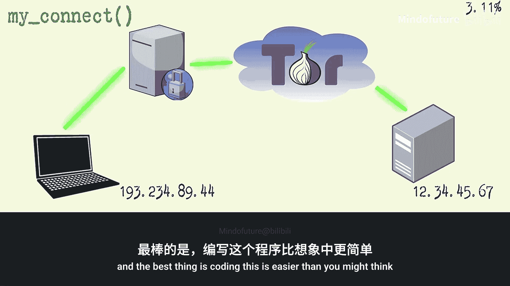

Okay， guys， welcome to this episode。 The first thing we need to do。Today。😊，Is we going to？

Create our own。Practice of clientient。So， this a。Proxiys， it uses a protocol named socks， S， O， C， K。

 S。And there are two different protocol versions。Version 4 and version 5。

 and the the tour network and the software。It supports both of these versions。え。

Version 5 is a little bit more complicated， but version 4 should be very easy to implement。

And it will be perfect to do it in sea。So that's the task of today creating our own。

Client for the stock proxy。And use it to connect。To the tour network。So how do we start。

I'm going to start by logging into my。Code Plan server like this。And prepare my screen。

 as I usually do。Today， I'm not gonna be coding inonno or V I， like I usually do。

This is a little bigger project， a little bit more ambitious。😔，Could do it in VI。

 even though it's a big project。But I'm gonna be using V code today， actually。

I'm going do my wild true command， so I don't accidentally close down my screen window。Like this。

And since I am using a remote server。I need to somehow either upload my C files and stuff to that server。

😔，Or code remotely。In this code somehow。 And I'm gonna be using a tool。

Which is called the sociopath SP client。At this。If you w to don don， so Pat。Tピ。Planing。

It's a tool that uses the SP protocol， which is basically installed on every server。

To upload and download files and subdirecties。😔，And。

There's also a remote file editing feature that we're going to use today。😔，Okay。

 so let's begin there。

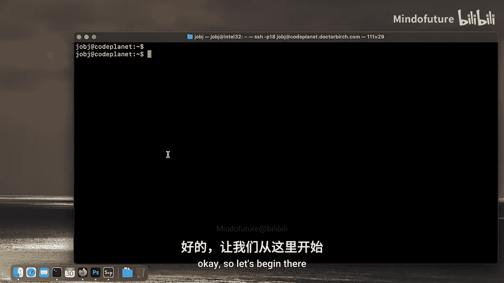

I have started up the program， which looks like this。So， I connect to。I code planet server。

And I got my coat。Folder so on the left side is my local hard disk drive and on the right is the files and director is on the server。

😔，So I'm going to right click and create a new directory。😔，性感的苦。😔，To a life。This。

And now I'm going to select the tour lies。 I'm going to right click。

 and I'm going click open an editor。Then it's going to download everything in that folder。

 which is currently empty， but if it were any code files in that folder。

 it would download it to temporary directory and open it in this code and each time you save or create a file or a directory。

Inside of V code， it automatically updates on the server。Okay， so now I have this empty here。

So I right click and create a new file， which I would be called in To alert。😔，See。

And I will also create a。To人 lies。一ペ一？くないです。う。We came by putting a small header。So。C。

AndI will include S to the I。Create a main。 And this time， I will。Type out the。

Longer signature for this。It main function。Thereル。Argument counter in the actual。아你们。Poer。B。

Because I'm not gonna be using that。In the final version but。😔。

AClient that we're going to code today。That will be。え。It will be used like this。If we。原来ね呃。

Do the slash。To relax。We're going to。Enter an IP address。Like 1，2，3，4。And the port。So。This tool will。

Connect to a predefined proxy server。We're going to put that in our H file。 Let's do it right away。😔。

い。Toalize dot H。嗯。Let's put。Include in here， instead。And in this file， we're going include our。😔。

Logo粉。So。When the file is in。Your directory， you use quotes around it。😔，Like this。And I say this one。

 Oh if we go into the。

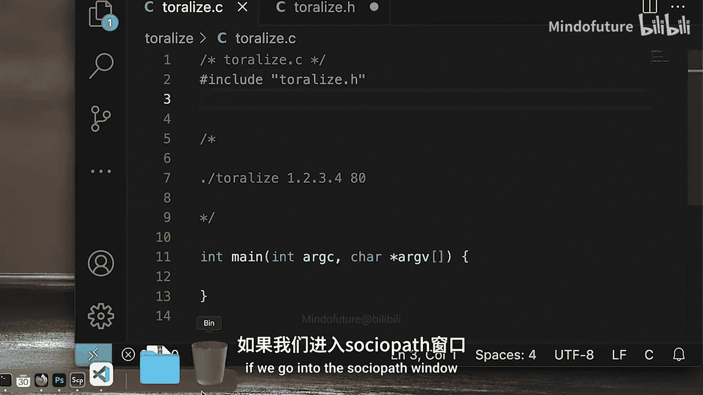

It sociate window though。We can see in the status this bar down here。😔，At the bottom。

Talized do C has changed， successfully updated to server。😔，And if we go into our。确没了。

And go into the directory。And check the contents of this file。

We see that it has updated the dot H is not here yet because I haven't saved it。😔。

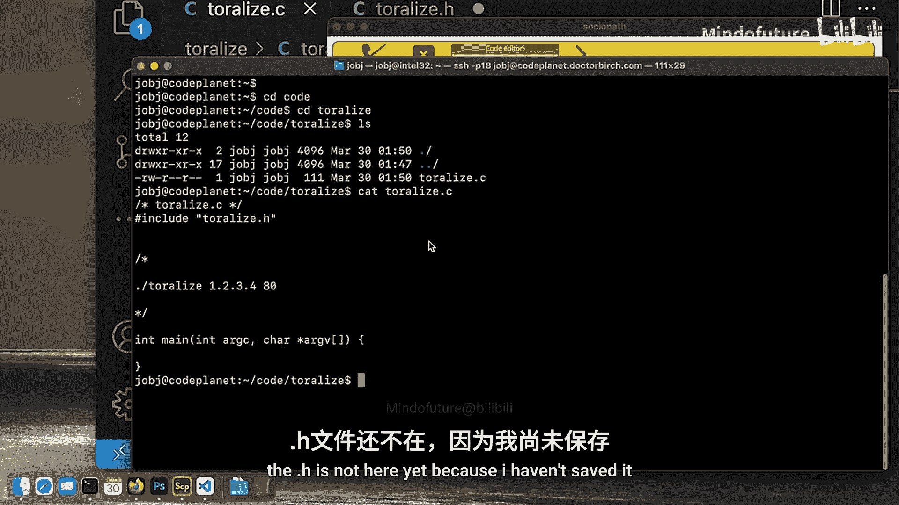

It uploads all save。So， let's do that。And with regard to the proxy server。

I will be using the default values for the tour package。And that will be using the I P address of。1。

27，0，0。1， that's the IP address of local host。Let's call this。Pxi。

And I would also make a constant definition。For the。Prooxyport。Which is 9，50。

Thats the default setting。Sa。

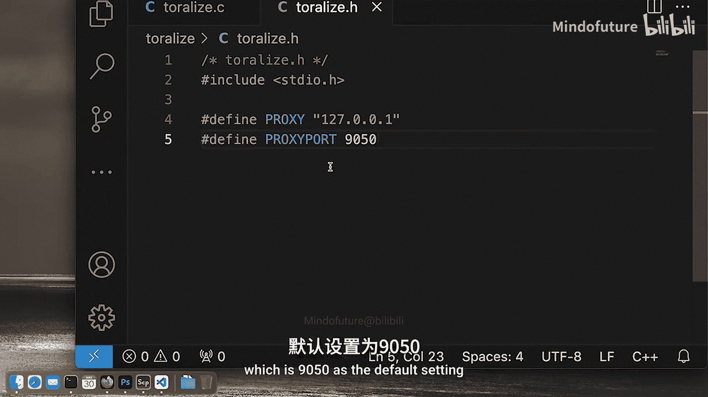

And just to verify， now， we should have both of these files here， right。

So both the C file and the H file。

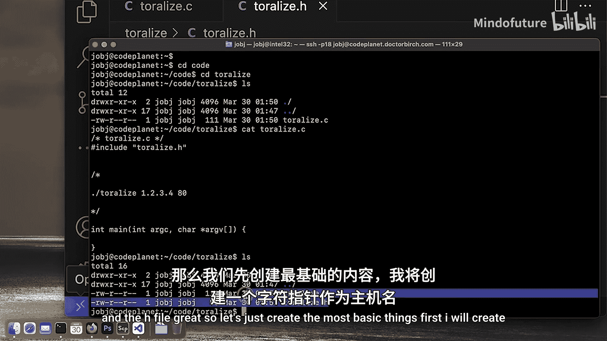

Great。そう。Let's just create。The most basic。Things， first。I will create a。

Char pointer for the host name。That is the host name that we is want to connect to。At at the end。

 so to speak， the server that we wan connect to。And we also need to have。Port number。

Let's just give into that。Yeah。Okay， so。First， I would just check that bug C。If that is less than。3。

 which means that we don't have two arguments specified on the command line。

Then I want to print to a。Find thescript to which is called standard error。Which is。

Useed for error messages。It's like printing to the screen。Basically。And then we want to do。

This usage。Puse。And。As an argument we're going to give。二び。0。So our v0。

 if we on the command are specify dot slash toize。1，2，3，4。え。Qu to 80。Then this is R v0。

This is ugly one， and this is ugly2。😔，And this is an error。 So well， will return mine as well。And。

If we have our arguments， we will appoint the。Post towards A the world。

And we're going to set the port。wo。And we can't。Do get do it like this。Because。The port is an in。

And this is a street。So we need to use a function which converts a number in a string format to a regular number。

 A to I。

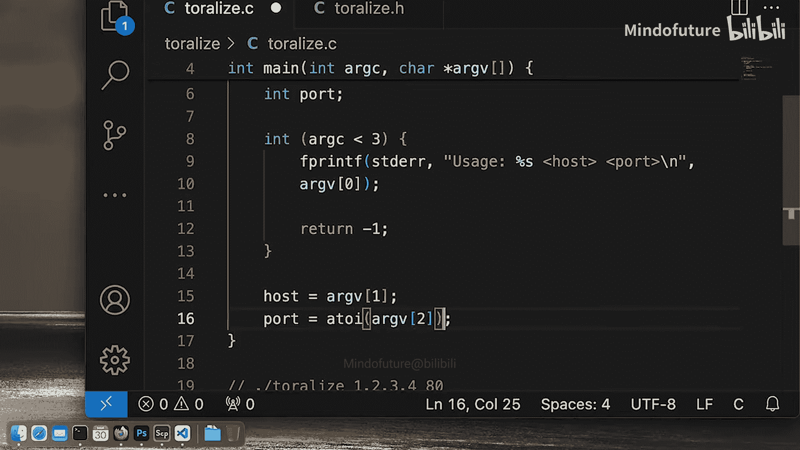

Let me just check if that requires an include file。😔，And we do that by doing man。3，8，2，5。

And we need SDD lid。Dft age。

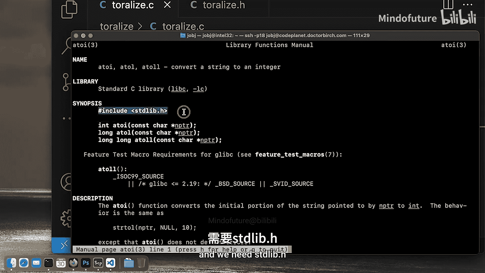

Which I will put in hour。Heer5。D isGDE。H， and I will also put in。String the edge。And。

You need bestD with page。These are the four that I always put in every C program that I do。😔。

line up is a little bit better。続きてす。Okay， so how will this work， We need to figure out how the proxy。

Protocols sockss version 4， how does it work？So， let's go to。Google。

And if we want to have the technical specification of a network protocol。We do like this。

We search for the protocol name， So 4， in this case， and we add RF。

That stands for request for comment， and is。The standard way of describing。Un officialial。Protocol。

So that way， you will always get the right one。And I'll take the first one here and increase the font size a little bit。

This is not a huge file， some of these RFCs are very big。😔，But this is quite a simple protocol。

So there's this two step process first you make a TP connection towards the proxy server。

 like any other server， like exactly as you did in my web server。videoideo and in the TC P。Client。

Video。Then when we are connected， we need to create a。Network packet， which looks like this。So。

From left to right。There is。I one bite。😔，Field， that is 8 bits。For the VN number。

And as we can read here， that's the suck protocol version number， and it should be4。

Then we have something called CD。The C D is the socks command。

It's the code for the command and should be one for connect so there are two different types of operations that you can do through Sos4 it's a connect operation and a bind operation so basically a connect operation is when you connect the outwards and a bind is when you prepare for an inbound connection towards you。

😔，We are going to do a connect， so we will put a one in that field。

Then we put the destination port number。And we need to format that port number。In the。

And network by the order。😔，Which is basically that we switch。 We， we cut off， cut off。

The 16 bites in two parts， and we swap them。And same with this destination IP。

 but this is a four bit，4 byte field， so 32 bits。Reg in size。And that's where。

 where we put the IP address of the。Remote server that we want to connect to。

And then we need to put a user ID。And I would just put toise there。 Does't matter。

And then we need to end that the。Sttrain with zero by， as usual。

And that's basically it we send send that the packet。We get a reply。Which looks like this。

 And the only interesting field is this C field。If that is。だテ。

Then the connection has been established。And then you can just send whatever you want。

If we get another。In number 90， then something went wrong and we need to deal with that。

And then we will send some data just to see that it works。So that is what we need to do。Okay。

So I will do like this， I will copy this。😔，And inside our header file。

I will create a comment block and paste in this。This one。I want the last。Line as well。

 So I see the number of。By。You need to change the size here。Okay。This way， we see enough。

But in order to be able to create a structure that corresponds to this design。

 we need to be able to create fields that。As the 8 bit size， the 16 B size。And the 32 bit size。

So let's start there。We will reduce the type de。Cled。2。😔，Create。Our own。variable types。

Which will be called in 8 in 16 and so on。So if we begin with the in the eighth。

That's basically an unsigned cha in sea。 That's 8 bit size。

So we'll type type F and Char and then our name for it。😔，Inて。Then， we need the 16。Bit size。

And that is an unsigned。Short in。こ撃に尽きしてよ。Then then we need a regular 32 bit。You。So， that's an unsed。

一。And we'll call it in 32。Okay， so now we have the different parts that we need。

 Now we're going to create the actual structure for this。😔，Packet。So we'll create astruct。

Which I will call proxy。ここです。And the first is V M， so。In a the end。And the next is C。

 which is also an8 bit。Then we have the destination port， which is 16。い。と。And then we have a 32 big。

Destination， I P field。And then we have the user ID， which has the variable。😔，Size。

But I'm going to create a used name of7。Characers。Because that way。We can have。An 8 64 bit。

Stret is variable here。Which ends。In a  s。 So that's why7 an of8。So， basically， I will do。嗯。Andside。

小2。😔，スアイディ。And this is all we need。For the first。Structure。Lets。Create the other one。

At the same time。This one is a little bit smaller。Look strike。Proxy。Spm。

And we're not going to be using all this。😔，F。So if we look at this， well。The VN is always 0。In the C。

Well have the code。 So the city is the only interesting field here， because。

The remaining fields are ignored。 So destination port and destination I P are ignored。

 but we still need to。Have them defined because we need to have the right size of this package。So。

 I will do。Dos like this。I will start by creating an8 bit。嗯。Integer for。The VN。We need a bit C。Then。

 I will just do。😔，In 16。And then underscore character。And then， in 32。And two underscore cares。

We could name these。😔，According to this。But I think this。S clearly shows that They are not。

Importantant。Okay， so now we have over two structures。 we can remove those comments。😔。

And make this a little bit bigger again。And I want to create a type de。For these structures。

So we don't have to type their whole proxy request every time。😔，And I will just call this。Right。

With a big R。And same here。特别对。Good。She responds， and this will be rest。In the bank。Or。Okay。

 so now have now we have prepared。😔，Everything we need， basically in this file。😔。

And we do need a couple of includes， though。😔，Because we are going to use the following。Functions。

We will have。socket to initialize the socket。 we're gonna have connect。And we also need。Close。Pジトで。

And I address。So。Remember what I told you about the network based order。So， if we have a。Port number。

 for example。来。😔，Something like this in binary。So， this is a。32。B。No， sorry。4，8， this is a bite。

 So if we do like。Let's say this is a port number。And I don't know exactly what it corresponds to。

 but。Let's say， for instance， that it's 90，50。Because it's a 16 bit fill。

 so it looks something like this。Then we need to。Copy this right part。Then put it to the left。

That is network by order that we have the most。Important。ビツ？First。

And that is what these two functions are for。 H T S does it for the。The port number。

And the Eid address。He takes a string。And create a。Big， so basically， it first take this。I P address。

And translates it to a big number。And then it makes this network based order。

So these are the functions we need， perhaps。I have forgotten。Ady。😔，Other ones。

 but that will be clear when we get to that point。So， let's。Find out what。

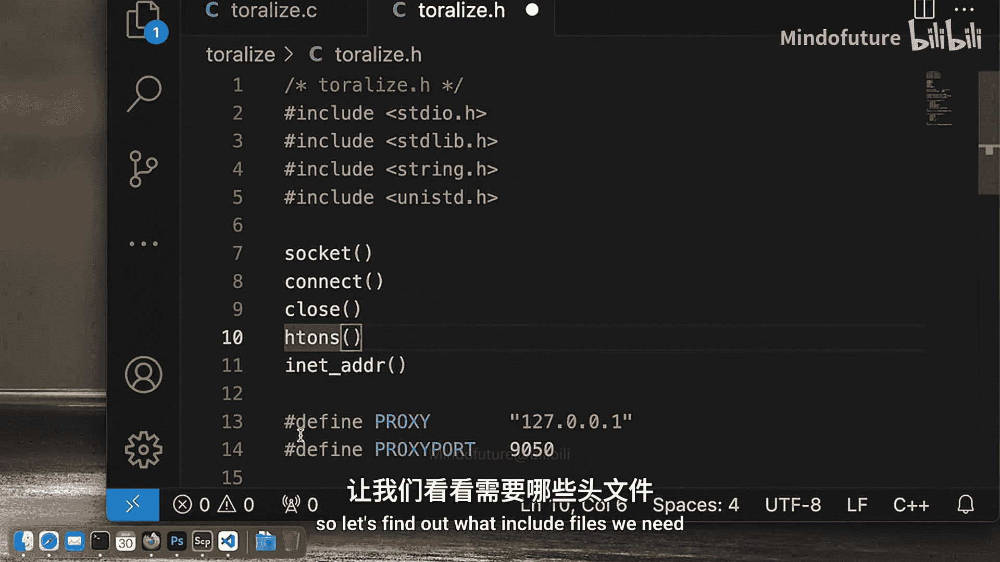

includeclude folks we need。Let's begin by socket。We do man to socket in way 2。

 because this is a system called that。How do you know if it's a system call or a library call？

Try a library called first，3。 If you don't get a hit。Or if you get a hit that doesn't seem right。

Try the。They two。Okay， so we need6 socket dot H。😔，I'll just copy it。

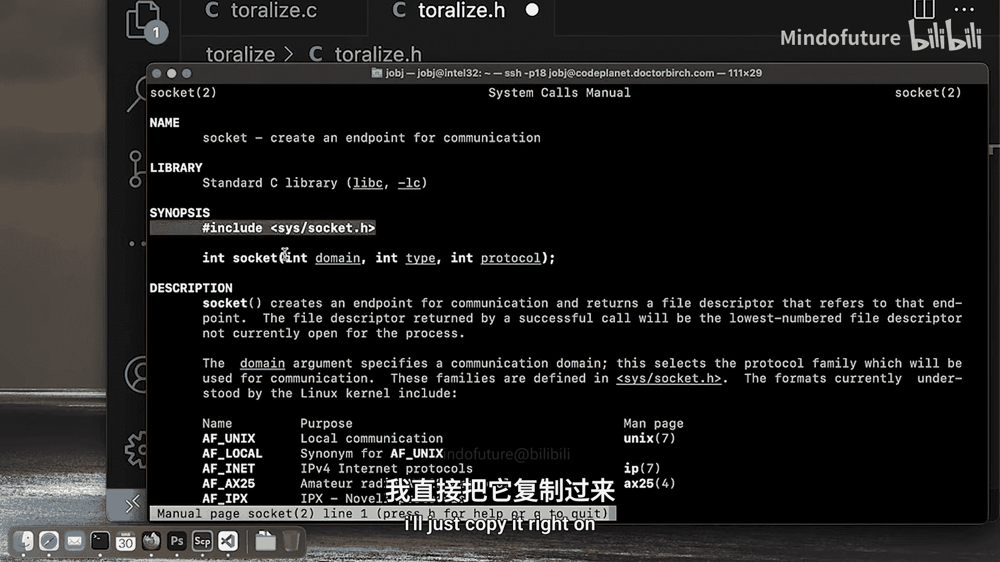

Right on。This， and then we need the connect。 That's also a system called， so。

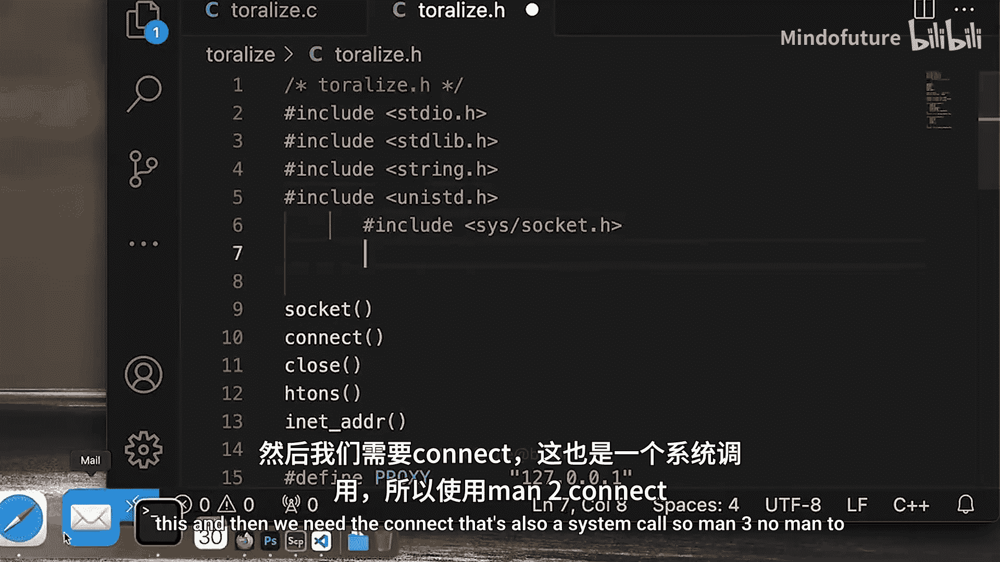

Manen 3， no man  to connect。

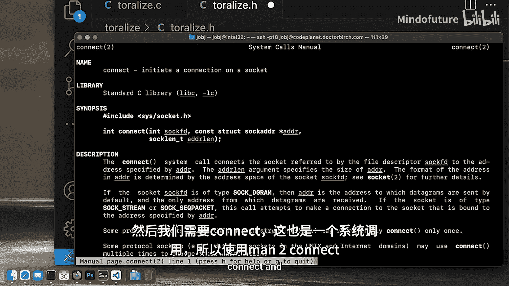

And that's the same。 We don't need it again。😔，And what else did we need， A close。

 I'd think that's unDD that we already have， but。

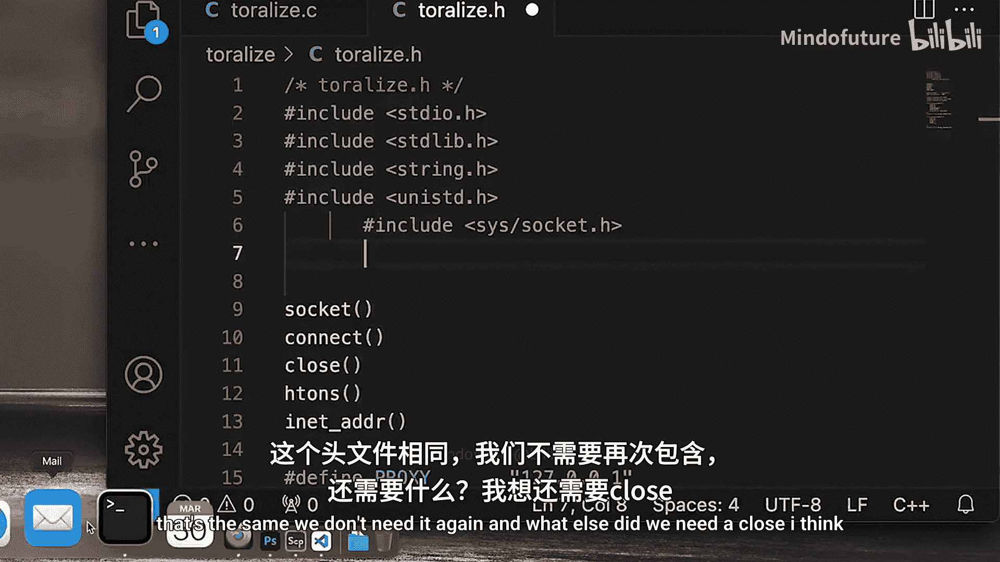

对。So the close that is also a system call， and we use it to close down the connection。

Can also be used to close down the file。Yeah， un， we had that already。

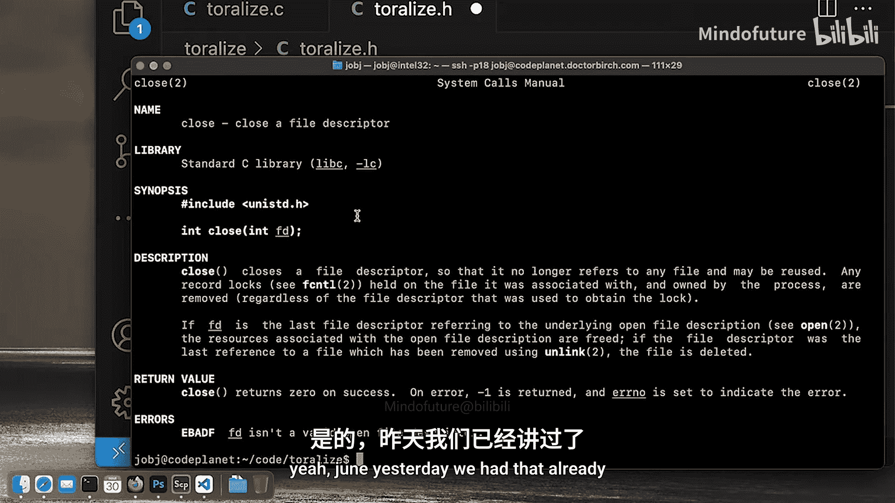

And then we need the H tone S and I address。

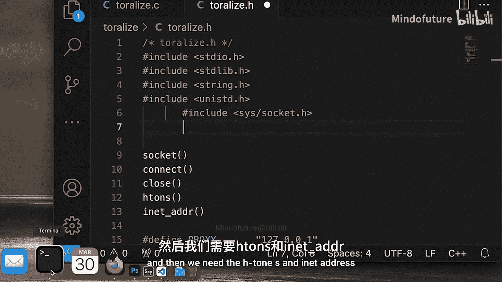

So， man， this is。The three。So age tolerance。

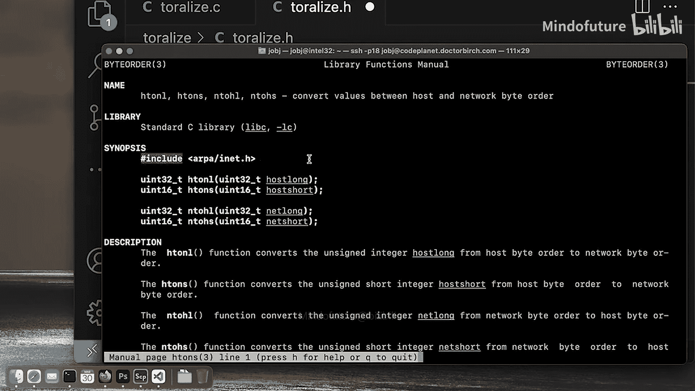

それ。And finally， I address。

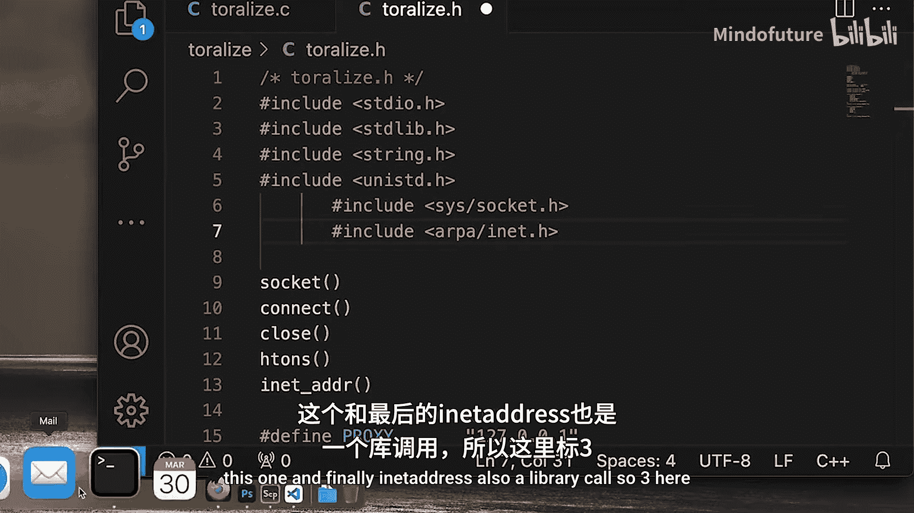

Also， a library， so。th3e。Here we need a couple of include si socket。

 we do have already our part iron it we do also have， but not net eye。😔。

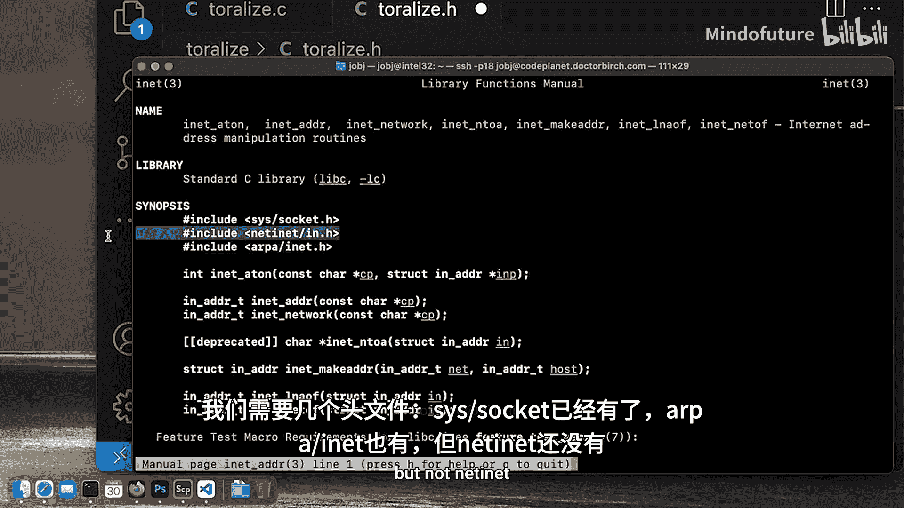

Okay， so let's see if this。Compiles。Since we are using a couple of files， I think I'm gonna。

Create a make file， as well。So I will create new five。And I will name it make file with a big M。

And then， I will just。哦。チシシ。Toized。C。Bash of toilets。

We're gonna be adding a lot of stuff here later on。 but for now， this ought to do it。So， let's。Sa。

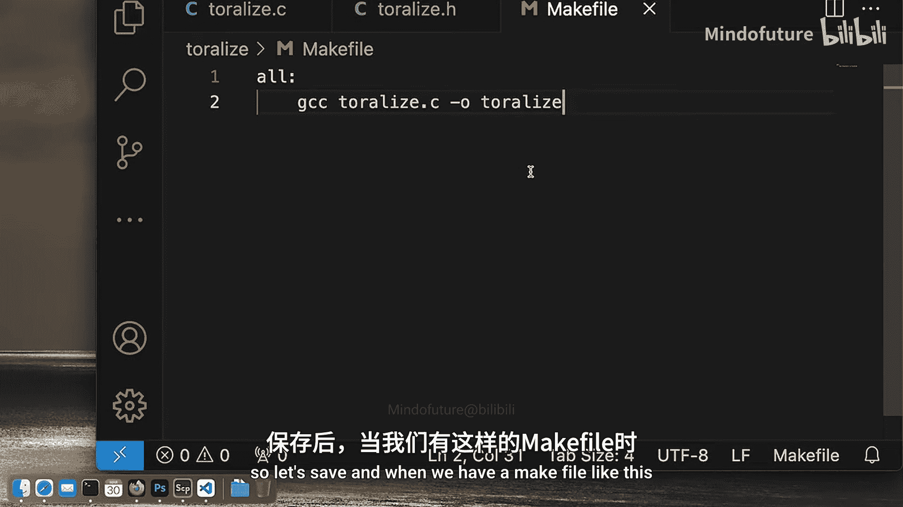

And when we have a mag file like this。Then we don't need to issue the GCC command every time we can just do。

咩。And then it will try to compile。Okay in the okaytypo。

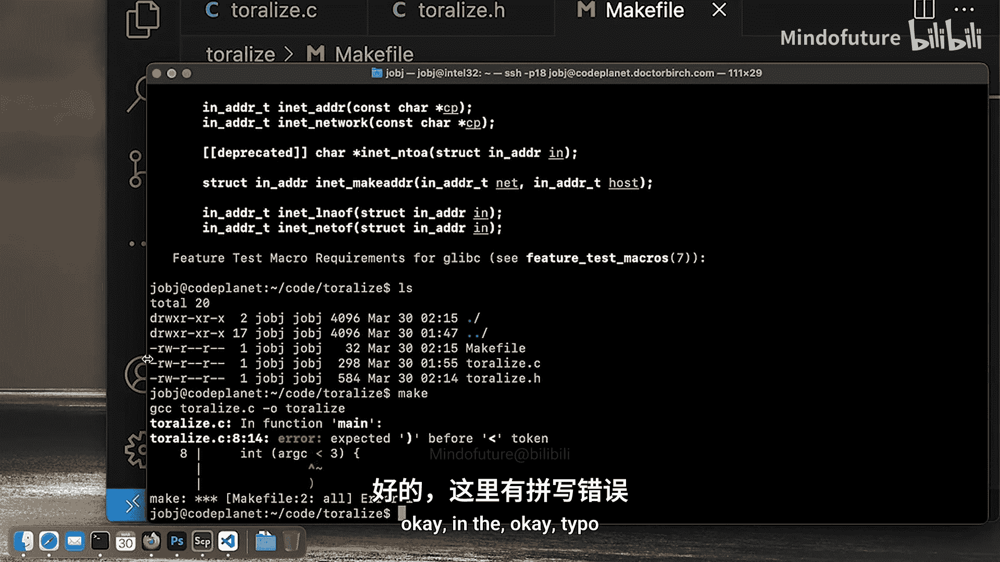

So let's go into the Toized do C。 and this should be then if。😔，Un name。

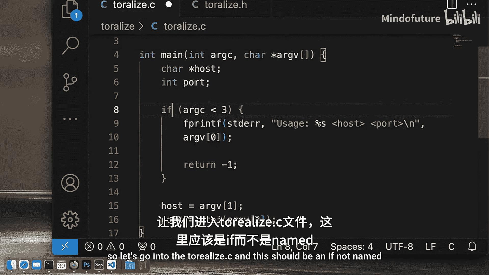

Let's say。And we'll run make we go。ですタに。It compiled our。To。

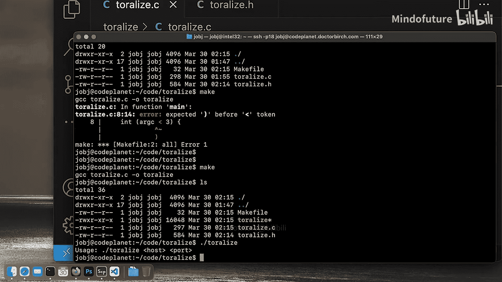

Okay， so the next step。Is。Connecting to the pro server。

Because we're not going to create a TP connection directly to this host and port that we specify on the command line。

 we are going to connect towards the。嗯。The proxy IP address from the H file and the proxy port 9050。

😔，So。That we have done before， creating a P client。嗯。It's exactly the same as before。

 so I'm going to make it quite fast。If you need to learn how to do that。

 you can watch either my TCP client episode。😔，Or my creating your own web server series。

I will explain。By haste， though。Okay， so we need a couple of variables。First of all， we need M。

 which is called S。For the socket file descriptor， return value。We also need a structure。

Which is called so。Addds。Fook a dress in。You knowll call this stock。

 That's where we specify all the I P addresses and stuff。え。O。So。Let's start by creating our。Yeah。

I will suck it。So， S equals soet。And this is pretty standardized。Will always put in。So I not。And。

Second argument is sostream for AP connection。And then a zero for the third argument。And。

If this S is less than 0。Then I will use the P error command。PEas print an error。

And we will specify which function that produced that error。Enedmently just returned by this one。

When we create the final version of this， I'm going to use more accurate error codes， but for now。

 we'll just do minus1 for everything。😔，Then we will create， and we will prepare our structure。

 And that's three things we need to add。In order to make a T connection。First of all。

 we need to put the same family。To A F。啊，你呢。We need to put in the same port。And use the H tone S。So。

 we get it in the。Networking about order。And then we will just put in our report variable here。

And finally， we will put in our so。Sing address。Yes。Add主。And that will be equal to I address and our。

No， look our port。 It should be our。Proxiport。And。Should be our proxy IP address， Nothing else。Okay。

 so these are the three things。 Now we need to initialize the actual connection with the connect command。

So would you connect and we reference the socket。The second argument is our structure。

 and we need to create an explicit type casting。Cause we need to change it to。Suck address strict。

Yeah。A point to a socket is stripped。And we also need to send the reference。

 So let's put an ampers there and the saw。And then we need the size， and I will just do size of。そう。

That到ル。Okay， so this line will connect to the server。But， I will also need。Do an if statement。

 so we see if it succeeded。And this should return a0， if it works。

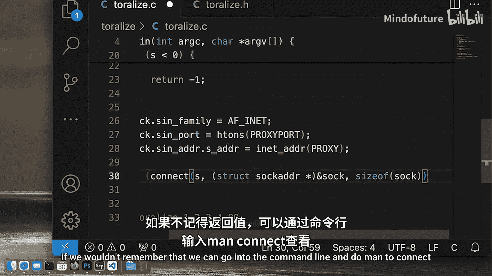

If we wouldn't remember that， we can go into the command line and do man 2。可能。

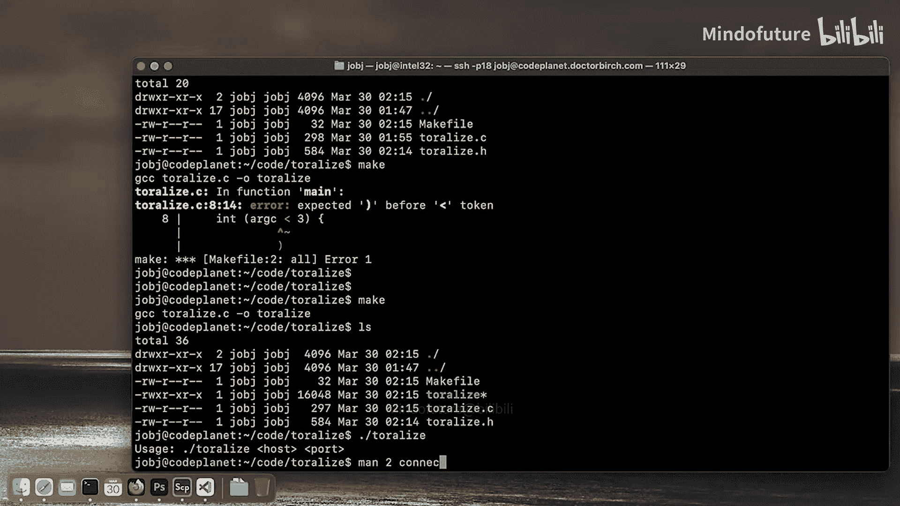

And go towards the bottom。 And here we will find。A section for the。Return values。

If the connection or binding succeeds，0 is returned。Otherwise，-1。So。I will just do a simple。

 if statement。

There's no need to save this to a variable。So， if this is。嗯。0ro。Something went wrong。

And then we do P error。臀。And return minus well。Otherwise， we are connected to the processor。So。

I will just echo that to the screen。So， we know。What's happening？

Then I will close the connection because I want to see if it works。So。Close。嗯。う。Feal。Okay。

 let's see if we did something wrong。

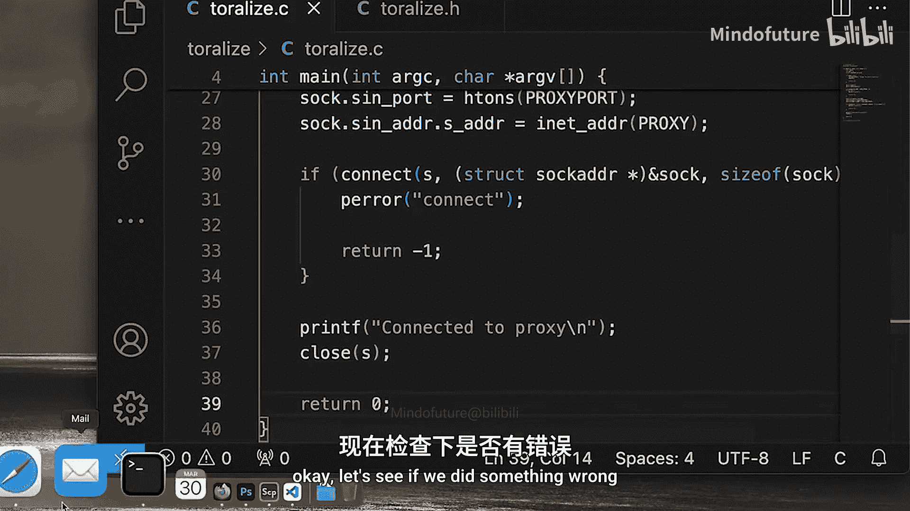

Make。It compiled on the first run。 That's not every time。And let's run it and see what happens。Right。

 we need to put something here。 We're not going to be using that information。At the moment。

Connected to proxy。Great， so it works。

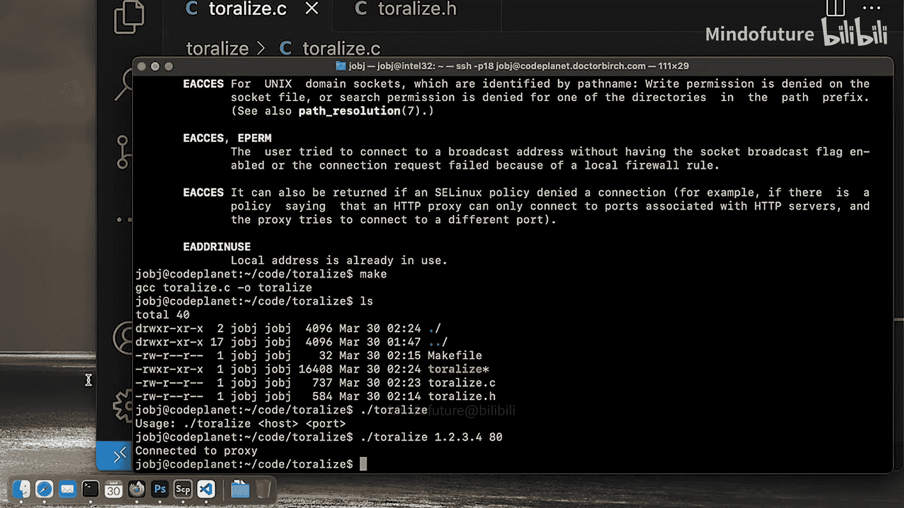

So now we have successfully created our TP connection towards the proxy server。

And the next step is to create。你嘢。Prorooksy request packet。

According to this structure that we created。before。We haven't created any。Fction declarations。

 So let's do that as well。So wed have a main function。Fix in and in。And then。giveive the pointer。嗯。

When I create those signatures。Surehar。Of course。So， if we look at our。Regular。Main function。

We use this format right here。So。😔，A array。Of pointers。But。😔，When I create the type signature。

 I usually use this format。Doesn't really matter。Okay。

 so that's the only function that we have this far。Our other function。Is going return a point the。

To request。And let's。Name this function request。And as arguments， we're going to take in a。

Sre pointer。Which is our。Destination I P。And just a regular int。For the destination。Poor。

 and let's make both of these counts as well。Yeah。The con key word。诶。Means that。

We cannot change these variables inside of the function。😔，So it's just input values。😔，So。

 this is the。Signature。I'll copy this， and then I will。Striip it down。 So it looks like our main one。

Because we don't need to have the names of the variables when we do a。Thank you to Decation。

And why do we do these function declarations， Do we have to， No， we don't， we don't have to。

 But imagine that。We put our main function in our C file at the top。

If we then try to reference the request function。YeahIt's not gonna find it because it has has。

 hasn't been defined yet。But if we put our request function。On top of the。Fction declaration。

Then it will work。So that's one reason， but I think a more important reason is。😔。

So you can have like， a。A better look。You can just watch the adult age file and you see the entire structure in a very good way。

 So always do this。If you have a multiple files or a big dotce file。Okay。

 that was a small parentheses。Sorry， I copied over this。Wund。There we go。And then we go into here。

 and we will create this。Qu。So what do we need in order to do that， Well。

 we need to allocate the memory for this。Request the structure that we're gonna return。

 and we are gonna reference the length of the structure a lot of times。

 So I'm gonna create an alias that。Yeah。Or a macro。And you do that using the define。And then， you。

Give it a name。 I will call this。😔，Yeah。Reci。And what is recx size， It is the。Size of。Stke。Proxy。愉快。

And let's create one for the other one。 to swell them。Define risk rest size。Response size。

And that is size of。主任。こ。In that way， we don't have to manually type out this。😔。

As soon as we need to reference this。The size of the structure。And semi me call them at the end。Oh。

 let miss belt。There we go。Okay， so back to the dot C file again。And I'm gonna create a。

Request pointer。I'll just call it Rick。🤧srry。And I'm going to start by。

Allocating the memory for this structure。So。Request equals manner。Brick says。Like this。

And now we're gonna fill this structure with the correct。Date them。So， let's bring up the。

R F C again。So the first thing is the V L。And the VN should be4。So， red。Lin。Good go for。

And if you're not familiar with this arrow。That's。Basically， the same as。The dot format。

 But when you're using a pointer to a structure。You this。え？Arow2。

To indicate that we need to grab into the。The reference in order to get the value or the value in this case。

Okay， so V and is4。Then we have the C。😔，And it should be one。Because we're making a connect request。

So。Re。是啲。Equs1。Then we have the destination port。And we need to put it in the correct format。😔，So。왜。

Dport。Equals， and now we use this H tone S function that I talked about before。

To switch it to network by order。And罪。😔，Destination port。Then we take the。Destination I P。So不对。

Destination。I皮。Equals。えアイレ。Addres。Dtulationの。And then we need to have a null terminated string with our。

Variable。 And I want it to be。E characters。So， let's。Create a definition for that。Tin user your name。

To了。Good。we need to remove this E。1，2，3，4，5，6，7 in D Uabite。At the end。So we will you。

 I will you string copy。To copy into the wreck。Yesday。えデユすで。And the maximum size is。F子。

And then it will。Add the stabys。Let's do it。Okay， so now we have prepared this structure。Emma。

 we will simply return it。Like so。And now， it could be very easy to。To handle this。😔。

Because we have a function which just creates the entire data that we want to send。😔，And we know in。

The size of this structure。 So we can just use the right。System called， in order to send it。Okay。

 so now that we have our function， which creates the packet that initializes the proxy connection。

No we're going to use it。So let's go into our main function。E left create a。Appointer。

Of our structure， request time。So we can use it when we want to send the data。And。😔。

Instead of just closing the connection like we have done here。We're gonna set our。Request variable。

And。Use our function。And our request function takes two arguments。

It is the destination IP and destination port。😔，And we do already have variables for that。😔。

It's the host and poorest variables。So we'll just use some。So。Post。And。火。Like this。什么。

The rec variable is pointing to a。To our packet。 And we'd just need to send it using the。Right。

Sysem cool。The first argument is our socket file descriptor， which we named S。

The second argument is the。Yeah。Is buffer。And I think we。Only need to do。R， perhaps we need to do。

Yeah we。Probably。Need to do a。Type definition。Tcast， I mean。But。Let's。

Put it like this to begin with and watch their warnings and errors when we compile it。

That's usually best to workflow。And we need the size of the packet。

And since we know that we all always want to use a。8 by the。Yeah。An 8 byte buffer for the user name。

we have a constant size of our request packet。So， we will just use that。De。We put in here somewhere。

It is。I think we created a macro。 Yes， recx size。 That's one。

That is the size invite for how big this packet is。So， now， we send that。Packet。

And the next step in the process。

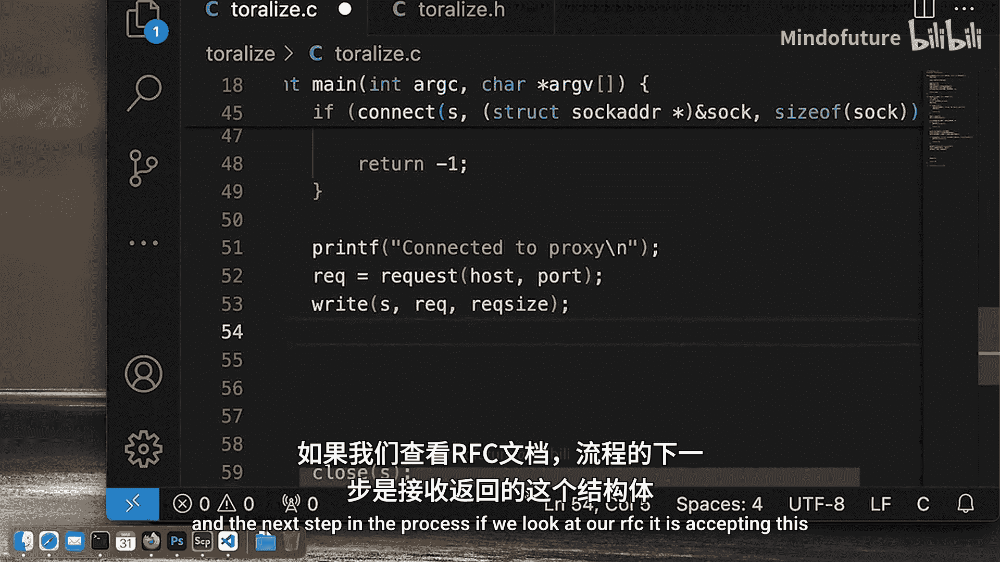

If we look at our orFC。It is accepting this。Structure back。So we can look inside of the。CD。Property。

And对。Look for the9 dec。

So how do we receive this one， well， we did use write in order to send the data and we will use read to receive the data。

And for that， we need a buffer。So， let。I think the easiest way will be。To。Just create。

A variable on the stack for that。B。And then， we'll put the。Response size。SD。Number of bys。And。

Before I use read， I always want to。Make sure that the。buffer is empty。So I will maet the buffer。

With zeros。嗯知。Use the rest size。Number of zero。So now we have a clean buffer that we can readate into。

😔，嗯。Yes， so let's do read and the first argument is the Soet trialscriptor。

Second argument is the buffer， and the third is the size。さです。And。If this real operation。

Returns something。Less than one。Because the number of bys。He should be returned。Then we know it。

 The operation has failed。Then we need to。Show error。Sorry， I'm a little bit used to the Javascript。

Strerings。There we go。嗯。Let's。嗯， free的。The， the buffer， no， not the buffer free the request packet。

So we don't have things laying around。Don the he。And let's close down deep。So it file scripture。

Didn't return。M this one for them。So this is if the read operation fails。If it has succeeded。

We should have a。Packet， that looks like this。In our buffer。

But we can't easily access the values inside of it。If we only have a。String is。ポイント？

So we need to create another pointer of the correct type。

Which is our structure for the proctor response。So。We would create a。Rest。As well as the wreck。

And we should just be able to point this。😔，Towards the buffer。<|OTHER|>And that's what we'll do。So。

 rest equals。对。I think this should be enough。And now we should be able to grab this value the。

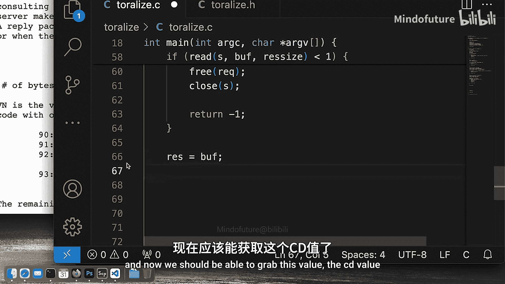

CD value。

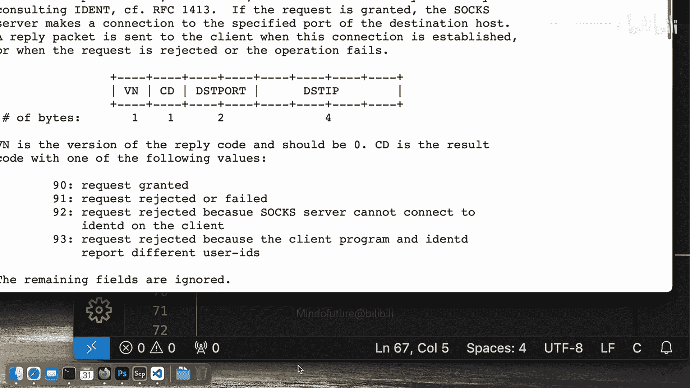

And I like doing it like this。I will create an in。I will call。Succe。Success。

And this will be a Boolean variable。But as you know， we use ins as billions。

We can use char and other types as well， but usually it's in。And this would be used as a predicate。

I'm not sure if you are familiar with the term。But the predicate is basically。诶。In。

A function or an operation。That returns。嗯。True or false。And this is American English， I think。

In the British world， they use。The word property for this。But since we already use the property term。

When we describe other things。I think the predicate。進んでる。Any hope。

 then we can do something like this。So。With said。Success， equal。And we go into the structure。

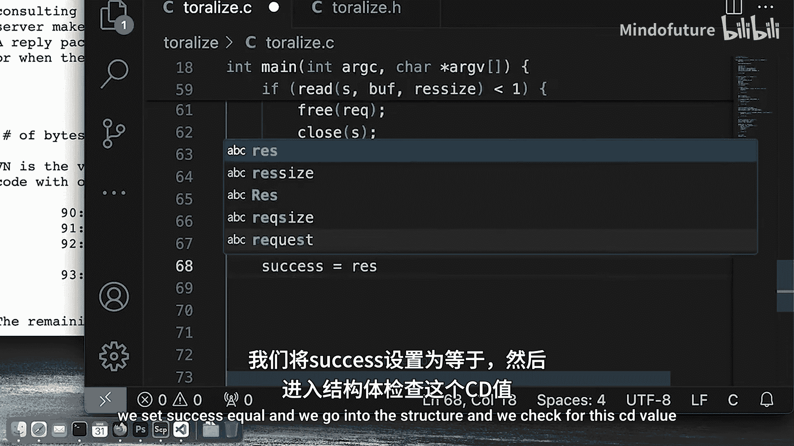

And we。Check for this C value。😔。

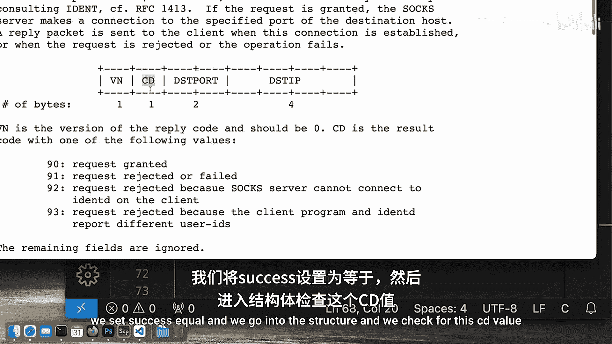

I will put this。Prentices。And we do like this。So what does this mean？This means that。If the C。

 D is equal to 90。Then success will be equal to true。If it's not90。Success will be false。

Which means we can do like this。To see if it has worked or not。And then I want to print out a。

An error message of my own。So we use the F print F to the standard error way。

And I want to say something like。那部。To。Pverseて。Arow code。And then the error code。当に。

Divide this a little bit。I'm not sure know it， but if you have it。A large string。 You can always。

Dividide it by。Let's say。By smaller strings。And put them on different lines。Make sure to。

Encapsulate them in quote。On both instances。And then， we will show the。Bres。The see。

The rest to see D value。で。And。We can also do。Let's close the S。Enlist。Free the。R。In。But this work。

And。Unless this。If close。Happens。We have successfully traversed to proxy。

So let's inform that with the print desk。At least for now。

 perhaps we will remove these messages when we are done。嗯。Okay， so。Success。F。

You will have a person S colon person。皮衣。Andlin。I will use hosts， and。好。来。

And now I will close down the connection。When we do the， when we finish this program off。

 we will not be closing down the connection。 But since we are only checking right now， if it works。

 if we are able to connect through the property。We can close down everything and terminate when we are done。

So this code will be removed。In the final version。It would free the red。In return。real。Like this。

The indentation seems to be a little bit of。嗯，我也。See if we get the error。Okay。

 so let's compile this and see what happens。

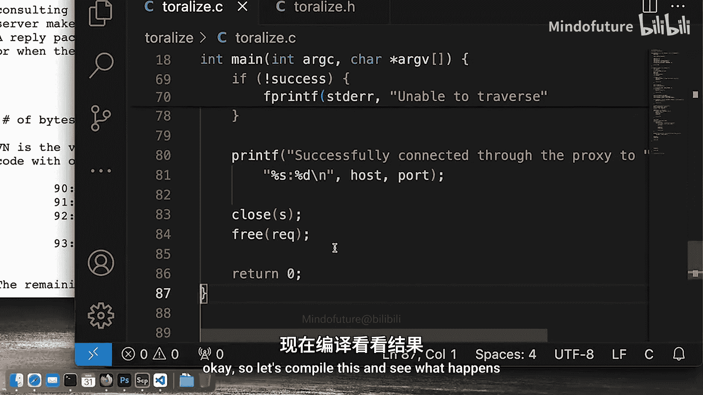

Okay。And when we are troubleshooting code， especially when we have coded quite a lot of lines of code since we last compiled。

Always。Look at the first error， because sometimes if you fix the first error。

 all the other errors goes away。So don't get discouraged when you see a full screen of error messages like this。

 Just focus on the one at the top。AndSo what does it say。Rg has no member named username。😔。

Interesting。So let's go into our H file。

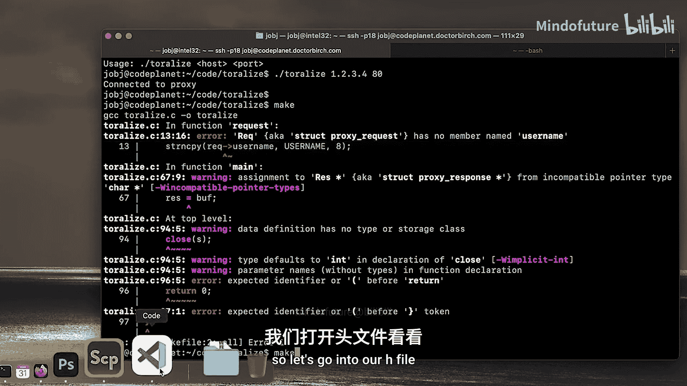

See what weve got user I D， okay。Yes， of course。So where were was that， That's probably inside our。

Request function， right， Yes， here it is。 So use the I D。

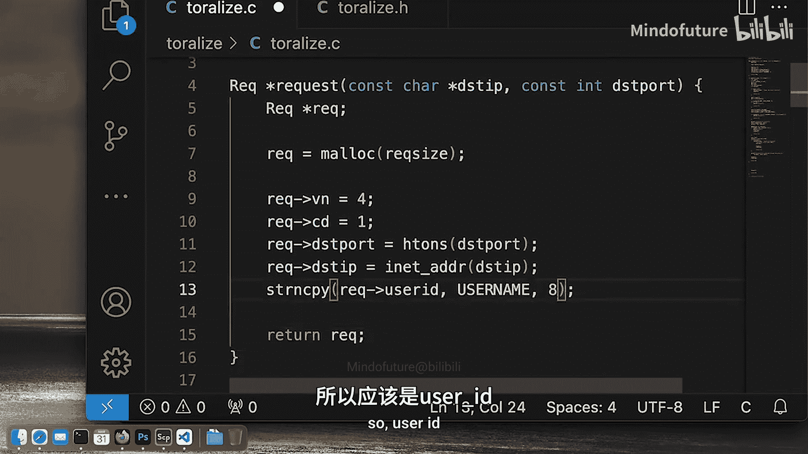

I this okay。And before I run make again I。Press enter a couple of times。 So we get a barrier。

That way， it is much easier to see where the last couple of error messages。Yeah。Stops。

 and the new batch starts。Okay， so assignment to rest。From incompatible pointer tie。

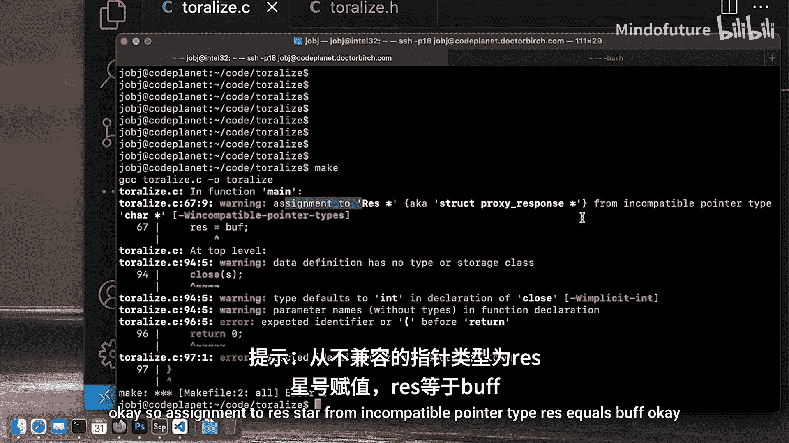

R equals buff。 Okay， that's the 1 I was a little bit unsure about， remember。And I said。

 let's say compile this and see what it says。Because in some of these cases。

 the C compiler will perform an implicit。Tpecast， in this case。Andで。Work it out。Anyway。

But not this time。 So， okay， so rest is。Stt pointer。 And Buff is a string pointer。

So what if we were to just do。W is。なんで。

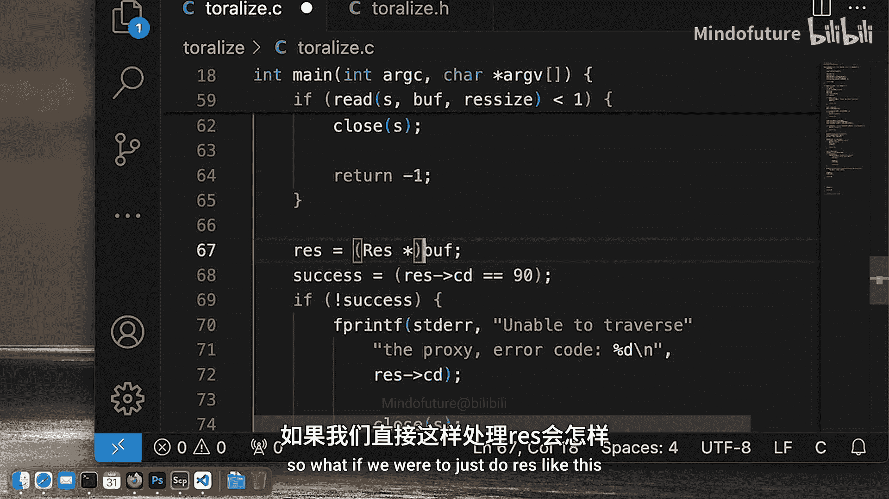

Let's try， at first。Seems like it worked， okay。So， close S。Death the definition has no tie。

Or storage class。That's interesting。Eror message。Daateta definition has no tie。Or。Storage club。Close。

Enclo in5 D， UniDD， you will have all our include files。 I have never seen that。😔。

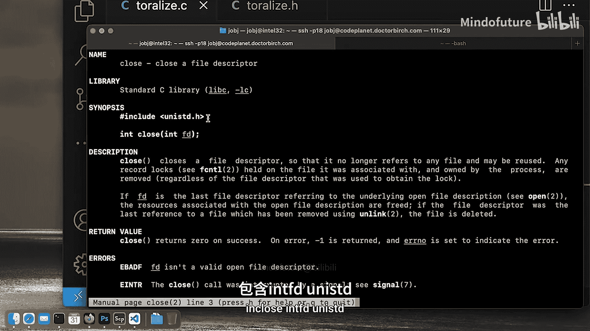

error message before。Unity yes。点在。😔，Colder。Variable。😔，ですたちい。

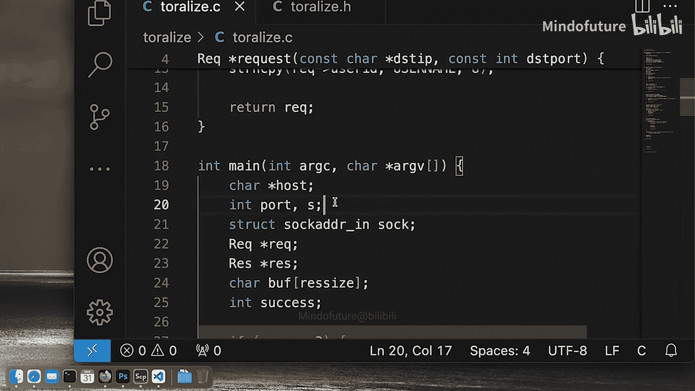

Ying。😔。

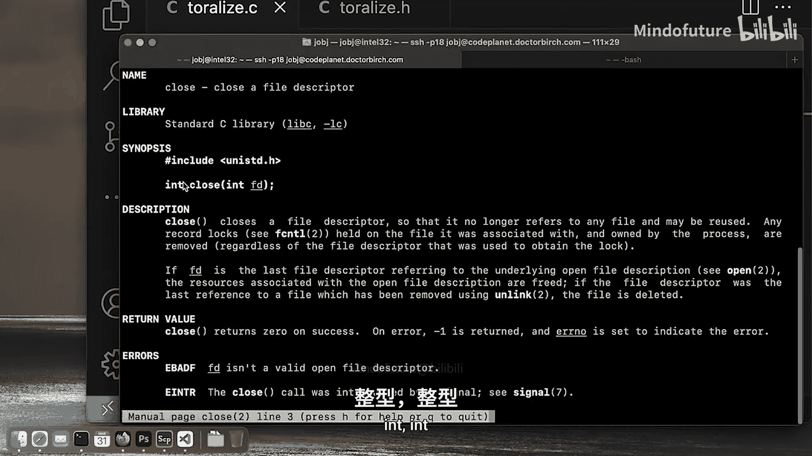

Ying。It was only a warning， but。Very weird warning。Perhaps something else is wrong。In its proximity。

If success。F print F。Prenheses。Then we have the string。And then， the end parenthe is。그。

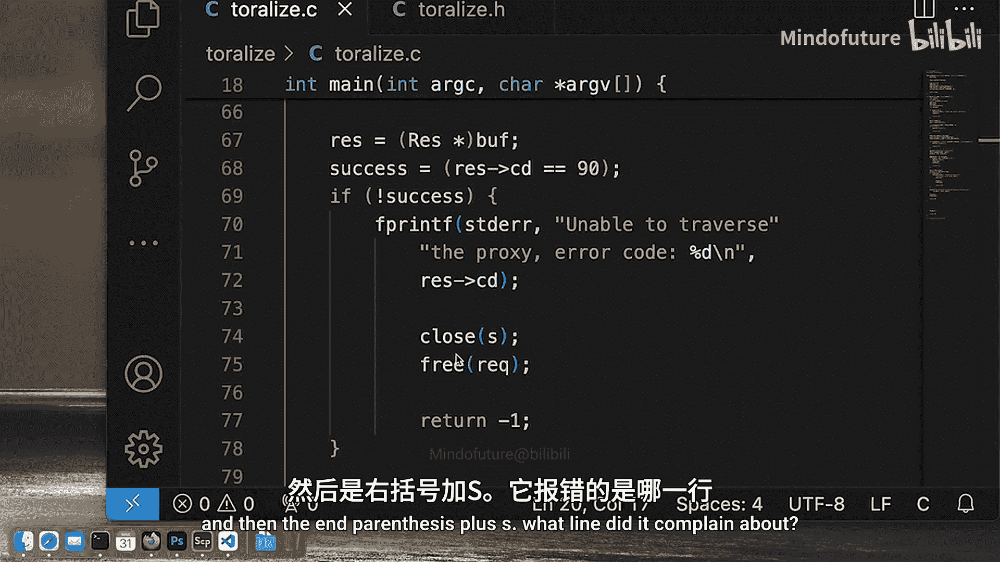

What line。It complain about。

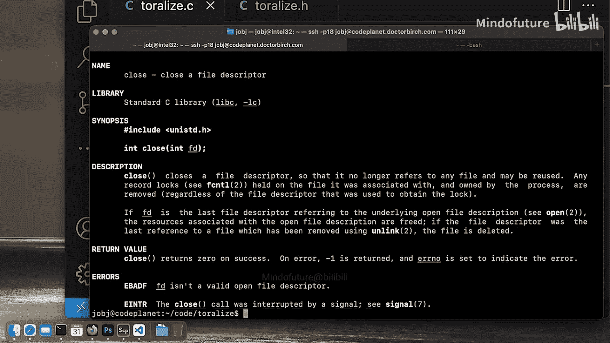

94。Okay， it's no， it's not this one。It's complaining about。This one。WellThere is。 okay。ふう？If success。

Do do do。Then we have this cause S through。Yeah， it shouldn't be here。

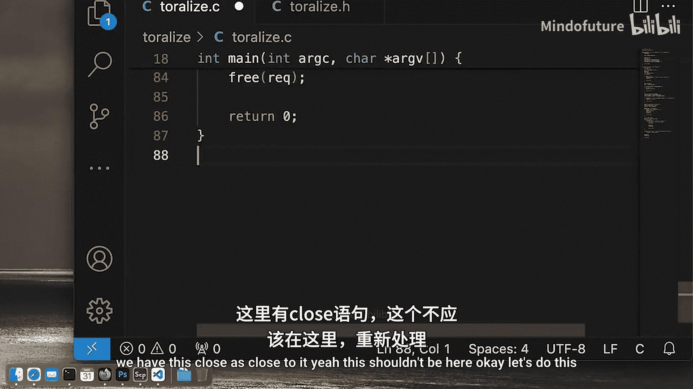

Okay。Let's do this again。Okay， it compile。Let's see if it works。 So what shall we connect to。

 I will just do one of my web browsers， and you might have noticed that we didn't put any DNS related stuff in this one。

So I can't just put in WWW network technology dot or go or something like that。

That's something that you probably can add by yourself。 See that as， as an extra task。嗯。But。

For a proof of concept， it's not really necessary。Okay。

 so I will take the I P address of my web server。And let's run， tourwiize。Against the。Unport daily。

And if this works， we should see。😔，A message that we have successfully connected to the proxy。

 and we should also see a message that we have successfully connected to the end host through the proxy。

😔，Connected to proxy， successfully connected through the proxy to blah， bh， blah， blah， blah， blah。

Okay， very nice。So this has accessed the web server through the Tor network。And let's add。嗯嗯。

Let's add some functionality so it can send some data。And read some dayha。So， we can see that it's。

Can communicate with the end host as well。 That is also stuff that will be removed in the end。

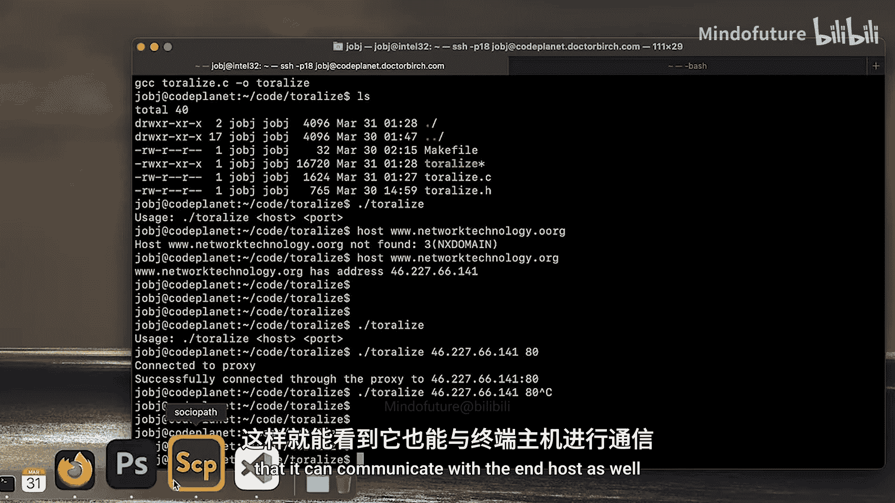

In the end result。So。Let's create。Another buffer。 that's cold this。1。Do512。Since it's only temporary。

 I will not。T。Would do it。So here we are successfully connected。And now I want to send something。

 So since I'm connecting to a web server， I can use the。

Head command just to grab the information about the Web versions and stuff like that。

 That's quite easy。Do。So I'm going to use the SM print F。In order to。Create。The buffer。But first。

 I want to use the map set in order to zero the entire buffer。So no， look of， I need to remember。

 I call it 10。And0。And the number is 512。And then I will do S and print F。

 And we are gonna put the result into。The string variable， the buffer that we call temp。And。

We won't be writing more than 511 characters。And what do we want to put there？So。Let's do。Head。HDGP。

えてす。And by。And。And on the next line， I will put。Hose。我问题。And if you wonder what these are， and is。

Sorry。That is the Windows standard for new land。So。This R thing is a carriage return， which。

Jumps down and goes to the left。Or it goes all the way to the left。 and the。And is as usual the。

L feet。Okay。So now， the buffer is。No， the battery contains this data。And then， we will just。

Simply send it。So， right。Yes。Come。And I'll do the string length。嗯。Like this。

And then I want to zero out the buffer again， or not the buffer the temp。And then。

 we want to read the。Results。So we read from S。Into。Temp。And no more than 511。Buts。

Then then we'll just print that。To screen。With a red glare princess like this。

 let's put it in single quotes as well。 So we see if there's something weird going on。

That's a good tip， by the way。Like if theres a line feed before the。

The data over something like that。 Then we will see it。Like this， so。This will be on one line。

 and this will be on the next line。

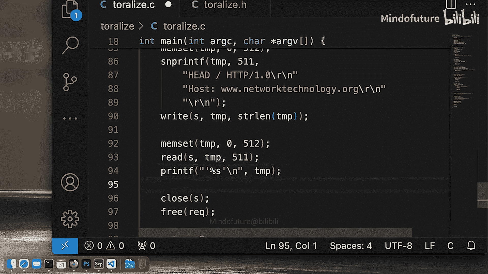

Can save。No， we will compile。And。Let's run it again。And this is the。Response from the Web server。

As you can see， it works。We are able to communicate through the tour network。

And if I connect to my Web server。We should be able to。Check the logs。And see what I P address。

The requests came from。Vlog。P奇。Here we are。Let's do tail。D3。Aes。スすと。Okay， so here is our head。

And if we grab this。I P address。We see that it's， it's some kind of German。address。

And we can also do。If we restart the tour server。So， we do。Et cetera。あ你。Toour the start。As route。Re。

Thank you。Then we issue the same command again。We did get the output， like before。

And if I check the logs。Once again。We give。Another I P address。对，是的。

And if we do and host that I P address。We see that this time， it's in the Netherlands。

So our program works。Fine， this far。But。At the moment， it's just a proxy a client。It's not。

Doing what we intended it to do from the beginning。You remember。

 I want to be able to do something like。Toour reize and then run any command。冷。Kur。

Against some I P address。And then， I want to。Intercept the connection。

I want to run this command as is， but I want to intercept the the connection。

That the actual program does。And。Run my code instead。 So it tunnels through the tour network。

 Any program that we want to run。So， we can do。Touralize。And put to anything。Here。We could do， like。

If we have a Firefox installed in the same directory。We could start firefox。Me Toized。

 and then it will be tunneling through the tour network。 And we could do Telnet or S H。

 That is what I want to do。And that is the next step in this process。It seems really advanced。

But you will see that。 It's quite。M。Quite a bit easier than one might think。

So what have we learned today today， you have learned how to create a socks version for client and use it in order to connect to the Tor network。

😔，And next time you're gonna learn how to create this。Ned a little too that I。Called Toized。

If you like this episode and want to see the continuation or other stuff in this channel。

Please subscribe to this channel and hit the like button if you think I deserve it。And。

Thanks for watching。 Thanks for today。

Welcome back， everyone， to today's class。Today， we're going to talk a little bit about something called X or。

So X or is an operation。You like you can do。Plus， and you can do minus and then you can do x or。😔。

But Exor uses two streams of bits。And it produces different output bits depending on the input。So。

 if you have。Two zeros。Then， the result is 0。If we have。A 0 and a 1， then the result。Is one。

 no matter which is which。But if both are one。Then the it is 0。So why is this useful？Well。

 this means that if we use this technique in order to encrypt something。

Then we can decrypt it if we supply the ciphertext with the same key as when it was encrypted。

 this is a very basic form of encryption that is only for demonstrational purposes。😔。

It's quite easy to crack with today's technologies and computer power。However。

 it's a good example on how to use Xor。And in this example。

 I will only make it so that you encrypt one single character。

And when you know how to encrypt one single character。

 there shouldn't be a problem for you to modify the code。So it can be able to encrypt any length。

But only one character in this example。All right， so let's begin by。Cre an X or dot C5。

And we will also。I have a couple of definitions we'll define。😔，The key。

Which also will be one character。And we will define what we want to encrypt。So。Let's define the key。

As。The character， X。Let's do big X。And then， we will define the。Clear。テ？As。The letter A。

 so we want to encrypt。The letter， letter A。Using the key X。

And we don't need a whole lot of includes。 I will just put the standard input output。😔，Ege library。

And in order for us to be able to see what is happening。

 I will create my own function called print cha。😔，Which will print。The character。 and the。

Hexedadeimmal value。And。It will also print。A text string describing what we are printing。

And this will just be a single print F line。Something like this。So。We will take the。Character。

And show it。あ好き。Character code。And we could do hexadeadecimal。But I think。Yeah， let's do hexodescent。

And it will take。Three arguments。The text describing what we are doing。 And then the。Character twice。

 So we'll print the actual character。And it hexadeimal representation。

And I will put a 0 x in front of it to show that it's hexadecimal。And let's走。Okay。

 then we go to our main function where we will do the magic， so to speak。

We will create a couple of sh， one for the clear text。Well for the key。One for the safe。Ccipher text。

Hard to。Write that word。And one from the new clear。Text。Because we will decrypt it into a new。

Variable。Okay， first we define the clear text as our clear text。Definition。This one。And。

We will use our print char。To print the clear tax。Before we do anything with it。

Then we will define the key as our constant key。And do the same。 We will print that on the screen。

And then we will do the actual encryption。😔，So， the cipher。Ccipher text。Should be equal to clear。

Clre text。エ orー？he。So this little cart。😔，carrot character here。It's is not the。

What you might think it is。😔，Sometimes we use this。😔，A carrot character。To do。When we do like。

X to the power of5 or something like that。But in C， the carrot character。

Is equal to the X or operation。Okay， so now we have。Create the decipher text variable。

Containing the encrypted text。Using the key。Now we want to print。The result。エックス？And finally。

 we will try to decrypt。😔，The text into another variable。And this time， well take the cipher。An Xor。

でき。So as you can see， the exact way that it goes forward。When we take the clear text。X or the k。

Producing the cipher text。We now take the ciphertex， x or the key to produce。TheCl text。

And then we will use our print char。Function。De print。Our nuclear tax。And that should。ジャスパウビーエ。

Let's compile this one。Oh， I did something wrong。I am't man。 That's not try。There有一个。Okay。No what。

Line 47。😔，嗯。I added parentheses， too much。So let's jump to 47。O。Outside of the sex， but I did see it。

On the message。Where is it。Ah， right here。That shouldn be there。All right。No， it works。🤧ううん。So。

 let's run it。Okay， so from the beginning we have the letter A as a clear text and that is 41 in hex。

And we have the key X， which is 58。When we combine them together with x or operation。

We get a cipher text with a hex representation of 19。And no ASI representation。And then we。X or the。

TheT backwards， using the cipher text and the key。And then we get a new clear text。

Whetherather letter A。41。So our code works just fine。Should be cat not clo a car。Okay， so we do。

Two definitions。We create a simple function in order to print out the results。

We set the clear text and print it。 We set the key。We print the key。Then we do the encryption。

Algorithm， so it to speak。Using clear text。X or the key。I'm printing that out。

Then we do it backwards， we do the cpher text， x or the key。

 and get the nuclear text and print that out。😔，So today you have learned all there is to the XO operation in C。

😔，Thanks for watching and thanks for today。What's up， guys。In this episode。

 we are gonna code our own。Encryption library。It is loosely based on the Arc for cipher。

But with some improvements， which makes it more secure。We're going to expose a couple of functions。

From our library。And it's an initialization function， which takes a key as an argument。

There is a encrypt function， and there's a D encrypt function。AndFinally。

 an un initialization function， so it's very easy to use。And let's get started。Hello， everyone。

 and welcome to today's show。😔，Today we're going to code our very own encryption library using the arc for algorithm。

😔，When talking about encryption， that is one of the more easy encryption I first to implement。

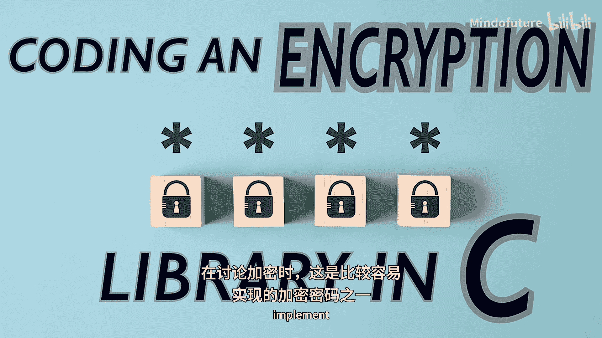

But it's a little bit bigger project than we usually do。

 so I will not be coding inside of the terminal today。😔，I will do most of the work through VS code。

So， let's begin by launching。An sociopath， SP client。😔，So， we will be able to。

E code live against the server。I will just go into my。I will put it in my temporary directory。

And I will create a new directory， and I will call this arc 4。Spread like this。So， the。

Algorithm is written like this。 R C4， but it's pronounced Arc 4。

 So I think that's a good name for the library。So I will simply create an empty folder。

And I'll right， click and open an editor。Then I would have access to the entire folder inside of VS code。

来 some and will。M my。So your plan。And。Clス onです。

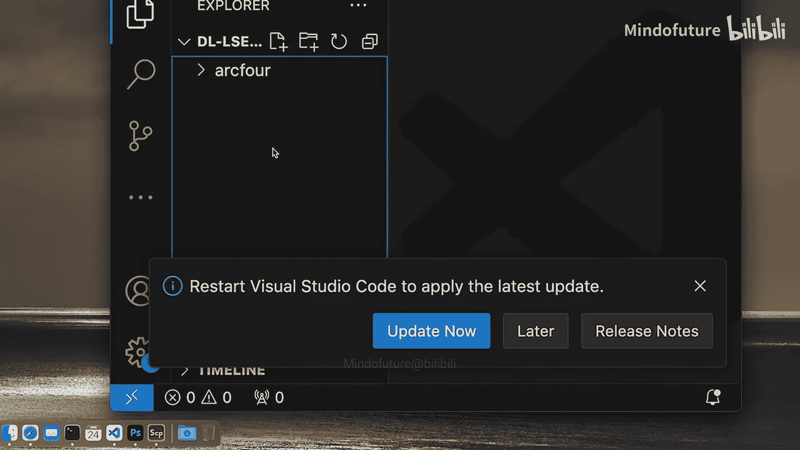

And I will also log into my server。And attach to my screen。 Or I would create a new screen， instead。

当にすげ。And as you。嗯く能。We will。And as usual， I would write a simple ba script like this。

Just so I don't accidentally close down this window and terminate the screen。

So let's go into my temp directory and go into my arc 4。And here we are， an empty folder。

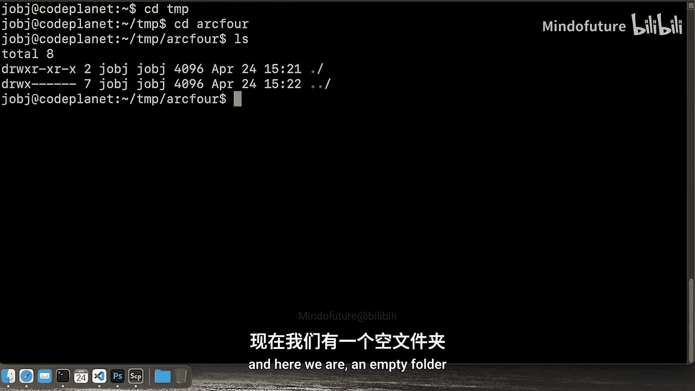

So what do we need？😔，嗯。We're going to create a。2 first。嗯。Or three， actually。First。

 I will have the actual code。 the arc 4 dot see。Nextさ。And as I said。We can see here。

 It's successfully。Updated。嗯。To the server。And we will also need a。嗯。4 dot H。

For our structures and includes and definitions and macros and such。

And to make our life a little bit easier。I will， also。😔，Create the make file。

Which is going to compile the whole thing。And actually， I will create a fourth file as well。

This is just an temporary file。 We won't need this file when the project is completedcate。😔。

But as we are implementing this encryption。It will be easier， if we have an example。Program。

 which we can use to try things out。And I will call this example， that see。

Because we are creating a shared library。So this library will be used by different C projects。And。

That means that the Arc4 dot C file will not have a main function。😔。

So this example that C will provide our temporary main function so we can run it。冇right。So。

 in the Mac file。I will simply。Define that is stuff that needs to be compiled。

So the first thing will be Arc 4 dot O。And。You write it like this。 So the file let you。

 That's the target。And then a colon。 And then you write the dependencies。 So this。

Fine will depend on arc4 dot C。Like so。And then you tab， and you write the command。So。

 I will do Jesus。で心。Or for。2。See like this。And I will also turn on。Optimizations。

At the highest level。As well as log messages。And when that file has compiled successfully。

 we will have an A。0。And then， we will。Create the actual arc for library。

So this depends on arc for dot。嗯。😮，And。诶。Can't really remember how to。😔。

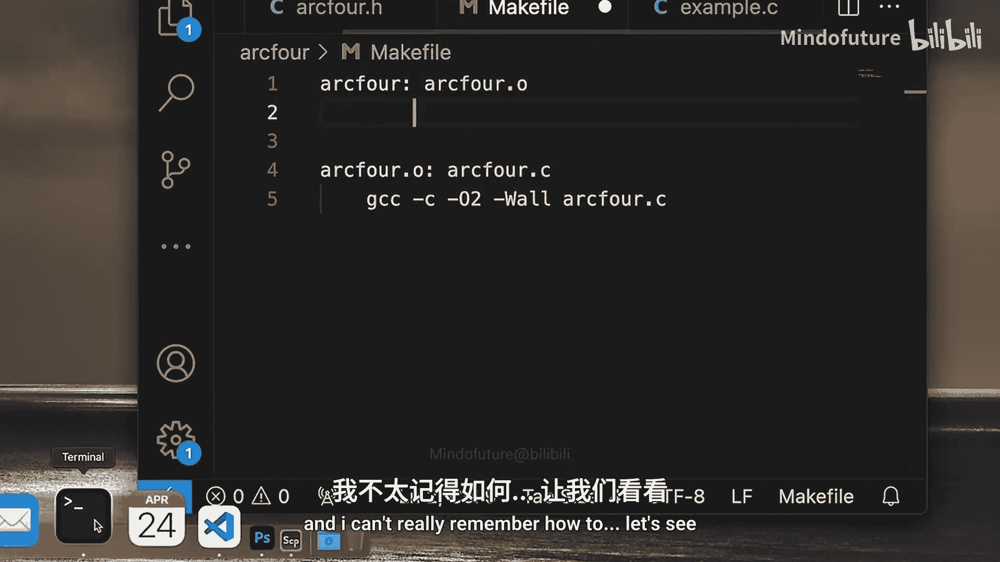

嗯。类似。All the flags necessary to create the shared library。So I will check how I did it in my toise。

Make5。<|OTHER|>And I will simply copy this part right here。

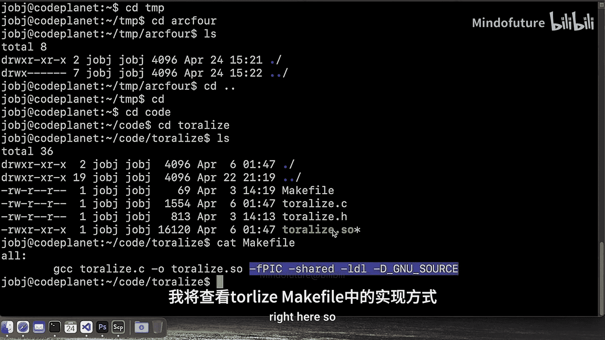

So。The will GCC。And we are compiling art for。The。Or linking， actually。

And the output will be called park。For dot FO。That's the extension for a shared library。And we will。

Bエ。Optimizations。And to log in。And then。This。Additional flags。Necessary。For a。Well。佛 share library。😔。

K。给我一个。So。After those two steps， our library is compiled。But， I will also have the。Example。对。Oh。

Depenent on example that C。PCC的C。相部的心。😔，And I will turn on conversations， as well。

And when we have the object file。It can compile example。W with me exampleだっ。

And then we simply do GCC X Blue dot O。但是。Example。よ。2。And it would also create a。Can。

Which seemed to removes everything。Besides the source fast。So。All of files。All SO files。

 as well as the example， binary executable。And then I will just tell the Mount makephile what we should do as a default when were on the command。

And I want to compile。二 for。An example。So this is our mix。If I didn't miss anything。

 I think we should be able to， let's just go into the term。😔。

ビ？而哭。And I will。Surface to my home。So the prompt won't be so big。Like this。And。

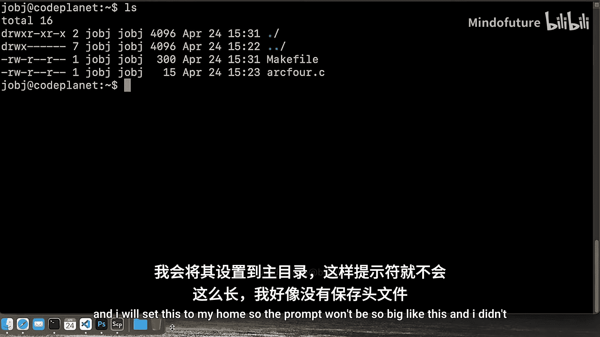

I didn't save the。The age child。I think。In the example。And make file。

There we go Arc4 make file。Okford at age， an example。So I should be able to run the make now。

And we get a reference error for the main， but it that all files should have been created。Yes。

 they did。So everything seems to be working。 Even the SO file did be。

Treated even though everything is just empty， source files。And if we do make clean。

We're back from where we started。Okay， that's a little bit of administrative work。

 but it will pay off when we need to recompile and debug。Our coat。

I'll close down the make file because we don't need to do much with that。😔。

And I will actually start with the example file。😔，Because。If we create the example first。

 then we have a kind of a road map to the different functions that we need to create later on。

So I think that's rather good。Where it is to earth。I'm gonna include。The are4。HO。当初。With age。

And inside that， I will have my red glare。Definitions。So， I usually start。

By putting in the Ely aisle， that would be removed later on because we're not going to use any of these libraries。

😔，But during development， I think it's easier to。Have all the usual standard libraries。

Readally to go。Like so。Okay， so how will this example file work。

AndI'm going to start by just creating function definitions。所微。

Do everything in the order that you should， even though this is a small file。そ。We do have an ink man。

With no argument。And that that'll be all for now。So A P A B X O maybe。

And I never seemed to learn where to find my curly braces on my back。All right， here they are。

So I will create， I will make this file a little sloppy and easy to work with。

 because this will not be a part of our production code， so to speak。😔。

So I will just do it as easy as it can be。For myself。So I'm going to create a couple of pointers。

I will have one for the key。And Ill have one for the。The source text that we want to encrypt。

I will have one for the。😔，Destination takes。And。嗯。I will have one additional pointer for when we。

Derypt， the encrypted。T。So， let's call this encrypted。Instead， and this deep。

That's a little bit more obvious。And I think I need to。Make this a little bit smaller。

 I hope that won't be a problem for you。Okay， and I will justify this statically。

So I will set the key to。And let's see。Something easy like tomatoes。 When you run this code for real。

 you should always create a real encryption key。So this can really be anywhere from8 bit。😔，22048 Bs。

 according to the standard。But this will do， as an example。And the text， I want to encrypt。Is。

A part of the Shakespeare poem。Shall I compare B to a。Sum。嗯。Okay。We will also need。To。

Before we do that， I need to define a couple of type definitions。😔。

Because I'll be using 8 bits in tears， and I will just。32 bits and possibly 16。So。

 I'm going define those。First。So， let's define。呃。We will do unfined。Surehar， that is an8 bit。Value。

And I will call this。😔，嗯Inで。It would not be fine， by the way。It should be a tough definition。

So a type definition is when you create your own type。

Everything you write is what the source name is。😔，And the last one is the destination。Okay。

 so the next type definition will be 16 bit。えイ。And that is defined in sea as an unsigned， short in。

And I will call it in 60。And finally， we need an8 bit variable as well。

And I will type if this as an unsigned cha in。嗯。Oh， sorry， I have done that already。

 The only thing we have left is a regular a 32 bit integer。😔，And that would be。Well。

 a regular answered it like this。Okay， so now we have our type definitions。

And let's continue with the example。Main infection。So we have the string that we want to encrypt。

 We have the key。We would also have。Yeah。A pointer。2。😔，A structure。Which I will call。A4。And。

I will call this pointer park for like this。So this will contain the internal state of the encryption engine。

 so to speak。And I will define this as a。ItHere。I will do Str。

I usually prefix my structures with an S。Yeah。That's a stylistic choice， though。So， S R 4。

And what will this contain。Well， we will， we will actually use the。Wikippedia page。

It's a very good Wikipedia page which tells exactly how to implement this encryption。

 not in a specific language like C， but with like pseudoo code。Okay， so。We have this。

 and now that we have the key。And by the way， we also need to。Size variables。So， let。Do。嗯行。ちしていい。

And what do we need， we need two size variables。😔，So， let's call those size。K。And size。え。

And I will just use this string length to define those。So。S K equals。It your learn。K。And this takes。

Equals S lamb。F。Okay， so now I have all that I need in order to call the first arc4 function。

And that is called。Let me do the function declaration。It will， it will be called arc for。一点。

Because it initializes the arc structure。So this will be of type。Or  four pointer。

And it will take two arguments。It will take。A key。えてだきて。Ifin。Ch。Let's use the rain gate。It。

 it's not really an integer because this is a string， but every。Every character is an integer。

It would be okay。So。In8。7。InBecause if I don't do it like this。

 if I do sometimes cha and sometimes in a。Then I will probably get this。Signedness。New wrong。

And I don't want that。て。And we will have an。嗯。6。For。おでき。And I don't need those。In that pointer in 16。

 right。Then we go back here， and we will set our arc 4 equal to。Part4 in it。 And we send our。

K L lower S key。Like so。And this is a function。That might fail。But。That's very unusual。 So I won't。

Care for that during this example program， but if you write a real production grade program。

Check if this arc4 returns 0。Because in that case， the malllo。He returned error。😔，Otherwise。

 we will get one of these structures back。😔，And then we are ready to encrypt。Let's。Asome。Printnce。

 as well。比你。Inし来。K。And I want to have a way of putting this to the screen， instantly。

So I will create a definition， so。Itちclockで。And I'm not putting this into the Arkford dot age because this is not something I need in the。

 in the actual。And result in code。This is just for convenience。So F will be F flush SD out。

And that basically flashes the standard output buffer so that if I do a printf like this， which not。

Which is not ending in a new line。 It will。And if this takes a couple of seconds to initialize， then。

This text will not be printed before this delay。Which is was kind of defeats purpose。So， I would put。

Ef afraid。Like this。And then， down the。Okay。And then， we will。Let's print out the。Input。First。So。

I will put it in single quotes。And。St it like this。 A new line。 And then an oh， an arrow。

And this is the front text。Like so。Then we do the actual encryption。So we will use our encrypt dead。

😔，Very blue。So and three。Dead。Equals。Ark for。Let's define this， first。So。

This will return a string pointer。But I will call it an88 pointer。And。It would be called Orc for。

Thank you。And it will take two arguments。1， which will would be an in8 pointer， so。

The string that we were encrypt。And。A size in the form of an 16 bit liteger。Like so。

Pretty similar to the initialized function。And the work for encryption works like。This。You。😔。

You don't。Need a specific decryption function， because if you try to encrypt。In crypted text。

 it will be decrypted。So then， it goes backwards。So with that in mind， we can just create a。Micro。

Which will be called art for。D crew。With two arguments。X1。And this will just call our for。And。

With it。And why。<|OTHER|>So it's not really necessary， but it makes it a little easier to use。

And in order to make this。Encryption function work。 We need another function called or for by。

 which produces one single character。Of encrypted text。So this will be an em8 and not a pointer。

 just the value。Now that we have our data types and our function declarations。You don。We can。

Coninue with the example doified。So the encrypted variable will be equal to arc for encrypt。

 and we will send in the。From。Text。And we will also send in the size of the text。Lets so。And。

This is a function which shouldn't be able to fail。

Which means that the encrypted variable will now contain the ciphertext。

The next thing we need to do is create a function which will make it possible to output the encrypted text in some format。

 because the。The encrypted text will not be printable characters。 It will be。

Any number of different integer。Values。And Im thinking about。Putting using an output like this。So。

One bike will be represented by two hexademal characters。Like this。Like this。 So this is one bite。

And then， two bys。Per group。And each group will be separated by。The space。Okay。

 so this this function。And will。It will not be a part of the library itself。😔，Only this exemplifier。

😔，So。It。Shouldn't return anything。And let's call it。Prim。Bill， because his binary data。

And it will take in an。In8 array pointer。Let's call this。It's not really text， but。Whatever。And then。

 we will。Have an in 16。For the size。で。And all we need to do is。Irrerate through the text。And print。

Those bites two at a time。So。How do we do that in the easiest possible way。

 There are several approaches， but I， I think I will just。😔，I would just create an in 32。

 as an iterator。And I will have a。嗯。Pointed as well。And I need to assert。Size。Is。Bigger than。0。

🤧The word is assert。The third is a function which checks if this predicate function。It's true。

And if this。iss。Not through。 the whole program halt。So it's quite good to use。

In situations like this。Both in this example file， because。おお。

It's easy and it doesn't matter really if the program exits。

And we can also use it in our production code in some places。

Because we are coding a library and the programmer should send the right arguments。😔，If not。

The program should hold， I think。Alright， so we need to go into this arc4 and。Inc。What's its name。

Its serve。At age。 And in order to get all the functionality we also need。Include。It number。

The switch。Like this。没有。down a little bit。 sit here。Okay， so we know that we have an input， which is。

 let's call it in。But we have an input， which is。Well， which contains something。

Blank is bigger than  zero。Okay， so let's do a look of them。 So for， and we will do。

Let's make this an in 16， instead that will。Work better together with this 16 bit。sizeize。So， let's。

And I want to make this come。Andこ。すぐ。Okay， so let's set I。To。Size。And P2。イプ？

We're going to continue the lie。As long as。I is positive。So I'll just put eye here。😔。

Because it will decrease every iteration。And it will。After a while。

 go out down the zero and the loop ends。And the P pointer will instead increase every iteration。Okay。

So， if。See。I need to check something out。So， the first iteration。Then let's say we have a string。

 which is 32 Bs。So， I will be。I will be equal to。32。And we will out to。2。😔，1 bite。Od。

Then it will be equal to。31。And we will output。😔，To木耳。So。乐。I think we could write it like this。So。

 if。I plus 1。Mmhm。别去。If I plus 1。Mduluous。wo。😔，TheThat statement is negative。So it's equal to 0。

In that case， I want to print F。TheSp。And in any case。I will。Print out。Ex additional value。5。To这。

2 digits。嗯。This is what we want to。Print of。I think this will be correct。嗯。So。

 this basically means that。If we are even。So if I I plus one。Is even。Then we will put the space。

And we will also use our macro。F。So， it will live。ItP this。No， we don't need that very。

Because we will end this。With a。New line anyway。 So that will flush the buffer。This should be all。

 I think。Unless I have forgotten something。呃。Let's try it out。So what can we try out。嗯。

We don't have all these functions， yet。😔，嗯。So。Let's comment this out。And this is well。And。

This is okay。And what should we print as an accept， we can print the key。😔。

So print that's actually not binary data， but it will work the same。So， we will print the key。

An S key is the size。自の。Something like that。Let's see if this comps， or if we need to。

Remove something else。你。A lot of warnings。Type de。Unfined。Expected before。Un。富恩神。

I have an empty struck。 That's probably it。Let's just put something temporary here then。

嗯。P。😔，嗯。

Maybe it is because of the position。Sometimes you， you need to do one thing before the other。It's这。😔。

嗯，Forgot to end the strike。

那个。C米可乐。Is it still a complainant？Type this answer you in。If we add our type def for。

嗯。F struck。 Does that error as well。Tin of stroke。Yes。2， for。It's not uploading， okay。

 I got disconnect。One good thing with the socialpath is that if you reconnect like this。

 you don't have to do anything else。 It remembers and continues to serve all of your files。

So that's good。 Okay， let's say this again。And this one。

And let's jump down a bit。でち人。And let's make it again。O，欢你。Poiner targets。Im personing。

Argument1 of printpin differ in kindness。嗯。Okay。So this is what happens if。

If I don't use my in a。Everywhere。So where did I not here。Let's just change this to and 8。

 and everything should be okay。

Okay， we're down to one screen of errors and warnings。G。Does it still。呃。

Seems like it needs a。Typecasts。Because the strings。Our generallin。嗯。Like these static strings in。

T of the code， they are generally not in。Unsigned。So， let's。ていう。タcast。In a。B do。Sa here。うん。嗯。こい。😔。

。Q。So the land needs it as well。

I could just make these strings signed， but then I would have the same problem in the other end instead。

 because the encryption standard requires them to be unsigned。😔。

So let's just typecast this as well in a。Like so。Do we use them anywhere else。

 except our own functions。Print， if shouldn't。There right。Let's do it just for the sake of it。嗯行。

This。

O。Let's try it again。At least we have very clear and precise error messages and see。

Did I go to far。

8。没。

Sk equals is0 save。

See。Where does it。A kids。

Higher up than the code。Rui。😔，嗯。In a star。And there we have it， okay。

That should be all right。我的Q找不到。😔，咩。What does it in the history。

Poiner targets in passing argument one of string lines delivery different。

 I did it in the wrong direction， okay。

That's kind of funny。So。Instead of in。It's its see。嗯。P。There。There。We should just have cha。

Because we have the as in8， but the。Functions we are calling。Re requires them to be。Regular。Stres。

So we assign our point。Okay， this time it should look a little bit better， I think。

平き君。Jump down a bit in May。Warning pointer targets assignment from Sha to end 8。It a un。

Differentiffent sound。Soer。嗯。She doesn't seem to be enough。

By doing this。It this way。Okay， let's do it the other way， then。I will undo。Until I see this change。

Like so。So now， all of these are okay。靓点。This will probably not be。 But here we can do a。

Conversion in the other direction， instead。

And this should be all。M clean。Jump down， make。 Okay， now we're talking。Warning unused variable。😔。

That's an annoying message。

If I don't want to use my variables， I don't use my variables。😔，But， okay。So。

 let's do something live。き肉そ。Equals encrypted。Reals。D次对。Eals。T equals 0。

Is that enough。Maybe I should end it with。

什么可了。

Operational key may be undefined。Variable as text set。That use。

So it wasn't enough to mention the key twice。This is only set。 and all of these are used。So。

 we need a。き。What about。From equals key。

けな。Estics。But that's an in。Yeah， I haven't used that yet because。

We haven't gotten that。Fur。These are only warnings， by the way， but when I try out my code。

 I want to remove everything of the sword。So which is this， This is the。してる。

So we will change the key later on。Let's just do。S key。Be close。It6。衣裤。0ero。No。

 it should be completely。

Warning free。I believe。Lo， one more。Warning unused variable or for， okay， I haven't used。

I can just come and tell it out for now。

We cleaned me。Okay it， finally。Let's see if this works， as intended。AnExamp。Okay。

 so shall I compare the to summers day， and then I am showing some of the key。But I am showing。

Half a group here。And half group。Here。

What will happen if。嗯。If I just do。

唉。Yeah。Okay， milk looks good， it prints out。In hexademal characters。Inite form method group。

Very nice。That means we can then begin with actual encryption code now。

Finally。So let's go over to the a for。ロ点チ。And begin working on our。Structure。

 this will contain the internal state。Of the。Yeah。Of the encryption engines， so to speak。

So let's go to that wonderful Wikipedia article。So， art for Vi。And I want the English speaking。

 Wikipedia。AndLet's hide this and make it a little bit bigger for you guys。てさん。😔。

Let's use the whole screen。I will probably be looking at this， anyway。

So there is a lot of text here and some of it are warnings that this encryption standard isn't secure。

But。I have read through all of that。And I'm not sure if I agree， actually， well， this， the thing is。

They claim that the output。Of the encryption。嗯。Is distinguishable。To when compared to purely random。

By today。And that could be potentially be used to backtrack and crack the encryption。

 and it has indeed been used， for example， the Wifi encryption standard web。

Used exactly this encryption with very small keys and a special kind of。Seeding algorithm。

 which they were they were able to crack it in the wild in a couple of seconds。

But that's only in combination with a wet technology。

 And there has been some talk that in combination with the TL S。The encryption standard on the web。

It's also not safe， and it's not safe。 The first couple of bites， which it produces， is not safe。So。

Since we are using this encryption。Firsthand in our own code， not together with anything else。

And I will also create a。Mechanism， which will disregard the first， like 500 million output bytes。

Which will stop all the other cracking techniques。 So I think with a big enough key， which is in。

Randomized in a secure manner。I think our4 is still secure。O。So I don't。

 You don't need to read through the whole。X bangang。But those。Gray information boxes。Are very good。

 so there's two steps。Step  one is what I call the initialization of the crypto。

 That's when you only take the key。And you prepare the internal state of the。Enncrypto the engine。

And this is what you do。And then the next stage， which happens every time you need to encrypt。

One byte or more exactly produce one by of key stream data。So then you do this。So， let's。Start drag。

 No， let's begin by creating our。Aforstruct， I will zoom in here a little bit。

Not that much temporarily so we can have both on the same page。嗯。So if we look through this。

 what do we need？We need an 32 bit， or we need an。It's bit in。Which will go from 0 to 2，5，5。

We will need a。An array。Clled S。Which will be consisted of。8 bits。Well。And。256 of them。

Then we have the J value， same as I。When is it。And。Then we have the key。And let's basically it。So。

Let's。Summarise。We need。Ying。DidI。In a。A。Je。And later on， we will need a case。 So I'll put it here。

And then we will need the array。 So int a。Yes。And 256 of them。So， we have I and J。We have the K。

And we have the。Do we need anything more down here。We need temporary variables as well。

 but then I won't put them in the structure。So okay， this is。

 this is all we need for our own structure。So， let's begin writing on our。嗯。

Let's begin writing on our initialization。😔，Function， and this well， let's copy this。The whole thing。

2 lets。Ced over。Let。Include our park  for dot H。There's something weird going on with the cap's look。

InTude。嗯。I wonder if you can disable。The caps look。I never use it anyway。 I use shift。Okay。

 let's see。 include our for age。And then， we will。Do the initialization function。

So it will return an arc for structure pointer。😔，And。The first。Argument。Is the key。

The second is the size of the key。来一首。And the first thing we need to do is allocate。Space for the。诶。

For the actual structure。So。I will create。Point a point pointer for that。

 I'll just call P because were gonna reference it quite a lot。And P should be equal to。And。

It should be the size of strike。Yes。不图。So the sides are abstract that many bites of memory， we shall。

We shall allocate。And here， I will。😔，Do if clothes。So。

Let me just check the return values for my look。😔，Man to no men。3 mirror。

So I know it returns the memory address， but if it fails。Inter。They return now， and they set am。

 okay。So， let's just。Do something like。The Sir。search。P安。在日本。Then it will check if this。

Has errors out。And if so， display。An error message。 and quit。

Because if you can't allocate memory for our structure， there is no point in continuing the show。

Okay。So now that we have allocated our structure。Now I will just do this。And I will work。

In the following manner。Let's close this stone， and。Change up these size a little bit。And then。

 I will。Taste this in。And may。Block comments out it。 I think it's command this or control this。Mmhmm。

Let's do something like this。annoying， I never seem to learn this code for Mac。

 I know all of these different things on my PC， but。It's not。Same。うまき。Well， well， this works， too。

Okay， so now I have in the comments what needs to be done。And then it will just do it。

But before we begin， I want to zero out all this day。Variables。So。Let's。Do something like。No。

 let's just do simple。Simple thing。嗯。In。嗯异议。い？And4。X equals。S人。It's less than 2506。Plus plus plus。

And we want to。テ the。PS， S， so that is the U。This gray。I want to zero that out。So， P S of x。Equals 0。

And then I'll just do P。I。le频。便议。E plus P。K equal equals 0。I like starting from0， instead of random。

Randomness。Okay， so the first thing is this loop right here。Will iterate through。0，2，2，5，5。

With this eye variable。And we will set S of I。To eye。Pretty simple stuff。The code will look。Kend。

Difficult， though， but。It really is。Okay。嗯。没。Okay， so。For。P。By。It equals0。And。He。

I must don too5 sick。B对。And P， S。Oh by。Es。呃。Okay the system。So if we。Do one thing at a time。

It's quite simple to do this， actually。Can't say that for every crypto。 And then well set J to 0。

 But we have done that already。So we will jump into this s， and we will。Let the。嗯。

The I variable do another。Identical for loop。So， let's just copy this line。This。And what will happen。

对。We need two temporary variables as well， by the way。😔，So we need in。8。

 I will call them temp 1 and  temp 2。And I want to zero them as well， from the beginning。

So let's chance。う分？Equals temp equals0。Like so。Okay， so what will happen inside of this loop。

 Let's remove the。Things we have done already。Okay， so this is a rather difficult line。

I want to break them down。So what's the first thing that happens right here？Well。

 the parenthses is evaluated。First。So， let's say。MCK I。Mud。😔，K类。Actually。

 let's evaluate this first I mode key length。So，11。Willll be equal to。嗯。Qin。So。It could be key of I。

P O I。No， remember。We're here， right， So I mody length。SoP。A I。Modulus。Kling。So， that's the size。

Okay， so this part is okay。Now we can take the rest of these parentheses one at a time。So。P。y。6。

10 2 equals P J。Plus。P。Okay。Okay。Plus。K。😔，嗯。And then the stuff we evaluated right here。So key11。

And then we will set P。J。YeahSo now we are doing this part。

So Pj should be equal to everything in this parenthesesis， which was temp 2。😔，And mode 2，5，6。我这个。それす。

Like this。And finally， we should swap the values of SO I and S， O J。So， let's set Camp 1，2。PS。No。

 no just。A。We need to change those occurrences to P。嗯。P议。Okay。There is a lot that can go wrong here。

 as you can see， you need to be very precise。So temp。 and that is why I。

 I could do everything in one line if I want to， but it's very error prone。

 and that's why I break it down with these temporary variables。😔，So， temp 1 is equal to。Peter。😔，PS。P。

And can2 is equal to。PS。P。Jin。And then well just swap them。S。😔，皮音。Yeah。To。P。哎。Equals， and。

Here we see that temp 2 equals this。Temp1。Equals this， that Im working with no。

 which means it should be equal to temp 2 instead。And then， we have P S。Of PJ。

Which is currently equal to。Which is currently equal to temp 2， and it should be。2，11。And that's it。

The code is very difficult。😔，To read， but it's quite simple。

And it's quite easy to follow it step by step。 If you break it down into smaller steps。And that is。

 basically it。And I'm going to do one more thing， though。

 because if we go back to the Wikipedia page。😔，And we go to the next step。We see that。

Theres zero out。I and J， And then。They have an endless loop。

Which happens every time you encrypt the character。We have a function， which encrypts a character。

Which means we only have to worry about this。But this part。We should put。Here。

In the initialization function。Because。Then， we can just do。

Several consecutive calls to our orfurbeite。Thank you。So P I equals P of J。Includes 0。

Like so。And then， we just return。P。I think we did it， right。If we go back here， and。

You move this line。And。Put this line。对。Then， we can print。Instead of printing the key。Let's。😔，Print。

Let's print art for。Yes。So the initial state of the。Initial state of the。Enccryption engine。

And I will put it。One of these on top， as well。So， we may see the difference。No， sorry。

 Can't do that。 We haven't initiated last yet。

But O。Let's see what happens。Clear， jump down a bit， make clean。嗯没。Okay， couple of errors。

If we go to the very beginning。Warning suggest parenthehees around assignment。Used as truth value。

Well， I want to use it as a truth value。I don't really care for warnings like this。

 if I want to code it this way， I will code it that way。Implicit decorational function。 As P， or O。

And。Here， I forgot something。And。Workk for as no member。Named。

So a couple of small typos。If we begin in the H file， I guess this is the problem。

IThis is biggest or smallest。It is a small as。 So why doesn't it have。Remember called。Did a。O for。P。

That's weird。 Maybe it's something because of this。We should check it it。I's less than 2，5。So。

 that was an easy one。And。What is。A third pi。

Where is that located man。Pリ。Soう？P2。Okay， I need this Can source thing。

Let's try again。Very clean。don it clear and。2。O。😔，电机。A jackあの。Type name。

う。Unknown type name in8。I put this。Before these。Let's move。So。I don't like I have to break this up。

 but。😔，What can you do。

This is just a warning error。 I undelared， okay and。Ler，18。

嗯 wrong费。一起。So， this should be。P呃。And this should also be P。Ely。

K。Was no， I a for undeclared。No， the problem must be higher than this。Ark for undeclared， in example。

And point their targets in passing。Look for in。Key。Shar star。That's weird， didnn't I。

You my。In8 for that。Function declaration。嗯。Let's check it out。So in the。K。嗯对。Ser。Sp this spread。ょがいい。

受け？Stunction。In 8 inches。し？Well， very assist。 Let's check。

So。Expected in。Ory key。Poin to targets em passing argument1 for in need differ inness。

Because this is a cha。India。Ki。So， he is。

Soう。Okay， let'。Take決て。我六边。3ty， okay。So， it's currently a。See。Should be in。Pod。So。Okay。

 let's see what we have。

。<|OTHER|>Still a warning about this one， but that's nothing we can do anything about。

A different reference to you a for in。We need to link that。我。It's just。

No。Going to the make file。And then。Let's make it easy。I will just do。えう。For。对。

So as's one of the interest arguments。

うき。Clear jump on a big make and know if。Still doesn't compare。Undefined reference to orrc for India。

What did you do。Gcc orrc4 dot S o。😔，嗯。Do do I include it。

你还得饭呀。😔，I I age。Include oak of age。O for英。😔。

AndD ref。Okay， for the time being， let's cheat a little bit。 I will fix this later。 on。

 I don't have the patience right now。

So。I'm gonna go， and。When we compile。Final program。 We do Arc 4 dot O， instead。

来生。😔，Can。Okay， this time it was， we probably need to explicitly export。え。The functions。

 when we use the。The shared library， I will dig into that in a little bit。

 but now we do have ourselves a binary。So， let's try it out。That doesn't look。B good。

To entries the F。没了。😔，Arum location。Ttraest trace。Reentializing encryptions。

How did I write that if close， by the way？😔，Maybe I reverse the conditions。See。If P look， okay。

 this should be。The other way around。So， if。P。

Alright。你 clean。くき。We run example。Did it remove everything when I did make clean。Look for C HC。Yeah。

So how come it freezes。

Moc size ofstruct。二伏。If there is。Yiru。😔，The sew。Po。For a。😔，Equals 0。Ex less O。2，5，6。

I think that zero means that it's some weird。Number format。嗯。Okay， no errors at all。

 no warnings even。But the same outcome。What is this， Do we have an endless look upon her hands。

It's probably the only possible。

颈人。So， P equals 0。Well。PI。It's less than 2，5，6。m。Maybe we should do this。😔。

With a little bit bigger structure。These could be in 16 since。

We're probably overflowing that。A to be。Very部。

So that wasn't the case。4 x equals 0。 Then what is x。X is also an in。诶。

So that should be the same problem though。

There we go， finally。Okay， so。This is part of the internal state of the， of the encryption。 Okay。

 so the next thing we need to do that is creating the arc for byte function。

Which will create one single by。嗯。The key stream and the key stream is what we will use。To encrypt。

And to decrease。Stuff。So。レつ。Begin。I will have in 16 with。Temp 1 and temp 2。Just like。Before。

We do need an argument， by the way。You need to。Attaach the。The structure。

So let's alter this and put in the a for。Star。So we can have access to the internal state。😔，Oly。

En encryptryion。And just like before， I will go to the Wikipedia page。In this time。I will copy。😔。

Thisper。So。Inlish。S code right here。They use a word loop。And they look。As long as it。

Generating output。But。Will not do it like that。Instead。

 this function will be called each time will produce one bite。So we don't need this though。

That will be handled in the encryption function。So。Lets。

Do it like before and take one line at a time。So。Well do P。Iいく。And then he。诶。Plus。What this one。

And we mod it with  2，4，6。First one is done。They would do。Similar with the J。Her。SoPJ。一哭。以及。Plus。Pf。

Oh。P。嗯。So we just replace the variables with our。Variable inside of the structure。And we mo this。

With 2，5，6， just like before。Okay。Then， we will。Swoop the values。So this is like we did。

Previously with the。The initialization function。So I will let temp 1 equal P S。Of。P等。

And12 will equal PM。OP。主。Like so。And then， I will just。うめす？Yes right here。嗯。

And then it will just do P S。Of。P。Itqual something。And P S。OP。いよ。Okay。PS， O P， G equals something。

Okay， so。Temp 2 equals the J part。Which means it should equal the I part。This equals tip 2。And。

The PG。雪地裤田破。😔，That good。And then， this one is done， as well。Why did it mess up。Yeah。Indentation。

呃 never。O。And then we have this T variable。That is their version of our temporary variables。

So we'll just continue as before。 So temp 1。He close。え？In the parentheses。P。嗯。P。系。

So this is not really a spectator sport sport。 I hope you。Don't find this too boring。

 but we're almost done。Plus。P。で。嗯。皮衣。接音。And then we mo it with 2，5 C。

And then we use the K variable for the first time。So， P do K。Equals。P给。Yes。嗯。Can播。

And this is the final。Output。But。As we can see right here。So。Let's take care of these indentations。

And then at we the end， we just return。P。Okay。嗯，对。And then we have our arc for bite function。

 which is the most important in this entire。Project。So， the next step。

Will be to implement the arc for encrypt。And this is quite straightforward to do now that we have a。

Yeah。Ok for。GoodBye， Thank you。So。See， we need one more argument。We need to include the。😔。

A for stretch。是。Or do yes， we do。Ark for star。When we go here and do。Okay for。皮。And in a。

This will be the。嗯。What shall we call a thing we need to encrypt。The clear text。

 let's call it CT for clear text。And。In 16， this is the。size。Size of the clear text that we want to。

Create。And we'll return this。As a。Well， as a char buffer， a regular string， actually。So。

Let's create a in 16。Which will hold the amount of memory we need to allocate。😔，So， let's call this。

Mmb size。And。We will need。Exactly as。Much memory。That's this size。Plus1。 Okay， so we。

Don't really need to。Because when you encrypt something， if we encrypt。ABC。The resulting cipher text。

Will be something like this。 It will be the same number of characters。

Which makes it quite convenient for us。 We don't need this variable。Instead， we'll just do。

Let's create a variable， first。So， let's call this。嗯。Saer。And let's call this clear text。

 because both will。Abbreviate， to。Ct。And we can't mix those。So a't a sorrypher take。And。Safe or take。

equal to。うん，す。Reello。And we will。Size。Plus work。Size should be enough， really。

 but I like allocating one more， just in case。Well also need something we can use as a comb。

Let's call this。セテ。We will do a full loop。Where we set x equal to 0。嗯。And we。

 we're gonna live as long as。It is less than the size。And X plus plus。

And what are we going to do at each iteration？😔，Create a。Let me see we need this。Okay。

 let's do it like this。So。Safe for text。Okay。Will be equal to the clear text。Oh。

And then we take this symbol。and。Some people。usually mix this up with。The power of。

But this little symbol in sea means。Exor。So， Xor is。The binary function。Like， do you have。

 if you have two zeros， the result would be 0。If you have one。10 and1。When。And a one。

The result would be one。If you have a。S row and one So the other way around。It will also be one。

And finally， if you have two zeros。0。So that is what x are。It's usually used。In conjunction with。

The key stream。That a stream cipher， like ark4 produces。So here we will just call arc 4 by。With our。

P。And that will return 1 B。Of history， which we will exhort with a clear text。

And that will produce the cipher text。嗯。Lets。To。An error check here， as well。So， if。Sopher text is 0。

Then， we want to。And。E Sir。PO。嗯。Aban。来首。And if everything goes well。

 we will simply return our new buffer Cyphert。Quite simple。Straight forward。

Incscriptryption function。And we need a decryption as well。😔。

But that we have already defined because it's the same function。😔，Just that we give it the。

Decipher text instead of the clear text。And the key is the same。 So basically this。But iss the same。

Okay， so that is done as well。And before I forget。Ci。一个披一裤。😔，So we can take this back now。

And we encrypt the。Decl tax。And we print out。Ecrypted。嗯，是。This should be the。さされた。

This should be the encryption。Because this time we don't want to check。

In the S variable in the structure， we want to see the actual encrypted text。嗯mm。Yes。Okay。

 so after we have printed the text， what do we do？Doing。Just。Use the decryption function。😔，No。

 we can't do that because。In order for everything to be the same， we must uninitialize the Arc4。

And we need to re initialitize it with the key， again。So we start everything from scratch。

 and then we can start with equipped。Otherwise， it won't work。So， let's create our。嗯 in。Function。

 as well。And。That can be avoid。Ak for， let's make it easy for us。For the time being。

 because there's only one thing we need to do at the moment。When we。嗯。When we uninitialize。

 and that is to free the meorial allocation。So， let's define arc for and。嗯你。Oh诶。As。F。

I will also need to find。Let me just do it。First， Googling。After。Sport。S shirt。えと。不去。

Because there's a special string we need to use to export。The functions。Let's see。This one。So。

Let's make a definition。We define。A keyword named export。And it will be。The same as this。

So all the functions that we want to export。Like。The aquifur back function。

 we don't need to export that because the M user will only use the encrypt and dec functions and the in。

So。We put export。Before this and before this。See。We need to do the same。Here。X。And not this one， but。

one。你生。😔，Okay， so that that is done as well。Now we may continue our example。So。We have printed the。

Be encrypted。Sts。Now we're going to uninitialize。So， we do a for。嗯。一。On the arc for pointer。

Then we repeat some of the steps like before。So。It's complete desperate。There we go。Let's create。

Willow be。So we copy this part。ここいで。Okay， something like this。 and let's。Put the arrow 1 to，1 to。对。

Instead。Look as we initialize。And we need to change the order of these。

Because we need to decpt this first。So， it's initial。No， we will create。Our decrypt did。选第。て。

Be quote。And we will use the decrypt function， but as you know， it's the same。

The only thing we're going to change。Is the。From here we had the clear text before。

 now we will do the cipher text。😔，Which we give。From this。Ecrypt did。So。😔。

Where were we decrypted equaled？😔，And this should be。And。嗯。And everything else is the same。

 And this should be decrypt。そ我。で你。Do you need to print the battery。Okay。

 so if we have done everything， correct。Dg。In encrypted。

 the decrypted text should be exactly the same as what we heard from the beginning。So we take text。

 we encrypt it， and we decrypt it back to there。Start， so's see。He。TheSa。

We哋。クリン。Jo down we clear， and we do make。Okay， not a lot of errors and warnings。

Lets start from the beginning， error T unde definedfined size。Plus tea。54 in Arkford do C。😔。

54 Cypherex。Size plus  T plus for1。

To be this world。K。More errors。Let's do make clean， first。うめき？嗯。Wornning this foreclos does not。😔。

Gard。For。😔，嗯。Equal0。Well， x is less than size。X plus plus。Equals 0。X is less than size。Plus， plus。

That shouldn't be a problem。This the doesn't card。This state。Return safe。

But the latter is misleadingly inem， okay。So it even checks my indentation thing。

But sometimes that's good。 actually。 I have corrected errors in the past， because of that。😔，So。

 let's see what。Sas。Okay， it's this part。Let's move it here。

We make clean。 We go down。Clear and in make it。Okay。

 passing argument1 or offering encrypt from incompatible。😔，こイて。退。😔，Ark for encrypt。From。Okay。

O for and。Erypted equals are cool。From。T is it。This。Okay， we probably need to type cast this stone。

But it worked before never mind。イプ。In。ちっと？きたた。Do you have any more occurrence， so the same。Deryptted。

嗯。Okay， let's try it。The clean。真明。Our fries from incompatible point or type。En treateded equal。

<|OTHER|> waitai a second。 I forgot to。Attach the structure。

Great。We did change the signature of that function。So where were we。The Creek。

The first argument should be。婴耳服。😔，Like this。The same with the。地壳。So。服。

And we need to add a variable to the。In macro， as well。So， X， Y Z。Xway。异。乐搜。

Let's try it。V can。いう？Ba。ううう。And we have this signness problem again。So， encrypted equals。For。嗯。

C。Enryed how did we declare encrypt。Okay， let's move this to its own instead。第一。Derypted as well。

 I think。So， in a。这个第议。

你没 clean你吃呗。Okay， global there。You know the O， thats their temporary assignment。

We don't even need that anymore。😔，So let's just remove this part。And this。As well。See。

The clean。cle。Okay， it compiled。Let's see what happens。Okay， initially say encryption done。

And then it shows the string that we want to encrypt。😔。

And it shows the hexestimmal version of the encrypted。Okay。Then we reinitize。

 we feed it with a cipher textex。😔，And we。And up with the same string as we had from the beginning。

So， everything works。The only thing we should add to this。

That is。TheRemember when I talked about the。That some people。

Think that the the ark for encryption is lost。Safe， one of the biggest concerns was that the first。

Like。😔，Thousands of。Were millions of。But。Its it not。Good enough， so to speak。So we need。

 when we initialize， we need to like。I call it to bitewash。We need to bikewa away the first， like 50。

We're 500 million。嗯。Of these。Yeah。So， let's go into our。Enccryption function。No。

 our initialization function。This one。 And I want to create。In 32。Which I'm gonna to use as a。Oh。

I' going to use it for a full loop， basically。I don't really w to call it I， because that makes it。

Interchangeable with this PI。So， let's just call this。C for count and and for number。And it good。

And let's go into the。Let or4， and we create a macro for this。So， we deferred。Ak for。唔系。Wass。

And we need a。We don't need an argument， actually。And what we're going to do。By the way。

 we do need an argument， Let's。Take the variable for the loop。 at the argument。

So the only thing this macro will do is a for loop。Where we go from。X equal 0。我也。X is less than。嘅。

Let's call it。W it worse。Cd。不。外脱鞋。😔，That's cool it。Emps。So this is， these are millions。Of。Iterations。

So x is less than M S times1。1，2，3，1，2，3。And I plus， plus。 And the only thing we need to do。Is okay。

 we need one argument。W。The only thing we're gonna do， Let's do it on the next slide。

We will call arc for bite。With the。Structure。Or pointer of the structure as an argument。So。

Basically that we will call this， which it it will generate about about。And each time it loops。

 it will do that。😔，But we're not gonna do anything with that bite。

 because all we need to do is getting ahead in the。Well in the state， so speak。

But if we do it like this， then GCC will recognize that it's redundant and it will as part of the optimization。

 it will just remove this。😔，So。We will need to type cast this。To something called。Vololaed。In the。来首。

And that basically means， in this context。That the GCC should not optimize it。Okay。

 so let's put this as part of our initialization。So。

When we are done with the rest of the industrialization steps。At the end here。

 we will simply call the。A for。W to。And specify our variable for the iterations。

And the name of our structure， which is P。Like this， okay。And if this works， we should。

See that it takes longer when we run this initialization a couple of seconds。We also need to define。

The aims。So how many million durations should you have， and I want 500 million。😔。

Think that ought to do it。If you think it takes too long when you run this。Try changing this to 2。

50 or 100。Because I have a quite fast CPU， so。This should go quite fast。

And we save everything。And hopefully， we haven't introduced any additional errors。你 clean。And we。嗯。

你咩。Yes， we did， okay。What does he say， Okay， I plus plus， that's wrong。

are we here。So it should say。X plus plus right。

Let's try the。We can。我头边片因美。It compile。 That's really。Initializing。And as you can see。

 it takes a couple of steps。And then it does the same as it did before。Only this time it's。

Probably safe。As long as we have a really good encryption key， which we don't at the moment。

At the moment， we only have。In this example， at least we only have the。The word tomatoes。

We should randomize A。Yeah。2048 bit。诶。Key， if we were to use this in the world。

But everything works exactly as we intended it to。 So we have successfully implemented the arc for。😔。

Crypto。And we have turned it into our own。😔，They were very own。Library， which can be shared。😔。

Between different applications。M字。When I create。And。A project for transferring。Early crying fails。

I will use this library for that。So then I will show you how to。How to use this library in your code。

But I hope you enjoyed this， and。Don't forget to subscribe if you like this and want to see more。

 there is a lot of advance to see videos coming forward。😔，So don't miss out and stay tuned。

 Thanks for watching。 thanks for today。

。The first thing I want to do。Before we start with the actual encryption tool。

Is we need to install the library。😔，So how do we install our own library？

Well， let's go into our。Diiry and。Lets。Alter our make file a little bit。So， if you remember。

The ultimate target of this make file is to create this arc for SO。😔，However， I'm gonna rename it to。

Lib art for。So because it will be easier to use it。😔，If it has the correct naming standard。

I will also have to check what。The correct library it director is。

<|OTHER|>Before it was always user Li， but now at least on my 64 B Linux system。It is。This one so。

You need to add this X86。It it true。So let's grab this。😔，And。We also need the include directory。

 but that's just user include。😔，As usual。I think。Use to include。Yeah。So。Let's create two variables。1。

 which is gonna be the。In机。And I will put you， Sir。Include。That's where we put the H field。And then。

 Lib。That's where we put the library first。So when we have compiled Lib Arc for dot S O。

Then we will copy lid。嗯。For。都て so。To the。Let's see。你嘢。Live dear。And we're gonna a cup big。嗯。For。

The age。To our in dear。Like so。<|OTHER|>And then we're going to run the command LD Config。

 which will update all the configuration files necessary for the library to work。Okay。

 let's try it and we need to run this as a route because we don't have right permission。

To that directory。So。Let's begin by doing make clean。嗯唔知。Okay， by the way。

It will be better if we create a new target。😔，Which well call install。

And let's grab these three lines and put them here instead。So in this arc4， we compiled the actual。

Library， and then we do make install。As its own command。wo。😔，Install it。So make clean， let me choose。

So， make clean。And they make。And finally， sure to make install。Okay， no errors。So， let's go to。

The directory for today's program， I'm going to call it。😔，嗯。うんF。And I'm not going to。

Tell what the FS stands for， but the E stands for encrypt。

 and that's because I don't want to spoil what the ultimate end with this project is。

 and I'm going to tell that in a later episode。So。Let's create a。Test file。T to see。

I we'm gonna include just the standard aisle。And we're going to include。嗯。

We can include our own arc4 do8。H and we use these angle brackets because now it is installed globe loan system。

And then I'm will just create an empty。Main。Which returned 0。So basically， I just want to see if if。

Compiles。嗯。Okay， we need to。Let let's run one of the functions in that library。

So what do we have we have。嗯。别估这事情。そも gives。呃。哦。So。Let's do。O for in。😔，It takesて。

The key and the size of the key。That's right。So。嗯。嗯。Park for India。And。嗯。Ki。

And the size of the key invite by so5。This should work。And let。Cas this。To a volatile。

So let's cast this tube all time。え？Arc4 pointer。And that's basically just so the。

<|OTHER|>This compiler won't simply ignore this line because we don't do anything with the return value。

Okay， so then then we first。Compile it with。Did I see so test。よつ see。And we get the object file。

And now when we're going to link we do GCC。Tested O， H， O text。It weird。

If we don't add anything else， we get the error that it doesn't find or for in it。😔。

But this is globally installed on the system， so all we need to do is add dash L。哦。错了。And it comps。

And routes。Great， so now we have。Installed our library。Okay guys， let's end there for today。

And we will continue this project another day。😔，Don't forget to like and subscribe。

And thanks for watching and thanks for today。

Sup guys， welcome to today's show。Today， we are gonna answer this question。Y 7，5，5。

You have probably some used the command change Mo 755 and the name of a file or a directory。😔。

But what does this 7，5，5 meal in detail。This and more we're going to talk about today when we are discussing Linux file system security。

。

And this topic will be divided into the following different。Things we are gonna talk about。Fine。

Permissions。And that also is applicative to directories。

And is a huge part of the Linux and Uni security。 We will also discuss the different。Target。

That you can set these permissions for。And we will also。Discuss the change mode command in detail。

 how to use it。And if we have time left， I will also mention the change on。Command。Plus。

 I will be teaching how to。View permissions as well。

 So let's start with the different permissions that are available on a Uni and Linux system。So。

 first and foremost。We have。Read and read is what it sounds like。

 If you have the read permission on a file， you can open the file and read its file content。

If you have read permission on a directory。You may list the content of that directory。

 all the file names。😔，So， read。Has the。Character flag of our。

And that is important when it comes to the configuring of permissions using the change mode command。

And also while viewing the permissions。But there is also a numeric。A representation of left R flag。

 So for the read permission。That is number 4。 And there is also a binaryer representation。

 but I'll get back to that in a little while。Then， we have the。Right provisions。

And that is a W as a flag。And number 2。In the numeric representation。So what is the right provision？

Well， if you have the right permissions on a file， you may edit the file。

 alter the file contents and save the file。You may also delete the file。

And if you had the right permission on a directory。You can do basically， anything， almost。

You may delete files， you may create files。They rename files。But there is also a third。

Very important permission。Which is called。Accs。And that has an X in the flag representation。

And a number one。In the numeric representation。So what does access mean？

Read and write permissions are quite similar for directories， and for files。

But access differs quite a lot。So if you have the access permission for a directory。

 you may enter that directory， you may access the directory。

So basically it means you can C D into the directory。If you only have the access and not the read。

 you may not do LS and show the accounts of that directory。

 but you may access it and you may go to subfolders if you know the name of them。

And if you have the access permission on a file on the other hand。

That means that you may execute that file。So。Executing a file。

 that's basically when you run a script or when you start a program。So， for example。

 the LS command is a program。If you have the X flag， you can， you may run the L S command。Otherwise。

 youll get a error message saying permission in line。

So that is basically it when it comes to permissions。

 but I also want to talk a little bit about their binary representation。😔，So， let me just。

Scroll a little bit。Okay， so why are we talking about binary。

 that is because I want you to understand how this system is constructed。 It's a very。

 very intelligent system。Which are based on those flags。

So this kind of flag system is not only used for permissions。

 it's used for a lot of different things in the Linux operating system。

 but also in a lot of low level code like say programming and stuff and you will soon understand why。

Okay， so if we convert the number one to binary with  four digits。We will get 0，0，0。Wen。Okay。

If we convert the two。We will get 0，0，1，0。 and notice that we don't have a3。 We have a one。

 We have a two， and we have a4。W is that。Well。If we convert the four to boundary。Then we get 0，1，0，0。

So。A pattern。Emerges。What you can do is we draw draw a line right here， right here。And then。

 we see that。All those once。Are in different columns， which means that we can combine them。

As we would like。So， let's say。We want to combine the read， and the write permission。

That would be the number four。😔，Plus。And number 2。Equals。6。So， if we give。The number six。

 when we configure the provisions。It will set both。These two flag。 And if the。

Do use the L S command to check the provisions。Then it only leads this six。Because。

If you look at these three numbers， one， two， and four。The only way to produce a six。

Is by reducing the four and the two。And that is true for all possible combinations。Of these values。

As we can see here， the ones are in their own column， so if we set this or if we set this or this。

 it won't alter these ones。😔，And what does that mean。Well， it means that with one single integer。

We can basically store as many flags as we would。Like。At least up to。4。3 billion or whatever。

 And we can store all possible combinations of these flags as well in one single integer。

And that is a very。Very powerful way of storing。嗯对的。ok。

The next thing we're going talk about is the targets and the output of the L S command。And。Let's。

Start by talking a little bit about the targets。Because we have these permissions， read。

 write access， but who do we give the permissions， what do we set it on？Well。

 we have for every file in every directory we have。3 different alternatives。We have the older。

The that is also cold。理 you Sir。We have something that is called。Group。And we have。Other。

And these are kind of self explanatory。 The Jur or the owner。That is the。Owner of the file。

 Basically。 So if you have created a file in your home directory， for example。

Then you are the user or the owner。And that means that you're allowed to change the permissions。

If you remove all the permissions， then you cannot open the fire。

But you may give yourself rewrite access and then open the file。Can also delete the violence。

Stuffs like that。So。For you you need to decide。For every file in every directory。

 if the owner should have read。😔，All right。我。Access or any combination of the three。嗯。

AndThe same goes along for this group。So every user on a Linux system is a member of。

At least one group， but possibly several。So basically the administrator。

 the roots on the system may create those groups。And you can be a part of one group。

 or you can be a part of。Thouand。And you can be part of named groups or simply anumeric representation if you set permissions。

😔，For a specific group。Then you have endless possibilities。

Because if you just have these three different levels， the owner， the group。And the other。

Other is just applicative to those who are not。The owner and not the member of any group。So。

 it's a very simple。Is system with small building blocks。

But you can create really powerful things with it。😔，And。We are going to talk。

A little bit about the flags of these targets， as well。So， let me just。Put them down here again。

 So the user is the official name for this owner of the file。 So I will call it user from now on。😔。

But sometimes it's being called the owner as well。And then， we have。Cw。And we have other。

So it's very easy to remember those flags。Because the user。This is you。The group。There's the G。

And the other has an O。So when you set the permissions。

 you have the possibility of using these flags to specify the target。

But there is also a combination of all this。Which is the a flag。And that basically stands for all。

So it alters all these three targets and sets the permissions you specify。Okay， what else。Well。

 you may also。Use combinations of this。 So if you want to set for the user and the group。

 you just do J G。Or。In other group。Oji。So。A system， but。Kind of。Simple to use。Anyway。

Another thing I'm going to do is I'm going to color these different targets。😔。

So the user will be yellow。 in this example， the group will be green。And the other will be purple。

Or possibly pink。え。And then I'm gonna zoom out a little bit。小为没事。😔，Everything here。Okay。

 so if you do the regular LS command。Then you will only see the names of the file by default unless you have changed the default settings by an alias or similar。

But if you do， like it's shown here。😔，L S dash A L。 And this is an L。 A small L not one。So LS al。

 then you get one line per file or directory。And you get some additional information like the day it was altered。

😔，And the size of the file。And stuff like that。And then， we have their names。To the right。

But the thing that is interesting in this example。Or these。Right here。

So perhaps you have seen this before， but haven't given it much thought。

These are the different permissions。And it might， if you look， if you're not familiar with this。

 it might be difficult to make sense of this because it's just a lot of different characters。😔，Yeah。

And。You may not see any pattern here。But， let me。Do this。If I take my jello。Puncil。And爱。Hello。😔。

This part。That I'll take my greed。

And I highlight。This。And finally， I will take my purple or pink。😔，And highlight this。

And then there was soon out。A little ifig again。Do you see now。So in this example。

 if we look at the first。The first file or directory， the ETC。Then， in。Jelello。

 we see the Juicerss permissions。That's always displayed first。So the user has readr access。

And the next one is the group。And as you can see， there is read and there is access。

 but there's only a dash。In the place or the right so this means read access， but not right。

And same for the other at the end here。And if we look at the next line， there is the same format。

 but this time there is readrite for the user。And read for the other two。Then additionally。

 we have this， lonely D right here。😔，And that only means that this is a directory。

And often you will be able to identify that because there's a either a zero row on the size or a。

Or the same number for every directory。嗯。Plus， you can see this slash at the end in some。

Implementations and configurations of the L command。Okay， enough about targets。

 Now we're coming to the last part of this episode。Change mode。

Change mode is to command for altering permissions on a Uni and Linux system。And you do change mode。

 and done something。And then the file name like test of T X。But。What do you。Type。

In the middle right here。Well。Let's say， we want to give。

Those permissions for the files that we see right here。So readr for the owner。😔。

And read for the other two。Then we have a couple of options。We may construct a string。

 which looks like this。You。😔，Is。😔，Read。Ren。Gw。Other。Equals read。

So if you put this string in the middle here。😔，Then you will get those permissions。That's one way。

Another way is to give。O。The read permission。And then。The juicester will add。You write permission。

So this is a plus U plus W。So there is the。A lot of possible ways。To define。Those groups。

If you just do。If you leave out the A and the U， etc ce， and just do plus。Read write。

Then it applies to all three groups。And you can also do。A equals。Loing。To remove all the。Permissions。

 I do that sometimes。 so I run this command， and then I specify。Like group。Plus， or。

Or sell like this。Okay， that is one way。Which is good to use when you are setting。Permissions。

 that is not very common。But if you are changing similar permissions， like often。There are。

There is an easier way， and that is using numbers。So now we come to this seven。😔，five。Further stuff。

What does 7，5，5 mean？Well， the first number is user。This is the group。And this is other。

And if we go back to the first slide right here。😔，If we combine the four and the two and the one。

Then we get a seven， which means that seven is red right axis。And the five。Well。

 there is only one way to construct the five。And that is one and four， of course。So read and access。

 that is5。So this command means that the user。We'll have read right。Group other。Willll have。No。

 the user would have read right access and the group and other will have read and access。

That's correct。So 755 is something you use a lot because you want to give access to directories and run permissions for scripts and programs。

And another one， which is very common is the 6，4，4。That means you， Sir， read write。Group， other。Read。

 that is usually what a regular file will have will have。By default。The directory is。

Most commonly have the 7，5，5 metaphor default fault。And finally， another number， which I use。😔。

Often on home directories。Is 700。Which means I am the only one with。

Any permissions to even access my。Home directory。What have we learned today。

You have learned about Linux file system security。That there are three parts to it。

 the file permissions。The targets。And the change more could。

Let me say a couple of words about the change O， by the way。As you might have guessed。

 the change home command， changes the owner of a specific file。😔。

So let's say there is a user called user5 and you want to give them the ownership of a directory。😔。

Then you do。Zinz。😔，B。Ysfi。😔，And then the directorylike。ETC or whatever。

If you want to give a specific group as well。Then you add a colon。And then you。

Type the name of the group。So if you have a group called Users， you will type userer5 colon users。

Today you have also learned about the read it write and access permissions。And there。

Flag and numeric and bind representation and what， how you can make use of all of these。

 combine them。In infinite ways。You have learned how to use the LS command to check the permissions and what is different。

😔，Characters mean。You have also learned about the three targets。The youth Sir。

 the group and the other。Where出。You are able to set。Permissions for。

For any file or director in the system。And finally。

 you have learned the change mode and the change on commands。😔。

Which changes the file and director permissions。And the owner， respectively。Okay， guys。

 this was a new format using my iPad to draw。Those things。

I think this is a good format for these kind of videos。And let me know。

 What do you think in the comments。And more see videos are coming up。 so please subscribe by。

Clicking the little， little red button on the。Bottom right on your screen， if you want to subscribe。

And thanks for watching。 and thanks for today。

Okay， so how will our file encryptor work。Well， we're gonna create an out file which consists of the first2 Bs is a random number between1 and 65536。

Then we will have some padding。So if we have the random number 500。

Then 500 bys of random acts will follow。Then we have 100 256 bit hash value。

 which will be our hash password or hash encryption key。😔。

That so we have an ability to check if we have applied the correct password or not。

And then after that， all the contents of the file and all of this will also be encrypted using the same key as is hidden in the Sha hash。

And if you want to know how this works and why I need to do all of this。😔。

I have recorded a special episode just for that。Which I will also link to in the description。Okay。

 so let's start coding。

H熊。I'm gonna start by defining the main。 So I know what。Functions I need and where， when to do them。

 et cetera。 And then I will start filling out those empty shells with real functions。

I call it a function signature driven。Software design。Okay， so let's include S D， I， O。

And all the other ones that I。Let's put that in the age， by the way。So。Will simply include a dot H。

And inside of here。I will put all my regular。You includelude files。

Perhaps we won't be needing all of them。 And then we can。Remove them later of。But this way。

 we don't need to pause all the time。By looking at and finding these。Include false。Stre8。And。Finally。

 we also need our very own a for。The age。And let's create a signature for our。Ma。And and。Soう。

Double star。Like so。So how do you want to structure this。Well， we're obviously gonna need。In our。

 for instance。And we are going to need a key。In in fact。And then out file。So， sure， or let's use our。

Our own。Into the。So， in't a。Let's make it easy， we can converse to our own when we need it。嗯。

So chair and。What did I。Need。In fact。嗯。Oh。粉。And we're also gonna need an in F D and an out F D。

 So that's the file descriptor。Let we get from the open。Sisco。嗯。And we don't kind of need an int a。

4 hour。And then we need a couple of sizes。😔，At least we need the size of the key。

So let's do it in 16。T size。Like that。Okay。So。If O C is less than how many do we need，1，2。

It's less than 3。Then we're going get to print。Standard error。Untiltel that the usage。嗯。

Our binary file。です。In fact。奥烦。The first is。不给你。Don this all。There we go。

 I hope it the text size isn't too。Too small for you。嗯。And then we' simply gonna return mine。

 as well。And now that we have。In the。Agument。We can assign our。😔，In fine to。二你婚。An hour outside。Q。2。

A little bit easier to handle， so we don't have to remember。Which these are。Next up is。

Asking for the key。Let's open the file in file first， because。Because we wantna abort our leaf。

 we don't。If we're not able to do that。So， in F D equals open。And we're gonna supply the in file。

And we can。To。Read。好。Like this。And if。In file is less known。V。Different front is。嗯ん。あた。えと。No。

 let's know。Let's just do。Print error。好本。Let return minus-1。Okay， so now the in file is open。

Let's do the same。With the o。Fed， by the way。So out of D equals open because the file may already exist with the wrong permissions。

Orbe badly format math， etcter。 So let's open both。嗯。Out file。 And this is。哦。Right。ほ咩。不要诉你。😔，哦。クて。

So we create the file if it's not there already。And we also need permissions for the file and little B0。

0。600。 So only our used would be able to。Read and write that file。And if this open operation fails。

And if there will be the less than one。And in that case， we wna close our MF。And then。

 we'll do the same。Before。Like this。Okay， so now both our files are open。 Let's read the key。So， key。

历史。We need to have a function。😔，Which。ItReads both the。Key and size。Of the key。Right。😔。

But since we are reading the input from the keyboard。We can just do a string length only。

We need to improve this when we do our。Much more secure version in the future， some type。Okay。

 so key equals。Read。K。Can的。Maybe we supply。Some kind of a prompt。嗯。听音。Like so。And in this case。

 I will do an a Sir。So we also need to include all the assert stuff。😔。

And that is basically two things we need to include。1。A。And we need to。Differentine。好きね。Source。

If we don't define anosau， the assert function will still work， but another function， which is a。

The error will not。But if we have that definition。At the top of our H file。

Everything will work perfectly fine。Okay， let's see。In 60， no， the H be an in8 pointer。

Which we called。Read。K。And。In't it here as well。So we need to basically read the key from the。

Teyboard。And then。Don't echo the characters to the screen。So。历史。We'll wait a little bit with that。😔。

嗯。We're gonna set our。I did recall the key。T size。Key size。Will be equal to。The in。Steed。Of。Strengly。

Well， let's。Pixing， and then we can change our key。Indeed date。Okay， so we have read the key。

 Next step is to start。Reading from the。嗯。Standard well。The next thing is to。

Start writing to the file。And the first thing is those two Bs of。Pdding length。

Which will be completely random using a secure round function。 So we need that secure round function。

So， let us。嗯。Let's create an in8。Let see。We need to have。Let's do in 16。 And we will call it the。嗯。

Ping length。Ps。And the actual padding will be stored inside of that。In 16， right。And we need it in。一。

Aray for the。In actual padding bites。Next so。So basically， we will do something like。Pad size。嗯。

Pd size。It。ううう。Cure round。Then we need two bagss。Something like that。Good son。怎了？😔。

Sure if that's the best way， though。😔，It's a little tricky to store these kinds of data。Well。

 how do you store it。<|OTHER|>Because we're going to need it for an in 16 like this。

 but also for a long string of characters。I think we'll do2。Different variables。

 That must be the easiest。Way。So let's say we have an int 16 called pad size 16。

And we also have an int8， which is the pad size。嗯。那去别。😔，Super size。8 will be equal to this。And。

Pad size。s stand。Well be able。 We'll be equal too。ううん。Let史。We need pad size。Yeah。Dri。😔，その看嗯。

It's a amount of variables for the same thing。 And this can probably be done much better， but。

I don't care right now。 I just need something that works。😔，So， path 16 equals D。嗯。

Exte version of p size。诶。And the actual pad size。Will be。Pg size，16。De referenced。

That should be a threat。Think we need to。Print this out to see if it。Really worked。And size。

And this will be the in。哦。Purpose。This is a lot of different conversions。Well。

 let's see if that works。嗯。OkaySo the only thing is we have the opening of files。

This is commented out。 And then we have this。So then we can start with this。A secure round thing。

Yeah， let's do that。Close ND。Close。O， FD。嗯。3e。Pd size is。嗯。Return 0。Like， so。 okay。

 so how do we create a secure。A cryptographically secure function for generating。Random。

Random numbers。

There is， actually。A system call。Which is called。mh。If we go into the。You。I think you should be。Yeah。

 get random。And that is a system。So， basically。It returns the size。Oh。A buffer。Of a specific size。

So if we say that we need 8 partss of。Random data。 We get death。Perhaps。Or we get less。

That depends on the entropy pool。 So basically the。The dysfunction。

It usess a lot of different signals。来嘅。What has occurred since the computer booted up。

All of different things it puts in her。A big pool， which is called the Anthroer pool。

So you can only create a finite amount of these random bytes between all the whole system。😔。

<|OTHER|>And when you run out of entropy， you will just have to wait。

So you can call this function with two different flags。First。

 we're going to call it with give us all that you have。And。😔，Exit， if you don't have enough。

And if we don't get all the birdss。Then we will call it again。

But we will put a message to the user that this may take longer than。嗯。Uual。

And then we'll call it without flag。<|OTHER|>Well， the alternative is that we don't use a cryptographically secure version of this。

 and I want it to be unhackle。So， this is the stuff。We're going to use this random。

Which means that it doesn't use a pseudo random function， which。

It's not good enough for cryptography。So we need to supply the random。

And then it relies on the entripy pool。And basically。

 we will let it be non block the first time around。And the second time， without the number。

He says pay。So。Size return value。And。We have the above。And the。And I think we can supply a。No buffer。

To get it on the heve。Or， perhaps not。Never mind， let's allocate that to ourselves。

And where is this this random that age。

So let's go into our H file。Ced si。これ。领取。And。😔，s see。This will return in8 array。And we called it。

Qure。Rand。And we just need to。Sent number of。But。It did in sixteen。And。Let's create this function。So。

Inin't it rain， and。Secure land。You will have an in 16 size。And we need to have it in place。围灯。

Let's start by。Checking size length。So， we need to assert。That。サズ？Heiger them。Cal。And。Yeah。

 that's basically。P would be equal to an in a。My look of size but。嗯 Sir。P。Or by the way。

 let's not assert P。If。Yeah， it's a serious。If we run out of memory， so Ma luck will start to fail。

 everything will fail。😔，Anyway， so。嗯。Okay， so now we have our buffer。

We need something that catches the。Detern value。So。Yeah。嗯。And will be equal to get rent。Get random。

And。It will BP屁。Perhaps we need to。No， we probably don't be to type as that。嗯。

And then the number of diets， that size。Maybe we need to type castes to the size team。

And we need the flags。Right。So。

This is。Then we have the same， but non block。😔，You needed to be random。And we need。No。So。

 this may return。嗯。Let's do if。N equals size。Then everything is okay。And we can return。P。嗯。And if。

N is less than 0。Something has gone wrong。And we need to return。Ceal。Else。

It means that we did not care。Enough vote。Which means we will have to run this again。 So we'll do F。

Print。对。Warning。人机。なんで。うちろ？Something like that。And then we call it again， n equals。Really。This time。

 we need to。Increase。Poiner。P plus equals。And。We will supply P， in this time。

This value will be size minus the ambits that we have already gotten。Right。And we need to supply the。

G， R N。嗯。Random， but not。No look。There we go。嗯。And it is。Ss。你天。We need to be L。Yeah。

Then we need to save the cooked。We can't free it， if we have。Jumped it around。Well。

 we can just jump it back。 That's better。须ね。No， don't need know how many by。 Okay。

 let's do it this way。No hesitation。If n equals。Size， and we return。Start。And is less than 0。

And we will free。Start。And。嗯嗯。Term serial。Many in all other cases。It has failed again。

So we can simply do else。And this should be a function。So， if we call it。With。2 bys。对。Yes。

And everything is okay。 we should get different result。😔，Each time。

Let's see if this even compiles。No。But when does it。Ever， first time。In Maine。

 second argument of Maine should be Sha， star star。 What did I do。I forgot one star。

You can't make the main a single star。There we go。

文岗客粉。我这个喂。Open。Did you mean pop P open。 No， I did not meet P open。It's a。Library called 4。ニ Mr。

Let's see， hope， and what do we need。M too open， what do we need？Okay。

So let's include this F， C and， T， L， whatever。

If in file is less than one comparison between pointer and integer。Infer。

嗯。Where is it。Is in file。 Its in F D。InfB。Ohll this one also right。

Indeed， adding unus variable。😔，Key size set， but not used。Warning unused variable。😔，But it compiled。

So let's see what happened。F SE。Yeah， we need to mock this file。Let's just touch in fine。

Let's do F in file out。45，9，3，8。4950。Yeah， it works perfectly well。

Great。Okay， guys， let's create the read key function。Which would be a quite simple function。

It's going to read the key from the keyboard。And the only thing we have to make sure is that we don't echo the characters to the screen。

😔，So。The only thing we're gonna have right here is a prompt。And what do we need， We need a buffer。

Represented by a pointer。So let's see。 we're gonna return an in 8。 So let's make this an in8 pointer。

And we're gonna to。うん。Yeah。We need a temporary buffer on the stack because we don't really know how many characters。

To allocate。So， let's say。嗯。うさい。Yeah。No。Let's do Char。 And let's say we have a max limit of。20，48 B。

我。That's a bit much， perhaps， because the biggest size。

In the 2048。Enccryption system is。2，5，6。Okay。

So， let's make it 2，5。By。No，2，4，6。Because， as you know。This isn't the index。 This is a number of。And。

Chars that we won't allocate。So， counting the0。It's 2，4，6。Okay， so let's begin by writing。

The naive version of it that echoes to the screen。🤧。And then， we will simply。Fix that afterwards。

So how do you do with this， We don't have to make it so difficult。 Let's just。😔。

Begin them settinging。Should call this argument。Both。You're gonna amount set the buffer with 0。

256 of those。Then， we are going to。Read。From standard in， standard out， standard out。

From standard input。Into our buffer。And you have to。ど？We don't have to cast that。

And we're going to read a maximum of 2，5，5。So we have room for the ending s as well。Okay， so。Now。

 we have read one line。We need to remove the ending。New like。😔，🤧From the input as well。

And we're going need。嗯。For our。Let's do。That's done in 32。For our。In length。I know my should this。

B as big as that。In in it she characterize right。うんそう。Ss。Willll simply just call。Stringling。

On the input。嗯。To。And then， we will。Let史。If we have。ABCD。That's the length of 4。

And the indices would be 0，1，2。3， and if we have a new line at the end， this would be。4。

 and the size will be。five。So。Let's do it。indexン as well。Index will be the size，-1。So， let's do。

Let's point our pointer to words。呃的。Plus。Inで。点咧。0 dot0。So。嗯。Then， we will。Alllocate our buffer。

So this will be an in。ううん。咩咯。🤧。Size。And if my look fails。Everything we fail。嗯 응。And if it were。

We will simply play。😔，Could be our string。皮衣。From both。And the size。Will be。The sizeize。Right。😔。

AMaybe。M-1。By the away。Just to make room for everything。嗯。Okay。て。and。Did I forget。Anything， yes。

 we need to type test a little bit。 So the size is an end a。So need to make this。うん。no。

An in like this。And we need to send。The button， we can send the buffer as he is。

And read b them said b。いまの。😔，Im to string copy to P from above。Think yes， we work great。

 Perhaps we need to。Ca。す。And then we simply to return。皮。We also wanna print our。Promped。

Let's not forget about that。So。Let's do。いて。嗯。Our prompt and space。Pント here。

And then we need to flush the buffer because we are not ending the print line with the new line。

So we need to flush it manually。😔，Standard O。嚟声。And here is our first version。哦唔。The code。

Did we create our。That we didn't make。いで。去别球。😔，一。So let's， let's try it out。

Without their girl and wait with their girl。嗯。Where are we key equal equal three key。Yeah。It's right。

咩。Okay， what is it differ in soundness。

P equals5 plus index。So it's。This slide。So P equals buff， which is a。Sure。リち？イん。Plusス indexンデ。

Don't think that will be a problem。and。P。

It's right out。Okay， we go to。抜けれないに。Yeah。Okay， so let's try it out in file out file。T AC。

We still had that。P size thing we can remove it， but it seems to work。

Okay， guys， let's end there for today。And we will continue this project。Another day。

Don't forget to like and subscribe。

And thanks for watching。 And thanks for today。

🎼嗯。嗯。Its seem。Su。Pin this。Pd size。Let's just do that。Okay。Okay， guys。 So now that we have our。

Key retrieval function。We will need to improve it a little bit。😔，And。

Remove the echo of the keyboard characters from the screen。

So， in order to do that。We need to use it。

Function。That is located in in in a headerophile， which is called the termus。とて。Each。

And let me see if there are any。Examples。Okay， so there doesn't seem to be any examples。

 but what we need to do。Is first。Because theyre in a terminal， there are a couple of options。Yet。😔。

It defines how the terminal should work。So we need to do two function callss， we need to retrieve。

The current options of your terminal。Then we need to alter one of the flags to remove the echo。

And then we will do another call to change the flags。 So that's how we toggle the echo。

And then we will just call our own function twice once for removing that go and once for。

Getting there。 go back。So let's see。 Let's begin by importing that。

Each file。It is called。Terils。8。We also need to create a function。

 Let is be a void function that we can call。Togo。Let go。And we don't really need any。Parameters。

Like so。So if the echo is enabled， we remove it。 and if it is disabled， we put it back。😔，Perhaps。

 we should。嗯。This will be easier。 Let's do a change， Yeah go， instead。And then， we'll take a。B。

Which will say if the echo should be enabled or disabled。

So we need to include the STD boom do which as well。Like so。So？Let's write the function。

And it will be a void function that we call change。B go。You will have a bo。Enabled。Like this。Okay。

 so the next step is we need to create a structure， an instance of a structure。

y。For this kind of stuff。And let me see which one it is。We can use these two functions。

Which means we need a。Stt terminals。

2。嗯嗯是。And they closed。The window。Let's go into our directory。It is called F SE， right。 now。

 it's inside10。F。There we go。Okay， so。First， I need to reset the。Congraory。

look灯。And we need a。T。T me。2。<|OTHER|>AndLet's allocate some memory for it。テークス。Tines。Well hello。

So of。对。催面。So。

Let's copy both of these。

Function signatures。

To make it a little bit easier to use them。So first， we call this get attribute。So。TC guest。出。

And the F D follows the same logic as standard in， standard out。Standard error。So， this should be 0。

嗯。Get the。And then， we have the。Pi。😔，And。That's basically。

Perhaps we need to send a reference to the tea。 Let's see if it works or not。嗯。

And let's see what flag we need to alter。 I think it's called echo。

There's a couple of them。 I think we just do the。Yeah个。

OkaySo we need to do a binary operation。😔。

So， basically。Ti。😔，Is equal to。L。T referenced。It's equal to。Let's。We need to do。

 we need to remove the flag so we will do a logical。😔，And operation。

And that might seem a little bit in。No intuitive。But basically， if we have。X。And。

Why and will let one of them be 0。Then this will be0 as well。 if we use the。

Or it would still be well。So。We remove the and our。No，我也对起。We need to do an if first。So， if。Ened。

Then we're gonna add the flag。嗯乐。If it is enabled， we're going to remove it like we did。And if it。

If it is disabled， we want to。You name部。Or what is most intuitive。

 Perhaps we should treat this enabled as if it should be enabled or not。So if it should be enabled。

Then we should do。The orer operation。And remove the echo。hel。We do the。And operation。And then。

 we basically。Do the other one。 T C is set。Attribute。And we give the file descriptor。Interopional。

X shoes。Think we can do the zero there。嗯。And then。We need to give the。St。Construct turning。Yeah。

And that's it。So let's see if this works。In our。This one。In our read key。We will。😔，Send the pro。

Then we gonna do。Change。E and we want to remove vehicle。And。Then， we will。Do it again。7イ equal。

And this time， we want it to be a legal。嗯。谁吃你。And be falls up there， right。

Okay， let's see what happens。

嗯。Re你。Okay。Invald upper rounds to binary war。😔，Yeses。Of course， we don't do it on the。

The whole structure， we need to do it on one of the。Fields inside that structure。

So let's see which it is。inputput modes， output mode。Control mode。s。Should either be the。

Could actually be any one of these。Let's see if we search for echo。And we go upwards。

the headline。Caf flag。Fg coast coast。Okay， so the same flags are for all of these。嗯。What did you say。

Cea flag， okay。Let's try it on the sea flag。It's tough to remember all these different。

Functions that you only use。Once every couple of years。😔，Let's。Where really。Yeah。So。T。

This looks right。WeGo to do tea。Caf flag。And tea sea flag。

Lxi。

嗯。Not T C flag。 It should be sea flag only。嗯嗯。So。嗯。Seef。😔，嗯。Apoint。😔，Meing the arrow of the dot。

Let's try it。

TC。😔，Un declaredlared。

嗯。

T sea。

K you know it invalid type argument。Un star。嗯。T C flag。一二。And。y。

Well， we should， should probably not dereence that word。

。😔，Let's do。Like this。

Okay， so now we only have one error left has no member named C flag。

It's tough to get this right。

To be。😔，See， flare。See。嗯。Let's double check this time。

Xi。😔，Iy flag。C， C， flag。Let's go for this， instead。

To remove the whole thing。Is this in。To use her can taste to it。

This time， I'm feeling lucky。You can't get straight out。You have inside。 You have out。Okay。

Didn't really work。

Where didn't it。

Perhaps it's because with the zeroal。Or maybe they want us to。Do this on the。Standard out。Because。

Lgically， it could really be either one， right。

Si。The。Try it again。No。

Let's do an S trace。It runs the command。So。That's it。 the first time。

Where is the first time Here we get the flags。And it has the echo。Then。嗯。Then we set the flags。

And do we have the echo。No。Well， yes。St there。What is。嗯。

Let'屎。So。He always forgot to free that one， as well。But that's not the cause of the error。Lexii。😔，So。

 we get the flags。If enabled。And。Should be false。The first time， read key。Change a good for， yes。So。

😔，So tea oh a mix。Then didn。If it should be enabled， we all。😔，If it shouldn't be disabled， we earned。

😔，Book， so let's put this。This way， instead。And。Let's go back to the0。

Let's try it again。In fact of。B。Let's try it on standard out then。

嗯。one。我。

嗯。Perhaps we shouldn't do it on the sea flag。😔，The other one was， what did it say one。

Has to do with input and what has to do with output。Input modes， output mode。

 Is this an input mode or an output mode。An echo Welld it both。Will。Let's write。With an eye。

Iment on the。

Standard input。

うそ。I flag。嗯。By flag。If it should be enabled， we。呃ello。We had this rate， the first time。

And we want to do it on this standard input。

Okay something happened I can't press them anymore。That's pretty weird。So， we did change。😔。

It's somehow， but。Not really the way I intended。

So， let's do the。It's just trailing。If we do one here and we do it on the eye flag。

嗯。C。

So。Let's do the。E flag。on迪。S。

M。

Lo and guest attributes。Flow。Td in。

Okay， so now I looked it up。 we should do it on the standard input， as we thought。

But we should do it on the L flag。So， let's try it again。

5 out5。Okay， that。No， let's look right， either。Okay， guys， let's end there for today。

And we will continue this project。Another day。Don't forget to like and subscribe。

And thanks for watching。 And thanks for today。

S guys， welcome to today's show。Today we are going to code a safe string library。

And what is a safe string library and what， why is it needed。Well， if we let me show you a。😔，Example。

So let's say， we have a made。And I'm not going to do any error。Checking now so I was。Simply。

Take the arguments。If this were production code， I would， of course。Do a check。

So we don't so so we don't access parameters。😔，And command lay an argument that's not there。

Let's create a。String。Let's call it FR。It would be8。Insides。And then we will create。

 Let's do just a chair pointer。And I will let it be equal to。Hello。Like this。Not。Include。2 friends。

Standard I and the string library。できそ。Okay， so。I will report this。AP string into the。STR。Variable。So。

 then。I use string clip here。And the target is。就是。And the source is P。

So this will cut the contents of P。I this hello。And put it into our STR。And then， it was simply。

Print endless this。Yes to learn。さきさん。And return0。Okay。Let's compile this。Then we run it。

No problem there， right？Let's go。Sorry， I'm gonna use no no today。 so you get。

syn tax highlight likeて。Okay。So， let's instant。Well， let me do like this。If O C is less than 2。

Return letting this work。Just a simple check。And we're going to take one argument。

From the standard input。 So instead of doing P equals hello。I'm going to。P equals R v 1。

 So we take the first command line。二你们。Comp配 the音。And if we run it without any arguments。

Nothing happens。What if we were to do the hello string game？Then they chose。But what if we were to。

Do something bigger than8。Like this。Stegmentation fault， the program crashes。Why does this happen？

Well。These variables are placed on a stack。If we and we don't。

 we only have room for8 characters in this variable。So if we copy a lot of those with a string copy。

😔，It will start to overflow the stack。😔，So basically， it may overrite。Variables。In this case， though。

The SDR is on the top of the stack， so it will start。overriing。

Other things like return addresses and saved stack pointers of。other important stuff。

Which basically means that the program will not know how to。😔，How to return from this function。

 and it will jump。Into so a memory address， which is not right。And it will crash。So。

A lot of when you're dealing with strings， a lot of there were。Is to。Make sure this doesn't happen。

One possible solution to this is that instead of using the string copy it like this。

 you add an M in the middle。 So its string M copy。Because then you can add a third argument。

 which is。The biggest number of characters to copy。 So if I put 7 in here。

 it can never copy more than 7。In characters。So， let's try this again。Hello， still works。

And if we do this。Now， it will only do the first couple of characters and then exit without a arrow。

😔，So if it's this easy to fix this problem， why bother with it？😔，Why make。

A videoide about Safe String Library。Well， this is only one example。

 A lot of the times you don't use。F like this， you add it to strings yourself。

Or what if you need to read all the lines in a file， for example。

 and put it inside of a string variable。 How would you do that。

You need to allocate and reallocate memory。 So you have the correct amount of memory all the time。

 So it's。It's not that straightforward to create。The safe。Libraary for this。Okay。So。没。

Plan is to make something that will work。Like this。So let's。Let's remove。Stuff in here。

So I want to do something like this。 I want to create。TheStray。So， this is my own。A variableable。屌。

And I will initialize SR。😔，With some initialization function。Like。い。Let's call it in it。And。

And it will take him。In。What will it take。It will take。A string to begin with。

So the first string to put aside of。This SR。Vable。Let's see。Hello。Like so。And。I would love use。

 Annie。😔，Yeah。Numbers。So。Nothing like this that you only need fine characters， et cetera。

 I want to make this a library as easy to use as possible。And what if we wanted to add like。Yeah。

Hello， is the word there。 So it's hello there。Then we can use a concatednation function。

So we just provide the string a variable name。And then what we want to add to that。St。So， let's say。

え？Yeah。And then， it will automatically。Take care of allocating the memory necessary。

In order to add this to the string。And if you want to print this string to the。Spcreen。

We can do this。But just。Referencing。Let's say。Well， let's call it fold。And then we just give FR。😔。

And it will。Print the contents to the screen。And then we only need some kind of。

And initialization function。 So， let's see。嗯，一年。It's still。

So we can easily use this conca inside of a loop and read an entire file。

It can be a very big file gigabytes or even larger。

And it will put it inside of this string construction。That is the plan， anyhow。

Let's see if we manage to。Do this。I know too。Clean up a little bit hair and create a simple。

Make fine。So what do we need？Were gonna have a file。Ced。Save。Is there。O。

 which depends on safe SR dot C。And we want。To。Comp it using。嗯。Let's see。The乐。Roof。Or carrot。

 Or I'm not sure what how to pronounce it。😔，This means the source。Let's C file in this case。And。

This means。The target。It do oh。And we going need do。The sea。And。Yeah， let's not overcomplicate stuff。

That's good。And then， we will have。The safe。嘴你。Yes O。Which depends on save。ち。对。哦。They moving around。

嘻嘻。嗯第。嗯。Sos。Yes是哦。This will be the target。And now we need a couple of options。

And I don't have them in my head right now。 So I will。Use a variable， which I call options。

Which I will。Put some into later off。I'm going we do all I want to first clean and then make it safe as to R。

S， O。And finally， I will put in the clean。Which will remove。All good do。O five。And the S surface。

To something like this。So， if I just do。Touch， and。See。E STR。Ci。😔，I should be able to do me。

And it creates little without fight。 We do get an error here， but that's only because we。

We have amifies this one。うふん。Make name。嗯d。😔，でつく。We also need a。Save。Is T R to。Each。

And I'm going to create a new window。I'm gonna go into code， and。See。追。嗯给的。Set my home directory。

To this directory。And in here I'm going to open the dot H file。In in the。Sve is still age。Sve still。

一。And then here I'm just going to open the C file。So， see。It still。Si。きう。し。And we get3 hour。

Safe is tail。8。So。And as usual， I will begin by。Dfining my。Main。So we'll see what I want this to do。

😔，So， let's create a string。Which will call SDR。We're going to initialize it like before。

You see an innate function， which we hasn't made yet。😔，And we will put to。Hello。And then。

 we want to connate。PSS9225。The word there。And。Yeah， let's do something like that。

To begin with anyway。And then we want to un。Its still。And in between， we want to print it。So。

 print F percent S and。嗯。Fold is year。ます。Okay， so this is basically what we want to achieve。Okay。

The first thing I'm gonna do is include a couple of。Liabbraries。Just the standard roomss。そ经病。H TD。一。

いす。Yes。嗯。Cl to that edge。This is quite new， by the way。

 you might have to install the latest part of Gcc if you want this。 So this adds。😔，In native support。

4 bulls。嗯。To of age and I usually include string of age， but I'm gonna。Wait a little bit。

My hope is that I don't mean that and I can write my own functions for that instead。However。

 I do need a serve。Because I don't want to worry。Too much with an error handling。

Whether'm doing a video。And I also need to do a definition for glue。😔，Source。And that is。

 so I get the function。す。P议。嗯。So basically。This one should。Is inside of this file。

 but it won't be defined unless you define this one。

And it's basically a combination of the assert function and the P error， the print error。Thank you。

Which just work。But then you also need to include the。En number。So。Okay。

 so let's define our structure。😔，Our string structure， so I'll call it S。Strering。

And what do we need inside of this？😔，Well， we need some kind of counter。We。

 so we know how many bytes of。Contents we have in our structure。😔，So， let's make this an un。因此。

And we can call it。Co。And we do also need。The buffer， the actual。え。String。

 and this can be done a couple of different ways。 I could define it as a。Char pointer like this。

 And then I allocate memory to this one。Bst in。Even cooler way， I think， is。

To use a new function in later C versions。That you can create a。And。You can create a shall。😔。

Basically。Like you。 what we going to call it data。And usually you do something like this。

 So you put like 64。So it would have 64 bitetes in it。But if you put a zero in there。

Then you define the variable， but you don't create any space for it。

Which means that you can only do this at the end of the structure。

 so this entire structure will be variable length。😔。

And we can just increase and decrease the entire structure。When we need to handle。え？The streets。

Which is kind of nifter， I think。Okay， and I will type if this。tra。String to string will be capital。

I will also create a couple of function and definitions。We have a name。With。嗯。

I'm not sure if I gonna take any arguments， but let's put them here。To begin with anyway。

And what else did we say， we would an image function。And that in function will take a。String。

In thees。String。And we want to。Return。The point through， too， a string。 So our own structure。Like so。

And then we want a concastinate function。😔，Which will take a string pointer。And。Another string。

And this will return a。ItB。If it was successful or not。And we also need an uninitialization function。

😔，But for the time being， I think I'm gonna do a macro。Perhaps I need more intricate。三실的げて。

Laid round， though I'll change that， but for now。I will just do this。あにつて。Will be。属以。累s。So。

 let's start by。Creating our in function。So it will return string pointer。And it's called in it。

 And it takes a。因你是追你。😔，Like so。And we need a。Size variable。In声。Since。And size would be equal to。La。

嗯。Its the R。So， we do also need to define that。Length function。 And that would basically be。嗯。Lets。

That will basically。Well， it would be pretty much the same as the regular STR land， right？Su。

Unign in。La。Sure。Re。We mean。And。And a pointer。Lets do the。Comes to it here。It will create。Pointer。

4 m is equal to 0。And P is equal to S R。We're going to live as long。As。一次。😔，As long as。

The thing that P points to is not 0。And in each iterationial。We're gonna increase P。

And we're going to increase。And。And we don't need anything else， no body or they s。

 So I'll add a semicolon at the end。And。Then， I'll just return。And。

And I want to create a function declaration for there， as well。To unphone in length。

And it'll take a Sha star。So。Okay， so now we have the length of the。Go the string。And。

Since this is the initialization function， this will be the first。It string， so we don't have to。

Think too much about it。I do have， however， will。1， additionally by。I located。And let。And。うんうんの。So。

It will be if this is how much we need。For hour。String。But then， we also need。The size。嗯。

Our structure。嗯。Which will be。I straight。Where do you name it is。So。Ittreme。Okay。

 that should be enough memory， right。So。P。君に。皮。P will be equal to。St来了。喂。Like so。

And we do also need to。Zro this structure。So one way of one new way of doing that。waitai， first。

 we need to assert。来回。ItsP00。Then we're gonna do a。It's see。P。边。嗯。どいです。P equals。

I think you do it like that。うん。Maybe we need to do。Let's if that works。Okay。

 so we have the empty structure。 Now we want to copy the actual。Streing into there。So。nameかて。

And into。He。Theyctor。We will cook the string。And。Let's see。 You need a。Variable for the length。

So let's do an end this though。So。And says。And we let N be equal to the length of this string。

And substitute。です。But in。Which means。We can cook。嗯。嗯。Into the stream。And then， we'll just return。P。

Okay。So。comment these out because we're not done with them。And not this one， either。

That the initialization should be okay。 and let's do a print desk。 so we see that it it's working。

3% S。う。And this will be。STR。The。S。Okay。Let feel her。Oh。응 응。Signment discards con qualifier。He。So。

 let's do。嗯。先play。With。Should be okay to add the cons right here， but I have the cons。Yeah， no。

 I didn't。嗯嗯嗯。You need a con well。Soir con space means that we cannot。Right to the， to that argument。

いい。See you。嗯。Su。Whos。And maybe we don't need there。うううう。い。一に？He Henry this cont quaifier P equals。

Yes。mmm。We have atypo in the。H5。一？That should be just in。And。What did we do wrong here。Let see。

 it's the length function think。嗯。And me equals0 p equal equalss1。😔，He。And please， please。

Let see what it。Let's see what it said。Okay， I didn't like this construct。 Perhaps I need to。

And some but。 And it uses the new。Standard。Let's see。If we add。The S D equal。嗯。厳しい。See，2。嗯。

It's added here as well as today equals C。Good。Still isnt very。Perhaps it needs leave。TheSp there。

What if we do the slightly older standard。Put put a ce in。ぬ。Still is not like that。

I think I need to type cast。That's probably。嗯。Make something then I do。注。So。Okay， now it works。

And ma'am copy。 Okay， what do you need for best。嗯。Okay， inside of the string the age。

Let's create our own。妈妈。嗯。4。So， we have a void printer and。Stupoo isn。We can name it。こピ。

It's gonna take a。Avoid 0028。destinationestination。It take a。No。Ss。And the。And in。嗯。Yeah。And this。

Function will basically be like this， but not exactly。But let's start there， anyway。す。Conuner。第一。

うんうん。Let。😔，Let's do like this。 So cont shall。P。うん。P source。And just to show。No love to。嗯。Vid。不。

But here， we just do。V。T destination。And we do a for。我。嗯。嗯。And inside here， we set x equal to n。

We said P source equal to source。P destination， equal to destination。没得利。Iterate until。X is0。

In each direction， we will。Increase resource。He。Smooth。And。嗯。He。destinationstation。

And what are we going to do， what you going to take？Whatever。P。Destination points to。

And it to what P source points。Make this a void， because。Not much can go wrong。

 And if anything goes wrong， then it programme and crash。So。Sa， and we need。本觉的个人心。Sovo copy it。

 and we have a。It is an void place there for the destination。We have cons。

Avoid pointer for the source。And we have a comes。I'm sorry。嗯。そう。Also。

 we need to change that we use our own function。Where is our man put right here。So let's just。ho。

Okay， it's getting better。De referencingvo Kate doesn't like the referencing void。That's right。Okay。

 so。Let's go into that。 file again。And。嗯。うんmん。Let's change those pointers to chart， instead。And。

Type cast a little bit。So P is so C is equal to。第。S。うんうんうん。Or or the。Con China Russia。

And this will be equal to the。To the of。Pus。嗯。Let so。<|OTHER|>Okay， in main conflicting types。

 that's right。We need to add our arguments。02 C圈R。So。呃 who。来首。And it's comp。It does， however。

 compile into a library。Which is a little bit easy。 a little bit difficult。To。To the。Or to try out。

So let's alter our make file a little bit。And。咩。チンジです。m。

I don't think we need to change it in the action。Okay。Let's see what happens。Segmentation food。Okay。

ts。嗯。They don't say much。El tracece。Did't。Anything。Let's double check the code。😔，Let's see。

See stream。See。Its the R。对。So， n equals length plus training。I think we need to。

Try our to utility function。So， we know that they were。So， we have。嗯到零。

<|OTHER|>And we have our let's start with a length。Let check the length of。ABCDE。That should be five。

 right？Okay， no problem with that one。😔，So how do we check our mem copy in an easy enough way。

Let's create two charbu first。So， the one。6。嗯。St。感で。Strerink be。In天。我。Yeah。And gonna then coffee。In。

2。From the wound。And。Its。嗯女。And then， under the print。Con。哦。嗯。这。I'm also got a meet。Those ofる。是热的吗。😔。

Like that。Then they need to add。Temporarily add。第。Strering library。嗯。认识。😔，嗯。Wg punctuation。M识。てく。

Hello you。<|OTHER|>Okay， so both of these functions seem to work。So， how come。まい？Doesn't。

There equals。嗯哼。P。T R。Da the。Perhaps it's about no termination。😔，Yes，' probably。

So where is the in it。Howm shall I allocate the M plus1。Plus， size of this。

<|OTHER|>So there's room for the null terminator。嗯。Yeah。Yes。If we create a regular。SPoer。小 Iポて。

The sharp pointer should be equal to P。いっと？Plus， N。And that should be0。しだけ。真 safe。嗯。嗯 응。Hello。く。T。

M equals length。Size equals M。Plus1。Plus， the size of。He equals。な。二二。しは。Ptped的。Streme。Yeah。

What happens if I。We know dislike like。Okay。So that's where it's sank folks， though。

Even though the copy function。流 were。Strering。Then。And N is the length of the。D。嗯嗯。Okay。I forgot。2。

I set the X to M， and。Ideea was to decrease it。And when it reaches zero， we're done。

But I only did have of that thought。So， we should。And。诶。Mine is minus here as well。

Well write it down。Then we probably don't need this stuff。😔。

Since everything already should be zeroed out。There we go。 Yeah， now it works as intended。😔，Good。

 sometimes it's。Those small little things。That makes you need have to。Troubleshoot。Forever。Okay。

 where were we。Safe string dot see。The only thing we have left， actually。Is to。

Is to create the concatenation function， right？Which basically merges。

One of my strings with a regular string。So， let's do that。And that is in bos。And what did we call it。

 we called its。😔，嗯。Concurent。And it takes a。Stream pointer。There's an argument。The离空。😔，So。そうです。Okay。

So。First， we need to calculate the memory。くさんぴゅン。😔，And we do need an。Andside in M。

Which would be equal to。The length of。そう。Su。The size。嗯。We can make it in three steps。

Let's do a current sized。This will。So， the current size。Is equal to。嗯嗯。The destination， strings。嗯。你扣。

嗯。Plus，1。Close。3生。Sure。Yes。3。So the size of the structure。AndB。Conent。That is the current size。And。😔。

The news says。Should be equal to the current size。嗯嗯。Plus。The end。The number of。But， we need to。

Concastsulate。So then we have the new size， we also need a pointer。Strerange。嗯。Let's see。No。

 do we really need that。Yes， I think good day。So。1。Is equal to。追。And this time， we use three all。re。

あのき。And the old memory segment is the destination。Yeah， it's a destination。

And the new member requirements is beside size。That will be our P。And。If P things。Will see returned。

False。And if it doesn't fail， then we have the memory we need。😔。

So now we just need to copy the new string。😔，So。Let's do it basically， like we did。For。

I will create an。Let's see。We create a。Reular。小喷灯。😔，And that your point should be equal to。The。ていって。

Plus。P。Co。So basically， it should be equal to the。Old coat。We need to increase， but with that。

 sorry we。Come to the end of the old segment。 And that's where we will。The new new data。And。

Then we will simply copy。2。P。네， 네。No。To cp。<|OTHER|>And what should we copy if should copy the source？

And how much of it。It should be an。So。And then we will simply do。😔，key。K。Plus equals F。

 So we increase the code。It was seem true。That should basically be， right。So let's go down here。

 I will remove this。Temporary print F。WeWe add back our income。嗯。Right， we need this fold as well。

The fold should simply。Return the value。It's do its sure。F and it should take a string。

There's an argument。And it should still to return。Strering。对。医是培。Let's create a function definition。

 as well。So。前日。f。チにスて。And we do have our only ni as well。😔，So， maybe this compiles。 let's see。

What does it say。Its T。Yes T should be a still， right。我有别机。Here， can。HTR。There。😔。

We should add the serum back。At the， when we con。说侈。😔，So C， P shouldnt be equal to P。때 때。Plus。

 the new P。Co。And let's zero that one。Sun。😔，Its composed。Hold your breath。Almost。嗯。It。

Should be there， but it didn't。It overrote。Our old data。I think I know why。

 If we go to the image function。We don't really increase。你 in的 show。😔，嗯。Leing。😔，So， he。Co。

Should be equal to L。En just one。Yeah。Okay， let's try this again。Hello there。😔，Okay。

So what have we learned today， We have learned how to successfully create a。

A safe string library with a concatenation feature。😔，And some other stuff。

And I will leave as an exercise to you to create an。equal function。

That you can use in order to check if two。😔，Strings are equal。And it should work with our string。

Data type。And regular strings in any combination。<|OTHER|>If you like this content please like and subscribe。

 there will be a lot of more see videos， both begin level and very advanced。

 I have a lot of interesting stuff in the pipeline。So thanks for watching。 And thanks for today。

。

Okay， guys。Welcome back。Last week we began creating this Toized tool。😔。

Which tunnels any Linux application through the Tor network。😔，We wrote the first part of it。

 which is a socks version for client。So this is what we have this far。We can supply the。

A destination host and port。So let's take my Web server as an example。So， we run。Toize。

AndLet's do this IP P with a port of 80。And we。Connect to the proxy。Maybe it's a。Okay， there。嗯。We go。

 sometimes when you use the network。It's quite slow， but more often than not， it is quite fast。

 but as you can see， we connected to the proxy。We successfully connected through the proxy to the destination。

And we communicated with the web server on the other end。So the biggest part is done。

What we need to do now is the following。

う哼。We need to。turn。くえ。To a library。So instead of using it as an application。

 we want to have it as a library。And that is a shared。Library could be specific。Dot S O 5。

When we have done that， we're gonna。Turn name。Into。偶偶。こねき。Replace。Regular。可能。

And we're also gonna to save a reference to the。TheOr connect so that we can use it ourselves。

Because our current tool。Is using connect。If we。Right here。 So we connect to the proxy server。

Using that system call and。That's why we need to savor reference to it so we can use your sales。嗯。会。

Also， need to。Grab the I P， and pour。From。のちのくな。S。We will。Take care of the arguments。That's the。

Application。Sounds to its connect。And we need to take the IP import from there instead of reading it from thela arguments like we do now。

And then， we can proceed。Byi。😔，え。Doing what we do now。

And then we will just leave it to the original application to take care of the rest of the communication。

😔，So we do our thing and then we exit our function and let the program take over。😔，Okay。

 so how does this technique work？Well， when you compile your code， you have two options。

 you can compile it statically。So it's statically linked。

And that means that if you use any library calls。Or system calls two， for that matter。

 like printf or anything。That will be that code， the print F code will be saved in your program's executableable file。

But that's not very optimized because if every tool on the on the whole drive would be statically linked。

 then there will be a lot of duplications because。😔。

Almost every application due to some form of library calls or system calls。

So that's why we have the shared libraries， so instead of and that's what's usually in use。😔。

So we have like a database with a lot of with a print F code and with a scanf code and。

Even rappers for system called like Connect。And when an application needs to use。Any of that code。

It will collect it from the central repository on the， on the disk。So that's how it works。😔。

The thing is， there is a kind of。Prioritization order。So which we can influence。

 so if there are two functions with the same name， which one that's going to execute is decided by a list basically。

And a prioritization order。So if we name our own function， connect。Yeah， and。

We have compiled this as a shared library。🤧う。Then we can make any application use our code as keeping priority to one。

And in that way， we can。Intercept and hijack。D一ical。And system code。

Because all system calls have rappers in the libraries。Okay。

 this will probably be a little more clear when。We have written the actual code， tested it。

And this is not my own invention， this technique。I am following。A website。 Let me just find it。

 See shared。Library function。Here it is at our Jordans。So。It's pretty simple， actually。Put S。

Is a function which basically works like printf， but not as advanced。

 it prints a single string on the screen。So that's the one that he uses in his example。

So as you can see， he creates。え。Function with the same name and same signature。He creates a。

Function pointer。Also with the same signature， and that is for saving the original。

protest in this case。And then he gets。The reference。From this deal Sim function。

So basically you give the RtLD next in the name of the function。

 and it gives back the memory address where that function is originally located in memory。😔，And。

Then he just did does like this， so he checks if you send the argument hellello world。😔。

And in that case。He hijacks。The original。Put their call， and changes the message。In other case。

He just runs the original protest with the same arguments。

So this is basically what we're going to do， we're not going to have a condition because we are always going to hijack。

The original one。We are， however， going to use the original connect function。

AndTo make our connection to the。プク sort。And then we compile it as a shared library。

So there's a couple of。Additional switches we use。And then we get a dot SO file。

And then we basically tell the system to use our。ALi instead。

By this LD pre load environment variable。 So we're going to create a small batchsh script in our case。

 three lines。Big。And that's what we're going to name Toize。

And then we're going to to set the environment variable and round the command。And yeah。

It should basically be it。

So， let's。Begin。Let's start by grabbing the。

Signature。So we're doing them。To connect。And just cooked with this。

Exactly as it is。And。Then， we go up to。Ama。嗯。We just past it right here。Like so。And。So， gifty。

Inested on tea， and then we willll remove。嗯。So we basically turn our main function into this。😔。

Conect function。Like so and we create a function pointer。

 and if you have watched my episode about function pointers， you know that。That is done like this。

I will paste the signature。For this original。嗯。Orginal function， once again。And instead of connect。

 I will just。Name this P for pointer。 I'll put it inside parentheses， and add the star。And。跟。

Then we remove。This part。So it should be basically like a。Like a signature。Functionally。Deeclaration。

And we use this。2。😔，Point。To this deal seemsims。Thank you。

Let me just see where it's located。 So man free D L seems。And if we don't find it in page 3。

 we do page 2。He assume。 Perhaps it's without this， yeah。Okay， so it's inside of this DL。FC C。

 N dot H。

So， let's add that to our。List of。Include。And， let's see if。If he included anything else。

 only the string， so。And I need to grab the first argument。R T， L， D underscore niche。

And you might ask why I don't copy paste。And I try to avoid that when possible。

 because if I type this a couple of times， I will probably remember it。😔，2体0。

Next in the name of the function is connect。ないです。🤧。And。😔，We initialized the socket， but we don't。

Really。Or let's do it like this， by the way， the current application or whichever。We use。

Have already initialized their socket， but I think it will be easier just to pipe those two sockets together。

Okay， so。Let me update the signature here as well， so I don't forget that， by the way。😔。

Because we don't have any main anymore。We just have。嗯。It's interest。Yes。Did I do in care， yes。Okay。

 so inconect。😔，Int con struck。Suck at the star。Slin tea。So we don't have a main anymore。

Because that's only for applications and this is not an application。

 this is just a couple of functions。Which are free。Okay， so。The application runs Connect。

And we don't need anything。 any of this。And we save。Yeah。WeInize our socket。And to。Here。

 we make the connection to the proxy server。 Nothing will change about that。

 but we're not gonna call connect because we would be calling ourselves。We will be calling this P。

Fction pointer。So。Connected to proxy and we we also need to change our request function。

Instead of sending host and port like we did before， let me remove that。😔，So， we have been。S。

 and we don't have this host。Instead， we need to。Grab the I and the port from the arguments。

So this is what what the。The application provides。We have the。Suck it via a descriptor。

We have the length of this structure and we have the actual structure。So I think the easiest way。😔。

Would be to， I don't want to name this address。 Let's call this。 Let's call it So to M S 2 instead。

So S and sock， that's ours and S2 and sok2 are the。The provided by the application。

 so we need to look inside of this。And get the data that we need。

 So let's pass the whole structure of that instead as host and port。So you just do soak too。

Right here。And we need to change the signature。😔，For our request function。And and that is of time。是。

Soet address。嗯。Ster。Sted ps and star。And I think we need to do a type。Cas and send the reference。

So where were we right here。So。ス？Andter。Strach so address。In。So too。

 I think we need to do it like this。 If we get a warning or error， we will change it button。

It should build right。Stt tos in。2。So we send that whole structure to this。Function。

And we need to change this， as well。So， that will be。スキてそ。じです。已。It because its so。No。

 let's call it So， too。So we know what's what。Okay， so the destination port。

 we don't need to do H tone S and I at the address because it's already in the。Ne back to order。

So the only thing we need to do is reference。😔，Soak to。s。Por。And for the destination， I P。Souck to。

Seeing。Address。Source address。Like so。Perhaps we need to do some typecasting。

 but I don't think so in this case。Okay， so now we have the。Correct。Packet。And then， we save that。

Then we send that packet。The name was Tverse proxy we can keep this for now。

Excessfully gonna get it through。And。This， we will not have。Go， so as soon as we are connected。

We are basically done。But don't want to close。It so good。We do， however。1，2， pipe。Our socket with。

Yeah。The end applications socket。 So what does it mean piping。Well。We need to do。

 so everything that's being sent to。S will also be sent to S 2。

And everything that's being sent to S2。It's being sent to us the same with he receives。

So we basically become the man in the middle。And there is a good system called。😔。

Which is called。Dke2。Which does exactly that。So it creates a new file descriptor。And。

It will be the same value as the second argument。Which means that this will be pretty seamless。

If we give us two。So。Due to。Yes。2。And then， we returned。Did we forget anything。I think we did。😔。

Most of it。Let's copy the。

Compilation flags。From this one。

So。We go into our。你可以。It will be tourized dot O。If pictured， and lead up。Okay。

And then well begin by removing the Toized binary exable because。네。Won't be。Necessary。Okay。

 let's see what it says if we try to compile this one。

Okay， deal L Sims， it should be deal L Sim。Yeah。

嗯对。Enther down a little bit。It will make go。and。Host undeclared， okay， that's。

Message。

Don't think we actually need。That one。 where is it。Unable to traverse。

Successfully connected through the proxy。Let's just say。Through。Enter。Otherwise， we need to convert。

Between network by order and stuff like that。 Perhaps we can change this later on， instead。

If we want to。Okay， it's compact。So how are we gonna to test this， We haven't really。

Created our best script。 We can do that now， by the way。Let's。

Wegin by checking what directory we're in。And the name of this。 So I'll just do。

Could be paste of this。Dirreory。And I will add this eO file to it。😔。

So this is the whole path to our library。😔，And I will log in as。The route， you， Sir。I will go to。

Use Sir。Bin。And I will open a to。And this will be the。Bashfire。So we need to have this。

Interpreter at the top。Re the hash bag。嗯。AndOkay， so let's。Export L D。Preload。To this。Well。

 and then we went around the。Commments， because we're going run this as。Toururalize。

 and then curl or。Whatever。 So we need to send。Everything that's on the right。Of this。Toileless。

And there is a way to access all the arguments。At the same time。And I think it is done live。Okay。

 so first we export the L preload and point it towards our shared library。

Then we do the dollar and I think it's the outside， which will run all the arguments to this script。

😔，And finally， we。Unet the LED。Preload。Likeです。It's probably not necessary to un it because it's the end of the script。

 but。I think it's。It lookss a little better。Alright， so we save this and give it running permissions。

It is to life。And then we test it out and hope that it works。So， network technology。Work。

We will try to do toize。Curl。And an H TTP request。Against this。I peer with。Connected to proxy。

Could't connect the server。Let's try。Restarting the。To儿。Perhaps。

It's a bad connection that happens sometimes。So， tour。We start。Can。And then we try it again。Okay。

Coect the dexy。This time， it didn't even give an error message。😔。

Let's see what this error code 91 is。

If we go back to the RF， so。RFC6 for。

And we go down here。Request， rejected or failed。😔。

I will try once again to restart。The service， perhaps。We are un。The connection。So。😔。

Let's do like this。And then we run tourize again。😔，At least it's able to intercept the。

Connect function， as we can see by this connected to proxy。But， it doesn't really。

Succeed in connecting。Let's just see that。This one is up and running。Yes。And it's listening on。

Po a right。It'sStill just like this。 Okay， I don't have tailment here。Let's run it from。

From this instead。有暗路的 townね。です。A。Okay， it's the server。 that's not。Responding。That's weird。Ohuse。

Let's try something else。Let's do。 I think we should be able to do。A regular host name。

This is a Swedish site that。Shows the IP。If you， if we do make this work， though。😔。

That's not going through the tour network， the actual LiNS request。

So the DNS request probably goes outside of the Tor network and then the actual IP。

Connection goes through。So。Could't connect to server。好啲。😔，Does anything work。G。Yeah。

 there's nothing wrong with the real thing。But we need to try something else。 What if we do。

A host on。So。And Victoriaize。嗯。可。H TP。And this I instead。Are we able to connect directly to this one。

Okay， that works。Let's look through the code， perhaps we did miss something。😔。

So。What happens right here？😔，We set this to the regular connect function， we initialize a new So。😔。

And we connect to the proxy with the proxy port。😔，純ー心です。Connect the regular connect function。

And we managed to get connected to the proxy。😔，Everything is fine this far。Perhaps， something。

Perhaps there's some problem with。When we grab the IP address。😔。

So Rick equal request struck so address in， perhaps we should not send the reference。😔。

What if we were to do like this since then。

Could and。突他。We need。咩。And then， we do。ううん。嗯。Theize it。C。HDP。嗯，スイピ？Okay， so now it works。

And we should be able to see the IP here， I think。😔，Somewhere。Okay， seems that we go through。

Some kind of。Middle server。It probably only works against Swedish IP addresses and we probably don't come from the Swedish IP through the tour network。

 we need to try something else。😔，What if we weres to do？First， we can test regular first。

So if we do host。m。What is my I P that call。We do a regular curve。And we get an error code。 Okay。

 we need to send the host name。And I don't think that。But let's try it again。😔，嗯 so。Well。

 it will work when you do it right here。But， I don't think。We will get a response slow。

Let's just do Google， though。本。哥gle。えっとかん。And we do a tourize。可。H T TP。And this okay。O。That works。

 What if we do a host thing？Does it even try to resolve that。Yeah， it works， but as I said。

 be careful by doing that because only the IP connection will be private， not the DNS request。

But as you can see， we are able to。Tverse the proxy。

And we are able to toize any command using this tool。So that's the end of this series。

 I hope you want to subscribe and like if you think it deserves it。😔。

And there will be more interesting videos in the future。Thanks for watching and thanks for today。

